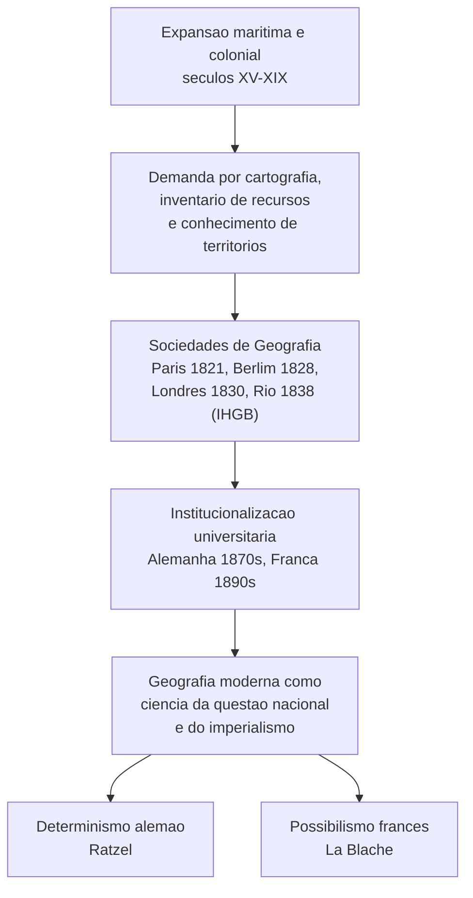
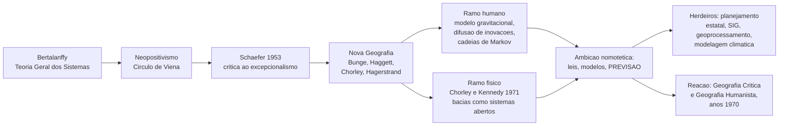

# Pensamento Geográfico — Correntes Teóricas

> [!info] Função desta nota
> O item 1 do programa de Geografia é **integralmente epistemológico**. A banca não pede "o que é geografia", pede **quem pensou o quê, quando, contra quem e com que método**. Esta nota cobre a genealogia completa, com aprofundamento no momento sistêmico-quantitativo, que é o eixo menos coberto pela bibliografia de cursinho e o mais recorrentemente cobrado em enunciado difícil.

---

# BLOCO I — DEBATE TEÓRICO E HISTORIOGRÁFICO

## 1. Chave de leitura: a Geografia como saber de Estado

A Geografia não nasce na universidade; nasce **a serviço do Estado e da expansão colonial**. Esse é o pressuposto que organiza todo o item 1.1 do edital e o único que explica por que a institucionalização acadêmica ocorre precisamente no ciclo imperialista (1870–1914).

Encadeamento causal a memorizar:

> [!tip] Ligação de vault
> A criação das sociedades geográficas é o mesmo movimento que produz o [[IHGB]] no Brasil (1838): saber territorial como instrumento de construção do Estado nacional. Use essa ponte na Fase 2 — ela vale ponto de articulação interdisciplinar.

Yves Lacoste radicalizará essa constatação em 1976, ao afirmar que a Geografia é, antes de tudo, um saber estratégico de comando do território — tese que reabre a questão do uso político da disciplina e inaugura o ciclo crítico.

---

## 2. A fundação clássica: Humboldt e Ritter

Os dois morrem em **1859** (ano de *A Origem das Espécies*), o que fecha simbolicamente o ciclo fundador.

**Alexander von Humboldt (1769–1859)** — *Kosmos*. Naturalista, viajante, empirista. Método **indutivo e comparativo**: da observação sistemática dos fenômenos naturais às leis gerais da natureza. Fusão de rigor científico e prazer estético diante da paisagem (*Landschaft*). É o fundador da abordagem **fisionômica** e da geografia física comparada.

**Carl Ritter (1779–1859)** — *Erdkunde*. Historiador de formação, primeiro catedrático de Geografia (Berlim, 1820). Método **dedutivo e comparativo regional**. Diferentemente de Humboldt, parte do todo (a Terra como unidade organizada) para as partes. Sua estrutura é **teleológica**: a Terra é a morada preparada para o homem — resíduo de teologia natural que o positivismo posterior expurgará.

> [!warning] Armadilha canônica
> A banca não cobra "quem fundou a geografia moderna" — cobra a **nuance**. O TPS 2017 validou como CERTO um item que atribui a fundação a Ritter e Humboldt **sem renegar o saber geográfico anterior**. E validou também um item que caracteriza a obra dos dois como simultaneamente **cosmológica e regional**, com o geógrafo como observador que soma prazer estético e prazer intelectual. Ou seja: a banca opera com leitura sofisticada, de matriz francesa (Claval, Broc), não com manual escolar.

---

## 3. Determinismo ambiental e a matriz alemã

**Friedrich Ratzel (1844–1904)** — *Anthropogeographie* (1882/1891), *Politische Geographie* (1897). Formação em zoologia; darwinismo social explícito.

Núcleo conceitual:

- **Estado como organismo vivo**: nasce, cresce, compete, decai. Analogia biológica, não sistêmica (distinção decisiva — ver §6).
- **Raum** (espaço) e **Lage** (posição/situação): as duas variáveis de poder.
- **Lebensraum** (espaço vital): a necessidade de expansão territorial como imperativo do organismo estatal em crescimento. Base doutrinária que a *Geopolitik* de Haushofer converterá em ideologia expansionista nazista.
- **Solo e Estado**: a relação Estado–território é constitutiva, não contingente.

**Rudolf Kjellén** (sueco) cunha o termo *Geopolitik* (1916). **Karl Haushofer** o instrumentaliza no entreguerras.

> [!warning] Correção historiográfica exigida
> É erro grosseiro reduzir Ratzel a "determinista vulgar". Ratzel reconhece a agência humana e a técnica; o rótulo "determinismo" é, em boa medida, construção retrospectiva da escola francesa, interessada em demarcar-se do rival alemão no contexto do revanchismo pós-1871. A **questão nacional na Europa** (edital 1.2) é literalmente o motor da cisão entre as duas escolas.

---

## 4. Possibilismo francês e o método regional

**Paul Vidal de La Blache (1845–1918)** — *Tableau de la géographie de la France* (1903), *Principes de géographie humaine* (póstumo, 1922).

- **Gêneros de vida** (*genres de vie*): conjuntos de técnicas, hábitos e instrumentos por meio dos quais um grupo se relaciona com o meio. É a categoria que substitui a causalidade natural pela **mediação cultural**.
- **Região**: unidade de análise privilegiada; a *personalidade regional* como síntese de natureza e história.
- **Método**: descritivo, monográfico, idiográfico. A monografia regional torna-se o gênero canônico.
- O termo "possibilismo" é de **Lucien Febvre**, não de La Blache — e vem da historiografia dos *Annales*, com a qual a escola vidaliana mantém simbiose (Febvre, Bloch, depois Braudel).

Sucessores: Jean Brunhes, Albert Demangeon, Emmanuel de Martonne, Max Sorre, Pierre George.

**Jean Brunhes** — *La Géographie humaine* (1910). A superfície terrestre é a **morada do homem**; a classificação dos "fatos essenciais de geografia humana" (casa, caminho, cultivo, criação, devastação vegetal e animal, exploração mineral) coloca o **trabalho** no centro. É esse ponto — trabalho como agente do caráter dinâmico e contraditório da construção do espaço — que o TPS 2024 validou como CERTO.

**Élisée Reclus (1830–1905)** — *Nouvelle Géographie Universelle*, *L'Homme et la Terre*. Anarquista, comunardo exilado. Junto com **Kropotkin** (*Apoio mútuo*), constitui a **matriz libertária** da geografia: crítica da desigualdade social, leitura da técnica e do progresso em chave emancipatória. Cobrado e validado em 2024.

> [!tip] Ponto de alta rentabilidade
> A existência de uma corrente **anarquista contemporânea** aos clássicos desmonta a narrativa linear "determinismo → possibilismo → quantitativa → crítica". A banca gosta exatamente disso: mostrar que o pensamento crítico não começa em 1970. Guarde Reclus e Kropotkin como contraexemplos prontos.

---

## 5. Hartshorne e o excepcionalismo

**Richard Hartshorne** — *The Nature of Geography* (1939). Sistematiza, a partir de Hettner, a tese **corológica**: a Geografia é ciência **idiográfica**, voltada à descrição da diferenciação de áreas (*areal differentiation*), e não à formulação de leis gerais. Por isso, seria **excepcional** entre as ciências — não partilharia o método nomotético das demais.

Esse é o alvo direto do artigo que abre o ciclo seguinte.

---

## 6. A Nova Geografia: neopositivismo, sistemas e probabilidade

### 6.1 O ponto de virada

**Fred K. Schaefer**, *Exceptionalism in Geography: A Methodological Examination* (1953). Publicado postumamente, o artigo acusa Hartshorne de isolar a Geografia do método científico e defende que a disciplina deve buscar **leis gerais** — como qualquer ciência. Filiação explícita ao **neopositivismo** do Círculo de Viena (Schaefer era próximo de Gustav Bergmann, em Iowa).

Segue-se a **Revolução Quantitativa** (anos 1950–60), também dita **Geografia Teorética**, **Nova Geografia** ou **Geografia Pragmática**. Marcos: Bunge, *Theoretical Geography* (1962); Haggett, *Locational Analysis in Human Geography* (1965); Chorley e Haggett, *Models in Geography* (1967).

### 6.2 A Teoria Geral dos Sistemas

**Ludwig von Bertalanffy** — biólogo austríaco; formulação nos anos 1930–40, consolidação em *General System Theory* (1968). A tese: existe um conjunto de princípios formais comuns a **todos** os sistemas, independentemente de sua substância material — biológica, física, social ou econômica.

Vocabulário transposto para a Geografia: entrada e saída (*input/output*), fluxo, estoque, retroalimentação (*feedback* positivo e negativo), entropia, equilíbrio dinâmico, limiar (*threshold*), caixa-preta (*black box*).

**Por que isso foi decisivo para a Geografia — e não para outras disciplinas do mesmo modo:** a linguagem sistêmica era **transdomínio**. Servia igualmente para modelar uma bacia hidrográfica e um fluxo migratório. Oferecia, portanto, a promessa de **reunificar a disciplina**, cindida desde o século XIX pelo dualismo natureza/sociedade. Essa é a chave interpretativa que a banca cobra.

### 6.3 A tipologia de sistemas (Chorley e Kennedy, 1971)

*Physical Geography: A Systems Approach*. Quatro classes, em ordem crescente de complexidade — e esta gradação **é exatamente o que determina se a previsão é possível**:

| Classe | Definição | Capacidade preditiva |
|---|---|---|
| **Morfológico** | Rede de propriedades formais e suas correlações estatísticas (declividade × densidade de drenagem). Não há fluxo. | Correlacional apenas; descreve, não prevê. |
| **Em cascata** (encadeado) | Sequência de subsistemas ligados por fluxos de matéria e energia; a saída de um é a entrada do seguinte. | Prevê o comportamento do fluxo, não da forma. |
| **Processo-resposta** | Acoplamento de um sistema morfológico a um sistema em cascata: o fluxo modifica a forma, que retroage sobre o fluxo. | Núcleo da ambição preditiva; exige modelagem probabilística. |
| **Controlado** | Sistema processo-resposta sobre o qual incide decisão humana deliberada (barragem, zoneamento). | Previsão condicionada à variável de intervenção. |

### 6.4 Por que probabilístico e não determinístico

Este é o ponto que separa o candidato preparado do que decorou rótulos. Sistemas geográficos são **abertos** — trocam matéria e energia com o exterior, comportam contingência e não são replicáveis em laboratório. Logo, o instrumental adotado **não foi a mecânica newtoniana determinista, e sim a estatística inferencial e os modelos estocásticos**:

- **Modelo gravitacional** de interação espacial e migração (raiz em Ravenstein e Zipf).
- **Oportunidades interpostas** — Samuel Stouffer (1940): a migração é função das oportunidades intervenientes, não da distância bruta.
- **Simulação de Monte Carlo** — Torsten Hägerstrand, difusão de inovações (1953): o processo de difusão é modelado por probabilidades de contato.
- **Cadeias de Markov** aplicadas a mudança de uso do solo e mobilidade residencial.
- **Random walk** na geomorfologia fluvial — Leopold e Langbein (1962).
- **Maximização de entropia** — A. G. Wilson (1970), modelos de distribuição de fluxos urbanos.

Modelos clássicos de localização são **reincorporados** nesse momento (não criados por ele): von Thünen (1826, anéis agrícolas), Alfred Weber (1909, localização industrial), Christaller (1933, lugares centrais), Lösch (1940).

> [!warning] O operador epistêmico — armadilha de leitura
> Enunciados sobre esta corrente costumam vir formulados como **"levou à crença de que"**, **"buscava"**, **"pretendia"**. Nesses casos, a banca descreve a **pretensão** da corrente, não afirma sua **validade**. O candidato que domina a crítica posterior tende a marcar ERRADO por reflexo — "mas a previsão fracassou!" — e perde o item. **Regra:** quando o predicado é uma crença, um projeto ou uma ambição intelectual, o gabarito se decide pela fidelidade histórica à corrente, jamais pela verdade da tese.

### 6.5 Recepção brasileira

A Nova Geografia entra no Brasil pelo **IBGE** e pelo planejamento estatal do período militar (Speridião Faissol, Roberto Lobato Corrêa em sua fase inicial, Pedro Pinchas Geiger). Isso não é acidente: uma geografia que promete **prever e planejar** encontra demanda natural em um Estado tecnocrático-desenvolvimentista. A crítica dos anos 1970 atacará precisamente esse casamento.

---

## 7. A Geografia Crítica (anos 1970)

Reação simultânea à esterilidade política do quantitativismo e ao descritivismo vidaliano. Contexto: 1968, guerra do Vietnã, crise do fordismo.

- **Yves Lacoste** (1976): a Geografia como saber estratégico; fundação da revista *Hérodote*. Denúncia da "geografia dos professores" como cortina que oculta a "geografia dos estados-maiores".
- **David Harvey** — *Social Justice and the City* (1973). Trajetória exemplar: autor de *Explanation in Geography* (1969), manual do positivismo geográfico, converte-se ao marxismo e passa a ler o espaço como produto e condição da acumulação capitalista. Depois: *The Limits to Capital*, *ajuste espacial* (*spatial fix*), *compressão espaço-tempo*.
- **Henri Lefebvre** — *A produção do espaço* (1974). Não é geógrafo, mas é a fonte filosófica decisiva: o espaço é socialmente produzido, não é palco nem receptáculo. Tríade percebido/concebido/vivido.
- **Massimo Quaini**, **Manuel Castells** (*A questão urbana*, 1972).

**Milton Santos (1926–2001)** — o eixo brasileiro e latino-americano.

- *Por uma Geografia Nova* (1978): manifesto crítico; ataque tanto ao quantitativismo quanto ao empirismo descritivo.
- *A Natureza do Espaço* (1996): o espaço como **conjunto indissociável de sistemas de objetos e sistemas de ações**.
- **Meio técnico-científico-informacional**: a periodização do espaço em meio natural → meio técnico → meio técnico-científico-informacional (pós-1970).
- **Verticalidades e horizontalidades**: os vetores globais que atravessam o território versus as contiguidades solidárias do lugar.
- **Espaço banal** (categoria retomada de Perroux): o espaço de todos, contra o espaço seletivo das empresas.
- **Uso do território**: o território não interessa em si, mas **como é usado** — categoria que a banca já citou em enunciado (2022).

> [!warning] Armadilha fina e provável
> Milton Santos também opera com a palavra **"sistemas"** ("sistemas de objetos e sistemas de ações") — mas em sentido **dialético-totalizante**, não bertalanffyano. Um item que atribua a Milton Santos a adesão à Teoria Geral dos Sistemas, ou que use a coincidência lexical para associá-lo ao neopositivismo, é ERRADO. Homonímia não é filiação.

---

## 8. Geografia Humanista e fenomenológica

Reação **paralela e distinta** à crítica marxista, também nos anos 1970. Base filosófica: fenomenologia (Husserl, Merleau-Ponty) e existencialismo.

- **Yi-Fu Tuan** — *Topofilia* (1974), *Espaço e Lugar* (1977). Distinção fundadora: **espaço** é abstração, liberdade, movimento; **lugar** é pausa, segurança, centro de significado atribuído pela experiência vivida.
- **Edward Relph** — *Place and Placelessness* (1976): autenticidade do lugar e a produção de "não-lugares" (tema que Marc Augé, antropólogo, desenvolverá em 1992).
- **Anne Buttimer**, **David Ley**.

> [!tip] Distinção que a banca explora
> Crítica e Humanista **não são a mesma reação**. A Crítica acusa o quantitativismo de ser politicamente cúmplice; a Humanista acusa-o de ser existencialmente vazio — de reduzir sujeitos a pontos e fluxos. Confundir as duas é erro conceitual, não apenas terminológico.

---

## 9. Correntes contemporâneas: pós-estruturalistas, pós-coloniais e decoloniais

- **Edward Soja** — *Postmodern Geographies* (1989); **terceiro espaço**; trialética espacialidade–historicidade–socialidade.
- **Doreen Massey** — *geometrias do poder*: o mesmo processo de compressão espaço-tempo posiciona sujeitos de modo radicalmente desigual; crítica feminista à noção de lugar como refúgio.
- **Rogério Haesbaert** — *O mito da desterritorialização* (2004): contra a tese da "morte do território", propõe **multiterritorialidade**; mais recentemente, **território-corpo** e **corpo-território** em chave decolonial.
- **Decolonialidade** — Aníbal Quijano (colonialidade do poder), Walter Mignolo, Catherine Walsh. Na Geografia latino-americana: crítica ao eurocentrismo das categorias, resgate de cosmovisões originárias (**Pacha Mama** como representação simbólica que funde corpo feminino e natureza, com destaque para o elemento indígena andino), territorialidades quilombolas e indígenas.

Este é, empiricamente, o bloco de **maior crescimento** na prova recente. Ver Bloco III.

---

## 10. A matriz brasileira

| Marco | Data | Significado |
|---|---|---|
| IHGB | 1838 | Saber territorial e construção da identidade nacional |
| Missão francesa / USP | 1934 | Pierre Deffontaines, Pierre Monbeig — implantação da escola vidaliana |
| AGB | 1934 | Associação dos Geógrafos Brasileiros |
| IBGE | 1937 | Geografia a serviço do planejamento e do censo estatal |
| Mário Travassos | 1935 | *Projeção Continental do Brasil* — geopolítica do triângulo Cochabamba–Santa Cruz–Sucre |
| Everardo Backheuser | 1940s | Geopolítica de matriz ratzeliana no Brasil |
| Golbery do Couto e Silva | 1950s–60s | Doutrina de segurança nacional, "fronteiras vivas" |
| Aziz Ab'Sáber | 1960s+ | Domínios morfoclimáticos; geografia física brasileira |
| Milton Santos | 1978–2001 | Refundação crítica; projeção internacional |
| Ruy Moreira | 2008 | *O pensamento geográfico brasileiro* — fonte citada literalmente pela banca em 2024 |

---

## 11. Geopolítica clássica (edital 6.1) — ligação obrigatória

| Autor | Obra | Tese |
|---|---|---|
| **Alfred T. Mahan** | *The Influence of Sea Power upon History* (1890) | Poder marítimo, controle de linhas de comunicação, bases navais |
| **Halford Mackinder** | *The Geographical Pivot of History* (1904); *Democratic Ideals and Reality* (1919) | **Área-Pivô / Heartland**: quem domina a Europa Oriental domina o Heartland; quem domina o Heartland domina a Ilha-Mundo |
| **Nicholas Spykman** | *The Geography of the Peace* (1944) | **Rimland**: a chave é a orla marginal eurasiática, não o núcleo continental — inversão de Mackinder; fundamento intelectual da contenção |
| **Saul Cohen** | 1963+ | Regiões geoestratégicas e geopolíticas; cinturões de fratura |
| **Zbigniew Brzezinski** | *The Grand Chessboard* (1997) | Atualização pós-Guerra Fria do argumento eurasiático |

> [!tip] Cruzamento com Política Internacional
> O mesmo neopositivismo que gerou a Nova Geografia gerou, na mesma década, o **behavioralismo** e o *Second Debate* das Relações Internacionais. Morton Kaplan (*System and Process in International Politics*, 1957) e Karl Deutsch (cibernética) transpõem Bertalanffy diretamente. Waltz, em 1979, opera um sistemismo **estrutural** de ambição explicativa, não preditiva de eventos — distinção que vale parágrafo inteiro na Fase 2. Ver [[teoria-ri-debates-metodologicos]].

---

# BLOCO II — VOCABULÁRIO TÉCNICO

| Termo | Definição operacional |
|---|---|
| **Idiográfico** | Voltado ao singular, ao caso irrepetível. Hartshorne, escola regional. |
| **Nomotético** | Voltado à formulação de leis gerais. Schaefer, Nova Geografia. |
| **Corologia** | Estudo da diferenciação de áreas; matriz Hettner–Hartshorne. |
| **Excepcionalismo** | Tese de que a Geografia teria método próprio, distinto do das demais ciências. |
| **Sistema aberto** | Troca matéria e energia com o ambiente; tende a estado estacionário, não ao equilíbrio termodinâmico. |
| **Retroalimentação negativa** | Mecanismo autorregulador que amortece o desvio e estabiliza o sistema. |
| **Retroalimentação positiva** | Mecanismo que amplifica o desvio, afastando o sistema do estado inicial. |
| **Modelo estocástico** | Modelo que incorpora variáveis aleatórias e gera resultados em termos de probabilidade. |
| **Gêneros de vida** | La Blache: repertório técnico-cultural pelo qual um grupo se relaciona com o meio. |
| **Espaço vital (Lebensraum)** | Ratzel: extensão territorial requerida pelo Estado-organismo em crescimento. |
| **Meio técnico-científico-informacional** | Milton Santos: período em que ciência, técnica e informação constituem o próprio conteúdo do território. |
| **Verticalidades / horizontalidades** | M. Santos: vetores externos hierárquicos versus contiguidades solidárias locais. |
| **Topofilia** | Tuan: elo afetivo entre a pessoa e o lugar. |
| **Multiterritorialidade** | Haesbaert: sobreposição e vivência simultânea de múltiplos territórios. |
| **Geometrias do poder** | Massey: distribuição desigual do controle sobre fluxos e mobilidades. |
| **Heartland / Rimland** | Mackinder / Spykman: núcleo continental eurasiático versus orla marítima. |

---

# BLOCO III — RADAR TPS (2017–2025)

> [!info] Base empírica
> Varredura dos 16 arquivos do corpus. **Advertência de integridade:** `TPS_2025_manha.md` reproduz o conteúdo de `TPS_2024_manha.md` — contabilizado como **um único ponto**. `TPS_2025_tarde.md` mantém sobreposição parcial com `TPS_2024_tarde.md`. Frequências abaixo já descontam a duplicação.

## 3.1 Distribuição

| Edição | Bloco de teoria geográfica | Recorte |
|---|---|---|
| **2017 manhã** | Q23 — 4 itens | Método geográfico; Ritter e Humboldt; **teoria geral dos sistemas** |
| **2019 manhã** | Q27 — 4 itens | Geopolítica clássica (Mackinder, Mahan) via Tim Marshall |
| **2020 tarde** | 1 item | Mahan e o Plano de Reorganização Naval (cruzamento com PEB) |
| **2022 manhã** | Q26 — 4 itens | **Geografia decolonial** (Haesbaert, Milton Santos, Pacha Mama) |
| **2023 manhã** | Q27 — 4 itens | Geografia física clássica; Davis, Gaussen, **La Blache** |
| **2023 tarde** | 1 item | Geografia e epistemologia colonial alemã |
| **2024/2025 manhã** | Q23 e Q24 — 8 itens | **Ruy Moreira**; La Blache, Brunhes, Reclus, Pierre George; heartland e rimland |

**Leitura:** o tema comparece em **7 das 9 edições distintas** disponíveis. Não é tópico periférico. Em 2024, ocupou **duas questões inteiras** — 8 itens, o equivalente a metade da Geografia da manhã.

## 3.2 Itens autênticos e gabaritos

**TPS 2017 manhã, Q23**

- *"Desde a geografia clássica até o presente, pensamento e prática geográfica conformam métodos e metodologias bem definidos, não havendo antagonismos dos tipos forma/conteúdo, objetividade/subjetividade, explicativa/compreensiva, matemática/descritiva."* → **ERRADO**. A negação dos antagonismos é falsa: a história da disciplina **é** a história desses antagonismos.
- *"A adoção da teoria geral dos sistemas pela geografia do século XX levou à crença de que fenômenos, como, por exemplo, dos movimentos migratórios à dinâmica da natureza, podem ser entendidos utilizando-se o cálculo de probabilidades, que permite prever ou antecipar fatos."* → **CERTO**. Descreve a pretensão, não a valida.
- Atribuição da geografia científica a Ritter e Humboldt **sem renegar** o saber anterior → **CERTO**.
- Ritter e Humboldt como criadores de ciência simultaneamente cosmológica e regional; prazer estético somado ao intelectual; princípios presentes no nacionalismo europeu do fim do XIX → **CERTO**.

**TPS 2023 manhã, Q27**

- Paisagem como base da abordagem sintética em geografia física, em ótica ecológica → **CERTO**.
- Gaussen e a escola de Toulouse exigiriam cartografia de **grande escala** → **ERRADO**.
- W. M. Davis e o ciclo de erosão normal aproximando-se das **interações homem/meio** → **ERRADO** (o ciclo davisiano é estritamente fisiográfico).
- La Blache buscando na geologia, clima, relevo e hidrografia as razões da repartição dos homens, mas ressalvando que os problemas fundamentais só aparecem após o **tratamento cartográfico dos dados** → **CERTO**.

**TPS 2024 manhã, Q23** (contexto: Ruy Moreira, *O pensamento geográfico brasileiro*)

- La Blache: método regional e gêneros de vida → **CERTO**.
- Brunhes: superfície terrestre como morada do homem; trabalho como fator do caráter dinâmico e contraditório do espaço → **CERTO**.
- Reclus: visão revolucionária, avanços técnicos e sociedade desigual → **CERTO**.
- Pierre George: homem como sujeito de espaço organizado por trabalho e cultura, com ênfase na civilização, hábitos e costumes → **ERRADO** (a formulação desloca George, marxista, para registro culturalista).

**TPS 2024 manhã, Q24** — heartland e rimland: China como novo Estado-pivô (**CERTO**); rimland superado com o fim da URSS e OTAN esvaziada (**ERRADO**); rimland como sinônimo de choque de civilizações (**ERRADO**); Ucrânia e Taiwan como centros de tensão (**CERTO**).

**TPS 2022 manhã, Q26** — decolonial: Pacha Mama como representação simbólica do corpo feminino em analogia à natureza, com destaque ao elemento indígena andino (**CERTO**); resgate de elementos antes invisibilizados ou lidos em chave eurocêntrica (**CERTO**); homem como elemento quantitativo e **neutro** na perspectiva decolonial (**ERRADO** — "neutro" é incompatível com o pressuposto decolonial); indígenas como agentes políticos da ocupação colonial (**ERRADO**).

## 3.3 Taxonomia de armadilhas observada

1. **Deslocamento de escola** — atribuir a um autor tese de corrente adversária (Pierre George culturalizado; Davis humanizado). **Família dominante.**
2. **Inversão de detalhe técnico** — grande/pequena escala, heartland/rimland, indutivo/dedutivo.
3. **Falsa equivalência conceitual** — rimland como "choque de civilizações".
4. **Negação de antagonismo** — afirmar unidade metodológica onde há conflito histórico.
5. **Termo axiologicamente incompatível** — "neutro" em enunciado decolonial; "objetivo" em enunciado humanista.
6. **Homonímia enganosa** — "sistemas" em Milton Santos ≠ Teoria Geral dos Sistemas.

## 3.4 Rebote: candidatos de alta probabilidade para 2027

- **Nova Geografia / Revolução Quantitativa como tema central**: cobrada de modo frontal apenas em 2017. **Nove anos de ausência.** Candidato de rebote forte.
- **Geografia Humanista (Tuan, Relph)**: ausente do corpus inteiro. Lacuna absoluta da série — e tópico consolidado da bibliografia.
- **Escola de Berkeley / Carl Sauer** (geografia cultural, morfologia da paisagem): igualmente ausente.
- **Hartshorne e o debate do excepcionalismo**: nunca cobrado nominalmente.

---

# BLOCO IV — ESQUELETO DISCURSIVO (Fase 2)

## 4.1 Comando provável

> "Discorra sobre as principais correntes teóricas da Geografia, explicitando as rupturas metodológicas que as separam e a relação de cada uma com o contexto político de sua emergência."

## 4.2 Arquitetura em cinco movimentos

**Parágrafo de abertura — tese.** A história do pensamento geográfico não é acúmulo progressivo de conhecimento, mas sucessão de **rupturas metodológicas**, cada qual respondendo a uma demanda política determinada. Enunciar a tese sem adjetivação.

**Movimento 1 — A geografia como saber de Estado (fundação).** Expansão colonial → sociedades geográficas → institucionalização universitária no ciclo imperialista. Humboldt e Ritter fundam o método; Ratzel e La Blache o convertem em instrumento da questão nacional europeia, em polos opostos (organicismo determinista versus mediação cultural possibilista). Registrar que a oposição entre as escolas é, em parte, produto do revanchismo pós-1871.

**Movimento 2 — A ruptura nomotética.** Schaefer contra Hartshorne; neopositivismo; Teoria Geral dos Sistemas como linguagem unificadora de natureza e sociedade; adoção de modelos **estocásticos** e ambição de previsão. Contexto político: Estado planejador do pós-guerra, tecnocracia, no Brasil o IBGE e o planejamento do regime militar.

**Movimento 3 — A dupla reação dos anos 1970.** Distinguir com precisão: a Crítica (Lacoste, Harvey, Lefebvre, Milton Santos) acusa o quantitativismo de **cumplicidade política**; a Humanista (Tuan, Relph) acusa-o de **esvaziamento existencial**. Não são a mesma objeção. Contexto: 1968, crise do fordismo, descolonização.

**Movimento 4 — O presente.** Pós-estruturalismo (Soja, Massey), decolonialidade e a produção latino-americana (Haesbaert, território-corpo). Contexto: globalização, crítica ao eurocentrismo, emergência de sujeitos antes invisibilizados. Sinalizar que a herança quantitativa **não morreu** — sobrevive no geoprocessamento, nos SIG e na modelagem climática, o que desmente a leitura de simples superação.

**Conclusão.** Retomar a tese: a pluralidade metodológica não é sintoma de imaturidade científica, mas condição de uma disciplina cujo objeto — o espaço — é simultaneamente natural e social. Fechar sem prognóstico e sem retórica.

## 4.3 Parágrafo-modelo (registro exigido na prova)

> A adesão da Geografia à teoria geral dos sistemas, no segundo pós-guerra, respondeu a um duplo constrangimento. De um lado, a acusação de excepcionalismo metodológico, formulada por Schaefer contra a tradição corológica, exigia que a disciplina se alinhasse ao padrão nomotético das demais ciências. De outro, a persistência do dualismo entre natureza e sociedade demandava uma linguagem comum aos dois domínios. O modelo bertalanffyano atendeu a ambos: ao descrever fenômenos tão distintos quanto a dinâmica de uma bacia hidrográfica e a difusão de um fluxo migratório mediante o mesmo repertório de entradas, saídas e retroalimentações, ofereceu à Geografia a promessa de unidade epistemológica e de capacidade preditiva. Que essa promessa tenha sido posteriormente denunciada — por sua cumplicidade com o planejamento tecnocrático e por sua indiferença às relações de poder — não anula seu efeito histórico: dela derivam o instrumental estatístico e os sistemas de informação geográfica que estruturam a prática contemporânea da disciplina.

*(148 palavras. Observe: nenhuma primeira pessoa, nenhum adjetivo valorativo, uma concessão explícita no fecho — estrutura de "objetividade diplomática".)*

---

# CONEXÕES

- [[IHGB]] — saber territorial e construção do Estado nacional brasileiro
- [[geopolitica-classica-mackinder-spykman-mahan]] — *a criar*
- [[milton-santos-espaco-e-territorio]] — *a criar*
- [[teoria-ri-debates-metodologicos]] — behavioralismo, Kaplan, Deutsch, Waltz
- [[geografia-economica-divisao-internacional-do-trabalho]]

---

# AUTOTESTE

1. Por que o instrumental da Nova Geografia foi **probabilístico** e não determinístico? Responda a partir da noção de sistema aberto.
2. Distinga a crítica **marxista** da crítica **humanista** ao quantitativismo. Qual objeto cada uma acusa o modelo de suprimir?
3. Em que sentido "sistemas de objetos e sistemas de ações" (Milton Santos) **não** é Teoria Geral dos Sistemas?
4. Spykman inverte Mackinder em que ponto exato — e que doutrina de política externa norte-americana deriva dessa inversão?
5. Por que a oposição determinismo/possibilismo é, em parte, artefato historiográfico e não descrição fiel de Ratzel?
6. Ordene as quatro classes de sistemas de Chorley e Kennedy e identifique em qual delas a previsão se torna efetivamente possível.