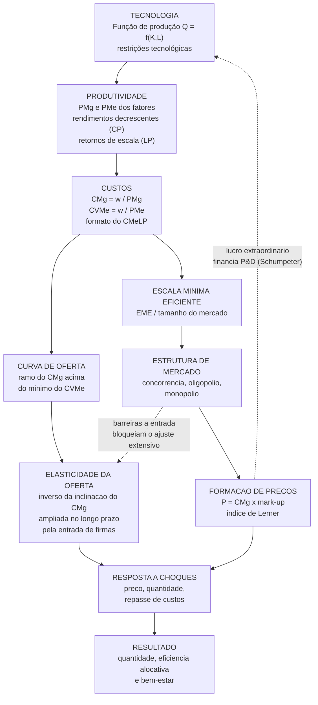

# Teoria da Oferta do Produtor: Fatores, Função de Produção e Elasticidade

## Introdução

A teoria da oferta do produtor constitui um dos pilares fundamentais da microeconomia, explicando como as empresas tomam decisões de produção e como essas decisões se traduzem em curvas de oferta no mercado. **Esta teoria estabelece a relação técnica entre os fatores de produção e o produto final, sendo essencial para compreender o comportamento das empresas e a formação de preços na economia**. 

A compreensão da teoria da oferta envolve três componentes interconectados: os fatores de produção que constituem os insumos básicos, a função de produção que determina as relações técnicas entre insumos e produtos, e a elasticidade-preço da oferta que mede a sensibilidade dos produtores às variações de preços. **A Lei dos Rendimentos Decrescentes emerge como conceito central, explicando por que as curvas de custo marginal e oferta têm formato ascendente no curto prazo**.

> [!danger] ⚠️ CAIU NA 2ª FASE DO CACD 2026 — Economia, Questão 1 (30,00 pontos, até 60 linhas)
> A Prova Escrita de Economia aplicada em **2/5/2026** abriu com uma questão construída *exatamente* sobre o eixo desta nota. Texto motivador: *"A análise microeconômica oferece instrumentos essenciais para compreender a formação de preços, a alocação de recursos e o comportamento das firmas em diferentes estruturas de mercado. Nesse contexto, a interação entre tecnologia produtiva, resposta da oferta e grau de concorrência desempenha papel central na determinação de resultados econômicos."*
>
> | # | Comando da banca | Valor |
> |---|---|---|
> | 1 | **Função de produção**: relação insumos–produto; como **restrições tecnológicas** e **retornos de escala** influenciam os **custos** e as decisões da firma no **curto e no longo prazos** | 6,00 |
> | 2 | **Elasticidade-preço da oferta**, relacionada à **estrutura de custos**, à **flexibilidade produtiva**, ao **horizonte temporal** e à **capacidade de ajuste** das firmas | 6,00 |
> | 3 | **Concorrência perfeita × monopólio × oligopólio**: formação de preços (**mark-ups**), quantidade, **eficiência alocativa**, **interdependência estratégica**, **coordenação/colusão** e **bem-estar** | **12,00** |
> | 4 | **Integração**: como função de produção e elasticidade da oferta interagem com a **estrutura de mercado** | 6,00 |
>
> **Lição de rota:** o item de maior peso — 12 pontos, **40% da questão** — não era produção nem elasticidade: era **estruturas de mercado**. Quem estudou "oferta do produtor" como tema isolado, sem o elo com poder de mercado, perdeu quase metade da nota. Por isso esta nota foi expandida para cobrir a **cadeia completa** cobrada pela banca.

> [!abstract] Mapa da nota — a cadeia causal que o padrão de resposta percorre
> **Tecnologia** (função de produção) → **produtividade marginal** ($PMg$) → **custos** ($CMg = w/PMg_L$) → **curva de oferta** (o ramo do $CMg$ acima do mínimo do $CVMe$) → **elasticidade da oferta** (o inverso da inclinação do $CMg$) → **estrutura de mercado** (quem converte custo em preço, e como) → **preço, quantidade, eficiência alocativa e bem-estar**.
>
> Cada seção abaixo é um elo dessa corrente. Decorar a corrente vale mais do que decorar cada elo: ela é o **esqueleto de qualquer dissertação sobre oferta** na 2ª fase.

## Fatores de Produção

### Definição e classificação dos insumos básicos

Os fatores de produção representam os insumos necessários para a geração de bens e serviços na economia. A teoria econômica tradicionalmente identifica três fatores primários, complementados por um quarto fator organizacional.

> A função de produção representa a relação tecnológica que associa combinações de insumos — tipicamente trabalho e capital — ao nível máximo de produto que a firma pode obter, refletindo a fronteira tecnológica disponível. Essa relação é central para a determinação da produtividade marginal dos fatores e da estrutura de custos.
> — **CEBRASPE, padrão de resposta definitivo, Questão 1 da Prova Escrita de Economia, CACD 2026** (frase de abertura do espelho oficial; ver o [[#Anexo I — A questão de 2026 na íntegra (2ª fase)]]).

**Terra (Recursos Naturais)**: Engloba não apenas a terra física, mas todos os recursos naturais utilizados na produção. Inclui água, minerais, petróleo, gás natural, florestas, energia eólica e localizações geográficas. 

**No contexto brasileiro, este fator possui relevância especial dado o extenso território, rica biodiversidade e abundantes recursos minerais**. A terra caracteriza-se por oferta geralmente fixa, imobilidade geográfica e capacidade de gerar renda através da escassez natural.

**Trabalho (Capital Humano)**: Compreende todo esforço humano aplicado à produção, abrangendo tanto contribuições físicas quanto intelectuais. Inclui habilidades técnicas, conhecimento especializado, capacidades gerenciais e todas as formas de capital humano. O trabalho transforma matérias-primas em produtos acabados através da aplicação de conhecimento, habilidades e esforço. Distingue-se por oferta variável, mobilidade entre setores, possibilidade de aprimoramento através de educação e treinamento, sendo remunerado através de salários.

**Capital (Bens de Produção)**: Abrange todos os ativos produzidos pelo homem utilizados na produção de outros bens. Inclui maquinário, equipamentos, edificações, ferramentas, tecnologia e infraestrutura. O capital também engloba capital financeiro (recursos disponíveis para investimento). **Este fator aumenta a produtividade do trabalho ao fornecer ferramentas e tecnologia que ampliam a capacidade produtiva**. Caracteriza-se pela possibilidade de acumulação ao longo do tempo, sujeição à depreciação, mobilidade geográfica e geração de retornos através de juros ou lucros.

> [!important] Capacidade Empresarial 
> A capacidade empresarial constitui o fator organizacional que combina os demais fatores de produção. Envolve inovação, assunção de riscos, tomada de decisões e identificação de oportunidades. Os empresários criam valor ao combinar fatores de formas inovadoras, introduzir inovações tecnológicas e assumir incertezas do mercado. São remunerados através do lucro e constituem o motor da mudança e crescimento econômico.

## Função de Produção

### Conceito fundamental

A função de produção representa a **relação técnica que demonstra a quantidade máxima de produto obtível a partir de uma dada combinação de fatores de produção, considerando o estado atual da tecnologia**. Matematicamente, expressa-se como Q = f(K, L), onde Q representa o produto, K o capital e L o trabalho. Esta função incorpora eficiência técnica e tecnologia disponível, constituindo a base para análise das decisões produtivas das empresas.

### Formalização e restrições tecnológicas

> [!definition] Definição formal
> $$Q = f(x_1, x_2, \dots, x_n) \qquad\text{ou, no caso canônico de dois fatores,}\qquad Q = f(K, L)$$
> A função de produção é a **fronteira** do conjunto de possibilidades de produção: a cada vetor de insumos ela associa o **produto máximo tecnicamente obtível**. Dois pontos que a banca valoriza: (i) trata-se de uma relação **tecnológica**, não monetária — preços de fatores ainda não entraram na história; (ii) por definir o *máximo*, ela já **incorpora a hipótese de eficiência técnica** (não há desperdício de insumos).

**Propriedades de uma tecnologia "bem-comportada"**

1. **Produtividade marginal positiva** — $PMg_L = \partial Q/\partial L > 0$ e $PMg_K = \partial Q/\partial K > 0$: mais insumo, mais produto (ao menos até o ponto de saturação).
2. **Produtividade marginal decrescente** — $\partial^2 Q/\partial L^2 < 0$. Esta é a expressão matemática exata da **Lei dos Rendimentos Marginais Decrescentes**. Atenção: ela só se define *mantendo os demais fatores constantes*, logo é um fenômeno **estritamente de curto prazo**.
3. **Convexidade das isoquantas (quase-concavidade)** — a substituição entre fatores é possível, porém progressivamente mais difícil.
4. **Não há produção sem insumos** — $f(0,0)=0$; e monotonicidade: descartar insumo nunca é obrigatório (livre disposição).

**O que são, afinal, as "restrições tecnológicas" que a banca menciona?** São precisamente o conteúdo empírico da função de produção: o conjunto de limitações que definem *o que é possível* produzir. Elas se manifestam em três planos:

- **Restrição de substituibilidade**: o grau em que um fator pode substituir outro (medido pela *elasticidade de substituição* $\sigma$). Tecnologias de proporções fixas (Leontief, $\sigma = 0$) impõem rigidez extrema; substitutos perfeitos ($\sigma \to \infty$) impõem rigidez nenhuma.
- **Restrição de divisibilidade**: muitos equipamentos só existem em tamanhos discretos (um alto-forno, uma plataforma de petróleo, uma rede de fibra). A **indivisibilidade técnica** é a principal fonte de economias de escala e, por consequência, de barreiras à entrada.
- **Restrição de escala**: como o produto reage quando *todos* os fatores variam em igual proporção — os **retornos de escala**, tratados adiante.

#### Isoquantas e a taxa marginal de substituição técnica

A **isoquanta** é o lugar geométrico das combinações $(K,L)$ que geram o mesmo produto. Diferenciando $Q = f(K,L)$ com $dQ = 0$:

$$\frac{\partial f}{\partial L}\,dL + \frac{\partial f}{\partial K}\,dK = 0 \;\Longrightarrow\; TMST_{L,K} = -\frac{dK}{dL}\bigg|_{Q=\bar Q} = \frac{PMg_L}{PMg_K}$$

A **TMST decrescente** (isoquantas convexas) é o análogo produtivo da TMS decrescente do consumidor: à medida que o trabalho se torna abundante em relação ao capital, cada unidade adicional de trabalho substitui cada vez menos capital. → Aprofundamento em [[Isoquantas e fronteira de possibilidades de produção]].

#### Formas funcionais que costumam aparecer na prova

| Tecnologia | Forma | $\sigma$ | Isoquantas | Retornos de escala |
|---|---|---|---|---|
| **Cobb-Douglas** | $Q = A K^{\alpha} L^{\beta}$ | $=1$ | convexas suaves | $\alpha+\beta \gtreqless 1$ |
| **Leontief** (proporções fixas) | $Q = \min\{aK,\, bL\}$ | $=0$ | em "L" | constantes |
| **Substitutos perfeitos** | $Q = aK + bL$ | $\to\infty$ | retas | constantes |
| **CES** | $Q = A[\delta K^{-\rho} + (1-\delta)L^{-\rho}]^{-\nu/\rho}$ | $=\frac{1}{1+\rho}$ | caso geral | grau $\nu$ |

Na **Cobb-Douglas** — a forma mais cobrada —, $\alpha$ e $\beta$ são as **elasticidades-produto** dos fatores ($\alpha = \partial \ln Q/\partial \ln K$), $PMg_L = \beta\,(Q/L) = \beta \cdot PMe_L$ e $TMST = (\beta/\alpha)(K/L)$. Quando $\alpha+\beta = 1$, vale o **teorema da exaustão do produto (Euler)**: remunerar cada fator por sua produtividade marginal esgota exatamente o produto ($wL + rK = PQ$), resultado que fundamenta a teoria neoclássica da distribuição. → Detalhamento em [[Função de Produção Cobb-Douglas]].

#### Eficiência técnica × eficiência econômica

> [!warning] Distinção que separa a resposta boa da mediana
> **Eficiência técnica** é produzir *sobre* a isoquanta (não desperdiçar insumos) — é um critério **de engenharia**, definido pela tecnologia. **Eficiência econômica (ou alocativa de insumos)** é escolher, entre as infinitas combinações tecnicamente eficientes, a **mais barata** — é um critério **de mercado**, que exige preços de fatores. Há infinitos pontos tecnicamente eficientes; apenas um é economicamente eficiente para cada par $(w, r)$.

A firma minimiza custo sujeita a produzir $\bar Q$, o que exige a tangência entre a isoquanta e a **reta de isocusto** ($C = wL + rK$):

$$TMST_{L,K} = \frac{PMg_L}{PMg_K} = \frac{w}{r} \qquad\Longleftrightarrow\qquad \boxed{\;\frac{PMg_L}{w} = \frac{PMg_K}{r}\;}$$

A forma à direita é a **regra do produto marginal por unidade monetária** (ou "lei da equimarginalidade"): no ótimo, o último real gasto em qualquer fator rende o mesmo acréscimo de produto. Se $PMg_L/w > PMg_K/r$, vale a pena substituir capital por trabalho — o desequilíbrio se autocorrige porque a TMST é decrescente.

O **caminho de expansão** é o lugar geométrico dessas tangências à medida que $\bar Q$ cresce; é dele que se extrai a **função de custo total de longo prazo** $C(Q, w, r)$. Uma mudança nos preços relativos dos fatores (p. ex., encarecimento do trabalho) gira o isocusto e induz **substituição de fatores** — eis por que restrições tecnológicas que limitam $\sigma$ tornam a firma mais vulnerável a choques de custo.

### Distinção entre curto e longo prazo

A diferenciação temporal na análise econômica estabelece fundamentos cruciais para compreender o comportamento produtivo.

**Curto Prazo**: Período em que **pelo menos um fator de produção permanece fixo, geralmente o capital**. Esta restrição cria limitações na flexibilidade produtiva e sujeita a produção à Lei dos Rendimentos Decrescentes. No curto prazo, as empresas ajustam apenas fatores variáveis (normalmente trabalho) para alterar a produção. As decisões focam na otimização do uso de fatores variáveis dado o estoque fixo de capital.

**Longo Prazo**: Período em que **todos os fatores de produção podem ser ajustados e modificados**. Não existem fatores fixos, conferindo flexibilidade completa na combinação de insumos. As empresas podem alterar escala de produção, tecnologia e todos os fatores simultaneamente. Esta situação permite alcançar escalas ótimas de produção e está sujeita aos efeitos de retornos de escala.

### Conceitos de produção no curto prazo

**Produto Total (PT)**: Representa a quantidade total de produto gerada por uma determinada quantidade de fator variável (normalmente trabalho) mantendo fixos os demais fatores. **Inicialmente cresce a taxas crescentes devido à especialização, posteriormente cresce a taxas decrescentes devido aos rendimentos decrescentes, eventualmente atinge um máximo e pode declinar**. O produto total reflete a capacidade produtiva total da empresa em cada nível de emprego do fator variável.

**Produto Médio (PM)**: Calcula-se dividindo o produto total pela quantidade de fator variável utilizada (PM = PT/L). **Mede a produtividade por unidade de insumo, indicando a eficiência na utilização do fator variável**. A curva de produto médio possui formato de U invertido, inicialmente crescente e posteriormente decrescente. Este conceito é fundamental para avaliar a eficiência produtiva e determinar níveis ótimos de utilização de fatores.

**Produto Marginal (PMg)**: Representa o **produto adicional obtido pelo emprego de uma unidade adicional do fator variável** (PMg = ΔPT/ΔL). Mede a contribuição da última unidade do fator variável para o produto total. **A curva de produto marginal intersecta a curva de produto médio em seu ponto máximo**. Quando PMg > PM, o produto médio está crescendo; quando PMg < PM, o produto médio está decrescendo.

> [!note] Relações Fundamentais
> 
> - Quando PMg > PM: Produto médio está crescendo
> - Quando PMg < PM: Produto médio está decrescendo
> - Quando PMg = PM: Produto médio atinge seu máximo
> - A curva PMg situa-se acima da curva PM quando PM cresce, e abaixo quando PM decresce

```chart
type: line
labels: [0, 1, 2, 3, 4, 5, 6, 7, 8, 9, 10]
series:
  - title: Produto Total (PT)
    data: [0, 10, 25, 45, 60, 70, 75, 75, 70, 60, 45]
  - title: Produto Médio (PMe)
    data: [null, 10, 12.5, 15, 15, 14, 12.5, 10.7, 8.75, 6.67, 4.5]
  - title: Produto Marginal (PMg)
    data: [null, 10, 15, 20, 15, 10, 5, 0, -5, -10, -15]
tension: 0.2
width: 80%
labelColors: false
fill: false
beginAtZero: false
xTitle: Quantidade do fator variável (L)
yTitle: Produto
legendPosition: bottom
```

## Lei dos Rendimentos Decrescentes

### Conceito central da teoria da produção

A **Lei dos Rendimentos Decrescentes estabelece que, no curto prazo, quando um fator variável é adicionado a fatores fixos, o produto marginal do fator variável eventualmente decrescerá**. Esta lei constitui o fundamento teórico central que explica o formato das curvas de custo e oferta no curto prazo.

### Lógica econômica da lei

**Fase de Especialização**: Inicialmente, adicionar trabalhadores permite divisão do trabalho e especialização, aumentando o produto marginal. Os trabalhadores podem se concentrar em tarefas específicas, melhorando a eficiência produtiva geral.

**Fase de Saturação**: Eventualmente, os fatores fixos (capital e terra) tornam-se limitações restritivas, causando interferência mútua entre trabalhadores. **O espaço físico limitado e o equipamento fixo impedem que trabalhadores adicionais sejam totalmente produtivos**.

**Restrições Físicas**: Fatores fixos criam gargalos que impedem o pleno aproveitamento da produtividade de trabalhadores adicionais. A capacidade limitada dos equipamentos e instalações restringe a contribuição marginal de novos trabalhadores.

```chart
type: line
labels: [1, 2, 3, 4, 5, 6, 7, 8]
series:
  - title: Produto Marginal (PMg)
    data: [8, 15, 20, 18, 12, 6, 2, -3]
  - title: Produto Médio (PMe)
    data: [8, 11.5, 14.3, 15.25, 14.6, 13, 11.4, 9.6]
tension: 0.2
width: 80%
labelColors: false
fill: false
beginAtZero: false
xTitle: Quantidade do fator variável (L)
yTitle: Produto por unidade de trabalho
legendPosition: bottom
```

> [!note] As três fases da produção (leitura do gráfico)
> - **Fase I — Especialização** (até $L \approx 4$): $PMg > PMe$ e o produto médio **cresce**. O fator fixo está subutilizado; cada trabalhador adicional permite maior divisão do trabalho. Nenhuma firma racional para nesta fase: ainda há ganho de produtividade média a capturar.
> - **Fase II — Rendimentos decrescentes** (de $L \approx 4$ a $L \approx 7$): $PMg < PMe$, ambos positivos, e o produto total ainda cresce, porém a taxas decrescentes. **É a única fase economicamente racional** — o ótimo exato depende do salário e do preço do produto.
> - **Fase III — Produto marginal negativo** (a partir de $L \approx 8$): $PMg < 0$ e o produto total **cai**. Contratar mais atrapalha: trabalhadores interferem uns nos outros e congestionam o fator fixo. Nenhuma firma opera aqui nem com salário zero.
>
> A fronteira entre as fases I e II é o **máximo do produto médio**, exatamente onde a curva de $PMg$ corta a de $PMe$.

### Relação fundamental com curvas de custo marginal

**Relação Inversa**: Quando o produto marginal diminui, o custo marginal aumenta. Esta relação matemática expressa-se como CM = W/PMg, onde W representa o salário e PMg o produto marginal do trabalho.

**Implicação para Custos**: **Rendimentos decrescentes levam a custos marginais crescentes de produção**. À medida que mais unidades são produzidas no curto prazo, cada unidade adicional torna-se mais cara devido à menor produtividade marginal.

**Formato da Curva de Custo**: Os rendimentos decrescentes explicam o formato ascendente das curvas de custo marginal no curto prazo, fundamental para compreender o comportamento da oferta.

```chart
type: line
labels: [1, 2, 3, 4, 5, 6, 7, 8]
series:
  - title: Produto Marginal do trabalho (PMg)
    data: [15, 20, 18, 12, 8, 6, 5, 4]
  - title: Custo Marginal (CMg = w / PMg)
    data: [6.67, 5, 5.56, 8.33, 12.5, 16.67, 20, 25]
tension: 0.2
width: 80%
labelColors: false
fill: false
beginAtZero: true
xTitle: Quantidade do fator variável (L)
yTitle: Produto (unidades) e custo (R$/unidade)
legendPosition: bottom
```

> [!note] Leitura do gráfico
> Salário fixado em $w = 100$, de modo que $CMg = 100/PMg_L$. As duas curvas são **imagens espelhadas**: onde o produto marginal atinge o **máximo** ($L=2$), o custo marginal atinge o **mínimo**; a partir daí, a queda do $PMg$ — a Lei dos Rendimentos Decrescentes — produz a subida do $CMg$. As séries têm unidades diferentes (produto físico e R$ por unidade) e compartilham o eixo vertical apenas para tornar visível a relação inversa.

### Conexão com a curva de oferta de curto prazo

_Curva de Oferta Ascendente_: **A Lei dos Rendimentos Decrescentes constitui a principal razão para o formato ascendente da curva de custo marginal e, consequentemente, da curva de oferta da empresa no curto prazo**.

_Comportamento do Produtor_: As empresas requerem preços mais elevados para compensar custos marginais crescentes resultantes dos rendimentos decrescentes. **Produzir quantidades maiores torna-se progressivamente mais caro, exigindo preços mais altos para manter a rentabilidade**.

_Oferta de Mercado_: As curvas de oferta individuais das empresas agregam-se para formar a curva de oferta de mercado ascendente. Esta agregação preserva a característica ascendente derivada dos rendimentos decrescentes em cada empresa.

> [!important] Importância Central 
> A Lei dos Rendimentos Decrescentes é o **conceito central** que conecta a teoria da produção com a teoria dos custos e a determinação da oferta. Sem esta lei, não seria possível explicar por que as curvas de oferta são ascendentes no curto prazo, tornando-se fundamental para toda a análise microeconômica.

```chart
type: line
labels: [1, 2, 3, 4, 5, 6, 7, 8]
series:
  - title: Custo Marginal (CMg) = curva de oferta
    data: [13.5, 10, 9.5, 12, 17.5, 26, 37.5, 52]
  - title: Custo Variável Médio (CVMe)
    data: [16.5, 14, 12.5, 12, 12.5, 14, 16.5, 20]
  - title: Preço de fechamento (P = 12)
    data: [12, 12, 12, 12, 12, 12, 12, 12]
tension: 0.2
width: 80%
labelColors: false
fill: false
beginAtZero: false
xTitle: Quantidade produzida (Q)
yTitle: Custo e preço (R$ por unidade)
legendPosition: bottom
```

> [!note] Ponto de fechamento (leitura do gráfico)
> Curvas geradas a partir de $CV(Q) = 0{,}5Q^3 - 4Q^2 + 20Q$, donde $CMg = 1{,}5Q^2 - 8Q + 20$ e $CVMe = 0{,}5Q^2 - 4Q + 20$.
> O $CMg$ corta o $CVMe$ **exatamente em seu mínimo**, no ponto $(Q=4,\ C=12)$ — não por coincidência, mas pela identidade espelho demonstrada acima: o mínimo do $CVMe$ ocorre onde $PMe_L$ é máximo, e é lá que $PMg_L = PMe_L$.
> **Esse ponto é o preço de fechamento.** Acima de $P = 12$, a firma produz onde $P = CMg$ e a curva de oferta é o ramo ascendente do $CMg$ (de $Q=4$ em diante). Abaixo de $P = 12$, a receita não cobre sequer o custo variável: convém parar e arcar apenas com o custo fixo. Por isso **a curva de oferta da firma é o $CMg$ acima do mínimo do $CVMe$** — e por isso ela é ascendente: é a Lei dos Rendimentos Decrescentes lida em unidades monetárias.

## Da Função de Produção à Função de Custos

> [!important] O elo que o item 1 da questão de 2026 cobrava
> A banca pediu "como restrições tecnológicas e retornos de escala **influenciam os custos de produção e as decisões da firma**". O elo é a **dualidade produção–custo**: a curva de custo é a imagem espelhada da curva de produtividade. Não é analogia — é identidade algébrica.

### A identidade espelho

Com um único fator variável (trabalho, a salário $w$ dado), o custo variável é $CV = wL$ e o produto é $Q = f(L)$. Logo:

$$CMg = \frac{dCV}{dQ} = w\,\frac{dL}{dQ} = \boxed{\frac{w}{PMg_L}} \qquad\qquad CVMe = \frac{wL}{Q} = \boxed{\frac{w}{PMe_L}}$$

Três consequências que devem aparecer na dissertação:

1. **$CMg$ e $PMg_L$ são inversamente relacionados.** Onde o produto marginal é *máximo*, o custo marginal é *mínimo*. Onde o $PMg$ decresce — a Lei dos Rendimentos Decrescentes —, o $CMg$ **necessariamente** cresce. **A curva de custo marginal ascendente não é uma hipótese: é um teorema derivado da tecnologia.**
2. **$CVMe$ e $PMe_L$ são inversamente relacionados.** O mínimo do $CVMe$ ocorre exatamente onde o $PMe_L$ é máximo.
3. **O cruzamento se preserva.** Como a curva de $PMg$ corta a de $PMe$ no máximo desta, a curva de $CMg$ corta a de $CVMe$ (e a de $CMe$) **no mínimo destas**. É o mesmo fato, lido de cabeça para baixo.

> [!note] Regra mnemônica
> "**Tudo o que a produtividade faz de bom, o custo faz de ruim — e na mesma hora.**" Máximo de produtividade ⇔ mínimo de custo; rendimentos decrescentes ⇔ custos marginais crescentes.

### Taxonomia dos custos de curto prazo

| Conceito | Fórmula | Comportamento |
|---|---|---|
| Custo Fixo (CF) | independe de $Q$ | reta horizontal; existe mesmo com $Q=0$ |
| Custo Variável (CV) | $wL(Q)$ | crescente, côncavo e depois convexo |
| Custo Total (CT) | $CF + CV$ | translação vertical do CV |
| Custo Fixo Médio (CFMe) | $CF/Q$ | sempre decrescente (diluição do custo fixo) |
| Custo Variável Médio (CVMe) | $CV/Q = w/PMe_L$ | formato em **U** |
| Custo Total Médio (CMe) | $CT/Q$ | **U**, acima do CVMe, convergindo a ele |
| Custo Marginal (CMg) | $dCT/dQ = dCV/dQ = w/PMg_L$ | **U**, corta CVMe e CMe em seus mínimos |

> [!warning] Custos irrecuperáveis (*sunk costs*)
> Custo **fixo** ≠ custo **irrecuperável**. Um galpão alugado é fixo no curto prazo, mas recuperável (não se renova o contrato). Um investimento em P&D já realizado é irrecuperável. **Custos irrecuperáveis são irrelevantes para a decisão marginal** (por isso o ponto de fechamento usa $CVMe$, e não $CMe$), mas são **decisivos para a decisão de entrada e saída** — e é justamente por isso que aparecem, mais adiante, como *barreira à entrada* e como o critério dos **mercados contestáveis** de Baumol.

### Custos de longo prazo: a curva envoltória

No longo prazo, a firma escolhe também a **escala** (o estoque de capital). A curva de **Custo Médio de Longo Prazo (CMeLP)** é a **envoltória inferior** de todas as curvas de custo médio de curto prazo, cada uma associada a uma planta possível: para cada nível de produto, o $CMeLP$ indica o custo médio da planta *ideal* para aquele nível.

Daí decorre um resultado que a banca gosta: **no longo prazo o custo nunca é maior que no curto prazo**, pois o conjunto de escolhas é estritamente maior. A rigidez de curto prazo é, literalmente, um custo.

### Do custo à decisão da firma

> [!definition] As duas regras de decisão
> **Quanto produzir (margem intensiva):** produzir até $RMg = CMg$, com $CMg$ crescente. Em concorrência perfeita, como $P = RMg$, isso vira $P = CMg$.
> **Se produzir (margem extensiva):**
> - **Curto prazo** — produzir se $P \ge CVMe_{\min}$ (**ponto de fechamento**). Abaixo disso, a receita não cobre nem o custo variável e o prejuízo de operar supera o custo fixo.
> - **Longo prazo** — permanecer na indústria se $P \ge CMeLP_{\min}$ (**ponto de nivelamento** ou *breakeven*). Abaixo disso, a firma sai; acima, há lucro econômico e outras entram.

| Dimensão | **Curto prazo** | **Longo prazo** |
|---|---|---|
| Fatores | ao menos um fixo | todos variáveis |
| Fenômeno-chave | rendimentos marginais decrescentes | retornos de escala |
| Custos relevantes | CF, CV, CVMe, CMg | apenas CMeLP e CMgLP (não há custo fixo) |
| Margem de ajuste | intensidade de uso da planta | tamanho da planta, tecnologia, entrada/saída |
| Critério de continuidade | $P \ge CVMe_{\min}$ | $P \ge CMeLP_{\min}$ |
| Nº de firmas | fixo | endógeno (livre entrada e saída) |
| Elasticidade da oferta | menor | **maior** |

→ Desenvolvimento gráfico completo em [[A Curva de Oferta da Firma em Concorrência Perfeita]].

## Retornos de escala no longo prazo

### Conceito e análise

No longo prazo, quando todos os fatores podem ser ajustados, a análise foca nos **retornos de escala**, que descrevem o que acontece com a produção quando todos os fatores variam na mesma proporção.

**Retornos Crescentes de Escala**: Situação em que a produção aumenta mais que proporcionalmente ao aumento dos insumos. Se os insumos aumentam por fator 'm', a produção aumenta por mais que 'm'. **Causas incluem indivisibilidade técnica, economias de especialização e vantagens dimensionais**. Exemplo: duplicar todos os insumos resulta em mais que o dobro da produção.

**Retornos Constantes de Escala**: Situação em que a produção aumenta proporcionalmente ao aumento dos insumos. Se os insumos aumentam por fator 'm', a produção aumenta exatamente por 'm'. Caracteriza-se pela replicação do processo produtivo em escala maior sem alteração na eficiência relativa.

**Retornos Decrescentes de Escala**: Situação em que a produção aumenta menos que proporcionalmente ao aumento dos insumos. Se os insumos aumentam por fator 'm', a produção aumenta por menos que 'm'. **Causas incluem deseconomias gerenciais, problemas de coordenação e ineficiências burocráticas**. Exemplo: duplicar todos os insumos resulta em menos que o dobro da produção.

### Relação com custos de longo prazo

Os retornos de escala determinam o formato da curva de custo médio de longo prazo:

- **Retornos Crescentes** → Custos médios de longo prazo decrescentes (economias de escala)
- **Retornos Constantes** → Custos médios de longo prazo constantes
- **Retornos Decrescentes** → Custos médios de longo prazo crescentes (deseconomias de escala)

```chart
type: line
labels: [1, 2, 3, 4, 5, 6, 7, 8]
series:
  - title: Retornos Crescentes
    data: [10, 25, 45, 70, 100, 135, 175, 220]
  - title: Retornos Constantes
    data: [10, 20, 30, 40, 50, 60, 70, 80]
  - title: Retornos Decrescentes
    data: [10, 18, 24, 28, 30, 30, 28, 24]
tension: 0.2
width: 80%
labelColors: false
fill: false
beginAtZero: true
xTitle: Escala de insumos (múltiplo m aplicado a todos os fatores)
yTitle: Produto (Q)
legendPosition: bottom
```

### Formalização: homogeneidade e elasticidade de escala

> [!definition] Retornos de escala como grau de homogeneidade
> A tecnologia é homogênea de grau $t$ se $f(mK, mL) = m^{t} f(K,L)$ para todo $m>0$:
> - $t > 1$ → **retornos crescentes** de escala;
> - $t = 1$ → **retornos constantes**;
> - $t < 1$ → **retornos decrescentes**.
>
> Na Cobb-Douglas $Q = AK^{\alpha}L^{\beta}$, tem-se $t = \alpha + \beta$ — motivo pelo qual essa forma funcional é tão usada em prova: o regime de escala se lê **na soma dos expoentes**.

A **elasticidade de escala** generaliza o conceito e entrega a ponte mais elegante com os custos:

$$\varepsilon_{esc} \;=\; \sum_i \frac{\partial Q}{\partial x_i}\cdot\frac{x_i}{Q} \;=\; \frac{CMe}{CMg}$$

> [!important] Resultado de alto valor para a prova
> $$\varepsilon_{esc} > 1 \iff CMg < CMe \iff CMe\ \textbf{decrescente} \iff \textbf{economias de escala}$$
> $$\varepsilon_{esc} = 1 \iff CMg = CMe \iff CMe \ \textbf{mínimo} \iff \textbf{escala mínima eficiente}$$
> $$\varepsilon_{esc} < 1 \iff CMg > CMe \iff CMe\ \textbf{crescente} \iff \textbf{deseconomias de escala}$$
> Ou seja: **retornos de escala e formato do custo médio de longo prazo são a mesma informação escrita em duas linguagens** — a tecnológica e a monetária. É precisamente o que o padrão de resposta de 2026 afirma quando diz que "retornos crescentes implicam economias de escala, com redução do custo médio".

Na Cobb-Douglas, a função de custo dual é $C(Q) = k \cdot Q^{1/(\alpha+\beta)} w^{\beta/(\alpha+\beta)} r^{\alpha/(\alpha+\beta)}$: se $\alpha+\beta>1$, o custo cresce **menos que proporcionalmente** ao produto e o $CMe$ cai.

> [!warning] A pegadinha clássica — não confundir os dois "decrescentes"
> | | **Rendimentos marginais decrescentes** | **Retornos decrescentes de escala** |
> |---|---|---|
> | Prazo | **curto** | **longo** |
> | O que varia | **um** fator, os demais fixos | **todos** os fatores, na mesma proporção |
> | Causa | desproporção entre fator variável e fator fixo | falhas de coordenação, agência, burocracia |
> | Efeito sobre custos | $CMg$ crescente (curto prazo) | $CMeLP$ crescente |
> | Compatibilidade | **Podem coexistir**: uma tecnologia com retornos *crescentes* de escala continua exibindo rendimentos marginais decrescentes no curto prazo. | Os dois conceitos operam em planos temporais distintos e nunca são mutuamente excludentes. |
>
> Trocar um pelo outro é um dos erros mais penalizados na correção discursiva.

### Fontes das economias e deseconomias de escala

**Economias de escala (reais e pecuniárias):**
- **Indivisibilidades técnicas** — equipamentos que só existem acima de certo porte (alto-forno, refinaria, rede de fibra).
- **Diluição de custos fixos** — P&D, marca, software, licenças e conformidade regulatória são custos "de uma vez só" repartidos por volume crescente. É a lógica dominante em farmacêutica, software e plataformas digitais.
- **Especialização e divisão do trabalho** — plantas maiores comportam maior especialização de mão de obra e de máquinas.
- **Relações geométricas ("lei dos dois terços")** — a capacidade de um tanque cresce com o **volume** (cubo), enquanto o custo do material cresce com a **superfície** (quadrado): daí as economias de escala em química, petróleo, siderurgia e transporte marítimo.
- **Economias pecuniárias** — poder de barganha na compra de insumos e acesso a crédito mais barato (não são ganhos de eficiência social, mas de transferência).
- **Economias de rede (do lado da demanda)** — o valor do bem cresce com o número de usuários; combinadas a custos marginais quase nulos, produzem os mercados "*winner-takes-most*" da economia digital.

**Deseconomias de escala:**
- **Custos de coordenação e informação** — o número de canais de comunicação cresce com o quadrado do número de pessoas.
- **Problemas de agência** — monitorar esforço fica mais caro e o alinhamento de incentivos se deteriora.
- **Burocratização e perda de velocidade decisória**; **congestionamento** de insumos específicos (mão de obra qualificada local, logística).
- É a razão pela qual as firmas **não crescem indefinidamente** — o argumento de Coase sobre os limites da firma.

**Economias de escopo** (conceito vizinho, frequentemente cobrado junto): existem quando produzir dois bens conjuntamente custa menos do que separadamente — $C(Q_1,Q_2) < C(Q_1,0) + C(0,Q_2)$. É o caso de bancos universais, de conglomerados de mídia e do aproveitamento de coprodutos no agronegócio.

> [!note] Curva de aprendizagem ≠ economia de escala
> Economias de **escala** relacionam custo médio e **taxa de produção** (movimento *ao longo* do $CMeLP$). Economias de **aprendizagem** relacionam custo médio e **produção acumulada** ao longo do tempo (**deslocamento para baixo** de toda a curva). Semicondutores e aviação (Embraer) são exemplos clássicos em que as duas atuam simultaneamente.

### Escala mínima eficiente: a ponte com a estrutura de mercado

> [!important] Por que este parágrafo vale pontos no item 3
> A **Escala Mínima Eficiente (EME)** é o menor nível de produção em que a firma atinge o mínimo do $CMeLP$. A razão
> $$\frac{\text{EME}}{\text{Tamanho do mercado}}$$
> determina **quantas firmas cabem eficientemente na indústria** — e, portanto, a própria **estrutura de mercado**:
> - EME **pequena** relativamente ao mercado → muitas firmas → estrutura **competitiva** (varejo, restaurantes, confecção).
> - EME **intermediária** → poucas firmas → **oligopólio** (aviação comercial, cervejas, siderurgia, telecomunicações móveis).
> - EME **maior que o mercado** → **monopólio natural**: uma única firma atende toda a demanda a custo menor do que duas ou mais. Tecnicamente, exige **subaditividade de custos**: $C(Q_1+Q_2) < C(Q_1) + C(Q_2)$. É o caso de redes de distribuição de água, energia, gás e ferrovias.
>
> **A tecnologia, portanto, não apenas determina os custos — ela ajuda a determinar o grau de concorrência.** Essa é exatamente a frase que amarra os itens 1 e 3 da questão de 2026, e é a articulação que o padrão de resposta faz ao dizer que "a presença de barreiras à entrada e de economias de escala — frequentemente associadas a retornos crescentes — tende a sustentar estruturas concentradas e maior poder de mercado".

> [!example] Aplicação ao Brasil
> - **Agronegócio (soja, milho)** — retornos aproximadamente constantes na lavoura, mas fortes economias de escala em logística, armazenagem e originação: daí a coexistência de milhares de produtores (mercado quase competitivo) com pouquíssimas tradings.
> - **Distribuição de energia elétrica** — monopólio natural clássico, submetido a regulação por incentivos (ANEEL, revisões tarifárias periódicas e *price cap*).
> - **Setor bancário** — economias de escala e de escopo em tecnologia, funding e conformidade regulatória sustentam elevada concentração; a entrada de fintechs e o PIX atuam como choque de contestabilidade, reduzindo o custo de entrada.
> - **Aviação comercial** — economias de escala e de densidade de rede (*hub-and-spoke*) sustentam um oligopólio de três companhias.

## Elasticidade-Preço da Oferta

### Conceito fundamental

A **elasticidade-preço da oferta mede a sensibilidade ou capacidade de resposta da quantidade ofertada de um bem a variações em seu preço**. Quantifica o grau de reação dos produtores às mudanças de preços, constituindo ferramenta essencial para análise de políticas econômicas e funcionamento de mercados.

**Fórmula**: EPO = (Variação Percentual na Quantidade Ofertada) / (Variação Percentual no Preço)

### Interpretação dos tipos de elasticidade

**Oferta Perfeitamente Elástica (EPO = ∞)**: Curva de oferta horizontal indicando resposta infinita a mudanças de preço. Os ofertantes estão dispostos a ofertar qualquer quantidade ao preço vigente, mas nenhuma quantidade a preços menores.

**Oferta Perfeitamente Inelástica (EPO = 0)**: Curva de oferta vertical indicando ausência de resposta a mudanças de preço. A quantidade ofertada permanece fixa independentemente do preço. **Típica de bens com oferta completamente rígida no curto prazo**.

**Oferta Unitariamente Elástica (EPO = 1)**: Resposta proporcional a mudanças de preço. A variação percentual na quantidade ofertada iguala a variação percentual no preço.

**Oferta Elástica (EPO > 1)**: Quantidade ofertada responde mais que proporcionalmente a mudanças de preço. **Curva de oferta relativamente plana, indicando alta sensibilidade dos produtores a variações de preço**.

**Oferta Inelástica (EPO < 1)**: Quantidade ofertada responde menos que proporcionalmente a mudanças de preço. **Curva de oferta relativamente íngreme, indicando baixa sensibilidade dos produtores a variações de preço**.

```chart
type: line
labels: [1, 2, 3, 4, 5, 6, 7, 8, 9, 10]
series:
  - title: Perfeitamente Inelástica (EPO = 0)
    data: [24, 24, 24, 24, 24, 24, 24, 24, 24, 24]
  - title: Inelástica (EPO = 0,5)
    data: [7.6, 10.7, 13.2, 15.2, 17.0, 18.6, 20.1, 21.5, 22.8, 24]
  - title: Unitária (EPO = 1)
    data: [2.4, 4.8, 7.2, 9.6, 12, 14.4, 16.8, 19.2, 21.6, 24]
  - title: Elástica (EPO = 2)
    data: [0.24, 0.96, 2.16, 3.84, 6, 8.64, 11.76, 15.36, 19.44, 24]
tension: 0.1
width: 80%
labelColors: false
fill: false
beginAtZero: true
xTitle: Preço (P)
yTitle: Quantidade ofertada (Q)
legendPosition: bottom
```

> [!note] Como ler o gráfico
> **Eixo horizontal = preço; eixo vertical = quantidade ofertada** — note que essa é a *inversão* do plano marshalliano habitual, imposta pelo formato do gráfico. As quatro curvas foram calibradas para passar pelo mesmo ponto $(P=10,\ Q=24)$, de modo que a única diferença visível entre elas é **a elasticidade**, e não o nível.
> Nessa orientação: **reta horizontal = oferta perfeitamente inelástica** ($\varepsilon_s = 0$); **reta vertical = oferta perfeitamente elástica** ($\varepsilon_s \to \infty$, não representável como função aqui); quanto mais "deitada" a curva, mais inelástica; quanto mais "empinada", mais elástica.
> As funções usadas são da família $Q = kP^{\varepsilon}$ — **funções de elasticidade constante**, em que o expoente do preço *é* a elasticidade da oferta.
### Formalização e propriedades geométricas

> [!definition] Elasticidade-preço da oferta
> **Forma pontual** (a usada na prova quando há função): $$\varepsilon_s = \frac{\partial Q^s}{\partial P}\cdot\frac{P}{Q^s} = \frac{\partial \ln Q^s}{\partial \ln P}$$
> **Forma de arco** (quando há apenas dois pontos observados, com a correção de ponto médio): $$\varepsilon_s = \frac{\Delta Q}{\Delta P}\cdot\frac{(P_1+P_2)/2}{(Q_1+Q_2)/2}$$
> Por ser razão entre variações percentuais, a elasticidade é **adimensional** — não depende das unidades de medida, o que a torna comparável entre bens e países. Como a curva de oferta é positivamente inclinada, $\varepsilon_s \ge 0$ (ao contrário da elasticidade-preço da demanda, negativa por construção).

**Três regras geométricas que resolvem questões rapidamente** (para ofertas lineares $Q = a + bP$):

| Intercepto da reta de oferta | Elasticidade | Intuição |
|---|---|---|
| Passa **pela origem** | $\varepsilon_s = 1$ **sempre**, qualquer que seja a inclinação | $Q = bP \Rightarrow \varepsilon = b\,(P/bP) = 1$ |
| Corta o **eixo dos preços** (intercepto de preço positivo) | $\varepsilon_s > 1$ (**elástica**) | há um preço mínimo abaixo do qual nada se oferta |
| Corta o **eixo das quantidades** (oferta positiva a preço zero) | $\varepsilon_s < 1$ (**inelástica**) | há oferta "inercial" que não reage a preço |

> [!warning] Erro frequente
> **Inclinação não é elasticidade.** Duas retas de oferta com inclinações muito diferentes, ambas passando pela origem, têm a *mesma* elasticidade unitária. A elasticidade é uma propriedade **local** (varia ao longo de uma mesma curva não linear), enquanto a inclinação é uma propriedade da forma funcional.

### O elo com a estrutura de custos: por que a inclinação do $CMg$ comanda a elasticidade

> [!important] O ponto central do item 2 da questão de 2026
> O padrão de resposta afirma que a elasticidade-preço da oferta "está **diretamente associada à estrutura de custos derivada da função de produção, em especial à inclinação do custo marginal**". A demonstração cabe em duas linhas.
>
> A firma competitiva produz onde $P = CMg(q)$. Diferenciando implicitamente:
> $$\frac{dq}{dP} = \frac{1}{CMg'(q)} \qquad\Longrightarrow\qquad \boxed{\;\varepsilon_s = \frac{P}{q\cdot CMg'(q)}\;}$$
> **A elasticidade da oferta é o inverso da inclinação do custo marginal**, normalizado pela razão preço/quantidade. Daí:
> - $CMg$ **íngreme** (rendimentos decrescentes fortes, fator fixo restritivo, capacidade esgotada) → oferta **inelástica**;
> - $CMg$ **achatado** (capacidade ociosa, insumos abundantes a preço constante, tecnologia flexível) → oferta **elástica**;
> - $CMg$ **horizontal** (custo marginal constante) → oferta **perfeitamente elástica**;
> - **capacidade física esgotada** → $CMg$ vertical → oferta **perfeitamente inelástica**.
>
> Tudo o que a nota disse sobre a Lei dos Rendimentos Decrescentes retorna aqui: **quanto mais rápido o produto marginal cai, mais rápido o custo marginal sobe e menos elástica é a oferta**. É a cadeia tecnologia → custos → oferta fechando o circuito.

### Horizonte temporal: os períodos de Marshall

O padrão de resposta destaca que "no longo prazo, a possibilidade de ajuste da escala produtiva amplia essa elasticidade". A formulação clássica é a de **Alfred Marshall**, que decompõe o tempo em períodos analíticos:

| Período | Margem de ajuste disponível | Elasticidade típica |
|---|---|---|
| **De mercado (momentâneo)** | nenhuma: a oferta é o estoque já produzido | $\varepsilon_s \approx 0$ (vertical) |
| **Curto prazo** | intensidade de uso da planta (horas extras, turnos, insumos variáveis) | $0 < \varepsilon_s < 1$, em geral inelástica |
| **Longo prazo** | tamanho da planta, tecnologia e **entrada/saída de firmas** | elástica; pode tender a $\infty$ |
| **Muito longo prazo ("secular")** | mudança tecnológica e de gostos | máxima flexibilidade |

> [!important] O mecanismo decisivo do longo prazo é a **entrada de firmas**
> No curto prazo, a oferta de mercado é a soma horizontal das ofertas de um **número fixo** de firmas — a elasticidade vem só do ajuste *intensivo*. No longo prazo, soma-se o ajuste **extensivo**: lucros econômicos atraem entrantes, prejuízos expulsam incumbentes.
> - **Indústria de custos constantes** (insumos disponíveis a preço dado): a oferta de longo prazo é **horizontal** no mínimo do $CMeLP$ — perfeitamente elástica.
> - **Indústria de custos crescentes** (a expansão setorial encarece insumos específicos: terra de boa aptidão, mão de obra especializada): oferta de longo prazo **ascendente**, porém mais elástica que a de curto prazo.
> - **Indústria de custos decrescentes** (economias externas, adensamento de cadeia, *clusters*): oferta de longo prazo pode ser **descendente**.
>
> **Corolário para o item 4:** se a elasticidade de longo prazo depende da entrada, então **barreiras à entrada tornam a oferta de longo prazo inelástica** — e barreiras à entrada são exatamente o que sustenta o poder de mercado. Eis o fio que costura os itens 2, 3 e 4 da questão.

> [!example] Aplicações que rendem pontos
> **Incidência tributária.** A repartição do ônus de um tributo entre consumidores e produtores depende das elasticidades relativas:
> $$\text{parcela do consumidor} = \frac{\varepsilon_s}{\varepsilon_s + |\varepsilon_d|} \qquad \text{parcela do produtor} = \frac{|\varepsilon_d|}{\varepsilon_s + |\varepsilon_d|}$$
> **O lado mais inelástico do mercado paga a maior parte do imposto**, independentemente de quem o recolhe formalmente. Daí a tributação sobre combustíveis, cigarros e bebidas ser altamente arrecadatória — e daí também o peso morto de um tributo ser tanto menor quanto mais inelásticos os dois lados (regra de Ramsey).
> **Teorema da teia de aranha (*cobweb*).** Em mercados com defasagem de produção (safras agrícolas, suínos, café), o produtor decide hoje com base no preço de ontem. Se a oferta for mais elástica que a demanda, o ajuste **diverge**, gerando ciclos de preço explosivos — a racionalização microeconômica dos ciclos de *boom* e *bust* nas *commodities*. Se a demanda for mais elástica, o sistema converge.
> **Repasse de choques (*pass-through*).** Uma desvalorização cambial se transmite mais aos preços quando a oferta doméstica é inelástica; em setores com capacidade ociosa, o repasse é absorvido em margens.

### Determinantes da elasticidade-preço da oferta

**Horizonte Temporal**: **Fator mais importante na determinação da elasticidade da oferta**. No curto prazo, a oferta tende a ser mais inelástica devido a fatores fixos que limitam a capacidade de ajuste. No longo prazo, a oferta torna-se mais elástica pois todos os fatores podem ser ajustados, permitindo maior flexibilidade na resposta a preços.

**Flexibilidade no Uso de Insumos**: Maior disponibilidade e flexibilidade de insumos resulta em oferta mais elástica. **Quando os produtores podem facilmente substituir insumos ou alterar processos produtivos, respondem mais rapidamente a mudanças de preços**. Escassez ou especificidade de insumos torna a oferta mais inelástica.

**Disponibilidade de Capacidade Ociosa**: Empresas com capacidade ociosa podem aumentar produção rapidamente sem aumentos significativos de custos, tornando a oferta mais elástica. **Operação próxima à capacidade máxima torna a oferta inelástica devido a limitações físicas**.

**Custos de Produção**: Estrutura de custos influencia significativamente a elasticidade. **Custos marginais baixos e constantes resultam em oferta elástica, enquanto custos marginais altos e crescentes resultam em oferta inelástica**.

**Tecnologia e Inovação**: Tecnologia avançada e flexível permite ajustes rápidos na produção, aumentando a elasticidade da oferta. Processos produtivos rígidos ou tecnologia obsoleta limitam a capacidade de resposta.

**Capacidade de Armazenamento**: Bens com facilidade de armazenamento apresentam oferta mais elástica, pois produtores podem ajustar o momento de venda conforme variações de preço. **Bens perecíveis tendem a ter oferta mais inelástica**.

**Substitutos na Produção**: Disponibilidade de bens substitutos na produção aumenta a elasticidade da oferta. **Produtores podem facilmente alternar entre diferentes produtos conforme mudanças de preços relativos**.

> [!note] Aplicação Prática no Contexto Brasileiro 
> A elasticidade-preço da oferta possui relevância especial para a economia brasileira, grande produtor de commodities agrícolas e minerais. A oferta de soja, por exemplo, é relativamente inelástica no curto prazo devido ao ciclo produtivo, mas mais elástica no longo prazo quando produtores podem ajustar áreas plantadas e investir em tecnologia.

## Estruturas de Mercado, Mark-up e Eficiência Alocativa

> [!danger] Item de 12,00 pontos — 40% da questão de 2026
> Este foi o comando mais valioso da prova: *"Compare as estruturas de mercado de concorrência perfeita, monopólio e oligopólio, analisando, de forma crítica, como o grau de concorrência e de poder de mercado afeta a formação de preços (incluindo-se a presença de mark-ups), a quantidade produzida e a eficiência alocativa, bem como considerando o papel da interdependência estratégica no oligopólio, a possibilidade de coordenação entre firmas e as implicações dessas características para o bem-estar econômico."*
> Repare nos cinco eixos que precisam aparecer explicitamente: **preço (com mark-up) · quantidade · eficiência alocativa · interdependência estratégica · coordenação e bem-estar**. Cada um vale pontos.
> → Nota dedicada: [[_Tipos de Mercados e de bens (Concorrência, Monopólio, Bens Públicos, etc.)]].

### Por que a estrutura de mercado importa para a teoria da oferta

Até aqui, a nota derivou o **custo marginal** a partir da tecnologia. Mas custo marginal não é preço. **O que converte custo em preço é a estrutura de mercado** — mais precisamente, a **elasticidade da demanda residual** que cada firma enfrenta.

> [!important] A regra universal de precificação
> Toda firma maximizadora de lucro produz onde $RMg = CMg$. A diferença entre as estruturas está apenas em **quanto de poder a firma tem sobre o preço**, o que se traduz na receita marginal:
> $$RMg = P\left(1 - \frac{1}{|\varepsilon_d|}\right)$$
> onde $\varepsilon_d$ é a elasticidade-preço da demanda **que aquela firma** enfrenta. Substituindo em $RMg = CMg$:
> $$\boxed{\;P = \frac{CMg}{1 - 1/|\varepsilon_d|} = CMg\cdot\frac{|\varepsilon_d|}{|\varepsilon_d| - 1}\;}$$
> Esta é a **regra de mark-up**. Ela **contém todas as estruturas como casos particulares**: quando $|\varepsilon_d| \to \infty$ (concorrência perfeita), o mark-up desaparece e $P = CMg$; quanto menos elástica a demanda residual, maior o mark-up. Escrever esta fórmula única e derivar dela os três casos é a maneira mais econômica — e mais impressionante — de organizar a resposta.

O **Índice de Lerner** mede o poder de mercado como a fração do preço que excede o custo marginal:

$$L = \frac{P - CMg}{P} = \frac{1}{|\varepsilon_d|} \in [0,1]$$

$L = 0$ indica ausência de poder de mercado; $L \to 1$, poder máximo.

### Concorrência perfeita: o parâmetro de eficiência

**Pressupostos:** (i) atomicidade — muitos compradores e vendedores, nenhum com peso individual; (ii) homogeneidade do produto; (iii) livre entrada e saída, sem custos irrecuperáveis; (iv) informação perfeita e simétrica; (v) mobilidade de fatores.

**Comportamento.** A firma é **tomadora de preços**: enfrenta demanda horizontal ao preço de mercado, de modo que $P = RMe = RMg$. A condição $RMg = CMg$ torna-se $P = CMg$, com $CMg$ crescente. **A curva de oferta da firma é o ramo ascendente do custo marginal acima do mínimo do $CVMe$** — a curva de oferta é, literalmente, a curva de custo marginal.

**Equilíbrio de longo prazo.** Lucros econômicos positivos atraem entrantes, o que desloca a oferta de mercado, derruba o preço e dissipa o lucro; prejuízos provocam saída e o movimento inverso. O equilíbrio final satisfaz:

$$P = RMg = CMg = CMe_{\min} \qquad\text{e}\qquad \pi^{econ} = 0$$

> [!important] Dupla eficiência
> - **Eficiência alocativa** ($P = CMg$): o preço — que mede a **disposição marginal a pagar** da sociedade — iguala o **custo marginal social** de produzir. Não há nenhuma unidade adicional que valha para o consumidor mais do que custa produzir, nem nenhuma unidade produzida que valha menos. **O excedente total (consumidor + produtor) é máximo.**
> - **Eficiência produtiva** ($P = CMe_{\min}$): a produção ocorre ao **menor custo médio possível**, sem desperdício de recursos e sem capacidade ociosa.
>
> É o conteúdo do **Primeiro Teorema do Bem-Estar**: sob concorrência perfeita e ausência de falhas de mercado, o equilíbrio descentralizado é Pareto-eficiente. Note que **eficiência não é o mesmo que equidade** — o teorema nada diz sobre distribuição, e é o Segundo Teorema que separa eficiência de justiça distributiva via transferências de dotações.
> Lucro econômico zero **não** significa lucro contábil zero: significa que a firma obtém exatamente o **custo de oportunidade** do capital, a remuneração normal.

### Monopólio: mark-up, subprodução e peso morto

**Fontes do poder de monopólio:** barreiras legais (patentes, concessões, reserva de mercado), controle exclusivo de insumo essencial, **monopólio natural** (subaditividade de custos por economias de escala), efeitos de rede e custos de troca, e vantagens de *first mover* combinadas a custos irrecuperáveis.

**Comportamento.** O monopolista **é** o mercado: enfrenta a curva de demanda negativamente inclinada e, por isso, $RMg < P$ para todo $Q > 0$ — vender uma unidade a mais exige reduzir o preço de **todas** as unidades (o efeito-quantidade positivo é parcialmente anulado pelo efeito-preço negativo). Maximizando:

$$RMg = CMg \;\Longrightarrow\; P_m > CMg \quad\text{e}\quad Q_m < Q_c$$

**Corolário útil:** como $RMg > 0$ exige $|\varepsilon_d| > 1$, **o monopolista nunca opera no trecho inelástico da demanda**. Se estivesse aí, poderia elevar o preço, reduzir a quantidade, aumentar a receita e reduzir o custo simultaneamente.

> [!example] O cálculo canônico (demanda linear, custo marginal constante)
> Com $P = a - bQ$ e $CMg = c$:
> $$Q_c = \frac{a-c}{b},\qquad Q_m = \frac{a-c}{2b} = \frac{Q_c}{2},\qquad P_m = \frac{a+c}{2}$$
> **O monopolista produz exatamente metade da quantidade competitiva.** O peso morto é o triângulo de Harberger:
> $$PM = \tfrac12 (P_m - c)(Q_c - Q_m) = \frac{(a-c)^2}{8b}$$
> Decomposição do bem-estar em relação à concorrência perfeita: parte do excedente do consumidor é **transferida** ao produtor (retângulo de lucro — não é perda social, é redistribuição) e parte é **destruída** (triângulo de peso morto — é a perda de eficiência propriamente dita).

**Consequências para a eficiência:**
- **Ruptura da eficiência alocativa** — com $P > CMg$, existem unidades que os consumidores valorizam acima do custo de produzi-las e que, no entanto, não são produzidas: **subprodução deliberada** como estratégia de elevação do preço.
- **Possível ruptura da eficiência produtiva** — sem pressão competitiva, a firma pode operar acima da curva de custo mínima: é a **ineficiência-X** de Leibenstein (frouxidão organizacional, custos de agência não disciplinados).
- **Custos de *rent-seeking*** (Tullock) — os recursos gastos para **obter e defender** a posição monopolista (lobby, litígio, captura regulatória) são perda social adicional, não capturada pelo triângulo de Harberger.

> [!warning] Ponto avançado
> **No monopólio não existe curva de oferta.** A curva de oferta é uma relação unívoca entre preço e quantidade, independente da demanda — e ela só existe porque a firma competitiva toma o preço como dado. O monopolista **escolhe simultaneamente** preço e quantidade a partir da condição $RMg = CMg$, de modo que o mesmo custo marginal pode gerar quantidades diferentes conforme a **forma** da demanda. Há uma *decisão* de oferta, não uma *curva* de oferta. O mesmo vale para oligopólio e concorrência monopolística. Este é o conteúdo técnico exato da afirmação do padrão de resposta de que "a presença de mark-ups rompe a ligação direta entre custos e preços".

**Discriminação de preços.** Cobrar preços diferentes por custos iguais. **Primeiro grau** (perfeita, preço igual à disposição a pagar de cada um): elimina o peso morto — a quantidade volta a ser a competitiva e a eficiência alocativa é restaurada —, mas **todo o excedente é apropriado pelo produtor**, o que ilustra de modo cristalino a distinção entre *eficiência* e *distribuição*. **Segundo grau** (autosseleção por quantidade/versão: pacotes de dados, tarifas em bloco). **Terceiro grau** (segmentação por grupo com elasticidades distintas: meia-entrada, tarifas por faixa etária), regida pela **regra de Ramsey inversa**: cobra-se mais do segmento mais inelástico.

**Regulação do monopólio natural.** Como há subaditividade, o $CMg$ está **abaixo** do $CMe$ na faixa relevante. Logo, a tarifação à eficiência plena ($P = CMg$) geraria **prejuízo** e exigiria subsídio. As soluções de segundo melhor são a tarifação pelo **custo médio** ($P = CMe$, lucro nulo mas alguma subprodução), os **preços de Ramsey** (mark-ups inversamente proporcionais às elasticidades, minimizando o peso morto sob restrição orçamentária) e a regulação por incentivos (*price cap*, *RPI–X*), que preserva o estímulo à redução de custos.

### Oligopólio: interdependência estratégica

> [!definition] O traço distintivo
> No oligopólio, poucas firmas detêm parcelas relevantes do mercado e, por isso, **o resultado de cada firma depende das decisões das demais**. É a **interdependência estratégica**: a firma não otimiza contra uma curva de demanda dada, mas contra o **comportamento antecipado dos rivais**. Por isso o instrumental adequado é a **teoria dos jogos**, e por isso — como registra o padrão de resposta — os resultados "podem variar entre situações próximas à concorrência perfeita e ao monopólio, conforme as hipóteses sobre comportamento estratégico e estrutura de custos".

**Cournot — competição em quantidades.** Cada firma escolhe *quanto produzir*, tomando como dada a quantidade das rivais; o preço se ajusta para limpar o mercado. Com $n$ firmas simétricas, demanda $P = a-bQ$ e $CMg = c$:

$$q_i = \frac{a-c}{b(n+1)},\qquad Q = \frac{n(a-c)}{b(n+1)},\qquad P = \frac{a+nc}{n+1}$$

Com $n=1$ recupera-se o monopólio; com $n \to \infty$, $P \to c$, a concorrência perfeita. **O oligopólio de Cournot é literalmente um contínuo entre os dois extremos.** O poder de mercado da firma é $L_i = s_i/|\varepsilon_d|$ (participação de mercado sobre elasticidade) e, para a indústria, $L = HHI/|\varepsilon_d|$ — fundamento teórico do uso do **Índice Herfindahl-Hirschman** pelas autoridades antitruste.

**Bertrand — competição em preços.** Com produto homogêneo, capacidade ilimitada e custos iguais, basta subcortar infinitesimalmente o rival para capturar todo o mercado; o equilíbrio é $P = CMg$ **com apenas duas firmas**. É o **paradoxo de Bertrand**: duas firmas bastariam para replicar a concorrência perfeita. O paradoxo se dissolve com **restrições de capacidade** (Edgeworth), **diferenciação de produto**, **custos de busca e de troca** ou **interação repetida** — e é essa dissolução que torna o modelo realista.

**Stackelberg — movimentos sequenciais.** Um líder escolhe a quantidade primeiro, antecipando a reação do seguidor. Há **vantagem do primeiro movimento**: o líder produz mais e lucra mais que o seguidor, e a quantidade agregada supera a de Cournot (preço menor). O compromisso crível — investimento irreversível em capacidade — é o que confere a vantagem.

**Curva de demanda quebrada (Sweezy).** Se os rivais acompanham reduções de preço mas não acompanham aumentos, a demanda residual tem um "cotovelo" e a receita marginal apresenta **descontinuidade**: variações do custo marginal dentro do salto **não alteram o preço**. É a racionalização da **rigidez de preços** observada em mercados oligopolizados — modelo descritivo, não explicativo do nível de preço.

### Coordenação entre firmas: cartéis e colusão tácita

> [!important] O comando pedia explicitamente "a possibilidade de coordenação entre firmas"
> Se as firmas coordenarem quantidades e preços, maximizam o **lucro conjunto** e replicam o resultado de **monopólio**: preço máximo, quantidade mínima e **peso morto equivalente ao monopolístico** — com o agravante dos custos de sustentação do acordo. É o pior cenário de bem-estar entre as estruturas analisadas.

**A instabilidade intrínseca do cartel.** O acordo é um **dilema dos prisioneiros**: dado que os demais restringem a produção, o preço está acima do custo marginal, e é individualmente lucrativo **trapacear** — produzir além da cota ou conceder descontos ocultos. Cumprir é coletivamente ótimo; desviar é individualmente racional. Num jogo de uma rodada, a colusão não se sustenta.

**Como a colusão se sustenta na prática.** Por **interação repetida**: estratégias de gatilho (*grim trigger*, *tit-for-tat*) tornam o desvio custoso, pois o ganho imediato é confrontado com o fluxo perdido de lucros futuros. O acordo é sustentável quando o **fator de desconto** é alto o bastante — isto é, quando as firmas são pacientes, o horizonte é longo e o desvio é **detectado rapidamente** (*folk theorem*).

**Fatores facilitadores da coordenação** (a lista que as autoridades antitruste usam): poucas firmas; produto homogêneo; **transparência de preços**; simetria de custos e de participações; demanda estável e previsível; barreiras à entrada elevadas; contatos multimercado; associações setoriais e trocas de informação; elevada frequência de interação.

**Colusão tácita.** Não exige acordo explícito: paralelismo consciente de preços, **liderança de preços** (uma firma anuncia e as demais seguem) e, na fronteira contemporânea, **precificação algorítmica**, em que algoritmos de aprendizado podem convergir a preços supracompetitivos sem qualquer comunicação — desafio atual para o direito da concorrência.

> [!example] Antitruste no Brasil
> A **Lei n.º 12.529/2011** estrutura o Sistema Brasileiro de Defesa da Concorrência e atribui ao **CADE** o controle de estruturas (atos de concentração) e o de condutas (cartéis, abuso de posição dominante). O cartel é ilícito **per se** e cumula sanções administrativas e penais. O **acordo de leniência** opera justamente sobre o dilema dos prisioneiros: ao premiar o primeiro delator, converte a instabilidade interna do cartel em instrumento de desmantelamento. Casos emblemáticos incluem o cartel dos trens e metrôs de São Paulo, o de cimento e o de combustíveis em diversas praças.

### Concorrência monopolística: o quarto vértice

Muitas firmas, **produto diferenciado** e livre entrada. Cada firma tem alguma demanda negativamente inclinada (logo, $P > CMg$ e mark-up positivo), mas a livre entrada dissipa o lucro econômico no longo prazo. O equilíbrio ocorre na **tangência** entre a demanda e o $CMe$:

$$P = CMe > CMg, \qquad \pi^{econ} = 0, \qquad Q < Q_{CMe\ \min}$$

Duas ineficiências convivem: **perda alocativa** ($P > CMg$) e **excesso de capacidade** (produz-se à esquerda do mínimo do custo médio). A avaliação crítica, contudo, deve ponderar o **trade-off entre variedade e eficiência**: parte dessa "ineficiência" é o preço que a sociedade paga pela diversidade de produtos, que tem valor para o consumidor. Restaurantes, vestuário, cosméticos e serviços profissionais são exemplos típicos.

### Quadro comparativo

| Critério | **Concorrência perfeita** | **Concorrência monopolística** | **Oligopólio** | **Monopólio** |
|---|---|---|---|---|
| Nº de firmas | muitíssimas | muitas | poucas | uma |
| Produto | homogêneo | diferenciado | homogêneo ou diferenciado | único, sem substituto próximo |
| Barreiras à entrada | inexistentes | baixas | **altas** | **muito altas / bloqueada** |
| Poder sobre o preço | nulo (tomadora) | pequeno | **substancial e interdependente** | **máximo** (limitado pela demanda) |
| Regra de preço | $P = CMg$ | $P > CMg$ | $CMg < P \le P_{monop}$ | $P = CMg \cdot \varepsilon_d/(\varepsilon_d - 1)$, em módulo |
| Índice de Lerner | $L = 0$ | $0 < L$ pequeno | $L = s_i/\varepsilon_d$, em módulo | $L = 1/\varepsilon_d$, em módulo — máximo |
| Quantidade | eficiente ($Q_c$) | abaixo da eficiente | intermediária | **mínima** ($\approx Q_c/2$ no caso linear) |
| Lucro econômico de LP | zero | zero (tangência) | **positivo** (barreiras) | **positivo** (barreiras) |
| Eficiência alocativa | **plena** | comprometida | comprometida | **rompida** |
| Eficiência produtiva | **plena** ($CMe_{\min}$) | excesso de capacidade | variável; risco de ineficiência-X | risco de ineficiência-X |
| Peso morto | **nenhum** | pequeno | intermediário (cresce com a colusão) | **máximo** |
| Existe curva de oferta? | **sim** ($CMg$ acima do $CVMe_{\min}$) | não | não | **não** |
| Instrumental analítico | oferta e demanda | modelo de Chamberlin | **teoria dos jogos** | maximização com demanda de mercado |

```chart
type: bar
labels: ["Concorrência perfeita", "Concorrência monopolística", "Oligopólio (Cournot)", "Oligopólio com colusão", "Monopólio"]
series:
  - title: Preço de equilíbrio (índice)
    data: [100, 112, 125, 148, 150]
  - title: Quantidade produzida (índice)
    data: [100, 88, 75, 51, 50]
  - title: Peso morto (perda de bem-estar)
    data: [0, 7, 19, 49, 50]
width: 85%
labelColors: false
beginAtZero: true
xTitle: Estrutura de mercado
yTitle: Índice (concorrência perfeita = 100)
legendPosition: bottom
```

> [!note] Leitura do gráfico
> Valores ilustrativos calibrados a partir do caso canônico de demanda linear com custo marginal constante ($P = a - bQ$, $CMg = c$), normalizando a concorrência perfeita em 100. Note o padrão que a banca quer ver enunciado: **à medida que o grau de concorrência cai, o preço sobe, a quantidade cai e o peso morto cresce** — e o **cartel bem-sucedido converge para o resultado monopolístico**, que é o pior para o bem-estar.

### Avaliação crítica (o comando pedia "de forma crítica")

Responder que "concorrência perfeita é boa e monopólio é ruim" é insuficiente para 12 pontos. A análise crítica exige as contracorrentes:

1. **Schumpeter e a destruição criadora.** O lucro monopolístico *temporário* é o prêmio que remunera a inovação; um regime de concorrência perfeita, com lucro econômico nulo, não financiaria P&D. A concorrência relevante não é a estática, entre firmas dadas, mas a **dinâmica, pela substituição da própria tecnologia**. É a lógica do sistema de patentes: troca-se ineficiência alocativa de curto prazo por eficiência dinâmica de longo prazo.
2. **A tensão entre escala e concorrência.** Quando a tecnologia impõe economias de escala expressivas, fragmentar a indústria elevaria o custo médio. Há, então, um **trade-off de Williamson** entre a perda alocativa da concentração e o ganho produtivo da escala — exatamente o cálculo que uma autoridade antitruste faz ao aprovar uma fusão com "eficiências compensatórias".
3. **Mercados contestáveis (Baumol).** O que disciplina a firma não é o **número** de concorrentes, mas a **ameaça crível de entrada**. Num mercado perfeitamente contestável — sem custos irrecuperáveis —, até um monopolista precifica ao custo médio, sob pena de sofrer entrada oportunista (*hit and run*). **A variável crítica é o custo irrecuperável, não a concentração.**
4. **Teoria do segundo melhor (Lipsey-Lancaster).** Havendo distorções irremovíveis em outros mercados, corrigir uma única distorção **não garante** ganho de bem-estar. Cautela com prescrições de política derivadas mecanicamente do modelo competitivo.
5. **A concorrência perfeita é um *benchmark*, não uma descrição.** Seu valor é normativo — serve de régua para medir perdas —, não empírico. Nenhum mercado real satisfaz seus pressupostos.
6. **Poder de mercado e distribuição.** Mark-ups elevados transferem renda de consumidores para proprietários do capital. A literatura recente sobre a **elevação global dos mark-ups** associa esse movimento à queda da participação do trabalho na renda e ao aumento da desigualdade — ponte natural com temas de política internacional e de desenvolvimento.

## Integração: Tecnologia, Elasticidade da Oferta e Estrutura de Mercado

> [!danger] Item 4 da questão de 2026 (6,00 pontos) — o item que separa quem "sabe as partes" de quem "entende o sistema"
> *"Discuta como a função de produção e a elasticidade da oferta interagem com a estrutura de mercado, influenciando as decisões de produção, a formação de preços e a capacidade das firmas de responder a mudanças nas condições de mercado."*
> Não se trata de repetir os itens anteriores: trata-se de mostrar as **setas** entre eles — inclusive as setas de retorno.



### As quatro setas que precisam ser explicitadas

**1. Da tecnologia para a oferta (a seta já percorrida).** A função de produção fixa a produtividade marginal; a produtividade marginal determina o custo marginal; o custo marginal *é* a curva de oferta da firma competitiva; e a inclinação do custo marginal determina a elasticidade dessa oferta. **Tecnologia rígida → custo marginal íngreme → oferta inelástica.** Tudo o mais é consequência.

**2. Da tecnologia para a estrutura de mercado.** Retornos crescentes de escala e indivisibilidades elevam a **escala mínima eficiente**; quando a EME é grande em relação ao mercado, a própria eficiência produtiva **exige** poucas firmas. A tecnologia, assim, não apenas determina custos: ela **gera barreiras à entrada de natureza estrutural** e, com elas, poder de mercado. Economias de escala e de rede são o motivo pelo qual telecomunicações, plataformas digitais, siderurgia e transmissão de energia são concentradas em qualquer país — é um fato tecnológico antes de ser um fato institucional.

**3. Da estrutura de mercado de volta para a oferta.** Aqui está o núcleo do item 4, e é uma seta de **contrafluxo**:

> [!important] O poder de mercado **rompe** a ligação entre custo e preço — e **reduz** a elasticidade da resposta
> - Em concorrência perfeita, $P = CMg$: o preço é uma **leitura direta da tecnologia**, e a quantidade ofertada responde plenamente às variações de preço. **A oferta é um espelho fiel dos custos.**
> - Com poder de mercado, $P = CMg \times \text{mark-up}$, e o mark-up depende da **elasticidade da demanda**, não da tecnologia. Dois efeitos se seguem:
>   1. **Deixa de existir uma curva de oferta.** A quantidade produzida passa a depender da *forma* da demanda, e não apenas do preço: o mesmo preço pode corresponder a quantidades distintas. É por isso que o padrão de resposta diz que o mark-up "rompe a ligação direta entre custos e preços, **reduzindo a sensibilidade da quantidade ofertada às variações de preço**".
>   2. **O mecanismo de ajuste de longo prazo é bloqueado.** A elasticidade de longo prazo vem sobretudo da **entrada de novas firmas**; barreiras à entrada — as mesmas que sustentam o mark-up — impedem esse ajuste. Assim, **poder de mercado e inelasticidade da oferta de longo prazo têm a mesma raiz: as barreiras à entrada.**
> - No oligopólio, soma-se um terceiro elemento: a resposta a um choque de preço depende da **conjectura sobre a reação dos rivais**. A curva de demanda quebrada de Sweezy mostra o caso-limite — variações de custo marginal podem não gerar **nenhuma** resposta de preço. **A rigidez, aqui, é estratégica, não tecnológica.**

**4. Da estrutura de mercado de volta para a tecnologia (a seta schumpeteriana).** Lucros supracompetitivos financiam P&D e deslocam a própria função de produção. A causalidade, portanto, **não é de mão única**: a tecnologia condiciona a estrutura, e a estrutura condiciona o ritmo do progresso técnico. Reconhecer essa **circularidade** é o que caracteriza a análise "crítica" que a banca pediu.

### Como as três estruturas respondem a um mesmo choque

Teste de consistência: suponha uma **elevação permanente do preço do insumo** (choque de custo) e uma **expansão da demanda**. O comportamento diverge sistematicamente:

| Choque | **Concorrência perfeita** | **Oligopólio** | **Monopólio** |
|---|---|---|---|
| Alta de custo do insumo | $CMg$ sobe, oferta de mercado se desloca; repasse repartido entre consumidor e produtor conforme as elasticidades relativas; firmas marginais saem | repasse depende da conjectura e pode ser coordenado; alta de custo **comum** facilita a colusão tácita (todos sobem juntos, sem acordo) | repassa fração do choque segundo a elasticidade da demanda; com demanda de elasticidade constante, o repasse pode **exceder 100%** |
| Expansão da demanda | preço sobe no curto prazo; entrada de firmas no longo prazo devolve o preço ao mínimo do $CMeLP$ — **ajuste por quantidade** | preço e margem sobem e **tendem a persistir**: barreiras retardam ou impedem a entrada | preço e mark-up sobem e **persistem indefinidamente**: não há entrada — **ajuste por preço** |
| Capacidade ociosa | é acidental e transitória; eliminada pela concorrência | pode ser **estratégica**: capacidade excedente é ameaça crível de retaliação e instrumento de **dissuasão de entrada** | subutilização deliberada é a própria essência da subprodução monopolística |

**Síntese da tabela — a frase de fechamento do item 4:** *mercados competitivos ajustam-se por quantidade e revelam a tecnologia; mercados concentrados ajustam-se por preço e ocultam a tecnologia atrás do mark-up.*

> [!example] O Brasil como laboratório dos dois extremos
> - **Soja e milho** — tecnologia com retornos aproximadamente constantes, milhares de produtores, produto homogêneo e preço formado em bolsa internacional: o produtor brasileiro é **tomador de preços** e opera próximo ao modelo competitivo, com $P \approx CMg$. A oferta é **inelástica na safra corrente** (ciclo biológico, área já plantada) e **elástica entre safras** (realocação de área, adoção da segunda safra, expansão da fronteira agrícola) — a ilustração perfeita dos períodos de Marshall. Ganhos de produtividade da Embrapa são **deslocamentos da função de produção** que, num mercado competitivo, são integralmente repassados a preços menores e a maior quantidade.
> - **Cervejas, telecomunicações, aviação, bancos** — economias de escala, de escopo e de rede sustentam EME elevada, barreiras à entrada e mark-ups persistentes. A resposta da oferta a variações de preço é estruturalmente menor, e a política pública atua justamente sobre os **determinantes da elasticidade**: portabilidade numérica e compartilhamento de infraestrutura em telecom, PIX e *open finance* no setor bancário, controle de *slots* na aviação. Todas são, em essência, **políticas de redução de barreiras à entrada** — isto é, políticas para tornar a oferta mais elástica.
> - **Energia elétrica** — monopólio natural sob regulação por incentivos: o Estado substitui o mercado ausente na função de disciplinar o mark-up, tarifando próximo ao custo médio e preservando estímulos à redução de custos.

## Síntese das relações conceituais

A teoria da oferta do produtor estabelece conexões fundamentais entre produção, custos e comportamento de mercado. **Os rendimentos decrescentes na produção traduzem-se diretamente em custos marginais crescentes, que por sua vez criam curvas de oferta ascendentes**. Esta sequência lógica - produção → custos → oferta - constitui o núcleo da análise microeconômica.

A distinção temporal entre curto e longo prazo permeia toda a análise: restrições de curto prazo limitam flexibilidade e criam inelasticidade, enquanto ajustes de longo prazo permitem otimização e maior elasticidade. **Os efeitos de escala de longo prazo determinam a estrutura ideal da indústria e o tamanho ótimo das empresas**.

A elasticidade-preço da oferta sintetiza todos esses fatores, medindo como restrições produtivas, custos e horizontes temporais combinam-se para determinar a responsividade dos produtores. **Compreender esses conceitos é essencial para analisar políticas econômicas, desde tributação até subsídios, e para entender como mercados respondem a choques econômicos**.

Falta, porém, o elo que a banca de 2026 tratou como decisivo: **a tecnologia determina os custos, mas quem converte custo em preço é a estrutura de mercado**. Sob concorrência perfeita, essa conversão é transparente ($P = CMg$) e a curva de oferta é o próprio custo marginal; sob poder de mercado, um **mark-up** governado pela elasticidade da demanda se interpõe, a curva de oferta deixa de existir como objeto bem definido e a eficiência alocativa se rompe. Como as barreiras à entrada que sustentam o mark-up são também as que impedem o ajuste extensivo de longo prazo, **poder de mercado e inelasticidade da oferta são duas faces do mesmo fenômeno**. A cadeia completa, portanto, é: **tecnologia → produtividade → custos → oferta → elasticidade → estrutura de mercado → preço, quantidade, eficiência e bem-estar**.

## Conclusão

A teoria da oferta do produtor fornece ferramentas analíticas essenciais para compreender o funcionamento dos mercados e a tomada de decisões empresariais. **A Lei dos Rendimentos Decrescentes emerge como conceito central, conectando a teoria da produção com a formação de preços e explicando o comportamento ascendente das curvas de oferta no curto prazo**. Esta compreensão teórica é fundamental para diplomatas brasileiros que precisam analisar políticas econômicas, negociar acordos comerciais e compreender o desenvolvimento econômico nacional.

A integração entre fatores de produção, função de produção e elasticidade da oferta revela como decisões microeconômicas individuais agregam-se em padrões macroeconômicos. **O domínio desses conceitos permite analisar desde a competitividade de setores específicos da economia brasileira até os efeitos de políticas governamentais sobre a oferta agregada**. Para o futuro diplomata, esta base teórica sólida constitui ferramenta indispensável para compreender e influenciar o cenário econômico nacional e internacional.

---

## Anexo I — A questão de 2026 na íntegra (2ª fase)

> [!quote] Enunciado oficial — CEBRASPE/IRBr, Edital 2026, Prova Escrita de Economia, **Questão 1** (aplicação: 2/5/2026; até 60 linhas; domínio do conteúdo: 30,00 pontos)
> A análise microeconômica oferece instrumentos essenciais para compreender a formação de preços, a alocação de recursos e o comportamento das firmas em diferentes estruturas de mercado. Nesse contexto, a interação entre tecnologia produtiva, resposta da oferta e grau de concorrência desempenha papel central na determinação de resultados econômicos.
>
> *Considerando que o texto precedente tem caráter unicamente motivador, elabore um texto dissertativo em atendimento ao que se pede a seguir.*
>
> **1** Explique o conceito de função de produção, discutindo a relação entre insumos e produto e analisando como restrições tecnológicas e retornos de escala influenciam os custos de produção e as decisões da firma no curto e no longo prazos. *[valor: 6,00 pontos]*
> **2** Analise o conceito de elasticidade-preço da oferta, relacionando-o à estrutura de custos, à flexibilidade produtiva e ao horizonte temporal, bem como à capacidade de ajuste das firmas diante de variações nos preços de mercado. *[valor: 6,00 pontos]*
> **3** Compare as estruturas de mercado de concorrência perfeita, monopólio e oligopólio, analisando, de forma crítica, como o grau de concorrência e de poder de mercado afeta a formação de preços (incluindo-se a presença de mark-ups), a quantidade produzida e a eficiência alocativa, bem como considerando o papel da interdependência estratégica no oligopólio, a possibilidade de coordenação entre firmas e as implicações dessas características para o bem-estar econômico. *[valor: 12,00 pontos]*
> **4** Discuta como a função de produção e a elasticidade da oferta interagem com a estrutura de mercado, influenciando as decisões de produção, a formação de preços e a capacidade das firmas de responder a mudanças nas condições de mercado. *[valor: 6,00 pontos]*

### Dissecação do padrão de resposta definitivo

O espelho oficial tem quatro parágrafos, um por item. Abaixo, o que **cada parágrafo exige** e a **terminologia literal** que o corretor procura.

> [!abstract] Parágrafo 1 — Função de produção (6,00)
> **Exigido:** relação **tecnológica** insumos → **produto máximo**; "fronteira tecnológica disponível"; ligação com **produtividade marginal** e **estrutura de custos**; no curto prazo, fatores fixos ⟹ **lei dos rendimentos marginais decrescentes** ⟹ **elevação do custo marginal**; no longo prazo, todos os fatores variáveis ⟹ ajuste de **escala** ⟹ **retornos de escala**.
> **Os três regimes, com as causas:** crescentes ⟹ **economias de escala**, redução do custo médio, vantagens competitivas por **indivisibilidades tecnológicas e custos fixos elevados**; constantes ⟹ **proporcionalidade** entre insumos e produto; decrescentes ⟹ **deseconomias de escala**, **problemas de coordenação**, elevação do custo médio e limite à **expansão eficiente**.
> **Palavras-chave literais:** *fronteira tecnológica · produtividade marginal · fatores fixos · lei dos rendimentos marginais decrescentes · custo marginal · escala produtiva · economias/deseconomias de escala · indivisibilidades · problemas de coordenação.*

> [!abstract] Parágrafo 2 — Elasticidade-preço da oferta (6,00)
> **Exigido:** sensibilidade da quantidade ofertada ao preço; associação **direta à estrutura de custos derivada da função de produção**, "em especial à **inclinação do custo marginal**"; oferta **mais elástica** com **flexibilidade produtiva**, **capacidade ociosa** e **facilidade de ajuste dos fatores**; **mais inelástica** com **restrições tecnológicas** e **fatores fixos**, "sobretudo no curto prazo"; no longo prazo, o ajuste da escala **amplia** a elasticidade; **retornos crescentes** permitem expandir com custo médio menor (ampliam a resposta), **retornos decrescentes** a restringem.
> **Atenção:** o espelho **não** fala em bens perecíveis nem em armazenagem. O eixo é **custos, flexibilidade e tempo**. Liste determinantes, mas ancore-os sempre na inclinação do $CMg$.

> [!abstract] Parágrafo 3 — Estruturas de mercado (12,00) — o mais extenso do espelho
> **Concorrência perfeita:** ausência de poder de mercado; firmas **tomadoras de preço**; produzem até **$P = CM$**; **eficiência alocativa** (o preço reflete o **custo marginal social**) **e eficiência produtiva** (menor custo possível).
> **Monopólio:** a formação de preços "deixa de refletir diretamente as condições tecnológicas"; preço por **regra de mark-up sobre o custo marginal**; maximização em **$RM = CM$**; sob demanda negativamente inclinada, **$P > CM$**; a magnitude do mark-up é **inversamente relacionada à elasticidade-preço da demanda**, conforme o **índice de Lerner**; consequências: **ruptura da eficiência alocativa**, **subprodução** e **perda de peso morto**.
> **Oligopólio:** **interdependência estratégica**; cada firma considera as reações dos concorrentes; **Cournot** (quantidades) e **Bertrand** (preços); os resultados variam **entre a concorrência perfeita e o monopólio**, conforme hipóteses de comportamento estratégico e estrutura de custos; **barreiras à entrada e economias de escala** (associadas a **retornos crescentes**) sustentam concentração; **colusão explícita ou tácita** aproxima o resultado do **monopólio** e **amplia as perdas de bem-estar**.
> **Palavras-chave literais:** *tomadoras de preço · P = CM · custo marginal social · mark-up · RM = CM · índice de Lerner · peso morto · subprodução · interdependência estratégica · Cournot · Bertrand · barreiras à entrada · colusão explícita ou tácita.*

> [!abstract] Parágrafo 4 — Integração (6,00)
> **Exigido:** a função de produção **define a tecnologia e os custos**, que determinam **a forma da curva de oferta e sua elasticidade**; em mercados competitivos, os **preços refletem diretamente os custos marginais** e a oferta responde com maior sensibilidade às condições tecnológicas; em mercados com poder de mercado, **o mark-up rompe a ligação direta entre custos e preços, reduzindo a sensibilidade da quantidade ofertada** e alterando os incentivos produtivos; no oligopólio, a resposta da oferta é condicionada também por **estratégias de interação entre firmas**, podendo levar a produção **inferior à socialmente eficiente**.
> **Fechamento sugerido pelo espelho:** "tecnologia, custos, elasticidade e estrutura de mercado determinam preços, quantidades e grau de eficiência econômica, tanto do ponto de vista **produtivo** quanto **alocativo**".

### Roteiro de execução em 60 linhas

> [!important] Orçamento de linhas proporcional à pontuação
> | Bloco | Conteúdo mínimo | Linhas |
> |---|---|---|
> | Abertura | Enunciar a cadeia **tecnologia → custos → oferta → estrutura de mercado → eficiência**. Sem rodeios: a banca não pontua introdução genérica. | 3 |
> | **Item 1** (6 pts) | Definição formal; eficiência técnica; curto prazo e rendimentos marginais decrescentes ⟹ $CMg = w/PMg$ crescente; longo prazo e os três regimes de escala com causas; $\varepsilon_{esc} = CMe/CMg$; decisões ($P \ge CVMe_{\min}$ no CP, $P \ge CMeLP_{\min}$ no LP). | 12 |
> | **Item 2** (6 pts) | Definição; **$\varepsilon_s$ como inverso da inclinação do $CMg$**; flexibilidade, capacidade ociosa e substituibilidade de fatores; períodos de Marshall e o papel da **entrada de firmas** no LP; efeito dos retornos de escala. | 11 |
> | **Item 3** (12 pts) | Regra unificada $P = CMg \cdot \varepsilon/(\varepsilon-1)$ e **Lerner**; CP ($P=CMg$, dupla eficiência); monopólio ($RMg=CMg$, $P>CMg$, subprodução, peso morto); oligopólio (interdependência, Cournot, Bertrand, barreiras); **colusão ⟹ resultado monopolístico**; **avaliação crítica** (Schumpeter, escala × concorrência, contestabilidade). | 22 |
> | **Item 4** (6 pts) | As quatro setas; **inexistência de curva de oferta sob poder de mercado**; barreiras à entrada como raiz comum de mark-up e inelasticidade; resposta a choques por estrutura. | 10 |
> | Fechamento | Uma frase de síntese normativa (eficiência produtiva **e** alocativa). | 2 |
> | **Total** | | **60** |

> [!note] Recomendações de execução
> - **Nada de introdução histórica.** Cada linha vale 0,50 ponto: a primeira frase já deve entregar conteúdo.
> - **Subtítulos ou marcadores numéricos** por item facilitam a vida do corretor e garantem que nenhum comando fique sem resposta visível.
> - **Fórmulas curtas pontuam**: $CMg = w/PMg_L$, $L = (P-CMg)/P = 1/|\varepsilon_d|$, $P = CMg\,|\varepsilon_d|/(|\varepsilon_d|-1)$, $\varepsilon_{esc} = CMe/CMg$. Use-as em linha, sem ocupar linhas inteiras com desenvolvimentos algébricos.
> - **O comando "de forma crítica" é uma exigência, não um enfeite**: sem contraponto (Schumpeter, contestabilidade, trade-off escala × concorrência) a nota do item 3 não chega ao teto.
> - **Exemplos brasileiros são desempate**, não substituto de teoria: uma linha por exemplo, no máximo.

### Pegadinhas e erros que custam pontos

> [!warning] Lista de verificação antes de entregar
> 1. **Rendimentos marginais decrescentes ≠ retornos decrescentes de escala.** Curto prazo com um fator variável × longo prazo com todos os fatores. Uma tecnologia pode ter retornos **crescentes** de escala e, ainda assim, rendimentos marginais **decrescentes** no curto prazo.
> 2. **Ponto de fechamento ($CVMe_{\min}$) ≠ ponto de nivelamento ($CMe_{\min}$).** O primeiro é decisão de curto prazo; o segundo, de longo prazo.
> 3. **Lucro econômico zero ≠ lucro contábil zero.** É a remuneração normal do capital, igual ao custo de oportunidade.
> 4. **Inclinação ≠ elasticidade.** Toda reta de oferta pela origem tem $\varepsilon_s = 1$, qualquer que seja sua inclinação.
> 5. **Não atribua "curva de oferta" ao monopolista.** Sob poder de mercado há decisão de oferta, não curva de oferta.
> 6. **O monopolista não cobra "o preço que quiser"**: está limitado pela curva de demanda e nunca opera no trecho inelástico.
> 7. **Peso morto ≠ lucro do monopolista.** O lucro é **transferência** de excedente; o peso morto é **destruição** de excedente. Só o segundo é perda social.
> 8. **Bertrand com produto homogêneo não gera preço de monopólio**: gera $P = CMg$ com duas firmas. Citar Bertrand como "oligopólio que cobra caro" é erro conceitual.
> 9. **Cartel é instável por construção** (dilema dos prisioneiros) e só se sustenta em interação repetida com detecção rápida — diga isso, não apenas que "o cartel eleva preços".
> 10. **Eficiência alocativa ≠ eficiência produtiva.** A primeira é $P = CMg$; a segunda é produzir ao mínimo do custo médio. Em concorrência monopolística há a segunda comprometida por **excesso de capacidade**, e a primeira por $P > CMg$.
> 11. **Não confunda elasticidade-preço da oferta com elasticidade-preço da demanda** ao falar de mark-up: **o mark-up depende da elasticidade da DEMANDA**.
> 12. **Responda aos quatro itens.** Em prova discursiva do CACD, item não respondido é zero — e o item 3, sozinho, vale 40% da questão.

### Onde caíram os demais temas de Economia em 2026

Para calibrar a preparação — a prova de 2026 teve quatro questões:

| Questão | Tema | Nota do vault |
|---|---|---|
| 1 (30 pts) | Função de produção, elasticidade da oferta e estruturas de mercado | **esta nota** + [[_Tipos de Mercados e de bens (Concorrência, Monopólio, Bens Públicos, etc.)]] |
| 2 (30 pts) | Gestão Eugênio Gudin, inflação, crise cambial, Instruções n.º 108 e 113 da SUMOC | História econômica brasileira |
| 3 (20 pts) | Funções da moeda, criação e distribuição de moeda, Banco Central e bancos comerciais | [[2.5.1 Funções da moeda.]] · [[2.5.2 Criação e distribuição de moeda.]] |
| 4 (20 pts) | Deterioração dos termos de troca, elasticidade-renda da demanda, Prebisch/CEPAL × Ricardo | [[_Demanda do Consumidor (Preferências, Equilíbrio, Curva, Elasticidade)]] · Economia internacional |

> [!note] Padrão detectado
> Metade da prova (Questões 1 e 4) girou em torno de **elasticidades** — da oferta e da renda. A banca usa a elasticidade como **articulador entre microeconomia e economia internacional**. Dominar o conceito nas suas quatro formas (preço da demanda, preço da oferta, renda, cruzada) rende pontos em múltiplas questões.

---

## Questões de Autoavaliação

> [!question] Questão 0 — a prova real (simulado integral)
> Responda, em **até 60 linhas**, à Questão 1 da Prova Escrita de Economia do CACD 2026, reproduzida no anexo acima. Cronometre **90 minutos**. Ao final, confronte sua resposta com a "Dissecação do padrão" e marque, item a item, quais palavras-chave você **não** produziu. Cada palavra-chave ausente é, em média, meio ponto perdido.


### Questão 1

Analise a relação entre a Lei dos Rendimentos Decrescentes e o formato da curva de oferta de curto prazo de uma empresa. Explique por que esta lei é considerada fundamental para compreender o comportamento da oferta no curto prazo e como ela se conecta com a teoria dos custos de produção. (Desenvolva sua resposta em 60-90 linhas)

### Questão 2

Compare e contraste os conceitos de retornos de escala (longo prazo) com a Lei dos Rendimentos Decrescentes (curto prazo). Explique como esses dois conceitos se relacionam com diferentes horizontes temporais na análise econômica e quais são suas implicações para a estrutura de custos das empresas. Forneça exemplos práticos de setores da economia brasileira onde cada conceito seria mais relevante.

### Questão 3

Analise os determinantes da elasticidade-preço da oferta, explicando como cada fator influencia a capacidade de resposta dos produtores a mudanças de preços. Utilize exemplos de produtos brasileiros (como commodities agrícolas, produtos industriais e serviços) para ilustrar situações de oferta elástica e inelástica, justificando suas escolhas com base nos determinantes estudados.

### Questão 4

Demonstre formalmente a relação $CMg = w/PMg_L$ e explique por que a Lei dos Rendimentos Decrescentes implica, necessariamente, custo marginal crescente. Em seguida, mostre como essa relação determina a **elasticidade-preço da oferta** da firma competitiva, discutindo por que a oferta se torna mais elástica no longo prazo. (40-60 linhas)

### Questão 5

Compare concorrência perfeita, monopólio e oligopólio quanto à formação de preços, à quantidade produzida e à eficiência alocativa. Parta da regra unificada de mark-up $P = CMg\,|\varepsilon_d|/(|\varepsilon_d|-1)$ e do índice de Lerner, demonstrando que a concorrência perfeita é caso-limite. Analise criticamente as implicações para o bem-estar, incluindo ao menos dois contrapontos à condenação simples do poder de mercado. (60 linhas — reproduz o item de 12 pontos de 2026)

### Questão 6

"Barreiras à entrada são, simultaneamente, a fonte do poder de mercado e a causa da inelasticidade da oferta de longo prazo." Discuta essa afirmação, articulando função de produção, escala mínima eficiente, elasticidade da oferta e estrutura de mercado. Ilustre com setores da economia brasileira. (40 linhas)

### Questão 7

Explique por que **não existe curva de oferta** sob monopólio e oligopólio, e quais as consequências desse fato para a análise do repasse de choques de custo aos preços. Contraste com o caso competitivo, em que a curva de oferta é a própria curva de custo marginal. (30 linhas)

### Questão 8

A interdependência estratégica no oligopólio pode gerar resultados que vão da concorrência perfeita (Bertrand) ao monopólio (colusão perfeita). Explique os mecanismos que determinam onde, nesse intervalo, um mercado concreto se situa, e discuta como a política de defesa da concorrência no Brasil atua sobre esses mecanismos. (40 linhas)

---

## Anexo II — Questões de 1ª fase sobre o tópico (2022–2026)

Varredura das **10 provas objetivas** do CACD de 2022 a 2026 (manhã e tarde de cada ano), com os gabaritos **definitivos** conferidos contra os preliminares e as justificativas de recurso.

> [!important] Panorama — o tópico é raro na objetiva e pesado na discursiva
> | Ano | Banca | Bloco de Economia | Questões/itens do tópico |
> |---|---|---|---|
> | 2022 | IADES | Q66–73 (tarde) | **1 questão** (Q69, parcial) |
> | 2023 | IADES | Q67–73 (tarde) | **3 questões** (Q70, Q71, Q72) |
> | 2024 | CEBRASPE | Q59–65 (tarde) | **1 questão** (Q62, marginal) |
> | 2025 | CEBRASPE | itens 189–214 (tarde) | **nenhuma** |
> | 2026 | CEBRASPE | itens 191–215 (tarde) | **nenhuma** |
>
> **Leitura estratégica.** Sob a IADES (2022–2023) o tópico aparecia com regularidade na objetiva. Sob o CEBRASPE (2024–2026) ele **desapareceu da 1ª fase** — a microeconomia da objetiva concentrou-se no **consumidor** (2026: itens 191–195, utilidade Cobb-Douglas, TMS, restrição orçamentária) e na macro. Em compensação, o tema foi promovido à **questão de abertura da 2ª fase de 2026, valendo 30 pontos**.
>
> **Conclusão prática:** não estude este tópico para marcar C/E — estude-o para **dissertar**. O risco concentra-se na prova escrita, não na objetiva.
>
> Atenção ao formato: em **2022 e 2023 (IADES) a prova não era de múltipla escolha A–E** — cada "questão" trazia 4 itens julgados Certo/Errado, como no CEBRASPE. A numeração abaixo é a do **tipo A** (havia tipos A–D com ordens distintas).

### 2022 — Questão 69 (tarde, tipo A)

> O conceito de elasticidade, emprestado da física, tem grande importância na economia. Da mesma forma que a elasticidade de um material remete à medida da reação a uma força exercida sobre esse material, também nas ciências econômicas o termo se refere a certa medida da "força" com que uma variável muda diante da mudança de outra variável.
>
> Considerando o conceito apresentado e a teoria microeconômica, julgue (C ou E) os itens a seguir.
>
> **1** Bens de consumo essencial tendem a ter elasticidade-preço da demanda menor do que bens de consumo supérfluo.
> **2** Por ser um serviço vital aos seus usuários, a hemodiálise pode ser considerada um serviço de oferta preço-inelástica.
> **3** Tributos mais altos em bens que causam vício, como cigarros e bebidas alcoólicas, têm a quase-totalidade de seu efeito sobre o bem-estar do consumidor.
> **4** Um produto ter elasticidade-renda unitária significa que um aumento de percentual na renda do consumidor não produzirá efeito na receita total auferida pelo vendedor.

| Item | Gabarito | Por quê |
|---|---|---|
| 1 | **C** | Essencialidade e ausência de substitutos ⟹ demanda inelástica. |
| 2 | **E** | **O item de interesse direto.** Ser "vital aos usuários" é argumento de **demanda**, não de oferta. A oferta de hemodiálise até é inelástica — mas por razões de **custo**: capital específico, equipamento indivisível e pessoal especializado, isto é, $CMg$ íngreme. A banca pune exatamente a confusão entre os dois lados do mercado. |
| 3 | **C** | Demanda viciante é fortemente inelástica; pela regra de incidência, parcela do consumidor $=\varepsilon_s/(\varepsilon_s+\lvert\varepsilon_d\rvert) \to 1$. |
| 4 | **E** | Elasticidade-renda unitária significa que a quantidade cresce **na mesma proporção** da renda — a receita do vendedor **aumenta**, não fica inalterada. |

> [!warning] Ligação com a nota
> O item 2 é a materialização da pegadinha nº 11 da lista de erros do [[#Pegadinhas e erros que custam pontos|Anexo I]]: **a elasticidade da oferta depende da inclinação do custo marginal; a da demanda, das preferências e dos substitutos.** Nunca justifique inelasticidade de oferta com argumento de necessidade do consumidor.

### 2023 — Questão 72 (tarde, tipo A) — a mais aderente ao tópico

> O conceito de elasticidade é amplamente usado em economia para expressar a intensidade com que uma variável muda de acordo com a variação em outra variável. Assim, por exemplo, a elasticidade-preço da demanda reflete a intensidade da variação percentual da quantidade demandada por um bem diante de uma variação de 1% no preço. Um conceito semelhante aplica-se à elasticidade-preço da oferta. Uma das aplicações mais conhecidas do mencionado conceito é na análise dos efeitos de eventos exógenos que afetam os preços de equilíbrio sobre o bem-estar do consumidor e do produtor.
>
> VARIAN, H. R. *Microeconomia: uma abordagem moderna*. 9. ed. Rio de Janeiro: Elsevier, 2015, com adaptações.
>
> Nessa perspectiva, e considerando que a questão se limita a mercados de concorrência perfeita, julgue (C ou E) os itens a seguir.
>
> **1** Um aumento no imposto sobre o consumo de um bem com demanda perfeitamente preço-elástica e oferta preço-inelástica terá incidência apenas sobre o bem-estar dos produtores, pois os consumidores somente adquirem o bem a um preço único de equilíbrio.
> **2** Um aumento no imposto sobre o consumo de um bem cuja demanda e oferta tenham elasticidades unitárias incidirá apenas sobre o bem-estar do consumidor, pois as firmas conseguem repassar o tributo totalmente no novo preço de equilíbrio.
> **3** Um imposto sobre o consumo de produtos viciantes tem redução pequena no bem-estar dos consumidores, uma vez que a demanda desses produtos é altamente elástica.
> **4** Uma redução no imposto sobre o consumo de um bem com demanda preço-inelástica e oferta preço-elástica terá incidência maior sobre o bem-estar dos consumidores do que sobre o bem-estar das firmas.

| Item | Gabarito | Por quê |
|---|---|---|
| 1 | **C** | $\lvert\varepsilon_d\rvert \to \infty$ ⟹ parcela do consumidor $=\varepsilon_s/(\varepsilon_s+\lvert\varepsilon_d\rvert) \to 0$. **O produtor arca com a totalidade.** |
| 2 | **E** | Elasticidades **iguais** ⟹ ônus repartido meio a meio, não integralmente sobre o consumidor. |
| 3 | **E** | Dupla falha: a demanda por bens viciantes é **inelástica**, não elástica; e, por isso mesmo, a perda de bem-estar do consumidor é **grande**. |
| 4 | **C** | O lado **inelástico** suporta a maior parte — e colhe a maior parte do alívio quando o tributo cai. Aqui o inelástico é a demanda. |

> [!important] Questão-modelo
> Esta é a aplicação canônica da regra de incidência registrada na seção [[#Horizonte temporal: os períodos de Marshall|Aplicações que rendem pontos]]:
> $$\text{parcela do consumidor} = \frac{\varepsilon_s}{\varepsilon_s + \lvert\varepsilon_d\rvert} \qquad \text{parcela do produtor} = \frac{\lvert\varepsilon_d\rvert}{\varepsilon_s + \lvert\varepsilon_d\rvert}$$
> **Quem é mais inelástico paga mais** — independentemente de quem recolhe o tributo. Os quatro itens são variações de um único conceito; decorada a fórmula, a questão inteira se resolve em segundos.

### 2023 — Questão 71 (tarde, tipo A)

> O modelo de concorrência perfeita, estudado nos capítulos iniciais de economia, não tem a intenção de representar os mercados exatamente como eles são na realidade. Como todo modelo, o principal objetivo aí é o estabelecimento de referências teóricas de resultados ideais para comparação com aquilo que se observa nos mercados reais. Nesse bojo, surge o estudo das denominadas "falhas de mercado". Cada falha de mercado é o resultado da quebra de um ou mais pressupostos do modelo de concorrência perfeita. [...]
>
> VARIAN, H. R. *Microeconomia: uma abordagem moderna*. 9. ed. Rio de Janeiro: Elsevier, 2015, com adaptações.
>
> A respeito de outras falhas de mercado, julgue (C ou E) os itens a seguir.
>
> **1** O monopólio é uma falha de mercado relacionada à quantidade e à dimensão dos agentes do lado da oferta.
> **2** Quando o preço de equilíbrio não considera custos impostos pela transação a agentes terceiros, não envolvidos diretamente na transação em estudo, ocorre externalidade negativa.
> **3** Bens rivais são uma falha de mercado relativa a marcas concorrentes de um mesmo produto.
> **4** Um bem público é uma falha de mercado originada pela produção do bem pelo setor público, ou seja, pelo governo.

| Item | Gabarito | Por quê |
|---|---|---|
| 1 | **C** | O monopólio quebra o pressuposto da **atomicidade**: poucos agentes, de grande porte, do lado da oferta. |
| 2 | **C** | Definição de externalidade negativa: custo social marginal acima do custo privado marginal. |
| 3 | **E** | **Rivalidade é característica de um bem**, não falha de mercado — e nada tem a ver com marcas concorrentes. Bens privados são rivais e excludentes, e o mercado os aloca eficientemente. |
| 4 | **E** | Inverte causa e efeito: o bem público é falha por ser **não rival e não excludente** (donde o *free rider*); a provisão estatal é a **resposta** à falha, não sua origem. |

> [!note] Enquadramento
> O item 1 confirma o enquadramento que a nota adota: **a concorrência perfeita é o *benchmark* normativo**, e o poder de mercado é desvio dele. É o ponto 5 da [[#Avaliação crítica (o comando pedia "de forma crítica")|avaliação crítica]]. Os itens 3 e 4 pertencem a [[_Tipos de Mercados e de bens (Concorrência, Monopólio, Bens Públicos, etc.)]].

### 2023 — Questão 70 (tarde, tipo A) — inclusão limítrofe

Formalmente é comércio internacional, mas opera sobre **curva de oferta, excedentes e peso morto**.

> O mercado doméstico de um bem internacionalmente comercializado é descrito por curvas de demanda e oferta inversas dadas, respectivamente, por $P = 100 - 5Q$ e $P = 10 + 4Q$. O governo do país avalia diversas medidas de proteção comercial aos seus produtores. Com base nos conhecimentos acerca desse assunto, julgue (C ou E) os itens a seguir.
>
> **1** Caso o preço praticado no mercado internacional seja de 50 unidades monetárias, o país importará 150 unidades do bem.
> **2** Caso seja imposta uma cota de 9 unidades de importação, o preço praticado no mercado internacional será de 70 unidades monetárias.
> **3** Caso seja imposta uma tarifa *lump sum* no valor de 50 unidades de importação, a quantidade consumida no mercado doméstico será superior a 20 unidades do bem.
> **4** Quanto maior a tarifa imposta, maior a tendência de perda de eficiência e maior o ganho de excedente do consumidor verificado.

| Item | Gabarito | Por quê |
|---|---|---|
| 1 | **E** | A $P=50$: $Q_d = (100-50)/5 = 10$ e $Q_s = (50-10)/4 = 10$. Oferta e demanda domésticas **já se igualam** — a importação é **zero**, e 50 é exatamente o preço de autarquia. |
| 2 | **E** | O preço internacional é **exógeno** para um país pequeno: uma cota doméstica não o altera (afeta o preço **interno**). |
| 3 | **E** | Com preço mundial 50 e tarifa 50, o preço interno vai a 100, onde $Q_d = 0$. Nada perto de "superior a 20". |
| 4 | **E** | A tarifa **eleva** o preço interno e portanto **reduz** o excedente do consumidor. O peso morto cresce, mas quem ganha é o produtor doméstico (e o governo, com a receita tarifária). |

> [!warning] Todos os quatro itens são ERRADOS
> Padrão recorrente das bancas: sequências integralmente falsas existem e são psicologicamente difíceis de marcar. **Resolva item a item, sem procurar equilíbrio na distribuição de C e E.**

### 2024 — Questão 62 (tarde) — interseção marginal

Única interseção da prova de 2024 com o tópico, pela via do **custo de oportunidade**.

> Um comentarista de rádio proferiu a seguinte frase a respeito do baterista de uma banda de rock: "O João não é o melhor baterista do mundo… sejamos sinceros, ele não é nem o melhor baterista da sua banda!".
>
> A partir da situação hipotética precedente, considerando que a habilidade musical de um membro daquela banda possa ser medida pela sua contribuição ao ganho monetário em um show e que Carlos, guitarrista da mesma banda, poderia ser o baterista da banda, julgue (C ou E) os itens seguintes, tendo como referência a teoria das vantagens comparativas.
>
> **1** Carlos tem vantagem comparativa em ser guitarrista.
> **2** João teria vantagem absoluta em ser guitarrista.
> **3** O custo de oportunidade relativo de João ser baterista é menor que o custo de oportunidade relativo de Carlos ser baterista.
> **4** O custo de oportunidade relativo de João ser guitarrista é menor que o custo de custo de oportunidade relativo de Carlos ser guitarrista.

| Item | Gabarito | Por quê |
|---|---|---|
| 1 | **C** | A piada implica que Carlos é melhor baterista **e** melhor guitarrista (vantagem absoluta nos dois). Mesmo assim, sua vantagem **comparativa** está na guitarra, onde sua superioridade relativa é maior. |
| 2 | **E** | A vantagem absoluta em ambas as funções é de **Carlos**, não de João. |
| 3 | **C** | É o espelho do item 1: se Carlos tem vantagem comparativa na guitarra, João a tem na bateria — seu custo de oportunidade de tocar bateria é o menor. |
| 4 | **ANULADO** | O enunciado traz o erro material "custo de **custo de** oportunidade", reproduzido tal qual no PDF oficial. |

> [!note] Por que isto importa para esta nota
> **Custo de oportunidade é o conceito de custo que a economia usa** — e a razão pela qual, em concorrência perfeita de longo prazo, "lucro econômico zero" significa que a firma cobre exatamente o custo de oportunidade do capital. É a pegadinha nº 3 da lista do Anexo I. O raciocínio é o mesmo, seja entre músicos de uma banda, seja entre setores de uma economia: **o que importa é o sacrifício relativo, não a produtividade absoluta.**

### Síntese — o que as bancas efetivamente cobraram

> [!abstract] Padrão de cobrança, 2022–2026
> 1. **Elasticidade sempre pela via da incidência tributária.** Em 2022 e 2023, os itens sobre elasticidade da oferta nunca pediram a definição: pediram **quem suporta o imposto**. Domine a fórmula de repartição — ela sozinha resolveu 6 dos itens acima.
> 2. **A armadilha preferida é trocar oferta por demanda.** O item 2 de 2022 é o caso puro: justificar inelasticidade da **oferta** com argumento sobre a necessidade do **consumidor**.
> 3. **Estruturas de mercado aparecem como "falhas de mercado"**, não como teoria dos preços. Na objetiva, o monopólio foi cobrado como quebra de pressuposto da concorrência perfeita — enquadramento conceitual, sem cálculo de mark-up ou Lerner.
> 4. **Função de produção, custos e retornos de escala não foram cobrados na objetiva em cinco anos.** Zero ocorrências de isoquantas, produto marginal, curva de custo, ponto de fechamento, Cournot, Bertrand ou colusão. Esse conteúdo só apareceu — e com peso máximo — na **discursiva de 2026**.
> 5. **O CEBRASPE deslocou a microeconomia da firma para a 2ª fase.** Em 2024–2026 a objetiva privilegiou macro, setor externo e história econômica brasileira; a micro que restou foi a do **consumidor**. Calibre o esforço: para a 1ª fase, a prioridade é elasticidade e incidência; para a 2ª, é a cadeia completa desta nota.
