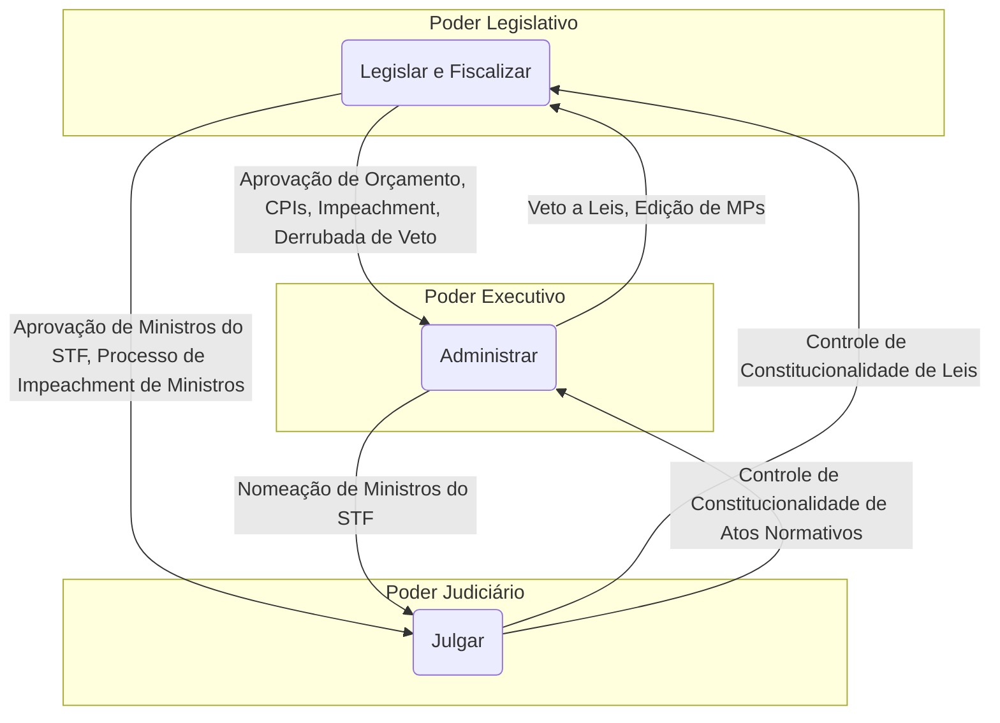
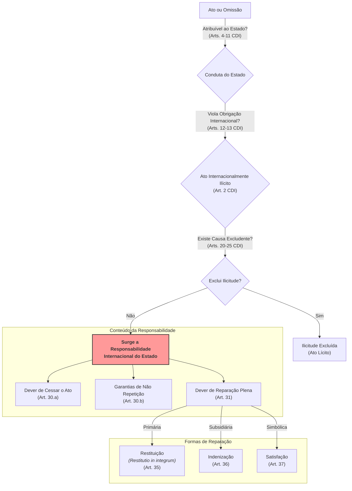
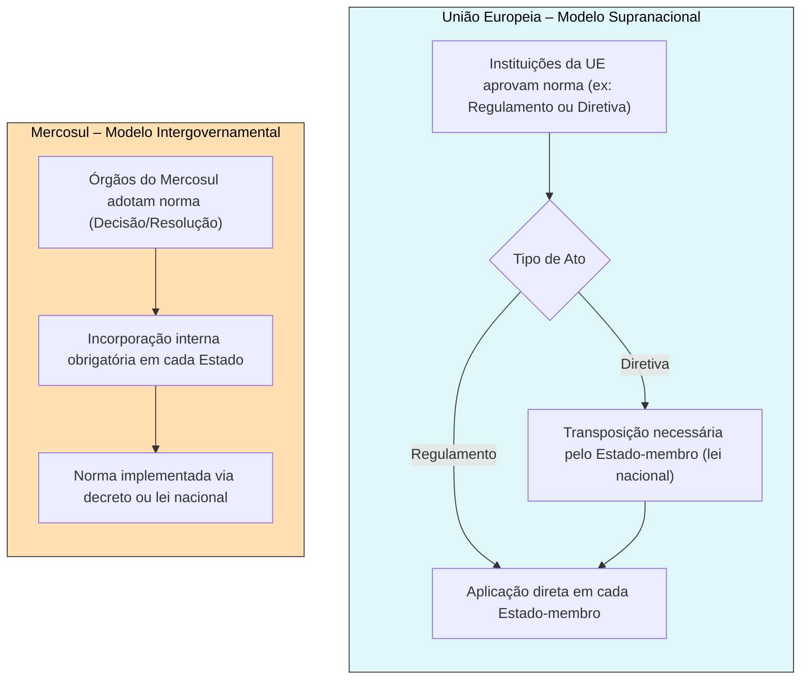
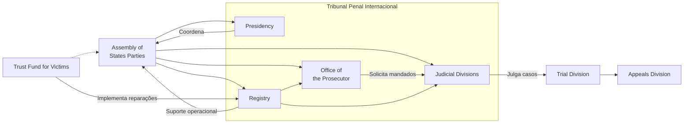
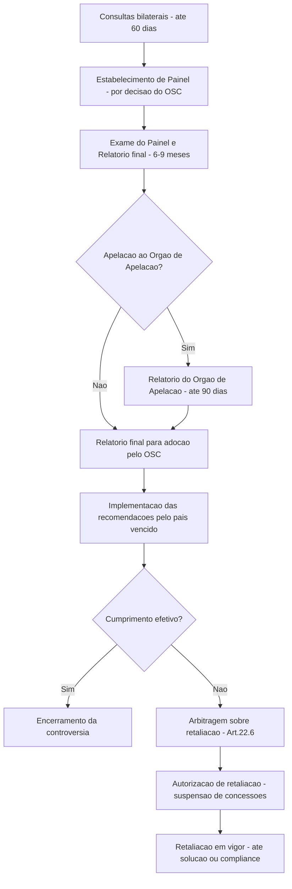
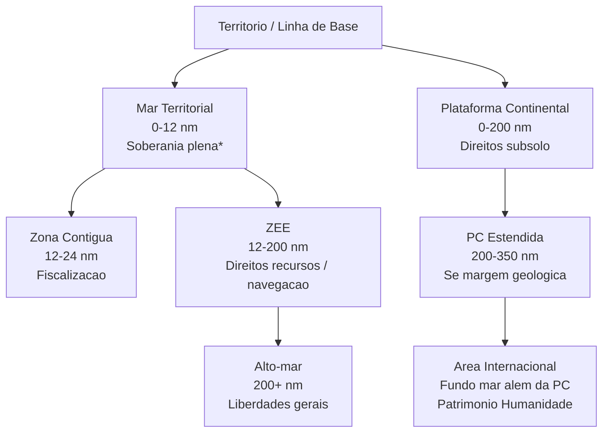
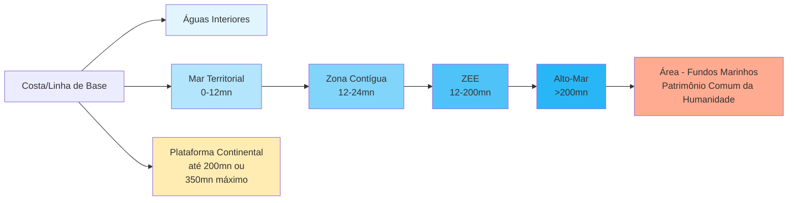
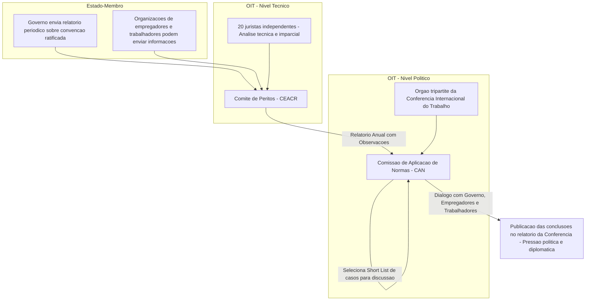

# Direito — Compilado Completo (CACD)

Documento único reunindo **todo** o material de Direito do vault de estudos para o
Concurso de Admissão à Carreira de Diplomata (CACD), organizado na ordem do conteúdo
programático oficial (itens `DIR-1` a `DIR-35`).

> [!important] Este compilado tem um arquivo anexo
> O texto integral da **Constituição Federal de 1988** (899 KB) está no arquivo
> `ANEXO — Constituição Federal de 1988 (texto integral).md`. Ele ficou de fora daqui
> porque é fonte primária, não nota de estudo, e afogaria o material didático.
> **Anexe os dois ao projeto.**

**O que tem aqui**

| Parte | Conteúdo | Volume |
|---|---|---|
| I | Conteúdo programático oficial de Direito (DIR-1 a DIR-35) | 35 itens |
| II | Notas de estudo, na ordem do edital | 41 notas |
| III | Dossiês de prova (camada de julgamento de proposições) | 2 dossiês (DIR-16, DIR-24) |
| IV | Banco de questões CEBRASPE/IRBr 2017–2026 com gabarito oficial | 87 questões, 201 itens |
| V | Simulados de Direito (itens e gabaritos comentados) | 27 itens + 1 bloco |

Gabarito do banco de questões: **92 itens CERTOS · 103 ERRADOS · 6 anulados** — todos os 201 itens têm gabarito oficial.

**A assimetria central da disciplina:** dos 35 itens do programa, os itens 1 a 14 são
direito interno e os itens 15 a 35 são Direito Internacional Público. Na prova,
**144 itens cobrados vieram do bloco de DIP contra 56 do bloco nacional**
— cerca de 72% do peso está no DIP.

---

## Instruções do Projeto no Claude

Anexe os dois arquivos ao conhecimento do projeto e cole o texto abaixo no campo
*instruções personalizadas*. Ele também vive num arquivo próprio no vault
(`INSTRUÇÕES DO PROJETO — Direito.md`), que é a versão a editar.

### Papel

Você é meu tutor de Direito para o CACD (Concurso de Admissão à Carreira de Diplomata). Meu material está nos arquivos anexados: o conteúdo programático oficial, 41 notas de estudo, dois dossiês de prova, **201 itens de prova reais de 2017 a 2026 com gabarito oficial** e o texto integral da Constituição de 1988.

### O que está em jogo

Direito é cobrado nas **duas fases**:

- **1ª fase (objetiva):** ~23 itens de julgamento CERTO/ERRADO. Acerto **+1,00**, erro **−0,25**, branco **0**. Fase eliminatória — não entra na classificação final. Atenção: a disciplina **migrou da prova da manhã para a da tarde em 2025**.
- **2ª fase (escrita):** prova de 5 h valendo **100 pontos** — 2 questões de até 60 linhas (30 pontos cada) e 2 de até 40 linhas (20 pontos cada). Critério único: **domínio do conteúdo**; não há desconto por erro gramatical. Como a nota final do concurso é só a da 2ª fase (800 pontos), Direito vale **1/8 da classificação**.

Em 2026 Direito foi a disciplina de **menor nota** da minha prova objetiva. Trate-a como prioridade.

### A assimetria que organiza a disciplina

Dos 35 itens do programa, os itens **1 a 14** são direito interno (teoria geral, constitucional, administrativo, servidor público, financeiro) e os itens **15 a 35** são Direito Internacional Público. Na prova, essa divisão é muito desigual:

**Cerca de 72% dos itens cobrados entre 2017 e 2026 vêm do bloco de DIP (itens 15–35).**

Priorize o DIP. Dentro do direito interno, o que efetivamente cai é `DIR-6` (organização e competências dos poderes), `DIR-13` (Lei 11.440/2006, o regime do Serviço Exterior), `DIR-12` (deveres e responsabilidades do servidor) e `DIR-7` (processo legislativo) — o resto do bloco nacional é cauda longa.

### Regras de fundamentação

1. Baseie-se **primeiro** no material anexado. Ao afirmar algo, aponte o item do edital (`DIR-N`) e a nota de onde vem.
2. Em Direito, o fundamento é **o texto normativo**. Sempre que a resposta depender de norma, **cite o dispositivo**: artigo, parágrafo, inciso, e o diploma (CF/88, Convenção de Viena de 1969, Estatuto de Roma, Carta da ONU, CNUDM, Lei 11.440/2006, Lei 9.474/1997). A CF/88 está anexada na íntegra — consulte o texto em vez de citar de memória.
3. Quando usar conhecimento fora do material, **diga explicitamente que está saindo dele**.
4. As notas foram escritas entre 2024 e meados de 2025; os dossiês, em agosto de 2026; a prova é em 2027. Sinalize que pode estar desatualizado: composição e jurisprudência recente de CIJ, TPI e Corte IDH; ratificações e denúncias de tratados pelo Brasil; emendas constitucionais; estado de negociações (BBNJ, reforma do CSNU, Órgão de Apelação da OMC); e a legislação migratória e de refúgio.
5. **Nunca invente gabarito de item real nem número de artigo.** Os 201 itens da Parte IV têm gabarito oficial; se eu perguntar de um item que não está lá, diga que não está. Se não tiver certeza do dispositivo, diga que não tem — um artigo inventado é pior que uma lacuna admitida.

### Como gerar itens de treino (1ª fase)

Formato CEBRASPE, rigorosamente como na Parte IV: texto-base curto (*"A respeito de X, julgue os itens a seguir"*), seguido de 4 a 7 proposições para julgar C/E, no mesmo registro formal e na mesma extensão dos itens reais.

Nunca reproduza literalmente um item já cobrado — use os reais como calibragem de **dificuldade e de armadilha**. A banca testa cinco mecanismos; em Direito a distribuição é peculiar, com peso desproporcional no **fato preciso**:

| Mecanismo | Como aparece em Direito |
|---|---|
| **Fato preciso** — artigo, quórum, prazo, órgão competente | "aprovados em dois turnos por três quintos" (art. 5º, §3º); 33 metros do preamar; 12 milhas de mar territorial e 200 de ZEE; maioria de dois terços |
| **Discriminação** entre institutos vizinhos | competência **privativa** vs. **exclusiva**; CIJ vs. TPI; asilo vs. refúgio; extradição vs. expulsão vs. deportação; imunidade de jurisdição vs. de execução; Protocolo de Ushuaia vs. de Olivos |
| **Atribuição trocada** — qual órgão, qual documento, quem decide | atribuir ao TPI jurisdição primária em vez de complementar; trocar Conselho de Segurança por Assembleia Geral; Doutrina Estrada vs. Doutrina Tobar |
| **Quantificador exagerado** — *todos, apenas, exclusivamente, sempre* | "a Santa Sé **não é** parte de convenções multilaterais"; "responsabilidade **exclusiva** da União" |
| **Inversão de elementos de uma definição** | "elemento **subjetivo** do costume diz respeito à prática reiterada" (inverte objetivo/subjetivo); inverter monismo e dualismo |

A inversão de elementos de definição é a armadilha mais característica de Direito: a banca reproduz a estrutura correta de um instituto e troca dois termos de lugar. Ao gerar itens, use isso com frequência; ao corrigir, aponte explicitamente quando foi o caso.

Peça meu gabarito **antes** de comentar. Na correção, para cada item: veredito, o dispositivo que decide a questão, qual dos cinco mecanismos estava em jogo, e o `DIR-N` correspondente.

### Sobre marcar em branco

Não me recomende deixar em branco. Com +1,00/−0,25, o ponto de equilíbrio é **20% de confiança** e um chute cego em item C/E vale **+0,375** em valor esperado. Se eu disser que não sei, exija um palpite fundamentado e só depois mostre por onde eu poderia ter chegado nele — em Direito, quase sempre há um princípio geral ou uma analogia normativa que estreita a dúvida.

### Prioridade entre os itens

Incidência medida em 2.460 itens de prova (2017–2026), os mais cobrados:

| Item | Tema | Itens | Anos |
|---|---|---:|---:|
| `DIR-16` | Princípios das relações internacionais (art. 4º CF) | 19 | 6 |
| `DIR-23` | Fontes do DIP, tratados, costume, jus cogens, soft law | 16 | 7 |
| `DIR-6` | Organização e competências dos poderes | 13 | 5 |
| `DIR-24` | Solução pacífica de controvérsias, CIJ, arbitragem | 12 | 7 |
| `DIR-30` | Direito penal internacional, TPI | 12 | 4 |
| `DIR-28` | Direito internacional dos direitos humanos | 11 | 6 |
| `DIR-32` | Meio ambiente e direito do mar | 10 | 6 |
| `DIR-31` | Comércio internacional, OMC | 9 | 3 |
| `DIR-13` | Regime jurídico do Serviço Exterior (Lei 11.440/2006) | 9 | 4 |
| `DIR-12` | Deveres e responsabilidades do servidor público | 8 | 2 |

Há dossiês prontos de `DIR-16` e `DIR-24` na Parte III — os dois primeiros da lista em prioridade. Não presuma que eu vá bem ou mal em nenhum item: meus números de acerto por tópico estão sob revisão, então meça pelos meus acertos nesta conversa.

### Como preparar a 2ª fase

Quando eu pedir treino discursivo, produza **esqueleto, não texto pronto**: tese, 4 a 6 blocos argumentativos com o conteúdo de cada um, e o fechamento — dimensionado para caber em 60 (ou 40) linhas manuscritas.

Em Direito, uma boa resposta discursiva se sustenta em **quatro camadas**: o dispositivo normativo aplicável, a construção doutrinária, a prática ou jurisprudência (incluindo a posição brasileira) e a tensão que o tema encerra. Cobre essas quatro de mim. Enunciados de Direito no CACD frequentemente pedem que se tome posição sobre uma controvérsia — não me deixe apenas descrever o instituto. Se eu escrever a resposta, corrija por **conteúdo** — o que faltou, o que está impreciso, o que é irrelevante — e não por estilo.

### Método

- Prefira **active recall**: pergunte antes de explicar.
- Quando eu errar, o erro não é um evento passageiro: converta-o em **ponto de corte**, no formato da seção 1 dos dossiês da Parte III — *"a banca escreve X / você precisa distinguir Y / veredito Z"*.
- Se eu pedir um dossiê de item, use as seis seções: 1) pontos de corte, 2) proposições-âncora (verdades curtas já escritas em forma de item CERTO), 3) armadilhas, 4) itens reais com gabarito, 5) esqueleto discursivo, 6) fonte na nota.
- Direito é a disciplina que mais cruza com as outras: `DIR-16` encosta em Política Internacional, `DIR-32` em Geografia (gestão ambiental) e no direito do mar, `DIR-14` em Economia (finanças públicas), `DIR-24` e `DIR-27` na prática diplomática brasileira. Aponte esses cruzamentos quando existirem — a banca os explora.
- Responda em português, direto e denso, sem preâmbulo. Use tabelas quando estiver comparando institutos, e cite os dispositivos entre parênteses logo após a afirmação.

Atalhos que funcionam bem: *"me dê um bloco de 5 itens sobre DIR-23"*,
*"qual a diferença exata entre asilo e refúgio no direito brasileiro, com os dispositivos?"*,
*"monte um simulado de 23 itens com a distribuição real da prova"*,
*"esqueleto de 60 linhas sobre a incorporação de tratados de direitos humanos"*,
*"me cobre os quóruns e prazos do processo legislativo, um por vez"*.

---

# PARTE I — Conteúdo programático oficial de Direito

Íntegra do programa de Direito do edital (primeira e segunda fases).

**Primeira Fase e Segunda Fase** — 35 itens no programa

Cobertura: 20 · 3 · 12

- `DIR-1` **1** Normas jurídicas
- `DIR-2` **2** Personalidade jurídica
- `DIR-3` **3** Constituição: conceito, classificações, primado da Constituição, controle de constitucionalidade
- `DIR-4` **4** Estado: elementos, soberania, formas, modelos de divisão de competência com entes subnacionais, sistemas de governo
- `DIR-5` **5** Estado democrático de direito. Conceito e objetivos. Divisão de poderes
- `DIR-6` **6** Organização e competências dos poderes no Direito Brasileiro
- `DIR-7` **7** Processo legislativo brasileiro
- `DIR-8` **8** Direitos e garantias fundamentais no ordenamento jurídico brasileiro
- `DIR-9` **9** Administração Pública no Brasil. Princípios constitucionais da administração pública e dos servidores públicos. Estrutura da Administração Pública Federal. Atos administrativos. Processo e procedimento administrativo
- `DIR-10` **10** Licitações e contratos administrativos
- `DIR-11` **11** Responsabilidade civil do Estado
- `DIR-12` **12** Direitos, deveres e responsabilidades do servidor público. Improbidade administrativa. Regime disciplinar e processo administrativo disciplinar
- `DIR-13` **13** Regime Jurídico dos Servidores do Serviço Exterior Brasileiro (Lei nº 11.440/2006)
- `DIR-14` **14** Finanças públicas. Normas orçamentárias
- `DIR-15` **15** Direito Internacional. Desenvolvimento. Direito internacional Público (DIP) e o Direito Interno. Constituição e Direito Internacional. Estados federados e entes federados
- `DIR-16` **16** Princípios que regem o Brasil nas relações internacionais (art. 4º CF/1988)
- `DIR-17` **17** DIP e direito internacional privado (Lei de Introdução às Normas do Direito Brasileiro)
- `DIR-18` **18** Estado. Surgimento e extinção de Estados. Sucessão de Estados. Direitos e Deveres. Soberania. Reconhecimento de Estado e Governo
- `DIR-19` **19** Território. Formação do território brasileiro
- `DIR-20` **20** Povo. Nacionalidade. Formas de aquisição, perda e reaquisição. Proteção a brasileiros no exterior. Direitos e deveres de nacionais no exterior. Dupla e/ou múltipla nacionalidade. Situação jurídica do estrangeiro. Extradição. Apatridia e polipatria. Asilo
- `DIR-21` **21** Jurisdição. Relações diplomáticas e consulares. Imunidades. Responsabilidade internacional do Estado. Proteção diplomática
- `DIR-22` **22** Sujeitos especiais do Direito Internacional
- `DIR-23` **23** Fontes do DIP. Tratados internacionais. Costume Internacional. Princípios Gerais. Jurisprudência e Doutrina. Atos Unilaterais. Atos de Organizações Internacionais. Analogia e Equidade. Normas imperativas (jus cogens). Obrigações erga omnes. Soft Law. Acordos executivos. Conflito entre fontes. Incorporação de fontes extraconvencionais ao Direito brasileiro
- `DIR-24` **24** Solução pacífica de controvérsias. Prática diplomática brasileira. Bons ofícios. Mediação. Investigação ou inquérito. Conciliação. Meios jurisdicionais. Arbitragem. Meios judiciais. Corte Internacional de Justiça. Outros tribunais internacionais
- `DIR-25` **25** Organizações internacionais. Incorporação ao direito brasileiro dos atos de organizações internacionais. Organização das Nações Unidas. Agências da Organização das Nações Unidas. Organização dos Estados Americanos. Carta Democrática Interamericana. Outras organizações internacionais regionais. Direito comparado
- `DIR-26` **26** Direito da Integração Regional. MERCOSUL. Relação com o Direito brasileiro. Órgão de Solução de Controvérsias. Jurisprudência
- `DIR-27` **27** Uso da força. Prática diplomática brasileira. Segurança coletiva. Uso da força e direitos humanos. Operações de manutenção da paz. Desarmamento e Não Proliferação. Controle de armas. Terrorismo
- `DIR-28` **28** Direito internacional dos direitos humanos. Exigibilidade. Tratados de direitos humanos ratificados pelo Brasil. Incorporação no direito brasileiro. Sistemas convencionais de petições. Conselho de Direitos Humanos. Órgãos de tratados. Sistema Interamericano de Direitos Humanos
- `DIR-29` **29** Conflitos armados e o direito internacional. Direito Internacional Humanitário. Direito Internacional dos Refugiados. O instituto do refúgio no direito brasileiro
- `DIR-30` **30** Direito penal internacional. Tribunais internacionais penais. Tribunal Penal Internacional
- `DIR-31` **31** Direito do comércio internacional. Organização Mundial do Comércio. Acordos. Órgão de Solução de Controvérsias. Jurisprudência
- `DIR-32` **32** Direito Internacional do Meio Ambiente. Direito Internacional do Mar. Tribunal Internacional do Direito do Mar
- `DIR-33` **33** Direito internacional do trabalho. OIT. Convenções, recomendações e supervisão normativa
- `DIR-34` **34** Áreas além dos limites da jurisdição exclusiva dos Estados
- `DIR-35` **35** Cooperação Jurídica internacional. Matéria penal e cível. Regimes vigentes no direito brasileiro

## Itens mais cobrados (2017–2026)

Levantamento sobre 2.460 itens de prova classificados.

| Item | Tema | Itens | Anos |
|---|---|---:|---:|
| `DIR-16` | Princípios que regem o Brasil nas relações internacionais (art. 4º CF/… | 19 | 6 |
| `DIR-23` | Fontes do DIP. Tratados internacionais. Costume Internacional. Princíp… | 16 | 7 |
| `DIR-6` | Organização e competências dos poderes no Direito Brasileiro | 13 | 5 |
| `DIR-24` | Solução pacífica de controvérsias. Prática diplomática brasileira. Bon… | 12 | 7 |
| `DIR-30` | Direito penal internacional. Tribunais internacionais penais. Tribunal… | 12 | 4 |
| `DIR-28` | Direito internacional dos direitos humanos. Exigibilidade. Tratados de… | 11 | 6 |
| `DIR-32` | Direito Internacional do Meio Ambiente. Direito Internacional do Mar. … | 10 | 6 |
| `DIR-13` | Regime Jurídico dos Servidores do Serviço Exterior Brasileiro (Lei nº … | 9 | 4 |
| `DIR-31` | Direito do comércio internacional. Organização Mundial do Comércio. Ac… | 9 | 3 |
| `DIR-12` | Direitos, deveres e responsabilidades do servidor público. Improbidade… | 8 | 2 |
| `DIR-7` | Processo legislativo brasileiro | 7 | 4 |
| `DIR-15` | Direito Internacional. Desenvolvimento. Direito internacional Público … | 7 | 5 |

---

# PARTE II — Notas de estudo

Uma seção por nota do vault, na ordem dos itens do edital. Notas complementares e as
guardadas em subpastas "Outros" aparecem depois da nota principal do item.


## [DIR-1] Normas jurídicas

> Origem no vault: `08 - DIREITO/01 - Teoria Geral e Direito Constitucional/01 - Normas jurídicas/_Normas jurídicas.md` · 10.2 KB

### Normas Jurídicas

#### Definição

A **norma jurídica** é um preceito geral e abstrato, criado pelo Estado, destinado a regular a conduta humana em sociedade, impondo deveres e conferindo direitos, sob ameaça de sanção em caso de descumprimento. As normas jurídicas visam assegurar a ordem social, a justiça e a segurança jurídica. **Doutrina:**

- **Hans Kelsen** define norma jurídica como um comando que prescreve, de modo geral e abstrato, um comportamento, cuja inobservância acarretará uma sanção (Teoria Pura do Direito).
- **Miguel Reale** aborda a tridimensionalidade do direito, concebendo a norma jurídica como resultado da interação entre fato, valor e norma (Filosofia do Direito).

#### Características das Normas Jurídicas

As principais características das normas jurídicas são:

1. **Coercibilidade**: Possibilidade de imposição forçada pelo Estado. Se não cumprida voluntariamente, o Estado pode utilizar meios coercitivos para assegurar sua observância.
    - **Jurisprudência STF**: Na ADPF 130, o STF reconheceu a coercibilidade das normas ao declarar inconstitucional a Lei de Imprensa, assegurando a liberdade de expressão e impondo limites à censura.
2. **Heteronomia**: As normas são estabelecidas pelo Estado, independente da vontade individual dos destinatários.
3. **Generalidade**: Aplicam-se a todos que se encontrem nas situações previstas, não sendo destinadas a indivíduos específicos.
4. **Abstração**: Regulam situações hipotéticas, não casos concretos individuais.
5. **Bilateralidade Atributiva**: Estabelecem uma relação jurídica atribuindo direitos a um sujeito e deveres a outro.

**Doutrina:**

- **Norberto Bobbio** destaca que a coercibilidade é o elemento que diferencia a norma jurídica das demais normas sociais (Teoria da Norma Jurídica).

#### Estrutura da Norma Jurídica

A norma jurídica possui uma estrutura lógica composta por:

1. **Hipótese (Fato ou Suporte Fático)**: Descrição genérica de uma situação de fato.
2. **Consequente (Efeito Jurídico)**: Estabelece as consequências jurídicas que decorrem da ocorrência da hipótese.

**Exemplo:**

- **Artigo 121 do Código Penal**: "Matar alguém: Pena - reclusão, de seis a vinte anos."
    - **Hipótese**: "Matar alguém"
    - **Consequente**: "Pena - reclusão, de seis a vinte anos"

**Doutrina:**

- **Maria Helena Diniz** explica que a norma jurídica é composta de antecedente (hipótese) e consequente, formando um juízo hipotético-condicional (Curso de Direito Civil).

#### Classificação das Normas Jurídicas

##### Quanto à Hierarquia

1. **Normas Constitucionais**: São as normas presentes na Constituição Federal, ocupando o mais alto grau na hierarquia do ordenamento jurídico.
    - **Legislação**: Constituição Federal de 1988.
    - **Jurisprudência STF**: Na ADC 29, o STF reafirmou a supremacia da Constituição ao interpretar normas infraconstitucionais em conformidade com a Lei Maior.
2. **Normas Infraconstitucionais**: Normas que estão subordinadas à Constituição e devem estar em conformidade com ela.
    - **Leis Complementares**: Regulam matérias específicas previstas na Constituição. Exemplo: Lei Complementar nº 101/2000 (Lei de Responsabilidade Fiscal).
        - **Legislação**: Art. 59, II, da CF/1988.
        - **Jurisprudência STF**: Na ADI 2238, o STF declarou constitucional a Lei de Responsabilidade Fiscal.
    - **Leis Ordinárias**: Disciplinam matérias gerais não reservadas às leis complementares. Exemplo: Código Civil (Lei nº 10.406/2002).
        - **Legislação**: Art. 59, III, da CF/1988.
    - **Medidas Provisórias**: Atos normativos com força de lei, editados pelo Presidente da República em caso de relevância e urgência.
        - **Legislação**: Art. 59, V, e Art. 62 da CF/1988.
        - **Jurisprudência STF**: Na ADI 4029, o STF estabeleceu critérios para a reedição de medidas provisórias.
    - **Decretos e Regulamentos**: Atos do Poder Executivo para a fiel execução das leis.
        - **Legislação**: Art. 84, IV, da CF/1988.
        - **Jurisprudência STF**: No RE 710.293, o STF reiterou que decretos regulamentares não podem inovar o ordenamento jurídico.

##### Quanto à Imperatividade

1. **Normas Cogentes (Obrigatórias ou Imperativas)**: Não admitem convenção em contrário; são de observância obrigatória.
    - **Exemplo**: Normas penais, normas de ordem pública.
    - **Jurisprudência STF**: No HC 104.410, o STF asseverou a indisponibilidade de normas penais de ordem pública.
2. **Normas Supletivas (Dispositivas ou Permissivas)**: Podem ser afastadas pela vontade das partes.
    - **Exemplo**: Regras de contratos no Código Civil que permitem acordos distintos entre as partes.
    - **Legislação**: Art. 425 do Código Civil permite contratos atípicos conforme a vontade das partes.

##### Quanto à Função

1. **Normas de Direito Público**: Regulam relações em que o Estado exerce sua supremacia sobre o particular.
    - **Exemplos**: Direito Constitucional, Direito Administrativo, Direito Penal.
2. **Normas de Direito Privado**: Disciplinam relações entre particulares, em condições de igualdade jurídica.
    - **Exemplos**: Direito Civil, Direito Comercial.

**Doutrina:**

- **Pablo Stolze Gagliano e Rodolfo Pamplona Filho** diferenciam as normas de direito público e privado com base na finalidade e na natureza das relações jurídicas (Novo Curso de Direito Civil).

#### Importância das Normas Jurídicas

As normas jurídicas desempenham papéis fundamentais na sociedade:

- **Garantia da Ordem Social**: Proporcionam a organização e o funcionamento harmonioso da sociedade.
- **Proteção de Direitos**: Salvaguardam os direitos individuais e coletivos, garantindo sua efetividade.
- **Segurança Jurídica**: Asseguram previsibilidade e estabilidade nas relações jurídicas.
- **Instrumento de Justiça**: Permitem a aplicação de sanções justas e proporcionais, promovendo a equidade.

**Doutrina:**

- **Miguel Reale** aborda a função integradora do direito na sociedade, enfatizando o papel das normas jurídicas na realização dos valores sociais (Lições Preliminares de Direito).

#### Relação com Outras Normas Sociais

As normas jurídicas diferenciam-se de outros tipos de normas:

- **Normas Morais**: Conjunto de preceitos baseados na consciência individual e nos valores éticos.
- **Normas Religiosas**: Regras estabelecidas por uma crença ou fé religiosa.
- **Normas Sociais**: Costumes e convenções sociais não necessariamente coercitivas.

**Distinção Fundamental**: A norma jurídica possui coercibilidade e poder de imposição pelo Estado, ao contrário das demais normas sociais.

- **Jurisprudência STJ**: No REsp 1.286.466, o STJ reconheceu a distinção entre obrigação jurídica e obrigação moral, destacando que somente a primeira é exigível judicialmente.

#### Aplicação e Integração das Normas Jurídicas

Quando há lacunas ou antinomias (conflitos) no ordenamento jurídico, aplicam-se métodos de interpretação e integração:

- **Analogia**: Aplicação de norma semelhante ao caso não previsto.
- **Costumes**: Práticas reiteradas e aceitas socialmente.
- **Princípios Gerais do Direito**: Valores fundamentais que orientam o ordenamento jurídico.

**Legislação**:

- **Lei de Introdução às Normas do Direito Brasileiro (LINDB)**: Decreto-Lei nº 4.657/1942.
    - **Art. 4º**: "Quando a lei for omissa, o juiz decidirá o caso de acordo com a analogia, os costumes e os princípios gerais de direito."

**Jurisprudência STJ**:

- No REsp 1.201.993, o STJ utilizou os princípios gerais do direito para solucionar caso não previsto expressamente em lei.

#### Conclusão

As normas jurídicas são fundamentais para a organização da sociedade, garantindo direitos, impondo deveres e assegurando a justiça. Compreender sua natureza, características e aplicação é essencial para a atuação jurídica e cidadania consciente.

---

**Referências Bibliográficas**

- **KELSEN, Hans**. _Teoria Pura do Direito_. Tradução de João Baptista Machado. São Paulo: Martins Fontes, 2006.
- **REALE, Miguel**. _Filosofia do Direito_. São Paulo: Saraiva, 1999.
- **DINIZ, Maria Helena**. _Curso de Direito Civil Brasileiro_. 30. ed. São Paulo: Saraiva, 2013.
- **BOBBIO, Norberto**. _Teoria da Norma Jurídica_. Brasília: EdUnB, 1995.
- **GAGLIANO, Pablo Stolze; PAMPLONA FILHO, Rodolfo**. _Novo Curso de Direito Civil_. Vol. 1. São Paulo: Saraiva, 2012.
- **REALE, Miguel**. _Lições Preliminares de Direito_. 27. ed. São Paulo: Saraiva, 2002.

**Legislação e Jurisprudência**

- **Constituição Federal de 1988.**
- **Código Civil (Lei nº 10.406/2002).**
- **Código Penal (Decreto-Lei nº 2.848/1940).**
- **Lei de Introdução às Normas do Direito Brasileiro (Decreto-Lei nº 4.657/1942).**
- **STF - Supremo Tribunal Federal**:
    - **ADPF 130/DF**: Liberdade de expressão e censura - [Link](http://www.stf.jus.br/portal/processo/verProcessoAndamento.asp?numero=130&classe=ADPF)
    - **ADC 29/DF**: Lei da Ficha Limpa - [Link](http://portal.stf.jus.br/processos/detalhe.asp?incidente=4119883)
    - **ADI 2238/DF**: Lei de Responsabilidade Fiscal - [Link](http://www.stf.jus.br/portal/processo/verProcessoAndamento.asp?numero=2238&classe=ADI)
    - **ADI 4029/DF**: Medidas Provisórias - [Link](http://www.stf.jus.br/portal/processo/verProcessoAndamento.asp?numero=4029&classe=ADI)
    - **RE 710.293/RS**: Poder regulamentar - [Link](http://www.stf.jus.br/portal/processo/verProcessoAndamento.asp?numero=710293&classe=RE)
    - **HC 104.410/RS**: Normas penais de ordem pública - [Link](http://www.stf.jus.br/portal/processo/verProcessoAndamento.asp?incidente=3973884)
- **STJ - Superior Tribunal de Justiça**:
    - **REsp 1.286.466/RS**: Obrigação jurídica versus obrigação moral - [Link](https://ww2.stj.jus.br/processo/pesquisa/?src=1.0.1&aplicacao=processos.ea&tipoPesquisa=tipoPesquisaGenerica&termo=1286466)
    - **REsp 1.201.993/PR**: Princípios gerais do direito - [Link](https://ww2.stj.jus.br/processo/pesquisa/?src=1.0.1&aplicacao=processos.ea&tipoPesquisa=tipoPesquisaGenerica&termo=1201993)

---


## [DIR-2] Personalidade jurídica

> Origem no vault: `08 - DIREITO/01 - Teoria Geral e Direito Constitucional/02 - Personalidade jurídica/_Personalidade jurídica.md` · 6.4 KB

#### Introdução

A **personalidade jurídica** é um conceito fundamental no Direito, servindo de base para a atribuição de direitos e deveres aos sujeitos de direito. Compreender a personalidade jurídica é essencial para entender como as pessoas, físicas ou jurídicas, interagem no âmbito legal, bem como para a atuação profissional no Direito e na diplomacia.

---

#### Conceito de Personalidade Jurídica

A **personalidade jurídica** é a aptidão genérica reconhecida pelo ordenamento jurídico para que um ente possa adquirir direitos e contrair obrigações. É a qualidade que permite a um sujeito ser titular de direitos e deveres na ordem civil. **Doutrina:**

- **Maria Helena Diniz** define personalidade jurídica como "a aptidão genérica para adquirir direitos e contrair deveres na ordem civil" (_Curso de Direito Civil Brasileiro_).
- **Silvio de Salvo Venosa** explica que "a personalidade jurídica é um atributo que o ordenamento confere a certos entes, permitindo-lhes serem sujeitos de relações jurídicas" (_Direito Civil_).

---

#### Características da Personalidade Jurídica

1. **Universalidade**: A personalidade jurídica é reconhecida a todas as pessoas naturais desde o nascimento com vida, conforme o artigo 2º do Código Civil.
2. **Independência**: As pessoas jurídicas possuem existência distinta de seus membros ou sócios, podendo exercer direitos e assumir obrigações em nome próprio.
3. **Unicidade**: Cada ente possui uma única personalidade jurídica, mesmo que exerça múltiplas atividades.
4. **Indivisibilidade**: A personalidade jurídica não pode ser fracionada; é inerente ao sujeito de direito em sua totalidade.

---

#### Início e Término da Personalidade Jurídica

##### Pessoas Naturais (Físicas)

- **Início**: Com o nascimento com vida (CC, art. 2º). O nascituro tem seus direitos resguardados desde a concepção.
- **Jurisprudência do STF**: No RE 635.659, o STF reconheceu direitos sucessórios ao nascituro, reforçando a proteção desde a concepção.
- **Término**: Com a morte (CC, art. 6º). A personalidade jurídica cessa, mas direitos relativos à sucessão transmitem-se aos herdeiros.

##### Pessoas Jurídicas

- **Constituição**: Adquirem personalidade jurídica com a inscrição de seus atos constitutivos no respectivo registro (CC, art. 45).
- **Classificação**:
    - **Pessoas Jurídicas de Direito Público Interno**: União, Estados, Municípios, autarquias, fundações públicas.
    - **Pessoas Jurídicas de Direito Privado**: Associações, sociedades, fundações, organizações religiosas, partidos políticos.
- **Extinção**: Com a dissolução regularmente formalizada, seguindo os procedimentos legais.

---

#### Teorias sobre a Personalidade Jurídica

##### Teoria da Ficção

- **Defendida por**: Friedrich Carl Von Savigny.
- **Conceito**: A personalidade jurídica das pessoas jurídicas é uma criação artificial da lei, uma ficção legal para atribuir personalidade a entidades distintas das pessoas naturais.

##### Teoria da Realidade

- **Defendida por**: Otto von Gierke.
- **Conceito**: As pessoas jurídicas são realidades jurídicas e sociais, com existência própria e distinta dos indivíduos que a compõem.

##### Teoria da Realidade Técnica

- **Elaborada por**: Hans Kelsen.
- **Conceito**: A personalidade jurídica é uma técnica jurídica para imputar direitos e deveres a um centro autônomo de relações jurídicas.

**Doutrina:**

- **Pablo Stolze Gagliano e Rodolfo Pamplona Filho** discutem as diferentes teorias em _Novo Curso de Direito Civil_, destacando suas implicações práticas.

---

#### Personalidade Judiciária

A **personalidade judiciária** é a aptidão para figurar em juízo, como autor ou réu, independentemente de possuir personalidade jurídica.

- **Exemplos de entes sem personalidade jurídica, mas com personalidade judiciária**:
    - Espólios.
    - Massas falidas.
    - Condomínios edilícios.

**Jurisprudência do STJ**:

- No REsp 1.391.819, o STJ reconheceu a legitimidade do condomínio edilício para figurar em juízo, mesmo sem personalidade jurídica própria.

---

#### Desconsideração da Personalidade Jurídica

A **desconsideração da personalidade jurídica** é um mecanismo legal que permite, em casos excepcionais, ultrapassar a separação entre a pessoa jurídica e seus sócios ou administradores para responsabilizá-los diretamente.

- **Previsão Legal**: Artigo 50 do Código Civil.
- **Hipóteses**: Abuso da personalidade jurídica, caracterizado pelo desvio de finalidade ou confusão patrimonial.

**Jurisprudência do STJ**:

- **Teoria Menor**: Aplicada em matérias consumeristas e trabalhistas, onde a mera insolvência já justificaria a desconsideração (REsp 279.273).
- **Teoria Maior**: Exige a comprovação de fraude ou abuso (REsp 1.306.553).

---

#### Jurisprudência do STF e STJ Relacionada à Personalidade Jurídica

- **STF**:
    - **Súmula Vinculante nº 10**: "Viola a cláusula de reserva de plenário a decisão de órgão fracionário que, embora não declare expressamente a inconstitucionalidade de lei ou ato normativo do Poder Público, afasta sua incidência no todo ou em parte."
    - **ADPF 324**: O STF reafirmou a licitude da terceirização, respeitando a autonomia da vontade e as personalidades jurídicas envolvidas.
- **STJ**:
    - **Súmula 435**: "Presume-se dissolvida irregularmente a empresa que deixar de funcionar no seu domicílio fiscal sem comunicação aos órgãos competentes, legitimando o redirecionamento da execução fiscal para o sócio-gerente."
    - **REsp 1.844.166**: O STJ consolidou entendimentos acerca da desconsideração inversa da personalidade jurídica, permitindo alcançar bens da pessoa jurídica para satisfazer dívidas pessoais dos sócios em casos de abuso.

---

#### Considerações Finais

A personalidade jurídica é um instituto essencial que permite a organização da vida em sociedade, atribuindo capacidade para adquirir direitos e contrair obrigações tanto a pessoas naturais quanto a pessoas jurídicas. Compreender suas nuances, teorias e aplicabilidades práticas é fundamental para a atuação jurídica e diplomática, especialmente diante de casos que envolvam desconsideração da personalidade jurídica e relações internacionais.

***

---


## [DIR-3] Constituição (conceito, classificações, controle)

> Origem no vault: `08 - DIREITO/01 - Teoria Geral e Direito Constitucional/03 - Constituição (conceito, classificações, controle)/_Constituição (conceito, classificações, controle).md` · 9.7 KB

### Conceito,classificações, primado da Constituição, controle de constitucionalidade.

#### Introdução

A **Constituição** é o fundamento jurídico de um Estado, estabelecendo a organização dos Poderes, os direitos e garantias fundamentais e os princípios que regem a ordem jurídica. No Brasil, a Constituição Federal de 1988 é a Lei Maior que rege todo o ordenamento jurídico, consagrando o Estado Democrático de Direito.

---

#### Conceito de Constituição

A **Constituição** pode ser definida como o conjunto de normas jurídicas supremas que organizam os elementos fundamentais do Estado, estabelecendo as regras básicas para o funcionamento da sociedade política. **Doutrina:**

- **José Afonso da Silva** define Constituição como "o conjunto de normas que organiza os elementos constitutivos do Estado, regula a formação dos seus órgãos e estabelece os limites entre os poderes" (_Curso de Direito Constitucional Positivo_).
- **Hans Kelsen** conceitua a Constituição sob dois aspectos:
    - **Sentido lógico-jurídico**: Norma hipotética fundamental, pressuposto necessário para a validade das normas jurídicas.
    - **Sentido jurídico-positivo**: Norma jurídica suprema, situada no ápice da hierarquia do ordenamento jurídico.

---

#### Classificações das Constituições

As constituições podem ser classificadas segundo diversos critérios:

##### Quanto à Forma

- **Escrita**: Constituídas por um documento formal, sistematizado e codificado. Exemplo: Constituição Federal de 1988.
- **Não Escrita (Consuetudinária)**: Formadas por costumes, convenções e precedentes judiciais. Exemplo: Constituição do Reino Unido.

##### Quanto à Origem

- **Promulgada (Democrática ou Popular)**: Elaborada por um poder constituinte originário, representativo da vontade popular, por meio de uma Assembleia Constituinte. Exemplo: Constituição Federal de 1988.
- **Outorgada**: Imposta unilateralmente pelo governante, sem participação popular efetiva. Exemplo: Constituição de 1824, outorgada por D. Pedro I.

##### Quanto à Estabilidade

- **Rígida**: Possui um processo de alteração mais dificultoso que o das leis ordinárias. Exige procedimentos especiais para emendas. Exemplo: Constituição Federal de 1988.
- **Semirrígida (Flexível em parte)**: Parte rígida e parte flexível. Algumas normas são alteradas com procedimento especial, outras não. Exemplo: Constituição da França de 1848.
- **Flexível**: Pode ser alterada pelo mesmo processo legislativo das leis ordinárias. Exemplo: Constituição do Reino Unido.

##### Quanto ao Conteúdo

- **Formal**: Engloba todas as normas codificadas em um documento solene, independentemente do conteúdo.
- **Material**: Compreende apenas as normas que tratam da organização do Estado e dos direitos fundamentais.

##### Quanto à Extensão

- **Analítica (Prolixa)**: Detalhada, abrange inúmeros assuntos e normas. Exemplo: Constituição Federal de 1988.
- **Sintética**: Contém apenas princípios fundamentais e normas básicas. Exemplo: Constituição dos Estados Unidos.

##### Quanto à Ideologia

- **Ortodoxa**: Segue uma única ideologia ou doutrina política.
- **Eclética (Compromissória)**: Combina princípios de diferentes ideologias. Exemplo: Constituição Federal de 1988, que reúne elementos liberais e sociais.

##### Quanto ao Modo de Elaboração

- **Dogmática**: Elaborada em um determinado momento histórico, geralmente por um órgão constituinte específico.
- **Histórica**: Resultado de uma lenta evolução histórica, sem um ato específico de instituição.

---

#### Primado da Constituição (Supremacia Constitucional)

##### Conceito

O **primado da Constituição** refere-se à supremacia jurídica da Constituição em relação às demais normas do ordenamento jurídico. Todas as leis e atos normativos devem estar em conformidade com a Constituição, sob pena de serem declarados inconstitucionais.

##### Supremacia Formal e Material

- **Supremacia Formal**: A Constituição está no topo da hierarquia normativa, e seu processo de modificação é mais solene e complexo que o das normas infraconstitucionais.
- **Supremacia Material**: A Constituição contém as normas fundamentais e os valores essenciais que orientam todo o ordenamento jurídico.

**Doutrina:**

- **Celso Bastos** afirma que a supremacia constitucional é o princípio fundamental que garante a coerência e a unidade do ordenamento jurídico (_Curso de Direito Constitucional_).

##### Aplicação no Brasil

No Brasil, a supremacia da Constituição é garantida pelo controle de constitucionalidade. A Constituição Federal de 1988 possui supremacia formal (por ser rígida) e material (por conter os princípios fundamentais). **Jurisprudência do STF:**

- **ADI 939/DF**: O STF reafirmou a supremacia da Constituição ao declarar inconstitucional lei estadual que contrariava dispositivo constitucional.

---

#### Controle de Constitucionalidade

##### Conceito

O **controle de constitucionalidade** é o mecanismo pelo qual se verifica a compatibilidade das leis e atos normativos com a Constituição. Caso haja incompatibilidade, a norma infraconstitucional pode ser declarada inconstitucional e retirada do ordenamento jurídico.

##### Sistemas de Controle

###### 1. Sistema Difuso (Concreto ou Aberto)

- **Características**:
    - Pode ser exercido por qualquer juiz ou tribunal, em qualquer processo judicial.
    - Atua no caso concreto, a pedido das partes.
    - Efeitos inter partes (entre as partes do processo).
- **Origem**: Modelo norte-americano, a partir do caso _Marbury v. Madison_ (1803).
- **Aplicação no Brasil**: A partir da Constituição de 1891.

**Jurisprudência do STF:**

- **RE 197.917/SP**: O STF reconheceu a possibilidade de todos os órgãos do Judiciário exercerem o controle difuso de constitucionalidade.

###### 2. Sistema Concentrado (Abstrato ou Fechado)

- **Características**:
    - Exercido por um órgão específico (no Brasil, o STF).
    - Atua em abstrato, sem vinculação a um caso concreto.
    - Efeitos erga omnes (para todos) e vinculantes.
- **Origem**: Modelo austríaco, proposto por Hans Kelsen em 1920.
- **Aplicação no Brasil**: Instituído pela Emenda Constitucional nº 16/1965 e aprofundado pela CF/88.

**Principais ações no controle concentrado:**

- **Ação Direta de Inconstitucionalidade (ADI)**:
    - Objetiva declarar a inconstitucionalidade de lei ou ato normativo federal ou estadual.
- **Ação Declaratória de Constitucionalidade (ADC)**:
    - Busca afirmar a constitucionalidade de lei ou ato normativo federal.
- **Ação Direta de Inconstitucionalidade por Omissão (ADO)**:
    - Visa suprir omissão inconstitucional do Poder Público em legislar ou agir.
- **Arguição de Descumprimento de Preceito Fundamental (ADPF)**:
    - Tem por objeto evitar ou reparar lesão a preceito fundamental resultante de ato do Poder Público.

**Legislação:**

- **Artigos 102 e 103 da CF/88**: Disciplinam o controle concentrado de constitucionalidade.

##### Legitimados para Propor Ações de Controle Concentrado

Conforme o **art. 103 da CF/88**, são legitimados:

- Presidente da República.
- Mesa do Senado Federal.
- Mesa da Câmara dos Deputados.
- Mesa de Assembleia Legislativa ou da Câmara Legislativa do DF.
- Governador de Estado ou do DF.
- Procurador-Geral da República.
- Conselho Federal da OAB.
- Partido político com representação no Congresso Nacional.
- Confederação sindical ou entidade de classe de âmbito nacional.

##### Controle Preventivo e Repressivo

###### Controle Preventivo

- **Momento**: Antes da norma entrar em vigor.
- **Órgãos Competentes**: Poder Legislativo e Poder Executivo.
- **Exemplos**:
    - Atuação das Comissões de Constituição e Justiça (CCJ) no Congresso Nacional.
    - Veto jurídico do Presidente da República por inconstitucionalidade (art. 66, §1º, CF/88).

###### Controle Repressivo

- **Momento**: Após a norma entrar em vigor.
- **Órgãos Competentes**: Poder Judiciário, principalmente o STF.
- **Meios de Controle**: Ações diretas (ADI, ADC, ADO, ADPF) e controle difuso.

##### Efeitos da Declaração de Inconstitucionalidade

- **Efeito Ex Tunc**: Retroage desde a edição da norma inconstitucional.
- **Efeito Ex Nunc**: Produz efeitos a partir da decisão.

**Legislação:**

- **Art. 27 da Lei nº 9.868/1999**: O STF pode, por razões de segurança jurídica ou excepcional interesse social, restringir os efeitos da decisão ou modular sua eficácia.

**Jurisprudência do STF:**

- **ADI 3.105/DF (Cláusula de Barreira)**: O STF modulou os efeitos da decisão para garantir segurança jurídica.

---

#### Considerações Finais

A compreensão do conceito de Constituição, suas classificações, o primado constitucional e o controle de constitucionalidade é fundamental para o estudo do Direito Constitucional e para a atuação jurídica no Brasil. A supremacia da Constituição assegura a coerência e a hierarquia normativa, enquanto o controle de constitucionalidade é a ferramenta essencial para garantir que as leis e atos normativos estejam em conformidade com os princípios e regras constitucionais. **Doutrina:**

- **Gilmar Ferreira Mendes** enfatiza a importância do controle de constitucionalidade como mecanismo de proteção dos direitos fundamentais (_Curso de Direito Constitucional_).
- **Luís Roberto Barroso** destaca o papel do STF na guarda da Constituição e na promoção de justiça constitucional (_O Controle de Constitucionalidade no Direito Brasileiro_).

---


## [DIR-3] Controle de Constitucionalidade na Constituição Federal de 1988

> Origem no vault: `08 - DIREITO/01 - Teoria Geral e Direito Constitucional/00 - Outros/Controle de Constitucionalidade na Constituição Federal de 1988.md` · 22.9 KB · **atenção:** arquivada em '00 - Outros'; o tema é o controle de constitucionalidade, do item 3

### Controle de Constitucionalidade na Constituição Federal de 1988: Sistema, Instrumentos, Evolução e Desafios

#### Introdução

A Constituição Federal de 1988 (CF/88) consagrou um sistema de controle de constitucionalidade robusto e multifacetado, fundamental para assegurar a supremacia da Carta Magna e a proteção dos direitos fundamentais. Este sistema é caracterizado por sua natureza híbrida ou mista, conjugando elementos do modelo difuso (incidental, concreto, de origem norte-americana) e do modelo concentrado (abstrato, principal, de inspiração austríaca/europeia). A dinâmica desse sistema é constantemente moldada pela jurisprudência do Supremo Tribunal Federal (STF) e do Superior Tribunal de Justiça (STJ), bem como por intensos debates doutrinários que questionam sua eficácia, coerência e os limites da jurisdição constitucional.

#### O Modelo Híbrido: Fundamentos

##### 1. Controle Difuso (Incidental ou Concreto)

Originário do direito norte-americano (leading case: *Marbury v. Madison*, 1803), o controle difuso permite que qualquer juiz ou tribunal, no curso de um processo judicial concreto, declare incidentalmente a inconstitucionalidade de uma lei ou ato normativo aplicável ao caso.
*   **Características**:
    *   **Incidental**: A questão da constitucionalidade surge como um incidente processual, uma questão prejudicial ao julgamento do mérito da causa principal.
    *   **Concreto**: Analisa-se a constitucionalidade da norma em face de um caso específico.
    *   **Efeitos**: A decisão, em regra, produz efeitos *inter partes* (apenas entre as partes do processo) e *ex tunc* (retroativos, desfazendo os atos praticados com base na norma inconstitucional).
*   **Cláusula de Reserva de Plenário (Art. 97, CF/88)**: Os tribunais somente podem declarar a inconstitucionalidade de lei ou ato normativo pelo voto da maioria absoluta de seus membros ou dos membros do respectivo órgão especial.

##### 2. Controle Concentrado (Abstrato ou Principal)

Este modelo confere a um único órgão, no Brasil o Supremo Tribunal Federal (e os Tribunais de Justiça, no âmbito estadual), a competência para julgar a constitucionalidade de leis e atos normativos em tese, independentemente de um caso concreto. A CF/88 ampliou significativamente os instrumentos e os legitimados para este tipo de controle.

###### a. Ação Direta de Inconstitucionalidade (ADI)
- **Previsão**: Art. 102, I, 'a', CF/88; Lei nº 9.868/1999.
- **Objeto**: Leis ou atos normativos federais ou estaduais que contrariem a Constituição Federal. Não cabe ADI contra lei municipal em face da CF (controle feito via ADPF ou difuso), nem contra leis pré-constitucionais (controladas via ADPF).
- **Finalidade**: Declarar a inconstitucionalidade da norma, retirando-a do ordenamento jurídico com efeitos gerais.
- **Quórum de Julgamento**: Presença de, no mínimo, oito Ministros (Art. 22, Lei 9.868/99). A declaração de constitucionalidade ou inconstitucionalidade exige o voto da maioria absoluta dos membros do STF (Art. 97, CF/88).
- **Medida Cautelar**: Pode ser concedida, por maioria absoluta, para suspender a eficácia da norma impugnada até o julgamento final.
- **Amicus Curiae**: O relator, considerando a relevância da matéria e a representatividade dos postulantes, poderá admitir a manifestação de outros órgãos ou entidades (Art. 7º, §2º, Lei 9.868/99).


###### b. Ação Declaratória de Constitucionalidade (ADC)
- **Previsão**: Art. 102, I, 'a', CF/88 (redação da EC nº 3/1993); Lei nº 9.868/1999.
- **Objeto**: Exclusivamente lei ou ato normativo *federal*.
- **Finalidade**: Declarar a constitucionalidade de lei ou ato normativo federal, visando dissipar controvérsia judicial relevante sobre sua aplicação e conferir segurança jurídica.
- **Requisito Específico**: Demonstração de controvérsia judicial relevante que coloque em risco a presunção de constitucionalidade da norma.
- **Medida Cautelar**: Pode ser concedida para determinar que os juízes e tribunais suspendam o julgamento dos processos que envolvam a aplicação da lei ou ato normativo objeto da ação até seu julgamento definitivo.


###### c. Arguição de Descumprimento de Preceito Fundamental (ADPF)
*   **Previsão**: Art. 102, §1º, CF/88; Lei nº 9.882/1999.
*   **Objeto**: Evitar ou reparar lesão a preceito fundamental resultante de ato do Poder Público (federal, estadual ou municipal), inclusive leis ou atos normativos anteriores à Constituição (direito pré-constitucional não recepcionado) ou leis municipais em face da CF.
*   **Caráter Subsidiário**: Só é cabível quando não houver outro meio eficaz de sanar a lesividade.
*   **Finalidade**: Assegurar a observância dos preceitos fundamentais da Constituição.
*   **Medida Cautelar**: Pode ser deferida para suspender o andamento de processos ou os efeitos de decisões judiciais, ou qualquer outra medida que apresente relação com a matéria objeto da ADPF.

###### d. Ação Direta de Inconstitucionalidade por Omissão (ADO)
*   **Previsão**: Art. 103, §2º, CF/88; Lei nº 12.063/2009 (alterou a Lei 9.868/99).
*   **Objeto**: Omissão (total ou parcial) do Poder Público em adotar medidas legislativas ou administrativas necessárias para tornar efetiva norma constitucional de eficácia limitada.
*   **Finalidade**: Dar ciência ao poder competente para a adoção das providências necessárias e, em se tratando de órgão administrativo, para fazê-lo em trinta dias. O STF tem evoluído para, em certos casos, fixar prazo para o legislador ou até mesmo suprir a omissão com efeitos concretos.

##### 3. Legitimados para o Controle Concentrado (Art. 103, CF/88) 

Os legitimados para propor ADI, ADC, ADPF e ADO são:
*   **Legitimados Universais** (não precisam demonstrar pertinência temática):
    1.  O Presidente da República;
    2.  A Mesa do Senado Federal;
    3.  A Mesa da Câmara dos Deputados;
    4.  O Procurador-Geral da República;
    5.  O Conselho Federal da Ordem dos Advogados do Brasil;
    6.  Partido político com representação no Congresso Nacional.
*   **Legitimados Especiais** (precisam demonstrar pertinência temática – relação entre o objeto da ação e seus objetivos institucionais):
    7.  A Mesa de Assembleia Legislativa ou da Câmara Legislativa do Distrito Federal;
    8.  O Governador de Estado ou do Distrito Federal;
    9.  Confederação sindical ou entidade de classe de âmbito nacional.

#### Momentos do Controle de Constitucionalidade

##### 1. Controle Preventivo

Realizado antes que a lei ou ato normativo entre em vigor.
*   **Político**:
    *   Pelas Comissões de Constituição e Justiça (CCJs) da Câmara e do Senado.
    *   Pelo Chefe do Executivo (veto jurídico por inconstitucionalidade – Art. 66, §1º, CF/88).
*   **Judicial (Excepcional)**:
    *   Via Mandado de Segurança impetrado por parlamentar para assegurar o devido processo legislativo constitucional (controle de constitucionalidade formal do processo legislativo).

##### 2. Controle Repressivo (ou Posterior)

Realizado após a entrada em vigor da norma.
*   **Político**:
    *   Pelo Congresso Nacional (Art. 49, V, CF/88 – sustar atos normativos do Executivo que exorbitem do poder regulamentar).
    *   Pelo Tribunal de Contas da União (TCU), que pode, no exercício de suas atribuições, apreciar a constitucionalidade de leis e atos do poder público (Súmula 347 STF, com interpretação restritiva recente do STF no MS 25.888/DF).
*   **Judicial**: É a forma principal, exercida pelos modelos difuso e concentrado (ADI, ADC, ADPF, ADO), além do Mandado de Injunção (MI) e da Ação Popular.

##### 3. Controle Concomitante

Ocorre durante o processo de elaboração da norma (*iter legislativo*). O exemplo mais citado é o controle judicial preventivo via Mandado de Segurança impetrado por parlamentar, que se dá enquanto a norma ainda está em formação.

#### Papel do Congresso Nacional no Controle

O Congresso Nacional não é mero espectador do controle de constitucionalidade:
*   **Controle Preventivo Político**: Através das CCJs e da análise de vetos presidenciais.
*   **Controle Repressivo Político**: Art. 49, V, CF/88.
*   **Poder de Emenda Constitucional**: Pode alterar a Constituição (respeitadas as cláusulas pétreas – Art. 60, §4º), superando entendimentos do STF.
*   **Legislação Corretiva ou Suplementar**: Pode editar leis para regulamentar ou corrigir situações decorrentes de decisões do STF.
*   **Art. 52, X, CF/88**: Atuação do Senado na suspensão de leis declaradas inconstitucionais pelo STF em controle difuso (papel atualmente mitigado pela "abstrativização do controle difuso").

#### Efeitos das Decisões e Técnicas de Julgamento

*   **Efeitos Temporais**: A regra é a eficácia *ex tunc* (retroativa). Contudo, o STF pode modular os efeitos (Art. 27, Lei 9.868/99), atribuindo eficácia *ex nunc* (a partir da decisão) ou prospectiva (a partir de um momento futuro), por razões de segurança jurídica ou excepcional interesse social.
*   **Efeitos Subjetivos**: No controle difuso, a regra é *inter partes*. No controle concentrado, os efeitos são *erga omnes* (contra todos) e vinculantes em relação aos demais órgãos do Poder Judiciário e à Administração Pública.
*   **Técnicas de Decisão**:
    *   **Interpretação Conforme a Constituição**: Fixa a interpretação válida da norma.
    *   **Declaração Parcial de Inconstitucionalidade sem Redução de Texto**: Afasta aplicações inconstitucionais da norma.
    *   **Declaração de Nulidade Parcial com Redução de Texto**: Suprime parte do texto da norma.
    *   **Sentenças Aditivas**: O STF "adiciona" um sentido à norma para torná-la constitucional, suprindo uma omissão parcial.
    *   **Sentenças Substitutivas**: O STF substitui uma interpretação ou aplicação inconstitucional por outra.
*   **Mutação Constitucional**: Alteração informal do sentido da Constituição sem alteração do seu texto, por meio da interpretação judicial.
*   **Transcendência dos Motivos Determinantes**: Debate sobre se os fundamentos da decisão do STF também possuem efeito vinculante.

#### Bloco de Constitucionalidade e Controle de Convencionalidade

O parâmetro do controle não se limita ao texto estrito da CF/88. O **bloco de constitucionalidade** inclui princípios implícitos, direitos fundamentais e, crucialmente, os tratados internacionais de direitos humanos (os aprovados pelo rito do Art. 5º, §3º têm status de emenda constitucional; os demais, status supralegal). Isso leva ao **controle de convencionalidade**, que verifica a compatibilidade das leis internas com esses tratados.

#### Controle de Constitucionalidade de Emendas Constitucionais 

Emendas Constitucionais também podem ser objeto de controle, mas de forma excepcional. O STF admite ADI contra emenda constitucional que viole:
*   As **cláusulas pétreas** (Art. 60, §4º, CF/88).
*   O **devido processo legislativo** para sua aprovação.

#### Controle em Âmbito Estadual e Municipal

*   **Estadual**: Os Estados podem instituir ADI estadual perante seus Tribunais de Justiça para controlar leis ou atos normativos estaduais ou municipais em face da Constituição Estadual (Art. 125, §2º, CF/88).
*   **Municipal**: Leis municipais podem ser controladas em face da CF via controle difuso ou ADPF. Em face da Constituição Estadual, via ADI estadual.

#### Jurisprudência Recente e Debates Doutrinários

##### STF: Dinamismo e Expansão do Controle

- **Tribunais de Contas (MS 25.888/DF, 2023)**: O STF reafirmou a competência dos Tribunais de Contas para, no exercício de suas atribuições, afastar incidentalmente a aplicação de leis ou atos normativos considerados inconstitucionais, desde que em consonância com a jurisprudência do STF.
- **"Orçamento Secreto" (ADPF 854, 2022/2023)**: O STF declarou a inconstitucionalidade das emendas de relator (RP9) na forma como vinham sendo praticadas, por violação aos princípios da transparência, impessoalidade e moralidade.
- **Lei de Improbidade Administrativa (ADI 7.026, 2024)**: O Tribunal modulou efeitos de decisão sobre a LIA para preservar a segurança jurídica.
- **"ADPF das Favelas" (ADPF 635)**: O STF impôs restrições a operações policiais em comunidades do Rio de Janeiro, reconhecendo a possibilidade de controle judicial de políticas públicas em matéria de direitos fundamentais.
- **Lei Anticrime (ADI 6.296, 2024)**: Suspensão de dispositivos da lei, como o "juiz de garantias", por vícios no processo legislativo e potencial violação à separação de poderes, gerando debate sobre ativismo.

##### STJ: Controle Difuso e Convencionalidade

- **Limites do Controle em REsp (REsp 2.134.598/SP, 2024)**: O STJ reiterou que, em sede de Recurso Especial, sua análise de constitucionalidade é apenas incidental e indeclinável para a solução da lide, não podendo substituir a competência do STF. Questões constitucionais puras devem ser remetidas ao STF.
- **Controle de Convencionalidade (REsp 1.945.123/DF)**: O STJ tem aplicado tratados internacionais de direitos humanos como parâmetro de controle, verificando a compatibilidade das leis internas com esses tratados, especialmente em matéria penal e processual penal.
#### Controle de Constitucionalidade em Âmbito Estadual e Municipal

As notas anteriores focaram no controle federal, mas é importante destacar que a CF/88 também prevê o controle de constitucionalidade estadual. O art. 125, §2º estabelece que cabe aos Estados instituir representação de inconstitucionalidade de leis ou atos normativos estaduais ou municipais em face da Constituição Estadual. As Ações Diretas de Inconstitucionalidade estaduais (ADI estadual) são julgadas pelos Tribunais de Justiça locais e não admitem recurso ao STF, salvo quando a questão envolver norma de reprodução obrigatória da Constituição Federal.Quanto às leis municipais, seu controle em face da CF pode ocorrer:

1. De forma difusa, por qualquer juiz ou tribunal
2. Via ADPF no STF, quando não houver outro meio eficaz
3. Via ADI estadual, quando contrariar a Constituição do Estado

#### Técnicas de Decisão no Controle de Constitucionalidade

Além da modulação de efeitos já mencionada, o STF utiliza outras técnicas decisórias relevantes:

1. **Interpretação conforme a Constituição**: Não declara a inconstitucionalidade da norma, mas fixa a interpretação que a torna compatível com a Constituição. Exemplo: ADI 4.277/ADPF 132, que reconheceu uniões homoafetivas como entidades familiares.

2. **Declaração parcial de inconstitucionalidade sem redução de texto**: Mantém o texto integral da norma, mas afasta determinadas aplicações consideradas inconstitucionais. Exemplo: ADI 1.946, que excluiu do teto previdenciário o salário-maternidade.

3. **Sentenças manipulativas aditivas**: O STF acrescenta sentido à norma para torná-la constitucional. Exemplo: MI 670, 708 e 712, que garantiram o direito de greve aos servidores públicos ante a omissão legislativa.

4. **Sentenças manipulativas substitutivas**: O STF substitui a interpretação inconstitucional por outra compatível com a Constituição. Exemplo: ADI 4.650, que proibiu doações de empresas a campanhas eleitorais.

#### Mutação Constitucional e Reinterpretação de Dispositivos

O STF tem aplicado o conceito de mutação constitucional para alterar a interpretação de normas constitucionais sem modificação formal do texto. Exemplo marcante é a nova interpretação dada ao art. 52, X, da CF/88, pela qual o papel do Senado na suspensão de lei declarada inconstitucional em controle difuso teria se transformado de constitutivo para meramente publicizador (teoria da abstrativização do controle difuso). Esta tese foi desenvolvida no julgamento da Reclamação 4.335/AC e reafirmada em decisões posteriores, como as ADIs 3.406 e 3.470.

#### Transcendência dos Motivos Determinantes

Um debate importante diz respeito à extensão da eficácia vinculante das decisões do STF: se ela alcança apenas o dispositivo ou também os fundamentos determinantes (ratio decidendi). A tese da transcendência dos motivos determinantes, embora rejeitada pelo STF como regra geral (Rcl 3.014), tem sido aplicada em casos específicos, especialmente após o CPC/2015, que valorizou o sistema de precedentes.

#### Controle de Constitucionalidade e Pandemia de COVID-19

A pandemia de COVID-19 levantou importantes questões sobre controle de constitucionalidade e federalismo. Na ADI 6.341, o STF reconheceu a competência concorrente de Estados e Municípios para adotar medidas sanitárias, em interpretação significativa do sistema constitucional de repartição de competências. Em várias ADPFs (como a ADPF 672), o Tribunal atuou para garantir a proteção de direitos fundamentais em contexto de emergência sanitária, demonstrando a flexibilidade e a relevância dos instrumentos de controle de constitucionalidade em situações excepcionais.

#### Jurisprudência Recente dos Tribunais Superiores

##### STF: Dinamismo e Expansão do Controle

- **Tribunais de Contas (MS 25.888/DF, 2023):** O STF reafirmou a competência dos Tribunais de Contas para, no exercício de suas atribuições, afastar incidentalmente a aplicação de leis ou atos normativos considerados inconstitucionais, desde que em consonância com a jurisprudência do STF.
- **"Orçamento Secreto" (ADPF 854, 2022/2023):** O STF declarou a inconstitucionalidade das emendas de relator (RP9) na forma como vinham sendo praticadas, por violação aos princípios da transparência, impessoalidade e moralidade.
- **Lei de Improbidade Administrativa (ADI 7.026, 2024):** O Tribunal modulou efeitos de decisão sobre a LIA para preservar a segurança jurídica.
- **"ADPF das Favelas" (ADPF 635):** O STF impôs restrições a operações policiais em comunidades do Rio de Janeiro, reconhecendo a possibilidade de controle judicial de políticas públicas em matéria de direitos fundamentais.
- **Lei Anticrime (ADI 6.296, 2024):** Suspensão de dispositivos da lei, como o "juiz de garantias", por vícios no processo legislativo e potencial violação à separação de poderes, gerando debate sobre ativismo.
- **Súmula Vinculante (Art. 103-A CF):** O STF continua a editar súmulas vinculantes para pacificar questões constitucionais com grande repercussão, como a Súmula Vinculante nº 56 (sobre regime prisional).

##### STJ: Controle Difuso e Convencionalidade

- **Limites do Controle em REsp (REsp 2.134.598/SP, 2024):** O STJ reiterou que, em sede de Recurso Especial, sua análise de constitucionalidade é apenas incidental e indeclinável para a solução da lide, não podendo substituir a competência do STF. Questões constitucionais puras devem ser remetidas ao STF.
- **Controle de Convencionalidade (REsp 1.945.123/DF):** O STJ tem aplicado tratados internacionais de direitos humanos como parâmetro de controle, verificando a compatibilidade das leis internas com esses tratados (controle de convencionalidade), especialmente em matéria penal e processual penal.


#### Novas Tendências: Constitucionalismo Digital e Tecnologia

O controle de constitucionalidade enfrenta novos desafios diante de tecnologias emergentes e do ambiente digital. O STF tem sido chamado a examinar questões como o marco civil da internet (ADI 5.527), proteção de dados pessoais (ADI 6.387) e regulação de plataformas digitais, estendendo os parâmetros constitucionais a novas realidades. Esta fronteira representa um campo fértil para o desenvolvimento da jurisdição constitucional nos próximos anos.

#### Diálogo Institucional e Novas Formas de Legitimação

O STF tem buscado ampliar o diálogo institucional por meio de:

1. **Audiências públicas**: Permitem a participação de especialistas e da sociedade civil em temas constitucionais complexos, como ocorreu nas ADIs sobre aborto de anencéfalos, células-tronco e sistema de cotas.

2. **Amicus curiae**: Figura prevista no art. 7º, §2º da Lei 9.868/1999, expandida pelo CPC/2015, permite a manifestação de entidades representativas em processos de controle de constitucionalidade.

3. **Apelos ao legislador**: Em casos de omissão inconstitucional, o STF tem estabelecido prazos para atuação legislativa, como na ADO 26 (criminalização da homofobia).

Estes mecanismos buscam fortalecer a legitimidade democrática das decisões em sede de controle de constitucionalidade, tema especialmente sensível considerando a tensão entre constitucionalismo e democracia.

##### Controle de Constitucionalidade e Pandemia de COVID-19

A pandemia de COVID-19 levantou importantes questões sobre controle de constitucionalidade e federalismo. Na ADI 6.341, o STF reconheceu a competência concorrente de Estados e Municípios para adotar medidas sanitárias, em interpretação significativa do sistema constitucional de repartição de competências. Em várias ADPFs (como a ADPF 672), o Tribunal atuou para garantir a proteção de direitos fundamentais em contexto de emergência sanitária, demonstrando a flexibilidade e a relevância dos instrumentos de controle de constitucionalidade em situações excepcionais.

#### Aspectos Comparados: Breve Panorama Internacional

O sistema brasileiro possui características únicas quando comparado a modelos internacionais:

- Difere do modelo americano puro por adotar instrumentos de controle abstrato
- Diferencia-se do modelo europeu por não ter um Tribunal Constitucional separado
- Apresenta maior variedade de instrumentos processuais que a maioria dos sistemas
- Possui um dos mais amplos rol de legitimados para propositura de ações diretas

Esta característica híbrida e abrangente confere ao sistema brasileiro uma riqueza de possibilidades, mas também desafios únicos de coordenação e coerência.Esta complementação oferece elementos adicionais que, somados às notas anteriores, proporcionam um panorama bastante completo do sistema brasileiro de controle de constitucionalidade, fundamental para a compreensão do funcionamento do Estado Democrático de Direito no Brasil.

#### Conclusão

O controle de constitucionalidade na CF/88 é um pilar da democracia brasileira, garantindo a supremacia da Constituição e a proteção dos direitos fundamentais. Sua evolução, impulsionada pela jurisprudência do STF e pelos debates acadêmicos, demonstra sua vitalidade, mas também os desafios inerentes à sua aplicação em uma sociedade plural e em constante transformação. O equilíbrio entre a proteção efetiva dos preceitos fundamentais, o respeito à separação de poderes e a garantia da segurança jurídica continuará sendo o principal desafio para os operadores do direito e para as instituições brasileiras. A compreensão detalhada de seus instrumentos, legitimados, momentos e efeitos é crucial para qualquer operador do direito e, em especial, para aqueles que almejam a carreira diplomática, dada a crescente intersecção entre direito interno e ordem internacional.

---


## [DIR-4] Estado (elementos, soberania, formas)

> Origem no vault: `08 - DIREITO/01 - Teoria Geral e Direito Constitucional/04 - Estado (elementos, soberania, formas)/_Estado (elementos, soberania, formas).md` · 5.2 KB

### Elementos do Estado

O Estado é uma entidade política e jurídica formada por quatro elementos essenciais:

1. **População**: conjunto de indivíduos submetidos às leis e à autoridade do Estado.
2. **Território**: espaço geográfico onde o Estado exerce sua soberania, incluindo solo, subsolo, águas e espaço aéreo.
3. **Governo Soberano**: conjunto de instituições que exercem o poder político, organizando e administrando o Estado.
4. **Soberania**: poder supremo do Estado, que não reconhece nenhum outro acima dele, tanto internamente quanto externamente.

**Referências:**

- **Constituição Federal (CF) de 1988**: Art. 1º - "A República Federativa do Brasil, formada pela união indissolúvel dos Estados e Municípios e do Distrito Federal..."
- **Jurisprudência do STF**: A soberania nacional é fundamento da República (STF, ADI 1625, Rel. Min. Sydney Sanches).

#### Soberania

A soberania é a capacidade do Estado de exercer autoridade suprema sobre seu território e população, sem ingerência externa.

- **Soberania Interna**: poder de organizar-se politicamente e impor ordens aos indivíduos e instituições dentro do território.
- **Soberania Externa**: independência frente a outros Estados, possibilitando relações internacionais autônomas.

**Referências:**

- **CF/1988**: Art. 4º, incisos I e II - Princípios que regem as relações internacionais: independência nacional e prevalência dos direitos humanos.
- **Corte Internacional de Justiça (CIJ)**: *Caso Nicarágua vs. EUA (1986)* - Reafirmação do princípio da não intervenção e respeito à soberania.

#### Formas de Estado

##### Estado Unitário

- **Definição**: Poder central único, com possíveis divisões administrativas sem autonomia política.
- **Características**:
    - Centralização política.
    - Leis uniformes em todo o território.

**Exemplo**: França.

##### Estado Federado (Federação)

- **Definição**: União de entidades territoriais autônomas sob um governo federal.
- **Características**:
    - Distribuição constitucional de competências.
    - Autonomia política, administrativa e financeira dos entes federativos.

**Referências:**

- **CF/1988**: Art. 18 - "A organização político-administrativa da República Federativa do Brasil compreende a União, os Estados, o Distrito Federal e os Municípios..."
- **STF**: Súmula 647 - "Compete privativamente à União legislar sobre direito civil, comercial, penal, processual, eleitoral, agrário, marítimo, aeronáutico, espacial e do trabalho."

##### Confederação

- **Definição**: Aliança entre Estados soberanos que mantêm sua independência, delegando funções limitadas a um órgão central.
- **Características**:
    - Soberania dos Estados-membros preservada.
    - Decisões dependem da unanimidade ou consenso.

**Exemplos Históricos**: Confederação Alemã (1815-1866).

#### Modelos de Divisão de Competência com Entes Subnacionais

##### No Estado Federativo Brasileiro

A Constituição estabelece competências para evitar conflitos entre os entes federativos.

- **Competências Exclusivas da União**: Art. 21 e 22 da CF/1988.
- **Competências Concorrentes**: Art. 24 da CF/1988 - União estabelece normas gerais; Estados e Distrito Federal suplementam.
- **Competências Municipais**: Art. 30 da CF/1988 - Assuntos de interesse local.

**Referências:**

- **CF/1988**: Art. 23 - Competências comuns da União, Estados, Distrito Federal e Municípios.
- **STF**: ADI 3406 - Competência dos Municípios para legislar sobre assuntos de interesse local.

#### Sistemas de Governo

Refere-se à relação entre os poderes Executivo e Legislativo e à forma como o poder é exercido.

##### Presidencialismo

- **Características**:
    - Chefe de Estado e de Governo é o Presidente da República.
    - Mandato fixo, eleito pelo povo.
    - Separação dos poderes.

**Referências:**

- **CF/1988**: Art. 76 - "O Poder Executivo é exercido pelo Presidente da República, auxiliado pelos Ministros de Estado."
- **STF**: Na ADPF 378, o STF reforçou a separação de poderes e as atribuições do Presidente.

##### Parlamentarismo

- **Características**:
    - Chefe de Estado (Monarca ou Presidente) é figura simbólica.
    - Chefe de Governo é o Primeiro-Ministro, responsável perante o Parlamento.
    - Poder Executivo depende do apoio do Legislativo.

**Exemplos**: Reino Unido, Alemanha.

##### Semipresidencialismo

- **Características**:
    - Combinação do presidencialismo com o parlamentarismo.
    - Presidente compartilha poder com um Primeiro-Ministro.
    - Presidente eleito pelo povo; Primeiro-Ministro depende do Parlamento.

**Exemplo**: França. **Referências Internacionais:**

- **Constituição Francesa de 1958**: Estabelece o semipresidencialismo.
- **Jurisprudência Internacional**: Decisões do Conselho Constitucional Francês sobre a coabitação entre Presidente e Primeiro-Ministro.

---


## [DIR-6] Organização e competências dos poderes no Direito Brasileiro

> Origem no vault: `08 - DIREITO/01 - Teoria Geral e Direito Constitucional/06 - Organização e competências dos poderes no Direito Brasileiro/_Organização e competências dos poderes no Direito Brasileiro.md` · 75.1 KB

### A Organização dos Poderes no Brasil: Estrutura, Competências e o Sistema de Freios e Contrapesos

#### I. O Princípio da Separação dos Poderes: A Matriz do Estado Constitucional

##### A. Fundamentos Teóricos: De Montesquieu à Concepção Contemporânea

A arquitetura do Estado Democrático de Direito moderno é inseparável da teoria da separação dos poderes, um princípio fundamental para a limitação do poder e a garantia das liberdades individuais. Embora suas raízes possam ser rastreadas até a antiguidade clássica, com as reflexões de Aristóteles em "A Política" sobre as funções de deliberar, executar e julgar, e passando por formulações de pensadores como John Locke, que distinguiu os poderes Legislativo, Executivo e Federativo, foi na obra do filósofo iluminista francês Charles-Louis de Secondat, o Barão de Montesquieu, que a teoria ganhou sua formulação clássica e mais influente.

Em sua obra seminal, "O Espírito das Leis" (1748), Montesquieu, ao analisar o sistema constitucional britânico, desenvolveu a tese de que a concentração de poder nas mãos de uma única pessoa ou órgão é a semente da tirania. Para ele, a liberdade política só seria possível em governos moderados, nos quais o abuso de poder fosse contido. A chave para essa contenção residia em uma engenharia institucional precisa, resumida em sua máxima célebre: "é preciso que, pela disposição das coisas, o poder freie o poder". Montesquieu propôs, assim, a distribuição das funções estatais em três esferas distintas e autônomas: o Poder Legislativo, responsável por criar as leis; o Poder Executivo, encarregado de administrar e executar essas leis; e o Poder Judiciário, com a função de julgar os conflitos com base nas leis estabelecidas.2 O objetivo não era uma simples divisão de tarefas, mas a criação de um sistema de equilíbrio dinâmico para assegurar a segurança e a liberdade dos cidadãos.

A doutrina constitucional contemporânea, no entanto, aprimorou essa concepção. A ideia de uma "separação" rígida e absoluta foi suplantada pela noção de uma "distribuição de funções" de um Poder estatal que, em sua essência, é uno, indivisível e indelegável. O poder do Estado emana do povo e é soberano. O que se divide não é o poder em si, mas as suas funções especializadas, que são atribuídas a órgãos distintos e independentes para otimizar sua execução e, crucialmente, para permitir um controle recíproco. Portanto, quando a Constituição Federal de 1988 se refere aos "Poderes da União", ela adota a terminologia clássica, mas deve ser interpretada sob a ótica moderna de uma divisão funcional dentro de uma unidade de poder soberano.

##### B. A Consagração no Direito Brasileiro: Análise do Art. 2º da CF/88

A Constituição da República Federativa do Brasil de 1988, promulgada sob o signo da redemocratização, elegeu a separação de poderes como um de seus pilares estruturantes. O princípio está consagrado de forma expressa e lapidar no Art. 2º: "São Poderes da União, independentes e harmônicos entre si, o Legislativo, o Executivo e o Judiciário".

A centralidade deste princípio é tamanha que ele foi alçado à condição de **cláusula pétrea**, conforme o Art. 60, § 4º, inciso III, da Constituição. Isso significa que nenhuma proposta de emenda constitucional que vise a abolir a separação de poderes pode ser sequer objeto de deliberação.1 Tal blindagem constitucional demonstra que, para o constituinte originário, não há Estado Democrático de Direito sem a existência de poderes autônomos e um sistema de controle mútuo.

A interpretação dos adjetivos "independentes" e "harmônicos" é crucial para a compreensão da dinâmica institucional brasileira:

- **Independência:** Refere-se à ausência de subordinação ou hierarquia entre os Poderes. Cada um possui autonomia orgânica, funcional e financeira para se organizar e exercer suas competências típicas sem sofrer interferência indevida dos demais. A independência é a garantia de que cada poder possa atuar como um contrapeso eficaz.
    
- **Harmonia:** Significa que a independência não pode ser absoluta a ponto de gerar o caos ou a paralisia do Estado. Os Poderes devem atuar de forma coordenada, colaborativa e com lealdade institucional, visando à realização dos objetivos fundamentais da República. A harmonia pressupõe o diálogo e o respeito às competências alheias.
    

Nesse contexto, os termos "independentes" e "harmônicos" não são meramente descritivos; eles estabelecem uma tensão dialética que define a vida política do país. A independência faculta a cada Poder agir conforme suas prerrogativas, enquanto a harmonia exige que essa ação seja coordenada para o bem comum. O sistema de **freios e contrapesos** (_checks and balances_) emerge, então, não como um adendo, mas como o mecanismo essencial projetado para gerenciar essa tensão intrínseca. É o conjunto de instrumentos constitucionais que permite a um poder "frear" os excessos do outro (assegurando a independência contra abusos) e, ao mesmo tempo, força a negociação e a cooperação (buscando a harmonia). A análise de crises institucionais, como conflitos entre o STF e o Congresso, frequentemente revela um embate de narrativas em que a afirmação da "independência" por um lado é percebida como uma quebra da "harmonia" pelo outro. A jurisprudência do Supremo Tribunal Federal em conflitos de atribuições é, em última análise, a tentativa de arbitrar e equilibrar essa tensão fundamental.

#### II. O Poder Legislativo: A Casa do Povo e da Federação

##### A. Estrutura e Representação: O Bicameralismo Federal

O Poder Legislativo federal no Brasil é exercido pelo **Congresso Nacional**, que adota uma estrutura bicameral, sendo composto por duas Casas: a Câmara dos Deputados e o Senado Federal. Essa dualidade não é aleatória, mas reflete a própria natureza federativa do Estado brasileiro.

- **Câmara dos Deputados:** É a casa de representação do povo. Seus membros, os deputados federais, são eleitos pelo sistema proporcional em cada Estado e no Distrito Federal, para um mandato de quatro anos. O número de deputados por unidade federativa é proporcional à sua população, com um piso de 8 e um teto de 70 representantes. A Câmara é, portanto, o locus da representação popular em sua diversidade de ideias e interesses.
    
- **Senado Federal:** É a casa de representação dos Estados e do Distrito Federal, as unidades da Federação. Sua composição é paritária: cada estado e o DF elegem três senadores pelo princípio majoritário, para um mandato de oito anos, com renovação de um terço e dois terços a cada quatro anos, alternadamente. O Senado assegura o equilíbrio federativo, conferindo igual poder de representação a todas as unidades, independentemente de sua população ou poderio econômico.
    

A principal justificativa para a adoção do bicameralismo é a busca por um processo legislativo mais qualificado e prudente. Ao exigir que as propostas legislativas sejam discutidas e votadas em duas casas distintas, com lógicas de representação diferentes, o sistema cria um mecanismo de revisão intrínseco. Uma casa atua como revisora da outra, o que tende a moderar os debates, aprofundar a análise das matérias e minimizar a aprovação de leis precipitadas ou que atendam a interesses excessivamente particularistas.

##### B. Funções Típicas: Legislar e Fiscalizar

O Poder Legislativo possui duas funções precípuas, ou típicas, que definem sua essência no arranjo constitucional: a função de legislar e a de fiscalizar.

###### 1. A Função de Legislar

A mais visível das funções do Legislativo é a de criar o ordenamento jurídico, estabelecendo as normas gerais e abstratas que regem a vida em sociedade. Esse processo é formal e complexo, regido pela Constituição e pelos regimentos internos das Casas Legislativas. O processo legislativo ordinário, que resulta na criação das leis ordinárias, compreende, em linhas gerais, as seguintes etapas:

1. **Iniciativa:** A apresentação de um projeto de lei, que pode ser de autoria de parlamentares, comissões, do Presidente da República, do Judiciário, do Procurador-Geral da República ou por iniciativa popular.
    
2. **Discussão e Votação:** O projeto tramita nas comissões temáticas permanentes de cada Casa, onde é analisado, debatido e pode receber emendas. A maioria dos projetos é votada em caráter conclusivo nas comissões, mas os mais importantes seguem para deliberação do Plenário.15
    
3. **Revisão:** Aprovado em uma Casa (Casa Iniciadora), o projeto é enviado à outra (Casa Revisora). Se aprovado sem alterações, segue para a fase seguinte. Se alterado, retorna à Casa Iniciadora para que esta delibere exclusivamente sobre as modificações.
    
4. **Sanção ou Veto:** Após a aprovação final pelo Congresso, o projeto é enviado ao Presidente da República, que pode sancioná-lo (transformando-o em lei) ou vetá-lo, total ou parcialmente.
    

###### 2. A Função de Fiscalizar

Menos visível ao público, mas de igual importância para o sistema de freios e contrapesos, é a função fiscalizatória. O Congresso Nacional tem o dever de exercer o **controle externo** da Administração Pública, abrangendo os aspectos contábil, financeiro, orçamentário, operacional e patrimonial da União e de suas entidades, conforme o Art. 70 da Constituição. Para essa tarefa, o Legislativo conta com dois instrumentos principais: o Tribunal de Contas da União e as Comissões Parlamentares de Inquérito.

- **O Tribunal de Contas da União (TCU):**
    
> [!note] O TCU é um órgão de estatura constitucional que **auxilia** o Congresso Nacional na missão de controle externo.
- 
    Sua natureza institucional é complexa. Embora formalmente vinculado ao Legislativo, o TCU goza de ampla autonomia administrativa, financeira e funcional, com um corpo técnico altamente especializado. Suas decisões, baseadas em auditorias e análises técnicas, conferem-lhe um poder que transcende o de um mero órgão assessor. Na prática, o TCU opera como um ator institucional com agenda e poder próprios, um pilar técnico fundamental no sistema de freios e contrapesos. Suas competências, previstas no Art. 71 da CF/88, são vastas e incluem:
    
    - Apreciar as contas prestadas anualmente pelo Presidente da República, emitindo um **parecer prévio** que subsidiará o julgamento político pelo Congresso.
        
    - **Julgar** as contas dos administradores e demais responsáveis por recursos públicos federais. Uma decisão do TCU que imputa débito ou multa tem eficácia de título executivo.
        
    - Apreciar a legalidade dos atos de admissão de pessoal e de concessão de aposentadorias e pensões.
        
    - Realizar, por iniciativa própria ou por solicitação do Congresso, inspeções e auditorias de diversas naturezas.
        
    - Aplicar aos responsáveis, em caso de ilegalidade, as sanções previstas em lei, como multas e inabilitação para o exercício de cargos em comissão.
        
    
    A atuação do TCU, como no caso do parecer que apontou as "pedaladas fiscais" nas contas de 2014, pode ter um impacto político imenso, fornecendo a base fática e técnica para a ação de controle político do Congresso, inclusive em processos de impeachment.
    
- **As Comissões Parlamentares de Inquérito (CPIs):**
    
> [!info] As CPIs são instrumentos de investigação do Poder Legislativo, dotadas de "poderes de investigação próprios das autoridades judiciais", conforme o Art. 58, § 3º, da Constituição.
- 
    São criadas mediante requerimento de um terço dos membros de uma das Casas (ou de ambas, no caso da CPMI) para a apuração de um **fato determinado** e por **prazo certo**.21 Seus poderes são amplos, incluindo a convocação de testemunhas e autoridades, a requisição de documentos e a quebra de sigilos bancário, fiscal e de dados (telefônico), esta última mediante autorização judicial.
    
    Contudo, as CPIs possuem limites importantes: não podem determinar medidas de competência exclusiva do Judiciário, como prisões (salvo em flagrante de falso testemunho), mandados de busca e apreensão, ou interceptações telefônicas. Fundamentalmente, uma CPI **não julga nem pune**. Ao final de seus trabalhos, suas conclusões são encaminhadas ao Ministério Público, que tem a titularidade para promover a responsabilidade civil ou criminal dos eventuais infratores.
    

##### C. Funções Atípicas: A Competência para Julgar

Embora a função de julgar seja típica do Poder Judiciário, a Constituição atribui ao Legislativo, de forma excepcional, a competência para processar e julgar determinadas autoridades por crimes de responsabilidade. O exemplo máximo dessa função atípica é o **processo de impeachment**.

O impeachment é um processo de natureza político-jurídica. É político porque a decisão final é tomada por parlamentares, com base em critérios de conveniência e oportunidade. É jurídico porque só pode ser instaurado com base em condutas previamente tipificadas como crime de responsabilidade na Constituição (Art. 85) e na Lei nº 1.079/1950.

O processo contra o Presidente da República se desenrola em duas fases distintas no Congresso Nacional:

1. **Juízo de Admissibilidade na Câmara dos Deputados:** A denúncia, que pode ser apresentada por qualquer cidadão, é analisada pelo Presidente da Câmara. Se acolhida, uma comissão especial é formada para emitir um parecer. A autorização para a instauração do processo depende do voto favorável de, no mínimo, **dois terços (342) dos deputados**.
    
2. **Processo e Julgamento no Senado Federal:** Uma vez autorizado pela Câmara, o Presidente da República é afastado de suas funções por até 180 dias. O Senado, sob a presidência do Presidente do Supremo Tribunal Federal, assume a função de tribunal de julgamento. A condenação, que resulta na perda definitiva do cargo e na inabilitação para o exercício de função pública por oito anos, exige o voto de **dois terços (54) dos senadores**.
    

#### III. O Poder Executivo: A Chefia de Estado e de Governo no Presidencialismo

##### A. Estrutura: O Presidente da República e a Administração Pública

No sistema presidencialista adotado pelo Brasil, a figura do Presidente da República concentra uma dualidade de funções que define sua posição proeminente na estrutura do Estado. Ele é, simultaneamente, **Chefe de Estado** e **Chefe de Governo**.

- **Como Chefe de Estado**, o Presidente é o representante máximo da República Federativa do Brasil em suas relações internacionais. Ele personifica a nação, celebra tratados, declara guerra e paz, e credencia representantes diplomáticos.
    
- **Como Chefe de Governo**, o Presidente é o comandante supremo da administração pública federal. Ele exerce a direção da política interna, nomeia ministros, sanciona leis e é o responsável pela execução das políticas públicas e do orçamento.
    

Essa concentração de poder na figura presidencial é uma característica estrutural do sistema brasileiro, frequentemente descrita como uma "hipertrofia presidencial". O Presidente detém não apenas o comando da vasta máquina administrativa e das Forças Armadas, mas também prerrogativas legislativas significativas, como a iniciativa de leis cruciais (orçamento, criação de cargos) e o poderoso instrumento da Medida Provisória. Essa assimetria de poder em relação a um Legislativo politicamente fragmentado e a um Judiciário que, por natureza, é reativo, cria uma força expansiva inerente ao Executivo. Consequentemente, muitos dos mecanismos de freios e contrapesos podem ser entendidos como reações do Legislativo e do Judiciário a essa tendência do Executivo de testar os limites de suas competências constitucionais.

##### B. Função Típica: Administrar e Executar

A função precípua do Poder Executivo é a de administrar a coisa pública e executar as leis e as decisões judiciais. Isso se materializa na gestão cotidiana do Estado, na prestação de serviços públicos, na implementação de programas governamentais e na execução do orçamento aprovado pelo Legislativo. É a função de dar concretude às normas e aos planos de governo.

##### C. Funções Atípicas: Legislar e Julgar

A Constituição permite que o Poder Executivo, em situações específicas, exerça funções que, em sua natureza, são típicas de outros Poderes.

###### 1. A Função de Legislar: A Medida Provisória (MP)

O mais notável exemplo da função legislativa atípica do Executivo é a edição de Medidas Provisórias (MPs).

> [!definition] A Medida Provisória é um ato normativo, com força de lei, editado pelo Presidente da República em casos de **relevância e urgência**, conforme o Art. 62 da Constituição.

A MP produz efeitos jurídicos imediatos a partir de sua publicação, mas tem caráter precário. Sua vigência é de 60 dias, prorrogável uma única vez por igual período. Para se converter definitivamente em lei ordinária, precisa ser aprovada pelo Congresso Nacional. Caso não seja apreciada em até 45 dias, a MP entra em regime de urgência, sobrestando (trancando) a pauta de votações da Casa em que estiver tramitando.

- **Requisitos e Controle:** Os pressupostos de "relevância" e "urgência" são conceitos jurídicos indeterminados, cuja avaliação inicial é discricionária do Presidente. O controle sobre esses requisitos é, primariamente, de natureza política, exercido pelo Congresso Nacional, que pode rejeitar a MP por entender que não estão presentes. Contudo, o Supremo Tribunal Federal (STF) tem admitido o controle judicial desses pressupostos de forma excepcional, em casos de abuso flagrante do poder de legislar ou de desvio de finalidade.
    
- **Jurisprudência do STF sobre Reedição:** Um ponto de alta relevância para o CACD é a interpretação do STF sobre a vedação à reedição de MPs. O § 10 do Art. 62 da CF/88 proíbe a reedição, na mesma sessão legislativa, de MP que tenha sido rejeitada ou que tenha perdido sua eficácia por decurso de prazo. Em julgamento paradigmático (ADI 5727), o STF firmou a tese de que a revogação de uma MP pelo próprio Presidente, seguida pela edição de uma nova MP com conteúdo idêntico ou similar na mesma sessão legislativa, constitui uma **burla à vedação constitucional**. Esse vício de origem, segundo a Corte, contamina a totalidade do novo ato normativo, não sendo sanado nem mesmo pela sua eventual conversão em lei.
    

###### 2. A Função de Julgar: O Contencioso Administrativo

O Poder Executivo também exerce uma função materialmente jurisdicional quando decide em processos administrativos, nos quais são assegurados o contraditório e a ampla defesa. Isso ocorre, por exemplo, em:

- **Processos Administrativos Disciplinares (PAD):** Instaurados para apurar a responsabilidade de servidores públicos por infrações funcionais, regidos pela Lei nº 8.112/1990 e por manuais da Controladoria-Geral da União (CGU).
    
- **Processos Punitivos:** Em que a Administração aplica sanções a particulares, como multas de trânsito ou ambientais.
    

A Lei nº 9.784/1999 estabelece as normas gerais para o processo administrativo no âmbito federal, garantindo uma série de direitos aos administrados. O limite fundamental dessa função de julgar é que a decisão administrativa **não faz coisa julgada material**. Ou seja, a questão pode sempre ser submetida à apreciação do Poder Judiciário, em obediência ao princípio da inafastabilidade da jurisdição (Art. 5º, XXXV, da CF/88).

#### IV. O Poder Judiciário: O Guardião da Constituição e das Leis

##### A. Estrutura Organizacional

O Poder Judiciário brasileiro possui uma estrutura complexa e diversificada, delineada a partir do Art. 92 da Constituição Federal.9 Ele se organiza em Justiças Especializadas (Trabalho, Eleitoral e Militar) e Justiça Comum (Federal e Estadual). No topo dessa estrutura, encontram-se os tribunais superiores, com destaque para o Supremo Tribunal Federal e o Superior Tribunal de Justiça, cujas competências distintas são de fundamental compreensão.

- **Supremo Tribunal Federal (STF):** É o órgão de cúpula do Judiciário e sua missão primordial, definida no Art. 102 da CF/88, é a de ser o **"guardião da Constituição"**. Sua competência principal envolve o julgamento de questões constitucionais, seja em sede de controle concentrado (ADI, ADC, ADO, ADPF), seja em recurso extraordinário. Ele detém a palavra final sobre a interpretação da Carta Magna.
    
- **Superior Tribunal de Justiça (STJ):** Criado pela Constituição de 1988, o STJ é conhecido como o **"guardião da lei federal"** ou o "Tribunal da Cidadania". Sua principal atribuição, conforme o Art. 105 da CF/88, é uniformizar a interpretação da legislação infraconstitucional em todo o território nacional, principalmente por meio do julgamento de recursos especiais. O STJ garante que a mesma lei federal seja aplicada de maneira isonômica por todos os tribunais do país, pacificando divergências e assegurando a segurança jurídica. A distinção clara entre a competência do STF (matéria constitucional) e a do STJ (matéria infraconstitucional federal) é um pilar da organização judiciária brasileira.
    

##### B. Função Típica: A Jurisdição

A função típica do Poder Judiciário é a **jurisdição**, que consiste em dizer o direito (_juris dictio_) no caso concreto. Através do processo judicial, o Judiciário aplica a lei para resolver conflitos de interesses, pacificando as relações sociais e proferindo decisões que, ao transitarem em julgado, tornam-se imutáveis e de cumprimento obrigatório.

##### C. O Controle de Constitucionalidade

O principal instrumento de que dispõe o Poder Judiciário para atuar como um freio sobre os demais Poderes é o **controle de constitucionalidade**. Trata-se do mecanismo de verificação da compatibilidade vertical das leis e dos atos normativos com a Constituição Federal, que ocupa o ápice do ordenamento jurídico. Esse controle é essencial para garantir a supremacia da Constituição e a estabilidade do sistema. No Brasil, o controle de constitucionalidade se manifesta por duas vias principais:

- **Controle Difuso (ou Incidental):** Inspirado no modelo norte-americano do caso _Marbury v. Madison_ (1803), o controle difuso pode ser exercido por **qualquer juiz ou tribunal** no julgamento de um caso concreto. A inconstitucionalidade não é o objeto principal da ação, mas uma questão incidental (_causa de pedir_) que precisa ser resolvida para o julgamento do mérito. A decisão, em regra, produz efeitos apenas entre as partes do processo (_inter partes_).
    
- **Controle Concentrado (ou Principal):** Neste modelo, a inconstitucionalidade da lei ou do ato normativo é o objeto principal da ação. A competência para exercê-lo é concentrada em um único órgão: o **Supremo Tribunal Federal**, no plano federal (e os Tribunais de Justiça, no plano estadual, em face das Constituições estaduais). É realizado por meio de ações específicas, como a Ação Direta de Inconstitucionalidade (ADI), a Ação Declaratória de Constitucionalidade (ADC), a Ação Direta de Inconstitucionalidade por Omissão (ADO) e a Arguição de Descumprimento de Preceito Fundamental (ADPF). A decisão proferida em controle concentrado tem eficácia contra todos (_erga omnes_) e efeito vinculante em relação aos demais órgãos do Poder Judiciário e à Administração Pública.
    

#### V. O Sistema de Freios e Contrapesos em Ação (Foco Analítico Principal)

A dinâmica entre os Poderes, marcada pela tensão entre independência e harmonia, é operacionalizada por um complexo sistema de controles recíprocos. Cada Poder, no exercício de suas funções, dispõe de mecanismos para limitar e fiscalizar os outros, garantindo que nenhum se sobreponha aos demais e que o equilíbrio institucional seja mantido.

##### A. Diagrama da Interdependência

O diagrama a seguir ilustra visualmente os principais fluxos de controle entre os três Poderes da União, evidenciando a teia de interdependência que caracteriza o sistema de freios e contrapesos.




##### B. Tabela Consolidada: Funções Típicas e Atípicas

A distribuição de funções entre os Poderes não é estanque. O exercício de funções atípicas é a própria essência do sistema de freios e contrapesos, pois permite que um poder participe, de forma limitada, da esfera de competência de outro. A tabela abaixo sintetiza essa distribuição funcional.

|Poder|Função Típica (Preponderante)|Funções Atípicas (Exercício Secundário)|
|---|---|---|
|**Legislativo**|**Legislar** (criar leis) e **Fiscalizar** (TCU, CPIs)|**Julgar:** Crimes de responsabilidade (impeachment). **Administrar:** Organização interna, provimento de cargos.|
|**Executivo**|**Administrar** (executar políticas e leis)|**Legislar:** Edição de Medidas Provisórias, leis delegadas. **Julgar:** Decisões em processos administrativos.|
|**Judiciário**|**Julgar** (aplicar a lei aos casos concretos)|**Legislar:** Elaboração de seus regimentos internos. **Administrar:** Gestão de pessoal, orçamento e organização interna.|

##### C. Análise dos Mecanismos de Controle Recíproco

A seguir, são detalhados os exemplos mais emblemáticos de como os Poderes se controlam mutuamente na prática constitucional brasileira.

###### 1. Controle do Executivo sobre o Legislativo

- **Veto Presidencial:** O Presidente da República possui o poder de vetar, total ou parcialmente, os projetos de lei aprovados pelo Congresso Nacional. O veto pode ser **jurídico**, por inconstitucionalidade, ou **político**, por contrariedade ao interesse público. Este é um freio direto e poderoso sobre a principal função do Legislativo, impedindo que uma lei entre em vigor.
    

###### 2. Controle do Legislativo sobre o Executivo

- **Derrubada do Veto:** Como contrapeso ao poder de veto, o Congresso Nacional pode rejeitá-lo. Para tanto, é necessário o voto da **maioria absoluta** dos Deputados (257) e dos Senadores (41), em sessão conjunta. Se o veto for derrubado, o projeto é promulgado e se torna lei, superando a objeção do Presidente.
    
- **Aprovação do Orçamento:** O Poder Executivo não pode gastar recursos públicos sem a prévia autorização do Legislativo, consubstanciada na Lei Orçamentária Anual (LOA). O processo de discussão e aprovação do orçamento (que inclui o PPA e a LDO) confere ao Congresso um imenso poder de barganha e de direcionamento das políticas governamentais.
    
- **Fiscalização via TCU e CPIs:** Como já detalhado, o controle financeiro e investigativo exercido com o auxílio do TCU e por meio de CPIs são ferramentas cruciais de fiscalização dos atos do Executivo.
    
- **Processo de Impeachment:** É o mecanismo de controle mais drástico, que pode levar à destituição do Chefe do Executivo por crimes de responsabilidade, representando a sanção política máxima do Legislativo.
    

###### 3. Controle do Judiciário sobre o Executivo e o Legislativo

- **Controle de Constitucionalidade:** Este é o freio jurídico por excelência. O STF pode, provocado, declarar a inconstitucionalidade de leis aprovadas pelo Congresso e sancionadas pelo Presidente, bem como de atos normativos do Executivo (como Medidas Provisórias e decretos). Tal decisão retira o ato viciado do ordenamento jurídico, impedindo sua aplicação e desfazendo seus efeitos (em regra, desde a origem, _ex tunc_).
    

###### 4. Controle do Legislativo e do Executivo sobre o Judiciário

A independência do Judiciário não o torna imune ao controle dos outros Poderes, o que garante sua responsividade democrática.

- **Nomeação de Ministros do STF:** A composição da mais alta corte do país é um ato complexo que envolve dois Poderes. O **Presidente da República indica** o nome, mas a nomeação só se efetiva após o candidato ser submetido a uma sabatina na Comissão de Constituição e Justiça e ter seu nome **aprovado pela maioria absoluta do Senado Federal**. Esse processo assegura que a escolha dos guardiões da Constituição tenha a chancela dos representantes eleitos do povo e dos estados.
    
- **Impeachment de Ministros do STF:** Assim como o Presidente, os Ministros do STF também podem ser processados e julgados por crimes de responsabilidade. A competência para esse julgamento é do **Senado Federal**, configurando um poderoso instrumento de controle político sobre a cúpula do Judiciário.
    
- **Fixação de Subsídios:** Compete ao Congresso Nacional, por meio de lei de sua iniciativa, fixar os subsídios dos Ministros do STF, o que representa uma forma de controle financeiro sobre o Judiciário.
    

#### VI. Tensões e Debates Contemporâneos: A Separação de Poderes na Prática

##### A. O Ativismo Judicial e a Judicialização da Política

Nas últimas décadas, observa-se no Brasil um fenômeno crescente de **judicialização da política**, no qual questões de grande relevância política, moral e social, que tradicionalmente seriam resolvidas na arena do Legislativo ou do Executivo, são levadas à decisão final do Poder Judiciário, especialmente do STF. Em muitos casos, isso ocorre por uma omissão dos Poderes políticos em lidar com temas sensíveis. Uma consequência desse processo é o chamado **ativismo judicial**, em que o Judiciário, ao interpretar a Constituição para dar resposta a essas demandas, adota posturas mais proativas, por vezes em decisões que têm efeitos análogos aos de uma lei. Esse fenômeno gera constantes tensões e acusações de que o Judiciário estaria extrapolando suas funções e invadindo a competência dos outros Poderes, reaquecendo o debate sobre os limites da interpretação constitucional.

##### B. Conflitos entre Poderes: A Jurisprudência do STF como Árbitro

A dinâmica do sistema de freios e contrapesos inevitavelmente gera conflitos de atribuições entre os Poderes. O STF tem sido cada vez mais provocado a atuar como um árbitro nessas disputas, definindo os limites da competência de cada um. Decisões sobre o rito de tramitação de Medidas Provisórias, os poderes de investigação de CPIs, a possibilidade de controle judicial de atos do processo legislativo ou os limites da atuação presidencial são exemplos de como a jurisprudência da Corte se tornou uma fonte normativa crucial para a compreensão da separação de poderes na prática. O STF, ao mediar esses embates, não apenas resolve casos concretos, mas molda o equilíbrio e a relação de forças entre as instituições da República.

#### VII. Questões para Autoavaliação (Active Recall)

> [!question] Questão 1
> 
> Considerando a jurisprudência do STF sobre a vedação à reedição de Medidas Provisórias (Art. 62, § 10, CF/88), analise a seguinte situação hipotética: O Presidente da República edita a MP nº 1, que trata de matéria tributária. Diante de forte resistência no Congresso, o Presidente revoga formalmente a MP nº 1 e, na mesma sessão legislativa, edita a MP nº 2, com texto substancialmente idêntico. A MP nº 2 é convertida na Lei nº X. Um partido político com representação no Congresso Nacional pode questionar a constitucionalidade da Lei nº X perante o STF? Com base em que fundamentos e qual seria a provável decisão da Corte?

> [!question] Questão 2
> 
> Discorra sobre o papel do Tribunal de Contas da União (TCU) como um instrumento de controle do Poder Legislativo sobre o Executivo. Em sua análise, explique como a natureza técnica do TCU se articula com o controle político do Congresso e como essa relação se manifesta, por exemplo, no processo de julgamento das contas presidenciais.

> [!question] Questão 3
> 
> O processo de nomeação de um Ministro do STF envolve a participação do Presidente da República e do Senado Federal. Descreva as etapas desse processo e analise-o sob a ótica do sistema de freios e contrapesos, explicando como ele representa um mecanismo de controle recíproco entre os Poderes Executivo, Legislativo e Judiciário.


### Organização Político-Administrativa

#### 1. Teoria Geral do Estado

A doutrina tradicional considera que os elementos constitutivos do Estado são o **território**, o **povo** e o **governo** soberano. O território é a dimensão física sobre a qual o Estado exerce seus poderes; é o domínio espacial (material) onde vigora uma determinada ordem jurídica estatal. O povo é a dimensão pessoal do Estado, são os seus nacionais. 

O governo, por sua vez, é a dimensão política; ele deve ser soberano, ou seja, sua vontade não se subordina a nenhum outro poder, seja no plano interno ou no plano internacional. 

Sintetizando o conceito de Estado, Manoel Gonçalves Ferreira Filho afirma que “ *o Estado é uma associação humana (povo), radicada em base espacial (território), que vive sob o comando de uma autoridade (poder) não sujeita a qualquer outra (soberana)*.”

Os Estados possuem diferentes maneiras de se organizar, isto é, existem diferentes formas de
Estado. Forma de estado, ressalte-se, é a maneira pela qual o poder está distribuído no interior
do Estado; em outras palavras, ela ilustra a distribuição territorial do poder.
Três pilares são fundamentais para a estruturação política de uma nação: a **forma de Estado**, a **forma de Governo** e o **sistema de Governo**. Atualmente, nosso país adota a **Federação**, a **República** e o **Presidencialismo** em cada um desses eixos. Em acréscimo, adotamos a **democracia** como regime de governo.

- **Forma de Estado**: Federação.
- **Forma de Governo**: República.
- **Sistema de Governo**: Presidencialismo. 

##### 1.1 Estado Unitário
No Estado unitário, existe um único centro de poder político no país. Esse poder central pode optar por exercer suas atribuições de maneira *centralizada* (*Estado unitário puro*), ou *descentralizada* (*Estado unitário descentralizado administrativamente*). Vale lembrar que mesmo nos unitários descentralizados não haverá a autonomia na amplitude como ocorre com a Federação.

##### 1.2 Estado Federado

No Estado federado, *o poder político é repartido entre diferentes esferas de governo*. Ocorre, assim, uma **descentralização política**, a partir da **repartição de competências** (repartição de poder). Há igualmente repartição de receitas, como se vê na definição de tributos federais (ex.: IOF), estaduais (ex.: IPVA) e municipais (ex.: IPTU).

Na Federação, existe um *órgão central* e *órgãos regionais* (os estados). Em alguns países,
como no nosso, há também órgãos locais, que são os municípios. Ressalto que todos *os entes federados possuem autonomia, mas nenhum deles possui soberania*. Em razão disso, *não se permite o direito de separação (secessão)*. A Federação pode ser formada **por agregação** ou **por desagregação/segregação**.

>**Federação por agregação**: estados independentes e soberanos se juntam para a formação de um único Estado federal. É mais conhecida como *Federação centrípeta*. Nesse caso, as colônias, que eram soberanas, independentes, abriram mão dessa independência passando a ser apenas autônomas. O exemplo clássico é o que aconteceu quando as 13 colônias se uniram para a formação dos Estados Unidos da América.

>**Federação por desagregação ou segregação**: havia um Estado unitário, que se reparte em unidades federadas, dotadas de autonomia em maior ou menor grau. É a chamada *Federação centrífuga*, sendo exemplo a República Federativa do Brasil, que deixou de ser unitário com a Constituição de 1891. Uma importante consequência prática dessa distinção: nos países formados por agregação, boa parte das competências é mantida nas mãos dos estados/colônias, que abriram mão de uma pequena parcela de poder em prol da formação da nova nação. Em contrapartida, quando uma Federação nasce por desagregação, *a parcela maior de competências (poder) fica nas mãos do órgão central*. Exemplificando, basta você se lembrar de que em alguns lugares dos EUA há a pena de morte, enquanto noutros, não. Isso acontece porque cabe aos estados legislar sobre Direito Penal. Já no Brasil, a competência para legislar sobre Direito Penal é privativa da União. Aliás, é comum aparecer nas provas a afirmação segundo a qual legislar sobre esse ou aquele assunto caberia aos estados, DF ou municípios, o que normalmente é incorreto, exatamente por conta da excessiva concentração de competência nas mãos da União (art. 22 da CF/1988).

`[imagem: Pasted image 20250107191824.png]`


> A passagem do sistema dual para o sistema cooperativo caracteriza a evolução do federalismo no Brasil.
Gabarito oficial: item certo

A federação tem como característica central a **descentralização do poder político**. Os entes federativos são dotados de **autonomia política**, que se manifesta por meio de 4 (quatro) aptidões:
	a) **Auto-organização**: os entes federativos têm competência para se auto-organizar. Os estados auto-organizam-se por meio da elaboração das Constituições Estaduais, exercitando o Poder Constituinte Derivado Decorrente. Os municípios também se auto-organizam, por meio da elaboração das suas *Leis Orgânicas*. O Prof. Paulo Gonet chama o poder de auto-organização dos estados de capacidade de autoconstituição.
	b) **Autolegislação**: muitos autores entendem que a capacidade de autolegislação estaria compreendida dentro da capacidade de auto-organização.2 No entanto, podemos considerá-la uma capacidade diferente. Autolegislação é a capacidade de os entes federativos editarem suas próprias leis. Em razão dessa característica é que podemos dizer que, em uma federação, há diferentes centros produtores de normas e, em consequência, pluralidade de ordenamentos jurídicos.
	c) **Autoadministração**: é o poder que os entes federativos têm para exercer suas atribuições de natureza administrativa, tributária e orçamentária. Assim, os entes federativos elaboram seus próprios orçamentos, arrecadam seus próprios tributos e executam políticas públicas, dentro da esfera de atuação de cada um, segundo a repartição constitucional de competências.
	d) **Autogoverno**: os entes federativos têm poder para *eleger seus próprios representantes*. É com base nessa capacidade que os Estados elegem seus Governadores e os municípios, os seus Prefeitos.

Podemos afirmar que uma federação deve possuir as seguintes características:
	a) **Repartição constitucional de competências**: para que a ação estatal seja o mais eficaz possível, cada ente federativo é dotado de uma gama de atribuições que lhe são próprias.
	A repartição de competências entre os entes federativos é definida pela Constituição.
	Ressalte-se que, no Estado federal, existe também uma repartição de rendas. Nesse sentido, a CF/88 estabelece regras sobre o repasse aos Estados e Municípios de receitas oriundas dos impostos federais. Segundo a doutrina, há que existir um equilíbrio entre competências e rendas, de modo que não seria possível, aos entes federativos, executar suas atribuições sem recursos financeiros suficientes para tanto.
	b) **Indissolubilidade do vínculo federativo**: em uma federação, não existe direito de
	secessão; em outras palavras, os entes federativos estão ligados por um vínculo
	indissolúvel.
	c) **Nacionalidade única**: os cidadãos dos estados da federação possuem uma nacionalidade única; não há nacionalidades parciais. Aquele que nasce em Minas Gerais, São Paulo ou Pernambuco terá a nacionalidade brasileira.
	d) **Rigidez constitucional**: em um Estado federal, é necessário que exista uma Constituição
	escrita e rígida, que proteja o pacto federativo. Isso decorre do fato de que é a Constituição que estabelece o funcionamento da federação, logo ela somente poderá ser modificada por um procedimento mais dificultoso e solene. Ressalte-se que, no Brasil, o princípio federativo é uma cláusula pétrea, portanto não pode ser objeto de deliberação emenda constitucional que tenda a aboli-lo. Como decorrência da rigidez constitucional, existirá, em um Estado federal, um mecanismo de controle de constitucionalidade das leis. Com isso, busca-se evitar que um ente federativo invada a esfera de competência de outro.
	e) **Existência de mecanismo de intervenção**: conforme já estudamos, não há direito de secessão em uma federação. Assim, atos que contrariem o pacto federativo darão ensejo à utilização dos mecanismos de intervenção (intervenção federal ou estadual, dependendo do caso). Por meio desse mecanismo, fica suprimida, temporariamente, a autonomia política de um ente federativo.
	f) **Existência de um Tribunal Federativo**: é necessário que exista um Tribunal com a
	competência para solucionar litígios envolvendo os entes federativos. No Brasil, o STF atua
	como Tribunal federativo ao processar e julgar, originariamente, as causas e os conflitos
	entre a União e os Estados ou entre os Estados. Cabe destacar que o STF não julga os
	conflitos envolvendo Municípios.
	g) **Participação dos entes federativos na formação da vontade nacional**: nas federações, deve existir um órgão legislativo representante dos poderes regionais. No Brasil, esse órgão é o Senado Federal, que representa os Estados e o Distrito Federal. Destaque-se que, na federação brasileira, os Municípios não participam da vontade nacional.

Há também a distinção entre **federalismo simétrico** e **assimétrico**. 

>**Federalismo Simétrico**: ocorre quando existe homogeneidade em aspectos ligados à cultura, ao desenvolvimento e à língua. Novamente lembro o modelo norte-americano.

>**Federalismo Assimétrico**: apresenta divergências ligadas à cultura ou ao idioma. No Canadá, por exemplo, há dois idiomas oficiais, inglês e francês.

**NO BRASIL**: A doutrina fala em “**erro de simetria**”, lembrando que temos um mesmo idioma e
pretende-se tratar os Estados-membros de forma igualitária – ex.: número de senadores.
Porém, é certo que o mundo real escancara assimetrias, peculiaridades. 

>**Federalismo Orgânico**: é marcado por uma *concepção centralizadora*, na qual *os Estados-membros são fragilizados pelo poder central*. Isso foi verificado em alguns regimes ditatoriais ao longo da história. Aqui no Brasil, entre idas e vindas, vimos maior ou menor grau de autonomia atribuída aos entes federados.

>**Federalismo por Integração**: nele há igualmente preponderância do governo central sobre os outros entes federados, mas a busca pela integração nacional minimiza essa concentração de poder. É um modelo de Estado mais parecido com o Estado unitário descentralizado.

>**Federalismo de Equilíbrio**: busca harmonia entre os entes federados, que atuariam cada um em sua esfera de competência, mas reafirmando laços por meio da criação de regiões metropolitanas, zonas de desenvolvimento etc.

##### 1.3 Estado Confederado

Sua característica principal é ser *formada pela união dissolúvel* (possibilidade de separação – secessão) de estados soberanos. Essas nações se vinculam, normalmente, por meio de tratados internacionais.

`[imagem: Pasted image 20250107193205.png]`


`[imagem: Pasted image 20250107193255.png]`


#### 2. A Federação Brasileira

A *República Federativa do Brasil* possui soberania, enquanto os entes que a compõem (**União**, **estados**, **Distrito Federal** e **municípios**) gozam apenas de *autonomia*. O *Presidente da República* acumula as funções de *chefe de Estado* e de *chefe de Governo*, no plano federal.

Nesse contexto, é ele quem comanda o Poder Executivo da União e quem representa o Brasil internacionalmente, celebrando tratados e convenções sobre temas variados. No entanto, não se pode dizer que a União possui ou detém soberania, mesmo quando representa o Brasil no exterior. 

A União, os estados, o DF e os municípios contam com a tríplice autonomia: **financeira**, **administrativa** e **política** (autonomia FAP).

A autonomia do DF é parcialmente tutelada pela União. Isso é verdade, porque cabe à União organizar e manter o TJDFT, o MPDFT, a PCDF, a PMDF e o CBMDF – incisos XIII e XIV do artigo 21 da CF.

Por sua vez, os **territórios federais**, acaso sejam criados (atualmente não existe nenhum), não serão dotados de autonomia. Ao contrário, eles pertencerão à União, integrando a sua Administração indireta, na condição de autarquias.

**Força Nacional** é fruto da chamada *cooperação federativa*, sendo que os servidores recebem treinamento do Ministério da Justiça, capacitando-se para atuação conjunta entre integrantes das polícias federais e dos órgãos de segurança pública. Então, na verdade, a Força Nacional não tem pessoal próprio, reunindo representantes das polícias e é responsável pelo policiamento ostensivo. A mobilização da tropa depende de solicitação expressa do Governador de Estado, do DF ou ainda de Ministro de Estado. Só fique atento a um detalhe: *ela só pode ser enviada a algum Estado caso haja pedido do respectivo governador*. Do contrário, o envio violaria o **princípio da autonomia municipal** (STF, ACO n. 3.427).

Ainda sobre autonomia, preste atenção num julgado que tem grande impacto para as
provas, até por envolver legislação de interesse de toda a população brasileira, que sofre
com o saneamento básico deficiente. O STF validou a lei federal que criou o **Marco Legal do Saneamento Básico (Lei n. 1.026/2020)**. A norma visa aumentar a eficácia da prestação dos serviços de água potável e esgoto tratado, buscando sua universalização, reduzindo as desigualdades sociais e regionais. Porém, havia questionamentos relativos à violação ao pacto federativo e de violação à autonomia municipal. Ambos foram afastados pelo STF, ao entendimento de que não havia ofensa ao modelo federativo na atribuição de competência à Agência Nacional de Águas e Saneamento Básico (ANA) para criar normas sobre regulamentação tarifária e padronização dos instrumentos negociais; além do que a previsão legal para que os estados instituam normas para a integração compulsória de regiões metropolitanas, visando ao planejamento e à execução de serviços de saneamento básico, não violaria a autonomia municipal. Prevaleceu a compreensão segundo a qual *o interesse comum justifica a formação de microrregiões e regiões metropolitanas para a transferência de competências para estado* (STF, ADI n. 6.492). O STF decidiu que as normas estabelecidas pelo novo marco legal são compatíveis com a Constituição, enfatizando que o processo de saneamento deve ser orientado para a **efetividade dos direitos fundamentais**, especialmente o direito à saúde e ao meio ambiente equilibrado. 

Até 1988, o Brasil adotava o chamado Federalismo de segundo grau (repartição de
competência entre a União e os estados). A Constituição atual também conferiu aos municípios a tríplice autonomia (financeira, administrativa e política). Assim, prevalece a orientação de que hoje possuímos uma **Federação de terceiro grau**.

> **Federação de Terceiro Grau**: União, Estados e municípios possuem a tríplice autonomia (financeira, administrativa e política).

Como decorrência da escolha da forma federativa de Estado, a Constituição estabelece
que os entes da Federação (União, estados, DF e municípios) *não podem recusar fé a*
*documentos públicos*.

Igualmente, os entes federados também *não podem criar distinções entre brasileiros ou preferências entre si*. Com base nesse dispositivo que se entendeu pela *inconstitucionalidade de duas leis estaduais ligadas a licitações*, tema recorrente em provas de concursos. Na primeira, a norma estadual previa, como condição de acesso à disputa, que a empresa tivesse fábrica ou sede naquele estado (**STF, ADI n. 3.583**). Já na segunda, havia a cláusula segundo a qual, na análise da proposta mais vantajosa, um dos itens a serem considerados era o montante de impostos pagos pela empresa à Fazenda Pública daquele Estado-membro (**STF, ADI n. 3.070**). O STF entendeu, também,  ser *inconstitucional lei do estado da Bahia que, em caso de empate, dava preferência ao candidato que contasse com mais tempo de serviço àquele estado*. Entendeu-se pela violação dos artigos 5º e 19 da CF (**STF, ADI 5.776**).

O **RE 668.810** julgado pelo Supremo Tribunal Federal (STF) *aborda a constitucionalidade de uma lei municipal de São Paulo que exige que os veículos utilizados em contratos com a Administração Municipal sejam licenciados no próprio município. A justificativa para essa exigência é que, embora o IPVA seja um imposto estadual, metade da arrecadação é destinada ao município onde o veículo está registrado*. *O STF decidiu que a norma municipal é válida, pois não viola a autonomia dos municípios nem a livre concorrência*. A Corte argumentou que a exigência visa garantir que os recursos do IPVA sejam revertidos em benefícios para a população local, promovendo a eficiência administrativa. Assim, a decisão reafirma a capacidade dos municípios de legislar sobre questões que impactam diretamente sua arrecadação e a prestação de serviços, respeitando os princípios constitucionais e o pacto federativo.

*É inconstitucional lei estadual que preveja cota reservada na universidade local*
*apenas a candidatos que tenham cursado o ensino médio integralmente em instituições*
*da mesma unidade federativa*. Haveria afronta ao princípio da isonomia e à proibição de
distinções entre brasileiros, prevista no artigo 19 da CF (STF, RE n. 614.873).

O **RE n. 1.067.086**, julgado pelo Supremo Tribunal Federal (STF), trata da **inscrição de entes federados em cadastros de inadimplentes** e a condicionalidade da entrega de recursos financeiros aos municípios. A decisão estabelece diretrizes importantes sobre como a União e os Estados podem exigir que os municípios regularizem suas pendências financeiras para receber transferências voluntárias de recursos.

###### Tese Fixada

A tese fixada pelo STF determina que a **inscrição de entes federados em cadastro de inadimplentes** deve respeitar os seguintes princípios e procedimentos:

1. **Respeito ao contraditório e à ampla defesa**: É necessário garantir que o ente federado tenha a oportunidade de se defender antes de ser considerado inadimplente.
2. **Devido processo legal**: A inscrição só pode ocorrer após a realização de um julgamento em uma tomada de contas especial ou procedimento análogo, nos casos de descumprimento de convênios, prestação de contas rejeitada ou débitos contratuais.
3. **Notificação prévia**: O ente federado deve ser notificado sobre a irregularidade, com um prazo para regularização, antes de ser inscrito como inadimplente.

**Implicações**

Essa decisão é crucial para as carreiras de controle e gestão, pois assegura que os princípios do devido processo legal sejam observados nas relações entre a União, os Estados e os Municípios. Ao enfatizar a necessidade de notificação e a possibilidade de defesa, o STF protege os direitos dos entes federados, promovendo um ambiente mais justo e transparente na administração pública e no uso de recursos financeiros.

###### Resumo das Decisões do STF sobre Estado Laico

Atualmente, a **Constituição Federal de 1988** estabelece um **Estado laico**, que implica a separação entre o Estado e as instituições religiosas, não reconhecendo uma religião oficial. Isso não significa que o Estado seja ateu, mas sim que ele não deve favorecer ou discriminar nenhuma religião.

###### Inconstitucionalidade da Lei de Rondônia (ADI 5.257)

O **STF declarou a inconstitucionalidade de uma lei do Estado de Rondônia** que oficializava a **Bíblia Sagrada** como livro-base para fundamentar princípios de comunidades e igrejas, reconhecendo esta ação como uma violação ao artigo 19 da Constituição. Esse artigo proíbe a União, os Estados, o Distrito Federal e os Municípios de estabelecer cultos religiosos ou igrejas, subvencioná-los ou embaraçar seu funcionamento. A decisão reafirma o princípio da neutralidade do Estado em relação às religiões.

###### Inconstitucionalidade da Constituição do Estado do Rio de Janeiro (ADI 3.478)

O STF também declarou a **inconstitucionalidade de um dispositivo da Constituição do Estado do Rio de Janeiro** que designava pastores evangélicos para atuar nas corporações militares do Estado. Essa norma foi considerada incompatível com a **neutralidade religiosa** e com o direito à **liberdade de religião**, pois demonstrava uma preferência por uma orientação religiosa específica (no caso, a evangélica) em detrimento de outras.


Essas decisões do STF são fundamentais para reforçar a **neutralidade do Estado** em questões religiosas e garantir que todos os cidadãos tenham liberdade para praticar sua fé sem discriminação ou favorecimento por parte das instituições públicas.

#### 3. União

 União possui dupla personalidade jurídica, tendo em vista que assume um papel interno e outro internacional. Isso se deve ao fato de o Presidente da República ser, ao mesmo tempo, chefe do Governo Federal e chefe de Estado.

No plano doméstico, a União é uma pessoa jurídica de direito público interno, compondo a República Federativa do Brasil – RFB juntamente com os estados, o DF e os municípios. Nesse “papel”, ela tem autonomia financeira, administrativa e política.

Já no âmbito internacional, é a União quem representa a RFB. Assim, age em nome
de toda a Federação.

Um exemplo que representa bem essa distinção acontece com a proibição da concessão de isenções heterônomas. Isso porque *um ente da Federação não pode conceder isenções de tributos pertencentes a outro ente (art. 151, III, da Constituição)*. Nessa linha, um Estado não poderia conceder isenção de IPTU, imposto pertencente aos municípios.

Contudo, nenhuma restrição haverá nas hipóteses em que a União agir em nome da
República Federativa do Brasil, no âmbito internacional.

Para ficar mais fácil a percepção, imagine um tratado internacional celebrado entre o
Brasil e a Bolívia, acerca da importação de gás natural.

Por ser derivado de petróleo, haveria nessa operação a incidência de ICMS, imposto
próprio dos estados. No entanto, visando baratear os custos desse produto, a União pode
prever a isenção desse tributo. Isso é possível, porque a União está agindo em nome do
Brasil (STF, RE n. 543.943).

###### Limites para Isenções Tributárias

Existem **limites para as isenções tributárias**, que são estabelecidos tanto pela Constituição quanto pela legislação infraconstitucional. Aqui estão alguns dos principais limites:

- **Competência Legislativa**: A isenção tributária deve ser instituída por **lei**. Isso significa que apenas o poder público competente para exigir o tributo pode conceder a isenção. A União, por exemplo, não pode criar isenções para tributos que são de competência dos Estados ou Municípios.
- **Finalidade e Justificativa**: As isenções devem ter uma **justificativa clara** e estar alinhadas com o interesse público. Elas não podem ser concedidas de forma arbitrária ou sem um propósito que beneficie a sociedade, como a promoção do desenvolvimento econômico ou a proteção de setores vulneráveis.
- **Limitações Constitucionais**: A Constituição Federal estabelece princípios que limitam a concessão de isenções, como a **igualdade tributária**. Isso significa que a isenção não pode criar desigualdades entre contribuintes, favorecendo um grupo em detrimento de outro sem uma justificativa adequada.
- **Requisitos Legais**: A concessão de isenções pode estar sujeita a **requisitos específicos** estabelecidos em leis, como a necessidade de cumprimento de certas condições por parte do contribuinte. Por exemplo, a isenção pode ser condicionada à realização de atividades que atendam a objetivos sociais ou econômicos.
- **Controle e Fiscalização**: As isenções estão sujeitas a **controle e fiscalização** por parte das autoridades competentes. Isso garante que as isenções sejam aplicadas corretamente e que não haja abusos ou fraudes.

##### 3.1 Bens da União

Quando cair na sua prova alguma questão sobre bens da União, a primeira coisa que deve vir à sua mente é a ideia de que o *rol do art. 20 da Constituição é meramente exemplificativo*.

Art. 20. São bens da União:

I - os que *atualmente lhe pertencem e os que lhe vierem a ser atribuídos*;

II - as *terras devolutas indispensáveis à defesa das fronteiras*, *das fortificações e construções militares*, *das vias federais de comunicação e à preservação ambiental*, definidas em lei;

III - os lagos, rios e quaisquer correntes de água em terrenos de seu domínio, ou que banhem mais de um Estado, sirvam de limites com outros países, ou se estendam a território estrangeiro ou dele provenham, bem como os terrenos marginais e as praias fluviais;

IV - *as ilhas fluviais e lacustres nas zonas limítrofes com outros países*; as praias marítimas; as ilhas oceânicas e as costeiras, excluídas, destas, as que contenham a sede de Municípios, exceto aquelas áreas afetadas ao serviço público e a unidade ambiental federal, e as referidas no art. 26, II;                 [(Redação dada pela Emenda Constitucional nº 46, de 2005)](https://www.planalto.gov.br/ccivil_03/constituicao/Emendas/Emc/emc46.htm#art1)

V - os *recursos naturais da plataforma continental e da zona econômica exclusiva*;

VI - o *mar territorial*;

VII - os *terrenos de marinha* e seus acrescidos;

VIII - os *potenciais de energia hidráulica*;

IX - os *recursos minerais, inclusive os do subsolo*;

X - as *cavidades naturais subterrâneas* e os *sítios arqueológicos e pré-históricos*;

XI - as *terras tradicionalmente ocupadas pelos índios*.

O art. 231 da CF/1988 dispõe que as *terras tradicionalmente ocupadas pelos índios se destinam a sua posse permanente*, *cabendo-lhes o usufruto exclusivo das riquezas do solo, dos rios e dos lagos nelas existentes*. Essas terras são **inalienáveis** e **indisponíveis**, além do que os direitos sobre elas são **imprescritíveis**. Outro ponto importantíssimo para as provas é que *não pertencem à União os aldeamentos extintos, ainda que ocupados por indígenas em tempos remotos* (**STF, Súmula n. 650**). Aqui, no entanto, entra a grande discussão acerca da existência ou não de um marco temporal para a definição do que seria terra indígena. O STF definiu que o reconhecimento de terras indígenas não deve se limitar ao marco temporal.


Insurgindo-se contra a decisão do STF, o Congresso Nacional aprovou o “PL do Marco
Temporal”, ou seja, um projeto de lei definindo exatamente o oposto. Assim, *só poderia*
*ser reconhecida como terra indígena aquela que estivesse sendo por eles ocupadas em*
*5.10.1988*.

Esse movimento é chamado de *reação legislativa* (ou **ativismo congressual** ou **efeito backlash**) e tende a acontecer em outros temas sensíveis, como a possibilidade da interrupção da gestação nas primeiras 12 semanas. A reação legislativa também foi vista, por exemplo, quando o STF declarou a inconstitucionalidade de lei estadual que regulamentava a prática de vaquejada.
Aprovado no Legislativo, o projeto seguiu para deliberação executiva (sanção/veto). O Presidente Lula sancionou em partes o projeto, vetando o trecho mais importante: a definição do marco temporal. Tudo indica que haverá derrubada pelo Congresso, seguindo para a promulgação.

No âmbito infraconstitucional, o Decreto-Lei nº 9.760, de 5 de setembro de 1946,
dispõe sobre os bens imóveis da União. Nessa norma, estão *incluídos, entre os*
*bens imóveis da União, aqueles localizados em zonas sob a influência das marés*.
O STF, ao julgar a **ADPF 1.008/DF** (Rel. Min. Cármen Lúcia, julgamento finalizado
em 19.05.2023), decidiu que é compatível com a atual ordem constitucional a
norma que inclui entre os bens imóveis da União as zonas onde se faça sentir a
influência das marés.
Os bens pertencentes à União na data da promulgação da Constituição Federal
de 1988 foram mantidos em sua titularidade e as zonas de influência das marés
são consideradas como terrenos de marinha, os quais integram o patrimônio da
União.
***
###### Características dos Bens Públicos

Os **bens públicos** são aqueles que pertencem à Administração Pública e são utilizados para a realização das funções do Estado. De acordo com a doutrina e a **Constituição Federal (CF)** de 1988, os bens públicos possuem características específicas que os diferenciam dos bens privados. Aqui estão as principais características:

1. **Impenhorabilidade**:
    - Os bens públicos são **impenhoráveis**, ou seja, não podem ser utilizados como garantia em dívidas ou obrigações. Essa característica protege o patrimônio público e assegura que os bens destinados ao interesse coletivo não sejam desviados para fins particulares.
2. **Inalienabilidade**:
    - Os bens públicos, em regra, não podem ser **alienados**, ou seja, vendidos ou transferidos a terceiros, salvo em situações excepcionais previstas em lei, como a venda de bens que não são mais necessários ao interesse público.
3. **Indisponibilidade**:
    - Os bens públicos são **indisponíveis**, o que significa que a Administração Pública não pode dispor deles livremente. Qualquer ato que envolva a utilização ou a transferência de bens públicos deve seguir os trâmites legais e atender ao interesse público.
4. **Uso Comum**:
    - Os bens públicos são destinados ao **uso comum** da população, permitindo que todos os cidadãos tenham acesso a eles. Essa característica é especialmente evidente em bens como praças, ruas e parques.
5. **Utilidade Pública**:
    - Os bens públicos devem atender à **utilidade pública**, ou seja, sua utilização deve ser voltada para o bem-estar da sociedade. Isso inclui a prestação de serviços essenciais, como saúde, educação e segurança.
6. **Classificação**:
    - A Constituição Federal classifica os bens públicos em diferentes categorias, como:
        - **Bens de uso comum do povo**: praças, ruas, estradas, etc.
        - **Bens de uso especial**: imóveis utilizados para a prestação de serviços públicos, como escolas e hospitais.
        - **Bens dominiais**: bens que pertencem ao Estado, mas que não têm uma destinação específica, podendo ser utilizados para diversos fins administrativos.

**Considerações Finais**

As características dos bens públicos garantem que o patrimônio público esteja protegido e que sua utilização seja feita em benefício da sociedade. A gestão desses bens deve sempre respeitar os princípios da legalidade, moralidade e eficiência, assegurando que os recursos públicos sejam utilizados de forma responsável e transparente. A compreensão dessas características é fundamental para a atuação da Administração Pública e para a defesa dos direitos dos cidadãos.
***

#### 4. Territórios

Embora atualmente não exista nenhum, *podem ser criados por lei complementar federal*.

Os Territórios Federais integram a União, sendo considerados meras descentralizações administrativas; a doutrina chama-os, por isso, de **autarquias territoriais** da União. Portanto, eles não são entes federativos e não possuem autonomia política.

***

Art. 33. A lei disporá sobre a organização administrativa e judiciária dos Territórios.

§ 1º Os Territórios poderão ser divididos em Municípios, aos quais se aplicará, no
que couber, o disposto no Capítulo IV deste Título.

§ 2º As contas do Governo do Território serão submetidas ao Congresso
Nacional, com parecer prévio do Tribunal de Contas da União.

§ 3º Nos Territórios Federais com mais de cem mil habitantes, além do Governador nomeado na forma desta Constituição, haverá órgãos judiciários de primeira e segunda instância, membros do Ministério Público e defensores públicos federais; a lei disporá sobre as eleições para a Câmara Territorial e sua competência deliberativa.

***

O nascimento de um novo Estado-membro pode ser feito de duas formas: a primeira é feita diretamente, por meio de uma das formatações previstas na Constituição: **fusão**,
**incorporação**, **anexação** ou **desmembramento**.

Foi o que aconteceu com o Estado de Tocantins, criado na própria Constituição de 1988 (art. 13 do ADCT), a partir do desmembramento de parte do Estado de Goiás. A segunda, mais cautelosa, leva em consideração um receio quanto à viabilidade político-econômica do novo ente. Para evitar ter de “voltar atrás”, o legislador opta por formar inicialmente um território. Usando um linguajar popular, se “vingar”, vira Estado; se não, retorna à situação anterior. Para você entender melhor, vou lembrar que, na época da promulgação de nossa Constituição de 1988, havia três territórios federais: Roraima, Amapá e Fernando de Noronha

Ao contrário do que ocorre com os entes federados (U, E, DF e M), *os territórios não gozam de autonomia política*, pois o seu governador será nomeado pelo Presidente da República, após aprovação prévia, por voto secreto, do Senado Federal. *Compete privativamente à União legislar sobre a organização administrativa dos Territórios (art. 22, XVII)*.

Como são um “projeto de Estado”, *os territórios podem ser divididos em municípios*. caso haja a necessidade de intervenção em município situado dentro de Território Federal, quem atuará será a União, que é “a dona” do território. Nessa hipótese, a União agirá fazendo função de um Estado.

o Tribunal de Justiça e o Ministério Público do Distrito Federal carregam a letra t no final de suas siglas (TJDFT e MPDFT) porque são os responsáveis por atuar em um Território Federal, caso ele venha a ser criado. Já a fiscalização (controle externo) no âmbito do DF é feita pela Câmara Legislativa (CLDF), com o auxílio do Tribunal de Contas do DF ([TCDF]()). Veja que não apareceu a letra t na sigla do TCDF, o que afasta a sua atribuição para a análise de contas nos territórios. Mas, então, quem é o responsável por fazer a fiscalização (e quem é o TC auxiliar)?
Indo direto ao ponto, a fiscalização de contas dos Territórios Federais caberá ao Congresso Nacional, após prévio parecer do TCU.

Avançando, se possuir mais de 100 mil habitantes, o território terá Poder Judiciário de 1ª e 2ª instâncias, além de Ministério Público e Defensoria Pública Federal.

Território conta com representantes no Congresso Nacional?
Primeiro, eu acho necessário lembrar que um Estado-membro conta com três senadores
(número fixo), além de número de deputados federais que varia entre 8 a 70, a depender
da população local.

Dito isso, e considerando que o território é um projeto de Estado, nada mais natural do que ele contar com metade do número mínimo de representantes na *Câmara dos Deputados a que um Estado faria jus – quatro integrantes (metade de oito)*.

Já *no Senado Federal, o território não possuirá nenhum representante*, assim como acontece com os Municípios.
#### 5. Estados

A Constituição trata especificamente dos estados nos arts. 25 a 27. Já no início dispõe que eles também *serão regidos por Constituição*. No entanto, destaco que a Constituição Federal é fruto do **Poder Constituinte Originário**, enquanto a Estadual é obra do **Poder Constituinte Derivado Decorrente**.

Aliás, é exatamente por ser obra do **Poder Constituinte Derivado** (ou, Poder Constituído),
que a Constituição Estadual deve observar as limitações previstas na CF/1988.
Mas quais limitações seriam essas?

A doutrina cita três espécies de princípios:
1. **Princípios constitucionais sensíveis**: são assim chamados (sensíveis) porque, se forem violados, *gerarão intervenção federal*. Preste atenção, pois estão no art. 34, VII, da CF/1988, mas não são considerados cláusulas pétreas pelo simples fato de poderem gerar intervenção.
2. **Princípios constitucionais estabelecidos (organizatórios)**: limitam, vedam ou proíbem a ação indiscriminada do Poder Constituinte Decorrente, funcionando como balizas reguladoras da auto-organização dos estados (Uadi Lamego Bulos). Nessa categoria estariam, por exemplo, as regras que limitam a criação de novos municípios e aquelas que proíbem recusar fé a documentos de outros entes federados.
3. **Princípios constitucionais extensíveis**: tratam de normas relacionadas à *estrutura da Federação brasileira*, abrangendo a forma de investidura em cargos eletivos (art. 77), o processo legislativo (arts. 59 a 69), os orçamentos (arts. 165 e seguintes) e os preceitos ligados à Administração Pública (art. 37)

Art. 34. A União não intervirá nos Estados nem no Distrito Federal, exceto para:
(...)
VII - assegurar a observância dos seguintes princípios constitucionais:

	a) forma republicana, sistema representativo e regime democrático;
	
	b) direitos da pessoa humana;
	
	c) autonomia municipal;
	
	d) prestação de contas da administração pública, direta e indireta;
	
	e) aplicação do mínimo exigido da receita resultante de impostos estaduais, compreendida a proveniente de transferências, na manutenção e desenvolvimento do ensino e nas ações e serviços públicos de saúde


Muita atenção para um ponto já julgado pelo STF e que tem dominado o noticiário
político nos últimos tempos: *as regras sobre reeleição de membros da Mesa Diretora*
*das Casas Legislativas*.

Eu falei ainda agora que é proibida a recondução dos parlamentares para as Mesas das Casas Legislativas na mesma legislatura. Até aí, tudo bem. 

Acontece que o regimento interno da Câmara dos Deputados (artigo 5º, § 1º) previa que, tratando-se de legislaturas diferentes, nada impediria a recondução para o mesmo cargo (usando os dois últimos anos de uma legislatura e os dois primeiros da próxima). 

No âmbito do Senado, seguia-se a mesma orientação, com base em um parecer da CCJ. Isso porque o artigo 59 do RISF apenas citava que “os membros da Mesa serão eleitos para mandato de dois anos, vedada a reeleição para o período imediatamente subsequente”. Então, houve o ajuizamento da ADI 6.524 no STF, questionando o citado dispositivo do RICD, o qual, nesse ponto, seria um ato normativo primário. O pedido formulado pelo PTB era no sentido de que fosse proibida a reeleição seja para eleições ocorridas na mesma legislatura ou em legislaturas diferentes. Ao apreciar o caso, o Plenário do STF, em votação majoritária, julgou parcialmente procedente a ação. *De um lado, confirmou a regra do artigo 57, § 4º, vedando a reeleição na mesma legislatura; de outro lado, possibilitou a continuidade da orientação que já vinha sendo adotada, no sentido de admitir a reeleição para legislaturas diferentes.*

Mas, voltando ao ponto que eu queria tratar, *seria possível que normas estaduais*
*possibilitassem a reeleição na mesma legislatura, ou a proibição constitucional se*
*estenderia, exigindo aplicação em simetria?*

*A resposta é afirmativa. No entender do STF, a proibição existente na CF não seria norma de repetição obrigatória, pois não se enquadra entre os princípios constitucionais estabelecidos* (**STF, ADI n. 793**).

>No mesmo dia seriam realizadas eleições concomitantes para o primeiro e o segundo biênios.
Pode isso, Arnaldo?
Claro que não!
O STF entendeu que a realização de eleições simultâneas violava os princípios
republicano e democrático.


Os Estados-membros ou Estados federados, assim como a União, são entes autônomos, apresentando personalidade jurídica de direito público interno. São dotados de autonomia política, por isso apresentam capacidade de auto-organização, autolegislação, autoadministração
e autogoverno.

A preservação da autonomia dos estados-membros embasou a decisão do *STF que impediu a convocação de governadores por Comissão Parlamentar de Inquérito (CPI) instaurada pelo Senado Federal*. Segundo o Supremo, " caracteriza excesso de poder a ampliação do poder investigativo das CPIs para atingir a esfera de competência dos estados federados ou as atribuições exclusivas — competências autônomas — do Tribunal de Contas da União". O art. 25 da CF/88 dispõe sobre a capacidade de auto-organização e autolegislação dos Estados-membros

> Art. 25. Os Estados organizam-se e regem-se pelas Constituições e leis que adotarem, observados os princípios desta Constituição.

Segundo o STF, é inconstitucional norma de Constituição estadual que preveja quórum diverso de 3/5 (três quintos) dos membros do Poder Legislativo para aprovação de emendas constitucionais. Ou seja, qualquer alteração no texto da Constituição Estadual deve ser aprovada por 3/5 (três quintos) dos Deputados Estaduais.

>Art. 27. O número de Deputados à Assembleia Legislativa corresponderá ao
triplo da representação do Estado na Câmara dos Deputados e, atingido o
número de trinta e seis, será acrescido de tantos quantos forem os Deputados
Federais acima de doze.
[...]
	§ 2º O subsídio dos Deputados Estaduais será fixado por lei de iniciativa da
	Assembléia Legislativa, na razão de, no máximo, setenta e cinco por cento
	daquele estabelecido, em espécie, para os Deputados Federais, observado o
	que dispõem os arts. 39, § 4º, 57, § 7º, 150, II, 153, III, e 153, § 2º, I.
	§ 3º Compete às Assembléias Legislativas dispor sobre seu regimento interno,
	polícia e serviços administrativos de sua secretaria, e prover os respectivos
	cargos.
	§ 4º A lei disporá sobre a iniciativa popular no processo legislativo estadual

O número de deputados estaduais será, então, o triplo dos deputados federais. Se um Estado-membro possuir 10 deputados federais, ele terá, por consequência, 30 deputados estaduais (3 x 10). Se um Estado tiver 11 deputados federais, ele terá 33 deputados estaduais (3 x 11). No entanto, uma vez atingido o número de 36, serão acrescidos tantos quantos forem os Deputados Federais acima de 12. Assim, caso um estado tenha 20 deputados federais, fazemos a conta (3 x 12) + (20-12), o que totaliza 44 deputados estaduais. No entendimento do Supremo Tribunal Federal, o subsídio dos deputados estaduais deve ser fixado por lei em sentido formal (CF, art. 27, § 2º). Além disso, a vinculação do valor do subsídio dos deputados estaduais ao quantum estipulado pela União aos deputados federais é incompatível com o princípio federativo e com a autonomia dos entes federados (CF/88, art. 18,caput).

---


## [DIR-7] Processo legislativo brasileiro

> Origem no vault: `08 - DIREITO/01 - Teoria Geral e Direito Constitucional/07 - Processo legislativo brasileiro/_Processo legislativo brasileiro.md` · 21.2 KB

### Processo Legislativo Brasileiro - Etapas e Procedimentos

#### Sumário

O processo legislativo brasileiro compreende o conjunto de atos sequenciais e ordenados constitucionalmente previstos para a elaboração das normas jurídicas. Regulamentado nos artigos 59 a 69 da Constituição Federal de 1988, esse processo representa o mecanismo essencial pelo qual o Estado Democrático de Direito traduz a vontade popular em comandos normativos.

A importância do processo legislativo transcende sua função técnica, constituindo-se como instrumento fundamental para a materialização da democracia representativa e participativa. Por meio dele, assegura-se a discussão ampla e plural das proposições normativas, a publicidade dos debates e a legitimidade das decisões políticas.

O processo legislativo brasileiro é regido por princípios constitucionais fundamentais que garantem sua regularidade formal e material. Entre eles destacam-se: a publicidade, a oralidade, a separação da discussão e votação, a unidade da legislatura e o exame prévio dos projetos por comissões parlamentares. Esses princípios são essenciais para garantir a legitimidade democrática e a conformidade constitucional de todo o ciclo de produção normativa.

#### Conceitos Principais

* **Processo Legislativo**: Conjunto de atos constitucionalmente previstos para a elaboração das normas jurídicas, englobando iniciativa, discussão, votação, sanção/veto, promulgação e publicação. Está previsto nos artigos 59 a 69 da Constituição Federal.

* **Proposta de Emenda à Constituição (PEC)**: Proposição legislativa destinada a alterar o texto constitucional, sujeita a limitações materiais (cláusulas pétreas) e formais (iniciativa, quórum de aprovação especial, tramitação diferenciada).

* **Lei Complementar**: Espécie normativa destinada a regulamentar dispositivos constitucionais específicos, exigindo aprovação por maioria absoluta dos membros de cada Casa Legislativa. Trata de matérias de maior relevância e complexidade constitucional.

* **Lei Ordinária**: Espécie normativa mais comum no ordenamento jurídico brasileiro, que trata de assuntos diversos. Requer aprovação por maioria simples e constitui a forma típica de regulação das relações sociais.

* **Medida Provisória (MP)**: Ato normativo com força de lei, editado pelo Presidente da República em caso de relevância e urgência. Tem eficácia imediata, mas vigência temporária (60 dias, prorrogáveis uma vez por igual período), dependendo de posterior aprovação pelo Congresso Nacional.

* **Decreto Legislativo**: Ato normativo destinado a regular matérias de competência exclusiva do Congresso Nacional, como a aprovação de tratados internacionais e a sustação de atos do Poder Executivo.

* **Resolução**: Ato normativo destinado a regular matérias de competência privativa da Câmara dos Deputados ou do Senado Federal, incluindo seus assuntos internos.

* **Sanção**: Manifestação de concordância do Presidente da República com o projeto de lei aprovado pelo Legislativo. Pode ser expressa (quando há manifestação formal) ou tácita (quando decorre do silêncio presidencial após o prazo constitucional).

* **Veto**: Discordância formal do Presidente da República com projeto de lei aprovado pelo Legislativo. Pode ser total (todo o projeto) ou parcial (dispositivos específicos), sempre com fundamentação em inconstitucionalidade ou contrariedade ao interesse público.

* **Promulgação**: Ato que atesta a existência da lei, certificando sua regularidade no processo legislativo. Marca o momento em que a lei passa a existir no ordenamento jurídico.

* **Publicação**: Ato que dá conhecimento público da lei, condição para sua vigência. Ocorre normalmente no Diário Oficial, tornando a norma cognoscível a todos.

* **Quórum**: Número mínimo de parlamentares presentes para que ocorra votação (quórum de instalação) ou para aprovação de matérias (quórum de deliberação).

* **Maioria Simples**: Quórum de aprovação que exige mais votos favoráveis que contrários, considerando apenas os parlamentares presentes na sessão.

* **Maioria Absoluta**: Quórum de aprovação que exige votos favoráveis de mais da metade do número total de membros da Casa Legislativa, independentemente do número de presentes.

* **Maioria Qualificada**: Quórum de aprovação que exige número específico de votos, superior à maioria absoluta. No caso das PECs, é necessária aprovação por 3/5 dos membros de cada Casa, em dois turnos.

* **Comissões Parlamentares**: Órgãos internos do Legislativo, formados por grupos de parlamentares, com finalidade de estudar e debater matérias específicas, além de exercer funções fiscalizatórias. Podem ser permanentes, temporárias ou de inquérito (CPIs).

#### Análise Detalhada do Processo Legislativo Brasileiro

##### Etapas e Procedimentos do Processo Legislativo Comum (Lei Ordinária e Lei Complementar)

###### Iniciativa Legislativa

A iniciativa é o ato que desencadeia o processo legislativo, colocando em movimento o aparelho estatal para a elaboração da norma. O artigo 61 da Constituição Federal estabelece quem pode apresentar proposições:

```
Art. 61. A iniciativa das leis complementares e ordinárias cabe a qualquer membro ou Comissão da Câmara dos Deputados, do Senado Federal ou do Congresso Nacional, ao Presidente da República, ao Supremo Tribunal Federal, aos Tribunais Superiores, ao Procurador-Geral da República e aos cidadãos, na forma e nos casos previstos nesta Constituição.
```

* **Iniciativa Geral ou Concorrente**: Facultada a qualquer membro ou comissão da Câmara dos Deputados ou do Senado Federal.
  
* **Iniciativa Reservada ou Privativa**: Casos em que a Constituição confere a determinados órgãos ou autoridades a exclusividade para propor leis sobre determinadas matérias.
  * Destaque para as matérias de iniciativa privativa do Presidente da República (Art. 61, §1º da CF).
  * Iniciativa privativa do Supremo Tribunal Federal, Tribunais Superiores e Procurador-Geral da República em matérias específicas.

* **Iniciativa Popular**: Exercida mediante apresentação à Câmara dos Deputados de projeto de lei subscrito por, no mínimo, 1% do eleitorado nacional, distribuído pelo menos por cinco Estados, com não menos de 0,3% dos eleitores de cada um deles.

###### Tramitação

* **Casa Iniciadora e Casa Revisora**:
  * Em regra, os projetos de lei têm início na Câmara dos Deputados, que funciona como Casa iniciadora, seguindo depois para o Senado Federal como Casa revisora.
  * Exceção: Projetos de autoria de senadores ou comissões do Senado, que iniciam no próprio Senado.

* **Comissões**:
  * **Comissões Permanentes**: Previstas no regimento interno, com atribuições fixas. Analisam projetos de lei, emitem pareceres técnicos, podem convocar autoridades e realizar audiências públicas.
  * **Comissões Temporárias**: Criadas para tratar de temas específicos, com prazo determinado.
  * **Comissão de Constituição e Justiça**: Uma das mais importantes, analisa a constitucionalidade, legalidade e juridicidade dos projetos.
  * **Poder Conclusivo das Comissões**: Em determinados casos, as comissões podem aprovar projetos sem necessidade de deliberação pelo Plenário.

* **Discussão e Votação em Plenário**:
  * Fase deliberativa parlamentar onde o projeto é discutido e votado.
  * A Casa iniciadora, ao aprovar o projeto, o envia à Casa revisora.
  * A Casa revisora pode aprovar integralmente (o projeto segue para sanção), rejeitar (o projeto é arquivado) ou aprovar com emendas (o projeto retorna à Casa iniciadora para apreciação apenas das emendas).

* **Quórum e Maioria para Aprovação**:
  * Lei ordinária: maioria simples, presentes a maioria absoluta dos membros.
  * Lei complementar: maioria absoluta dos membros de cada Casa.

###### Sanção e Veto

* **Sanção Presidencial**:
  * Expressa: manifestação formal do Presidente.
  * Tácita: silêncio do Presidente após 15 dias úteis do recebimento.

* **Veto Presidencial**:
  * Fundamentado em inconstitucionalidade ou contrariedade ao interesse público.
  * Pode ser total (todo o projeto) ou parcial (dispositivos específicos).
  * O veto é apreciado pelo Congresso Nacional em sessão conjunta, podendo ser rejeitado pelo voto da maioria absoluta dos Deputados e Senadores.

###### Promulgação e Publicação

* **Promulgação**: Atesta a existência da lei, realizada pelo Presidente da República ou, em alguns casos, pelo Presidente do Senado ou da Câmara.
* **Publicação**: Divulgação oficial da lei no Diário Oficial, condição para sua vigência.

###### Princípio da Bicameralidade e suas Exceções

* O processo legislativo brasileiro é marcado pelo bicameralismo, onde ambas as Casas Legislativas devem se manifestar sobre as proposições.
* O princípio admite exceções, como:
  * Medidas Provisórias, apreciadas diretamente pelo Congresso Nacional em sessão conjunta.
  * Matérias de competência exclusiva do Congresso Nacional, da Câmara ou do Senado.

##### Procedimentos Legislativos Especiais

###### Processo Legislativo das Emendas à Constituição (art. 60 da CF)

```
Art. 60. A Constituição poderá ser emendada mediante proposta:
I - de um terço, no mínimo, dos membros da Câmara dos Deputados ou do Senado Federal;
II - do Presidente da República;
III - de mais da metade das Assembleias Legislativas das unidades da Federação, manifestando-se, cada uma delas, pela maioria relativa de seus membros.
```

* **Limitações ao Poder de Reforma**:
  * **Limitações Materiais**: Cláusulas pétreas (art. 60, §4º) - não pode ser objeto de deliberação proposta tendente a abolir a forma federativa de Estado, o voto direto, secreto, universal e periódico, a separação dos Poderes e os direitos e garantias individuais.
  * **Limitações Circunstanciais**: Vedação à emenda durante intervenção federal, estado de defesa ou estado de sítio.
  * **Limitações Procedimentais**: Rejeição ou improcedência impede nova proposta na mesma sessão legislativa.

* **Procedimento**:
  * Discussão e votação em cada Casa, em dois turnos.
  * Aprovação por 3/5 dos membros de cada Casa.
  * Não há sanção presidencial - a emenda é promulgada pelas Mesas da Câmara e do Senado.

###### Processo Legislativo das Medidas Provisórias (art. 62 da CF)

* **Requisitos Constitucionais**:
  * Relevância e urgência.
  * Vedações materiais (art. 62, §1º) - não podem ser objeto de MP matérias relativas a nacionalidade, cidadania, direitos políticos, partidos políticos, direito penal, processual penal e processual civil, entre outras.

* **Tramitação**:
  * Vigência inicial de 60 dias, prorrogável uma vez por igual período.
  * Apreciação por comissão mista de Deputados e Senadores, que emite parecer.
  * Votação separada na Câmara e no Senado.
  * Podem ser aprovadas com ou sem alterações (emendas).

* **Efeitos da Rejeição ou Perda de Eficácia**:
  * Relações jurídicas constituídas durante a vigência da MP devem ser regulamentadas por decreto legislativo.
  * Na ausência deste, em 60 dias, as relações jurídicas continuam regidas pela MP.
  * Vedação à reedição na mesma sessão legislativa de MP rejeitada ou que tenha perdido eficácia.

###### Processo Legislativo dos Decretos Legislativos e Resoluções

* **Decretos Legislativos**:
  * Regulam matérias de competência exclusiva do Congresso Nacional (art. 49 da CF).
  * Não há sanção ou veto presidencial.
  * Promulgados pelo Presidente do Senado Federal.

* **Resoluções**:
  * Regulam matérias de competência privativa da Câmara ou do Senado.
  * Não há sanção ou veto presidencial.
  * Promulgadas pelo Presidente da respectiva Casa.

##### Comissões Parlamentares

* **Comissões Permanentes**:
  * Existem durante toda a legislatura.
  * Têm competências temáticas específicas (ex: CCJ, Comissão de Finanças e Tributação).
  * Podem aprovar projetos em caráter conclusivo, dispensando apreciação do Plenário.

* **Comissões Temporárias**:
  * Criadas para fins específicos.
  * Extinguem-se ao término da legislatura ou antes, quando alcançado o fim a que se destinavam.

* **Comissões Parlamentares de Inquérito (CPIs)**:
  * Poderes de investigação próprios das autoridades judiciais.
  * Criadas mediante requerimento de 1/3 dos membros da Casa.
  * Prazo certo de funcionamento.
  * Finalidade de apurar fato determinado.

* **Comissões Mistas**:
  * Compostas por membros da Câmara e do Senado.
  * Examinam medidas provisórias, vetos presidenciais e outras matérias específicas.

##### Aspectos Constitucionais Relevantes

###### Princípio da Separação dos Poderes e Processo Legislativo

* O processo legislativo reflete o sistema de freios e contrapesos, especialmente na interação entre Legislativo e Executivo.
* O Judiciário, especialmente o STF, exerce controle de constitucionalidade sobre o processo legislativo, respeitando a separação dos poderes.
* O STF reconhece limites ao controle judicial de atos interna corporis do Legislativo, mas admite intervenção em caso de violações constitucionais explícitas.

###### Controle de Constitucionalidade das Leis

* **Controle Preventivo**:
  * Exercido durante o processo legislativo.
  * Pode ser realizado pelo Legislativo (comissões) e pelo Executivo (veto).
  * O STF reconhece a possibilidade de controle judicial preventivo em casos excepcionais, mediante mandado de segurança impetrado por parlamentar para garantir o devido processo legislativo.

* **Controle Repressivo**:
  * Exercido após a promulgação da lei.
  * Realizado pelo Judiciário nos sistemas difuso e concentrado.
  * Visa expurgar do ordenamento jurídico normas incompatíveis com a Constituição.

###### Devido Processo Legislativo

* O STF reconhece a existência de um "devido processo legislativo", pautado por garantias e procedimentos que asseguram a legitimidade democrática da produção normativa.
* Violações ao devido processo legislativo podem ocasionar a inconstitucionalidade formal das leis.

##### Jurisprudência do STF sobre o Processo Legislativo

* **Controle Judicial do Processo Legislativo**:
  * O STF reconhece que a inobservância das regras constitucionais do processo legislativo gera inconstitucionalidade formal.
  * Em respeito à separação dos poderes, o controle judicial é excepcional e restrito às violações explícitas de normas constitucionais, não abrangendo normas meramente regimentais (interna corporis).

* **Medidas Provisórias**:
  * O STF tem jurisprudência consolidada sobre os requisitos de relevância e urgência para edição de MPs (STF, Tema nº 33).
  * Reconhece a possibilidade de controle judicial dos pressupostos constitucionais de MPs em casos excepcionais.
  * Admite a suspensão de MPs que violem o devido processo legislativo, como no caso da MP que alterou o apoio ao setor cultural (2022).

* **Emendas à Constituição**:
  * O STF admite o controle preventivo de PECs que violem cláusulas pétreas, mediante mandado de segurança impetrado por parlamentar.
  * Reconhece a impossibilidade de controle judicial de mérito de propostas legislativas, exceto quando há violação explícita a cláusulas pétreas.

* **Limites ao Poder de Emenda Parlamentar**:
  * O STF reconhece limites ao poder de emenda parlamentar, especialmente em projetos de iniciativa reservada.
  * Emendas parlamentares devem guardar pertinência temática com o projeto original e não podem aumentar despesa em projetos de iniciativa privativa do Presidente.

#### Conexões

* **Direito Constitucional**: O processo legislativo é parte fundamental do estudo do Direito Constitucional, especialmente nos tópicos relacionados à organização dos poderes e ao sistema de checks and balances. A Constituição Federal estabelece as bases e os limites para a produção normativa.

* **Direito Administrativo**: Os produtos do processo legislativo (leis, decretos, etc.) são a fonte primária do Direito Administrativo, estabelecendo as bases para a atuação da Administração Pública. Existe uma conexão direta entre a qualidade do processo legislativo e a eficácia da gestão pública.

* **Direito Tributário**: O processo legislativo tem importância crucial para o Direito Tributário, especialmente em razão do princípio da legalidade tributária (nullum tributum sine lege). Diversos princípios específicos, como a anterioridade e a anualidade, derivam diretamente de exigências do processo legislativo tributário.

* **Direito Financeiro**: O processo legislativo orçamentário apresenta peculiaridades importantes, especialmente no que se refere às leis orçamentárias (Plano Plurianual, Lei de Diretrizes Orçamentárias e Lei Orçamentária Anual). O processo de elaboração e aprovação dessas leis segue regras específicas previstas na Constituição Federal.

* **Ciência Política**: O processo legislativo é objeto central de estudo da Ciência Política, especialmente nas análises sobre representação democrática, sistemas eleitorais, comportamento parlamentar e relações entre os poderes. A qualidade do processo legislativo é frequentemente utilizada como indicador da qualidade democrática.

#### Pontos de Atenção

* **Tópicos de maior relevância para o CACD**:
  * Diferenças entre os tipos de normas produzidas pelo processo legislativo (Emendas Constitucionais, Leis Complementares, Leis Ordinárias, Medidas Provisórias, etc.).
  * Processo legislativo especial das Medidas Provisórias e suas limitações materiais.
  * Controle preventivo e repressivo de constitucionalidade do processo legislativo.
  * Jurisprudência do STF sobre intervenção judicial no processo legislativo.
  * Princípios constitucionais que regem o processo legislativo.

* **Possíveis questões discursivas e de estudo de caso**:
  * Análise da constitucionalidade de Medidas Provisórias específicas.
  * Debate sobre a judicialização do processo legislativo e seus limites.
  * Estudo de caso sobre vetos presidenciais e sua análise pelo Congresso Nacional.
  * Reflexão sobre o papel do controle preventivo de constitucionalidade no sistema brasileiro.
  * Análise da evolução jurisprudencial do STF sobre o controle do processo legislativo.

* **Principais controvérsias e debates teóricos e práticos**:
  * Limites da atuação do STF no controle preventivo de constitucionalidade.
  * Poder de agenda do Executivo no processo legislativo brasileiro.
  * Hipertrofia do Poder Executivo na produção normativa via Medidas Provisórias.
  * Tensão entre o princípio democrático e o controle judicial do processo legislativo.
  * Efetividade dos mecanismos de participação popular no processo legislativo.

* **Análise crítica da eficácia e da morosidade do processo legislativo brasileiro**:
  * Excesso de procedimentos e impacto na celeridade da produção normativa.
  * Dificuldades na implementação efetiva das leis aprovadas.
  * Baixa qualidade técnica de muitas proposições legislativas.
  * Predominância de interesses políticos sobre a técnica legislativa.
  * Multiplicidade de instâncias deliberativas e seu impacto na morosidade.

* **Propostas de reforma do processo legislativo**:
  * Discussões sobre o fim do bicameralismo simétrico.
  * Propostas de redução do número de Medidas Provisórias.
  * Ampliação dos mecanismos de participação popular direta.
  * Maior transparência e publicidade em todas as fases do processo.
  * Fortalecimento das comissões parlamentares e redução da concentração de poder nas Mesas Diretoras.

* **Impacto do processo legislativo na formulação de políticas públicas**:
  * Relação entre o desenho institucional do processo legislativo e a eficácia das políticas públicas.
  * Capacidade do Legislativo de fiscalizar a implementação das políticas pelo Executivo.
  * Fragmentação partidária e seu impacto na coerência das políticas aprovadas.
  * Participação dos grupos de interesse e lobbies no processo de formulação das leis.

* **Principais autores e referências bibliográficas**:
  * José Afonso da Silva (Processo Constitucional de Formação das Leis)
  * Manoel Gonçalves Ferreira Filho (Do Processo Legislativo)
  * Alexandre de Moraes (Direito Constitucional)
  * Gilmar Mendes e Paulo Gustavo Gonet Branco (Curso de Direito Constitucional)
  * Luís Roberto Barroso (O Controle de Constitucionalidade no Direito Brasileiro)

#### Material Complementar

* **Bibliografia essencial**:
  * SILVA, José Afonso da. Curso de Direito Constitucional Positivo. São Paulo: Malheiros.
  * FERREIRA FILHO, Manoel Gonçalves. Do Processo Legislativo. São Paulo: Saraiva.
  * MENDES, Gilmar Ferreira; BRANCO, Paulo Gustavo Gonet. Curso de Direito Constitucional. São Paulo: Saraiva.
  * BARROSO, Luís Roberto. O Controle de Constitucionalidade no Direito Brasileiro. São Paulo: Saraiva.
  * CAVALCANTE FILHO, João Trindade. Processo Legislativo Constitucional. Salvador: JusPodivm.
  * COÊLHO, Marcus Vinicius Furtado. O devido processo legislativo na jurisprudência do STF. Estudos Eleitorais, Brasília, v. 10, n. 3, 2015.

---


## [DIR-8] Direito ao Meio Ambiente (art. 225, CF-88)

> Origem no vault: `08 - DIREITO/01 - Teoria Geral e Direito Constitucional/08 - Direitos e garantias fundamentais/Outros/Direito ao Meio Ambiente (art. 225, CF-88).md` · 45.0 KB

### Direito ao Meio Ambiente (art. 225, CF/88)

#### Sumário

Nota consolidada sobre a **proteção constitucional do meio ambiente** no Direito brasileiro: conceito e aspectos do meio ambiente, natureza jurídica do bem ambiental, evolução no constitucionalismo pátrio, o desenho completo do **art. 225 da CF/88**, os dispositivos ambientais dispersos no texto constitucional, a repartição de competências federativas, o eixo **direitos humanos → direito ao desenvolvimento → desenvolvimento sustentável**, o regime de **responsabilidade tríplice** por dano ambiental e a jurisprudência do STF (crueldade contra animais, vaquejada e EC n. 96/2017, pneus usados, espaços protegidos, usinas nucleares). Fecha com a interface com o **Direito Internacional do Meio Ambiente** (DIR-32) e com atualizações posteriores à edição do manual utilizado.

> [!info] Base bibliográfica desta nota
> Núcleo doutrinário extraído de **Pedro Lenza, _Direito Constitucional Esquematizado_, 24ª ed. (Saraiva, 2020), Cap. 19 — Ordem Social, item 19.8 "Meio Ambiente" (pp. 1493–1511)**, disponível no acervo em `12 - RECURSOS ADICIONAIS/Bibliografia/`. Lenza, por sua vez, apoia-se em José Afonso da Silva, Édis Milaré, Paulo Affonso Leme Machado, Guido F. S. Soares, Cristiane Derani e Sérgio Ferraz.
> **Atenção:** o *Direito Constitucional* de **Alexandre de Moraes não está no acervo local** — não há PDF/EPUB dele em `Documents`. Os pontos que normalmente se buscaria nele (meio ambiente como direito de 3ª dimensão/solidariedade e mínimo existencial ecológico) foram cobertos a partir de Lenza e do texto constitucional. Se o manual de Moraes for adicionado ao acervo, esta nota deve ser revista para incorporar sua sistematização.

---

#### 1. Conceitos principais

* **Meio ambiente** — "a interação do conjunto de elementos naturais, artificiais e culturais que propiciem o desenvolvimento equilibrado da vida em todas as suas formas" (José Afonso da Silva). Conceito **globalizante e unitário**: abrange natureza original e artificial mais os bens culturais correlatos (solo, água, ar, flora, belezas naturais, patrimônio histórico, artístico, turístico, paisagístico e arqueológico).
* **Conceito legal** — art. 3º, I, da **Lei n. 6.938/81** (Política Nacional do Meio Ambiente): "conjunto de condições, leis, influências e interações de ordem física, química e biológica, que permite, abriga e rege a vida em todas as suas formas".
* **Bem de uso comum do povo** — o meio ambiente **não é bem privado nem bem público** em sentido estrito; é **bem de fruição geral da coletividade**, de **natureza difusa**, caracterizado como ***res omnium*** (coisa de todos) e **não** como *res nullius* (Sérgio Ferraz).
* **Direito de terceira dimensão** — o preservacionismo ambiental é **direito humano de 3ª dimensão** (direitos de **solidariedade/fraternidade**), com o ser humano titularizado **enquanto inserido na coletividade**. É o ponto de amarração desta nota com _Direitos e garantias fundamentais.
* **Justiça distributiva entre gerações** (Cristiane Derani) — a CF/88 inova ao impor **redistribuição intergeracional**: as gerações presentes não podem usufruir do meio ambiente sem considerar as futuras. É a **equidade intergeracional** positivada no *caput* do art. 225.
* **Desenvolvimento sustentável / ecodesenvolvimento** — conciliação entre desenvolvimento, preservação ecológica e melhoria da qualidade de vida. Milaré: **"é falso o dilema 'ou desenvolvimento ou meio ambiente'"**; a política ambiental não deve ser obstáculo ao desenvolvimento.

---

#### 2. Os quatro aspectos do meio ambiente (classificação didática — Lenza)

| Aspecto | Conteúdo | Base constitucional/legal |
|---|---|---|
| **Natural (ou físico)** | Solo, água, ar atmosférico, energia, flora, fauna — a correlação entre os seres vivos e o meio em que vivem | Art. 225, *caput*, e § 1º, I e VII; art. 3º, I, Lei 6.938/81 |
| **Cultural** | História e cultura de um povo: patrimônio histórico, artístico, arqueológico, paisagístico e turístico | Arts. 225, *caput*, 215 e 216 |
| **Artificial (ou humano)** | Espaço urbano construído — edificações (espaço urbano fechado) e equipamentos públicos: ruas, parques, praças, áreas verdes (espaço urbano aberto) | Arts. 225, *caput*; 5º, XXIII; 182 e ss. |
| **Do trabalho** | Espécie do artificial, tratada em categoria autônoma: local em que o trabalhador exerce sua atividade; exige salubridade e segurança | Art. 200, VIII (atribuição do SUS); arts. 7º e 196 e ss. |

> [!tip] Gancho de prova
> A classificação quadripartite é clássica em prova discursiva. O item mais cobrado por ser contraintuitivo é o **meio ambiente do trabalho**, ancorado no **art. 200, VIII** (colaboração do **SUS** na proteção do meio ambiente, "nele compreendido o do trabalho").

---

#### 3. Evolução da proteção ambiental no constitucionalismo brasileiro

Diagnóstico de Milaré, adotado por Lenza: até 1988 o constituinte **jamais protegeu o meio ambiente de forma específica e global**, cuidando dele de maneira **diluída e casual** (florestas, caça, pesca) ou indireta (função social da propriedade, saúde, propriedade).

* **1824** — proibição de trabalho, cultura, indústria ou comércio que se opusessem à segurança e saúde dos cidadãos (art. 179, XXIV).
* **1891** — competência privativa do Congresso Nacional para legislar sobre terras e minas da União (art. 34, n. 29). **Art. 64: terras devolutas transferidas aos Estados** (regra central para o item 9.4 desta nota).
* **1934** — competência concorrente União/Estados para proteger belezas naturais e monumentos de valor histórico ou artístico (arts. 10, III, e 148); competência privativa da União sobre riquezas do subsolo, mineração, metalurgia, águas, energia hidrelétrica, florestas, caça e pesca (art. 5º, XIX, "j"). **A partir de 1934 todas as Constituições mantiveram a proteção do patrimônio histórico, cultural e paisagístico.**
* **1937** — art. 134: monumentos históricos, artísticos e naturais e paisagens sob proteção da Nação, dos Estados e dos Municípios; atentados equiparados aos cometidos contra o patrimônio nacional.
* **1946** — art. 175: obras, monumentos e documentos de valor histórico e artístico, monumentos naturais e paisagens sob proteção do Poder Público.
* **1967** — art. 172: amparo à cultura como dever do Estado; proteção especial a documentos, obras, locais de valor histórico/artístico, monumentos, paisagens naturais notáveis e jazidas arqueológicas.
* **EC n. 1/69** — **primeira vez** que o vocábulo **"ecológico"** aparece em texto constitucional brasileiro (art. 172: aproveitamento agrícola mediante prévio levantamento ecológico).
* **1988** — **primeiro texto a tratar do meio ambiente de modo específico e global, em capítulo próprio** (Cap. VI do Título VIII — Da Ordem Social), somado a garantias esparsas.

> [!warning] Pegadinha recorrente
> "A CF/88 foi a primeira a **mencionar** o meio ambiente" → **falso** em sentido estrito. A primeira a usar "ecológico" foi a **EC n. 1/69**; a de 1988 foi a primeira a proteger o meio ambiente de **modo específico e global, em capítulo próprio**.

---

#### 4. Mapa do art. 225 da CF/88

##### 4.1. *Caput* — a norma-matriz

> "Todos têm direito ao meio ambiente ecologicamente equilibrado, **bem de uso comum do povo** e **essencial à sadia qualidade de vida**, impondo-se ao **Poder Público e à coletividade** o dever de defendê-lo e preservá-lo **para as presentes e futuras gerações**."

Quatro núcleos extraíveis: (i) **titularidade difusa** ("todos"); (ii) **natureza do bem** (uso comum do povo, *res omnium*); (iii) **dever compartilhado** Estado + sociedade; (iv) **cláusula intergeracional**. É aqui que Lenza localiza a **consagração constitucional do desenvolvimento sustentável**.

##### 4.2. § 1º — Incumbências do Poder Público (rol de deveres estatais)

| Inciso | Incumbência | Nota |
|---|---|---|
| I | **Preservar e restaurar os processos ecológicos essenciais** e prover o **manejo ecológico** das espécies e ecossistemas | Processos vitais à manutenção dos ecossistemas |
| II | **Preservar a diversidade e a integridade do patrimônio genético** do País e **fiscalizar** as entidades dedicadas à pesquisa e manipulação de material genético | — |
| III | **Espaços territoriais especialmente protegidos** — definir, em todas as unidades da Federação; **alteração e supressão somente por lei**; vedada utilização que comprometa a integridade dos atributos protegidos | **Reserva legal apenas para alterar/suprimir** (ADI 3.540-MC) |
| IV | **EIA/RIMA** — exigir, na forma da lei, **estudo prévio de impacto ambiental**, com publicidade, para obra ou atividade **potencialmente causadora de significativa degradação** | EIA por equipe multidisciplinar habilitada, que apresenta o **RIMA** (Res. CONAMA n. 1/86) |
| V | **Controle estatal** da produção, comercialização e emprego de técnicas, métodos e substâncias de risco à vida, à qualidade de vida e ao meio ambiente | — |
| VI | **Educação ambiental** em todos os níveis de ensino e conscientização pública | — |
| VII | **Proteger a fauna e a flora**, vedadas práticas que coloquem em risco sua função ecológica, provoquem extinção de espécies ou **submetam os animais a crueldade** | Base de toda a jurisprudência do item 8 |

> [!note] ADI 3.540-MC (Rel. Min. Celso de Mello, j. 01.09.2005)
> **Somente a alteração e a supressão** do regime jurídico dos espaços territoriais especialmente protegidos se sujeitam à **reserva legal** (art. 225, § 1º, III). É **lícito** ao Poder Público — **qualquer** ente da Federação — autorizar, licenciar ou permitir obras e serviços nesses espaços, desde que observadas as restrições legais e **não comprometida a integridade dos atributos** que justificaram a proteção especial.
>
> **ADI 1.086** (Rel. Min. Ilmar Galvão, j. 07.06.2001): é **inconstitucional** norma estadual (Constituição de SC) que **dispensa o EIA** para áreas de florestamento/reflorestamento com fins empresariais — exceção incompatível com o art. 225, § 1º, IV.

##### 4.3. §§ 2º a 7º — regras específicas

* **§ 2º — Recursos minerais.** Quem explorar recursos minerais fica obrigado a **recuperar o meio ambiente degradado**, conforme solução técnica exigida pelo órgão público competente, na forma da lei. Paulo Affonso Leme Machado: a CF considerou a mineração atividade degradadora **pelo só fato de existir**; há três formas de degradação — prevenível pelo **EIA** (antes do licenciamento), combatível **durante** a lavra/pesquisa, e a **recomposição** (de que cuida a Constituição). A exploração, ainda pelo *caput*, deve ser **sustentável**, evitando o esgotamento dos recursos inclusive para as gerações futuras.
* **§ 3º — Responsabilidade tríplice.** Ver item 7.
* **§ 4º — Patrimônio nacional.** Ver item 5.
* **§ 5º — Terras devolutas indisponíveis.** Ver item 9.4.
* **§ 6º — Usinas nucleares.** As usinas que operem com **reator nuclear** deverão ter sua **localização definida em lei federal**, sem o que não poderão ser instaladas. Complementa o **art. 21, XXIII, "a"** (atividades nucleares **somente para fins pacíficos**) e o **art. 49, XIV** (aprovação pelo Congresso Nacional). **Consequência:** é **inconstitucional**, por invasão de competência da União, toda lei estadual, distrital ou municipal — **inclusive Constituição estadual ou Lei Orgânica** — que vede ou autorize a instalação de usina nuclear em determinada região.
* **§ 7º — Práticas desportivas com animais (EC n. 96/2017).** Ver item 8.4.

---

#### 5. Espaços territoriais protegidos e o "patrimônio nacional" do § 4º

São **patrimônio nacional**, e sua utilização far-se-á, na forma da lei, em condições que assegurem a preservação do meio ambiente, inclusive quanto ao uso dos recursos naturais:

1. **Floresta Amazônica brasileira**
2. **Mata Atlântica**
3. **Serra do Mar**
4. **Pantanal Mato-Grossense**
5. **Zona Costeira**

> [!warning] Erro clássico
> **"Patrimônio nacional" ≠ "bem da União" ≠ "patrimônio da humanidade".** O § 4º **não transfere a propriedade** desses biomas para a União nem os retira do domínio privado — apenas impõe **condicionamento de uso**. O **Cerrado e a Caatinga NÃO constam do rol** (omissão frequentemente explorada em prova; há PECs para incluí-los — verificar status).
>
> **RE 134.297** (Rel. Min. Celso de Mello, j. 13.06.1995): o art. 225, § 4º, deve ser interpretado **harmonicamente com o art. 5º, XXII** (direito de propriedade em todas as suas projeções), **inclusive quanto à compensação financeira** devida pelo Poder Público ao proprietário atingido por atos imputáveis à atividade estatal. (No mesmo sentido: RE 267.817; RE 471.110-AgR; RE 300.244; RE 349.184.)

---

#### 6. Direitos humanos, direito ao desenvolvimento e meio ambiente sadio

##### 6.1. A problemática

* Preocupação ambiental existe desde o **direito romano** (limpeza das águas, barulho, fumaça, preservação de áreas plantadas), mas **restrita a questões de direito imobiliário**, atreladas a perspectiva econômica.
* As **modernas noções de preservacionismo** surgem em **meados do século XX**, sob outra perspectiva. Segundo **Guido Fernando Silva Soares**, a consciência da necessidade de proteção decorre:
  - dos problemas do **crescimento caótico das atividades industriais**;
  - do **consumismo desenfreado** local e mundial;
  - de uma **filosofia imediatista** pelo desenvolvimento a qualquer preço;
  - da **inexistência de preocupação inicial** com as repercussões da atividade econômica sobre o meio ambiente;
  - da **assunção de que os recursos naturais seriam infinitos, inesgotáveis e recicláveis** por mecanismos automáticos da natureza (meados do séc. XIX — **Revolução Industrial**).
* **Tensão Norte–Sul:** Lenza qualifica como **"argumento falacioso e político"** a sugestão dos países desenvolvidos de que os países em desenvolvimento diminuam atividades potencialmente degradantes para **"se tornarem santuários da humanidade"**.

##### 6.2. Direito ao desenvolvimento

* **Declaração sobre o Direito ao Desenvolvimento** (Res. AGNU n. 41/128, de 04.12.1986), art. 1º: o direito ao desenvolvimento é **direito inalienável de toda pessoa humana e de todos os povos**, habilitando-os a participar do desenvolvimento econômico, social, cultural e político, a ele contribuir e dele desfrutar, garantida a plena realização dos direitos humanos e das liberdades fundamentais.
* Referência de Lenza a **A. A. Cançado Trindade** — *Meio ambiente e desenvolvimento: formulação, natureza jurídica e implementação do direito ao desenvolvimento como um direito humano*.

##### 6.3. Sustentabilidade como chave

* **Art. 170, *caput* e VI, CF/88** — a ordem econômica, fundada na valorização do trabalho humano e na livre-iniciativa, tem por fim assegurar a todos existência digna conforme os ditames da justiça social, observado, entre outros, o princípio da **defesa do meio ambiente, inclusive mediante tratamento diferenciado conforme o impacto ambiental** dos produtos e serviços e de seus processos de elaboração e prestação.
* **Art. 4º, I, da Lei n. 6.938/81** — a PNMA visa à **compatibilização do desenvolvimento econômico-social com a preservação da qualidade do meio ambiente e do equilíbrio ecológico**.
* Ancoragem internacional do **princípio do desenvolvimento sustentável**: **Declaração de Estocolmo (1972)**, princípios 8 e 18; **Declaração do Rio (1992)**, princípios 3 e 4; e, no STF, **ADI 3.540-MC**.

---

#### 7. Responsabilidade por danos ambientais (art. 225, § 3º)

> "As condutas e atividades consideradas lesivas ao meio ambiente sujeitarão os infratores, pessoas físicas ou jurídicas, a **sanções penais e administrativas**, **independentemente** da obrigação de **reparar os danos causados**."

**Tríplice e cumulativa** — as três esferas são **independentes entre si**:

| Esfera | Regime | Fundamento |
|---|---|---|
| **Penal** | Constituinte de 1988 (influenciado pelo **art. 45, § 3º, da Constituição espanhola**) erigiu o meio ambiente a **bem jurídico-penal autônomo**. Respeito à **reserva legal**; principal diploma: **Lei n. 9.605/98**. Admite-se **responsabilidade penal da pessoa jurídica** | Art. 225, § 3º; Lei 9.605/98 (arts. 21 e 22: multa, restritivas de direitos, prestação de serviços à comunidade; suspensão de atividades, interdição, proibição de contratar com o Poder Público) |
| **Administrativa** | Sanções por violação de normas administrativas: **multa, interdição da atividade, advertência, suspensão de benefícios** etc. | Lei 9.605/98; Lei 6.938/81 |
| **Civil** | **Objetiva e integral**: todo dano ambiental de qualquer natureza (contratual, extracontratual, decorrente de ato **ilícito ou mesmo lícito**) deve ser indenizado, **independentemente de culpa**, bastando a prova do **dano** e do **nexo de causalidade**. Preferência pela **tutela específica** e **reposição do *statu quo ante*** | Art. 21, XXIII, "d", CF/88; **art. 14, § 1º, da Lei n. 6.938/81** |

> [!important] RE 548.181 (Rel. Min. Rosa Weber, j. 06.08.2013, 1ª T., Inf. 714/STF) — caso Petrobras/Araucária
> **"É admissível a condenação de pessoa jurídica pela prática de crime ambiental, ainda que absolvidas as pessoas físicas ocupantes de cargo de presidência ou de direção do órgão responsável pela prática criminosa."**
> Superou-se a tese do **STJ** da **"dupla imputação necessária"** (persecução do ente moral só se houvesse imputação concomitante de ação humana individual), por afronta ao art. 225, § 3º. Condicionar a imputabilidade da PJ à da pessoa física equivaleria a **subordinar a responsabilização do ente moral à condenação da pessoa física**.
> Precedentes anteriores que já vislumbravam a possibilidade: **RE 473.045** e **HC 88.544**.
> **Caso concreto:** rompimento de duto em refinaria de Araucária/PR (16.07.2000), derramamento de ~4 milhões de litros de óleo cru, poluindo os rios **Barigui** e **Iguaçu** e áreas ribeirinhas.

**Art. 14, § 1º, Lei 6.938/81** — o poluidor é obrigado, **independentemente da existência de culpa**, a indenizar ou reparar os danos causados ao meio ambiente e a terceiros afetados por sua atividade; o **MP da União e dos Estados** tem legitimidade para propor ação de responsabilidade civil e criminal por danos ao meio ambiente.

---

#### 8. Crueldade contra animais: colisão entre proteção cultural e proteção da fauna

**O conflito estruturante:**

| Proteção da manifestação cultural | Proibição de tratamento cruel aos animais |
|---|---|
| **Art. 215, *caput*, e § 1º** | **Art. 225, § 1º, VII** |

Lenza enfrenta cinco casos: **farra do boi, rinhas de galo, rodeios, vaquejada e animais em circo**.

##### 8.1. Farra do boi — RE 153.531

Antigo costume ibérico, levado aos Açores e trazido a Santa Catarina (Florianópolis e litoral) por imigrantes; inspiração religiosa (quaresma/Páscoa, boi como protagonista de encenações da Paixão). O boi fica sem comer por dias, é solto e perseguido nas ruas.

> **RE 153.531** (Rel. p/ acórdão Min. Marco Aurélio, j. 03.06.1997, DJ 13.03.1998): "A obrigação de o Estado garantir a todos o pleno exercício de direitos culturais, incentivando a valorização e a difusão das manifestações, **não prescinde da observância da norma do inciso VII do artigo 225** da Constituição Federal, no que veda prática que acabe por submeter os animais à crueldade. Procedimento discrepante da norma constitucional denominado 'farra do boi'."

##### 8.2. Rinhas ou brigas de galo — ADI 3.776

Atividades "esportivas" em recintos fechados (*rinhadeiros*), também chamadas de **"competição galística"** (ADI 1.856). Aves de raças combatentes são postas a se enfrentar.

> **ADI 3.776** (Rel. Min. Cezar Peluso, j. 14.06.2007) — Lei n. 7.380/98/RN: **"É inconstitucional a lei estadual que autorize e regulamente, sob título de práticas ou atividades esportivas com aves de raças ditas combatentes, as chamadas 'rinhas' ou 'brigas de galo'."** Ofensa ao art. 225, § 1º, VII.
> No mesmo sentido: **ADI 1.856** (Rel. Min. Celso de Mello, j. 26.05.2011) e **ADI 2.514** (j. 29.06.2005).

##### 8.3. Rodeios

* **Lei n. 10.519/2002**, art. 1º, par. único: rodeios são "as atividades de montaria ou de cronometragem e as provas de laço, nas quais são avaliados a habilidade do atleta em dominar o animal com perícia e o desempenho do próprio animal". A lei traz regras para **evitar apetrechos que impliquem crueldade**.
* **Lei n. 10.220/2001**: normas gerais sobre a atividade de **peão de rodeio**, equiparando-o a **atleta profissional**.
* **Art. 32 da Lei n. 9.605/98**: crime (detenção de 3 meses a 1 ano, e multa) praticar ato de abuso, maus-tratos, ferir ou mutilar animais silvestres, domésticos ou domesticados, nativos ou exóticos.
* Posição dos tribunais locais: rodeios **admitidos desde que não configurem crueldade**. No **AGRV 419.225.5/5 (TJ/SP, 30.01.2007)** admitiu-se o rodeio e a "montaria", **proibindo-se** sedém, peiteiros, choques elétricos ou mecânicos e esporas, bem como **"vaquejada", *calf roping* e *team roping***.
* **STF ainda não enfrentou a questão específica dos rodeios**; pendente a **ADI 3.595** (Governador de SP contra a Lei estadual n. 11.977/2005 — Código de Proteção aos Animais de SP).

##### 8.4. Vaquejada — ADI 4.983 e a EC n. 96/2017 ⭐

**O caso mais importante do tópico — modelo de "reversão legislativa da jurisprudência".**

1. **Lei n. 15.299/2013 (Ceará)** regulamentou a vaquejada como atividade **desportiva e cultural**: "evento de natureza competitiva, no qual uma dupla de vaqueiro a cavalo persegue animal bovino, objetivando dominá-lo", em espaço físico apropriado e com medidas de proteção a público, vaqueiros e animais.
2. **ADI 4.983** (Pleno, Rel. Min. **Marco Aurélio**, j. **06.10.2016**, DJE 27.04.2017) — **declarada inconstitucional** por **placar apertadíssimo de 6 × 5**: "a obrigação de o Estado garantir a todos o pleno exercício de direitos culturais (...) **não prescinde da observância do disposto no inciso VII do artigo 225** (...). **Discrepa da norma constitucional a denominada vaquejada.**"
   - **Min. Barroso**: "a Constituição e a jurisprudência do STF **não impedem que manifestações culturais envolvam animais**. O que elas vedam são manifestações culturais **de entretenimento que submetam animais a crueldade**. (...) Mas no caso da vaquejada, infelizmente, isso não é possível **sem descaracterização dos elementos essenciais da prática**."
3. **Reação do Congresso — EC n. 96/2017**, que acrescentou o **§ 7º ao art. 225**: "para fins do disposto na parte final do inciso VII do § 1º deste artigo, **não se consideram cruéis as práticas desportivas que utilizem animais**, desde que sejam **manifestações culturais**, conforme o § 1º do art. 215, **registradas como bem de natureza imaterial** integrante do patrimônio cultural brasileiro, devendo ser **regulamentadas por lei específica que assegure o bem-estar dos animais** envolvidos."
4. **Lei n. 13.364/2016** (alterada pela **Lei n. 13.873/2019**): reconhece **rodeio, vaquejada e laço** como manifestações culturais nacionais, elevando-os a **bens de natureza imaterial** do patrimônio cultural brasileiro.
5. **Enquadramento teórico (Lenza):** trata-se de **superação legislativa da jurisprudência da Corte** — **"mutação constitucional pela via legislativa"** ou **"reversão legislativa da jurisprudência"**. Fundamento: o **efeito vinculante** da decisão em controle concentrado **não vincula o Poder Legislativo em sua função típica de legislar**, sob pena de **"fossilização da Constituição"** (cf. ADI 5.105).
6. **Crítica de Lenza:** pelo comando do constituinte reformador bastariam o **mero "registro"** e a **regulamentação por lei específica** para afastar a crueldade — diferente da tese do STF na ADI 4.983. "Com o máximo respeito, entendemos que não" foi a melhor escolha política.
7. **Ações pendentes** (à época da 24ª ed.):
   - contra **leis estaduais** regulamentadoras anteriores à reforma: **ADIs 5.710, 5.711 e 5.713** (em 02.03.2018 o Min. Marco Aurélio reconheceu **perda de objeto** das ADIs 5.711 e 5.713 por alteração superveniente do parâmetro de controle);
   - contra a **própria EC n. 96/2017**: **ADIs 5.728 e 5.772** (esta última também impugna a expressão "vaquejada" nas Leis 13.364/2016 e 10.220/2001).
   - ⚠️ **Verificar o julgamento atual dessas ADIs** — ponto de atualização obrigatória.

> [!tip] Por que a vaquejada é ouro para a 2ª fase
> O caso permite articular, num só parágrafo: **colisão de direitos fundamentais** (art. 215 × art. 225, § 1º, VII) · **ponderação/proporcionalidade** · **limites materiais ao poder constituinte derivado** (a EC 96/2017 fere cláusula pétrea do art. 60, § 4º, IV?) · **diálogo institucional / reversão legislativa** · **efeito vinculante que não alcança o Legislativo** · **fossilização da Constituição**.

##### 8.5. Animais em circo

* **Origem do circo:** raízes apontadas na Grécia antiga, no Egito ou na China (acrobacias); desenvolvimento no Império Romano (Circo Máximo, Coliseu); o **circo moderno** (picadeiro, lona, arquibancadas) deve-se a **Philip Astley** (Inglaterra). No Brasil, registros do fim do séc. XVIII e o circo moderno no séc. XIX. Hoje fala-se em **"circo contemporâneo"/"novo circo"**, que enaltece a figura do homem e **exclui a participação de animais**.
* **Adestramento:** para dançar, andar de bicicleta, tocar instrumentos, pular em argolas, os animais são submetidos a treinamento que envolve **chicotadas, choques elétricos, chapas quentes e correntes**; alimentação e descanso frequentemente inadequados.
* **Referências comparadas:** *Cirque du Soleil* (Canadá) e *Circo Oz* (Austrália) não utilizam animais; no Brasil, o Circo Popular do Brasil e outros cinco circos apresentam apenas espetáculos com humanos.
* **Estados e Municípios** (SP, RJ, PE, entre outros) **já proibiram** a participação de animais em espetáculos circenses.
* **Posição de Lenza:** o uso de animais **não é essencial** à função cultural do circo; proibi-lo **não significa o fim da arte circense** (malabaristas, trapezistas, engolidores de fogo, mágicos, palhaços). Assim se **preserva a cultura e simultaneamente se garante a proibição da crueldade — harmonizando os preceitos constitucionais**.

---

#### 9. Temas conexos tratados no capítulo

##### 9.1. Importação de pneus usados — ADPF 101

O STF, na **ADPF 101** (Infs. 538 e 552/STF), declarou **constitucional** a legislação que **proíbe a importação de pneus usados**. Fundamentos:

* proteção à **saúde**;
* **meio ambiente ecologicamente equilibrado**;
* **soberania nacional**;
* **defesa do meio ambiente**;
* **princípios internacionais decorrentes de tratados de proteção ambiental**.

> [!tip] Interface com Direito do Comércio Internacional
> A ADPF 101 é a ponte natural com o **contencioso Brasil – Pneus Reformados na OMC (DS332)** e com a exceção do **art. XX(b)/(g) do GATT**. Ver _Direito do comércio internacional (OMC).

##### 9.2. Exploração de recursos minerais

Ver item 4.3 (§ 2º).

##### 9.3. Localização das usinas nucleares

Ver item 4.3 (§ 6º).

##### 9.4. Terras devolutas

**Classificação dos bens públicos quanto à destinação (art. 99, CC):**

* **Uso comum do povo (domínio público)** — utilização geral e igualitária, independem de consentimento individualizado: rios, mares, estradas, ruas, praças. Uso em regra gratuito (exceção: pedágios).
* **Uso especial (patrimônio administrativo)** — utilizados pela Administração para execução de serviços públicos e administrativos: edifícios e terrenos destinados a serviço ou estabelecimento da administração federal, estadual, territorial ou municipal, inclusive de autarquias.
* **Dominicais (patrimônio disponível)** — patrimônio das pessoas jurídicas de direito público como objeto de direito pessoal ou real, **não afetados a finalidade específica**: **terras devolutas**, prédios públicos desativados, terrenos de marinha.

**Titularidade — a linha histórica:**

1. **Brasil colônia:** todas as terras descobertas eram públicas e pertenciam a **Portugal**, que trespassou parte delas por **concessões de sesmarias**, a serem demarcadas e cultivadas sob pena de **comisso** (retorno à Coroa). As terras caídas em comisso e as nunca trespassadas tornaram-se **devolutas**.
2. **Independência:** as terras devolutas passam ao **patrimônio público do Império**.
3. **Constituição de 1891 (art. 64):** terras devolutas **transferidas aos Estados-membros**, ficando com a União apenas a porção indispensável à defesa das fronteiras, fortificações, construções militares e estradas de ferro federais. Alguns Estados transferiram parcelas a seus Municípios.
4. **CF/88 (art. 20, II):** **retornam ao domínio federal** as terras devolutas **indispensáveis à defesa das fronteiras, das fortificações e construções militares, das vias federais de comunicação e à preservação ambiental**, definidas em lei.
5. **Regra atual:** desde 1891, por regra, as terras devolutas **pertencem aos Estados-membros** (art. 26, IV), **exceto** as do art. 20, II.

**Conceito (Hely Lopes Meirelles):** terras devolutas "são todas aquelas que, pertencentes ao domínio público de qualquer das entidades estatais, **não se acham utilizadas pelo Poder Público, nem destinadas a fins administrativos específicos**. São bens públicos patrimoniais ainda não utilizados pelos respectivos proprietários."

**Indisponibilidade (art. 225, § 5º):** embora bens **dominicais** (e, portanto, teoricamente alienáveis — arts. 100 e 101 do CC), as **terras devolutas ou arrecadadas pelos Estados** por ações discriminatórias **necessárias à proteção dos ecossistemas naturais** foram declaradas **indisponíveis** pela Constituição, **não podendo ser alienadas**. O constituinte as colocou sob o mesmo regime dos bens de uso comum do povo e de uso especial.
→ **José Afonso da Silva:** a regra **não abrange** as terras devolutas **da União** nem as dos **Municípios** ("embora a destes até devesse abranger"). A indisponibilidade **depende de verificação da necessidade** para a proteção indicada e implica **nulidade** da alienação e mesmo da simples legitimação de posse dessas terras.

**Terras indígenas — nota conexa (ADI 255):** por possuírem destinação específica, as terras tradicionalmente ocupadas pelos índios classificam-se como **bens públicos de uso especial**, ainda que não previstas expressamente no art. 99, II, do CC. **Exceção:** os aldeamentos indígenas **extintos antes da Constituição de 1891** perderam o caráter de uso especial, tornaram-se **terras devolutas** e, pelo art. 64 daquela Constituição, **transferiram-se ao domínio dos Estados** (ADI 255, Rel. p/ acórdão Min. Ricardo Lewandowski, j. 16.03.2011; RE 212.251; **Súmula 650/STF**).

##### 9.5. "Soldados da Borracha" e a EC n. 78/2014

Inserido por Lenza no capítulo ambiental por sua ligação com a **Amazônia**.

* **Art. 54 do ADCT:** seringueiros recrutados nos termos do **Decreto-Lei n. 5.813/43** e amparados pelo **Decreto-Lei n. 9.882/46** recebem, quando carentes, **pensão mensal vitalícia de 2 salários mínimos**, extensível aos que contribuíram para o **esforço de guerra** produzindo borracha na Amazônia durante a **2ª Guerra Mundial** — daí a alcunha **"Soldados da Borracha"**.
* **Lei n. 7.986/89** (art. 3º, red. Lei n. 9.711/98): a comprovação da efetiva prestação de serviços só produz efeito com **início de prova material**, **vedada prova exclusivamente testemunhal** — vedação declarada **constitucional** na **ADI 2.555** (Rel. Min. Ellen Gracie, j. 03.04.2003).
* **EC n. 78/2014:** indenização em **parcela única de R$ 25.000,00**, estendida apenas aos dependentes que detinham essa condição na data de entrada em vigor da emenda, rateada na proporção da cota-parte na pensão.
* **Natureza jurídica** (Érica Paula Barcha Correia): **indenizatória**, e **não previdenciária** — o pagamento pelo INSS é meramente operacional.

---

#### 10. O meio ambiente disperso na CF/88 — mapa de dispositivos

Rol construído por Lenza (item 19.8.4), essencial para questões de "assinale o dispositivo":

| Dispositivo | Conteúdo |
|---|---|
| **Art. 5º, LXXIII** | **Ação popular** como instrumento de tutela ambiental |
| **Art. 20, II a XI, e § 1º** | **Bens da União** (incl. terras devolutas indispensáveis à preservação ambiental) |
| **Art. 23, I, II, III, IV, VI, VII, IX e XI** | **Competência administrativa comum** (cumulativa/paralela) dos **quatro** entes: União, Estados, DF e Municípios |
| **Art. 24, VI, VII, VIII e XII** | **Competência legislativa concorrente** |
| **Art. 26, I, II e IV** | **Bens dos Estados** |
| **Art. 30, VIII e IX** | Competência **municipal** enumerada |
| **Art. 91, § 1º, III** | Atribuição do **Conselho de Defesa Nacional** (uso e ocupação da faixa de fronteira e áreas de preservação) |
| **Art. 129, III** | Função institucional do **MP**: **inquérito civil** e **ação civil pública** |
| **Art. 170, VI** | **Princípio da ordem econômica**: defesa do meio ambiente |
| **Art. 174, § 3º** | Organização da **atividade garimpeira** e cooperativas |
| **Art. 176, § 1º** | **Recursos minerais** e potenciais de energia hidráulica |
| **Art. 182 e ss.** | **Política urbana** (meio ambiente artificial) |
| **Art. 186, II** | **Função social da propriedade rural** (utilização adequada dos recursos naturais e preservação do meio ambiente) |
| **Art. 200, VIII** | **Meio ambiente do trabalho** (SUS) |
| **Art. 215 e 216, V** | **Patrimônio cultural brasileiro** (meio ambiente cultural) |
| **Art. 220, § 3º, II** | **Comunicação social** e proteção ambiental |
| **Art. 225** | Proteção **específica e global** do meio ambiente |
| **Art. 231, §§ 1º e 3º** | **Terras indígenas** e aproveitamento de recursos |
| **Art. 21, XXIII, e 49, XIV** | **Atividades nucleares** (fins pacíficos; responsabilidade civil por dano nuclear independentemente de culpa) |

##### 10.1. Repartição de competências — detalhamento

* **Comum (art. 23)** — todos os entes: **VI** "proteger o meio ambiente e combater a poluição em qualquer de suas formas"; **VII** "preservar as florestas, a fauna e a flora"; **III** proteger documentos, obras e outros bens de valor histórico, artístico e cultural; **IV** impedir evasão/destruição de bens de valor histórico, artístico ou cultural; **XI** registrar, acompanhar e fiscalizar concessões de pesquisa e exploração de recursos hídricos e minerais.
  → **Parágrafo único do art. 23**: leis complementares fixarão normas de cooperação — concretizado pela **LC n. 140/2011**, que reparte as **competências de licenciamento e fiscalização** entre União, Estados, DF e Municípios.
* **Concorrente (art. 24)** — União (normas gerais), Estados e DF (suplementar): **VI** "florestas, caça, pesca, fauna, conservação da natureza, defesa do solo e dos recursos naturais, proteção do meio ambiente e controle da poluição"; **VII** patrimônio histórico, cultural, artístico, turístico e paisagístico; **VIII** **responsabilidade por dano ao meio ambiente**, ao consumidor e a bens e direitos de valor artístico, estético, histórico, turístico e paisagístico; **XII** defesa da saúde.
* **Municipal (art. 30, I, II, VIII e IX)** — interesse local, suplementação da legislação federal e estadual, ordenamento territorial e proteção do patrimônio histórico-cultural local (observadas a ação fiscalizadora federal e estadual).

---

#### 11. Interface com o Direito Internacional do Meio Ambiente

Esta nota cobre a **dimensão interna/constitucional**. A dimensão internacional (Estocolmo-72, Rio-92, Rio+20, UNFCCC, CDB, Acordo de Paris, princípios CBDR e precaução, regimes do mar, espaço e Antártida) está em:

* _Direito Internacional do Meio Ambiente e _Direito Internacional do Meio Ambiente e do Mar — item **DIR-32** do edital.
* _Regimes Jurídicos Internacionais do Mar, Espaço Exterior e Antártida
* UNCLOS - Convenção da ONU sobre o Direito do Mar

**Pontes analíticas para a discursiva:**

1. **Recepção dos princípios internacionais no direito interno** — o próprio Lenza ancora o **desenvolvimento sustentável** nas Declarações de **Estocolmo** (princípios 8 e 18) e do **Rio** (princípios 3 e 4), e a **ADPF 101** invoca expressamente "princípios internacionais decorrentes de tratados de proteção ambiental".
2. **Tensão Norte–Sul** — a crítica de Lenza ao "argumento falacioso" dos países desenvolvidos dialoga diretamente com o princípio das **Responsabilidades Comuns Porém Diferenciadas (CBDR)** e com a posição histórica brasileira.
3. **Soberania sobre recursos naturais × patrimônio comum da humanidade** — o § 4º do art. 225 ("patrimônio **nacional**", não "da humanidade") é a resposta constitucional brasileira às teses de internacionalização da Amazônia.
4. **Status hierárquico dos tratados ambientais** — ver item 12.

---

#### 12. Atualizações posteriores à 24ª edição (2020) do manual

> [!warning] Conteúdo fora da base bibliográfica local — CONFERIR antes de usar em prova
> Os itens abaixo **não constam** da edição de 2020 utilizada. Foram acrescentados por serem incontornáveis para o CACD 2027, mas **devem ser verificados em fonte atualizada** (edição recente do Lenza/Moraes, informativos do STF, sítio do Planalto).

* **Tema 999 / RE 654.833** (Pleno, j. 20.04.2020) — **"É imprescritível a pretensão de reparação civil de dano ambiental."** Complementa o regime do art. 225, § 3º (item 7).
* **ADPF 708** (Rel. Min. Barroso, j. 2022) — **Fundo Clima**: reconhecida omissão inconstitucional na sua não execução; a tese de que **tratados de direito ambiental configuram espécie de tratado de direitos humanos**, com **status supranacional**, é um dos pontos mais citáveis da matéria. Articular com o art. 5º, §§ 2º e 3º.
* **ADO 59** (Rel. Min. Rosa Weber, j. 2022) — **Fundo Amazônia**: omissão inconstitucional da União na sua paralisação.
* **ADI 6.148** — padrões nacionais de **qualidade do ar**; dever estatal de editar norma adequada.
* **ADC 42 e ADIs 4.901, 4.902, 4.903 e 4.937** (j. 28.02.2018) — **Código Florestal (Lei n. 12.651/2012)** julgado majoritariamente constitucional, com interpretações conformes pontuais.
* **Súmulas do STJ** — **613** ("não se admite a aplicação da teoria do fato consumado em tema de Direito Ambiental") e **623** ("as obrigações ambientais possuem natureza *propter rem*, sendo admissível cobrá-las do proprietário ou possuidor atual e/ou dos anteriores, à escolha do credor").
* **Lei n. 14.119/2021** — Política Nacional de **Pagamento por Serviços Ambientais (PNPSA)**.
* **Acordo de Paris** — internalizado pelo **Decreto n. 9.073/2017**.
* **Acordo de Escazú** (2018, acesso à informação, participação e justiça em matéria ambiental na América Latina e Caribe) — **assinado pelo Brasil, ratificação pendente**. ⚠️ Confirmar status.
* **Sistema Brasileiro de Comércio de Emissões (SBCE)** — mercado regulado de carbono. ⚠️ Confirmar lei e estágio de regulamentação.
* **COP30 (Belém, 2025)** — eixo de atualidades com forte potencial de cobrança na interface Direito / Política Internacional. ⚠️ Confirmar resultados.
* **ADIs 5.728 e 5.772** (constitucionalidade da EC n. 96/2017 — vaquejada) — ⚠️ **verificar se já julgadas**; é o desfecho natural do item 8.4.

---

#### 13. Jurisprudência-chave (quadro de revisão)

| Julgado | Tema | Conclusão |
|---|---|---|
| **RE 153.531** (1997) | Farra do boi | **Inconstitucional** — crueldade não se justifica por tradição cultural |
| **ADI 1.086** (2001) | Dispensa de EIA por norma estadual (SC) | **Inconstitucional** — viola art. 225, § 1º, IV |
| **ADI 3.776** / **ADI 1.856** / **ADI 2.514** | Rinhas de galo | **Inconstitucional** lei estadual autorizadora — art. 225, § 1º, VII |
| **ADI 3.540-MC** (2005) | Espaços territoriais especialmente protegidos | Reserva legal **só** para alterar/suprimir; obras admissíveis se preservados os atributos |
| **ADPF 101** | Importação de pneus usados | Proibição **constitucional** — saúde, meio ambiente, soberania, tratados |
| **RE 548.181** (2013) | Responsabilidade penal da PJ | **Dispensável** a dupla imputação — PJ pode ser condenada mesmo com PF absolvida |
| **ADI 4.983** (2016) | Vaquejada (Lei 15.299/2013-CE) | **Inconstitucional** por 6 × 5 — depois revertida pela **EC n. 96/2017** |
| **RE 134.297** (1995) | Art. 225, § 4º × propriedade | Interpretação harmônica com o art. 5º, XXII; cabe **compensação financeira** |
| **ADI 255** (2011) / **S. 650/STF** | Aldeamentos indígenas extintos antes de 1891 | Tornaram-se **terras devolutas** → domínio dos **Estados** (art. 64/1891) |
| **ADI 2.555** (2003) | Soldados da borracha — prova material | **Constitucional** a vedação de prova exclusivamente testemunhal |
| **ADI 3.595** | Rodeios (Código de Proteção aos Animais/SP) | ⚠️ Pendente à época da 24ª ed. — verificar |

---

#### 14. Roteiro de resposta discursiva (esqueleto de 30 linhas)

1. **Abertura** — o meio ambiente ecologicamente equilibrado como **direito fundamental de terceira dimensão**, de titularidade **difusa** (*res omnium*), positivado no art. 225, *caput*, com **dever compartilhado** entre Poder Público e coletividade e **cláusula intergeracional**.
2. **Desenvolvimento (i)** — a CF/88 como **primeiro texto** a tratar do tema de modo específico e global, contrastada com a proteção "diluída e casual" das Constituições anteriores.
3. **Desenvolvimento (ii)** — o **conteúdo normativo** do art. 225: incumbências do § 1º (com destaque para EIA/RIMA e vedação de crueldade), a **responsabilidade tríplice** do § 3º (civil objetiva e integral) e o **patrimônio nacional** do § 4º.
4. **Desenvolvimento (iii)** — a **tensão desenvolvimento × preservação**, resolvida pelo **desenvolvimento sustentável** (art. 170, VI; art. 4º, I, da Lei 6.938/81; Estocolmo e Rio), com registro da **crítica Norte–Sul**.
5. **Desenvolvimento (iv)** — a **judicialização**: da farra do boi à vaquejada, e o **diálogo institucional** aberto pela EC n. 96/2017 (reversão legislativa, limites do efeito vinculante, risco de "fossilização").
6. **Fecho** — projeção internacional: art. 225 como base constitucional da atuação externa brasileira em clima e biodiversidade, articulando **soberania sobre recursos naturais** e **responsabilidades comuns porém diferenciadas**.

---

#### 15. Referências

* **LENZA, Pedro.** *Direito Constitucional Esquematizado*. 24. ed. São Paulo: Saraiva, 2020. Cap. 19 (Ordem Social), item 19.8 — Meio Ambiente, pp. 1493–1511. [acervo local: `12 - RECURSOS ADICIONAIS/Bibliografia/`]
* **BRASIL. Constituição da República Federativa do Brasil de 1988** → texto integral no vault: Constituição Federal de 1988 (ver Art. 225) — arts. 5º, LXXIII; 20; 21, XXIII; 23; 24; 26; 30; 91; 129, III; 170, VI; 174, § 3º; 176, § 1º; 182; 186, II; 200, VIII; 215; 216; 220, § 3º, II; **225**; 231; ADCT art. 54.
* **Lei n. 6.938/81** (Política Nacional do Meio Ambiente) · **Lei n. 9.605/98** (Crimes Ambientais) · **Lei n. 12.651/2012** (Código Florestal) · **LC n. 140/2011** (cooperação federativa) · **Lei n. 10.519/2002** e **Lei n. 10.220/2001** (rodeios) · **Lei n. 13.364/2016** e **Lei n. 13.873/2019** (rodeio, vaquejada e laço) · **Res. CONAMA n. 1/86** (EIA/RIMA).
* **EC n. 78/2014** (soldados da borracha) · **EC n. 96/2017** (§ 7º do art. 225).
* Doutrina citada por Lenza: **SILVA, José Afonso da.** *Direito ambiental constitucional* e *Comentário contextual à Constituição*; **MILARÉ, Édis.** *Direito do ambiente* e "Tutela jurisdicional do meio ambiente" (RT 676); **MACHADO, Paulo Affonso Leme.** *Direito ambiental brasileiro*; **SOARES, Guido F. S.** *As responsabilidades no direito internacional do meio ambiente*; **DERANI, Cristiane.** *Direito ambiental econômico*; **FERRAZ, Sérgio.** "Responsabilidade civil por dano ecológico" (RDP 49-50); **CANÇADO TRINDADE, A. A.** *Meio ambiente e desenvolvimento*; **MEIRELLES, Hely Lopes.** *Direito administrativo brasileiro*.
* ⚠️ **Ausente do acervo:** MORAES, Alexandre de. *Direito Constitucional* / *Curso de Direito Constitucional*. Não localizado em `Documents`.

---


## [DIR-8] Direitos Humanos, Nacionalidade, Asilo e Migração

> Origem no vault: `08 - DIREITO/01 - Teoria Geral e Direito Constitucional/08 - Direitos e garantias fundamentais/Outros/Direitos Humanos, Nacionalidade, Asilo e Migração.md` · 6.2 KB

### Direitos Humanos, Nacionalidade, Asilo e Migração

#### Sumário
Esta nota aborda os regimes jurídicos de nacionalidade, asilo e migração sob perspectivas internacional e brasileira, com ênfase nos direitos humanos. Analisa a interação entre a Constituição Federal de 1988, a Lei de Migração (13.445/2017) e instrumentos internacionais como a Declaração Universal dos Direitos Humanos (1948) e a Convenção sobre o Estatuto dos Refugiados (1951). Destacam-se debates contemporâneos sobre apatridia, critérios de concessão de asilo e os desafios da política migratória brasileira.

#### Conceitos Principais

* **Nacionalidade**: Vínculo jurídico-político entre indivíduo e Estado, conferindo direitos e deveres recíprocos (art. 12, CF/88).
* **Apatridia**: Condição de pessoa não reconhecida como nacional por nenhum Estado, violando o art. 15 da Declaração Universal dos Direitos Humanos.
* **Asilo Político**: Proteção concedida por um Estado a estrangeiro perseguido por motivos políticos, com base no princípio de não-devolução (non-refoulement).
* **Migração**: Movimento transfronteiriço de pessoas, regulado por normas nacionais e internacionais para garantir direitos fundamentais.
* **Migrantes**: Indivíduos que residem temporária ou permanentemente em país diferente de sua origem, abrangendo refugiados, apátridas e deslocados.
* **Direitos Humanos**: Normas universais de proteção à dignidade humana, consagradas em tratados internacionais com status constitucional (art. 5º, §2º, CF/88).
* **Declaração Universal dos Direitos Humanos (1948)**: Primeiro instrumento global a reconhecer o direito à nacionalidade (art. 15) e asilo (art. 14).
* **Constituição Federal de 1988**: Estabelece princípios humanitários (art. 4º) e direitos dos estrangeiros (art. 5º), além de regular a nacionalidade (art. 12).
* **Lei de Migração (Lei nº 13.445/2017)**: Substituiu o Estatuto do Estrangeiro (Lei 6.815/1980), priorizando direitos humanos e integração social.

#### Análise Detalhada dos Temas

##### 1. Nacionalidade e Apatridia

* **Direito à Nacionalidade:**
  - **Instrumentos Internacionais:** Convenção sobre Redução de Apatridia (1961), Convenção sobre os Direitos da Criança (1989) e Pacto de San José da Costa Rica (1969).
  - **Apatridia:** Afeta 4,4 milhões globalmente (ACNUR, 2023). No Brasil, o Comitê Nacional para os Refugiados (CONARE) implementou em 2023 procedimentos para identificação de apátridas.
  - **Crítica:** A meta da ONU de erradicar a apatridia até 2024 não foi alcançada devido a conflitos e lacunas legislativas em países como Mianmar e República Dominicana.

* **Nacionalidade no Direito Brasileiro:**
  - **Aquisição:** 
    - *Natos:* _Jus soli_ (art. 12, I, a) com exceções para filhos de diplomatas estrangeiros.
    - *Naturalizados:* Residência contínua (4 anos) e capacidade civil (art. 12, II).
  - **Perda:** Naturalização cancelada por atividade contrária ao interesse nacional (art. 12, §4º).
  - **Casamento:** Não confere nacionalidade automática desde a EC 54/2007. Exige residência por 1 ano e processo administrativo.

##### 2. Asilo Político

* **Asilo no Direito Internacional:**
  - **Princípios:** Não intervenção (art. 2º, §7, Carta da ONU) e proibição de extradição por crimes políticos (Convenção de Caracas, 1954).
  - **Exclusões:** Terroristas e acusados de crimes contra a humanidade não podem pleitear asilo (Estatuto de Roma, art. 7º).

* **Asilo no Direito Brasileiro:**
  - **Concessão:** Atribuição do Ministério da Justiça (Lei 9.474/1997), com consulta ao CONARE. Entre 2018-2023, o Brasil recebeu 1.200 pedidos, majoritariamente de venezuelanos e nicaraguenses.
  - **Casos Relevantes:** Asilo concedido a Evo Morales (2019) e negado a Julian Assange (2012).

##### 3. Migração

* **Direito à Migração:**
  - **Tratados:** Convenção Internacional sobre Proteção dos Direitos de Todos os Trabalhadores Migrantes (1990), ratificada pelo Brasil em 2023.
  - **Desafios:** Discriminação contra haitianos e venezuelanos no acesso a serviços de saúde.

* **Lei de Migração (Lei nº 13.445/2017):**
  - **Inovações:** Visto humanitário (art. 14), proteção contra deportação sumária (art. 26) e acesso a SUS e educação básica (art. 4º).
  - **Controvérsias:** Portaria 652/2023 do Ministério da Justiça restringiu reagrupamento familiar para migrantes sem comprovante de renda.

#### Conexões
* **Direito Internacional:** Incorporação de tratados via decreto presidencial (art. 5º, §3º, CF/88).
* **Direito Constitucional:** Hierarquia normativa entre Constituição e tratados de direitos humanos (ADPF 153/2008).
* **Direitos Humanos:** Tensão entre soberania estatal e proteção universal (Caso Ximenes-Lopes vs. Brasil na Corte IDH).
* **Política Internacional:** Acordos regionais como o Mercosul para livre circulação de pessoas.
* **Migração:** Impacto econômico da diáspora venezuelana no mercado de trabalho brasileiro.

#### Pontos de Atenção
* **CACD:** 
  - Diferença entre refúgio e asilo (o primeiro não exige motivação política).
  - Efeitos da EC 109/2021 sobre deportação de condenados por crimes hediondos.
* **Questões Discursivas:** 
  - "Analise a constitucionalidade da Portaria 652/2023 à luz do art. 5º da CF/88".
  - "Compare os critérios de concessão de asilo no Brasil e na União Europeia".
* **Debates:** 
  - Projeto de Lei 2.516/2022 que propõe restrições à naturalização de cidadãos de países não democráticos.
  - Julgamento do RE 1.277.231 sobre deportação de migrantes em situação irregular.
* **Autores:** Celso Lafer (direito internacional), Luís Roberto Barroso (direitos fundamentais), Gérard-René de Groot (nacionalidade).

#### Material Complementar
* **Bibliografia:**
  - RAMOS, André de Carvalho. _Direito Internacional Humanitário_.
  - MAZZUOLI, Valerio. _Direito Internacional Público_.
  - ACNAUR, _Global Trends: Forced Displacement in 2023_.

---


## [DIR-9] Administração Pública no Brasil (Princípios, Estrutura)

> Origem no vault: `08 - DIREITO/02 - Direito Administrativo e Servidor Público/09 - Administração Pública no Brasil (Princípios, Estrutura)/_Administração Pública no Brasil (Princípios, Estrutura).md` · 11.0 KB

### 9. Administração Pública no Brasil

#### Princípios Constitucionais da Administração Pública e dos Servidores Públicos

##### Fundamentos Constitucionais

O artigo 37 da Constituição Federal de 1988 estabelece os princípios fundamentais que regem a administração pública brasileira, constituindo verdadeiros pilares do regime jurídico-administrativo. O caput do dispositivo consagra expressamente cinco princípios: legalidade, impessoalidade, moralidade, publicidade e eficiência, este último introduzido pela Emenda Constitucional nº 19/1998.

A jurisprudência do Supremo Tribunal Federal tem consolidado o entendimento de que estes princípios não são meramente programáticos, mas possuem eficácia normativa direta e imediata, vinculando toda a atividade administrativa [1]. Na ADI 2975/DF, o STF reafirmou que a violação a qualquer desses princípios constitui vício de inconstitucionalidade passível de controle jurisdicional.

##### Princípio da Legalidade

O princípio da legalidade administrativa distingue-se fundamentalmente da legalidade aplicável aos particulares. Enquanto estes podem fazer tudo aquilo que a lei não proíbe, a administração pública só pode atuar quando autorizada por lei, nos exatos termos da autorização legal. Esta distinção foi magistralmente explicitada pelo STF no julgamento do MS 24.268/MG, onde se estabeleceu que "a administração pública está sujeita ao princípio da legalidade estrita, não podendo agir contra legem ou praeter legem, mas apenas secundum legem" [2].

A Corte Suprema tem entendido que o princípio da legalidade não se limita à conformidade formal com a lei, mas exige também a observância do espírito e da finalidade da norma. No RE 365.368/SC, o STF decidiu que "o princípio da legalidade impõe à administração pública a observância não apenas da letra da lei, mas também de seu espírito e finalidade, vedando-se interpretações que contrariem o interesse público" [3].

##### Princípio da Impessoalidade

O princípio da impessoalidade manifesta-se em duas dimensões principais: a vedação ao favorecimento pessoal e a proibição da autopromoção. O STF, no Informativo nº 1015/2020, consolidou o entendimento de que "o agente público não pode se valer do cargo que exerce ou dos recursos públicos que gere para a autopromoção política, sob pena de incorrer em violação aos princípios constitucionais da impessoalidade, da publicidade e da eficiência na Administração Pública" [4].

A jurisprudência tem sido rigorosa na aplicação deste princípio, especialmente em matéria de contratações públicas. O STJ, no AgRESp 1.777.909/MS, decidiu que "qualquer conduta atentatória aos princípios da impessoalidade, da moralidade e da legalidade, nos termos da jurisprudência desta Corte, é suficiente para caracterizar a nulidade do ato administrativo" [5].

##### Princípio da Moralidade

A moralidade administrativa constitui princípio autônomo, não se confundindo com a legalidade. O STF tem reconhecido que a moralidade administrativa "impõe ao administrador público um padrão de conduta ética que vai além da mera observância da lei, exigindo probidade, boa-fé e lealdade às instituições" [6].

A Corte Suprema estabeleceu importante precedente no sentido de que a violação à moralidade administrativa pode ser aferida objetivamente, independentemente da demonstração de dolo ou má-fé do agente. No MS 21.729/DF, decidiu-se que "a imoralidade administrativa prescinde da demonstração de má-fé ou dolo, bastando a comprovação de que o ato contraria padrões éticos de probidade, decoro e boa-fé" [7].

##### Princípio da Publicidade

O princípio da publicidade não se resume à mera divulgação dos atos administrativos, mas constitui instrumento de controle da administração pela sociedade. O STF tem entendido que "a publicidade é condição de eficácia e moralidade dos atos administrativos, constituindo fator de transparência e instrumento de controle social" [8].

A jurisprudência constitucional tem estabelecido que o princípio da publicidade comporta exceções constitucionalmente previstas, como o sigilo necessário à segurança da sociedade e do Estado (art. 5º, XXXIII, CF). No MS 23.452/RJ, o STF decidiu que "o princípio da publicidade não é absoluto, admitindo restrições quando necessárias à preservação de outros valores constitucionalmente protegidos" [9].

##### Princípio da Eficiência

Introduzido pela Emenda Constitucional nº 19/1998, o princípio da eficiência tem sido objeto de crescente atenção da jurisprudência. O STF tem entendido que a eficiência "impõe à administração pública o dever de realizar suas atribuições com presteza, perfeição e rendimento funcional, buscando sempre os melhores resultados na aplicação dos recursos públicos" [10].

Importante estudo publicado na Revista de Direito Administrativo da FGV analisou especificamente "O princípio da eficiência na jurisprudência do STF", demonstrando como a Corte tem aplicado este princípio de forma progressiva, especialmente em matéria de controle de políticas públicas e gestão de recursos [11].

#### Estrutura da Administração Pública Federal

##### Organização Constitucional

A estrutura da administração pública federal encontra seus fundamentos nos artigos 84 a 91 da Constituição Federal, que estabelecem as competências do Poder Executivo e definem a organização da Presidência da República e dos Ministérios. O Decreto-Lei nº 200/1967, recepcionado pela Constituição de 1988, continua sendo o diploma fundamental para a compreensão da organização administrativa federal.

##### Administração Direta

A administração direta é composta pelos órgãos integrantes da estrutura da Presidência da República e dos Ministérios. Estes órgãos não possuem personalidade jurídica própria, sendo meros centros de competência dentro da pessoa jurídica União. O STF tem consolidado o entendimento de que "os órgãos da administração direta são despersonalizados, não podendo ser sujeitos de direitos e obrigações, salvo quando expressamente autorizado por lei" [12].

##### Administração Indireta

A administração indireta compreende as autarquias, fundações públicas, empresas públicas e sociedades de economia mista. Cada uma dessas entidades possui regime jurídico específico, definido em lei. O STF tem estabelecido importantes distinções entre essas categorias, especialmente no que se refere ao regime de pessoal e ao controle exercido pela administração direta.

No julgamento do RE 589.998/PI, o STF decidiu que "as empresas públicas e sociedades de economia mista que exploram atividade econômica estão sujeitas ao regime jurídico próprio das empresas privadas, inclusive quanto aos direitos e obrigações trabalhistas, não se aplicando a elas o regime estatutário" [13].

#### Atos Administrativos

##### Conceito e Características

O ato administrativo constitui manifestação unilateral de vontade da administração pública que, agindo nessa qualidade, tenha por fim imediato adquirir, resguardar, transferir, modificar, extinguir e declarar direitos, ou impor obrigações aos administrados ou a si própria. A doutrina clássica de Hely Lopes Meirelles, amplamente aceita pela jurisprudência, define cinco elementos essenciais do ato administrativo: competência, finalidade, forma, motivo e objeto [14].

##### Atributos dos Atos Administrativos

A jurisprudência do STF tem reconhecido três atributos fundamentais dos atos administrativos: presunção de legitimidade, imperatividade e autoexecutoriedade. No MS 24.268/MG, a Corte decidiu que "os atos administrativos gozam de presunção de legitimidade e veracidade, cabendo a quem os impugna o ônus de provar a ilegalidade ou ilegitimidade" [15].

##### Vícios dos Atos Administrativos

O STF tem estabelecido importante distinção entre atos nulos e anuláveis. No MS 21.564/DF, decidiu-se que "os atos administrativos eivados de vício de legalidade são nulos, não produzindo efeitos jurídicos válidos, enquanto os atos com vícios sanáveis podem ser convalidados pela administração" [16].

#### Processo e Procedimento Administrativo

##### Lei nº 9.784/1999

A Lei nº 9.784/1999 regula o processo administrativo no âmbito da administração pública federal, estabelecendo normas básicas sobre o procedimento administrativo. O STF tem reconhecido que esta lei "constitui marco fundamental na democratização da administração pública, assegurando aos administrados o direito ao contraditório e à ampla defesa nos processos administrativos" [17].

##### Princípios do Processo Administrativo

O artigo 2º da Lei nº 9.784/1999 estabelece os princípios específicos do processo administrativo, que se somam aos princípios constitucionais gerais da administração. O STF tem entendido que estes princípios "possuem aplicação obrigatória em todos os processos administrativos, independentemente de sua natureza ou finalidade" [18].

##### Contraditório e Ampla Defesa

O STF tem jurisprudência consolidada no sentido de que o contraditório e a ampla defesa aplicam-se a todos os processos administrativos, mesmo aqueles de natureza sancionatória. Na Súmula Vinculante nº 21, estabeleceu-se que "é inconstitucional a exigência de depósito ou arrolamento prévios de dinheiro ou bens para admissibilidade de recurso administrativo" [19].

#### Referências

[1] BRASIL. Supremo Tribunal Federal. ADI 2975/DF. Relator: Min. Edson Fachin. Disponível em: https://jurisprudencia.stf.jus.br/pages/search/sjur439452/false

[2] BRASIL. Supremo Tribunal Federal. Informativos STF 2014-2018: Teses e Fundamentos - Direito Administrativo. Disponível em: https://www.stf.jus.br/arquivo/cms/informativoSTF/anexo/1_direito_administrativo.pdf

[3] BRASIL. Supremo Tribunal Federal. Informativo STF nº 1015/2020. Disponível em: https://www.mpgo.mp.br/portal/arquivos/2022/04/25/14_08_59_232_jurisprudencia_junho_2021.pdf

[4] BRASIL. Superior Tribunal de Justiça. AgRESp 1.777.909/MS. Disponível em: https://scon.stj.jus.br/SCON/GetInteiroTeorDoAcordao?num_registro=202002745594&dt_publicacao=16/12/2021

[5] SARLET, Ingo Wolfgang. O princípio da eficiência na jurisprudência do STF. Revista de Direito Administrativo, v. 277, n. 2, p. 7-44, 2018. Disponível em: https://periodicos.fgv.br/rda/article/view/76706

[6] BRASIL. Supremo Tribunal Federal. Portal de Jurisprudência - Teoria do Risco Administrativo. Disponível em: https://portal.stf.jus.br/jurisprudencia/tesauro/pesquisa.asp?pesquisaLivre=TEORIA%20DO%20RISCO%20ADMINISTRATIVO

---


## [DIR-10] Licitações e contratos administrativos

> Origem no vault: `08 - DIREITO/02 - Direito Administrativo e Servidor Público/10 - Licitações e contratos administrativos/_Licitações e contratos administrativos.md` · 11.0 KB

### 10. Licitações e Contratos Administrativos

#### Fundamentos Constitucionais e Legais

##### Base Constitucional

O artigo 37, inciso XXI, da Constituição Federal estabelece a obrigatoriedade de licitação para contratações da administração pública, ressalvados os casos especificados na legislação. Este dispositivo constitui fundamento do regime jurídico das licitações no Brasil, tendo sido regulamentado inicialmente pela Lei nº 8.666/1993 e, mais recentemente, pela Lei nº 14.133/2021 [1].

O Supremo Tribunal Federal tem entendido que a exigência constitucional de licitação "visa assegurar a observância dos princípios da isonomia, da legalidade, da impessoalidade, da moralidade, da publicidade e da probidade administrativa, bem como o julgamento objetivo das propostas e a seleção da mais vantajosa para a administração" [2].

##### Evolução Legislativa

A Lei nº 8.666/1993 vigorou por quase três décadas como principal diploma regulamentador das licitações e contratos administrativos no Brasil. Durante este período, acumulou vasta jurisprudência dos tribunais superiores, especialmente do STF e STJ, que consolidaram importantes entendimentos sobre a matéria [3].

A Lei nº 14.133/2021, que instituiu a Nova Lei de Licitações e Contratos Administrativos, trouxe significativas inovações ao regime jurídico das contratações públicas, mantendo, contudo, os princípios fundamentais estabelecidos pela legislação anterior. O STF ainda não teve oportunidade de se manifestar amplamente sobre a nova lei, mas a doutrina especializada tem indicado que os precedentes consolidados sob a Lei nº 8.666/1993 continuam aplicáveis quando compatíveis com o novo regime [4].

#### Princípios das Licitações

##### Princípio da Legalidade

O princípio da legalidade nas licitações exige estrita observância aos procedimentos estabelecidos em lei. O STF tem jurisprudência consolidada no sentido de que "qualquer desvio do procedimento licitatório previsto em lei constitui vício de legalidade passível de anulação do certame" [5].

No julgamento do MS 25.888/DF, o STF decidiu que "a administração pública não pode criar exigências não previstas em lei para participação em licitação, sob pena de violação ao princípio da legalidade e da isonomia" [6].

##### Princípio da Isonomia

A isonomia constitui princípio fundamental das licitações, garantindo tratamento igualitário a todos os licitantes. O STF tem entendido que este princípio "veda tanto o favorecimento quanto o prejuízo injustificado a qualquer licitante, devendo o edital estabelecer critérios objetivos e impessoais de julgamento" [7].

A jurisprudência do STJ tem sido rigorosa na aplicação deste princípio. No REsp 1.235.230/RS, decidiu-se que "a exigência de qualificação técnica desproporcional ao objeto licitado constitui violação ao princípio da isonomia, restringindo indevidamente a competitividade do certame" [8].

##### Princípio da Competitividade

O princípio da competitividade visa assegurar a participação do maior número possível de interessados na licitação. O TCU tem orientação consolidada no sentido de que "as exigências editalícias devem ser proporcionais e adequadas ao objeto licitado, evitando-se restrições desnecessárias à competitividade" [9].

##### Princípio da Proposta Mais Vantajosa

Este princípio determina que a administração deve selecionar a proposta que ofereça a melhor relação custo-benefício. O STF tem entendido que "a proposta mais vantajosa não é necessariamente a de menor preço, devendo considerar-se todos os fatores relevantes para a contratação, conforme critérios objetivos estabelecidos no edital" [10].

#### Modalidades de Licitação

##### Concorrência

A concorrência é a modalidade de licitação cabível para contratações de maior valor e complexidade. O STF tem decidido que "a concorrência é modalidade que assegura a mais ampla competitividade, devendo ser utilizada sempre que não couber modalidade mais específica" [11].

##### Tomada de Preços

A tomada de preços destina-se a contratações de valor intermediário, com participação restrita a licitantes previamente cadastrados. A jurisprudência tem estabelecido que "o cadastramento prévio não pode constituir obstáculo injustificado à participação, devendo a administração manter sistema de cadastramento acessível e transparente" [12].

##### Convite

O convite é modalidade simplificada para contratações de menor valor. O STJ tem entendido que "mesmo no convite, devem ser observados os princípios fundamentais da licitação, especialmente a isonomia e a competitividade" [13].

##### Pregão

O pregão, instituído pela Lei nº 10.520/2002, constitui modalidade específica para aquisição de bens e serviços comuns. O STF tem reconhecido que "o pregão representa importante avanço na modernização dos procedimentos licitatórios, proporcionando maior agilidade e economicidade às contratações públicas" [14].

##### Diálogo Competitivo

A Lei nº 14.133/2021 introduziu o diálogo competitivo como nova modalidade de licitação para contratações complexas. Esta modalidade permite interação entre administração e licitantes durante o procedimento, visando ao desenvolvimento de soluções inovadoras [15].

#### Regime Diferenciado de Contratações (RDC)

##### Constitucionalidade

O Regime Diferenciado de Contratações Públicas, instituído pela Lei nº 12.462/2011, foi objeto de questionamento no STF através da ADI 4655/DF. Por unanimidade, a Corte declarou a constitucionalidade do RDC, entendendo que "as inovações introduzidas pelo RDC não violam os princípios constitucionais da licitação, constituindo aperfeiçoamento do sistema de contratações públicas" [16].

##### Características Principais

O RDC introduziu importantes inovações, como a inversão de fases, o julgamento por lances, a remuneração variável e a contratação integrada. O STF reconheceu que estas inovações "visam conferir maior eficiência e celeridade aos procedimentos licitatórios, sem comprometer os princípios fundamentais da licitação" [17].

#### Contratos Administrativos

##### Características Específicas

Os contratos administrativos distinguem-se dos contratos privados pela presença de cláusulas exorbitantes, que conferem à administração prerrogativas especiais. O STF tem entendido que "as cláusulas exorbitantes constituem instrumentos necessários à preservação do interesse público, devendo ser exercidas dentro dos limites legais e com observância do princípio da proporcionalidade" [18].

##### Prerrogativas da Administração

As principais prerrogativas da administração nos contratos administrativos incluem: alteração unilateral, rescisão unilateral, fiscalização, aplicação de penalidades e ocupação provisória. A jurisprudência tem estabelecido que "o exercício dessas prerrogativas deve ser motivado e proporcional, vedando-se o abuso de poder" [19].

##### Equilíbrio Econômico-Financeiro

O STF tem jurisprudência consolidada sobre a manutenção do equilíbrio econômico-financeiro dos contratos administrativos. No RE 630.733/CE, decidiu-se que "a administração tem o dever de manter o equilíbrio econômico-financeiro dos contratos, recompondo-o sempre que alterações supervenientes o comprometam" [20].

#### Inexigibilidade e Dispensa de Licitação

##### Inexigibilidade

A inexigibilidade de licitação ocorre quando há impossibilidade jurídica de competição. O STF tem entendido que "a inexigibilidade pressupõe a singularidade do objeto ou do fornecedor, tornando inviável a competição" [21].

##### Dispensa

A dispensa de licitação ocorre nas hipóteses taxativamente previstas em lei, mesmo sendo possível a competição. A jurisprudência tem sido rigorosa na interpretação dessas hipóteses, estabelecendo que "as hipóteses de dispensa devem ser interpretadas restritivamente, não admitindo analogia ou interpretação extensiva" [22].

#### Crimes em Licitações

##### Tipificação Penal

A Lei nº 8.666/1993 tipifica diversos crimes relacionados a licitações e contratos administrativos. O STF tem entendido que "os crimes licitatórios são de natureza formal, consumando-se com a mera conduta, independentemente do resultado" [23].

##### Jurisprudência Penal

O STJ tem jurisprudência consolidada sobre crimes licitatórios. No HC 234.984/MG, decidiu-se que "a participação em licitação com documentação falsa configura crime do art. 90 da Lei nº 8.666/1993, independentemente da adjudicação do objeto" [24].

#### Controle das Licitações

##### Controle Interno

O controle interno das licitações é exercido pela própria administração, através de seus órgãos de controle. O STF tem entendido que "o controle interno constitui dever da administração, não podendo ser negligenciado sob pena de responsabilização dos gestores" [25].

##### Controle Externo

O controle externo é exercido pelo Poder Legislativo, com auxílio dos Tribunais de Contas. O STF tem reconhecido amplos poderes aos Tribunais de Contas para fiscalização das licitações, incluindo a possibilidade de sustação de editais e contratos irregulares [26].

##### Controle Judicial

O controle judicial das licitações pode ser exercido tanto na via administrativa quanto na judicial. O STF tem estabelecido que "o Poder Judiciário pode anular licitações eivadas de vício de legalidade, mas não pode substituir a administração na escolha de critérios de conveniência e oportunidade" [27].

#### Referências

[1] BRASIL. Constituição Federal de 1988. Art. 37, XXI. Disponível em: https://www.planalto.gov.br/ccivil_03/constituicao/constituicao.htm

[2] BRASIL. Supremo Tribunal Federal. ADI 4655/DF. Disponível em: https://www.jusbrasil.com.br/jurisprudencia/stf/2015404163

[3] CONJUR. Licitação: como transpor a jurisprudência da Lei 8.666 para 14.133. Disponível em: https://www.conjur.com.br/2024-ago-25/licitacao-como-transpor-jurisprudencia-da-lei-8-666-para-a-lei-14-133/

[4] BRASIL. Tribunal de Contas da União. Licitações e Contratos: Orientações e Jurisprudência do TCU. 5ª ed. 2024. Disponível em: https://licitacoesecontratos.tcu.gov.br/wp-content/uploads/sites/11/2024/09/Licitacoes-e-Contratos-Orientacoes-e-Jurisprudencia-do-TCU-5a-Edicao-29-08-2024.pdf

[5] BRASIL. Senado Federal. Licitações e contratos administrativos: teoria e jurisprudência. Disponível em: https://www2.senado.leg.br/bdsf/bitstream/handle/id/533714/licitacoes_e_contratos_administrativos_1ed.pdf

[6] BUSCADOR DIZER O DIREITO. Jurisprudência sobre Licitações. Disponível em: https://buscadordizerodireito.com.br/jurisprudencia/listar?categoria=2&subcategoria=17

[7] BRASIL. Supremo Tribunal Federal. Portal de Notícias - RDC. Disponível em: https://portal.stf.jus.br/noticias/verNoticiaDetalhe.asp?idConteudo=514308&tip=UN

---


## [DIR-11] Responsabilidade civil do Estado

> Origem no vault: `08 - DIREITO/02 - Direito Administrativo e Servidor Público/11 - Responsabilidade civil do Estado/_Responsabilidade civil do Estado.md` · 57.9 KB

### Responsabilidade Civil do Estado – Nota de Estudo (CACD)

#### 1. Evolução Histórica e Teórica da Responsabilidade Estatal

> [!important] **Visão Geral:** A doutrina identifica uma **evolução em fases** na responsabilidade civil do Estado, desde a completa **irresponsabilidade** nos regimes absolutistas até as modernas teorias de responsabilidade **objetiva**, passando por uma fase intermediária de responsabilidade **subjetiva** (civilista). Esse progresso reflete a transição do Estado soberano intocável para o Estado de Direito que responde pelos danos causados aos particulares.


##### Fase da Irresponsabilidade (Negativista)

Na época do absolutismo vigorou a **teoria da irresponsabilidade** do Estado. Prevalecia a máxima de direito divino _“the king can do no wrong”_ – o rei não erra, portanto não poderia ser responsabilizado. Os atos do soberano, confundido com a figura do Estado, eram dotados de autoridade incontestável e não geravam dever de indenizar, mesmo que causassem prejuízo a alguém. Essa fase históricamente valorizou a soberania intocável, mas foi superada com o surgimento do Estado de Direito.

##### Fase da Responsabilidade Subjetiva (Civilista)

Com o Estado liberal e o fortalecimento do princípio da legalidade, emergiu a **responsabilidade civil com culpa**, inspirada no direito privado. Aplicavam-se as regras gerais de responsabilização por atos ilícitos: o Estado era equiparado a um particular, devendo indenizar danos apenas se houvesse **culpa ou dolo** do agente público, demonstrados pelo lesado[ambitojuridico.com.br](https://ambitojuridico.com.br/a-responsabilidade-civil-do-estado-e-o-terceiro-nao-usuario-do-servico-publico/#:~:text=Outra%20teoria%20doutrin%C3%A1ria%20foi%20a,%C3%B4nus%20de%20comprova%C3%A7%C3%A3o%20aos%20particulares)[jusbrasil.com.br](https://www.jusbrasil.com.br/artigos/responsabilidade-civil-do-estado/349001006#:~:text=De%20acordo%20com%20essa%20teoria%2C,e%20deve%20haver%20nexo%20causal). Nessa fase, prevalecia a divisão entre **atos de império** e **atos de gestão**: somente estes últimos (atos da Administração em igualdade com os particulares, de natureza não soberana) poderiam gerar indenização mediante prova de culpa; já os atos de império (praticados no exercício da autoridade soberana) eram, em regra, insuscetíveis de responsabilização[migalhas.com.br](https://www.migalhas.com.br/coluna/migalhas-de-responsabilidade-civil/341102/responsabilidade-civil-do-estado-por-leis-inconstitucionais#:~:text=incontest%C3%A1vel%3B%20,que%20inadmite%20excludentes%20de).

Para superar injustiças desse modelo estrito, a jurisprudência francesa desenvolveu a ideia da **faute du service** – a chamada **culpa do serviço** ou **culpa administrativa**. Por essa teoria publicista (ainda de índole subjetiva), não importava identificar a falha pessoal de um agente, mas sim verificar uma **falha do próprio serviço público**. **Inexistência, mau funcionamento ou retardamento do serviço** público seriam modalidades de culpa administrativa capazes de responsabilizar o Estado. Nas palavras de _Celso Antônio Bandeira de Mello_, “a ausência do serviço devido ou seu defeituoso funcionamento, inclusive por demora, basta para configurar a responsabilidade do Estado pelos danos daí decorrentes”[jusbrasil.com.br](https://www.jusbrasil.com.br/artigos/responsabilidade-civil-do-estado/349001006#:~:text=funcionamento%20do%20servi%C3%A7o%20ou%20retardamento,do%20servi%C3%A7o), independentemente da identificação de um agente específico faltoso. Em suma, se o serviço público falhou no seu dever (por omissão, falha ou inexistência), considera-se configurada a culpa estatal (teoria essa que é aplicada especialmente nos casos de omissão, como veremos)[jusbrasil.com.br](https://www.jusbrasil.com.br/artigos/responsabilidade-civil-do-estado/349001006#:~:text=Al%C3%A9m%20da%20comprova%C3%A7%C3%A3o%20de%20culpa%2C,servi%C3%A7o%20ou%20retardamento%20do%20servi%C3%A7o).

##### Fase da Responsabilidade Objetiva (Teorias Publicistas)

A evolução doutrinária culminou no abandono da exigência de culpa e na adoção de teorias **objetivas** de responsabilidade estatal, de cunho publicista. A Constituição brasileira de 1946 foi marco ao introduzir expressamente a responsabilidade civil **objetiva** do Estado em nosso ordenamento (art. 194)[ambitojuridico.com.br](https://ambitojuridico.com.br/a-responsabilidade-civil-do-estado-e-o-terceiro-nao-usuario-do-servico-publico/#:~:text=As%20Constitui%C3%A7%C3%B5es%20de%201824%20e,nessa%20qualidade%2C%20causem%20a%20terceiros%E2%80%9D), orientação mantida nas Constituições de 1967 e reforçada na Constituição Federal de 1988 (art. 37, § 6º). Dentro dessa fase objetiva destacam-se duas teorias principais:

- **Teoria do Risco Administrativo:** É a regra geral adotada no Brasil e em diversos países. Por essa teoria, o Estado responde objetivamente pelos danos causados por seus agentes no desempenho de suas funções **independentemente de culpa**, mas admite situações que excluem ou atenuam a responsabilidade (excludentes). Basta a existência de uma **ação ou omissão lesiva estatal, o dano e o nexo causal** para surgir o dever de indenizar[jusbrasil.com.br](https://www.jusbrasil.com.br/artigos/responsabilidade-civil-do-estado/349001006#:~:text=Sobre%20a%20Teoria%20do%20Risco,sem%20o%20concurso%20do%20lesado%E2%80%9D)[jusbrasil.com.br](https://www.jusbrasil.com.br/artigos/responsabilidade-civil-do-estado/349001006#:~:text=Celso%20Antonio%20Bandeira%20de%20Mello,o%20comportamento%20e%20o%20dano%E2%80%9D). O eminente administrativista _Hely Lopes Meirelles_ resume que essa teoria “faz surgir a obrigação de indenizar o dano do só ato lesivo e injusto causado à vítima pela Administração. **Não se exige qualquer falta de serviço público, nem culpa de seus agentes. Basta a lesão, sem o concurso do lesado**”[jusbrasil.com.br](https://www.jusbrasil.com.br/artigos/responsabilidade-civil-do-estado/349001006#:~:text=Sobre%20a%20Teoria%20do%20Risco,sem%20o%20concurso%20do%20lesado%E2%80%9D). Ou seja, não é preciso provar falha do serviço ou culpa do agente – a atividade estatal por si acarreta um risco cuja materialização impõe a reparação do dano injusto[jusbrasil.com.br](https://www.jusbrasil.com.br/artigos/responsabilidade-civil-do-estado/349001006#:~:text=Sobre%20a%20Teoria%20do%20Risco,sem%20o%20concurso%20do%20lesado%E2%80%9D). Todavia, por não se tratar de responsabilidade absoluta, o risco administrativo **admite excludentes** de causalidade (como culpa exclusiva da vítima, caso fortuito etc., conforme adiante detalhado)[jusbrasil.com.br](https://www.jusbrasil.com.br/artigos/responsabilidade-civil-do-estado/349001006#:~:text=a,v%C3%ADtima%20na%20ocorr%C3%AAncia%20do%20fato). Essa é a teoria consagrada no art. 37, § 6º da CF/1988[jusbrasil.com.br](https://www.jusbrasil.com.br/artigos/responsabilidade-civil-do-estado/349001006#:~:text=,casos%20de%20dolo%20ou%20culpa%E2%80%9D) e prevalece como padrão no direito brasileiro.
    
- **Teoria do Risco Integral:** Representa o polo mais extremo da responsabilidade objetiva. Nessa concepção, **não se admitem excludentes** – o Estado responderia por todo e qualquer dano ocorrido em sua esfera de atuação ou serviço, **ainda que decorrente de força maior ou de culpa exclusiva da vítima**[ambitojuridico.com.br](https://ambitojuridico.com.br/a-responsabilidade-civil-do-estado-e-o-terceiro-nao-usuario-do-servico-publico/#:~:text=J%C3%A1%20a%20teoria%20do%20risco,de%20culpa%20exclusiva%20do%20particular). Trata-se de hipótese excepcionalíssima, pois **equivale a fazer do Estado um segurador universal**, o que não foi acolhido pelo direito brasileiro de forma geral[jurishand.com](https://jurishand.com/jurisprudencia-stf-841526-de-01-agosto-2016#:~:text=1988%2C%20em%20seu%20artigo%2037%2C,de%20prote%C3%A7%C3%A3o%20ao%20detento%20somente)[jurishand.com](https://jurishand.com/jurisprudencia-stf-841526-de-01-agosto-2016#:~:text=Constitui%C3%A7%C3%A3o%20Federal,hip%C3%B3teses%20em%20que%20o%20Poder). A teoria do risco integral somente tem lugar em **casos expressamente previstos em lei**, geralmente envolvendo atividades de altíssimo risco ou interesse público dominante. Um exemplo clássico é o **dano nuclear**: a Lei nº 6.453/1977 impõe responsabilidade integral pelas atividades nucleares, de modo que, em caso de acidente, o operador (e em última instância o Estado) responde por todos os danos, sem possibilidade de alegar excludentes como força maior. Fora dessas situações específicas, o STF e o STJ rejeitam a aplicação ampla do risco integral, permanecendo fiel à teoria do risco administrativo prevista na Constituição[jurishand.com](https://jurishand.com/jurisprudencia-stf-841526-de-01-agosto-2016#:~:text=1988%2C%20em%20seu%20artigo%2037%2C,de%20prote%C3%A7%C3%A3o%20ao%20detento%20somente)[jurishand.com](https://jurishand.com/jurisprudencia-stf-841526-de-01-agosto-2016#:~:text=Constitui%C3%A7%C3%A3o%20Federal,hip%C3%B3teses%20em%20que%20o%20Poder).
    

> [!important] **Resumo Evolutivo:** Em síntese, passamos do **Estado irresponsável** (absolutismo) para um Estado que admite responsabilização **subjetiva** (com culpa provada, teoria civilista e culpa do serviço) e finalmente para o Estado de Direito contemporâneo, regido pela **responsabilidade objetiva** (teoria do risco administrativo). No Brasil atual, a responsabilidade civil do Estado está **subsumida à teoria do risco administrativo**, que **dispensa a prova de culpa** do agente e se satisfaz com a constatação do dano e do nexo com a atuação estatal, **ressalvadas as excludentes legais**, ao passo que a teoria do risco integral fica restrita a hipóteses excepcionais previstas em lei[jurishand.com](https://jurishand.com/jurisprudencia-stf-841526-de-01-agosto-2016#:~:text=1988%2C%20em%20seu%20artigo%2037%2C,de%20prote%C3%A7%C3%A3o%20ao%20detento%20somente)[jurishand.com](https://jurishand.com/jurisprudencia-stf-841526-de-01-agosto-2016#:~:text=Constitui%C3%A7%C3%A3o%20Federal,hip%C3%B3teses%20em%20que%20o%20Poder).

#### 2. Regime da Responsabilidade Objetiva no Direito Brasileiro (CF/88, art. 37, § 6º)

O art. 37, § 6º da Constituição Federal de 1988 consagrou expressamente a responsabilidade civil objetiva das pessoas estatais nos seguintes termos:

> **Art. 37, § 6º, CF/88:** “As **pessoas jurídicas de direito público** e as de **direito privado prestadoras de serviço público** responderão pelos **danos que seus agentes, nessa qualidade, causarem a terceiros**, assegurado o **direito de regresso** contra o responsável nos casos de dolo ou culpa”[jusbrasil.com.br](https://www.jusbrasil.com.br/artigos/responsabilidade-civil-do-estado/349001006#:~:text=,casos%20de%20dolo%20ou%20culpa%E2%80%9D).

Essa norma é de enorme relevância para o Direito Administrativo e consolida, no plano constitucional, a opção pela teoria do risco administrativo. A seguir, analisam-se seus aspectos centrais:

##### Alcance e Sujeitos Abrangidos

A redação do art. 37, § 6º abrange todas as pessoas jurídicas de direito público (União, Estados, Distrito Federal, Municípios, autarquias e fundações públicas de direito público) e também as pessoas jurídicas de direito **privado** que sejam **prestadoras de serviços públicos**. Isso significa que concessionárias, permissionárias ou qualquer entidade privada que execute serviço público por delegação do Estado também se submetem à responsabilidade objetiva por danos causados no exercício dessa atividade delegada[jusbrasil.com.br](https://www.jusbrasil.com.br/artigos/responsabilidade-civil-do-estado/349001006#:~:text=,casos%20de%20dolo%20ou%20culpa%E2%80%9D). Em contrapartida, pessoas jurídicas de direito privado **não prestadoras de serviço público** (p. ex. empresas estatais exploradoras de atividade econômica em regime de concorrência) não estão cobertas pelo dispositivo constitucional – nestes casos, a jurisprudência costuma exigir a demonstração de culpa, aplicando as regras de direito privado (salvo se a vítima estava na condição de usuária de serviço público por elas prestado, o que pode atrair a regra objetiva).

**Atos legislativos e jurisdicionais:** Nota-se que o dispositivo menciona danos causados por “agentes” de pessoas de direito público, **nessa qualidade**. Doutrinariamente, entende-se que agentes políticos (como parlamentares e magistrados, no exercício típico de função legislativa ou jurisdicional) não estão abrangidos pela regra objetiva do art. 37, § 6º, mas sim por regimes específicos. Em outras palavras, a responsabilidade do Estado por atos **legislativos** ou **judiciais** segue parâmetros excepcionais (tratados adiante na seção de jurisprudência). Já os **atos administrativos** em geral, praticados por servidores públicos ou particulares em colaboração com a administração, inserem-se no âmbito da responsabilidade objetiva comum.

##### Elementos da Responsabilidade Objetiva: Conduta, Dano e Nexo Causal

Para configurar a responsabilidade objetiva do Estado (risco administrativo), o particular lesado deve demonstrar **três elementos básicos**: **(a)** a conduta comissiva ou omissiva imputável ao Estado (ato de um agente público nessa qualidade, ou a falta de um dever de agir); **(b)** a ocorrência de um **dano** concreto sofrido (material ou moral); e **(c)** o **nexo de causalidade** entre a conduta estatal e o dano. **Não se exige a prova de culpa** do agente ou da Administração. Basta que o dano decorra, como resultado, da ação ou omissão ligada ao serviço público.

Conforme destacou o STF, presentes esses pressupostos (conduta/ato estatal, dano e nexo causal), **surge o dever de indenizar** pela Administração, **salvo** se comprovada alguma causa excludente da responsabilidade. Em suma, o nexo causal entre o ato ou omissão administrativa e o prejuízo gera uma **presunção de responsabilidade estatal**, dispensando perquirir dolo ou culpa. Nas palavras de _Celso Antônio Bandeira de Mello_, para a responsabilidade objetiva “basta a mera relação causal entre o comportamento e o dano”[jusbrasil.com.br](https://www.jusbrasil.com.br/artigos/responsabilidade-civil-do-estado/349001006#:~:text=Celso%20Antonio%20Bandeira%20de%20Mello,o%20comportamento%20e%20o%20dano%E2%80%9D). Essa objetividade visa proteger melhor o lesado, corrigindo a desigualdade entre este (geralmente em posição de vulnerabilidade) e o Estado, que detém o monopólio da força e dos meios de atuação.

**Exemplo (Responsabilidade por ação):** se um veículo oficial atropela um pedestre, ou se um agente público causa danos ao invadir indevidamente uma propriedade, o ente público será objetivamente responsável – o particular só precisa provar que o fato ocorreu e que dele resultou o prejuízo. Não importa se o motorista ou agente agiu com imprudência ou não; a investigação de culpa só será relevante posteriormente para eventual ação regressiva contra o agente.

##### Causas Excludentes de Responsabilidade

A teoria do risco administrativo **não torna o Estado garantidor universal**; ela admite situações que afastam o dever de indenizar por **romperem o nexo causal** entre a ação/omissão estatal e o dano. As principais **causas excludentes** reconhecidas pela doutrina e jurisprudência superiores são:

- **Culpa exclusiva da vítima:** quando o dano resulta unicamente de comportamento da própria vítima, sem relação com a conduta estatal. Ex.: um motorista colide contra a viatura estacionada corretamente; ou o pedestre atropelado se lançou intencionalmente na frente do veículo público. Nesses casos, a ação estatal não foi causa do dano, eximindo o Estado de responsabilidade[jusbrasil.com.br](https://www.jusbrasil.com.br/artigos/responsabilidade-civil-do-estado/349001006#:~:text=a,v%C3%ADtima%20na%20ocorr%C3%AAncia%20do%20fato). Se houver culpa **concorrente** da vítima e do Estado, pode haver mitigação proporcional da indenização (redução equitativa).
    
- **Fato exclusivo de terceiro:** quando um **terceiro, estranho** à relação entre vítima e Administração, é o único causador do dano. Por exemplo, num acidente envolvendo veículo oficial e um terceiro, se a culpa foi 100% desse terceiro (p.ex. um outro motorista embriagado que colidiu tanto no veículo do Estado quanto no da vítima), o Estado não responderá pelos danos da vítima, cabendo a esta acionar o verdadeiro causador. Importante ressaltar: para excluir completamente a responsabilidade estatal, o fato de terceiro deve ser **inevitável e desvinculado** do serviço público. Caso o terceiro atue em **conjunção** com a atividade estatal causadora do dano (ex.: tiroteio entre policial e criminoso, ambos contribuindo para o dano a um transeunte), não há exclusão total – nessa hipótese, o evento envolve risco da ação estatal, e a vítima poderá acionar o Estado (que depois pode buscar o terceiro). Logo, somente fatos de terceiro que configurem causa totalmente independente rompem o nexo.
    
- **Caso fortuito ou força maior:** acontecimentos imprevisíveis e inevitáveis, alheios à vontade das partes, que causam o dano. Por exemplo, desastres naturais (enchentes, raios) que destruam bens de particulares **sem relação com uma ação estatal específica**. Se um raio atinge a rede elétrica e provoca um incêndio, não há responsabilidade do Estado pela perda, pois o nexo causal é rompido pelo evento de força maior. **Atenção:** Deve-se verificar se o fortuito realmente independe de falha estatal; se houver omissão na prevenção de desastres dentro do dever administrativo (p.ex. ausência de manutenção de galerias pluviais agravando enchente), pode haver responsabilidade pelo **agravamento do evento**. Em tese pura, porém, caso fortuito/força maior exclui a responsabilidade ao eliminar o nexo[jusbrasil.com.br](https://www.jusbrasil.com.br/artigos/responsabilidade-civil-do-estado/349001006#:~:text=a,v%C3%ADtima%20na%20ocorr%C3%AAncia%20do%20fato).
    
- **Exercício regular de um direito ou estrito cumprimento do dever legal:** embora menos comum em provas de diplomacia, cita-se que se o Estado causa um dano agindo dentro da legalidade estrita e no exercício regular de um direito/dever, poder-se-á afastar a ilicitude e, não havendo anormalidade ou especial sacrifício imposto a alguém, não caberá indenização. Um exemplo é o **poder de polícia**: a demolição de construção irregular, feita conforme a lei e o devido processo, apesar de causar prejuízo ao proprietário, não gera responsabilidade civil (pois o ato foi legítimo). Trata-se de hipótese de exclusão da ilicitude e, por conseguinte, da obrigação de indenizar. (Em casos de sacrifício de propriedade por utilidade pública, contudo, incidem os **institutos próprios** como desapropriação e indenização legislativamente previstas).
    

Conclui-se que o Estado **não responde objetivamente por danos estranhos à sua atuação** ou por aqueles que não poderia evitar. Como sintetiza o STF, _ad impossibilia nemo tenetur_: o Poder Público não é obrigado ao impossível, de modo que, **quando o evento danoso ocorreria independentemente da atuação estatal, ou escapa totalmente da possibilidade de prevenção, o nexo causal se rompe e afasta-se a responsabilidade, sob pena de se adotar indevidamente a teoria do risco integral**[jurishand.com](https://jurishand.com/jurisprudencia-stf-841526-de-01-agosto-2016#:~:text=Constitui%C3%A7%C3%A3o%20Federal,hip%C3%B3teses%20em%20que%20o%20Poder). Em suma, a Constituição não fez do Estado um segurador universal; há que existir uma relação causal razoável entre a conduta pública e o dano, **resguardadas as causas excludentes**.

##### Responsabilidade do Estado por Omissão

Um ponto delicado é a aplicação da responsabilidade objetiva **aos casos de omissão** do Estado. Na omissão, ao contrário do ato comissivo, o nexo causal é menos direto – afinal, o dano resulta da ausência de atuação estatal esperada. A CF/88 não diferencia expressamente atos comissivos e omissivos no art. 37, §6º (usa a expressão genérica “danos que seus agentes causarem”). Entretanto, a **jurisprudência do STF e STJ** tem construído uma compreensão de que, nos casos de omissão estatal, **a responsabilidade não é “plenamente objetiva”**, exigindo a comprovação de uma **falha do serviço** (teoria da culpa administrativa) para que surja o dever de indenizar.

Em outras palavras, exige-se verificar se o Estado **descumpriu um dever jurídico específico de agir** e se, **podendo agir, deixou de evitar o evento danoso**. Se o dano ocorreu por mera fatalidade, ou por fatos inteiramente fora do controle estatal, não se pode responsabilizar o Poder Público. Já se ficar demonstrado que **o serviço público faltou** – seja por **omissão específica** (dever legal de proteção descumprido) ou **ineficiência/atraso** que contribuíram para o resultado – entendeu-se presente a culpa do serviço, autorizando a responsabilização objetiva (pois o defeito do serviço supre a necessidade de perquirir a culpa pessoal de agentes).

Distinguem-se na doutrina as **omissões específicas** das **omissões genéricas**:

- **Omissão específica:** ocorre quando havia um dever jurídico específico de impedir o resultado em relação àquela vítima ou situação concreta. Ex.: um detento sob custódia do Estado, que tem direito à proteção especial (CF, art. 5º, XLIX); ou quando há prévio aviso de perigo específico e a autoridade se omite. Nesses casos, a jurisprudência tende a reconhecer a responsabilidade estatal se o evento lesivo se consumou por inação ou serviço deficiente, pois o Estado tinha a obrigação clara de agir para proteger e não o fez. **Equivale quase a um ato comissivo**, uma vez que a omissão é concretamente ligada a um dever de agir.
    
- **Omissão genérica:** é a omissão no dever geral de proteção ou vigilância que incumbe ao Estado (deveres difusos, como segurança pública em geral, fiscalização ambiental em abstrato, etc.). Aqui, não há um destinatário específico e uma ação determinada exigível previamente – cobra-se do Estado uma atuação geral que poderia ou não evitar o dano. A jurisprudência, nesse contexto, costuma ser mais restritiva: somente haverá responsabilidade se ficar demonstrado que houve uma **falha específica do serviço público**, ou seja, que o Estado **negligenciou totalmente ou atuou de forma flagrantemente deficiente** frente a suas obrigações genéricas, e que essa omissão qualificada foi determinante para o dano. Do contrário, entende-se que não se pode responsabilizar o Estado por todo infortúnio social (novamente para evitar o risco integral irrestrito).
    

O **Supremo Tribunal Federal, no julgamento do RE 841.526/RS (Tema 592 de Repercussão Geral)**, consolidou essa orientação ao analisar a morte de um detento (caso de omissão específica do dever de custódia). A tese fixada foi clara: **“Em caso de inobservância do seu dever específico de proteção previsto no art. 5º, inciso XLIX, da Constituição Federal, o Estado é responsável pela morte de detento.”**[jurishand.com](https://jurishand.com/jurisprudencia-stf-841526-de-01-agosto-2016#:~:text=O%20Tribunal%2C%20por%20unanimidade%20e,respons%C3%A1vel%20pela%20morte%20de%20detento%E2%80%9D). Nesse precedente, o STF enfatizou que a responsabilidade objetiva por omissão **exige a presença de um dever jurídico violado e a possibilidade de atuação estatal para evitar o resultado**[jurishand.com](https://jurishand.com/jurisprudencia-stf-841526-de-01-agosto-2016#:~:text=1988%2C%20em%20seu%20artigo%2037%2C,de%20prote%C3%A7%C3%A3o%20ao%20detento%20somente)[jurishand.com](https://jurishand.com/jurisprudencia-stf-841526-de-01-agosto-2016#:~:text=Constitui%C3%A7%C3%A3o%20Federal,hip%C3%B3teses%20em%20que%20o%20Poder). Se o Poder Público **tinha o dever legal e efetiva possibilidade de agir** para impedir o dano e, mesmo assim, se manteve inerte ou falhou, configura-se a omissão culposa do serviço, atraindo a responsabilidade objetiva[jurishand.com](https://jurishand.com/jurisprudencia-stf-841526-de-01-agosto-2016#:~:text=1988%2C%20em%20seu%20artigo%2037%2C,de%20prote%C3%A7%C3%A3o%20ao%20detento%20somente). Por outro lado, se o infortúnio se daria mesmo com todas as providências ou escapava ao poder de intervenção do Estado, **rompe-se o nexo de causalidade**, afastando o dever de indenizar[jurishand.com](https://jurishand.com/jurisprudencia-stf-841526-de-01-agosto-2016#:~:text=Constitui%C3%A7%C3%A3o%20Federal,hip%C3%B3teses%20em%20que%20o%20Poder). Assim, na omissão do Estado aplica-se, em essência, a **teoria da culpa do serviço**: exige-se demonstrar que o serviço público faltou (ausente, inadequado ou ineficiente) no cumprimento de obrigação de agir, caracterizando uma _faute du service_. Esse é o entendimento tanto do STF quanto pacificamente do STJ[jurishand.com](https://jurishand.com/jurisprudencia-stf-841526-de-01-agosto-2016#:~:text=1988%2C%20em%20seu%20artigo%2037%2C,de%20prote%C3%A7%C3%A3o%20ao%20detento%20somente)[jurishand.com](https://jurishand.com/jurisprudencia-stf-841526-de-01-agosto-2016#:~:text=Constitui%C3%A7%C3%A3o%20Federal,hip%C3%B3teses%20em%20que%20o%20Poder).

**Exemplos de omissão gerando responsabilidade:**

- Estado deixa de consertar um semáforo quebrado por dias, apesar de avisado, e ocorre um acidente grave ali – omissão específica da administração viária.
    
- Detento que morre vítima de violência de outros presos em cela superlotada e sem vigilância – omissão específica no dever de custódia (STF reconheceu a responsabilidade nesse caso, Tema 592).
    
- Enchente agravada porque a prefeitura não limpou bueiros entupidos há muito tempo – omissão no serviço de manutenção urbana contribuindo para o dano.
    

**Exemplos de omissão sem responsabilidade:**

- Crime cometido por terceiro em local e momento inesperados, apesar de policiamento geral – não havia como prever exatamente, é omissão genérica na segurança pública sem falha concreta.
    
- Desastre natural súbito e inevitável, sem culpa administrativa, como um raio que causa danos – Estado não podia evitá-lo.
    

> [!important] **Em suma**, a responsabilidade por omissão do Estado é tratada como **subjetiva em sua objetividade**: embora o regime seja objetivo (não se exige provar culpa do agente), requer-se comprovar que **houve uma falta do serviço público** (ação negligente ou ausência de ação quando dever era agir). Ausente essa falha administrativa, a omissão pura não gera indenização. Como ensina _Celso Antônio Bandeira de Mello_, **“a omissão não causa o dano, mas é condição para que o dano ocorra”**, devendo-se verificar se competia ao Estado impedir o resultado e se havia meios para tanto[revistaagu.agu.gov.br](https://revistaagu.agu.gov.br/index.php/AGU/article/view/644/2822#:~:text=Celso%20Ant%C3%B4nio%20Bandeira%20de%20Mello%2C,O%20pr%C3%B3ximo%20argumento%20desta). Caso positivo e não o fez, responde; caso negativo, não há nexo imputável ao Poder Público.

##### Ação de Regresso contra o Agente Público

O final do art. 37, § 6º da CF/88 assegura ao Estado o **direito de regresso** contra o agente causador do dano **nos casos de dolo ou culpa**. Essa parte é fundamental para compatibilizar a responsabilidade objetiva estatal com a accountability do agente público faltoso. Funciona assim: o Estado indeniza o terceiro lesado objetivamente (independentemente de culpa do agente). Porém, se aquele **dano resultou de uma conduta dolosa ou culposa do agente**, o Estado pode (e deve, em nome do erário) ingressar com ação regressiva para reaver do agente a quantia indenizada. Ou seja, transfere-se para o servidor responsável o encargo financeiro, **desde que ele tenha atuado com culpa ou dolo**.

Caso o agente **não tenha culpa** (foi um acidente inevitável, por exemplo), o Estado arca sozinho com a indenização – trata-se de um ônus distribuído socialmente, justificável pelo risco administrativo da atividade pública. **Só se pune financeiramente o agente se ele de fato agiu em desconformidade com o dever de serviço (culpa grave ou dolo)**. Esse ponto evita que servidores sejam automaticamente arruinados por meros infortúnios ocorridos no serviço, ao mesmo tempo em que previne condutas negligentes ou abusivas (pois o agente sabe que, se agir com culpa ou dolo e causar dano, poderá sofrer o regresso).

Em termos práticos, a **ação de regresso** requer: (i) que o ente público tenha sido condenado a indenizar ou tenha feito um acordo para reparar o dano; (ii) fique comprovado que o agente público teve **dolo ou culpa** no evento lesivo; e (iii) após pagar a vítima, o Estado ajuíze ação contra o agente para ressarcimento[jusbrasil.com.br](https://www.jusbrasil.com.br/artigos/responsabilidade-civil-do-estado/349001006#:~:text=Caso%20condenado%2C%20o%20Estado%20poder%C3%A1,necess%C3%A1rio%20que%20existam%20alguns%20pressupostos)[jusbrasil.com.br](https://www.jusbrasil.com.br/artigos/responsabilidade-civil-do-estado/349001006#:~:text=Esses%20pressupostos%20s%C3%A3o%3A%20Condena%C3%A7%C3%A3o%20da,da%20indeniza%C3%A7%C3%A3o%20imposta%20em%20ju%C3%ADzo). A responsabilidade do agente perante o Estado, portanto, é **subjetiva** (depende de prova de sua falta pessoal).

Exemplo: um policial, dirigindo a viatura de forma imprudente, causa um acidente com danos a terceiros. O Estado indeniza a vítima (objetivamente). Em seguida, instaurado processo, fica comprovada a imprudência (culpa) do policial; logo, o Estado pode cobrá-lo regressivamente. Se, porém, o acidente ocorreu sem culpa do policial (p.ex., um defeito mecânico imprevisível do carro causou o acidente), o Estado indeniza, mas **não poderá regressar**, pois o agente não agiu culposamente.

Historicamente, _Hely Lopes Meirelles_ já destacava a importância desse regramento: “a ação regressiva somente será cabível se houver dolo ou culpa do agente” (Direito Administrativo, 33ª ed., p. 675). Inclusive, há previsão em lei de abuso de autoridade (Lei 4.898/65, art. 9º) permitindo que a vítima de abuso processe diretamente o agente causador antes mesmo de o Estado ser condenado – mas trata-se de hipótese específica. No geral, o usual é: o lesado demanda o Estado (responsabilidade objetiva) e, após pagar, o Estado demanda o servidor responsável (responsabilidade subjetiva do agente).

**Observação:** Do ponto de vista do concursando do CACD, é importante notar a diferença de regime: _objetiva para o lesado x subjetiva para o regresso_. Isso reflete o caráter público da responsabilidade estatal – protege-se plenamente o terceiro lesado, mas mantém-se a **justa responsabilização pessoal** do funcionário mal-intencionado ou negligente. Afinal, como ensina a boa doutrina, o erário não deve suportar sozinho os danos causados por **desvio ou falha funcional** individual. Já nos casos de acidente inevitável, o prejuízo fica socializado (sem regresso), pois decorre do risco administrativo assumido pelo Estado em prol da coletividade.

#### 3. Jurisprudência Relevante e Atualizada (STF/STJ até 2025)

Nesta seção, selecionamos **leading cases** dos tribunais superiores brasileiros que ilustram e consolidam os entendimentos atuais sobre a responsabilidade civil do Estado. Cada caso traz um contexto específico e uma tese jurídica de destaque, **priorizando decisões do STF e STJ** de interesse para o CACD, com ementas e pontos principais.

> [!example] **Balas perdidas em operações policiais – dever de indenizar mesmo sem prova de autoria exata (STF)**. Em **março de 2023**, o STF (2ª Turma) enfrentou o caso de uma **criança de 3 anos**, morta dentro de casa, atingida por bala perdida durante uma incursão da Polícia Militar na comunidade da Quitanda (RJ). Os familiares haviam perdido nas instâncias ordinárias sob o argumento de não estar provado se o projétil partiu da arma dos policiais ou de criminosos. Ao julgar o ARE 1.382.159/RJ, o STF reformou as decisões anteriores e **condenou o Estado do Rio de Janeiro a indenizar**, firmando uma tese importante: **em confrontos armados envolvendo agentes do Estado, se um cidadão é atingido por projétil de arma de fogo, presume-se o nexo causal com a atuação estatal, cabendo ao Estado provar alguma excludente (como culpa exclusiva da vítima, caso fortuito, fato de terceiro etc.) para afastar a responsabilidade**[dizerodireito.com.br](https://www.dizerodireito.com.br/2023/05/se-uma-pessoa-e-atingida-por-bala.html#:~:text=No%20caso%20de%20v%C3%ADtima%20atingida,dano%2C%20pois%20ele%20%C3%A9%20presumido)[dizerodireito.com.br](https://www.dizerodireito.com.br/2023/05/se-uma-pessoa-e-atingida-por-bala.html#:~:text=STF,Info%201089). Ficou claro que, preenchidos os pressupostos de: **(a)** confronto armado envolvendo policiais (ação estatal de risco), **(b)** dano (lesão ou morte da vítima) e **(c)** nexo (vítima atingida por disparo de arma de fogo no contexto da operação), **impõe-se o dever de indenizar**, salvo prova cabal de causa excludente[dizerodireito.com.br](https://www.dizerodireito.com.br/2023/05/se-uma-pessoa-e-atingida-por-bala.html#:~:text=No%20contexto%20de%20incurs%C3%B5es%20policiais%2C,a%20indenizar%20se%20ficar%20comprovado)[dizerodireito.com.br](https://www.dizerodireito.com.br/2023/05/se-uma-pessoa-e-atingida-por-bala.html#:~:text=A%20a%C3%A7%C3%A3o%20de%20agentes%20estatais,e%20circunst%C3%A2ncias%20do%20evento%20danoso). O ônus da prova quanto a essas excludentes recai sobre o Poder Público, por uma “decorrência lógica do monopólio estatal do uso da força e dos meios de investigação” – somente o Estado tem capacidade de esclarecer devidamente as circunstâncias do ocorrido[dizerodireito.com.br](https://www.dizerodireito.com.br/2023/05/se-uma-pessoa-e-atingida-por-bala.html#:~:text=A%20a%C3%A7%C3%A3o%20de%20agentes%20estatais,e%20circunst%C3%A2ncias%20do%20evento%20danoso)[dizerodireito.com.br](https://www.dizerodireito.com.br/2023/05/se-uma-pessoa-e-atingida-por-bala.html#:~:text=A%20atribui%C3%A7%C3%A3o%20desse%20%C3%B4nus%20probat%C3%B3rio,dentro%20de%20sua%20pr%C3%B3pria%20resid%C3%AAncia). No caso concreto, a perícia foi inconclusiva sobre a origem exata do tiro, mas a criança foi baleada dentro de casa enquanto agentes estatais fortemente armados atuavam na área[dizerodireito.com.br](https://www.dizerodireito.com.br/2023/05/se-uma-pessoa-e-atingida-por-bala.html#:~:text=os%20laudos%20que%20permitam%20a,dentro%20de%20sua%20pr%C3%B3pria%20resid%C3%AAncia). Não havendo o Estado demonstrado nenhuma causa que rompesse o nexo (não provou que a bala veio de terceiros nem alguma situação de força maior etc.), restou **inevitável o dever de indenizar**[dizerodireito.com.br](https://www.dizerodireito.com.br/2023/05/se-uma-pessoa-e-atingida-por-bala.html#:~:text=Assim%2C%20ausente%20a%20comprova%C3%A7%C3%A3o%20pelo,inafast%C3%A1vel%20o%20dever%20de%20indenizar)[dizerodireito.com.br](https://www.dizerodireito.com.br/2023/05/se-uma-pessoa-e-atingida-por-bala.html#:~:text=No%20caso%20de%20v%C3%ADtima%20atingida,dano%2C%20pois%20ele%20%C3%A9%20presumido). **Tese**: _“No caso de vítima atingida por projétil de arma de fogo durante operação policial, o Estado, em decorrência de sua responsabilidade objetiva, deve indenizar, presumindo-se o nexo causal; cabe ao poder público provar alguma exclusão do nexo para se eximir”_. Esse julgado, relatado pelo Min. Nunes Marques (red. p/ o acórdão Min. Gilmar Mendes), reforça que o **risco administrativo** da atividade policial armada em área urbana densa impõe ao Estado a responsabilidade pelos danos a terceiros inocentes, invertendo-se na prática o ônus de demonstrar a quebra do nexo[dizerodireito.com.br](https://www.dizerodireito.com.br/2023/05/se-uma-pessoa-e-atingida-por-bala.html#:~:text=No%20caso%20de%20v%C3%ADtima%20atingida,dano%2C%20pois%20ele%20%C3%A9%20presumido). Trata-se de importante proteção ao cidadão, alinhada à jurisprudência que já vinha do STJ no mesmo sentido (vítimas de bala perdida em operações têm direito a indenização, ainda que não se identifique de qual arma partiu o tiro, pois o evento danoso decorre do confronto envolvendo agentes estatais).

> [!example] **Morte de detento sob custódia do Estado – Responsabilidade Objetiva por omissão (STF, Repercussão Geral)**. O STF pacificou, no julgamento do **RE 841.526/RS (Tema 592)** em 2016, a responsabilidade estatal em casos de detentos que morrem dentro de prisões ou delegacias. O caso envolvia um preso encontrado morto na cela. A Suprema Corte fixou a seguinte tese de repercussão geral: _“Em caso de inobservância do seu **dever específico de proteção** previsto no art. 5º, inciso XLIX, da CF, o **Estado é responsável pela morte de detento**.”_[jurishand.com](https://jurishand.com/jurisprudencia-stf-841526-de-01-agosto-2016#:~:text=O%20Tribunal%2C%20por%20unanimidade%20e,respons%C3%A1vel%20pela%20morte%20de%20detento%E2%80%9D). Fundamentou que o art. 5º, XLIX (direito do preso à integridade física e moral) impõe ao Estado **dever jurídico expresso de proteção especial** dos custodiados. Assim, quando um detento morre ou sofre lesão enquanto está sob a guarda estatal, há uma **presunção de falha do serviço** no dever de custódia, **invertendo-se o ônus ao Estado de provar** que agiu com todas as medidas possíveis e que, ainda assim, o evento era inevitável[jurishand.com](https://jurishand.com/jurisprudencia-stf-841526-de-01-agosto-2016#:~:text=1988%2C%20em%20seu%20artigo%2037%2C,de%20prote%C3%A7%C3%A3o%20ao%20detento%20somente)[jurishand.com](https://jurishand.com/jurisprudencia-stf-841526-de-01-agosto-2016#:~:text=Constitui%C3%A7%C3%A3o%20Federal,hip%C3%B3teses%20em%20que%20o%20Poder). O STF rejeitou a alegação de defesa genérica (“prisões são difíceis, o Estado não garante segurança absoluta”) e afirmou que somente se excluirá a responsabilidade em hipóteses excepcionais: por exemplo, se ficar demonstrado que a morte ocorreu por uma causa totalmente alheia e impossível de ser evitada pelo Estado (_ad impossibilia nemo tenetur_), como um evento imprevisível que teria ocorrido mesmo em liberdade[jurishand.com](https://jurishand.com/jurisprudencia-stf-841526-de-01-agosto-2016#:~:text=Constitui%C3%A7%C3%A3o%20Federal,hip%C3%B3teses%20em%20que%20o%20Poder). Fora isso, **responde o Estado objetivamente**, ainda que a causa direta do óbito tenha sido um terceiro (como outro detento) – pois o fato de terceiro, nesse contexto, **não rompe o nexo causal**, já que prevenir a violência entre presos é parte do dever de vigilância do Estado. Na decisão, a Corte apontou que a Administração pode se exonerar se provar alguma **causa impeditiva de sua atuação protetiva**, rompendo o nexo da omissão com o resultado[jurishand.com](https://jurishand.com/jurisprudencia-stf-841526-de-01-agosto-2016#:~:text=legem%20e%20a%20opinio%20doctorum,5%C2%BA%2C%20inciso%20XLIX%2C%20da%20Constitui%C3%A7%C3%A3o), mas que não era o caso: não houve comprovação de suicídio, nem outra causa inevitável que afastasse a responsabilidade[jurishand.com](https://jurishand.com/jurisprudencia-stf-841526-de-01-agosto-2016#:~:text=o%20nexo%20de%20causalidade%20da,Recurso%20extraordin%C3%A1rio%20DESPROVIDO). Pelo contrário, evidenciou-se falta de vigilância. Portanto, manteve-se a condenação do Estado ao pagamento de indenização à família do detento. **Leading case:** _RE 841.526/RS_, Rel. Min. Luiz Fux, julgado em 30/03/2016 (Plenário). **Tese prevalecente:** o Estado **responde objetivamente por danos resultantes de omissão na custódia de presos**, configurada pela falta do serviço de proteção, em violação ao dever do art. 5º, XLIX da CF[jurishand.com](https://jurishand.com/jurisprudencia-stf-841526-de-01-agosto-2016#:~:text=O%20Tribunal%2C%20por%20unanimidade%20e,respons%C3%A1vel%20pela%20morte%20de%20detento%E2%80%9D). Esse precedente é agora referência obrigatória: sempre que um detento for ferido ou morto sob custódia, presume-se responsabilidade estatal, salvo prova de que o Estado realmente não poderia evitar o ocorrido. Ressalte-se que o STF já aplicou a mesma lógica a **internos de hospitais psiquiátricos** e outras situações de custódia legal. O STJ, por sua vez, possui jurisprudência pacífica e anterior no mesmo sentido: _“a responsabilidade civil do Estado pela morte de detento em delegacia ou presídio é objetiva”_ (STJ, Súmula 602).

> [!example] **Omissão na fiscalização ambiental – responsabilidade solidária e Sumula 652/STJ.** A proteção ambiental é dever constitucional do Estado (CF, art. 225), de modo que a **omissão do poder público em fiscalizar e impedir danos ambientais** pode gerar sua responsabilização objetiva. O **STJ**, em jurisprudência consolidada na **Súmula 652 (2020)**, estabeleceu que: _“A responsabilidade civil da Administração Pública por danos ao meio ambiente, decorrente de sua omissão no dever de fiscalização, é de caráter **solidário**, mas de execução **subsidiária**.”_[nasser.adv.br](https://nasser.adv.br/publicacoes/sumula-stj-no-652-reconhecimento-da-responsabilidade-do-estado-por-danos-ao-meio-ambiente-por-omissao-no-dever-de-fiscalizar/#:~:text=A%20responsabilidade%20civil%20da%20Administra%C3%A7%C3%A3o,solid%C3%A1rio%2C%20mas%20de%20execu%C3%A7%C3%A3o%20subsidi%C3%A1ria). Isso significa que o Estado (União, Estado-membro, Município, conforme o caso) responde **solidariamente** junto com o **poluidor direto** pelos prejuízos ambientais causados, quando deixa de exercer seu poder-dever de fiscalização ambiental adequadamente[nasser.adv.br](https://nasser.adv.br/publicacoes/sumula-stj-no-652-reconhecimento-da-responsabilidade-do-estado-por-danos-ao-meio-ambiente-por-omissao-no-dever-de-fiscalizar/#:~:text=Assim%2C%20a%20Administra%C3%A7%C3%A3o%20P%C3%BAblica%20%C3%A9,seu%20agravamento%2C%20consolida%C3%A7%C3%A3o%20ou%20perpetua%C3%A7%C3%A3o)[nasser.adv.br](https://nasser.adv.br/publicacoes/sumula-stj-no-652-reconhecimento-da-responsabilidade-do-estado-por-danos-ao-meio-ambiente-por-omissao-no-dever-de-fiscalizar/#:~:text=A%20jurisprud%C3%AAncia%20do%20STJ%2C%20antes,Og%20Fernandes%2C%20DJe%2011%2F11%2F2019). No entanto, a execução dessa responsabilidade deve ser **subsidiária**, ou seja, prioriza-se a efetivação da reparação pelo poluidor direto (causador imediato); somente se este for insolvente ou incapaz de arcar integralmente, é que o Poder Público omisso será chamado a cumprir a parte restante[nasser.adv.br](https://nasser.adv.br/publicacoes/sumula-stj-no-652-reconhecimento-da-responsabilidade-do-estado-por-danos-ao-meio-ambiente-por-omissao-no-dever-de-fiscalizar/#:~:text=A%20responsabilidade%20civil%20da%20Administra%C3%A7%C3%A3o,solid%C3%A1rio%2C%20mas%20de%20execu%C3%A7%C3%A3o%20subsidi%C3%A1ria). Essa solução procura equilibrar o princípio do **poluidor-pagador** com o dever estatal de tutela ambiental. Doutrinariamente, fala-se que o ente omisso age como **poluidor indireto**, pois sua inação contribuiu para o dano[nasser.adv.br](https://nasser.adv.br/publicacoes/sumula-stj-no-652-reconhecimento-da-responsabilidade-do-estado-por-danos-ao-meio-ambiente-por-omissao-no-dever-de-fiscalizar/#:~:text=Assim%2C%20a%20Administra%C3%A7%C3%A3o%20P%C3%BAblica%20%C3%A9,seu%20agravamento%2C%20consolida%C3%A7%C3%A3o%20ou%20perpetua%C3%A7%C3%A3o)[nasser.adv.br](https://nasser.adv.br/publicacoes/sumula-stj-no-652-reconhecimento-da-responsabilidade-do-estado-por-danos-ao-meio-ambiente-por-omissao-no-dever-de-fiscalizar/#:~:text=A%20jurisprud%C3%AAncia%20do%20STJ%2C%20antes,Og%20Fernandes%2C%20DJe%2011%2F11%2F2019). Importante destacar que a responsabilidade ambiental tem feição objetiva e **ilimitada**, visando à reparação integral do dano ecológico. O STJ já decidira, em casos concretos, que “há responsabilidade civil do Estado, decorrente do dever constitucional de proteção ambiental, quando a omissão no dever de fiscalizar for **determinante** para a ocorrência ou agravamento do dano”[nasser.adv.br](https://nasser.adv.br/publicacoes/sumula-stj-no-652-reconhecimento-da-responsabilidade-do-estado-por-danos-ao-meio-ambiente-por-omissao-no-dever-de-fiscalizar/#:~:text=A%20jurisprud%C3%AAncia%20do%20STJ%2C%20antes,Og%20Fernandes%2C%20DJe%2011%2F11%2F2019). Exemplos: se uma prefeitura deixa de fiscalizar uma indústria que polui um rio, ou um órgão ambiental licencia e não acompanha barragens que rompem, **responde conjuntamente** pelos danos ambientais, pois sua omissão possibilitou ou exacerbou o desastre. Contudo, a responsabilidade é subsidiária na prática da execução: busca-se primeiro o patrimônio do poluidor direto (empresa, indivíduo) e, apenas na falta, recorre-se ao Estado. Essa orientação sumular uniformiza o entendimento e reforça aos entes públicos a obrigação de atuarem de forma diligente na fiscalização ambiental, sob pena de responderem pelos danos difusos que deveriam prevenir.

> [!example] **Atos Legislativos Inconstitucionais – possibilidade de indenização (STF e doutrina).** Em regra, a função legislativa é considerada atividade **sobranceira** (expressão da vontade geral), gozando de certo grau de imunidade quanto a responsabilidades civis. Entretanto, o **Supremo Tribunal Federal** tem precedentes admitindo a _responsabilidade civil do Estado por atos legislativos_, em situações excepcionais, **quando uma lei causa dano a particulares por ser inconstitucional**. Nesses casos, entende o STF que o Estado-legislador atuou fora dos limites da Constituição, portanto **cometeu um ilícito** que pode ensejar reparação. Em dois julgados paradigmáticos (RE 153.464 e RE 158.962), a Corte assentou que _“o Estado responde civilmente por danos causados aos particulares pelo desempenho inconstitucional da função de legislar”_[migalhas.com.br](https://www.migalhas.com.br/coluna/migalhas-de-responsabilidade-civil/341102/responsabilidade-civil-do-estado-por-leis-inconstitucionais#:~:text=ilustrativos%3A%20no%20primeiro%2C%20o%20STF,inconstitucional%20da%20fun%C3%A7%C3%A3o%20de%20legislar). Ou seja, se uma lei ou medida provisória posteriormente é declarada inconstitucional (com efeitos retroativos) e desse ato normativo inválido resultaram prejuízos mensuráveis a alguém, cabe pleitear indenização do Estado. **Condições:** a jurisprudência indica algumas condições para isso: (i) a inconstitucionalidade da lei deve estar formalmente reconhecida pelo órgão competente (em geral, decisão do STF em controle concentrado ou difuso com repercussão geral); (ii) **não pode haver modulação de efeitos** que preserve a lei no período – se o STF, ao declarar a inconstitucionalidade, modular efeitos para não gerar efeitos retroativos, isso em regra inviabiliza a indenização[migalhas.com.br](https://www.migalhas.com.br/coluna/migalhas-de-responsabilidade-civil/341102/responsabilidade-civil-do-estado-por-leis-inconstitucionais#:~:text=decis%C3%A3o%20judicial%20pertinente,no%20segundo)[migalhas.com.br](https://www.migalhas.com.br/coluna/migalhas-de-responsabilidade-civil/341102/responsabilidade-civil-do-estado-por-leis-inconstitucionais#:~:text=n%C3%A3o%20ser%20a%20fulmina%C3%A7%C3%A3o%20do,Cabe%20responsabilidade%20civil%20pelo%20desempenho); e (iii) idealmente trata-se de leis de efeitos concretos ou que atinjam um grupo determinado, onde é mais claro o nexo com prejuízos individualizáveis (ex.: lei criando tributo indevido pago por alguém, depois invalidado sem possibilidade de restituição via repetição de indébito, etc.). A _Profª Maria Sylvia Zanella Di Pietro_ leciona que a responsabilidade por leis inconstitucionais **depende da prévia declaração do vício pelo STF**[ambitojuridico.com.br](https://ambitojuridico.com.br/a-responsabilidade-civil-do-estado-e-o-terceiro-nao-usuario-do-servico-publico/#:~:text=%E2%80%9CA%20responsabilidade%20por%20leis%20inconstitucionais,declara%C3%A7%C3%A3o%20do%20v%C3%ADcio%20pelo%20STF). Ela esclarece que a mesma regra vale para atos normativos do Executivo (decretos, regulamentos ilegais): reconhecida sua invalidade, podem gerar dever de indenizar, pois o dano advém de um ato **contra legem**, fora da competência legítima do Estado[ambitojuridico.com.br](https://ambitojuridico.com.br/a-responsabilidade-civil-do-estado-e-o-terceiro-nao-usuario-do-servico-publico/#:~:text=%E2%80%9CA%20responsabilidade%20por%20leis%20inconstitucionais,declara%C3%A7%C3%A3o%20do%20v%C3%ADcio%20pelo%20STF). Di Pietro ainda ressalva que as **leis de efeito concreto** (feitas pelo Legislativo mas com destinatários certos, ex.: lei que concede determinado benefício ou impõe sanção a alguém nominalmente) fogem à abstração própria da lei e, materialmente, equivalem a atos administrativos; por isso, **acarretam responsabilidade civil do Estado independentemente de questões de constitucionalidade**, já que impõem ônus diferenciados a particulares específicos[ambitojuridico.com.br](https://ambitojuridico.com.br/a-responsabilidade-civil-do-estado-e-o-terceiro-nao-usuario-do-servico-publico/#:~:text=Com%20rela%C3%A7%C3%A3o%20%C3%A1s%20leis%20de,%E2%80%9D). Em suma, a posição atual admite sim a responsabilidade estatal por atividade legislativa _inconstitucional_, embora não seja frequente. É, de fato, um entendimento que concretiza o postulado do Estado de Direito: nenhuma atuação estatal ilícita (aqui, inconstitucional) deve ficar sem controle e sem reparação a vítimas concretas. Por outro lado, **não se responsabiliza o Estado por leis meramente editadas no exercício regular da função legislativa** e que eventualmente causem danos dentro do risco normal (e.g., uma mudança legislativa que prejudica economicamente um setor não gera indenização, pois nesse caso não há ilegalidade, mas exercício válido da competência legislativa dentro da conformação da política pública).

> [!example] **Atos do Poder Judiciário – erro judiciário e abuso de autoridade.** A atividade jurisdicional típica, em regra, **não gera responsabilidade civil do Estado** contra a parte perdedora, visto que há todo um sistema recursal para corrigir erros e a independência do Judiciário veda responsabilização por decisões meramente equivocadas. No entanto, a própria Constituição Federal prevê explicitamente uma hipótese de responsabilidade objetiva do Estado por ato jurisdicional: o **art. 5º, LXXV** garante que _“o Estado indenizará o condenado por **erro judiciário**, assim como o que ficar preso além do tempo fixado na sentença”_. Trata-se de uma cláusula de segurança individual. Se alguém foi condenado injustamente e depois se reconhece sua inocência (via revisão criminal, por exemplo), ou se um cidadão permaneceu preso além do prazo legal da pena, **o Estado deve indenizá-lo pelos danos morais e materiais** sofridos. Essa responsabilidade independe de se provar dolo ou culpa do juiz ou de quem quer que seja – decorre objetivamente da patente violação do direito do indivíduo por ato judicial incorreto[ambitojuridico.com.br](https://ambitojuridico.com.br/a-responsabilidade-civil-do-estado-e-o-terceiro-nao-usuario-do-servico-publico/#:~:text=particulares,abrangidos%20por%20este%20dispositivo%20constitucional). Note-se, como ressalta a doutrina, que esse dispositivo refere-se **apenas a processos penais** (condenação criminal equivocada ou prisão indevida). Em âmbito cível, não há regra equivalente: se alguém perde uma demanda cível por erro do juiz, não cabe indenização estatal (deve buscar reforma na via recursal). Fora do erro judiciário criminal, a jurisprudência só admite responsabilidade do Estado por atos judiciais em casos de **dolo, fraude ou abuso** por parte do magistrado ou seus auxiliares. Nessa linha, o Código de Processo Civil (art. 143 do CPC/2015, antigo art. 133 do CPC/1973) prevê que o **juiz responderá por perdas e danos** quando agir com dolo ou fraude, ou se recusar/omitir providência devida, etc.[ambitojuridico.com.br](https://ambitojuridico.com.br/a-responsabilidade-civil-do-estado-e-o-terceiro-nao-usuario-do-servico-publico/#:~:text=O%20ordenamento%20p%C3%A1trio%20prev%C3%AA%20a,do%20C%C3%B3digo%20de%20Processo%20Civil). Mas mesmo aqui a vítima lesada não aciona o juiz diretamente (salvo hipóteses penais); ela aciona o Estado, que depois pode tentar regresso contra o magistrado, similar à lógica do agente administrativo. Em síntese, **atos jurisdicionais típicos gozam de quase imunidade**, salvo situações extremas: _erro judiciário comprovado_ (responsabilidade objetiva do Estado, por texto expresso) ou _atuação dolosa/abusiva do julgador_ (responsabilidade subjetiva, com regresso possível). Ademais, a doutrina menciona a chamada “falta do serviço judiciário”: se a **má prestação do serviço for causa de dano** (ex: demora processual excessiva por inércia injustificada da secretaria do fórum causando prescrição de uma ação do autor, etc.), é possível pensar em responsabilidade civil do Estado. Há casos na jurisprudência em que indenizou-se particular por **morosidade judicial decorrente de falha administrativa**. Um caso ilustrativo citado em doutrina (TJRJ, Ap. Cív. 23.325/2001) tratou de um cidadão preso indevidamente por erro burocrático (não deram baixa em mandado de prisão já revogado) – o Tribunal reconheceu a responsabilidade objetiva do Estado com base no art. 37, §6º, por **atividade judiciária falha**, gerando dano moral ao autor[ambitojuridico.com.br](https://ambitojuridico.com.br/a-responsabilidade-civil-do-estado-e-o-terceiro-nao-usuario-do-servico-publico/#:~:text=Responsabilidade%20civil%20do%20Estado%20%E2%80%93,de%20razoabilidade%20%E2%80%93%20Honor%C3%A1rios%20advocat%C3%ADcios)[ambitojuridico.com.br](https://ambitojuridico.com.br/a-responsabilidade-civil-do-estado-e-o-terceiro-nao-usuario-do-servico-publico/#:~:text=A%20prova%20do%20dano%20est%C3%A1,a%20condena%C3%A7%C3%A3o%20fixada%20na%20senten%C3%A7a). Portanto, embora cauteleira, a responsabilização por atos judiciais existe nos **casos excepcionais** em que o próprio ordenamento a prevê ou quando há comportamento judicial exorbitante. Para o CACD, é crucial lembrar do art. 5º, LXXV (erro judiciário/prisão além do devido) como garantia individual, e ter em mente que a “regra do risco administrativo” do art. 37, §6º não abrange automaticamente juízes no exercício típico da jurisdição.

---

**Bibliografia Recomendada:** Celso Antônio Bandeira de Mello – _Curso de Direito Administrativo_ (cap. de Responsabilidade do Estado); Maria Sylvia Zanella Di Pietro – _Direito Administrativo_ (responsabilidade civil); Hely Lopes Meirelles – _Direito Administrativo Brasileiro_ (responsabilidade objetiva); jurisprudência do STF (RE 841.526/RS; ARE 1.382.159/RJ) e STJ (Súmulas 652, 601, 602). Essas obras e precedentes aprofundam os fundamentos teóricos e práticos do tema, alinhados ao perfil cobrado no CACD.

> [!important] **Dica final:** A responsabilidade civil do Estado é um tema recorrente e multifacetado. Ao estudá-lo, foque em compreender **as razões** das teorias (justiça, igualdade de encargos[ambitojuridico.com.br](https://ambitojuridico.com.br/a-responsabilidade-civil-do-estado-e-o-terceiro-nao-usuario-do-servico-publico/#:~:text=%E2%80%9CAlguns%20princ%C3%ADpios%20respaldam%20a%20concep%C3%A7%C3%A3o,direitos%20da%20v%C3%ADtima%20ante%20o)[ambitojuridico.com.br](https://ambitojuridico.com.br/a-responsabilidade-civil-do-estado-e-o-terceiro-nao-usuario-do-servico-publico/#:~:text=Em%20segundo%20lugar%2C%20o%20preceito,%E2%80%9D), supremacia do interesse público vs. direito dos indivíduos) e **as exceções**. Lembre-se de relacionar os casos práticos com os princípios: por que em balas perdidas o ônus recai sobre o Estado? Porque ele detém o monopólio da força e deve responder pelos riscos de suas ações armadas[dizerodireito.com.br](https://www.dizerodireito.com.br/2023/05/se-uma-pessoa-e-atingida-por-bala.html#:~:text=A%20a%C3%A7%C3%A3o%20de%20agentes%20estatais,e%20circunst%C3%A2ncias%20do%20evento%20danoso). Por que em morte de preso há indenização? Porque há dever específico de proteger quem está sob custódia[jurishand.com](https://jurishand.com/jurisprudencia-stf-841526-de-01-agosto-2016#:~:text=o%20dever%20legal%20e%20a,artigo%2037%2C%20%C2%A7%206%C2%BA%2C%20da)[jurishand.com](https://jurishand.com/jurisprudencia-stf-841526-de-01-agosto-2016#:~:text=O%20Tribunal%2C%20por%20unanimidade%20e,respons%C3%A1vel%20pela%20morte%20de%20detento%E2%80%9D). Essa visão crítica e fundamentada é esperada em questões analítico-críticas do CACD.

#### Questões de Autoavaliação (Active Recall)

1. **Responsabilidade objetiva vs. omissão do Estado:** Em que condições a omissão do Poder Público gera dever de indenizar? Compare uma _omissão genérica_ (ex: segurança pública deficiente diante de crime comum) com uma _omissão específica_ (ex: falha na custódia de um detento) e explique, à luz da jurisprudência do STF, por que o tratamento jurídico difere em termos de responsabilidade civil.
    
2. **Teoria do risco administrativo x risco integral:** Diferencie as duas teorias quanto à necessidade de provar culpa e à admissão de excludentes. Em seguida, aplique cada teoria a um exemplo prático (p. ex., dano causado por veículo oficial vs. dano decorrente de atividade nuclear) para evidenciar os resultados distintos em termos de responsabilização do Estado.
    
3. **Atos legislativos e jurisdicionais – reflexão crítica:** Avalie se é correto que o Estado nunca responda por leis ou decisões judiciais que causem prejuízos a indivíduos. Quais são as exceções existentes no ordenamento brasileiro (cite pelo menos uma de cada Poder) e que fundamentos teóricos as justificam? Na sua opinião, esses mecanismos são suficientes para reparar injustiças provenientes do Legislativo e Judiciário, ou seriam necessárias regras mais amplas? Justifique.

---


## [DIR-12] Direitos, deveres e responsabilidades do servidor público

> Origem no vault: `08 - DIREITO/02 - Direito Administrativo e Servidor Público/12 - Direitos, deveres e responsabilidades do servidor público/_Direitos, deveres e responsabilidades do servidor público.md` · 13.4 KB

### 12. Direitos, Deveres e Responsabilidades do Servidor Público

#### Regime Jurídico dos Servidores Públicos

##### Fundamentos Constitucionais

O regime jurídico dos servidores públicos encontra seus fundamentos nos artigos 37 a 41 da Constituição Federal, que estabelecem os princípios gerais da administração pública e as normas específicas sobre o funcionalismo público. O artigo 39 da Constituição Federal estabelece que "a União, os Estados, o Distrito Federal e os Municípios instituirão, no âmbito de sua competência, regime jurídico único e planos de carreira para os servidores da administração pública direta, das autarquias e das fundações públicas" [1].

##### Lei nº 8.112/1990

A Lei nº 8.112/1990 institui o Regime Jurídico Único dos servidores públicos civis da União, das autarquias e das fundações públicas federais. Esta lei constitui o principal diploma normativo sobre o funcionalismo público federal, estabelecendo direitos, deveres, responsabilidades e o regime disciplinar aplicável aos servidores [2].

O Supremo Tribunal Federal tem entendimento consolidado de que "a Lei nº 8.112/1990 constitui norma geral sobre servidores públicos, aplicando-se subsidiariamente aos demais entes federativos que não possuam legislação específica" [3].

#### Direitos dos Servidores Públicos

##### Direitos Constitucionais

A Constituição Federal assegura aos servidores públicos diversos direitos fundamentais, incluindo:

1. **Estabilidade**: Após três anos de efetivo exercício, o servidor adquire estabilidade (art. 41, CF)
2. **Irredutibilidade de vencimentos**: Garantia contra redução nominal dos vencimentos
3. **Aposentadoria**: Direito à aposentadoria com proventos integrais ou proporcionais
4. **Pensão**: Direito dos dependentes à pensão por morte do servidor
5. **Licenças e afastamentos**: Para tratamento de saúde, maternidade, capacitação, etc. [4]

##### Estabilidade

A estabilidade constitui uma das principais garantias do servidor público. O STF tem jurisprudência consolidada no sentido de que "a estabilidade visa assegurar a independência funcional do servidor, protegendo-o contra perseguições políticas e garantindo a continuidade do serviço público" [5].

No julgamento da ADI 2.135/DF, o STF decidiu que "a estabilidade não constitui direito absoluto, podendo o servidor estável ser demitido mediante processo administrativo disciplinar, sentença judicial transitada em julgado ou procedimento de avaliação periódica de desempenho" [6].

##### Remuneração

O sistema remuneratório dos servidores públicos é complexo, envolvendo vencimentos, vantagens pessoais e vantagens funcionais. O STF tem entendido que "a remuneração do servidor público deve observar os princípios da legalidade, da irredutibilidade e da isonomia, vedando-se a concessão de aumentos sem previsão legal" [7].

A Súmula Vinculante nº 15 do STF estabelece que "o cálculo de gratificações e outras vantagens do servidor público não incide sobre abonos, indenizações e outras parcelas indenizatórias" [8].

#### Deveres dos Servidores Públicos

##### Deveres Fundamentais

A Lei nº 8.112/1990, em seu artigo 116, estabelece os principais deveres do servidor público, incluindo:

1. **Exercer com zelo e dedicação as atribuições do cargo**
2. **Ser leal às instituições a que servir**
3. **Observar as normas legais e regulamentares**
4. **Cumprir as ordens superiores, exceto quando manifestamente ilegais**
5. **Atender com presteza ao público em geral**
6. **Levar as irregularidades ao conhecimento da autoridade superior**
7. **Zelar pela economia do material e conservação do patrimônio público**
8. **Guardar sigilo sobre assuntos da repartição**
9. **Manter conduta compatível com a moralidade administrativa**
10. **Ser assíduo e pontual ao serviço** [9]

##### Dever de Probidade

O dever de probidade constitui princípio fundamental da administração pública. O STF tem entendido que "a probidade administrativa exige do servidor público conduta ética irrepreensível, vedando-se qualquer forma de enriquecimento ilícito ou lesão ao patrimônio público" [10].

##### Dever de Sigilo

O dever de sigilo impõe ao servidor a obrigação de manter reserva sobre informações obtidas em razão do cargo. O STF tem decidido que "o dever de sigilo não é absoluto, cedendo quando em conflito com o direito fundamental de acesso à informação ou com o interesse público na transparência" [11].

#### Responsabilidades do Servidor Público

##### Tríplice Responsabilidade

O servidor público está sujeito à tríplice responsabilidade: civil, penal e administrativa. Estas responsabilidades são independentes entre si, podendo ser aplicadas cumulativamente. O STF tem entendimento consolidado de que "as responsabilidades civil, penal e administrativa são independentes, podendo a absolvição criminal não afastar a responsabilidade administrativa quando fundada em fundamentos diversos" [12].

##### Responsabilidade Civil

A responsabilidade civil do servidor decorre de atos praticados com dolo ou culpa que causem prejuízos ao erário ou a terceiros. O STF tem decidido que "o servidor responde civilmente pelos danos que causar ao erário por ação ou omissão dolosa ou culposa" [13].

##### Responsabilidade Penal

A responsabilidade penal do servidor público é regulada pelo Código Penal e por leis especiais. Os crimes contra a administração pública estão tipificados nos artigos 312 a 359 do Código Penal. O STF tem jurisprudência no sentido de que "os crimes funcionais são de natureza especial, exigindo a qualidade de funcionário público para sua configuração" [14].

##### Responsabilidade Administrativa

A responsabilidade administrativa é apurada através de processo administrativo disciplinar. O STF tem entendido que "a responsabilidade administrativa independe da responsabilidade civil e penal, podendo ser aplicada mesmo quando não configurado crime ou dano patrimonial" [15].

#### Improbidade Administrativa

##### Lei nº 8.429/1992

A Lei nº 8.429/1992, conhecida como Lei de Improbidade Administrativa, estabelece as sanções aplicáveis aos agentes públicos nos casos de enriquecimento ilícito, dano ao erário e violação aos princípios da administração pública. Esta lei foi significativamente alterada pela Lei nº 14.230/2021 [16].

##### Modalidades de Improbidade

A lei estabelece três modalidades de atos de improbidade administrativa:

1. **Atos que importam enriquecimento ilícito** (art. 9º)
2. **Atos que causam prejuízo ao erário** (art. 10)
3. **Atos que atentam contra os princípios da administração pública** (art. 11) [17]

##### Alterações da Lei nº 14.230/2021

A Lei nº 14.230/2021 trouxe importantes alterações ao regime de improbidade administrativa, incluindo:

1. **Elemento subjetivo**: Exigência de dolo para todas as modalidades de improbidade
2. **Prescrição**: Estabelecimento de prazos prescricionais específicos
3. **Acordo de não persecução cível**: Possibilidade de celebração de acordos
4. **Gradação de sanções**: Critérios mais precisos para aplicação das penalidades [18]

##### Jurisprudência sobre Improbidade

O STJ tem jurisprudência consolidada sobre improbidade administrativa. A Súmula 651 do STJ estabelece que "a condenação por ato de improbidade administrativa independe da aprovação ou rejeição das contas pelo Tribunal de Contas" [19].

O STF tem entendido que "a ação de improbidade administrativa possui natureza civil, não se aplicando os princípios do direito penal, salvo quando expressamente previstos na lei" [20].

#### Regime Disciplinar

##### Penalidades Disciplinares

A Lei nº 8.112/1990 estabelece as seguintes penalidades disciplinares:

1. **Advertência**: Para faltas leves
2. **Suspensão**: De até 90 dias para faltas médias
3. **Demissão**: Para faltas graves
4. **Cassação de aposentadoria ou disponibilidade**: Para ex-servidores
5. **Destituição de cargo em comissão**: Para ocupantes de cargos comissionados
6. **Destituição de função comissionada**: Para ocupantes de funções comissionadas [21]

##### Processo Administrativo Disciplinar (PAD)

O processo administrativo disciplinar é o instrumento destinado a apurar responsabilidade de servidor por infração praticada no exercício de suas atribuições. O STF tem entendimento consolidado de que "o PAD deve observar rigorosamente os princípios do contraditório e da ampla defesa, sob pena de nulidade" [22].

##### Fases do PAD

O PAD compreende três fases:

1. **Instauração**: Portaria que determina a abertura do processo
2. **Inquérito administrativo**: Instrução probatória
3. **Julgamento**: Decisão da autoridade competente [23]

##### Comissão Processante

A comissão processante deve ser composta por três servidores estáveis, sendo um deles bacharel em Direito. O STF tem decidido que "a composição irregular da comissão processante constitui vício insanável, acarretando a nulidade do processo" [24].

#### Sindicância

##### Conceito e Finalidade

A sindicância é procedimento administrativo sumário destinado a apurar irregularidades no serviço público. Pode ter caráter meramente investigativo ou punitivo, quando a infração for punível com advertência ou suspensão de até 30 dias [25].

##### Diferenças em Relação ao PAD

As principais diferenças entre sindicância e PAD são:

1. **Prazo**: Sindicância tem prazo de 30 dias, PAD de 60 dias
2. **Penalidades**: Sindicância pode aplicar até suspensão de 30 dias
3. **Formalidade**: Sindicância é menos formal que o PAD
4. **Comissão**: Sindicância pode ser conduzida por um único servidor [26]

#### Prescrição Administrativa

##### Prazos Prescricionais

A Lei nº 8.112/1990 estabelece os seguintes prazos prescricionais para a ação disciplinar:

1. **5 anos**: Para infrações puníveis com demissão, cassação de aposentadoria ou disponibilidade e destituição de cargo em comissão
2. **2 anos**: Para infrações puníveis com suspensão
3. **180 dias**: Para infrações puníveis com advertência [27]

##### Interrupção da Prescrição

A prescrição interrompe-se com a abertura de sindicância ou instauração de processo disciplinar. O STF tem entendido que "a prescrição administrativa é matéria de ordem pública, podendo ser reconhecida de ofício a qualquer tempo" [28].

#### Independência entre PAD e Ação de Improbidade

##### Súmula 651 do STJ

A Súmula 651 do STJ estabelece que "a condenação por ato de improbidade administrativa independe da aprovação ou rejeição das contas pelo Tribunal de Contas". Esta súmula reflete o entendimento de que os processos administrativos disciplinares e as ações de improbidade são independentes [29].

##### Jurisprudência Consolidada

O STJ tem jurisprudência consolidada no sentido de que "o processo administrativo disciplinar é independente em relação à ação de improbidade administrativa, podendo tramitar simultaneamente sem prejuízo mútuo" [30].

O STF tem entendido que "a Lei de Improbidade Administrativa não revogou dispositivos da Lei nº 8.112/1990, mantendo-se a independência entre as sanções disciplinares e aquelas previstas na Lei nº 8.429/1992" [31].

#### Referências

[1] BRASIL. Constituição Federal de 1988. Art. 39. Disponível em: https://www.planalto.gov.br/ccivil_03/constituicao/constituicao.htm

[2] BRASIL. Lei nº 8.112/1990. Disponível em: https://www.planalto.gov.br/ccivil_03/leis/l8112cons.htm

[3] BRASIL. Lei nº 8.429/1992. Disponível em: https://www.planalto.gov.br/ccivil_03/leis/l8429.htm

[4] COGNIJUS. Ato de Improbidade Administrativa e Demissão de Servidor. Disponível em: https://www.cognijus.com/blog/ato-de-improbidade-administrativa-e-demissao-de-servidor-rms-24901df-supremo-tribunal-federal-stf

[5] BRASIL. Superior Tribunal de Justiça. Súmula 651. Disponível em: https://www.stj.jus.br/publicacaoinstitucional/index.php/sumstj/article/download/12312/12417

[6] BUSCADOR DIZER O DIREITO. PAD e Improbidade Administrativa. Disponível em: https://www.buscadordizerodireito.com.br/jurisprudencia/detalhes/beed13602b9b0e6ecb5b568ff5058f07

[7] CONJUR. Súmula 651/STJ e a nova Lei de Improbidade Administrativa. Disponível em: https://www.conjur.com.br/2021-nov-07/johnston-sumula-651stj-lei-improbidade-administrativa/

[8] ESTRATÉGIA CONCURSOS. O PAD contra servidor público na jurisprudência do STJ. Disponível em: https://www.estrategiaconcursos.com.br/blog/o-pad-contra-servidor-publico-federal/

[9] TRIBUNAL DE JUSTIÇA DO DISTRITO FEDERAL. Ação de ressarcimento ao erário por ato doloso de improbidade. Disponível em: https://www.tjdft.jus.br/consultas/jurisprudencia/jurisprudencia-em-temas/jurisprudencia-em-detalhes/administracao-publica/imprescritibilidade-da-acao-de-reparacao-de-danos-ao-erario-por-ato-de-improbidade

[10] DIZER O DIREITO. As alterações promovidas pela Lei 14.231/2021. Disponível em: https://www.dizerodireito.com.br/2024/03/as-alteracoes-promovidas-pela-lei.html

---


## [DIR-13] Regime Jurídico dos Servidores do SEB (Lei 11.440-2006)

> Origem no vault: `08 - DIREITO/02 - Direito Administrativo e Servidor Público/13 - Regime Jurídico dos Servidores do SEB (Lei 11.440-2006)/_Regime Jurídico dos Servidores do SEB (Lei 11.440-2006).md` · 12.2 KB

### 13. Regime Jurídico dos Servidores do Serviço Exterior Brasileiro (Lei nº 11.440/2006)

#### Fundamentos Legais e Estrutura

##### Lei nº 11.440/2006

A Lei nº 11.440, de 29 de dezembro de 2006, institui o Regime Jurídico dos Servidores do Serviço Exterior Brasileiro, alterando a Lei nº 8.829/1993, que criou o Serviço Exterior Brasileiro. Esta lei estabelece as normas específicas aplicáveis aos servidores que integram as carreiras do Ministério das Relações Exteriores [1].

A lei representa marco importante na organização do serviço diplomático brasileiro, estabelecendo regime jurídico específico que considera as peculiaridades da atividade diplomática e consular, especialmente o exercício de funções no exterior [2].

##### Objetivos e Finalidades

O Serviço Exterior Brasileiro tem por finalidade a execução da política externa do Brasil, compreendendo as atividades diplomáticas e consulares. A lei estabelece que o Serviço Exterior deve "promover os interesses do Brasil no exterior, proteger os direitos e interesses dos nacionais brasileiros no estrangeiro e contribuir para o desenvolvimento das relações internacionais do País" [3].

#### Composição do Serviço Exterior Brasileiro

##### Carreiras Integrantes

O artigo 2º da Lei nº 11.440/2006 estabelece que o Serviço Exterior Brasileiro é composto por três carreiras específicas:

1. **Carreira de Diplomata**
2. **Carreira de Oficial de Chancelaria**
3. **Carreira de Assistente de Chancelaria** [4]

Cada carreira possui atribuições específicas e regime jurídico próprio, embora submetidas aos princípios gerais estabelecidos na lei.

##### Carreira de Diplomata

A Carreira de Diplomata constitui o núcleo principal do Serviço Exterior Brasileiro, sendo responsável pela formulação, execução e acompanhamento da política externa brasileira. Os diplomatas exercem funções de alta complexidade e responsabilidade, tanto no Brasil quanto no exterior [5].

###### Classes da Carreira de Diplomata

A Carreira de Diplomata é estruturada nas seguintes classes:

1. **Terceiro Secretário**: Classe inicial da carreira
2. **Segundo Secretário**: Segunda classe da carreira
3. **Primeiro Secretário**: Terceira classe da carreira
4. **Conselheiro**: Quarta classe da carreira
5. **Ministro de Segunda Classe**: Quinta classe da carreira
6. **Ministro de Primeira Classe**: Classe mais elevada da carreira [6]

###### Atribuições dos Diplomatas

O artigo 4º da Lei nº 11.440/2006 estabelece as atribuições privativas dos diplomatas, incluindo:

1. **Formulação da política externa**: Participação na elaboração das diretrizes da política externa brasileira
2. **Representação diplomática**: Representação do Brasil junto a governos estrangeiros e organizações internacionais
3. **Negociação internacional**: Condução de negociações diplomáticas e comerciais
4. **Análise política**: Elaboração de análises sobre conjuntura política internacional
5. **Proteção consular**: Assistência a nacionais brasileiros no exterior [7]

##### Carreira de Oficial de Chancelaria

A Carreira de Oficial de Chancelaria é responsável por atividades de apoio técnico e administrativo ao Serviço Exterior. Os Oficiais de Chancelaria exercem funções especializadas que requerem conhecimento técnico específico [8].

###### Atribuições dos Oficiais de Chancelaria

O artigo 6º da Lei nº 11.440/2006 estabelece as atribuições privativas dos Oficiais de Chancelaria:

1. **Planejamento e supervisão**: Das atividades técnicas e administrativas
2. **Gestão de recursos**: Administração de recursos humanos e materiais
3. **Apoio técnico**: Às atividades diplomáticas e consulares
4. **Controle financeiro**: Das operações financeiras e orçamentárias
5. **Comunicações**: Operação de sistemas de comunicação diplomática [9]

##### Carreira de Assistente de Chancelaria

A Carreira de Assistente de Chancelaria é responsável por atividades de apoio operacional ao Serviço Exterior. Os Assistentes de Chancelaria exercem funções de execução e apoio administrativo [10].

###### Atribuições dos Assistentes de Chancelaria

As atribuições dos Assistentes de Chancelaria incluem:

1. **Apoio administrativo**: Às atividades do Serviço Exterior
2. **Execução de tarefas**: Operacionais e de rotina
3. **Atendimento ao público**: Em repartições consulares
4. **Suporte técnico**: Às atividades especializadas
5. **Manutenção de arquivos**: E sistemas de informação [11]

#### Ingresso nas Carreiras

##### Concurso Público

O ingresso nas carreiras do Serviço Exterior Brasileiro ocorre exclusivamente mediante concurso público de provas e títulos. A lei estabelece requisitos específicos para cada carreira, considerando a natureza das atribuições a serem exercidas [12].

##### Concurso de Admissão à Carreira Diplomática (CACD)

O Concurso de Admissão à Carreira Diplomática (CACD) é um dos concursos públicos mais concorridos do Brasil, exigindo amplo conhecimento em diversas áreas do conhecimento. O concurso é realizado em três fases:

1. **Primeira Fase**: Prova objetiva de conhecimentos gerais
2. **Segunda Fase**: Provas discursivas especializadas
3. **Terceira Fase**: Prova oral e avaliação psicológica [13]

##### Curso de Formação

Os aprovados no CACD devem realizar o Curso de Formação no Instituto Rio Branco, com duração aproximada de dois anos. O curso abrange formação teórica e prática em diversas disciplinas relacionadas à atividade diplomática [14].

#### Regime de Trabalho e Peculiaridades

##### Exercício no Exterior

Uma das principais peculiaridades do Serviço Exterior é o exercício de funções no exterior. A lei estabelece regime especial para os servidores em exercício no exterior, considerando as especificidades da representação diplomática e consular [15].

##### Remoção

A remoção constitui forma específica de movimentação dos servidores do Serviço Exterior, podendo ocorrer entre postos no exterior ou entre o exterior e o Brasil. A lei estabelece critérios objetivos para a remoção, considerando os interesses do serviço e a situação pessoal do servidor [16].

##### Licenças e Afastamentos

O regime de licenças e afastamentos dos servidores do Serviço Exterior considera as peculiaridades do exercício no exterior. A lei prevê licenças específicas, como a licença para acompanhar cônjuge em missão oficial no exterior [17].

#### Direitos e Vantagens

##### Vencimentos e Vantagens

Os servidores do Serviço Exterior fazem jus a vencimentos e vantagens específicas, estabelecidas em lei. O regime remuneratório considera as responsabilidades especiais da atividade diplomática e as condições de exercício no exterior [18].

##### Adicional de Representação no Exterior

Os servidores em exercício no exterior fazem jus ao adicional de representação no exterior, destinado a custear as despesas adicionais decorrentes da representação oficial do Brasil [19].

##### Auxílio-Moradia

A lei prevê auxílio-moradia para servidores em exercício no exterior, considerando as dificuldades de obtenção de moradia adequada em alguns postos [20].

#### Deveres e Responsabilidades

##### Deveres Específicos

Além dos deveres gerais dos servidores públicos, os servidores do Serviço Exterior estão sujeitos a deveres específicos, incluindo:

1. **Sigilo diplomático**: Manutenção de sigilo sobre informações diplomáticas
2. **Representação adequada**: Manutenção de conduta compatível com a representação do Brasil
3. **Disponibilidade**: Para exercício em qualquer posto no exterior
4. **Atualização profissional**: Participação em cursos de aperfeiçoamento [21]

##### Regime Disciplinar

O regime disciplinar dos servidores do Serviço Exterior segue as normas gerais da Lei nº 8.112/1990, com adaptações específicas considerando as peculiaridades da atividade diplomática [22].

#### Aposentadoria e Pensões

##### Regime Previdenciário

Os servidores do Serviço Exterior estão sujeitos ao Regime Próprio de Previdência Social dos servidores públicos federais, com algumas especificidades relacionadas ao exercício no exterior [23].

##### Aposentadoria Especial

A lei prevê condições especiais de aposentadoria para servidores do Serviço Exterior, considerando as peculiaridades da carreira e as condições de exercício no exterior [24].

#### Organização Administrativa

##### Estrutura do Ministério das Relações Exteriores

O Ministério das Relações Exteriores possui estrutura específica para administração do Serviço Exterior, incluindo órgãos responsáveis pela gestão de pessoal, formação e aperfeiçoamento [25].

##### Instituto Rio Branco

O Instituto Rio Branco constitui órgão fundamental do Serviço Exterior, responsável pela formação e aperfeiçoamento dos servidores. O Instituto realiza o Curso de Formação de diplomatas e diversos cursos de especialização [26].

#### Controle e Avaliação

##### Avaliação de Desempenho

A lei estabelece sistema de avaliação de desempenho específico para os servidores do Serviço Exterior, considerando as peculiaridades da atividade diplomática e consular [27].

##### Promoções

O sistema de promoções nas carreiras do Serviço Exterior baseia-se em critérios de merecimento e antiguidade, com avaliação específica das atividades desenvolvidas pelos servidores [28].

#### Disposições Especiais

##### Cônjuge de Servidor

A lei contém disposições especiais sobre a situação do cônjuge de servidor do Serviço Exterior, incluindo possibilidade de exercício de atividade remunerada no exterior e direito a passagens [29].

##### Dependentes

O regime jurídico estabelece direitos específicos para os dependentes de servidores do Serviço Exterior, especialmente em relação ao exercício no exterior [30].

#### Alterações e Atualizações

##### Modificações Posteriores

A Lei nº 11.440/2006 sofreu algumas alterações posteriores, especialmente em relação ao regime remuneratório e às condições de exercício no exterior. Essas modificações visaram adequar o regime jurídico às necessidades do serviço e às mudanças na conjuntura internacional [31].

##### Regulamentação

A lei foi regulamentada por diversos decretos e portarias, que estabelecem normas específicas sobre diversos aspectos do regime jurídico dos servidores do Serviço Exterior [32].

#### Referências

[1] BRASIL. Lei nº 11.440, de 29 de dezembro de 2006. Disponível em: https://www.planalto.gov.br/ccivil_03/_ato2004-2006/2006/lei/l11440.htm

[2] BRASIL. Presidência da República. Lei nº 11.440 de 29 de dezembro de 2006. Disponível em: https://legislacao.presidencia.gov.br/ficha/?/legisla/legislacao.nsf/Viw_Identificacao/lei%2011.440-2006&OpenDocument

[3] CURSO SAPIENTIA. Lei nº 11.440: Regime Jurídico dos Servidores do Serviço Exterior Brasileiro. Disponível em: https://www.cursosapientia.com.br/conteudo/noticias/lei-no-11-440-regime-juridico-dos-servidores-do-servico-exterior-brasileiro

[4] SENADO FEDERAL. Lei nº 11.440 de 29/12/2006. Disponível em: https://legis.senado.leg.br/norma/572592

[5] CÂMARA DOS DEPUTADOS. Lei nº 11.440, de 29 de dezembro de 2006. Disponível em: https://www.camara.leg.br/proposicoesWeb/prop_mostrarintegra?codteor=599158&filename=LegislacaoCitada%20MPV%20441/2008

[6] JUSBRASIL. Lei nº 11.440/06. Disponível em: https://www.jusbrasil.com.br/legislacao/95040/lei-11440-06

[7] SINDITAMARATY. Regime Jurídico dos Servidores do Serviço Exterior Brasileiro. Disponível em: https://sinditamaraty.org.br/images/RJSEB_-_Versao_Final_-_10_de_Abril.pdf

[8] MODELO INICIAL. Lei nº 11.440/2006 - Das Classes, dos Cargos e das Funções. Disponível em: https://modeloinicial.com.br/lei/L-11440-2006/classes-cargos-das-funcoes-@___I_IV_II

[9] YOUTUBE. Regime Jurídico dos Servidores do Serviço Exterior Brasileiro. Disponível em: https://www.youtube.com/watch?v=lutcbT5WVDQ

---


## [DIR-14] Finanças públicas. Normas orçamentárias

> Origem no vault: `08 - DIREITO/03 - Direito Financeiro/14 - Finanças públicas. Normas orçamentárias/_Finanças públicas. Normas orçamentárias.md` · 12.4 KB

### 14. Finanças Públicas e Normas Orçamentárias

#### Fundamentos Constitucionais

##### Competência Orçamentária

A Constituição Federal de 1988 estabelece as bases do sistema orçamentário brasileiro nos artigos 165 a 169, definindo as competências para elaboração, aprovação e execução dos orçamentos públicos. O sistema orçamentário brasileiro é composto por três instrumentos principais: o Plano Plurianual (PPA), a Lei de Diretrizes Orçamentárias (LDO) e a Lei Orçamentária Anual (LOA) [1].

O Supremo Tribunal Federal tem entendimento consolidado de que "o orçamento público constitui instrumento fundamental de planejamento e controle da atividade financeira do Estado, devendo observar rigorosamente os princípios constitucionais e as normas legais aplicáveis" [2].

##### Princípios Orçamentários Constitucionais

A Constituição Federal estabelece diversos princípios orçamentários fundamentais:

1. **Legalidade**: Todo gasto público deve ter previsão legal
2. **Anualidade**: O orçamento deve ser elaborado para período determinado
3. **Universalidade**: Todas as receitas e despesas devem constar do orçamento
4. **Unidade**: Cada ente federativo deve ter orçamento único
5. **Não afetação**: Vedação à vinculação de receitas, salvo exceções constitucionais [3]

#### Lei nº 4.320/1964

##### Normas Gerais de Direito Financeiro

A Lei nº 4.320/1964 estatui normas gerais de direito financeiro para elaboração e controle dos orçamentos e balanços da União, Estados, Municípios e Distrito Federal. Esta lei constitui o principal diploma normativo sobre finanças públicas no Brasil, tendo sido recepcionada pela Constituição de 1988 [4].

O artigo 1º da lei estabelece que suas disposições aplicam-se a todos os entes federativos, constituindo normas gerais de direito financeiro. O STF tem entendido que "a Lei nº 4.320/1964 estabelece normas gerais de direito financeiro, de observância obrigatória por todos os entes federativos" [5].

##### Estrutura da Lei

A Lei nº 4.320/1964 está estruturada em quatro títulos principais:

1. **Título I**: Da Lei de Orçamento (arts. 1º a 32)
2. **Título II**: Da Execução do Orçamento (arts. 33 a 70)
3. **Título III**: Dos Fundos Especiais (arts. 71 a 74)
4. **Título IV**: Da Contabilidade (arts. 75 a 106) [6]

##### Classificação das Receitas

A lei estabelece classificação detalhada das receitas públicas, distinguindo entre receitas correntes e de capital. As receitas correntes compreendem as receitas tributárias, patrimoniais, industriais e outras, enquanto as receitas de capital incluem operações de crédito, alienação de bens e outras [7].

##### Classificação das Despesas

As despesas públicas são classificadas em correntes e de capital. As despesas correntes compreendem as despesas de custeio e transferências correntes, enquanto as despesas de capital incluem investimentos, inversões financeiras e transferências de capital [8].

#### Lei de Responsabilidade Fiscal (LRF)

##### Lei Complementar nº 101/2000

A Lei Complementar nº 101/2000, conhecida como Lei de Responsabilidade Fiscal (LRF), estabelece normas de finanças públicas voltadas para a responsabilidade na gestão fiscal. Esta lei representa marco fundamental na modernização da gestão pública brasileira, introduzindo conceitos de transparência, controle e responsabilização [9].

O artigo 1º da LRF estabelece que a lei tem "amparo no Capítulo II do Título VI da Constituição Federal", referindo-se às normas constitucionais sobre finanças públicas. O STF tem reconhecido a importância da LRF como instrumento de controle fiscal [10].

##### Princípios da LRF

A Lei de Responsabilidade Fiscal baseia-se em quatro princípios fundamentais:

1. **Planejamento**: Elaboração de metas fiscais e estratégias de longo prazo
2. **Transparência**: Divulgação ampla das informações fiscais
3. **Controle**: Acompanhamento sistemático da execução orçamentária
4. **Responsabilização**: Aplicação de sanções por descumprimento das normas [11]

##### Limites Fiscais

A LRF estabelece diversos limites fiscais obrigatórios:

1. **Despesa com pessoal**: Limitada a percentuais da receita corrente líquida
2. **Dívida pública**: Sujeita a limites estabelecidos pelo Senado Federal
3. **Operações de crédito**: Limitadas a percentuais da receita corrente líquida
4. **Garantias**: Limitadas a percentuais da receita corrente líquida [12]

##### Regra de Ouro

A regra de ouro, prevista no artigo 167, III, da Constituição Federal, veda a realização de operações de crédito que excedam o montante das despesas de capital. O STF tem jurisprudência sobre a aplicação desta regra, especialmente em relação à sua forma de apuração [13].

No julgamento da ADI 5.595/DF, o STF decidiu sobre aspectos específicos da regra de ouro, estabelecendo critérios para sua aplicação. A Corte entendeu que "a regra de ouro constitui importante instrumento de controle fiscal, devendo ser aplicada de forma a preservar o equilíbrio das contas públicas" [14].

#### Planejamento Orçamentário

##### Plano Plurianual (PPA)

O Plano Plurianual constitui instrumento de planejamento de médio prazo, estabelecendo diretrizes, objetivos e metas da administração pública para período de quatro anos. O PPA deve ser elaborado no primeiro ano de mandato e vigorar até o primeiro ano do mandato seguinte [15].

##### Lei de Diretrizes Orçamentárias (LDO)

A Lei de Diretrizes Orçamentárias estabelece as metas e prioridades da administração pública para o exercício seguinte, orientando a elaboração da lei orçamentária anual. A LDO deve ser compatível com o PPA e estabelecer critérios para limitação de empenho [16].

##### Lei Orçamentária Anual (LOA)

A Lei Orçamentária Anual estima as receitas e fixa as despesas para o exercício financeiro. A LOA deve ser compatível com o PPA e a LDO, observando os princípios orçamentários constitucionais [17].

#### Execução Orçamentária

##### Fases da Despesa Pública

A execução da despesa pública compreende três fases principais:

1. **Empenho**: Reserva de dotação orçamentária para fazer face a compromisso assumido
2. **Liquidação**: Verificação do direito adquirido pelo credor
3. **Pagamento**: Entrega de numerário ao credor [18]

##### Restos a Pagar

Os restos a pagar constituem despesas empenhadas mas não pagas até 31 de dezembro. A Lei nº 4.320/1964 distingue entre restos a pagar processados (liquidados) e não processados (não liquidados) [19].

##### Controle da Execução

O controle da execução orçamentária é exercido pelos Poderes Legislativo e Executivo, com auxílio dos Tribunais de Contas. O STF tem reconhecido amplos poderes aos Tribunais de Contas para fiscalização da execução orçamentária [20].

#### Receita Pública

##### Conceito e Classificação

A receita pública compreende todos os ingressos de recursos nos cofres públicos. A Lei nº 4.320/1964 classifica as receitas em correntes e de capital, subdividindo-as em diversas categorias [21].

##### Receitas Tributárias

As receitas tributárias constituem a principal fonte de recursos dos entes públicos, compreendendo impostos, taxas e contribuições de melhoria. O STF tem jurisprudência consolidada sobre diversos aspectos da tributação [22].

##### Receitas Patrimoniais

As receitas patrimoniais decorrem da exploração do patrimônio público, incluindo aluguéis, dividendos, participações e outras. Estas receitas devem ser adequadamente contabilizadas e controladas [23].

#### Despesa Pública

##### Conceito e Características

A despesa pública compreende todos os gastos realizados pelos entes públicos para cumprimento de suas finalidades. As despesas devem observar os princípios da legalidade, economicidade e eficiência [24].

##### Despesas Obrigatórias

Algumas despesas possuem caráter obrigatório, como o pagamento de pessoal, encargos da dívida e transferências constitucionais. Estas despesas têm prioridade na execução orçamentária [25].

##### Despesas Discricionárias

As despesas discricionárias são aquelas cuja realização depende de decisão do administrador público, observados os limites orçamentários e legais. Estas despesas podem ser objeto de contingenciamento [26].

#### Dívida Pública

##### Conceito e Modalidades

A dívida pública compreende o conjunto de obrigações financeiras assumidas pelo ente público. Distingue-se entre dívida fundada (longo prazo) e dívida flutuante (curto prazo) [27].

##### Limites da Dívida

O Senado Federal tem competência para estabelecer limites para a dívida pública dos entes federativos. A LRF estabelece que o descumprimento desses limites acarreta vedações específicas [28].

##### Operações de Crédito

As operações de crédito estão sujeitas a limites e condições estabelecidos na LRF. O STF tem jurisprudência sobre diversos aspectos das operações de crédito públicas [29].

#### Transparência e Controle

##### Transparência Fiscal

A LRF estabelece amplas obrigações de transparência, incluindo a divulgação de relatórios fiscais e a realização de audiências públicas. A transparência constitui instrumento fundamental de controle social [30].

##### Relatórios Fiscais

A LRF exige a elaboração de diversos relatórios fiscais, incluindo o Relatório Resumido da Execução Orçamentária (RREO) e o Relatório de Gestão Fiscal (RGF) [31].

##### Controle Social

O controle social das finanças públicas é exercido através de diversos mecanismos, incluindo audiências públicas, conselhos de políticas públicas e acesso à informação [32].

#### Sanções e Penalidades

##### Crimes Fiscais

A LRF tipifica diversos crimes relacionados à gestão fiscal irresponsável. Estes crimes são de ação penal pública incondicionada e podem acarretar penas de reclusão [33].

##### Sanções Administrativas

O descumprimento das normas da LRF acarreta diversas sanções administrativas, incluindo vedações para realização de operações de crédito e transferências voluntárias [34].

##### Responsabilização dos Gestores

Os gestores públicos respondem pessoalmente pelo descumprimento das normas fiscais, podendo ser responsabilizados civil, penal e administrativamente [35].

#### Federalismo Fiscal

##### Repartição de Competências

A Constituição Federal estabelece a repartição de competências tributárias entre os entes federativos, definindo os tributos de competência de cada um [36].

##### Transferências Intergovernamentais

O sistema de transferências intergovernamentais visa reduzir as desigualdades regionais e garantir recursos adequados para todos os entes federativos [37].

##### Fundos de Participação

Os Fundos de Participação dos Estados (FPE) e dos Municípios (FPM) constituem importantes instrumentos de redistribuição de recursos tributários [38].

#### Referências

[1] BRASIL. Constituição Federal de 1988. Arts. 165-169. Disponível em: https://www.planalto.gov.br/ccivil_03/constituicao/constituicao.htm

[2] BRASIL. Lei nº 4.320, de 17 de março de 1964. Disponível em: https://www.planalto.gov.br/ccivil_03/leis/l4320.htm

[3] BRASIL. Lei Complementar nº 101, de 4 de maio de 2000. Disponível em: https://www.planalto.gov.br/ccivil_03/leis/lcp/lcp101.htm

[4] CONJUR. O STF e a forma de apuração da regra de ouro das finanças públicas. Disponível em: https://www.conjur.com.br/2024-jan-16/o-stf-e-a-forma-de-apuracao-da-regra-de-ouro-das-financas-publicas/

[5] TESOURO NACIONAL. Responsabilidade Fiscal e Finanças Públicas. Disponível em: https://publicacoes.tesouro.gov.br/index.php/cadernos/article/view/207

[6] SENADO FEDERAL. Lei de Responsabilidade Fiscal. Disponível em: https://www2.senado.leg.br/bdsf/bitstream/handle/id/70313/738485.pdf

[7] CÂMARA DOS DEPUTADOS. Princípios Orçamentários. Disponível em: https://www2.camara.leg.br/orcamento-da-uniao/cidadao/entenda/cursopo/principios

[8] TRIBUNAL DE CONTAS DE SANTA CATARINA. Guia da Lei de Responsabilidade Fiscal. Disponível em: https://www.tcesc.tc.br/sites/default/files/guia_lrf_2ed.pdf

[9] IPEA. A Revisão da Lei nº 4.320/1964 no Contexto da Lei de Responsabilidade Fiscal. Disponível em: https://repositorio.ipea.gov.br/bitstream/11058/17103/1/Boletim_de_Desenvolvimento_Fiscal_5_Capitulo_2_A_Revisao_da_lei4320.pdf

---


## [DIR-15] Relação entre Direito Internacional e Direito Interno

> Origem no vault: `08 - DIREITO/04 - Direito Internacional Público - Fundamentos/15 - Relação entre Direito Internacional e Direito Interno/_Relação entre Direito Internacional e Direito Interno.md` · 13.3 KB

### 15. Direito Internacional. Desenvolvimento. Direito Internacional Público (DIP) e o Direito Interno. Constituição e Direito Internacional. Estados federados e entes federados.

#### Fundamentos do Direito Internacional Público

##### Conceito e Características

O Direito Internacional Público (DIP) constitui o conjunto de normas jurídicas que regem as relações entre os sujeitos da comunidade internacional, principalmente os Estados soberanos e as organizações internacionais. O DIP caracteriza-se pela ausência de uma autoridade supranacional com poder coercitivo, baseando-se fundamentalmente no consentimento dos Estados.

O Direito Internacional moderno tem suas origens no sistema westfaliano de 1648, que estabeleceu os princípios da soberania estatal e da igualdade jurídica entre os Estados. Desde então, o DIP tem evoluído significativamente, especialmente após as duas guerras mundiais, com o desenvolvimento de organizações internacionais e a codificação de normas internacionais.

##### Fontes do Direito Internacional

O artigo 38 do Estatuto da Corte Internacional de Justiça enumera as principais fontes do Direito Internacional:

1. **Tratados internacionais**: Acordos escritos entre Estados
2. **Costume internacional**: Prática geral aceita como direito
3. **Princípios gerais de direito**: Reconhecidos pelas nações civilizadas
4. **Decisões judiciais e doutrina**: Como meios auxiliares 

##### Sujeitos do Direito Internacional

Os principais sujeitos do Direito Internacional são:

1. **Estados soberanos**: Sujeitos originários e principais
2. **Organizações internacionais**: Sujeitos derivados
3. **Indivíduos**: Em certas circunstâncias, especialmente em direitos humanos
4. **Outros entes**: Como movimentos de libertação nacional

#### Direito Internacional e Direito Interno

##### Teorias sobre a Relação

A relação entre o Direito Internacional e o direito interno tem sido objeto de intenso debate doutrinário, com duas teorias principais:

###### Teoria Dualista

A teoria dualista, desenvolvida por Heinrich Triepel e Dionisio Anzilotti, sustenta que o Direito Internacional e o direito interno constituem sistemas jurídicos distintos e independentes. Segundo esta teoria, as normas internacionais somente produzem efeitos no âmbito interno após sua incorporação através de ato normativo específico.

###### Teoria Monista

A teoria monista, defendida por Hans Kelsen, sustenta a unidade do sistema jurídico, podendo ser monista internacionalista (primazia do Direito Internacional) ou monista nacionalista (primazia do direito interno). Esta teoria admite a aplicação direta das normas internacionais no âmbito interno.

##### Posição do Brasil

O Brasil adota sistema misto, com características predominantemente dualistas. O Supremo Tribunal Federal tem jurisprudência consolidada no sentido de que os tratados internacionais necessitam de incorporação ao ordenamento jurídico interno para produzir efeitos.

#### Hierarquia dos Tratados Internacionais no Brasil

##### Evolução Jurisprudencial

A jurisprudência do STF sobre a hierarquia dos tratados internacionais passou por significativa evolução:

###### Primeira Fase: Supremacia dos Tratados

Inicialmente, o STF reconhecia supremacia dos tratados internacionais sobre as leis internas, conforme decidido no RE 80.004/SE (1977) [8].

###### Segunda Fase: Paridade

A partir do julgamento da ADI 1.480/DF (1997), o STF passou a adotar a teoria da paridade entre tratados e leis internas, aplicando o critério cronológico (lex posterior derogat priori).

###### Terceira Fase: Hierarquia Diferenciada

Com o julgamento do RE 466.343/SP (2008), o STF estabeleceu hierarquia diferenciada para os tratados de direitos humanos, criando a chamada "tripla hierarquia":

1. **Tratados de direitos humanos aprovados pelo rito do art. 5º, § 3º, CF**: Status constitucional
2. **Tratados de direitos humanos aprovados pelo rito ordinário**: Status supralegal
3. **Demais tratados**: Status de lei ordinária 

##### Tratados de Direitos Humanos

###### Status Constitucional

Os tratados de direitos humanos aprovados pelo procedimento especial do artigo 5º, § 3º, da Constituição Federal (dois turnos em cada Casa do Congresso Nacional, por três quintos dos votos) possuem status de emenda constitucional.

###### Status Supralegal

Os tratados de direitos humanos aprovados pelo procedimento ordinário possuem status supralegal, situando-se abaixo da Constituição mas acima das leis ordinárias. Esta posição foi consolidada no julgamento do RE 466.343/SP, que tratou da prisão civil do depositário infiel.

##### Controle de Constitucionalidade

O STF tem competência para exercer controle de constitucionalidade sobre tratados internacionais. No julgamento da ADI 1.625/DF, a Corte decidiu que "os tratados internacionais estão sujeitos ao controle de constitucionalidade, não podendo contrariar normas constitucionais".

#### Constituição Federal e Direito Internacional

##### Princípios Constitucionais

O artigo 4º da Constituição Federal estabelece os princípios que regem as relações internacionais do Brasil:

1. **Independência nacional**
2. **Prevalência dos direitos humanos**
3. **Autodeterminação dos povos**
4. **Não-intervenção**
5. **Igualdade entre os Estados**
6. **Defesa da paz**
7. **Solução pacífica dos conflitos**
8. **Repúdio ao terrorismo e ao racismo**
9. **Cooperação entre os povos para o progresso da humanidade**
10. **Concessão de asilo político** 

##### Processo de Celebração de Tratados

A Constituição Federal estabelece competências específicas para a celebração de tratados:

1. **Presidente da República**: Competência para celebrar tratados (art. 84, VIII)
2. **Congresso Nacional**: Competência para aprovar tratados (art. 49, I)
3. **Supremo Tribunal Federal**: Controle de constitucionalidade

##### Incorporação de Tratados

O processo de incorporação de tratados ao ordenamento jurídico brasileiro compreende as seguintes fases:

1. **Negociação e assinatura**: Pelo Poder Executivo
2. **Aprovação legislativa**: Pelo Congresso Nacional
3. **Ratificação**: Pelo Presidente da República
4. **Promulgação**: Por decreto presidencial
5. **Publicação**: No Diário Oficial da União 

#### Estados Federados e Entes Federados

##### Federalismo e Direito Internacional

O federalismo brasileiro apresenta características específicas em relação ao Direito Internacional. A Constituição Federal estabelece que a competência para relações internacionais é privativa da União, vedando aos Estados, Distrito Federal e Municípios a celebração de tratados internacionais.

##### Competência da União

O artigo 21, I, da Constituição Federal estabelece como competência privativa da União "manter relações com Estados estrangeiros e participar de organizações internacionais". Esta competência abrange:

1. **Relações diplomáticas**: Estabelecimento e manutenção de relações diplomáticas
2. **Celebração de tratados**: Negociação e celebração de acordos internacionais
3. **Participação em organizações**: Adesão e participação em organismos internacionais 

##### Limitações dos Entes Federados

Os Estados, Distrito Federal e Municípios não possuem personalidade jurídica internacional, não podendo celebrar tratados ou manter relações diplomáticas com Estados estrangeiros. Esta limitação decorre do princípio da unidade da personalidade internacional do Estado federal.

##### Paradiplomacia

Embora não possam celebrar tratados, os entes federados podem desenvolver atividades de cooperação internacional, conhecidas como paradiplomacia. Estas atividades incluem:

1. **Acordos de cooperação**: Em áreas específicas como educação e cultura
2. **Participação em redes**: De cidades e regiões
3. **Promoção comercial**: Atração de investimentos e promoção de exportações 

#### Desenvolvimento e Direito Internacional

##### Direito Internacional do Desenvolvimento

O Direito Internacional do Desenvolvimento constitui ramo específico do DIP que trata das normas e princípios aplicáveis às relações entre países desenvolvidos e em desenvolvimento. Este ramo ganhou importância especialmente após a descolonização e a criação da UNCTAD.

##### Princípios do Desenvolvimento

Os principais princípios do Direito Internacional do Desenvolvimento incluem:

1. **Soberania permanente sobre recursos naturais**
2. **Direito ao desenvolvimento**
3. **Tratamento especial e diferenciado**
4. **Cooperação internacional**
5. **Transferência de tecnologia** 

##### Nova Ordem Econômica Internacional

A Declaração sobre o Estabelecimento de uma Nova Ordem Econômica Internacional (1974) e a Carta dos Direitos e Deveres Econômicos dos Estados (1974) estabeleceram princípios importantes para as relações econômicas internacionais.

#### Organizações Internacionais

##### Conceito e Características

As organizações internacionais são entes criados por Estados através de tratados, dotados de personalidade jurídica internacional e órgãos próprios. Caracterizam-se pela permanência, institucionalização e autonomia.

##### Classificação

As organizações internacionais podem ser classificadas segundo diversos critérios:

1. **Quanto ao âmbito**: Universais ou regionais
2. **Quanto às competências**: Gerais ou especializadas
3. **Quanto aos poderes**: Cooperação ou integração 

##### Principais Organizações

O Brasil participa de diversas organizações internacionais importantes:

1. **ONU**: Organização das Nações Unidas
2. **OEA**: Organização dos Estados Americanos
3. **MERCOSUL**: Mercado Comum do Sul
4. **OMC**: Organização Mundial do Comércio
5. **BRICS**: Brasil, Rússia, Índia, China e África do Sul 

#### Solução de Controvérsias Internacionais

##### Meios Pacíficos

A Carta da ONU e o Direito Internacional estabelecem diversos meios pacíficos de solução de controvérsias:

1. **Negociação direta**: Entre as partes
2. **Bons ofícios**: Facilitação por terceiro
3. **Mediação**: Proposta de solução por terceiro
4. **Arbitragem**: Decisão vinculante por árbitros
5. **Solução judicial**: Por tribunais internacionais

##### Tribunais Internacionais

Os principais tribunais internacionais incluem:

1. **Corte Internacional de Justiça**: Órgão judicial principal da ONU
2. **Tribunal Internacional do Direito do Mar**: Para questões marítimas
3. **Corte Interamericana de Direitos Humanos**: Para direitos humanos nas Américas 

#### Direito Internacional dos Direitos Humanos

##### Desenvolvimento Histórico

O Direito Internacional dos Direitos Humanos desenvolveu-se especialmente após a Segunda Guerra Mundial, com a adoção da Declaração Universal dos Direitos Humanos (1948) e a criação de sistemas regionais de proteção.

##### Sistema Universal

O sistema universal de proteção dos direitos humanos tem como base a Carta da ONU e compreende diversos tratados e órgãos de monitoramento.

##### Sistema Interamericano

O sistema interamericano de proteção dos direitos humanos baseia-se na Convenção Americana sobre Direitos Humanos (Pacto de San José da Costa Rica) e compreende a Comissão e a Corte Interamericanas de Direitos Humanos.

#### Direito Internacional Econômico

##### Conceito e Evolução

O Direito Internacional Econômico regula as relações econômicas entre Estados e outros sujeitos internacionais. Este ramo ganhou importância com a globalização e a criação de organizações econômicas internacionais.

##### OMC e Sistema Multilateral de Comércio

A Organização Mundial do Comércio (OMC) constitui o principal foro para regulação do comércio internacional, baseando-se nos princípios da não discriminação, transparência e liberalização progressiva.

##### Integração Regional

Os processos de integração regional, como o MERCOSUL, criam regimes jurídicos específicos que se situam entre o Direito Internacional e o direito interno.

#### Responsabilidade Internacional

##### Conceito e Elementos

A responsabilidade internacional surge quando um Estado viola obrigação internacional. Os elementos da responsabilidade são: ato ilícito internacional, imputabilidade ao Estado e ausência de circunstâncias excludentes.

##### Consequências

As consequências da responsabilidade internacional incluem:

1. **Cessação do ato ilícito**
2. **Garantias de não repetição**
3. **Reparação**: Restituição, compensação ou satisfação 

#### Imunidades Internacionais

##### Imunidade de Jurisdição

Os Estados gozam de imunidade de jurisdição perante tribunais estrangeiros, princípio que tem evoluído da imunidade absoluta para a imunidade restrita.

##### Imunidades Diplomáticas

A Convenção de Viena sobre Relações Diplomáticas (1961) estabelece o regime de imunidades e privilégios diplomáticos, incluindo inviolabilidade pessoal e imunidade de jurisdição.

---


## [DIR-16] Princípios que regem o Brasil nas relações internacionais (art. 4 CF-88)

> Origem no vault: `08 - DIREITO/04 - Direito Internacional Público - Fundamentos/16 - Princípios que regem o Brasil nas relações internacionais (art. 4 CF-88)/_Princípios que regem o Brasil nas relações internacionais (art. 4 CF-88).md` · 87.0 KB

### Nota de Estudo para o CACD: Princípios das Relações Internacionais do Brasil (Art. 4º CF/1988)

#### (1) Definições de Conceitos Principais

- **Princípios das Relações Internacionais:** Conjunto de normas, valores e diretrizes fundamentais que orientam a conduta de um Estado em suas interações com outros sujeitos de Direito Internacional. Na Constituição Federal de 1988 (CF/88), o Artigo 4º elenca os princípios que regem a República Federativa do Brasil em suas relações internacionais, refletindo tanto normas consuetudinárias e princípios gerais do Direito Internacional quanto valores e tradições da política externa brasileira. Esses princípios conferem previsibilidade e coerência à atuação externa do país, vinculando juridicamente o Estado brasileiro.1
    
- **Autodeterminação dos Povos:** Direito reconhecido aos povos de decidirem livremente sobre seu estatuto político (independência, livre associação, integração) e de buscarem seu desenvolvimento econômico, social e cultural sem ingerência externa. Possui uma dimensão externa, ligada à descolonização e à definição do status internacional de um território, e uma dimensão interna, referente à escolha do regime político e econômico dentro de um Estado, associada à democracia e à soberania popular.3
    
- **Não Intervenção:** Princípio basilar do Direito Internacional que proíbe um Estado ou grupo de Estados de interferir, direta ou indiretamente, por qualquer motivo, nos assuntos internos ou externos que sejam da competência exclusiva de outro Estado. Abrange não apenas a intervenção armada, mas também qualquer forma de coerção ou ingerência política, econômica ou cultural que vise subordinar o exercício dos direitos soberanos de outro Estado.1
    
- **Igualdade entre os Estados:** Princípio que estabelece a igualdade jurídica e soberana de todos os Estados perante o Direito Internacional, independentemente de seu tamanho, poderio econômico ou militar, ou sistema político. Implica que todos os Estados possuem os mesmos direitos e deveres fundamentais e não estão subordinados juridicamente a nenhum outro Estado. É um princípio formal que coexiste com desigualdades de fato no cenário internacional.6
    
- **Defesa da Paz:** Compromisso ativo do Estado com a manutenção da paz e da segurança internacionais, que vai além da mera ausência de guerra. Envolve a promoção da solução pacífica de controvérsias, a diplomacia preventiva, o desarmamento, a participação em operações de manutenção da paz sob égide multilateral e a compreensão da interdependência entre paz, segurança, desenvolvimento e direitos humanos.8
    
- **Solução Pacífica de Controvérsias:** Obrigação jurídica e princípio fundamental do Direito Internacional que determina aos Estados resolverem suas disputas internacionais exclusivamente por meios pacíficos, de modo a não ameaçar a paz e a segurança internacionais. Inclui meios diplomáticos (negociação, bons ofícios, mediação, inquérito, conciliação) e jurisdicionais (arbitragem, solução judicial perante tribunais internacionais como a Corte Internacional de Justiça - CIJ).10
    
- **Prevalência dos Direitos Humanos:** Princípio constitucional que estabelece os direitos humanos como valor fundamental e diretriz preponderante na condução das relações internacionais do Brasil. Significa que a promoção e a proteção da dignidade humana devem orientar a política externa, colocando o indivíduo também como sujeito e beneficiário do Direito Internacional e abrindo o ordenamento jurídico interno às normas internacionais de direitos humanos.11
    
- **Asilo Político:** Instituto de proteção concedido por um Estado, em seu território (asilo territorial) ou em suas missões diplomáticas (asilo diplomático), a um estrangeiro que sofra ou tema sofrer perseguição por motivos de natureza política ou ideológica em seu país de origem. É considerado um ato discricionário do Estado que concede o asilo, fundamentado em sua soberania, e possui forte tradição no Direito Internacional latino-americano.13
    
- Integração da América Latina: Objetivo constitucional (Art. 4º, Parágrafo Único) que orienta o Brasil a buscar a formação de uma comunidade de nações latino-americanas por meio da integração econômica, política, social e cultural. Representa uma opção geopolítica e uma estratégia de desenvolvimento e projeção regional.15...source - cooperação entre os povos para o progresso da humanidade;
    
    X - concessão de asilo político.
    
    Parágrafo único. A República Federativa do Brasil buscará a integração econômica, política, social e cultural dos povos da América Latina, visando à formação de uma comunidade latino-americana de nações.
    

17

#### (3) Análise Detalhada dos Princípios do Art. 4º da CF/88

##### I - Independência Nacional

- **(a) Significado e Alcance:**
    
    - Este princípio é a manifestação externa da soberania, um dos fundamentos da República Federativa do Brasil (Art. 1º, I).1 No plano internacional, significa que o Brasil não se subordina a nenhuma autoridade externa e só acata regras internacionais às quais consentiu voluntariamente.2 Está em posição de igualdade jurídica com outros Estados soberanos.1
    - A definição clássica de Max Huber no caso da Ilha de Palmas (1928) – "Soberania na relação entre Estados significa Independência" – é frequentemente evocada para elucidar o conceito.1 Essa independência territorial confere ao Estado o direito exclusivo de exercer suas funções em seu território, mas também o dever correlato de proteger os direitos de outros Estados e seus nacionais.1
    - Além da dimensão jurídica de não subordinação, o princípio pode abranger a busca por autonomia em outras esferas, como a econômica (controle sobre investimentos estrangeiros, exploração de recursos naturais) e a cultural (proteção de manifestações culturais nacionais), encontrando eco em outros dispositivos constitucionais que tratam da ordem econômica e cultural.2
    - Historicamente, a menção à "independência nacional" em textos constitucionais anteriores, como o de 1824, tinha um sentido mais voltado a assegurar internamente a irreversibilidade da separação de Portugal.18 Na CF/88, insere-se no contexto da redemocratização e da busca por uma inserção internacional autônoma, refletindo a intenção de "domesticar" o poder externo por meio de balizas jurídicas internas.2
- **(b) Relação com Conceitos Correlatos:**
    
    - **Soberania:** A independência nacional é indissociável da soberania, sendo sua projeção externa. Enquanto a soberania interna se refere ao poder supremo dentro das fronteiras do Estado, a independência (soberania externa) afirma a ausência de subordinação a outros Estados na ordem internacional.1
    - **Igualdade entre os Estados:** A independência só é plena se houver reconhecimento da igualdade jurídica entre os Estados. Um Estado dependente ou subordinado não é verdadeiramente igual.1
    - **Não Intervenção:** A garantia da independência requer o respeito mútuo ao princípio da não intervenção nos assuntos internos e externos de cada Estado.1
- **(c) Exemplos Históricos e Contemporâneos:**
    
    - **Histórico:** A própria tradição diplomática brasileira, desde o Império, buscou afirmar a soberania e a independência frente a potências europeias e aos vizinhos, embora com nuances e alinhamentos conjunturais.1 A Política Externa Independente (PEI) dos anos 1960, embora anterior à CF/88, é um exemplo marcante da busca por maior autonomia.19
    - **Caso Battisti:** A decisão do Presidente da República de negar a extradição do cidadão italiano Cesare Battisti e conceder-lhe refúgio (posteriormente revisto) foi interpretada pelo Supremo Tribunal Federal (STF) como um ato de soberania, expressão da independência nacional, ressaltando o caráter discricionário da decisão presidencial em matéria de extradição passiva.2
    - **Demarcação da Terra Indígena Raposa Serra do Sol (Pet. 3388):** O STF, ao confirmar a demarcação contínua, reafirmou que as terras indígenas integram o território nacional e se submetem exclusivamente ao Direito brasileiro, invocando o princípio da soberania ou "independência nacional" contra eventuais contestações baseadas em interesses externos ou normas internacionais não internalizadas.2
    - **Importação de Pneus Usados (ADPF 101):** O STF discutiu a proibição da importação de pneus usados à luz de compromissos na Organização Mundial do Comércio (OMC), evocando a soberania nacional para justificar medidas de proteção à saúde pública e ao meio ambiente, mesmo que pudessem ter implicações comerciais internacionais.2
- **(d) Controvérsias e Debates:**
    
    - **Soberania Absoluta vs. Interdependência:** O conceito clássico de independência, ligado a uma soberania quase absoluta, é crescentemente desafiado pela realidade da globalização e da interdependência. Questões transnacionais como mudanças climáticas, pandemias, crises financeiras e fluxos migratórios exigem cooperação e, por vezes, a aceitação de limitações à autonomia decisória nacional.
    - **Relativização da Soberania:** Existe um debate contínuo sobre os limites da soberania. A adesão a regimes internacionais (OMC, Tribunal Penal Internacional - TPI) e a crescente importância de normas internacionais de direitos humanos (inclusive com a possibilidade de intervenção sob a égide da R2P) levantam questões sobre até que ponto a independência nacional pode ser relativizada em nome de outros valores ou compromissos internacionais.
    - **Influências Assimétricas:** A independência formal coexiste com relações internacionais marcadas por profundas assimetrias de poder. Discute-se até que ponto a independência de países em desenvolvimento é efetiva diante de pressões políticas e econômicas exercidas por potências hegemônicas ou condicionadas por organismos financeiros internacionais.

##### II - Prevalência dos Direitos Humanos

- **(a) Significado e Alcance:**
    
    - Este princípio eleva os direitos humanos (DH) a um valor fundamental que deve permear e orientar a conduta do Brasil em suas relações internacionais. Não se trata apenas de respeitar os DH internamente, mas de fazer deles um vetor da política externa.
    - Representa uma mudança paradigmática ao reconhecer que o indivíduo, e não apenas o Estado, é sujeito e destinatário de normas internacionais, devendo sua dignidade ser protegida tanto na ordem interna quanto na externa.
    - Simboliza a ruptura com o regime autoritário anterior (1964-1985) e o compromisso da Nova República com a democracia e a cidadania, incorporando a perspectiva dos governados no exercício do poder, inclusive no âmbito internacional.11
    - Implica uma postura ativa do Brasil na promoção e defesa dos DH no cenário global, o que se traduz na adesão a tratados e convenções de DH, na participação em organismos e mecanismos internacionais de proteção (como o Sistema Interamericano e os órgãos da ONU), e na cooperação internacional para a solução de problemas relacionados aos DH.
    - Funciona como um cânone hermenêutico para todo o ordenamento jurídico brasileiro, influenciando a interpretação das demais normas constitucionais e infraconstitucionais.
- **(b) Relação com Conceitos Correlatos:**
    
    - **Direito Internacional dos Direitos Humanos (DIDH):** A prevalência dos DH é o princípio constitucional que fundamenta a abertura da ordem jurídica brasileira ao DIDH. Essa abertura é operacionalizada pelos parágrafos 2º e 3º do Art. 5º da CF/88, que tratam da incorporação e da hierarquia dos tratados de DH.
    - **Soberania e Não Intervenção:** Este é o principal ponto de tensão. A defesa ativa dos DH pode levar o Brasil a criticar violações ocorridas em outros países ou a apoiar sanções e outras medidas internacionais, o que pode ser visto como uma relativização dos princípios da soberania e da não intervenção.1 O debate sobre a Responsabilidade de Proteger (R2P) exemplifica essa tensão.25
    - **Dignidade da Pessoa Humana (Art. 1º, III):** A prevalência dos DH nas relações internacionais é uma consequência direta e uma projeção externa do princípio fundamental da dignidade da pessoa humana, que alicerça toda a ordem constitucional brasileira.
- **(c) Exemplos Históricos e Contemporâneos:**
    
    - **Apoio à Declaração Universal dos Direitos Humanos (1948):** O Brasil teve participação ativa na elaboração e aprovação da DUDH, com diplomatas como Austregésilo de Athayde defendendo sua importância.
    - **Condenação do Apartheid:** A partir do governo Geisel, o Brasil adotou uma postura de condenação ao regime de segregação racial na África do Sul, alinhando sua política africana com a defesa dos DH.
    - **Adesão a Tratados de DH:** Após a redemocratização, o Brasil aderiu aos principais instrumentos internacionais de DH, como os Pactos Internacionais da ONU sobre Direitos Civis e Políticos e sobre Direitos Econômicos, Sociais e Culturais (1992), a Convenção Americana sobre Direitos Humanos (Pacto de San José da Costa Rica, 1992), e as Convenções contra a Tortura da ONU e da OEA.
    - **Reconhecimento da Jurisdição da Corte Interamericana de Direitos Humanos (1998):** O Brasil aceitou a competência contenciosa da Corte IDH, submetendo-se à sua jurisdição para casos de violações da Convenção Americana.
    - **Apoio à Criação do Tribunal Penal Internacional (TPI):** O Brasil apoiou a criação do TPI e ratificou o Estatuto de Roma (2002), demonstrando compromisso com a responsabilização por crimes internacionais graves.
    - **Atuação no Conselho de Direitos Humanos da ONU:** O Brasil tem sido membro ativo do Conselho, defendendo a universalidade, indivisibilidade e interdependência dos DH e promovendo o diálogo e a cooperação.
    - **Cooperação Técnica em DH:** A ABC desenvolve projetos de cooperação Sul-Sul que incluem o fortalecimento institucional em matéria de DH em países parceiros.11
    - **Política de "Não-Indiferença":** Conceito utilizado para justificar o engajamento diplomático brasileiro em situações de crise humanitária ou graves violações de DH em outros países, buscando conciliar a prevalência dos DH com a não intervenção.
- **(d) Controvérsias e Debates:**
    
    - **Hierarquia dos Tratados de DH:** Este é um dos debates mais relevantes e recorrentes no direito brasileiro. Antes da Emenda Constitucional nº 45/2004, o STF entendia que tratados de DH tinham status de lei ordinária. Doutrinadores como Flávia Piovesan defendiam o status constitucional com base no Art. 5º, §2º.Valerio Mazzuoli argumentava por uma hierarquia supraconstitucional ou, no mínimo, supralegal, baseada na prevalência dos DH (Art. 4º, II) e na dignidade humana (Art. 1º, III). A EC 45/2004 introduziu o Art. 5º, §3º, prevendo status de emenda constitucional para tratados de DH aprovados por quorum qualificado. Isso gerou novas controvérsias sobre o status dos tratados anteriores à emenda ou aprovados sem o quorum especial. Atualmente, a jurisprudência do STF (leading case RE 466.343/SP) confere status **supralegal** aos tratados de DH não aprovados pelo rito do §3º, significando que estão acima das leis ordinárias, mas abaixo da Constituição.
    - **Prevalência dos DH vs. Soberania/Não Intervenção:** A aplicação prática da prevalência dos DH gera constantes debates sobre os limites da soberania. Até que ponto o Brasil deve ou pode intervir ou criticar a situação interna de outros países em nome dos DH? Há acusações de seletividade e uso político dos DH por parte de potências ocidentais, o que alimenta a cautela brasileira em relação a intervenções. A proposta brasileira de "Responsabilidade ao Proteger" (RwP) reflete essa preocupação.
    - **Efetividade Interna vs. Externa:** Persistem desafios significativos para garantir a plena efetividade dos DH dentro do próprio Brasil, apesar do discurso de prevalência na política externa. Críticas apontam para a necessidade de maior coerência entre a postura internacional e a realidade doméstica.

##### III - Autodeterminação dos Povos

- **(a) Significado e Alcance:**
    
    - Consagra o direito de cada "povo" – entendido como um grupo humano com identidade e vontade coletiva – de determinar livremente seu destino político e buscar seu próprio caminho de desenvolvimento econômico, social e cultural, sem dominação ou tutela externa.
    - Possui uma **dimensão externa**, historicamente associada à descolonização, que confere aos povos submetidos a domínio colonial ou ocupação estrangeira o direito de escolher seu status internacional, seja pela independência, livre associação a outro Estado ou integração. A prática da ONU foi crucial para consolidar essa dimensão.
    - Possui também uma **dimensão interna**, que se refere ao direito de um povo, dentro de um Estado já existente, de escolher sua forma de governo e participar das decisões políticas, vinculando-se à democracia e à soberania popular.
    - Após a Declaração sobre Relações Amigáveis da ONU (Res. 2625, 1970), consolidou-se o entendimento de que o princípio tem valor universal, aplicando-se a todos os povos, e não apenas àqueles em situação colonial.
- **(b) Relação com Conceitos Correlatos:**
    
    - **Independência Nacional/Soberania:** A autodeterminação externa, quando exercida na forma de independência, leva à constituição de um novo Estado soberano, que passará a gozar do princípio da independência nacional.
    - **Não Intervenção:** O respeito à autodeterminação de um povo implica, necessariamente, a abstenção de intervir em suas escolhas políticas, econômicas ou culturais.
    - **Integridade Territorial:** Este é um ponto de tensão frequente. O exercício da autodeterminação externa por um grupo dentro de um Estado existente pode levar a movimentos secessionistas, que colidem com o princípio da integridade territorial desse Estado. O Direito Internacional contemporâneo tende a privilegiar a integridade territorial, admitindo a secessão apenas em circunstâncias excepcionais de grave opressão e violação de direitos, quando outras formas de acomodação falharam (a controversa doutrina da "remedial secession").
- **(c) Exemplos Históricos e Contemporâneos:**
    
    - **Apoio à Descolonização na África:** A política externa brasileira, especialmente a partir da Política Externa Independente (PEI) e, de forma mais assertiva, durante o governo Geisel, apoiou na ONU o processo de descolonização das colônias portuguesas (Angola, Moçambique, Guiné-Bissau), invocando o princípio da autodeterminação, ainda que buscando equilibrar com a relação histórica com Portugal. O reconhecimento pioneiro da independência da Guiné-Bissau em 1974 foi um marco.
    - **Apoio à Independência de Timor-Leste:** O Brasil desempenhou papel ativo na diplomacia multilateral e na cooperação técnica para apoiar a autodeterminação do povo timorense após a ocupação indonésia. Participou de missões da ONU (UNAMET, UNTAET, UNMISET) e o diplomata brasileiro Sérgio Vieira de Mello liderou a administração transitória da ONU (UNTAET) que preparou o país para a independência.
    - **Posição sobre a Questão Palestina:** O Brasil tradicionalmente reconhece o direito do povo palestino à autodeterminação, incluindo a formação de um Estado independente, coexistindo pacificamente com Israel, em linha com as resoluções pertinentes da ONU. A aplicação prática desse direito, contudo, permanece um dos desafios mais complexos da agenda internacional.
    - **Primavera Árabe (2011):** Diante dos levantes populares em países árabes, a posição brasileira, conforme relatado em resposta a questão do CACD, foi de respeito ao direito dessas populações de definirem seus próprios sistemas políticos, sem intervenção externa, alinhando-se ao princípio da autodeterminação.
- **(d) Controvérsias e Debates:**
    
    - **Definição de "Povo":** Não há uma definição jurídica universalmente aceita de "povo" para fins de autodeterminação. Isso gera debates sobre se minorias nacionais, étnicas, linguísticas ou religiosas dentro de um Estado constituem um "povo" com direito à autodeterminação externa (secessão) ou se seus direitos devem ser protegidos no âmbito da autonomia interna e dos direitos das minorias. A questão é particularmente sensível para povos indígenas.
    - **Direito à Secessão:** O Direito Internacional é extremamente restritivo quanto a um direito geral à secessão unilateral. A prática dos Estados e a jurisprudência internacional privilegiam a estabilidade das fronteiras e a integridade territorial. Casos como Kosovo, Crimeia, Catalunha e Curdistão ilustram a complexidade e a politização do tema.
    - **Autodeterminação vs. Interesses Estratégicos:** A aplicação ou o reconhecimento do direito à autodeterminação muitas vezes é influenciado por considerações geopolíticas e interesses econômicos das grandes potências ou de atores regionais, levando a inconsistências e acusações de "dois pesos, duas medidas".

##### IV - Não Intervenção

- **(a) Significado e Alcance:**
    
    - Princípio cardeal do Direito Internacional que veda a qualquer Estado ou grupo de Estados a ingerência nos assuntos que pertencem à jurisdição doméstica (interna ou externa) de outro Estado soberano.
    - A proibição abrange não apenas a intervenção militar (uso da força), mas também formas mais sutis de coerção, como pressões econômicas, políticas ou culturais, destinadas a forçar a vontade de um Estado sobre outro.
    - Visa proteger a soberania, a independência política e a integridade territorial dos Estados, permitindo que cada um escolha livremente seu sistema político, econômico, social e cultural.
    - Está consagrado no Artigo 2º, parágrafo 7º, da Carta das Nações Unidas, que limita inclusive a atuação da própria ONU em assuntos internos dos Estados-membros, embora essa limitação não se aplique a medidas coercitivas sob o Capítulo VII.
- **(b) Relação com Conceitos Correlatos:**
    
    - **Soberania/Independência Nacional:** A não intervenção é um corolário lógico e uma garantia essencial da soberania e da independência dos Estados. Respeitar a soberania alheia implica não intervir em seus assuntos.
    - **Autodeterminação dos Povos:** O respeito ao direito de um povo escolher seu próprio destino político e econômico exige a não intervenção externa nessas escolhas.
    - **Prevalência dos Direitos Humanos:** Este é o principal ponto de tensão e debate. A obrigação internacional de proteger os direitos humanos, especialmente diante de violações massivas, pode colidir com o dever de não intervir. A doutrina da Responsabilidade de Proteger (R2P) tenta conciliar essa tensão, permitindo a intervenção em casos extremos (genocídio, crimes de guerra, etc.), mas sob condições estritas e autorização multilateral.
    - **Uso da Força:** A intervenção armada é a forma mais grave de violação do princípio da não intervenção e é proibida pela Carta da ONU (Art. 2º, 4), exceto nos casos de legítima defesa (Art. 51) ou quando autorizada pelo Conselho de Segurança (Capítulo VII).
- **(c) Exemplos Históricos e Contemporâneos:**
    
    - **Tradição Diplomática Brasileira:** O Brasil tem uma longa tradição de defesa do princípio da não intervenção, utilizando-o para resguardar sua autonomia e para se opor a intervenções de potências externas na América Latina.
    - **Oposição a Intervenções Unilaterais:** A diplomacia brasileira consistentemente se opõe a intervenções militares que não tenham o respaldo do Conselho de Segurança da ONU. O exemplo mais citado é a forte oposição à invasão do Iraque liderada pelos EUA em 2003.
    - **Participação em Operações de Manutenção da Paz (OMPs):** A participação brasileira em OMPs da ONU (como na MINUSTAH, no Haiti) é justificada pelo governo como legítima e não interventiva, por ocorrer sob mandato do Conselho de Segurança, com base na Carta da ONU (Capítulos VI ou VII) e, idealmente, com o consentimento do Estado anfitrião. A legalidade e a legitimidade conferidas pela ONU são vistas como essenciais para diferenciar a OMP de uma intervenção unilateral.
    - **Conceito de "Não-Indiferença":** Desenvolvido pela diplomacia brasileira (especialmente nos governos Lula e Dilma) como uma forma de matizar o princípio da não intervenção. Argumenta-se que, embora o Brasil não deva intervir militar ou politicamente nos assuntos internos de outros Estados, também não pode permanecer indiferente a graves crises humanitárias, violações de direitos humanos ou instabilidade regional. A "não-indiferença" se manifestaria por meio da diplomacia, da mediação, da cooperação e do apoio a soluções negociadas e multilaterais. A posição brasileira sobre a crise na Síria, defendendo ação do Conselho de DH e soluções negociadas, foi apresentada como exemplo dessa abordagem.
    - **Proposta de "Responsabilidade ao Proteger" (RwP):** Em resposta às controvérsias geradas pela intervenção na Líbia (2011) sob a égide da R2P, o Brasil propôs o conceito de RwP. Essa proposta buscava estabelecer critérios mais rigorosos e maior controle multilateral (via CSNU) sobre o uso da força para fins de proteção de civis, visando prevenir abusos do conceito de R2P e reafirmar a importância da não intervenção como regra geral.
- **(d) Controvérsias e Debates:**
    
    - **Não Intervenção vs. Responsabilidade de Proteger (R2P):** Este continua sendo o debate mais acirrado. Quando e como a comunidade internacional pode intervir legitimamente para proteger populações de atrocidades em massa, sem abrir a porta para intervenções seletivas baseadas em interesses geopolíticos? Países em desenvolvimento, incluindo o Brasil, expressam preocupação com o potencial de abuso da R2P. A proposta brasileira de RwP foi uma tentativa de abordar essa controvérsia.
    - **Intervenção Humanitária:** Existe um debate sobre a legalidade e a legitimidade de intervenções militares realizadas sem autorização explícita do Conselho de Segurança, mas justificadas com base em necessidades humanitárias urgentes (ex: intervenção da OTAN em Kosovo, 1999). A maioria dos Estados, incluindo o Brasil, rejeita a legalidade de tais intervenções unilaterais.
    - **Novas Formas de Intervenção:** A definição clássica de intervenção é desafiada por novas práticas, como a guerra cibernética, a disseminação de desinformação (fake news) com fins políticos, a imposição de sanções econômicas unilaterais e o financiamento de grupos de oposição em outros países. Definir o limiar da intervenção ilícita nesses novos domínios é um desafio para o Direito Internacional.
    - **Intervenção "Consentida":** A linha entre uma intervenção solicitada ou consentida pelo governo local e uma intervenção imposta pode ser tênue, especialmente em contextos de guerra civil ou instabilidade política, levantando questões sobre a legitimidade do governo que consente.

##### V - Igualdade entre os Estados

- **(a) Significado e Alcance:**
    
    - Este princípio afirma que todos os Estados, independentemente de suas diferenças de tamanho, população, regime político, poderio militar ou desenvolvimento econômico, são juridicamente iguais perante o Direito Internacional.6 É o princípio da igualdade soberana.
    - Como consequência, todos os Estados possuem os mesmos direitos e deveres fundamentais sob o Direito Internacional, como o direito à soberania, à integridade territorial e o dever de cumprir suas obrigações internacionais.
    - É um princípio fundamental da Carta das Nações Unidas (Artigo 2º, parágrafo 1º) e de outros documentos constitutivos da ordem internacional contemporânea.
    - É crucial ressaltar que se trata de uma **igualdade formal ou jurídica**, que não elimina nem reflete as profundas desigualdades de fato (poder, riqueza, influência) existentes entre os Estados no sistema internacional.
- **(b) Relação com Conceitos Correlatos:**
    
    - **Soberania/Independência Nacional:** A igualdade jurídica é uma decorrência direta da soberania. Se todos os Estados são soberanos, nenhum pode estar juridicamente subordinado a outro, devendo ser tratados como iguais.
    - **Multilateralismo:** O princípio da igualdade é a pedra angular do multilateralismo, onde as decisões em organizações internacionais deveriam, idealmente, ser tomadas com base na regra "um Estado, um voto" (como na Assembleia Geral da ONU), refletindo a igualdade soberana de seus membros.
    - **Imunidade de Jurisdição:** Uma das consequências práticas mais importantes da igualdade soberana é a imunidade de jurisdição, que impede que um Estado seja julgado pelos tribunais de outro Estado (_par in parem non habet jurisdictionem_ - um igual não tem jurisdição sobre outro igual). Embora essa imunidade não seja absoluta hoje, ela ainda é um princípio basilar.
- **(c) Exemplos Históricos e Contemporâneos:**
    
    - **Conferência de Paz de Haia (1907):** A delegação brasileira, liderada por Ruy Barbosa, teve atuação marcante na defesa intransigente do princípio da igualdade jurídica dos Estados, contra propostas que visavam criar hierarquias ou privilégios para as grandes potências em mecanismos de solução de controvérsias.
    - **Defesa do Multilateralismo:** A política externa brasileira consistentemente defende o fortalecimento das instituições multilaterais (ONU, OMC, etc.) como espaços onde o princípio da igualdade pode ser mais bem exercido e onde países em desenvolvimento podem ter maior voz e capacidade de influenciar a agenda internacional.
    - **Candidatura à Reforma do Conselho de Segurança da ONU:** A principal bandeira da diplomacia brasileira nas últimas décadas tem sido a reforma do CSNU para torná-lo mais representativo da realidade geopolítica atual e mais legítimo. O Brasil, junto com outros parceiros (G4: Alemanha, Índia, Japão), pleiteia um assento permanente, argumentando que a estrutura atual, com cinco membros permanentes com poder de veto, viola o princípio da igualdade soberana e prejudica a eficácia do órgão.
    - **Atuação em Negociações Comerciais (OMC):** Paradoxalmente, em negociações econômicas, o Brasil e outros países em desenvolvimento frequentemente defendem o "tratamento especial e diferenciado". Argumenta-se que, devido às desigualdades materiais, aplicar regras formalmente iguais a todos perpetuaria as desvantagens. Busca-se, assim, uma "desigualdade compensatória" ou equidade, para permitir que países em desenvolvimento possam competir em condições mais justas e alcançar uma igualdade de resultados.
- **(d) Controvérsias e Debates:**
    
    - **Igualdade Formal vs. Desigualdade Real:** A crítica mais fundamental é que a igualdade jurídica formal consagrada no Direito Internacional serve, muitas vezes, para mascarar ou até legitimar as profundas desigualdades de poder e influência que caracterizam as relações internacionais. Na prática, os Estados mais poderosos têm maior capacidade de moldar as regras e de fazer valer seus interesses.
    - **Instituições Internacionais Desiguais:** A própria estrutura de algumas das mais importantes organizações internacionais reflete e perpetua a desigualdade. O exemplo mais claro é o Conselho de Segurança da ONU, com seus membros permanentes e poder de veto. Instituições financeiras internacionais (FMI, Banco Mundial) também possuem sistemas de votação baseados em cotas, conferindo maior poder aos países mais ricos.
    - **Direito Internacional Econômico:** Há um debate constante sobre se as regras do comércio e do investimento internacional (promovidas pela OMC, acordos bilaterais de investimento, etc.) promovem uma competição justa ou se, ao aplicarem princípios como "não discriminação" de forma estritamente formal, acabam por favorecer os países e empresas já dominantes, dificultando o desenvolvimento dos mais pobres.

##### VI - Defesa da Paz

- **(a) Significado e Alcance:**
    
    - Este princípio representa um compromisso ativo e permanente do Brasil com a promoção e a manutenção da paz e da segurança internacionais. Não se limita a uma postura passiva de não agressão, mas implica ações concretas.
    - Vai além da simples ausência de conflito armado (paz negativa), buscando construir as condições para uma paz duradoura (paz positiva), o que envolve a promoção do desenvolvimento, o respeito aos direitos humanos e o fortalecimento da justiça e da cooperação internacional.
    - Engloba a priorização da solução pacífica de controvérsias (Inciso VII), mas também abarca a diplomacia preventiva, os esforços de desarmamento e não proliferação, a participação em operações de manutenção da paz (OMPs) e a reconstrução pós-conflito.
    - Fundamenta a participação brasileira em mecanismos de segurança coletiva, principalmente no âmbito da ONU, mas sempre com ênfase na legitimidade multilateral.
- **(b) Relação com Conceitos Correlatos:**
    
    - **Solução Pacífica dos Conflitos (Art. 4, VII):** A solução pacífica é o principal instrumento para a defesa da paz. A defesa da paz fornece o objetivo maior, enquanto a solução pacífica oferece os meios.
    - **Segurança Coletiva (Carta da ONU):** O princípio se alinha ao sistema de segurança coletiva previsto na Carta da ONU, que centraliza no Conselho de Segurança a responsabilidade primordial pela manutenção da paz e segurança internacionais. A participação brasileira em OMPs se insere nesse sistema.
    - **Desarmamento e Controle de Armamentos:** Iniciativas voltadas ao desarmamento nuclear e convencional, bem como ao controle da proliferação de armas, são consideradas componentes essenciais da defesa da paz.
    - **Desenvolvimento e Direitos Humanos:** A política externa brasileira contemporânea enfatiza a interconexão entre paz, segurança, desenvolvimento e direitos humanos, argumentando que não pode haver paz duradoura sem desenvolvimento sustentável e respeito aos direitos fundamentais.
- **(c) Exemplos Históricos e Contemporâneos:**
    
    - **Tradição de Relações Pacíficas:** O Brasil orgulha-se de seu histórico de mais de um século de convivência pacífica com seus dez vizinhos sul-americanos, tendo resolvido suas questões fronteiriças majoritariamente por meios diplomáticos e arbitrais (legado do Barão do Rio Branco).
    - **Participação em Operações de Manutenção da Paz da ONU:** O Brasil tem uma longa e significativa história de contribuição para as OMPs da ONU, desde a primeira força de emergência em Suez (UNEF I, 1956) até missões mais recentes em Angola (UNAVEM), Moçambique (ONUMOZ), Timor-Leste (UNTAET, UNMISET) e, notavelmente, o comando da componente militar da MINUSTAH no Haiti (2004-2017).
    - **Iniciativas Diplomáticas Regionais e Globais:** O Brasil participou ativamente da criação de mecanismos regionais de paz e segurança, como a Zona de Paz e Cooperação do Atlântico Sul (ZOPACAS) e o Conselho de Defesa Sul-Americano da UNASUL. Globalmente, defende o desarmamento nuclear e participou da negociação de tratados como o Tratado de Tlatelolco (que criou a zona livre de armas nucleares na América Latina e Caribe) e o Tratado de Não Proliferação Nuclear (TNP), embora com críticas a este último por seu caráter discriminatório.
    - **Política Nacional de Defesa (PND):** A PND, embora voltada para a capacidade militar, articula-se com a política externa e o princípio da defesa da paz. Ela prevê a cooperação internacional, a atuação sob a égide de organismos multilaterais e a participação em OMPs como formas de contribuir para a estabilidade internacional, ao mesmo tempo em que busca uma capacidade de dissuasão para garantir a soberania.
- **(d) Controvérsias e Debates:**
    
    - **Uso da Força em OMPs (Capítulo VII):** A participação em OMPs com mandatos mais robustos, que autorizam o uso da força para além da autodefesa (Capítulo VII da Carta da ONU), como foi o caso da MINUSTAH, gera debates sobre os riscos de envolvimento em conflitos internos, a perda de imparcialidade e a potencial contradição com a tradição pacifista. O Brasil condiciona sua participação ao respeito a princípios como consentimento das partes, imparcialidade e uso limitado da força.
    - **Eficácia e Limites das OMPs:** Há questionamentos sobre a real capacidade das OMPs de resolverem as causas profundas dos conflitos e de construírem uma paz sustentável, especialmente em cenários complexos com múltiplos atores e interesses divergentes.
    - **Coerência entre Discurso Pacifista e Política de Defesa:** Críticos apontam para uma possível tensão entre o discurso de defesa da paz e investimentos em modernização militar e desenvolvimento de tecnologias de defesa. A PND busca conciliar essas dimensões argumentando que a capacidade de dissuasão é necessária para a paz.

##### VII - Solução Pacífica dos Conflitos

- **(a) Significado e Alcance:**
    
    - Este princípio estabelece a obrigação jurídica fundamental, consagrada no Direito Internacional (Art. 2º, 3 da Carta da ONU), de que os Estados devem resolver suas disputas internacionais exclusivamente por meios pacíficos, de forma a não colocar em risco a paz, a segurança e a justiça internacionais.
    - Implica a renúncia ao uso da força ou à ameaça do uso da força como meio de solução de controvérsias.
    - O Brasil incorpora essa obrigação de forma explícita não apenas no Art. 4º, VII, mas também no Preâmbulo da Constituição, que menciona a solução pacífica das controvérsias como um dos valores supremos da sociedade.
    - O princípio abrange uma variedade de meios, tradicionalmente classificados em diplomáticos/políticos (negociação, bons ofícios, mediação, inquérito, conciliação) e jurisdicionais (arbitragem, solução judicial).
- **(b) Relação com Conceitos Correlatos:**
    
    - **Defesa da Paz (Art. 4, VI):** A solução pacífica é o método por excelência para realizar o objetivo maior da defesa da paz.
    - **Direito Internacional Público (DIP):** Os diversos meios de solução pacífica são institutos clássicos do DIP, regulados por tratados (como as Convenções da Haia de 1899 e 1907, o Pacto de Bogotá de 1948) e pelo costume internacional.
    - **Proibição do Uso da Força:** A obrigação de buscar soluções pacíficas é a contrapartida necessária da proibição do uso da força (Art. 2º, 4 da Carta da ONU). Se a força é vedada, os meios pacíficos tornam-se a única alternativa legítima.
- **(c) Exemplos Históricos e Contemporâneos:**
    
    - **Resolução de Contenciosos Fronteiriços:** O Brasil tem um histórico notável de utilização de meios pacíficos, especialmente a negociação direta e a arbitragem internacional, para definir suas extensas fronteiras terrestres durante o final do século XIX e início do século XX, sob a liderança do Barão do Rio Branco.9 Casos como a Questão de Palmas (com a Argentina, arbitrada pelo presidente dos EUA) e a Questão do Amapá (com a França, arbitrada pelo Conselho Federal Suíço) são emblemáticos.
    - **Adesão a Tratados de Solução Pacífica:** O Brasil é parte de importantes tratados multilaterais e bilaterais que estabelecem mecanismos de solução pacífica, como as Convenções da Haia, o Tratado Interamericano de Soluções Pacíficas (Pacto de Bogotá), o Pacto Saavedra Lamas, e diversos tratados bilaterais de conciliação e arbitragem.10
    - **Recurso à Arbitragem:** Além dos casos fronteiriços históricos, o Brasil tem recorrido à arbitragem em disputas comerciais e de investimentos mais recentes, embora a arbitragem interestatal clássica seja menos frequente hoje.
    - **Aceitação da Jurisdição da Corte Internacional de Justiça (CIJ):** O Brasil nunca aceitou a cláusula facultativa de jurisdição obrigatória da CIJ (Art. 36, 2 do Estatuto), mas aceitou sua jurisdição em diversos tratados multilaterais e bilaterais para a solução de controvérsias relativas à interpretação ou aplicação desses tratados específicos.
    - **Mediação e Bons Ofícios Regionais:** O Brasil tem atuado, por vezes, como mediador ou facilitador em crises políticas e conflitos internos em países vizinhos da América do Sul, buscando promover o diálogo e soluções negociadas, em linha com o princípio.
- **(d) Controvérsias e Debates:**
    
    - **Eficácia e Cumprimento:** A principal limitação dos meios pacíficos é sua dependência da vontade política dos Estados envolvidos. Meios diplomáticos não geram decisões obrigatórias, e mesmo decisões jurisdicionais (laudos arbitrais, sentenças da CIJ) podem enfrentar dificuldades de cumprimento se a parte perdedora resistir.
    - **Obrigatoriedade vs. Consentimento:** Com exceção das decisões do CSNU sob o Capítulo VII e das decisões de tribunais internacionais cuja jurisdição foi previamente aceita, a submissão de uma controvérsia a um meio específico de solução pacífica geralmente requer o consentimento _ad hoc_ ou prévio (via tratado) de todas as partes envolvidas. A recusa de uma das partes em negociar ou aceitar a mediação/arbitragem pode bloquear a solução.
    - **Politização dos Mecanismos:** Especialmente os meios diplomáticos (negociação, mediação) são suscetíveis a influências políticas e assimetrias de poder entre as partes. Mesmo órgãos jurisdicionais podem ser percebidos como politizados em certos casos.
    - **Escolha do Meio Adequado:** A Carta da ONU (Art. 33) lista os meios disponíveis, mas não estabelece uma hierarquia rígida, deixando aos Estados a liberdade de escolher o meio mais apropriado para cada caso. Isso pode levar a divergências sobre qual método utilizar.

##### VIII - Repúdio ao Terrorismo e ao Racismo

- **(a) Significado e Alcance:**
    
    - Este inciso expressa a condenação inequívoca e veemente do Brasil a duas práticas consideradas particularmente odiosas e contrárias aos valores fundamentais da comunidade internacional e da própria sociedade brasileira: o terrorismo e o racismo.
    - Implica um compromisso ético e jurídico, tanto na ordem interna quanto na externa, de prevenir e combater ativamente essas práticas e de cooperar internacionalmente para sua erradicação.
    - **Terrorismo:** É entendido como o uso de violência sistemática e indiscriminada, geralmente contra civis, com o objetivo de disseminar o medo e coagir governos ou sociedades a adotar determinadas posições políticas ou ideológicas, frequentemente fora de um contexto de conflito armado tradicional. É visto como uma grave ameaça à paz, à segurança e aos direitos humanos.
    - **Racismo:** Refere-se a qualquer teoria ou prática que pregue a superioridade ou inferioridade de grupos raciais ou étnicos, levando à discriminação, exclusão, restrição ou preferência baseada em raça, cor, descendência ou origem nacional ou étnica, com o efeito de anular ou prejudicar o gozo de direitos humanos em igualdade de condições. É repudiado como uma violação da dignidade humana e um obstáculo à igualdade e ao desenvolvimento social.
- **(b) Relação com Conceitos Correlatos:**
    
    - **Direitos Humanos:** Tanto o terrorismo (violação do direito à vida, à segurança, etc.) quanto o racismo (violação do princípio da igualdade e não discriminação) constituem graves atentados aos direitos humanos fundamentais.
    - **Direito Penal Internacional:** Certos atos de terrorismo podem configurar crimes contra a humanidade ou crimes de guerra, dependendo do contexto. O racismo institucionalizado, como o apartheid, é considerado um crime contra a humanidade. O Brasil é parte do Estatuto de Roma do TPI.
    - **Legislação Interna:** O repúdio constitucional se traduz em normas penais específicas. O racismo é crime inafiançável e imprescritível (Art. 5º, XLII da CF/88; Lei nº 7.716/1989). O terrorismo é considerado crime equiparado a hediondo, inafiançável e insuscetível de graça ou anistia (Art. 5º, XLIII da CF/88; Lei nº 13.260/2016).
    - **Cooperação Jurídica e Policial Internacional:** O combate eficaz ao terrorismo transnacional e às redes de discriminação racial exige intensa cooperação entre os Estados, incluindo troca de informações, extradição e assistência jurídica mútua.
- **(c) Exemplos Históricos e Contemporâneos:**
    
    - **Adesão a Convenções Internacionais:** O Brasil é parte da Convenção Internacional sobre a Eliminação de Todas as Formas de Discriminação Racial (desde 1969) 1 e de diversas convenções setoriais da ONU sobre o combate ao terrorismo (financiamento, atos nucleares, etc.).
    - **Implementação de Resoluções da ONU:** O Brasil implementa as resoluções do Conselho de Segurança da ONU relativas ao combate ao terrorismo, especialmente as adotadas após os ataques de 11 de setembro de 2001, que impõem obrigações aos Estados-membros.
    - **Legislação Interna Específica:** Promulgação da Lei nº 7.716/1989 (Lei Caó), que define os crimes resultantes de preconceito de raça ou de cor, e da Lei nº 13.260/2016 (Lei Antiterrorismo), que tipifica o crime de terrorismo e estabelece medidas investigatórias e processuais.
    - **Cooperação Regional:** Participação em iniciativas regionais, como na OEA, para a elaboração de convenções contra o racismo e a discriminação.1 Cooperação em matéria de inteligência e segurança no âmbito do MERCOSUL e da UNASUL para prevenir atos terroristas.
    - **Posicionamento do STF:** O STF tem jurisprudência consolidada sobre a gravidade do crime de racismo e sobre a não caracterização do terrorismo como crime político para fins de extradição ou asilo, reforçando o repúdio constitucional a essas práticas.
- **(d) Controvérsias e Debates:**
    
    - **Definição Universal de Terrorismo:** A falta de um consenso internacional sobre uma definição única e abrangente de terrorismo dificulta a cooperação jurídica e abre espaço para a politização do termo, com acusações de que a luta contra o terrorismo é usada para reprimir movimentos de oposição legítimos ou de libertação nacional.
    - **Lei Antiterrorismo vs. Direitos e Garantias:** A Lei Antiterrorismo brasileira (Lei nº 13.260/2016) foi objeto de intensos debates durante sua tramitação e após sua aprovação, com críticas de movimentos sociais e especialistas em direitos humanos sobre a amplitude de sua definição e o risco de sua utilização para criminalizar protestos sociais e restringir liberdades fundamentais, como a de expressão e reunião.
    - **Racismo Estrutural e Institucional:** Apesar da legislação punitiva, persiste o debate sobre a necessidade de políticas públicas mais eficazes para combater as manifestações estruturais e institucionais do racismo na sociedade brasileira, que vão além dos atos individuais de discriminação.
    - **Aplicação Seletiva e Politização:** No cenário internacional, há críticas frequentes sobre a aplicação seletiva de medidas antiterrorismo por parte de algumas potências, bem como sobre a instrumentalização da luta contra o racismo para fins políticos.

##### IX - Cooperação entre os Povos para o Progresso da Humanidade

- **(a) Significado e Alcance:**
    
    - Este princípio estabelece um dever e uma orientação para que o Brasil participe ativamente da colaboração internacional, em suas mais diversas formas (técnica, científica, econômica, cultural, social, humanitária), com o objetivo de promover o desenvolvimento compartilhado, o bem-estar global e o avanço da humanidade.
    - Reconhece a interdependência entre as nações e a necessidade de esforços conjuntos para enfrentar desafios globais, como a pobreza, as desigualdades, as doenças, as crises ambientais e a busca pelo conhecimento.
    - Serve como fundamento constitucional para a política brasileira de Cooperação Internacional para o Desenvolvimento (CID), tanto na vertente de cooperação recebida quanto, principalmente nas últimas décadas, na de cooperação prestada (Cooperação Sul-Sul).
- **(b) Relação com Conceitos Correlatos:**
    
    - **Desenvolvimento Sustentável:** A cooperação internacional é considerada um instrumento fundamental para alcançar os Objetivos de Desenvolvimento Sustentável (ODS) da Agenda 2030 da ONU, promovendo o crescimento econômico, a inclusão social e a proteção ambiental de forma integrada.
    - **Direito Internacional do Desenvolvimento:** Este campo do Direito Internacional estuda as normas, princípios e instituições que regem a cooperação entre Estados e organizações internacionais com vistas a promover o desenvolvimento, especialmente dos países menos avançados.
    - **Multilateralismo:** Grande parte da cooperação internacional ocorre no âmbito de organizações multilaterais (ONU e suas agências especializadas, bancos regionais de desenvolvimento, etc.), que servem como plataformas para o diálogo, a negociação e a implementação de projetos conjuntos.
    - **Cooperação Sul-Sul (CSS):** Modalidade específica de cooperação entre países em desenvolvimento, que se diferencia da tradicional cooperação Norte-Sul por seus princípios de horizontalidade, não condicionalidade, respeito mútuo e busca por benefícios compartilhados. O Brasil tem sido um proponente e praticante ativo da CSS.
- **(c) Exemplos Históricos e Contemporâneos:**
    
    - **Atuação da Agência Brasileira de Cooperação (ABC):** Criada em 1987, a ABC é a agência do Ministério das Relações Exteriores (MRE) responsável por negociar, coordenar, implementar e avaliar a cooperação técnica prestada e recebida pelo Brasil.41 Sua atuação abrange diversas áreas, como agricultura, saúde, educação, formação profissional, meio ambiente, administração pública, entre outras.
    - **Projetos de Cooperação Sul-Sul (CSS):** O Brasil desenvolveu uma vasta gama de projetos de CSS, especialmente com países da América Latina e da África. Exemplos notórios incluem a transferência de tecnologia agrícola adaptada a climas tropicais (Embrapa), a cooperação em saúde pública (programas de combate ao HIV/AIDS, bancos de leite humano), a formação profissional (SENAI) e o apoio a programas de alimentação escolar.
    - **Cooperação Trilateral:** O Brasil também participa de projetos de cooperação trilateral, nos quais se associa a um país desenvolvido ou a uma organização internacional para realizar projetos em um terceiro país em desenvolvimento, combinando recursos e expertise.41
    - **Participação e Contribuições a Organismos Internacionais:** O Brasil contribui financeiramente para o orçamento regular e para programas específicos de diversas organizações internacionais (ONU, FAO, OMS, OIT, UNESCO, etc.) e participa ativamente de seus órgãos diretivos e técnicos.
    - **Cooperação Científica e Tecnológica:** O país mantém acordos bilaterais e participa de programas multilaterais que promovem o intercâmbio de pesquisadores, o desenvolvimento conjunto de pesquisas e a transferência de tecnologia em áreas estratégicas.
    - **Cooperação Humanitária:** O Brasil também presta cooperação humanitária em resposta a desastres naturais ou crises humanitárias em outros países, coordenada pela ABC.
- **(d) Controvérsias e Debates:**
    
    - **Medição e Avaliação da Efetividade:** Um dos grandes desafios, especialmente na CSS, é medir e avaliar o impacto real e a efetividade das ações de cooperação no desenvolvimento dos países parceiros, dada a natureza muitas vezes intangível da cooperação técnica e a complexidade dos processos de desenvolvimento.
    - **Condicionalidades na Ajuda:** Há um debate persistente entre os doadores tradicionais (Norte) e os provedores de CSS (Sul) sobre a imposição de condicionalidades (políticas, econômicas) à ajuda ao desenvolvimento. O Brasil e outros países do Sul defendem uma cooperação baseada na demanda dos parceiros e sem condicionalidades.
    - **Volume e Alocação de Recursos:** A definição do volume de recursos orçamentários a serem destinados à cooperação internacional e a escolha das prioridades geográficas e setoriais são frequentemente objeto de debate interno, envolvendo diferentes atores governamentais e da sociedade civil.
    - **Coordenação Institucional e Fragmentação:** A multiplicidade de órgãos e entidades brasileiras que executam projetos de cooperação internacional pode levar a desafios de coordenação, fragmentação de esforços e dificuldades na construção de uma visão estratégica unificada.
    - **Transparência e Prestação de Contas:** A necessidade de maior transparência na gestão dos recursos e na execução dos projetos de cooperação, bem como mecanismos eficazes de prestação de contas (accountability), é um tema relevante.

##### X - Concessão de Asilo Político

- **(a) Significado e Alcance:**
    
    - O asilo político é um instituto jurídico pelo qual o Estado brasileiro, exercendo um ato de soberania, concede proteção em seu território (asilo territorial) ou em suas representações diplomáticas no exterior (asilo diplomático) a um indivíduo estrangeiro que esteja sofrendo perseguição de natureza eminentemente política ou ideológica em seu país de origem ou de residência habitual.13
    - É um ato **discricionário** do Estado brasileiro, ou seja, não há um direito subjetivo do indivíduo ao asilo, cabendo ao governo brasileiro (especificamente à Presidência da República, após análise do Ministério da Justiça e do MRE) decidir sobre a conveniência e oportunidade de sua concessão.
    - Possui forte **tradição histórica e jurídica na América Latina**, sendo regulado por diversas convenções regionais (Montevidéu 1889, Havana 1928, Caracas 1954).13
    - Distingue-se fundamentalmente do **refúgio**, que é regulado pela Lei nº 9.474/1997 e pela Convenção da ONU de 1951. O refúgio baseia-se no fundado temor de perseguição por motivos de raça, religião, nacionalidade, grupo social ou opiniões políticas, ou em situações de grave e generalizada violação de direitos humanos. A concessão de refúgio é um ato declaratório (reconhece uma condição preexistente) e vinculado a critérios legais, analisado pelo Comitê Nacional para os Refugiados (CONARE).13 O asilo, por sua vez, é constitutivo e baseado em perseguição política individualizada.
- **(b) Relação com Conceitos Correlatos:**
    
    - **Refúgio:** Embora ambos sejam institutos de proteção internacional, diferem quanto à base legal (asilo é constitucional e ato soberano; refúgio é legal/convencional e vinculado), aos motivos da perseguição (asilo foca no político/ideológico; refúgio é mais amplo), ao órgão decisório (asilo é Presidência; refúgio é CONARE) e à natureza do ato (asilo é discricionário/constitutivo; refúgio é vinculado/declaratório).
    - **Direitos Humanos:** O asilo político é um importante instrumento de proteção dos direitos humanos fundamentais do perseguido, como o direito à vida, à liberdade, à integridade física e à liberdade de expressão e opinião.
    - **Soberania:** A decisão de conceder ou negar asilo é uma prerrogativa inerente à soberania do Estado, refletindo sua independência e capacidade de decidir sobre a admissão e permanência de estrangeiros em seu território.
    - **Não Intervenção:** Embora a concessão de asilo a um opositor político possa gerar tensões diplomáticas com o Estado de origem do asilado, ela não é considerada, pelo Direito Internacional (especialmente o regional americano), uma forma de intervenção ilícita nos assuntos internos daquele Estado.
    - **Extradição:** A concessão de asilo político impede a extradição do indivíduo para o Estado que o persegue, especificamente pelos fatos que motivaram a concessão do asilo. O STF tem jurisprudência sobre a relação entre asilo, refúgio e extradição.
- **(c) Exemplos Históricos e Contemporâneos:**
    
    - **Asilo a Latino-Americanos (Décadas de 1960-1970):** Durante os regimes militares na América do Sul, o Brasil concedeu asilo (e também refúgio, embora a distinção não fosse tão clara na época) a diversos perseguidos políticos de países como Chile, Argentina e Uruguai.
    - **Caso Cesare Battisti (Itália):** Embora formalmente tratado como refúgio, o caso envolveu forte conotação política. A decisão final do Presidente Lula de não extraditar Battisti, posteriormente confirmada pelo STF como um ato soberano, ilustra a complexa interação entre refúgio, asilo, extradição e considerações políticas.
    - **Caso Edward Snowden (EUA):** Houve um debate público e especulações sobre a possibilidade de o Brasil conceder asilo político a Edward Snowden, ex-analista da NSA, após suas revelações sobre espionagem. O asilo não foi formalmente solicitado ou concedido.
    - **Abrigo a Manuel Zelaya (Honduras, 2009):** Após ser deposto por um golpe de Estado, o presidente hondurenho Manuel Zelaya refugiou-se na Embaixada do Brasil em Tegucigalpa por vários meses. Embora não seja tecnicamente um asilo diplomático formal, a situação teve características semelhantes, oferecendo proteção em local inviolável por motivação política.
    - **Asilo a Políticos Bolivianos (2019-2020):** Após a crise política na Bolívia que levou à renúncia de Evo Morales, alguns políticos ligados a ele buscaram e receberam asilo na Embaixada do México, e houve discussões sobre a possibilidade de buscarem asilo no Brasil ou em outros países.
- **(d) Controvérsias e Debates:**
    
    - **Discricionariedade vs. Obrigações de Proteção:** A natureza discricionária do asilo pode gerar críticas, especialmente quando um pedido é negado por razões políticas, levantando questões sobre se o Estado não teria, ainda assim, obrigações de proteção decorrentes do princípio do _non-refoulement_ (não devolução do indivíduo a um local onde corra risco de perseguição ou tortura), que é considerado norma imperativa de Direito Internacional (_jus cogens_).
    - **Politização do Instituto:** Por ser um ato soberano e discricionário, a concessão ou negação de asilo é altamente suscetível a considerações de política externa, relações bilaterais e alinhamentos ideológicos do governo no poder, o que pode levar a inconsistências ou decisões controversas.
    - **Distinção Prática com Refúgio:** Na prática, pode ser difícil distinguir claramente se a perseguição sofrida por um indivíduo é puramente política (cabendo asilo) ou se enquadra nos motivos da Convenção de 1951 (cabendo refúgio), especialmente em contextos de conflito ou instabilidade onde a perseguição política se mistura com outras formas de violência e violação de direitos.
    - **Risco de Abuso:** Existe o risco de que o instituto do asilo seja invocado por indivíduos que cometeram crimes comuns graves, buscando escapar da justiça em seus países. A Lei de Migração (Lei nº 13.445/2017), em seu Art. 28, busca prevenir isso ao vedar a concessão de asilo a quem tenha cometido crimes de genocídio, contra a humanidade, de guerra ou de agressão, conforme o Estatuto de Roma.14

##### Parágrafo Único - Integração da América Latina

- **(a) Significado e Alcance:**
    
    - Este dispositivo constitucional estabelece uma diretriz fundamental e um objetivo permanente para a política externa brasileira: buscar ativamente a integração com os demais povos da América Latina, visando à formação de uma comunidade regional de nações.
    - A integração almejada é multidimensional, abrangendo não apenas a esfera **econômica** (comércio, investimentos, infraestrutura), mas também a **política** (coordenação de posições, fortalecimento da democracia, mecanismos de solução de controvérsias), **social** (livre circulação de pessoas, políticas sociais coordenadas, direitos de cidadania regional) e **cultural** (intercâmbio, reconhecimento mútuo, identidade regional).
    - Trata-se de uma **norma programática**, ou seja, não confere direitos subjetivos imediatos, mas impõe ao Estado brasileiro (Executivo, Legislativo, Judiciário) o dever de adotar medidas concretas para promover a integração regional.15 Funciona como uma "cláusula autorizativa" para a participação do Brasil em processos de integração.
    - Reflete uma opção geopolítica e geoeconômica considerada estratégica para o Brasil, visando fortalecer sua posição no cenário internacional, ampliar mercados, promover o desenvolvimento regional e consolidar um espaço de paz e cooperação na vizinhança.
- **(b) Relação com Conceitos Correlatos:**
    
    - **Cooperação entre os Povos (Art. 4, IX):** A integração regional é uma forma específica, mais profunda e institucionalizada de cooperação entre povos vizinhos, que compartilham laços históricos e culturais.
    - **Soberania:** A integração regional, especialmente em modelos mais avançados que preveem instituições supranacionais, inevitavelmente levanta debates sobre a delegação ou o compartilhamento de parcelas da soberania nacional.15 A Constituição brasileira, embora incentive a integração, não estabelece mecanismos explícitos para a transferência de soberania, o que representa um desafio para o aprofundamento de blocos como o MERCOSUL.
    - **Desenvolvimento Regional:** A integração é vista como uma estratégia crucial para superar obstáculos ao desenvolvimento na América Latina, como mercados internos pequenos, deficiências de infraestrutura e dependência externa. A criação de um mercado ampliado e a coordenação de políticas poderiam gerar economias de escala e maior poder de barganha internacional.
    - **Política Externa Brasileira:** A busca pela integração sul-americana e latino-americana tem sido um dos eixos estruturantes da PEB, com maior ou menor intensidade dependendo do período histórico e do governo. A prioridade dada à América do Sul se consolidou a partir da redemocratização.
- **(c) Exemplos Históricos e Contemporâneos:**
    
    - **Mercado Comum do Sul (MERCOSUL):** Criado em 1991 pelo Tratado de Assunção (Brasil, Argentina, Paraguai, Uruguai), é o principal projeto de integração com participação central do Brasil. Inicialmente focado na criação de uma zona de livre comércio e união aduaneira, o MERCOSUL evoluiu para incorporar dimensões políticas (Cláusula Democrática), sociais (Estatuto da Cidadania) e institucionais (Parlamento do MERCOSUL - Parlasul, Fundo de Convergência Estrutural - FOCEM).16 Apesar das crises e desafios, continua sendo um pilar da integração regional para o Brasil.
    - **União de Nações Sul-Americanas (UNASUL):** Lançada em 2008 com forte impulso brasileiro, a UNASUL visava criar um espaço de concertação política e cooperação em nível sul-americano, abrangendo áreas como infraestrutura (através da Iniciativa para a Integração da Infraestrutura Regional Sul-Americana - IIRSA), defesa (Conselho de Defesa Sul-Americano), saúde, energia, entre outras.16 A UNASUL entrou em profunda crise nos últimos anos devido a divergências políticas entre seus membros, com a saída ou suspensão de vários países, incluindo o Brasil.
    - **Comunidade de Estados Latino-Americanos e Caribenhos (CELAC):** Criada em 2011, a CELAC reúne todos os 33 países da América Latina e do Caribe, servindo como um foro de diálogo e concertação política regional, sem a presença dos Estados Unidos e Canadá. Busca promover posições comuns da região em temas da agenda internacional. O Brasil suspendeu sua participação em 2020, mas retornou em 2023.
    - **Outras Iniciativas:** O Brasil também participa de outros mecanismos de integração e cooperação regional, como a Associação Latino-Americana de Integração (ALADI), a Organização do Tratado de Cooperação Amazônica (OTCA) e iniciativas setoriais.
- **(d) Controvérsias e Debates:**
    
    - **Desafios Estruturais da Integração:** A integração na América Latina enfrenta obstáculos persistentes, como as grandes **assimetrias econômicas e de desenvolvimento** entre os países; a **baixa diversificação das pautas de exportação** e a dependência de commodities; **barreiras não tarifárias e regulatórias** que dificultam o comércio intra-regional; **deficiências graves em infraestrutura** de transporte e energia; e a **falta de uma cultura de integração** mais arraigada nas sociedades e elites nacionais.
    - **Modelo de Integração:** Há um debate recorrente sobre qual modelo de integração é mais adequado para a região: um focado estritamente no livre comércio e na abertura para o mercado global (regionalismo aberto), ou um modelo mais profundo, com ambições políticas e sociais, que busque construir maior autonomia regional? O MERCOSUL, por exemplo, oscilou entre essas abordagens.
    - **Supranacionalidade vs. Intergovernamentalismo:** A forte tradição de defesa da soberania nacional na região dificulta a criação de instituições regionais com poderes supranacionais efetivos, capazes de tomar decisões vinculantes e de implementá-las. A maioria dos mecanismos de integração opera sob uma lógica intergovernamental, dependendo do consenso entre os Estados-membros, o que muitas vezes leva à paralisia decisória.
    - **Impacto de Crises Políticas e Econômicas:** A instabilidade política e as crises econômicas recorrentes em vários países da região afetam negativamente o ritmo e a profundidade dos processos de integração, gerando desconfiança e priorização de agendas nacionais em detrimento das regionais. A crise da UNASUL é um exemplo claro desse impacto.
    - **Liderança Brasileira:** O papel de liderança natural do Brasil, devido ao seu peso econômico e político, é ambivalente. Por um lado, é essencial para impulsionar a integração; por outro, pode gerar receios e resistências por parte dos países vizinhos, que temem uma dominação brasileira. A forma como o Brasil exerce essa liderança é crucial para o sucesso da integração.
    - **Sobreposição de Blocos:** A proliferação de diferentes acordos e blocos regionais (MERCOSUL, Aliança do Pacífico, CAN, SICA, etc.) com diferentes membros e regras cria um cenário complexo e por vezes contraditório, conhecido como "espaguete regional", dificultando a convergência.

---

**Tabela Resumo dos Princípios do Art. 4º CF/88**

|   |   |   |   |
|---|---|---|---|
|**Princípio (Inciso/Par. Único)**|**Significado Central**|**Exemplo Chave na PEB**|**Principal Controvérsia/Desafio**|
|I - Independência Nacional|Afirmação da soberania externa; não subordinação a outros Estados. 1|Decisões soberanas em casos como Battisti e Raposa Serra do Sol. 2|Tensão entre soberania clássica e interdependência global.|
|II - Prevalência dos DH|DH como valor central e guia da ação externa; abertura ao DIDH. 11|Adesão a tratados de DH; reconhecimento da jurisdição da Corte IDH. 12|Tensão com Não Intervenção/Soberania; Hierarquia de tratados.|
|III - Autodeterminação|Direito dos povos de escolherem livremente seu destino político/econômico. 3|Apoio à descolonização africana e à independência de Timor-Leste. 28|Definição de "povo"; Direito à secessão vs. Integridade terr.|
|IV - Não Intervenção|Proibição de ingerência nos assuntos internos/externos de outros Estados. 5|Oposição a intervenções unilaterais (Iraque 2003); Conceito de "Não-Indiferença". 1|Tensão com Prevalência dos DH / R2P; Novas formas de interv.|
|V - Igualdade entre Estados|Igualdade jurídica/soberana de todos os Estados perante o DIP. 6|Defesa do multilateralismo; Pleito por reforma do CSNU. 35|Igualdade formal vs. Desigualdade fática; Instituições desiguais.|
|VI - Defesa da Paz|Compromisso ativo com a paz e segurança internacionais; paz positiva. 8|Participação em Operações de Manutenção da Paz da ONU (MINUSTAH). 8|Uso da força em OMPs; Coerência discurso/prática.|
|VII - Solução Pacífica|Obrigação de resolver disputas por meios não violentos. 10|Histórico de solução de fronteiras por arbitragem/negociação. 9|Eficácia dos meios; Dependência do consentimento estatal.|
|VIII - Repúdio Terror/Racismo|Condenação e compromisso de combate a essas práticas. 1|Legislação interna (Leis 7.716/89, 13.260/16); Cooperação internacional. 1|Definição de terrorismo; Lei Antiterror vs. DH; Racismo estrut.|
|IX - Cooperação p/ Progresso|Dever de colaborar internacionalmente para o desenvolvimento humano. 1|Atuação da ABC; Cooperação Sul-Sul (África, Am. Latina). 40|Medição de efetividade; Condicionalidades; Coordenação.|
|X - Concessão Asilo Político|Ato discricionário de proteção a perseguido político/ideológico. 13|Tradição de asilo na América Latina; Casos históricos e recentes. 44|Discricionariedade vs. Non-refoulement; Politização.|
|Par. Único - Integração AL|Objetivo de formar comunidade latino-americana (econ., pol., soc., cult.). 15|Criação e participação no MERCOSUL, UNASUL, CELAC. 16|Assimetrias; Modelo de integração; Crises políticas/econ.|

---

#### (4) Conexões com Outras Áreas Relevantes

Os princípios consagrados no Artigo 4º da Constituição Federal não existem em um vácuo normativo ou político. Eles estão profundamente interconectados com outras áreas do direito, da história e da teoria, formando um complexo arcabouço que orienta e, ao mesmo tempo, reflete a inserção internacional do Brasil.

- Relação com outros dispositivos da CF/88:
    
    O Art. 4º dialoga diretamente com os pilares da própria Constituição. A Soberania (Art. 1º, I) é a base da Independência Nacional (Art. 4º, I) e da Igualdade entre os Estados (Art. 4º, V). A Dignidade da Pessoa Humana (Art. 1º, III) serve como fundamento último para a Prevalência dos Direitos Humanos (Art. 4º, II) nas relações internacionais.1 Os Objetivos Fundamentais da República (Art. 3º), como construir uma sociedade justa e solidária, garantir o desenvolvimento e promover o bem de todos, encontram expressão externa nos princípios da Cooperação entre os Povos (Art. 4º, IX), Prevalência dos DH (II), Repúdio ao Racismo (VIII) e na busca pela Integração Regional (Par. Único).
    
    Fundamentalmente, os Direitos e Garantias Fundamentais do Art. 5º são a contraparte interna da Prevalência dos DH no plano externo. Os parágrafos 2º e 3º do Art. 5º são decisivos para a operacionalização dessa prevalência, ao tratarem da incorporação e da hierarquia dos tratados internacionais de direitos humanos no ordenamento jurídico brasileiro.12 O repúdio constitucional ao racismo e ao terrorismo (Art. 4º, VIII) é reforçado pela criminalização específica dessas condutas no Art. 5º (incisos XLII e XLIII).1
    
    Finalmente, as competências do Presidente da República (Art. 84, VII e VIII – manter relações com Estados estrangeiros, celebrar tratados) e do Congresso Nacional (Art. 49, I – resolver sobre tratados) devem ser exercidas em conformidade com os princípios listados no Art. 4º. Isso demonstra a intenção do constituinte de submeter a condução da política externa a balizas constitucionais claras, alinhando a ação externa do Brasil aos valores democráticos e humanistas da ordem interna estabelecida em 1988. O Art. 4º funciona, assim, como uma ponte normativa entre o direito interno e o internacional.
    
- Relação com o Direito Internacional Público (DIP):
    
    Há uma simbiose entre o Art. 4º e o DIP. Muitos de seus princípios – Não Intervenção (IV), Igualdade entre os Estados (V), Solução Pacífica de Conflitos (VII) – são, na verdade, princípios gerais do Direito Internacional e normas consuetudinárias consolidadas, internalizados pela Constituição.1 Ao fazer isso, o Brasil não apenas reafirma seu compromisso com a ordem jurídica internacional baseada na Carta da ONU, mas também confere a esses princípios uma força normativa interna superior.2
    
    A Prevalência dos Direitos Humanos (II) impulsiona a adesão do Brasil a tratados internacionais (fonte primária do DIP) e sua participação em mecanismos de supervisão, impactando diretamente a recepção e a hierarquia dessas normas no direito interno.12 O reconhecimento do indivíduo como sujeito (ou, no mínimo, destinatário) de normas internacionais, implícito na prevalência dos DH, também reflete uma evolução do próprio DIP.11
    
    A aplicação de princípios como a Defesa da Paz (VI) e a Solução Pacífica (VII) ocorre dentro do marco institucional do DIP, como a participação em OMPs da ONU ou o recurso a meios como a negociação, a mediação ou a jurisdição da CIJ.8 A proibição do uso da força, central no DIP contemporâneo (Art. 2º, 4 da Carta da ONU), é diretamente refletida nesses princípios.
    
    Questões de Responsabilidade Internacional do Estado podem surgir da violação de princípios como a não intervenção ou da falha em proteger direitos humanos. O debate sobre a R2P se insere nesse contexto.25 Em suma, o Art. 4º evidencia a profunda interpenetração entre o direito constitucional brasileiro e o DIP, vinculando a política externa a parâmetros jurídicos internacionais e constitucionais.
    
- Relação com a História da Política Externa Brasileira (PEB):
    
    O Art. 4º não surgiu do nada; ele codifica e eleva ao patamar constitucional elementos da longa tradição diplomática brasileira. Princípios como a Não Intervenção, a Solução Pacífica de Controvérsias e a Igualdade Jurídica entre os Estados são marcas da PEB desde o Império e a Primeira República, associados a figuras como o Barão do Rio Branco e Ruy Barbosa.1
    
    Outros princípios refletem inflexões e novas prioridades ao longo da história. A Autodeterminação dos Povos (III) ganhou força com a Política Externa Independente (PEI) nos anos 1960 e se consolidou no apoio aos processos de descolonização. A Cooperação entre os Povos (IX), especialmente na modalidade Sul-Sul, tornou-se um eixo importante da PEB a partir dos anos 1970 e se intensificou no século XXI. A Integração Regional (Par. Único) é um objetivo recorrente, ganhando impulso significativo com a criação do MERCOSUL em 1991.
    
    A Prevalência dos Direitos Humanos (II) representa, talvez, a maior novidade e ruptura introduzida pela CF/88, refletindo o fim do regime militar e o realinhamento da PEB com os valores democráticos e humanistas da redemocratização.11 O Repúdio ao Terrorismo (VIII), embora sempre latente, ganhou proeminência na agenda internacional e, consequentemente, na PEB, após os eventos de 11 de setembro de 2001.1
    
    Dessa forma, o Art. 4º funciona como um espelho da evolução histórica da PEB, consolidando princípios tradicionais e incorporando novas agendas e valores, servindo como um referencial normativo para analisar continuidades e mudanças na diplomacia brasileira.
    
- Relação com a Teoria das Relações Internacionais (TRI):
    
    Os princípios do Art. 4º podem ser analisados sob diferentes lentes teóricas das Relações Internacionais. A Independência Nacional (I) e a defesa da soberania dialogam com a escola Realista, que enfatiza o poder, o interesse nacional e a anarquia do sistema internacional. A Igualdade entre os Estados (V) e a Não Intervenção (IV) também podem ser vistas sob essa ótica, como normas que regulam a coexistência de Estados soberanos em um sistema anárquico.
    
    Por outro lado, princípios como a Prevalência dos Direitos Humanos (II), a Defesa da Paz (VI), a Solução Pacífica de Conflitos (VII) e a Cooperação entre os Povos (IX) alinham-se mais claramente com a tradição Liberal ou Idealista, que valoriza as instituições internacionais, o direito internacional, a democracia, os direitos humanos e a interdependência como fatores que promovem a paz e a cooperação. A busca pela Integração Regional (Par. Único) também se conecta com teorias liberais de integração.
    
    A perspectiva Construtivista pode ser útil para analisar como esses princípios foram socialmente construídos durante a Assembleia Constituinte, como eles moldam a identidade e os interesses do Brasil no cenário internacional, e como normas internacionais (como a R2P ou as normas de DH) influenciam a interpretação e a aplicação desses princípios ao longo do tempo.
    
    A coexistência de princípios associados a diferentes escolas teóricas no Art. 4º sugere que a política externa brasileira não segue um único paradigma teórico de forma rígida. Pelo contrário, ela parece adotar uma abordagem pragmática e multifacetada, buscando equilibrar a defesa de seus interesses nacionais e de sua autonomia (elementos realistas) com um compromisso com normas, valores e instituições internacionais (elementos liberais), tudo isso moldado por sua identidade e história diplomática (elementos construtivistas). As tensões inerentes entre alguns princípios (como soberania vs. DH) refletem os próprios dilemas e debates existentes dentro da TRI.
    
- Relação com o Direito Internacional dos Direitos Humanos (DIDH):
    
    Esta relação é particularmente estreita e dinâmica, dada a Prevalência dos Direitos Humanos (Art. 4º, II) e a arquitetura constitucional de abertura ao DIDH (Art. 5º, §§ 2º e 3º).11 A Constituição não apenas declara a importância dos DH, mas cria mecanismos para que as normas internacionais de DH integrem o ordenamento jurídico brasileiro e influenciem sua interpretação.
    
    Isso implica que o Brasil está vinculado aos principais tratados de DH que ratificou e sujeito à supervisão de órgãos internacionais, como os comitês de tratados da ONU e, de forma mais incisiva, a Corte Interamericana de Direitos Humanos, cuja jurisdição contenciosa o Brasil reconheceu.
    
    Decisões da Corte IDH contra o Brasil ou a jurisprudência geral do Sistema Interamericano e dos órgãos da ONU tornam-se referências importantes para o Judiciário brasileiro, em um processo conhecido como "diálogo de cortes" e aplicação do "controle de convencionalidade" (verificação da compatibilidade das leis internas com os tratados de DH ratificados).
    
    Princípios como o Repúdio ao Racismo (Art. 4º, VIII) e a Concessão de Asilo Político (Art. 4º, X) também são temas centrais no DIDH, embora o asilo tenha uma regulamentação internacional mais forte no âmbito regional americano.
    
    A interação entre a Constituição brasileira e o DIDH é, portanto, uma via de mão dupla: a Constituição se abre ao DIDH, e o DIDH, por sua vez, enriquece e desafia a interpretação e a aplicação das normas constitucionais de direitos fundamentais, promovendo um padrão de proteção mais elevado.12
    

#### (5) Pontos de Atenção Específicos para o Exame do CACD

A compreensão aprofundada do Artigo 4º da CF/88 é crucial para o Concurso de Admissão à Carreira de Diplomata (CACD), permeando diversas disciplinas como Direito Constitucional, Direito Internacional Público, Política Externa Brasileira e História do Brasil. Abaixo, destacam-se os pontos que merecem atenção especial do candidato:

- **(a) Tópicos de maior incidência e relevância:**
    
    - **Não Intervenção (IV) vs. Prevalência dos DH (II):** A tensão entre esses dois princípios é um tema clássico e recorrente, especialmente no contexto de crises humanitárias, intervenções e o debate sobre a Responsabilidade de Proteger (R2P).1 É fundamental entender os argumentos de cada lado e a posição brasileira (incluindo a proposta de RwP).
    - **Hierarquia dos Tratados de DH:** A discussão sobre o status normativo dos tratados de direitos humanos no Brasil (constitucional, supralegal, legal) após a EC 45/2004 (Art. 5º, §3º) é central. Conhecer as diferentes posições doutrinárias (Piovesan, Mazzuoli, etc.) e a evolução da jurisprudência do STF é indispensável.23
    - **Multilateralismo e Reforma do CSNU:** A defesa do multilateralismo e a campanha pela reforma do Conselho de Segurança da ONU são pilares da PEB contemporânea, diretamente ligados ao princípio da **Igualdade entre os Estados (V)**.35 Compreender os argumentos brasileiros e os desafios do processo de reforma é essencial.
    - **Integração Regional (Par. Único):** O papel do Brasil no MERCOSUL e em outras iniciativas de integração sul-americana (como a UNASUL, apesar de sua crise atual), seus objetivos, avanços e, principalmente, os desafios e obstáculos, são temas frequentes.15
    - **Aplicação Histórica e Contemporânea:** Exemplos concretos da aplicação de princípios como **Autodeterminação dos Povos (III)** (descolonização, Timor-Leste, Palestina) e **Solução Pacífica de Conflitos (VII)** (tradição de Rio Branco, arbitragem, mediação) são importantes para ilustrar a PEB.4
    - **Asilo Político (X) vs. Refúgio:** Dominar a distinção conceitual, jurídica e procedimental entre esses dois institutos de proteção é crucial.13
    - **Relação Art. 4º com Arts. 1º e 3º:** Saber diferenciar os princípios das relações internacionais (Art. 4º) dos fundamentos da República (Art. 1º) e dos objetivos fundamentais (Art. 3º) é uma exigência básica em provas objetivas.50
- **(b) Possíveis questões discursivas ou temas para estudo de caso:**
    
    - _Questão 1:_ "Discorra sobre a tensão normativa e prática entre os princípios da não intervenção (Art. 4º, IV) e da prevalência dos direitos humanos (Art. 4º, II) na política externa brasileira, analisando criticamente o conceito de Responsabilidade de Proteger (R2P) e a contribuição da proposta brasileira de Responsabilidade ao Proteger (RwP)."
    - _Questão 2:_ "Analise a evolução da incorporação e da hierarquia dos tratados internacionais de direitos humanos no ordenamento jurídico brasileiro, desde a promulgação da CF/88 até a jurisprudência atual do STF sobre o Art. 5º, §§ 2º e 3º. Discuta as principais correntes doutrinárias sobre o tema."
    - _Questão 3:_ "Examine como o princípio da igualdade entre os Estados (Art. 4º, V) informa a defesa do multilateralismo pela política externa brasileira e sua campanha por uma reforma do Conselho de Segurança da ONU que contemple maior representatividade e legitimidade."
    - _Questão 4:_ "Avalie criticamente o papel do Brasil na promoção da integração regional na América Latina, conforme preconiza o Art. 4º, Parágrafo Único, da CF/88. Considere os avanços e os principais desafios enfrentados por iniciativas como o MERCOSUL e a UNASUL."
    - _Estudo de Caso:_ "Analise a atuação diplomática e a cooperação técnica brasileira no processo de independência e construção do Estado em Timor-Leste, relacionando-a aos princípios constitucionais da autodeterminação dos povos (Art. 4º, III) e da cooperação entre os povos para o progresso da humanidade (Art. 4º, IX)."
- **(c) Principais controvérsias e debates (teóricos e práticos) a dominar:**
    
    - A já mencionada tensão **Não Intervenção vs. Prevalência dos DH/R2P**.25
    - O debate sobre a **Hierarquia dos tratados de DH** (constitucional, supralegal, legal).23
    - A contradição entre **Igualdade Jurídica e Desigualdade Fática** e suas implicações para a reforma de instituições como o CSNU.35
    - Os limites da **Autodeterminação** e a questão da secessão.3
    - A natureza **Discricionária do Asilo Político** versus obrigações de proteção como o _non-refoulement_.13
    - Os desafios e o modelo ideal para a **Integração Regional** na América Latina.16
    - A dificuldade em alcançar uma **Definição Universal de Terrorismo**.1
- **(d) Evolução histórica da interpretação do Art. 4º e seu papel na formulação e execução da política externa:**
    
    - É fundamental entender que o Art. 4º não é uma fotografia estática, mas um conjunto de princípios cuja interpretação e aplicação evoluem com o tempo. Essa evolução é influenciada pela conjuntura política interna (governos com diferentes prioridades), pelo cenário internacional (fim da Guerra Fria, 11 de Setembro, ascensão de novas potências, crises globais), pela jurisprudência do STF (especialmente em DH) e pela própria prática e reflexão diplomática (como a formulação do conceito de "não indiferença").1
    - O Art. 4º consolidou a virada democrática e humanista da PEB pós-1988.11 Ele serve como um referencial normativo constante, mas sua aplicação concreta é dinâmica. Por exemplo, a ênfase na integração regional ou na cooperação Sul-Sul variou de intensidade entre diferentes governos, embora o princípio permaneça na Constituição.
    - O artigo também funciona como um importante instrumento discursivo para legitimar a política externa perante a opinião pública interna e a comunidade internacional, enquadrando as ações do Brasil em princípios reconhecidos.2 A análise da construção social dos princípios na Constituinte revela as tensões e os consensos que marcaram sua origem e que podem ressurgir em debates contemporâneos.49
- **(e) Analise os desafios contemporâneos à aplicação desses princípios:**
    
    - O atual cenário internacional, marcado por **crescente rivalidade geopolítica** (EUA-China), **crise do multilateralismo**, **ascensão de nacionalismos e protecionismos**, e **desafios transnacionais complexos** (mudanças climáticas, pandemias, migrações em massa, crime organizado, desinformação), coloca os princípios do Art. 4º sob pressão.49
    - A **Igualdade entre Estados (V)** e a **Cooperação (IX)** são desafiadas pela paralisia de órgãos multilaterais e pela tendência a soluções bilaterais ou de "clubes" restritos.
    - A **Defesa da Paz (VI)** e a **Solução Pacífica (VII)** enfrentam um ambiente de maior instabilidade e conflitos regionais.
    - A **Não Intervenção (IV)** é tensionada por novas formas de ingerência (cibernética, econômica) e pelo debate sobre intervenções em nome da segurança ou dos DH.
    - A **Prevalência dos DH (II)** e a **Concessão de Asilo (X)** são testadas por crises migratórias e pela retórica anti-imigração em várias partes do mundo.
    - A **Integração Regional (Par. Único)** na América Latina enfrenta crises políticas e econômicas internas e divergências ideológicas que dificultam o avanço.
    - A **polarização política interna** no Brasil também pode dificultar a manutenção de uma política externa de Estado, baseada nos princípios constitucionais, gerando maior volatilidade e questionamentos sobre a coerência da aplicação desses princípios.
- **(f) Liste autores e referências bibliográficas chave sobre o tema:**
    
    - **Celso Lafer:** Essencial para entender a interação entre RI, PEB e Diplomacia, com foco em DH, multilateralismo e a tradição diplomática brasileira.11
    - **Antônio Augusto Cançado Trindade:** Autor

---


## [DIR-17] DIP e direito internacional privado (LINDB)

> Origem no vault: `08 - DIREITO/04 - Direito Internacional Público - Fundamentos/17 - DIP e direito internacional privado (LINDB)/_DIP e direito internacional privado (LINDB).md` · 17.7 KB

### Direito Internacional Público x Privado e as Normas de Conexão da LINDB para o CACD

> [!note] Nota de Estudo CACD Esta nota examina a distinção entre DIP e DIPr com análise detalhada das normas de conexão da LINDB, elementos essenciais para o Concurso de Admissão à Carreira Diplomática.

#### 1. Distinção conceitual entre DIP e DIPr

##### 1.1 Conceituação e natureza jurídica

> [!definition] Direito Internacional Público (DIP) **Conjunto de normas jurídicas que regula as relações entre sujeitos de direito internacional público** (Estados, organizações internacionais, e excepcionalmente indivíduos).
> 
> - **Natureza**: Direito internacional propriamente dito
> - **Método**: Criação de normas uniformes entre Estados
> - **Aplicação**: Direta pelas autoridades internacionais competentes
> - **Enforcement**: Através de mecanismos internacionais (CIJ, órgãos da ONU, etc.)

> [!definition] Direito Internacional Privado (DIPr) **Ramo do direito interno que soluciona conflitos de leis no espaço**, regulando relações jurídicas de direito privado com elemento estrangeiro (relações multiconectadas).
> 
> - **Natureza**: Direito interno (nacional) sobre questões internacionais
> - **Método**: Normas de sobredireito (indiretas/indicativas/conflituais)
> - **Aplicação**: Pelos tribunais nacionais
> - **Enforcement**: Pelos sistemas judiciários nacionais

##### 1.2 Quadro comparativo

|Aspecto|DIP|DIPr|
|---|---|---|
|**Sujeitos**|Estados, OIs, indivíduos (excepcional)|Pessoas físicas e jurídicas de direito privado|
|**Fontes**|Tratados, costume internacional, PGD|Legislação nacional (LINDB), tratados de DIPr|
|**Objeto**|Relações interestatais|Relações privadas multiconectadas|
|**Método**|Uniformização material|Método conflitual (regras de conexão)|
|**Tribunal**|Cortes internacionais|Tribunais nacionais|

> [!important] Distinção fundamental para o CACD O DIP cria **normas materiais uniformes** aplicáveis diretamente, enquanto o DIPr estabelece **normas indicativas** que apontam qual direito material aplicar. Esta distinção é frequentemente cobrada no concurso.

#### 2. Objeto do DIPr: as três questões fundamentais

O DIPr brasileiro resolve três questões essenciais quando uma relação jurídica possui elemento estrangeiro:

##### 2.1 Competência internacional

> [!question] Quando a justiça brasileira pode julgar?

**Base normativa**: Art. 12 da LINDB + Arts. 21-25 do CPC/2015

**Competência concorrente** (art. 21 CPC):

- Réu domiciliado no Brasil
- Obrigação a ser cumprida no Brasil
- Ação originada de fato ocorrido ou praticado no Brasil

**Competência exclusiva** (art. 23 CPC):

- Ações relativas a imóveis situados no Brasil
- Inventário e partilha de bens situados no Brasil
- Divórcio, separação e dissolução de união estável com processamento no Brasil

##### 2.2 Lei aplicável (direito material)

> [!question] Qual direito material o juiz brasileiro deve aplicar?

**Base normativa**: Arts. 7º-11 da LINDB

O Brasil adota o **sistema de regras de conexão bilaterais rígidas**, com elementos de conexão predeterminados:

- **Domicílio**: regra geral para estatuto pessoal
- **Lex rei sitae**: para bens
- **Lex loci celebrationis**: para obrigações
- **Domicílio do de cujus**: para sucessões

##### 2.3 Reconhecimento e execução de decisões estrangeiras

> [!question] Como dar eficácia no Brasil a decisões proferidas no exterior?

**Base normativa**: Arts. 15-17 da LINDB + Arts. 960-965 do CPC/2015

**Procedimento**: Homologação pelo STJ (competência transferida do STF pela EC 45/2004)

**Requisitos cumulativos** (art. 15 LINDB):

1. Competência da autoridade estrangeira
2. Citação regular do réu
3. Trânsito em julgado
4. Tradução oficial
5. Homologação pelo STJ
6. Não ofensa à ordem pública

#### 3. A LINDB como fonte principal do DIPr brasileiro

##### 3.1 Contextualização histórica

> [!note] Evolução legislativa
> 
> - **1942**: Decreto-Lei 4.657 (Lei de Introdução ao Código Civil)
> - **2010**: Lei 12.376 altera o nome para Lei de Introdução às Normas do Direito Brasileiro
> - **Paradigma**: Abandono da nacionalidade (CC/1916) pela adoção do domicílio como elemento de conexão principal

##### 3.2 Análise detalhada dos elementos de conexão (Arts. 7º-19)

###### Art. 7º - Estatuto pessoal (lex domicilii)

> [!definition] Elemento de conexão: DOMICÍLIO **Objeto de conexão**: Começo e fim da personalidade, nome, capacidade, direitos de família

**Análise dos parágrafos**:

- **§1º**: Casamento realizado no Brasil → lei brasileira quanto a impedimentos e formalidades
- **§2º**: Casamento de estrangeiros perante autoridades consulares → validade segundo lei do país
- **§3º**: Invalidade do matrimônio → lei do país onde foi realizado o casamento
- **§4º**: Regime de bens → lei do país do domicílio dos nubentes ou primeiro domicílio conjugal
- **§5º**: Estrangeiro casado com cônjuge brasileiro → divórcio no Brasil (proteção do nacional)
- **§6º**: Divórcio de brasileiro no exterior → reconhecimento após 1 ano (salvo separação prévia)
- **§7º**: [Revogado] - extensão do domicílio ao grupo familiar
- **§8º**: Ausência de domicílio → aplicação subsidiária da residência ou local onde se encontre

> [!example] Exemplo prático - Capacidade civil João, português de 17 anos, domiciliado em São Paulo, deseja celebrar contrato de compra e venda. Aplicação: lei brasileira (domicílio) determina sua capacidade. Embora a lei portuguesa permita contratar aos 16 anos, no Brasil será considerado relativamente incapaz.

###### Art. 8º - Bens (lex rei sitae)

> [!definition] Elemento de conexão: LOCAL DA SITUAÇÃO DOS BENS **Objeto de conexão**: Qualificação dos bens e relações a eles concernentes

**Exceções importantes**:

- **§1º**: Bens móveis em trânsito → lei do domicílio do proprietário
- **§2º**: Penhor → lei do domicílio de quem possui a coisa apenhada

> [!example] Exemplo prático - Imóvel no exterior Maria, brasileira, possui apartamento em Paris. Para venda, doação ou hipoteca, aplica-se a lei francesa (lex rei sitae), incluindo formalidades, registro e tributação.

###### Art. 9º - Obrigações (lex loci celebrationis)

> [!definition] Elemento de conexão: LOCAL DA CONSTITUIÇÃO DA OBRIGAÇÃO **Objeto de conexão**: Qualificação e regência das obrigações

**Regras específicas**:

- **§1º**: Obrigação executada no Brasil + forma essencial → observância adicional da lei brasileira
- **§2º**: Contratos entre ausentes → constituição no local de residência do proponente

> [!example] Exemplo prático - Contrato internacional Empresa brasileira envia proposta de Miami para empresa argentina em Buenos Aires. A argentina aceita. Local de constituição: Miami (residência do proponente no momento). Lei aplicável: lei da Flórida/EUA.

###### Art. 10 - Sucessão (lei do domicílio do de cujus)

> [!definition] Elemento de conexão: DOMICÍLIO DO FALECIDO/DESAPARECIDO **Objeto de conexão**: Sucessão por morte ou ausência

**Proteção aos nacionais**:

- **§1º**: Lei brasileira mais favorável ao cônjuge/filhos brasileiros (princípio da norma mais favorável)
- **§2º**: Capacidade para suceder → lei do domicílio do herdeiro/legatário

> [!example] Exemplo prático - Sucessão internacional Empresário alemão, domiciliado em Frankfurt, falece deixando filhos brasileiros e bens no Brasil. Regra geral: lei alemã. Exceção: se a lei brasileira for mais favorável aos filhos brasileiros, aplica-se a lei brasileira quanto aos bens situados no Brasil.

###### Art. 11 - Pessoas jurídicas

**Elemento de conexão**: Local da constituição **Limitações**:

- Necessidade de autorização governamental para funcionamento no Brasil
- Proibição de governos estrangeiros adquirirem imóveis (exceto sedes diplomáticas)

###### Arts. 12-16 - Normas processuais

> [!important] Competência e procedimento
> 
> - **Art. 12**: Competência da autoridade judiciária brasileira
> - **Art. 13**: Prova dos fatos ocorridos no estrangeiro (lei estrangeira)
> - **Art. 14**: Prova do direito estrangeiro (juiz pode exigir)
> - **Art. 15**: Requisitos para homologação de sentença estrangeira
> - **Art. 16**: Vedação ao reenvio

###### Art. 17 - Ordem pública (limites à aplicação do direito estrangeiro)

> [!important] Tríplice limite O direito estrangeiro indicado pelas normas de conexão não será aplicado quando ofender:
> 
> 1. **Soberania nacional**
> 2. **Ordem pública**
> 3. **Bons costumes**

> [!example] Exemplo de aplicação da ordem pública Contrato celebrado em país que permite juros de 100% ao ano. Embora a lex loci celebrationis indique aplicação dessa lei, o juiz brasileiro afastará a cláusula por ofensa à ordem pública brasileira (usura).

###### Arts. 18-19 - Autoridades consulares

Competência para:

- Celebração de casamentos
- Atos de registro civil
- Divórcio consensual (Lei 11.441/2007)

#### 4. Exemplos práticos de aplicação

##### 4.1 Casos paradigmáticos por elemento de conexão

> [!example] Estatuto pessoal - Mudança de domicílio **Situação**: Adolescente argentino de 16 anos, emancipado pela lei argentina, muda-se para o Brasil. **Análise**: Com a mudança de domicílio, passa a reger-se pela lei brasileira. Perde a capacidade plena, tornando-se relativamente incapaz até os 18 anos.

> [!example] Bens móveis em trânsito **Situação**: Colecionador brasileiro envia obras de arte dos EUA para leilão em Londres. **Análise**: Durante o trânsito, aplica-se a lei brasileira (domicílio do proprietário), não a lei do local onde momentaneamente se encontram.

> [!example] Obrigações - Contratos eletrônicos **Situação**: Brasileiro em São Paulo compra produto de site chinês hospedado em servidor nos EUA. **Análise**: Local da constituição = residência do proponente (vendedor chinês). Aplica-se a lei chinesa, salvo se execução no Brasil com forma essencial.

> [!example] Sucessão com aplicação do §1º do art. 10 **Situação**: Milionário suíço domiciliado em Zurique falece deixando viúva brasileira e imóvel no Rio. **Análise**: Compara-se regime sucessório suíço com brasileiro. Se o brasileiro garantir maior quinhão à viúva (meação + herança), aplica-se a lei brasileira ao imóvel.

##### 4.2 Jurisprudência relevante do STJ

**REsp 1.354.195/SP** - Guarda internacional

- Aplicação da Convenção de Haia sobre Aspectos Civis do Sequestro Internacional
- Conceito de residência habitual da criança prevalece sobre nacionalidade

**SEC 14.034/EX** - Divórcio no exterior

- Reconhecimento automático após cumprimento do prazo do art. 7º, §6º
- Desnecessidade de homologação quando há acordo

**REsp 1.581.009/SC** - Ordem pública

- Afastamento de lei estrangeira que permitia casamento poligâmico
- Proteção dos princípios fundamentais do ordenamento brasileiro

#### 5. Pontos de contato entre DIP e DIPr

##### 5.1 Convenções da Haia

> [!note] Principal organização de DIPr A Conferência da Haia de Direito Internacional Privado produz convenções que uniformizam regras de DIPr entre Estados-membros.

**Convenções ratificadas pelo Brasil**:

1. **Convenção sobre Sequestro Internacional de Crianças (1980)**
    
    - Decreto 3.413/2000
    - Conceito central: residência habitual
    - Exceções: art. 13 (grave risco) e art. 20 (direitos fundamentais)
    - Autoridade Central: Secretaria de Direitos Humanos
2. **Convenção sobre Apostila (1961)**
    
    - Decreto 8.660/2016
    - Simplifica legalização de documentos públicos
    - Substitui legalização consular pela apostila
3. **Convenção sobre Alimentos (2007)**
    
    - Decreto 9.176/2017
    - Facilita cobrança internacional de alimentos
    - Cooperação entre Autoridades Centrais

##### 5.2 Instrumentos do Mercosul

> [!important] Protocolo de Las Leñas Principal instrumento de cooperação jurisdicional no Mercosul (Decreto 2.067/1996):
> 
> - Igualdade de tratamento processual
> - Reconhecimento facilitado de sentenças
> - Cooperação entre Autoridades Centrais
> - Informação sobre direito estrangeiro

**Outros protocolos relevantes**:

- Protocolo de Buenos Aires (jurisdição contratual)
- Protocolo de São Luís (responsabilidade civil)
- Acordo sobre Residência (livre circulação)

##### 5.3 Tratados bilaterais

O Brasil mantém acordos de cooperação jurídica com diversos países:

- **Cartas rogatórias**: simplificação de citações e intimações
- **Assistência mútua**: intercâmbio de provas
- **Transferência de presos**: cumprimento de pena no país de origem
- **Extradição**: entrega de foragidos (com limitações constitucionais)

#### 6. Aspectos estratégicos para o CACD

##### 6.1 Temas de alta incidência

> [!important] Prioridade de estudo **1ª Fase (TPS)**:
> 
> - Elementos de conexão (memorização literal dos arts. 7º-11)
> - Ordem pública como limite (art. 17)
> - Competência internacional (art. 12 LINDB + CPC)
> - Convenção de Haia sobre Sequestro
> 
> **3ª Fase (Discursiva)**:
> 
> - Análise de casos complexos
> - Conflito entre fontes de DIPr
> - Cooperação jurídica internacional
> - Aplicação de tratados

##### 6.2 Pegadinhas frequentes

> [!warning] Atenção especial
> 
> 1. **Domicílio ≠ Nacionalidade**: Brasil adotou domicílio como regra geral desde 1942
> 2. **Competência ≠ Lei aplicável**: Juiz brasileiro pode aplicar direito estrangeiro
> 3. **Proibição de reenvio**: Art. 16 veda remissão a terceira lei
> 4. **STJ homologa** (não mais STF desde EC 45/2004)
> 5. **Ordem pública**: Conceito variável no tempo e espaço

##### 6.3 Conexões interdisciplinares

**Com Direito Constitucional**:

- Art. 4º, IX CF - cooperação para o progresso da humanidade
- Art. 5º, LI e LII - limitações à extradição
- Art. 12 - critérios de nacionalidade

**Com Direito Civil**:

- Conceito de domicílio (arts. 70-78 CC)
- Capacidade civil (arts. 3º-5º CC)
- Direito de família e sucessões

**Com Política Internacional**:

- Integração regional (Mercosul)
- Cooperação Sul-Sul
- Multilateralismo brasileiro

#### 7. Questões de autoavaliação

##### Questão 1 - Aplicação complexa de elementos de conexão

> [!question] Caso hipotético **Situação**: Carlos, brasileiro nato, reside há 10 anos em Tóquio, onde constituiu família. Casa-se com Yuki, japonesa, em cerimônia realizada no Consulado Brasileiro. O casal adquire imóvel em São Paulo e outro em Osaka. Carlos possui conta bancária na Suíça com valores significativos. Posteriormente, estabelecem primeiro domicílio conjugal em Paris, onde Carlos aceita proposta de trabalho. Dois anos depois, Carlos falece em acidente durante viagem a negócios em Nova York.
> 
> **Determine**: a) A validade do casamento e qual lei rege o regime de bens b) A lei aplicável a cada bem do casal c) A lei que regerá a sucessão de Carlos d) Eventual aplicação da norma mais favorável do art. 10, §1º

**Roteiro de resolução**:

- Identificar cada elemento de conexão aplicável
- Verificar possíveis conflitos entre normas
- Aplicar as regras da LINDB sistematicamente
- Considerar tratados internacionais aplicáveis

##### Questão 2 - Ordem pública e limites

> [!question] Análise crítica **Situação**: Empresa multinacional com sede em país que permite trabalho infantil a partir dos 10 anos celebra contrato de prestação de serviços com empresa brasileira. O contrato, assinado na sede estrangeira, prevê que menores de 14 anos podem trabalhar nas instalações da empresa no Brasil, conforme permitido pela lei do país sede. A cláusula contratual estabelece aplicação exclusiva da lei estrangeira.
> 
> **Analise**: a) A aplicabilidade da cláusula no Brasil b) Os fundamentos para eventual afastamento da lei estrangeira c) As consequências jurídicas da aplicação do art. 17 da LINDB d) Possíveis alternativas para adequação do contrato

##### Questão 3 - Cooperação jurídica internacional

> [!question] Caso prático Mercosul **Situação**: Empresa argentina obtém sentença condenatória contra empresa paraguaia em Buenos Aires. A devedora possui filial e bens no Brasil. Simultaneamente, a empresa paraguaia obtém decisão favorável no Paraguai, reconhecendo inexistência da dívida. Ambas as decisões transitaram em julgado.
> 
> **Responda**: a) Qual decisão pode ser homologada no Brasil? b) Quais os requisitos específicos no âmbito do Protocolo de Las Leñas? c) Como resolver o conflito entre decisões? d) Qual o procedimento para execução após homologação?

> [!note] Orientação para estudo Estas questões exigem:
> 
> - Domínio sistemático da LINDB
> - Compreensão da hierarquia das fontes
> - Capacidade de resolver conflitos normativos
> - Aplicação prática de conceitos teóricos

#### Considerações finais

O domínio da distinção entre DIP e DIPr, especialmente das normas de conexão da LINDB, constitui conhecimento fundamental para o futuro diplomata. A aplicação dessas normas em casos concretos, sempre considerando os limites da ordem pública e a crescente importância dos tratados internacionais, demonstra a complexidade e relevância do tema para as relações internacionais contemporâneas.

> [!important] Síntese para o CACD **Memorize**: Arts. 7º-17 da LINDB (literalmente) **Compreenda**: A lógica dos elementos de conexão **Pratique**: Resolução de casos concretos **Atualize-se**: Jurisprudência do STJ sobre DIPr **Conecte**: DIPr com outras disciplinas do concurso

---


## [DIR-18] Estado (Surgimento, Sucessão, Soberania, Reconhecimento)

> Origem no vault: `08 - DIREITO/04 - Direito Internacional Público - Fundamentos/18 - Estado (Surgimento, Sucessão, Soberania, Reconhecimento)/_Estado (Surgimento, Sucessão, Soberania, Reconhecimento).md` · 23.3 KB

### O Estado no Direito Internacional: Soberania, Reconhecimento, Sucessão e Deveres Fundamentais

O Estado constitui o sujeito primário, originário e de capacidade jurídica plena do Direito Internacional Público (DIP). Diferentemente das Organizações Internacionais, que são sujeitos derivados e cuja personalidade jurídica emana de um tratado constitutivo, a personalidade do Estado emerge de sua própria existência soberana. A ordem internacional moderna, inaugurada com a Paz de Vestfália em 1648, é, em sua essência, uma sociedade de Estados soberanos.1 A compreensão aprofundada da natureza jurídica do Estado, de suas prerrogativas e dos limites que lhe são impostos, representa, portanto, o alicerce para o estudo de todos os demais temas do Direito Internacional. Esta nota de estudo examina os pilares conceituais que definem o Estado na cena internacional: seus elementos constitutivos, o princípio cardeal da soberania, as dinâmicas políticas e jurídicas do reconhecimento e as complexas regras que governam a sucessão de Estados.

#### O Estado e seus Elementos Constitutivos: A Arquitetura da Personalidade Internacional

A definição clássica e mais amplamente aceita dos elementos que constituem um Estado no plano internacional foi codificada no século XX, oferecendo um marco normativo para a identificação deste sujeito de direito.

##### A Convenção de Montevidéu (1933) como Marco Codificador

A Convenção sobre os Direitos e Deveres dos Estados, assinada em Montevidéu em 1933, é universalmente reconhecida como a principal fonte de codificação dos critérios para a existência de um Estado.7 O Brasil é parte deste tratado, tendo-o ratificado e promulgado em seu ordenamento jurídico interno.7

> [!definition] Elementos Constitutivos do Estado (Art. 1º da Convenção de Montevidéu)
> 
> O Estado como pessoa de Direito Internacional deve reunir os seguintes requisitos:
> 
> I – População permanente;
> 
> II – Território determinado;
> 
> III – Governo;
> 
> IV – Capacidade de entrar em relações com os demais Estados. 7

##### Análise Detalhada dos Quatro Elementos Clássicos

1. **População Permanente**: Este elemento refere-se ao conjunto de indivíduos que habitam o território estatal de forma estável. O Direito Internacional não estabelece um número mínimo ou máximo de habitantes para a constituição de um Estado.11 O componente essencial deste requisito é o vínculo jurídico da
    
    **nacionalidade**, que conecta o indivíduo ao Estado e define seu povo. Para fins de análise, é crucial distinguir "povo", um conceito jurídico-político que abrange os nacionais de um Estado, de "nação", um conceito sociológico e cultural que descreve um grupo de pessoas unidas por laços de identidade comuns, como língua, história ou etnia.12 Um Estado pode ser multinacional (abrigar várias nações), e uma nação pode estar dispersa por diversos Estados (e.g., a nação curda).
    
2. **Território Definido**: Corresponde à base espacial sobre a qual o Estado exerce sua soberania com exclusividade, compreendendo o solo, o subsolo, o espaço aéreo sobrejacente e as águas sob sua jurisdição.11 O Direito Internacional demonstra flexibilidade quanto a este critério, não exigindo que todas as fronteiras de um Estado estejam perfeitamente delimitadas ou livres de controvérsias. A existência de disputas fronteiriças não invalida a estatalidade, desde que exista um núcleo territorial coeso sobre o qual o governo exerça controle efetivo. O caso de Israel, admitido como membro da ONU em 1949, mesmo com fronteiras ainda não plenamente definidas, é um exemplo clássico dessa flexibilidade.
    
3. **Governo**: Refere-se à existência de uma autoridade política organizada, capaz de exercer controle efetivo sobre o território e a população, mantendo a ordem interna e assegurando a execução das funções estatais.11 O critério clássico do DIP é o da
    
    **efetividade** do controle governamental, e não a forma de governo (monarquia, república) ou sua legitimidade democrática. Embora a prática internacional contemporânea exerça crescente pressão para o respeito a padrões democráticos, a ausência de um governo democrático, por si só, não descaracteriza um Estado perante o Direito Internacional.
    
4. **Capacidade de Entrar em Relações com os Demais Estados**: Este quarto elemento é a manifestação externa da soberania e o que efetivamente distingue um Estado, sujeito pleno de DIP, de outras entidades territoriais.7 Não se trata apenas de uma capacidade factual, mas de uma
    
    **independência jurídica** para conduzir a própria política externa, celebrar tratados, enviar e receber missões diplomáticas e participar da vida internacional sem subordinação a outra autoridade. Uma entidade pode possuir população, território e governo efetivo (como um estado-membro de uma federação, a exemplo da Califórnia nos EUA), mas se sua competência para se relacionar externamente é juridicamente subordinada a um poder central (o governo federal), ela não é um Estado para o DIP. O Artigo 2º da Convenção de Montevidéu reforça essa noção ao estipular que "O Estado federal constitui uma só pessoa ante o direito internacional".7 Portanto, a "capacidade" mencionada no Art. 1(IV) é sinônimo de soberania e independência.
    

#### Soberania, Direitos e Deveres Fundamentais dos Estados

A soberania é o conceito central que organiza as relações entre os Estados, definindo suas prerrogativas e obrigações na ordem internacional.

##### A Soberania como Pilar da Ordem Internacional

A soberania desdobra-se em duas dimensões complementares:

- **Soberania Interna**: É a supremacia do poder estatal dentro de suas fronteiras. O Estado não reconhece poder superior ao seu na ordem interna, manifestando-se na capacidade de criar e aplicar suas leis a todos que se encontram em seu território.1
    
- **Soberania Externa**: É a independência na ordem internacional. Implica que o Estado não está subordinado a nenhuma autoridade externa, relacionando-se com os demais em uma base de igualdade jurídica.1 Este princípio está consagrado no Artigo 2(1) da Carta da ONU, que afirma que a Organização se baseia "no princípio da igualdade soberana de todos os seus Membros".
    

##### A Relativização Contemporânea da Soberania

A soberania, no século XXI, vive um paradoxo: ao mesmo tempo que serve de princípio fundador para garantir a ordem e a igualdade jurídica entre os Estados 18, é o conceito que mais sofre erosão para permitir a governança de temas de interesse global. O sistema westfaliano e a Carta da ONU 19 se fundamentam na soberania para garantir a coexistência pacífica e a não intervenção. Contudo, fenômenos como a globalização econômica 20, a crise ambiental 22 e a universalização dos direitos humanos 24 demonstram que o "domínio reservado" dos Estados, ou seja, a esfera de assuntos internos imune à regulação internacional, encolheu drasticamente. A ação de um Estado gera externalidades que afetam toda a comunidade internacional, criando uma tensão dialética entre a necessidade de preservar a soberania (especialmente para os Estados mais fracos) e a urgência de limitá-la para proteger bens e valores universais. A jurisprudência de tribunais internacionais 25 e o surgimento de normas imperativas de direito internacional geral (

_jus cogens_) são a prova material dessa relativização.1

Os principais limites contemporâneos à soberania incluem:

- **Direitos Humanos**: A soberania não pode ser invocada como um escudo para justificar violações graves e sistemáticas dos direitos humanos. A emergência de conceitos como a Responsabilidade de Proteger (R2P) ilustra essa tendência, embora sua aplicação seja politicamente controversa.
    
- **Direito Ambiental**: O direito soberano de explorar os próprios recursos é limitado pelo dever de não causar dano ao meio ambiente de outros Estados ou a áreas fora de qualquer jurisdição nacional, conforme consagrado no Princípio 21 da Declaração de Estocolmo (1972) e no Princípio 2 da Declaração do Rio (1992).22
    
- **Jurisdição Internacional**: Ao ratificar tratados que criam cortes internacionais, como o Tribunal Penal Internacional (TPI), os Estados consentem voluntariamente em uma limitação de sua soberania jurisdicional.25
    

> [!important] O Dilema Brasileiro e o Tribunal Penal Internacional (TPI)
> 
> A adesão do Brasil ao Estatuto de Roma, que criou o TPI, gerou um conflito jurídico de alta complexidade entre obrigações internacionais e normas constitucionais pétreas.27 O Estatuto do TPI prevê a pena de prisão perpétua e a "entrega" de indivíduos para julgamento em Haia. A Constituição Federal de 1988, por sua vez, veda expressamente penas de caráter perpétuo e a extradição de brasileiro nato (Art. 5º), sendo estas consideradas cláusulas pétreas.27 Essa incompatibilidade coloca a diplomacia e o judiciário brasileiros diante de um desafio significativo. Uma linha de argumentação jurídica e diplomática, relevante para o CACD, distingue a "entrega" de um nacional a um tribunal internacional do qual o Brasil é parte, da "extradição" para um Estado estrangeiro. A primeira seria um ato de cooperação com uma jurisdição que o próprio Brasil ajudou a criar e da qual faz parte, enquanto a segunda é a entrega a uma soberania alheia. No entanto, a questão da pena perpétua permanece um obstáculo, cuja solução prática dependeria da efetiva aplicação do princípio da complementaridade, garantindo que o Brasil sempre exerça sua jurisdição para julgar tais crimes, evitando assim a atuação subsidiária do TPI.

##### Direitos e Deveres Fundamentais dos Estados

Derivados da Carta da ONU 19, de resoluções da Assembleia Geral (como a Res. 2625 - Declaração sobre os Princípios de Direito Internacional Relativos às Relações Amistosas e à Cooperação entre os Estados) e do direito internacional consuetudinário 29, os Estados possuem um conjunto de direitos e deveres fundamentais.

- **Direitos**: Independência, igualdade soberana, legítima defesa individual ou coletiva (Art. 51 da Carta), e o exercício de jurisdição sobre seu território e população.
    
- **Deveres**: Não intervenção nos assuntos internos de outros Estados (Art. 2(7)), solução pacífica de controvérsias (Art. 2(3)), abstenção da ameaça ou do uso da força (Art. 2(4)), respeito aos direitos humanos (Art. 1(3)), e o cumprimento de boa-fé das obrigações internacionais assumidas (_pacta sunt servanda_).
    

#### Reconhecimento de Estado e de Governo: O Ato Político e suas Consequências Jurídicas

Este é um dos temas mais importantes e complexos, envolvendo um debate teórico central com profundas implicações práticas.

##### Reconhecimento de Estado: O Debate Teórico Central

O reconhecimento de Estado é o ato unilateral, discricionário e de natureza eminentemente política pelo qual um Estado existente constata o surgimento de uma nova entidade estatal na cena internacional.31 O debate sobre sua natureza jurídica divide-se em duas grandes teorias:

- **Teoria Constitutiva**: Defende que o ato de reconhecimento é um requisito essencial que _cria_ a personalidade jurídica internacional do novo Estado. Sem o reconhecimento pelos pares, a entidade não seria um sujeito de DIP.12 Esta teoria é hoje amplamente minoritária, criticada por sua subjetividade e por conferir a Estados existentes um poder de "veto" sobre o surgimento de novos atores, o que poderia ser usado para fins políticos.34
    
- **Teoria Declaratória (Tese Dominante)**: Sustenta que o reconhecimento apenas _constata_ uma situação de fato preexistente. O Estado existe como sujeito de DIP a partir do momento em que reúne os quatro elementos constitutivos (população, território, governo e soberania), independentemente do reconhecimento por outros.12 O ato de reconhecer, portanto, não cria o Estado, mas apenas declara a intenção de manter relações com ele. Esta é a teoria consagrada no Artigo 3º da Convenção de Montevidéu 7 e no Artigo 12 da Carta da Organização dos Estados Americanos (OEA).35
    

> [!note] Relevância Prática do Reconhecimento
> 
> Embora a teoria declaratória seja a dominante, o reconhecimento (ou a sua ausência) possui consequências práticas imensas. Um Estado não reconhecido pela maioria da comunidade internacional enfrenta severo isolamento político e econômico, com dificuldades para celebrar tratados, ingressar em organizações internacionais e ter a imunidade de seus atos e agentes respeitada no exterior.31

##### Reconhecimento de Governo: Doutrinas e a Posição Brasileira

A questão do reconhecimento de governo é distinta e mais específica. Ela se torna relevante apenas quando ocorre uma mudança de poder por vias não constitucionais, como um golpe de Estado, uma vez que o reconhecimento do Estado subjacente permanece inalterado.35 Duas doutrinas principais balizam o debate:

|Característica|Doutrina Tobar (Doutrina da Legitimidade)|Doutrina Estrada (Doutrina da Efetividade)|
|---|---|---|
|**Origem**|Carlos Tobar, Chanceler do Equador (1907) 37|Genaro Estrada, Chanceler do México (1930) 39|
|**Critério Principal**|Legitimidade democrática. Propõe o não reconhecimento de governos que ascendam ao poder por meios de força, até que sejam legitimados pelo apoio popular.37|Efetividade. O critério é o controle de fato do aparato estatal, independentemente da forma como o governo chegou ao poder.|
|**Natureza do Ato**|Intervencionista. Utiliza o reconhecimento como ferramenta para promover a democracia e influenciar a política interna de outros Estados.37|Anti-intervencionista. Considera a própria prática de reconhecer ou não reconhecer um governo como uma forma de ingerência indevida na soberania alheia.37|
|**Prática Proposta**|Recusa explícita de reconhecimento a governos de fato, como forma de pressão política e isolamento internacional.37|Abolição da prática do reconhecimento de governo. A posição de um Estado se manifestaria, de forma tácita, pela manutenção ou pela retirada de seus agentes diplomáticos.39|
|**Princípio Guia**|Promoção da democracia e da estabilidade constitucional.|Não intervenção, autodeterminação dos povos e soberania estatal.39|

> [!important] Análise Estratégica: A Posição Tradicional do Brasil
> 
> A adesão histórica do Brasil à Doutrina Estrada não é uma escolha diplomática isolada, mas um corolário lógico dos princípios fundamentais de sua política externa. Consagrados no Artigo 4º da Constituição Federal de 1988, os princípios da autodeterminação dos povos (inciso III) e da não intervenção (inciso IV) encontram sua aplicação prática na Doutrina Estrada no que tange ao reconhecimento de governos.42 Ao abster-se de emitir juízo de valor sobre a legitimidade de governos estrangeiros, o Brasil:
> 
> 1. **Reforça a norma de não intervenção**, protegendo a si mesmo de futuras ingerências em seus assuntos domésticos.
>     
> 2. **Mantém a flexibilidade diplomática** e canais de diálogo abertos, o que é um imperativo pragmático para a defesa de interesses nacionais, como a proteção de seus cidadãos e empresas no exterior.
>     
> 3. **Adota a postura tradicional de reconhecer Estados, e não governos**, como reafirmado pelo Ministro das Relações Exteriores, Mauro Vieira, o que confere continuidade, previsibilidade e pragmatismo à sua diplomacia.42
>     

#### Dinâmicas da Existência Estatal: Surgimento, Extinção e Sucessão

A composição da sociedade internacional não é estática. Estados surgem, desaparecem e se transformam, gerando complexas questões jurídicas, especialmente no que tange à sucessão de direitos e obrigações.

##### Formas de Surgimento e Extinção de Estados

- **Surgimento**: As principais modalidades são a **secessão** (uma parte do território se separa para formar um novo Estado, e.g., Sudão do Sul do Sudão em 2011), a **dissolução** (o Estado original deixa de existir, dando lugar a dois ou mais novos Estados, e.g., a Tchecoslováquia dando origem à República Tcheca e à Eslováquia), a **unificação** ou fusão (dois ou mais Estados se unem para formar um novo, e.g., a unificação da Alemanha em 1990) e a **descolonização** (a independência de um povo anteriormente submetido a domínio colonial, e.g., a independência do Brasil em relação a Portugal).43
    
- **Extinção**: Ocorre pela perda de um dos elementos constitutivos ou por meio dos processos de fusão e dissolução. A conquista militar é considerada uma forma ilícita de extinção de um Estado, e as aquisições territoriais por meio da força não devem ser reconhecidas, conforme o Art. 11 da Convenção de Montevidéu.43
    

##### A Sucessão de Estados e suas Complexas Consequências Jurídicas

A sucessão de Estados trata da substituição de um Estado (predecessor) por outro (sucessor) na responsabilidade pelas relações internacionais de um determinado território.35 As Convenções de Viena de 1978 (sobre Sucessão em Matéria de Tratados) e de 1983 (sobre Sucessão em Matéria de Bens, Arquivos e Dívidas de Estado) são as principais tentativas de codificação do tema.35 O Brasil é parte da Convenção de 1978 desde 2019.48

###### Sucessão em Matéria de Tratados (Convenção de 1978)

O regime jurídico da sucessão em matéria de tratados reflete uma tensão fundamental entre a necessidade de estabilidade nas relações convencionais e o direito à autodeterminação de um novo povo soberano, que não deve ser vinculado por obrigações com as quais não consentiu. A Convenção de 1978 busca equilibrar esses interesses.

A regra geral para casos de unificação e secessão (separação de parte de um território) é a da continuidade dos tratados no território afetado. Contudo, a Convenção estabeleceu um regime especial para os "Novos Estados Independentes" — categoria criada especificamente para os casos de descolonização — aplicando a regra da **"tábula rasa"** (_clean slate_).49 Isso significa que o novo Estado surgido do processo de descolonização nasce livre das obrigações convencionais do Estado colonizador, privilegiando sua soberania recém-adquirida.48 Ele pode, contudo, optar por aderir aos tratados multilaterais por meio de uma simples notificação de sucessão.

> [!example] A Exceção da Estabilidade: Uti Possidetis Juris
> 
> A regra da "tábula rasa" possui uma exceção de fundamental importância: ela não se aplica a tratados que estabelecem fronteiras ou que criam outros regimes territoriais objetivos (como direitos de passagem ou a desmilitarização de uma zona).50 Nestes casos, prevalece o princípio do
> 
> **_uti possidetis juris_**, que determina que as antigas fronteiras administrativas (coloniais ou internas de uma federação que se dissolve) se convertem nas novas fronteiras internacionais.51 Este princípio, de origem latino-americana e posteriormente aplicado na África e na Europa, visa garantir a estabilidade e prevenir conflitos fronteiriços, priorizando a paz e a segurança internacionais sobre a revisão de limites territoriais no momento da independência. É considerado um princípio de ordem pública internacional.

###### Sucessão em Matéria de Bens, Arquivos e Dívidas (Convenção de 1983)

Esta convenção, que ainda não entrou em vigor por não ter atingido o número necessário de ratificações, busca regular a transferência do patrimônio estatal.47

- **Bens e Arquivos**: A regra geral prevê a transferência dos bens imóveis situados no território para o Estado sucessor, e a partilha equitativa dos bens móveis e dos arquivos, com base em critérios de funcionalidade e conexão com o território.47
    
- **Dívidas**: Este é o ponto mais controverso. Para a maioria dos casos de sucessão, a Convenção prevê a partilha da dívida do Estado predecessor em uma "proporção equitativa". No entanto, refletindo a forte influência dos países em desenvolvimento durante sua negociação, a Convenção estabelece, para os "Novos Estados Independentes" (descolonização), que nenhuma dívida do Estado predecessor passará para o Estado sucessor, a menos que haja um acordo entre eles. Tal acordo, contudo, não pode "infringir o princípio da soberania permanente de cada povo sobre suas riquezas e seus recursos naturais, nem colocar em perigo os equilíbrios econômicos fundamentais do Estado de recente independência".47 Esta norma protetiva explica, em grande parte, a resistência dos Estados credores em ratificar o tratado.54
    

#### Conclusão

O Estado, embora desafiado por dinâmicas de globalização e pela emergência de novos atores, permanece a unidade política fundamental e o sujeito primário do Direito Internacional. Sua definição, baseada nos elementos de população, território, governo e soberania, fornece a estrutura sobre a qual se constrói a ordem jurídica internacional. O princípio da soberania, pilar deste sistema, experimenta uma contínua e necessária relativização para permitir a gestão de desafios globais, como a proteção dos direitos humanos e do meio ambiente, criando uma tensão permanente entre a autonomia estatal e a responsabilidade perante a comunidade internacional.

Para a diplomacia brasileira, a compreensão desses institutos é estratégica. A política externa do Brasil, historicamente, pauta-se pela defesa intransigente da soberania, da não intervenção e da solução pacífica de controvérsias, princípios que encontram expressão direta na adoção da Doutrina Estrada. Ao mesmo tempo, o país engaja-se construtivamente em regimes multilaterais que, por natureza, implicam a aceitação de limites à autonomia em prol de objetivos comuns. Navegar nesse equilíbrio entre a defesa de prerrogativas soberanas e a cooperação para a governança global é, e continuará sendo, o grande desafio da ordem internacional e da atuação diplomática do Brasil.

---

##### Questões para Autoavaliação (Active Recall)

> [!question]
> 
> 1. Analise criticamente a relação entre o quarto elemento do Estado (capacidade de entrar em relações com outros Estados), conforme a Convenção de Montevidéu, e o conceito de soberania externa. De que forma o Art. 2º da mesma Convenção, sobre Estados federais, elucida essa relação?
>     

> [!question]
> 
> 2. Discorra sobre o debate entre a Doutrina Tobar e a Doutrina Estrada, explicando por que a posição tradicionalmente adotada pelo Brasil se alinha à segunda. Relacione sua resposta aos princípios da política externa brasileira consagrados na Constituição de 1988 e à distinção entre reconhecimento de Estado e reconhecimento de governo.

> [!question]
> 
> 3. Explique a regra da "tábula rasa" na sucessão de Estados em matéria de tratados, conforme a Convenção de Viena de 1978. Em seguida, analise por que o princípio do uti possidetis juris constitui uma exceção fundamental a essa regra, destacando a importância deste princípio para a estabilidade das relações internacionais.

---


## [DIR-20] Povo (Nacionalidade, Proteção, Estrangeiro, Extradição, Asilo)

> Origem no vault: `08 - DIREITO/04 - Direito Internacional Público - Fundamentos/20 - Povo (Nacionalidade, Proteção, Estrangeiro, Extradição, Asilo)/_Povo (Nacionalidade, Proteção, Estrangeiro, Extradição, Asilo).md` · 46.9 KB

### O Elemento Povo no Direito: Nacionalidade, Estrangeiros, Asilo e Extradição no Brasil

#### Introdução: O Povo como Elemento Constitutivo do Estado

O Estado, em sua concepção clássica, é formado pela conjunção de três elementos essenciais: território, governo soberano e povo. Enquanto o território delimita a base espacial e o governo soberano representa a capacidade de autodeterminação e de exercício do poder, o povo constitui a dimensão pessoal, o substrato humano sobre o qual a ordem jurídica e política se assenta. O Preâmbulo da Constituição da República Federativa do Brasil de 1988 (CF/88) evoca essa dimensão ao declarar que "Nós, representantes do povo brasileiro, reunidos em Assembléia Nacional Constituinte...". Esta afirmação não é meramente retórica; ela estabelece que todo poder emana do povo, que o exerce por meio de seus representantes ou diretamente (Art. 1º, parágrafo único, CF/88).

Compreender o tratamento jurídico conferido ao "povo" é, portanto, fundamental para a análise do Direito Constitucional e do Direito Internacional Público. Este elemento não é um conceito demográfico abstrato, mas uma categoria jurídica definida pelo vínculo que une o indivíduo ao Estado: a nacionalidade. A nacionalidade é o ponto de partida, o "direito a ter direitos", que distingue o nacional do estrangeiro e estabelece a base para o exercício da cidadania e para a proteção do Estado, mesmo para além de suas fronteiras.

Este relatório se propõe a realizar uma análise aprofundada e estratégica do elemento "povo" sob a ótica do ordenamento jurídico brasileiro, em diálogo constante com as normas e princípios do Direito Internacional. Inicia-se com o núcleo do conceito, a **Nacionalidade**, dissecando suas formas de aquisição, as recentes e revolucionárias alterações sobre a perda e a proteção estatal ao brasileiro no exterior. Em seguida, a análise se volta para a figura do não-nacional presente no território, explorando a **Situação Jurídica do Estrangeiro** à luz do paradigma de direitos humanos inaugurado pela Lei de Migração (Lei nº 13.445/2017). Por fim, o relatório examina os institutos jurídicos que medeiam a complexa relação entre o Estado, o indivíduo e a ordem internacional: a **Extradição**, o **Asilo** e a **Apatridia**.

Ao longo de toda a exposição, a ênfase recairá sobre a interconexão entre esses institutos, a legislação aplicável (Constituição Federal, Lei de Migração, tratados internacionais) e, de forma crucial, a jurisprudência mais atual e relevante dos tribunais superiores brasileiros, notadamente do Supremo Tribunal Federal (STF), cujas decisões moldam a aplicação prática e a interpretação desses direitos e deveres fundamentais.

#### Parte I: O Vínculo Fundamental – A Nacionalidade no Ordenamento Brasileiro

##### 1.1. Conceito e Natureza Jurídica

A nacionalidade é o vínculo jurídico-político (e pessoal) de Direito Público interno que une um indivíduo a um determinado Estado, fazendo dele um dos elementos componentes da dimensão pessoal desse Estado. Essa definição, consolidada na doutrina, revela a dupla faceta do instituto: é **jurídico** por ser disciplinado por normas e produzir efeitos concretos (direitos e deveres), e é **político** por estar intrinsecamente ligado à soberania estatal e à própria composição do corpo social que legitima o poder.

> [!definition] Nacionalidade
>  a) Vínculo político, jurídico e pessoal entre indivíduo e Estado, por meio do qual a pessoa humana passa a integrar determinada comunidade política. Elemento a partir do qual o indivíduo passa a desfrutar de direitos e a submeter-se a obrigações em relação a seu Estado de nacionalidade, mesmo quando se encontra no exterior.
> b) Elemento fundamental de distinção do nacional em face do estrangeiro para diversos fins no seio do Estado (direitos políticos, por exemplo). Para fins de proteção diplomática em face de terceiros Estados, o vínculo de nacionalidade do indivíduo deve ser efetivo (Caso Nottebohm, CIJ, 1951).
> c) Corresponde à dimensão humana do Estado (povo), ao lado do território e da jurisdição soberana. Legislar sobre nacionalidade é prerrogativa soberana do Estado (jurisdição doméstica).
> d) Direito reconhecido pela Declaração Universal dos Direitos Humanos de 1948 (o Estado não pode privar arbitrariamente o indivíduo de sua nacionalidade, nem do direito de mudar de nacionalidade) e pela Convenção Americana de São José da Costa Rica (art. 20). É direito humano fundamental que tem o condão de evitar a hipótese de apatridia (Convenção sobre o Estatuto dos Apátridas, de 1954, e Convenção das Nações Unidas para a Redução dos Casos de Apatridia, de 1961).
> 

Tradicionalmente, a definição das regras de aquisição e perda de nacionalidade é matéria de competência discricionária de cada Estado, inserida no seu _domaine réservé_. No Brasil, essa matéria possui status constitucional, sendo tratada de forma exaustiva no Artigo 12 da Constituição Federal. Contudo, essa soberania não é absoluta. Ela é temperada por princípios de Direito Internacional, especialmente aqueles relacionados aos direitos humanos, que buscam evitar a apatridia e garantir um núcleo mínimo de proteção ao indivíduo.

A importância da nacionalidade transcende a ordem interna. No plano internacional, ela é a condição para o exercício da proteção diplomática, instituto pelo qual um Estado assume a causa de um de seus nacionais contra outro Estado que tenha violado o Direito Internacional em prejuízo daquele indivíduo. A nacionalidade é, portanto, a chave que abre a porta para a proteção do Estado no cenário global, sendo corretamente descrita como o "direito a ter direitos".

##### 1.2. Formas de Aquisição da Nacionalidade Brasileira (Art. 12, CF/88)

A Constituição de 1988 estabelece um sistema misto para a aquisição da nacionalidade, combinando os critérios do _jus soli_ (direito de solo) e do _jus sanguinis_ (direito de sangue). A nacionalidade pode ser originária, atribuída no momento do nascimento, ou derivada, adquirida posteriormente por um ato de vontade.

###### 1.2.1. Nacionalidade Originária (Nato)

Ser brasileiro nato confere um status jurídico diferenciado, com a garantia de direitos exclusivos (como a titularidade de certos cargos públicos, previstos no Art. 12, § 3º, da CF/88) e a proteção absoluta contra a extradição (Art. 5º, LI, da CF/88). As hipóteses de nacionalidade originária estão taxativamente previstas no Art. 12, inciso I, da Constituição.

> [!definition] **Critérios para Nacionalidade Originária (Art. 12, I, CF/88)**
> 
> - **a) _Jus Soli_ (Regra Geral):** São brasileiros natos "os nascidos na República Federativa do Brasil, ainda que de pais estrangeiros, desde que estes não estejam a serviço de seu país". Esta é a regra principal do ordenamento brasileiro, que prestigia o vínculo territorial. A exceção se aplica apenas quando _ambos_ os pais estrangeiros estão a serviço oficial de seu Estado de origem. Se apenas um estiver, ou se estiverem a serviço de uma empresa privada ou organismo internacional, o critério do _jus soli_ prevalece.
>     
> - **b) _Jus Sanguinis_ + Vínculo Funcional:** São brasileiros natos "os nascidos no estrangeiro, de pai brasileiro ou de mãe brasileira, desde que qualquer deles esteja a serviço da República Federativa do Brasil". Aqui, o critério sanguíneo é combinado com um vínculo funcional com o Estado brasileiro.
>     
> - **c) _Jus Sanguinis_ + Registro ou Opção (Redação da EC 54/2007):** São brasileiros natos "os nascidos no estrangeiro de pai brasileiro ou de mãe brasileira, desde que sejam registrados em repartição brasileira competente ou venham a residir na República Federativa do Brasil e optem, em qualquer tempo, depois de atingida a maioridade, pela nacionalidade brasileira". Esta alínea, com a redação dada pela Emenda Constitucional nº 54/2007, corrigiu uma falha da redação anterior (da EC de Revisão nº 3/1994) que criava um limbo jurídico para os filhos de brasileiros nascidos no exterior, conhecidos como "brasileirinhos apátridas". A norma atual estabelece duas vias para a aquisição da nacionalidade nata nestes casos:
>     
>     1. **Registro Consular:** O simples registro do nascimento em uma embaixada ou consulado brasileiro confere, de forma imediata e definitiva, a condição de brasileiro nato.
>         
>     2. **Residência e Opção:** Caso não tenha sido feito o registro consular, o indivíduo pode, a qualquer tempo após atingir a maioridade, vir a residir no Brasil e manifestar sua vontade perante a Justiça Federal em um processo de "opção de nacionalidade".6 A decisão neste processo tem natureza declaratória, ou seja, retroage à data do nascimento (_ex tunc_).


###### 1.2.2. Nacionalidade Derivada (Naturalização)

A naturalização é a forma de aquisição da nacionalidade brasileira por um estrangeiro que, preenchendo os requisitos legais, manifesta sua vontade de se tornar brasileiro. É um ato de soberania do Estado, que pode concedê-la ou não, embora em algumas hipóteses a concessão seja um direito subjetivo do requerente. A naturalização é um ato de vontade do indivíduo, não podendo ser imposta pelo Estado. As regras gerais estão no Art. 12, II, da CF/88, e o detalhamento procedimental encontra-se na Lei de Migração (Lei nº 13.445/2017) e em seu decreto regulamentador.

As principais modalidades são:

- **Naturalização Ordinária (Art. 12, II, 'a'):** Destinada aos originários de países de língua portuguesa. Exige-se apenas residência por 1 ano ininterrupto no Brasil e idoneidade moral.
    
- **Naturalização Extraordinária (Art. 12, II, 'b'):** Para estrangeiros de qualquer nacionalidade. Os requisitos são mais rigorosos: residência no Brasil por mais de 15 anos ininterruptos e ausência de condenação penal. Preenchidos esses requisitos, a concessão da nacionalidade é um direito do estrangeiro, não podendo ser negada por juízo de conveniência e oportunidade do Estado.
    
- **Naturalização Especial:** Prevista na Lei de Migração, aplica-se a casos específicos, como o de quem seja cônjuge ou companheiro, há mais de 5 anos, de integrante do Serviço Exterior Brasileiro em atividade ou de pessoa a serviço do Estado brasileiro no exterior; ou seja ou tenha sido empregado em missão diplomática ou em repartição consular do Brasil por mais de 10 anos ininterruptos.
    
- **Naturalização Provisória:** Concedida ao migrante criança ou adolescente que tenha fixado residência em território nacional antes de completar 10 anos de idade, podendo ser convertida em definitiva se o interessado assim o requerer no prazo de 2 anos após atingir a maioridade.


Brasileiros naturalizados (nacionalidade secundária): estrangeiros originários que adquiriram a nacionalidade brasileira na forma da legislação. A naturalização decorre de manifestação de vontade (impossibilidade de naturalização forçada) do estrangeiro capaz (maioridade). Concessão é prerrogativa do Estado soberano.

3.1 Concessão da naturalização ordinária é de competência exclusiva e discricionária do Poder Executivo.
3.2 Podem requerer a nacionalidade brasileira: (a) originários de países lusófonos: residência por um ano ininterrupto e idoneidade moral (art. 12, II, a); e demais casos previstos na Lei de Migração (Lei 13.445/2017, que também prevê as modalidades de naturalização especial e provisória).

3.3 Naturalização extraordinária: estrangeiros com residência de quinze anos ininterruptos e sem condenação criminal (art. 12, II, b) têm direito subjetivo à nacionalidade brasileira.

4. Perda da nacionalidade brasileira: hipótese de aquisição de outra nacionalidade por naturalização
voluntária. Pode atingir tanto o brasileiro nato, quanto o naturalizado. Ato declaratório do Presidente da República.
4.1 Implica conduta ativa e específica do indivíduo (exemplo: renúncia à nacionalidade brasileira) e não
do mero reconhecimento da nacionalidade por Estado estrangeiro (art. 12, § 4.º, II, a; dupla nacionalidade).

4.2 Não há perda da nacionalidade brasileira em caso de imposição de naturalização por Estado
estrangeiro como condição para permanência em seu território ou para exercício de direitos civis (art. 12, § 4.º, II, b). 4.3 Também perde a nacionalidade brasileira o naturalizado em razão do exercício de atividade contrária ao interesse nacional (art. 12, § 4.º, I). Só ocorrerá após decisão judicial com trânsito em julgado, com efeitos ex nunc.

##### 1.3. Polipatria e a Perda da Nacionalidade: A Revolução da EC 131/2023

A questão da perda da nacionalidade brasileira por aquisição de outra foi, por décadas, um dos temas mais sensíveis e controversos do direito constitucional, com profundas implicações para milhões de brasileiros residentes no exterior. A jurisprudência do STF e a recente Emenda Constitucional nº 131/2023 alteraram radicalmente o panorama.

###### 1.3.1. O Paradigma Anterior e a Jurisprudência Restritiva do STF

Antes da EC 131/2023, o Art. 12, § 4º, inciso II, da Constituição determinava a perda da nacionalidade do brasileiro que adquirisse outra nacionalidade, exceto em duas situações: (a) reconhecimento de nacionalidade originária pela lei estrangeira (ex: descendentes de italianos ou portugueses); ou (b) imposição de naturalização como condição para permanência ou exercício de direitos civis em Estado estrangeiro.

O ponto central da controvérsia residia na interpretação do que constituiria uma aquisição "voluntária" versus uma "imposição". O STF adotou uma interpretação extremamente restritiva, que gerou grande insegurança jurídica, consolidada em dois casos paradigmáticos.

> [!example] Caso Cláudia Sobral (EXT 1462)
> 
> Cláudia Sobral, brasileira nata, adquiriu a cidadania norte-americana em 1999. Na época, ela já possuía o green card, que lhe garantia o direito de residência e trabalho nos EUA. Acusada de homicídio nos EUA, seu pedido de extradição foi solicitado ao Brasil. Em 2017, a Primeira Turma do STF entendeu que, como ela já detinha os direitos civis básicos pelo green card, a aquisição da cidadania foi um ato de "livre e espontânea vontade", não uma imposição. Consequentemente, declarou a perda de sua nacionalidade brasileira e deferiu a extradição, pois ela passou a ser tratada como estrangeira.8 Essa decisão foi um marco, pois abriu a possibilidade de extraditar um brasileiro nato por meio de um ato administrativo prévio de perda de nacionalidade, contrariando a percepção geral e a prática consular.9

> [!example] Caso Carlos Wanzeler (AR 2800)
> 
> Envolvido no esquema da Telexfree e com dupla cidadania (brasileira e norte-americana), Carlos Wanzeler teve sua nacionalidade brasileira declarada perdida pelo Ministério da Justiça. Ele recorreu ao STF, alegando que a aquisição da cidadania americana não foi voluntária, mas uma condição para conviver com sua filha. O STF, em 2021, julgou a ação improcedente, reafirmando o entendimento do caso Sobral. A Corte considerou que Wanzeler já possuía Green Card e poderia ter explorado outras vias para garantir a permanência da filha, concluindo que a naturalização foi um ato voluntário que acarretou a perda da nacionalidade originária.10

Essas decisões do STF, embora tecnicamente fundamentadas na letra da Constituição à época, criaram um abismo entre a interpretação judicial e a realidade de milhões de brasileiros com dupla cidadania, que adquiriram outra nacionalidade por razões profissionais, familiares ou de integração, sem qualquer intenção de renunciar ao vínculo com o Brasil. A situação tornou-se insustentável, demandando uma resposta do Poder Legislativo.

###### 1.3.2. A Mudança de Paradigma da Emenda Constitucional nº 131/2023

A Emenda Constitucional nº 131, de 3 de outubro de 2023, representou uma verdadeira revolução conceitual na matéria. Ela não apenas ajustou o texto, mas alterou fundamentalmente o paradigma da nacionalidade no Brasil, consagrando a **permissividade da polipatria** (múltiplas nacionalidades) como regra geral.

A nova redação do Art. 12, § 4º, eliminou a aquisição de outra nacionalidade como causa de perda da brasileira. A perda agora só ocorre em duas hipóteses estritas:

> [!important] **Hipóteses Atuais de Perda da Nacionalidade (Pós-EC 131/2023)**
> 
> 1. **Cancelamento da Naturalização:** A nacionalidade derivada (naturalização) pode ser cancelada por sentença judicial, em virtude de "atividade nociva ao interesse nacional". A emenda removeu a menção à "fraude" como causa de cancelamento, mantendo o conceito jurídico indeterminado de "atividade nociva", que carece de regulamentação legal e pode gerar insegurança jurídica.11
>     
> 2. **Renúncia Expressa:** O brasileiro, nato ou naturalizado, pode perder a nacionalidade por meio de um pedido expresso de renúncia perante a autoridade brasileira competente. Contudo, essa renúncia só produzirá efeitos se a pessoa possuir outra nacionalidade ou tiver a aquisição de outra nacionalidade garantida. Essa condição visa a prevenir a apatridia.
>     

A EC 131/2023 é mais do que uma simples reforma; é a adequação do ordenamento brasileiro à realidade da globalização e dos intensos fluxos migratórios. Ela abandona uma visão de soberania baseada na fidelidade exclusiva e adota uma concepção _pro persona_ da nacionalidade, que valoriza os vínculos afetivos e a autonomia do indivíduo. A aquisição de outra cidadania deixa de ser vista como um ato de deslealdade para ser entendida como uma expansão de direitos e oportunidades.

Uma das implicações sistêmicas mais relevantes dessa mudança reside na sua conexão com a extradição. A jurisprudência nos casos _Sobral_ e _Wanzeler_ havia criado uma "porta dos fundos" para a extradição de brasileiros natos: primeiro, um ato administrativo declarava a perda da nacionalidade; depois, já como estrangeiro, o indivíduo podia ser extraditado. A EC 131/2023 fechou definitivamente essa porta. Ao tornar a polipatria a regra, a emenda reforçou de maneira extraordinária a vedação absoluta à extradição de brasileiro nato, prevista no Art. 5º, LI, da Constituição. Para o candidato ao CACD, é crucial compreender essa conexão direta entre a reforma do Art. 12 e o fortalecimento de uma garantia fundamental do Art. 5º.

##### 1.4. Reaquisição da Nacionalidade

Aquele que perdeu a nacionalidade brasileira pode, em certas circunstâncias, readquiri-la. O procedimento é administrativo e regulado pela Portaria nº 623, de 13 de novembro de 2020, do Ministério da Justiça e Segurança Pública. É importante distinguir duas figuras:

- **Reaquisição da Nacionalidade:** Aplica-se àquele que efetivamente perdeu a nacionalidade (por exemplo, por renúncia expressa sob a nova regra) e deseja reavê-la. O processo geralmente exige que o interessado renuncie à nacionalidade estrangeira adquirida, e os efeitos da reaquisição são _ex nunc_, ou seja, não retroagem. A pessoa volta a ser brasileira a partir da publicação da portaria de reaquisição.
    
- **Revogação do Ato de Perda:** Aplica-se àqueles que tiveram a perda da nacionalidade declarada sob a regra antiga, mas que, na verdade, se enquadravam em uma das exceções (ex: nacionalidade originária reconhecida ou imposição). Nesses casos, o ato de perda foi indevido e sua revogação tem efeitos _ex tunc_, como se a perda nunca tivesse ocorrido.
    

##### 1.5. O Nacional no Exterior e a Proteção do Estado

O vínculo de nacionalidade não se extingue quando o brasileiro reside no exterior. Ele continua a ser titular de direitos e sujeito a deveres perante o Estado brasileiro, além de ser o destinatário de mecanismos de proteção específicos.

###### 1.5.1. Direitos e Deveres

- **Direitos:** O principal direito político mantido é o de **votar** para Presidente e Vice-Presidente da República. Brasileiros no exterior também mantêm direitos civis, como a proteção de sua propriedade no Brasil e o acesso a serviços consulares.
    
- **Deveres:** A residência no exterior não exime o brasileiro de suas obrigações fundamentais. As principais são:
    
    - **Obrigações Eleitorais:** O alistamento e o voto são obrigatórios para os maiores de 18 e menores de 70 anos. A não justificativa da ausência pode levar a pendências que impedem a obtenção de passaporte ou a regularização do CPF.
        
    - **Serviço Militar:** O alistamento militar é obrigatório para os homens que completam 18 anos, devendo ser feito na repartição consular mais próxima.
        
    - **Obrigações Fiscais:** Brasileiros residentes no exterior devem observar as regras da Receita Federal sobre declaração de saída definitiva e tributação de rendimentos, estando sujeitos a acordos internacionais para evitar a dupla tributação.
        

###### 1.5.2. Assistência Consular vs. Proteção Diplomática

É crucial distinguir os dois principais mecanismos de proteção ao nacional no exterior. A confusão entre eles é comum, mas suas naturezas jurídicas são fundamentalmente distintas.

> [!definition] Assistência Consular
> 
> É um dever do Estado, fundamentado na Convenção de Viena sobre Relações Consulares de 1963, da qual o Brasil é parte. Consiste em um conjunto de medidas práticas de auxílio ao cidadão em situações de dificuldade no exterior, como prisão ou detenção, acidentes graves, perda de documentos de viagem, necessidade de repatriação sanitária, entre outras. A assistência consular é um direito do indivíduo. A Corte Internacional de Justiça (CIJ), no paradigmático **Caso LaGrand (Alemanha vs. EUA)**, estabeleceu que o Artigo 36 da Convenção de Viena não cria apenas obrigações entre Estados, mas também confere **direitos individuais** ao nacional detido, incluindo o direito de ser informado sobre a possibilidade de contatar sua repartição consular. Essa interpretação representa uma "humanização" do direito consular, fortalecendo a posição do indivíduo no cenário internacional.

> [!definition] Proteção Diplomática
> 
> É um direito discricionário do Estado. Ocorre quando o Estado de nacionalidade "endossa" a reclamação de seu nacional contra outro Estado que tenha cometido um ato ilícito internacional em seu prejuízo. Diferentemente da assistência consular, a proteção diplomática é uma relação de Estado para Estado. O Estado não é obrigado a exercê-la; é uma decisão soberana baseada em critérios de oportunidade política. Para que possa ser exercida, a regra geral do Direito Internacional Costumeiro exige o **esgotamento prévio dos recursos internos** disponíveis no Estado infrator pelo indivíduo prejudicado.

A evolução da jurisprudência internacional, impulsionada por casos como _LaGrand_, solidifica a assistência consular como um direito fundamental do indivíduo, oponível tanto ao Estado anfitrião (que tem o dever de permitir o contato) quanto ao Estado de nacionalidade (que tem o dever de prestar o auxílio). Isso torna a distinção com a natureza discricionária e interestatal da proteção diplomática ainda mais clara e relevante.

#### Parte II: A Situação Jurídica do Estrangeiro no Brasil

##### 2.1. O Paradigma dos Direitos Humanos na Lei de Migração (Lei nº 13.445/2017)

A promulgação da Lei de Migração em 2017 marcou uma ruptura paradigmática com a legislação anterior, o Estatuto do Estrangeiro (Lei nº 6.815/1980). O Estatuto, editado durante o regime militar, era pautado por uma lógica de segurança nacional, tratando o migrante primordialmente como uma ameaça potencial à ordem interna e aos interesses nacionais. A nova lei, em contrapartida, alinha-se à Constituição de 1988 e aos tratados internacionais de direitos humanos dos quais o Brasil é parte, adotando uma perspectiva humanista e garantista.

Os princípios e diretrizes que norteiam a política migratória brasileira, elencados no Art. 3º da Lei, são a prova dessa mudança. Destacam-se a **universalidade, indivisibilidade e interdependência dos direitos humanos**, o **repúdio à xenofobia e ao racismo**, a **não criminalização da migração** e a **acolhida humanitária**. A lei abandona a terminologia pejorativa de "alienígena" e adota o termo "migrante", reconhecendo a migração como um direito humano.

Uma controvérsia histórica no direito brasileiro diz respeito à abrangência da expressão "estrangeiros residentes no País", contida no _caput_ do Art. 5º da CF/88. Uma interpretação literal poderia sugerir que os direitos fundamentais ali elencados se aplicariam apenas aos estrangeiros com residência regular. Contudo, o Supremo Tribunal Federal consolidou há muito o entendimento de que o rol de direitos fundamentais se estende a todos os estrangeiros que se encontrem em território nacional, independentemente de sua situação migratória. A Lei de Migração veio para positivar e reforçar essa interpretação, garantindo ao migrante, em seu Art. 4º, um amplo leque de direitos "em condição de igualdade com os nacionais", independentemente da sua condição migratória.

##### 2.2. Direitos e Deveres dos Migrantes

O Art. 4º da Lei de Migração assegura ao migrante a inviolabilidade do direito à vida, à liberdade, à igualdade, à segurança e à propriedade, e detalha uma série de direitos específicos, entre os quais se destacam:

- **Direitos Sociais:** Acesso igualitário a serviços públicos de saúde, assistência social, previdência social e educação pública, sendo vedada qualquer discriminação em razão da nacionalidade ou da condição migratória.
    
- **Direito à Reunião Familiar:** Considerado um dos pilares da lei, garante ao migrante o direito de trazer para o Brasil seu cônjuge ou companheiro, filhos, ascendentes e outros dependentes.
    
- **Direitos Trabalhistas:** Garantia de aplicação das normas de proteção ao trabalhador, sem discriminação.
    
- **Acesso à Justiça:** Direito a amplo acesso à justiça e à assistência jurídica integral e gratuita para os que comprovarem insuficiência de recursos.
    
- **Liberdade de Circulação:** Direito de circular livremente pelo território nacional.
    
- **Direito de Associação:** Incluindo a associação para fins sindicais e profissionais.
    

Em contrapartida, o estrangeiro tem o dever de respeitar a Constituição e as leis brasileiras, bem como de se registrar junto às autoridades migratórias e manter seus dados atualizados.

##### 2.3. Medidas de Retirada Compulsória

A Lei de Migração prevê três institutos distintos para a retirada compulsória de um estrangeiro do território nacional. É fundamental compreender as diferenças entre eles, pois cada um possui pressupostos, procedimentos e consequências próprias.

> [!definition] Repatriação (Art. 49)
> 
> É uma medida administrativa de devolução imediata, na fronteira (terrestre, portuária ou aeroportuária), da pessoa que foi impedida de ingressar no Brasil. Ocorre quando, no momento do controle migratório, a autoridade constata alguma irregularidade que impede a entrada (ex: falta de visto, documento de viagem inválido). A repatriação não se aplica a refugiados, apátridas ou pessoas que necessitem de acolhida humanitária.

> [!definition] Deportação (Art. 50)
> 
> É uma medida administrativa para a retirada daquele que, tendo ingressado regularmente, se encontra em situação migratória irregular (ex: prazo de estada vencido). A deportação não é imediata. A lei exige uma notificação prévia, concedendo ao migrante um prazo mínimo de 60 dias para que ele possa regularizar sua situação. Somente após o decurso desse prazo, sem a devida regularização, é que a deportação pode ser efetivada.

> [!definition] Expulsão (Art. 54)
> 
> É a medida mais grave. Trata-se de um ato administrativo de retirada compulsória que decorre de uma condenação penal com trânsito em julgado por crime específico (genocídio, crime contra a humanidade, crime de guerra, ou crime comum doloso passível de pena privativa de liberdade). A expulsão não apenas retira o estrangeiro, mas também gera um impedimento de reingresso no Brasil por prazo determinado, que não pode exceder o dobro do tempo da pena aplicada.

A jurisprudência dos tribunais superiores, especialmente do STJ, tem se debruçado sobre as vedações à expulsão previstas no Art. 55 da Lei, que visam proteger a família e os vínculos socioafetivos. O entendimento consolidado é que a existência de filho brasileiro que esteja sob a guarda ou dependência econômica ou socioafetiva do expulsando é um óbice à medida, mesmo que o nascimento do filho ou o estabelecimento do vínculo seja posterior ao crime que motivou a expulsão. Essa interpretação privilegia o princípio do melhor interesse da criança e a proteção constitucional da família.

|Tabela 1: Medidas de Retirada Compulsória na Lei de Migração|
|---|
|**Instituto**|
|**Fundamento/Motivo**|
|**Natureza do Ato**|
|**Autoridade Competente**|
|**Procedimento**|
|**Efeito Principal**|

#### Parte III: Instrumentos de Cooperação e Proteção na Ordem Internacional e Interna

##### 3.1. Extradição: Cooperação Penal e Limites da Soberania

A extradição é o mais tradicional instrumento de cooperação jurídica internacional em matéria penal. Por meio dela, um Estado (o Estado requerido) entrega a outro Estado (o Estado requerente) um indivíduo que se encontra em seu território, para que seja processado ou para que cumpra pena por crime cometido na jurisdição do requerente. Não se trata de um ato de hostilidade, mas de colaboração para evitar a impunidade de criminosos que cruzam fronteiras.

###### 3.1.1. Conceito, Finalidade e Princípios

A extradição é regida por tratados (bilaterais ou multilaterais) ou, na ausência destes, pela promessa de reciprocidade. O processo é balizado por princípios fundamentais do Direito Internacional, dos quais se destacam:

- **Princípio da Dupla Incriminação (ou Dupla Tipicidade):** A extradição só será concedida se o fato que a motiva for considerado crime tanto pela legislação do Estado requerente quanto pela do Estado requerido.
    
- **Princípio da Especialidade:** O indivíduo extraditado só poderá ser julgado ou punido pelo crime específico que fundamentou o pedido de extradição. Qualquer processo por fato diverso e anterior ao pedido dependerá de nova autorização (extensão) do Estado que concedeu a extradição.
    
- **Princípio da Comutação da Pena:** O Brasil não extradita para países onde o crime imputado seja punível com pena de morte ou de prisão perpétua, a menos que o Estado requerente se comprometa formalmente a comutar tais penas em pena privativa de liberdade, respeitado o limite máximo de cumprimento previsto na legislação brasileira.
    

###### 3.1.2. Vedações Constitucionais (Art. 5º, LI e LII, CF/88)

A Constituição Federal estabelece vedações expressas e absolutas à extradição, que constituem cláusulas pétreas e refletem valores fundamentais do Estado brasileiro.

> [!important] **Vedações Constitucionais à Extradição**
> 
> - **Não extradição de Brasileiro Nato (Art. 5º, LI):** "Nenhum brasileiro será extraditado, salvo o naturalizado, em caso de crime comum, praticado antes da naturalização, ou de comprovado envolvimento em tráfico ilícito de entorpecentes e drogas afins, na forma da lei". A vedação para o brasileiro nato é **absoluta e incondicional**. Como analisado anteriormente, a EC 131/2023 fortaleceu imensamente essa garantia ao tornar a polipatria a regra, impedindo a manobra de declarar a perda da nacionalidade para viabilizar a extradição.
>     
> - **Não extradição por Crime Político ou de Opinião (Art. 5º, LII):** "Não será concedida extradição de estrangeiro por crime político ou de opinião". Esta é uma garantia fundamental que protege as liberdades de expressão, manifestação e oposição política, impedindo que a cooperação penal seja instrumentalizada para fins de perseguição política. A qualificação do crime como político ou comum é de competência exclusiva do STF.
>     

###### 3.1.3. O Processo de Extradição no Brasil

O processo de extradição no Brasil é **bifásico** ou **dual**, envolvendo a atuação de dois Poderes: o Executivo e o Judiciário.

1. **Fase Administrativa/Executiva:** O processo se inicia com o pedido de extradição, encaminhado por via diplomática pelo Estado requerente ao Ministério das Relações Exteriores, que o repassa ao Ministério da Justiça e Segurança Pública. Este órgão faz uma análise preliminar de admissibilidade e, se for o caso, encaminha o pedido ao STF.
    
2. **Fase Judicial:** A competência para processar e julgar, originariamente, os pedidos de extradição é do **Supremo Tribunal Federal** (Art. 102, I, 'g', CF/88).38 O STF realiza um
    
    **juízo de legalidade** (ou de delibação), no qual verifica se todos os requisitos formais e materiais do tratado e da lei brasileira foram cumpridos (dupla tipicidade, prescrição, ausência de vedação constitucional, etc.). O STF não julga o mérito da acusação; não decide se o extraditando é culpado ou inocente.
    
3. **Ato Final do Presidente da República:** Se o STF **indefere** o pedido, a decisão é final e vincula o Executivo. Se o STF **defere** o pedido, ele autoriza a extradição. A decisão final sobre a **entrega** efetiva do extraditando ao Estado requerente é um ato de **discricionariedade política do Presidente da República**, que exerce a soberania do Estado brasileiro.
    

###### 3.1.4. Análise de Casos Paradigmáticos do STF

O STF já julgou inúmeros casos de extradição, mas alguns se tornaram emblemáticos por definirem a interpretação de princípios cruciais.

> [!example] Caso Cesare Battisti (Ext 1085)
> 
> Este é, possivelmente, o caso de extradição mais importante para a preparação do CACD. O governo italiano solicitou a extradição do ex-ativista de esquerda Cesare Battisti, condenado à prisão perpétua na Itália por quatro homicídios cometidos na década de 1970. A defesa alegava que os crimes eram políticos. Em 2009, o STF, por maioria, afastou a natureza de crime político, considerando os atos como crimes comuns (homicídio qualificado) e, portanto, deferiu o pedido de extradição.
> 
> A parte mais relevante do julgamento, contudo, foi a definição da natureza do ato presidencial. O STF assentou que sua decisão de deferimento era uma **autorização**, não uma ordem de entrega. A decisão final de entregar ou não o extraditando caberia ao Presidente da República, como um **ato de soberania** inserido em sua competência de manter relações com Estados estrangeiros. Com base nesse entendimento, o então Presidente Luiz Inácio Lula da Silva, no último dia de seu mandato, decidiu **negar a extradição** de Battisti, fundamentando seu ato em razões humanitárias e na condição de refugiado que havia sido concedida anteriormente pelo Ministro da Justiça.
> 
> O caso _Battisti_ cristaliza a tensão fundamental entre o controle de legalidade do Judiciário e a discricionariedade política do Executivo em matéria de extradição. Ele demonstra que, mesmo uma extradição considerada legalmente viável pelo STF, pode não se concretizar por razões de conveniência e oportunidade política do Chefe de Estado.

##### 3.2. Asilo: Proteção Soberana e Tradição Regional

O asilo é um instituto de proteção ao indivíduo perseguido, mas com características muito particulares que o distinguem de outras formas de proteção, como o refúgio.

###### 3.2.1. Distinções Fundamentais

É imperativo para o candidato ao CACD dominar as diferenças entre asilo e refúgio, e entre asilo territorial e diplomático.

- **Asilo vs. Refúgio:** A principal distinção reside na **natureza da perseguição**. O **asilo** destina-se a proteger o indivíduo contra uma perseguição de natureza **política e individualizada** (ex: um líder de oposição, um jornalista crítico). O **refúgio**, por sua vez, aplica-se a situações de **grave e generalizada violação de direitos humanos**, que afetam um grupo de pessoas (perseguição coletiva) por motivos de raça, religião, nacionalidade, grupo social ou opiniões políticas. Outra diferença crucial é a natureza do ato de concessão: o asilo é um **ato discricionário e soberano** do Estado (ninguém tem o "direito" a asilo); o refúgio é uma **obrigação internacional** decorrente da Convenção de 1951, e o indivíduo que preenche os critérios tem direito ao reconhecimento de sua condição. No Brasil, o asilo é concedido pelo Presidente da República, enquanto o refúgio é analisado e deferido pelo Comitê Nacional para os Refugiados (CONARE).
    
- **Asilo Territorial vs. Asilo Diplomático:** O **asilo territorial** é concedido ao estrangeiro que já se encontra no território do Estado que lhe oferece proteção. O **asilo diplomático**, por outro lado, é concedido em locais que gozam de extraterritorialidade, como embaixadas, consulados, navios de guerra ou aeronaves militares, ou seja, quando o perseguido ainda está no território do Estado perseguidor.
    

|Tabela 2: Asilo Político vs. Refúgio|
|---|
|**Critério**|
|**Natureza da Perseguição**|
|**Abrangência do Fenômeno**|
|**Fundamento Jurídico (Brasil)**|
|**Órgão Decisório (Brasil)**|
|**Natureza da Decisão**|

###### 3.2.2. O Asilo Diplomático como Instituto do Direito Interamericano

O asilo diplomático é uma criação e uma tradição quase exclusiva do **Direito Internacional Americano**.44 Enquanto na Europa e em outras partes do mundo ele é visto com desconfiança, nas Américas ele foi consolidado por meio de tratados, notadamente a

**Convenção sobre Asilo de Havana (1928)** e, principalmente, a **Convenção sobre Asilo Diplomático de Caracas (1954)**, ambas ratificadas pelo Brasil.

As principais características do asilo diplomático sob a Convenção de Caracas são:

- **Qualificação Unilateral do Delito:** Compete exclusivamente ao **Estado asilante** (o que concede o asilo) classificar a natureza do delito ou os motivos da perseguição (Art. IV). Essa é a pedra angular do instituto, pois impede que o Estado territorial vete o asilo alegando tratar-se de um crime comum.
    
- **Obrigação de Conceder Salvo-Conduto:** Uma vez concedido o asilo, o Estado territorial tem a **obrigação** de expedir um salvo-conduto para que o asilado possa deixar o país em segurança (Art. XII).
    

###### 3.2.3. O Asilo no Ordenamento Brasileiro

O asilo político é elevado a princípio que rege as relações internacionais do Brasil, conforme o Art. 4º, inciso X, da Constituição Federal. Apesar da previsão constitucional, **não existe uma lei específica** que regulamente o procedimento de concessão de asilo. Trata-se de um ato puramente político e discricionário, de competência exclusiva do **Presidente da República**.

Um caso prático que ilustra a aplicação do instituto pelo Brasil foi o do senador boliviano **Roger Pinto Molina**. Opositor do governo de Evo Morales, Molina refugiou-se na embaixada brasileira em La Paz em 2012, onde permaneceu por mais de um ano. O Brasil lhe concedeu asilo diplomático, mas o governo boliviano se recusava a emitir o salvo-conduto, alegando que Molina respondia por crimes comuns. Em 2013, em uma operação controversa e não autorizada formalmente pelo governo brasileiro à época, um diplomata brasileiro organizou a fuga do senador para o Brasil. O caso evidenciou as tensões diplomáticas que podem surgir da aplicação do asilo diplomático, especialmente quando há divergência sobre a natureza dos crimes imputados ao asilado.

##### 3.3. Apatridia: O Direito a Ter Direitos

A apatridia (ou _heimatlos_) é a condição da pessoa que não é considerada como nacional por nenhum Estado segundo a sua legislação.49 É uma das mais graves violações de direitos humanos no plano internacional, pois a ausência do vínculo de nacionalidade priva o indivíduo do acesso a direitos básicos e à proteção de um Estado, tornando-o juridicamente "invisível".

###### 3.3.1. Conceito, Causas e Proteção Internacional

As causas da apatridia são variadas e podem incluir conflitos entre leis de nacionalidade de diferentes países (uma criança nascida em um país puramente _jus sanguinis_ de pais oriundos de um país puramente _jus soli_), sucessão de Estados, práticas discriminatórias contra minorias étnicas ou religiosas, e lacunas na legislação.

A comunidade internacional respondeu a esse problema com dois tratados centrais: a **Convenção sobre o Estatuto dos Apátridas de 1954**, que define quem é apátrida e estabelece um padrão mínimo de tratamento, e a **Convenção para a Redução dos Casos de Apatridia de 1961**, que estabelece regras para os Estados prevenirem a apatridia em suas leis de nacionalidade.

###### 3.3.2. A Solução Brasileira na Lei de Migração

O Brasil se destaca no cenário internacional por sua legislação avançada na proteção aos apátridas. A Lei de Migração de 2017 foi um marco ao criar um mecanismo interno para lidar com a questão, posicionando o país na vanguarda da implementação das convenções da ONU.

A lei instituiu um **procedimento administrativo simplificado para o reconhecimento da condição de apátrida**, conduzido pelo Ministério da Justiça e Segurança Pública através do sistema SisApatridia.50 Uma vez reconhecida a condição, o indivíduo tem direito a uma autorização de residência por prazo indeterminado e ao acesso a todos os direitos garantidos aos migrantes.

Mais importante ainda, a Lei de Migração estabeleceu uma **via facilitada para a naturalização** do apátrida reconhecido. Enquanto a naturalização ordinária exige longos prazos de residência, a lei prevê condições especiais e mais céleres para o apátrida, demonstrando o compromisso efetivo do Brasil não apenas em proteger, mas em erradicar a apatridia, oferecendo ao indivíduo o "direito a ter direitos" por meio da concessão da nacionalidade brasileira. Essa abordagem proativa transformou um compromisso internacional em uma política pública concreta e eficaz, alinhada ao princípio constitucional da prevalência dos direitos humanos.

#### Conclusão: A Evolução do Tratamento do Elemento Povo no Direito Brasileiro

A análise dos institutos da nacionalidade, da situação jurídica do estrangeiro, da extradição, do asilo e da apatridia revela uma clara e consistente trajetória evolutiva no ordenamento jurídico brasileiro. O ponto de inflexão é, inequivocamente, a Constituição Federal de 1988, que estabeleceu um novo paradigma fundado na dignidade da pessoa humana, na prevalência dos direitos humanos e na cooperação entre os povos.

Observa-se a superação de um modelo anterior, marcadamente focado na segurança nacional e na desconfiança em relação ao estrangeiro, como o que informava o Estatuto do Estrangeiro de 1980. A Lei de Migração de 2017 e a Emenda Constitucional nº 131/2023 são os corolários mais recentes desse processo de humanização do direito. A primeira, ao abandonar a criminalização da migração e garantir um vasto rol de direitos aos migrantes, independentemente de sua condição documental. A segunda, ao resolver uma tensão histórica e consagrar a polipatria como regra, adequando a norma constitucional à realidade de um mundo globalizado e fortalecendo a proteção do brasileiro nato contra a extradição.

A jurisprudência do Supremo Tribunal Federal, embora com oscilações, tem desempenhado um papel crucial nessa evolução. Seja ao estender os direitos fundamentais a todos os estrangeiros em território nacional, seja ao modular a aplicação das medidas de retirada compulsória para proteger a unidade familiar, ou ao delinear os complexos limites entre o controle judicial e a discricionariedade política em casos sensíveis de extradição, como no caso _Battisti_.

O tratamento jurídico do elemento "povo" no Brasil contemporâneo reflete, em última análise, a busca por uma coerência sistêmica entre os princípios fundamentais da República (Art. 1º a 4º da CF/88) e sua aplicação concreta na legislação e na jurisprudência. O resultado é um arcabouço jurídico que, embora ainda com desafios de implementação, se posiciona como um dos mais avançados e garantistas do mundo no que tange à proteção do indivíduo, seja ele nacional, estrangeiro, asilado, refugiado ou apátrida.

#### Questões para Autoavaliação (Active Recall)

1. **Questão 1 (Nacionalidade e Extradição):** Um cidadão brasileiro nato, residente na Alemanha, adquire a nacionalidade alemã para exercer um cargo público naquele país, ato que a legislação alemã não impõe como condição para o exercício de direitos civis, mas sim para a posse no cargo específico. Anos depois, ele é acusado de um crime de corrupção na Alemanha, cujo fato também é tipificado como crime no Brasil, e foge para o território brasileiro. O governo alemão solicita sua extradição. Com base na Constituição Federal de 1988, com as alterações da EC 131/2023, e na jurisprudência do STF, analise: (a) O cidadão em questão perdeu a nacionalidade brasileira? Fundamente. (b) O pedido de extradição poderia ser deferido pelo STF? Justifique, abordando os institutos pertinentes.
    
2. **Questão 2 (Estrangeiros e Asilo):** Um jornalista de um país vizinho, conhecido por suas críticas contundentes ao governo autoritário de seu país, entra no Brasil como turista. Durante sua estada, ele é condenado _in absentia_ por "traição à pátria" (crime de natureza eminentemente política) e tem sua prisão decretada. Simultaneamente, seu visto de turista expira. Analise a situação jurídica do jornalista, diferenciando as medidas que o Estado brasileiro poderia tomar em relação à sua situação migratória irregular (deportação) e ao seu pedido de proteção (asilo político). Discorra sobre a natureza jurídica, o fundamento legal e a autoridade competente para cada um desses institutos no Brasil.
    
3. **Questão 3 (Comparativa):** Discorra sobre a distinção fundamental entre os institutos da expulsão e da extradição no direito brasileiro, abordando: (a) a finalidade de cada um; (b) os pressupostos para sua aplicação; e (c) o papel do Poder Judiciário (STF) e do Poder Executivo em cada procedimento. Utilize a Lei de Migração e a jurisprudência pertinente para fundamentar sua resposta.

---


## [DIR-21] Jurisdição (Relações diplomáticas, Imunidades, Proteção diplomática)

> Origem no vault: `08 - DIREITO/04 - Direito Internacional Público - Fundamentos/21 - Jurisdição (Relações diplomáticas, Imunidades, Proteção diplomática)/_Jurisdição (Relações diplomáticas, Imunidades, Proteção diplomática).md` · 127.2 KB

### Jurisdição no Direito Internacional: Relações Diplomáticas, Imunidades, Responsabilidade Estatal e Proteção Diplomática – Perspectivas de Tratados, da CIJ e do STF

> [!abstract] Síntese
> 
> A jurisdição, manifestação primordial da soberania estatal, refere-se à competência do Estado para prescrever, julgar e executar suas leis. No Direito Internacional Público (DIP), o exercício da jurisdição estatal encontra limites na soberania dos demais Estados e nas normas internacionais, costumeiras e convencionais. Esta nota explora os fundamentos e tipos de jurisdição, adentrando no regime jurídico das relações diplomáticas e consulares, com ênfase nas imunidades conferidas pelas Convenções de Viena de 1961 e 1963. Analisa-se, ainda, a imunidade de jurisdição do Estado estrangeiro, sua evolução da concepção absoluta para a relativa, e a complexa questão da imunidade de execução. Subsequentemente, são examinados os pilares da responsabilidade internacional do Estado por atos internacionalmente ilícitos, com base no Projeto de Artigos da Comissão de Direito Internacional (CDI) de 2001, e o instituto da proteção diplomática, conforme delineado no Projeto de Artigos da CDI de 2006. A análise incorpora a jurisprudência da Corte Internacional de Justiça (CIJ) e as interpretações do Supremo Tribunal Federal (STF) do Brasil, cruciais para a compreensão da aplicação prática desses institutos.

#### 1. Jurisdição Estatal e seus Limites no Direito Internacional

> [!question] Questão-Chave: Como o Direito Internacional concilia o exercício da jurisdição soberana dos Estados com a necessidade de cooperação e respeito mútuo na ordem internacional?

A jurisdição é um atributo fundamental da soberania estatal, representando o poder do Estado de editar, aplicar e executar suas leis dentro de sua esfera de competência. No contexto internacional, essa prerrogativa não é ilimitada. Ela é modulada pela coexistência de múltiplas soberanias estatais e pelas normas do Direito Internacional Público. A crescente interdependência global e a natureza transnacional de muitos fenômenos e ilícitos, como o cibercrime, o terrorismo e os danos ambientais transfronteiriços, desafiam as concepções tradicionais de jurisdição, predominantemente baseadas na territorialidade. Isso tem impulsionado a discussão e, em certa medida, a expansão de fundamentos para o exercício de jurisdição extraterritorial, como a jurisdição de proteção e, de forma ainda mais proeminente, a jurisdição universal. Essa expansão, contudo, não ocorre sem tensões, pois o exercício de jurisdição sobre fatos ocorridos fora do território nacional pode ser percebido por outros Estados como uma ingerência em seus assuntos internos e uma violação de sua soberania, especialmente quando não há um consenso claro sobre a aplicabilidade e os limites de tais princípios jurisdicionais extraterritoriais.

> [!definition] Jurisdição Estatal no DI
> 
> A jurisdição estatal no Direito Internacional (DI) abrange o poder de um Estado de ditar normas (jurisdição legislativa ou prescritiva), julgar controvérsias (jurisdição judiciária ou de adjudicação) e assegurar o cumprimento de suas decisões (jurisdição executiva ou de execução). Essa competência fundamenta-se em diversos princípios de conexão, que estabelecem um vínculo entre o Estado e o fato, pessoa ou bem sobre o qual se pretende exercer jurisdição:
> 
> - **Jurisdição Territorial:** Este é o fundamento primordial e mais amplamente aceito, pelo qual o Estado exerce jurisdição sobre todos os fatos, pessoas e bens localizados dentro de seu território. O território inclui o espaço terrestre, as águas interiores, o mar territorial e o espaço aéreo sobrejacente. Este princípio é uma decorrência direta da soberania territorial do Estado. A globalização e a complexidade das relações transnacionais, no entanto, demonstram que uma aplicação estritamente territorial da jurisdição pode ser insuficiente para lidar com certas condutas cujos efeitos ou autores transcendem as fronteiras físicas.
> - **Jurisdição Pessoal (Princípio da Nacionalidade):** Este princípio estende o alcance do poder estatal para além de suas fronteiras geográficas, baseando-se no vínculo jurídico-político da nacionalidade.
>     - **Nacionalidade Ativa:** O Estado reivindica jurisdição sobre seus nacionais, mesmo que estes se encontrem no exterior, por atos que pratiquem.2 Fundamenta-se na relação de lealdade e submissão do nacional para com seu Estado.
>     - **Nacionalidade Passiva:** Alguns Estados exercem jurisdição sobre crimes cometidos por estrangeiros em território estrangeiro, quando a vítima é um de seus nacionais. Este critério é mais controverso e sua aceitação não é universal, pois pode gerar conflitos de jurisdição com o Estado territorial ou o Estado da nacionalidade do autor do delito. A aplicação da nacionalidade passiva, bem como da jurisdição universal, pode ser suscetível à instrumentalização para fins políticos, o que suscita debates sobre sua legitimidade e a necessidade de salvaguardas processuais robustas e um amplo reconhecimento internacional.
> - **Jurisdição de Proteção (ou Real):** Permite ao Estado exercer jurisdição sobre atos cometidos por estrangeiros no exterior que atentem contra a segurança nacional, a fé pública (como a falsificação de moeda ou documentos públicos) ou outros interesses estatais considerados fundamentais. Este princípio visa resguardar interesses vitais do Estado que poderiam ser vulnerados por condutas extraterritoriais. A definição clara do que constitui um "interesse essencial" é crucial para evitar uma aplicação excessivamente ampla ou arbitrária deste tipo de jurisdição.
> - **Jurisdição Universal (ou da Universalidade):** Autoriza qualquer Estado a exercer jurisdição sobre certos crimes internacionais de particular gravidade, independentemente do local de sua ocorrência, da nacionalidade do autor ou da vítima. Fundamenta-se na premissa de que tais crimes, como genocídio, crimes contra a humanidade, crimes de guerra, tortura e pirataria, ofendem a comunidade internacional como um todo, e, portanto, todos os Estados teriam um interesse legítimo em sua repressão. A Corte Internacional de Justiça (CIJ), no caso _Obrigação de Processar ou Extraditar (Bélgica c. Senegal)_, contribuiu para a afirmação deste princípio. A discussão sobre uma dimensão cível da jurisdição universal, especialmente em casos de violações de direitos humanos, como no caso _Kiobel_ nos EUA, também tem ganhado relevo.

> [!note] Limites Internacionais à Jurisdição
> 
> O exercício da jurisdição estatal não é absoluto, encontrando limites impostos pela soberania dos demais Estados e pelas normas de Direito Internacional, tanto costumeiras quanto convencionais. O princípio fundamental *par in parem non habet imperium (ou judicium)*, que significa que "entre iguais não há império (ou jurisdição)", é a base da imunidade de jurisdição dos Estados.6 Este princípio reflete a estrutura horizontal da sociedade internacional, composta por Estados soberanamente iguais, e é o alicerce lógico para as imunidades diplomáticas, consulares e do próprio Estado, que visam assegurar o respeito mútuo e a condução fluida das relações internacionais.
> 
> Além disso, tratados internacionais podem estabelecer restrições ou regulações específicas ao exercício da jurisdição em domínios como o direito do mar, o direito espacial e, crucialmente para esta nota, o regime das imunidades diplomáticas e consulares. As normas internacionais de direitos humanos também podem impor limites, proibindo, por exemplo, a aplicação de leis ou a prática de atos jurisdicionais que violem direitos fundamentais, mesmo que formalmente dentro da competência territorial ou pessoal do Estado. A ordem jurídica internacional busca, assim, um delicado equilíbrio entre a autonomia jurisdicional dos Estados e a necessidade de prevenir conflitos de jurisdição, garantir o respeito mútuo e proteger valores fundamentais da comunidade internacional.

#### 2. O Regime Jurídico das Relações Diplomáticas e Consulares

> [!important] Fundamento e Finalidade
> 
> As relações diplomáticas e consulares constituem a infraestrutura essencial para a coexistência pacífica, a cooperação multifacetada e a comunicação contínua entre os Estados soberanos. Elas viabilizam a representação de interesses estatais, a negociação de acordos, a proteção de nacionais no exterior, a coleta lícita de informações sobre o Estado acreditado/receptor e a promoção de laços de amizade e intercâmbio nas esferas econômica, cultural e científica. O regime jurídico que as governa, codificado de forma proeminente nas *Convenções de Viena sobre Relações Diplomáticas de 1961 (CVRD-61)* e sobre *Relações Consulares de 1963 (CVRC-63)*, tem como objetivo primordial assegurar o desempenho eficaz e desimpedido dessas funções. Para tanto, concede um conjunto de privilégios e imunidades destinados a proteger as missões (diplomáticas e consulares) e seus respectivos agentes contra qualquer forma de interferência ou coerção por parte do Estado que os acolhe. A estabilidade e a previsibilidade normativa proporcionadas por estas convenções são, portanto, indispensáveis para a manutenção da ordem internacional e para o desenvolvimento de relações construtivas entre os membros da sociedade internacional.

##### Relações Diplomáticas (Convenção de Viena de 1961)

A Convenção de Viena sobre Relações Diplomáticas de 1961 (CVRD-61) é um dos tratados multilaterais mais bem-sucedidos e universalmente ratificados, refletindo, em grande medida, normas de direito internacional consuetudinário consolidadas ao longo de séculos de prática estatal. Ela estabelece o arcabouço normativo para o estabelecimento, a condução e a terminação das relações diplomáticas permanentes entre os Estados.

> [!definition] Missão Diplomática e Funções
> 
> A missão diplomática é o órgão permanente de um Estado (o Estado acreditante) estabelecido no território de outro Estado (o Estado acreditado), mediante consentimento mútuo, para o exercício de funções diplomáticas. As suas principais funções, enumeradas no Artigo 3 da CVRD-61, compreendem:
> 
> - Representar o Estado acreditante perante o Estado acreditado.
> - Proteger no Estado acreditado os interesses do Estado acreditante e de seus nacionais, dentro dos limites permitidos pelo Direito Internacional.
> - Negociar com o governo do Estado acreditado.
> - Inteirar-se, por todos os meios lícitos, das condições existentes e da evolução dos acontecimentos no Estado acreditado e informar a esse respeito o governo do Estado acreditante.
> - Promover relações amistosas e desenvolver as relações econômicas, culturais e científicas entre o Estado acreditante e o Estado acreditado. Adicionalmente, o Artigo 3, parágrafo 2, da CVRD-61, estipula que nenhuma disposição da Convenção impedirá o exercício de funções consulares pela missão diplomática.8 Essas funções são vitais para a articulação de políticas externas, a gestão de interesses mútuos e a prevenção ou resolução de divergências entre os Estados.

> [!example] Privilégios e Imunidades Diplomáticas
> 
> Para assegurar o livre e eficaz desempenho de suas funções, a missão diplomática, seus locais, bens e seus membros (agentes diplomáticos e, em certa medida, suas famílias e pessoal de apoio) gozam de um conjunto de privilégios e imunidades, detalhados na CVRD-61. O *princípio da funcionalidade* é o alicerce dessas imunidades: elas não são concedidas em benefício pessoal dos indivíduos, mas para garantir que o Estado possa exercer suas funções de representação soberana sem interferências indevidas.
> 
> - **Inviolabilidade dos Locais da Missão (Art. 22 CVRD-61):** Os locais da missão (edifícios ou partes de edifícios e terrenos anexos utilizados para as finalidades da missão) são invioláveis. Os agentes do Estado acreditado não podem neles penetrar sem o consentimento do chefe da missão. O Estado acreditado tem a obrigação especial de adotar todas as medidas apropriadas para proteger os locais da missão contra qualquer intrusão ou dano e para evitar qualquer perturbação da tranquilidade da missão ou ofensa à sua dignidade. Os locais da missão, seu mobiliário e demais bens neles situados, assim como os meios de transporte da missão, não podem ser objeto de busca, requisição, embargo ou medida de execução. Esta é uma das garantias mais fundamentais para a autonomia da missão.
> - **Inviolabilidade dos Arquivos e Documentos (Art. 24 CVRD-61):** Os arquivos e documentos da missão são invioláveis em qualquer momento e onde quer que se encontrem.
> - **Liberdade e Inviolabilidade da Correspondência Oficial (Art. 27 CVRD-61):** O Estado acreditado permitirá e protegerá a livre comunicação da missão para todos os fins oficiais. A missão pode empregar todos os meios de comunicação adequados, incluindo correios diplomáticos e mensagens em código ou cifra. A correspondência oficial da missão é inviolável, e a mala diplomática não poderá ser aberta nem retida.8
> - **Inviolabilidade Pessoal do Agente Diplomático (Art. 29 CVRD-61):** A pessoa do agente diplomático é inviolável. Não poderá ser objeto de nenhuma forma de detenção ou prisão. O Estado acreditado tratá-lo-á com o devido respeito e adotará todas as medidas adequadas para impedir qualquer ofensa à sua pessoa, liberdade ou dignidade.8
> - **Imunidade de Jurisdição do Agente Diplomático (Art. 31 CVRD-61):**
>     - **Jurisdição Penal:** A imunidade é absoluta. O agente diplomático não pode ser processado ou julgado criminalmente pelos tribunais do Estado acreditado, qualquer que seja a gravidade do ato.8
>     - **Jurisdição Civil e Administrativa:** A regra geral é a imunidade, mas com exceções taxativamente previstas: *(a) uma ação real sobre imóvel privado situado no território do Estado acreditado, a não ser que o agente diplomático o possua por conta do Estado acreditante para os fins da missão*; *(b) uma ação sucessória na qual o agente diplomático figure, a título privado e não em nome do Estado acreditante, como executor testamentário, administrador, herdeiro ou legatário*; *(c) uma ação referente a qualquer profissão liberal ou atividade comercial exercida pelo agente diplomático no Estado acreditado fora de suas funções oficiais*. O agente diplomático não é obrigado a prestar depoimento como testemunha.8
> - **Renúncia à Imunidade (Art. 32 CVRD-61):** A imunidade de jurisdição dos agentes diplomáticos pode ser renunciada pelo Estado acreditante. A renúncia deverá ser sempre expressa. Importante ressaltar que a renúncia à imunidade de jurisdição para uma ação civil ou administrativa não implicará renúncia à imunidade quanto às medidas de execução da sentença, para as quais será necessária uma renúncia distinta e também expressa.
> - **Imunidade Fiscal (Art. 34 CVRD-61):** O agente diplomático gozará de isenção de todos os impostos e taxas, pessoais ou reais, nacionais, regionais ou municipais, com certas exceções, como impostos indiretos normalmente incluídos no preço de mercadorias ou serviços, e impostos sobre bens imóveis privados não utilizados para fins da missão.8

> [!note] Perspectiva do STF sobre Imunidades Diplomáticas
> 
> O Supremo Tribunal Federal (STF) possui uma jurisprudência consolidada e em evolução sobre a aplicação das imunidades diplomáticas no Brasil, buscando harmonizar as obrigações internacionais decorrentes da CVRD-61 com os preceitos da Constituição Federal, especialmente no que tange ao acesso à justiça e à proteção de direitos fundamentais.
> 
> - **Imunidade de Jurisdição Penal:** O STF consistentemente reconhece o caráter absoluto da imunidade penal dos agentes diplomáticos, em conformidade com o Artigo 31.1 da CVRD-61. Em caso de cometimento de crime por um agente diplomático, as medidas cabíveis ao Estado acreditado são a declaração de _persona non grata_ (Art. 9 CVRD-61), que implica a sua retirada do país, ou a solicitação ao Estado acreditante para que renuncie à imunidade.
> - **Imunidade de Jurisdição Civil e Trabalhista:** No que concerne à imunidade de jurisdição civil e, particularmente, trabalhista, a jurisprudência do STF passou por uma significativa evolução. Inicialmente, havia uma tendência a uma interpretação mais absoluta. Contudo, especialmente após a Constituição de 1988, o Tribunal passou a adotar a teoria da imunidade relativa (ou restrita), distinguindo entre atos de império (_jure imperii_), que continuam acobertados pela imunidade, e atos de gestão (_jure gestionis_), para os quais a imunidade pode ser afastada. A contratação de empregados locais para funções que não envolvam o exercício direto da soberania estatal é geralmente classificada como ato de gestão. O Recurso Extraordinário (RE) 222.368 é um julgado paradigmático nesse sentido, no qual o STF, por sua Segunda Turma, sob a relatoria do *Ministro Celso de Mello, consolidou o entendimento de que a imunidade de jurisdição de Estados estrangeiros (e, por extensão, de suas missões diplomáticas) não é absoluta em litígios trabalhistas envolvendo contratos celebrados com trabalhadores brasileiros em território nacional*.9 O Tribunal ressaltou que os privilégios diplomáticos não podem servir de pretexto para o enriquecimento sem causa do Estado estrangeiro em detrimento de direitos sociais básicos dos trabalhadores. Esta postura reflete uma ponderação de valores, buscando evitar que a soberania estrangeira se converta em um escudo para o descumprimento da legislação trabalhista e para a denegação de acesso à justiça.
> - **Imunidade de Execução:** Uma distinção crucial, e que persiste com vigor na jurisprudência do STF, é entre a imunidade de jurisdição (ou de conhecimento, que permite o processo e julgamento da causa) e a imunidade de execução (que impede a constrição de bens da missão ou do Estado estrangeiro para satisfazer uma sentença). Mesmo quando a imunidade de jurisdição é afastada em uma causa trabalhista, a imunidade de execução é mantida com maior rigor. O Artigo 32, parágrafo 4, da CVRD-61, é claro ao exigir uma renúncia expressa e distinta para a execução, e o Artigo 22, parágrafo 3, protege os bens da missão de medidas executivas.8 O STF entende que a execução judicial contra Estados estrangeiros é, em regra, juridicamente inviável, exceto se houver renúncia expressa à imunidade de execução ou, excepcionalmente, se for demonstrado que os bens a serem executados não estão afetos às finalidades da missão diplomática ou a fins públicos soberanos – uma prova muitas vezes difícil de ser produzida pelo credor. Esta distinção crítica entre as fases de conhecimento e execução evidencia o núcleo duro da soberania estatal, pois a expropriação forçada de bens é uma interferência consideravelmente mais grave do que o simples ato de submeter o Estado a julgamento. Isso pode, na prática, levar a uma situação de "justiça incompleta" para o reclamante que, mesmo com uma sentença favorável, encontra dificuldades em efetivá-la.

##### Relações Consulares (Convenção de Viena de 1963)

A Convenção de Viena sobre Relações Consulares de 1963 (CVRC-63) é o principal tratado multilateral que codifica as normas relativas ao estabelecimento, funções, facilidades, privilégios e imunidades das repartições consulares e de seus membros. Diferentemente das relações diplomáticas, que são de natureza eminentemente política e de representação do Estado em seu mais alto nível, as relações consulares possuem um enfoque mais técnico, administrativo e voltado para a proteção e assistência aos nacionais do Estado de envio, bem como para a promoção de intercâmbios específicos.

> [!definition] Posto Consular e Funções
> 
> Um posto consular (consulado-geral, consulado, vice-consulado ou agência consular) é estabelecido por um Estado (o Estado de envio) no território de outro Estado (o Estado receptor), com o consentimento deste último. Suas funções são diversas e detalhadas no Artigo 5 da CVRC-63, incluindo, entre outras:
> 
> - Proteger no Estado receptor os interesses do Estado de envio e de seus nacionais, tanto pessoas físicas como jurídicas, dentro dos limites permitidos pelo Direito Internacional.
> - Fomentar o desenvolvimento das relações comerciais, econômicas, culturais e científicas entre o Estado de envio e o Estado receptor e promover, por qualquer outro modo, relações amistosas entre eles.
> - Informar-se por todos os meios lícitos das condições e da evolução da vida comercial, econômica, cultural e científica do Estado receptor, informar a esse respeito o Governo do Estado de envio e fornecer dados às pessoas interessadas.
> - Expedir passaportes e documentos de viagem aos nacionais do Estado de envio, bem como vistos e documentos apropriados às pessoas que desejarem viajar para o referido Estado.
> - Prestar ajuda e assistência aos nacionais, pessoas físicas e jurídicas, do Estado de envio.
> - Agir na qualidade de notário e oficial do registro civil e exercer funções similares, bem como certas funções de caráter administrativo, sempre que não contrariem as leis e regulamentos do Estado receptor.
> - Proteger os interesses dos nacionais do Estado de envio, sejam pessoas físicas ou jurídicas, nos casos de sucessão _mortis causa_ no território do Estado receptor, em conformidade com as leis e regulamentos deste.
> - Proteger, dentro dos limites fixados pelas leis e regulamentos do Estado receptor, os interesses dos menores e outros desprovidos de plena capacidade que sejam nacionais do Estado de envio, particularmente quando se requer a instituição de tutela ou curatela.
> - Representar os nacionais do Estado de envio ou tomar medidas para assegurar sua representação adequada perante os tribunais e outras autoridades do Estado receptor.
> - Transmitir atos judiciais e extrajudiciais ou executar cartas rogatórias em conformidade com os acordos internacionais em vigor ou, na sua falta, de qualquer outra maneira compatível com as leis e regulamentos do Estado receptor.
> - Exercer os direitos de controle e inspeção previstos nas leis e regulamentos do Estado de envio sobre os navios que tenham a nacionalidade do dito Estado, e sobre as aeronaves nele matriculadas, bem como sobre suas tripulações.
> - Prestar assistência aos referidos navios e aeronaves e às suas tripulações. As funções consulares são, portanto, eminentemente práticas e orientadas para as necessidades dos cidadãos e para a facilitação de intercâmbios específicos, distinguindo-se das funções primariamente políticas e de alta representação das missões diplomáticas.

> [!example] Privilégios e Imunidades Consulares
> 
> Os funcionários consulares e os locais consulares também gozam de um regime de privilégios e imunidades, embora, em geral, de escopo mais restrito do que aqueles concedidos aos agentes e missões diplomáticas. Essa diferença reflete a natureza distinta das funções.
> 
> - **Inviolabilidade dos Locais Consulares (Art. 31 CVRC-63):** A parte dos locais consulares utilizada exclusivamente para o trabalho da repartição consular é inviolável. As autoridades do Estado receptor não poderão nela penetrar, salvo com o consentimento do chefe da repartição consular, de uma pessoa por ele designada ou do chefe da missão diplomática do Estado de envio. Contudo, o consentimento do chefe da repartição consular poderá ser presumido em caso de incêndio ou outra calamidade que exija medidas de proteção imediatas. O Estado receptor tem a obrigação especial de tomar todas as medidas apropriadas para proteger os locais consulares. Os locais consulares, seu mobiliário, os bens da repartição consular e seus meios de transporte estão isentos de qualquer forma de requisição para fins de defesa nacional ou utilidade pública, mas podem ser objeto de desapropriação mediante indenização.
> - **Inviolabilidade dos Arquivos e Documentos Consulares (Art. 33 CVRC-63):** Os arquivos e documentos consulares são invioláveis em todos os momentos e onde quer que se encontrem.
> - **Inviolabilidade Pessoal dos Funcionários Consulares (Art. 41 CVRC-63):** Os funcionários consulares de carreira não estarão sujeitos à prisão ou detenção preventiva, exceto no caso de crime grave e em virtude de decisão da autoridade judiciária competente. Salvo no caso de crime grave, os funcionários consulares não poderão ser presos nem submetidos a qualquer outra forma de limitação de sua liberdade pessoal, senão em execução de sentença judicial definitiva.
> - **Imunidade de Jurisdição (Art. 43 CVRC-63):** Os funcionários consulares e os empregados consulares não estarão sujeitos à jurisdição das autoridades judiciárias e administrativas do Estado receptor pelos **atos praticados no exercício das funções consulares**. Esta é a chamada imunidade funcional ou _ratione materiae_.
>     - Esta imunidade não se aplica, todavia, a uma ação civil: (a) resultante de um contrato que não haja sido concertado pelo funcionário consular ou pelo empregado consular explícita ou implicitamente como mandatário do Estado de envio; ou (b) intentada por terceiro por danos causados por acidente, ocorrido no Estado receptor, ocasionado por um veículo, navio ou aeronave.
> - **Obrigação de Prestar Depoimento (Art. 44 CVRC-63):** Os membros da repartição consular poderão ser chamados a depor como testemunhas no curso de processos judiciais e administrativos. Um funcionário consular de carreira poderá eximir-se de depor se se tratar de fatos relacionados com o exercício de suas funções ou de apresentar correspondência e documentos oficiais relativos a essas funções. Nenhuma medida coercitiva ou outra sanção poderá ser aplicada a um funcionário consular que se recuse a depor.
> - **Renúncia à Imunidade (Art. 45 CVRC-63):** O Estado de envio pode renunciar, em relação a um membro da repartição consular, aos privilégios e imunidades. A renúncia deverá ser sempre expressa, salvo certas exceções, e comunicada por escrito ao Estado receptor.
> 
> Diferenças Chave em Relação ao Regime Diplomático:
> 
> A distinção mais marcante reside no escopo da imunidade de jurisdição. Enquanto os agentes diplomáticos gozam de imunidade de jurisdição penal absoluta e de imunidade de jurisdição civil e administrativa bastante ampla, cobrindo atos da vida privada (imunidade pessoal ou ratione personae), os funcionários consulares possuem, via de regra, apenas imunidade funcional (ratione materiae), restrita aos atos praticados no exercício de suas funções. A inviolabilidade pessoal dos funcionários consulares também é menos absoluta que a dos diplomatas, admitindo exceção para crimes graves. Similarmente, a inviolabilidade dos locais consulares comporta a presunção de consentimento para entrada em situações emergenciais, o que não se aplica aos locais diplomáticos. Essas diferenças são um reflexo direto do caráter predominantemente técnico e menos sensível politicamente das funções consulares em comparação com as diplomáticas.

> [!note] Perspectiva do STF sobre Imunidades Consulares
> 
> A jurisprudência do Supremo Tribunal Federal (STF) sobre imunidades consulares acompanha de perto as disposições da CVRC-63, reconhecendo o caráter primariamente funcional dessas imunidades e distinguindo-as claramente do regime diplomático.
> 
> - **Imunidade de Jurisdição:** O STF aplica a imunidade de jurisdição aos funcionários consulares de forma restrita aos atos praticados no exercício de suas funções oficiais. Atos que extrapolam esse escopo, ou que se inserem na esfera puramente privada, não são cobertos pela imunidade. Em matéria trabalhista, a lógica aplicada aos consulados (enquanto órgãos do Estado estrangeiro que contratam pessoal local) é análoga àquela desenvolvida para as embaixadas: a contratação de pessoal para serviços gerais é considerada um ato de gestão (_jure gestionis_), o que afasta a imunidade de jurisdição para fins de conhecimento da causa.
> - **Imunidade de Execução:** Assim como no regime diplomático, a imunidade de execução contra bens consulares ou do Estado de envio é mantida com considerável rigor pelo STF. A satisfação de créditos reconhecidos judicialmente contra um consulado enfrenta os mesmos obstáculos da execução contra uma embaixada, exigindo, em regra, a renúncia expressa do Estado de envio à imunidade de execução ou a complexa demonstração de que os bens passíveis de constrição não são essenciais ao desempenho das funções consulares.
> 
> O STF, portanto, ao interpretar e aplicar a CVRC-63, leva em conta a natureza específica das funções consulares, resultando em um regime de imunidades mais limitado quando comparado ao diplomático, em consonância com o texto e o espírito da Convenção.

---

**Quadro Comparativo: Imunidades Diplomáticas vs. Consulares (Principais Diferenças)**

|   |   |   |
|---|---|---|
|**Aspecto**|**Regime Diplomático (CVRD-61)**|**Regime Consular (CVRC-63)**|
|**Inviolabilidade Pessoal**|Absoluta para agente diplomático (Art. 29).|Não sujeito à prisão/detenção, exceto por crime grave e decisão judicial (Art. 41). Menos absoluta.|
|**Imunidade de Jurisdição Penal**|Absoluta para agente diplomático (Art. 31.1).|Apenas para atos no exercício das funções consulares (imunidade funcional - Art. 43).|
|**Imunidade de Jurisdição Civil/Adm.**|Regra geral de imunidade, com exceções limitadas (Art. 31.1 a,b,c - atos privados específicos). Imunidade pessoal ampla.|Apenas para atos no exercício das funções consulares (imunidade funcional - Art. 43). Exceções para contratos privados e acidentes.|
|**Obrigação de Prestar Depoimento**|Agente diplomático não é obrigado (Art. 31.2).|Funcionário consular pode se recusar sobre atos funcionais; demais membros podem ser chamados (Art. 44).|
|**Inviolabilidade dos Locais**|Absoluta para locais da missão (Art. 22).|Invioláveis, mas consentimento para entrada pode ser presumido em emergências (Art. 31).|
|**Inviolabilidade de Arquivos/Docs.**|Absoluta (Art. 24).|Absoluta (Art. 33).|
|**Natureza Principal da Imunidade**|Pessoal (_ratione personae_) e funcional (_ratione materiae_), com forte componente pessoal para o agente diplomático.|Primariamente funcional (_ratione materiae_) para funcionários e empregados consulares.|

########## _Justificativa da Tabela:_ Este quadro comparativo visa elucidar de forma concisa e direta as distinções fundamentais entre os regimes de imunidades diplomáticas e consulares. Dada a complexidade e as nuances de cada regime, uma comparação lado a lado facilita a identificação dos pontos de divergência, auxiliando na compreensão e memorização, o que é particularmente útil para a preparação para o CACD. A tabela destaca como o princípio da funcionalidade, embora presente em ambos, manifesta-se com intensidades e alcances distintos, refletindo a natureza diversa das funções diplomáticas e consulares.

#### 3. Imunidades Soberanas no Direito Internacional

> [!definition] Imunidade de Jurisdição do Estado Estrangeiro
> 
> A imunidade de jurisdição do Estado estrangeiro é um princípio basilar do Direito Internacional Público, intrinsecamente ligado aos conceitos de soberania estatal e igualdade entre os Estados. Este princípio encontra sua expressão clássica na máxima latina par in parem non habet imperium (ou judicium), que se traduz como "um igual não exerce império (ou jurisdição) sobre outro igual". Em sua essência, significa que um Estado soberano não pode ser submetido aos tribunais de outro Estado soberano sem o seu consentimento prévio e expresso. Esta imunidade protege o Estado de ser parte passiva (réu) em processos judiciais perante cortes estrangeiras, resguardando sua autonomia e independência na ordem internacional. Este preceito é crucial para a manutenção de relações internacionais pacíficas e ordenadas, prevenindo que a soberania de um Estado seja indevidamente constrangida ou subjugada pela autoridade judicial de outro.

> [!important] Evolução Histórica: Da Imunidade Absoluta à Relativa (Restrita)
> 
> A concepção da imunidade de jurisdição do Estado estrangeiro passou por uma significativa evolução histórica. Durante um longo período, prevaleceu a doutrina da imunidade absoluta, segundo a qual o Estado estrangeiro gozava de imunidade total perante os tribunais de outros Estados, independentemente da natureza do ato praticado. Essa teoria refletia uma visão mais rígida da soberania estatal, típica de uma era em que as atividades estatais eram predominantemente de natureza pública e soberana.
> 
> Contudo, a partir do final do século XIX e, de forma mais acentuada, ao longo do século XX, essa doutrina começou a ser erodida. A crescente participação dos Estados em atividades de natureza comercial e privada, atuando de forma similar a particulares no mercado global, tornou a imunidade absoluta um anacronismo e uma fonte de injustiça para indivíduos e empresas que se relacionavam contratual ou comercialmente com entes estatais estrangeiros. Se os Estados cada vez mais se engajavam em atividades que não eram estritamente soberanas, mas sim de gestão de interesses privados ou comerciais, a manutenção de uma imunidade irrestrita gerava desequilíbrio e insegurança jurídica.
> 
> Em resposta a essa nova realidade, emergiu e consolidou-se a doutrina da **imunidade relativa ou restrita**. Esta teoria, que hoje representa a prática predominante na maioria dos Estados e é amplamente considerada como parte do direito internacional consuetudinário, estabelece uma distinção crucial entre os atos estatais:
> 
> - **Atos de Império (_jure imperii_):** São aqueles praticados pelo Estado no exercício de suas prerrogativas soberanas e funções públicas (e.g., atos legislativos, executivos, judiciais, atividades militares, condução de relações diplomáticas). Para estes atos, a imunidade de jurisdição é mantida, pois se relacionam diretamente com a essência da soberania estatal.
> - **Atos de Gestão (_jure gestionis_):** São atos de natureza privada, comercial ou patrimonial que o Estado pratica de forma análoga a um particular (e.g., celebração de contratos comerciais, emissão de títulos de dívida no mercado financeiro, relações trabalhistas com pessoal local não envolvido em funções soberanas, gestão de imóveis com fins lucrativos). Para estes atos, a imunidade de jurisdição pode ser afastada, permitindo que o Estado estrangeiro seja demandado perante tribunais locais.
> 
> A **Convenção das Nações Unidas sobre Imunidades Jurisdicionais dos Estados e de Seus Bens**, adotada em 2004, representa um importante esforço de codificação e desenvolvimento progressivo desta matéria, consagrando a teoria da imunidade relativa. A Convenção enumera uma série de exceções à imunidade do Estado, como transações comerciais, contratos de trabalho, danos a pessoas e bens, propriedade e posse de bens, entre outras. No entanto, é importante notar que esta Convenção ainda não entrou em vigor, pois não alcançou o número mínimo de 30 ratificações necessárias, conforme seu Artigo 30. A dificuldade em se obter um consenso universal sobre o conteúdo detalhado e as exceções à imunidade do Estado, evidenciada pela lenta ratificação da Convenção de 2004, demonstra a persistente tensão entre a proteção da soberania estatal e a busca por justiça e responsabilização no plano internacional. Muitos Estados ainda preferem regular a matéria por meio de sua legislação interna e prática judicial, baseadas no direito consuetudinário, o que pode levar a diferentes abordagens sobre o tema. A Convenção foi, inclusive, considerada "eminentemente conservadora" por não incluir, em seu texto principal, exceções explícitas à imunidade em casos de violações de normas de _jus cogens_.

> [!example] Aplicação da Imunidade Relativa em Casos Concretos
> 
> A teoria da imunidade relativa encontra aplicação prática em diversas situações, nas quais a imunidade de jurisdição do Estado estrangeiro pode ser afastada. Estas situações geralmente correspondem aos atos de gestão (jure gestionis) e são frequentemente listadas como exceções em legislações nacionais sobre imunidade soberana e na Convenção da ONU de 2004:
> 
> - **Transações Comerciais:** Quando um Estado estrangeiro celebra um contrato de natureza comercial com uma pessoa física ou jurídica estrangeira, ou quando se envolve em atividades comerciais que poderiam ser realizadas por um particular.
> - **Contratos de Trabalho:** Litígios decorrentes de contratos de trabalho entre um Estado estrangeiro e um indivíduo, para trabalho a ser executado total ou parcialmente no território do Estado do foro, especialmente quando o empregado é nacional ou residente do Estado do foro e não exerce funções diretamente ligadas ao poder soberano (e.g., pessoal administrativo, técnico ou de serviços em missões diplomáticas ou consulares). A jurisprudência brasileira, notadamente do STF, tem sido clara em afastar a imunidade de jurisdição nesses casos.
> - **Ações Indenizatórias por Danos a Pessoas e Bens (Delitos Civis):** Quando atos ou omissões atribuíveis ao Estado estrangeiro causam morte, lesão corporal a uma pessoa, ou dano ou perda de bens tangíveis, e o ato ou omissão ocorreu total ou parcialmente no território do Estado do foro, e o autor do ato ou omissão estava presente nesse território no momento do ato.
> - **Propriedade, Posse e Uso de Bens:** Litígios relativos à determinação de direitos ou interesses do Estado estrangeiro sobre bens imóveis situados no Estado do foro, ou obrigações decorrentes desses direitos ou interesses, a menos que o bem seja utilizado para fins governamentais não comerciais (diplomáticos ou consulares).
> - **Propriedade Intelectual e Industrial:** Litígios relativos à determinação de direitos de propriedade intelectual ou industrial do Estado estrangeiro que gozam de proteção legal no Estado do foro.
> - **Participação em Sociedades ou Outras Coletividades:** Quando o litígio se refere à participação do Estado estrangeiro em uma pessoa jurídica (como uma empresa) constituída segundo as leis do Estado do foro ou com sede ou principal estabelecimento nesse Estado.
> - **Navios de Propriedade Estatal Utilizados para Fins Não Governamentais e Não Comerciais:** A Convenção da ONU de 2004 e o direito consuetudinário preveem regras específicas para a imunidade de navios estatais, distinguindo aqueles utilizados para fins comerciais daqueles em serviço governamental não comercial.
> - **Acordos de Arbitragem:** Quando um Estado estrangeiro consente, por acordo escrito, em submeter à arbitragem litígios com particulares estrangeiros relativos a uma transação comercial. Estes exemplos ilustram a aplicação da distinção entre atos de soberania e atos de gestão, com o objetivo de assegurar que os Estados não se eximam de responsabilidade em transações e situações que se assemelham àquelas conduzidas por entes privados, garantindo maior equidade e previsibilidade nas relações jurídicas transnacionais.

> [!note] Posição do STF sobre Imunidade de Jurisdição e Execução do Estado Estrangeiro
> 
> A jurisprudência do Supremo Tribunal Federal (STF) acerca da imunidade de jurisdição e, de forma distinta, da imunidade de execução de Estados estrangeiros é de crucial importância para o Direito Internacional Público no Brasil, refletindo a complexa interação entre as normas internacionais e o ordenamento jurídico interno.
> 
> - **Evolução da Imunidade de Jurisdição (Cognitiva):**
>     - Historicamente, o STF aderiu à teoria da **imunidade absoluta** de jurisdição dos Estados estrangeiros, considerando que não poderiam ser demandados perante tribunais brasileiros sob nenhuma circunstância, salvo consentimento expresso.
>     - O ponto de inflexão ocorreu em 1989, com o julgamento da **Apelação Cível nº 9.696-SP (caso Genny de Oliveira vs. República Federal da Alemanha)**. Nessa decisão pioneira, o Plenário do STF, por maioria, abandonou a tese da imunidade absoluta em uma causa trabalhista, adotando a **teoria da imunidade relativa (ou restrita)**. O Tribunal aplicou a distinção entre atos de império (_jure imperii_), que continuariam protegidos pela imunidade, e atos de gestão (_jure gestionis_), para os quais a imunidade seria afastada. A contratação de uma cozinheira pela Embaixada da Alemanha foi considerada um ato de gestão.
>     - Esse entendimento foi posteriormente consolidado em diversos julgados, como o **RE 222.368 (Consulado do Japão)**, relatado pelo Ministro Celso de Mello, que pacificou a orientação de que não há imunidade de jurisdição para Estados estrangeiros em causas trabalhistas movidas por empregados brasileiros contratados no Brasil para exercer funções em missões diplomáticas ou repartições consulares, por se tratar de ato de gestão.9 O STF ressaltou que os privilégios diplomáticos não podem ser invocados para justificar o desrespeito a direitos sociais fundamentais dos trabalhadores.
> - **Imunidade de Jurisdição e Violações de Direitos Humanos – Tema 944 (ARE 954.858):**
>     - Uma evolução mais recente e de profundo significado ocorreu com a fixação da tese no **Tema de Repercussão Geral nº 944 (ARE 954.858/RJ)**, julgado em 2021, sob relatoria do Ministro Edson Fachin: **"Atos ilícitos praticados por Estados estrangeiros em violação a direitos humanos não gozam de imunidade de jurisdição"**.15 Esta decisão representa um avanço notável, alinhando o Brasil a uma corrente internacional crescente que considera que a proteção dos direitos humanos, especialmente aqueles que constituem normas de _jus cogens_ (normas imperativas de direito internacional geral), pode prevalecer sobre a imunidade soberana do Estado, mesmo que os atos violadores sejam, em tese, classificados como _jure imperii_. Este precedente pode ser interpretado como um reconhecimento, por parte do STF, de uma hierarquia normativa no Direito Internacional, onde a proteção de valores fundamentais da humanidade limita o alcance de princípios tradicionais como a imunidade estatal.
> - **Imunidade de Execução:**
>     - Apesar da significativa relativização da imunidade de jurisdição (cognitiva), o STF tem mantido uma postura tradicionalmente mais rigorosa e restritiva no que tange à **imunidade de execução**. A regra geral que prevalece na Corte é que a execução de sentenças condenatórias contra bens de Estados estrangeiros situados no Brasil é juridicamente impossível, salvo em duas hipóteses principais:
>         1. **Renúncia expressa e específica** do Estado estrangeiro à imunidade de execução. Essa renúncia deve ser distinta daquela eventualmente concedida para a imunidade de jurisdição, conforme o Artigo 32, parágrafo 4, da CVRD-61.
>         2. Existência de **bens do Estado estrangeiro que não estejam afetos às finalidades da missão diplomática ou consular, ou a outros fins públicos ou soberanos**. A principal dificuldade prática reside na comprovação dessa desafetação, pois a identificação e a caracterização de tais bens como "privados" ou "comerciais" do Estado estrangeiro, e, portanto, passíveis de penhora, é um ônus complexo para o credor. Idealmente, a indicação de bens passíveis de execução deveria partir do próprio Estado executado, o que raramente ocorre.
>     - Mesmo o Ministro Celso de Mello, que pessoalmente se inclinava a admitir a execução sobre bens não vinculados à atividade diplomática, ressalvava a necessidade de observar o princípio da colegialidade e a jurisprudência então predominante do STF, que considerava a imunidade de execução como uma prerrogativa de caráter mais abrangente. Notícias do STF indicam que, embora a jurisdição trabalhista seja reconhecida, a execução contra bens diplomáticos ainda enfrenta "obstáculos na questão da intangibilidade".
> 
> A postura do STF evidencia uma constante ponderação entre o respeito à soberania dos Estados estrangeiros e às normas internacionais que regem as imunidades, de um lado, e a garantia do acesso à justiça e a proteção de direitos fundamentais, especialmente os direitos trabalhistas e os direitos humanos, de outro. A distinção entre a fase de conhecimento (onde a imunidade é mais flexível) e a fase de execução (onde a imunidade é mais rígida) permanece um ponto central na jurisprudência da Corte. O impacto integral da tese do Tema 944 sobre a imunidade de execução em casos de graves violações de direitos humanos ainda é um campo em desenvolvimento.

> [!definition] Imunidade de Execução
> 
> A imunidade de execução é conceitualmente distinta da imunidade de jurisdição. Enquanto a imunidade de jurisdição impede que um Estado seja processado e julgado pelos tribunais de outro Estado, a imunidade de execução impede que os bens de um Estado estrangeiro sejam objeto de medidas coercitivas (como penhora, arresto, sequestro ou leilão) destinadas a satisfazer uma sentença judicial proferida contra ele. Mesmo que um Estado tenha renunciado à sua imunidade de jurisdição, ou que esta tenha sido afastada por um tribunal com base na natureza do ato (ato de gestão), a imunidade de execução pode persistir como um obstáculo à efetivação da decisão judicial.
> 
> - **Fundamento:** A imunidade de execução visa proteger os bens do Estado estrangeiro que são necessários ao desempenho de suas funções soberanas, diplomáticas ou consulares, evitando que a coerção judicial de um Estado sobre os bens de outro paralise suas atividades essenciais ou viole sua dignidade soberana.
> - **Renúncia:** A renúncia à imunidade de execução deve ser específica e, via de regra, expressa. Ela não se presume da renúncia à imunidade de jurisdição, conforme estabelecido, por exemplo, no Artigo 32, parágrafo 4, da Convenção de Viena sobre Relações Diplomáticas de 1961.
> - **Bens Afetos a Fins Soberanos vs. Bens Comerciais:** A tendência moderna, refletida na Convenção da ONU de 2004 (embora ainda não em vigor), é permitir a execução contra bens do Estado estrangeiro que sejam utilizados para fins puramente comerciais ou que não estejam afetos a serviços públicos não comerciais. Contudo, bens utilizados para fins governamentais soberanos (como os edifícios de embaixadas, contas bancárias oficiais da missão, bens militares) são geralmente considerados imunes à execução. A dificuldade prática reside na identificação e segregação desses bens. A imunidade de execução representa, portanto, uma proteção mais robusta à soberania estatal do que a imunidade de jurisdição, pois a expropriação forçada de bens constitui uma interferência mais direta e potencialmente mais disruptiva nas prerrogativas do Estado estrangeiro.

> [!note] Imunidades de Organizações Internacionais
> 
> As Organizações Internacionais (OIs), enquanto sujeitos de Direito Internacional, também gozam de privilégios e imunidades, que são essenciais para assegurar sua independência funcional e a realização de seus propósitos institucionais, livres de indevida interferência por parte dos Estados membros ou do Estado sede.
> 
> - **Origem e Fundamento:** As imunidades das OIs não derivam do princípio da igualdade soberana (como no caso dos Estados), mas sim de fontes convencionais e do princípio da especialidade. Sua origem primária encontra-se:
>     - Nos **tratados constitutivos** da própria organização.
>     - Nos **acordos de sede** celebrados entre a OI e o Estado em cujo território ela está localizada.
>     - Em **convenções multilaterais específicas**, como a Convenção sobre Privilégios e Imunidades das Nações Unidas de 1946 e a Convenção sobre Privilégios e Imunidades das Agências Especializadas de 1947.
> - **Escopo Funcional (_Ratione Materiae_):** As imunidades das OIs são, em regra, de natureza funcional, ou seja, são concedidas na estrita medida necessária para o cumprimento de seus objetivos e funções institucionais, e para proteger sua independência e autonomia em relação aos Estados. Elas abrangem a própria organização (sua personalidade jurídica, bens e haveres) e, de forma distinta, seus funcionários.
>     - Tipicamente, incluem imunidade de jurisdição (salvo renúncia expressa pela organização), inviolabilidade de seus locais, arquivos e comunicações, e isenções fiscais e aduaneiras.
>     - Os funcionários das OIs também possuem imunidades, cujo escopo varia consideravelmente conforme o seu cargo, a natureza de suas funções e o disposto no instrumento jurídico aplicável (e.g., imunidade para atos oficiais praticados no exercício de suas funções).
> - **Posição do STF:** O Supremo Tribunal Federal tem uma jurisprudência consolidada no sentido de reconhecer a imunidade de jurisdição de organismos internacionais como a Organização das Nações Unidas (ONU) e suas agências especializadas, inclusive em causas trabalhistas. Essa imunidade é considerada de caráter absoluto, exceto em caso de renúncia expressa pela própria organização. Tal entendimento baseia-se nos tratados constitutivos e nas convenções específicas internalizadas pelo Brasil, como o Decreto nº 27.784/1950 (Convenção sobre Privilégios e Imunidades da ONU).10 O Tribunal Superior do Trabalho (TST), por meio da Orientação Jurisprudencial nº 416 da SBDI-1, segue essa mesma linha.10 A imunidade funcional das OIs, embora crucial para sua atuação independente, levanta questões complexas sobre a responsabilização por seus atos e o acesso à justiça para indivíduos ou entidades privadas que possam ser prejudicados por suas ações ou omissões. A ausência ou ineficácia de mecanismos internos de resolução de litígios em algumas OIs pode criar um "vácuo de responsabilidade" (_accountability gap_), onde o particular se vê sem um foro adequado para buscar reparação, dado o reconhecimento da imunidade perante os tribunais nacionais.

#### 4. A Responsabilidade do Estado por Atos Internacionalmente Ilícitos

> [!question] Questão-Chave: Quando e como um Estado é considerado responsável por violar o Direito Internacional, e quais as consequências?

A responsabilidade internacional do Estado é um pilar do Direito Internacional Público, estabelecendo que toda ação ou omissão de um Estado que configure uma violação de uma de suas obrigações internacionais acarreta sua responsabilidade perante a comunidade internacional ou o Estado lesado. Este regime jurídico define as condições sob as quais um ato é classificado como internacionalmente ilícito e atribuível ao Estado, bem como as consequências jurídicas que dele decorrem, notadamente o dever de cessar o ilícito e de reparar integralmente o prejuízo causado.

> [!definition] Fundamentos e Natureza Jurídica
> 
> A responsabilidade internacional do Estado, conforme consolidada no Projeto de Artigos da Comissão de Direito Internacional (CDI) de 2001, é, em regra, de natureza objetiva. Isso significa que ela emerge da simples constatação da violação de uma obrigação internacional por um ato (ação ou omissão) que seja atribuível ao Estado. Em princípio, não se exige a demonstração de culpa (dolo ou negligência) por parte dos agentes estatais para que a responsabilidade se configure, a menos que a própria norma primária violada (a regra de conduta específica) contenha um elemento subjetivo como requisito (por exemplo, a Convenção para a Prevenção e Repressão do Crime de Genocídio exige uma intenção específica de destruir um grupo).18
> 
> Similarmente, o dano material ou moral a outro Estado ou a seus nacionais, embora frequentemente presente e crucial para determinar a extensão e a forma da reparação, não é um elemento universalmente indispensável para a configuração do ato ilícito em si. A mera violação da norma internacional já pode, por si só, constituir o ilícito, especialmente no caso de obrigações que visam proteger interesses coletivos ou que impõem deveres de conduta específicos (como obrigações de direitos humanos ou de desarmamento).18 A natureza objetiva da responsabilidade estatal simplifica sua aferição, concentrando a análise na conduta do Estado e sua (in)conformidade com o Direito Internacional, em vez de se embrenhar na complexa investigação sobre as intenções individuais dos agentes estatais.

> [!important] Elementos do Ato Internacionalmente Ilícito
> 
> De acordo com o Artigo 2º do Projeto de Artigos da CDI sobre Responsabilidade do Estado por Atos Internacionalmente Ilícitos (2001) 18, dois elementos são cumulativamente essenciais para a caracterização de um ato internacionalmente ilícito:
> 
> 1. **Elemento Subjetivo: Atribuição da Conduta ao Estado.** É necessário que o comportamento (ação ou omissão) que constitui a alegada violação possa ser imputado ou atribuído ao Estado segundo as regras do Direito Internacional. O Projeto da CDI, em seus Artigos 4 a 11, detalha exaustivamente essas regras de atribuição. São atribuíveis ao Estado:
>     - A conduta de qualquer de seus órgãos, seja ele legislativo, executivo, judiciário ou de qualquer outra natureza, qualquer que seja sua posição na organização do Estado e seu caráter como órgão do governo central ou de uma unidade territorial do Estado (Art. 4).
>     - A conduta de uma pessoa ou entidade que não seja órgão do Estado, mas que esteja habilitada pelo direito desse Estado a exercer prerrogativas do poder público, desde que, no caso em questão, essa pessoa ou entidade atue nessa capacidade (Art. 5).
>     - A conduta de um órgão posto à disposição de um Estado por outro Estado, desde que esse órgão atue no exercício de prerrogativas do poder público do Estado à cuja disposição se encontra (Art. 6).
>     - A conduta de um órgão do Estado ou de uma pessoa ou entidade habilitada a exercer prerrogativas do poder público, mesmo que exceda sua competência ou contrarie instruções (_atos ultra vires_), desde que atue nessa capacidade (Art. 7).
>     - A conduta de uma pessoa ou grupo de pessoas, se estas agem de fato sob instruções ou sob a direção ou controle desse Estado ao levar a cabo essa conduta (Art. 8).
>     - A conduta de uma pessoa ou grupo de pessoas, se estas exercem de fato prerrogativas do poder público na ausência ou omissão das autoridades oficiais e em circunstâncias que exijam o exercício de tais prerrogativas (Art. 9).
>     - A conduta de um movimento insurrecional que se torne o novo governo de um Estado, ou que estabeleça um novo Estado em parte do território de um Estado preexistente (Art. 10).
>     - A conduta que não seja atribuível ao Estado com base nos artigos precedentes, mas que o Estado reconheça e adote como sua (Art. 11).
> 2. **Elemento Objetivo: Violação de uma Obrigação Internacional.** A conduta atribuível ao Estado deve constituir uma violação de uma obrigação internacional vigente para esse Estado no momento em que o ato ocorre (princípio _tempus regit actum_, Art. 13 da CDI).18 A origem da obrigação violada – seja ela um tratado, um costume internacional, um princípio geral de direito ou um ato unilateral – é irrelevante para a configuração da ilicitude (Art. 12 da CDI).18 Igualmente irrelevante é a caracterização do ato como lícito pelo direito interno do Estado; se o ato viola uma obrigação internacional, ele é internacionalmente ilícito, reafirmando a primazia do Direito Internacional sobre o direito doméstico nesta matéria (Art. 3 da CDI).
> 
> - **Papel do Dano e da Culpa:**
>     - **Dano:** Conforme já mencionado, embora o dano (material ou moral) seja frequentemente uma consequência direta do ato ilícito e um fator determinante para o cálculo da reparação, ele não é, em si, um elemento constitutivo autônomo do ato ilícito para todas as obrigações internacionais. A violação de certas obrigações, como aquelas relativas aos direitos humanos ou ao desarmamento, pode configurar um ilícito internacional mesmo na ausência de um dano material específico e quantificável a outro Estado. A necessidade de dano depende da natureza da obrigação primária violada.
>     - **Culpa:** A culpa, entendida como dolo (intenção) ou negligência dos agentes estatais, também não é um requisito geral para o estabelecimento da responsabilidade do Estado. A responsabilidade é, em princípio, objetiva, baseando-se na simples ocorrência da violação da obrigação por um ato atribuível ao Estado. Apenas se a norma primária que estabelece a obrigação exigir um elemento mental específico (como a intenção no crime de genocídio) é que a culpa se tornará relevante para determinar a violação.
> 
> A clareza na definição e aplicação desses dois elementos (atribuição e violação) é fundamental para a estabilidade e previsibilidade das relações internacionais, permitindo que os Estados compreendam quando suas ações ou omissões podem gerar responsabilidade no plano internacional.

> [!note] O Projeto de Artigos da Comissão de Direito Internacional (CDI) sobre Responsabilidade do Estado (2001)
> 
> O Projeto de Artigos da CDI sobre Responsabilidade do Estado por Atos Internacionalmente Ilícitos, concluído em 2001, representa um marco na codificação e no desenvolvimento progressivo do Direito Internacional nesta área.18 Embora não seja um tratado formalmente vinculante (a Assembleia Geral da ONU apenas tomou nota dos Artigos e os recomendou à atenção dos governos), ele é amplamente reconhecido e utilizado por Estados, tribunais internacionais (incluindo a CIJ) e pela doutrina como a mais autorizada e abrangente sistematização das regras consuetudinárias relativas à responsabilidade estatal. Muitos de seus dispositivos são considerados como reflexo do direito internacional costumeiro. A sua influência é inegável, servindo como referência indispensável para o estudo e a aplicação prática do direito da responsabilidade internacional. É importante notar que, durante sua elaboração, o projeto passou por transformações significativas, como o abandono da controversa noção de "crime de Estado", que foi substituída pelo conceito de "violações graves de obrigações decorrentes de normas imperativas do direito internacional geral" (Artigos 40 e 41 do Projeto da CDI). Esta mudança reflete um esforço pragmático da CDI para alcançar um maior consenso entre os Estados, ao mesmo tempo em que reconhece a existência de uma categoria especial de ilícitos de particular gravidade que geram consequências específicas para toda a comunidade internacional, como as obrigações erga omnes de não reconhecimento da situação criada pela violação e de cooperação para pôr fim a ela.

##### Circunstâncias que Excluem a Ilicitude

O Projeto de Artigos da CDI, em seu Capítulo V da Parte Um (Artigos 20 a 27), elenca um conjunto de circunstâncias que, se presentes e devidamente comprovadas, têm o efeito de excluir a ilicitude de um ato de um Estado que, de outra forma, estaria em não conformidade com uma de suas obrigações internacionais. É crucial compreender que essas circunstâncias não anulam ou extinguem a obrigação internacional subjacente; elas apenas justificam ou desculpam o seu descumprimento em situações específicas e excepcionais. Assim, se a circunstância que exclui a ilicitude deixar de existir, o dever de cumprir a obrigação ressurge (Art. 27.a da CDI). Além disso, a invocação de uma circunstância excludente de ilicitude não prejudica, em princípio, a questão da indenização por qualquer perda material efetiva causada pelo ato em questão (Art. 27.b da CDI), embora isso possa depender da circunstância específica invocada.

> [!example] Causas de Exclusão
> 
> As circunstâncias que excluem a ilicitude, conforme detalhadas nos Artigos da CDI e seus comentários, são:
> 
> - **Consentimento (Art. 20 CDI):** O consentimento válido de um Estado à prática de um determinado ato por outro Estado exclui a ilicitude desse ato em relação ao Estado que consentiu, na medida em que o ato permaneça dentro dos limites desse consentimento. O consentimento deve ser prévio (ou contemporâneo ao ato), claramente estabelecido, atribuível ao Estado e dado livremente por autoridade competente.
> - **Legítima Defesa (Art. 21 CDI):** A ilicitude de um ato de um Estado é excluída se esse ato constituir uma medida lícita de legítima defesa, tomada em conformidade com a Carta das Nações Unidas (particularmente seu Artigo 51). A legítima defesa deve ser uma resposta a um ataque armado e observar os princípios da necessidade e da proporcionalidade.
> - **Contramedidas (Art. 22 CDI):** A ilicitude de um ato de um Estado que não esteja em conformidade com uma obrigação internacional sua para com outro Estado é excluída se, e na medida em que, esse ato constitua uma contramedida tomada contra este último Estado, em conformidade com as condições estabelecidas no Capítulo II da Parte Três dos Artigos da CDI (Artigos 49-54). As contramedidas são atos ilícitos que se tornam lícitos por serem uma resposta a um ato ilícito anterior de outro Estado, visando induzi-lo a cumprir suas obrigações. Devem ser proporcionais e não podem afetar certas obrigações fundamentais (e.g., proibição do uso da força, direitos humanos fundamentais, normas de _jus cogens_).
> - **Força Maior (Art. 23 CDI):** A ilicitude de um ato é excluída se este for devido à força maior, isto é, à ocorrência de uma força irresistível ou de um acontecimento imprevisto, alheio ao controle do Estado, que torne materialmente impossível, nas circunstâncias, o cumprimento da obrigação.18 Não se aplica se a situação de força maior for devida, isoladamente ou em combinação com outros fatores, à conduta do Estado que a invoca, ou se o Estado assumiu o risco da ocorrência dessa situação.
> - **Perigo Extremo (Distress) (Art. 24 CDI):** A ilicitude de um ato é excluída se o autor do ato em questão não tinha outro meio razoável, numa situação de perigo extremo, de salvar a sua própria vida ou a vida de outras pessoas confiadas à sua guarda. Esta circunstância não pode ser invocada se a situação de perigo extremo for devida, isoladamente ou em combinação com outros fatores, à conduta do Estado que a invoca, ou se o ato em questão for suscetível de criar um perigo comparável ou maior.
> - **Estado de Necessidade (Art. 25 CDI):** O estado de necessidade só pode ser invocado como causa de exclusão da ilicitude sob condições muito estritas: o ato deve ser o único meio para o Estado salvaguardar um interesse essencial contra um perigo grave e iminente; e não pode prejudicar seriamente um interesse essencial do Estado ou Estados para com os quais a obrigação existe, ou da comunidade internacional como um todo. O estado de necessidade não pode ser invocado se a obrigação internacional em questão excluir a possibilidade de invocá-lo ou se o Estado contribuiu para a situação de necessidade. A CIJ, no caso _Gabčíkovo-Nagymaros_, reconheceu o estado de necessidade como norma consuetudinária, mas aplicou seus requisitos de forma rigorosa.
> 
> Estas circunstâncias refletem situações excepcionais nas quais o cumprimento de uma obrigação internacional se torna materialmente impossível, excessivamente oneroso ou justificado por um interesse superior ou pela conduta prévia de outro Estado. Sua invocação é sempre restrita e sujeita a condições cumulativas e estritas para evitar abusos e preservar a integridade do sistema normativo internacional.

##### Conteúdo e Formas de Reparação da Responsabilidade Internacional

Uma vez estabelecida a responsabilidade internacional de um Estado por um ato internacionalmente ilícito, e não havendo circunstância que exclua a ilicitude, surgem novas relações jurídicas entre o Estado responsável e o Estado lesado (ou outros sujeitos de DIP). Essas consequências estão detalhadas na Parte Dois do Projeto de Artigos da CDI.

> [!definition] Consequências do Ato Ilícito
> 
> As principais consequências jurídicas de um ato internacionalmente ilícito, conforme os Artigos 29, 30 e 31 do Projeto da CDI, são:
> 
> 1. **Dever de Continuar Cumprindo a Obrigação Violada (Art. 29 CDI):** As consequências jurídicas de um ato internacionalmente ilícito não afetam a continuidade do dever do Estado responsável de cumprir a obrigação que foi violada. A ilicitude não "libera" o Estado da obrigação para o futuro.
> 2. **Dever de Cessar o Ato Ilícito e Oferecer Garantias de Não Repetição (Art. 30 CDI):** O Estado responsável pelo ato internacionalmente ilícito tem a obrigação de:
>     - **Cessar esse ato**, se ele for de natureza contínua.
>     - **Oferecer seguranças e garantias apropriadas de não repetição**, se as circunstâncias assim o exigirem. Isso visa prevenir futuras violações da mesma natureza.
> 3. **Dever de Reparar Integralmente o Prejuízo (Art. 31 CDI):** O Estado responsável tem a obrigação de reparar integralmente o prejuízo causado pelo ato internacionalmente ilícito. O prejuízo compreende todo dano, tanto material quanto moral, resultante do ato ilícito. O objetivo primordial da reparação é, na medida do possível, apagar todas as consequências do ato ilegal e restabelecer a situação que, com toda probabilidade, teria existido se esse ato não tivesse sido cometido (princípio da _restitutio in integrum_, consagrado no caso da _Fábrica de Chorzów_). É fundamental a existência de um nexo causal entre o ato ilícito e o prejuízo sofrido para que a obrigação de reparar se configure em sua plenitude.
> 
> O objetivo central dessas consequências é restabelecer a legalidade internacional que foi rompida e eliminar, na medida do possível e de forma justa, os efeitos negativos da violação.

> [!example] Formas de Reparação
> 
> A reparação integral do prejuízo, conforme o Artigo 34 do Projeto da CDI, pode assumir três formas distintas, que podem ser aplicadas isolada ou combinadamente, dependendo da natureza e das circunstâncias do ilícito e do dano:
> 
> - **Restituição (_restitutio in integrum_) (Art. 35 CDI):** Consiste em restabelecer a situação que existia antes da prática do ato ilícito. É a forma prioritária de reparação, pois visa eliminar as consequências do ilícito de maneira mais direta. Exemplos incluem a devolução de bens apreendidos ilegalmente, a libertação de pessoas detidas indevidamente, a anulação de uma lei contrária ao DIP, ou a evacuação de um território ocupado. A restituição não será exigida se for materialmente impossível ou se acarretar um ônus totalmente desproporcional em relação ao benefício que resultaria da restituição em vez da indenização.
> - **Indenização (Art. 36 CDI):** Se o dano não for (ou não puder ser totalmente) reparado pela restituição, o Estado responsável tem a obrigação de indenizar o prejuízo que seja financeiramente avaliável, incluindo o lucros cessantes (o ganho que se deixou de auferir), na medida em que estes forem comprovados.18 A indenização cobre, portanto, os danos materiais diretos e indiretos, desde que haja nexo causal com o ilícito.
> - **Satisfação (Art. 37 CDI):** Esta forma de reparação é aplicável quando o prejuízo causado pelo ato ilícito não puder ser reparado por restituição ou indenização, sendo particularmente relevante para danos morais ou simbólicos sofridos pelo Estado lesado (como uma ofensa à sua honra ou dignidade). A satisfação pode consistir no reconhecimento da violação, num pedido formal de desculpas, na punição dos indivíduos responsáveis, ou em outra modalidade apropriada.18 Contudo, a satisfação não deve ser desproporcional ao prejuízo e não pode assumir uma forma humilhante para o Estado responsável.
> - **Juros (Art. 38 CDI):** Podem ser devidos sobre qualquer quantia principal fixada a título de indenização, a partir da data em que a soma principal deveria ter sido paga até a data do efetivo pagamento, quando necessários para assegurar a reparação integral. A taxa de juros e o modo de cálculo devem visar a compensar a perda do uso do capital.
> 
> A escolha e a combinação dessas formas de reparação devem ser orientadas pelo princípio da reparação integral, buscando, sempre que possível, eliminar todas as consequências do ato ilícito e restaurar a situação anterior à sua ocorrência, conforme o famoso dictum da CPJI no caso da _Fábrica de Chorzów_.

> [!important] Jurisprudência da CIJ sobre Responsabilidade Estatal
> 
> A Corte Internacional de Justiça (CIJ) e sua antecessora, a Corte Permanente de Justiça Internacional (CPJI), desempenharam um papel crucial na formação, consolidação e desenvolvimento progressivo dos princípios da responsabilidade internacional do Estado. Suas decisões não apenas aplicam as regras existentes, mas frequentemente as clarificam e as adaptam a novas realidades, influenciando o trabalho de codificação da CDI e a prática estatal. Alguns casos emblemáticos incluem:
> 
> - **Caso da Fábrica de Chorzów (Alemanha c. Polônia), CPJI (1927-1928):** Este caso é fundamental por ter estabelecido o princípio basilar de que a violação de uma obrigação internacional acarreta o dever de reparar o dano causado. A CPJI afirmou que a reparação deve, na medida do possível, apagar todas as consequências do ato ilícito e restabelecer a situação que, com toda probabilidade, teria existido se o referido ato não tivesse sido cometido (_restitutio in integrum_ como forma prioritária de reparação).
> - **Caso do Estreito de Corfu (Reino Unido c. Albânia), CIJ (1949):** A CIJ considerou a Albânia responsável por omissão, por não ter notificado a existência de minas em suas águas territoriais e por não ter alertado os navios de guerra britânicos sobre o perigo, mesmo sem prova direta de que a própria Albânia tivesse colocado as minas. O caso estabeleceu a importância do dever de diligência (_due diligence_) dos Estados em relação a atividades em seu território que possam causar dano a outros Estados e admitiu o uso de provas circunstanciais e inferências. A Corte também se pronunciou sobre o direito de passagem inocente em estreitos internacionais e sobre a ilegalidade de certas ações tomadas pelo Reino Unido (a operação de desminagem sem consentimento albanês) que foram consideradas como contramedidas desproporcionais ou intervenção ilícita.
> - **Caso Relativo ao Pessoal Diplomático e Consular dos Estados Unidos em Teerã (EUA c. Irã), CIJ (1980):** O Irã foi considerado responsável, inicialmente, por sua omissão em cumprir o dever de proteger a Embaixada e o pessoal diplomático e consular dos EUA contra ataques de militantes e, posteriormente, por endossar e perpetuar a tomada de reféns, transformando assim os atos dos militantes em atos de Estado. A decisão reafirmou a importância cardeal dos princípios da inviolabilidade diplomática e consular e das obrigações decorrentes das Convenções de Viena sobre Relações Diplomáticas e Consulares.
> - **Caso das Atividades Militares e Paramilitares na e contra a Nicarágua (Nicarágua c. EUA), CIJ (1986):** A CIJ considerou os Estados Unidos responsáveis por múltiplas violações do direito internacional consuetudinário, incluindo a violação do princípio da não intervenção nos assuntos internos de outro Estado, a proibição do uso da força (exceto em legítima defesa) e a violação da soberania territorial da Nicarágua, ao apoiar, financiar, treinar e dirigir as atividades dos "contras" nicaraguenses. O caso é célebre por sua análise dos critérios de atribuição de conduta de atores não estatais (grupos armados) ao Estado, introduzindo o teste do "controle efetivo" sobre as operações específicas em que as violações ocorreram.
> - **Caso Relativo ao Projeto Gabčíkovo-Nagymaros (Hungria/Eslováquia), CIJ (1997):** Neste complexo caso envolvendo um tratado bilateral para a construção de um sistema de barragens no rio Danúbio, a CIJ abordou uma miríade de questões de responsabilidade estatal. Analisou a legalidade da suspensão e abandono das obras pela Hungria, a invocação do estado de necessidade (que foi rejeitada por falta de iminência do perigo e por contribuição da própria Hungria para a situação), a legalidade da "Variante C" (solução unilateral implementada pela Eslováquia, considerada em parte como uma contramedida, mas desproporcional em certos aspectos), e as consequências da notificação de extinção do tratado pela Hungria. A Corte concluiu pela responsabilidade concorrente de ambas as partes por diferentes atos ilícitos e determinou que deveriam negociar uma solução para o cumprimento dos objetivos do tratado.
> 
> Estes casos, entre muitos outros, não apenas ilustram a aplicação prática dos princípios de atribuição, violação, exclusão de ilicitude e reparação, mas também demonstram o papel dinâmico da CIJ no desenvolvimento progressivo do direito da responsabilidade internacional, muitas vezes antecipando ou consolidando tendências que foram posteriormente codificadas pela CDI. Há uma clara simbiose entre o trabalho de codificação da CDI e o desenvolvimento jurisprudencial pela Corte.

> [!example] Fluxograma Simplificado da Responsabilidade Estatal
> 


> 
> _Justificativa do Diagrama:_ Este fluxograma foi elaborado para simplificar o processo lógico de determinação da responsabilidade internacional do Estado e suas principais consequências jurídicas, conforme delineado nos Artigos da CDI. Ele visa proporcionar uma visualização clara da sequência de questionamentos e dos resultados possíveis em cada etapa, o que pode ser de grande valor didático para um tema com múltiplos componentes interligados. A referência aos artigos relevantes da CDI em cada nó do fluxograma reforça a conexão com a principal fonte normativa sobre a matéria, facilitando o estudo e a revisão.

#### 5. A Proteção Diplomática de Nacionais no Exterior

> [!definition] Proteção Diplomática
> 
> A proteção diplomática é o instituto de Direito Internacional Público pelo qual um Estado (o Estado da nacionalidade) invoca, por meio de ação diplomática ou outros meios de solução pacífica de controvérsias, a responsabilidade internacional de outro Estado pela violação do Direito Internacional em relação a um de seus nacionais (seja pessoa física ou jurídica), com o objetivo de obter a reparação do prejuízo resultante dessa violação. Conforme a clássica "ficção Mavrommatis", formulada pela CPJI no caso Concessões Mavrommatis na Palestina, ao assumir o caso de um de seus súditos e ao recorrer à ação diplomática ou judicial internacional em seu favor, um Estado está, na realidade, fazendo valer o seu próprio direito – o direito de que seja respeitado, na pessoa de seus nacionais, o Direito Internacional.34 Embora exercida em favor do indivíduo ou da empresa lesada, a proteção diplomática é, em sua natureza jurídica, um direito do Estado, e não do particular.

> [!important] Condições de Exercício (Requisitos Essenciais)
> 
> Para que um Estado possa exercer legitimamente a proteção diplomática em favor de um de seus nacionais, o direito internacional consuetudinário, refletido e desenvolvido no Projeto de Artigos da CDI sobre Proteção Diplomática de 2006, exige o preenchimento de certas condições cumulativas:
> 
> 1. **Nacionalidade do Indivíduo ou da Empresa (Art. 3 e 4-13 do Projeto da CDI):**
>     - **Vínculo de Nacionalidade:** Deve existir um vínculo jurídico-político de nacionalidade entre a pessoa (física ou jurídica) que sofreu o prejuízo e o Estado que pretende exercer a proteção diplomática.
>     - **Continuidade da Nacionalidade (Art. 5 Projeto CDI):** Como regra geral, a nacionalidade deve existir de forma contínua desde a data da ocorrência do prejuízo até, pelo menos, a data da apresentação oficial da reclamação internacional. Idealmente, deve persistir até a decisão final do caso. Exceções a essa regra podem ocorrer, por exemplo, em casos de sucessão de Estados ou quando a mudança de nacionalidade não teve o propósito de "comprar" um foro mais favorável (_nationality shopping_).
>     - **Nacionalidade Efetiva em Casos de Dupla ou Múltipla Nacionalidade (Art. 7 Projeto CDI e Caso Nottebohm):** Quando um indivíduo possui a nacionalidade de mais de um Estado, a proteção diplomática só pode ser exercida pelo Estado com o qual ele possui um vínculo de nacionalidade "efetivo" ou "predominante". Essa efetividade é aferida com base em diversos fatores, como residência habitual, centro principal de interesses, laços familiares, participação na vida pública e outros elementos que demonstrem uma conexão real e substancial entre o indivíduo e o Estado. O caso _Nottebohm (Liechtenstein c. Guatemala)_, julgado pela CIJ em 1955, é o precedente fundamental a esse respeito. Nele, a Corte negou a Liechtenstein o direito de proteger diplomaticamente Friedrich Nottebohm contra a Guatemala, por considerar que a naturalização de Nottebohm em Liechtenstein não se baseava em um vínculo genuíno e efetivo com aquele país, mas sim em uma conveniência para escapar às consequências de sua nacionalidade alemã em tempo de guerra.
>     - **Proteção contra um Estado do qual o Indivíduo também é Nacional:** Tradicionalmente, um Estado não pode exercer proteção diplomática em favor de um nacional seu contra outro Estado do qual essa pessoa também seja nacional. Contudo, o Artigo 7 do Projeto da CDI admite uma exceção: se a nacionalidade do Estado reclamante for predominante sobre a do Estado reclamado, tanto na data do prejuízo quanto na data da apresentação da reclamação.
>     - **Pessoas Jurídicas (Art. 9-13 Projeto CDI):** Para as empresas, a nacionalidade é, em regra, determinada pelo Estado sob cujas leis ela foi constituída (local de incorporação) e onde possui sua sede social ou seu principal local de negócios. O caso _Barcelona Traction_ (discutido abaixo) é central para a proteção de acionistas.
>     - **Apátridas e Refugiados (Art. 8 Projeto CDI):** Excepcionalmente, um Estado pode exercer proteção diplomática em favor de uma pessoa apátrida ou de um refugiado que, na data do prejuízo e na data da apresentação da reclamação, resida legal e habitualmente em seu território.
> 2. **Esgotamento dos Recursos Internos (Art. 14-15 do Projeto da CDI):**
>     - Como regra geral, antes que a proteção diplomática possa ser formalmente exercida no plano internacional, o indivíduo ou empresa prejudicada deve ter esgotado todos os recursos legais (judiciais e administrativos) que estavam razoavelmente disponíveis e que poderiam oferecer uma reparação efetiva no ordenamento jurídico interno do Estado que supostamente cometeu a violação.
>     - **Fundamento:** Este requisito baseia-se no respeito à soberania do Estado infrator, concedendo-lhe a oportunidade primária de remediar o erro e reparar o dano por seus próprios meios, antes de ser confrontado com uma reclamação internacional.
>     - **Exceções (Art. 15 Projeto CDI):** A regra do esgotamento dos recursos internos não é absoluta e não se aplica em certas circunstâncias, tais como:
>         - Se os recursos internos são inexistentes ou claramente ineficazes (não oferecem perspectiva razoável de reparação).
>         - Se o acesso aos recursos internos é obstruído pelo Estado responsável.
>         - Se há uma demora injustificada e excessiva na administração da justiça interna, atribuível ao Estado.
>         - Se há uma jurisprudência consolidada e desfavorável no Estado responsável, tornando o recurso fútil.
>         - Se o dano foi causado diretamente ao próprio Estado reclamante (e não apenas ao seu nacional).
>         - Se o Estado responsável renunciou expressamente ao requisito do esgotamento dos recursos internos. O requisito do esgotamento dos recursos internos, embora fundado no respeito à soberania, pode representar um ônus significativo e, por vezes, intransponível para o particular, especialmente em Estados com sistemas judiciais lentos, dispendiosos, ou carentes de independência e imparcialidade. As exceções a essa regra são, portanto, cruciais para garantir a efetividade da proteção diplomática e o acesso à justiça.
> 3. **(Opcional e Controverso) Conduta do Particular – Doutrina das "Mãos Limpas" (_Clean Hands_):**
>     - Alguns setores da doutrina e certas jurisprudências mais antigas sugerem que a conduta ilícita ou inadequada do particular prejudicado (por exemplo, envolvimento em atividades ilegais no Estado anfitrião) poderia constituir um impedimento ao exercício da proteção diplomática por seu Estado de nacionalidade. A ideia é que ninguém deve se beneficiar de sua própria torpeza (_ex dolo malo non oritur actio_).
>     - Contudo, esta doutrina é bastante controversa no contexto da proteção diplomática. O Projeto de Artigos da CDI de 2006, após considerável debate, optou por não incluir a "conduta correta do particular" como um requisito formal para a admissibilidade da proteção diplomática, devido à incerteza sobre sua existência como norma de direito internacional consuetudinário e às dificuldades em sua aplicação prática. Argumentou-se que a conduta do particular poderia, quando muito, ser relevante para o mérito da reclamação ou para a determinação do montante da reparação, mas não para a admissibilidade da proteção em si.
> 
> O cumprimento rigoroso desses requisitos visa assegurar que a proteção diplomática seja exercida de forma criteriosa e legítima, evitando abusos e respeitando a jurisdição primária do Estado onde o dano ocorreu.

> [!note] Natureza Jurídica e Discricionariedade
> 
> Um dos aspectos mais característicos da proteção diplomática é sua natureza jurídica: ela é um direito do Estado, e não um direito do indivíduo ou da empresa nacional. Embora o Estado exerça a proteção em favor de seu nacional, a decisão de concedê-la ou não, a forma como será exercida (e.g., via negociações diplomáticas, submissão a um tribunal internacional) e o destino de qualquer indenização eventualmente recebida do Estado responsável são atos que se inserem na esfera de poder discricionário do Estado da nacionalidade.
> 
> - **Caso Barcelona Traction, Light and Power Company, Limited (Bélgica c. Espanha), CIJ (1970):** Neste caso seminal, a CIJ reafirmou de forma contundente o caráter estatal e discricionário da proteção diplomática. A Corte decidiu que, no contexto da proteção diplomática de acionistas de uma empresa, o direito de exercer a proteção pertence, em regra, ao Estado da nacionalidade da empresa (Canadá, no caso), e não aos Estados da nacionalidade dos acionistas (Bélgica, no caso). Mais importante para este ponto, a CIJ ressaltou que o Estado é o único juiz para decidir se concederá sua proteção, em que medida o fará e quando ela cessará. Ele possui, a esse respeito, um poder discricionário cujo exercício pode depender de considerações, sobretudo de ordem política, estranhas ao caso particular.
> - **Implicações da Discricionariedade:** A consequência direta dessa natureza discricionária é que o indivíduo ou empresa nacional, em regra, não pode exigir judicialmente que seu Estado de nacionalidade exerça a proteção diplomática em seu favor, nem controlar a forma como ela é conduzida. O Estado pode optar por não apresentar uma reclamação, mesmo que juridicamente válida, se julgar que isso seria contrário a seus interesses de política externa ou prejudicaria suas relações com o Estado infrator. Embora o direito interno de alguns países possa prever certos deveres do Estado de considerar pedidos de proteção ou de repassar indenizações aos lesados, a decisão final no plano internacional geralmente permanece discricionária. Essa discricionariedade, compreensível do prisma da soberania estatal e da condução das relações exteriores, pode, contudo, resultar em uma denegação de justiça para o nacional que se vê sem o amparo de seu Estado.

> [!example] O Projeto de Artigos da CDI sobre Proteção Diplomática (2006)
> 
> Assim como ocorreu com o tema da responsabilidade estatal, a Comissão de Direito Internacional (CDI) dedicou um extenso trabalho à codificação e ao desenvolvimento progressivo das normas consuetudinárias relativas à proteção diplomática, culminando na adoção do Projeto de Artigos sobre Proteção Diplomática em 2006. Este Projeto, embora também não seja um tratado vinculante, constitui uma referência de grande autoridade e importância para o estudo e a aplicação do instituto. Ele aborda de forma sistemática os requisitos de nacionalidade (para pessoas físicas e jurídicas, incluindo casos de dupla nacionalidade, apátridas e refugiados), o esgotamento dos recursos internos e suas exceções, entre outros aspectos relevantes. Sua adoção pela Assembleia Geral da ONU, com recomendação aos Estados, reforça seu peso como evidência do direito internacional contemporâneo na matéria.

> [!important] Distinção entre Proteção Diplomática e Assistência Consular
> 
> É fundamental não confundir o instituto da proteção diplomática com a assistência consular, embora ambos visem, em sentido amplo, a proteger os interesses dos nacionais de um Estado no exterior. Suas naturezas, fundamentos, condições de exercício e consequências são distintos:
> 
> - **Assistência Consular:** Refere-se ao conjunto de serviços, auxílios e orientações prestados pelas repartições consulares (consulados, embaixadas com seção consular) aos seus nacionais que se encontram no território de outro Estado. Essa assistência é exercida independentemente da ocorrência de um ato internacionalmente ilícito por parte do Estado receptor. Ela se baseia nas funções consulares típicas, enumeradas no Artigo 5 da Convenção de Viena sobre Relações Consulares de 1963 (CVRC-63), e inclui, por exemplo, a emissão de passaportes e outros documentos, o registro de nascimentos e óbitos, a prestação de auxílio em caso de prisão, detenção, doença grave ou acidente, a facilitação de repatriação, a orientação jurídica básica, entre outros. A assistência consular é, em muitos casos, considerada um dever do funcionário consular e um direito do nacional, embora o grau de obrigatoriedade possa variar conforme a legislação interna do Estado de envio.
> - **Proteção Diplomática:** Como visto, é um procedimento formal de Estado contra Estado, que só é acionado após a ocorrência de uma violação do Direito Internacional em detrimento de um nacional e, como regra, após o esgotamento dos recursos internos no Estado infrator. Seu objetivo é obter a reparação pela violação e restaurar a legalidade internacional. É um direito discricionário do Estado da nacionalidade.
> 
> Em suma, a assistência consular é uma atividade mais rotineira, de caráter administrativo e de apoio direto ao cidadão em suas necessidades no exterior, podendo ser preventiva ou reativa a situações individuais. A proteção diplomática, por outro lado, é um mecanismo mais formal e contencioso de responsabilização internacional de um Estado por um ilícito cometido contra um nacional de outro Estado.

> [!note] Perspectiva da CIJ e do STF (se houver casos relevantes envolvendo o Brasil)
> 
> - **CIJ:** A jurisprudência da Corte Internacional de Justiça é absolutamente central para a definição e o desenvolvimento do direito da proteção diplomática. Casos como _Nottebohm_ (requisito da nacionalidade efetiva) 35, _Barcelona Traction_ (proteção de acionistas de empresas e caráter discricionário da proteção) 37, _Interhandel (Suíça c. EUA)_ (esgotamento de recursos internos) e _Elettronica Sicula S.p.A. (ELSI) (EUA c. Itália)_ (também sobre esgotamento de recursos e a natureza do dano) são referências obrigatórias e moldaram profundamente o entendimento contemporâneo do instituto.
> - **STF:** A atuação do Supremo Tribunal Federal em matéria de proteção diplomática é, compreensivelmente, menos proeminente no que tange ao desenvolvimento doutrinário do instituto em si, uma vez que a decisão de exercer a proteção diplomática e sua condução no plano internacional são prerrogativas do Poder Executivo, especificamente do Ministério das Relações Exteriores. Contudo, o STF pode ser chamado a se pronunciar sobre questões que são pré-requisitos ou que se conectam indiretamente à proteção diplomática, como:
>     - **Nacionalidade:** A definição de quem é considerado nacional brasileiro, para fins de poder receber a proteção do Estado brasileiro, é matéria constitucional. O STF tem jurisprudência consolidada sobre a aquisição da nacionalidade brasileira, incluindo a questão da opção pela nacionalidade para filhos de brasileiros nascidos no exterior, conforme discutido em. O Tribunal entende, por exemplo, que a opção pela nacionalidade brasileira é um ato personalíssimo e só pode ser validamente exercida após atingida a maioridade civil.
>     - **Direitos de Brasileiros no Exterior:** Embora não se trate diretamente do exercício da proteção diplomática, o STF pode ser instado a se manifestar sobre a extensão de direitos constitucionais a brasileiros no exterior ou sobre a responsabilidade do Estado brasileiro em lhes prestar assistência, o que pode tangenciar a esfera da assistência consular, distinta, mas relacionada à proteção mais ampla dos nacionais. Os documentos 41 e 43, embora não tenham fornecido jurisprudência específica do STF sobre o _exercício_ da proteção diplomática em casos de violação de direitos humanos de brasileiros no exterior, indicam a relevância do tema dos direitos humanos na jurisprudência da Corte.
> 
> Enquanto a CIJ estabelece os contornos internacionais do instituto da proteção diplomática, o STF influencia aspectos do direito interno brasileiro que são cruciais como pré-condições para seu eventual exercício pelo Brasil, notadamente no que se refere à definição e aquisição da nacionalidade brasileira. A "ficção Mavrommatis", que fundamenta a natureza estatal da proteção diplomática, embora historicamente crucial para permitir que Estados representassem seus nacionais no plano internacional (onde indivíduos tradicionalmente não tinham acesso direto), pode, sob a ótica contemporânea dos direitos humanos, parecer obscurecer o fato de que é o indivíduo quem, em última instância, sofreu o dano direto. Essa tensão entre a soberania estatal e os direitos individuais continua a permear os debates sobre a evolução do instituto.

#### 6. Jurisdição Internacional em Contexto

> [!info] Conexões Relevantes
> 
> A compreensão aprofundada da jurisdição no Direito Internacional e dos temas a ela associados – relações diplomáticas e consulares, imunidades, responsabilidade estatal e proteção diplomática – exige uma visão integrada com outras áreas do Direito Internacional Público e, frequentemente, com o Direito Interno dos Estados. Para o candidato ao Concurso de Admissão à Carreira de Diplomata (CACD), essa capacidade de interligar conceitos é particularmente valiosa.
> 
> - **Solução Pacífica de Controvérsias Internacionais:** A determinação da responsabilidade internacional de um Estado, a delimitação do alcance das imunidades ou a efetivação da proteção diplomática frequentemente dependem da utilização de mecanismos de solução pacífica de controvérsias. A negociação, a mediação, a conciliação, a arbitragem e, de forma preeminente, o recurso à **Corte Internacional de Justiça (CIJ)** são instrumentais. A CIJ, como principal órgão judicial das Nações Unidas, desempenha um papel central na interpretação e aplicação do DIP, e sua jurisprudência é fonte indispensável para entender como os princípios de jurisdição, imunidades e responsabilidade são aplicados em casos concretos entre Estados.
> - **Direitos Humanos no Direito Internacional:** Existe uma intersecção crescente e significativa entre os temas desta nota e o Direito Internacional dos Direitos Humanos. Muitas das violações que dão origem à responsabilidade internacional do Estado e que podem ensejar o exercício da proteção diplomática constituem, fundamentalmente, violações de direitos humanos de indivíduos cometidas por um Estado estrangeiro. Ademais, a emergência de normas de direitos humanos como _jus cogens_ (normas imperativas de Direito Internacional geral) tem impactado a interpretação de institutos tradicionais, como a imunidade de jurisdição do Estado, como se observa na recente jurisprudência do STF (Tema 944).
> - **Direito dos Tratados:** As Convenções de Viena sobre Relações Diplomáticas (1961) e sobre Relações Consulares (1963) são exemplos primordiais de tratados que codificam e desenvolvem progressivamente o direito internacional em áreas específicas da jurisdição e das imunidades. O estudo do Direito dos Tratados (formação, interpretação, validade, extinção) é, portanto, essencial para compreender a base normativa desses regimes. Similarmente, os Projetos de Artigos da CDI sobre Responsabilidade do Estado e sobre Proteção Diplomática, embora não sejam tratados, são o resultado de um processo de codificação que se assemelha à elaboração de um tratado e são interpretados à luz dos princípios do direito dos tratados.
> - **Relação entre Direito Internacional e Direito Interno:** A aplicação e a interpretação das normas internacionais sobre jurisdição, imunidades e responsabilidade estatal pelos tribunais domésticos, como o Supremo Tribunal Federal (STF) no Brasil, são manifestações cruciais da interação entre o Direito Internacional e o Direito Interno. As decisões do STF sobre a imunidade de jurisdição de Estados estrangeiros em causas trabalhistas 9 ou sobre a não aplicabilidade da imunidade em casos de violações de direitos humanos 15 ilustram como os Estados incorporam e, por vezes, moldam a aplicação do DIP em sua ordem jurídica interna, buscando um equilíbrio entre suas obrigações internacionais e seus imperativos constitucionais.

#### 7. Questões para Revisão e Análise Crítica

> [!question] Para Refletir e Revisar
> 
> 1. Diferencie a imunidade de jurisdição do agente diplomático, do funcionário consular e do próprio Estado estrangeiro, explicando os fundamentos jurídicos, o alcance (pessoal ou funcional, absoluto ou relativo) e as principais exceções aplicáveis a cada uma, com base nas Convenções de Viena de 1961 e 1963 e na evolução do direito consuetudinário e jurisprudencial (incluindo a posição do STF).
> 2. Quais são os elementos constitutivos de um ato internacionalmente ilícito do Estado, conforme o Projeto de Artigos da CDI sobre Responsabilidade do Estado (2001) e a jurisprudência da CIJ? Discuta, com exemplos, uma circunstância que exclui a ilicitude de um ato estatal e explique as condições para sua invocação.
> 3. Analise os requisitos para o exercício da proteção diplomática por um Estado em favor de seu nacional (pessoa física), com base no Direito Internacional consuetudinário, no Projeto de Artigos da CDI sobre Proteção Diplomática (2006) e na jurisprudência da CIJ (especialmente os casos _Nottebohm_ e _Barcelona Traction_). Qual a natureza jurídica desse instituto e qual o entendimento do STF sobre a questão da nacionalidade como pressuposto para a proteção por parte do Brasil?

#### 8. Dicas para o CACD

> [!tip] Estratégia para Prova:
> 
> Para um desempenho sólido no tema "Jurisdição no Direito Internacional" e seus correlatos no CACD, é crucial o domínio aprofundado dos seguintes pontos:
> 
> - **Convenções de Viena:** Estudo minucioso da Convenção de Viena sobre Relações Diplomáticas de 1961 8 e da Convenção de Viena sobre Relações Consulares de 1963 11, com especial atenção às definições, funções, e, principalmente, ao regime de privilégios e imunidades (comparando e contrastando os dois regimes).
> - **Projetos de Artigos da CDI:** Conhecimento detalhado do Projeto de Artigos da CDI sobre Responsabilidade do Estado por Atos Internacionalmente Ilícitos (2001) – elementos do ato ilícito, regras de atribuição, circunstâncias excludentes de ilicitude, formas de reparação 18 – e do Projeto de Artigos da CDI sobre Proteção Diplomática (2006) – requisitos de nacionalidade e esgotamento de recursos internos, natureza jurídica.34
> - **Jurisprudência da CIJ:** Familiaridade com os casos emblemáticos da CIJ que moldaram esses institutos, como _Fábrica de Chorzów_ 22, _Estreito de Corfu_ 24, _Pessoal Diplomático e Consular dos EUA em Teerã_ 26, _Atividades Militares e Paramilitares na Nicarágua_ 29, _Gabčíkovo-Nagymaros_ 31, _Nottebohm_ 35 e _Barcelona Traction_.37 Compreender o _ratio decidendi_ e os princípios estabelecidos.
> - **Jurisprudência do STF:** Atenção especial à evolução da jurisprudência do Supremo Tribunal Federal sobre imunidade de jurisdição e de execução de Estados estrangeiros e organizações internacionais, especialmente em causas trabalhistas e em casos de violações de direitos humanos (e.g., RE 222.368 9, Tema 944/ARE 954.858 15).
> - **Distinções Conceituais:** Clareza nas distinções entre: imunidade de jurisdição e imunidade de execução; imunidade diplomática e consular; atos de império e atos de gestão; proteção diplomática e assistência consular.
> - **Atualização:** Acompanhar eventuais desenvolvimentos jurisprudenciais ou convencionais relevantes.


### Responsabilidade Internacional do Estado e o Mecanismo da Proteção Diplomática

#### A Responsabilidade Internacional do Estado

##### Fundamentos da Responsabilidade Internacional

A responsabilidade internacional do Estado é o **corolário jurídico da violação de uma obrigação internacional**. Em outras palavras, sempre que um Estado comete um ato contrário ao direito internacional, ele incorre em responsabilidade perante outros sujeitos de direito internacional. Esse princípio fundamental foi consolidado pelo projeto de artigos da Comissão de Direito Internacional (CDI) da ONU: **“Todo ato internacionalmente ilícito de um Estado acarreta a responsabilidade internacional desse Estado.”**. Assim, a responsabilidade internacional funciona como garantia da observância do direito internacional: se um Estado descumpre uma obrigação (seja decorrente de um tratado, costume ou princípio geral), deverá responder por isso, cessando a violação e reparando os danos causados.

> [!note] **CDI e Regras Primárias vs. Secundárias:** Os artigos da CDI sobre responsabilidade (2001) codificam as regras **secundárias** que definem _quando_ há um ato ilícito e _quais as consequências_. Eles não tratam das regras **primárias** (as obrigações substantivas em si, como proteger direitos humanos, não intervir, etc.), mas partem do pressuposto de que tais obrigações existem e podem ser violadas. Em 2001, a CDI finalizou a segunda leitura de um conjunto de 59 artigos, hoje largamente reconhecidos como reflexo do costume internacional, apesar de não vinculantes (_soft law_). Esses artigos estruturam a responsabilidade estatal desde os elementos do ilícito até as formas de reparação e as condições de invocação da responsabilidade.

##### Elementos do Ato Internacionalmente Ilícito

Para que surja a responsabilidade internacional, é necessário que ocorra um **ato internacionalmente ilícito** imputável a um Estado. Dois elementos essenciais compõem tal ato ilícito segundo o Artigo 2 dos artigos da CDI:

1. **Atribuição (imputabilidade)** – A conduta (ação ou omissão) tem de ser atribuível a um Estado, **conforme o direito internacional**. Isso significa que o autor do ato deve estar agindo como um agente do Estado (ex.: órgãos governamentais, servidores públicos) ou em nome dele. O Artigo 4 da CDI estabelece que **qualquer conduta de um órgão do Estado é considerada um ato do Estado** para fins de responsabilidade, mesmo que esse órgão exceda sua autoridade ou contrarie instruções. Além dos órgãos de jure, também podem ser atribuídas ao Estado condutas de particulares que atuem sob direção ou controle efetivo do Estado (Art. 8), de autoridades de fato exercendo poder público (Art. 9) ou ainda de movimentos insurreccionais que se tornem novos governos (Art. 10). Em suma, a primeira pergunta é: _“Quem praticou o ato? Pode essa conduta ser juridicamente imputada ao Estado?”_ Se sim, passa-se ao segundo elemento.
    
2. **Violação de uma obrigação internacional** – É necessário que a conduta atribuível ao Estado **viole uma obrigação internacional em vigor para aquele Estado**. Ou seja, o comportamento deve ser contrário ao que o direito internacional exige (por tratado, costume etc.). Conforme a CDI, configura-se violação quando o comportamento do Estado “não está em conformidade com o que dele exige a obrigação internacional”. Importante notar que **não se exige, como elemento, a existência de dano** – embora na prática o dano seja usualmente o motivo pelo qual a violação é invocada, juridicamente basta o descumprimento da obrigação para surgir a responsabilidade. Ademais, a ilicitude é definida pelo direito internacional, **independentemente do direito interno**: um Estado não pode escudar-se em sua lei doméstica para alegar licitude de um ato que viola o direito internacional.
    

Em síntese, se uma conduta é **(a)** imputável ao Estado e **(b)** infringe uma obrigação internacional do Estado, configura-se um ato internacionalmente ilícito, gerando o dever de reparação.

##### Circunstâncias que Excluem a Ilicitude

O direito internacional prevê certas **situações excepcionais** em que um ato que violaria uma obrigação pode, contudo, ter sua ilicitude excluída. As chamadas “circunstâncias excludentes de ilicitude” são tratadas nos Artigos 20 a 25 do projeto da CDI, e incluem:

- **Consentimento do Estado lesado:** Se um Estado consente validamente que outro Estado pratique determinado ato (que de outra forma violaria uma obrigação em relação ao Estado consentidor), tal ato deixa de ser ilícito **na medida em que respeitar os limites do consentimento dado**. Ex: um Estado permite a entrada de tropas estrangeiras em seu território; não há violação de soberania pois houve consentimento.
    
- **Legítima defesa:** Um ato cometido em legítima defesa, conforme o Artigo 51 da Carta da ONU e o direito consuetudinário, não é considerado ilícito se for uma medida necessária e proporcional contra um ataque armado em curso.
    
- **Contramedidas:** Medidas de retorsão ilícitas à primeira vista, mas adotadas por um Estado lesado **em resposta a um ato ilícito anterior de outro Estado**, com a finalidade de induzir o Estado infrator a voltar à legalidade, podem ter sua ilicitude excluída. Ex: suspender o cumprimento de uma obrigação em represália proporcionada a uma violação cometida pelo outro Estado (seguindo os estritos requisitos das contramedidas delineados no Capítulo II da Parte III dos artigos da CDI).
    
- **Força maior:** Situação em que uma força irresistível ou um evento imprevisto, fora do controle do Estado, torna materialmente impossível cumprir a obrigação. Ex: um desastre natural imprevisível impede temporariamente um Estado de cumprir determinado tratado – enquanto durar a impossibilidade, não há ilicitude. (Não se aplica se o Estado contribuiu para a situação de força maior ou assumiu o risco de seu acontecimento.)
    
- **Perigo extremo (distress):** Quando um agente do Estado descumpre uma obrigação internacional para **salvar vidas humanas em perigo**, especialmente a própria vida ou de pessoas sob sua responsabilidade, a ilicitude pode ser excluída. Ex: uma aeronave oficial entra sem autorização em espaço aéreo estrangeiro para fazer um pouso de emergência a fim de salvar passageiros.
    
- **Estado de necessidade:** Situação em que o Estado viola provisoriamente uma obrigação para **salvaguardar um interesse essencial seu ou da comunidade internacional contra um perigo grave e iminente**, não havendo outro meio e desde que o ato não prejudique gravemente o interesse essencial do Estado em relação ao qual a obrigação existe, nem viole norma imperativa (jus cogens). É uma exceção restritiva e controversa, aplicada em circunstâncias extremas.
    

Cabe ressaltar que essas circunstâncias **não “legalizam” permanentemente o ato** nem extinguem a obrigação violada; apenas impedem que aquele ato específico seja considerado ilícito nas condições dadas. Além disso, não se aplicam a violações de normas de jus cogens (por exemplo, nenhum estado de necessidade pode justificar genocídio ou tortura). Se a condição excepcional cessa, o dever de cumprimento da obrigação revive.

##### Consequências da Violação: Dever de Cessar e Reparar

Uma vez caracterizado o ato ilícito, surgem obrigações consequentes para o Estado responsável. Em primeiro lugar, há o **dever de cessar o ilícito** (se for continuado) e garantir a não-repetição, quando aplicável. Em seguida, o Estado deve empreender a **reparação integral** do dano causado pelo ato ilícito. O Artigo 31 da CDI dispõe que _“o Estado responsável está obrigado a fazer uma reparação integral pelo dano causado pelo ato internacionalmente ilícito”_. A reparação deve, tanto quanto possível, **recolocar a vítima na situação em que estaria se o ilícito não tivesse ocorrido**, suprimindo todos os efeitos do ato. Nas palavras clássicas do PCIJ no caso **Chorzów (1928)**: _“a reparação deve, na medida do possível, apagar todas as consequências do ato ilegal e restabelecer o estado de coisas que, provavelmente, teria existido se esse ato não fosse cometido”_.

> [!important] **Princípio da Reparação Integral:** Conforme o caso _Chorzów_ e consagrado no Artigo 31 da CDI, o Estado responsável deve reparar **todos os prejuízos – materiais ou morais – decorrentes do ilícito**. Esse princípio garante que a vítima (Estado lesado ou nacionais) seja colocada, na medida do possível, na situação anterior à violação. A reparação integral inclui danos emergentes, lucros cessantes e danos morais, conforme for apropriado.

**Formas de reparação:** O direito internacional clássicamente reconhece três formas principais (Artigo 34 da CDI): **restituição, indenização e satisfação**. A **restituição** consiste em restaurar a situação original, retornando o bem ou restabelecendo o status quo ante (por exemplo, devolver um território ocupado ilegalmente, libertar um nacional preso indevidamente). Se a restituição for impossível ou inadequada, recorre-se à **indenização financeira**, que cobre os prejuízos quantificáveis – inclusive lucros cessantes comprovados. Já a **satisfação** é uma forma de reparação imaterial, usada para danos não passíveis de quantificação econômica ou ofensas à honra do Estado lesado; ela pode envolver um pedido formal de desculpas, punição dos responsáveis, reconhecimento da violação, homenagens póstumas, etc.. Muitas vezes, as três formas são combinadas para alcançar a reparação completa. Por exemplo, em casos de violações de direitos humanos, pode-se ter restituição (reabrir um julgamento injusto), indenização às vítimas e satisfação (desculpas públicas).

Em suma, a responsabilidade internacional aciona o **dever do Estado infrator de parar o ato ilícito e reparar plenamente os danos** – dimensões fundamentais para garantir o respeito ao direito internacional e justiça ao Estado (ou indivíduos) lesados.

#### A Proteção Diplomática

##### Conceito e Caracterização Geral

A **proteção diplomática** é o mecanismo jurídico tradicional pelo qual um Estado invoca a responsabilidade de outro Estado **em favor de um nacional seu** que foi lesado por um ato ilícito internacional cometido por esse outro Estado. Trata-se, pois, de uma forma de **implementação da responsabilidade internacional**: o Estado de nacionalidade do indivíduo lesado leva adiante, em seu próprio nome, uma reclamação contra o Estado violador, buscando reparação. A CDI definiu proteção diplomática como _“a invocação, por um Estado, da responsabilidade de outro Estado por um prejuízo causado por um ato internacionalmente ilícito desse outro Estado a um nacional do primeiro Estado”_. Em termos simples, é quando um Estado **“adota a causa”** de seu cidadão ou empresa e a eleva ao plano internacional, pleiteando que o Estado infrator responda pelo dano.

**Proteção diplomática vs. responsabilidade internacional:** Note-se a ligação intrínseca: sem um ato ilícito que gere responsabilidade internacional, não há fundamento para proteção diplomática. Este instituto é precisamente o canal pelo qual um Estado **faz valer a responsabilidade** de outro Estado _quando o lesado imediato foi um particular_ (seu nacional). Assim, a proteção diplomática atua como **ponte entre o direito do indivíduo e o direito interestatal**: a lesão ao indivíduo é convertida em lesão (jurídica) ao Estado, permitindo acionar a máquina do direito internacional.

##### Natureza Jurídica: Um Direito do Estado (não do indivíduo)

Um ponto central – e potencialmente contraintuitivo – é que a proteção diplomática é considerada, no direito internacional clássico, um **direito do Estado, e não do indivíduo lesado**. Isso se fundamenta na ficção jurídica de que **uma ofensa cometida contra um nacional, em última análise, ofende o próprio Estado desse nacional**. Desde Vattel (1758) e passando pela jurisprudência do PCIJ, consolidou-se a noção de que _“uma lesão a um nacional é uma lesão ao Estado”_. No caso Mavrommatis (PCIJ, 1924), por exemplo, a Corte afirmou que **“ao tomar a seu cargo o caso de um de seus súditos e ao recorrer à proteção diplomática ou a procedimentos judiciais internacionais em seu nome, um Estado está de fato fazendo valer seu próprio direito – o direito de assegurar, na pessoa de seus súditos, o respeito pelas regras do Direito Internacional”**. Ou seja, na proteção diplomática, tecnicamente **é o direito do Estado lesado (indiretamente) que está em jogo**.

> [!important] **Direito Discricionário do Estado:** Porque o direito material invocado é do Estado, decorre que **o Estado é livre para exercer (ou não) a proteção diplomática**. Conforme enfatou a CIJ no caso _Barcelona Traction_ (1970), _“o Estado deve ser considerado juiz exclusivo para decidir se concederá sua proteção, em que medida a concederá e em que momento ela cessará. Ele mantém, a esse respeito, um poder discricionário, cujo exercício pode ser determinado por considerações de ordem política ou de outra natureza, alheias ao caso em particular”_. Em outras palavras, **não existe obrigação jurídica de o Estado exercer proteção diplomática em favor de seus nacionais**, por mais gravosa que tenha sido a violação. O indivíduo lesado **não possui, no plano do Direito Internacional, um direito subjetivo de exigir** que seu Estado o proteja – trata-se de uma faculdade estatal. O costume internacional confirma essa característica: o Estado atua _por graça_, conforme seus próprios interesses e avaliação do caso concreto.

Essa natureza discricionária tem **consequências práticas importantes**. Primeiro, o nacional prejudicado depende da _vontade política_ do Estado para obter a proteção diplomática – muitos fatores (relações diplomáticas, conveniência, custos) podem levar o Estado a recusar-se a agir. Segundo, eventual reparação obtida cabe, no plano internacional, **ao Estado**. Mesmo que a motivação seja proteger o cidadão, **a reparação é de titularidade do Estado** reclamante, que pode dispô-la como entender (embora, em prática, Estados frequentemente repassem a indenização ao indivíduo lesado). Por fim, o Estado pode escolher _quando_ e _como_ encerrar a reclamação, podendo inclusive desistir do pleito, aceitar uma satisfação simbólica etc., sem que o indivíduo possa se opor.

> [!example] **Exemplo – Decisão Discricionária:** O caso _Barcelona Traction_ ilustra a liberdade estatal: o Canadá (Estado de nacionalidade da empresa lesada) inicialmente protegeu a companhia contra a Espanha, mas depois interrompeu sua reclamação. A Bélgica tentou assumir o caso em prol dos acionistas belgas, mas a CIJ negou legitimidade à Bélgica, afirmando que **a cessação da proteção por parte do Canadá não gerava um “vácuo jurídico”**, nem criava obrigação de outro Estado intervir. Isso mostra que, se o Estado com direito de agir opta por não fazê-lo, a lesão pode ficar sem reparação internacional – o que não configura violação jurídica, pois _“não há obrigação dos detentores de direitos de exercê-los”_.

_Observação:_ Em tempos recentes, debate-se se essa natureza absolutamente discricionária deveria sofrer exceções, especialmente diante de violações graves de **jus cogens** ou de direitos humanos fundamentais. Já houve propostas para reconhecer ao menos um **dever moral ou político** de exercer a proteção diplomática nesses casos extremos. A própria CDI, em seus artigos sobre Proteção Diplomática (2006), incluiu uma recomendação não vinculante para que os Estados "_deem a devida consideração à possibilidade de exercer proteção diplomática, especialmente quando ocorreu um dano significativo_". Contudo, juridicamente, prevalece a regra clássica: **a proteção diplomática é um direito do Estado, não um dever**.

##### Requisitos de Exercício da Proteção Diplomática

Embora o Estado tenha ampla discricionariedade para decidir _se_ irá exercer proteção diplomática, o direito internacional impõe **condições formais** para que essa proteção seja **admissível**. São dois requisitos tradicionais: (1) a **nacionalidade** do reclamante e (2) o **esgotamento dos recursos internos** no Estado demandado. Esses critérios visam legitimar a intervenção do Estado protetor e respeitar a soberania do Estado onde ocorreu o dano.

**1. Nacionalidade do reclamante (vínculo de nacionalidade):** Somente o Estado **nacional do indivíduo lesado** pode exercer proteção diplomática em seu favor. Essa exigência, afirmada em inúmeros casos (_Mavrommatis_, _Nottebohm_, _Barcelona Traction_), decorre do princípio de que a ofensa a um estrangeiro só diz respeito internacionalmente ao Estado ao qual ele pertence. Assim, é preciso provar que a pessoa física ou jurídica em nome de quem se reclama **possui a nacionalidade do Estado protetor**, em regra tanto **no momento do dano quanto no da reclamação** (_regra da continuidade da nacionalidade_).

Para pessoas físicas, a nacionalidade é geralmente determinada pelas leis internas (jus sanguinis, soli, naturalização etc.), mas o direito internacional pode questionar a efetividade dessa nacionalidade em casos excepcionais. O **famoso caso Nottebohm (CIJ, 1955)** é ilustrativo: Liechtenstein concedeu naturalização a Nottebohm e tentou protegê-lo contra a Guatemala, onde ele residira por décadas. A CIJ negou a admissibilidade da reclamação, argumentando que a nacionalidade adquirida não correspondia a um **vínculo real** entre Nottebohm e Liechtenstein – ele não tinha laços efetivos com o país que pudessem justificar, perante a Guatemala, a intervenção liechtensteinense. A Corte definiu a nacionalidade, para fins internacionais, como _“um vínculo jurídico cuja base é um fato social de conexão, uma ligação genuína de existência, interesses e sentimentos, conjuntamente com a existência de direitos e deveres recíprocos”_. Em outras palavras, a nacionalidade efetiva supõe uma ligação **qualificadamente genuína** entre o indivíduo e o Estado que o pretende proteger.

> [!example] **Caso Nottebohm (1955):** O Sr. Nottebohm era alemão de origem, residente na Guatemala por 34 anos, que obteniu naturalização em Liechtenstein em 1939 – sem possuir laços sólidos com esse pequeno Estado (nunca residiu lá, obteve a nacionalidade pouco antes da guerra, com aparente objetivo de escapar às consequências de ser alemão durante a Segunda Guerra). Liechtenstein ingressou com ação contra a Guatemala por ter expulsado e expropriado Nottebohm, mas a CIJ decidiu que a Guatemala não era obrigada a reconhecer aquela nacionalidade “de papel”. **A ausência de um nexo genuíno fez a Corte considerar inadmissível a reclamação**, ressaltando que Nottebohm não tinha _“nenhum vínculo de convívio ou apego”_ a Liechtenstein, ao passo que seus laços com a Guatemala permaneceram predominantes. Esse caso consagrou a doutrina da _nacionalidade efetiva_, embora se entenda que ela se aplica a situações de abuso ou fraude de nacionalidade, não invalidando nacionalidades ordinárias de indivíduos que naturalmente possuam conexão com seu Estado. De fato, a CDI optou por **não exigir um “vínculo genuíno” autônomo** em suas regras gerais – basta a nacionalidade formal válida.

No caso de **pessoas jurídicas**, critérios distintos se aplicam. A regra geral, reafirmada no caso _Barcelona Traction_ (CIJ, 1970), é que **o Estado de nacionalidade de uma empresa (sociedade)** – tipicamente o Estado onde ela está **constituída/incorporada e tem sua sede** – é quem pode protegê-la. No _Barcelona Traction_, a empresa era canadense e a CIJ não aceitou que a Bélgica (nacionalidade dos acionistas majoritários) reclamasse em lugar do Canadá. Assim, para sociedades, prevalece o critério da **incorporação/sede**. Contudo, reconhecem-se **exceções** limitadas: por exemplo, se a empresa deixar de existir no Estado de incorporação, ou se o próprio Estado de incorporação for o responsável pelo dano, os acionistas ou seus Estados nacionais poderiam ter direito de agir. A própria CIJ sugeriu em _Barcelona_ a necessidade de um **“vínculo permanente e próximo”** entre o Estado protetor e a empresa, caso se alegue uma nacionalidade diversa da mera incorporação.

Vale notar que a CDI, em seus artigos sobre proteção diplomática (2006), trouxe inovações pontuais no requisito da nacionalidade: ela **flexibilizou a proteção de nacionais com múltiplas nacionalidades** e até permitiu, de forma progressiva, proteção de **apátridas e refugiados** residentes. No caso de **dupla nacionalidade**, a regra tradicional é que **não cabe proteção diplomática contra um Estado do qual a pessoa também seja nacional** (pois este Estado a trata como sua cidadã). A CDI manteve essa vedação, salvo se for demonstrado que a nacionalidade do Estado reclamante é **predominante** em relação à do outro Estado no momento do dano e da reclamação. Já para **apátridas e refugiados**, a CDI permitiu que o Estado de residência habitual exerça proteção diplomática em seu favor (Artigo 8 do projeto de 2006) – uma evolução motivada por considerações humanitárias, ainda não plenamente testada na prática.

**2. Esgotamento dos recursos internos:** O segundo requisito clássico é que o indivíduo lesado **deve primeiramente buscar a reparação nas instâncias internas** do Estado responsável pela violação, antes que seu Estado possa agir diplomaticamente. Conhecido como **regra do esgotamento dos recursos internos**, esse princípio visa dar ao Estado acusado a oportunidade de corrigir o ato lesivo por meios próprios (tribunais ou autoridades locais), evitando internacionalizar disputas prematuramente. Somente se, após recorrer a todos os tribunais e mecanismos disponíveis, o nacional não obteve justiça, é que a questão se “qualifica” como um litígio internacional suscetível de proteção diplomática.

Na prática, esse requisito significa que o indivíduo deve interpor as ações judiciais cabíveis, apelar às cortes superiores localmente, ou usar vias administrativas adequadas, **até a última instância**. _Enquanto houver recurso efetivo ainda não tentado, a reclamação internacional é inadmissível_. A ICJ reiterou essa regra no caso **Interhandel** (Suíça vs. EUA, 1959), barrando a demanda suíça porque um processo pendente nos EUA não havia sido concluído. De forma semelhante, no caso **ELSI** (EUA vs. Itália, 1989), discutiu-se se os acionistas americanos de uma empresa na Itália tinham esgotado os meios judiciais italianos – a Itália levantou essa preliminar, mas no contexto daquele caso específico, a aplicação de um tratado bilateral dispensou a exigência.

Há **exceções limitadas** à necessidade de esgotamento: se ficar comprovado que os recursos internos são **indisponíveis ou ineficazes** – por exemplo, inexistem vias processuais para abordar a queixa, ou os tribunais são notoriamente parciais ou excessivamente demorados –, então se pode relativizar o requisito. Em tais casos, insistir no esgotamento seria uma formalidade vã (_“futility”_). A CDI codificou, em 2006, que não é preciso esgotar recursos quando _“não há recurso razoavelmente disponível”_. Exemplos clássicos: o Estado violador _negou acesso à justiça_ ao estrangeiro, ou impôs atrasos indevidos que tornariam inútil continuar litigando (denegação de justiça). Ademais, em situações em que a violação não ocorreu no território ou jurisdição direta do Estado (e.g., um nacional morre devido a desastre transfronteiriço causado por outro Estado), a exigência de recursos internos pode ser dispensada.

Em suma, a lógica do requisito é que a **proteção diplomática é subsidiária**: primeiro tenta-se resolver _em casa_ do violador; só se isso falhar, traz-se a questão ao plano interestatal.

##### Proteção Diplomática vs. Assistência Consular

É crucial distinguir proteção diplomática de um instituto afim, porém distinto: a **assistência consular**. Ambos envolvem a relação entre um Estado e seus nacionais no exterior, mas seus **natureza e efeitos** são diferentes:

- **Assistência (ou proteção) consular** refere-se às ações de auxílio direto que os agentes consulares e diplomáticos prestam aos seus cidadãos em território estrangeiro, com base na Convenção de Viena sobre Relações Consulares (1963). Isso inclui visitar nacionais presos, prestar orientação jurídica, comunicar-se com autoridades locais para assegurar tratamento digno, emitir documentos de viagem, entre outros. **Não se trata de uma reclamação legal contra o Estado anfitrião**, mas sim de um serviço de apoio ao indivíduo, exercido _de Estado para indivíduo_. Por exemplo, se um brasileiro é preso em outro país, o consulado do Brasil pode providenciar um advogado, verificar as condições carcerárias e notificar a família – tudo isso é assistência consular, e ocorre dentro do respeito às leis locais e ao direito consular internacional.
    
- **Proteção diplomática**, por sua vez, é um ato **formal de Estado contra Estado**. O Estado protetor afirma que o Estado estrangeiro violou o direito internacional ao lesar seu nacional – é, essencialmente, uma acusação de ilícito internacional e um pedido de reparação. A proteção diplomática usualmente envolve notas diplomáticas de protesto, pedidos de indenização, e pode escalar a arbitragem ou processos perante cortes internacionais (como a CIJ). Diferente da assistência consular, aqui o Estado de nacionalidade age **como parte em uma controvérsia internacional**, não apenas como intermediário assistencial.
    

Em resumo, a assistência consular é **preventiva e individualizada**, enquanto a proteção diplomática é **reativa e estatal**. Ambas podem ocorrer em sequência: por exemplo, se um nacional é condenado sem devido processo, o país de origem primeiro pode oferecer assistência consular (garantir advogado, apelar no sistema local). Caso ainda assim ocorra uma injustiça flagrante violando o direito internacional (por ex., descumprimento de garantias mínimas de um tratado), então o Estado poderá lançar mão da proteção diplomática, convertendo o caso em uma disputa entre Estados. Foi o que aconteceu nos casos **LaGrand (Alemanha vs. EUA, CIJ 2001)** e **Avena (México vs. EUA, CIJ 2004)**, nos quais os países reclamantes processaram os EUA por não notificarem os nacionais estrangeiros de seu direito a assistência consular antes da aplicação da pena de morte – violando a Convenção de Viena de 1963. Nesses casos, embora a matéria envolvesse o direito do indivíduo de receber auxílio consular, quem defendeu esse direito em juízo internacional foram os Estados de nacionalidade, caracterizando uma proteção diplomática _sui generis_ baseada em obrigação consular.

Para finalizar, convém frisar: a proteção diplomática **não abrange a proteção de cidadãos contra seu próprio Estado**. Quando um nacional sofre violações de seu _próprio_ Estado, a solução não é diplomática (já que nenhum “Estado protetor” terceiro pode intervir reivindicando seu nacional), mas sim os mecanismos de direitos humanos internacionais e direito interno. Esse foi um dos grandes avanços do pós-II Guerra – a internacionalização dos direitos humanos supriu, em parte, a limitação da proteção diplomática tradicional, que só ampara indivíduos fora de seu país.

---

> [!question] **Questões para Autoavaliação:**
> 
> 1. Por que a proteção diplomática é considerada um _direito do Estado_ e não um direito do indivíduo? Explique os fundamentos dessa doutrina e avalie se há tendências recentes que desafiam ou mitigam esse entendimento.
>     
> 2. Detalhe os dois requisitos essenciais para o exercício da proteção diplomática (nacionalidade e esgotamento de recursos internos), indicando as exceções ou dificuldades práticas de cada um. Como os casos _Nottebohm_ e _Barcelona Traction_ contribuíram para moldar esses requisitos?
>     
> 3. Diferencie proteção diplomática de assistência consular. Quais são as implicações jurídicas de cada instituto e de que forma eles se complementam na proteção de nacionais no exterior?
>     

**Bibliografia Selecionada:** Direito Internacional Público (Fontes e Jurisprudência da CIJ), Artigos finais da CDI sobre Responsabilidade do Estado (2001) e sobre Proteção Diplomática (2006), casos _Mavrommatis_ (PCIJ, 1924), _Nottebohm_ (CIJ, 1955), _Barcelona Traction_ (CIJ, 1970), _LaGrand_ (CIJ, 2001) e _Avena_ (CIJ, 2004), entre outros.

---


## [DIR-22] Sujeitos especiais do Direito Internacional

> Origem no vault: `08 - DIREITO/04 - Direito Internacional Público - Fundamentos/22 - Sujeitos especiais do Direito Internacional/_Sujeitos especiais do Direito Internacional.md` · 51.0 KB

### Os Sujeitos Especiais do Direito Internacional: Análise Estratégica para o CACD

#### I. Introdução: Para Além do Estado – A Expansão do Círculo de Sujeitos Internacionais

##### A. O Conceito de Personalidade Jurídica Internacional

No âmbito do Direito Internacional Público (DIP), a personalidade jurídica internacional é a aptidão para ser titular de direitos e contrair obrigações na ordem jurídica internacional.1 Essa capacidade, contudo, não é um conceito monolítico e absoluto. Ela se manifesta em diferentes graus, variando desde a capacidade plena, atributo exclusivo dos Estados, até uma capacidade limitada ou funcional, conferida a outros atores para o desempenho de missões específicas.1 A personalidade jurídica confere a um ente a habilidade de atuar diretamente no plano internacional, o que pode incluir a celebração de tratados, a participação em organizações internacionais, o exercício do direito de legação (enviar e receber representantes diplomáticos) e a capacidade de apresentar reclamações perante instâncias internacionais.

##### B. A Classificação Doutrinária: Sujeitos Primários vs. Derivados e Atípicos

A doutrina do Direito Internacional costuma classificar seus sujeitos com base na origem e na extensão de sua personalidade jurídica:

- **Sujeitos Primários ou Originários:** Os **Estados** são os sujeitos primários e plenos do Direito Internacional. Sua personalidade jurídica não deriva da vontade de nenhum outro ente; ela é um atributo inerente e indissociável de sua própria existência como entidade soberana.1 São eles a base sobre a qual toda a estrutura do DIP clássico foi erigida.
    
- **Sujeitos Derivados:** Esta categoria inclui principalmente as **Organizações Internacionais (OIs)**. Sua personalidade jurídica é secundária, pois deriva da vontade expressa dos Estados, manifestada por meio de um tratado constitutivo.1 A personalidade das OIs é também funcional, ou seja, limitada aos objetivos e às competências que lhes foram atribuídos pelos Estados-membros em seu ato de criação.
    
- **Sujeitos Especiais, Atípicos ou _Sui Generis_:** Este grupo abrange entidades que não se enquadram perfeitamente nas categorias anteriores. A Santa Sé, a Soberana Ordem Militar de Malta e o Comitê Internacional da Cruz Vermelha (CICV) são os exemplos mais notórios. Sua personalidade jurídica não se fundamenta nos critérios clássicos de estatalidade nem em um tratado constitutivo entre Estados, mas em fontes distintas como a tradição histórica, o reconhecimento consuetudinário ou a atribuição de funções específicas por meio de convenções internacionais.3
    

##### C. A Relevância do Tema no Direito Internacional Contemporâneo e para o CACD

O estudo desses sujeitos é crucial para a compreensão da superação do paradigma estritamente estatocêntrico que caracterizou o Direito Internacional westphaliano. A existência e a atuação de entidades como a Santa Sé ou o CICV demonstram a flexibilidade e o pragmatismo da ordem jurídica internacional, que reconhece a personalidade de atores não estatais capazes de desempenhar funções relevantes para a comunidade internacional.

A análise da evolução do DIP revela que a expansão do rol de seus sujeitos não foi um processo aleatório, mas sim uma resposta pragmática às crescentes complexidades da cooperação global. A personalidade jurídica, nesse sentido, emerge como uma ferramenta que a comunidade de Estados emprega para capacitar atores específicos a cumprirem funções que os próprios Estados, isoladamente, não poderiam ou não desejariam gerir. A necessidade de regular conflitos armados de forma neutra levou ao reconhecimento funcional do CICV; a importância de manter um canal de diálogo com uma instituição de influência moral universal justificou a contínua aceitação da personalidade da Santa Sé.

 A probabilidade de cobrança deste tema é elevada, pois avalia a capacidade do candidato de ir além do conhecimento básico, exigindo a compreensão de nuances, a realização de distinções jurídicas precisas e a análise de conceitos complexos que fogem à regra geral do Estado como sujeito por excelência.

#### II. A Santa Sé e o Estado da Cidade do Vaticano: Uma Análise da Dualidade Jurídica

A relação entre a Santa Sé e o Estado da Cidade do Vaticano é um dos temas mais complexos e fascinantes do Direito Internacional, exigindo uma análise cuidadosa de sua dualidade jurídica.

##### A. Análise Central: A Natureza Dual e a Solução da "Questão Romana"

> [!important] A Distinção Crucial para o CACD
> 
> A personalidade jurídica internacional pertence, primária e historicamente, à Santa Sé, a entidade não-territorial. O Estado da Cidade do Vaticano é uma criação posterior e instrumental, que serve de suporte à soberania da Santa Sé. Nas relações internacionais, é a Santa Sé que atua, representando a si mesma (como governo da Igreja universal) e também o Estado da Cidade do Vaticano.9

###### 1. A Santa Sé: A Personalidade Jurídica Histórica e Não-Territorial

A **Santa Sé** é a denominação jurídica do governo central da Igreja Católica Apostólica Romana, composto pelo Papa, em sua qualidade de Sumo Pontífice, e pelos órgãos da Cúria Romana que o auxiliam.9 Trata-se de uma entidade de natureza essencialmente espiritual e não-territorial.

A sua personalidade jurídica internacional é única, pois é de origem **histórica e consuetudinária**, sendo considerada por alguns doutrinadores como "pré-jurídica".10 Ela antecede em séculos o surgimento do Estado moderno e do próprio Direito Internacional clássico.13 Crucialmente, a Santa Sé nunca deixou de ser reconhecida como sujeito de direito das gentes, mesmo durante o período de 1870 a 1929, quando, após a unificação da Itália e a dissolução dos Estados Pontifícios, ficou privada de uma base territorial.9 Seu status se manteve com base no princípio da efetividade, dada a continuidade de suas relações diplomáticas e da celebração de tratados (concordatas) com outros Estados.9

###### 2. O Estado da Cidade do Vaticano: A Base Territorial Instrumental

O **Estado da Cidade do Vaticano (ECV)** foi criado pelo **Tratado de Latrão**, assinado em 11 de fevereiro de 1929 entre a Santa Sé e o Reino da Itália.14 Este tratado pôs fim à chamada "Questão Romana", o impasse político e jurídico que se arrastava desde 1870.14 Com uma área de apenas 0,44 km², o Vaticano é o menor Estado do mundo.9

Sua natureza jurídica é a de um **"Estado anômalo"** ou **"Estado-meio"**.9 Sua finalidade não é a de um Estado-nação tradicional, com foco nos interesses de uma população nacional, mas sim servir como base territorial para garantir e manifestar a soberania e a independência da Santa Sé no cenário internacional.9 Sua existência é, portanto, instrumental à missão da Santa Sé.

A estrutura dual Santa Sé/Vaticano pode ser vista como uma engenhosa solução jurídica para um paradoxo fundamental: como uma entidade de vocação universal e natureza não-territorial (a Igreja) poderia operar eficazmente em um sistema internacional westphaliano, que é fundamentalmente baseado na soberania territorial? A solução foi criar um "corpo" territorial mínimo e soberano (o Vaticano) para abrigar a "alma" com personalidade internacional pré-existente (a Santa Sé). O Tratado de Latrão não _criou_ a personalidade da Santa Sé, mas a _reafirmou_ e lhe deu um suporte prático e visível.14

##### B. A Atuação Internacional da Santa Sé

É a Santa Sé, e não o Estado da Cidade do Vaticano, que exerce as prerrogativas da personalidade jurídica internacional.

###### 1. O _Ius Legationis_ (Direito de Legação)

A Santa Sé exerce plenamente o direito de legação ativo e passivo, mantendo relações diplomáticas com mais de 180 países e diversas organizações internacionais.12

- **Nunciaturas e Núncios Apostólicos:** Suas missões diplomáticas são chamadas de **Nunciaturas Apostólicas**, e seus chefes de missão, os **Núncios Apostólicos**, possuem o status de embaixadores.16 Por uma tradição consolidada no Congresso de Viena de 1815 e mantida até hoje em muitos países de maioria católica, o Núncio Apostólico detém a posição de **Decano do Corpo Diplomático**.
    

###### 2. O _Ius Tractuum_ (Direito de Celebrar Tratados)

A Santa Sé possui plena capacidade para celebrar tratados internacionais, que podem ser bilaterais ou multilaterais.

- **Concordatas:** São a forma mais tradicional de tratado celebrado pela Santa Sé. Trata-se de acordos com Estados que regulam matérias de interesse mútuo, como o estatuto jurídico da Igreja Católica no país, a liberdade religiosa, o ensino religioso em escolas públicas, o reconhecimento de feriados religiosos e o status civil do matrimônio canônico.9 Exemplos notórios incluem a Concordata com a Alemanha Nazista (Reichskonkordat, 1933), com Portugal (1940, revisada em 2004) e o Acordo Brasil-Santa Sé (2008).
    
- **Tratados Multilaterais:** A Santa Sé é parte em inúmeras convenções multilaterais, atuando em áreas como direitos humanos (é parte da Convenção sobre os Direitos da Criança), desarmamento, direito humanitário e proteção ambiental (aderiu ao Acordo de Paris sobre o Clima).
    

###### 3. A Presença Multilateral e a Mediação

A Santa Sé tem uma presença ativa em fóruns multilaterais, onde exerce considerável influência moral (_soft power_).

- **Status na ONU:** Desde 1964, a Santa Sé detém o status de **Estado Não-Membro Observador Permanente** junto às Nações Unidas. Isso lhe confere o direito de participar dos debates da Assembleia Geral e de suas comissões, mas sem direito a voto.
    
- **Mediação de Conflitos:** Valendo-se de sua neutralidade política e autoridade moral, a Santa Sé tem um histórico de atuação como mediadora em disputas internacionais. O exemplo mais célebre é a sua mediação bem-sucedida no conflito do Canal de Beagle, que levou à assinatura do Tratado de Paz e Amizade de 1984 entre a Argentina e o Chile.
    

#### III. A Soberana Ordem Militar de Malta: Persistência Histórica e Personalidade Funcional

A Soberana Ordem Militar e Hospitalária de São João de Jerusalém, de Rodes e de Malta representa um caso singular de persistência histórica no Direito Internacional.

##### A. Origem Histórica e Natureza Jurídica

Fundada em Jerusalém por volta de 1048, antes da Primeira Cruzada, como uma comunidade monástica dedicada a cuidar dos peregrinos e doentes, a Ordem foi reconhecida pelo Papa Pascoal II em 1113.19 Posteriormente, assumiu funções militares para a defesa dos territórios cristãos na Terra Santa.19 Ao longo dos séculos, exerceu soberania territorial plena sobre a ilha de Rodes (1310-1523) e, posteriormente, sobre o arquipélago de Malta (1530-1798).

Com a expulsão de Malta por Napoleão Bonaparte em 1798, a Ordem perdeu sua base territorial. Após um período de itinerância, estabeleceu sua sede em Roma em 1834, onde hoje ocupa o Palazzo Magistrale e a Villa Magistrale, ambos com status de extraterritorialidade concedido pela Itália. Sua natureza jurídica é a de uma entidade _sui generis_: uma ordem religiosa leiga da Igreja Católica que, por força de uma longa tradição histórica, reteve certas prerrogativas de sujeito de direito internacional mesmo após a perda de seu território.

##### B. A Personalidade Derivada, Funcional e Contestada

> [!note] A Controvérsia Doutrinária
> 
> A personalidade jurídica da Ordem de Malta é um dos pontos mais controversos da doutrina do DIP. Autores de peso, como Francisco Rezek e Valerio Mazzuoli, argumentam que a Ordem não possui verdadeira personalidade internacional, sendo suas relações diplomáticas um ato de mera cortesia internacional (pura courtoisie) e não um direito. A sua dependência da Santa Sé e a falta de território são os principais argumentos para negar-lhe o status de sujeito de direito das gentes.

O status da Ordem de Malta pode ser descrito como um "fóssil vivo" do Direito Internacional. Sua personalidade é um legado de uma era pré-westphaliana que sobrevive no presente por uma combinação de tradição, cortesia diplomática e, crucialmente, utilidade funcional.

- **Fundamento Funcional e Histórico:** A personalidade da Ordem não é inerente, mas baseada em sua história como entidade soberana e no reconhecimento discricionário por parte de mais de 100 Estados.20 Esse reconhecimento é justificado e limitado por sua **missão humanitária e assistencial**. Suas relações diplomáticas, por exemplo, têm o objetivo explícito de facilitar o acesso a zonas de crise e a implementação de seus programas de ajuda.
    
- **Relação com a Santa Sé:** A complexidade de seu status é acentuada por sua dupla natureza. A Ordem é, ao mesmo tempo, subordinada à Santa Sé no plano do Direito Canônico (sendo uma ordem religiosa católica), mas se apresenta como um ator soberano e independente em suas relações diplomáticas com os Estados. Essa aparente contradição revela os limites de sua soberania, como ficou evidente em 2017, quando uma intervenção direta do Papa Francisco levou à renúncia de seu Grão-Mestre, demonstrando a prevalência da autoridade canônica em sua governança interna.
    

##### C. Atuação Contemporânea e Prerrogativas

Hoje, a Ordem de Malta dedica-se exclusivamente a atividades humanitárias, médicas e sociais em mais de 120 países. Suas prerrogativas, embora contestadas, manifestam-se na prática internacional:

- **Direito de Legação:** Mantém relações diplomáticas plenas com 114 Estados e com a União Europeia, possuindo embaixadas e recebendo representantes diplomáticos. O Brasil reconheceu a Ordem e estabeleceu relações diplomáticas em 1951.
    
- **Status na ONU:** Desde 1994, possui o status de **Entidade Observadora Permanente** na Assembleia Geral das Nações Unidas, o que lhe permite participar dos debates.
    
- **Outras Prerrogativas:** Emite seus próprios passaportes diplomáticos e selos postais, que são reconhecidos por muitos dos Estados com os quais mantém relações.
    

Para o candidato ao CACD, é essencial ser capaz de articular tanto os argumentos que sustentam a personalidade da Ordem (história, reconhecimento prático, função humanitária) quanto aqueles que a negam (falta de território, soberania limitada pela subordinação à Santa Sé), demonstrando domínio sobre essa complexa controvérsia jurídica.

#### IV. O Comitê Internacional da Cruz Vermelha (CICV): Um Ator Convencional Único

O CICV representa a mais clara manifestação do funcionalismo no Direito Internacional, provando que a personalidade jurídica pode ser desvinculada de noções de soberania ou território para ser uma consequência direta de uma função atribuída por tratado.

##### A. O Status Jurídico Singular

A natureza jurídica do CICV é paradoxal e única.

- **Natureza Interna:** Em sua origem e estrutura formal, o CICV é uma **associação privada regida pelo Código Civil Suíço**, com sede em Genebra.7 Seus órgãos dirigentes são compostos exclusivamente por cidadãos suíços, uma característica que visa reforçar sua neutralidade e independência em relação a qualquer Estado.
    
- **Personalidade Internacional:** Apesar de sua natureza privada, o CICV possui uma personalidade jurídica internacional de caráter **funcional**. Seus próprios estatutos, adotados em 2018, afirmam que, para cumprir sua missão, "o CICV goza de um status equivalente ao de uma organização internacional e tem personalidade legal internacional para realizar o seu trabalho".
    

##### B. A Fonte da Personalidade: O Direito Convencional

> [!definition] Uma Personalidade Criada por Tratado
> 
> A personalidade do CICV não é histórica (como a da Santa Sé) nem baseada primariamente no reconhecimento discricionário (como a da Ordem de Malta). Sua personalidade é conferida diretamente pelos tratados de Direito Internacional Humanitário (DIH), principalmente as quatro Convenções de Genebra de 1949 e seus Protocolos Adicionais de 1977.

O processo lógico é claro: os Estados, ao enfrentarem o problema de como garantir a proteção humanitária em meio a conflitos, delegaram por meio de tratado uma série de funções a um ator que, por definição, seria neutro e independente.8 Para que o CICV pudesse executar esse mandato, era logicamente necessário dotá-lo de capacidade jurídica internacional, como o direito de firmar acordos de sede, imunidades para seus delegados e inviolabilidade de suas instalações.7 A personalidade do CICV não é um fim em si mesma; é a consequência necessária do mandato que lhe foi conferido. A forma jurídica seguiu a função humanitária.

##### C. Mandato e Funções

O mandato do CICV é duplo:

1. **Proteção e Assistência:** Sua missão primordial é proteger a vida e a dignidade das vítimas de conflitos armados e outras situações de violência, e prestar-lhes assistência. Isso inclui atividades como visitar prisioneiros de guerra e detidos civis, restabelecer laços familiares, fornecer ajuda médica e alimentar, e garantir o acesso à água potável.
    
2. **Guardião do DIH:** O CICV possui o papel único de ser o **"guardião" do Direito Internacional Humanitário**.8 Isso implica não apenas promover a difusão e o respeito ao DIH, mas também zelar por sua aplicação, identificar violações (geralmente por meio de um diálogo bilateral e confidencial com as partes em conflito) e trabalhar ativamente para o desenvolvimento e a clarificação de suas normas.
    

##### D. Os Princípios Fundamentais como Condição de Atuação (_Conditio Sine Qua Non_)

A eficácia e a aceitação do CICV no terreno são inteiramente dependentes de sua adesão estrita aos Sete Princípios Fundamentais do Movimento Internacional da Cruz Vermelha e do Crescente Vermelho. Os quatro primeiros são os pilares de sua ação operacional:

- **Humanidade:** Prevenir e aliviar o sofrimento humano onde quer que ele se encontre.
    
- **Imparcialidade:** Não fazer distinção de nacionalidade, raça, religião, classe social ou opinião política, guiando-se apenas pela necessidade e dando prioridade aos casos mais urgentes.
    
- **Neutralidade:** Abster-se de tomar partido em hostilidades ou de se envolver em controvérsias de natureza política, racial, religiosa ou ideológica.
    
- **Independência:** Manter a autonomia em relação a governos e outras influências para poder agir sempre de acordo com os princípios do Movimento.
    

Os outros três princípios são **Voluntariado**, **Unidade** e **Universalidade**. A neutralidade e a independência, em particular, são a chave para obter a confiança de todas as partes em um conflito, o que é indispensável para garantir o acesso seguro às vítimas.

#### V. Quadro Comparativo e Análise Sistêmica

##### A. Tabela Comparativa Estratégica

| **Critério de Análise**          | **Santa Sé**                                                              | **Soberana Ordem de Malta**                                                         | **Comitê Internacional da Cruz Vermelha (CICV)**                                      |
| -------------------------------- | ------------------------------------------------------------------------- | ----------------------------------------------------------------------------------- | ------------------------------------------------------------------------------------- |
| **Natureza Jurídica Interna**    | Governo central da Igreja Católica (entidade religiosa).                  | Ordem religiosa católica leiga.                                                     | Associação privada regida pelo Código Civil Suíço.                                    |
| **Fonte da Personalidade Intl.** | **Histórica/Consuetudinária**. Reconhecimento imemorial, pré-estatal.     | **Histórica/Reconhecimento**. Tradição e reconhecimento discricionário por Estados. | **Convencional (Tratados)**. Conferida pelas Convenções de Genebra de 1949.           |
| **Base Territorial**             | **Sim**. Estado da Cidade do Vaticano, como suporte instrumental.9        | **Não**. Sede em Roma com status de extraterritorialidade.                          | **Não**. Sede em Genebra com imunidades garantidas por acordo de sede.                |
| **Natureza da Personalidade**    | _Sui generis_, análoga à de um Estado, com fins espirituais e universais. | _Sui generis_, **funcional**, com fins humanitários e assistenciais.                | _Sui generis_, **estritamente funcional**, com fins de proteção e assistência no DIH. |
| **Relação com a Soberania**      | **Soberania plena**, análoga à de um Estado, exercida sobre o Vaticano.   | **Soberania funcional e contestada**. Subordinada à Santa Sé no plano canônico.     | **Não é soberana**. Possui **independência e neutralidade** garantidas por tratado.26 |
| **Principais Prerrogativas**     | _Ius legationis_ e _ius tractuum_ plenos.                                 | _Ius legationis_ e _ius tractuum_ limitados à sua função.                           | Imunidades, privilégios e **direito de iniciativa humanitária**.                      |
| **Status na ONU**                | Estado Não-Membro Observador Permanente.                                  | Entidade Observadora Permanente.                                                    | Entidade Observadora Permanente.                                                      |

##### B. Análise Sistêmica das Distinções

A tabela acima revela distinções fundamentais que vão além da mera descrição. A **fonte da personalidade** jurídica de cada entidade determina diretamente a **extensão de suas prerrogativas**. A Santa Sé, com uma personalidade histórica análoga à de um Estado, possui as capacidades mais amplas e plenas, incluindo o _ius legationis_ e o _ius tractuum_ sem restrições funcionais aparentes. No extremo oposto, o CICV, cuja personalidade deriva estritamente de um mandato convencional, possui prerrogativas poderosas, como o direito de iniciativa humanitária, mas que são rigorosamente limitadas ao escopo do Direito Internacional Humanitário. A Ordem de Malta ocupa uma posição intermediária: suas prerrogativas, como o direito de legação, existem na prática, mas sua legitimidade e extensão dependem do reconhecimento discricionário que recebe de cada Estado, refletindo a natureza contestada e funcional de seu status. A relação com a soberania também é um diferenciador chave: a Santa Sé é soberana; a Ordem de Malta tem uma soberania funcional, mas limitada pela subordinação canônica; e o CICV não é soberano, mas sim independente e neutro, um status que é a própria condição de sua eficácia.

#### VI. Outras Entidades com Personalidade Transitória ou Limitada

Além dos três sujeitos _sui generis_ principais, o Direito Internacional reconhece, em circunstâncias específicas, a personalidade jurídica limitada e transitória de outros grupos não estatais.

##### A. Insurgentes e Beligerantes

Estes termos referem-se a grupos armados organizados que se levantam contra o governo estabelecido no contexto de um conflito armado interno.

- **Distinção:** A principal diferença reside na escala do conflito e no controle territorial. Os **beligerantes** são grupos que alcançaram um alto grau de organização, controlam uma parte significativa do território do Estado, exercem uma autoridade de fato sobre essa área e conduzem as hostilidades de acordo com as leis da guerra. O conflito, nesse caso, atinge a magnitude de uma guerra civil. Os **insurgentes**, por sua vez, representam uma revolta de menor escala, que ainda não atingiu o nível de organização ou controle territorial para ser qualificada como beligerância.
    
- **Personalidade Jurídica:** A personalidade desses grupos é **temporária, limitada e dependente de reconhecimento**. O reconhecimento da beligerância é um ato político e discricionário, seja pelo próprio governo contra o qual lutam, seja por terceiros Estados. Esse ato é constitutivo e confere ao grupo o status de sujeito de Direito Internacional Humanitário, com direitos (e.g., seus combatentes capturados devem ser tratados como prisioneiros de guerra) e deveres (e.g., devem respeitar as Convenções de Genebra). O reconhecimento da insurgência tem efeitos mais restritos, geralmente limitados a não tratar os atos dos revoltosos como mera criminalidade comum.
    

##### B. Movimentos de Libertação Nacional (MLN)

Os Movimentos de Libertação Nacional são entidades que representam um povo lutando pelo **direito à autodeterminação** contra dominação colonial, ocupação estrangeira ou um regime racista.

- **Fonte da Personalidade:** Diferentemente dos beligerantes, a personalidade jurídica dos MLNs não deriva primariamente do controle de território, mas sim da legitimidade de sua causa, fundamentada no princípio da autodeterminação dos povos, consagrado na Carta da ONU e em diversas resoluções da Assembleia Geral.
    
- **Exemplo Clássico:** A **Organização para a Libertação da Palestina (OLP)**, fundada em 1964, é o exemplo paradigmático.36 Por décadas, mesmo sem uma base estatal soberana, a OLP foi reconhecida pela comunidade internacional como a representante legítima do povo palestino, obteve o status de observadora na ONU, participou de conferências diplomáticas e celebrou acordos internacionais, como os Acordos de Oslo.
    

A personalidade jurídica de insurgentes, beligerantes e MLNs é inerentemente **política e transitória**. Ela existe para gerir juridicamente uma situação de crise (guerra civil, luta por independência) e tende a desaparecer com a resolução do conflito, seja pela vitória do grupo (que pode se tornar o novo governo ou formar um novo Estado), seja por sua derrota e dissolução.

#### VII. Conclusão: Pontos Essenciais para a Preparação para o CACD

A análise dos sujeitos especiais do Direito Internacional revela uma ordem jurídica dinâmica e pragmática, que evoluiu para além do modelo estritamente estatal. 

É fundamental sintetizar as distinções cruciais: a tricotomia das fontes de personalidade (histórica/consuetudinária para a Santa Sé; convencional para o CICV; e histórica/reconhecimento para a Ordem de Malta); a diferença entre soberania plena (Santa Sé), soberania funcional e contestada (Ordem de Malta) e independência não-soberana (CICV); e a distinção entre a personalidade permanente dos sujeitos _sui generis_ e a personalidade transitória dos beligerantes e MLNs.

O foco para a prova deve ser a habilidade de **comparar e contrastar** essas entidades, utilizando a terminologia jurídica correta. A dualidade Santa Sé/Vaticano e a natureza convencional da personalidade do CICV são tópicos de altíssima relevância e probabilidade de cobrança, exigindo uma compreensão aprofundada de seus fundamentos e manifestações práticas. Dominar esses conceitos demonstra não apenas conhecimento, mas maturidade analítica, uma qualidade indispensável para a carreira diplomática.

#### VIII. Questões para Autoavaliação (Active Recall)

> [!question] Questão 1
> 
> Compare e contraste as fontes, a natureza e a extensão da personalidade jurídica internacional da Santa Sé e do Comitê Internacional da Cruz Vermelha (CICV), destacando como suas respectivas missões moldam suas prerrogativas no cenário internacional.

> [!question] Questão 2
> 
> Discorra sobre a personalidade jurídica sui generis da Soberana Ordem Militar de Malta, abordando os fundamentos históricos de seu status, as controvérsias doutrinárias a seu respeito e a relação complexa entre sua soberania funcional e sua subordinação canônica à Santa Sé.

> [!question] Questão 3
> 
> Diferencie o status jurídico dos beligerantes e dos movimentos de libertação nacional no Direito Internacional Público, analisando o papel do reconhecimento e o fundamento jurídico da personalidade de cada um. Utilize exemplos históricos para ilustrar sua resposta.


### Sujeitos Especiais do Direito Internacional

---


> **O Direito Internacional Público tradicionalmente reconhece os Estados como seus sujeitos principais e plenos. Contudo, a evolução histórica das relações internacionais e a crescente complexidade do sistema internacional têm levado ao reconhecimento de outros atores com personalidade jurídica internacional limitada ou específica, denominados "sujeitos especiais". Esses atores, que incluem organizações internacionais, indivíduos, a Santa Sé e outros, possuem capacidades jurídicas distintas e desempenham papéis relevantes na evolução do direito e das relações internacionais contemporâneas.**

#### Sumário

Esta nota analisa os sujeitos especiais do Direito Internacional, suas características, capacidades jurídicas e relevância no sistema jurídico internacional. Apresenta as principais categorias reconhecidas, sua evolução histórica, a perspectiva brasileira sobre o tema e tendências contemporâneas na matéria.

#### Conceitos Principais

##### 1. Definição e Elementos Constitutivos

Os sujeitos especiais do Direito Internacional são entidades que, embora não sejam Estados soberanos, possuem personalidade jurídica internacional limitada ou específica. Esta personalidade jurídica implica:

- **Capacidade para possuir direitos e deveres internacionais**
- **Possibilidade de participar em relações jurídicas internacionais**
- **Legitimidade para apresentar reclamações por violação do direito internacional**
- **Capacidade de celebrar acordos regidos pelo direito internacional**

A personalidade jurídica desses sujeitos é geralmente funcional e limitada, diferentemente da personalidade plena dos Estados, restringindo-se ao escopo necessário para o cumprimento de seus objetivos e funções específicas.

##### 2. Organizações Internacionais

As organizações internacionais representam a categoria mais consolidada de sujeitos especiais, com personalidade jurídica claramente reconhecida pela jurisprudência internacional desde o Parecer Consultivo da Corte Internacional de Justiça sobre "Reparação de Danos Sofridos a Serviço das Nações Unidas" (1949).

###### Características:

- **Formação por tratado internacional**: Sua personalidade jurídica deriva de um instrumento constitutivo
- **Vontade própria**: Possuem órgãos que expressam vontade distinta da de seus Estados-membros
- **Capacidade jurídica funcional**: Limitada aos objetivos e funções estabelecidos em seu ato constitutivo
- **Direitos e privilégios específicos**: Como imunidades, inviolabilidade de sede e comunicações

###### Exemplos principais:

- **Organizações universais**: ONU e suas agências especializadas (OMS, UNESCO, FAO)
- **Organizações regionais**: OEA, União Africana, União Europeia
- **Organizações técnicas ou temáticas**: OMC, OTAN, OPEP

##### 3. Indivíduos

Tradicionalmente, os indivíduos não eram considerados sujeitos de Direito Internacional, sendo mediados pelos Estados. No entanto, o desenvolvimento progressivo do direito internacional dos direitos humanos, do direito internacional humanitário e do direito penal internacional alterou significativamente esse paradigma.

###### Capacidades jurídicas:

- **Titularidade de direitos**: Reconhecidos em tratados internacionais de direitos humanos
- **Acesso a mecanismos de proteção internacional**: Tribunais regionais de direitos humanos, comitês de tratados da ONU
- **Responsabilidade por crimes internacionais**: Perante tribunais como o TPI
- **Participação em procedimentos internacionais**: Como peticionários, vítimas ou testemunhas

###### Limitações:

- **Capacidade restrita**: Não podem celebrar tratados ou estabelecer relações diplomáticas
- **Dependência institucional**: Necessitam de mecanismos previamente estabelecidos para exercer direitos
- **Mediação estatal**: Em muitos casos, ainda dependem da intermediação ou consentimento estatal

##### 4. Santa Sé e Estado da Cidade do Vaticano

A Santa Sé representa um caso sui generis no Direito Internacional, com uma personalidade jurídica internacional que precede e transcende o Estado da Cidade do Vaticano, estabelecido pelos Acordos de Latrão de 1929.

###### Características:

- **Distinção entre Santa Sé e Vaticano**: A Santa Sé é a autoridade suprema da Igreja Católica e sujeito de direito internacional; o Vaticano é o território que garante sua independência.
- **Capacidade de manter relações diplomáticas**: Mantém relações com mais de 180 Estados.
- **Participação em organizações e conferências internacionais**: Como membro ou observador.
- **Celebração de concordatas e outros acordos internacionais**: Com Estados e organizações internacionais.

##### 5. Outros Sujeitos Especiais

###### Comitê Internacional da Cruz Vermelha (CICV)

- **Status único**: Organização privada com funções internacionais reconhecidas nas Convenções de Genebra.
- **Personalidade jurídica funcional**: Específica para o cumprimento de seu mandato humanitário.
- **Neutralidade e independência**: Características essenciais para sua atuação em conflitos armados.

###### Movimentos de Libertação Nacional

- **Reconhecimento limitado**: Em contextos específicos, especialmente no âmbito da ONU.
- **Base jurídica**: Direito à autodeterminação dos povos.
- **Capacidade jurídica**: Para participar em negociações e, em certos casos, celebrar acordos.
- **Exemplo**: Organização para a Libertação da Palestina (OLP).

###### Ordem Soberana de Malta

- **Entidade soberana sem território**: Sujeito sui generis com personalidade jurídica internacional histórica.
- **Relações diplomáticas**: Mantém relações com numerosos Estados e status de observador na ONU.
- **Capacidades limitadas**: Focadas em suas funções humanitárias e assistenciais.

#### Evolução Histórica

##### De Westfália ao Século XX

O sistema internacional westfaliano (1648) consolidou os Estados como sujeitos exclusivos do direito internacional. Esta visão estadocêntrica predominou até o início do século XX, quando surgiram as primeiras organizações internacionais permanentes como a Liga das Nações.

##### Pós-Segunda Guerra Mundial

A criação da ONU em 1945 e o desenvolvimento subsequente do sistema multilateral marcaram um ponto de inflexão no reconhecimento de sujeitos não-estatais. O Parecer Consultivo da CIJ de 1949 sobre a personalidade jurídica da ONU é considerado um marco nesta evolução.

##### Desenvolvimentos Contemporâneos

As últimas décadas testemunharam uma expansão progressiva do reconhecimento de sujeitos especiais, impulsionada por:

- **Globalização e interdependência**: Criando necessidade de governança além dos Estados
- **Emergência dos direitos humanos**: Colocando o indivíduo como centro de preocupação internacional
- **Complexificação das relações internacionais**: Demandando participação de atores diversos
- **Fragmentação do direito internacional**: Gerando regimes especializados com atores próprios

#### Perspectiva Brasileira

O Brasil adota uma visão progressista e construtiva em relação aos sujeitos especiais do direito internacional, caracterizada por:

##### Posicionamento Geral

- **Multilateralismo**: Forte apoio ao sistema multilateral e às organizações internacionais
- **Reconhecimento amplo**: Da personalidade jurídica de organizações internacionais
- **Respeito à soberania**: Equilibrado com o reconhecimento de novos sujeitos

##### Atuação Específica

- **Organizações Internacionais**: Participação ativa, inclusive com nacionais em altos cargos
- **Direitos Humanos**: Ratificação dos principais instrumentos que conferem direitos aos indivíduos
- **Cooperação com a Santa Sé**: Acordo Brasil-Santa Sé de 2008, reconhecendo seu status especial
- **Apoio à autodeterminação**: Reconhecimento histórico de movimentos de libertação nacional

##### Contribuições à Doutrina

Juristas brasileiros como Antônio Augusto Cançado Trindade têm contribuído significativamente para o desenvolvimento teórico sobre a subjetividade internacional, especialmente quanto aos indivíduos.

#### Questões Contemporâneas

##### Empresas Transnacionais

Debate crescente sobre o status das empresas transnacionais como possíveis sujeitos do direito internacional:

- **Participação em arbitragens internacionais**: ICSID e outros mecanismos.
- **Responsabilidade por violações de direitos humanos**: Princípios Orientadores da ONU.
- **Influência na formação de normas internacionais**: Soft law e autorregulação.

##### ONGs Internacionais

Discussão sobre o papel das ONGs no sistema internacional:

- **Participação em conferências e negociações**: Status consultivo em organizações como ONU e OEA.
- **Monitoramento e implementação de normas**: Função de "watchdog".
- **Limitações de status jurídico**: Geralmente não reconhecidas como sujeitos plenos.

##### Regimes Autônomos (Self-contained regimes)

Desenvolvimento de regimes jurídicos especializados com seus próprios sujeitos:

- **Direito Internacional dos Investimentos**: Investidores como sujeitos em arbitragens.
- **Direito do Mar**: Autoridade Internacional dos Fundos Marinhos.
- **Direito Ambiental Internacional**: ONGs e indivíduos com status em procedimentos específicos.

#### Pontos de Atenção

1. **Gradações de personalidade jurídica**: Não há uma distinção binária entre sujeitos e não-sujeitos, mas um espectro de capacidades jurídicas.
2. **Tensão entre visões tradicionais e progressistas**: O reconhecimento de novos sujeitos frequentemente gera resistência de abordagens mais estadocêntricas do direito internacional.
3. **Impactos práticos**: O status de sujeito de direito internacional tem consequências concretas, como capacidade processual, imunidades e responsabilidade.
4. **Legitimidade e representatividade**: Questões sobre quem esses sujeitos representam e com que legitimidade participam do sistema internacional.
5. **Evolução em curso**: A subjetividade internacional é um conceito em permanente evolução, respondendo às transformações das relações internacionais.

#### Material Complementar

##### Bibliografia Essencial

1. ACCIOLY, Hildebrando; SILVA, G. E. do Nascimento; CASELLA, Paulo Borba. **Manual de Direito Internacional Público**. São Paulo: Saraiva.
2. CANÇADO TRINDADE, Antônio Augusto. **A Humanização do Direito Internacional**. Belo Horizonte: Del Rey.
3. PORTELA, Paulo Henrique Gonçalves. **Direito Internacional Público e Privado**. São Paulo: JusPodivm.
4. REZEK, Francisco. **Direito Internacional Público: Curso Elementar**. São Paulo: Saraiva.
5. VARELLA, Marcelo D. **Direito Internacional Público**. São Paulo: Saraiva.

##### Documentos Principais

1. Parecer Consultivo da CIJ sobre Reparação de Danos Sofridos a Serviço das Nações Unidas (1949).
2. Convenção de Viena sobre o Direito dos Tratados entre Estados e Organizações Internacionais ou entre Organizações Internacionais (1986).
3. Estatuto de Roma do Tribunal Penal Internacional (1998).
4. Acordo entre o Brasil e a Santa Sé relativo ao Estatuto Jurídico da Igreja Católica no Brasil (2008).

##### Artigos e Publicações Especializadas (FUNAG)

1. SEITENFUS, Ricardo. **Manual das Organizações Internacionais**. Porto Alegre: Livraria do Advogado.
2. ALMEIDA, Paulo Roberto de. **O estudo das relações internacionais do Brasil**. São Paulo: Unimarco.
3. MEDEIROS, Antônio Paulo Cachapuz de. **O poder de celebrar tratados: competência dos poderes constituídos para a celebração de tratados, à luz do Direito Internacional, do Direito Comparado e do Direito Constitucional Brasileiro**. Porto Alegre: Sergio Antonio Fabris.

### Jurisprudência Internacional sobre Sujeitos Especiais do Direito Internacional

---

> **A evolução do reconhecimento dos sujeitos especiais do Direito Internacional foi profundamente moldada por decisões e pareceres de tribunais internacionais, com destaque para a Corte Internacional de Justiça (CIJ). Estas decisões estabeleceram critérios para o reconhecimento da personalidade jurídica internacional de entidades não estatais, delimitaram suas capacidades e responsabilidades, e progressivamente expandiram o escopo de atores capazes de participar nas relações jurídicas internacionais.**

#### 1. O Caso Bernadotte: Fundamento da Personalidade Jurídica das Organizações Internacionais

##### 1.1 Contexto Histórico e Fatos

O Parecer Consultivo sobre "Reparação por Danos Sofridos a Serviço das Nações Unidas" (1949), também conhecido como Caso Bernadotte, surgiu após o assassinato do Conde Folke Bernadotte, mediador da ONU na Palestina, por extremistas judeus do grupo LEHI, em setembro de 1948. A Assembleia Geral da ONU solicitou à CIJ que se manifestasse sobre duas questões fundamentais:

- Se a ONU teria capacidade para apresentar uma reclamação internacional contra um Estado responsável por danos causados a um agente da organização.
- Como conciliar essa possível reclamação com os direitos do Estado de nacionalidade da vítima.

##### 1.2 Decisão e Fundamentação Jurídica

Em 11 de abril de 1949, a CIJ emitiu um parecer que revolucionou o entendimento da subjetividade internacional:

- **Reconhecimento da personalidade jurídica internacional da ONU**: A Corte determinou que a ONU possui personalidade jurídica internacional, distinta da de seus Estados-membros.

- **Capacidade para apresentar reclamações internacionais**: A CIJ afirmou que a ONU poderia apresentar reclamações por danos sofridos pela própria organização e por seus agentes.

- **Teoria da necessidade funcional**: A Corte desenvolveu o princípio de que uma organização internacional deve possuir os poderes necessários, mesmo que implícitos, para o cumprimento efetivo de suas funções.

> **"A Organização das Nações Unidas foi destinada a exercer funções e gozar de direitos que só podem ser explicados com base na posse de uma ampla medida de personalidade internacional e capacidade de operar no plano internacional."** - CIJ, Parecer Consultivo sobre Reparação por Danos, 1949

##### 1.3 Impacto Jurídico

O Caso Bernadotte estabeleceu fundamentos que permanecem essenciais para o direito internacional contemporâneo:

- Reconhecimento formal de sujeitos não estatais no direito internacional.
- Base para o desenvolvimento da teoria da personalidade jurídica internacional funcional.
- Precedente para o reconhecimento de outras organizações internacionais como sujeitos de direito internacional.

#### 2. Evolução Jurisprudencial: Organizações Internacionais

##### 2.1 Desenvolvimentos Posteriores ao Caso Bernadotte

Após o reconhecimento pioneiro da personalidade jurídica da ONU, a CIJ e outros tribunais expandiram essa doutrina:

- **Parecer sobre a Interpretação do Acordo de 25 de março de 1951 entre a OMS e o Egito (1980)**: A CIJ reafirmou a personalidade jurídica das organizações internacionais e sua capacidade de celebrar acordos de sede com Estados.
- **Parecer sobre a Legalidade do Uso de Armas Nucleares (1996)**: A Corte reconheceu a personalidade jurídica da Organização Mundial da Saúde (OMS), mas limitou seu escopo de atuação ao âmbito funcional da organização, demonstrando o caráter funcional dessa personalidade.

##### 2.2 Limitações e Especificidades

A jurisprudência também estabeleceu importantes limitações:

- **Personalidade objetiva vs. relativa**: Enquanto a ONU possui personalidade jurídica objetiva (oponível mesmo a não-membros), organizações regionais geralmente têm personalidade relativa (limitada aos Estados que as reconhecem).
- **Imunidades e privilégios**: As imunidades das organizações internacionais foram confirmadas em diversos casos, como Difference Relating to Immunity from Legal Process of a Special Rapporteur of the Commission on Human Rights (1999).

#### 3. Jurisprudência sobre Indivíduos como Sujeitos de Direito Internacional

##### 3.1 Caso LaGrand (Alemanha v. Estados Unidos, 2001)

O Caso LaGrand representa um marco no reconhecimento dos indivíduos como sujeitos de direito internacional:

- **Contexto**: Envolveu dois cidadãos alemães, Karl e Walter LaGrand, executados nos EUA sem que lhes fosse garantido o direito à assistência consular previsto na Convenção de Viena sobre Relações Consulares.
 

- **Decisão histórica**: A CIJ determinou que o Artigo 36 da Convenção de Viena confere direitos individuais que podem ser invocados pelos nacionais afetados, além dos direitos dos Estados parte da convenção.

- **Reconhecimento de direitos individuais**: Estabeleceu que tratados internacionais podem conferir direitos diretamente aos indivíduos, sem necessidade de mediação estatal para sua efetivação.

##### 3.2 Tribunais Internacionais de Direitos Humanos

A jurisprudência de tribunais regionais fortaleceu o status do indivíduo:

- **Corte Europeia de Direitos Humanos**: No caso Loizidou v. Turquia (1995), a Corte estabeleceu que a Convenção Europeia de Direitos Humanos cria obrigações para os Estados e direitos individuais exigíveis diretamente pelos beneficiários.
- **Corte Interamericana de Direitos Humanos**: No Parecer Consultivo OC-16/99 (1999), influenciada pelo caso LaGrand, reconheceu que o direito à assistência consular é um direito individual e componente do devido processo legal.

#### 4. Outros Sujeitos Especiais na Jurisprudência Internacional

##### 4.1 Movimentos de Libertação Nacional e Entidades Não-Estatais

- **Parecer Consultivo sobre a Namíbia (1971)**: A CIJ reconheceu implicitamente o status especial da South West Africa People's Organization (SWAPO) como legítima representante do povo da Namíbia.
- **Parecer Consultivo sobre o Muro na Palestina (2004)**: Reconhecimento implícito do status da Palestina, embora sem definir claramente sua condição jurídica internacional.

##### 4.2 Santa Sé e Estado da Cidade do Vaticano

A jurisprudência internacional tem reconhecido consistentemente o status sui generis da Santa Sé:

- Em Sede Apostolica v. Copic (1994), o Tribunal de Roma reconheceu a personalidade jurídica internacional da Santa Sé independentemente do Estado da Cidade do Vaticano.

##### 4.3 Comitê Internacional da Cruz Vermelha (CICV)

- **Prosecutor v. Simić (TPIY, 2002)**: O Tribunal Penal Internacional para a ex-Iugoslávia reconheceu o CICV como uma entidade com personalidade jurídica internacional funcional, concedendo-lhe privilégios e imunidades específicos para o cumprimento de seu mandato.

#### 5. Caso Nicaragua: Implicações para Atores Não-Estatais

##### 5.1 Contexto e Decisão

O caso "Atividades Militares e Paramilitares na e contra a Nicarágua" (Nicarágua v. Estados Unidos, 1986) trouxe importantes definições sobre a responsabilidade estatal por atos de entidades não-estatais:

- A CIJ estabeleceu distinções entre diferentes graus de controle exercido por Estados sobre grupos armados não-estatais.

- A Corte definiu o teste do "controle efetivo" como critério para atribuir responsabilidade internacional a um Estado pelos atos de atores não-estatais.
##### 5.2 Impacto na Subjetividade Internacional

Esta decisão teve consequências importantes para a compreensão de atores não-estatais no direito internacional:

- Contribuiu para o desenvolvimento de critérios de atribuição de conduta entre Estados e entidades não-estatais.
- Estabeleceu parâmetros para avaliar quando atores não-estatais atuam como agentes de facto de Estados.
- Impactou a jurisprudência posterior sobre grupos armados e organizações paramilitares.

#### 6. Tendências Contemporâneas na Jurisprudência Internacional

##### 6.1 Empresas Transnacionais

- **Urbaser S.A. v. Argentina (ICSID, 2016)**: Primeiro caso em que um tribunal arbitral reconheceu explicitamente que empresas podem ter obrigações derivadas do direito internacional, particularmente em matéria de direitos humanos.
- **Vedanta Resources v. Lungowe (Suprema Corte do Reino Unido, 2019)**: Embora se trate de um caso nacional, estabeleceu importantes precedentes sobre a responsabilidade de empresas transnacionais por suas operações globais.

##### 6.2 ONGs e Sociedade Civil

- **Advisory Opinion on the Legality of the Threat or Use of Nuclear Weapons (1996)**: A CIJ aceitou submissões escritas de ONGs, sinalizando seu crescente papel no contencioso internacional.
- **Acesso a tribunais de direitos humanos**: Diversas decisões reconheceram capacidade processual de ONGs para apresentar casos em nome de vítimas, especialmente no sistema africano de direitos humanos.

#### 7. Implicações para a Doutrina dos Sujeitos do Direito Internacional

##### 7.1 Da Visão Binária à Perspectiva de Gradação

A jurisprudência internacional evoluiu de uma visão binária (sujeitos vs. objetos) para um entendimento mais sofisticado:

- Reconhecimento de diferentes graus de personalidade jurídica internacional.
- Capacidades jurídicas específicas e contextuais.
- Personalidade jurídica funcional adaptada às necessidades de cada entidade.

##### 7.2 Tendências Futuras

A análise da evolução jurisprudencial sugere:

- Crescente reconhecimento de capacidades jurídicas para atores não-estatais.
- Desenvolvimento de regimes especializados para diferentes categorias de sujeitos.
- Maior integração entre sistemas jurídicos nacionais e internacionais na regulação de atores transnacionais.

#### Conclusão

A jurisprudência internacional desempenhou papel fundamental na evolução do conceito de sujeitos especiais do direito internacional. Partindo do marco histórico do Caso Bernadotte, tribunais internacionais progressivamente expandiram o escopo de entidades reconhecidas como dotadas de personalidade jurídica internacional, ainda que limitada ou funcional. Este processo reflete a adaptação do direito internacional às transformações da sociedade internacional, com a emergência de novos atores e o desenvolvimento de relações jurídicas cada vez mais complexas que transcendem o paradigma estritamente estadocêntrico.

#### Material Complementar

##### Bibliografia Essencial

1. BROWNLIE, Ian. **Principles of Public International Law**. 8th ed. Oxford: Oxford University Press, 2012.
2. CANÇADO TRINDADE, Antônio Augusto. **International Law for Humankind: Towards a New Jus Gentium**. Leiden/Boston: Martinus Nijhoff Publishers, 2010.
3. PORTMANN, Roland. **Legal Personality in International Law**. Cambridge: Cambridge University Press, 2010.
4. ALVAREZ, José E. **International Organizations as Law-makers**. Oxford: Oxford University Press, 2005.
5. CRAWFORD, James. **Brownlie's Principles of Public International Law**. 9th ed. Oxford: Oxford University Press, 2019.

##### Documentos Jurisprudenciais Fundamentais

1. CIJ, Parecer Consultivo sobre Reparação por Danos Sofridos a Serviço das Nações Unidas (1949)
2. CIJ, Caso relativo às Atividades Militares e Paramilitares na e contra a Nicarágua (1986)
3. CIJ, Caso LaGrand (Alemanha v. Estados Unidos) (2001)
4. TPIY, Prosecutor v. Simić et al. (Decisão sobre Moção de Citação) (2002)
5. CIJ, Parecer Consultivo sobre as Consequências Jurídicas da Construção de um Muro no Território Palestino Ocupado (2004)

---


## [DIR-23] Fontes do DIP (Tratados, Costume, Princípios, Jus cogens, Soft Law)

> Origem no vault: `08 - DIREITO/04 - Direito Internacional Público - Fundamentos/23 - Fontes do DIP (Tratados, Costume, Princípios, Jus cogens, Soft Law)/_Fontes do DIP (Tratados, Costume, Princípios, Jus cogens, Soft Law).md` · 81.5 KB

### As Fontes Formais do Direito Internacional: Tratados, Costume, Princípios Gerais, Jurisprudência e Doutrina

#### Introdução: O Art. 38 do Estatuto da CIJ

O **Artigo 38 do Estatuto da Corte Internacional de Justiça (CIJ)** é o ponto de partida clássico para identificar as fontes do Direito Internacional Público (DIP). Ele estabelece que a CIJ, ao decidir disputas, deve aplicar: tratados internacionais, costume internacional e princípios gerais de direito, além de considerar decisões judiciais e doutrina como meios auxiliares. Importa destacar que se trata de um **rol não exaustivo** (exemplificativo) – a prática internacional já admite outras fontes ou formas de criação normativa não mencionadas expressamente no Art. 38, como atos unilaterais de Estados, resoluções de organizações internacionais e até formas de _soft law_ em certos contextos. Ademais, **não existe hierarquia formal** entre os tratados, os costumes e os princípios gerais: o Art. 38 não impõe ordem de prevalência entre essas fontes, de modo que uma norma costumeira pode modificar ou revogar uma regra de tratado, assim como um tratado pode afastar um costume, a depender do caso concreto. (A única possível exceção é o caráter superior das normas imperativas de direito internacional geral, _jus cogens_, que prevalecem sobre obrigações comuns de tratados e costumes, embora _jus cogens_ seja um conceito de hierarquia material de normas, não uma “fonte” autônoma listada no Art. 38.)

> [!important] **Sem _status_ hierárquico entre fontes primárias:** 
> Em regra, tratados, costumes e princípios gerais coexistem no mesmo plano normativo do DIP, sem supremacia pré-definida. Soluções de conflito entre normas derivam de critérios como especialidade ou cronologia, não de uma hierarquia abstrata de fontes.

#### Tratados Internacionais (Direito Convencional)

**Conceito:** Tratados internacionais (também chamados convenções, acordos, pactos etc.) são acordos formais celebrados por escrito entre sujeitos de direito internacional, principalmente Estados, e regidos pelo direito internacional. A definição consagrada na **Convenção de Viena sobre o Direito dos Tratados (1969)** estabelece que “tratado” **“significa um acordo internacional concluído por escrito entre Estados e regido pelo Direito Internacional, quer conste de um instrumento único, quer de dois ou mais instrumentos conexos, qualquer que seja sua denominação específica”**. Em outras palavras, para um instrumento ser considerado tratado é necessário que envolva entidades com personalidade internacional (ex.: Estados ou organizações internacionais, conforme a Convenção de Viena de 1986) e que seja juridicamente vinculado pelo direito internacional (acordos regidos apenas pelo direito interno não se qualificam como tratados internacionais). Por serem acordos formais, **tratados exigem forma escrita** e tramitação específica – não há “tratado verbal” no DIP. A obrigatoriedade de cumprir os tratados firmados baseia-se no princípio fundamental do **pacta sunt servanda** (os pactos devem ser respeitados), expresso no Art. 26 da Convenção de Viena de 1969.

**Importância:** Os tratados são amplamente reconhecidos como a **principal fonte do DIP contemporâneo**, dada sua clareza, previsibilidade e a segurança jurídica que conferem às relações internacionais. Diferentemente do costume não escrito, um tratado tipicamente define obrigações de forma expressa e consentida, reduzindo ambiguidades. Além disso, a elaboração de tratados costuma ocorrer em fóruns multilaterais inclusivos (conferências diplomáticas, Nações Unidas etc.), o que legitima seu conteúdo pela participação ampla dos Estados. Em suma, no mundo moderno, a produção normativa via tratados permite precisão normativa e compromisso claro entre as partes, razão pela qual a expansão do direito internacional no século XX e XXI está intimamente ligada à proliferação de tratados nas mais diversas áreas (direitos humanos, comércio, meio ambiente, etc.). Vale lembrar que os tratados em vigor obrigam apenas os Estados que os ratificaram (princípio do consentimento), mas alguns tratados de caráter geral podem alcançar adesão quase universal e refletir até mesmo normas costumeiras preexistentes ou emergentes.

**Classificação:** Os tratados podem ser classificados sob vários critérios, dos quais dois merecem destaque: (1) **Quanto ao número de partes**, um tratado pode ser **bilateral** (entre dois Estados apenas) ou **multilateral** (envolvendo três ou mais Estados). Tratados multilaterais podem ser “abertos” (admitindo adesão posterior de outros Estados) ou “fechados” à participação apenas dos signatários originais. (2) **Quanto à natureza jurídica de suas obrigações**, costuma-se distinguir entre **tratados-lei** e **tratados-contrato**. Os **tratados-lei** são aqueles que estabelecem normas gerais e abstratas, com pretensão de regime jurídico objetivo para as partes – via de regra são documentos multilaterais de alcance amplo, muitas vezes permitindo a adesão de novos Estados, por exemplo, convenções de codificação de direito internacional ou tratados constitutivos de organizações internacionais. Já os **tratados-contrato** são acordos nos quais os Estados estipulam obrigações concretas e recíprocas visando interesses particulares (por exemplo, um acordo comercial específico, um tratado de fronteiras ou um contrato de empréstimo entre Estados); nesses, o caráter é mais próximo de um contrato no direito interno, e normalmente envolvem um número restrito de partes e objetos específicos.

> [!example] _Tratado-lei vs. Tratado-contrato:_ 
> Um **tratado-lei** costuma fixar regras gerais de direito internacional aplicáveis de forma abstrata aos Estados participantes – por exemplo, a Convenção de Viena de 1969 (que codifica normas gerais sobre tratados) ou a Carta da ONU de 1945 (que institui a ONU e estabelece obrigações gerais de manutenção da paz). Já um **tratado-contrato** tipicamente consagra trocas ou compromissos pontuais entre os signatários – por exemplo, um **acordo bilateral de cooperação comercial** ou um **tratado de paz específico** entre dois países, contendo obrigações estritamente recíprocas.

#### Costume Internacional

**Conceito:** O costume internacional é a segunda grande fonte formal do DIP e pode ser definido, conforme o Art. 38(1)(b) do Estatuto da CIJ, como **“uma prática geral, aceita como sendo Direito”**. Em termos práticos, uma norma consuetudinária forma-se quando os Estados, de modo geral, **seguem consistentemente determinada prática com a convicção de estarem juridicamente obrigados a tanto**. Assim, dois elementos essenciais devem coexistir no costume: um elemento objetivo, referente à prática em si, e um elemento subjetivo, referente à convicção jurídica. Essa formulação é consagrada pela chamada **Teoria dos Dois Elementos** do costume.

- **Elemento material (objetivo)** – corresponde à _prática geral dos Estados_, isto é, o comportamento constante, repetido e relativamente uniforme dos sujeitos de DIP em relação a determinada situação. Inclui tanto atos comissivos (ações do Estado) quanto omissões relevantes, desde que sejam consistentes. A prática deve ser **geral** (adotada pela maioria significativa dos Estados, especialmente os mais interessados na matéria), **reiterada e uniforme** (padrão de comportamento similar ao longo do tempo). Não se exige uma estrita unanimidade, mas divergências raras ou pontuais na conduta estatal não devem comprometer a percepção de uma prática comum. Importante salientar que a duração do uso, embora relevante, não tem critério temporal fixo – alguns costumes se consolidam em anos ou mesmo rapidamente em circunstâncias especiais, ao passo que outros levaram décadas ou séculos para firmar-se. O crucial é a **consistência e extensão da prática** entre os Estados.
    
- **Elemento subjetivo (psicológico)** – conhecido pela expressão latina _opinio juris sive necessitatis_, é a **convicção de obrigatoriedade jurídica** que os Estados atribuem à prática em questão. Em outras palavras, além de observarem certa conduta, os Estados devem fazê-lo **porque creem estarem juridicamente obrigados** a tal, e não meramente por cortesia, conveniência política ou hábito. É esse sentimento de dever legal que transforma uma prática qualquer em norma consuetudinária. _Opinio juris_ pode ser evidenciada em declarações oficiais, posicionamentos diplomáticos, assessoramento jurídico estatal, resoluções internacionais, entre outros meios, em que os Estados reconhecem determinada conduta como sendo exigida pelo direito. **Em suma, sem _opinio juris_, a prática por si só não gera um costume vinculante**, pois faltaria o reconhecimento jurídico do caráter obrigatório da regra.
    

> [!definition] **Opinio Juris:** 
> Convicção de que uma prática é _juridicamente_ obrigatória. Em formulação clássica da CIJ (caso _North Sea Continental Shelf_, 1969), _opinio juris_ é “a crença de que uma prática é considerada obrigatória pela existência de uma regra de direito que a exige” – ou, em termos simples, a percepção de que _“os Estados obedecem porque sentem-se obrigados por uma norma jurídica”_. Trata-se do elemento distintivo que distingue um mero uso social ou político de uma verdadeira norma de direito internacional.

A presença **conjunta** desses dois elementos caracteriza o costume internacional em sentido estrito. Assim, uma prática consistente, por mais extensa que seja, **não será direito vinculante se os Estados a seguirem apenas por conveniência, temor ou hábito**, mas sem aceitar uma obrigação jurídica subjacente. Da mesma forma, uma convicção jurídica desacompanhada de prática real (opinio juris “verbal” sem comportamento concreto correspondente) tampouco cria costume. A CIJ frequentemente confirma essa dualidade; por exemplo, no _Caso do Canal da Nicarágua_ (1986), ao avaliar se havia um costume internacional proibindo o uso da força, a Corte examinou extensamente tanto a prática estatal (resoluções da ONU, exercícios militares, intervenções ocorridas) quanto as declarações dos Estados sobre a legalidade dessas práticas, para verificar se havia opinio juris. Em suma, **a força do costume reside na convergência entre o que os Estados _fazem_ e o que _entendem dever fazer_ conforme o direito**.

**O “Objetor Persistente”:** No direito consuetudinário internacional, vigora em princípio a regra de que um costume geral obriga _todos_ os Estados (desde que não limitados _ratione loci_ ou _personae_, como costumes regionais ou bilaterais). Entretanto, a doutrina desenvolveu a chamada **teoria do objetor persistente (persistent objector)**, segundo a qual um Estado que **manifestar oposição consistente e expressa a uma norma costumeira desde o seu período de formação** não estaria vinculado a ela uma vez que esta se cristalize. Em homenagem ao caráter voluntarista do DIP, esse Estado dissidente – tendo rejeitado a prática e a obrigação correspondente de forma _persistente e inequívoca_ desde o início – **poderia se eximir de ser considerado destinatário do costume**. A CIJ fez referência a essa ideia no _Caso dos Pescadores Anglo-Noruegueses_ (1951): o Reino Unido alegara que a Noruega descumpria um costume internacional que limitaria a 10 milhas marítimas a extensão de certas baias; a Corte observou que não estava claro sequer que tal regra costumeira geral existia, mas, ainda que existisse, a Noruega **sempre negara sua aplicação às suas costas**, de modo que não poderia ser obrigada a observá-la. Esse é um exemplo concreto de _objetor persistente_: o Estado que **nega consistentemente uma prática durante todo o processo de gênese do costume** não consente em se vincular a ele. Em termos doutrinários, “os Estados que se opõem a uma prática durante a gestação de um costume não estarão vinculados pela norma quando esta se consagrar”.

É importante frisar os limites dessa teoria: (a) a objeção deve ocorrer **desde o início e ao longo de toda a formação do costume** – se um Estado passa a discordar somente após o costume já estar consolidado (_objetor tardio_), estará apenas violando a norma e incorrendo em responsabilidade internacional, não escapando a ela; (b) a objeção deve ser clara, consistente e conhecida – silêncio ou protestos esporádicos podem não bastar; (c) a teoria não se aplica a normas de _jus cogens_ ou costumes de natureza imperativa universal, já que estes vinculam a comunidade internacional como um todo, independentemente de objeções individuais. De todo modo, na prática internacional são raros os exemplos confirmados de objetor persistente, mas a possibilidade teórica serve para ilustrar a interação entre consentimento estatal e formação do costume.

#### Princípios Gerais de Direito

**Conceito e função supletiva:** Os **princípios gerais de direito reconhecidos pelas nações civilizadas** constituem a terceira fonte formal mencionada no Art. 38(1)(c) da CIJ. Em essência, referem-se a princípios jurídicos fundamentais **comuns aos principais sistemas jurídicos internos**, os quais podem ser transpostos para o plano internacional. Sua função clássica é **supletiva ou integradora**: servem para **preencher lacunas** no ordenamento internacional e **evitar o _non liquet_** (isto é, evitar que não haja decisão por falta de norma aplicável) quando não se encontrarem regras específicas em tratados ou costumes sobre determinada controvérsia. Em outras palavras, se um caso perante um tribunal internacional não puder ser decidido com base em um tratado vigente nem por alguma norma costumeira, o juiz pode recorrer aos princípios gerais de direito para fundamentar sua decisão, ao invés de deixar o caso sem solução. Foi para suprir essa necessidade – muito presente no período entre-guerras, quando o direito internacional positivo era menos desenvolvido – que princípios gerais foram incluídos no Estatuto da CPJI em 1920 (mantidos no da CIJ em 1945).

A redação histórica “reconhecidos pelas nações civilizadas” hoje é objeto de interpretação mais ampla e menos etnocêntrica: entende-se que equivale a dizer **reconhecidos pelos grandes sistemas jurídicos do mundo**. Como nota o jurista Rezek, não se trata de discriminar nações, mas de ressaltar que _onde há ordem jurídica desenvolvida, há civilização_, de forma que princípios básicos derivados de qualquer ordem jurídica nacional poderiam ser aproveitados no âmbito internacional. Assim, excluem-se apenas sociedades sem estrutura legal organizada (e que, de todo modo, não participariam como Estados nas cortes internacionais). Em resumo, os “princípios gerais de direito” referidos no Art. 38 são geralmente entendidos como **princípios comuns às legislações nacionais (direito comparado)**, os quais podem ser elevados ao nível internacional quando pertinentes.

**Exemplos de princípios gerais:** Clássicos exemplos incluem os **princípios da boa-fé** (base de toda relação jurídica, também consagrado no direito dos tratados pelo _pacta sunt servanda_), **pacta sunt servanda** em si (os acordos obrigam; embora positivado em tratados como vimos, também é princípio geral subjacente), o **princípio da coisa julgada** (res judicata – decisão judicial definitiva deve ser respeitada, aplicado por analogia nos tribunais internacionais arbitrais e judiciais), o **princípio que veda o abuso de direito** (não se pode exercer direitos de forma a frustrar a finalidade da norma ou lesar outrem, um conceito oriundo de diversos ordenamentos internos), o **princípio da reparação integral** por ato ilícito (obrigação de indenizar plenamente o dano causado, reconhecido desde jurisprudência do PCIJ, caso _Chorzów_, 1928), dentre outros. Tais princípios não derivam de tratados ou costumes internacionais específicos, mas da convergência de diversos sistemas jurídicos internos. Uma definição didática os descreve como **“princípios aceitos por todos os ordenamentos jurídicos em nível doméstico, transpostos para o DIP para colmatar lacunas”**. Por exemplo, o princípio geral da **boa-fé** permeia tanto contratos privados nas legislações nacionais quanto tratados e condutas internacionais, orientando o cumprimento leal das obrigações. Da mesma forma, a noção de que _ninguém pode ser julgado duas vezes pela mesma causa_ (garantia contra dupla jurisdição sobre o mesmo fato) é aplicada internacionalmente por analogia às garantias de coisa julgada nos sistemas nacionais.

É importante distinguir esses princípios gerais _de direito_ (oriundos do direito comparado) dos chamados **princípios do direito internacional** no sentido de _princípios fundamentais da ordem internacional_ (como igualdade soberana, não intervenção, autodeterminação dos povos, etc.). Estes últimos são diretrizes basilares das relações internacionais modernas, consagradas na Carta da ONU e em outras declarações, mas não são “princípios gerais” no sentido técnico do Art. 38(1)(c); muitos deles, na verdade, constituem normas de caráter costumeiro ou convencional de alto nível. Já os **princípios gerais de direito** aqui tratados têm um caráter mais _subsidiário_: atuam quando não há norma internacional específica aplicável, emprestando soluções do direito comum das nações. Conforme a doutrina, seu uso foi mais frequente no passado, quando havia poucas convenções e costumes codificados; **no direito internacional contemporâneo, sua relevância diminuiu na medida em que muitas de suas matérias foram positivadas** (princípios que antes eram implícitos agora figuram expressamente em tratados ou viraram costumes). Ainda assim, permanecem uma fonte válida – por exemplo, tribunais internacionais continuam invocando princípios como equidade, boa-fé processual, dever de mitigação de danos, etc., quando adequado. Os princípios gerais também possuem uma função **interpretativa**: servem de guia para interpretar outras normas de DIP de modo coerente com valores jurídicos universais.

#### Meios Auxiliares: Jurisprudência e Doutrina

O Art. 38(1)(d) do Estatuto da CIJ menciona, **“sob a ressalva do disposto no art. 59”**, que **as decisões judiciais e os ensinamentos dos publicistas (doutrina) são meios auxiliares para a determinação das regras de direito**. Isso significa que, estritamente, **jurisprudência e doutrina não são fontes formais de direito internacional** no mesmo sentido que tratados, costumes e princípios gerais. Em vez de _criarem_ diretamente normas jurídicas, elas servem de **suporte na identificação, interpretação e desenvolvimento do direito internacional vigente**. Por essa razão, são muitas vezes denominadas **“fontes secundárias” ou “fontes auxiliares”** do DIP.

**Jurisprudência internacional:** Refere-se às decisões de tribunais internacionais, como a própria CIJ, bem como cortes especializadas (Tribunal Internacional do Direito do Mar, Tribunais Penais Internacionais, Corte Europeia de DH, Corte Interamericana de DH, tribunais arbitrais, etc.). Cada decisão vincula somente as partes daquele caso (_efeito inter partes_), conforme estipula o Art. 59 do Estatuto da CIJ (nenhuma decisão da Corte tem força obrigatória _erga omnes_ ou para casos futuros). Logo, **não existe no DIP um sistema de _precedentes vinculantes_ equivalente ao _stare decisis_ da common law**. Apesar disso, a jurisprudência desempenha papel fundamental ao **esclarecer o conteúdo de normas internacionais e atestar a existência (ou inexistência) delas**. Quando a CIJ, por exemplo, declara que certa prática configura costume internacional, essa declaração, embora não crie a norma, serve de forte evidência de que o costume de fato existe. Decisões reiteradas em um determinado sentido podem consolidar a compreensão de uma regra. Por isso, mesmo não sendo fonte formal, a jurisprudência é frequentemente citada como material persuasivo e orientador. Tribunais internacionais tendem a **seguir suas próprias decisões anteriores** por razões de segurança jurídica e consistência, ainda que não estejam obrigados a isso. Além disso, as **sentenças arbitrais** e julgados nacionais sobre temas internacionais também podem ser considerados dentro dessa “jurisprudência” auxiliar, oferecendo precedentes ilustrativos. Em suma, a jurisprudência funciona como **prova e interpretação autorizada do direito**: auxilia a determinar qual é a norma aplicável e como ela deve ser entendida.

**Doutrina:** Engloba os trabalhos dos juristas e publicistas de maior autoridade nas diversas nações, bem como estudos jurídicos oficiais (relatórios da Comissão de Direito Internacional da ONU, por exemplo). A doutrina **não vincula Estados nem tribunais**, mas serve como **referência intelectual e sistematizadora do Direito Internacional**. Grandes tratados doutrinários (por exemplo, Oppenheim, Verdross, Rezek, Cassese, Malcom Shaw, entre outros) e artigos acadêmicos influentes frequentemente são citados em decisões internacionais para respaldar determinada interpretação ou expor o estado da arte sobre um assunto. Os próprios julgados da CIJ às vezes fazem referências a ensinamentos doutrinários clássicos para fundamentar conceitos. A **Comissão de Direito Internacional (CDI)** da ONU merece destaque: embora seus projetos e comentários não sejam lei em si, a CDI é composta por juristas renomados que produzem _drafts_ de convenções e “conclusões” sobre temas consuetudinários, os quais têm enorme peso persuasivo e frequentemente refletem a opinio juris dos Estados (já que a CDI colhe práticas estatais e consultas durante seus trabalhos). Assim, os textos da CDI são considerados parte da doutrina qualificada e costumam ser usados como meios auxiliares pelos tribunais e Estados para identificar regras emergentes ou lacunas.

> [!note] **Peso da doutrina no DIP:** 
> Devido às lacunas e ao caráter descentralizado do sistema internacional, a doutrina possui influência notável na formação e identificação das normas. Autores como Celso Mello observam que a doutrina **atua como elaboradora do significado e alcance de regras imprecisas** do DIP, tendo até mais relevância no plano internacional do que nas ordens internas (onde a lei e a jurisprudência ocupam espaço mais definitivo). Essa maior influência se deve, em parte, ao conteúdo político e principiológico do direito internacional, que requer frequentemente a construção teórica pelos publicistas para ganhar contornos claros. Embora a doutrina não crie obrigação jurídica direta, as ideias doutrinárias tendem a moldar o consenso e podem até inspirar a evolução progressiva do direito (por exemplo, conceitos desenvolvidos em academia influenciando negociações diplomáticas e julgados futuros).

Em suma, **jurisprudência e doutrina são ferramentas auxiliares essenciais**: a primeira, aportando o resultado da experiência judiciária e arbitral na aplicação do direito, e a segunda, fornecendo análises estruturais e críticas que iluminam os princípios e regras subjacentes. O juiz internacional vale-se de ambas para _determinar_ qual é a regra aplicável e seu sentido exato. Contudo, ele não está estritamente _adstrito_ a nenhuma delas – pode divergir de precedente ou do entendimento de um publicista se convencer-se de outra interpretação jurídica. O fato de constarem no Art. 38 “com ressalva do Art. 59” reforça essa ideia de subsidiariedade: **decisões anteriores e estudos doutrinários não vinculam o Tribunal, servindo apenas de meios de prova do direito**. Ainda assim, na prática, dificilmente uma corte internacional ignorará completamente a jurisprudência consolidada ou a doutrina prevalecente sem apresentar sólidos argumentos, pois isso poderia abalar a estabilidade e a coerência do sistema jurídico internacional.

#### Questões para Autoavaliação

> [!question] **1.** Quais são os **dois elementos essenciais** para a formação de um costume internacional vinculante? Explique em que consistem o elemento material e o elemento subjetivo (_opinio juris_), e por que **ambos** são necessários. Em seguida, comente brevemente o que estabelece a teoria do **objetor persistente** e como ela pode afetar a obrigatoriedade de uma norma consuetudinária para certos Estados.

> [!question] **2.** Qual é o **papel dos princípios gerais de direito** no ordenamento jurídico internacional? Em que circunstâncias eles são aplicados como fonte e **como evitam o _non liquet_?** Forneça **exemplos** de princípios gerais comumente reconhecidos e explique por que eles podem ser invocados na ausência de tratados ou costumes específicos.

> [!question] **3.** Por que **jurisprudência e doutrina** não são consideradas fontes formais de DIP no mesmo sentido que tratados, costumes e princípios gerais? Descreva a **função** que decisões de tribunais internacionais e os trabalhos doutrinários desempenham segundo o Art. 38 do Estatuto da CIJ, esclarecendo em que medida eles **influenciam a determinação do direito** sem, contudo, criar normas por si próprios. Citando exemplos, comente a importância desses meios auxiliares para a aplicação e o desenvolvimento do direito internacional.

**Bibliografia Selecionada:** Estatuto da CIJ, Art. 38; Convenção de Viena sobre o Direito dos Tratados (1969); MALANCZUK, Peter. _Akehurst’s Modern Introduction to International Law_, 7ª ed.; MEYER, Jean. _Curso de Direito Internacional Público_; CASSESE, Antonio. _International Law_, 2ª ed.; Comissão de Direito Internacional da ONU, _Projeto de Conclusões sobre Identificação do Costume Internacional (2018)_; BROWNLIE, Ian. _Principles of Public International Law_, 8ª ed.; REZEK, José Francisco. _Direito Internacional Público: Curso Elementar_, 2015.


### Fontes Não Convencionais do Direito Internacional: Atos Unilaterais, Decisões de OIs e o Papel do _Soft Law_

No Direito Internacional Público (DIP), além das fontes clássicas previstas no Art. 38 do Estatuto da Corte Internacional de Justiça (tratados, costumes e princípios gerais), existem outras manifestações normativas relevantes. Estas **fontes “não convencionais”** incluem os **atos unilaterais de Estados**, as **decisões de organizações internacionais** e os instrumentos de _**soft law**_. Embora não estejam listadas expressamente no Art. 38, tais manifestações podem produzir efeitos jurídicos importantes na ordem internacional contemporânea. A seguir, analisa-se cada uma dessas categorias em detalhe – sua natureza jurídica, fundamento e exemplos – bem como outros elementos como os acordos executivos e o papel da analogia e da equidade no DIP.

#### Atos Unilaterais dos Estados

##### Conceito e Fundamento dos Atos Unilaterais

Um **ato unilateral de Estado** consiste na manifestação de vontade de um único sujeito internacional (tipicamente um Estado) com a intenção de produzir efeitos jurídicos no plano internacional. Em outras palavras, é uma declaração ou conduta pela qual o Estado **se auto-vincula** a certa norma de conduta, mesmo sem acordo prévio com outros Estados. O fundamento jurídico que confere eficácia a esses atos repousa nos princípios da **boa-fé** e da **confiança legítima** entre os Estados – relacionados ao conceito de _estoppel_. Assim, se um Estado anuncia claramente que adotará ou se abstendrá de certa conduta, outros Estados podem confiar nessa palavra, e o Estado emissor fica obrigado a cumprir o que prometeu, em respeito à boa-fé nas relações internacionais.

Para que um ato unilateral seja **juridicamente vinculante**, alguns pressupostos devem ser atendidos segundo a doutrina clássica e a prática internacional. Em síntese, exige-se que:

- **Emissor competente:** seja emanado por um Estado soberano (ou, eventualmente, por outra entidade de direito internacional reconhecida, como um governo em exílio ou mesmo uma organização internacional dentro de sua competência). Deve provir de autoridade com poderes para manifestar a vontade do Estado (por exemplo, chefe de Estado, chefe de governo ou ministro das Relações Exteriores).
    
- **Conteúdo lícito e possível:** o teor do ato deve ser compatível com o Direito Internacional, não podendo contrariar normas imperativas (_jus cogens_) ou direitos de terceiros Estados.
    
- **Manifestação livre de vícios:** a declaração de vontade não pode conter erro, dolo, coação ou outra invalidade. Ela deve ser feita com clareza e de forma inequívoca.
    
- **Publicidade adequada:** não há forma prescrita (pode ser oral ou escrita, solene ou informal), porém o ato deve ser público e notificado aos destinatários relevantes. A publicidade garante que os demais conheçam a declaração e possam basear-se nela; sem notificação ao sujeito interessado, o ato não produz efeitos jurídicos.
    
- **Intenção de se obrigar:** o elemento subjetivo é crucial – o Estado deve ter a **vontade de contrair uma obrigação jurídica** por meio daquele ato. Se a declaração for meramente política ou retórica, sem intenção de vinculação, não gerará obrigação legal. A intenção de obrigar-se deve ser inferida pelas circunstâncias e pela formulação da declaração, aplicando-se interpretação restritiva (ou seja, presume-se que o Estado não pretende limitar sua liberdade a menos que isso esteja claramente expresso).
    

Atendidos esses requisitos, o ato unilateral passa a vincular o Estado nos termos por ele declarados. Isso significa que **não se exige aceitação ou reciprocidade de outros Estados** para que surja a obrigação – diferentemente de um tratado, o ato unilateral válido é um compromisso autoimposto, verdadeiramente _unilateral_. Vale ressaltar, contudo, que **nem toda manifestação unilateral gera obrigação**: declarações ambíguas, condicionais ou manifestamente políticas tendem a não ser reconhecidas como compromissos jurídicos. Em caso de dúvida, prevalece a interpretação restritiva, evitando atribuir obrigações além do claramente pretendido pelo Estado declarante.

##### Tipos Principais de Atos Unilaterais

A doutrina identifica diversos tipos clássicos de atos unilaterais de Estados, entre os quais destacam-se: **protesto, notificação, renúncia, reconhecimento e promessa**. Cada um possui características e finalidades específicas:

- **Protesto:** Declaração pela qual um Estado manifesta objeção firme a uma pretensão ou situação jurídica, a fim de prevenir que seu silêncio seja interpretado como consentimento. Por exemplo, protestos diplomáticos contra violações de tratados ou contra reivindicações territoriais alheias servem para resguardar direitos e impedir a formação de um costume internacional em sentido contrário aos interesses do Estado que protesta.
    
- **Notificação:** Comunicação oficial de um fato ou situação relevante, que um Estado é obrigado ou interessado em tornar conhecido internacionalmente. Pode não criar, por si, uma obrigação nova, mas cumpre exigências de tratados ou costumes (e.g. notificar lançamento de satélites, acidentes nucleares, exercícios militares próximos a fronteiras, etc.). A notificação integra a boa-fé e a transparência nas relações internacionais e pode desencadear efeitos jurídicos, como prazos ou responsabilidades.
    
- **Renúncia:** Ato pelo qual um Estado abdica de um direito ou pretensão que poderia exercer. Deve ser inequívoca, pois implica abrir mão de algo que o Direito Internacional lhe conferia. Exemplos: renúncia a imunidade de jurisdição (permitindo ser processado em tribunal estrangeiro) ou renúncia a uma reparação ou indenização a que teria direito. Uma vez feita validamente, a renúncia impede o Estado de reivindicar aquele direito no futuro, devido ao princípio de que **restrições à soberania não se presumem e devem ser claras**.
    
- **Reconhecimento:** Declaração de aceitação de uma situação de fato ou de direito como legítima no plano internacional. Pode ser **reconhecimento de Estado ou governo**, reconhecimento de um novo status territorial (como fronteiras, anexações, independência de uma colônia), ou ainda reconhecimento de beligerância em conflitos. Pelo reconhecimento, o Estado aceita os efeitos jurídicos daquela situação e não pode depois voltar atrás (_estoppel_). Exemplo histórico: a **Declaração Ihlen (1919)**, na qual a Noruega reconheceu que não se oporia às pretensões da Dinamarca sobre a Groenlândia – esse reconhecimento unilateral tornou-se vinculante para a Noruega posteriormente.
    
- **Promessa:** Compromisso explícito de comportamento futuro, assumido pelo Estado espontaneamente. É o caso paradigmático de um país anunciar que adotará ou cessará determinada conduta, gerando expectativa jurídica nos demais. Por exemplo, um Estado pode prometer unilateralmente **não proliferar armas nucleares** ou **reduzir suas emissões de carbono** além do exigido, mesmo sem acordo internacional formal – e será pressionado a cumprir tal promessa pela comunidade internacional.
    

Esses atos podem se manifestar de formas variadas: _por escrito ou oralmente_, _expressamente ou tacitamente_. Até mesmo o **silêncio** de um Estado, em certas circunstâncias, pode constituir um ato unilateral relevante – por exemplo, a omissão diante da alegação de outro Estado sobre limites territoriais pode ser interpretada como _aquiescência_, equivalendo a consentimento tácito. Em geral, porém, a forma escrita e pública (como notas diplomáticas, declarações oficiais, pronunciamentos em foros internacionais) oferece maior segurança jurídica para caracterizar a obrigação. Não há, em direito internacional, requisitos formais rígidos para validade – “seja oral ou escrito, o ato pode criar compromissos, pois a **questão da forma não é decisiva**, importando principalmente a intenção clara de obrigar-se” (como afirmou a CIJ citando o caso do _Templo de Préah Vihear_, 1962).

##### Jurisprudência: O Caso dos Testes Nucleares (1974)

> [!example] **Caso dos Testes Nucleares (Austrália/Nova Zelândia vs. França, CIJ 1974)** – Neste marco jurisprudencial, a Corte Internacional de Justiça reconheceu de forma inequívoca que **uma declaração unilateral pode, sob certas condições, criar obrigações jurídicas para o Estado que a emite**. Em 1973-1974, Austrália e Nova Zelândia processaram a França na CIJ para contestar a realização de testes nucleares atmosféricos no Pacífico. No curso do processo, autoridades francesas (inclusive o Presidente da República e o Ministro do Exterior) fizeram **declarações públicas** anunciando a cessação dos testes atmosféricos. Diante dessas promessas unilaterais de suspender os testes, a CIJ julgou que o litígio perdera objeto – pois a França, por sua própria declaração, assumira a obrigação de não mais realizar os testes nucleares que os demandantes pretendiam impedir.

> Importante foi a fundamentação: a Corte salientou que _“quando é intenção do Estado, ao fazer a declaração, ficar juridicamente obrigado conforme seus termos, essa declaração constitui um compromisso legal”_. Tais compromissos são válidos **mesmo fora de um tratado e sem aceitação alheia**, bastando a manifestação pública e clara de querer obrigar-se. Ademais, o Tribunal destacou que _“um dos princípios básicos que regem a criação e o cumprimento das obrigações jurídicas, qualquer que seja sua fonte, é o princípio da **boa-fé**_. A confiança e a segurança são inerentes à cooperação internacional... Assim como a regra _pacta sunt servanda_ em matéria de tratados se baseia na boa-fé, **também o caráter obrigatório de uma obrigação internacional assumida por declaração unilateral se baseia na boa-fé**. Os demais Estados interessados podem tomar conhecimento dessas declarações unilaterais, confiar nelas, e têm o direito de exigir que a obrigação por elas criada seja respeitada”*. Esse pronunciamento consolidou que a quebra de uma promessa pública configura violação do Direito Internacional, pois fere a confiança legítima depositada pela comunidade internacional naquela declaração.

Desse modo, o caso dos _Testes Nucleares_ serve de **precedente-chave**: estabeleceu critérios como publicidade, clareza e intenção de se vincular como elementos para se aferir o caráter obrigatório de atos unilaterais. Após 1974, outras situações confirmaram a doutrina – por exemplo, disputas territoriais em que um país reconheceu fronteiras e depois tentou recuar, sendo impedido pela doutrina do ato unilateral vinculante (_estoppel_). A Comissão de Direito Internacional (CDI) das Nações Unidas, em relatórios posteriores, também compilou princípios orientadores confirmando que **declarações unilaterais de Estados, quando feitas por autoridades competentes com intenção de obrigar-se, geram compromisso jurídico** e devem ser observadas de boa-fé.

#### Atos de Organizações Internacionais (Decisões)

##### Capacidade Normativa das Organizações Internacionais

As **organizações internacionais (OIs)**, criadas por Estados via tratados constitutivos, também podem atuar como fontes produtoras de normas internacionais. A própria existência de organismos como a ONU, OEA, UE, entre outros, traz a necessidade de **decisões coletivas** que, em certos casos, impõem-se aos Estados-membros. Em princípio, uma OI **só pode criar obrigações na medida em que seu tratado constitutivo lhe confira tal poder** – é o princípio da _atribuição de competências_. Portanto, para que as decisões de uma organização tenham **caráter vinculante**, deve haver base jurídica nos instrumentos constitutivos que estipule esse efeito obrigatório. Por exemplo, a Carta da ONU (1945) estabelece, em seu Artigo 25, que _“Os Membros das Nações Unidas concordam em aceitar e cumprir as decisões do Conselho de Segurança”_, e diversos artigos do Capítulo VII conferem ao Conselho de Segurança autoridade para adotar medidas obrigatórias em prol da paz e segurança internacionais. Assim, as resoluções do Conselho de Segurança tomadas dentro dessa competência são juridicamente mandatórias para os Estados. Em contraste, órgãos sem poder normativo vinculante (como a Assembleia Geral da ONU em temas de paz e segurança) limitam-se a adotar **atos não obrigatórios**, como recomendações ou declarações de princípios.

##### Atos Não Vinculantes vs. Atos Vinculantes

É fundamental distinguir os **atos não vinculantes** (_soft law_ institucional) das **decisões vinculantes** emanadas de OIs. Muitos órgãos internacionais produzem resoluções, recomendações, declarações ou diretrizes que, apesar de não criarem obrigações jurídicas estrito senso, têm grande peso político e podem influenciar o desenvolvimento do Direito Internacional. Exemplos típicos são as **Resoluções da Assembleia Geral da ONU** (salvo assuntos internos e orçamentários): mesmo sem força cogente, resoluções como a famosa Declaração 2625/1970 (Princípios de Direito Internacional sobre Relações Amistosas) consolidaram princípios que mais tarde ingressaram no corpus jurídico consuetudinário. Da mesma forma, **declarações de conferências internacionais** (e.g. a Declaração de Viena sobre Direitos Humanos de 1993) e **recomendações de agências especializadas** (como as Recomendações da UNESCO, OMS, OIT) não obrigam legalmente, porém servem de parâmetros e fomentam a formação de consensos globais.

Por outro lado, diversas organizações – especialmente aquelas de integração mais profunda ou com mandatos específicos – possuem órgãos capazes de emitir **decisões vinculantes aos seus membros**. Na União Europeia, por exemplo, **regulamentos e diretivas** adotados pelas instituições comunitárias obrigam diretamente os Estados-membros (e até os indivíduos, no caso dos regulamentos), graças ao regime jurídico próprio da UE previsto em seus tratados fundacionais. Em âmbitos regionais como o Mercosul, decisões do Conselho do Mercado Comum podem vincular os Estados-partes após incorporadas internamente. Ainda em outras entidades, como a Organização de Aviação Civil Internacional (OACI) ou a Organização Marítima Internacional (OMI), certas deliberações técnicas tornam-se obrigatórias mediante procedimentos de adesão simplificada previstos nos tratados (como emendas a anexos técnicos aceitas tacitamente). **A chave é sempre verificar o tratado constitutivo da OI**: é ele que define quais atos têm natureza de _“decisão”_ obrigatória e quais são meras recomendações. Em suma, **atos de OIs podem ser fontes de obrigações** desde que **autorizados pelo direito originário (tratado constitutivo)** e **emitidos segundo os procedimentos adequados**, distinguindo-se atos _hard_ (duros) dos _soft_ (brandos) também no âmbito institucional.

##### Decisões Vinculantes do Conselho de Segurança da ONU (Capítulo VII)

O exemplo mais contundente do poder normativo das organizações internacionais são as **Resoluções do Conselho de Segurança das Nações Unidas adotadas sob o Capítulo VII** da Carta da ONU. Quando o Conselho determina que há uma ameaça à paz, ruptura da paz ou ato de agressão (Art. 39 da Carta), ele pode adotar **medidas coercitivas** – incluindo sanções econômicas, embargo de armas, rompimento de relações diplomáticas, ou mesmo uso da força militar coletiva. Tais decisões, materializadas em resoluções, **obrigam todos os Estados-membros da ONU** a cumpri-las, independente de terem votado a favor ou não no Conselho. Trata-se de uma característica singular: o Conselho de Segurança, ao agir em nome da comunidade internacional para manter a paz e a segurança, cria normas situacionais _erga omnes_ (para todos os membros), exemplo claro de _hard law_ emanado de uma organização. A base jurídica está nos artigos 25 e 48 da Carta: os membros concordam em cumprir as decisões do Conselho, e este pode exigir ações de todo o conjunto ou de alguns Estados específicos conforme o caso.

**Exemplos práticos** abundam: as resoluções que impuseram sanções à África do Sul durante o apartheid, o bloqueio às exportações de petróleo do Iraque após a invasão do Kuwait (Res. 661/1990), ou as obrigações gerais de repressão ao financiamento do terrorismo (Res. 1373/2001) e de não proliferação de armas de destruição em massa a atores não-estatais (Res. 1540/2004). Todas essas decisões tiveram (e têm) caráter mandatório, exigindo que os Estados internalizassem medidas em sua legislação doméstica e na atuação administrativa. Muitos países, inclusive o Brasil, promulgam decretos internos para dar execução às resoluções do Conselho de Segurança – o que evidencia sua natureza obrigatória e efeitos concretos no ordenamento interno.

Em contraste, as resoluções adotadas sob o **Capítulo VI** da Carta (solução pacífica de controvérsias) são normalmente recomendações, sem força impositiva jurídica – por exemplo, pedidos para cessar-fogo ou ofertas de mediação. Também as resoluções da Assembleia Geral da ONU, como mencionado, **não são vinculantes** em sentido estrito. Contudo, mesmo nesses casos, a prática mostra que documentos não obrigatórios podem influenciar o comportamento dos Estados e até ser citados em decisões judiciais internacionais como evidência de opinio juris ou auxiliar na interpretação de obrigações existentes.

**Em suma**, as decisões das OIs representam uma evolução nas fontes do DIP: refletem a **dimensão coletiva e institucional** da elaboração de normas, indo além da clássica produção interestatal via tratados ou costumes. Desde que respaldadas pela autorização dos tratados constitutivos, essas decisões são parte integrante do quadro normativo internacional – e, no caso do Conselho de Segurança da ONU, constituem talvez o mecanismo mais robusto de imposição de deveres a Estados, equiparável a “leis internacionais” em determinadas matérias urgentes.

#### O Conceito de _Soft Law_

##### Definição de _Soft Law_

Chama-se de **soft law** (ou _quase-direito_, _droit mou_, direito brando/flexível) o conjunto de normas, princípios e declarações de caráter **não vinculante** no plano jurídico, mas que possuem relevância normativa e política. Em geral, **soft law** refere-se a instrumentos internacionais escritos (distintos de tratados), que expressam padrões de comportamento esperados, diretrizes ou compromissos de intenção, _sem criarem obrigações jurídicas estritas_. São normas de valor **programático ou recomendatório**, frequentemente redigidas em linguagem aberta e genérica, justamente por não passarem pelo crivo de uma negociação obrigatória. Em razão dessa flexibilidade, o soft law **não enseja sanções legais pelo seu descumprimento** – sua força reside na pressão política, moral ou na _accountability_ internacional.

Do ponto de vista formal, os instrumentos de soft law podem assumir diversas denominações: **declarações**, **programas de ação**, **agendas**, **princípios**, **diretrizes**, **recomendações**, **códigos de conduta**, **memorandos de entendimento**, **resoluções não obrigatórias**, etc. A característica comum é a **ausência de exigibilidade jurídica imediata**. Por exemplo, a _Declaração Universal dos Direitos Humanos_ (ONU, 1948) é um documento não vinculante – uma resolução da Assembleia Geral – mas enunciou direitos fundamentais que serviram de base para tratados posteriores e costumes internacionais. Da mesma forma, a _Declaração do Rio sobre Meio Ambiente e Desenvolvimento_ (1992) fixou 27 princípios (como o desenvolvimento sustentável, princípio da precaução, responsabilidades comuns porém diferenciadas) que orientam a conduta dos Estados na área ambiental, sem contudo serem diretamente acionáveis em tribunal internacional caso um princípio não seja seguido.

É importante notar que **soft law não significa “ausência total de efeitos”**. Ao contrário, esses instrumentos podem **produzir efeitos práticos e até jurídicos indiretos**: podem guiar a interpretação de tratados obrigatórios, clarificar obrigações vagas, sinalizar a direção da _opinio juris_ para formação de um costume, ou preparar o terreno para negociações de um futuro tratado (_soft law_ muitas vezes é o **primeiro passo no processo legislativo internacional**). Por exemplo, antes da adoção de uma convenção internacional, os Estados às vezes aprovam uma declaração conjunta ou “princípios” sobre o tema – que, embora não obrigatórios, representam compromisso político e criam expectativas de conformidade. A linguagem frequentemente menos rígida do soft law também permite consenso onde um tratado seria impossível, mantendo os Estados engajados em vez de paralisados por impasses jurídicos.

##### Funções e Exemplos do _Soft Law_ na Prática Internacional

O **papel do soft law** no DIP contemporâneo é notável em várias frentes:

- **Guia de Conduta e Padronização:** Soft law serve como **guia para o comportamento dos Estados** e outros atores internacionais, estabelecendo padrões que se espera sejam seguidos. Exemplo: os _Princípios Orientadores das Nações Unidas sobre Deslocamento Interno_ (1998) não são tratados, mas fornecem diretivas humanitárias claras aos países sobre como tratar deslocados internos, e muitos Estados incorporaram esses princípios em suas políticas nacionais. De modo semelhante, as **Diretrizes da OCDE sobre Empresas Multinacionais** criam expectativas de conduta responsável para empresas atuantes globalmente, sem caráter coercitivo mas com impacto reputacional considerável.
    
- **Precursor de _Hard Law_:** Uma função crucial do soft law é atuar como **embrião de normas jurídicas futuras**. Frequentemente, princípios consagrados em documentos não obrigatórios acabam evoluindo para obrigações formais. Por exemplo, o conceito de _desenvolvimento sustentável_ adotado em soft law na Declaração do Rio/1992 mais tarde foi incorporado em diversos tratados e hoje permeia decisões judiciais internacionais. Da mesma forma, a _Agenda 2030_ e os **Objetivos de Desenvolvimento Sustentável (ODS)** da ONU, acordados em 2015, não são um tratado mas influenciam legislações domésticas e podem, no futuro, dar origem a compromissos internacionais mais rígidos. Conforme Shelton observa, **orientações internacionais sem força vinculante têm o condão de influenciar instituições e práticas internas, podendo posteriormente transformar-se em regras juridicamente obrigatórias**. Em outras palavras, o soft law funciona muitas vezes como _laboratório normativo_: ideias são testadas no campo político antes de ganharem status legal.
    
- **Interpretação e preenchimento de lacunas:** Instrumentos de soft law são usados por cortes e tribunais internacionais como meios auxiliares para interpretar obrigações existentes. Embora não sejam fontes formais, podem esclarecer o conteúdo de normas de tratados ou costume. Por exemplo, tribunais de direitos humanos referem-se a declarações da ONU ou comentários de órgãos de monitoramento (que são soft law) para interpretar cláusulas de convenções. No Direito Internacional Ambiental, princípios de soft law como _poluidor-pagador_ e _precaução_ têm orientado decisões arbitrais e judiciais, mesmo quando não formalmente vinculantes, por serem amplamente aceitos como boas práticas. Além disso, em situações não cobertas explicitamente por tratados, os Estados às vezes recorrem a códigos de conduta internacionais existentes como referência para suas obrigações.
    
- **Flexibilidade e consenso político:** Diferentemente de tratados, que requerem ratificação e são difíceis de emendar, o soft law pode ser elaborado e adaptado com **maior rapidez e menor burocracia**. Isso é útil em áreas técnicas ou emergentes (como governança da internet, biotecnologia, inteligência artificial) onde aguardar um tratado formal poderia levar décadas enquanto os desafios exigem respostas imediatas. A flexibilidade de não ser estritamente vinculante facilita que mais Estados concordem com o texto, ampliando o consenso. Em termos diplomáticos, adotar uma declaração política conjunta é mais viável do que assumir um tratado com fiscalização e sanções. O custo, obviamente, é a falta de garantias jurídicas de cumprimento. Mesmo assim, muitas vezes **a pressão política e a reputação** funcionam como mecanismos de cumprimento para soft law: Estados que desrespeitam normas acordadas politicamente podem sofrer desgaste na sua imagem internacional, o que atua como incentivo para observá-las.
    

**Exemplos emblemáticos de soft law** incluem: as **Declarações Finais de grandes conferências da ONU**, como Estocolmo 1972 (meio ambiente), Viena 1993 (direitos humanos), Pequim 1995 (direitos das mulheres) – todas estabelecendo plataformas de ação sem obrigatoriedade jurídica. Outros casos são os **Acordos de Cavalheiros (Gentlemen’s Agreements)**, compromissos informais muitas vezes verbais entre chefes de Estado ou diplomatas, que não chegam a ser tratados oficiais mas guiam entendimentos (por exemplo, acordos políticos no G7 ou G20). No campo econômico, **princípios de órgãos regulatórios internacionais** (como Basiléia III para regulamentação bancária, emitida pelo Comitê de Basiléia, ou as normas da Organização Internacional de Normalização – ISO) disseminam padrões que, embora voluntários, tendem a ser adotados universalmente por questão de confiança mútua. Observa-se, portanto, que o soft law permeia quase todas as áreas – do meio ambiente aos direitos humanos, do comércio à cooperação em saúde – complementando o arcabouço formal do Direito Internacional.

#### Acordos Executivos

No contexto dos tratados internacionais, fala-se em **acordos executivos** (ou acordos em forma simplificada) para designar uma modalidade de ajuste internacional concluído **sem a necessidade de aprovação prévia pelo Poder Legislativo** do Estado. Em termos práticos, um acordo executivo é um **tratado internacional celebrado em única fase**, ou seja, que entra em vigor com a simples assinatura pelas partes, **dispensando a ratificação parlamentar** normalmente exigida nos tratados solenes. O termo originou-se no direito norte-americano (_executive agreement_) para distinguir certos acordos firmados pelo Presidente dos EUA sem o _advice and consent_ do Senado. Hoje, a expressão é adotada também no Brasil e outros países para indicar tratados que não passam pelo rito legislativo ordinário.

> [!definition] **Conceito (Rezek)** – _“Acordo executivo é a expressão criada nos Estados Unidos para designar aquele tratado que se conclui sob a autoridade do chefe do Poder Executivo, independentemente do parecer e consentimento do Senado... Um tratado em forma simples, concluído e posto em imediato vigor pela assinatura das partes, ou por troca de notas, não se confundirá com um acordo executivo se os governos pactuantes estiverem agindo com apoio em aprovação parlamentar tópica... Ao reverso, é **executivo** o tratado solene... em que o intervalo entre a assinatura e a ratificação de cada parte se preenche não com a consulta ao parlamento – acaso desnecessária, segundo seu sistema constitucional – mas com estudos e reflexões confinados no governamental.”_

Em outras palavras, o **critério definidor** do acordo executivo é **a inexistência de controle parlamentar na formação do consentimento do Estado**. Alguns tratados internacionais, por versarem sobre matérias de menor complexidade ou já abrangidas por legislação existente, podem ser concluídos diretamente pelo Executivo. No Brasil, a regra geral da Constituição (art. 84, VIII c/c art. 49, I) é que os tratados sejam sujeitos a referendo do Congresso Nacional antes da ratificação. Contudo, na prática, o **Executivo Federal celebra diversos acordos internacionais sem submissão ao Congresso**, baseando-se em entendimentos de que certos ajustes não configuram “tratados” na acepção estrita ou já estão autorizados por leis anteriores. Esses acordos em forma simplificada são firmados pelo Presidente da República (ou por autoridades com plenos poderes delegados) e **têm a mesma autoridade jurídica que os tratados ratificados**, uma vez que o Estado se vincula internacionalmente do mesmo modo.

A utilização de acordos executivos no Brasil se dá especialmente em matérias **administrativas, técnicas ou de implementação** de tratados já aprovados. Por exemplo, **memorandos de entendimento** (MoUs) para cooperação técnica, ajustes complementares a convênios culturais ou científicos, acordos operacionais entre ministérios, etc., costumam ser feitos sem decreto legislativo. Também **acordos sigilosos ou urgentes**, como certos acordos militares pontuais, historicamente recorreram a essa via simplificada. A justificativa apontada é a **maior agilidade** – evita-se a demora do processo legislativo para temas que requerem resposta rápida ou que não alteram significativamente a ordem jurídica interna. De fato, o acordo executivo, _“tendo como única formalidade a assinatura”_, mostra-se **mais flexível e célere** do que os tratados submetidos a longas ratificações.

Contudo, a prática dos acordos executivos não é isenta de controvérsia. **Do ponto de vista constitucional, questiona-se** até que ponto o Poder Executivo pode comprometer o Estado internacionalmente sem autorização do Parlamento. Juristas como Francisco Rezek criticam a banalização desses acordos, argumentando que a rapidez não pode servir de pretexto para “driblar” o Constituinte. Afinal, a exigência de aprovação congressual nos tratados visa garantir controle democrático e compatibilidade com o ordenamento interno. No Brasil, o Supremo Tribunal Federal já foi chamado a apreciar casos envolvendo acordos executivos, buscando delimitar em quais situações eles seriam admissíveis. Em geral, **entende-se que acordos internacionais que acarretem encargos gravosos ao Estado ou impliquem alterações legislativas devem ser aprovados pelo Congresso**, não podendo o Executivo classificá-los como “simples” arbitrariamente. Por outro lado, **ajustes de cooperação técnica, empréstimos internacionais por entidades públicas autorizados em lei, ou instrumentos derivados de tratados-quadro** (já aprovados previamente) tendem a ser aceitos como válidos sem novo crivo parlamentar.

Em síntese, _acordos executivos_ são uma forma simplificada de conclusão de tratados, **válidos no plano externo** por manifestarem o consentimento do Estado em se vincular, porém com peculiaridades no **plano interno de cada país** quanto ao processo de aprovação. No Brasil, apesar das críticas, a prática mostra diversos acordos em forma simplificada sendo publicados no _Diário Oficial_ como **Decretos do Presidente da República**, formalizando sua execução. Cabe ao intérprete do DIP e do direito constitucional analisar, caso a caso, se tal procedimento respeita as balizas legais e a vontade do legislador doméstico.

#### Analogia e Equidade no DIP

Por fim, cabe abordar **analogia e equidade**, não como fontes autônomas de normas internacionais, mas como métodos de decisão e interpretação jurídica no DIP. Diferentemente das categorias anteriores (que, ainda que não tradicionais, produzem normas ou obrigações), _analogia_ e _equidade_ não geram regras de direito por si sós – elas são ferramentas à disposição dos aplicadores do direito para solucionar casos onde as fontes normativas existentes sejam insuficientes ou inaplicáveis.

**Analogia** é um método pelo qual, diante de uma lacuna ou omissão do direito positivo, aplica-se a uma situação não regulamentada a norma destinada a reger caso semelhante. No Direito Internacional, a analogia pode ser empregada, por exemplo, para transpor princípios do direito interno comum aos sistemas nacionais (_princípios gerais de direito_) a fim de suprir vacâncias. Também se observa analogia quando tribunais internacionais estendem regras de um tratado a situações análogas por interpretação extensiva, desde que haja compatibilidade de propósito. Contudo, a analogia **não figura como fonte formal** – ela depende sempre de uma norma preexistente a ser estendida por semelhança. É, pois, um **procedimento hermenêutico** complementar. Sua utilização visa impedir o _non liquet_ (uma situação em que não há norma aplicável), em conjunto com os princípios gerais. O próprio Art. 38(1)(c) do Estatuto da CIJ, ao mencionar os “princípios gerais de direito reconhecidos pelas nações civilizadas”, abre espaço para a aplicação analógica de conceitos comuns nos ordenamentos internos. Ainda assim, a analogia é exercida com cautela, para não criar obrigações _ex nihilo_ sem base consensual.

**Equidade**, por sua vez, refere-se à noção de justiça material e considera fatores de equanimidade na decisão de uma controvérsia. No âmbito internacional, podemos distinguir a _equidade infra legem_ (quando princípios equitativos informam a interpretação e aplicação de regras existentes) da _equidade praeter legem_ ou _ex aequo et bono_, quando se decide o caso **com base unicamente na equidade**, à margem das regras jurídicas estritas. O **Artigo 38, §2º, do Estatuto da CIJ** contempla expressamente essa segunda modalidade ao estabelecer que a Corte “pode decidir um litígio _ex aequo et bono_ se as partes concordarem”. Trata-se, portanto, de uma faculdade excepcional: somente com consentimento expresso dos Estados em disputa é que a CIJ (ou outro tribunal internacional) pode afastar as normas aplicáveis e buscar uma solução equitativa, de foro mais discricionário. Na prática, raramente os litigantes autorizam tal julgamento, pois preferem a segurança do direito positivo; por isso, **não há muitos precedentes de decisões puramente por equidade** na CIJ.

Importa frisar que, **sem o acordo das partes, a equidade _stricto sensu_ não pode ser fonte da decisão obrigatória** – isto diferencia a equidade de um verdadeiro “fonte” do DIP. Contudo, elementos equitativos frequentemente permeiam a argumentação jurídica internacional: por exemplo, em casos de delimitação de fronteiras marítimas, a CIJ e tribunais arbitrais aplicam _princípios equitativos_ (equidade _infra legem_) para ajustar linhas divisórias, ainda que fundamentados em normas legais (como a Convenção da ONU sobre Direito do Mar). Assim, a equidade atua como **critério de interpretação ou complementação**, mas **não figura como fonte autônoma de obrigações** porque depende sempre de um quadro jurídico prévio ou da anuência das partes para prevalecer.

Em suma, **analogia e equidade não entram no rol tradicional de fontes do DIP por não criarem direito novo de forma independente**. A analogia ajuda a **transpor normas existentes a casos não cobertos**, evitando lacunas, enquanto a equidade proporciona uma **perspectiva de justiça e razoabilidade** na aplicação do direito, ou excepcionalmente substitui o direito com autorização das partes (_ex aequo et bono_). Ambas são importantes na dinâmica da solução de controvérsias internacionais – mas sempre como _métodos auxiliares_, e não como fontes materiais ou formais de obrigações por si sós.

---

> [!question] **Questões para Autoavaliação**
> 
> 1. _Atos unilaterais de Estados podem gerar obrigações jurídicas internacionais? Explique quais são os requisitos para que uma declaração unilateral seja considerada vinculante, à luz do caso dos Testes Nucleares (CIJ, 1974)._
>     
> 2. _Qual a diferença entre as resoluções da Assembleia Geral da ONU e as resoluções do Conselho de Segurança sob o Capítulo VII da Carta da ONU, no que tange à sua força jurídica obrigatória? Exemplifique o impacto das decisões do Conselho de Segurança para os Estados-membros._
>     
> 3. _O que se entende por **soft law** no Direito Internacional e qual é a importância desses instrumentos na evolução do DIP contemporâneo? Forneça exemplos de soft law e analise como eles podem influenciar a criação de normas de **hard law** no futuro._

### A Dinâmica das Fontes no DIP: Hierarquia, Conflitos e Incorporação no Direito Brasileiro

#### Normas Imperativas (_Jus Cogens_): O Topo da Hierarquia Material

> [!definition] **Definição (Art. 53 da CVDT/1969)**: _Jus cogens_ são normas imperativas de direito internacional geral, aceitas e reconhecidas pela comunidade internacional de Estados como um todo, das quais **nenhuma derrogação é permitida** e que só podem ser modificadas por norma posterior de igual natureza. Em outras palavras, trata-se de um núcleo de normas superiores que exprimem os valores fundamentais da sociedade internacional, prevalecendo sobre quaisquer outras normas internacionais.

- **Consequência jurídica:** Qualquer **tratado que conflite com uma norma de jus cogens é nulo** desde sua conclusão. Assim, se um acordo internacional violar uma norma imperativa (por exemplo, autorizando genocídio ou tortura), tal tratado será desprovido de validade jurídica. Além disso, a Convenção de Viena estabelece que **o surgimento de uma nova norma de jus cogens invalida tratados existentes que entrem em conflito com ela** (art. 64), reforçando a supremacia hierárquica dessas normas imperativas.
    
- **Exemplos consagrados:** Não há lista exaustiva, mas algumas normas são amplamente consideradas _jus cogens_. Entre elas destacam-se as proibições do **genocídio**, da **escravidão**, da **pirataria**, da **tortura** e do **uso da força em violação à Carta da ONU** (agressão). Esses ilícitos representam violações tão graves dos valores universais que a comunidade internacional os reconhece como inderrogáveis. Outras normas frequentemente citadas incluem a proibição de **crimes contra a humanidade** e de **discriminação racial**, bem como o respeito ao **direito à autodeterminação dos povos**, entre poucas outras do mesmo calibre. Em suma, tais normas peremptórias formam a “consciência moral” do direito internacional, impondo obrigações absolutas a todos os Estados.
    

#### Obrigações _Erga Omnes_

> [!definition] **Conceito**: Obrigações _erga omnes_ são aquelas **devidas por um Estado à comunidade internacional como um todo**, em virtude da importância dos direitos tutelados. Nesses casos, **todos os Estados têm interesse jurídico em seu cumprimento** e, portanto, qualquer Estado pode invocar a responsabilidade daquele que viole tais obrigações.

- O termo _erga omnes_ (latim: “em relação a todos”) foi consagrado pela **Corte Internacional de Justiça no caso _Barcelona Traction_ (1970)**. Nesse julgamento, a CIJ destacou “uma distinção essencial” entre as obrigações de um Estado para com a comunidade internacional em seu conjunto e aquelas relativas a outro Estado em contextos bilaterais. **Devido à importância dos direitos em causa, todos os Estados podem ser considerados como tendo interesse jurídico na proteção desses direitos; são obrigações _erga omnes_**. Como exemplos, a Corte mencionou obrigações derivadas da proscrição do **ato de agressão**, do **genocídio** e da proteção dos direitos humanos básicos (como a proibição da escravidão e do apartheid/discriminação racial). Tais obrigações vinculam _todos_ os Estados, mesmo que a violação não os afete diretamente.
    
- **Implicação processual:** Por serem “obrigações perante todos”, a violação de uma obrigação _erga omnes_ confere a **qualquer Estado** o direito de exigir a cessação do ilícito e reparação, mesmo que não seja um Estado diretamente lesado. Em termos da Comissão de Direito Internacional, trata-se da possibilidade de invocação da responsabilidade por Estados não diretamente atingidos, nos moldes hoje previstos no art. 48 dos Artigos da CDI sobre Responsabilidade Internacional (2001). Desse modo, diante de um genocídio, de um crime de agressão ou de outras violações a obrigações _erga omnes_, _todos_ os países possuem legitimidade ativa universal para acionar mecanismos de responsabilização internacional do Estado infrator.
    
- **Relação com _jus cogens_** (análise central): _Jus cogens_ e obrigações _erga omnes_ são conceitos relacionados, porém distintos. Uma norma de _jus cogens_ tem a ver com sua **natureza material inderrogável e superioridade hierárquica**, enquanto a noção de _erga omnes_ se refere ao **alcance universal da obrigação e à titularidade difusa de sua exigência**. Em geral, _jus cogens_ e _erga omnes_ caminham juntos: toda norma de jus cogens gera uma obrigação oponível erga omnes. Por exemplo, a norma que proíbe genocídio é _cogente_ (nenhum tratado pode permitir genocídio) e, ao mesmo tempo, qualquer Estado pode cobrar a sua observância, mesmo que não seja vítima direta – configurando obrigação _erga omnes_. **No entanto, nem toda obrigação _erga omnes_ provém de norma jus cogens estrito senso**. Algumas obrigações erga omnes podem derivar de tratados ou do próprio direito consuetudinário sem, necessariamente, atingirem o status material de inderrogabilidade (pense-se no direito à autodeterminação dos povos, reconhecido como erga omnes pela CIJ, embora haja debate se é _jus cogens_). Em síntese, **jus cogens refere-se ao patamar hierárquico superior da norma, ao passo que erga omnes diz respeito à abrangência de quem está legitimado a exigir o seu cumprimento**. Ambos refletem a protecção de valores fundamentais da comunidade internacional, mas sob prismas distintos – um material e outro relacional/procedimental.
    

#### O Conflito entre Fontes do Direito Internacional

- **Ausência de hierarquia formal**: No direito internacional clássico, **não existe uma hierarquia rígida entre as fontes formais** (tratados, costumes e princípios gerais). Diferentemente do direito interno – em que a Constituição está no topo, seguida de leis complementares, ordinárias etc. – as fontes internacionais estão num plano relativamente horizontal. O artigo 38 do Estatuto da CIJ lista as fontes primárias (convenções, costume, princípios) sem estabelecer precedência entre elas. Isso significa que, _em tese_, **um tratado pode prevalecer sobre um costume anterior, assim como um costume posterior pode modificar regras de um tratado**. Essa flexibilidade decorre do fato de que a validade das normas internacionais em geral se funda no consentimento dos Estados, seja expresso em tratados, seja tácito via prática consuetudinária. **Não havendo hierarquia formal, quando duas normas internacionais conflitam, o intérprete recorre a critérios de solução de antinomias**, analogamente aos aplicados no direito interno.
    
- **Critérios clássicos de solução**: Dois princípios se destacam:
    
    1. _**Lex specialis derogat legi generali**_: a norma mais **específica** prevalece sobre a mais geral. Por exemplo, se um tratado ambiental específico contiver regras diferentes de um costume geral de direito internacional ambiental, a regra especial do tratado costuma ter primazia naquilo que for _especializado_, por refletir a vontade dos Estados _no contexto particular_ daquela matéria.
        
    2. _**Lex posterior derogat legi priori**_: a norma **posterior** prevalece sobre a anterior (desde que ambas tenham igual nível hierárquico). Assim, um costume internacional novo pode suplantar um costume antigo; ou um tratado posterior entre as mesmas partes pode modificar disposições de um tratado anterior entre elas. Por exemplo, caso surja um costume internacional global posterior conflitante com um tratado bilateral anterior, os Estados partes podem entender modificado (ou até tácita ou expressamente revogado) o tratado anterior pelo novo costume, se este preencher os requisitos de formação e for realmente incompatível. _Importante:_ Esse critério temporal não se aplica se a norma anterior for de **jus cogens** – já que, conforme visto, normas imperativas não podem ser afastadas sequer por acordo posterior em contrário.
        
- **Exceção da Carta da ONU – _Lex superior_ específica**: Embora não haja supremacia genérica entre fontes, a ordem internacional positiva consagrou **uma exceção notável no art. 103 da Carta das Nações Unidas**. Este artigo dispõe que, **em caso de conflito entre as obrigações dos Estados Membros sob a Carta da ONU e quaisquer outras obrigações internacionais, prevalecem as obrigações derivadas da Carta**. Trata-se de uma cláusula de primazia que coloca os deveres da Carta (especialmente aqueles emanados do Conselho de Segurança em matéria de paz e segurança) acima de outros tratados. Na prática, isso significa que, p. ex., **se uma resolução vinculante do Conselho de Segurança contraria obrigações de um tratado anterior, os Estados devem cumprir a resolução do CSNU em detrimento do tratado conflitante**. O art. 103 consolida, portanto, uma hierarquia pontual em favor da ordem de segurança coletiva da ONU. Convém lembrar que muitas normas da Carta – como a proibição do uso da força (art. 2§4) – também são consideradas _jus cogens_, o que reforça sua autoridade. De toda forma, mesmo quando não se trate de norma cogente, o art. 103 assegura supremacia _formal_ das obrigações da Carta, refletindo a centralidade da ONU no ordenamento internacional pós-1945.
    

#### A Incorporação de Fontes “Extraconvencionais” ao Direito Brasileiro

No contexto brasileiro (e de muitos países de tradição romano-germânica), a incorporação do direito internacional ao plano interno varia conforme a **espécie de fonte** envolvida. A seguir, examinamos a entrada em vigor no ordenamento pátrio de fontes que não sejam tratados, com ênfase no costume internacional e em atos de organizações internacionais, conforme cobrado no CACD:

- **Costume Internacional**: A maioria da doutrina e da jurisprudência brasileiras entende que as normas consuetudinárias gerais do direito internacional são **recebidas automaticamente no direito interno**, dispensando ato formal de transformação ou aprovação legislativa. Diferentemente dos tratados – que, segundo a Constituição (art. 84, VIII, c/c art. 49, I), requerem aprovação do Congresso Nacional (Decreto Legislativo) e posterior ratificação/promoção pelo Presidente via Decreto – os costumes internacionais ingressariam no ordenamento de forma espontânea, por serem expressões da prática geral dos Estados vinculante _erga omnes_. Em outros termos, o Brasil adota uma postura **monista moderada** no tocante aos costumes: as regras consuetudinárias válidas no plano internacional passam a valer internamente sem necessidade de lei transformadora específica. _Exemplo:_ princípios do direito internacional consuetudinário, como a imunidade de jurisdição de Estados estrangeiros, têm sido reconhecidos pelos tribunais brasileiros mesmo na ausência de tratado ou lei interna específica, justamente pela aceitação do costume como fonte obrigatória. Naturalmente, essa incorporação automática fica condicionada à compatibilidade com a Constituição Federal – ou seja, caso hipotético houvesse um costume internacional contrário a preceitos constitucionais fundamentais, prevaleceria a Constituição (supremacia do direito interno em matéria constitucional). Contudo, em geral, **os costumes internacionais gozam de status de lei ordinária federal no Brasil**, posicionando-se hierarquicamente abaixo da Constituição e de tratados de direitos humanos aprovados com quorum qualificado, mas em pé de igualdade com leis complementares e ordinárias. Vale acrescentar que, na prática forense, os costumes servem frequentemente como critério interpretativo e integrativo: os juízes brasileiros os utilizam para preencher lacunas ou interpretar normas internas em conformidade com as obrigações internacionais do país, assegurando a harmonia entre a conduta interna e os _usus_ internacionais aceitos.
    
- **Decisões Vinculantes de Organizações Internacionais (Resoluções do CSNU)**: As resoluções do Conselho de Segurança da ONU, quando adotadas com base no Capítulo VII da Carta (Manutenção da Paz e Segurança), criam obrigações internacionais imediatas para o Brasil (que, como membro da ONU, deve cumpri-las por força do art. 25 da Carta). Todavia, **no plano interno brasileiro costuma-se dar publicidade e eficácia a essas resoluções por meio de Decretos Presidenciais**. Esse procedimento, embora não constitutivo da obrigatoriedade (que já existe no plano internacional), visa garantir sua execução doméstica de forma coordenada e transparente. Por exemplo, quando o CSNU impôs sanções ao Iraque pela Resolução 661 (1990), o Brasil a incorporou internamente através do **Decreto nº 99.441/1990**, expedido pelo Presidente da República com fundamento no art. 84, IV da CF/88. De forma similar, diversas resoluções sancionatórias (contra Irã, Coreia do Norte, grupos terroristas etc.) têm sido implementadas via decretos que reproduzem os termos das resoluções da ONU, instruindo os órgãos nacionais competentes a cumpri-los. Em 2019, foi editada inclusive a **Lei nº 13.810/2019**, estabelecendo um procedimento uniforme para o cumprimento de sanções do CSNU, como o bloqueio de ativos e restrição de viagens, sem prejuízo da continuidade da prática dos Decretos para incorporar cada resolução específica. **Em síntese**, embora do ponto de vista internacional a resolução do CSNU já obrigue o Brasil _per se_, internamente adota-se a prudência de um ato normativo para seu fiel cumprimento e publicidade oficial – seja por razões de segurança jurídica, seja para definir competências e procedimentos nacionais (por exemplo, determinar que o Banco Central congele bens de indivíduos listados pela ONU, etc.). Ressalte-se que esse trâmite não requer aprovação do Legislativo, pois decorre de compromisso já assumido pelo Brasil no tratado da ONU (a Carta) – diferentemente de tratados novos, que dependem de aprovação parlamentar. Trata-se, pois, de **incorporação executiva** direta, reforçando a prevalência do art. 103 da Carta da ONU no plano doméstico.
    
- **Princípios Gerais, Atos Unilaterais e Outras Fontes**: Os **princípios gerais de direito internacional** (por exemplo, _pacta sunt servanda_, boa-fé, equidade, dignidade da pessoa humana em esfera internacional, etc.) são reconhecidos no art. 4º da Constituição Federal (princípios que regem as relações internacionais do Brasil) e permeiam a interpretação das normas internas. Os tribunais brasileiros usualmente aplicam esses princípios **como vetores hermenêuticos e supletivos**, ainda que raramente como base única de decisão. Por exemplo, o princípio _pacta sunt servanda_ (os tratados obrigam) é frequentemente mencionado pelo STF e STJ para enfatizar o dever de cumprimento dos tratados ratificados pelo Brasil. Outro caso é o princípio da **autodeterminação dos povos** e da **não intervenção**, também insculpidos na Constituição (art. 4º, III e IV), guiando a atuação do Brasil em litígios envolvendo reconhecimento de governos ou implementação de sanções unilaterais. Já os **atos unilaterais de Estado** (promessas, reconhecimento, renúncia, protesto, etc.), embora fontes de obrigações no DI, não possuem um processo formal de “incorporação” – eles são, na verdade, manifestações da própria soberania brasileira gerando efeitos jurídicos internacionais. Se um ato unilateral for praticado pelo Brasil (por exemplo, o reconhecimento de um país ou a renúncia a fazer valer certa imunidade), seus efeitos serão considerados _ipso facto_ pelo ordenamento interno, na medida em que vinculam internacionalmente o país. Finalmente, outras figuras como **decisões de cortes internacionais** e **opiniões de organismos** (soft law) são utilizadas pelos juristas e tribunais brasileiros de modo **persuasivo**, como subsídios interpretativos. Por exemplo, decisões da Corte Interamericana de Direitos Humanos têm sido invocadas pelo STF como elementos interpretativos do conteúdo de direitos fundamentais (embora, tecnicamente, só sejam vinculantes para os casos contra o Brasil naquela Corte). Da mesma forma, resoluções não vinculantes de organismos internacionais (soft law) – como recomendações da ONU, declarações e códigos de conduta internacionais – não precisam de “incorporação” formal, mas podem influenciar a aplicação do direito interno _pro homine_ (no caso de direitos humanos) ou servir de critério de interpretação conforme os compromissos internacionais do país.
    

> [!important] **Resumo Estratégico – Hierarquia e Incorporação**: Em Direito Internacional Público, a **hierarquia material** das normas se expressa pelo _jus cogens_ (normas imperativas superiores) e, em situações específicas, pela primazia da Carta da ONU (art. 103). Fora desses casos, as fontes formais **não possuem escala hierárquica rígida**, resolvendo-se conflitos por critérios de especialidade e posteridade. No Brasil, país de tradição dualista moderada, os **tratados** precisam de aprovação legislativa e decreto presidencial para vigência interna, mas as **outras fontes (costumes, princípios, atos de OIs)** entram de forma mais espontânea: costumes internacionais são **incorporados automaticamente**, e as resoluções vinculantes do CSNU são cumpridas via decretos executivos, assegurando sua eficácia doméstica. Com isso, busca-se equilibrar a soberania nacional com o cumprimento de obrigações internacionais, mantendo o Brasil em consonância com o DIP sem descurar dos procedimentos constitucionais internos.

#### Perguntas para Autoavaliação

1. **Jus cogens vs. erga omnes:** Qual a diferença conceitual entre uma norma de _jus cogens_ e uma obrigação _erga omnes_? Como esses conceitos se relacionam e por que nem toda obrigação erga omnes necessita ser _jus cogens_ (ilustre com exemplos práticos).
    
2. **Conflito de normas internacionais:** Diante de um conflito entre um tratado e um costume internacional, quais critérios o jurista deve aplicar para resolver a antinomia? Em que medida o Artigo 103 da Carta da ONU altera a solução que seria dada apenas pelos critérios clássicos _lex specialis_ e _lex posterior_?
    
3. **Incorporação no direito brasileiro:** Explique como uma norma de costume internacional pode ser aplicada pelos tribunais brasileiros sem lei interna que a tenha formalmente recepcionado. Qual o procedimento adotado no Brasil para cumprir resoluções do Conselho de Segurança da ONU, e por que se faz uso desse procedimento?
    

**Bibliografia Recomendada:** Direito Internacional Público – Caio Mário da Silva Pereira; Curso de DI Público – Francisco Rezek; Artigos da CDI sobre Responsabilidade do Estado (2001); JULIO, Aurélio. _Jus Cogens e Erga Omnes: Teoria e Prática_. Brasília: FUNAG, 2020. (entre outros)

**Fontes**:

---


## [DIR-24] Solução pacífica de controvérsias

> Origem no vault: `08 - DIREITO/04 - Direito Internacional Público - Fundamentos/24 - Solução pacífica de controvérsias/_Solução pacífica de controvérsias.md` · 52.5 KB

### Solução Pacífica de Controvérsias no Direito Internacional

#### Sumário

A solução pacífica de controvérsias constitui um pilar fundamental do Direito Internacional contemporâneo, intrinsecamente ligado à proibição do uso da força nas relações internacionais, conforme consagrado no Artigo 2(4) da Carta das Nações Unidas.1 Este princípio, formalizado no Artigo 2(3) da mesma Carta, impõe aos Estados a obrigação de resolverem seus diferendos por meios pacíficos, de modo a não ameaçar a paz, a segurança e a justiça internacionais. O sistema internacional oferece um leque variado de métodos, tradicionalmente classificados em diplomáticos (ou políticos) e jurisdicionais, cuja escolha, em regra, cabe às partes envolvidas (princípio da livre escolha dos meios, Art. 33 da Carta). A compreensão desses mecanismos é crucial não apenas para a manutenção da ordem global, mas também para a prática diplomática cotidiana, sendo de especial relevância para o Brasil, que eleva a solução pacífica dos conflitos à categoria de princípio reitor de suas relações internacionais (Art. 4º, VII, CF/88). Esta nota de estudo visa aprofundar o conhecimento sobre esses métodos, seu quadro jurídico e a atuação brasileira neste domínio, com foco nas exigências do Concurso de Admissão à Carreira de Diplomata (CACD).

#### Conceitos Principais

- **Controvérsia Internacional:** Uma controvérsia internacional pode ser definida, classicamente, como um desacordo sobre um ponto de direito ou de fato, uma contradição, uma oposição de teses jurídicas ou de interesses entre dois sujeitos de Direito Internacional Público, primariamente Estados, mas também Organizações Internacionais.3 A definição seminal foi estabelecida pela Corte Permanente de Justiça Internacional (CPJI) no caso _Concessões Mavrommatis na Palestina_ (1924). A existência de uma controvérsia objetivamente identificável, e não uma mera tensão política ou divergência de interesses gerais, é o pressuposto para a ativação dos mecanismos de solução pacífica.5 Contudo, a delimitação entre uma disputa estritamente política e uma controvérsia jurídica não é absoluta. Estados podem tentar caracterizar um diferendo como puramente "político" para evitar submetê-lo a mecanismos jurisdicionais. Tribunais internacionais, como a Corte Internacional de Justiça (CIJ), têm consistentemente afirmado sua competência mesmo em casos com fortes componentes políticos, desde que exista uma questão jurídica subjacente identificável. Assim, a própria qualificação de uma situação como "controvérsia internacional" pode ser objeto de disputa e interpretação, influenciando a escolha e a aplicabilidade dos meios de solução.
    
- **Obrigação de Solução Pacífica:** Este é um princípio cardeal do Direito Internacional moderno, positivado no Artigo 2(3) da Carta das Nações Unidas.1 Ele determina que todos os Membros da ONU devem resolver suas controvérsias internacionais por meios pacíficos, de maneira a não colocar em risco a paz, a segurança e a justiça internacionais.7 Trata-se de uma obrigação de _comportamento_ – os Estados devem envidar esforços genuínos e de boa-fé para buscar uma solução pacífica – e não necessariamente uma obrigação de _resultado_ – chegar a uma solução definitiva, embora este seja o objetivo último.9 Esta obrigação é o corolário lógico e necessário da proibição geral do uso da força nas relações internacionais (Art. 2(4) da Carta). No entanto, esta obrigação fundamental coexiste com o princípio da soberania estatal e a necessidade de consentimento, especialmente no que tange aos meios jurisdicionais. Isso gera uma tensão inerente: enquanto o Art. 2(3) estabelece um dever geral de buscar a paz, a submissão a um método específico que culmine numa decisão vinculante (como a arbitragem ou a solução judicial) requer o consentimento expresso das partes. Um Estado pode, portanto, cumprir a obrigação geral negociando de boa-fé, sem necessariamente consentir com um foro judicial ou arbitral específico, refletindo o delicado equilíbrio entre as exigências da ordem internacional e a preservação da autonomia estatal.
    
- **Livre Escolha dos Meios:** Corolário da soberania estatal, o princípio da livre escolha dos meios, consagrado no Artigo 33(1) da Carta da ONU, estabelece que as partes em uma controvérsia têm a prerrogativa de escolher o método ou os métodos pacíficos que considerarem mais adequados para sua solução.11 O Artigo 33(1) apresenta uma lista exemplificativa, não exaustiva, desses meios: negociação, inquérito, mediação, conciliação, arbitragem, solução judicial, recurso a organismos ou acordos regionais, ou outros meios pacíficos à sua escolha.13 Não existe hierarquia formal _a priori_ entre esses métodos. A escolha dependerá da natureza da disputa, das relações entre as partes e de suas preferências políticas e jurídicas. Contudo, essa liberdade de escolha no momento em que surge a controvérsia pode ser relativizada. Os Estados, no exercício de sua soberania, podem consentir _antecipadamente_, por meio de tratados internacionais, em submeter certas categorias de disputas futuras a um procedimento específico. Exemplos incluem cláusulas compromissórias em tratados bilaterais ou multilaterais (que remetem a disputa à CIJ ou à arbitragem) ou tratados dedicados à solução de controvérsias, como o Entendimento sobre Solução de Controvérsias da OMC ou o Pacto de Bogotá.14 Nesses casos, a obrigação assumida no tratado prevalece sobre a liberdade de escolha geral no momento da disputa, demonstrando a interação dinâmica entre o direito internacional geral/consuetudinário e o direito convencional (tratados).
    
- **Bons Ofícios:** (Definição detalhada na seção "Análise Detalhada dos Métodos de Solução Pacífica")
    
- **Mediação:** (Definição detalhada na seção "Análise Detalhada dos Métodos de Solução Pacífica")
    
- **Conciliação:** (Definição detalhada na seção "Análise Detalhada dos Métodos de Solução Pacífica")
    
- **Inquérito (ou Investigação):** (Definição detalhada na seção "Análise Detalhada dos Métodos de Solução Pacífica")
    
- **Negociação:** (Definição detalhada na seção "Análise Detalhada dos Métodos de Solução Pacífica")
    
- **Arbitragem:** (Definição detalhada na seção "Análise Detalhada dos Métodos de Solução Pacífica") 10
    
- **Solução Judicial:** (Definição detalhada na seção "Análise Detalhada dos Métodos de Solução Pacífica")
    
- **Órgãos de Solução de Controvérsias em Organizações Internacionais:** São mecanismos institucionalizados no âmbito de Organizações Internacionais (OIs) destinados a resolver disputas entre seus Estados Membros, ou entre estes e a própria organização. Esses mecanismos são frequentemente adaptados aos objetivos específicos da OI, como o comércio (OMC), direitos humanos (OEA, Conselho da Europa), integração regional (Mercosul, UE) ou a manutenção da paz e segurança (ONU). Exemplos notórios incluem o Órgão de Solução de Controvérsias (OSC) da OMC, a Corte Interamericana de Direitos Humanos (órgão da OEA), o Tribunal Permanente de Revisão do Mercosul e a própria CIJ, como órgão judicial principal da ONU.
    
- **Jurisdição Obrigatória vs. Facultativa (CIJ):** A jurisdição da Corte Internacional de Justiça em matéria contenciosa (disputas entre Estados) é, em regra, **facultativa**, ou seja, depende do consentimento dos Estados envolvidos.15 Esse consentimento pode manifestar-se de diferentes formas:
    
    - _A posteriori:_ Através de um **compromisso especial** (acordo específico entre as partes para submeter uma disputa já existente à Corte).
    - _A priori:_
        - Através de **cláusulas compromissórias** inseridas em tratados bilaterais ou multilaterais, pelas quais os Estados partes concordam em submeter futuras disputas sobre a interpretação ou aplicação do tratado à CIJ.
        - Através da **"cláusula facultativa" de jurisdição obrigatória**, prevista no Artigo 36(2) do Estatuto da CIJ.17 Por meio dela, um Estado pode declarar unilateralmente que reconhece como obrigatória _ipso facto_ e sem necessidade de acordo especial, em relação a qualquer outro Estado que aceite a mesma obrigação, a jurisdição da Corte sobre certas categorias de disputas jurídicas (interpretação de tratados, pontos de direito internacional, fatos que constituam violação internacional, natureza da reparação).19
    - Essas declarações sob o Art. 36(2) podem ser feitas incondicionalmente, por prazo determinado ou sob condição de **reciprocidade**. Frequentemente, contêm **reservas** que excluem certas categorias de disputas da jurisdição obrigatória.20 A reciprocidade implica que um Estado demandado pode invocar as reservas feitas pelo Estado demandante em sua própria declaração.
    - A natureza predominantemente facultativa da jurisdição da CIJ e a aceitação limitada da cláusula do Art. 36(2) (menos da metade dos membros da ONU, muitos com reservas substanciais) refletem a persistência da soberania estatal como princípio ordenador das relações internacionais.19 A relutância de muitos Estados, incluindo potências e países como o Brasil, em aceitar a jurisdição compulsória da CIJ sem reservas amplas evidencia uma preferência estratégica por manter maior controle sobre o processo de solução de disputas. Opta-se frequentemente por meios diplomáticos, que mantêm a solução nas mãos das partes, ou pela arbitragem _ad hoc_, onde os Estados podem escolher os árbitros e definir as regras processuais, em contraste com a estrutura permanente e as regras fixas da CIJ. Essa preferência por flexibilidade e controle político, embora compreensível sob a ótica da soberania, pode limitar o desenvolvimento de uma ordem jurídica internacional mais centralizada e judicializada.19

#### Análise Detalhada dos Métodos de Solução Pacífica

Os métodos de solução pacífica são tradicionalmente divididos em duas categorias principais: meios diplomáticos (ou políticos) e meios jurisdicionais.

##### Meios Diplomáticos (ou Políticos)

Estes métodos caracterizam-se pela flexibilidade, confidencialidade (em geral) e pelo objetivo de alcançar um acordo negociado entre as partes, sem necessariamente se aterem à aplicação estrita de normas jurídicas. As soluções propostas, com exceção do resultado de uma negociação direta bem-sucedida, geralmente não são juridicamente vinculantes, dependendo da aceitação final das partes para produzirem efeitos.

- **Negociação:**
    
    - **Definição e Características:** Consiste na discussão direta entre as partes envolvidas na controvérsia, sem a intervenção formal de terceiros, com o objetivo de alcançar uma solução mutuamente aceitável. É o método mais fundamental, flexível e frequentemente o primeiro a ser empregado. As partes mantêm controle total sobre o processo e o resultado, podendo ocorrer em diversos níveis (técnico, diplomático, ministerial, chefes de Estado/Governo) e por variados canais de comunicação.
    - **Procedimento:** Envolve contatos e reuniões diretas entre representantes autorizados das partes. Pode ser bilateral ou multilateral.
    - **Vantagens:** Potencial rapidez, baixo custo, manutenção do controle pelas partes, preservação das relações bilaterais (se conduzida de forma construtiva), adaptabilidade a qualquer tipo de controvérsia.
    - **Desvantagens:** Pode ser ineficaz se houver grande assimetria de poder entre as partes, falta de vontade política para ceder, ou se as posições estiverem entrincheiradas. A ausência de um terceiro imparcial pode dificultar a superação de impasses ou a determinação objetiva de fatos ou direito.
    - **Exemplos (Brasil):** O Brasil tem uma longa tradição de uso da negociação, notadamente nas questões de limites resolvidas sob a égide do Barão do Rio Branco (e.g., negociação direta que levou ao Tratado de Petrópolis com a Bolívia, 1903). Negociações comerciais bilaterais e no âmbito de blocos como o Mercosul são exemplos contemporâneos.
- **Bons Ofícios:**
    
    - **Definição e Características:** Intervenção discreta e limitada de um terceiro (Estado, Organização Internacional, personalidade proeminente) que visa exclusivamente facilitar o restabelecimento ou o início do diálogo entre as partes em disputa. O terceiro não participa das negociações de mérito nem propõe soluções; atua meramente como uma "ponte" ou canal de comunicação.
    - **Procedimento:** O terceiro oferece sua ajuda para aproximar as partes; se aceito, pode disponibilizar local neutro para reuniões, transmitir mensagens ou facilitar contatos indiretos. Sua função cessa assim que as negociações diretas são (re)estabelecidas.
    - **Vantagens:** Útil em situações de alta tensão ou rompimento de relações diplomáticas. Permite que as partes iniciem conversas sem parecerem fazer concessões iniciais. Baixo nível de envolvimento e risco para o terceiro.
    - **Desvantagens:** Eficácia depende inteiramente da vontade das partes em negociar. O terceiro não contribui para a substância da solução.
    - **Exemplos (Brasil):** A diplomacia brasileira frequentemente atua oferecendo bons ofícios em crises regionais na América do Sul, buscando facilitar o diálogo entre governos e oposições ou entre Estados vizinhos em tensão, muitas vezes de forma discreta.
- **Mediação:**
    
    - **Definição e Características:** Envolve a participação ativa de um terceiro (o mediador), que não apenas aproxima as partes, mas também participa das negociações, analisa as posições e, crucialmente, propõe termos de acordo. A mediação baseia-se na confiança das partes na imparcialidade e capacidade do mediador. As propostas do mediador não são juridicamente vinculantes.
    - **Procedimento:** O mediador engaja-se em discussões com as partes (conjunta ou separadamente), explora os interesses subjacentes às posições, identifica áreas de possível acordo e formula propostas concretas para resolver a controvérsia.
    - **Vantagens:** O mediador pode introduzir novas perspectivas, ajudar a superar impasses emocionais ou políticos, e sugerir soluções criativas que as partes, sozinhas, não considerariam. Pode conferir maior legitimidade política ao acordo final.
    - **Desvantagens:** Requer a aceitação e a confiança de todas as partes no mediador escolhido. O sucesso depende significativamente da habilidade diplomática do mediador e da flexibilidade das partes.
    - **Exemplos (Brasil):** Embora não formalmente como mediador principal, o Brasil contribuiu diplomaticamente para processos de paz regionais, como no conflito fronteiriço entre Peru e Equador (finalizado com a Ata de Brasília de 1998, com EUA, Argentina, Brasil e Chile como garantes). A mediação papal (Cardeal Samoré) na disputa do Canal de Beagle entre Argentina e Chile (1979-1984) é um exemplo clássico.
- **Inquérito (ou Investigação):**
    
    - **Definição e Características:** Procedimento voltado especificamente para a elucidação de questões de fato que estão na origem da controvérsia. Uma comissão internacional (Comissão de Inquérito) é estabelecida para conduzir uma investigação imparcial e apresentar um relatório sobre os fatos apurados. O relatório não é vinculante e não aborda questões de direito ou responsabilidade, mas visa fornecer uma base factual comum para facilitar uma solução posterior pelas partes.
    - **Procedimento:** As partes concordam em estabelecer uma Comissão de Inquérito, definindo seu mandato e composição. A comissão coleta evidências, pode realizar visitas _in loco_, ouvir testemunhas e peritos, e elabora um relatório factual.
    - **Vantagens:** Extremamente útil quando a disputa gira em torno de divergências sobre eventos específicos (e.g., incidentes de fronteira, acidentes marítimos). Pode "despolitizar" a controvérsia ao focar nos fatos objetivos.
    - **Desvantagens:** Aplicabilidade limitada a disputas onde a questão fática é central. Pode ser um processo demorado e custoso. Ineficaz se a controvérsia for essencialmente jurídica ou política.
    - **Exemplos:** Previsto nas Convenções da Haia de 1899 e 1907. O caso _Dogger Bank_ (1904), envolvendo a frota russa e pesqueiros britânicos, foi resolvido com base no relatório de uma comissão de inquérito. Comissões de inquérito da ONU são frequentemente estabelecidas para investigar violações de direitos humanos ou direito humanitário, embora seus mandatos possam ser mais amplos e politicamente carregados.
- **Conciliação:**
    
    - **Definição e Características:** Método que combina aspectos do inquérito e da mediação. Uma comissão (Comissão de Conciliação), estabelecida pelas partes, examina todos os aspectos da controvérsia – tanto fáticos quanto jurídicos – e, ao final, propõe formalmente termos de acordo às partes. As propostas da comissão, embora baseadas numa análise aprofundada e imparcial, não são juridicamente vinculantes, mas possuem considerável peso político e moral.
    - **Procedimento:** As partes submetem a disputa a uma Comissão de Conciliação (criada _ad hoc_ ou com base em um tratado pré-existente). A comissão investiga os fatos, ouve os argumentos das partes, analisa o direito aplicável e elabora um relatório contendo recomendações concretas para a solução da controvérsia.
    - **Vantagens:** Oferece uma análise abrangente da disputa (fatos e direito). As propostas formais e fundamentadas podem ter maior probabilidade de aceitação pelas partes do que sugestões informais de um mediador. Mantém a flexibilidade, pois a aceitação final depende das partes.
    - **Desvantagens:** Procedimento mais formal e potencialmente mais demorado que a mediação. A não-vinculatividade das propostas significa que o sucesso ainda depende da vontade política das partes.
    - **Exemplos:** A conciliação é prevista em numerosos tratados, como o Pacto de Bogotá 14 e a Convenção de Viena sobre Direito dos Tratados (como procedimento obrigatório para certas disputas sobre nulidade de tratados). O caso da _Delimitação da Plataforma Continental entre Islândia e Noruega (Jan Mayen)_ (1981) foi resolvido com base nas recomendações de uma comissão de conciliação.

##### Meios Jurisdicionais

Estes métodos envolvem a solução da controvérsia por um terceiro imparcial (um tribunal arbitral ou judicial) com base na aplicação do Direito Internacional. A característica distintiva fundamental é que a decisão proferida (sentença arbitral ou acórdão judicial) é juridicamente vinculante para as partes. O recurso a estes meios depende sempre do consentimento prévio das partes em estabelecer a jurisdição do órgão decisório.

- **Arbitragem:**
    
    - **Definição e Características:** Definida na Convenção da Haia de 1907 como a solução de litígios entre Estados por juízes de sua própria escolha e com base no respeito ao direito.10 Implica o compromisso das partes de se submeterem de boa-fé à sentença arbitral. A principal característica é a flexibilidade: as partes têm controle significativo sobre a constituição do tribunal (escolha dos árbitros), a definição do direito aplicável (podendo incluir equidade, se acordado - _ex aequo et bono_) e as regras de procedimento, geralmente estabelecidas no **compromisso arbitral** (o acordo que institui a arbitragem). A decisão final (laudo ou sentença arbitral) é obrigatória para as partes. A confidencialidade pode ser maior que na solução judicial.
    - **Procedimento:** O pilar é o consentimento, expresso em um compromisso arbitral _ad hoc_ (para uma disputa específica), uma cláusula compromissória em um tratado (para disputas futuras sobre aquele tratado) ou um tratado geral de arbitragem. As partes escolhem os árbitros (geralmente um número ímpar, 3 ou 5). O tribunal estabelecido segue as regras processuais acordadas (ou regras padrão, como as da Corte Permanente de Arbitragem - CPA). Há fases escrita e oral, deliberação e prolação da sentença.
    - **Instituições Facilitadoras:** A CPA, sediada em Haia, não é uma corte permanente, mas uma instituição que oferece apoio administrativo e regras processuais para facilitar a condução de arbitragens internacionais (entre Estados, entre Estados e partes privadas, etc.).
    - **Vantagens:** Flexibilidade processual e na escolha dos árbitros (permitindo selecionar especialistas na matéria); controle das partes sobre o processo; confidencialidade potencial; caráter definitivo e vinculante da decisão.
    - **Desvantagens:** Custo pode ser elevado (as partes arcam com os custos dos árbitros e da administração); o processo pode se tornar complexo; a execução da sentença depende da boa-fé das partes (embora o descumprimento constitua nova violação internacional).
    - **Exemplos (Brasil):** O Brasil obteve êxitos notáveis em arbitragens territoriais no final do século XIX e início do XX, como a Questão de Palmas/Missiones (vs. Argentina, 1895, árbitro Presidente Grover Cleveland dos EUA) e a Questão do Amapá (vs. França, 1900, árbitro Conselho Federal Suíço), ambas conduzidas pelo Barão do Rio Branco. Mais recentemente, o Brasil participa de arbitragens no âmbito do Mercosul (Protocolo de Olivos) e em disputas de investimento (e.g., perante o ICSID, embora com restrições). O sistema da OMC, embora _sui generis_, possui fortes elementos arbitrais.
- **Solução Judicial:**
    
    - **Definição e Características:** Solução de controvérsias por um tribunal internacional permanente, pré-constituído, com corpo de juízes independentes eleitos para mandatos fixos, regras de procedimento próprias e estabelecidas, e que profere decisões (acórdãos ou sentenças) baseadas no Direito Internacional, as quais são juridicamente vinculantes para as partes litigantes. Caracteriza-se pela institucionalização e formalidade.
    - **Procedimento (CIJ como exemplo):** O acesso à Corte depende do consentimento (compromisso especial, cláusula compromissória, declaração do Art. 36(2) 19, ou _forum prorogatum_ - aceitação tácita da jurisdição ao participar do processo sem objeções). O procedimento é formal, com fase escrita (troca de peças processuais: memoriais, contramemoriais, réplicas, tréplicas) e fase oral (audiências públicas para sustentação dos argumentos). A deliberação dos juízes é secreta, e a sentença é proferida em sessão pública e é fundamentada. A Corte pode indicar medidas cautelares (provisórias) para resguardar os direitos das partes enquanto o caso está pendente.
    - **Instituições:** A Corte Internacional de Justiça (CIJ) é o principal órgão judicial da ONU.1 Outros tribunais permanentes incluem o Tribunal Internacional do Direito do Mar (TIDM), e cortes regionais com competências específicas, como a Corte Europeia de Direitos Humanos, a Corte Interamericana de Direitos Humanos e o Tribunal de Justiça da União Europeia.
    - **Vantagens:** Autoridade e prestígio de um órgão judicial permanente e universal (no caso da CIJ); previsibilidade e formalidade do procedimento; desenvolvimento progressivo e consistente da jurisprudência internacional; caráter definitivo e vinculante da decisão.
    - **Desvantagens:** Maior rigidez processual em comparação com a arbitragem; potencial morosidade; questões relativas à aceitação da jurisdição (especialmente a obrigatória) 19; desafios relacionados à execução das sentenças em caso de descumprimento por um Estado 23 (o Art. 94(2) da Carta da ONU prevê recurso ao CSNU, mas este tem poder discricionário e pode ser bloqueado por veto); risco de politização na escolha dos casos ou na percepção das decisões.
    - **Exemplos (Brasil e Relevantes):** O Brasil tem sido historicamente relutante em figurar como parte em casos contenciosos perante a CIJ, embora participe ativamente de procedimentos consultivos. Casos paradigmáticos da CIJ incluem: _Nicarágua vs. EUA (Atividades Militares e Paramilitares)_, _Plataforma Continental do Mar do Norte_, _Barcelona Traction_, _Ensaios Nucleares (Austrália/Nova Zelândia vs. França)_, _Gabcíkovo-Nagymaros (Hungria/Eslováquia)_. Casos perante o TIDM e, especialmente, a vasta jurisprudência do Órgão de Solução de Controvérsias da OMC (com muitos casos envolvendo o Brasil) são também exemplos cruciais de solução judicial/quasi-judicial.

##### Tabela Comparativa: Meios Diplomáticos vs. Jurisdicionais

|   |   |   |
|---|---|---|
|**Característica**|**Meios Diplomáticos (Negociação, Bons Ofícios, Mediação, Inquérito, Conciliação)**|**Meios Jurisdicionais (Arbitragem, Solução Judicial)**|
|**Base do Consentimento**|Geralmente informal; necessário para iniciar e aceitar o resultado final.|Formal e prévio (compromisso, cláusula, tratado, Art. 36(2)); essencial para estabelecer a jurisdição.|
|**Participação de Terceiros**|Nenhuma (Negociação) ou variável (Bons Ofícios, Mediação, Inquérito, Conciliação).|Essencial (árbitros ou juízes).|
|**Natureza da Solução/Proposta**|Acordo negociado ou recomendação não vinculante (exceto acordo final).|Decisão baseada no direito (ou equidade), vinculante.|
|**Base da Decisão/Proposta**|Considerações políticas, fáticas, jurídicas; busca de compromisso.|Primariamente o Direito Internacional.|
|**Formalidade do Procedimento**|Geralmente informal e flexível.|Formal e estruturado por regras processuais.|
|**Vinculatividade**|Não vinculante (exceto o acordo final resultante da negociação/aceitação).|Vinculante para as partes.|

#### O Papel das Organizações Internacionais

As Organizações Internacionais (OIs) desempenham um papel multifacetado na solução pacífica de controvérsias, atuando como fóruns para negociação, provedoras de mecanismos específicos (diplomáticos ou jurisdicionais) e, por vezes, como partes ativas (mediadoras, investigadoras).

- **Organização das Nações Unidas (ONU):**
    
    - **Quadro Normativo:** O Capítulo VI da Carta da ONU ("Solução Pacífica de Controvérsias") estabelece o marco fundamental.1
    - **Conselho de Segurança (CSNU):** Detém a responsabilidade primordial pela manutenção da paz e segurança internacionais. No âmbito do Capítulo VI, pode investigar disputas (Art. 34), instar as partes a utilizarem os meios do Art. 33, recomendar procedimentos ou métodos de ajuste (Art. 36) e, se a disputa ameaçar a paz, recomendar termos concretos de solução (Art. 37). Suas recomendações sob o Cap. VI, diferentemente das decisões sob o Cap. VII (Ação relativa a ameaças à paz, ruptura da paz e atos de agressão), não possuem caráter juridicamente vinculante _per se_, mas carregam grande peso político.
    - **Assembleia Geral (AGNU):** Possui competência subsidiária. Pode discutir qualquer questão relativa à manutenção da paz (Art. 11) e fazer recomendações aos Estados ou ao CSNU, exceto quando o Conselho já estiver tratando do assunto (Art. 12). A Resolução "Uniting for Peace" (1950) buscou ampliar o papel da AGNU em casos de paralisia do CSNU por veto, mas sua aplicação é controversa.
    - **Secretário-Geral (SG):** Exerce funções importantes através de bons ofícios, mediação e diplomacia preventiva, muitas vezes de forma discreta ("diplomacia silenciosa"). O Art. 99 da Carta lhe confere o poder de chamar a atenção do CSNU para qualquer assunto que, em sua opinião, possa ameaçar a manutenção da paz e da segurança internacionais.
    - **Corte Internacional de Justiça (CIJ):** Principal órgão judicial da ONU (Cap. XIV), soluciona disputas entre Estados que consentem com sua jurisdição e emite pareceres consultivos para órgãos e agências da ONU.
    - A estrutura da ONU para solução pacífica reflete uma interação complexa entre abordagens políticas e jurídicas. O CSNU e a AGNU atuam primariamente na esfera política, buscando soluções negociadas ou recomendando ajustes, enquanto a CIJ oferece uma via judicial baseada no direito. Essa coexistência pode ser complementar, mas também gerar tensões, como quando uma disputa é levada simultaneamente a um órgão político e à Corte. A CIJ tem afirmado sua autonomia judicial, considerando que a atuação política do CSNU não a impede de exercer sua função jurisdicional (e.g., caso _Nicarágua vs. EUA_), mas a eficácia final de qualquer abordagem depende da cooperação dos Estados e da dinâmica de poder no cenário internacional.
- **Organizações Regionais:**
    
    - **Marco ONU:** O Capítulo VIII da Carta da ONU (Art. 52) encoraja o desenvolvimento de acordos ou organismos regionais para tratar de assuntos relativos à paz e segurança apropriados à ação regional, incluindo a solução pacífica de controvérsias locais, preferencialmente antes de serem levadas ao CSNU.
    - **Organização dos Estados Americanos (OEA):** A Carta da OEA reafirma os princípios de solução pacífica.25 O principal instrumento é o **Pacto de Bogotá** (Tratado Americano de Soluções Pacíficas, 1948), que buscou criar um sistema regional integrado e compulsório, listando os meios pacíficos (bons ofícios, mediação, investigação, conciliação, procedimento judicial perante a CIJ, arbitragem) e estabelecendo uma ordem sequencial ou obrigatória em certas hipóteses.14 Apesar de sua ambição, o Pacto teve ratificação limitada e sofreu denúncias e reservas importantes (inclusive do Brasil em relação à jurisdição obrigatória da CIJ e à arbitragem compulsória para certas questões), o que comprometeu sua eficácia prática como sistema abrangente.
    - **Mercosul:** O sistema atual é regido pelo **Protocolo de Olivos sobre Solução de Controvérsias no Mercosul** (2002). Ele prevê um procedimento escalonado: (1) Negociações diretas; (2) Intervenção do Grupo Mercado Comum (GMC), se as negociações falharem; (3) Procedimento arbitral _ad hoc_ perante um Tribunal Arbitral _Ad Hoc_ (TMAH), composto por árbitros escolhidos pelas partes; (4) Recurso (opcional e limitado a questões de direito) ao Tribunal Permanente de Revisão (TPR), com sede em Assunção. O TPR também pode atuar como instância única em certos casos e emitir opiniões consultivas. Representa uma evolução em direção a um sistema mais jurisdicionalizado em comparação com mecanismos anteriores (Protocolo de Brasília), visando dar maior segurança jurídica ao processo de integração.
- **Organização Mundial do Comércio (OMC):**
    
    - **Sistema de Solução de Controvérsias (SSC):** Regulado pelo **Entendimento sobre Regras e Procedimentos que Regem a Solução de Controvérsias** (ESC ou DSU - _Dispute Settlement Understanding_), Anexo 2 do Acordo de Marraquexe. É amplamente considerado um dos sistemas de solução de controvérsias mais desenvolvidos, eficazes e judicializados do direito internacional, especialmente no campo econômico.
    - **Características Principais:** Sistema integrado e compulsório para disputas sobre os acordos cobertos pela OMC; prazos relativamente curtos e definidos para as diversas fases; natureza quasi-jurisdicional com Painéis (Grupos Especiais) e um Órgão de Apelação permanente (atualmente inoperante); adoção quase automática dos relatórios dos Painéis e do Órgão de Apelação pelo Órgão de Solução de Controvérsias (OSC) através do mecanismo de "consenso negativo" (o relatório é adotado a menos que haja consenso _contra_ sua adoção); forte ênfase na implementação das decisões, com possibilidade de autorização de retaliação comercial (suspensão de concessões) como último recurso em caso de descumprimento persistente.
    - **Órgãos:** O **OSC** (composto por representantes de todos os Membros da OMC) administra o sistema; **Painéis** (formados _ad hoc_ por 3 especialistas para examinar cada caso); **Órgão de Apelação** (órgão permanente de 7 membros, que analisa recursos sobre questões de direito nos relatórios dos Painéis – **atualmente inoperante**).
    - **Procedimento:** (1) Consultas obrigatórias entre as partes; (2) Estabelecimento de um Painel pelo OSC, caso as consultas falhem; (3) Procedimento perante o Painel (fases escrita e oral); (4) Emissão do Relatório do Painel; (5) Possibilidade de Apelação ao Órgão de Apelação (sobre questões de direito); (6) Emissão do Relatório do Órgão de Apelação; (7) Adoção dos relatórios pelo OSC (por consenso negativo); (8) Implementação das recomendações e decisões pelo Membro condenado, sob vigilância do OSC; (9) Em caso de descumprimento, possibilidade de negociação de compensação ou autorização de retaliação pelo OSC.
    - **Relevância para o Brasil:** O Brasil é um dos usuários mais ativos e bem-sucedidos do SSC da OMC, tendo atuado como reclamante em casos de grande impacto (e.g., subsídios ao algodão dos EUA, regime de importação de açúcar da UE, subsídios às aeronaves do Canadá – Embraer/Bombardier) e também como reclamado (e.g., proibição de importação de pneus recauchutados, regimes tributários).
    - A crise atual do Órgão de Apelação, causada pelo bloqueio sistemático à nomeação de novos membros desde 2017 (principalmente pelos EUA), paralisou seu funcionamento desde dezembro de 2019. Isso representa um desafio existencial para o SSC e para o sistema multilateral de comércio como um todo. Sem a garantia de uma revisão de apelação, a adoção final e vinculante dos relatórios dos Painéis fica comprometida (um Membro pode "apelar para o vazio"), minando a previsibilidade e a força do sistema. Essa situação enfraquece o pilar judicial da OMC e pode incentivar o retorno a soluções baseadas no poder relativo dos Estados, como retaliações unilaterais ou a busca por mecanismos alternativos em acordos bilaterais ou regionais, potencialmente prejudicando os países em desenvolvimento e a própria credibilidade da OMC.

##### Tabela: Mecanismos de Solução de Controvérsias em OIs Selecionadas

|   |   |   |   |   |
|---|---|---|---|---|
|**Organização**|**Órgãos Principais Envolvidos**|**Procedimento Sumário (Exemplos)**|**Natureza da Decisão/Recomendação**|**Breve Comentário (Eficácia/Relevância para o Brasil)**|
|**ONU (Cap. VI)**|CSNU, AGNU, SG, CIJ|Investigação (CSNU), Recomendação de procedimentos ou termos (CSNU), Bons Ofícios/Mediação (SG).|Recomendações (CSNU/AGNU - não vinculantes); Decisões (CIJ - vinculantes, se houver jurisdição).|Fundamental, mas eficácia política depende do consenso no CSNU. CIJ relevante, mas jurisdição limitada pelo consentimento. Brasil valoriza, mas com cautela (CIJ).|
|**OEA (Pacto de Bogotá)**|CIJ, Comissão de Investigação/Conciliação, Tribunal Arbitral.|Sequência de meios (diplomáticos, conciliação, judicial/arbitral).|Variada (recomendações, decisões vinculantes).|Sistema ambicioso, mas enfraquecido por reservas/denúncias. Baixa aplicabilidade prática. Brasil é parte com reservas significativas.|
|**Mercosul (Protocolo de Olivos)**|GMC, Tribunal Arbitral Ad Hoc (TMAH), Tribunal Permanente de Revisão (TPR).|Negociação -> GMC -> Arbitragem (TMAH) -> Revisão (TPR).|Laudos arbitrais (TMAH/TPR) - vinculantes.|Sistema jurisdicionalizado para a integração. Relevante para o Brasil nas disputas comerciais intrazona. TPR consolida jurisprudência.|
|**OMC (DSU/ESC)**|OSC, Painéis (Grupos Especiais), Órgão de Apelação (inoperante).|Consultas -> Painel -> Apelação (opcional) -> Adoção (OSC) -> Implementação/Retaliação.|Relatórios adotados (Painel/OA) - vinculantes.|Sistema altamente eficaz e judicializado, crucial para o comércio global. Brasil é usuário ativo e estratégico. Crise do OA é grande desafio.|

#### O Quadro Jurídico Internacional e a Prática Brasileira

A obrigação de solucionar pacificamente as controvérsias e a escolha dos métodos apropriados estão ancoradas em um conjunto de normas internacionais e são refletidas na prática dos Estados, incluindo o Brasil.

- **Base Jurídica da Obrigação de Solução Pacífica:**
    
    - **Carta da ONU:** Principal fonte, estabelecendo a obrigação geral no Art. 2(3) e detalhando meios e o papel dos órgãos da ONU no Capítulo VI.7 O Art. 94 estabelece a obrigação de cumprir as decisões da CIJ.
    - **Pacto de Bogotá (1948):** Instrumento regional específico para as Américas, que reitera e sistematiza os meios pacíficos, embora com eficácia prática limitada.14
    - **Convenções da Haia (1899 e 1907):** Pioneiras na codificação dos meios pacíficos, com foco na arbitragem, bons ofícios, mediação e inquérito. A Convenção de 1907 para a Solução Pacífica de Conflitos Internacionais continua sendo uma referência importante, especialmente para a arbitragem.
    - **Costume Internacional:** A obrigação de buscar soluções por meios pacíficos e o dever de negociar de boa-fé são amplamente reconhecidos como normas de direito internacional consuetudinário, vinculando todos os Estados.
    - **Declaração de Manila sobre Solução Pacífica de Controvérsias Internacionais (Res. AGNU 37/10, 1982):** Reafirma e elabora os princípios da Carta da ONU, enfatizando a livre escolha dos meios e a necessidade de boa-fé.
- **Princípio da Livre Escolha dos Meios:**
    
    - Este princípio, central ao Art. 33 da Carta 11, garante aos Estados a flexibilidade para selecionar o método mais adequado à natureza específica da disputa e ao estado de suas relações políticas. Permite que optem por abordagens mais políticas e flexíveis (diplomáticas) ou mais formais e baseadas no direito (jurisdicionais).
    - Contudo, como já detalhado, essa liberdade não é absoluta. O consentimento prévio, expresso em tratados (cláusulas compromissórias específicas ou tratados gerais de solução de controvérsias como o DSU da OMC), pode estabelecer a obrigatoriedade de recorrer a um determinado mecanismo (e.g., consultas obrigatórias na OMC, arbitragem no Mercosul, jurisdição da CIJ se aceita via Art. 36(2) ou cláusula específica).
- **Posição e Prática Brasileira:**
    
    - **Fundamento Constitucional:** O Artigo 4º da Constituição Federal de 1988 elenca os princípios que regem as relações internacionais do Brasil, incluindo, no inciso VII, a "solução pacífica dos conflitos". Este dispositivo confere status constitucional a um pilar tradicional da política externa brasileira.
    - **Tradição Diplomática:** O Brasil construiu, ao longo de sua história, uma sólida reputação de buscar soluções pacíficas para seus diferendos, especialmente os territoriais. A figura do Barão do Rio Branco é emblemática dessa tradição, com seu sucesso no uso combinado de negociação direta e arbitragem para consolidar as fronteiras nacionais no final do século XIX e início do XX. Há uma preferência histórica por meios diplomáticos, que preservam a margem de manobra política, e pela arbitragem baseada em consentimento específico (_ad hoc_).
    - **Participação em Tribunais Internacionais:**
        - **CIJ:** O Brasil reconhece a importância da Corte como órgão judicial principal da ONU e tem participado de procedimentos consultivos. No entanto, consistentemente **não** aceitou a jurisdição obrigatória da Corte por meio da declaração prevista no Art. 36(2) do Estatuto.15 A posição brasileira, mantida por décadas, é a de que a jurisdição da CIJ deve basear-se no consentimento específico para cada caso (compromisso especial) ou em cláusulas compromissórias em tratados específicos. Essa postura é coerente com as reservas feitas pelo Brasil ao Pacto de Bogotá, que excluem a submissão automática à jurisdição da CIJ ou à arbitragem compulsória para certas matérias.
        - **OMC:** O Brasil demonstra uma postura distinta no âmbito comercial, sendo um dos usuários mais ativos e estratégicos do Sistema de Solução de Controvérsias da OMC, utilizando-o tanto para defender seus exportadores contra medidas protecionistas de outros países quanto para ajustar suas próprias práticas quando contestado.
        - **TIDM:** Como parte da Convenção da ONU sobre o Direito do Mar (CNUDM), o Brasil aceita os mecanismos de solução de controvérsias nela previstos, que incluem a possibilidade de recurso ao TIDM, à CIJ ou à arbitragem (Anexos VII e VIII), dependendo da escolha feita pelos Estados e da natureza da disputa.
        - **Mercosul:** O Brasil participa ativamente do sistema de solução de controvérsias do Protocolo de Olivos, tanto na fase política (GMC) quanto na arbitral (TMAH e TPR).
        - **Cortes de Direitos Humanos:** O Brasil reconhece a jurisdição contenciosa da Corte Interamericana de Direitos Humanos desde 1998, o que representa uma exceção à sua postura geral de não aceitação de jurisdições internacionais obrigatórias.
    - **Iniciativas Diplomáticas:** Além da participação em foros institucionalizados, o Brasil mantém uma prática de engajamento diplomático ativo na busca de soluções pacíficas para crises regionais, oferecendo bons ofícios, apoiando processos de mediação e participando de missões de paz da ONU.
    - A conjugação desses elementos – forte base principiológica (Art. 4º, VII, CF/88), tradição diplomática de negociação e arbitragem consentida, uso estratégico de sistemas específicos como o da OMC, mas relutância em aceitar a jurisdição compulsória geral da CIJ – revela uma abordagem pragmática da política externa brasileira. Busca-se harmonizar o compromisso com a paz e o direito internacional com a preservação da soberania e da flexibilidade diplomática, privilegiando mecanismos onde o consentimento estatal específico é a chave ou onde há maior controle sobre o processo (diplomacia, arbitragem _ad hoc_) ou um foco temático bem definido (OMC, Direitos Humanos).

#### Conexões

A solução pacífica de controvérsias está interligada a diversos outros temas centrais do Direito Internacional Público:

- **Fontes do Direito Internacional:** Os mecanismos de solução pacífica e a obrigação de utilizá-los derivam diretamente das fontes primárias: **Tratados** (Carta da ONU 1, Pacto de Bogotá 14, Estatuto da CIJ 22, Convenções da Haia, acordos específicos como o DSU da OMC, Protocolo de Olivos) e **Costume Internacional** (princípio da solução pacífica, dever de negociar de boa-fé). A **Jurisprudência** (decisões da CIJ, laudos arbitrais, relatórios da OMC) e a **Doutrina** atuam como meios auxiliares na interpretação e aplicação dessas normas.
- **Sujeitos do Direito Internacional:** Os **Estados** são os principais atores e destinatários das normas sobre solução pacífica. As **Organizações Internacionais** também são sujeitos relevantes, podendo ser partes em disputas (e.g., questões relativas a acordos de sede, responsabilidade da OI), oferecer mecanismos de solução (ONU, OEA, OMC), ou solicitar pareceres consultivos à CIJ.
- **Responsabilidade Internacional do Estado:** Uma controvérsia internacional frequentemente surge a partir da alegação de que um Estado violou uma obrigação internacional, gerando sua responsabilidade. Os mecanismos de solução pacífica são os instrumentos pelos quais se busca constatar essa violação, determinar suas consequências e definir a reparação devida (restituição, indenização, satisfação), restaurando a legalidade internacional.
- **Proibição do Uso da Força:** Como mencionado, a obrigação de solução pacífica (Art. 2(3) da Carta da ONU) é o complemento indispensável da proibição do uso da força (Art. 2(4)). Ao oferecer alternativas pacíficas para a resolução de disputas, o direito internacional busca eliminar a guerra como instrumento legítimo de política externa.
- **Direito Diplomático e Consular:** Os meios diplomáticos de solução (negociação, bons ofícios, mediação) são conduzidos primariamente através dos canais diplomáticos. As normas sobre relações diplomáticas e consulares (Convenções de Viena de 1961 e 1963), incluindo os privilégios e imunidades, são essenciais para garantir o ambiente necessário ao funcionamento desses mecanismos.

#### Pontos de Atenção (Foco CACD)

Para a preparação para o CACD, é crucial focar nos seguintes aspectos:

- **Possíveis Questões Discursivas:**
    
    - Análise comparativa dos meios diplomáticos e jurisdicionais (características, vantagens, desvantagens, adequação).
    - Discussão aprofundada do princípio da livre escolha dos meios (Art. 33 da Carta da ONU), incluindo seus fundamentos (soberania, consentimento) e suas limitações (obrigações convencionais preexistentes).
    - O papel dos órgãos da ONU (CSNU, AGNU, SG, CIJ) na solução pacífica, com base na Carta e na prática.
    - O Sistema de Solução de Controvérsias da OMC: estrutura, funcionamento, princípios (consenso negativo), relevância para o Brasil e a crise atual do Órgão de Apelação.
    - A posição e prática do Brasil: Art. 4º, VII da CF/88, tradição do Itamaraty, atuação na OMC e Mercosul, e a justificação para a não aceitação da cláusula facultativa da CIJ (Art. 36(2)).
    - Diferenciação clara entre jurisdição facultativa e obrigatória da CIJ, e as formas de manifestação do consentimento.
- **Debates Relevantes:**
    
    - **Eficácia Comparada dos Métodos:** Não há resposta única; a eficácia depende do contexto, da natureza da disputa e da vontade política.
    - **Fragmentação do Direito Internacional:** A proliferação de tribunais (CIJ, TIDM, TPI, OMC, regionais, arbitrais) gera debates sobre a coerência do sistema jurídico internacional. Há risco de decisões conflitantes ou de "forum shopping"? Ou essa especialização é benéfica?
    - **Judicialização das Relações Internacionais:** Analisar a tendência (ou refluxo, considerando a crise da OMC) de submeter disputas a órgãos judiciais/quasi-judiciais, suas vantagens (previsibilidade, rule of law) e desvantagens (perda de flexibilidade política, possíveis vieses).
    - **Cumprimento das Decisões Internacionais:** Desafios na execução de sentenças da CIJ 23 e laudos arbitrais, o papel limitado do CSNU (Art. 94(2) da Carta) e a importância da boa-fé e da pressão política/diplomática.
- **Exemplos e Casos Práticos Importantes:**
    
    - **Brasil:** Questão de Palmas, Questão do Amapá (arbitragens históricas); Casos na OMC (Algodão EUA, Açúcar UE, Embraer/Bombardier, Pneus Recauchutados UE); Casos no TPR do Mercosul; Casos do Brasil na Corte IDH.
    - **CIJ (Casos Essenciais):** _Mavrommatis_ (definição de controvérsia); _Lotus_ (princípios de jurisdição); _Reparação por Danos_ (personalidade jurídica da ONU); _Plataforma Continental do Mar do Norte_ (costume, equidade); _Barcelona Traction_ (obrigações _erga omnes_, proteção diplomática); _Ensaios Nucleares_ (atos unilaterais); _Pessoal Diplomático em Teerã_ (direito diplomático, responsabilidade); _Nicarágua vs. EUA_ (uso da força, não intervenção, jurisdição da Corte); _Gabcíkovo-Nagymaros_ (direito dos tratados, estado de necessidade); _Parecer sobre Armas Nucleares_ (legalidade do uso da força); _LaGrand_ e _Avena_ (direito consular, medidas provisórias).
    - **CPA (Exemplos Históricos):** _Alabama Claims_ (EUA vs. Reino Unido); _Ilha de Palmas_ (EUA vs. Holanda - modos de aquisição de território).
    - **OMC:** Além dos casos brasileiros, disputas emblemáticas como _Boeing vs. Airbus_ (subsídios).
- **Principais Autores e Referências (Doutrina):**
    
    - **Brasileiros (CACD):** José Francisco Rezek, Hildebrando Accioly, Antônio Augusto Cançado Trindade, Celso Lafer, Celso D. de Albuquerque Mello, Valerio Mazzuoli. (Conhecer suas principais obras e posições sobre temas como soberania, jurisdição internacional e a prática brasileira).
    - **Estrangeiros (Clássicos e Contemporâneos):** Malcolm Shaw, Ian Brownlie, James Crawford (especialmente sobre responsabilidade internacional), L. Oppenheim, H. Lauterpacht, G. Scelle, C. Rousseau.

#### Material Complementar

- **Bibliografia Essencial:**
    
    - **Tratados Fundamentais:** Carta das Nações Unidas 1; Estatuto da Corte Internacional de Justiça 22; Pacto de Bogotá 14; Convenção de Viena sobre Direito dos Tratados (relevante para interpretação e disputas); Convenção da ONU sobre o Direito do Mar (Parte XV e Anexos); Entendimento sobre Solução de Controvérsias da OMC; Protocolo de Olivos (Mercosul).
    - **Manuais de Direito Internacional Público:** Priorizar as obras dos autores brasileiros listados acima (Rezek, Accioly, Cançado Trindade, Mello, Mazzuoli), complementadas por manuais internacionais de referência (Shaw, Brownlie, Crawford). Verificar sempre as edições mais recentes disponíveis.
    - **Artigos Acadêmicos:** Realizar buscas em bases de dados acadêmicas (SciELO, Periódicos CAPES, Google Scholar) e revistas especializadas (Revista de Informação Legislativa - RIL/Senado, Anuário Brasileiro de Direito Internacional, Revista da Faculdade de Direito da USP, etc.) por artigos sobre temas específicos como a crise do Órgão de Apelação da OMC, a prática arbitral do Brasil, a jurisprudência da CIJ em casos relevantes, ou a atuação do CSNU no Cap. VI.
- **Links para Sites Relevantes:**
    
    - **ONU:** [https://www.un.org/pt/](https://www.un.org/pt/) (Portal principal em português)
    - **Conselho de Segurança da ONU:** [https://www.un.org/securitycouncil/](https://www.un.org/securitycouncil/) (Documentos, resoluções, atas de reuniões)
    - **Assembleia Geral da ONU:** [https://www.un.org/pt/ga/](https://www.un.org/pt/ga/)
    - **CIJ:** [https://www.icj-cij.org/](https://www.icj-cij.org/) (Site oficial com acesso a todos os casos, decisões, pareceres consultivos, documentos básicos)
    - **CPA:** [https://pca-cpa.org/en/home/](https://pca-cpa.org/en/home/) (Corte Permanente de Arbitragem)
    - **TIDM:** [https://www.itlos.org/en/home](https://www.itlos.org/en/home) (Tribunal Internacional do Direito do Mar)
    - **OMC:** [https://www.wto.org/index.htm](https://www.wto.org/index.htm) (Site geral); [https://www.wto.org/english/tratop_e/dispu_e/dispu_e.htm](https://www.wto.org/english/tratop_e/dispu_e/dispu_e.htm) (Seção específica sobre Solução de Controvérsias, com acesso a todos os casos e documentos)
    - **MRE (Itamaraty):** [https://www.gov.br/mre/pt-br](https://www.gov.br/mre/pt-br) (Buscar por discursos, notas à imprensa, informações sobre a política externa brasileira e posições em foros multilaterais)
    - **OEA:** [https://www.oas.org/pt/](https://www.oas.org/pt/) (Organização dos Estados Americanos)
    - **Mercosul:** [https://www.mercosur.int/pt-br/](https://www.mercosur.int/pt-br/) (Portal oficial); [https://www.tprmercosur.org/pt/](https://www.tprmercosur.org/pt/) (Tribunal Permanente de Revisão)

#### Conclusão

A solução pacífica de controvérsias é mais do que um princípio; é um sistema complexo e multifacetado, essencial para a funcionalidade da ordem internacional baseada no direito e na cooperação. A coexistência de meios diplomáticos flexíveis e mecanismos jurisdicionais vinculantes, aliada ao princípio fundamental da livre escolha dos meios (temperado por obrigações convencionais), reflete o equilíbrio tênue entre a necessidade de ordem e previsibilidade e o respeito à soberania estatal. As Organizações Internacionais, universais e regionais, desempenham um papel crucial ao oferecerem fóruns e procedimentos adaptados a diferentes contextos e matérias. A prática brasileira, ancorada no Art. 4º, VII da CF/88 e em uma rica tradição diplomática, demonstra um engajamento pragmático com esses mecanismos, utilizando ativamente aqueles que se alinham aos seus interesses (como o SSC da OMC) e mantendo uma postura cautelosa em relação a compromissos jurisdicionais compulsórios de escopo geral (como a cláusula facultativa da CIJ). Para o candidato ao CACD, dominar os conceitos, os mecanismos, a jurisprudência relevante e a posição brasileira é indispensável para compreender um dos pilares da governança global e da política externa do Brasil. Os debates contemporâneos sobre a eficácia, a fragmentação e a judicialização desses mecanismos, exemplificados pela crise na OMC, indicam que este é um campo em constante evolução e de permanente relevância para a diplomacia.

---


## [DIR-24] Corte Permanente de Arbitragem (CPA)

> Origem no vault: `08 - DIREITO/04 - Direito Internacional Público - Fundamentos/24 - Solução pacífica de controvérsias/Corte Permanente de Arbitragem (CPA).md` · 31.7 KB

### A Corte Permanente de Arbitragem (CPA): O Primeiro Mecanismo Global de Solução de Controvérsias e sua Relevância Atual

#### Introdução e Desmistificação de um Conceito Fundamental

A Corte Permanente de Arbitragem representa uma das instituições mais incompreendidas do direito internacional público, começando pela própria denominação que induz a equívocos conceituais fundamentais. Contrariamente ao que sugere seu nome, a CPA não é uma corte permanente no sentido tradicional, tampouco constitui um tribunal com juízes fixos que proferem decisões vinculantes. Na realidade, trata-se de uma organização intergovernamental sofisticada que funciona como uma plataforma institucional para facilitar a arbitragem e outros meios pacíficos de solução de controvérsias internacionais.

> [!important] **Conceito Central para o CACD** 
> A CPA é uma **organização internacional** que oferece estrutura, regras e apoio administrativo para que as partes em disputa possam constituir tribunais arbitrais _ad hoc_. Ela não julga casos diretamente, mas facilita o processo arbitral.

Esta distinção conceitual é absolutamente crucial para a compreensão adequada do sistema internacional de solução de controvérsias e representa um dos pontos mais frequentemente abordados em questões de concursos diplomáticos. A CPA funciona essencialmente como uma "secretaria global de arbitragem", mantendo uma infraestrutura permanente que permite a constituição flexível de tribunais arbitrais específicos para cada disputa, conforme as necessidades e acordos das partes envolvidas.

A relevância contemporânea da CPA transcende largamente suas origens históricas do século XIX, tendo se adaptado e expandido para administrar uma diversidade impressionante de disputas que refletem a complexidade crescente das relações internacionais modernas. Desde disputas territoriais clássicas entre Estados até sofisticadas arbitragens investidor-Estado que envolvem bilhões de dólares, a CPA consolidou-se como uma das instituições mais versáteis e tecnicamente competentes na resolução de conflitos internacionais.

#### Contexto Histórico e Fundação: A Primeira Institucionalização Global da Paz

A criação da Corte Permanente de Arbitragem durante a Primeira Conferência de Paz da Haia, em 1899, representa um marco fundacional na evolução do direito internacional e na institucionalização dos mecanismos pacíficos de solução de controvérsias. Este momento histórico deve ser compreendido dentro do contexto mais amplo das tensões crescentes na Europa do final do século XIX, quando as rivalidades imperiais e o acúmulo de armamentos criavam um ambiente internacional cada vez mais volátil e propenso a conflitos armados de grandes proporções.

A Convenção para a Solução Pacífica de Controvérsias Internacionais, assinada em 29 de julho de 1899, nasceu da visão progressista de que seria possível criar alternativas jurídicas e institucionais à guerra como meio de resolução de disputas entre nações. Esta convenção não apenas estabeleceu a CPA, mas codificou pela primeira vez princípios e procedimentos padronizados para a arbitragem internacional, transformando uma prática até então informal e esporádica em um mecanismo institucionalizado e acessível a todos os Estados signatários.

O caráter revolucionário desta iniciativa torna-se evidente quando consideramos que, pela primeira vez na história, criava-se uma instituição verdadeiramente global e permanente dedicada exclusivamente à prevenção de conflitos armados através de meios jurídicos. Diferentemente dos acordos arbitrais bilaterais anteriores, que eram constituídos _ad hoc_ para resolver disputas específicas já existentes, a CPA representava uma infraestrutura preventiva e permanente, disponível a qualquer momento para qualquer par de Estados que desejasse submeter suas controvérsias à arbitragem.

A filosofia subjacente à criação da CPA baseava-se na crença ilustrada de que a aplicação de princípios jurídicos racionais poderia substituir o recurso à força bruta na resolução de disputas internacionais. Esta visão, embora posteriormente temperada pelas realidades geopolíticas do século XX, estabeleceu precedentes conceituais e institucionais que influenciariam profundamente o desenvolvimento subsequente do direito internacional e das organizações internacionais, incluindo a própria Liga das Nações e, posteriormente, o sistema das Nações Unidas.

#### Natureza Jurídica e Arquitetura Funcional: Compreendendo o Paradoxo Institucional

A compreensão adequada da natureza jurídica da CPA exige o abandono de analogias simplistas com tribunais nacionais ou mesmo com outras cortes internacionais permanentes. A CPA constitui, na realidade, uma forma híbrida e sofisticada de organização internacional que combina elementos de permanência institucional com flexibilidade procedimental máxima, criando um modelo único no direito internacional que merece análise detalhada.

> [!definition] **Estrutura Organizacional Singular** 
> A CPA mantém uma estrutura administrativa permanente (Conselho Administrativo e Secretariado Internacional) que facilita a constituição de tribunais arbitrais temporários, escolhidos pelas partes para cada caso específico.

O Conselho Administrativo da CPA, composto pelos representantes diplomáticos dos Estados-membros acreditados junto ao Reino dos Países Baixos, funciona como o órgão de governança da organização, responsável pela supervisão das atividades administrativas, aprovação de orçamentos e regulamentos, e nomeação do Secretário-Geral. Esta estrutura governance reflete o caráter intergovernamental da organização e assegura que o controle institucional permaneça nas mãos dos Estados-membros, evitando a autonomização excessiva que caracteriza algumas organizações internacionais.

O Secretariado Internacional, chefiado pelo Secretário-Geral, constitui o núcleo operacional da CPA, fornecendo apoio técnico, administrativo e logístico aos tribunais arbitrais constituídos sob os auspícios da organização. Este apoio inclui a disponibilização de instalações físicas apropriadas em Haia, serviços de tradução e interpretação, gestão de documentos e comunicações, assistência na aplicação de regras processuais, e manutenção de registros completos de todos os procedimentos. A qualidade e sofisticação destes serviços administrativos representa um dos principais atrativos da CPA para as partes que consideram submeter suas disputas à arbitragem.

A lista de árbitros mantida pela CPA constitui outro elemento fundamental de sua arquitetura institucional. Cada Estado-membro pode nomear até quatro árbitros para esta lista, criando um pool internacional diversificado de especialistas em direito internacional, direito comercial, e outras áreas relevantes para a solução de disputas internacionais. Esta lista não representa, entretanto, um corpo fixo de juízes, mas sim um repertório de especialistas qualificados entre os quais as partes podem escolher os árbitros que comporão o tribunal específico para sua disputa.

O funcionamento prático da CPA revela a elegância de seu modelo institucional. Quando duas ou mais partes decidem submeter uma disputa à arbitragem sob os auspícios da CPA, elas iniciam um processo de constituição de tribunal arbitral específico para aquele caso. As partes acordam sobre o número de árbitros (tipicamente três ou cinco), os critérios para sua seleção, as regras processuais aplicáveis, e outros aspectos procedimentais relevantes. A CPA não impõe decisões sobre estes aspectos, mas oferece modelos de regras e orientação técnica para facilitar os acordos entre as partes.

Uma vez constituído o tribunal arbitral, a CPA fornece todo o apoio administrativo necessário para o desenvolvimento do procedimento, desde a organização de audiências até a gestão de prazos e comunicações. O tribunal arbitral, composto pelos árbitros escolhidos pelas partes, conduz o procedimento de acordo com as regras acordadas e profere um laudo arbitral com força vinculante. A CPA não participa das deliberações substantivas do tribunal nem influencia suas decisões, mantendo estrita neutralidade institucional.

#### A Distinção Fundamental: CPA versus Corte Internacional de Justiça

A diferenciação entre a Corte Permanente de Arbitragem e a Corte Internacional de Justiça representa um dos aspectos mais importantes para a compreensão da arquitetura institucional do direito internacional contemporâneo, sendo frequentemente objeto de questões em concursos diplomáticos devido à confusão conceitual que pode gerar entre candidatos menos preparados.

A Corte Internacional de Justiça, estabelecida como o principal órgão judicial das Nações Unidas pelo Estatuto anexo à Carta da ONU, constitui um tribunal permanente composto por quinze juízes eleitos conjuntamente pela Assembleia Geral e pelo Conselho de Segurança das Nações Unidas para mandatos de nove anos. Estes juízes formam um corpo permanente que julga todas as disputas submetidas à Corte, aplicando procedimentos fixos estabelecidos pelo Estatuto da CIJ e por suas Regras de Procedimento. A competência da CIJ é claramente delimitada pelo Estatuto, abrangendo principalmente disputas entre Estados sobre questões de direito internacional, embora também possa emitir pareceres consultivos sobre questões jurídicas solicitadas por órgãos autorizados das Nações Unidas.

Em contrapartida, a CPA não possui um corpo fixo de juízes nem procedimentos rígidos predeterminados. Cada tribunal arbitral constituído sob seus auspícios é único, composto por árbitros escolhidos especificamente pelas partes para aquela disputa particular, aplicando regras processuais acordadas pelas próprias partes (embora a CPA ofereça modelos de regras como orientação). Esta flexibilidade permite que a arbitragem seja adaptada às necessidades específicas de cada caso, incluindo a expertise técnica necessária, o idioma do procedimento, a legislação aplicável, e outros aspectos relevantes.

A diferença na competência entre as duas instituições também é fundamental. Enquanto a CIJ possui competência predefinida e limitada, essencialmente restrita a disputas entre Estados sobre direito internacional, a CPA pode administrar uma variedade muito maior de disputas, incluindo controvérsias entre Estados e particulares (como as arbitragens investidor-Estado), disputas entre organizações internacionais, e mesmo certos tipos de disputas comerciais internacionais que tenham alguma conexão com o direito internacional público.

> [!important] **Diferença Essencial** 
> A CIJ é um tribunal judicial permanente com competência e procedimentos predefinidos; a CPA é uma organização que facilita a constituição de tribunais arbitrais _ad hoc_ com máxima flexibilidade procedimental.

O processo de acesso às duas instituições também difere significativamente. Para acessar a CIJ, os Estados devem aceitar sua competência através de declaração expressa, tratado específico, ou acordo especial, e a Corte aplicará automaticamente seus procedimentos estabelecidos. Para utilizar os serviços da CPA, as partes simplesmente precisam acordar em submeter sua disputa à arbitragem sob as regras da CPA, tendo ampla liberdade para customizar o procedimento conforme suas necessidades e preferências.

#### Evolução e Diversificação: A CPA no Século XXI

A transformação da Corte Permanente de Arbitragem ao longo do século XX e início do XXI reflete as mudanças profundas ocorridas na sociedade internacional e na natureza das disputas internacionais. Originalmente concebida para resolver disputas exclusivamente entre Estados sobre questões de direito internacional público clássico, a CPA expandiu progressivamente sua atuação para abranger uma diversidade impressionante de controvérsias que espelham a crescente complexidade e interconexão da ordem internacional contemporânea.

Esta evolução manifesta-se de forma particularmente clara na diversificação dos tipos de disputas administradas pela CPA. As arbitragens investidor-Estado, que hoje representam uma parcela significativa da carga de trabalho da instituição, exemplificam esta transformação. Estas disputas envolvem tipicamente conflitos entre investidores privados estrangeiros e Estados anfitriões sobre alegadas violações de tratados bilaterais de investimento ou outros instrumentos de proteção de investimentos. A natureza híbrida destas disputas, situadas na interface entre o direito internacional público e o direito internacional econômico, exige uma sofisticação técnica e flexibilidade procedimental que poucos foros internacionais podem oferecer com a mesma qualidade da CPA.

A CPA também passou a administrar disputas envolvendo organizações internacionais como partes, incluindo conflitos contratuais, questões de imunidades e privilégios, e interpretação de acordos constitutivos de organizações internacionais. Esta expansão reflete o crescimento exponencial do número e da importância das organizações internacionais na ordem contemporânea, bem como a necessidade de mecanismos especializados para resolver disputas envolvendo estas entidades sui generis do direito internacional.

O desenvolvimento de conjuntos especializados de regras processuais representa outra manifestação importante da evolução da CPA. As Regras de Arbitragem de 2012, que atualizaram e modernizaram as regras originais da instituição, incorporaram décadas de experiência prática e desenvolvimentos doutrinários em arbitragem internacional. As Regras para Disputas Envolvendo Organizações Internacionais e Estados, também de 2012, foram especificamente desenvolvidas para abordar as particularidades jurídicas e processuais das disputas envolvendo organizações internacionais. As Regras de Transparência em Arbitragens Investidor-Estado, de 2014, respondem às crescentes demandas por maior transparência e accountability nos procedimentos arbitrais que afetam políticas públicas e interesses sociais mais amplos.

A modernização tecnológica também tem sido uma prioridade da CPA, que implementou sistemas avançados de gestão eletrônica de documentos, plataformas digitais para comunicação entre as partes e tribunais, e capacidades para realização de audiências virtuais. Esta modernização tornou-se particularmente importante durante a pandemia de COVID-19, quando a CPA demonstrou capacidade excepcional de adaptação, mantendo seus procedimentos em funcionamento através de plataformas digitais seguras e eficientes.

#### O Caso Paradigmático: Mar do Sul da China (Filipinas v. China, 2016)

O caso da arbitragem entre as Filipinas e a China sobre disputas no Mar do Sul da China representa provavelmente o procedimento mais significativo e politicamente sensível administrado pela CPA desde sua criação, oferecendo insights fundamentais sobre tanto o potencial quanto as limitações dos mecanismos arbitrais internacionais quando aplicados a disputas geopoliticamente complexas envolvendo grandes potências.

> [!example] **Contexto Geopolítico da Disputa** 
> A disputa no Mar do Sul da China envolve reivindicações territoriais sobrepostas de múltiplos Estados sobre uma área marítima de importância estratégica crucial, rica em recursos naturais e atravessada por rotas comerciais que transportam trilhões de dólares em comércio anualmente.

As origens da disputa remontam às reivindicações históricas chinesas sobre aproximadamente 80% do Mar do Sul da China, delineadas pela famosa "Linha dos Nove Traços" que a China incluiu em seus mapas oficiais desde a década de 1940. Esta linha engloba vastas áreas marítimas que se estendem até as proximidades imediatas das costas de vários Estados do Sudeste Asiático, incluindo as Filipinas, Vietnã, Malásia e Brunei, criando sobreposições extensas com as zonas econômicas exclusivas que estes Estados reivindicam sob a Convenção das Nações Unidas sobre o Direito do Mar (UNCLOS).

As Filipinas, enfrentando crescentes tensões com a China sobre atividades pesqueiras e de exploração de recursos em áreas que considerava sob sua jurisdição soberana, decidiram em 2013 iniciar um procedimento arbitral sob o Anexo VII da UNCLOS, que estabelece mecanismos de solução obrigatória de controvérsias para Estados-partes da Convenção. Crucialmente, as Filipinas optaram por solicitar que este procedimento fosse administrado pela CPA, aproveitando-se da expertise técnica e da infraestrutura logística oferecidas pela organização.

A estratégia jurídica filipina foi cuidadosamente construída para evitar questões de soberania territorial, que poderiam ser mais facilmente contestadas pela China como fora da competência do tribunal arbitral. Em vez disso, as Filipinas focaram em questões de direito do mar, argumentando que as reivindicações chinesas violavam princípios fundamentais da UNCLOS sobre delimitação de espaços marítimos, classificação de formações geográficas, e direitos de exploração de recursos marinhos.

As principais questões jurídicas submetidas ao tribunal incluíam a compatibilidade da "Linha dos Nove Traços" chinesa com a UNCLOS, a classificação jurídica adequada das várias formações geográficas no Mar do Sul da China (se constituem ilhas capazes de gerar zonas econômicas exclusivas ou meramente rochas com direitos limitados), os direitos de pesca e exploração de recursos em diferentes áreas marítimas, e a legalidade das atividades chinesas de construção artificial de ilhas em baixios submersos.

A China adotou uma posição de não-participação no procedimento, argumentando que o tribunal arbitral não possuía competência para julgar questões que considerava relacionadas à soberania territorial e à delimitação marítima. Esta posição chinesa baseava-se em interpretações específicas das exceções à jurisdição obrigatória previstas na UNCLOS, bem como em declarações anteriores que a China havia feito ao ratificar a Convenção. A não-participação chinesa criou desafios processuais significativos para o tribunal, que teve que prosseguir com o procedimento garantindo que os interesses chineses fossem adequadamente considerados, mesmo na ausência de representação formal.

O tribunal arbitral, composto por cinco árbitros de reconhecida competência em direito internacional e direito do mar, conduziu um procedimento meticuloso que durou mais de três anos, incluindo extensas audiências, análise de evidências científicas e técnicas, e consideração de submissions de múltiplos Estados e organizações interessadas. A CPA forneceu apoio administrativo excepcional durante todo o processo, gerenciando volumes massivos de documentação, coordenando audiências complexas, e assegurando a integridade procedimental do procedimento.

A decisão final do tribunal, proferida em 12 de julho de 2016, representou uma vitória jurídica quase completa para as Filipinas, embora com implicações práticas limitadas devido à contínua rejeição chinesa. O tribunal decidiu que a "Linha dos Nove Traços" chinesa não possuía base no direito internacional, que nenhuma das formações no Mar do Sul da China constituía uma ilha capaz de gerar zona econômica exclusiva de 200 milhas náuticas, que a China havia violado direitos soberanos filipinos em várias instâncias, e que as atividades chinesas de construção artificial não alteravam o status jurídico das formações onde foram realizadas.

> [!important] **Fundamentos Jurídicos da Decisão** 
> O tribunal aplicou rigorosamente os critérios estabelecidos pela UNCLOS para distinção entre ilhas e rochas, rejeitou reivindicações baseadas em "direitos históricos" não reconhecidos pela Convenção, e afirmou a prevalência de critérios geográficos objetivos sobre considerações políticas.

As consequências da decisão foram complexas e revelaram tanto as potencialidades quanto as limitações fundamentais da arbitragem internacional em disputas geopoliticamente sensíveis. Do ponto de vista jurídico, a decisão estabeleceu precedentes importantes para a interpretação da UNCLOS, particularmente no que se refere aos critérios para classificação de formações marítimas e aos limites dos "direitos históricos" em direito do mar. A qualidade técnica da decisão e a profundidade de sua análise jurídica foram amplamente elogiadas pela comunidade internacional de juristas especializados em direito do mar.

Entretanto, a recusa chinesa em aceitar a decisão e sua determinação de continuar suas atividades controvertidas no Mar do Sul da China demonstraram as limitações práticas dos mecanismos arbitrais quando confrontados com a resistência de grandes potências. A China não apenas rejeitou a decisão como "nula e sem efeito", mas intensificou suas atividades de militarização e construção artificial na região, desafiando diretamente a autoridade do tribunal e a efetividade do direito internacional.

A reação da comunidade internacional à decisão também revelou as complexidades geopolíticas envolvidas. Enquanto muitos Estados, particularmente aliados dos Estados Unidos e países com interesses marítimos similares, expressaram apoio à decisão e enfatizaram a importância do respeito ao direito internacional, outros Estados adotaram posições mais cautelosas, reconhecendo as realidades do poder chinês na região e os riscos de escalação das tensões.

Para a CPA especificamente, o caso do Mar do Sul da China representou tanto um triunfo quanto um teste. Por um lado, demonstrou a capacidade técnica excepcional da organização para administrar casos de extrema complexidade e sensibilidade política, mantendo os mais altos padrões de integridade procedimental e neutralidade institucional. Por outro lado, revelou as limitações inerentes de qualquer mecanismo arbitral quando confrontado com a resistência determinada de um Estado poderoso, levantando questões sobre a efetividade dos mecanismos de solução pacífica de controvérsias na era da competição entre grandes potências.

#### Desafios Contemporâneos e Perspectivas de Reforma

A Corte Permanente de Arbitragem enfrenta atualmente uma série de desafios complexos que refletem tanto seu sucesso em se adaptar às demandas da sociedade internacional contemporânea quanto as tensões inerentes aos mecanismos de solução pacífica de controvérsias em um mundo multipolar caracterizado por crescentes rivalidades geopolíticas.

O crescimento exponencial da carga de trabalho da CPA, embora represente um indicador de sua relevância e competência técnica, também cria pressões operacionais significativas. A organização tem administrado simultaneamente dezenas de casos complexos, muitos envolvendo bilhões de dólares e questões de política pública de grande importância, exigindo recursos humanos e técnicos cada vez mais sofisticados. Esta pressão quantitativa tem forçado a CPA a repensar seus processos internos, investir em tecnologia, e desenvolver mecanismos mais eficientes de gestão de casos.

A questão da legitimidade constitui outro desafio fundamental enfrentado pela CPA, particularmente no contexto das arbitragens investidor-Estado que têm gerado controvérsias crescentes sobre a adequação dos mecanismos arbitrais para resolver disputas que afetam políticas públicas e direitos regulatórios dos Estados. Críticos argumentam que os tribunais arbitrais, compostos por árbitros privados escolhidos pelas partes, carecem da legitimidade democrática necessária para revisar decisões de política pública tomadas por governos eleitos, especialmente quando estas decisões envolvem questões ambientais, de saúde pública, ou outros interesses sociais importantes.

A questão da transparência também tem gerado debates significativos. Tradicionalmente, os procedimentos arbitrais são confidenciais, refletindo suas origens no direito comercial privado onde a confidencialidade é valorizada pelas partes. Entretanto, quando as arbitragens envolvem Estados e questões de política pública, argumenta-se que princípios de transparência e accountability democrática exigem maior abertura dos procedimentos. A CPA tem respondido a estas pressões através do desenvolvimento de regras de transparência específicas, mas o equilíbrio entre transparência e confidencialidade permanece delicado e controverso.

O problema do enforcement das decisões arbitrais representa talvez o desafio mais fundamental enfrentado pela CPA e por todo o sistema de arbitragem internacional. Como demonstrado claramente pelo caso do Mar do Sul da China, mesmo decisões tecnicamente impecáveis e juridicamente sólidas podem ter efetividade prática limitada quando confrontadas com a resistência de Estados poderosos. Esta limitação não é específica da CPA, mas reflete as características estruturais do sistema internacional anárquico, onde a ausência de uma autoridade supranacional com poder de enforcement reduz a efetividade de todos os mecanismos jurídicos internacionais.

A CPA tem explorado várias estratégias para enfrentar estes desafios e manter sua relevância na arquitetura institucional do direito internacional. A modernização tecnológica tem sido uma prioridade constante, com investimentos significativos em plataformas digitais, sistemas de gestão eletrônica de documentos, e capacidades para audiências virtuais. Estas inovações não apenas melhoram a eficiência operacional, mas também tornam os procedimentos arbitrais mais acessíveis a partes de diferentes regiões geográficas e com recursos limitados.

A diversificação dos serviços oferecidos representa outra estratégia importante. A CPA tem desenvolvido procedimentos especializados para diferentes tipos de disputas, incluindo mecanismos expeditos para casos de menor complexidade, procedimentos específicos para disputas ambientais, e regras adaptadas para arbitragens envolvendo múltiplas partes. Esta especialização permite que a organização mantenha sua relevância em um ambiente competitivo onde múltiplas instituições arbitrais disputam a preferência das partes.

A questão da reforma do sistema arbitral investidor-Estado tem recebido atenção particular da CPA, que tem participado ativamente dos debates internacionais sobre possíveis melhorias. Propostas sob consideração incluem a criação de um tribunal permanente de investimentos com juízes fixos, mecanismos de apelação para revisão de decisões arbitrais, códigos de conduta mais rigorosos para árbitros, e maior participação de stakeholders não-estatais em procedimentos que afetam interesses públicos.

#### Relevância Estratégica e Posicionamento Institucional

No contexto da preparação para o CACD, a compreensão aprofundada da Corte Permanente de Arbitragem assume importância estratégica que transcende o mero conhecimento factual sobre uma instituição internacional específica. A CPA representa um estudo de caso paradigmático sobre como as instituições jurídicas internacionais podem evoluir e se adaptar às mudanças na sociedade internacional, mantendo relevância através de flexibilidade institucional e inovação procedimental.

A posição única da CPA na arquitetura institucional do direito internacional também oferece insights valiosos sobre as diferentes abordagens para solução de controvérsias internacionais. Enquanto tribunais permanentes como a Corte Internacional de Justiça oferecem consistência procedimental e jurisprudencial, mas com flexibilidade limitada, e while tribunais especializados como o Tribunal Internacional do Direito do Mar oferecem expertise técnica em áreas específicas, a CPA oferece uma terceira via que combina flexibilidade máxima com apoio institucional sofisticado.

Esta flexibilidade tem particular relevância no contexto contemporâneo de crescente multipolaridade e diversidade cultural na sociedade internacional. Diferentes tradições jurídicas, preferências procedimentais, e sensibilidades culturais podem ser acomodadas através da flexibilidade oferecida pelo modelo da CPA, permitindo que as partes adaptem os procedimentos às suas necessidades específicas sem sacrificar a qualidade técnica e a integridade do processo.

> [!note] **Relevância para Diplomatas Brasileiros** 
> A compreensão da CPA é fundamental para diplomatas brasileiros, considerando o crescente uso de arbitragem em disputas internacionais e a necessidade de assessorar o governo sobre opções institucionais para resolução de controvérsias.

A experiência da CPA também oferece lições importantes sobre os desafios de governance em organizações internacionais. A estrutura de governance da CPA, que mantém controle estatal através do Conselho Administrativo enquanto permite flexibilidade operacional significativa, representa um modelo interessante que evita tanto a rigidez excessiva quanto a autonomização problemática que caracteriza algumas organizações internacionais.

#### Questões para Autoavaliação e Consolidação do Aprendizado

Para consolidar a compreensão dos conceitos fundamentais abordados nesta análise e preparar-se adequadamente para as exigências do CACD, é essencial que o candidato seja capaz de articular com precisão e profundidade analítica os aspectos mais importantes da Corte Permanente de Arbitragem e sua inserção no sistema internacional de solução de controvérsias.

> [!question] **1. Análise Conceitual e Institucional** 
> Desenvolva uma análise detalhada explicando por que a denominação "Corte Permanente de Arbitragem" é tecnicamente enganosa, descrevendo precisamente a verdadeira natureza jurídica desta organização e contrastando seu funcionamento com o da Corte Internacional de Justiça. Em sua resposta, explique como esta diferença funcional reflete filosofias distintas sobre solução de controvérsias internacionais e discuta as vantagens e desvantagens de cada modelo.

> [!question] **2. Estudo de Caso: Limitações Sistêmicas** 
> Analise comprehensivamente o caso do Mar do Sul da China (Filipinas v. China, 2016) como um revelador das limitações estruturais dos mecanismos arbitrais internacionais. Sua análise deve abordar: as estratégias jurídicas empregadas pelas Filipinas para contornar possíveis objeções de competência; os fundamentos jurídicos da decisão do tribunal; as razões da rejeição chinesa; e as implicações mais amplas para a efetividade do direito internacional na era da competição entre grandes potências.

> [!question] **3. Perspectivas Evolutivas e Reformas** 
> Avalie criticamente como a diversificação das disputas administradas pela CPA (incluindo arbitragens investidor-Estado, disputas envolvendo organizações internacionais, e controvérsias ambientais) reflete mudanças fundamentais na sociedade internacional contemporânea. Discuta os principais desafios que esta expansão apresenta para a legitimidade e efetividade da instituição, e analise as estratégias de reforma e adaptação que a CPA tem desenvolvido para manter sua relevância no século XXI.

---

> [!important] **Síntese Estratégica para o CACD** 
> A Corte Permanente de Arbitragem exemplifica a capacidade de adaptação e evolução das instituições jurídicas internacionais, demonstrando como flexibilidade institucional e inovação procedimental podem manter relevância em um ambiente internacional em constante transformação. Sua compreensão é fundamental não apenas como conhecimento factual, mas como estudo de caso sobre os desafios e possibilidades dos mecanismos pacíficos de solução de controvérsias na ordem internacional contemporânea.

---


## [DIR-25] Corte Internacional de Justiça (CIJ)

> Origem no vault: `08 - DIREITO/04 - Direito Internacional Público - Fundamentos/25 - Organizações internacionais (ONU, OEA)/_Corte Internacional de Justiça (CIJ).md` · 70.8 KB

### A Corte Internacional de Justiça (CIJ): Estrutura, Jurisdição e a Atuação Recente no Cenário Global

A **Corte Internacional de Justiça (CIJ)**, estabelecida em 1945 como parte integrante da Carta da ONU, é o principal órgão judicial das Nações Unidas e exerce dupla função: resolver litígios jurídicos entre Estados (jurisdição contenciosa) e emitir **pareceres consultivos** sobre questões jurídicas internacionais quando solicitada pelos órgãos competentes da ONU. Esta nota explora a evolução histórica da Corte, sua estrutura e bases de jurisdição, bem como analisa sua atuação contemporânea em casos e pareceres de grande relevância global até 2025. Também examina a relação do Brasil com a CIJ, incluindo a questão da aceitação (ou não) de sua jurisdição contenciosa de forma obrigatória.

#### Origens Históricas da Solução de Controvérsias Internacionais

A busca por meios pacíficos de solucionar disputas entre nações ganhou força no final do século XIX. As **Conferências de Paz de Haia** (1899 e 1907) foram marcos importantes: a primeira resultou na criação do **Tribunal Permanente de Arbitragem (TPA)**, primeira estrutura internacional permanente para arbitragem de litígios entre Estados. Apesar de avanços, faltava ainda um tribunal judicial permanente. No pós-Primeira Guerra Mundial, com a fundação da **Liga das Nações** (1919), concretizou-se a ideia de um tribunal internacional: em 1920 foi criado o **Estatuto da Corte Permanente de Justiça Internacional (CPJI)**, aprovada por uma comissão de juristas que incluiu o brasileiro Raul Fernandes. A CPJI, sediada na Haia, iniciou suas atividades em 1922 e atuou até 1940, quando a Segunda Guerra Mundial interrompeu seus trabalhos; foi formalmente dissolvida em 1946, sendo sucedida naquele ano pela atual Corte Internacional de Justiça no âmbito das Nações Unidas.

> [!note] **A CPJI em Números** 
> – Durante cerca de 18 anos de atividade (1922–1940), a CPJI decidiu **29 casos contenciosos** entre Estados e emitiu **27 pareceres consultivos**, contribuindo significativamente para a jurisprudência internacional. Dois juristas brasileiros chegaram a ser eleitos juízes da CPJI (Rui Barbosa e Epitácio Pessoa), refletindo o engajamento do Brasil na justiça internacional desde seus primórdios.

Com o fim da Segunda Guerra e a criação da ONU, a **Corte Internacional de Justiça** foi estabelecida em 1945 como parte central da nova ordem jurídica internacional. O Artigo 92 da Carta da ONU definiu a CIJ como o principal órgão judiciário da Organização, e seu **Estatuto** (inspirado em grande medida no da CPJI) foi anexado à Carta, tornando todos os membros da ONU automaticamente partes do Estatuto da CIJ. A Corte teve sua primeira sessão em 1946, dando continuidade ao legado da CPJI na promoção da solução judicial de controvérsias internacionais.

#### Estrutura e Jurisdição da CIJ

**Composição e estrutura:** A CIJ compõe-se de **15 juízes**, eleitos pela Assembleia Geral e pelo Conselho de Segurança da ONU, com mandatos de 9 anos, renováveis de forma escalonada. Não pode haver dois juízes da mesma nacionalidade, assegurando representatividade geográfica e dos principais sistemas jurídicos. A Corte tem sede no Palácio da Paz, em Haia, e conta com um Presidente e Vice-Presidente eleitos entre os juízes. Em caso de um Estado parte em disputa não ter juiz de sua nacionalidade na Corte, pode nomear um juiz _ad hoc_ para aquele caso, garantindo igualdade das partes. A Secretaria da CIJ, liderada por um Secretário-Geral, presta apoio administrativo e jurídico. Importante ressaltar que, diferentemente de tribunais penais internacionais, a CIJ não julga indivíduos ou entidades privadas – **apenas Estados soberanos podem ser partes em casos contenciosos** perante a Corte.

##### Jurisdição Contenciosa: O Princípio do Consentimento e Suas Formas

A função contenciosa da CIJ refere-se ao julgamento de litígios jurídicos entre Estados, produzindo decisões vinculantes (sentenças) para as partes envolvidas. **O princípio fundamental da jurisdição contenciosa é o consentimento estatal**: a CIJ **somente** pode julgar uma controvérsia se os Estados em disputa tiverem consentido em submetê-la à Corte. Em outras palavras, a competência da CIJ não é universalmente compulsória; ela requer base jurisdicional específica acordada pelas partes. Esse requisito deriva da soberania e igualdade jurídica dos Estados, valores centrais do direito internacional desde Westfália.

O Estatuto da CIJ, em seu Artigo 36, prevê as bases em que o consentimento dos Estados pode se manifestar para fins de jurisdição contenciosa. Existem **quatro formas clássicas de estabelecimento da jurisdição contenciosa** da CIJ, a saber:

> [!important] **Formas de Aceitação da Jurisdição Contenciosa da CIJ:**
> 
> 1. **Compromisso (Acordo Especial):** Os Estados em disputa celebram um acordo específico (_compromiss_ ou compromisso) submetendo aquela controvérsia concreta à CIJ. É a forma mais direta e efetiva de consentimento, pois as partes manifestamente desejam a solução judicial e normalmente comprometem-se a acatar a decisão. Ex.: Disputas de fronteira frequentemente são levadas por compromisso conjunto das partes.
>     
> 2. **Cláusula Compromissória em Tratados:** Tratados internacionais podem conter cláusulas que preveem a jurisdição da CIJ para controvérsias relativas à interpretação ou aplicação do próprio tratado. Nesse caso, ao aderir ao tratado, o Estado já **antecipa consentimento** para levar futuras disputas sobre aquela convenção à CIJ. Ex.: O **Artigo IX da Convenção sobre Genocídio (1948)** é uma cláusula compromissória que tem permitido à CIJ julgar casos envolvendo alegações de genocídio. Nem todas as cláusulas compromissórias resultam em comparecimento voluntário – um Estado pode tentar opor objeções, mas em princípio a jurisdição existe se a cláusula for aplicável.
>     
> 3. **Declaração Facultativa de Jurisdição Obrigatória (Cláusula Opcional do Art. 36(2)):** Os Estados podem, a qualquer momento, depositar na ONU uma declaração unilateral reconhecendo **como obrigatória, _ipso facto_**, a jurisdição da CIJ para todas as disputas jurídicas futuras com outros Estados que tenham feito a mesma declaração. Essa é a chamada “cláusula facultativa” de jurisdição obrigatória – _facultativa_ porque cada Estado decide aderir ou não, criando assim uma rede de consentimento mútuo. Essa inovação, proposta originalmente pelo jurista brasileiro **Raul Fernandes** na época da CPJI em 1920, foi mantida no Estatuto da CIJ. Atualmente, cerca de 62 Estados fizeram declarações dessa natureza. Em muitos casos, as declarações vêm acompanhadas de **reservas** (por exemplo, exclusão de certas matérias ou exigência de reciprocidade estrita). _Nota:_ O Brasil aderiu a essa cláusula em 1948, mas com **reservas temporais** – sua declaração (com validade de 5 anos) expirou sem renovação, de modo que hoje o país não está sob a jurisdição obrigatória da CIJ****.
>     
> 4. **_Forum prorogatum_ (Aceitação Tácita ou Posterior):** Refere-se à situação em que um Estado inicialmente não vinculado à jurisdição da CIJ em determinado caso acaba por **aceitá-la posteriormente**, de forma tácita ou expressa, ao manifestar-se sobre o mérito ou apresentar defesa sem contestar a jurisdição. Nesses casos, o consentimento **ex post** “prorroga” a jurisdição da Corte para aquela controvérsia específica. Um exemplo clássico é o caso **Canal de Corfu (1949)**: a Albânia não havia aceitado previamente a jurisdição da CIJ, mas ao responder às alegações do Reino Unido acabou por aceitar que a Corte julgasse o caso.
>     

**Características adicionais da jurisdição contenciosa:** Somente Estados soberanos podem ser partes (não há, na CIJ, capacidade processual para organizações internacionais, empresas, grupos ou indivíduos). Contudo, disputas interestatais podem envolver interesses de atores não estatais indiretamente (por exemplo, um Estado demandando outro em proteção diplomática de seus cidadãos). As decisões da CIJ em casos contenciosos são **vinculantes apenas entre as partes e para aquele caso específico**, não criando formalmente precedentes obrigatórios erga omnes. Ainda assim, na prática, suas sentenças e ordens são altamente influentes na clarificação e evolução do Direito Internacional, frequentemente sendo citadas em doutrina e por outros tribunais.

##### Jurisdição Consultiva: Pareceres da CIJ

Na função consultiva, a CIJ **responde a perguntas jurídicas** formuladas por órgãos autorizados da ONU, emitindo **pareceres consultivos** que, embora **não sejam vinculantes**, carregam grande peso jurídico e moral. Conforme o Artigo 96 da Carta da ONU, **somente certos órgãos e agências internacionais podem requerer pareceres**: a **Assembleia Geral** e o **Conselho de Segurança** podem solicitar parecer consultivo **sobre qualquer questão jurídica**; já outros órgãos da ONU e **Agências Especializadas** podem fazê-lo **se autorizados pela Assembleia Geral e dentro do escopo de suas atividades**.

O procedimento consultivo espelha em parte o contencioso: a Corte recebe memoriais escritos e pode realizar audiências, geralmente convidando tanto Estados quanto organizações internacionais pertinentes a se pronunciarem. Diferentemente de casos contenciosos, **não há “partes” litigantes** em sentido estrito (embora Estados interessados frequentemente participem das exposições). O parecer final da Corte é adotado por maioria de votos dos juízes, em sessão pública.

**Natureza e efeito:** Os pareceres consultivos **não têm efeito obrigatório** para Estados (salvo em raras situações em que um tratado preveja antecipadamente que determinado parecer será vinculante para alguma questão específica). No entanto, eles têm autoridade persuasiva enorme, clarificando o direito aplicável e influenciando o comportamento de Estados e órgãos internacionais. Exemplos históricos marcantes incluem o parecer de 1950 sobre admissão de Estados à ONU, o de 1971 sobre a Namíbia, o de 1996 sobre armas nucleares e o de 2004 sobre a barreira israelense nos territórios palestinos ocupados. Na prática, muitos pareceres consultivos da CIJ se tornaram marcos interpretativos do Direito Internacional.

#### Atuação Recente da CIJ: Casos e Pareceres Relevantes (até 2025)

Nos últimos anos, a CIJ tem estado no centro de **controvérsias internacionais de alta repercussão**, refletindo sua importância na ordem jurídica global contemporânea. Notadamente, a Corte foi acionada em diversos casos relativos à alegada violação da **Convenção para a Prevenção e Repressão do Crime de Genocídio (1948)** – instrumento cujo artigo IX confere jurisdição à CIJ para disputas entre Estados sobre sua interpretação ou aplicação. Além disso, a Assembleia Geral da ONU tem recorrido à CIJ para pareceres consultivos sobre questões emergentes cruciais, como ocupações prolongadas e mudanças climáticas. A seguir, examinamos os principais casos contenciosos recentes e os pareceres consultivos de maior destaque no período recente, com enfoque em seus contextos, decisões e implicações jurídicas.

##### Casos Contenciosos de Alta Repercussão Envolvendo a Convenção do Genocídio

###### 1. Ucrânia vs. Rússia (2022 – **Caso sobre a Convenção do Genocídio**)

Em meio à invasão russa à Ucrânia em fevereiro de 2022, a Ucrânia recorreu à CIJ alegando abuso do direito internacional por parte da Rússia. O governo russo havia justificado em parte sua ofensiva militar sob a alegação de que a Ucrânia estaria cometendo **genocídio** contra populações russófonas nas regiões de Luhansk e Donetsk (leste da Ucrânia). A Ucrânia negou veementemente essas acusações e argumentou que a alegação russa era falsa e apenas um pretexto ilegal para a guerra. Com base nisso, Kiev sustentou que existia **uma disputa jurídica sob a Convenção de Genocídio** entre os dois países – de um lado, a Rússia afirmando estar ocorrendo genocídio no leste ucraniano; de outro, a Ucrânia negando tais atos – o que ativaria a cláusula compromissória (Artigo IX) da Convenção. Em 26 de fevereiro de 2022, apenas dois dias após o início do conflito, a Ucrânia protocolou o caso na CIJ, intitulado _Allegations of Genocide under the Genocide Convention (Ukraine v. Russian Federation)_.

**Pedidos e argumentos principais:** A Ucrânia solicitou à CIJ que declarasse não haver base legal para a intervenção russa sob a Convenção de Genocídio, afirmando que a Rússia **“falsamente alegou”** um genocídio inexistente para reconhecer as entidades separatistas de Donetsk e Luhansk e, em seguida, lançar a "operação militar especial" contra a Ucrânia. Essencialmente, a Ucrânia buscou uma decisão judicial declarando que as ações militares russas não tinham nenhuma justificativa na Convenção de Genocídio, além de reparações pelos danos decorrentes dos atos ilícitos da Rússia. Ironicamente, a Ucrânia inverteu a narrativa: em vez de acusar diretamente a Rússia de genocídio, acusou-a de **abusar do conceito de genocídio** – isto é, usar falsamente a proteção contra genocídio como desculpa para agressão. Adicionalmente, a Ucrânia apontou evidências de que a própria Rússia estaria cometendo atrocidades contra ucranianos (atos potencialmente enquadráveis no _actus reus_ do genocídio, como matar ou ferir membros do grupo nacional), embora o foco jurídico do caso esteja em impedir a pretensa justificativa de genocídio alegada por Moscou.

**Medidas provisórias:** Dada a urgência da situação de guerra, a CIJ foi rápida em considerar o pedido ucraniano de medidas cautelares. Mesmo com a ausência da delegação russa na audiência de urgência em Haia (a Rússia optou por não comparecer oralmente, enviando apenas um posicionamento escrito negando a jurisdição), a Corte deliberou com celeridade. Em **16 de março de 2022**, num **ordinamento histórico**, a CIJ decidiu, por **13 votos contra 2**, **ordenar** que a Rússia **“suspenda imediatamente as operações militares”** iniciadas em 24 de fevereiro de 2022 na Ucrânia. Os juízes da Rússia e da China (Vice-Presidente Gevorgian e Juíza Xue) foram os dois votos dissidentes. Ademais, a Corte unanimemente exigiu que **ambas as partes** (Rússia e Ucrânia) **“se abstenham de qualquer ato que possa agravar ou estender a disputa perante a Corte”**, evitando assim escaladas que dificultassem a resolução pacífica. Trata-se de uma ordem judicial **obrigatória** em termos legais, embora a CIJ não possua meios próprios para impô-la coercitivamente; na prática, a Rússia ignorou a decisão e prosseguiu com a guerra, atitude que foi condenada pela Ucrânia e diversos países como uma violação do Direito Internacional.

Essa decisão de medidas provisórias é notável por várias razões. Primeiro, porque a CIJ **reconheceu prima facie sua jurisdição** com base na Convenção de Genocídio, entendendo que existe uma disputa quanto à aplicação do tratado (seja sobre a ocorrência ou não de genocídio). Segundo, a Corte afirmou que a Ucrânia tinha um **“direito plausível” de não ser objeto de ação militar de outro Estado sob pretexto de prevenir genocídio**, especialmente na ausência de qualquer evidência de genocídio em seu território. Sutilmente, a CIJ indicou achar **“dúvidoso” que a Convenção autorize o uso unilateral da força em solo alheio para punir um suposto genocídio**, reforçando que mesmo a alegação russa, se verdadeira, não justificaria a invasão sob os termos daquele tratado. Terceiro, o Tribunal reconheceu a **extrema urgência e risco de danos irreparáveis** a direitos da Ucrânia e à população civil, dada a escala da ofensiva russa. A ordem de 16 de março de 2022, portanto, foi considerada uma afirmação robusta do Estado de Direito internacional em face da agressão, ainda que de eficácia prática limitada diante da continuação do conflito.

**Estado atual e importância do caso:** Após as medidas provisórias, o processo seguiu para fases preliminares. A Rússia apresentou **exceções preliminares contestando a jurisdição** e a admissibilidade da demanda (argumentando, por exemplo, que a Convenção de Genocídio não abrange, segundo Moscou, a situação e que a verdadeira questão seria a legalidade da força, fora do escopo da Convenção). A CIJ realizou audiências sobre essas objeções em 2023; até 2025, ainda não havia proferido decisão final de mérito. Esse caso é altamente significativo pois **testa os limites do Direito Internacional**: a Corte terá de decidir se a alegação infundada de genocídio por um Estado pode por si só constituir uma violação da Convenção (um tema sem precedentes claros). Independentemente do resultado final, o processo _Ucrânia vs. Rússia_ demonstra a relevância da CIJ mesmo durante conflitos armados em curso e reafirma que o discurso jurídico (como invocar genocídio) não está imune a escrutínio judicial. Para o CACD e estudiosos, o caso suscita debates sobre abuso de direito, interpretações da Convenção de Genocídio e interseções entre direito da guerra e direito jurisdicional.

###### 2. África do Sul vs. Israel (2023 – **Caso sobre Genocídio no Contexto da Guerra de Gaza**)

Outra demanda inédita envolvendo a Convenção do Genocídio surgiu no fim de 2023, refletindo a grave escalada de violência no Oriente Médio. Em **29 de dezembro de 2023**, a **África do Sul** ajuizou, na qualidade de Estado parte na Convenção de Genocídio, um processo contra o Estado de **Israel**, relacionado à condução das operações militares israelenses na Faixa de Gaza durante o conflito desencadeado em outubro de 2023. Intitulado _Application of the Convention on the Prevention and Punishment of the Crime of Genocide in the Gaza Strip (South Africa v. Israel)_, o caso foi apresentado em meio a uma **grave crise humanitária em Gaza**, com elevadas baixas civis palestinas, alegadamente em consequência da campanha militar israelense contra o grupo Hamas.

**Reivindicações da África do Sul:** O país africano, agindo em nome próprio mas ecoando preocupações amplamente partilhadas internacionalmente, acusou Israel de estar cometendo (e de ter cometido) **atos genocidários contra a população palestina de Gaza**, violando assim múltiplas obrigações da Convenção de Genocídio. O requerimento sul-africano citou não apenas as milhares de mortes e destruições resultantes dos bombardeios em Gaza, mas um suposto contexto de longo prazo — referindo-se aos “75 anos de apartheid, 56 anos de ocupação e 16 anos de bloqueio” sofridos pelos palestinos — como evidência de uma _política sustentada_ de aniquilação ou perseguição de um grupo nacional, étnico ou religioso por parte de Israel. Em suma, a África do Sul pleiteou que a CIJ reconhecesse a existência de genocídio (ou risco iminente dele) contra os palestinos e responsabilizasse Israel por violações da Convenção.

Israel, por sua vez, rechaçou vigorosamente as acusações, qualificando-as de “infundadas” e acusando a África do Sul de funcionar como “braço legal do Hamas”. O governo israelense sustentou estar exercendo **legítima defesa** contra ataques terroristas (após o violento ataque do Hamas de 7 de outubro de 2023) e alegou que a devastação em Gaza era consequência indireta da estratégia do Hamas de se misturar à população civil, negando qualquer _intent_ genocida. Autoridades e juristas em Israel também argumentaram que a acusação de genocídio era politicamente motivada e antissemita. Observadores externos dividiram-se: embora reconhecendo a catástrofe humanitária, muitos especialistas em direito penal internacional ponderaram que **não havia evidências claras de “intenção de destruir” o povo palestino**, elemento requerido para configurar genocídio. Ou seja, o debate jurídico centrou-se em se a conduta israelense, por mais mortal e desproporcional que fosse, representaria _genocídio_ ou outras graves violações (como crimes de guerra).

**Medidas provisórias e ordens emergenciais:** Considerando a urgência da situação em Gaza, a África do Sul solicitou **medidas cautelares** à CIJ já em seu pedido inicial. A Corte tratou o caso com celeridade sem precedentes: em **janeiro de 2024**, realizou audiências públicas em Haia, nas quais a África do Sul e Israel apresentaram seus argumentos quanto às medidas urgentes. Em sua primeira ordem (emitida em 16 de janeiro de 2024, com confirmação em detalhes em 22 de janeiro), a CIJ **reconheceu que os palestinos em Gaza tinham um direito plausível à proteção contra o genocídio** e afirmou a legitimidade da África do Sul em pleitear essa proteção em juízo. Na sequência, a Corte **determinou** que Israel tomasse **“todas as medidas ao seu alcance” para prevenir atos contrários à Convenção de Genocídio**. Essa ordem inicial, importante notar, **não ordenou** explicitamente a suspensão da campanha militar israelense em Gaza, diferentemente do caso Ucrânia vs. Rússia; os juízes limitaram-se a exigir a prevenção de atos genocidas, expressando ainda preocupação unânime com a situação catastrófica em Gaza e com a segurança dos reféns israelenses detidos pelo Hamas.

Diante da persistência e agravamento da crise humanitária (com relatos de fome em Gaza devido ao bloqueio de suprimentos), a África do Sul submeteu um **segundo pedido de medidas provisórias adicionais**. Em **28 de março de 2024**, a CIJ atendeu a esse apelo e emitiu nova ordem emergencial exigindo que Israel **assegurasse imediatamente a entrada de suprimentos básicos, especialmente alimentos, à população de Gaza**, salientando o risco de fome generalizada. Posteriormente, em **24 de maio de 2024**, a Corte – por 13 votos a 2 – emitiu uma **terceira ordem**, interpretada por muitos como uma instrução para que Israel **cessasse imediatamente sua ofensiva militar**, em particular os bombardeios intensos na região de Rafah em Gaza. Essa última decisão foi redigida de forma algo atenuada (daí a “ambiguidade” apontada por alguns especialistas), mas amplamente compreendida como um chamado a cessar-fogo imediato. Israel, no entanto, contestou essa interpretação e **recusou cumprimento**, prosseguindo com as operações militares.

Em suma, no caso _África do Sul vs. Israel_, a CIJ em poucos meses adotou **seis medidas provisórias** agrupadas em três ordens, incluindo obrigações como: (i) não cometer genocídio ou conluio genocida; (ii) não incitar genocídio; (iii) assegurar ajuda humanitária (comida, água, medicamentos) à população; (iv) evitar atos de perseguição com base em origem nacional/étnica; (v) preservar evidências de eventuais crimes; e (vi) abster-se de destruir ou lesar deliberadamente o grupo protegido. Foi a **resposta judicial internacional mais incisiva** dada durante o conflito de Gaza de 2023-24. Organizações de direitos humanos como a Human Rights Watch e a Anistia Internacional saudaram as ordens da CIJ e, em fevereiro de 2024, denunciaram que Israel **não estava cumprindo** as determinações, apontando que impedimentos à entrada de ajuda poderiam configurar crimes de guerra.

**Relevância e perspectivas:** Este caso marca a primeira vez que a CIJ intervém diretamente durante um conflito entre um Estado e um território ocupado para **proteger uma população civil de possível genocídio**. Mesmo que o rótulo jurídico de genocídio venha a ser controverso ou dificilmente comprovado no mérito, as ordens da Corte reforçam obrigações humanitárias básicas (como a proteção de civis e garantia de suprimentos essenciais) que Israel já tinha sob o direito internacional humanitário. O caso também evidencia a estratégia de um Estado terceiro (África do Sul) atuar em nome de uma causa global – a proteção dos palestinos –, similar ao que Gâmbia fez em relação aos rohingya em Mianmar. No contexto do CACD, este caso é relevante por envolver questões como jurisdição da CIJ em **situações de ocupação e conflito assimétrico**, a aplicabilidade da Convenção de Genocídio a ações militares e a eficácia (ou falta dela) das decisões internacionais em tempo real. A longa experiência diplomática da África do Sul no tema de apartheid e justiça internacional dá ao caso um peso político simbólico. Até 2025, o processo de mérito encontrava-se em estágio inicial, potencialmente com vários países (como **Irlanda**) anunciando intenção de intervir a favor (a Irlanda indicou em 2024 que se juntaria tanto a esse caso quanto ao da Gâmbia vs. Mianmar). O desenrolar futuro dirá se a CIJ confirmará ou não violações da Convenção de Genocídio por Israel, mas independentemente disso, o caso já deixou precedentes quanto à rapidez e assertividade da Corte em meio a crises humanitárias.

###### 3. Gâmbia vs. Mianmar (2019 – **Caso Rohingya e a Convenção do Genocídio**)

Um precursor desses esforços recentes de responsabilização internacional por genocídio foi o caso _The Gambia v. Myanmar_, iniciado em novembro de 2019, relacionado à perseguição da minoria **Rohingya** em Mianmar. A iniciativa partiu da **República da Gâmbia**, um pequeno país da África Ocidental, agindo **em nome próprio e em nome de 57 Estados membros da Organização para a Cooperação Islâmica (OCI)**. A base era novamente o Artigo IX da Convenção de Genocídio, à qual tanto Gâmbia quanto Mianmar são Estados-partes. A Gâmbia alegou que o governo e as forças militares de Mianmar haviam empreendido, a partir de outubro de 2016, uma campanha sistemática de **atrocidades contra os Rohingya** no estado de Rakhine – incluindo assassinatos em massa, estupros coletivos, incêndio de aldeias e limpeza étnica – configurando violações da Convenção de Genocídio.

Esse caso é notável pois representou a **primeira vez que um Estado sem conexão territorial direta com os fatos acusa outro Estado de genocídio contra um grupo nacional que não a sua própria população**. Em processos anteriores sob a Convenção (como Bósnia vs. Sérvia ou Croácia vs. Sérvia), o Estado demandante representava vítimas que eram seus próprios cidadãos. Já a Gâmbia, país africano de maioria muçulmana, assumiu a causa de um povo asiático (os Rohingya, que são muçulmanos) em virtude do caráter _erga omnes partes_ das obrigações de prevenção e repressão do genocídio – ou seja, a Convenção de Genocídio confere a todo Estado-parte o direito de exigir cumprimento por outro Estado-parte, independentemente de interesse nacional imediato. Trata-se de uma aplicação concreta do conceito de obrigações de índole universal, reforçando a ideia de que o genocídio é uma preocupação de toda a humanidade.

**Tramitação e medidas provisórias:** Em conjunto com a petição inicial, a Gâmbia requereu **medidas provisórias urgentes** para proteger os Rohingya remanescentes em Mianmar. Audiências ocorreram na Haia em dezembro de 2019, em que a delegação de Mianmar foi pessoalmente chefiada por Aung San Suu Kyi (então Conselheira de Estado de Mianmar e laureada com o Nobel da Paz), que negou as acusações de genocídio e defendeu as ações militares de seu país como operações legítimas contra insurgentes, evitando usar a palavra “Rohingya” em sua defesa. Em **23 de janeiro de 2020**, a CIJ emitiu uma ordem unânime indicando medidas provisórias: **ordenou que Mianmar tomasse “todas as medidas ao seu alcance” para prevenir atos de genocídio contra os Rohingya**, inclusive assegurando a preservação de evidências de possíveis crimes, e que apresentasse relatórios periódicos ao Tribunal sobre o cumprimento dessas ordens. Essa decisão foi celebrada internacionalmente como uma vitória da justiça e um alento à causa Rohingya, embora críticos notassem que a ordem basicamente reiterou obrigações já existentes de Mianmar sob a Convenção de Genocídio.

**Desenvolvimentos posteriores:** O caso Gâmbia vs. Mianmar avançou lentamente. Mianmar levantou **exceções preliminares** argumentando, entre outras coisas, que a Gâmbia não teria _locus standi_ (alegando ser mero instrumento da OCI) e que não existiria disputa jurídica real entre Gâmbia e Mianmar. Em **22 de julho de 2022**, a CIJ **rejeitou quase todas as objeções** de Mianmar, afirmando por **15 votos a 1** que detinha jurisdição para prosseguir com o caso. A Corte enfatizou que a motivação política ou o apoio de organizações internacionais à Gâmbia eram irrelevantes do ponto de vista jurídico: o importante é que um Estado-parte (Gâmbia) acionou outro (Mianmar) com base em um tratado vigente entre ambos, o que basta para configurar uma disputa legal sob a Convenção. Além disso, sublinhou que **qualquer Estado-parte pode invocar a responsabilidade por genocídio mesmo que os atos tenham sido cometidos contra nacionais de outro Estado** – reconhecimento explícito do caráter universal das obrigações da Convenção. Essa decisão de 2022 foi um marco: **pela primeira vez a CIJ afirmou jurisdição num caso de genocídio onde o demandante age em defesa de um povo estrangeiro**, o que “representa um passo histórico para o direito internacional” na visão de observadores.

Após superar a fase preliminar, o caso entrou no mérito. Notavelmente, **sete países ocidentais** (Canadá, Reino Unido, Alemanha, Holanda, Dinamarca, França e Maldivas) **intervieram como _amicus curiae_ em 2023**, somando suas vozes em apoio à Gâmbia e aos princípios em jogo. Isso demonstra o amplo interesse internacional na responsabilização de Mianmar. Em fevereiro de 2021, um golpe militar em Mianmar complicou o cenário – a junta militar substituiu a equipe legal do país e manteve a defesa no processo, embora sob críticas de falta de legitimidade representativa. No fim de 2024, a Irlanda anunciou que também se juntaria à iniciativa legal tanto contra Mianmar quanto no caso contra Israel, reforçando a coalizão.

**Importância jurídica e contexto:** O caso dos Rohingya é significativo por buscar concretizar a promessa do “**nunca mais**” no tocante ao genocídio, utilizando mecanismos legais internacionais. Ele reafirma que o **genocídio acarreta obrigações erga omnes**, cuja observância qualquer Estado pode exigir. Também coloca em foco a relação entre a CIJ e outros mecanismos: paralelamente, Mianmar enfrenta investigação no Tribunal Penal Internacional (TPI) e havia uma Corte especial da ONU (mecanismo investigativo) coletando provas. A atuação da CIJ complementa essas frentes ao abordar a responsabilidade estatal e medidas de prevenção. Para o CACD, cabe destacar os debates que o caso suscita: por exemplo, sobre **abusos de processo** (Mianmar alegou que a Gâmbia estaria abusando do foro internacional por motivos políticos, tese rejeitada pela Corte); sobre atribuição de atos genocidas a Estado vs. a atores não estatais; e sobre a interação entre justiça internacional e diplomacia (Suu Kyi chegou a comparecer pessoalmente em Haia, num gesto político). Até 2025, o julgamento de mérito ainda não ocorrera – resta à CIJ determinar se os massacres contra Rohingya configuraram genocídio imputável ao Estado birmanês e, em caso afirmativo, quais obrigações de reparação e garantia de não repetição se aplicam.

##### Pareceres Consultivos Recentes e em Andamento de Grande Importância

Além dos casos contenciosos, a CIJ foi instada recentemente a se pronunciar, via parecer consultivo, sobre duas questões de enorme relevância global: a ocupação israelense dos territórios palestinos e as obrigações dos Estados em relação às mudanças climáticas. Tais pareceres, solicitados pela Assembleia Geral da ONU, refletem a confiança depositada na CIJ para esclarecer o direito em áreas cruciais e orientar a comunidade internacional. Abaixo, analisamos o andamento e a importância de cada um.

###### Parecer Consultivo sobre as Consequências Legais da Ocupação Israelense dos Territórios Palestinos (2023-2024)

O conflito israelo-palestino voltou à Corte em dezembro de 2022, quando a **Assembleia Geral da ONU (AGNU)** adotou a resolução 77/247 solicitando à CIJ um parecer consultivo sobre a **legalidade e consequências da prolongada ocupação dos territórios palestinos por Israel**. Essa resolução – aprovada por 87 votos a favor, 26 contra e 53 abstenções na AGNU em 30 de dezembro de 2022 – foi motivada pela estagnação do processo de paz e por medidas israelenses consideradas de anexação de fato (expansão de assentamentos, legislação discriminatória, etc.). A pergunta submetida à Corte dividiu-se em duas partes principais:

> **(a)** Quais são as consequências jurídicas que decorrem da violação contínua, por Israel, do **direito do povo palestino à autodeterminação**, de sua prolongada ocupação, assentamentos e anexação dos territórios palestinos ocupados desde 1967 (incluindo medidas para alterar a demografia e o status de Jerusalém), bem como da adoção de legislação e medidas discriminatórias relacionadas?  
> **(b)** De que modo as políticas e práticas de Israel referidas no item (a) afetam o status legal da ocupação e **quais são as consequências legais que daí surgem para todos os Estados e para a ONU** em relação a essa situação?

Trata-se, essencialmente, de perguntar: a ocupação israelense iniciada em 1967 **é ilegal?** Se sim, em que medida? E o que devem fazer a comunidade internacional e os Estados diante dessa ilegalidade persistente?

A CIJ aceitou o encargo no início de 2023 e organizou amplamente o processo consultivo. As **audiências públicas** começaram em fevereiro de 2024, com uma participação recorde: **52 Estados** e **3 organizações internacionais** apresentaram exposições – o maior número já visto em qualquer caso na história da CIJ. Grandes potências e partes interessadas diretas estiveram divididas: Israel recusou participar (alegando que a Corte estaria se imiscuindo em questões políticas e bilaterais), enquanto a Palestina (que não é membro pleno da ONU, mas atua como Estado observador) mobilizou apoio de países árabes, islâmicos e de outros aliados. Países ocidentais ficaram divididos, com a União Europeia como bloco apoiando parcialmente a iniciativa, ao passo que os EUA se opuseram abertamente ao pedido, argumentando que poderia atrapalhar negociações de paz.

Em **19 de julho de 2024**, a CIJ proferiu seu **parecer consultivo** sobre o tema, alcançando conclusões de enorme alcance jurídico e político. Principais pontos do parecer, de acordo com relatos iniciais e resumo oficial:

- A Corte afirmou que os **territórios palestinos ocupados (Cisjordânia, incluindo Jerusalém Oriental, e Faixa de Gaza) constituem uma unidade territorial única e integral do povo palestino**, sujeito ao seu direito à autodeterminação. Essa declaração rejeita quaisquer alegações de que Gaza, por exemplo, não estaria mais ocupada ou que Jerusalém poderia ser tratada separadamente.
    
- A CIJ concluiu que a **ocupação israelense desde 1967 se tornou ilegal**, sobretudo devido à sua prolongada duração **sem perspectiva de fim** e às ações de Israel incompatíveis com o direito internacional. Destacou que a instalação de **assentamentos civis israelenses** nos territórios ocupados, bem como a anexação de fato de partes deles, violam flagrantemente o direito internacional (violam a proibição de aquisição de território pela força e o direito humanitário).
    
- O Tribunal determinou que Israel deve **cessar suas violações e encerrar a ocupação**, e de forma inédita num parecer consultivo, afirmou que Israel tem a obrigação de **pagar reparações integrais ao povo palestino** por todos os danos causados pela ocupação prolongada e pelas políticas associadas. Ou seja, não basta retirar-se: há dever de compensar décadas de prejuízos humanos e materiais.
    
- Ademais, a CIJ constatou que certas políticas de Israel na ocupação **violam tratados de direitos humanos**, mencionando explicitamente a Convenção Internacional contra a Discriminação Racial. Isso implica que a discriminação sistêmica e segregação impostas aos palestinos nos territórios ocupados equivalem a práticas proibidas (alguns observadores falam em características de _apartheid_).
    
- Em relação às consequências para terceiros, embora o sumário não detalhe essa parte, infere-se por analogia com o parecer sobre o Muro (2004) que a CIJ terá reafirmado deveres de todos os Estados de **não reconhecer como legal a situação criada pela anexação de território palestino, nem prestar ajuda ou assistência à manutenção daquela situação**, bem como o dever de cooperar para pôr fim à ocupação ilegal. De fato, poucos meses após o parecer, em 18 de setembro de 2024, a Assembleia Geral adotou uma resolução conclamando a **cessação da “presença ilegal” de Israel no território palestino (Cisjordânia e Gaza) dentro de um ano**, dando seguimento político às conclusões da CIJ.
    

As reações ao parecer consultivo de 2024 foram polarizadas: a liderança palestina saudou-o como “histórico” e uma vitória diplomática, reforçando suas reivindicações legais contra a ocupação. Israel, por outro lado, rejeitou formalmente o parecer, argumentando que questões de paz e fronteiras não se resolvem em tribunais e classificando a opinião da CIJ como unilateral e politizada (alguns políticos israelenses alegaram viés e até antissemitismo na decisão). A União Europeia emitiu comunicado endossando o respeito ao direito internacional humanitário e, tacitamente, apoiando o teor do parecer, enquanto os Estados Unidos criticaram a iniciativa por supostamente dificultar uma solução negociada.

**Importância do parecer:** Este parecer consultivo reforça e atualiza o posicionamento jurídico internacional sobre a Questão Palestina desde o parecer de 2004 (Muro na Cisjordânia). Vai além ao tratar não só do Muro, mas de toda a ocupação e suas consequências, incluindo possivelmente o reconhecimento de uma situação de anexação e apartheid de facto, ao menos no entendimento de violações à Convenção Antirracismo. Para o Direito Internacional, o parecer de 2024 consolida princípios-chave: (a) ocupações não podem se estender indefinidamente sem violar o direito dos povos à autodeterminação; (b) colonatos civis em território ocupado são ilegais e geram obrigação de reparar; (c) a comunidade internacional tem não apenas o direito, mas o dever, de não reconhecer e de se opor a situações oriundas de violações graves do direito fundamental (no caso, anexação e negação de autodeterminação). No âmbito do CACD, esse parecer é altamente relevante por condensar vários temas clássicos (direito humanitário, direitos humanos, autodeterminação, obrigações erga omnes, dever de não reconhecimento) aplicados a uma situação concreta e atual. Ele mostra ainda como a CIJ atua como árbitro legal de questões politicamente sensíveis, e como suas opiniões podem influenciar ações multilaterais subsequentes (como a resolução da AGNU de 2024 mencionada). Em última análise, mesmo não vinculativo, o parecer sobre a ocupação israelense serve como referência autorizada sobre a ilegalidade da ocupação e fornece munição legal para esforços diplomáticos e judiciais (por exemplo, eventuais sanções, ou argumentos perante o Tribunal Penal Internacional que investiga situação na Palestina).

###### Parecer Consultivo sobre as Obrigações dos Estados em Matéria de Mudanças Climáticas (2023 – em andamento)

Reconhecendo a **crise climática** como “um desafio sem precedentes de proporções civilizatórias”, a Assembleia Geral da ONU recorreu em 2023 à CIJ para esclarecer, pela primeira vez, as obrigações dos Estados no enfrentamento das mudanças do clima. Em **29 de março de 2023**, durante sua 77ª sessão, a AGNU adotou por consenso (isto é, sem votos contrários) a resolução A/RES/77/276 solicitando um parecer consultivo à CIJ sobre **“as obrigações dos Estados em relação à mudança climática”**. A iniciativa partiu de um movimento conduzido por **Vanuatu** (pequeno Estado insular do Pacífico particularmente vulnerável à elevação do nível do mar) e apoiado por uma coalizão global de Estados e pela sociedade civil (notadamente um engajamento de jovens ativistas denominado _World’s Youth for Climate Justice_). A adoção por consenso refletiu um compromisso diplomático cuidadoso – grandes emissores como China, Estados Unidos e Índia, embora tivessem reservas, não bloquearam a resolução.

A pergunta submetida à CIJ é bastante abrangente e cuidadosamente formulada, integrando referências a diversas fontes de direito internacional relevantes. Em resumo, a AGNU pergunta:

> **(a)** Quais são as obrigações dos Estados, segundo o direito internacional (considerando especialmente a Carta da ONU, tratados de direitos humanos – como os Pactos de 1966 –, a Convenção-Quadro da ONU sobre Mudança do Clima, o Acordo de Paris, a Convenção da ONU sobre o Direito do Mar, princípios de direito ambiental como _prevenção de danos significativos_ e _dever de diligência_), para **assegurar a proteção do sistema climático e de outras partes do ambiente contra emissões antrópicas de gases de efeito estufa**, para os **Estados atuais** e para as **gerações presentes e futuras**?  
> **(b)** Quais são as consequências jurídicas que decorrem dessas obrigações, para Estados que, por seus atos ou omissões, tenham causado prejuízos significativos ao sistema climático e ao ambiente, no que diz respeito:  
>  (i) aos **Estados (particularmente os pequenos Estados insulares em desenvolvimento)** que sofram danos ou sejam especialmente vulneráveis aos efeitos das mudanças climáticas?  
>  (ii) aos **indivíduos e povos das gerações presente e futura** impactados adversamente pelas mudanças climáticas?

Em outras palavras, a CIJ foi convidada a esclarecer **deveres ambientais e de direitos humanos dos Estados diante da crise climática**, incluindo até onde vai a responsabilidade (ou potencial necessidade de reparação) dos Estados que mais poluem em relação aos Estados e povos mais afetados (_climate justice_).

**Contexto e andamento processual:** A resolução da AGNU faz uma extensa contextualização, reconhecendo o consenso científico do IPCC sobre o papel dominante das emissões humanas no aquecimento global e os impactos severos já em curso. Recorda também os compromissos assumidos nos acordos climáticos (limitar o aquecimento a bem abaixo de 2°C, esforços para 1,5°C) e constata os **grandes hiatos** entre as promessas e a realidade das políticas atuais. Nesse quadro, clarificar as obrigações legais poderia orientar uma ação mais decidida e fundamentar reivindicações por maior ambição climática e apoio aos vulneráveis.

O pedido de parecer foi formalmente transmitido pelo Secretário-Geral da ONU à CIJ em abril de 2023. A Corte fixou prazos relativamente rápidos: **memoriais escritos** de Estados e organizações até 22 de março de 2024 (recebendo **91** contribuições nessa fase), e **comentários escritos** até agosto de 2024 (foram 62 comentários). As **audiências orais** estão agendadas para o início de **dezembro de 2024**, indicando que o parecer poderá ser deliberado e emitido possivelmente ao longo de **2025** (se seguindo prazos similares a casos consultivos passados).

A expectativa em torno deste parecer é altíssima. Será a primeira vez que a CIJ diretamente enfrenta a temática das mudanças climáticas, embora já houvesse pronunciamentos tangenciais (por exemplo, sobre desenvolvimento sustentável, meio ambiente em casos contenciosos). Diversos tópicos jurídicos podem ser abordados no parecer: **obrigações de mitigação** (reduzir emissões) à luz, por exemplo, do _princípio de não causar dano significativo além das jurisdições nacionais_ (**no-harm rule**); **obrigações de adaptação** e apoio internacional (fluxos financeiros, transferência de tecnologia) com base em princípios de cooperação e equidade; a relação entre mudança climática e **direitos humanos** (direito à vida, saúde, cultura, habitação, talvez até direito a um meio ambiente saudável); além de questões sobre **responsabilidade estatal** – por exemplo, se um Estado que contribuiu substancialmente para a mudança do clima pode ser responsabilizado pelos danos específicos sofridos por outro Estado (tema complexo pela natureza difusa e cumulativa das emissões). A referência a “presentes e futuras gerações” também insta a Corte a considerar dimensões intergeracionais do direito.

**Significado e possíveis impactos:** Ainda que o parecer não seja vinculativo, ele poderá ter grande **influência normativa e política**. Primeiro, poderá consolidar em linguagem jurídica autorizada que as **mudanças climáticas não são matéria exclusiva de política voluntária**, mas sim já implicam deveres legais: por exemplo, um dever de **diligência** reforçada para reduzir emissões de gases de efeito estufa de acordo com as melhores evidências científicas e capacidades de cada país (algumas interpretações esperam que a CIJ explicite obrigações de _resultado_ ou de _meios_ mais claros do que os textos diplomáticos atuais). Segundo, ao articular vínculos entre mudança do clima e direitos humanos, o parecer pode dar impulso a litígios climáticos nacionais e internacionais que alegam violação de direitos fundamentais por inação climática. Terceiro, quanto à responsabilidade, embora improvável que a CIJ detalhe critérios específicos de repartição de danos, ela pode afirmar, por exemplo, que Estados que não cumpram suas obrigações climáticas assumem responsabilidade por consequências adversas – o que poderia futuramente embasar negociações sobre compensação de perdas e danos climáticos (um tema candente nas COPs).

Importante destacar que este parecer consultivo ocorre paralelamente a outros esforços jurídicos no tema: em **setembro de 2023**, o Tribunal Internacional do Direito do Mar (ITLOS) em Hamburgo emitiu _opinião consultiva_ (a pedido de comissões de pesca) afirmando que Estados têm obrigação, sob a Convenção da ONU sobre Direito do Mar, de tomar medidas para prevenir a poluição marinha causada pela mudança climática e proteger os oceanos – incluindo metas de redução de emissões congruentes com 1,5°C. Além disso, há dezenas de processos judiciais climáticos contra governos (e empresas) em diversos países. Nesse contexto, a palavra da CIJ poderá servir como **referência global**, influenciando tanto políticas públicas quanto julgamentos domésticos.

Para os estudos de Direito Internacional e o CACD, este parecer representa um **ponto de convergência de disciplinas**: direito ambiental internacional, direito dos tratados (interpretação do Acordo de Paris, por exemplo), direito consuetudinário (princípios de prevenção e precaução), direitos humanos e até direito do mar e dos povos indígenas (que sofrem com mudanças climáticas). A iniciativa também ilustra como **pequenos Estados insulares**, embora vulneráveis, podem liderar diplomacia inovadora aliada à mobilização da sociedade civil global para usar os tribunais internacionais como fórum de avanço normativo. Em suma, o Parecer sobre Clima, aguardado para 2025, tem potencial de se tornar um documento definidor na “jurisprudência do Antropoceno”, clarificando as responsabilidades coletivas e diferenciadas dos Estados na luta contra a emergência climática.

#### O Brasil e a CIJ: Postura Histórica e Aceitação de Jurisdição

A relação do **Brasil** com a Corte Internacional de Justiça é marcada por apoio aos ideais de justiça internacional, porém com **cautela quanto a vinculações jurisdicionais obrigatórias**. Historicamente, o Brasil teve participação ativa na criação da CIJ – lembremos que o jurista brasileiro Raul Fernandes foi figura-chave na introdução da cláusula de jurisdição obrigatória nos estatutos da CPJI e da CIJ. Quando a CIJ foi estabelecida em 1945, o Brasil prontamente ratificou seu Estatuto e, em **1948**, depositou uma **declaração unilateral** reconhecendo _de antemão_ a jurisdição obrigatória da Corte, de acordo com o Art. 36(2) do Estatuto. Todavia, essa declaração brasileira veio acompanhada de **reservas importantes**: era válida **apenas por um período de 5 anos** a partir do depósito (ou seja, até 1953) e continha a clássica condição de **reciprocidade** (o Brasil exigia que somente estaria obrigado perante outros Estados que igualmente tivessem aceitado a jurisdição obrigatória). Decorrido o prazo de cinco anos, o Brasil **não renovou** sua declaração – em consequência, desde 1953 o Brasil **não se encontra ligado pela cláusula facultativa de jurisdição obrigatória da CIJ**. Assim, atualmente, nenhum Estado pode demandar o Brasil na CIJ sem o consentimento específico do país, seja via acordo especial ou cláusula compromissória de tratado.

Embora tenha optado por não se vincular automaticamente à jurisdição contenciosa da Corte, o Brasil mantém uma postura cooperativa e respeitosa em relação à CIJ. O país é parte em diversos **tratados multilaterais** que contêm cláusulas compromissórias de jurisdição (por exemplo, convenções da ONU contra drogas, contra discriminação racial, etc.), o que significa que aceita potencialmente a jurisdição da CIJ para disputas derivadas desses tratados. Além disso, o Brasil é signatário do **Pacto de Bogotá (1948)** – tratado regional interamericano sobre solução pacífica de controvérsias –, cujo Artigo XXXI reconhece a jurisdição da CIJ para litígios entre os Estados partes. Essa adesão é mencionada como forma pela qual o Brasil "aceita" na prática a jurisdição da CIJ em âmbito regional, embora com ressalvas: o Brasil formulou reservas ao Pacto de Bogotá para excluir certas matérias (por exemplo, questões já resolvidas ou regidas por acordos específicos). Importante lembrar que vários países (como Colômbia) denunciaram o Pacto de Bogotá após decisões desfavoráveis; o Brasil, até 2025, permanece parte, demonstrando confiança no sistema interamericano e na CIJ como instância jurídica última.

Em termos de utilização, o Brasil **raramente figura como parte em casos na CIJ**. No período da CPJI, o Brasil esteve envolvido em dois casos (um deles relativo a dívida externa no início dos anos 1920). Já na era da CIJ, o Brasil preferiu tradicionalmente a via diplomática para resolver controvérsias, não se envolvendo diretamente em litígios judiciais internacionais de grande porte. Isso reflete, em parte, a situação geopolítica estável do Brasil (sem disputas territoriais graves atualmente) e a preferência diplomática de resolver desavenças com vizinhos por negociação ou arbitragem ad hoc. No entanto, o Brasil **valoriza a CIJ** enquanto instituição: juristas brasileiros de renome integraram a Corte – notadamente o juiz **Antônio Augusto Cançado Trindade**, que serviu de 2009 a 2022, sendo grande defensor das obrigações erga omnes e do acesso à justiça internacional, seguido pelo jurista **Leonardo Nemer Caldeira Brant**, que desde 2022 ocupa uma vaga de juiz na CIJ. A presença de brasileiros na bancada reflete o prestígio da tradição jurídica do país.

Em suma, a posição brasileira pode ser descrita como de **apoio cauteloso**: apoia o papel da CIJ na manutenção da paz e no desenvolvimento do Direito Internacional, mas **evita se vincular irrestritamente à jurisdição contenciosa** para proteger sua margem de autonomia (o Brasil não quer se sujeitar a processos contenciosos sem avaliar caso a caso). Essa postura é comum a muitas nações, inclusive potências (Estados Unidos, por exemplo, não aceitam a cláusula opcional desde 1985). Ainda assim, o Brasil não se furta a cumprir as decisões da CIJ quando envolvido e defende, nos fóruns multilaterais, o fortalecimento do Tribunal. Para o candidato do CACD, é importante compreender as razões dessa cautela (soberania, princípio da jurisdição consensual) e também conhecer as **reservas específicas** que constaram da declaração brasileira de 1948 (condição de reciprocidade e prazo de vigência limitado). Isso demonstra como os Estados calibram seus compromissos internacionais conforme seus interesses e confiança no sistema.

---

> [!summary] **Em síntese**, a Corte Internacional de Justiça, ao longo de suas quase oito décadas, consolidou-se como **pilar do Direito Internacional Público**, combinando continuidade histórica (desde a CPJI) com adaptação a novos desafios globais. Sua **estrutura** garante representatividade e independência judicante; sua **jurisdição contenciosa** baseia-se no consentimento estatal, expresso de diversas formas (compromisso, cláusulas, declarações facultativas, forum _prorogatum_), refletindo o equilíbrio entre soberania e legalidade. No exercício da **jurisdição consultiva**, a CIJ tem sido cada vez mais demandada a esclarecer questões jurídicas emergentes, ilustrando a confiança da comunidade internacional em seu discernimento. Os **casos recentes** – envolvendo alegações de genocídio na Ucrânia, Mianmar e Palestina – mostram uma Corte ativa na proteção de povos vulneráveis e na reafirmação de obrigações erga omnes, ainda que enfrentando o limite prático da falta de meios de coerção. Os **pareceres consultivos recentes** sinalizam uma expansão temática da agenda da CIJ, tocando problemas centrais do século XXI: ocupação prolongada e mudança climática. Ambos podem moldar a conduta futura dos Estados, seja reiterando a ilegalidade de situações de fato, seja delineando deveres jurídicos no enfrentamento de ameaças globais. Finalmente, o **Brasil**, importante ator na gênese da jurisdição internacional, mantém com a CIJ uma relação de respeito e apoio, embora com reservas quanto à jurisdição obrigatória – um reflexo de precaução soberana que convive com o compromisso com a legalidade internacional.

Em preparação para o CACD, é fundamental assimilar não apenas os dados factuais desses casos e pareceres, mas também suas **implicações jurídicas**: como eles exemplificam princípios-chave (consentimento, obrigações erga omnes, responsabilidade internacional, direito à autodeterminação, etc.) e quais precedentes deixam para a ordem internacional. A CIJ, como foro de resolução pacífica, segue sendo arena onde Direito e política internacional se entrelaçam, cabendo ao diplomata conhecer suas potencialidades e seus limites na busca de soluções justas e pacíficas para os conflitos mundiais.

#### Questões para Autoavaliação

> [!question] **1.** Por que o **princípio do consentimento** é fundamental na jurisdição contenciosa da CIJ? Descreva as **quatro formas** pelas quais um Estado pode manifestar seu consentimento à jurisdição da Corte e ofereça exemplos práticos de cada uma delas. Como esse arranjo equilibra a soberania estatal com a necessidade de resolução judicial de disputas internacionais?  


>[!question] **3.** Os pareceres consultivos da CIJ sobre a **ocupação dos territórios palestinos** e sobre as **mudanças climáticas** abordam questões distintas, porém centrais no Direito Internacional contemporâneo. Quais **princípios e normas de Direito Internacional** a CIJ reafirmou ou desenvolveu em cada um desses pareceres? Discuta a **importância prática** de cada parecer: de que forma podem influenciar a atuação dos Estados e da ONU, e qual é seu significado para a evolução do Direito Internacional (por exemplo, em termos de autodeterminação, direitos humanos ou direito ambiental)?

___


### A Jurisprudência Ambiental da CIJ — Dos Casos Fundacionais ao Parecer Climático

#### Bloco 1 — Desenvolvimento Teórico e Jurisprudencial

O **Direito Internacional Público (DIP)** e o **Direito Internacional do Meio Ambiente (DIMA)** mudaram muito ao longo do tempo. Antes, a regra era simples: um país só não podia sujar o quintal do vizinho. Hoje, o Direito entende que o meio ambiente é um bem global que precisa ser protegido por todos. A Corte Internacional de Justiça (CIJ) foi a grande responsável por registrar e orientar essa evolução passo a passo.

##### O Despertar Ambiental na CIJ: Da Boa Vizinhança ao Bem Jurídico Autônomo

A ideia de responsabilizar um país por danos ambientais começou no famoso caso _Trail Smelter_ (Estados Unidos vs. Canadá, 1941). Esse caso criou o **Princípio de Boa Vizinhança**, que basicamente diz: "use o que é seu de forma a não prejudicar o outro". Depois, a CIJ confirmou essa ideia no caso _Corfu Channel_ (Reino Unido vs. Albânia, 1949), criando o **Princípio do Não Dano (No-Harm Principle)**. Esse princípio diz que um país não pode deixar que seu território seja usado para prejudicar outro país.

Nessa época antiga, o meio ambiente ainda não era visto como importante por si só. A poluição só virava um problema jurídico se causasse um dano direto à economia ou à **Soberania Estatal** do país vizinho. O rio ou o ar eram vistos apenas como o "caminho" por onde o dano viajava.

##### O Parecer Consultivo sobre a Ameaça ou Uso de Armas Nucleares (1996)

A grande mudança na forma como a CIJ enxerga a natureza aconteceu no _Parecer Consultivo sobre a Ameaça ou Uso de Armas Nucleares_ (1996). A ONU perguntou à Corte se o uso de armas nucleares era legal.

Nesse documento histórico, a CIJ declarou que "o meio ambiente não é uma abstração". Ele é o espaço onde nós e as futuras gerações vivemos. Assim, a Corte reconheceu que os Estados têm a obrigação de respeitar não apenas o ambiente dos vizinhos, mas também as áreas globais (como os oceanos).

Apesar desse discurso bonito, a conclusão da Corte foi cautelosa. A CIJ disse que usar armas nucleares viola regras ambientais e o **Direito Internacional Humanitário**, mas não conseguiu dizer se seria ilegal usar essas armas em um caso extremo de legítima defesa, onde a própria sobrevivência do país estivesse em jogo.

> [!info] Debate Historiográfico/Teórico O Juiz Christopher Weeramantry criticou muito a decisão conservadora da maioria da Corte. Ele defendeu que o uso de armas nucleares é totalmente ilegal porque destrói o planeta e viola os direitos das **Gerações Futuras**. Para ele, os princípios do Direito Ambiental já eram fortes o suficiente para proibir essa destruição total, e a desculpa da legítima defesa não poderia justificar o fim da humanidade.

##### O Caso Gabčíkovo-Nagymaros (Hungria vs. Eslováquia, 1997)

Apenas um ano depois, a CIJ julgou o caso _Gabčíkovo-Nagymaros_, considerado um verdadeiro marco do Direito Ambiental moderno. A Hungria se recusou a terminar de construir um sistema de barragens combinado com a Eslováquia, afirmando que a obra causaria danos ecológicos irreversíveis.

Nesse caso, surgiram duas grandes inovações:

1. **O Estado de Necessidade Ecológica:** A Hungria tentou usar a proteção do meio ambiente como uma **Excludente de Ilicitude** (uma justificativa legal para quebrar o contrato da obra). A CIJ aceitou a ideia na teoria: proteger o meio ambiente é um interesse essencial do Estado. Porém, na prática, rejeitou o pedido da Hungria, dizendo que o perigo precisava ser "grave e iminente" (estar prestes a acontecer).
    
2. **Desenvolvimento Sustentável como Regra:** A Corte usou a ideia de desenvolvimento sustentável para tentar equilibrar o direito da Eslováquia de crescer economicamente com o dever da Hungria de proteger o meio ambiente. O juiz Weeramantry destacou que isso não é apenas uma ideia política, mas sim uma lei internacional real.
    

##### A Consolidação do Costume — Fábricas de Celulose (Argentina vs. Uruguai, 2010)

O Direito Ambiental amadureceu no caso _Fábricas de Celulose_ (Pulp Mills, 2010). A Argentina processou o Uruguai porque este aprovou a construção de grandes fábricas de papel na beira de um rio que divide os dois países.

A grande vitória desse caso foi que a CIJ transformou a **Avaliação de Impacto Ambiental (AIA)** em um **Costume Internacional** (uma regra obrigatória e rigorosa, chamada de _Hard Law_). Agora, qualquer país é obrigado a fazer um estudo ambiental antes de aprovar indústrias que possam prejudicar rios ou áreas compartilhadas.

Porém, a Corte separou as regras em duas caixas: regras de processo (avisar, fazer o estudo) e regras materiais (não poluir de fato). O Uruguai foi condenado apenas por não ter avisado a Argentina direito (violação de processo). Como a Argentina não conseguiu provar que a água foi realmente poluída, a CIJ não mandou fechar as fábricas nem cobrou multa.

> [!info] Debate Historiográfico/Teórico Essa decisão gerou muita polêmica. O Juiz Antônio Augusto Cançado Trindade e juristas como Philippe Sands criticaram a Corte por se prender demais à burocracia do processo. Eles defenderam que a Corte deveria ter aplicado com firmeza o **Princípio da Prevenção** e o **Princípio da Precaução**. Também criticaram o fato de a Corte ter ouvido peritos científicos em segredo (os chamados "especialistas fantasmas"), sem deixar os países debaterem as provas.

##### Dano e Reparação — Costa Rica vs. Nicarágua (2015/2018)

Neste caso, a Nicarágua abriu um canal e desmatou uma área protegida no território da Costa Rica. Isso obrigou a CIJ a resolver um problema antigo: como calcular o preço da natureza destruída?

Em 2018, a Corte inovou e criou a ideia do **Dano Ambiental Puro**. Ela disse que a destruição das plantas e dos animais deve ser indenizada, mesmo que o governo da Costa Rica não tenha perdido dinheiro no seu orçamento por causa disso.

Para chegar a um valor, a CIJ calculou o preço dos **Bens e Serviços Ecossistêmicos**. Ou seja, ela deu um valor em dinheiro para os "serviços" que a floresta prestava, como limpar a água, guardar carbono e abrigar animais. Isso provou que a natureza tem um valor jurídico próprio.

##### O Horizonte Climático: O Parecer Consultivo de 2025

A pedido de países insulares (como Vanuatu) e de movimentos de jovens, a ONU pediu à CIJ um parecer sobre as obrigações dos países em relação às mudanças climáticas.

Emitido em 2025, esse parecer mudou a base do Direito Internacional:

1. **Obrigações para com todos (Erga Omnes):** O dever de proteger o clima deixou de ser algo apenas entre países vizinhos. Agora é uma obrigação devida a todo o planeta (_erga omnes_).
    
2. **Dever de Cuidado (Due Diligence):** Lutar contra a crise climática virou uma **Obrigação de Conduta**. Os governos têm que usar "todos os meios disponíveis" para reduzir a poluição de forma rápida, e não podem dar a desculpa de que a ciência ainda tem pequenas incertezas.
    
3. **Responsabilidades Diferenciadas (CBDR-RC):** A Corte confirmou que os países ricos, que poluíram mais no passado, têm uma obrigação muito maior de cortar emissões e ajudar financeiramente os países mais pobres.
    
4. **Controle de empresas e combustíveis fósseis:** A CIJ disse que os governos são responsáveis por regular as empresas privadas. Se um país aprova novos projetos de petróleo ou dá dinheiro público para isso (subsídios), ele está violando o Direito Internacional. Além disso, o país é responsável pela poluição causada pelo combustível fóssil que ele exporta e que é queimado lá fora.
    

#### Bloco 2 — Vocabulário Técnico e Conceitual

Veja de forma simplificada como a CIJ entende os conceitos ambientais e como isso afeta a responsabilidade dos governos.

> [!tip] Conceitos-Chave
> 
> |**Termo Técnico**|**Definição Básica na CIJ**|**Impacto Prático para o Estado**|
> |---|---|---|
> |**Desenvolvimento Sustentável**|A necessidade de equilibrar o crescimento econômico com a proteção da natureza (visto no caso _Gabčíkovo-Nagymaros_). Não é só uma ideia bonita, é regra de Direito.|O Estado é obrigado a cuidar da natureza durante toda a vida de um grande projeto de infraestrutura.|
> |**Prevenção vs. Precaução**|A **Prevenção** é usada quando sabemos pela ciência que haverá dano (é uma regra obrigatória - _Pulp Mills_). A **Precaução** é usada quando ainda há dúvida na ciência. A CIJ ainda hesita em dizer que a Precaução é uma regra obrigatória.|A Prevenção obriga os países a agirem com cuidado. A demora da Corte em abraçar a Precaução dificulta punir um país quando os efeitos de longo prazo ainda não são exatos.|
> |**Estado de Necessidade Ecológica**|É usar a defesa do meio ambiente como desculpa válida para quebrar um tratado ou contrato.|Só funciona se o perigo ambiental for muito grave e estiver prestes a acontecer. O país que usa essa desculpa não pode ter causado o problema.|
> |**Avaliação de Impacto Ambiental (AIA)**|Regra obrigatória (costume) definida no caso _Pulp Mills_. É o estudo prévio que mostra se uma indústria vai poluir a área do país vizinho.|Se um país aprova uma fábrica sem fazer esse estudo, ele já quebrou a lei internacional, mesmo que no fim das contas não haja poluição.|
> |**Dano Ambiental Puro**|É o dano sofrido pela própria natureza, como a morte de árvores e animais, sem depender de prejuízos em dinheiro ou propriedades (_Costa Rica vs. Nicarágua_).|O país culpado deve pagar indenizações baseadas no valor dos "serviços" que aquela natureza prestava ao mundo (como filtrar o ar).|
> |**Obrigações _Erga Omnes_ ambientais**|São obrigações tão vitais (como combater as mudanças climáticas) que pertencem a toda a humanidade, conforme o Parecer de 2025.|Isso significa que qualquer país do mundo pode processar grandes poluidores nos tribunais internacionais, mesmo que não seja vizinho dele.|

#### Bloco 3 — Desvios Conceituais Críticos

O Direito Ambiental tem algumas armadilhas na hora de ser interpretado. Veja os erros mais comuns:

> [!warning] Desvios Conceituais
> 
> **A ilusão de que as armas nucleares foram proibidas pelo Direito Ambiental (Parecer de 1996)**
> 
> _A Confusão:_ Muita gente acha que a CIJ disse que armas nucleares são ilegais só por causa da destruição da natureza.
> 
> _A Realidade:_ A Corte usou principalmente as regras de guerra (Direito Humanitário) para criticar as armas. Além disso, ela deixou uma porta aberta: disse que o Direito Ambiental não tira do país o direito absoluto de usar qualquer arma para se defender, caso sua própria existência como nação esteja ameaçada.

> [!warning] Desvios Conceituais
> 
> **Achar que Prevenção e Precaução têm a mesma força jurídica**
> 
> _A Confusão:_ É comum tratar a Prevenção e a Precaução como se a Corte desse a mesma importância para as duas.
> 
> _A Realidade:_ O **Princípio da Prevenção** (quando o risco é certo) é considerado lei absoluta (Costume Internacional). Já o **Princípio da Precaução** (quando a ciência tem dúvidas) ainda é tratado pela CIJ com muita distância, como apenas um conselho prudente, e não uma lei inquebrável.

> [!warning] Desvios Conceituais
> 
> **O erro de achar que Pareceres Consultivos não servem para nada**
> 
> _A Confusão:_ Pessoas acham que, por não ser um processo que condena alguém a pagar uma multa na hora, os Pareceres Consultivos da CIJ não têm força.
> 
> _A Realidade:_ Pareceres declaram oficialmente qual é a lei internacional no momento (a chamada **Opinio Juris**). O Parecer Climático de 2025 não multou ninguém naquele dia, mas criou a base legal fortíssima que governos e tribunais de todo o mundo vão usar daqui para frente para obrigar países e empresas a cortarem emissões.

#### Bloco 4 — Roteiro de Ensaio Analítico

Se você precisar escrever um trabalho acadêmico ou ensaio estruturado sobre este tema, aqui está um esqueleto fácil de seguir:

##### Tema 1: Soberania do País vs. Necessidade Ecológica

- **Ideia Central:** No passado, os governos podiam fazer o que quisessem no seu território. Hoje, a necessidade de proteger o meio ambiente impõe limites severos a essa liberdade.
    
- **Como desenvolver com a jurisprudência:**
    
    - Comece mostrando que nos casos antigos (_Trail Smelter_ e _Corfu Channel_), a lei só protegia o vizinho, como uma disputa de cerca.
        
    - Mostre a mudança com o Parecer de 1996 e o caso _Gabčíkovo_, onde o ambiente passa a ser visto como o espaço coletivo da vida.
        
    - Use teóricos como Jorge Viñuales para explicar como hoje um Estado pode bloquear investimentos estrangeiros no seu país para proteger o meio ambiente, e a lei internacional apoia isso.
        
- **Conclusão:** O direito de explorar a economia de um país está agora submisso a uma "função ecológica" ditada pela CIJ.
    

##### Tema 2: Como a CIJ transforma conselhos em leis obrigatórias

- **Ideia Central:** Mesmo sendo vista como lenta ou conservadora, a CIJ é a máquina que transforma regras flexíveis (recomendações políticas) em leis duras que os países são obrigados a seguir.
    
- **Como desenvolver com a jurisprudência:**
    
    - Explique que regras ambientais geralmente nascem em conferências da ONU (como a Rio-92) apenas como promessas.
        
    - Use o caso _Pulp Mills_ (Fábricas de Celulose) como o grande exemplo. A Corte pegou a ideia de Avaliação de Impacto Ambiental e a transformou em regra inquebrável.
        
    - Traga o contraste: mostre as críticas de Cançado Trindade e Philippe Sands sobre como a Corte ainda tem medo de avaliar a ciência a fundo e demora a aceitar princípios mais protetivos, como a Precaução.
        
- **Conclusão:** A CIJ atua como um "selo de garantia". Quando ela decide algo, nenhum tribunal menor ou país pode dizer que aquela lei ambiental não existe.
    

##### Tema 3: O desafio das Mudanças Climáticas

- **Ideia Central:** O Direito antigo foi feito para o formato "País A jogou fumaça no País B". O problema climático envolve todos poluindo tudo ao mesmo tempo. O Parecer de 2025 modernizou a lei focando na "falta de cuidado" dos governos.
    
- **Como desenvolver com a jurisprudência:**
    
    - Apresente o caso _Costa Rica vs. Nicarágua_. Ele foi inovador por dar preço à natureza, mas ainda tratava do modelo "um vizinho quebrando a casa do outro".
        
    - Mostre o problema do clima: não dá para provar qual país soltou a molécula exata de gás que causou uma tempestade em uma ilha isolada.
        
    - Use o Parecer de 2025 para mostrar a solução: a CIJ contornou esse problema dizendo que os governos devem ser punidos pela má conduta (por não criarem leis fortes ou por financiarem petróleo), e não por tentar achar quem apertou o gatilho da poluição.
        
- **Conclusão:** O Parecer da CIJ deu aos países mais pobres e vulneráveis uma "espada jurídica" para exigir reparações climáticas dos países ricos e defender os direitos humanos das futuras gerações.

---


## [DIR-25] OEA

> Origem no vault: `08 - DIREITO/04 - Direito Internacional Público - Fundamentos/25 - Organizações internacionais (ONU, OEA)/_OEA.md` · 52.4 KB

### O Sistema Interamericano: A OEA e a Defesa da Democracia através da Carta Democrática

#### Introdução

A **Organização dos Estados Americanos (OEA)** constitui o principal foro político regional do Hemisfério Ocidental, desempenhando papel central na promoção da democracia e dos direitos humanos nas Américas. Especialmente desde o fim da Guerra Fria, a OEA passou a enfatizar a defesa coletiva da _democracia representativa_, tendo como instrumento-chave a **Carta Democrática Interamericana** (CDI), adotada em 2001. Este documento consolida compromissos regionais de proteção da ordem democrática e prevê mecanismos de ação coletiva diante de ameaças ou rupturas institucionais. A seguir, examinam-se a evolução histórica e a estrutura da OEA, o conteúdo e aplicação da Carta Democrática, e os desafios contemporâneos enfrentados pelo sistema interamericano na salvaguarda da democracia – questões cruciais no contexto da política internacional americana e do direito internacional público.

#### A Organização dos Estados Americanos (OEA): Estrutura e Evolução Histórica

##### Origens e Criação da OEA (1948)

A OEA foi fundada em abril de 1948, durante a IX Conferência Internacional Americana em Bogotá, com a assinatura da **Carta da OEA** (Carta de Bogotá) por 21 países americanos. Essa conferência marcou a transição da velha União Pan-Americana para a nova organização hemisférica, já sob o contexto geopolítico do início da Guerra Fria. A Carta da OEA entrou em vigor em 1951 e estabeleceu como propósito da organização _“alcançar nos Estados-membros uma ordem de paz e justiça, promover sua solidariedade, intensificar sua colaboração e defender sua soberania, integridade territorial e independência”_. Em seu Artigo 2º, a Carta enunciou objetivos básicos como: garantir a paz e a solução pacífica de controvérsias, **consolidar a democracia representativa** (juntamente com o respeito à não-intervenção), favorecer a defesa coletiva em caso de agressão e promover o desenvolvimento econômico-social. Assim, já no documento fundador conciliavam-se **princípios de não-intervenção e de defesa da democracia**, refletindo as tensões entre soberania estatal e valores políticos compartilhados.

No contexto do pós-guerra, **a agenda hemisférica foi fortemente influenciada pelos Estados Unidos e sua prioridade anticomunista**, fator que moldou a atuação inicial da OEA. Em 1947, foi firmado o Tratado Interamericano de Assistência Recíproca (TIAR ou “Pacto do Rio”), cláusula de defesa mútua contra agressões externas, e a OEA frequentemente respaldou posições dos EUA durante a Guerra Fria. Por exemplo, em 1962, após a Revolução Cubana se alinhar à União Soviética, o governo de Cuba foi **suspenso da participação na OEA** sob alegação de incompatibilidade com os princípios hemisféricos. Essa decisão – tomada pelos chanceleres reunidos em Punta del Este – refletiu a orientação anti-soviética dominante: a OEA declarou o marxismo-leninismo “incompatível com o Sistema Interamericano” e isolou Cuba (que permaneceu membro formal, mas sem participar até hoje). Durante as décadas de 1960-80, enquanto várias nações latino-americanas viviam sob ditaduras militares de direita, a OEA manteve a política de _não intervenção_ em assuntos internos e raramente confrontou esses regimes autoritários, desde que se alinhassem contra o comunismo. Em algumas ocasiões, a OEA inclusive legitimou intervenções patrocinadas pelos EUA – como a força interamericana enviada à República Dominicana em 1965 para evitar uma “ameaça comunista”. Em suma, na Guerra Fria a OEA priorizou a segurança coletiva e a _doutrina da segurança nacional_, em detrimento da promoção ativa da democracia.

##### Estrutura Institucional e Quatro Pilares da OEA

A OEA evoluiu institucionalmente mediante reformas de sua Carta em 1967 (Protocolo de Buenos Aires), 1985 (Cartagena), 1992 (Washington) e 1993 (Manágua). Hoje, **todos os 35 Estados independentes das Américas** são membros (embora Cuba continue sem participar e a Venezuela e Nicarágua tenham recentemente se desvinculado, como discutido adiante). A estrutura principal da OEA compreende:

- **Assembleia Geral** – órgão supremo deliberativo, reúne todos os Estados (um país, um voto) em sessões anuais e extraordinárias, responsável por decisões e resoluções gerais. A Assembleia Geral foi estabelecida na reforma de 1967, substituindo antigas reuniões de consulta como instância máxima.
    
- **Conselho Permanente** – órgão em sessão permanente, composto pelos representantes permanentes (embaixadores) de cada país junto à OEA, sediado em Washington, D.C. Sua função é executar as decisões da Assembleia, atuar como fórum político cotidiano e adotar medidas em situações urgentes, inclusive convocar reuniões ministeriais. O Conselho Permanente pode se reunir como **Reunião de Consulta de Ministros das Relações Exteriores** para tratar de crises imediatas de segurança ou políticas.
    
- **Secretário-Geral** – chefe administrativo eleito pela Assembleia Geral, com mandato (5 anos), responsável por dirigir a Secretaria-Geral e implementar programas. Desde 2015, o cargo é ocupado por Luis Almagro. O Secretário-Geral também possui atribuições políticas, podendo por exemplo invocar a Carta Democrática em certas circunstâncias (ver adiante).
    
- **Comissão Interamericana de Direitos Humanos (CIDH)** – órgão autônomo estabelecido em 1959 e integrado à OEA em 1967, incumbido de monitorar e promover os direitos humanos nos Estados membros. Juntamente com a Corte Interamericana de Direitos Humanos (criada em 1979 pelo Pacto de San José), compõe o Sistema Interamericano de Direitos Humanos, um dos pilares da organização.
    
- **Outros órgãos e entidades** – incluem secretarias temáticas, comitês interamericanos (por exemplo, contra terrorismo, contra drogas), a Junta Interamericana de Defesa, e agências especializadas ligadas à OEA. A OEA também concede status de observador permanente a países fora da região e organiza Cúpulas das Américas (embora as Cúpulas sejam, desde 1994, um processo separado patrocinado pelos países do hemisfério com apoio da OEA).
    

Conforme sua missão ampliou-se, a OEA definiu **quatro pilares fundamentais de atuação: Democracia, Direitos Humanos, Segurança e Desenvolvimento**. Esses pilares se interconectam transversalmente:

- **Promoção da Democracia:** consolidar instituições democráticas, observação eleitoral, fortalecimento da governança e do Estado de Direito nos países membros. A OEA envia **Missões de Observação Eleitoral** desde os anos 1960 e, a partir dos anos 1990, passou a adotar resoluções e cartas para proteger a democracia representativa.
    
- **Proteção dos Direitos Humanos:** por meio da CIDH e, para os Estados partes do Pacto de San José, da Corte Interamericana de Direitos Humanos. A OEA foi pioneira ao proclamar em 1948 a Declaração Americana dos Direitos e Deveres do Homem (antes mesmo da Declaração Universal da ONU), estabelecendo a dignidade humana como valor regional compartilhado.
    
- **Segurança Multidimensional:** além da defesa coletiva contra agressões (marcada pelo TIAR, pouco efetivo após a Guerra Fria), abrange hoje cooperação contra ameaças transnacionais como narcotráfico, crime organizado, terrorismo, desastres naturais e cybersegurança. Após 2001, a OEA adotou o conceito de segurança multidimensional, reconhecendo desafios não tradicionais à estabilidade regional.
    
- **Desenvolvimento Integral:** iniciativas para promover desenvolvimento socioeconômico, inclusão social e redução da pobreza. Esse pilar inclui programas de cooperação técnica, bolsas de estudo, e trabalha alinhado a instituições financeiras regionais (por exemplo, o BID nasceu em 1959 sob impulso da OEA).
    

Vale notar que os _princípios fundantes_ da OEA – como soberania, não intervenção e igualdade jurídica entre Estados – convivem com esses pilares normativos. Essa tensão emerge especialmente no pilar democrático, pois a defesa ativa da democracia às vezes conflita com a tradição de não intervenção nos assuntos internos. A evolução histórica da OEA reflete exatamente o gradual ajuste desse equilíbrio.

##### Da Guerra Fria ao Pós-Guerra Fria: Reorientação para a Democracia

Com o término da Guerra Fria e a **terceira onda de democratização** na América Latina (década de 1980), a OEA passou por um _processo de redefinição de propósito_. A ausência do divisor ideológico Leste-Oeste e o fim de regimes militares autoritários no Cone Sul e América Central criaram espaço político para que a defesa da democracia se tornasse prioridade coletiva. O marco inicial dessa mudança foi a adoção da **Resolução 1080** pela Assembleia Geral da OEA em Santiago, 1991. Essa resolução pioneira estabeleceu um **procedimento de resposta automática** a golpes de Estado ou rupturas da ordem constitucional: determinou que, caso um governo democraticamente eleito fosse derrubado, o Secretário-Geral convocaria imediatamente uma Reunião de Consulta (Conselho Permanente ou reunião de chanceleres) para considerar ações coletivas. A Res. 1080 padronizou a reação hemisférica ante interrupções democráticas, rompendo com a inação do passado.

Na mesma época, os próprios instrumentos jurídicos da OEA foram atualizados para incorporar o princípio democrático. Em 1992, o **Protocolo de Washington** reformou a Carta da OEA para incluir a chamada _“cláusula democrática”_: o novo Artigo 9º passou a prever que _“um membro da Organização, cujo governo democraticamente constituído seja deposto pela força, poderá ser suspenso do direito de participação na OEA”_. Esse dispositivo, ratificado em 1997, pela primeira vez condicionou formalmente a pertença à OEA à manutenção de governos eleitos, sinalizando que golpes militares ou autogolpes não seriam mais tolerados sem consequências. Ademais, no mesmo período, as Cúpulas das Américas – iniciadas em 1994 – reforçaram compromissos regionais com a democracia e os direitos humanos.

**Casos práticos nos anos 90** demonstraram essa nova orientação. A Resolução 1080 foi invocada em ao menos seis episódios durante a década de 1990: no golpe militar no Haiti (1991, contra Jean-Bertrand Aristide), no _autogolpe_ de Alberto Fujimori no Peru (1992), na tentativa de autogolpe na Guatemala (1993, por Jorge Serrano), em crises no Paraguai (1996, tentativa de golpe do General Lino Oviedo) e no Equador (1997, destituição de Abdalá Bucaram), entre outros. Em vários desses casos a OEA aprovou resoluções de condenação e enviou missões diplomáticas, com eficácia variável. Por exemplo, no Peru em 1992, apesar da rápida condenação da OEA ao fechamento do Congresso por Fujimori, a pressão externa não reverteu a situação de imediato – Fujimori permaneceu no poder, embora tenha convocado eleição para um congresso constituinte posteriormente. Já no Haiti, a OEA impôs sanções diplomáticas e econômicas após o golpe de 1991, mas foi necessária uma intervenção apoiada pela ONU em 1994 para restaurar Aristide. Essas experiências serviram de aprendizado institucional para a OEA aprimorar seus mecanismos.

No final da década de 1990, a região buscava consolidar esses avanços normativos em um instrumento abrangente. A virada do milênio foi marcada por alguns retrocessos democráticos que alarmaram os governos: fraudes eleitorais e crise de governabilidade no **Peru (2000)**, culminando na queda de Fujimori; instabilidade política no Equador (queda de presidentes em 1997 e 2000); tentativa de golpe na **Venezuela (abril de 2002)**, etc. Nesse contexto, a ideia de uma _Carta Democrática Interamericana_ ganhou força. Na III Cúpula das Américas (Quebec, 2001), os Chefes de Estado incumbiram seus chanceleres de elaborar uma carta voltada ao fortalecimento da democracia, consolidando os instrumentos existentes. Assim, poucos meses depois, **em 11 de setembro de 2001**, os 34 países ativos da OEA aprovaram por aclamação, em sessão extraordinária da Assembleia Geral em Lima, a _Carta Democrática Interamericana (CDI)_.

#### A Carta Democrática Interamericana (2001)

##### Contexto da Adoção da CDI

A **Carta Democrática Interamericana** nasceu, portanto, em um ambiente de otimismo democrático, mas também de urgência em prevenir retrocessos. Nos anos 1990, a maioria absoluta dos países latino-americanos havia retornado a governos civis eleitos, e havia consenso de que a manutenção dessa conquista demandava vigilância coletiva. Instrumentos precedentes – como a Resolução 1080 e a cláusula democrática do Protocolo de Washington – forneceram a base legal e política, mas a CDI veio dar **maior definição conceitual e ampliar os mecanismos de ação**.

Diferentemente da Carta da OEA (1948), que é um tratado constitutivo da organização, a Carta Democrática Interamericana é uma **resolução de caráter normativo** que explicita compromissos já implícitos e expande procedimentos. Ela afirma que a própria legitimidade e estabilidade do sistema interamericano dependem da vigência da democracia representativa em cada país. Como notou César Gaviria (Secretário-Geral da OEA à época) em sua introdução, tratava-se “principalmente de um guia para melhorar o funcionamento dos sistemas democráticos”, vislumbrando uma “nova era” no sistema interamericano. A data simbólica de sua aprovação (11/09/2001) acabou ofuscada pelos atentados terroristas ocorridos naquele dia, mas a Carta entrou em vigor imediatamente, demonstrando a prioridade que os governos atribuíam ao tema.

##### Conteúdo e Mecanismos da Carta Democrática

A Carta Democrática Interamericana possui 28 artigos, organizados em seis capítulos, nos quais se delineiam princípios e **mecanismos para a promoção e defesa da democracia no hemisfério**. Destacam-se quatro aspectos centrais no conteúdo da CDI:

1. **Elementos essenciais da democracia representativa:** A Carta parte de uma definição compartilhada do que constitui uma democracia verdadeira. Em seu Artigo 3º, estabelece que _“são elementos essenciais da democracia representativa”_ (entre outros): **o respeito aos direitos humanos e liberdades fundamentais; a realização de eleições periódicas, livres, justas e baseadas no voto universal; o regime pluralista de partidos e organizações políticas; a separação e independência dos poderes públicos;** e a **probidade, transparência e Estado de Direito no exercício do poder**. Também enfatiza-se a **eliminação de toda forma de discriminação** e o _direito de todos os cidadãos participarem das decisões relativas a seu próprio desenvolvimento_. Esses critérios funcionam como parâmetros para julgar a qualidade democrática nos Estados membros. Ao explicitá-los, a OEA deixou claro que democracia não se resume a eleições periódicas – requer também respeito ao estado de direito, às minorias e aos direitos fundamentais.
    
> [!info] **Elementos Essenciais da Democracia (Art. 3, Carta Democrática)**
> 
> - **Direitos humanos e liberdades fundamentais:** garantia das liberdades públicas (expressão, imprensa, associação etc.) e proteção dos direitos da pessoa.
> - **Eleições livres, periódicas e justas:** pleitos regulares, limpos e com sufrágio universal, como expressão da soberania popular.
> - **Pluralismo político:** existência de múltiplos partidos e organizações políticas legais, competindo em igualdade, sem monopólio de poder.
> - **Separação e independência dos poderes:** autonomia funcional entre Executivo, Legislativo e Judiciário, prevenindo concentração de poder.
> - **Estado de Direito e transparência:** governantes sujeitos à lei, administração pública regida pela legalidade, probidade e *accountability*.
> - **Inclusão social e não discriminação:** respeito aos direitos sociais básicos e ausência de discriminação por raça, gênero, credo, origem etc.
> - **Participação cidadã:** incentivo à participação de todos os setores da sociedade nas decisões públicas e no próprio processo democrático.

    
2. **Direito dos povos à democracia e dever dos governos de promovê-la:** Logo em seu Artigo 1º, a CDI consagra um princípio normativo fundamental: _“Os povos da América têm direito à democracia e seus governos têm a obrigação de promovê-la e defendê-la”_. Declara, ainda, que a democracia representativa é condição essencial para a estabilidade, a paz e o desenvolvimento na região. Trata-se de uma afirmação solene de **compromisso coletivo**: todos os Estados reconhecem que a soberania popular democrática é um direito político-jurídico de suas sociedades, legitimando a preocupação regional caso esse direito seja negado domesticamente. Esse artigo inovador elevou a democracia ao patamar de _princípio organizador interamericano_, comparável ao já consagrado princípio de direitos humanos. Na prática, significa que as rupturas democráticas deixam de ser assuntos estritamente internos – passam a ser questões de legítimo interesse regional. Ressalte-se que a Carta vincula o pleno exercício da democracia ao fortalecimento do Estado de Direito, ao regime de liberdades e ao desenvolvimento humano (Art. 2º), refletindo a visão de que democracia e desenvolvimento são interdependentes.
    
> [!important] **“Cláusula Democrática” – Direito à Democracia:**
>  _“Os povos da América têm direito à democracia e seus governos têm a obrigação de promovê-la e defendê-la.”_ (Artigo 1º da Carta Democrática Interamericana). Este enunciado estabelece que a democracia representativa não é apenas um ideal político, mas um **direito coletivo regionalmente protegido**. Com base nisso, qualquer **interrupção da ordem democrática** em um Estado-membro aciona a solidariedade hemisférica para restabelecer o processo político legítimo.

3. **Mecanismos de ação coletiva diante de **risco** ou **ruptura** da ordem democrática:** A Carta Democrática detalha um _escalonamento de medidas_ que a OEA pode adotar caso identifique ameaças ou quebras efetivas da normalidade democrática em um país membro. Esses mecanismos estão previstos principalmente nos Artigos 17 a 20, e representam diferentes graus de engajamento, conforme a gravidade da situação:
    
    - **Artigo 17 (ação por solicitação do governo):** Se as **instituições democráticas de um Estado estiverem enfrentando risco ou vulnerabilidade**, _o próprio governo desse Estado pode pedir assistência_ ao Secretário-Geral ou ao Conselho Permanente da OEA. Esse dispositivo incentiva os países a buscarem apoio multilateral preventivo, sem caracterizar interferência externa. Como exemplo, em **2005 o presidente interino do Equador, Alfredo Palacio, invocou o Art. 17** após a queda do presidente Lucio Gutiérrez, solicitando mediação da OEA para estabilizar o país. Essa disposição reforça o princípio da solidariedade: a OEA pode enviar missões de bons ofícios, técnicos eleitorais ou mediadores para fortalecer a institucionalidade democrática a pedido do próprio Estado afetado.
        
    - **Artigo 18 (gestões diplomáticas com consentimento):** Prevê que, **mesmo sem solicitação formal**, a **OEA (via Conselho Permanente ou Secretário-Geral)** pode oferecer e empreender gestões diplomáticas para proteger ou restaurar a normalidade democrática, _contanto que o governo do país concorde_. Ou seja, diante de sinais de crise institucional (por exemplo, conflitos entre poderes, ameaças de golpe), a OEA pode agir proativamente – enviar missões de avaliação, facilitadores de diálogo, comissões de inquérito – mas precisa obter o assentimento do Estado em questão. Isso preserva a soberania, evitando imposição unilateral. Um caso ilustrativo ocorreu na **Nicarágua em 2005**: a oposição legislativa tentou destituir membros do governo do presidente Enrique Bolaños, gerando impasse institucional; a OEA, a pedido de países vizinhos da América Central, interveio diplomaticamente para promover um acordo que contornasse a crise, com anuência do governo nicaraguense.
        
    - **Artigo 19 (alteração grave ou ruptura da ordem democrática):** Este dispositivo introduz uma distinção crucial entre _“alteração da ordem constitucional que afete gravemente a ordem democrática”_ e _“ruptura da ordem democrática”_. Em ambos os cenários, a Carta autoriza a OEA a agir **sem o consentimento do governo afetado**. Na prática, o Art. 19 reconhece que em casos extremos – um golpe de Estado consumado, por exemplo – o próprio governo legítimo pode ter sido deposto, de modo que não se pode esperar seu convite para ação. Assim, se ocorrer uma **ruptura democrática** (p. ex. deposição do presidente eleito, dissolução inconstitucional do legislativo, usurpação militar do poder), considera-se que tal situação configura um _“obstáculo insuperável”_ para a participação do Estado nos órgãos da OEA enquanto perdurar. Isso abre caminho para medidas coletivas, que vão desde condenações formais e esforços diplomáticos até, em última instância, a suspensão do Estado membro (prevista no Art. 21, adiante). **Exemplo:** o caso de **Honduras em junho de 2009** – quando o presidente Manuel Zelaya foi deposto e expulso do país pelos militares – é apontado como paradigma de “ruptura da ordem democrática”. Nesse episódio, a OEA agiu prontamente: numa Assembleia Geral extraordinária convocada logo após o golpe, Honduras foi **suspensa da OEA** com base no Art. 19 e 21, por _unanimidade_ dos demais 33 membros, dadas as claras evidências de usurpação militar do governo constitucional. Foi a primeira aplicação concreta da nova cláusula de suspensão desde 2001.
        
    - **Artigo 20 (convocação do Conselho Permanente em caso de alteração grave):** O Art. 20 complementa os anteriores ao permitir que, diante de **uma situação urgente de grave perturbação democrática**, _qualquer Estado-membro ou o Secretário-Geral_ possa **convocar imediatamente uma sessão do Conselho Permanente** para examinar a situação, sem necessidade de pedido do país afetado. Trata-se de criar um alerta precoce: mesmo se o governo em crise não pedir ajuda (Art.17) ou recusar mediação (Art.18), o tema pode ser levado ao Conselho se um rompimento parece iminente ou em curso. Nessa reunião, o Conselho Permanente avalia os fatos e, **com maioria simples (18 dos 34 votos)**, pode decidir empreender gestões diplomáticas coletivas – por exemplo, enviar missões de boa-vontade, comissões de observadores, ou emitir recomendações visando **“a normalização da institucionalidade democrática”** no país em questão. Se tais gestões iniciais fracassarem em resolver a crise, o Conselho poderá então convocar uma **Assembleia Geral Extraordinária de Chanceleres**, que autoriza medidas coletivas mais enérgicas. O Artigo 20 é notável por permitir **ação preventiva e coletiva mesmo contra a vontade do governo concernido**, algo sem precedentes antes da CDI. De fato, _a primeira invocação do Art. 20 só ocorreu em 2016_, quando o Secretário-Geral Luis Almagro, diante do agravamento da crise política na **Venezuela**, apresentou um relatório de 132 páginas sobre as violações à ordem democrática pelo governo de Nicolás Maduro e convocou o Conselho Permanente para discutir a situação. Essa iniciativa – inédita e controversa – foi vista pelo governo venezuelano como “porta aberta à intervenção” e gerou forte oposição de alguns Estados aliados de Caracas. Ainda assim, a maioria dos países aceitou debater o tema no Conselho, mostrando que o Art. 20 efetivamente equipou a OEA para responder mesmo quando o Estado em questão se recusa a cooperar.
        
4. **A “Cláusula Democrática” de suspensão (Artigo 21):** Constituindo a medida mais extrema, o Art. 21 da Carta Democrática Interamericana estabelece que, se ocorrer uma ruptura da ordem democrática **e as gestões diplomáticas não obtiverem êxito**, a Assembleia Geral da OEA (reunida em sessão extraordinária de Ministros das Relações Exteriores) _pode suspender o Estado-membro_ do exercício do seu direito de participação na organização. Essa decisão requer o voto afirmativo de **dois terços dos Estados-membros** (atualmente, pelo menos 23 votos dentre 34 ativos). A suspensão implica que o país deixa de ter voz e voto nas instâncias da OEA, embora continue vinculado às obrigações da Carta da OEA e aos compromissos de direitos humanos (não é uma expulsão definitiva). A reintegração do membro suspenso ocorrerá _tão logo se restaure a democracia_ no país, mediante decisão também coletiva. A cláusula de suspensão reforça o caráter dissuasório da Carta: sinaliza a potenciais golpistas que um rompimento institucional levará ao **isolamento regional do país**, aprofundando seu custo. Desde 2001, o caso hondurenho de 2009 foi o exemplo mais claro de aplicação do Art. 21: Honduras ficou suspensa por cerca de dois anos, até que eleições supervisionadas e compromissos de reconciliação interna levaram à sua reintegração em 2011. A **suspensão de Cuba em 1962** é frequentemente lembrada como antecedente histórico da cláusula democrática, embora naquele caso tenha ocorrido em contexto diverso (Guerra Fria) e _fora_ do marco da CDI; de todo modo, em 2009 a OEA **revogou a suspensão de Cuba** (imposta 47 anos antes), como gesto simbólico, mas Cuba optou por não retornar às atividades da organização.

> [!warning] Suspensão de Estado-membro (Art. 21, Carta Democrática / Art. 9, Carta da OEA)
> A Assembleia Geral da OEA, por decisão de dois terços, pode **suspender um país** de sua participação na Organização caso seu governo constitucional seja deposto por meio de golpe ou ruptura institucional, persistindo a ruptura apesar das gestões diplomáticas. Essa suspensão vigorará até o retorno da democracia. _Exemplos:_ Cuba (1962, sob regras anteriores), Honduras (2009) e, potencialmente, Venezuela e Nicarágua (que, contudo, se retiraram antes da suspensão formal). A suspensão é considerada último recurso – um “remédio drástico” – usado para defender coletivamente a legitimidade democrática hemisférica.


Importante salientar que a própria Carta Democrática enfatiza o caráter _gradual_ e _cooperativo_ dessas medidas. A preferência recai sempre em **soluções diplomáticas negociadas** – visitas in loco, criação de mesas de diálogo nacional, mediação por missões de países amigos – buscando restaurar a normalidade sem chegar ao ponto da suspensão. Somente se o país resistir a todas as ações e mantiver a ruptura é que a suspensão se torna imperativa. Além disso, a CDI fomenta uma cultura democrática mais ampla: prevê apoio a _missões de observação eleitoral_ (Cap. V) e promoção de _educação para a democracia_ (Cap. VI) como medidas de longo prazo para prevenir crises.

##### Aplicação Prática e Desafios da Carta Democrática

Ao longo das duas últimas décadas, a Carta Democrática Interamericana foi colocada à prova em diversas **crises políticas no hemisfério**, com resultados mistos. A análise de casos emblemáticos revela **tanto a importância do instrumento quanto seus limites políticos**:

- **Venezuela (2002) – Resposta a golpe efêmero:** Em abril de 2002, apenas sete meses após aprovada a CDI, ocorreu um **breve golpe de Estado na Venezuela**: setores militares e empresariais derrubaram o presidente Hugo Chávez e instalaram um governo de facto liderado por Pedro Carmona. A reação interamericana foi rápida e firme. Invocando os novos preceitos, a OEA convocou uma Reunião de Consulta de chanceleres em 13 de abril de 2002 e aprovou a Resolução 811, que condenou a ruptura da ordem constitucional e exigiu o retorno do governo legítimo. Em menos de 48 horas, Chávez foi reposto no poder, e muitos observadores creditaram a sólida posição da OEA (aliada à pressão de vizinhos sul-americanos) como fator que inibiu a consolidação do golpe. Este caso é frequentemente citado como um **sucesso inicial da Carta Democrática**, demonstrando unidade hemisférica na defesa de um governo eleito, independentemente da simpatia ideológica por Chávez.
    
- **Haiti (2004) – Dilemas de efetividade:** Em fevereiro de 2004, o Haiti mergulhou em nova turbulência: rebeldes armados e pressão externa levaram à **renúncia forçada do presidente Jean-Bertrand Aristide**, que acusou ter sido vítima de um “golpe”. A OEA estava engajada no Haiti com missões desde a crise eleitoral de 2000, mas não conseguiu evitar o colapso. Após a saída de Aristide, a OEA, já sob a égide da CDI, enfrentou dificuldade de agir: os países membros se dividiram quanto à legitimidade da sucessão e, em vez de aplicar sanções, apoiaram uma força de paz da ONU (MINUSTAH) para estabilizar o país. O Haiti de 2004 expôs as limitações da OEA em contextos de Estado fragilizado e forte influência de potências extra-regionais (França, EUA). A Carta Democrática oferecia meios para condenar a ruptura, mas a realidade caótica e a anuência de parte da comunidade internacional com a saída de Aristide diluíram uma resposta hemisférica unificada.
    
- **Honduras (2009) – Suspensão inédita e impasses:** O caso de **Honduras em 2009** tornou-se paradigmático do uso da Carta Democrática. Em 28 de junho de 2009, tropas hondurenhas, a mando da Suprema Corte e do Congresso, prenderam e deportaram o presidente Manuel Zelaya, sob alegação de que ele pretendia violar a Constituição. Independentemente das controvérsias domésticas, a reação regional foi quase unânime em classificar o fato como _golpe de Estado_. A OEA, após tentar sem sucesso a reinstalação imediata de Zelaya por via diplomática, decidiu pela **suspensão de Honduras** em 4 de julho de 2009, com base no Art. 21 da CDI – primeira (e até hoje única) vez em que a cláusula de suspensão pós-2001 se efetivou. Essa resposta firme demonstrou o **compromisso inequívoco dos países com a cláusula democrática** naquele momento. Contudo, a evolução posterior evidenciou limitações: apesar da suspensão e do isolamento internacional, os governantes de facto de Honduras mantiveram o controle até organizarem eleições em novembro de 2009 (boicotadas por Zelaya e aliados). Muitos países da região recusaram-se a reconhecer a legitimidade dessas eleições realizadas sob um governo golpista, mas outros (inclusive os EUA) acabaram aceitando o resultado como saída pragmática. Em 2011, após um acordo político interno que permitiu a volta de Zelaya e anistia a envolvidos, Honduras foi readmitida na OEA. Críticos apontam que a Carta Democrática, embora expulsando o regime ilegítimo do convívio interamericano, **não conseguiu reverter o golpe** – na prática, os golpistas lograram se legitimar via um novo pleito. Defensores argumentam que ao menos se estabeleceu um importante precedente dissuasório e se garantiu que Honduras só retornasse após algum retorno à normalidade institucional. O episódio evidenciou também que **a pressão regional tem efeito relativo se não for acompanhada de consenso interno e vontade das grandes potências**. Honduras 2009 mostrou a força simbólica da OEA em prol da democracia, mas também que sanções diplomáticas podem ser insuficientes para repor um presidente deposto.
    
- **Venezuela (2013–2021) – Erosão democrática e polarização regional:** A Venezuela voltou à agenda da OEA na década de 2010 em um contexto distinto daquele de 2002. Sob o governo de **Nicolás Maduro** (sucessor de Chávez), o país viu agravarem-se a crise econômica, a repressão a opositores e o desrespeito à separação de poderes – elementos caracterizados por muitos como _ruptura progressiva da ordem democrática_. A partir de 2016, o Secretário-Geral Luis Almagro adotou uma postura assertiva sem precedentes: publicou relatórios denunciando a situação venezuelana e, **invocando o Artigo 20 da Carta Democrática**, convocou sucessivas sessões do Conselho Permanente para discutir a Venezuela. Vários Estados membros (especialmente do eixo bolivariano – Bolívia, Nicarágua, algumas ilhas caribenhas) contestaram essas iniciativas, acusando Almagro de exceder suas prerrogativas e de servir a interesses dos EUA. Ainda assim, em 2017 a OEA aprovou por maioria resoluções declarando que na Venezuela havia uma _alteração inconstitucional da ordem_ (após o governo Maduro esvaziar os poderes da Assembleia Nacional eleita) e exortando medidas para restaurar a democracia. **Não se alcançou, porém, os dois terços necessários para suspender a Venezuela**, dada a divisão política entre os membros. Em reação às pressões, o governo Maduro tomou uma decisão drástica: **anunciou em abril de 2017 a retirada da Venezuela da OEA**, mediante denúncia da Carta da OEA (tratado). Pelo procedimento, a saída efetivar-se-ia dois anos depois (2019). Durante esse período, a crise venezuelana só se aprofundou, com eleições presidenciais contestadas (2018) e a autoproclamação do líder opositor Juan Guaidó como “presidente encarregado” em janeiro de 2019. Nessa conjuntura, ocorreu algo inédito: em 2019, a **OEA votou por aceitar o representante designado por Guaidó como delegado legítimo da Venezuela**, não reconhecendo mais o regime de Maduro. Guaidó, por sua vez, notificou a anulação do pedido de saída da OEA, argumentando continuar a Venezuela membro ativo. Assim, _desde 2019 a cadeira venezuelana na OEA é ocupada por emissários da oposição_, enquanto o governo de facto em Caracas ignora a organização. Esse arranjo esdrúxulo espelha a **polarização interamericana**: mais de 50 países (incluindo EUA, Brasil à época, Colômbia, etc.) reconheceram Guaidó; outros (México, Uruguai, e várias ilhas caribenhas) não. Na prática, a OEA **não conseguiu nem suspender formalmente a Venezuela nem influenciar positivamente uma saída negociada**. A Carta Democrática foi usada como plataforma de denúncia e isolamento diplomático do regime Maduro, mas sem efeito concreto em reverter a ruptura democrática interna. Ademais, a atitude combativa de Almagro gerou críticas de parcialidade e contribuiu para cindir ainda mais o consenso regional. Em 2019, Maduro terminou por consolidar-se internamente e a oposição perdeu fôlego, deixando a OEA numa posição delicada: continua a exigir democracia na Venezuela, mas sem engajamento do governo de fato e com influência reduzida in loco. O caso venezuelano ilustra o **limite político da OEA quando faltam unidade regional e cooperação do país em crise**. Também levanta questionamentos sobre até que ponto a OEA deve se envolver no reconhecimento de governos paralelos, algo que muitos consideraram extrapolar suas atribuições tradicionais.
    
- **Nicarágua (2018–2023) – Denúncia da Carta e saída da OEA:** A Nicarágua, sob o presidente Daniel Ortega, assistiu a um franco retrocesso democrático nos últimos anos – repressão violenta de protestos em 2018 (com centenas de mortes), eliminação da oposição política e controle absoluto das instituições pelo partido governista. A OEA inicialmente tentou, via Conselho Permanente, aprovar resoluções de condenação moderadas; posteriormente, diante da eleição presidencial de novembro de 2021 em que Ortega concorreu sem adversários (opositores presos ou exilados), a **51ª Assembleia Geral da OEA declarou que esse pleito “não foi livre, justo nem transparente, carecendo de legitimidade democrática”**. Essa forte posição levou o governo nicaraguense a imediatamente acionar a saída do organismo: em 19 de novembro de 2021, **Manágua enviou carta de denúncia da Carta da OEA**, iniciando o processo de desligamento de dois anos previsto. Foi uma resposta preventiva para escapar de uma possível suspensão via Carta Democrática (que muitos países já cogitavam aplicar à Nicarágua). Durante o biênio de espera, a OEA continuou criticando a repressão nicaraguense em diversas resoluções (foram ao menos 12 resoluções condenando violações de direitos desde 2018). Em março de 2022, o governo Ortega expulsou membros da OEA do país e fechou escritórios da organização em Manágua, antecipando o rompimento. Finalmente, em 19 de novembro de 2023, consumou-se a **saída formal da Nicarágua da OEA**, o primeiro membro a abandonar voluntariamente a entidade na história. A Nicarágua acusou a OEA de violar a não-intervenção e agir a mando dos EUA. A OEA, por sua vez, ressaltou que a retirada não exime o regime nicaraguense de cumprir obrigações internacionais em matéria de direitos humanos. Novamente, a Carta Democrática acabou não podendo ser plenamente utilizada – a Nicarágua saiu antes de qualquer suspensão. Esse caso reflete outra **limitação prática:** governos autoritários dispostos a arcar com isolamento podem simplesmente renunciar à membresia, esvaziando o poder de coerção da OEA. Tal qual o regime cubano no passado, a Nicarágua optou por se desvincular a ceder às pressões democráticas.
    
- **Bolívia (2008 e 2019) – Crises e alegações de duplo padrão:** A Bolívia enfrentou tensões democráticas em dois momentos notórios. Em **2008**, durante o governo de Evo Morales, uma grave crise interna opôs o governo central e regiões oposicionistas que tentavam declarar autonomia. Naquele episódio, curiosamente, a resolução do conflito se deu sobretudo via UNASUL (União de Nações Sul-Americanas), sem protagonismo da OEA – um prelúdio da busca de soluções regionais alternativas (ver seção adiante). Já em **2019**, a Bolívia viveu uma turbulência pós-eleitoral significativa: Evo Morales buscava um controverso quarto mandato presidencial e foi declarado vencedor nas eleições de outubro, porém missões de observação eleitoral da OEA apontaram irregularidades graves na apuração. Houve protestos massivos; as Forças Armadas “sugeriram” a renúncia de Morales, que acabou deixando o cargo e se asilando no México, denunciando ter sofrido um golpe cívico-militar. A oposição assumiu um governo provisório (presidência interina de Jeanine Áñez) e convocou novas eleições. Nesse caso, a **reação da OEA diferiu marcadamente de Honduras 2009**: não houve esforço para reinstalar Morales ou invocação imediata da Carta Democrática em seu favor. Ao contrário, a própria OEA legitimou a narrativa de fraude eleitoral e reconheceu o governo transitório como passo necessário para restaurar a confiança democrática. Para os aliados de Morales (e alguns analistas independentes), a OEA agiu com _parcialidade_, abdicando de defender um presidente eleito deposto antes do fim do mandato. A postura da organização foi interpretada como **“dois pesos e duas medidas”** – pronta para condenar golpes contra mandatários aliados aos EUA, mas leniente quando a vítima foi um governante de esquerda incômodo. O Secretário-Geral Almagro rebate essas acusações, sustentando que no caso boliviano houve uma genuína mobilização popular contra fraude e que Morales ao renunciar abriu espaço constitucional para um governo interino e novas eleições (o que de fato ocorreram em 2020, vencidas pelo partido de Morales, o MAS, indicando a resiliência democrática boliviana). Ainda assim, o episódio evidenciou que a aplicação da Carta Democrática pode ser objeto de **disputa interpretativa e política**: qual “ruptura” deve ser condenada – a suposta fraude do governo ou a pressão militar que induziu a renúncia? Dependendo do ângulo, a OEA ou deveria ter assistido Morales contra a intervenção militar, ou agido como agiu, respaldando a transição. Essa ambiguidade fragiliza a percepção de neutralidade da organização. Em suma, a Bolívia 2019 demonstrou que **a eficácia da OEA como árbitro democrático depende de confiança entre os atores internos e de imparcialidade indiscutível**, algo difícil de alcançar em crises polarizadas.
    

Em síntese, a implementação da Carta Democrática Interamericana tem esbarrado em **constrangimentos políticos**. A OEA carece de meios coercitivos diretos além do isolamento diplomático; seu sucesso depende de consenso entre os países-membros e, muitas vezes, da colaboração (ou pelo menos aquiescência) do próprio Estado em crise. Nos casos de golpes “clássicos” – abruptos, militarizados – a resposta coletiva tende a ser mais unificada (como visto em 2002 e 2009). Já nas situações de **erosão lenta da democracia** ou crises institucionais complexas, emergem divisões geopolíticas e ideológicas que paralisam a ação da OEA. Ademais, regimes autoritários podem buscar alianças extra-hemisféricas (China, Rússia) ou alternativas regionais de apoio, reduzindo o impacto das sanções da OEA. Há de se lembrar que a própria **Carta da OEA ainda preserva o princípio da não intervenção** (Art. 2º.b) e requer respeito à soberania – linha tênue que alguns países argumentam que a OEA ultrapassa quando tenta julgar a qualidade da democracia alheia. Assim, o dilema fundamental persiste: **como equilibrar a defesa coletiva da democracia com a soberania nacional e a diversidade política do continente?** A Carta Democrática oferece um arcabouço jurídico e moral sólido, mas sua efetividade final reside na vontade política dos governos de usá-la sem seletividade.

#### Desafios Contemporâneos do Sistema Interamericano

A OEA e seu sistema de defesa da democracia enfrentam hoje **desafios de relevância e coesão política** que condicionam seu futuro:

**1. Polarização ideológica e crise de legitimidade interna:** A divisão política na América Latina reflete-se na própria OEA. Nas últimas décadas, o continente alternou ciclos de governos de esquerda e direita, muitas vezes em confronto aberto. Em certos momentos, formaram-se blocos antagônicos dentro da OEA – por exemplo, a **Aliança Bolivariana (ALBA)** liderada por Venezuela, Bolívia, Nicarágua e alguns caribenhos frequentemente contrapunha-se às iniciativas defendidas pelos EUA e países sul-americanos mais alinhados à democracia liberal. Essa polarização minou o consenso necessário para ações coletivas enérgicas. **Decisões importantes requerem 18 votos (maioria) ou 23 votos (2/3)**, e em temas sensíveis como Venezuela ou Nicarágua, as votações têm ficado no limite, com abstenções estratégicas de pequenos Estados (muitas vezes influenciados por ajuda financeira venezuelana ou pressões dos EUA). A divisão enfraquece a autoridade moral da OEA, pois qualquer resolução é vista como vitória de um grupo sobre outro, em vez de expressão da vontade unânime do hemisfério. Além disso, a condução do Secretário-Geral Almagro tem sido alvo de críticas: eleito em 2015 com apoio de países do ALBA (ele fora chanceler de Mujica no Uruguai), Almagro rompeu com seus antigos aliados ao adotar linha dura contra Venezuela e Nicarágua. Países como México e Argentina (sob governos recentes de centro-esquerda) passaram a questionar abertamente a imparcialidade de Almagro, chegando a propor sua renúncia em 2022. A perda de confiança em figuras-chave e a **politização da secretaria-geral** afetam a capacidade da OEA de mediar conflitos – partes em crise interna podem recusar sua mediação por considerá-la tendenciosa. Assim, um desafio central é **restaurar a unidade mínima entre os membros** em torno dos valores democráticos, evitando que a OEA seja vista como instrumento de uma facção ideológica. A credibilidade da Carta Democrática depende de aplicação consistente, sem duplo padrão – algo que requer vontade política para criticar tanto governos de esquerda quanto de direita quando violarem os preceitos democráticos.

**2. Concorrência de arranjos regionais alternativos (CELAC e outros):** Em resposta, em parte, às divisões na OEA e à histórica influência dos EUA na organização, surgiram nações latino-americanas articulando **espaços políticos paralelos que excluem os EUA (e Canadá)**. O exemplo mais notável é a **Comunidade de Estados Latino-Americanos e Caribenhos (CELAC)**, criada oficialmente em 2010-2011 englobando 33 países (todos do hemisfério exceto EUA/Canadá). A CELAC pretende ser um fórum de _concertação política autônoma_ para a América Latina e Caribe, abordando temas de integração, desenvolvimento e cooperação – sem a presença da potência norte-americana, o que para alguns governos (como Cuba, Venezuela) é vantajoso. Embora a CELAC **não tenha uma carta constitutiva vinculante nem órgãos permanentes robustos**, ela ganhou visibilidade ao realizar cúpulas presidenciais regulares e diálogos birregionais (por exemplo, Cúpulas CELAC-União Europeia). Alguns líderes chegaram a aludir que a CELAC poderia _“substituir a OEA”_ como foro principal do hemisfério – caso, por exemplo, do presidente mexicano Andrés Manuel López Obrador, que em 2021 defendeu criar uma organização hemisférica sem a tutela dos EUA. Até o momento, porém, a CELAC não se configurou como **alternativa funcional à OEA na defesa da democracia**. Pelo contrário, sua natureza inclusiva (abrangendo desde democracias plenas até regimes autoritários sem critério) faz com que evite qualquer reprimenda a violações internas de seus membros, em nome do respeito à soberania. Assim, enquanto a OEA tem mecanismos como a Carta Democrática, a CELAC limita-se a declarações consensuais que dificilmente condenariam um governo do próprio grupo. Em suma, a CELAC **representa um desafio político-diplomático** – pois dilui a centralidade da OEA como fórum pan-americano – mas não oferece instrumentos para suprir a função de **garante coletiva da democracia** que a OEA desempenha.

Além da CELAC, outros arranjos sub-regionais competiram pela influência: a **UNASUL**, fundada em 2008 por 12 países sul-americanos (sem EUA), teve um Conselho de Defesa e chegou a intervir com sucesso na crise da Bolívia em 2008 e a suspender o Paraguai em 2012 após impeachment sumaríssimo do presidente Lugo (aplicando sua própria “cláusula democrática”). Contudo, a UNASUL praticamente implodiu após 2017 por divisões ideológicas, e apenas recentemente discute-se sua possível revitalização. O **Mercosul** também incorporou cláusula democrática (Protocolo de Ushuaia, 1998) e _suspendeu temporariamente membros_ em dois casos: Paraguai 2012 (após queda de Lugo) e Venezuela 2017 (por ruptura da ordem democrática). Isso mostra que os países têm recorrido a **mecanismos regionais menores, onde há maior afinidade política, para agir quando a OEA não chega a acordo**. Por exemplo, em 2017 foram principalmente Argentina, Brasil, Paraguai e Uruguai – via Mercosul – que pressionaram Caracas, enquanto a OEA não conseguia consenso de 2/3. Essa proliferação de iniciativas fragmenta a resposta continental e, paradoxalmente, pode enfraquecer a autoridade universal da Carta Democrática Interamericana.

**3. Necessidade de reforma e atualização:** Internamente, discute-se como tornar a OEA mais _efetiva e relevante_. Propostas incluem reformar procedimentos da Carta Democrática para prever um acompanhamento mais contínuo das democracias (por exemplo, criando um _relator especial_ ou painel de notáveis que monitore e alerte sobre erosão institucional progressiva – já que a CDI lida bem com golpes repentinos, mas não com autocratizações graduais). Outra ideia é dotar a OEA de **mecanismos de sanção graduais** – atualmente há um salto grande entre a nota de preocupação e a suspensão; medidas intermediárias (como sanções econômicas coletivas, restrições a membros em órgãos específicos, etc.) não estão formalizadas. Contudo, implementar qualquer reforma esbarra nas divergências políticas e no temor de Estados de ceder mais autoridade a uma organização que podem não controlar. No plano financeiro, a OEA também enfrenta desafios: depende fortemente das contribuições regulares dos Estados (EUA arca com cerca de 50% do orçamento da organização). A crise de pagamento de quotas por alguns membros e o congelamento orçamentário limitam a capacidade operacional (menos missões de observação, menos programas de cooperação). Sem recursos e apoio, a OEA pode perder terreno para outras entidades e até para a influência direta de grandes potências.

**4. Reconstruir consenso hemisférico em torno da democracia:** Por fim, um desafio maior é **reconciliar a visão comum sobre democracia na região**. Nos anos 1990 havia uma convergência normativa forte – mesmo líderes de esquerda, como Lula, Kirchner, apoiavam a cláusula democrática contra golpes; e líderes conservadores aceitavam mecanismos multilaterais. Hoje, porém, há narrativas divergentes: uns veem a Carta Democrática como essencial para resistir a qualquer autoritarismo; outros a encaram como pretexto para ingerência dos EUA ou para deslegitimar governos anti-hegemônicos. A Guerra Fria ideológica parece ter retornado em nova forma. Superar isso requer diálogo franco entre os governos sobre **critérios objetivos de avaliação democrática**, para reduzir alegações de seletividade. A recente volta de governos progressistas em vários países (México, Argentina até 2023, Colômbia, Chile, Brasil em 2023) gerou expectativa de que poderiam atuar de modo coordenado para reformar a OEA ou pelo menos moderar a atuação de Almagro. No entanto, até agora não houve mudança substancial, e alguns preferem fortalecer a CELAC como fórum alternativo. Caso a polarização persista, a OEA corre o risco de se tornar **paralisada** em seus propósitos fundamentais, focando apenas em funções menos controversas (como as valiosas missões eleitorais e a agenda de desenvolvimento). Em contrapartida, se os países retomarem o compromisso expresso em 2001 – de que a democracia é um valor suprapartidário e “de todos” – a OEA poderá revitalizar-se como pilar institucional insubstituível nas Américas.

Em conclusão, o Sistema Interamericano de proteção à democracia, centrado na OEA e na Carta Democrática, constitui uma inovação histórica nas relações internacionais regionais. Nunca antes um grupo de Estados soberanos houvera pactuado tão claramente que _a forma de governo de cada um é assunto de interesse legítimo de todos_. Esse avanço normativo elevou o patamar de resposta a golpes e abusos, salvaguardando inúmeras transições democráticas. Contudo, a **eficácia real tem sido desigual**, dependendo do contexto político. O desafio para os diplomatas e governantes atuais é **aperfeiçoar esses mecanismos, garantindo que não se tornem letra morta**, e adaptá-los às novas modalidades de ameaça (como o autoritarismo competitivo, a manipulação constitucional para perpetuação no poder, etc.). Para candidatos e analistas do CACD, compreender a OEA e a Carta Democrática é essencial, pois envolve tanto fundamentos de direito internacional (cláusulas democráticas, tratados regionais) quanto dinâmica política interamericana – temas recorrentes na diplomacia brasileira e hemisférica.

#### Questões para Autoavaliação

> [!question] **1.** Quais são os **elementos essenciais da democracia representativa** definidos na Carta Democrática Interamericana e por que a codificação desses elementos em um instrumento regional de 2001 foi considerada importante para as Américas?

> [!question] **2.** Explique o **funcionamento dos mecanismos** previstos na Carta Democrática Interamericana (Artigos 17 a 21). Como esses mecanismos foram aplicados, com diferentes graus de sucesso, em **dois casos concretos** de crise democrática (por exemplo, Honduras em 2009 _versus_ Venezuela nos anos 2016-2019)?

> [!question] **3.** Quais são os principais desafios políticos que têm **limitado a eficácia** da OEA na promoção e defesa da democracia no hemisfério? Considere em sua resposta a polarização ideológica entre os países membros e a proliferação de organismos regionais alternativos (como a CELAC) que competem com a OEA.

---


## [DIR-25] Organização das Nações Unidas

> Origem no vault: `08 - DIREITO/04 - Direito Internacional Público - Fundamentos/25 - Organizações internacionais (ONU, OEA)/_Organização das Nações Unidas.md` · 33.1 KB

### O Sistema das Nações Unidas: Órgãos Principais e a Família de Agências Especializadas

#### Introdução: A Arquitetura do Multilateralismo Contemporâneo

A Organização das Nações Unidas (ONU), estabelecida em 1945 sobre os escombros da Segunda Guerra Mundial, representa o mais ambicioso projeto de governança global da história. Concebida para "preservar as gerações vindouras do flagelo da guerra" e "promover o progresso social e melhores condições de vida", sua estrutura transcende a de uma organização singular.1 A ONU deve ser compreendida como um vasto e complexo "sistema", uma arquitetura multifacetada de órgãos, fundos, programas e agências que, juntos, formam o epicentro do multilateralismo contemporâneo. A Carta das Nações Unidas, seu tratado constitutivo, delineia os propósitos e princípios que servem como o fundamento normativo para toda a sua estrutura e ação, visando "manter a paz e a segurança internacionais" e "promover o progresso econômico e social".

Esta nota de estudo, elaborada com foco estratégico para o Concurso de Admissão à Carreira de Diplomata (CACD), oferece uma análise aprofundada dessa arquitetura. A análise está dividida em três partes: a estrutura central dos órgãos principais, a galáxia de entidades da "Família ONU" e os desafios sistêmicos de governança e reforma. O objetivo é desvendar não apenas o que cada componente faz, mas como eles interagem, se sobrepõem e, por vezes, entram em conflito, moldando a resposta da comunidade internacional aos desafios globais.

#### Parte I: A Estrutura Central – Os Órgãos Principais da ONU

A Carta da ONU estabeleceu, em 1945, seis órgãos principais que constituem o núcleo decisório e administrativo da Organização. A dinâmica de poder entre esses órgãos é marcada por uma tensão fundamental entre o princípio da igualdade soberana dos Estados, personificado na Assembleia Geral, e o realismo político, consagrado no poder de veto dos membros permanentes do Conselho de Segurança. A Assembleia Geral opera sob a lógica de "um país, um voto", refletindo a igualdade jurídica de seus 193 membros, mas suas resoluções são, em sua maioria, recomendações sem força vinculante. Em contrapartida, o Conselho de Segurança foi desenhado para refletir o balanço de poder do pós-guerra, outorgando a cinco potências o poder de impedir qualquer ação substantiva, mas dotando suas decisões sob o Capítulo VII de força obrigatória para todos os Estados-Membros. A ONU, portanto, funciona sob uma dualidade intrínseca: um "parlamento" de vocação democrática e um "diretório" de grandes potências. A eficácia da Organização em seus mandatos mais críticos depende, em última instância, do consenso nesse diretório, o que frequentemente subordina a vontade da maioria universal aos interesses estratégicos de poucos, alimentando os debates sobre legitimidade e reforma.

##### A Assembleia Geral (AGNU): O "Parlamento do Mundo"

> [!note]
> 
> Órgão Plenário, Universal e Deliberativo
> 
> A Assembleia Geral é o único órgão principal da ONU com representação universal. É o principal fórum para o debate multilateral sobre toda a gama de questões internacionais cobertas pela Carta.

**Composição e Votação:** A AGNU é composta por todos os 193 Estados-Membros da ONU, cada um com direito a um voto, consagrando o princípio da igualdade soberana. As decisões sobre "questões importantes" — como recomendações sobre paz e segurança, aprovação do orçamento e eleição de membros para outros órgãos — exigem uma maioria de dois terços dos membros presentes e votantes. Outras questões são decididas por maioria simples.

**Competências e Funções:**

- **Função Deliberativa:** Como principal órgão deliberativo, pode discutir quaisquer questões ou assuntos dentro dos limites da Carta, com uma exceção notável: não pode fazer recomendações sobre uma disputa ou situação que esteja sendo tratada pelo Conselho de Segurança, a menos que este o solicite (Art. 12 da Carta).
    
- **Função Orçamentária:** Detém o poder exclusivo e vinculante de aprovar o orçamento bienal da Organização e de fixar a escala de contribuições dos Estados-Membros.
    
- **Função Eleitoral:** Eleige os dez membros não permanentes do Conselho de Segurança, os 54 membros do ECOSOC, os juízes da Corte Internacional de Justiça (em paralelo com o CSNU) e nomeia o Secretário-Geral, por recomendação do Conselho de Segurança.
    
- **Função Normativa (Soft Law):** As resoluções da AGNU, embora geralmente não vinculantes, possuem imenso peso político e moral. Elas podem codificar ou impulsionar o desenvolvimento do direito internacional consuetudinário, ao expressarem a _opinio juris_ da comunidade internacional.
    

##### O Conselho de Segurança (CSNU): O Epicentro do Poder Coercitivo

> [!important]
> 
> Responsabilidade Primordial pela Paz e Segurança Internacionais
> 
> O CSNU é o único órgão da ONU cujas decisões são vinculantes para todos os Estados-Membros (Art. 25 da Carta). Ele detém o monopólio do uso legítimo da força no sistema internacional.

**Composição e Processo Decisório:** O Conselho é composto por 15 membros: cinco permanentes (P5) — China, França, Federação Russa, Reino Unido e Estados Unidos — e dez não permanentes, eleitos pela AGNU para mandatos de dois anos, sem reeleição imediata, com base em critérios de contribuição para a paz e segurança e de distribuição geográfica equitativa.10 As decisões sobre questões de procedimento requerem nove votos afirmativos. Todas as outras matérias, ditas substantivas, exigem nove votos afirmativos, incluindo os "votos concorrentes dos membros permanentes".

O Poder de Veto: Origem, Funcionamento e Implicações Políticas

O poder de veto é a consequência prática da exigência de "votos concorrentes" do P5, conforme o Artigo 27(3) da Carta. Um único voto negativo de um membro permanente em uma questão substantiva impede a adoção de uma resolução, independentemente do apoio dos outros 14 membros. A prática consolidou que a abstenção ou a ausência de um membro permanente não constitui um veto.

Historicamente, o veto foi concebido como uma garantia para que as grandes potências do pós-guerra permanecessem engajadas na Organização, evitando que a ONU pudesse tomar ações coercitivas contra seus interesses vitais — uma lição aprendida com o fracasso da Liga das Nações.16 Contudo, na prática contemporânea, o veto é amplamente criticado como um instrumento anacrônico que reflete a geopolítica de 1945, paralisa a ação do Conselho em crises graves e protege os interesses do P5 e de seus aliados, minando a credibilidade e a eficácia do órgão. O uso do veto em crises humanitárias recentes, como na Síria, na Ucrânia e em Gaza, exemplifica essa paralisia, impedindo respostas coletivas a atrocidades e violações do direito internacional.

Poderes Coercitivos sob o Capítulo VII da Carta

O Capítulo VII confere ao CSNU seus poderes mais robustos, permitindo-lhe tomar medidas de cumprimento obrigatório para manter ou restaurar a paz e a segurança internacionais. A ativação desses poderes segue uma sequência lógica:

1. **Artigo 39: A Determinação da Ameaça:** Este é o "portal" do Capítulo VII. O Conselho deve primeiro determinar formalmente a "existência de qualquer ameaça à paz, ruptura da paz ou ato de agressão". O conceito de "ameaça à paz" tem sido interpretado de forma evolutiva, expandindo-se de conflitos entre Estados para incluir terrorismo internacional, proliferação de armas de destruição em massa, pirataria e graves crises humanitárias internas com repercussões internacionais.
    
2. **Artigo 41: Medidas Não Militares:** Uma vez feita a determinação do Artigo 39, o Conselho pode decidir por medidas que não envolvam o uso da força armada. Estas são as sanções, que podem variar de embargos econômicos e comerciais abrangentes a medidas mais direcionadas (targeted sanctions), como embargos de armas, congelamento de ativos financeiros e proibições de viagem contra indivíduos ou entidades específicas.24 O CSNU também pode, sob este artigo, criar órgãos subsidiários, como os tribunais penais internacionais para a ex-Iugoslávia e para Ruanda.
    
3. **Artigo 42: Autorização do Uso da Força:** Se o Conselho considerar que as medidas do Artigo 41 seriam ou se provaram inadequadas, ele pode autorizar "a ação por ar, mar ou terra, que se torne necessária para manter ou restaurar a paz e a segurança internacionais".24 A Carta previa, em seu Artigo 43, a criação de forças armadas à disposição da ONU, mas os acordos para tal nunca foram concluídos. Portanto, na prática, o Artigo 42 funciona como uma delegação de autoridade, permitindo que Estados-Membros, agindo individualmente ou através de "coalizões de vontades" ou organizações regionais, utilizem "todos os meios necessários" para implementar as decisões do Conselho.
    

##### Conselho Econômico e Social (ECOSOC): O Hub de Coordenação

O ECOSOC é composto por 54 membros eleitos pela AGNU para mandatos de três anos.4 Conforme a Carta, ele é a plataforma central para a reflexão, o debate e a formulação de recomendações sobre as questões econômicas, sociais, culturais, educacionais, de saúde e ambientais.5 Sua principal função sistêmica é a de coordenação. É responsável por coordenar o trabalho da vasta "Família ONU", incluindo suas próprias comissões funcionais (ex: sobre o Status da Mulher, sobre Desenvolvimento Sustentável) e comissões regionais (ex: CEPAL, ECA).29 Crucialmente, é o ECOSOC que, sob os Artigos 57 e 63 da Carta, negocia os acordos de relacionamento que trazem as agências especializadas para a órbita do Sistema ONU e recebe seus relatórios, buscando harmonizar suas atividades. Além disso, é o portão de entrada para a participação da sociedade civil, sendo o órgão que concede o status consultivo a organizações não governamentais (ONGs).

##### Corte Internacional de Justiça (CIJ): O Principal Órgão Judicial

Com sede no Palácio da Paz em Haia, Países Baixos, a CIJ é composta por 15 juízes independentes eleitos para mandatos de nove anos pela AGNU e pelo CSNU, que votam simultaneamente, mas de forma independente. Seu Estatuto, que é parte integrante da Carta da ONU, estabelece uma dupla competência:

- **Competência Contenciosa:** Resolve disputas jurídicas submetidas a ela _apenas por Estados_. Sua jurisdição depende do consentimento dos Estados envolvidos, que pode ser expresso de forma _ad hoc_ para um caso específico, por meio de cláusulas em tratados ou por uma declaração unilateral de aceitação da jurisdição obrigatória da Corte (a "cláusula opcional"). Suas sentenças são finais e vinculantes para as partes no litígio.
    
- **Competência Consultiva:** Emite pareceres (opiniões consultivas) sobre qualquer questão jurídica a pedido da AGNU, do CSNU ou de outras agências e órgãos da ONU autorizados pela AGNU. Esses pareceres não são juridicamente vinculantes, mas possuem grande autoridade moral e legal.
    

##### Secretariado e o Secretário-Geral (SG)

O Secretariado é o órgão administrativo da ONU, composto por dezenas de milhares de funcionários internacionais que realizam o trabalho cotidiano da Organização em todo o mundo.5 É liderado pelo Secretário-Geral, que personifica um duplo papel fundamental:

- **Papel Administrativo (Art. 97):** É o "principal funcionário administrativo da Organização", responsável pela gestão do Secretariado e pela implementação dos mandatos decididos pelos outros órgãos.
    
- **Papel Político (Art. 99):** A Carta confere ao SG o poder de "chamar a atenção do Conselho de Segurança para qualquer assunto que em sua opinião possa ameaçar a manutenção da paz e da segurança internacionais". Este artigo é a base jurídica para sua atuação política, diplomática e de mediação. Ele permite ao SG usar seus "bons ofícios", agindo como um mediador imparcial para prevenir o surgimento, a escalada ou a disseminação de disputas internacionais.
    

##### Conselho de Tutela

Este órgão foi criado para supervisionar a administração dos "territórios sob tutela" — colônias ou territórios dependentes — e garantir que fossem tomadas as medidas adequadas para prepará-los para a autonomia ou independência. Com a independência de Palau em 1994, o último território sob tutela, o Conselho cumpriu seu mandato histórico. Em 1º de novembro de 1994, suspendeu formalmente suas operações. Embora inativo, ele continua a existir formalmente, pois sua dissolução exigiria uma emenda à Carta da ONU, um processo politicamente complexo que ilustra a rigidez institucional da Organização.

#### Diagrama do Sistema ONU

```mermaid
flowchart TD
    %% ========= Carta =========
    Charter["Carta das Nações Unidas"]:::charter

    %% ========= ÓRGÃOS PRINCIPAIS =========
    subgraph "Estrutura Central – Órgãos Principais"
        direction TB
        GA["Assembleia Geral"]:::principal
        SC["Conselho de Segurança"]:::principal
        ECOSOC["ECOSOC"]:::principal
        ICJ["Corte Internacional<br>de Justiça"]:::principal
        Secretariat["Secretariado (SG)"]:::principal
        TC["Conselho de Tutela<br>(‑suspenso‑)"]:::principal
    end

    Charter --> GA
    Charter --> SC
    Charter --> ECOSOC
    Charter --> ICJ
    Charter --> Secretariat
    Charter --> TC

    %% ========= FAMÍLIA ONU =========
    subgraph "Família ONU"
        direction TB
        %% Fundos‑Programas
        subgraph "Fundos & Programas  ↦  órgãos subsidiários da AG"
            UNICEF["UNICEF – Infância"]:::fundos
            WFP["PMA/WFP – Alimentação Humanitária"]:::fundos
            UNDP["PNUD/UNDP – Desenvolvimento"]:::fundos
            UNHCR["ACNUR/UNHCR – Refugiados"]:::fundos
        end

        %% Agências
        subgraph "Agências Especializadas  ↦  organizações autônomas"
            WHO["OMS/WHO – Saúde"]:::agencia
            FAO["FAO – Alimentação & Agricultura"]:::agencia
            UNESCO["UNESCO – Educação, Ciência & Cultura"]:::agencia
            ILO["OIT/ILO – Trabalho"]:::agencia
            IMF["FMI/IMF – Finanças"]:::agencia
            WB["Banco Mundial"]:::agencia
        end
    end

    %% ========= RELAÇÕES DE GOVERNANÇA =========
    %% Eleições / Nomeações
    GA -- "elege" --> ECOSOC
    GA -- "elege juízes" --> ICJ
    GA -- "elege 10 membros<br>não permanentes" --> SC
    SC -- "recomenda SG" --> Secretariat

    %% Fundos & Programas
    GA -- "cria / supervisiona" --> UNICEF
    GA -- "cria / supervisiona" --> WFP
    GA -- "cria / supervisiona" --> UNDP
    GA -- "cria / supervisiona" --> UNHCR

    ECOSOC -- "coordena / recebe relatórios" --> UNICEF
    ECOSOC --> WFP
    ECOSOC --> UNDP
    ECOSOC --> UNHCR

    %% Agências Especializadas (Art. 63 da Carta)
    ECOSOC -- "acordos de relação" --> WHO
    ECOSOC --> FAO
    ECOSOC --> UNESCO
    ECOSOC --> ILO
    ECOSOC --> IMF
    ECOSOC --> WB

    %% ========= ESTILOS =========
    classDef charter   fill:#fff2cc,stroke:#333,stroke-width:2px;
    classDef principal fill:#dae8fc,stroke:#333,stroke-width:1px;
    classDef fundos    fill:#d5e8d4,stroke:#497a3a,stroke-width:1px;
    classDef agencia   fill:#ffe6cc,stroke:#b36a00,stroke-width:1px;

    class Charter charter;
    class GA,SC,ECOSOC,ICJ,Secretariat,TC principal;
    class UNICEF,WFP,UNDP,UNHCR fundos;
    class WHO,FAO,UNESCO,ILO,IMF,WB agencia;
```




#### Parte II: A "Família da ONU" – A Galáxia de Entidades Vinculadas

O termo "Família da ONU" refere-se à vasta rede de entidades que, embora não sejam órgãos principais, estão ligadas à Organização e são essenciais para a implementação de seus mandatos nas áreas de desenvolvimento, assistência humanitária e cooperação técnica. Compreender a distinção jurídica e funcional entre os diferentes tipos de entidades é crucial.

##### A Distinção Conceitual Crítica

A diferença fundamental entre "Fundos e Programas" e "Agências Especializadas" reside em sua origem jurídica, o que, por sua vez, determina seu grau de autonomia em relação ao núcleo político da ONU (AGNU e CSNU).

- **Fundos e Programas** são, na essência, órgãos subsidiários criados por resoluções da Assembleia Geral. Eles não possuem um tratado constitutivo próprio nem uma membresia de Estados soberanos. Sua governança é exercida por conselhos executivos cujos membros são eleitos pelo ECOSOC ou pela própria AGNU, e seu financiamento depende majoritariamente de contribuições voluntárias de governos e outros doadores. Eles são, efetivamente, "braços" operacionais da ONU.
    
- **Agências Especializadas**, por outro lado, são organizações internacionais de pleno direito, cada uma com seu próprio tratado constitutivo, seus próprios Estados-membros, seus próprios órgãos de governança e seus próprios orçamentos (financiados por contribuições obrigatórias e voluntárias). Elas são entidades autônomas que _escolhem_ se associar ao Sistema ONU por meio de "acordos de relacionamento" negociados com o ECOSOC e aprovados pela AGNU, conforme os Artigos 57 e 63 da Carta. Elas são "parceiras" da ONU, não suas subordinadas.
    

Essa distinção tem implicações diretas na governança global. A autonomia das agências, especialmente das Instituições de Bretton Woods (FMI e Banco Mundial), explica por que suas políticas e condicionalidades podem, por vezes, divergir dos objetivos de desenvolvimento social e direitos humanos promovidos por resoluções da AGNU ou por outras partes do Sistema ONU.

> [!definition]
> Tabela Comparativa: Fundos/Programas vs. Agências Especializadas
>
> | Critério            | Fundos e Programas (Ex: UNICEF)             | Agências Especializadas (Ex: OMS)                 |
> |---------------------|---------------------------------------------|----------------------------------------------------|
> | Base Jurídica       | Resolução da Assembleia Geral               | Tratado internacional próprio (Constituição OMS)  |
> | Membresia           | Não possui membresia de Estados             | Composta por seus próprios Estados-Membros        |
> | Governança          | Conselho Executivo eleito pelo ECOSOC/AGNU   | Assembleia própria (Assembleia Mundial da Saúde)  |
> | Financiamento       | Principalmente contribuições voluntárias     | Contribuições obrigatórias (quotas) e voluntárias |
> | Relação com a ONU   | Órgão subsidiário, reporta-se à AGNU         | Organização autônoma, ligada por acordo com ECOSOC|

##### Análise de Fundos e Programas Chave

- **PNUD (Programa das Nações Unidas para o Desenvolvimento):** É a agência líder da ONU para o desenvolvimento internacional. Seu mandato central é ajudar os países a erradicar a pobreza e a reduzir as desigualdades e a exclusão. Atuando em cerca de 170 países, o PNUD foca em três áreas principais: desenvolvimento sustentável, governança democrática e construção de resiliência a crises. É também responsável pela publicação do influente Relatório de Desenvolvimento Humano (RDH).
    
- **UNICEF (Fundo das Nações Unidas para a Infância):** Com um mandato derivado da Convenção sobre os Direitos da Criança, o UNICEF trabalha em mais de 190 países para salvar a vida das crianças, defender seus direitos e ajudá-las a realizar seu potencial.53 Suas áreas de atuação abrangem saúde, nutrição, água e saneamento, educação e proteção contra a violência e a exploração.
    
- **PMA (Programa Mundial de Alimentos):** Reconhecido com o Prêmio Nobel da Paz de 2020, o PMA é a maior organização humanitária do mundo. Seu duplo mandato consiste em fornecer assistência alimentar para salvar vidas em emergências (conflitos, desastres naturais) e usar essa assistência para construir a paz, a estabilidade e a prosperidade em contextos de recuperação.
    
- **ACNUR (Alto Comissariado das Nações Unidas para Refugiados):** Criado para liderar e coordenar a ação internacional para a proteção de refugiados e a resolução de seus problemas em todo o mundo. Seu mandato, fundamentado na Convenção de 1951 sobre o Estatuto dos Refugiados, estende-se a refugiados, solicitantes de asilo, retornados, deslocados internos e apátridas.
    

##### Análise de Agências Especializadas Chave

- **OMS (Organização Mundial da Saúde):** É a autoridade diretora e coordenadora em saúde internacional dentro do Sistema ONU. Seu objetivo é a conquista por todos os povos do mais alto nível possível de saúde. A OMS lidera respostas a emergências de saúde pública, estabelece normas e padrões, e promove políticas baseadas em evidências científicas.
    
- **UNESCO (Organização das Nações Unidas para a Educação, a Ciência e a Cultura):** Seu mandato, expresso em sua constituição, é o de que "como as guerras nascem na mente dos homens, é na mente dos homens que as defesas da paz devem ser construídas". Para isso, busca fomentar a paz através da cooperação internacional em educação, ciências, cultura e comunicação.59 O Brasil tem uma participação historicamente ativa na UNESCO, sendo reeleito para seu Conselho Executivo e participando de diversos comitês, como o do Patrimônio Mundial e o do Patrimônio Cultural Imaterial.
    
- **FAO (Organização das Nações Unidas para a Alimentação e a Agricultura):** Lidera os esforços internacionais para erradicar a fome, alcançar a segurança alimentar e garantir que as pessoas tenham acesso regular a alimentos de alta qualidade. O Brasil desenvolveu uma parceria estratégica com a FAO, formalizada no Programa de Cooperação Internacional Brasil-FAO, que se tornou um veículo importante para a Cooperação Sul-Sul Trilateral, compartilhando experiências brasileiras bem-sucedidas em segurança alimentar e agricultura familiar com países da América Latina, Caribe e África.
    
- **Instituições de Bretton Woods (FMI e Banco Mundial):** Embora sejam agências especializadas da ONU, operam com um grau de autonomia significativamente maior. O Fundo Monetário Internacional (FMI) visa garantir a estabilidade do sistema monetário internacional, fornecendo assistência financeira e supervisão macroeconômica. O Grupo Banco Mundial foca no desenvolvimento econômico e na redução da pobreza, oferecendo empréstimos e assistência técnica para projetos de desenvolvimento. Sua relação com o resto do Sistema ONU é complexa; embora colaborem em objetivos como os ODS, suas políticas de condicionalidade econômica já foram criticadas por entrarem em conflito com as agendas de direitos humanos e desenvolvimento social de outros órgãos da ONU.
    

#### Parte III: Governança, Desafios e Reformas do Sistema

A complexa arquitetura do Sistema ONU enfrenta desafios intrínsecos de governança, marcados pela dificuldade de coordenação, pela fragmentação de mandatos e por uma constante pressão por reformas que o tornem mais coerente, eficaz e representativo da realidade global do século XXI.

##### A Coordenação do Sistema

O ECOSOC é, por mandato da Carta, o principal órgão de coordenação das atividades econômicas e sociais do sistema, abrangendo cerca de 70% dos recursos humanos e financeiros da ONU. Ele busca cumprir essa função recebendo relatórios das agências, realizando revisões ministeriais anuais e promovendo o diálogo entre as diversas entidades. No entanto, sua capacidade de impor uma agenda unificada é limitada pela autonomia das agências especializadas e pela natureza voluntária de grande parte da cooperação. Para complementar o papel do ECOSOC, existem mecanismos inter-agências, como o _UN System Chief Executives Board for Coordination (CEB)_, presidido pelo Secretário-Geral, que reúne os chefes de todas as organizações para promover coerência estratégica, e o _UN Sustainable Development Group (UNSDG)_, que foca na coordenação das atividades de desenvolvimento no nível dos países.

##### Desafios Estruturais: Fragmentação e Sobreposição

Um dos maiores desafios do Sistema ONU é a sua fragmentação. Ao longo de mais de 75 anos, novos órgãos, programas e mandatos foram criados em resposta a novos desafios globais, mas raramente os antigos foram extintos. Isso resultou em uma "colcha de retalhos" institucional com considerável sobreposição de mandatos e duplicação de esforços. Essa fragmentação é exacerbada pela competição entre as agências por financiamento voluntário e visibilidade, o que pode levar a abordagens incoerentes e a um aumento dos custos de transação para os países parceiros, que precisam navegar por uma miríade de regras e procedimentos distintos.

##### A Iniciativa de Reforma "Delivering as One" (Unidos na Ação)

A iniciativa "Delivering as One" (DaO), lançada em 2006, foi uma resposta direta ao problema da fragmentação. A proposta central é que as diferentes entidades da ONU presentes em um país atuem de forma unificada, sob o guarda-chuva de "Quatro Uns":

1. **Um Líder:** Um Coordenador Residente da ONU fortalecido, representando todo o sistema.
    
2. **Um Programa:** Um único plano de assistência ao desenvolvimento, alinhado com as prioridades nacionais.
    
3. **Um Orçamento:** Um quadro orçamentário comum que mostre os recursos de todas as agências.
    
4. **Um Escritório:** Onde apropriado, escritórios comuns para reduzir custos administrativos.
    

As avaliações independentes dos oito países-piloto iniciais (como Vietnã, Cabo Verde e Moçambique) indicaram que a abordagem DaO melhorou a coerência programática, o alinhamento com as prioridades dos governos e a relevância da ONU no país. Contudo, a iniciativa enfrenta desafios persistentes, como a resistência de algumas agências em ceder autonomia e harmonizar suas práticas de negócios, e a dificuldade em atrair financiamento flexível e não-fragmentado (_pooled funding_), que é essencial para o sucesso do modelo.

> [!example]
> 
> A Doutrina da Responsabilidade de Proteger (R2P) e a Tensão Sistêmica
> 
> A doutrina da Responsabilidade de Proteger (R2P), adotada na Cúpula Mundial de 2005, representa uma das mais significativas evoluções conceituais na ONU, redefinindo a soberania não como um privilégio absoluto, mas como uma responsabilidade. Ela estipula que cada Estado tem a responsabilidade primária de proteger sua população de quatro crimes atrozes: genocídio, crimes de guerra, limpeza étnica e crimes contra a humanidade (Pilar 1). Se um Estado "manifestamente falha" nessa responsabilidade, a comunidade internacional tem a responsabilidade de agir, usando meios pacíficos e, como último recurso, autorizando "ação coletiva, de maneira oportuna e decisiva, através do Conselho de Segurança, de acordo com a Carta, incluindo o seu Capítulo VII" (Pilar 3).
> 
> A operacionalização da R2P, no entanto, expõe a tensão central do Sistema ONU. A sua aplicação depende da autorização do CSNU, o que a torna sujeita ao veto e aos interesses geopolíticos do P5. A intervenção na Líbia em 2011, autorizada pela Resolução 1973 com base na R2P, é citada tanto como um sucesso na prevenção de um massacre iminente quanto como um exemplo de abuso da doutrina, pois a intervenção evoluiu para uma operação de mudança de regime.84 Em forte contraste, na Síria, apesar de atrocidades em massa documentadas, o veto repetido da Rússia e da China impediu qualquer ação coercitiva do Conselho, evidenciando a aplicação seletiva e politizada da norma.84 Para o diplomata, é essencial compreender a R2P como um campo de batalha político e jurídico, onde a norma da proteção de civis colide diretamente com a estrutura de poder anacrônica do Conselho de Segurança.

##### O Debate sobre a Reforma do Conselho de Segurança

A questão mais intratável e politicamente sensível da reforma da ONU é a do Conselho de Segurança. Sua composição, que reflete a distribuição de poder de 1945, é amplamente considerada anacrônica e carente de legitimidade e representatividade no mundo multipolar do século XXI.13 O debate se concentra em cinco questões-chave: categorias de membros, o poder de veto, a representação regional, o tamanho de um Conselho ampliado e seus métodos de trabalho. As principais posições são:

- **G4 (Brasil, Alemanha, Índia e Japão):** Defende a expansão do Conselho nas categorias de membros permanentes e não permanentes. Os quatro países apoiam mutuamente suas candidaturas a novos assentos permanentes, argumentando que sua inclusão tornaria o órgão mais representativo e legítimo.37
    
- **União pelo Consenso (UfC ou "Coffee Club"):** Liderado por rivais regionais dos candidatos do G4 (como Itália, Paquistão, Argentina e México), este grupo se opõe veementemente à criação de novos assentos permanentes, que consideram antidemocrático. Propõem a expansão apenas na categoria de membros não permanentes, possivelmente com mandatos mais longos ou com possibilidade de reeleição imediata.88
    
- **União Africana (Consenso de Ezulwini):** A posição africana exige a alocação de pelo menos dois assentos permanentes para o continente, com todas as prerrogativas dos membros atuais, incluindo o poder de veto, além de cinco assentos não permanentes.88
    

A **posição do Brasil** é uma prioridade de longa data de sua política externa. O Itamaraty argumenta que o país possui as credenciais para um assento permanente devido ao seu peso demográfico e econômico, sua vocação para a solução pacífica de controvérsias, sua tradição de participação em operações de paz da ONU (com mais de 55.000 pessoas enviadas a mais de 50 missões) e a necessidade de corrigir a sub-representação da América Latina e do Caribe na categoria de membros permanentes.89

#### Conclusão: Tensões e Relevância da ONU no Século XXI

O Sistema das Nações Unidas é, em sua essência, um reflexo das contradições da ordem internacional. Ele é definido por uma tensão persistente entre os ideais universalistas e os princípios de cooperação consagrados na Carta, e as realidades brutas da política de poder, mais evidentes na paralisia frequente do Conselho de Segurança. Esta paralisia em crises agudas, como as da Síria, Ucrânia e Gaza, onde o veto impede a ação coletiva, contrasta fortemente com o trabalho vital e indispensável realizado diariamente pela "Família ONU" no terreno. São os fundos, programas e agências que traduzem os mandatos da Organização em assistência humanitária, programas de desenvolvimento, proteção de refugiados, vacinação de crianças e promoção de direitos humanos, muitas vezes em circunstâncias extremamente difíceis.

Apesar de suas falhas estruturais e da necessidade premente de reformas — especialmente a do Conselho de Segurança — a ONU continua a ser o único fórum global com legitimidade universal e alcance verdadeiramente global. Sua existência é indispensável para a formulação de respostas coordenadas a desafios transnacionais que nenhum Estado pode resolver sozinho, como pandemias, mudanças climáticas, a regulação da inteligência artificial e a promoção de um desenvolvimento sustentável. Para a diplomacia, e em particular para a diplomacia brasileira, que se pauta pelo multilateralismo, dominar a complexa engrenagem do Sistema ONU não é apenas um requisito técnico, mas uma necessidade estratégica fundamental para a projeção dos interesses nacionais e a construção de uma ordem internacional mais justa e pacífica.

---

##### Questões para Autoavaliação (Active Recall)

> [!question]
> 
> Questão 1: Analise criticamente a afirmação: "A eficácia do Sistema ONU em suas três áreas de atuação (paz e segurança, desenvolvimento, direitos humanos) é inversamente proporcional ao envolvimento dos interesses diretos de um membro permanente do Conselho de Segurança". Utilize exemplos concretos da atuação do CSNU e da "Família ONU" para fundamentar sua resposta.

> [!question]
> 
> Questão 2: Discorra sobre o papel do ECOSOC como principal órgão de coordenação do Sistema ONU. Em sua análise, confronte as competências que lhe são atribuídas pela Carta com os desafios práticos da fragmentação e da sobreposição de mandatos, avaliando em que medida a iniciativa "Delivering as One" representa uma solução viável para esses problemas.

> [!question]
> 
> Questão 3: Compare e contraste a base jurídica, a estrutura de governança e o grau de autonomia do Programa das Nações Unidas para o Desenvolvimento (PNUD) e da Organização Mundial da Saúde (OMS). Explique como essas diferenças impactam sua relação com os órgãos políticos da ONU e sua capacidade de atuação no terreno.

---


## [DIR-25] Organizações internacionais. Incorporação ao direito brasileiro dos atos de organizações internacionais

> Origem no vault: `08 - DIREITO/04 - Direito Internacional Público - Fundamentos/25 - Organizações internacionais (ONU, OEA)/_Organizações internacionais. Incorporação ao direito brasileiro dos atos de organizações internacionais.md` · 33.7 KB

### A Dinâmica das Organizações Internacionais: Incorporação de Atos no Brasil e Análise Comparativa

#### Incorporação de Atos de Organizações Internacionais no Direito Brasileiro

A incorporação de normas internacionais no ordenamento interno brasileiro depende do tipo de ato em questão e possui procedimentos distintos conforme sua natureza. É fundamental diferenciar a incorporação de **tratados constitutivos de Organizações Internacionais (OIs)** – como a Carta da ONU ou o Tratado de Assunção do Mercosul – da incorporação de **atos normativos derivados** emitidos por essas organizações (como resoluções, decisões e diretrizes adotadas por seus órgãos). Esta seção examina essa distinção e explora, em especial, o caso das resoluções do Conselho de Segurança da ONU e das normas do Mercosul no contexto brasileiro.

##### Tratados Constitutivos vs. Atos Normativos Derivados

No Brasil, **tratados internacionais** (incluindo tratados constitutivos de OIs) seguem o rito estabelecido na Constituição Federal. Em regra, tais tratados são assinados pelo Poder Executivo e **dependem de aprovação do Congresso Nacional** (mediante decreto legislativo) antes de serem ratificados e internalizados via decreto de promulgação presidencial. A Constituição de 1988 determina que _“tratados, acordos ou atos internacionais que acarretem encargos ou compromissos gravosos ao patrimônio nacional”_ sejam submetidos ao Congresso (CF/1988, art. 49, I). Assim, a **adesão a uma OI por meio de seu tratado constitutivo** requer o escrutínio parlamentar, equiparando-se à incorporação de qualquer tratado internacional.

Por outro lado, **atos normativos derivados de OIs** – isto é, decisões, resoluções e regulamentos produzidos pelos órgãos da organização após sua constituição – apresentam um desafio peculiar. Essas normas derivam de obrigações assumidas no tratado constitutivo e frequentemente visam implementar ou detalhar compromissos internacionais em nível regional ou global. No entanto, dado que o Brasil adota um regime de _**dualist**a moderado em matéria de direito internacional_, tais atos **não têm efeito automático no ordenamento interno**. Em princípio, cada ato internacional que imponha obrigações novas exigiria algum procedimento de internalização conforme a legislação brasileira. A forma dessa internalização pode variar: em alguns casos, bastará um ato normativo do Poder Executivo (como um decreto regulamentar), enquanto em outros será necessária nova aprovação legislativa, dependendo da matéria e do grau de delegação prévia autorizada pelo Congresso.

> [!note] **Dualismo e Necessidade de Incorporação:** O Supremo Tribunal Federal já enfatizou que _“o sistema constitucional brasileiro não consagra o princípio do efeito direto e nem o postulado da aplicabilidade imediata dos tratados ou convenções internacionais”_, de modo que, **enquanto não concluído o ciclo de incorporação interna**, acordos internacionais (inclusive os de integração) **não podem ser invocados por particulares nem aplicados diretamente no âmbito doméstico**. Em outras palavras, sem a devida incorporação, a norma internacional não surte efeitos jurídicos internamente.

Portanto, há uma **diferença fundamental**: tratados constitutivos de OIs passam pelo crivo legislativo e se tornam norma interna por decreto de promulgação; já os atos normativos derivados dessas OIs, por não serem em si tratados autônomos, usualmente **seguem procedimentos abreviados de internalização** – muitas vezes via decretos ou portarias do Executivo – _desde que_ não contrariem a exigência constitucional de aprovação legislativa para atos que acarretem novos encargos gravosos.

##### Resoluções do Conselho de Segurança da ONU (Capítulo VII) – Procedimento Brasileiro

As resoluções do Conselho de Segurança da ONU adotadas sob o Capítulo VII da Carta das Nações Unidas (isto é, aquelas que determinam medidas coercitivas vinculantes para manter ou restaurar a paz e segurança internacionais) representam um caso emblemático de incorporação de atos de OIs no Brasil. Por força do Artigo 25 da Carta da ONU, os Estados-membros _“concordam em aceitar e executar as decisões do Conselho de Segurança”_. Tais decisões têm caráter **obrigatório no plano internacional** imediatamente após sua adoção.

No Brasil, a prática consolidada tem sido **internalizar essas resoluções vinculantes do Conselho de Segurança por meio de um Decreto presidencial**, **sem submissão prévia ao Congresso Nacional**. Ou seja, o Presidente da República edita um decreto dando _publicidade oficial e executoriedade interna_ ao conteúdo da resolução, de forma análoga a um regulamento que executa compromisso já existente. Essa prática se apoia na competência privativa do Presidente prevista na Constituição (art. 84, IV), de _“expedir decretos e regulamentos para a fiel execução das leis”_ – entendendo-se aqui por “leis” tanto a legislação interna quanto tratados já incorporados (como a própria Carta da ONU). Como resultado, **não há participação direta do Poder Legislativo** nesse processo específico de incorporação das resoluções do CSNU, uma vez que se considera que o fundamento legal originário (a Carta da ONU) já foi aprovado pelo Parlamento, cabendo ao Executivo apenas cumprir as obrigações decorrentes desse tratado.

> [!important] **Execução Interna das Resoluções do CSNU:** No Brasil, resoluções do Conselho de Segurança da ONU sob Capítulo VII (vinculantes) são implementadas **via decreto presidencial**, com base no art. 84, IV, da Constituição Federal, **sem necessidade de aprovação pelo Congresso Nacional**. Esse decreto torna a resolução executória no território nacional, assegurando seu cumprimento imediato.

Essa forma célere de incorporação busca evitar atrasos no cumprimento de sanções internacionais urgentes (como embargos, congelamento de ativos, restrições de viagem etc.) e prevenir lacunas jurídicas internas que permitam a particulares escapar às medidas. De fato, doutrinadores ressaltam que cada Estado deve encontrar meios formais e materiais, conforme sua Constituição, para dar efeito doméstico às resoluções, sob pena de violar obrigações internacionais. **O Brasil tem seguido essa linha**, tendo editado diversos decretos ao longo das décadas para recepcionar resoluções do CSNU – por exemplo, o Decreto nº 99.441/1990 incorporou a Resolução 661 (1990) que impôs sanções ao Iraque, fundamentando-se no art. 84, IV, da CF/88.

Vale notar que essa prática foi **recentemente reforçada em nível infralegal**. A Lei nº 13.810, de 8 de março de 2019, dispôs sobre o cumprimento de sanções impostas por resoluções do CSNU, em especial no tocante à indisponibilidade de ativos de indivíduos e entidades designados. O Art. 6º dessa lei estabelece expressamente que _“as resoluções sancionatórias do Conselho de Segurança das Nações Unidas e as designações de seus comitês de sanções são dotadas de executoriedade imediata na República Federativa do Brasil”_. Em outras palavras, as sanções decididas pelo CSNU produzem efeito automático em solo brasileiro, dispensando qualquer ato legislativo adicional – uma confirmação legal daquilo que já se praticava via decretos presidenciais.

Essa dinâmica evidencia o **compromisso do Brasil em cumprir prontamente decisões do CSNU**, ao mesmo tempo em que levanta interessantes questões constitucionais e doutrinárias. Há quem observe que certas resoluções podem impor encargos significativos (como sanções econômicas abrangentes) e arguam que, em tese, enquadrar-se-iam na exigência do art. 49, I da Constituição (aprovação legislativa) – o que ensejaria debate sobre a fronteira entre execução de tratado em vigor e inovação jurídica. Até o momento, porém, **predomina o entendimento pragmático** de que as resoluções do CSNU derivam de obrigação preexistente do tratado constitutivo (Carta da ONU) já aprovado pelo Congresso, podendo o Executivo dar-lhes execução direta para honrar os compromissos internacionais urgentes do Brasil.

##### Decisões do Mercosul e o Processo de Internalização

No contexto do **Mercado Comum do Sul (Mercosul)**, bloco de integração regional do qual o Brasil é membro fundador, a incorporação de normas também requer ação de cada Estado em nível interno. Diferentemente da União Europeia (como veremos adiante), o Mercosul adota um modelo **predominantemente intergovernamental**, sem autoridade supranacional capaz de emitir normas autoaplicáveis diretamente aos cidadãos. Assim, as normas emanadas de seus órgãos decisórios – tais como **Decisões do Conselho do Mercado Comum (CMC)**, **Resoluções do Grupo Mercado Comum (GMC)** e **Diretrizes da Comissão de Comércio do Mercosul (CCM)** – integram o chamado _direito derivado do Mercosul_ e **precisam ser incorporadas nos ordenamentos internos** para produzirem efeitos domésticos.

O arcabouço jurídico do Mercosul foi delineado pelo **Tratado de Assunção (1991)** e, principalmente, pelo **Protocolo de Ouro Preto (1994)**. Este último confirmou a obrigatoriedade das normas adotadas pelos órgãos do bloco e definiu procedimentos para sua entrada em vigor nos Estados-partes. O Artigo 42 do Protocolo de Ouro Preto dispõe que as normas emanadas dos órgãos do Mercosul _“terão caráter obrigatório e deverão, **quando necessário**, ser incorporadas aos ordenamentos jurídicos nacionais mediante os procedimentos previstos pela legislação de cada país”_. A cláusula **“quando necessário”** sugere que **nem todas as normas mercosulinas exigem um ato formal de incorporação** – haveria casos em que a aplicação é imediata, por já estar coberta na legislação nacional ou por se tratar de matéria interna do bloco.

> **Exemplificando**: Uma diretriz do Mercosul que apenas organiza o funcionamento interno de um comitê regional poderia não requerer incorporação, por não afetar diretamente direitos ou deveres dentro dos países. Já uma decisão que fixa normas comuns de comércio ou exige mudança regulatória **precisará ser incorporada**, seja por decreto ou por lei, conforme a natureza da matéria.

Para esclarecer em quais hipóteses dispensa-se a incorporação formal, o Conselho do Mercado Comum aprovou a **Decisão CMC nº 23/2000**, estabelecendo que não necessitarão de medidas internas as normas cujo conteúdo _refira-se apenas ao funcionamento interno do Mercosul_ ou _já esteja contemplado na legislação nacional do Estado Parte_. Fora dessas situações excepcionais, a regra geral é que **cada norma do Mercosul deve ser recepcionada pelo procedimento cabível em cada país**.

Na prática brasileira, isso significa que muitas decisões do Mercosul **passam por análise e atos internos caso a caso**. Existem **duas categorias principais**:

- **Normas do Mercosul que não requerem aprovação legislativa**: São aquelas compatíveis com a legislação vigente ou de natureza administrativa. Nesses casos, a incorporação pode se dar **via decreto presidencial ou portarias ministeriais**, conferindo publicidade oficial e execução doméstica à norma regional. De fato, buscando agilizar esse trâmite, um decreto presidencial brasileiro instituiu um grupo de trabalho interministerial para desenvolver procedimentos de integração das normas do Mercosul que não exigem aprovação do Congresso.
    
- **Normas que requerem aprovação legislativa**: Se a norma implicar criação ou alteração de direitos e obrigações não previstos em lei brasileira, ou introduzir encargos novos, ela deverá ser enviada ao Congresso Nacional como projeto de decreto legislativo (no caso de decisão já acordada no Mercosul, equiparando-se a um tratado interno) ou mesmo projeto de lei, conforme a matéria. **Exemplo**: Protocolos adicionais ao Tratado de Assunção (como o Protocolo de Olivos sobre solução de controvérsias) ou acordos celebrados no âmbito do Mercosul costumam ser submetidos à aprovação parlamentar, seguindo o rito de tratados internacionais.
    

Importante frisar que, **até a conclusão da incorporação**, as normas do Mercosul **não produzem efeitos perante terceiros no Brasil**. Um precedente marcante foi o _Agravo Regimental na Carta Rogatória nº 8.279 (STF, 1998)_: uma empresa argentina buscou a execução de medidas com base no **Protocolo de Medidas Cautelares do Mercosul**, mas o STF negou o exequatur, alegando que tal protocolo **ainda não fora incorporado ao direito brasileiro**. Nesse julgamento, o Supremo reafirmou que **não há “efeito direto” de normas de integração no Brasil** sem a devida incorporação interna, conforme já citado acima. Assim, **nenhum ato derivado do Mercosul é automaticamente válido no plano interno brasileiro**: exige-se a conclusão do “ciclo de transposição” – aprovação (quando devida) e publicação oficial – para que a norma do Mercosul ingresse na ordem jurídica nacional.

Em síntese, o modelo mercosulino mantém a **soberania legislativa de cada país**. Embora o Mercosul produza normas obrigatórias internacionalmente, **cada Estado Parte deve lhes dar eficácia por meio de seus procedimentos internos**, o que pode gerar defasagens e assimetrias. A consequência prática é que o direito do Mercosul carece de uniformidade e **celeridade** na aplicação: uma decisão pode vigorar em um Estado e ainda não ter efeito em outro, até que todos completem seus trâmites. Essa característica reflete a opção política original dos fundadores do Mercosul por evitar estruturas supranacionais robustas, valorizando a cooperação intergovernamental. Não por acaso, a doutrina aponta que o Mercosul, em seu estágio atual, _“não traz traço algum de supranacionalidade”_, enfrentando desafios justamente pela falta de mecanismos jurídicos integrados e automáticos.

> [!important] **Implicação Constitucional:** Alterações para acelerar a incorporação de normas de integração enfrentam limites constitucionais no Brasil. Alguns juristas defendem ser necessária uma Emenda Constitucional para consagrar **efeitos diretos** às normas de blocos como o Mercosul, removendo a exigência de incorporação caso a caso. Autores como Celso Duvivier de Albuquerque Mello e Pedro Dallari já aventaram essa possibilidade, visando aproximar o Mercosul de um modelo mais automatizado. Até o presente, porém, tais mudanças não se materializaram, e o **STF mantém a posição clássica**: sem incorporação interna, a norma internacional não vale domesticamente.

#### Modelos de Integração Regional: Supranacionalidade vs. Intergovernamentalismo

A forma como as organizações internacionais regionais se estruturam juridicamente varia em um **espectro que vai do supranacional ao intergovernamental**. Essa variação determina o **grau de autonomia** das instituições internacionais em relação aos Estados e a **maneira como suas normas incidem nos ordenamentos internos**. Nesta seção, comparamos dois modelos contrastantes:

- A **União Europeia (UE)** – expoente do modelo **supranacional**, com instituições capazes de produzir normas de aplicação direta nos Estados-membros.
    
- A **Organização dos Estados Americanos (OEA)** e o **Mercosul** – representativos do modelo **intergovernamental**, onde a soberania nacional permanece predominante e as decisões coletivas requerem implementação por cada país.
    

##### União Europeia: O Modelo Supranacional de Integração

A União Europeia é amplamente considerada o exemplo mais avançado de integração supranacional. Nesse modelo, os Estados-membros **transferiram parcelas de sua soberania** para instituições comunitárias (como a Comissão Europeia, o Parlamento Europeu e o Tribunal de Justiça da UE), que podem legislar e decidir em certos âmbitos _acima_ do nível estatal. As normas emanadas da UE podem ter **aplicabilidade direta** e **supremacia** sobre o direito interno, distinguindo-se fundamentalmente de uma cooperação meramente diplomática.

> [!definition] **Supranacionalidade:** No contexto da integração europeia, supranacionalidade significa que os países membros **cedem autoridade** em determinadas matérias a uma instância superior (instituições da UE), a qual pode adotar decisões **vinculantes diretamente aos Estados e aos indivíduos**, independentemente de aprovação posterior pelos parlamentos nacionais. Diferentemente de um arranjo intergovernamental, aqui _as decisões não dependem das estruturas nacionais_ para sua validade.

Duas pedras angulares do direito da UE ilustram bem esse caráter: o **princípio do efeito direto** e o **princípio da primazia (prevalência)**. Desde os anos 1960, a jurisprudência do Tribunal de Justiça da UE estabeleceu que muitas normas europeias **possuem efeito direto**, isto é, geram direitos e obrigações invocáveis nos tribunais nacionais sem necessidade de ato interno de incorporação. No célebre caso _Van Gend en Loos_ (1963), decidiu-se que a legislação adotada pelas instituições da UE pode criar direitos jurídicos exigíveis por indivíduos nos foros internos – _“O direito da UE tem, por conseguinte, efeito direto”_. Pouco depois, em _Costa contra ENEL_ (1964), firmou-se que os objetivos dos tratados seriam frustrados se o direito da União pudesse ser sobreposto pelo direito nacional; ao aderirem à comunidade, os Estados **limitaram seus poderes soberanos** em certas áreas, de modo que o direito da UE deve **prevalecer sobre quaisquer disposições internas conflitantes, inclusive constitucionais**. Daí emergiu o princípio da **supremacia do direito comunitário** sobre o direito dos Estados-membros, garantindo a uniformidade e efetividade da aplicação das normas europeias.

> [!important] **Princípios-Chave na UE – Efeito Direto e Primazia:** No ordenamento da UE, muitos atos legislativos têm **efeito direto**, permitindo que cidadãos acionem diretamente dispositivos do direito da União em cortes nacionais. Além disso, vigora a **primazia** do direito da UE: em caso de conflito, a norma europeia prevalece sobre a norma interna, obrigando as autoridades nacionais a afastar a lei doméstica incompatível. Esses princípios asseguram que a integração europeia funcione como um verdadeiro **sistema jurídico sui generis**, acima dos ordenamentos estatais em matérias de competência transferida.

Na prática, o direito derivado da UE apresenta diferentes graus de exigibilidade direta. **Regulamentos europeus** – atos gerais com força obrigatória – são **imediatamente aplicáveis** em todos os Estados-membros após sua publicação, sem necessidade de qualquer medida de incorporação nacional. Já as **Diretivas europeias** fixam objetivos ou parâmetros a serem atingidos, porém usualmente **dependem de transposição**: cada Estado deve editar normas internas (leis ou regulamentos) para implementar a diretiva no prazo estipulado. Ainda assim, mesmo as diretivas podem ter efeito direto _vertical_ em certos casos (quando prazo de implementação expirou e o Estado falhou em cumprir, por exemplo).

Outro aspecto da supranacionalidade é a existência de um poder judiciário comunitário forte: o **Tribunal de Justiça da União Europeia (TJUE)** interpreta o direito da UE e pode, via mecanismos como o reenvio prejudicial, assegurar sua aplicação uniforme em todos os membros. Decisões do TJUE vinculam os juízes nacionais na resolução de casos envolvendo direito europeu. Há também instâncias executivas independentes (como a Comissão) que fiscalizam o cumprimento das obrigações pelos Estados, podendo propor sanções em caso de descumprimento continuado.

Em suma, **a UE atingiu um patamar quase “federal” em termos jurídicos**: dentro de suas competências, atua como **ordem jurídica autônoma**, na qual as normas produzidas coletivamente incidem nos países _sem necessidade de intermédio legislativo nacional_. Essa arquitetura visou garantir a eficácia e a profundidade da integração (por exemplo, do mercado comum e da união econômica e monetária), evitando que cada país filtrasse ou atrasasse a implementação das decisões conjuntas.

##### OEA e Mercosul: Modelos Intergovernamentais nas Américas

Em contraste com a UE, as principais experiências de integração e cooperação nas Américas – representadas aqui pela Organização dos Estados Americanos e pelo Mercosul – **seguem o paradigma intergovernamental**, no qual os Estados enfatizam a manutenção de sua soberania plena e a atuação por consenso, limitando a autonomia dos organismos internacionais.

**A Organização dos Estados Americanos (OEA)**, fundada em 1948, é sobretudo uma organização de cooperação política e jurídica entre os países do hemisfério. Seu próprio documento fundador, a _Carta da OEA_, consagra com destaque os princípios da **soberania estatal** e da **não-intervenção nos assuntos internos**. Não surpreende, portanto, que **a OEA não possua caráter supranacional**: suas resoluções e declarações não têm efeito direto automático nos países membros. As decisões da Assembleia Geral da OEA ou do seu Conselho Permanente dependem, para terem força obrigatória, da anuência de cada Estado conforme seus procedimentos (muitas vezes são recomendações políticas). Quando a OEA patrocina tratados multilaterais (por exemplo, Convenções Interamericanas de direitos humanos, combate à corrupção, terrorismo etc.), cada instrumento **só vincula os Estados que o ratificam individualmente** segundo seus trâmites constitucionais. Ou seja, a OEA funciona em base **estritamente intergovernamental**: decisões conjuntas precisam ser internalizadas país por país, não havendo **órgão central que possa impor legislação diretamente** sobre os cidadãos dos Estados-membros.

No caso do **Mercosul**, como detalhado na seção anterior, também prevalece o intergovernamentalismo. Apesar de ser um projeto de integração econômica (mercado comum), o Mercosul deliberadamente evitou, em seu desenho institucional, criar entidades com autoridade supranacional. As normas derivadas do Mercosul **obrigam os Estados-partes no plano internacional**, mas **não dispensam a incorporação interna**. Todas as decisões relevantes do bloco – seja na redução de tarifas, padronização de regras comerciais, ou coordenação de políticas – precisam ser transformadas em atos internos de cada país. Ademais, a estrutura decisória do Mercosul opera por **consenso entre os governos** e não por maioria qualificada como na UE, reforçando o caráter horizontal da cooperação.

> [!note] **Modelo Intergovernamental:** Em arranjos intergovernamentais puros, os governos **negociam e aprovam decisões conjuntamente**, porém **sem ceder sua competência decisória final** a um organismo independente. Assim, qualquer norma internacional depende de _ratificação ou implementação por cada Estado_ para produzir efeitos domésticos. No Mercosul e na OEA, isso significa que a soberania legislativa de cada país é resguardada: **não há “lei mercosulina” ou resolução da OEA automaticamente válida internamente**. O benefício é a preservação do controle nacional; a contrapartida é um processo decisório mais lento e, muitas vezes, menos eficaz, sujeito a atrasos e à falta de uniformidade na aplicação das medidas acordadas.

Como vimos, o STF brasileiro explicitou que **acordos de integração regional não gozam de aplicabilidade imediata no Brasil** – posicionamento que se aplica às normas do Mercosul e, de forma geral, a quaisquer decisões da OEA ou de outros organismos regionais. Em última instância, se o Brasil se compromete numa organização intergovernamental, ele o faz **sem abdicar da etapa de incorporação interna**. Isso assegura conformidade com a Constituição, mas também limita a velocidade com que obrigações internacionais entram em vigor domesticamente.

Ainda que o Mercosul tenha instituído um Parlamento regional (Parlasul) e tribunais arbitrais para controvérsias (Protocolo de Olivos), o **déficit de supranacionalidade** permanece: o Parlasul não detém poder legislativo real e as decisões arbitrais vinculam somente os Estados após procedimentos interestatais. Não existe uma Corte de Justiça ao estilo europeu capaz de uniformizar a interpretação das normas do bloco perante todos os juízes nacionais. Dessa forma, **a política tende a prevalecer sobre o direito**: quando há descumprimento de obrigações do Mercosul, a solução passa mais pela negociação diplomática do que por sanções jurídicas imediatas. Este arranjo reflete o “caminho intergovernamental” escolhido pelos países sul-americanos, em que a **integração avança até onde a soberania de cada um permita**.

Em suma, **OEA e Mercosul ilustram a face intergovernamental da cooperação regional**: a soberania nacional é a peça central, e os organismos internacionais atuam principalmente por coordenação e consenso. Não há criação direta de um **“direito comunitário” superior ao nacional**, como na UE; em vez disso, produz-se um **direito internacional derivado** que requer internalização. Enquanto isso, a **UE representa o modelo supranacional**, no qual um **corpo de normas supranacionais** incide simultaneamente em todos os Estados membros, mediado por instituições próprias com poderes independentemente do aval caso a caso de cada governo.

A tabela a seguir resume as diferenças de modo esquemático:



_No diagrama:_ À esquerda, o fluxo **supranacional** da UE: um Regulamento europeu entra em vigor simultaneamente nos países (**efeito direto**), enquanto uma Diretiva exige que cada país edite normas internas (legislação) para implementá-la; em ambos os casos, a norma da UE tem primazia sobre disposições nacionais contrárias. À direita, o fluxo **intergovernamental** do Mercosul: uma decisão tomada pelos órgãos do bloco **não produz efeitos por si só** – cada Estado deve tomar medidas internas (seja um decreto presidencial, seja encaminhando a matéria ao Legislativo) para que a norma tenha vigência doméstica.

#### O Direito Comparado como Método de Análise

Diante das diferenças acima exploradas, evidencia-se o valor do **Direito Comparado** como ferramenta metodológica para compreender os diversos arranjos jurídicos existentes no plano internacional. Aplicar o direito comparado neste contexto significa **colocar lado a lado soluções jurídicas e institucionais adotadas por diferentes países ou organizações** para enfrentar desafios semelhantes – no caso, o desafio de **conciliar ordem jurídica interna e compromissos assumidos em organizações internacionais**.

Ao comparar, por exemplo, a **integração europeia** com a **integração regional nas Américas**, podemos extrair lições e avaliar vantagens e desvantagens de cada modelo. Essa análise comparativa enriquece o estudo de Direito Internacional Público de várias formas:

- **Entendimento de Conceitos e Práticas:** Conceitos como _supranacionalidade_, _efeito direto_, _primazia do direito comunitário_ ou _soberania estatal_ ganham contornos mais claros quando contrastados entre sistemas distintos. Observa-se, por exemplo, como o princípio da supremacia do direito da UE revolucionou as relações entre direito internacional e doméstico na Europa, enquanto nas Américas prevaleceu a tradição clássica de supremacia do direito nacional (salvo disposição em tratado incorporado).
    
- **Identificação de Soluções Alternativas:** O direito comparado permite verificar diferentes soluções jurídicas para o mesmo problema. Por exemplo, frente ao problema de garantir cumprimento eficaz de obrigações internacionais, a UE optou por instituir órgãos próprios e outorgar-lhes poderes diretos, ao passo que o Mercosul manteve o controle estatal sobre a implementação. Entender essas escolhas ajuda a avaliar quão eficaz é cada modelo: **a UE obteve maior uniformidade e coercitividade**, porém às custas de abrir mão de parcela de soberania; **o Mercosul preservou a autonomia nacional**, porém sacrificou agilidade e efetividade na aplicação das normas comuns.
    
- **Contextualização Histórica e Política:** A comparação também leva em conta _por que_ determinados modelos foram adotados. Muitas vezes, razões históricas, culturais e políticas explicam as diferenças. O método comparado evidencia, por exemplo, que a UE nasceu em contexto pós-guerra com forte propósito de integração e paz, facilitando a aceitação de um direito supranacional, enquanto na América Latina e no pós-guerra fria havia reticências maiores em ceder poderes a entidades internacionais (marcadas por tradição de não-intervenção). Conhecer esses contextos aprimora a compreensão crítica do direito internacional vigente.
    
- **Aperfeiçoamento e Reforma:** Por fim, o estudo comparado pode inspirar reformas e melhorias. No Brasil, acadêmicos e diplomatas estudam a experiência europeia para pensar caminhos de aprofundar a integração regional sul-americana – por exemplo, discutindo se no futuro seria viável conferir **maior autonomia jurídica ao Mercosul** (quem sabe, uma corte regional efetiva ou adoção parcial de efeito direto para certas normas). Da mesma forma, comparar ordenamentos auxilia o país a **preparar sua atuação diplomática** e ajustar a legislação interna para cumprir obrigações internacionais de modo eficiente.
    

Em sede de concurso de diplomacia (CACD), espera-se que o candidato consiga **transitar entre diferentes sistemas jurídicos internacionais**, extraindo paralelo e contraste. O direito comparado, nesse sentido, é não apenas um método acadêmico, mas um instrumento prático de análise: ao enfrentar um problema de direito internacional, o diplomata-jurista bem preparado lembrará de experiências estrangeiras e modelos alternativos, enriquecendo suas opções de solução.

Em conclusão, a **dinâmica das organizações internacionais e seu entrelaçamento com o direito brasileiro** requer uma abordagem analítica aprofundada. Compreender os procedimentos de incorporação dos atos de OIs – seja via decretos presidenciais para resoluções do Conselho de Segurança da ONU, seja via tramitação legislativa para tratados e decisões do Mercosul – é essencial para garantir a conformidade do Brasil às suas obrigações internacionais **sem violar os ditames constitucionais internos**. Paralelamente, **comparar modelos regionais de integração** ilumina os pontos fortes e fracos de cada arranjo, oferecendo insights valiosos tanto para a prática diplomática quanto para a evolução do Direito Internacional Público.

> [!quote] _“O Direito Internacional e o Direito Interno não são inimigos, mas parceiros que dialogam. Cabe ao jurista e ao diplomata harmonizá-los, usando a técnica (como a incorporação normativa) e a ciência (como o direito comparado) para transformar compromissos internacionais em realidade doméstica, sem romper a ordem constitucional.”_ – (Paráfrase inspirada no pensamento de Antônio Augusto Cançado Trindade)

#### Questões para Autoavaliação

> [!question] **1.** Qual a diferença de procedimento entre a incorporação, no Brasil, de um **tratado constitutivo** de organização internacional e a incorporação de um **ato normativo derivado** dessa organização? Explique comparando, por exemplo, a **Carta da ONU** e uma **resolução do Conselho de Segurança**, ou o **Tratado de Assunção** e uma **decisão do Mercosul**.

> [!question] **2.** Compare os modelos de integração da **União Europeia** e do **Mercosul** no que tange à aplicação de suas normas no direito interno dos Estados-membros. O que significa dizer que a UE adota um **modelo supranacional** com efeito direto e primazia do direito comunitário, enquanto o Mercosul segue um **modelo intergovernamental**? Quais são as implicações práticas dessas diferenças?

> [!question] **3.** Por que o **Direito Comparado** é uma ferramenta importante para analisar a relação entre direito internacional e direito interno? Como a comparação de diferentes sistemas (por exemplo, a UE vs. OEA/Mercosul) pode ajudar a identificar soluções jurídicas e compreender melhor os desafios do Direito Internacional Público no contexto brasileiro?

---


## [DIR-27] Uso da força (Segurança coletiva, Desarmamento, Terrorismo)

> Origem no vault: `08 - DIREITO/05 - Direito da Integração e Temas Específicos do DIP/27 - Uso da força (Segurança coletiva, Desarmamento, Terrorismo)/_Uso da força (Segurança coletiva, Desarmamento, Terrorismo).md` · 104.6 KB

### Uso da Força no Direito Internacional

#### Sumário

Este estudo aborda um tema central para o Direito Internacional Público (DIP) e para a arquitetura da paz e segurança internacionais: as normas que regem o uso da força. A análise foca na regra fundamental da proibição do uso da força, consagrada no Artigo 2(4) da Carta das Nações Unidas, e em suas exceções estritas: a legítima defesa, individual ou coletiva (Artigo 51), e a autorização do Conselho de Segurança da ONU (CSNU) sob o Capítulo VII. Será traçada a evolução histórica dessa norma, desde o _jus ad bellum_ tradicional, que considerava a guerra um atributo da soberania estatal, até o sistema contemporâneo inaugurado pela Carta, que busca centralizar e limitar estritamente o recurso à força armada nas relações internacionais.

A proibição do uso da força transcende o direito convencional, sendo amplamente reconhecida como norma de direito internacional consuetudinário e, de forma ainda mais significativa, como norma imperativa (_jus cogens_), refletindo um valor fundamental e inderrogável para a comunidade internacional. Contudo, a aplicação e interpretação dessas normas enfrentam desafios contemporâneos complexos. Entre eles, destacam-se a adequação da legítima defesa frente a ameaças de atores não-estatais, como grupos terroristas, a controversa legalidade da legítima defesa preventiva ou antecipatória, os intensos debates sobre a doutrina da intervenção humanitária e a implementação do princípio da Responsabilidade de Proteger (R2P), bem como questionamentos sobre a eficácia, legitimidade e representatividade do Conselho de Segurança da ONU.

A perspectiva brasileira sobre o tema será consistentemente abordada, ressaltando a tradicional defesa do multilateralismo, da solução pacífica de controvérsias, do estrito respeito à Carta da ONU e ao direito internacional. Analisar-se-á a participação do Brasil em Operações de Manutenção da Paz (OMPs), seu engajamento nos regimes de desarmamento e não proliferação, e suas contribuições conceituais, como a proposta da "Responsabilidade ao Proteger" (RwP), que buscou introduzir maior cautela e accountability no uso da força autorizado pela ONU. As críticas brasileiras à paralisia decisória do CSNU também serão examinadas. A compreensão aprofundada deste tema é de suma importância para o Concurso de Admissão à Carreira de Diplomata (CACD), exigindo familiaridade com a Carta da ONU, a jurisprudência da Corte Internacional de Justiça (CIJ), as resoluções relevantes do CSNU, os principais tratados e a prática diplomática brasileira.

#### Conceitos Principais

- **Uso da Força:** No contexto do _jus ad bellum_ (direito sobre o recurso à guerra), refere-se primariamente ao emprego da força armada (militar) por um Estado contra a integridade territorial ou a independência política de outro Estado em suas relações internacionais. A proibição do Artigo 2(4) da Carta da ONU abrange não apenas a agressão direta (invasão, bombardeio), mas também formas indiretas de força, como o apoio substancial a grupos armados que atuam contra outro Estado, conforme interpretado pela CIJ no caso _Nicarágua_. É importante distinguir este conceito do uso da força no âmbito interno (aplicação da lei), que é regido primariamente pelo direito nacional e pelo Direito Internacional dos Direitos Humanos (DIDH). Neste último contexto, "uso da força" define-se como qualquer restrição física imposta a uma pessoa, desde contenção até o uso de armas, devendo ser medida de último recurso, aplicada apenas quando outros meios se mostrarem ineficazes e sempre em respeito aos princípios de necessidade, proporcionalidade e ao direito à vida.
- **Proibição do Uso da Força:** Princípio cardeal do direito internacional contemporâneo, estabelecido no Artigo 2(4) da Carta da ONU. Este artigo impõe a todos os Estados Membros a obrigação de absterem-se, em suas relações internacionais, da ameaça ou do uso da força contra a integridade territorial ou a independência política de qualquer Estado, ou de qualquer outra forma incompatível com os Propósitos das Nações Unidas. Esta proibição é considerada uma norma de direito internacional consuetudinário e também uma norma imperativa de _jus cogens_, da qual nenhuma derrogação é permitida.
- **Legítima Defesa (Individual e Coletiva):** Principal exceção à proibição do uso da força, reconhecida no Artigo 51 da Carta da ONU como um "direito inerente" ou imanente dos Estados. Permite o uso unilateral da força por um Estado (individual) ou por um grupo de Estados em auxílio a um Estado atacado (coletiva), mas apenas em resposta a um "ataque armado". O exercício da legítima defesa está condicionado aos requisitos de necessidade e proporcionalidade, consagrados no direito consuetudinário e afirmados pela CIJ, e deve ser imediatamente comunicado ao Conselho de Segurança. A legítima defesa coletiva requer uma declaração do Estado vítima de que sofreu um ataque armado e uma solicitação expressa de assistência.
- **Ataque Armado:** Ato ilícito de uso da força que atinge um limiar de gravidade suficiente para ativar o direito de legítima defesa sob o Artigo 51. A CIJ, no caso _Nicarágua_, diferenciou "ataque armado" (como o envio de bandos armados ou envolvimento substancial em atos de força contra outro Estado) das "formas menos graves do uso da força" (como fornecimento de armas ou apoio logístico a rebeldes), que, embora ilícitas e violadoras do Art. 2(4) e do princípio de não intervenção, não necessariamente justificariam a legítima defesa. A definição precisa de ataque armado, especialmente em face de ataques por atores não-estatais ou ataques cibernéticos, permanece controversa.
- **Ameaça à Paz e Segurança Internacionais:** Conceito central do Capítulo VII da Carta da ONU. O Artigo 39 confere ao Conselho de Segurança a competência exclusiva e discricionária para determinar a existência de qualquer ameaça à paz, ruptura da paz ou ato de agressão. Esta determinação política é o pressuposto fundamental para que o Conselho possa adotar medidas coercitivas, com ou sem o uso da força (Artigos 41 e 42), para manter ou restabelecer a paz e a segurança internacionais. A prática do CSNU demonstra uma interpretação ampla do conceito, incluindo situações internas com graves repercussões humanitárias ou transfronteiriças.
- **Autorização do Conselho de Segurança da ONU:** Mecanismo primordial para o uso legal da força em nome da comunidade internacional. Com base no Capítulo VII da Carta, especialmente no Artigo 42, o CSNU pode autorizar Estados Membros, individualmente, em coalizões ou por meio de organizações regionais (Artigo 53), a empregar "todos os meios necessários" (linguagem típica que inclui a força militar) para manter ou restabelecer a paz e a segurança internacionais. Esta autorização representa a dimensão coletiva do uso da força no sistema da Carta.
- **Intervenção Humanitária:** Doutrina controversa que advoga a legalidade do uso da força por um Estado ou grupo de Estados no território de outro, sem o consentimento deste e sem autorização do CSNU, com o objetivo declarado de prevenir ou cessar violações massivas e graves de direitos humanos. Embora tenha precedentes históricos e defensores baseados em argumentos morais, sua compatibilidade com a Carta da ONU, especialmente com o Artigo 2(4), é amplamente questionada pela maioria da doutrina e pela prática estatal. O caso do Kosovo (1999) é o exemplo mais debatido.
- **Responsabilidade de Proteger (R2P):** Princípio político e normativo endossado pela Assembleia Geral da ONU em 2005. Fundamenta-se na ideia de que a soberania estatal acarreta a responsabilidade primordial de proteger a própria população contra quatro crimes específicos: genocídio, crimes de guerra, limpeza étnica e crimes contra a humanidade. A R2P organiza-se em três pilares 5: (I) A responsabilidade primária do Estado; (II) O compromisso da comunidade internacional em auxiliar os Estados a cumprir essa responsabilidade; (III) A responsabilidade da comunidade internacional de utilizar meios apropriados (diplomáticos, humanitários e outros meios pacíficos) e, como último recurso, tomar medidas coletivas (coercitivas), por meio do Conselho de Segurança e sob o Capítulo VII, caso um Estado falhe manifestamente em proteger sua população daqueles crimes. Diferencia-se da intervenção humanitária por estar explicitamente vinculada ao quadro da ONU para ações coercitivas.
- **Operações de Manutenção da Paz (OMP):** Ferramenta desenvolvida pela ONU, não explicitamente prevista na Carta, para ajudar a controlar e resolver conflitos, principalmente após um cessar-fogo. Tradicionalmente, são guiadas por três princípios básicos: consentimento das partes envolvidas, imparcialidade e não uso da força, exceto em legítima defesa ou defesa do mandato. Ao longo do tempo, evoluíram de missões de observação militar para operações multidimensionais complexas, que podem incluir componentes civis, policiais e militares, e mandatos robustos autorizados pelo CSNU sob o Capítulo VII, permitindo o uso da força para tarefas como a proteção de civis (POC).
- **Desarmamento:** Conjunto de esforços e processos que visam à redução, limitação ou eliminação de armamentos, sejam eles de destruição em massa (nucleares, químicos, biológicos) ou convencionais. O objetivo último, embora distante, é o desarmamento geral e completo sob controle internacional eficaz.
- **Não Proliferação:** Medidas destinadas a prevenir a disseminação (horizontal ou vertical) de armas, especialmente as de destruição em massa, para Estados que ainda não as possuem ou para atores não-estatais. O Tratado de Não Proliferação de Armas Nucleares (TNP) é a pedra angular do regime de não proliferação nuclear.
- **Controle de Armas:** Acordos e medidas que buscam regular ou restringir o desenvolvimento, produção, estoque, proliferação e uso de certos tipos de armas, com o objetivo de aumentar a previsibilidade, a transparência e a confiança entre os Estados, e reduzir os riscos humanitários. Exemplos incluem tratados que proíbem ou restringem certas armas convencionais e o Tratado sobre Comércio de Armas (ATT).
- **Terrorismo Internacional:** Atos de violência, ou ameaça de violência, geralmente dirigidos contra civis ou alvos não combatentes, perpetrados com a intenção de causar morte ou ferimentos graves, ou tomar reféns, com o propósito de provocar um estado de terror, intimidar uma população ou compelir um governo ou organização internacional a fazer ou deixar de fazer algo. Embora não exista uma definição única e universalmente aceita no direito internacional, diversos tratados setoriais criminalizam atos específicos de terrorismo, e resoluções do CSNU impõem obrigações aos Estados para prevenir e combater o fenômeno. O combate ao terrorismo deve respeitar as normas do direito internacional, incluindo o DIDH e o DIH.

#### Análise Detalhada do Uso da Força no Direito Internacional

##### Proibição Geral do Uso da Força

A pedra angular do regime contemporâneo sobre o uso da força é o Artigo 2, parágrafo 4º, da Carta das Nações Unidas. Este dispositivo estabelece que "Todos os Membros deverão evitar em suas relações internacionais a ameaça ou o uso da força contra a integridade territorial ou a dependência política de qualquer Estado, ou qualquer outra ação incompatível com os Propósitos das Nações Unidas".

- **Análise do Texto e Interpretação:** A linguagem do Artigo 2(4) é imperativa ("deverão evitar") e abrange tanto o "uso da força" (primariamente militar) quanto a "ameaça" de seu uso. A proibição aplica-se às "relações internacionais", distinguindo o uso da força entre Estados daquele no âmbito interno. A referência à proteção da "*integridade territorial*" e da "*independência política*" especifica alvos claros, mas a cláusula final ("qualquer outra ação incompatível com os Propósitos das Nações Unidas") confere à proibição um caráter abrangente, conectando-a aos objetivos fundamentais da ONU, como a manutenção da paz e a solução pacífica de controvérsias. A Corte Internacional de Justiça (CIJ) tem consistentemente afirmado o caráter fundamental desta norma. No caso _Nicarágua vs. EUA_, a CIJ considerou que o apoio dos EUA aos _contras_ (minagem de portos, ataques a instalações, financiamento e treinamento) constituía uma violação do princípio do não uso da força, mesmo que nem todos esses atos atingissem o limiar de "ataque armado" para fins de legítima defesa.
    
- **Evolução Histórica:** O Artigo 2(4) representa uma mudança paradigmática em relação ao direito internacional clássico (_jus ad bellum_ tradicional), no qual o recurso à guerra (_jus ad bellum_) era considerado um direito inerente à soberania estatal. Tentativas anteriores de limitar a guerra, como o **Pacto da Liga das Nações** e o **Pacto Kellogg-Briand (1928)**, mostraram-se insuficientes. A Carta da ONU, fruto da experiência das duas Guerras Mundiais, buscou estabelecer uma proibição mais categórica e um sistema de segurança coletiva centralizado no Conselho de Segurança para gerenciar o uso da força.
    
- **Costume Internacional e _Jus Cogens_:** A proibição contida no Artigo 2(4) é universalmente aceita não apenas como direito convencional, mas também como uma norma de direito internacional consuetudinário, vinculando todos os Estados, sejam eles membros da ONU ou não. Mais do que isso, é amplamente reconhecida pela doutrina, pela jurisprudência da CIJ (notavelmente no caso _Nicarágua_) e pela prática dos Estados como uma norma imperativa de direito internacional geral, ou _jus cogens_. A classificação como _jus cogens_ reveste-se de particular importância, pois significa que esta proibição está no topo da hierarquia normativa internacional, não podendo ser derrogada por tratados, acordos bilaterais ou regionais, ou mesmo por costume posterior, exceto por outra norma de _jus cogens_ de mesma natureza. Isso reforça sua primazia e o caráter excepcionalíssimo das circunstâncias em que o uso da força pode ser considerado lícito. A natureza _jus cogens_ deriva do reconhecimento pela comunidade internacional de que a proibição do uso da força protege valores fundamentais para a própria existência de uma ordem internacional pacífica.
    
- **Exceções à Proibição:** A própria Carta da ONU prevê exceções estritas à regra geral do Artigo 2(4). As duas exceções universalmente reconhecidas e incontestáveis são:
    
    1. O direito inerente de legítima defesa individual ou coletiva em caso de ataque armado (Artigo 51).
    2. A autorização do uso da força pelo Conselho de Segurança da ONU, agindo sob o Capítulo VII da Carta, para manter ou restabelecer a paz e a segurança internacionais. A legalidade de outras supostas exceções, como a intervenção humanitária unilateral ou a legítima defesa preventiva contra ameaças não iminentes, é objeto de intensa controvérsia e não encontra respaldo consensual no direito internacional contemporâneo.

##### Legítima Defesa

O Artigo 51 da Carta da ONU estipula que "Nada na presente Carta prejudicará o direito inerente de legítima defesa individual ou coletiva no caso de ocorrer um ataque armado contra um Membro das Nações Unidas, até que o Conselho de Segurança tenha tomado as medidas necessárias para a manutenção da paz e da segurança internacionais". Este artigo codifica uma exceção fundamental à proibição do uso da força.

- **Requisitos Essenciais:** Para que o uso da força em legítima defesa seja considerado lícito sob o Artigo 51 e o direito internacional consuetudinário, diversos requisitos devem ser preenchidos:
    
    - **Ocorrência de um "Ataque Armado":** Este é o elemento desencadeador (_trigger_) indispensável. A CIJ, especialmente no caso _Nicarágua_, estabeleceu que nem todo uso da força equivale a um "ataque armado". Incidentes de fronteira de menor escala ou o fornecimento de armas e apoio logístico a grupos insurgentes, embora possam constituir violações do Artigo 2(4) ou do princípio de não intervenção, não necessariamente atingem o limiar de gravidade de um ataque armado que justifique a legítima defesa. A Corte, no caso das _Plataformas Petrolíferas_, também examinou se os incidentes envolvendo navios e plataformas atingiam a escala e os efeitos necessários para serem classificados como ataque armado, concluindo que não. No caso _Atividades Armadas no Congo_, a CIJ rejeitou a alegação de legítima defesa de Uganda contra ataques de grupos rebeldes baseados na RDC, em parte por falta de provas de que esses ataques fossem atribuíveis à RDC ou que atingissem o limiar de "ataque armado". A questão de qual escala e efeito um ataque deve ter para justificar a legítima defesa permanece um ponto de debate.
    - **Necessidade:** O recurso à força deve ser a única opção viável para repelir o ataque armado em curso ou iminente. Meios pacíficos de resolução devem ter sido esgotados ou serem claramente inadequados. A CIJ analisou este critério nos casos _Plataformas Petrolíferas_ e _Nicarágua_, concluindo, em ambos, que as ações militares dos EUA não eram necessárias para responder às ameaças alegadas.
    - **Proporcionalidade:** A resposta militar em legítima defesa deve ser proporcional à agressão sofrida. O objetivo deve ser unicamente repelir o ataque e restaurar a situação anterior (_status quo ante_), não infligir punição, retaliar desproporcionalmente ou buscar ganhos territoriais.16 A CIJ também avaliou este critério nos casos _Plataformas Petrolíferas_ e _Nicarágua_, considerando as ações dos EUA desproporcionais aos incidentes que alegadamente as motivaram.
    - **Imediatidade (Temporalidade):** Embora não explicitamente mencionado no Art. 51, o direito consuetudinário sugere que a resposta em legítima defesa deve ocorrer com relativa proximidade temporal ao ataque armado.
    - **Comunicação ao Conselho de Segurança:** O Artigo 51 exige que as medidas tomadas em legítima defesa sejam "imediatamente comunicadas" ao CSNU. Esta é uma obrigação procedural importante, e a falha em cumpri-la pode levantar dúvidas sobre a boa-fé da alegação de legítima defesa. Além disso, o direito de legítima defesa é temporário, cessando assim que o CSNU tome as "medidas necessárias" para manter a paz.
    
- **Legítima Defesa Individual vs. Coletiva:** A legítima defesa pode ser exercida individualmente pelo Estado que sofreu diretamente o ataque armado. Pode também ser exercida coletivamente, por outros Estados em apoio ao Estado atacado. No entanto, a CIJ, no caso _Nicarágua_, estabeleceu condições estritas para a legalidade da legítima defesa coletiva: (1) o Estado vítima deve declarar formalmente que foi objeto de um ataque armado; e (2) o Estado vítima deve solicitar expressamente a assistência dos Estados que pretendem agir em sua defesa coletiva.
    
- Legítima Defesa Preventiva, Preemptiva e Antecipatória: O texto do Artigo 51 ("no caso de ocorrer um ataque armado") sugere que a legítima defesa só é permitida após o início do ataque. No entanto, um debate intenso existe sobre a possibilidade de agir em legítima defesa antes da concretização do ataque, quando este é considerado iminente. Esta é a noção de legítima defesa antecipatória. Seus defensores frequentemente invocam os critérios estabelecidos no caso Caroline (1837, direito consuetudinário pré-Carta), que exigem uma ameaça "instantânea, avassaladora, não deixando escolha de meios e nenhum momento para deliberação". A compatibilidade desta doutrina com o Artigo 51 é controversa.
    
    Distingue-se da legítima defesa antecipatória a legítima defesa preemptiva, que busca justificar o uso da força contra ameaças que são futuras, potenciais ou não iminentes, com base na gravidade percebida da ameaça (e.g., um Estado adquirindo armas de destruição em massa com intenções hostis). Esta doutrina, proeminente na Estratégia de Segurança Nacional dos EUA pós-11 de Setembro (Doutrina Bush), encontra pouquíssimo apoio no direito internacional e é amplamente vista como incompatível com a Carta da ONU, pois subverteria a proibição do uso da força. A permissão para agir contra ameaças não iminentes baseada em avaliações unilaterais de intenção ou capacidade futura abriria margem a abusos e minaria o papel do CSNU. A distinção crucial reside na iminência da ameaça: a legítima defesa antecipatória, se admitida, requereria prova de um ataque iminente e inevitável, enquanto a preempção dispensaria essa exigência.
    
- **Debates Atuais sobre o Artigo 51:**
    
    - **Atores Não-Estatais e o Critério "Unable or Unwilling":** Uma das questões mais prementes é se um Estado pode invocar o Artigo 51 para usar a força no território de outro Estado em resposta a ataques armados perpetrados por atores não-estatais (como grupos terroristas) que operam a partir desse território, especialmente se o Estado territorial for considerado "incapaz ou relutante" (_unable or unwilling_) em neutralizar a ameaça. A jurisprudência da CIJ (casos _Nicarágua_, Parecer sobre o _Muro_, _Atividades Armadas no Congo_ 46) tem sido tradicionalmente restritiva, exigindo um nexo de atribuição do ataque ao Estado territorial (ou seu "envolvimento substancial") para justificar a legítima defesa contra esse Estado. No entanto, a prática de alguns Estados após o 11 de Setembro, como a intervenção no Afeganistão contra a Al-Qaeda/Talibã e as ações da coalizão contra o ISIS na Síria (muitas vezes sem consentimento do governo sírio), sugere uma tentativa de flexibilizar essa interpretação, invocando a doutrina do "unable or unwilling". Esta doutrina, contudo, carece de consenso na comunidade internacional e levanta sérias preocupações sobre a violação da soberania de Estados que podem ser vítimas de grupos terroristas em seu próprio território, mas carecem de capacidade para combatê-los eficazmente. A dificuldade reside em estabelecer critérios objetivos e aceitos para determinar quando um Estado é genuinamente "incapaz" ou "relutante", evitando que a doutrina se torne um pretexto para intervenções unilaterais baseadas em avaliações subjetivas. Esta tensão entre a estrutura estado-cêntrica do Art. 51 e a realidade das ameaças transnacionais por atores não-estatais permanece um desafio central para o regime do uso da força.

##### Autorização do Conselho de Segurança

O Capítulo VII da Carta da ONU ("Ação relativa a ameaças à paz, ruptura da paz e atos de agressão") estabelece o arcabouço para o sistema de segurança coletiva, conferindo ao Conselho de Segurança poderes coercitivos para manter ou restabelecer a paz e a segurança internacionais.

- **Poderes sob o Capítulo VII:**
    
    - **Artigo 39:** Confere ao CSNU a competência exclusiva e politicamente discricionária para "determinar a existência de qualquer ameaça à paz, ruptura da paz ou ato de agressão". Esta qualificação é o passo inicial e necessário para que o Conselho possa acionar as medidas previstas nos artigos seguintes. A prática demonstra que o CSNU tem interpretado amplamente o conceito de "ameaça à paz", incluindo situações internas como guerras civis, violações massivas de direitos humanos, terrorismo e até mesmo crises humanitárias ou pandemias com potencial impacto internacional.
    - **Artigo 41:** Permite ao CSNU decidir sobre medidas que _não_ envolvam o uso da força armada para tornar efetivas suas decisões. Exemplos incluem a interrupção completa ou parcial das relações econômicas, dos meios de comunicação (ferroviários, marítimos, aéreos, postais, telegráficos, radioelétricos etc.) e o rompimento das relações diplomáticas. Estas sanções podem ser obrigatórias para todos os Estados Membros se o CSNU assim decidir (conforme Artigo 25).
    - **Artigo 42:** Caso o CSNU considere que as medidas do Artigo 41 seriam inadequadas ou já se mostraram inadequadas, ele "poderá levar a efeito, por meio de forças aéreas, navais ou terrestres, a ação que julgar necessária para manter ou restabelecer a paz e a segurança internacionais". Esta ação pode incluir "demonstrações, bloqueios e outras operações". Este artigo fornece a base legal para a autorização do uso da força militar pelo CSNU.
    - **Artigos 43-47:** Estes artigos previam a criação de um sistema onde os Estados Membros colocariam forças armadas à disposição do CSNU mediante acordos especiais, sob o comando estratégico de um Comitê de Estado-Maior. No entanto, devido a desacordos durante a Guerra Fria, esses acordos nunca foram concluídos e o Comitê de Estado-Maior nunca se tornou operacional como previsto. Na prática, o CSNU implementa o Artigo 42 por meio de autorizações a Estados Membros, agindo individualmente ou em coalizões ("coalizões de voluntários"), ou autorizando operações de manutenção da paz robustas a usar a força.
    - **Artigo 53:** Reconhece o papel de acordos ou organizações regionais na manutenção da paz, mas estipula que o CSNU pode utilizá-los para aplicar medidas coercitivas sob sua autoridade, e que "nenhuma medida coercitiva será levada a efeito [...] sem autorização do Conselho de Segurança". Isso subordina as ações coercitivas regionais à autoridade do CSNU.
- **O Poder de Autorização do CSNU:** O Conselho detém o monopólio da legitimação do uso da força coletiva no sistema da Carta (a única exceção sendo a legítima defesa). Suas decisões tomadas sob o Capítulo VII, incluindo a autorização do uso da força, são juridicamente vinculantes para todos os Estados Membros da ONU, conforme o Artigo 25 da Carta.
    
- **Resoluções Autorizativas:** As resoluções do CSNU que autorizam o uso da força tipicamente invocam o Capítulo VII e utilizam uma linguagem específica, como "autoriza os Estados Membros [...] a usar todos os meios necessários" (_authorizes Member States... to use all necessary means_) ou "todas as medidas necessárias" (_all necessary measures_).
    
    - **Exemplos Históricos:**
        - **Resolução 83 (1950):** Recomendou que membros da ONU fornecessem assistência à República da Coreia para repelir o ataque armado (Guerra da Coreia - contexto específico de ausência da URSS).
        - **Resolução 678 (1990):** Autorizou os Estados Membros cooperando com o Kuwait a usar "todos os meios necessários" para implementar resoluções anteriores e restaurar a paz e segurança na área, após a invasão iraquiana do Kuwait.
        - **Resoluções sobre a Ex-Iugoslávia:** Resoluções como a 781 (zona de exclusão aérea na Bósnia), 816 (autorização para impor a zona de exclusão aérea) e 836 (autorização para usar a força para proteger "zonas seguras") 22 permitiram ações da OTAN sob autoridade do CSNU.
        - **Resolução 1973 (2011):** Autorizou os Estados Membros a tomar "todas as medidas necessárias" para proteger civis e áreas povoadas sob ameaça de ataque na Líbia, incluindo a imposição de uma zona de exclusão aérea. Esta resolução foi notável por sua referência implícita à R2P.
    - **Análise e Controvérsias:** A interpretação do escopo exato das autorizações, como "todos os meios necessários", pode gerar controvérsias. No caso da Líbia, por exemplo, debateu-se se a Res. 1973, focada na proteção de civis, legitimava ações que levaram à mudança de regime. A falta de clareza nos mandatos e a ausência de mecanismos robustos de supervisão e accountability por parte do CSNU são pontos de crítica.
- **Limites e Desafios à Atuação do CSNU:** Apesar de seus amplos poderes legais, a eficácia e a legitimidade do CSNU são frequentemente questionadas devido a fatores políticos e estruturais:
    
    - **O Poder de Veto:** O principal obstáculo à ação do CSNU é o poder de veto detido pelos seus cinco membros permanentes (China, EUA, França, Reino Unido, Rússia). Interesses geopolíticos divergentes entre os P5 frequentemente levam à paralisia do Conselho, impedindo a adoção de resoluções mesmo diante de crises humanitárias graves ou ameaças claras à paz. A incapacidade de agir em situações como a Síria ou a Ucrânia é frequentemente atribuída ao uso ou à ameaça de veto.
    - **Seletividade e Duplos Standards:** Críticos apontam que o CSNU demonstra seletividade em suas ações, intervindo vigorosamente em algumas situações (muitas vezes onde os interesses dos P5 convergem ou não estão diretamente ameaçados) enquanto ignora outras de gravidade comparável. Essa percepção de "duplos padrões" mina a credibilidade e a legitimidade do Conselho como guardião imparcial da paz e segurança internacionais.
    - **Falta de Representatividade:** A composição do CSNU, especialmente dos membros permanentes, reflete a ordem de poder de 1945 e não a realidade geopolítica do século XXI. Países como Brasil, Índia, Alemanha, Japão e nações africanas pleiteiam uma reforma que torne o Conselho mais representativo e, consequentemente, mais legítimo.
    - **Questões de Accountability:** Há uma carência de mecanismos eficazes para monitorar a implementação das resoluções que autorizam o uso da força e para responsabilizar os Estados ou coalizões que possam exceder o mandato conferido pelo CSNU. Essa lacuna foi um dos pontos centrais da iniciativa brasileira da "Responsabilidade ao Proteger" (RwP).
    - **Críticas Brasileiras:** O Brasil tem sido um defensor histórico da reforma do CSNU e um crítico da sua ineficácia e paralisia. Durante seu último mandato (2022-2023) e em outras ocasiões, o Brasil denunciou a "paralisia inaceitável" do Conselho, como no contexto da guerra na Ucrânia, e reiterou a necessidade de privilegiar soluções diplomáticas e a reforma do órgão para aumentar sua legitimidade e eficácia.

A tensão entre a vasta autoridade legal conferida ao CSNU pela Carta e sua frequente incapacidade de agir de forma decisiva, consistente e legítima devido a constrangimentos políticos, notadamente o veto, constitui um dilema central para a segurança internacional. Essa disfunção não apenas impede respostas eficazes a crises, mas também corrói a confiança no sistema multilateral e pode, paradoxalmente, incentivar ações unilaterais ou fora do quadro da ONU, enfraquecendo ainda mais a ordem internacional baseada em regras que a Carta buscou estabelecer.

##### Intervenção Humanitária e Responsabilidade de Proteger (R2P)

O debate sobre a permissibilidade do uso da força para fins humanitários é um dos mais complexos e politicamente carregados no direito internacional contemporâneo.

- Intervenção Humanitária: Evolução e Controvérsia: A ideia de que Estados poderiam intervir militarmente em outros para proteger populações de abusos extremos tem raízes no pensamento jurídico pré-Carta da ONU. No entanto, a própria Carta, com sua forte ênfase na soberania estatal (Art. 2(1)), na não intervenção (Art. 2(7)) e na proibição quase absoluta do uso unilateral da força (Art. 2(4)), tornou a base legal para a intervenção humanitária unilateral (sem autorização do CSNU) extremamente tênue. Intervenções históricas frequentemente citadas como exemplos (Índia no Paquistão Oriental/Bangladesh em 1971, Vietnã no Camboja em 1978, Tanzânia em Uganda em 1979) raramente foram justificadas pelos Estados interventores, na época, com base em argumentos puramente humanitários; outras justificativas, como legítima defesa ou convite, foram mais comuns, ou as intervenções foram amplamente condenadas pela comunidade internacional.
    
    A intervenção da OTAN no Kosovo em 1999 reacendeu o debate. A OTAN justificou sua ação, realizada sem autorização explícita do CSNU (devido à ameaça de veto russo e chinês), como necessária para evitar uma catástrofe humanitária. Isso gerou uma profunda divisão: alguns a consideraram "ilegal, mas legítima" devido à urgência humanitária e à paralisia do CSNU, enquanto outros a viram como uma violação flagrante da Carta e um precedente perigoso para o uso unilateral da força. A maioria da doutrina e a prática estatal predominante continuam a rejeitar a existência de um direito consuetudinário de intervenção humanitária unilateral no pós-Carta.
    
- O Surgimento da Responsabilidade de Proteger (R2P): Em parte como resposta às falhas da comunidade internacional em prevenir ou deter atrocidades em massa na década de 1990 (Ruanda, Srebrenica) e à controvérsia gerada pela intervenção no Kosovo, surgiu a necessidade de um novo consenso. A Comissão Internacional sobre Intervenção e Soberania Estatal (ICISS), convocada pelo Canadá, propôs em 2001 o conceito de "Responsabilidade de Proteger". A R2P foi formalmente endossada pelos Chefes de Estado e de Governo na Cúpula Mundial da ONU de 2005, nos parágrafos 138 e 139 do seu Documento Final.
    
    A R2P busca reenquadrar o debate, mudando o foco do "direito de intervir" para a "responsabilidade de proteger". Ela se baseia na premissa de que a soberania não é apenas um direito, mas também implica a responsabilidade fundamental do Estado de proteger sua própria população contra quatro crimes específicos: ==genocídio==, ==crimes de guerra==, ==limpeza étnica== e ==crimes contra a humanidade==.
    
- **Os Três Pilares da R2P:** O conceito é estruturado em três pilares interligados e não sequenciais:
    
    1. **Pilar Um:** A responsabilidade primária e contínua de cada Estado individual de proteger suas populações dos quatro crimes mencionados, incluindo sua prevenção.
    2. **Pilar Dois:** O compromisso da comunidade internacional de auxiliar os Estados a exercerem essa responsabilidade, oferecendo capacitação, assistência e apoio preventivo.
    3. **Pilar Três:** A responsabilidade da comunidade internacional de utilizar os meios diplomáticos, humanitários e outros meios pacíficos apropriados para ajudar a proteger as populações dos quatro crimes. Se um Estado falhar manifestamente em proteger sua população e os meios pacíficos se mostrarem inadequados, a comunidade internacional deve estar preparada para tomar **ações coletivas mais fortes**, de maneira tempestiva e decisiva, por meio do **Conselho de Segurança**, em conformidade com a Carta (inclusive sob o Capítulo VII), caso a caso.
- **Aplicação Prática, Críticas e Desafios:** A R2P foi referenciada em diversas resoluções do CSNU (e.g., sobre Darfur, Líbia, Costa do Marfim, Sudão do Sul, Síria, Iêmen). A Resolução 1973 (2011) sobre a Líbia é frequentemente vista como o caso mais proeminente de aplicação do Pilar Três, autorizando o uso da força para proteger civis. No entanto, a implementação da R2P tem sido marcada por inconsistência e controvérsia:
    
    - **Seletividade:** A crítica mais recorrente é a de que a R2P é aplicada seletivamente, com intervenções (como na Líbia) ocorrendo em alguns casos, enquanto situações de atrocidades comparáveis ou piores (como na Síria) não recebem uma resposta coercitiva do CSNU. Essa seletividade é frequentemente atribuída aos interesses geopolíticos e ao poder de veto dos membros permanentes do CSNU.
    - **Uso como Pretexto:** A intervenção na Líbia, em particular, gerou forte reação de países como Brasil, Rússia, Índia, China e África do Sul (BRICS), que argumentaram que a coalizão liderada pela OTAN excedeu o mandato de proteção de civis da Res. 1973, utilizando-o como pretexto para promover a mudança de regime. Essa percepção minou a confiança na R2P e aumentou a relutância em autorizar futuras intervenções, contribuindo para a paralisia do CSNU em relação à Síria.
    - **Limites do Pilar Três:** A exigência de autorização do CSNU para ações coercitivas sob o Pilar Três significa que a R2P permanece refém das dinâmicas políticas e do veto no Conselho, limitando sua capacidade de garantir proteção em todos os casos onde seria necessária.
    - **A Iniciativa Brasileira "Responsabilidade ao Proteger" (RwP):** Em resposta direta à controvérsia sobre a Líbia, o Brasil apresentou em 2011 um documento conceitual intitulado "Responsabilidade ao Proteger: Elementos para o Desenvolvimento e Promoção de um Conceito". A RwP não buscava substituir a R2P, mas sim complementá-la, focando na _implementação_ responsável das ações autorizadas, especialmente o uso da força. Seus elementos-chave incluíam:
        - Ênfase na prevenção e no esgotamento de meios pacíficos (Pilar I e II).
        - Uso da força como último recurso, estritamente subordinado a objetivos políticos claros.
        - Necessidade de análise prévia e criteriosa das consequências da ação militar.
        - Autorização clara, limitada (legal, operacional, temporal) e inequívoca pelo CSNU (ou, excepcionalmente, pela AGNU via Res. "União Pró-Paz").
        - Princípio da proporcionalidade: a força usada não deve causar mais danos do que busca prevenir.
        - Criação de mecanismos de monitoramento e avaliação pelo CSNU para garantir a conformidade com o mandato e a accountability dos atores autorizados a usar a força. Embora a RwP não tenha sido formalmente adotada como um novo princípio, ela influenciou significativamente o debate subsequente na ONU sobre a R2P, trazendo à tona preocupações legítimas sobre a necessidade de maior cautela, critérios mais claros e responsabilidade na aplicação do Pilar Três. A iniciativa refletiu a posição tradicional brasileira de ceticismo em relação a intervenções e a ênfase na soberania, na prevenção e no multilateralismo controlado.

A R2P, portanto, representa um avanço normativo ao tentar reconciliar a soberania com a proteção humana dentro do sistema da ONU. Contudo, sua aplicação prática expôs divisões políticas profundas e desafios inerentes ao sistema de segurança coletiva. A controvérsia da Líbia e a inação na Síria abalaram o consenso inicial, demonstrando que a vontade política e a dinâmica de poder no CSNU continuam sendo fatores determinantes para a efetiva proteção de populações em risco.

##### Operações de Manutenção da Paz (OMP)

As Operações de Manutenção da Paz (OMPs) são um dos instrumentos mais visíveis e dinâmicos utilizados pelas Nações Unidas para auxiliar países em transição do conflito para a paz. Embora não explicitamente previstas na Carta da ONU, elas evoluíram na prática como uma ferramenta essencial para a manutenção da paz e segurança internacionais.

- **Evolução e Tipos de Operações:** As primeiras OMPs, surgidas durante a Guerra Fria (e.g., UNEF I no Suez em 1956), eram primariamente missões militares de observação ou interposição, desdobradas com o consentimento das partes em conflito, com contingentes levemente armados e mandato restrito ao monitoramento de cessar-fogos ou acordos de desengajamento. Após o fim da Guerra Fria, as OMPs tornaram-se mais complexas e "multidimensionais", incorporando uma vasta gama de tarefas civis, como apoio a processos políticos, assistência eleitoral, proteção e promoção de direitos humanos, reforma do setor de segurança, desarmamento, desmobilização e reintegração (DDR) de ex-combatentes, e apoio à restauração da autoridade do Estado. Mais recentemente, em resposta a ambientes operacionais mais voláteis e perigosos, surgiram as OMPs "robustas", dotadas de mandatos explícitos sob o Capítulo VII da Carta, que autorizam o uso da força para além da autodefesa, notadamente para a proteção de civis (POC) sob ameaça iminente de violência física.
    
- **Princípios Fundamentais:** Tradicionalmente, as OMPs são guiadas por três princípios inter-relacionados:
    
    1. **Consentimento das Partes:** As OMPs são desdobradas com o ==consentimento das principais partes no conflito==. Este consentimento fornece a base política e a liberdade de ação necessárias para a operação. Sua ausência ou retirada pode comprometer a missão e aproximá-la de uma ação de imposição da paz. No entanto, em ambientes complexos com múltiplos atores armados, obter e manter o consentimento universal pode ser um desafio.
    2. **Imparcialidade:** Os peacekeepers devem ser imparciais em suas relações com as partes em conflito, mas isso não significa neutralidade ou inatividade. A imparcialidade exige tratamento equânime, mas não impede a missão de agir contra violações do acordo de paz ou do mandato da ONU. A missão deve evitar ações que comprometam sua imagem de imparcialidade para manter a confiança das partes.
    3. **Não Uso da Força, Exceto em Legítima Defesa e Defesa do Mandato:** Este princípio clássico foi modificado com o advento das OMPs robustas. Embora a força deva ser sempre o último recurso, missões com mandato sob Capítulo VII podem ser autorizadas a usar a força proativamente para cumprir tarefas específicas, como proteger civis.
- **Mandatos e Desafios Contemporâneos:** Os mandatos das OMPs atuais são frequentemente complexos e ambiciosos, refletindo a natureza multifacetada dos conflitos contemporâneos. A *Proteção de Civis (POC)* tornou-se um mandato central em muitas missões, exigindo uma abordagem integrada de toda a missão (militar, policial e civil). Os desafios enfrentados pelas OMPs são numerosos:
    
    - Operar em ambientes onde não há paz a ser mantida, com conflitos ativos e múltiplos spoilers.
    - Enfrentar ameaças assimétricas, como terrorismo, crime organizado e ataques diretos aos peacekeepers.
    - Lacunas entre mandatos ambiciosos e os recursos (financeiros, logísticos, de pessoal e de capacidade) disponíveis.
    - Dificuldades de comando, controle e coordenação entre contingentes de diferentes países.
    - Manter o consentimento e a cooperação do governo anfitrião e das populações locais.
    - Alegações de exploração e abuso sexual (SEA) e outras formas de má conduta por parte de pessoal da ONU, que exigem políticas de tolerância zero e mecanismos de accountability.
- **A Participação do Brasil em OMPs:** O Brasil possui uma longa e respeitada tradição de contribuição para as OMPs da ONU, tendo participado de mais de 50 missões com mais de 55.000 militares, policiais e civis enviados. Essa participação está alinhada com os princípios da Política Externa Brasileira consagrados na Constituição Federal (Art. 4º), como a defesa da paz, a solução pacífica dos conflitos e a cooperação entre os povos.9 Historicamente, o Brasil deu prioridade a operações em países com laços culturais e históricos, como os lusófonos (Angola, Moçambique, Timor-Leste) e na América Latina (Haiti - MINUSTAH, onde o Brasil exerceu o comando militar por 13 anos). Contudo, também contribui para missões em outras regiões, como Líbano (UNIFIL - comando da Força-Tarefa Marítima), República Democrática do Congo (MONUSCO), Sudão do Sul (UNMISS), Chipre (UNFICYP), entre outras. O Brasil defende mandatos claros, realistas e com recursos adequados, enfatizando a importância da prevenção de conflitos, da solução política e da integração entre as dimensões de segurança e desenvolvimento sustentável como chave para uma paz duradoura. A atuação brasileira pauta-se pelos princípios clássicos das OMPs e pelo respeito ao direito internacional.
    

##### Uso da Força, Direitos Humanos e Direito Internacional Humanitário (DIH)

A relação entre as normas que regem o recurso à força (_jus ad bellum_), a condução das hostilidades (_jus in bello_ ou DIH) e a proteção dos direitos humanos (DIDH) é fundamental para a compreensão do quadro jurídico aplicável em situações de conflito armado e ocupação.

- **Distinção Essencial: _Jus ad Bellum_ vs. _Jus in Bello_:** É crucial distinguir conceitualmente o _jus ad bellum_ (o direito que regula a decisão de recorrer à força, centrado na Carta da ONU - Art. 2(4), 51, Cap. VII) do _jus in bello_ (o direito aplicável durante um conflito armado, ou seja, o DIH, codificado principalmente nas Convenções de Genebra de 1949 e seus Protocolos Adicionais, e nas Convenções de Haia). O DIH tem como objetivo limitar os efeitos da guerra por razões humanitárias, protegendo pessoas que não participam (ou deixaram de participar) das hostilidades e restringindo os meios e métodos de combate. Uma característica fundamental do DIH é que ele se aplica igualmente a todas as partes envolvidas no conflito, independentemente de qual lado iniciou a guerra ou se o recurso inicial à força foi lícito ou ilícito sob o _jus ad bellum_. A legalidade da guerra não afeta a aplicabilidade das regras sobre como ela deve ser travada.
    
- **Obrigações dos Estados sob o DIH e o DIDH:** Durante conflitos armados e situações de ocupação militar, os Estados envolvidos estão vinculados por obrigações decorrentes tanto do DIH quanto do DIDH.
    
    - **Obrigações de DIH:** As partes em conflito devem respeitar estritamente as regras do DIH. Isso inclui, entre outras:
        - O **princípio da distinção:** diferenciar sempre entre a população civil e os combatentes, e entre bens de caráter civil e objetivos militares, dirigindo os ataques apenas contra estes últimos.
        - O **princípio da proporcionalidade:** abster-se de lançar ataques que possam causar incidentalmente perdas de vidas civis, ferimentos a civis, danos a bens de caráter civil, ou uma combinação destes, que sejam excessivos em relação à vantagem militar concreta e direta prevista.
        - O **princípio da precaução:** tomar todas as precauções factíveis na escolha dos meios e métodos de ataque para evitar ou, pelo menos, minimizar danos incidentais a civis e bens civis.
        - A proibição de ataques indiscriminados.
        - A proteção de pessoas fora de combate (_hors de combat_), como feridos, doentes, náufragos e prisioneiros de guerra, que devem ser tratados com humanidade.
        - A proteção de pessoal e instalações médicas, e de pessoal humanitário.
        - A proibição do uso de certas armas (e.g., armas químicas, biológicas, minas antipessoais).
    - **Obrigações de DIDH:** O Direito Internacional dos Direitos Humanos continua a ser aplicável em tempos de conflito armado, coexistindo com o DIH. Embora certos direitos possam ser derrogados por um Estado em situações de emergência pública que ameacem a existência da nação (conforme previsto em tratados como o Pacto Internacional sobre Direitos Civis e Políticos), essa derrogação é limitada, deve ser proporcional e temporária, e não pode afetar direitos inderrogáveis (como o direito à vida, a proibição da tortura, da escravidão, etc.). A CIJ confirmou em diversos casos (e.g., Parecer sobre _Armas Nucleares_, Parecer sobre o _Muro_, caso _Atividades Armadas no Congo_) a aplicabilidade extraterritorial do DIDH (ou seja, a obrigação de um Estado respeitar os direitos humanos de indivíduos sob sua jurisdição ou controle efetivo, mesmo fora de seu território) e a aplicação complementar do DIDH e do DIH em conflitos armados e ocupação.80 Em situações de ocupação militar, a potência ocupante tem obrigações específicas sob ambos os regimes: deve respeitar as leis locais, garantir a ordem e a vida pública (DIH - IV Convenção de Genebra, Regulamento de Haia), e ao mesmo tempo respeitar os direitos humanos da população do território ocupado (DIDH). A interação entre os dois corpos normativos é complexa: em certas situações, o DIH pode ser considerado _lex specialis_, prevalecendo sobre o DIDH (e.g., a morte de um combatente inimigo em conformidade com o DIH não seria uma violação arbitrária do direito à vida sob o DIDH). No entanto, para muitas questões, especialmente aquelas relativas ao tratamento de civis sob controle de uma parte ou em território ocupado, ambos os regimes se aplicam e se reforçam mutuamente, oferecendo uma proteção mais robusta ao indivíduo.
- **Responsabilidade por Violações:** Os Estados são internacionalmente responsáveis por violações do DIH e do DIDH cometidas por suas forças armadas ou outros agentes sob seu controle. Essa responsabilidade pode acarretar o dever de cessar o ato ilícito, oferecer garantias de não repetição e reparar integralmente os danos causados. Além da responsabilidade estatal, indivíduos que cometem violações graves do DIH (crimes de guerra) ou violações massivas de direitos humanos (crimes contra a humanidade, genocídio) podem ser responsabilizados criminalmente perante tribunais internacionais, como o Tribunal Penal Internacional (TPI), ou tribunais nacionais (com base no princípio da jurisdição universal ou na legislação doméstica).
    
- **Justiça de Transição e Responsabilização:** Em contextos pós-conflito, a abordagem das violações passadas é crucial para a reconciliação e a construção de uma paz sustentável. Mecanismos de justiça de transição, que podem incluir processos penais (nacionais ou internacionais), comissões da verdade e reconciliação, programas de reparação para as vítimas, reformas institucionais (especialmente do setor de segurança e judiciário) e memoriais, desempenham um papel importante na busca por accountability, justiça e na prevenção da recorrência da violência.
    

##### Desarmamento, Não Proliferação e Controle de Armas

Os esforços internacionais para controlar, reduzir e eliminar armamentos são componentes essenciais da arquitetura de paz e segurança internacionais, intrinsecamente ligados à prevenção do uso da força.

- **Desarmamento e Não Proliferação: Tratados e Regimes:** A comunidade internacional estabeleceu uma complexa rede de tratados e regimes multilaterais e regionais para lidar com diferentes categorias de armas:
    
    - **Armas de Destruição em Massa (ADM):**
        - _Nucleares:_ O **Tratado de Não Proliferação de Armas Nucleares (TNP)** de 1968 é o pilar central, buscando prevenir a disseminação de armas nucleares, promover o desarmamento nuclear (Art. VI) e facilitar a cooperação em usos pacíficos da energia nuclear. O **Tratado sobre a Proibição de Armas Nucleares (TPNW)** de 2017, impulsionado por considerações humanitárias, busca a proibição total dessas armas, embora não conte com a adesão dos Estados nuclearmente armados.10 O **Tratado de Proibição Completa de Testes Nucleares (CTBT)** de 1996 visa banir todas as explosões nucleares, mas ainda não entrou formalmente em vigor. Existem também tratados que criam **Zonas Livres de Armas Nucleares (ZLANs)** em diversas regiões (América Latina - Tlatelolco, Pacífico Sul - Rarotonga, Sudeste Asiático - Bangkok, África - Pelindaba, Ásia Central).
        - _Químicas:_ A **Convenção sobre Armas Químicas (CAQ)** de 1993 proíbe o desenvolvimento, produção, estoque e uso de armas químicas e exige a destruição dos arsenais existentes, sob verificação da OPAQ - Organização para a Proibição de Armas Químicas.
        - _Biológicas:_ A **Convenção sobre Armas Biológicas e Toxínicas (CAB)** de 1972 proíbe essas armas, mas carece de um mecanismo formal de verificação.
    - **Armas Convencionais:** Diversos instrumentos buscam regular ou proibir armas convencionais específicas consideradas excessivamente nocivas ou de efeitos indiscriminados. A **Convenção sobre Certas Armas Convencionais (CCAC)** de 1980 é um tratado-quadro com protocolos sobre fragmentos não detectáveis, minas e armadilhas, armas incendiárias, armas laser cegantes e resíduos explosivos de guerra. A **Convenção sobre a Proibição de Minas Antipessoais (Tratado de Ottawa)** de 1997 bane o uso, estoque, produção e transferência dessas armas. A **Convenção sobre Munições Cluster** de 2008 proíbe essas armas para os Estados Partes.
- **Controle de Armas:** Foca na regulação do comércio e transferência de armas para prevenir seu desvio e uso ilícito. O principal instrumento global é o **Tratado sobre Comércio de Armas (ATT)**, adotado em 2013 e em vigor desde 2014. O ATT estabelece, pela primeira vez em um tratado global juridicamente vinculante, padrões internacionais para a transferência de armas convencionais (desde armas pequenas até tanques, aeronaves e navios de guerra). Ele obriga os Estados Partes a avaliarem as transferências de armas com base em critérios específicos, incluindo o risco de que as armas sejam usadas para cometer ou facilitar violações graves do DIH ou do DIDH, ou atos de terrorismo. O Brasil assinou o ATT em 2013 e o ratificou em 2018, promulgando-o internamente pelo Decreto nº 11.173/2022.38 Existem também instrumentos focados em **Armas Pequenas e Leves (SALW)**, cujo comércio ilícito alimenta a violência e a instabilidade em muitas regiões. O **Programa de Ação da ONU para Prevenir, Combater e Erradicar o Comércio Ilícito de SALW (PoA)** de 2001 e o **Instrumento Internacional de Rastreamento (ITI)** de 2005 são compromissos políticos importantes nessa área.
    
- **Papel da ONU e Outras Organizações:** A ONU desempenha um papel central, fornecendo o fórum para negociações (Assembleia Geral - Primeira Comissão, Comissão de Desarmamento, Conferência sobre Desarmamento em Genebra) e monitorando a implementação de tratados. Agências especializadas como a Agência Internacional de Energia Atômica (AIEA - salvaguardas nucleares) e a OPAQ (verificação da CAQ) são cruciais.
    
- **Desafios:** Os regimes de desarmamento e controle de armas enfrentam desafios significativos: a falta de universalidade de tratados importantes (Estados-chave permanecem fora de regimes como o TNP, TPNW, Ottawa, ATT); a dificuldade em estabelecer mecanismos de verificação eficazes (notadamente para a CAB); o impasse político em fóruns de negociação como a Conferência sobre Desarmamento; a ameaça de proliferação para atores não-estatais (abordada pela Res. 1540 do CSNU 35); e o surgimento de novas tecnologias militares (armas autônomas, armas cibernéticas, armas hipersônicas) que desafiam os quadros regulatórios existentes.
    
- **Posição e Prática Brasileira:** O Brasil tem uma política externa tradicionalmente comprometida com o desarmamento e a não proliferação, especialmente nuclear. A Constituição Federal (Art. 4º, VII) menciona a solução pacífica das controvérsias. O Brasil é parte de quase todos os principais tratados de desarmamento e controle de armas, incluindo TNP, TPNW (foi o primeiro país a assinar), Tlatelolco, CAQ, CAB, Ottawa e ATT. O país defende ativamente o desarmamento nuclear geral e completo e o fortalecimento dos regimes multilaterais, ao mesmo tempo em que defende o direito inalienável ao desenvolvimento, pesquisa e uso da energia nuclear para fins pacíficos, sob salvaguardas internacionais. O Brasil também participa ativamente dos esforços para controlar o tráfico ilícito de armas pequenas e leves.
    

##### Terrorismo Internacional

O terrorismo internacional representa uma grave ameaça à paz e segurança internacionais, desafiando o direito internacional em múltiplas frentes.

- **Definições e Tipologias:** Uma das maiores dificuldades no combate ao terrorismo no plano internacional é a ausência de uma definição única, abrangente e universalmente aceita do termo.39 Interesses políticos e divergências sobre a legitimidade de certos atos de violência (especialmente em contextos de luta pela autodeterminação) têm impedido um consenso. No entanto, o direito internacional aborda o fenômeno através de:
    
    - **Convenções Setoriais:** Existem cerca de 19 convenções e protocolos internacionais que criminalizam atos específicos frequentemente associados ao terrorismo (e.g., sequestro de aeronaves, tomada de reféns, atentados a bomba, financiamento do terrorismo, terrorismo nuclear).
    - **Definições Regionais e Nacionais:** Muitas organizações regionais e Estados adotaram suas próprias definições legais de terrorismo.
    - **Elementos Consuetudinários?:** O Tribunal Especial para o Líbano, em uma decisão controversa de 2011, sugeriu a existência de uma definição de terrorismo transnacional no direito internacional consuetudinário, composta por três elementos: (i) a prática de um ato criminoso subjacente; (ii) a intenção de espalhar medo ou coagir uma autoridade; (iii) um elemento transnacional. Esta visão, no entanto, não é universalmente aceita.
    - **Resoluções da ONU:** Resoluções da Assembleia Geral (e.g., Res. 49/60) e do Conselho de Segurança (e.g., Res. 1373, 1566 39) oferecem descrições e condenações do terrorismo, impondo obrigações aos Estados, mas sem estabelecer uma definição legal formalmente vinculante para todos os propósitos.
- **Obrigações dos Estados:** Independentemente da falta de uma definição única, o direito internacional impõe obrigações claras aos Estados na prevenção e repressão do terrorismo. A Resolução 1373 (2001) do CSNU, adotada sob o Capítulo VII após os ataques de 11 de Setembro, é particularmente importante, exigindo que todos os Estados: previnam e suprimam o financiamento do terrorismo; criminalizem a coleta de fundos para fins terroristas; congelem ativos de terroristas; abstenham-se de apoiar grupos terroristas; impeçam que seus territórios sejam usados para planejamento ou execução de atos terroristas; neguem refúgio a terroristas; e intensifiquem a cooperação internacional (troca de informações, assistência jurídica mútua, etc.). Os Estados devem cumprir essas obrigações em conformidade com o direito internacional, incluindo o DIDH, o DIH e o direito dos refugiados.
    
- **Medidas Antiterrorismo e Desafios:** As medidas adotadas incluem a ratificação e implementação de convenções setoriais, o cumprimento das resoluções do CSNU, a adoção de legislação interna, a cooperação policial e de inteligência, e o estabelecimento de regimes de sanções (como as listas de indivíduos e entidades associadas ao terrorismo mantidas pelo CSNU). Os desafios incluem: a já mencionada falta de definição universal; a necessidade de equilibrar medidas de segurança eficazes com a proteção dos direitos humanos e liberdades fundamentais (e.g., direito à privacidade, liberdade de expressão, devido processo legal, proibição da tortura); a questão da extradição e julgamento de suspeitos; e a complexa relação entre terrorismo e conflitos armados.
    
- **Impacto nos Direitos Humanos e no DIH:** O próprio terrorismo constitui uma grave violação dos direitos humanos mais fundamentais, como o direito à vida e à segurança. Ao mesmo tempo, medidas antiterrorismo excessivamente amplas ou mal implementadas podem levar a violações de direitos humanos por parte dos Estados. Em situações de conflito armado, atos de terrorismo contra a população civil são estritamente proibidos pelo DIH e constituem crimes de guerra. A aplicação do DIH a grupos armados não-estatais designados como "terroristas" também levanta questões complexas sobre o status dos combatentes e a aplicabilidade das regras de detenção e tratamento.
    
- A Posição e Prática Brasileira: O Brasil condena o terrorismo em todas as suas formas e manifestações e participa ativamente dos esforços internacionais para combatê-lo, tanto no âmbito da ONU 42 quanto no regional (OEA/CICTE). O país é parte da maioria das convenções internacionais sobre o tema. A política brasileira enfatiza a necessidade de uma abordagem abrangente, que inclua não apenas medidas repressivas, mas também preventivas, abordando as causas profundas do extremismo violento. O Brasil reitera consistentemente que todas as medidas de combate ao terrorismo devem ser implementadas em estrito respeito à Carta da ONU, ao direito internacional, aos direitos humanos, ao direito humanitário e ao direito dos refugiados.
    
    Internamente, a Lei nº 13.260/2016 (Lei Antiterrorismo) foi adotada, em parte, para cumprir obrigações internacionais e em antecipação a grandes eventos internacionais no país (Copa do Mundo 2014, Olimpíadas 2016). A lei define terrorismo como a prática de certos atos (como usar explosivos, sabotar meios de comunicação, etc.) por razões de xenofobia, discriminação ou preconceito, com a finalidade de provocar terror social ou generalizado.93 A lei gerou considerável debate e críticas por parte de organizações da sociedade civil e especialistas, que expressaram preocupação com a vagueza de certos termos e o risco de que a lei pudesse ser usada para criminalizar protestos legítimos e movimentos sociais. Embora a lei contenha uma ressalva explícita (Art. 2º, §2º) para excluir manifestações políticas e sociais com propósitos reivindicatórios da definição de terrorismo, a preocupação com sua aplicação seletiva persiste. Tentativas posteriores de alterar a lei para ampliar seu escopo (como o PLS 272/2016) intensificaram essas preocupações.
    

##### A Prática Diplomática Brasileira

A posição do Brasil sobre o uso da força no direito internacional é um reflexo consistente de seus princípios constitucionais e de sua tradição diplomática.

- **Posição Geral sobre o Uso da Força:** O Brasil adere firmemente aos princípios consagrados na Carta da ONU, em particular a proibição da ameaça ou uso da força (Art. 2(4)) e a obrigação de solucionar controvérsias internacionais por meios pacíficos (Art. 33), princípios estes ecoados no Artigo 4º da Constituição Federal de 1988 (incisos III, IV, VI, VII). O país defende o multilateralismo como o quadro adequado para tratar das questões de paz e segurança, e sustenta que o Conselho de Segurança da ONU detém a primazia e a legitimidade exclusivas para autorizar o uso da força, excetuando-se o direito de legítima defesa, interpretado de forma estrita.13 O Brasil demonstra ceticismo e opõe-se a interpretações expansivas do Artigo 51 (como a legítima defesa preemptiva) e a doutrinas que justifiquem intervenções unilaterais (como a intervenção humanitária sem mandato do CSNU).
    
- **Atuação no Conselho de Segurança da ONU:** O Brasil é um dos membros não permanentes mais frequentes do CSNU, tendo cumprido 11 mandatos (o mais recente no biênio 2022-2023).13 Durante seus mandatos, busca atuar como um ator construtivo, promovendo o diálogo, a negociação e a construção de consensos, especialmente em situações de polarização. O país tem consistentemente defendido a necessidade de maior transparência nos métodos de trabalho do Conselho e, sobretudo, sua reforma estrutural para torná-lo mais representativo da comunidade internacional contemporânea, com a expansão das categorias de membros permanentes e não permanentes, incluindo países em desenvolvimento.13 O Brasil pleiteia um assento permanente no Conselho reformado. A diplomacia brasileira no CSNU frequentemente enfatiza a interconexão entre segurança e desenvolvimento, a importância da diplomacia preventiva e da consolidação da paz pós-conflito. O país não hesita em criticar a inação ou a paralisia do Conselho devido ao veto, como fez publicamente em relação à guerra na Ucrânia 12 e ao conflito israelo-palestino.
    
- **Participação em Operações de Manutenção da Paz (OMPs):** O Brasil tem um histórico longo e significativo de contribuição para as OMPs da ONU, alinhado com seu compromisso constitucional com a paz. O país participou de dezenas de missões, com destaque para o comando da componente militar da MINUSTAH no Haiti (2004-2017) e a participação na UNIFIL no Líbano.9 A participação brasileira é guiada pelos princípios tradicionais das OMPs (consentimento, imparcialidade, uso mínimo da força) e pela busca de mandatos claros, realistas e bem-financiados, que integrem as dimensões de segurança e desenvolvimento.9
    
- **Desarmamento e Não Proliferação:** O Brasil mantém uma posição ativa e propositiva nos fóruns de desarmamento e não proliferação, defendendo a eliminação total das armas nucleares e o fortalecimento dos regimes multilaterais.10 É parte de todos os principais tratados sobre ADM (TNP, CAQ, CAB) e armas convencionais (Ottawa, ATT 38), e foi um dos principais articuladores do Tratado de Tlatelolco (ZLAN da América Latina) e do Tratado sobre a Proibição de Armas Nucleares (TPNW), sendo o primeiro país a assiná-lo.10
    
- **Combate ao Terrorismo:** O Brasil condena o terrorismo e coopera internacionalmente para preveni-lo e combatê-lo, nos âmbitos global (ONU) e regional (OEA/CICTE).42 Ratificou as principais convenções sobre o tema. Reitera a necessidade de que as medidas antiterrorismo respeitem plenamente o direito internacional, a Carta da ONU e os direitos humanos.42 A legislação interna (Lei 13.260/16 93) buscou adequar o país a padrões internacionais, mas suscitou debates sobre sua aplicação e impacto nos direitos civis.
    
- **O Conceito de "Responsabilidade ao Proteger" (RwP):** A proposta brasileira da RwP em 2011 11 é um exemplo notável da tentativa do Brasil de influenciar o desenvolvimento de normas internacionais sobre o uso da força. Motivada pelas críticas à intervenção na Líbia, a RwP buscou introduzir critérios de cautela, proporcionalidade, accountability e maior controle multilateral (via CSNU) na implementação da R2P, especialmente em seu componente militar.55 A iniciativa reflete a preocupação brasileira com a soberania, o risco de abuso de mandatos e a necessidade de priorizar a prevenção e a diplomacia, alinhando-se à visão brasileira de uma ordem internacional mais equilibrada e baseada em regras claras e consensuais.
    

Em síntese, a prática diplomática brasileira no que tange ao uso da força caracteriza-se por uma defesa consistente dos princípios da Carta da ONU e do direito internacional, um forte apego ao multilateralismo e à solução pacífica de controvérsias, um engajamento ativo em OMPs e regimes de desarmamento, e uma postura crítica mas construtiva em relação às instituições de governança global, buscando sua reforma e maior legitimidade, ao mesmo tempo em que procura projetar seus próprios valores e interesses como um ator global responsável.

#### Conexões

O tema do Uso da Força no Direito Internacional está intrinsecamente conectado a diversos outros ramos e conceitos do Direito Internacional e das Relações Internacionais:

- **Carta da ONU:** É o marco jurídico fundamental que estabelece a proibição geral do uso da força (Art. 2(4)), suas exceções (Art. 51, Cap. VII), os propósitos e princípios que guiam a ação internacional (Art. 1 e 2), e a estrutura institucional para a manutenção da paz e segurança (Conselho de Segurança).
- **Direito Internacional Humanitário (DIH):** Enquanto o regime do uso da força (_jus ad bellum_) regula _quando_ é lícito recorrer à força, o DIH (_jus in bello_) regula _como_ a força deve ser empregada durante um conflito armado, buscando limitar seus efeitos e proteger as vítimas.76 A aplicação do DIH é independente da legalidade do uso inicial da força.
- **Direito Internacional dos Direitos Humanos (DIDH):** As normas de DIDH continuam aplicáveis em tempos de paz e de conflito armado, inclusive em situações de ocupação militar, complementando a proteção oferecida pelo DIH.80 Violações massivas de direitos humanos podem ser consideradas ameaças à paz e segurança internacionais (ativando o Cap. VII) ou constituir os crimes que engatilham a Responsabilidade de Proteger (R2P).
- **Direito Penal Internacional:** O uso ilegal da força (agressão) e as violações graves do DIH (crimes de guerra) e do DIDH (crimes contra a humanidade, genocídio) cometidas durante conflitos podem acarretar responsabilidade penal individual perante tribunais internacionais (como o TPI) ou nacionais.
- **Segurança Internacional:** O regime jurídico do uso da força é a base normativa do sistema de segurança coletiva da ONU e da própria estabilidade internacional. Debates sobre legítima defesa, intervenção, terrorismo, proliferação de armas e o papel do CSNU são centrais para a compreensão da dinâmica da segurança global.
- **Política Externa Brasileira (PEB):** A adesão do Brasil aos princípios da Carta, sua participação em OMPs, sua atuação nos fóruns de desarmamento, sua defesa da reforma do CSNU e sua proposta da RwP são manifestações concretas de como o tema do uso da força molda e é moldado pela PEB.9
- **História das Relações Internacionais:** A evolução das normas sobre o uso da força reflete as grandes transformações históricas das relações internacionais, desde o sistema de equilíbrio de poder europeu, passando pelas Guerras Mundiais, a Guerra Fria, o momento unipolar pós-Guerra Fria, os ataques de 11 de Setembro e o atual cenário multipolar de crescentes tensões.

#### Pontos de Atenção

Esta seção destaca os aspectos do tema "Uso da Força no Direito Internacional" que merecem atenção, incluindo tópicos recorrentes, controvérsias, jurisprudência chave e a perspectiva brasileira.

- **Tópicos de Maior Relevância para o CACD:**
    
    - Interpretação e alcance do Artigo 2(4) da Carta da ONU (proibição da força) e seu status como _jus cogens_.
    - O direito de legítima defesa (Artigo 51): requisitos (ataque armado, necessidade, proporcionalidade), distinção individual/coletiva, comunicação ao CSNU.
    - O sistema de segurança coletiva do Capítulo VII: papel do CSNU (Art. 39), medidas sem uso da força (Art. 41), autorização do uso da força (Art. 42), papel das organizações regionais (Art. 53).
    - Jurisprudência da CIJ: casos _Nicarágua_, _Plataformas Petrolíferas_, _Atividades Armadas no Congo_, Parecer sobre o _Muro_.
    - Debates contemporâneos: Legítima defesa preventiva/antecipatória (critérios de _Caroline_); Legítima defesa contra atores não-estatais (doutrina _unable or unwilling_).
    - Intervenção Humanitária vs. Responsabilidade de Proteger (R2P): conceitos, pilares da R2P, controvérsias na aplicação (Líbia, Síria).
    - Operações de Manutenção da Paz (OMPs): princípios, evolução (OMPs robustas, POC), desafios.
    - Relação _Jus ad Bellum_ vs. _Jus in Bello_ (DIH).
    - Desarmamento e Não Proliferação (principais tratados: TNP, TPNW, CAQ, CAB, ATT).
    - Terrorismo Internacional: desafios de definição, obrigações dos Estados, Lei Antiterrorismo brasileira (Lei 13.260/16).
    - Posição e Prática Diplomática Brasileira: defesa do multilateralismo, reforma do CSNU, participação em OMPs, desarmamento, conceito de RwP.
- **Possíveis Questões Discursivas e de Estudo de Caso:**
    
    - Analisar a legalidade de uma intervenção militar específica (e.g., Kosovo 1999, Iraque 2003, Líbia 2011) à luz do direito internacional.
    - Discutir a evolução e os desafios da Responsabilidade de Proteger (R2P), considerando os casos da Líbia e da Síria e a proposta brasileira de RwP.
    - Avaliar a compatibilidade da doutrina da legítima defesa preventiva ou antecipatória com a Carta da ONU e o direito consuetudinário.
    - Examinar os limites e desafios do poder do Conselho de Segurança na autorização do uso da força, incluindo o impacto do veto e as propostas de reforma.
    - Dissertar sobre a posição brasileira em relação ao uso da força, sua atuação no CSNU e sua participação em OMPs.
    - Analisar a aplicação do direito de legítima defesa contra atores não-estatais e a doutrina "unable or unwilling".
    - Comparar e contrastar os regimes do _jus ad bellum_ e do _jus in bello_ e sua aplicação em conflitos contemporâneos.
- **Principais Controvérsias e Debates Teóricos e Práticos:**
    
    - A legalidade da legítima defesa antecipatória/preventiva.
    - A possibilidade de invocar legítima defesa contra ataques de atores não-estatais e os critérios para fazê-lo (atribuição vs. _unable or unwilling_).
    - A existência (ou não) de um direito de intervenção humanitária unilateral.
    - A seletividade e a politização na aplicação da R2P e nas decisões do CSNU.
    - A definição de terrorismo e o equilíbrio entre segurança e direitos humanos.
    - A interpretação do escopo de autorizações do CSNU para usar "todos os meios necessários".
    - A reforma do Conselho de Segurança e seu impacto na legitimidade do uso da força.
- **Jurisprudência Relevante da CIJ e de Outros Tribunais Internacionais:**
    
    **Tabela 1: Principais Casos da CIJ sobre Uso da Força**
    

|   |   |   |   |
|---|---|---|---|
|**Caso**|**Ano(s)**|**Principais Pontos sobre Uso da Força**|**Snippets Relevantes**|
|Estreito de Corfu (RU vs. Albânia)|1949|Soberania territorial, intervenção, minagem como uso ilegal da força.|16 (mencionado)|
|Atividades Militares (Nicarágua vs. EUA)|1984/1986|Art. 2(4) como _jus cogens_ e costume; distinção uso da força vs. ataque armado; requisitos da legítima defesa coletiva (pedido do Estado vítima); proibição da intervenção; apoio a _contras_ como uso ilegal da força.|2-100|
|Plataformas Petrolíferas (Irã vs. EUA)|2003|Requisitos de ataque armado (limiar); necessidade e proporcionalidade na legítima defesa; análise detalhada das ações específicas à luz do Art. 51.|16-17|
|Legalidade da Ameaça/Uso Armas Nucleares|1996|Aplicação do Art. 2(4) e Art. 51 a armas nucleares; relação com DIH; ausência de proibição específica, mas legalidade duvidosa em geral.|17 (mencionado)|
|Muro no Território Palestino Ocupado|2004|Inaplicabilidade da legítima defesa (Art. 51) contra ameaças de território sob controle/ocupação; aplicabilidade do DIDH e DIH em ocupação.|46 (ref), 80 (ref)|
|Atividades Armadas (RDC vs. Uganda)|2005|Uso ilegal da força; ocupação militar e obrigações do ocupante (DIH/DIDH); rejeição da legítima defesa contra atores não-estatais sem atribuição clara ao Estado; responsabilidade estatal por atos das forças armadas e exploração de recursos.|46-47|
|Aplicação Conv. Genocídio (Bósnia/Croácia)|2007/2015|Relação entre uso da força, conflito armado e genocídio; responsabilidade do Estado na prevenção e repressão do genocídio.|80 (ref)|

- **Resoluções Chave do Conselho de Segurança da ONU:**
    
    - Res. 678 (1990): Autorização de força contra o Iraque (Kuwait).
    - Res. 1199 (1998), 1244 (1999): Situação no Kosovo.
    - Res. 1368 (2001), 1373 (2001): Resposta aos ataques de 11 de Setembro e combate ao terrorismo.
    - Res. 1540 (2004): Não proliferação de ADM para atores não-estatais.
    - Res. 1970 (2011), 1973 (2011): Situação na Líbia, sanções e autorização de força (R2P).
- **Tratados e Acordos Internacionais Relevantes:**
    
    **Tabela 2: Principais Tratados de Desarmamento/Controle de Armas e Status do Brasil**
    

|   |   |   |   |
|---|---|---|---|
|**Tratado**|**Área**|**Status do Brasil**|**Snippets Relevantes**|
|Tratado de Não Proliferação Nuclear (TNP)|Nuclear (Não Proliferação/Desarmamento)|Parte desde 1998|10|
|Tratado sobre a Proibição de Armas Nucleares (TPNW)|Nuclear (Proibição/Desarmamento)|Primeiro signatário (2017), Ratificado (Promulgado - Decreto 11.773/2023)|10|
|Tratado de Proibição Completa de Testes Nucleares (CTBT)|Nuclear (Não Proliferação)|Assinado e Ratificado|35|
|Convenção sobre Armas Químicas (CAQ)|Químicas (Proibição/Desarmamento)|Parte|10|
|Convenção sobre Armas Biológicas (CAB)|Biológicas (Proibição/Desarmamento)|Parte|10|
|Tratado de Tlatelolco (Zona Livre de Armas Nucleares na AL e Caribe)|Nuclear (Regional/Não Proliferação)|Parte desde 1968|10|
|Convenção sobre Certas Armas Convencionais (CCAC)|Convencionais (Restrições)|Parte|35|
|Convenção sobre a Proibição de Minas Antipessoais (Tratado de Ottawa)|Convencionais (Proibição/Desarmamento)|Parte|35|
|Convenção sobre Munições Cluster|Convencionais (Proibição)|Não é Parte|37|
|Tratado sobre Comércio de Armas (ATT)|Convencionais (Controle de Comércio)|Assinado (2013), Ratificado (2018), Promulgado (Decreto 11.173/2022)|37|
|Programa de Ação sobre Armas Pequenas e Leves (PoA)|Convencionais (SALW - Ilícito)|Apoia (instrumento político, não tratado)|10|
|Instrumento Internacional de Rastreamento (ITI)|Convencionais (SALW - Rastreamento)|Apoia (instrumento político, não tratado)|10|

- **Dados e Exemplos Atualizados:** É fundamental acompanhar os conflitos e crises internacionais correntes (e.g., Ucrânia, Gaza, Síria, Iêmen, Sahel) e analisar como as normas sobre o uso da força são invocadas, aplicadas ou violadas. Acompanhar os debates na ONU (CSNU, AGNU) e as posições dos principais atores, incluindo o Brasil. Considerar o impacto de novas tecnologias (drones, ciberataques, armas autônomas) sobre o regime do uso da força.
    
- **Principais Autores e Referências Bibliográficas:** Além dos manuais clássicos brasileiros (Portela, Mello, Rezek, Cançado Trindade, Accioly/Nascimento e Silva/Casella), é importante conhecer autores internacionais de referência (Brownlie, Shaw, Cassese, Dinstein, Gray) e acompanhar artigos em periódicos especializados e publicações de think tanks e da própria ONU/CICV. Para a perspectiva brasileira, as publicações da FUNAG e os discursos e notas do MRE são fontes primárias essenciais.
    

#### Material Complementar

- **Bibliografia Essencial:**
    - **Doutrina Brasileira (Relevante para CACD):**
        - PORTELA, Paulo Henrique Gonçalves. _Direito Internacional Público e Privado_. Salvador: JusPodivm (edição mais recente). 
        - MELLO, Celso D. de Albuquerque. _Curso de Direito Internacional Público_. Rio de Janeiro: Renovar (edição mais recente disponível). 
        - REZEK, Francisco. _Direito Internacional Público: Curso Elementar_. São Paulo: Saraiva (edição mais recente).
        - CANÇADO TRINDADE, Antônio Augusto. _O Direito Internacional em um Mundo em Transformação_. Rio de Janeiro: Renovar. (Ver também: Repertório da Prática Brasileira do Direito Internacional Público, FUNAG 98).
        - ACCIOLY, Hildebrando; SILVA, G.E. do Nascimento e; CASELLA, Paulo Borba. _Manual de Direito Internacional Público_. São Paulo: Saraiva (edição mais recente).
    - **Doutrina Internacional (Clássicos e Referências):**
        - BROWNLIE, Ian. _International Law and the Use of Force by States_. Oxford: Clarendon Press.
        - SHAW, Malcolm N. _International Law_. Cambridge: Cambridge University Press (edição mais recente).
        - CASSESE, Antonio. _International Law_. Oxford: Oxford University Press (edição mais recente).
        - DINSTEIN, Yoram. _War, Aggression and Self-Defence_. Cambridge: Cambridge University Press (edição mais recente).
        - GRAY, Christine. _International Law and the Use of Force_. Oxford: Oxford University Press (edição mais recente).
    - **Documentos Fundamentais:**
        - Carta das Nações Unidas. 
        - Estatuto da Corte Internacional de Justiça.
        - Resoluções relevantes do CSNU e da AGNU (ver seção "Pontos de Atenção").
        - Decisões e Pareceres Consultivos da CIJ


### O Uso da Força no Direito Internacional 

#### TL;DR

- O regime contemporâneo do uso da força repousa na **proibição geral do artigo 2(4) da Carta da ONU (1945)**, norma de _jus cogens_, que admite apenas duas exceções escritas: a **legítima defesa (art. 51)** e a **ação coletiva autorizada pelo Conselho de Segurança (Capítulo VII)** — sendo a "intervenção a convite/consentimento" uma terceira hipótese de base costumeira e controversa.
- A evolução histórica vai da **teoria da guerra justa (bellum justum)** medieval (Agostinho, Tomás de Aquino, Vitória, Grócio), passa pelo **"direito ilimitado de guerra" como atributo de soberania no século XIX**, e culmina na re-legalização do século XX (Convenções de Haia, Pacto da Liga das Nações de 1919, Pacto Briand-Kellogg de 1928 e Carta da ONU).
- O Brasil, ancorado no **art. 4º da CF/1988**, sustenta tradição de não intervenção que evoluiu para a "não indiferença" (governo Lula) e protagonizou a iniciativa da **Responsabilidade ao Proteger (RwP, 2011)**, complemento da Responsabilidade de Proteger (R2P) que enfatiza o uso da força como último recurso, a proporcionalidade e mecanismos de prestação de contas.

#### Key Findings

1. **A distinção estrutural fundamental** é entre _jus ad bellum_ (direito ao recurso à força) e _jus in bello_ (Direito Internacional Humanitário, aplicável na condução das hostilidades). Os dois regimes são **independentes**: a ilicitude do recurso à força não desobriga as partes de respeitar o DIH, e vice-versa.
    
2. **O artigo 2(4)** proíbe a ameaça e o uso da força "contra a integridade territorial ou a independência política de qualquer Estado". É reconhecido como norma imperativa (_jus cogens_) e ampliou o alcance da proibição para além dos atos formais de "guerra" do art. 16 do Pacto da Liga das Nações.
    
3. **A jurisprudência da CIJ** — sobretudo o caso Nicarágua (1986) — consolidou que o direito de legítima defesa é "inerente" e existe simultaneamente na Carta e no direito costumeiro, distinguindo "ataque armado" (forma mais grave do uso da força) de usos menos graves da força.
    
4. **A Responsabilidade de Proteger (R2P)** consagrou-se nos parágrafos 138-139 do Documento Final da Cúpula Mundial de 2005, estruturada em três pilares e acionável por quatro crimes (genocídio, crimes de guerra, limpeza étnica e crimes contra a humanidade). A controvérsia da intervenção na Líbia (2011) gerou a iniciativa brasileira da RwP.
    
5. **O crime de agressão** teve sua jurisdição ativada no TPI apenas em 17 de julho de 2018, com base na definição do art. 8º bis (Emendas de Kampala, 2010), que se apoia na Resolução 3314 (1974) da AGNU.
    

#### Details

##### 1. Evolução histórica do _jus ad bellum_

**Teoria da guerra justa (bellum justum).** A primeira forma clara de restrição jurídica ao uso da força. **Santo Agostinho (354-430)**, inspirado em Cícero, é creditado como quem cunhou o termo _bellum iustum_; sua concepção, dispersa em "A Cidade de Deus" (_De Civitate Dei_) e "Contra Fausto", trata a guerra como consequência do pecado, mas admissível quando declarada por autoridade legítima, por causa justa (punir/reparar uma injustiça) e com a intenção de restabelecer a paz ("iusta bella solent definiri quae ulciscuntur iniurias"). **São Tomás de Aquino (1225-1274)**, na "Suma Teológica" (II-II, q. 40, a. 1), sistematizou os **três requisitos cumulativos**: _auctoritas principis_ (autoridade legítima do príncipe), _causa iusta_ (causa justa) e _recta intentio_ (reta intenção). A ausência de qualquer um deles torna a guerra ilícita — e, mesmo presentes autoridade e causa, a guerra torna-se ilícita por uma intenção má (_propter pravam intentionem_).

**Francisco de Vitória (c. 1483-1546)**, da Escola de Salamanca, em suas _relectiones_ "De Indis" e "De iure belli" (proferidas em 1538-1539, publicadas postumamente em 1557), promoveu secularização parcial da doutrina, fundando-a no _ius naturale_ e no _ius gentium_ em vez da teocracia papal. **Negou expressamente que a diferença de religião ou a recusa em converter-se fossem justa causa de guerra** e sustentou que os índios eram verdadeiros donos (_domini_) de seus bens e territórios; negou também a glória ou o proveito particular do príncipe como justa causa. Reconheceu, porém, "títulos legítimos" baseados no _ius gentium_ (_ius peregrinandi_, _ius commercii_, _ius praedicandi_) cuja violação poderia constituir justa causa — ponto que a crítica contemporânea aponta ter, na prática, legitimado a colonização.

**Hugo Grócio (1583-1645)**, "pai do Direito Internacional", publicou "De Jure Belli ac Pacis" (Paris, 1625) no contexto da Guerra dos Trinta Anos. Secularizou (parcialmente) a teoria, fundando o direito das gentes na razão e no direito natural (tese do _etiamsi daremus_). Elencou como causas justas de guerra a **defesa, a recuperação de bens, o cumprimento de acordos e a punição**, e bipartiu o direito da guerra em _jus ad bellum_ e _jus in bello_.

**O "direito ilimitado de guerra" (séc. XIX).** Após Vestefália (1648) e com a consolidação da soberania territorial, a guerra passou a ser entendida como prerrogativa discricionária do Estado soberano — um instrumento legítimo de política. Norberto Bobbio sintetiza a inversão: do "todas as guerras são injustas" passou-se ao oposto, com o _jus ad bellum_ tratado como prerrogativa do poder soberano. Vattel (_Le Droit des Gens_, 1758) é apontado como ponto de decadência da teoria clássica da guerra justa.

**Convenções de Haia (1899 e 1907).** A Segunda Conferência da Paz de Haia (1907) adotou, por proposta do delegado norte-americano Horace Porter, a **Convenção Drago-Porter (Convenção Porter)**, que condenou o emprego da força para a cobrança de dívidas contratuais entre Estados, salvo se o Estado devedor recusasse a arbitragem ou descumprisse o laudo arbitral. Derivava da Doutrina Drago (1902), resposta ao bloqueio da Venezuela por Grã-Bretanha, Alemanha e Itália. A doutrina (Portela) considera a Convenção hoje derrogada nesse ponto, por incompatível com o Pacto Briand-Kellogg e a Carta da ONU.

**Pacto da Liga das Nações (1919).** Não proibiu a guerra, mas instituiu a "moratória de guerra": pelo art. 12, os membros comprometiam-se a submeter controvérsias à arbitragem, solução judiciária ou exame do Conselho, e a não recorrer à guerra antes de decorridos três meses da decisão. Criava um procedimento que restringia, mas não vedava, o recurso à força.

**Pacto Briand-Kellogg / Pacto de Paris (1928).** Oficialmente "Tratado Geral para a Renúncia da Guerra como Instrumento de Política Nacional", assinado em 27 de agosto de 1928, em vigor em 24 de julho de 1929. Os signatários condenavam o recurso à guerra e a ela renunciavam como instrumento de política nacional. Falhou em prevenir a Segunda Guerra (não previa sanções), mas serviu de fundamento à condenação dos criminosos de guerra em Nuremberg (1946) e como precedente imediato do art. 2(4) da Carta.

##### 2. O regime da Carta da ONU

**Artigo 2(4)** — pedra angular do "jus contra bellum". Proíbe genericamente a ameaça e o uso da força. Aspectos centrais: (i) é reconhecido como norma de _jus cogens_ — embora a formulação mais precisa, registrada no comentário da Comissão de Direito Internacional aos Artigos sobre Responsabilidade do Estado (2001), seja a de que "é geralmente aceito que a proibição da agressão deve ser considerada peremptória" (cf. Randelzhofer e Dörr, em Simma (org.), _The Charter of the United Nations: A Commentary_, 3ª ed., OUP, 2012, que observa que o art. 2(4) é "usualmente reconhecido" como _jus cogens_); (ii) conforme o caso Nicarágua, reflete também o direito costumeiro, que coexiste com a Carta. As **exceções** escritas são duas: legítima defesa (art. 51) e ação coletiva autorizada pelo CSNU (Cap. VII). Uma terceira hipótese, de base costumeira e controversa, é a **intervenção a convite/consentimento**, em que o Estado territorial autoriza o uso da força estrangeira em seu território (ex.: para enfrentar guerras civis, insurgência ou terrorismo).

##### 3. Legítima defesa (artigo 51)

**Requisitos:** (i) ocorrência de **ataque armado** prévio; (ii) **necessidade**; (iii) **proporcionalidade**; (iv) **imediatidade**; (v) **comunicação imediata ao CSNU**. A necessidade e a proporcionalidade são reconhecidas como regras costumeiras (Nicarágua, par. 176). A legítima defesa é temporária e subsidiária, perdurando até que o Conselho tome as medidas necessárias.

**Individual vs. coletiva.** No caso Nicarágua (sentença de 27 de junho de 1986), a CIJ afirmou que o direito de legítima defesa individual ou coletiva "está estabelecido no direito costumeiro, como se depreende ... dos termos do Artigo 51 da Carta das Nações Unidas, que se refere a um 'direito inerente'" (par. 176), e que "a legítima defesa, seja individual ou coletiva, só pode ser exercida em resposta a um 'ataque armado'". A Corte estabeleceu condições para a legítima defesa coletiva: além de um ataque armado, exige-se que o Estado vítima se declare atacado e que solicite expressamente o auxílio. Rejeitou a alegação dos EUA de legítima defesa coletiva, por inexistir ataque armado da Nicarágua contra outro Estado.

**Legítima defesa antecipatória, preventiva e preemptiva.** O **Caso Caroline (1837)** — incidente em que tropas britânicas atacaram, em território norte-americano, o navio Caroline que abastecia rebeldes canadenses — originou a **"fórmula Webster"**: a necessidade de legítima defesa deve ser "instantânea, avassaladora, sem deixar escolha de meios nem momento para deliberação", e a ação deve ser proporcional. A doutrina majoritária admite a legítima defesa antecipatória apenas diante de ataque iminente; rejeita amplamente a "guerra preventiva" contra ameaças remotas. A **Doutrina Bush**, expressa na **Estratégia de Segurança Nacional dos EUA de 2002**, sustentou a legítima defesa preemptiva (mesmo havendo "incerteza quanto ao tempo e ao lugar do ataque do inimigo"), invocada após o 11 de setembro para a ação no Afeganistão (apoiada na Resolução 1368/2001). A doutrina preemptiva não ganhou tração no direito internacional.

**Atores não-estatais e doutrina "unwilling or unable".** Após o 11 de setembro, intensificou-se o debate sobre o uso da força em legítima defesa contra atores não-estatais (Al-Qaeda no Afeganistão, ISIS na Síria e no Iraque). A doutrina "incapaz ou relutante" (_unwilling or unable_) sustenta que um Estado pode usar a força contra grupos terroristas presentes no território de outro Estado se este for incapaz ou relutante em suprimir a ameaça. É invocada por Estados (notadamente os EUA quanto à Síria), mas permanece controversa e sem consenso no direito costumeiro.

**Ciberataques.** O **Manual de Tallinn** (elaborado por grupo de especialistas a pedido do Centro de Excelência em Defesa Cibernética Cooperativa da OTAN, editado por Michael Schmitt) — documento doutrinário não vinculante — sustenta que o direito internacional se aplica ao ciberespaço e que um ciberataque pode constituir "uso da força" ou mesmo "ataque armado" (ativando o art. 51) conforme o critério de "escala e efeitos" (próximo da "análise Schmitt"). Um ciberataque que cause morte, ferimentos ou destruição comparáveis aos de um ataque cinético poderia justificar legítima defesa.

##### 4. Segurança coletiva e Capítulo VII

- **Art. 39:** o CSNU determina a existência de ameaça à paz, ruptura da paz ou ato de agressão, e decide as medidas. Na prática, o Conselho prefere os termos "ameaça" e "ruptura" da paz, que não atribuem culpa.
- **Art. 41:** medidas que não envolvem o uso da força (sanções econômicas, rompimento de relações).
- **Art. 42:** uso da força (ações por meio de forças aéreas, navais ou terrestres) quando as medidas do art. 41 se mostrarem inadequadas.
- **Arts. 43-47:** previam acordos especiais para fornecimento de forças ao Conselho e o **Comitê de Estado-Maior** (art. 47), composto pelos chefes de Estado-Maior dos P5 — que **nunca se tornou operacional** devido à Guerra Fria.
- **Art. 53:** ação coercitiva por organizações regionais depende de autorização do CSNU.

**Monopólio do CSNU.** O Conselho detém o monopólio da legitimação do uso coletivo da força.

**Resoluções autorizativas históricas:** Res. 83 (27 de junho de 1950, Coreia, recomendando assistência à Coreia do Sul, viável pela ausência soviética do Conselho); Res. 678 (29 de novembro de 1990, autorizando "todos os meios necessários" para expulsar o Iraque do Kuwait); Res. 1973 (17 de março de 2011, Líbia, zona de exclusão aérea e "todas as medidas necessárias" para proteger civis).

**Veto dos P5, paralisia e seletividade.** O poder de veto frequentemente paralisa o Conselho e gera acusações de seletividade e duplos padrões.

**União pela Paz (Resolução 377, de 3 de novembro de 1950).** Adotada por iniciativa dos EUA durante a Guerra da Coreia, estabelece que, se o CSNU, por falta de unanimidade dos membros permanentes, deixar de exercer sua responsabilidade primária, a Assembleia Geral pode considerar imediatamente a matéria e recomendar medidas coletivas, inclusive o uso da força, convocando sessão especial de emergência. Foi adotada por 52 votos a 5, com 2 abstenções.

##### 5. Crime de agressão

**Resolução 3314 (XXIX), de 14 de dezembro de 1974**, da AGNU, definiu "agressão" e enumerou atos (invasão, bombardeio, bloqueio, envio de bandos armados/mercenários). É distinção técnica fundamental a diferença entre **ato de agressão** (responsabilidade do Estado) e **crime de agressão** (responsabilidade penal individual).

**Estatuto de Roma e Emendas de Kampala (2010).** Embora o Estatuto de Roma (1998) listasse a agressão entre os quatro crimes do TPI, a definição e as condições de jurisdição ficaram suspensas. Na **Conferência de Revisão de Kampala (2010)**, a Resolução RC/Res.6 (de 11 de junho de 2010) inseriu o **art. 8º bis** (definição: planejamento/preparação/início/execução, por pessoa em posição de controlar a ação do Estado, de ato de agressão que constitua "violação manifesta" da Carta) e os arts. 15 bis e 15 ter (condições de jurisdição). A jurisdição foi **ativada em 17 de julho de 2018** (vigésimo aniversário do Estatuto), por decisão tomada na Resolução ICC-ASP/16/Res.5, adotada por consenso na madrugada de 15 de dezembro de 2017, durante a 16ª sessão da Assembleia dos Estados Partes (4 a 14 de dezembro de 2017), que "decide ativar a jurisdição do Tribunal sobre o crime de agressão a partir de 17 de julho de 2018". O Brasil ratificou o Estatuto de Roma em 2002, mas não ratificou as Emendas de Kampala.

##### 6. Intervenção humanitária e Responsabilidade de Proteger (R2P)

**Origem.** O conceito nasceu do relatório "The Responsibility to Protect" da **Comissão Internacional sobre Intervenção e Soberania Estatal (ICISS)**, comissão lançada em setembro de 2000 e cujo relatório foi publicado em dezembro de 2001 (Ottawa: IDRC). Foi **copresidida por Gareth Evans** (ex-chanceler australiano, presidente do International Crisis Group) **e Mohamed Sahnoun** (diplomata argelino, Assessor Especial do Secretário-Geral da ONU) — reação à "vergonha e paralisia" diante de Ruanda (1994) e Kosovo (1999). Concebe a soberania como responsabilidade.

**Consagração (2005).** Os parágrafos 138-139 do **Documento Final da Cúpula Mundial (Resolução 60/1 da AGNU, de 15/16 de setembro de 2005)** consagraram a R2P, estruturada em **três pilares**: (1) responsabilidade primária de cada Estado de proteger sua população; (2) responsabilidade da comunidade internacional de assistir os Estados; (3) ação coletiva oportuna e decisiva, via CSNU, quando um Estado manifestamente falha. Os **quatro crimes** que a acionam são: genocídio, crimes de guerra, limpeza étnica e crimes contra a humanidade.

**Caso Kosovo (1999).** A intervenção da OTAN (Operação Força Aliada) contra a Iugoslávia ocorreu **sem autorização do CSNU**. A **Comissão Internacional Independente sobre Kosovo**, em _The Kosovo Report_ (Oxford University Press, 2000, p. 4), concluiu que "a intervenção militar da OTAN foi **ilegal, mas legítima**" ("illegal but legitimate") — ilegal por violar a Carta (ausente autorização ou legítima defesa), legítima pela urgência humanitária.

**Caso Líbia (2011).** A Resolução 1973 autorizou "todas as medidas necessárias" para proteger civis. Foi adotada, conforme o comunicado SC/10200 da ONU (17 de março de 2011), "por 10 votos a favor, nenhum contra, com 5 abstenções (Brasil, China, Alemanha, Índia e Federação Russa)"; votaram a favor Bósnia-Herzegovina, Colômbia, Gabão, Líbano, Nigéria, Portugal, África do Sul, França, Reino Unido e Estados Unidos. A controvérsia central foi a **extrapolação do mandato**: a coalizão liderada pela OTAN teria ido além da proteção de civis, promovendo mudança de regime e armando rebeldes, o que minou a confiança de potências emergentes na R2P.

**Responsabilidade ao Proteger (RwP) — iniciativa brasileira.** Apresentada pela presidenta Dilma Rousseff na abertura da 66ª Assembleia Geral, em 21 de setembro de 2011, e detalhada em nota conceitual ("Responsibility while Protecting: elements for the development and promotion of a concept") apresentada ao CSNU em 9 de novembro de 2011 pela embaixadora Maria Luiza Ribeiro Viotti, sob impulso do chanceler Antonio Patriota. Contexto: reação aos excessos da intervenção na Líbia. **Conteúdo:** (i) o uso da força como **último recurso**, esgotados os meios pacíficos; (ii) análise criteriosa das consequências da ação militar; (iii) **sequenciamento e subordinação política** dos três pilares; (iv) o uso da força só pode ser autorizado pelo CSNU (ou, excepcionalmente, pela AGNU via Res. 377); (v) **mecanismos de monitoramento e prestação de contas (accountability)** de quem recebe mandato para usar a força. **Recepção:** despertou amplo interesse e foi mencionada em relatório do Secretário-Geral, mas o Brasil recuou no patrocínio ("enigmatic retreat"), por divergências internas e pela saída de Patriota.

**Distinção R2P × RwP.** A R2P (responsibility to protect) é o marco normativo de 2005 sobre **quando** proteger; a RwP (responsibility while protecting) é a proposta brasileira sobre **como** proteger, complementando — e não substituindo — a R2P, com ênfase em critérios de prudência, sequenciamento e accountability no uso da força.

##### 7. Jurisprudência relevante da CIJ

- **Canal de Corfu (Reino Unido v. Albânia, 1949).** Primeiro grande caso contencioso da CIJ. A Corte rejeitou o "direito de intervenção" britânico (operação de desminagem sem consentimento albanês), qualificando-o como "política de força" que "não pode encontrar lugar no direito internacional", e concluiu que o Reino Unido "violou a soberania" da Albânia. A Albânia foi responsabilizada pelas explosões e condenada a indenizar.
- **Nicarágua v. EUA (1986).** Decisão de 27 de junho de 1986. Marco sobre uso da força, legítima defesa coletiva, definição de ataque armado e direito costumeiro. A Corte condenou os EUA por violar as proibições costumeiras do uso da força e da não intervenção (minagem de portos, apoio aos Contras), rejeitando a alegação de legítima defesa coletiva.
- **Parecer sobre a Licitude da Ameaça ou Uso de Armas Nucleares (1996).** A Corte afirmou que ameaça e uso devem ser interpretados em conjunto (par. 47) e que não podia concluir definitivamente sobre a licitude em circunstância extrema de legítima defesa em que a própria sobrevivência do Estado estivesse em jogo.
- **Plataformas Petrolíferas (Irã v. EUA, 2003).** Decorrente da destruição de plataformas iranianas pelos EUA (1987-1988) durante a Guerra Irã-Iraque. A Corte examinou rigorosamente os critérios de necessidade e proporcionalidade da legítima defesa, concluindo que os EUA não demonstraram que os ataques constituíssem ataque armado a justificar a resposta.
- **Parecer sobre o Muro nos Territórios Palestinos Ocupados (2004).** De 9 de julho de 2004, aprovado por 14 votos a 1. A Corte considerou ilícita a construção do muro e sustentou que o art. 51 reconhece a legítima defesa no caso de ataque armado **por um Estado contra outro Estado** — entendimento criticado em votos separados (ex.: juíza Higgins) por restringir o alcance da legítima defesa contra atores não-estatais.
- **Atividades Armadas no Território do Congo (RDC v. Uganda, 2005).** Decisão de 19 de dezembro de 2005. A Corte concluiu que Uganda violou a proibição do uso da força e o princípio da não intervenção, rejeitando a justificativa de legítima defesa e a responsabilização da RDC por atos de grupos irregulares que ela não controlava. (Em sentença subsequente, de 9 de fevereiro de 2022, a Corte fixou as reparações devidas por Uganda à RDC.)

##### 8. A posição e a prática brasileira

**Princípios constitucionais (art. 4º da CF/1988).** As relações internacionais do Brasil regem-se, entre outros, pela defesa da paz, solução pacífica dos conflitos, não intervenção, autodeterminação dos povos e repúdio ao terrorismo. A proibição do uso da força (art. 2(4) da Carta) reaparece como princípio fundamental.

**Da não intervenção à "não indiferença".** A tradição brasileira de não intervenção evoluiu, no governo Lula (chanceler Celso Amorim), para o conceito de "não indiferença" — diplomacia solidária que combina respeito à soberania com disposição de contribuir ativamente para a estabilidade e os direitos humanos, sem indiferença diante de crises.

**MINUSTAH (Haiti).** Criada pela Resolução 1542 (2004) do CSNU, com base no Capítulo VII. O Brasil exerceu o **comando militar** da missão ao longo de seus 13 anos (2004-2017), com contingente predominantemente latino-americano, sendo um dos maiores contribuintes de tropas. Caso emblemático de liderança brasileira e de uma concepção de operação de paz que articula segurança, política e desenvolvimento. Celso Amorim definiu a missão como "modelo inovador".

**CSNU e reforma.** O Brasil é tradicional defensor da reforma do Conselho de Segurança e da ampliação dos membros permanentes, pleiteando assento permanente (G4, com Alemanha, Índia e Japão).

##### 9. Distinção conceitual fundamental

_Jus ad bellum_ (legitimidade do recurso à força) e _jus in bello_ (Direito Internacional Humanitário, que regula a condução das hostilidades) são **regimes independentes**: as normas humanitárias aplicam-se igualmente a todas as partes, independentemente de qual delas recorreu licitamente à força. Essa independência protege as vítimas e combatentes em qualquer conflito.

#### Recommendations

**Para o estudo voltado ao CACD, em etapas:**

1. **Domine primeiro a "espinha dorsal" normativa:** memorize a literalidade e os números — art. 2(4), art. 51, arts. 39-42, 43-47, 51, 53 da Carta; Res. 377 (1950), 678 (1990), 1973 (2011); Res. 3314 (1974); art. 8º bis do Estatuto de Roma; parágrafos 138-139 de 2005. Esses são os pontos de maior incidência em provas objetivas e discursivas.
    
2. **Construa quadros comparativos** para os pares conceituais que a banca adora confundir: (a) antecipatória × preventiva × preemptiva; (b) R2P × RwP; (c) ato de agressão × crime de agressão; (d) _jus ad bellum_ × _jus in bello_; (e) "ilegal mas legítima" (Kosovo) × extrapolação de mandato (Líbia).
    
3. **Memorize a jurisprudência da CIJ por "tese-chave"**: Corfu = rejeição da "política de força"; Nicarágua = ataque armado/legítima defesa coletiva/costume; Muro = legítima defesa só entre Estados; Plataformas e Congo/Uganda = rigor em necessidade e proporcionalidade.
    
4. **Aprofunde a vertente brasileira**, que é diferencial em provas discursivas e orais: art. 4º da CF, não indiferença, MINUSTAH, RwP (com autoria de Dilma/Patriota/Viotti e datas exatas), e a posição do Brasil na votação da Res. 1973 (abstenção). Leia diretamente os textos de Patriota e Amorim.
    
5. **Priorize as fontes consagradas indicadas**: Mazzuoli e Rezek (manuais brasileiros de base), Accioly/Casella, e, para o tema específico do uso da força, Yoram Dinstein ("War, Aggression and Self-Defence") e Christine Gray, além de Shaw e Cassese.
    

**Benchmarks que alterariam as recomendações:** se a prova mostrar tendência a temas atualíssimos (ciberataques, IA, conflitos recentes), reforce o Manual de Tallinn e a prática estatal pós-2014. Se houver ênfase histórico-doutrinária, aprofunde a guerra justa e a sequência Haia-Liga-Briand-Kellogg.

#### Caveats

- **Natureza de _jus cogens_ do art. 2(4):** embora amplamente reconhecida, a formulação mais segura na doutrina (comentário da CDI de 2001; Randelzhofer/Dörr em Simma) refere-se especificamente à **proibição da agressão** (uso mais grave da força) como peremptória, e não necessariamente a todo e qualquer uso da força. Registre a controvérsia.
- **Doutrina "unwilling or unable":** invocada na prática estatal, mas **sem reconhecimento consolidado** como direito costumeiro; a CIJ, no Muro e em Congo/Uganda, adotou leitura restritiva da legítima defesa contra atores não-estatais.
- **Intervenção humanitária unilateral:** distinta da R2P; sua legalidade fora do CSNU permanece rejeitada pela maioria da doutrina (Kosovo é o precedente-limite, classificado como "ilegal mas legítimo").
- **RwP:** não se tornou norma consolidada; o Brasil recuou em seu patrocínio após 2012. É proposta conceitual de impacto político, não instrumento juridicamente vinculante.
- **Manual de Tallinn:** documento acadêmico **não vinculante**; reflete interpretação de especialistas, não tratado.
- **Fontes:** parte do material em português provém de cursos preparatórios e blogs; os números, datas e teses centrais foram cruzados com fontes primárias (Carta da ONU, textos da CIJ, documentos da ONU) e doutrina, mas recomenda-se confirmar citações textuais diretamente nos manuais de Mazzuoli, Rezek e Accioly.

---


## [DIR-28] Direito internacional dos direitos humanos

> Origem no vault: `08 - DIREITO/05 - Direito da Integração e Temas Específicos do DIP/28 - Direito internacional dos direitos humanos/_Direito internacional dos direitos humanos.md` · 73.5 KB

### Direito Internacional dos Direitos Humanos – Nota de Estudo

#### 1. Fundamentos e Fontes do DIDH

O Direito Internacional dos Direitos Humanos (DIDH) emergiu fortemente no pós-Segunda Guerra Mundial, quando a proteção da dignidade da pessoa humana tornou-se preocupação central da comunidade internacional. A criação da ONU em 1945 trouxe em sua Carta um compromisso de promoção dos direitos humanos, mas foi com a **Declaração Universal dos Direitos Humanos (DUDH) de 1948** que se inaugurou _“uma nova era em que a promoção dos direitos humanos assumiu-se como interesse da comunidade internacional”_, estabelecendo as bases de um novo ramo do Direito Internacional. Embora sem efeito jurídico vinculante inicial, a DUDH fixou, pela primeira vez, um catálogo de direitos humanos em âmbito global, inspirando uma proliferação de tratados e mecanismos de proteção nos anos subsequentes.

> [!definition] **Carta Internacional de Direitos Humanos**: Conjunto básico formado pela Declaração Universal de 1948 e pelos dois grandes pactos da ONU de 1966 – o Pacto Internacional sobre Direitos Civis e Políticos (PIDCP) e o Pacto Internacional sobre Direitos Econômicos, Sociais e Culturais (PIDESC). Esses instrumentos, adotados em 1966 e em vigor desde 1976, deram força obrigatória a muitos direitos proclamados na DUDH, consolidando direitos de primeira (civis e políticos) e segunda (econômicos, sociais e culturais) dimensões em tratados universais.

A DUDH e os Pactos de 1966 constituem, assim, os pilares normativos do DIDH. Além deles, inúmeras convenções especializadas foram adotadas (como a Convenção sobre Genocídio de 1948, Convenção contra a Tortura de 1984, Convenção sobre Eliminação da Discriminação Racial de 1965, Convenção sobre Eliminação da Discriminação contra a Mulher de 1979, entre outras), compondo um extenso arcabouço de tratados de direitos humanos.

Os **princípios fundamentais** do DIDH – universalidade, indivisibilidade, interdependência e inter-relação dos direitos humanos – foram afirmados de forma inequívoca na Conferência Mundial de Viena de 1993. A ideia é de que todos os direitos humanos pertencem a todos os seres humanos (universalidade), formam um conjunto único que não admite hierarquização (indivisibilidade) e estão intimamente conectados – avanços na realização de um direito favorecem os demais, ao passo que violações de um direito impactam negativamente outros (interdependência e inter-relação). Conforme a ==Declaração de Viena==: _“Todos os direitos humanos são universais, indivisíveis, interdependentes e inter-relacionados”_. Esses princípios significam, por exemplo, que direitos civis e políticos e direitos econômicos, sociais e culturais devem ser igualmente promovidos e protegidos, refutando abordagens que priorizem um em detrimento de outro. Em suma, o DIDH parte da premissa de que a dignidade humana é una e deve ser resguardada integralmente.

#### 2. Tratados de Direitos Humanos e sua Incorporação no Direito Brasileiro

> **Contexto constitucional brasileiro:** A Constituição Federal de 1988 dedicou extenso catálogo aos direitos e garantias fundamentais (art. 5º e outros) e, além disso, estabeleceu mecanismos para integração dos tratados internacionais de direitos humanos ao ordenamento interno. O Brasil adota um modelo **dualista moderado** na incorporação de tratados: a celebração de tratados é atribuição do Presidente da República (CF, art. 84, VIII), mas sua eficácia interna depende de aprovação do Congresso Nacional (art. 49, I) via decreto legislativo e posterior ratificação pelo Executivo seguida de um decreto presidencial de promulgação. Somente após essa sequência (assinatura, aprovação legislativa, ratificação e promulgação) o tratado passa a valer internamente como norma jurídica.

**Hierarquia dos tratados de direitos humanos no Brasil:** A Constituição, em seu art. 5º, §2º, prevê que os direitos e garantias expressos na Constituição não excluem outros decorrentes _“do regime e dos princípios por ela adotados ou dos tratados internacionais em que a República Federativa do Brasil seja parte”_. Esse dispositivo tem sido lido como uma “cláusula de abertura” que permite o ingresso de direitos de fontes internacionais no rol de direitos fundamentais. Já o art. 5º, §3º (introduzido pela EC 45/2004) inovou ao estabelecer que **tratados internacionais sobre direitos humanos aprovados no Congresso Nacional por quorum qualificado** (3/5 dos votos, em dois turnos, em cada Casa) _“serão equivalentes às emendas constitucionais”_. Ou seja, criou-se um rito especial de aprovação que confere **status constitucional** a tratados de direitos humanos aprovados com esse super-quorum.

Após a EC 45/2004, consolidou-se no Brasil a chamada **teoria dos dois (ou três) níveis hierárquicos** para os tratados internacionais:

- **(1) Estatuto constitucional:** Tratados de direitos humanos aprovados segundo o art. 5º, §3º da CF/88 recebem equivalência de emenda constitucional, integrando o bloco de constitucionalidade pátrio. Desde 2004, _três tratados foram incorporados com esse status_, incluindo a *Convenção sobre os Direitos das Pessoas com Deficiência (CDPD) e seu Protocolo Facultativo*, o *Tratado de Marraqueche (acesso a obras por pessoas com deficiência visual)* e a *Convenção Interamericana contra o Racismo e Discriminação*.
    
- **(2) Estatuto supralegal:** Os demais tratados internacionais de direitos humanos **ratificados pelo Brasil sem o rito qualificado** (isto é, aprovados pelo procedimento legislativo ordinário) não atingem nível constitucional, mas também não se equiparam a leis ordinárias – possuem **status normativo supralegal**, situando-se abaixo da Constituição, porém acima da legislação interna comum. Essa foi a posição firmada pelo Supremo Tribunal Federal (STF) no _leading case_ sobre o tema (RE 466.343/SP, julgado em 2008). Conforme o STF, _“os diplomas internacionais sobre direitos humanos (...) estão abaixo da Constituição, porém acima da legislação interna”_, de modo que seu status supralegal _“torna inaplicável a legislação infraconstitucional com ele conflitante, seja ela anterior ou posterior ao ato de adesão”_.
    
- **(3) Estatuto legal ordinário:** Os tratados internacionais que versam sobre matérias _não_ concernentes a direitos humanos continuam a ter hierarquia equivalente à legislação ordinária, prevalecendo a regra lex posterior em caso de conflito com leis internas (desde que não contrariem a Constituição). Portanto, fora do âmbito de direitos humanos, não há primazia automática do tratado sobre lei interna – a relação depende da cronologia ou de eventuais cláusulas de prevalência no próprio tratado.
    

Essa diferenciação hierárquica foi confirmada pelo STF. No julgamento do RE 466.343 (Caso **Prisão Civil do Depositário Infiel**), o Plenário do STF enfrentou o conflito entre a Constituição (art. 5º, LXVII, que admitia prisão civil do depositário infiel) e a Convenção Americana de Direitos Humanos – CADH (_Pacto de San José da Costa Rica_), ratificada pelo Brasil em 1992, cujo art. 7º, §7º proíbe a prisão por dívida em quaisquer hipóteses além da inadimplência alimentícia. Não tendo a CADH sido aprovada pelo rito qualificado (até porque antecedeu a EC 45), houve intenso debate sobre sua posição hierárquica. **Por maioria**, o STF redefiniu sua própria jurisprudência anterior e reconheceu que a CADH, assim como outros tratados de direitos humanos ratificados pelo rito ordinário, ocupa posição supralegal: _“desde a adesão do Brasil (...) ao Pacto de San José da Costa Rica (...) não há mais base legal para prisão civil do depositário infiel, pois o caráter especial desses diplomas internacionais sobre direitos humanos lhes reserva lugar específico no ordenamento jurídico, estando abaixo da Constituição, porém acima da legislação interna”_. Assim, _“o status normativo supralegal”_ desses tratados _“torna inaplicável a legislação infraconstitucional com ele conflitante”_, seja anterior ou posterior.

Essa decisão levou à completa **desativação da prisão civil por dívida no Brasil**, excetuando a do devedor de pensão alimentícia. O STF editou a ==Súmula Vinculante nº 25 (2009)== com a seguinte redação: _“é ilícita a prisão civil do depositário infiel, qualquer que seja a modalidade de depósito”_ [corteidh.or.cr](https://www.corteidh.or.cr/tablas/r3311.pdf#:~:text=e%20a%20do%20deposit%C3%A1rio%20infiel%E2%80%9D,Para). Na prática, embora o texto constitucional (art. 5º, LXVII) não tenha sido formalmente alterado, ficou **inaplicável** no que se refere ao depositário infiel, dado o conflito com a CADH (considerada supralegal) – configurando um autêntico **controle de convencionalidade** da legislação e mesmo de uma norma constitucional permissiva, à luz de obrigações internacionais de direitos humanos.

> [!example] **Caso do Depositário Infiel e o Pacto de San José**: Antes de 2008, o Brasil admitia a prisão civil daquele que descumprisse obrigação de depositário (ex.: devedor fiduciante que não entrega bem alienado). A Constituição permitia essa prisão, mas o Pacto de San José da Costa Rica, ratificado em 1992, proíbe prisões por dívida além da falta de pagamento de pensão alimentícia. Por anos houve controvérsia e decisões conflitantes nos tribunais brasileiros. Em 2008, no julgamento do RE 466.343 e HC 87.585, o STF deu prevalência ao tratado internacional de direitos humanos: classificou-o com status supralegal e concluiu que nenhuma lei poderia mais embasar a prisão do depositário infiel, mesmo com a Constituição silenciando em tolerar essa prisão [corteidh.or.cr](https://www.corteidh.or.cr/tablas/r3311.pdf#:~:text=19%20%E2%80%9C%28,inaplic%C3%A1vel%20a%20legisla%C3%A7%C3%A3o%20infraconstitucional%20com)[corteidh.or.cr](https://www.corteidh.or.cr/tablas/r3311.pdf#:~:text=e%20a%20do%20deposit%C3%A1rio%20infiel%E2%80%9D,Para). Com isso, o Brasil alinhou-se às obrigações internacionais, demonstrando na prática como o DIDH pode influenciar diretamente a interpretação e aplicação do direito interno.

Importante destacar que houve **divergência doutrinária e mesmo entre os ministros do STF** quanto ao status ideal dos tratados de direitos humanos. No julgamento citado, uma corrente minoritária (4 votos) defendeu que tais tratados deveriam ter status _constitucional_, amparando-se no art. 5º, §2º (a ideia de um “*bloco de constitucionalidade*” dos direitos humanos). Autores como Flávia Piovesan e Valerio Mazzuoli também advogaram que, pelo espírito da Constituição de 1988, os tratados de direitos humanos ingressariam como normas materialmente constitucionais, independentemente de procedimento especial. Contudo, prevaleceu no STF a tese intermediária da supralegalidade (até que o §3º seja utilizado).

Desde então, a jurisprudência consolidou essa **“tripla hierarquia”**. Assim, hoje:

- Tratados de direitos humanos **aprovados com quorum de EC** integram o patamar máximo (norma constitucional);
    
- Tratados de direitos humanos **aprovados pelo rito ordinário** têm prevalência sobre qualquer lei ou ato infraconstitucional (status supralegal), mas ficam abaixo da Constituição;
    
- Demais tratados internacionais (não versando sobre direitos humanos) equiparam-se às leis ordinárias federais.
    

Essa orientação foi reafirmada em diversos julgados do STF. Por exemplo, no contexto dos direitos políticos, o STF já reconheceu que tratados de direitos humanos supralegais podem suspender a eficácia de leis internas conflitantes (como ocorreu com a legislação eleitoral confrontada pelo Pacto de San José no tocante à perda de direitos políticos).

Outra ilustração recente da interação entre DIDH e direito constitucional brasileiro foi o julgamento pelo STF da *ADPF 708 (2022)*, em que o **Acordo de Paris sobre Mudança do Clima** – embora tratado ambiental – foi considerado pelo Supremo como tratado de direitos humanos (dado o impacto das mudanças climáticas sobre direitos fundamentais). Com isso, o STF reconheceu natureza especial ao Acordo de Paris, sugerindo que seus compromissos têm força superior à legislação ordinária e servem de parâmetro de controle, tal como os demais tratados de direitos humanos. Essa decisão inovadora liga diretamente a proteção ambiental às obrigações de direitos humanos, expandindo a influência do DIDH no direito brasileiro.

Por fim, vale ressaltar que a incorporação de tratados internacionais no Brasil depende da promulgação por decreto presidencial, segundo entende o STF, enquanto parte da doutrina sustenta que a ratificação internacional já obrigaria o Estado também no plano interno. Essa discussão teórica não invalida, porém, o fato de que _o conteúdo dos tratados de direitos humanos ratificados repercute profundamente no ordenamento brasileiro_, seja integrando formalmente o elenco de direitos fundamentais (art. 5º, §2º/§3º), seja informando a interpretação das normas nacionais à luz do princípio da máxima proteção dos direitos humanos.

#### 3. Sistemas Internacionais de Proteção dos Direitos Humanos

Os direitos humanos são tutelados por **mecanismos internacionais** em âmbitos globais e regionais, que se complementam ao direito interno. Destacam-se dois sistemas principais para o Brasil: o **Sistema ONU (universal)** e o **Sistema Interamericano** (regional, da OEA).

##### Sistema das Nações Unidas (ONU)

No plano universal, a ONU desenvolveu ao longo das décadas uma complexa estrutura de promoção e proteção dos direitos humanos, ancorada na Carta da ONU e em inúmeros tratados especializados. Dois eixos institucionais merecem destaque: o **Conselho de Direitos Humanos** e os **Órgãos de Tratados**.

- **Conselho de Direitos Humanos (CDH)**: Órgão intergovernamental da ONU, criado em 2006 em substituição à antiga Comissão de Direitos Humanos. É composto por 47 Estados-membros eleitos pela Assembleia Geral da ONU, com mandatos rotativos. O CDH tem a responsabilidade de **examinar violações de direitos humanos e formular recomendações**. Seu funcionamento inclui sessões regulares em Genebra e mecanismos inovadores, como a **Revisão Periódica Universal (RPU)** – procedimento pelo qual _todos_ os países da ONU têm sua situação de direitos humanos periodicamente revisada por seus pares. A RPU, geralmente a cada quatro anos, permite avaliação e recomendações mutuamente acordadas, num processo cooperativo e universal.
    
    Além da RPU, o Conselho opera com os **Procedimentos Especiais**, que consistem em **Relatores Especiais, Representantes e Grupos de Trabalho temáticos ou por país**, compostos por especialistas independentes. Esses procedimentos monitoram situações específicas (por exemplo, tortura, liberdade de expressão, pobreza extrema, direitos ambientais, situação de um país X) por meio de investigações, visitas in loco e relatórios, chamando a atenção internacional para problemas e aconselhando os Estados. O CDH também dispõe de um **mecanismo de denúncias** (chamado _“procedimento de comunicações”_), de caráter confidencial, para examinar queixas de padrões consistentes de violações de direitos humanos em determinado Estado.
    
    Em resumo, o Conselho de Direitos Humanos <u>atua tanto politicamente – por meio da participação dos Estados e do diálogo multilateral – quanto tecnicamente – via especialistas e revisões – para fiscalizar o cumprimento dos compromissos internacionais de direitos humanos</u>. Suas resoluções não têm caráter estritamente vinculante, mas carregam importante peso político e podem levar à criação de comissões de inquérito, envio de observadores e outras medidas de pressão diplomática em casos graves (por exemplo, o Conselho já estabeleceu investigações sobre a guerra civil na Síria, sobre abusos na Venezuela, Mianmar, etc.).
    
- **Órgãos de Tratados (Treaty Bodies)**: Paralelamente ao CDH, cada grande tratado de direitos humanos da ONU é supervisionado por um **comitê de especialistas independentes** encarregado de zelar por sua implementação. Exemplos: Comitê de Direitos Humanos (do PIDCP), Comitê de Direitos Econômicos, Sociais e Culturais (PIDESC), Comitê contra a Tortura, Comitê para a Eliminação da Discriminação Racial, Comitê Cedaw (discriminação contra a mulher), Comitê dos Direitos da Criança, dentre outros.
    
    Esses comitês desempenham funções típicas: (a) **Exame de Relatórios Periódicos** – os Estados-partes devem submeter periodicamente relatórios detalhando as medidas adotadas para cumprir o tratado, e o comitê emite observações conclusivas apontando progressos e falhas; (b) **Emissão de Comentários Gerais** – interpretações autoritativas (ainda que não judicialmente vinculantes) sobre dispositivos do tratado, esclarecendo obrigações dos Estados em temas específicos; (c) **Recebimento de petições individuais** – muitos comitês podem receber comunicações de indivíduos alegando violações de direitos assegurados no tratado, desde que o Estado parte tenha aceitado essa competência (geralmente via protocolos facultativos). Por exemplo, o Comitê de Direitos Humanos da ONU pode apreciar queixas de violação do PIDCP e emitir _views_ (visões/opiniões) sobre o caso, que embora não sejam sentenças judiciais, têm forte autoridade moral e jurídica no plano internacional.
    
    O Brasil, por exemplo, é parte de grande número de tratados e se submete a esses mecanismos: apresenta relatórios periódicos (como ao Comitê de Direitos Humanos da ONU sobre o PIDCP) e já aceitou comunicações individuais em alguns casos (como no Comitê da ONU sobre Eliminação da Discriminação Racial). Em 2022, o Comitê de Direitos Humanos proferiu decisão em comunicação individual reconhecendo violações de direitos políticos no caso do ex-Presidente Lula da Silva, decisão essa sem efeito vinculante interno automático, mas ilustrativa do escrutínio internacional a que os atos nacionais podem ser submetidos.
    

> [!important] **Universalidade dos mecanismos da ONU:** A ONU busca cobrir todos os Estados e todos os direitos. A RPU garante que **nenhum país** fique isento de avaliação (inclusive potências e membros do CDH são examinados). Já os Comitês de tratados, ao serem baseados em obrigações convencionais livremente aceitas, fornecem uma análise jurídica especializada. Essa combinação – político-diplomática no Conselho e técnico-jurídica nos Comitês – confere ao sistema universal de direitos humanos um alcance global sem precedentes na história. Ainda que haja desafios (por exemplo, cumprimento das recomendações e decisões, ou politização em alguns debates), o sistema ONU firmou a noção de que violações graves de direitos humanos não são assuntos exclusivamente internos, mas sim legítima preocupação de toda a humanidade.

##### Sistema Interamericano de Direitos Humanos

No plano regional das Américas, o Brasil integra a **Organização dos Estados Americanos (OEA)** e é parte do **Sistema Interamericano de Proteção dos Direitos Humanos**, cujos pilares são a **Comissão Interamericana de Direitos Humanos (CIDH)** e a **Corte Interamericana de Direitos Humanos (Corte IDH)**, criadas sob a égide da **Convenção Americana sobre Direitos Humanos (CADH)** de 1969.

- **Convenção Americana sobre Direitos Humanos (Pacto de San José da Costa Rica)**: Principal tratado regional de direitos humanos nas Américas, em vigor desde 1978. O Brasil aderiu à CADH em 1992 (Decreto nº 678/1992). A Convenção estabelece um elenco de direitos civis e políticos (direito à vida, integridade, liberdade pessoal, garantias judiciais, liberdade de expressão, proteção judicial, etc.), além de alguns direitos sociais (direitos do trabalhador, direitos da criança, proteção à família, educação, cultura) e prevê mecanismos de implementação por seus órgãos supervisores (Comissão e Corte).
    
    A CADH, ao ser ratificada, passou a integrar o ordenamento brasileiro – hoje com status supralegal, conforme visto, uma vez que não foi aprovada pelo rito do art. 5º §3º. Adicionalmente, o Brasil aderiu a outros tratados interamericanos de direitos humanos (como a Convenção Interamericana para Prevenir e Punir a Tortura, a Convenção de Belém do Pará sobre Violência contra a Mulher, entre outros).
    
- **Comissão Interamericana de Direitos Humanos (CIDH)**: Órgão _quasi-judicial_ e consultivo da OEA, criado em 1959 e incorporado como órgão da CADH. É composta por 7 membros independentes, e atua sediada em Washington, D.C. A Comissão tem dupla função: (a) **Promocional:** realiza visitas aos países, elabora relatórios sobre a situação dos direitos humanos nos Estados membros, emite recomendações gerais, solicita medidas cautelares para prevenir danos irreparáveis em situações urgentes, etc.; (b) **Contenciosa:** recebe **petições individuais** (ou interestatais) denunciando violações da CADH ou outros tratados interamericanos. A CIDH analisa a admissibilidade e o mérito dessas petições. Se conclui que houve violação e o Estado não cumpre suas recomendações, a Comissão pode então submeter o caso à Corte IDH, desde que o Estado em questão tenha aceitado a jurisdição contenciosa da Corte.
    
    No caso do Brasil, como este reconheceu a jurisdição da Corte IDH em 1998, a CIDH funciona como porta de entrada: indivíduos ou grupos lesionados podem apresentar petições à Comissão (depois de esgotados os recursos internos). A Comissão, após tramitar o caso (observações das partes, busca de soluções amistosas etc.), emite um relatório. Se o Brasil não resolver a questão conforme recomendado, a CIDH pode levar o caso à Corte IDH para decisão final vinculante.
    
- **Corte Interamericana de Direitos Humanos (Corte IDH)**: É o órgão judicial máximo do sistema interamericano, estabelecido pela CADH. Com sede em San José, Costa Rica, a Corte é composta por 7 juízes eleitos pela Assembleia Geral da OEA entre juristas de alta reputação. O Brasil **reconheceu a jurisdição contenciosa obrigatória da Corte em 10 de dezembro de 1998**, com efeitos para fatos posteriores a essa data. Isso significa que, a partir de 1998, o Brasil pode ser parte em processos perante a Corte IDH por violações ocorridas após essa data (ou violações continuadas que persistam após 1998).
    
    A Corte IDH julga os casos contenciosos submetidos pela Comissão (ou, teoricamente, por Estados contra outros Estados, embora casos interestatais sejam raros no sistema interamericano). Suas decisões sobre violações de direitos humanos **têm caráter vinculante** para os Estados condenados, nos termos da CADH (artigo 68). A Corte pode determinar **reparações** diversas: pagamento de indenizações às vítimas, investigação e punição dos responsáveis, mudanças legislativas, adoção de políticas públicas, medidas de não-repetição, dentre outras. Há um mecanismo de **supervisão de cumprimento de sentenças**, pelo qual a Corte monitora se o Estado está implementando as determinações.
    
    Além de casos contenciosos, a Corte exerce função **consultiva**, podendo emitir **Opiniões Consultivas** a pedido de Estados membros ou da própria CIDH sobre questões de interpretação da CADH ou compatibilidade de leis nacionais com os instrumentos interamericanos.
    

> [!definition] **Aceitação da jurisdição da Corte IDH pelo Brasil:** O Brasil foi um dos últimos países sul-americanos a aceitar a jurisdição obrigatória da Corte. Fez isso via **Decreto Legislativo 89/1998** e Decreto presidencial 4.463/2002, reconhecendo a competência da Corte para decidir casos de violação de direitos previstos na CADH ocorridos após 10/12/1998 [cnj.jus.br](https://www.cnj.jus.br/poder-judiciario/relacoes-internacionais/monitoramento-e-fiscalizacao-das-decisoes-da-corte-idh/casos-contenciosos-brasileiros/#:~:text=O%20Brasil%20ratificou%20a%20Conven%C3%A7%C3%A3o,referentes%20a%2012%20Casos%20contenciosos). Essa aceitação colocou o Brasil plenamente sob o escrutínio judicial interamericano. Desde então, o país figura como **réu** em diversos casos perante a Corte e deve cumprir suas sentenças de boa-fé, sob pena de responsabilidade internacional agravada. O reconhecimento da jurisdição da Corte foi um passo crucial que sinalizou o compromisso do Brasil com o DIDH em âmbito regional.

**Casos paradigmáticos envolvendo o Brasil na Corte IDH:** Desde 1998, o Brasil já respondeu a **12 casos contenciosos** na Corte Interamericana. Muitos deles se tornaram marcos importantes tanto para a jurisprudência interamericana quanto para a reflexão interna sobre direitos humanos. Destacamos alguns casos emblemáticos:

- **Caso Damião Ximenes Lopes vs. Brasil (2006)**: Primeiro caso em que o Brasil foi condenado pela Corte IDH. Envolveu a morte de Damião Ximenes, portador de transtorno mental, em 1999, por maus-tratos em uma clínica de saúde mental conveniada ao SUS no Ceará. A Corte entendeu que o Brasil violou o direito à vida, à integridade e à proteção judicial ao não prevenir os maus-tratos e não investigar/punir adequadamente os responsáveis. Esse caso fixou parâmetros sobre a **responsabilidade do Estado por atos de particulares** (a clínica era privada, mas prestava serviço público de saúde) e sobre o dever estatal de **regular e fiscalizar serviços de saúde** prestados por terceiros. Também reforçou os direitos das **pessoas com deficiência mental**, especialmente o direito a cuidados de saúde adequados e efetivos. Como reparação, a Corte ordenou pagamento de indenização à família e reformas nas práticas de fiscalização de instituições psiquiátricas. O caso Ximenes Lopes inaugurou a compreensão, pelo Judiciário interamericano, de problemas estruturais em serviços públicos delegados e a necessidade de o Estado assegurar qualidade e respeito aos direitos humanos nesses contextos.
    
- **Caso Gomes Lund e outros vs. Brasil (2010)** – _“Guerrilha do Araguaia”_: Este caso tratou das graves violações (desaparecimentos forçados, execuções extrajudiciais) ocorridas durante a repressão militar à Guerrilha do Araguaia, no início dos anos 1970, período da ditadura brasileira. A ação foi levada à Corte por familiares de 62 vítimas, diante da persistente impunidade. A **Corte IDH condenou o Brasil** por violação dos direitos à proteção judicial, às garantias judiciais, à integridade pessoal e aos direitos à verdade e informação, em razão da falta de investigação, julgamento e sanção dos responsáveis pelos desaparecimentos [stj.jus.br](https://www.stj.jus.br/sites/portalp/SiteAssets/Jurisprudencia/Repositorios/Corte-Interamericana-De-Direitos-Humanos/casogomeslund_v3.pdf#:~:text=101%2C%20n.%20920%2C%20p.%20183,em%20rela%C3%A7%C3%A3o%20%C3%A0%20do%20STF). Crucialmente, a Corte declarou que a **Lei de Anistia brasileira de 1979 não pode ser obstáculo** à apuração desses crimes, por serem crimes contra a humanidade imprescritíveis[stj.jus.br](https://www.stj.jus.br/sites/portalp/SiteAssets/Jurisprudencia/Repositorios/Corte-Interamericana-De-Direitos-Humanos/casogomeslund_v3.pdf#:~:text=101%2C%20n.%20920%2C%20p.%20183,em%20rela%C3%A7%C3%A3o%20%C3%A0%20do%20STF). Essa sentença confrontou diretamente a decisão prévia do STF (ADPF 153, de abril/2010) que mantivera a anistia. Ficou estabelecido no plano interamericano que leis de anistia para graves violações de direitos humanos carecem de efeitos jurídicos. O Brasil foi instado a realizar esforços para localizar os restos mortais dos desaparecidos, continuar as investigações e capacitar seu Poder Judiciário em matéria de **controle de convencionalidade** (ou seja, conformar a interpretação doméstica aos tratados de direitos humanos). Apesar das tensões com a posição do STF, o caso Gomes Lund fomentou avanços como a criação da Comissão Nacional da Verdade (2012) e diversas iniciativas de justiça de transição. Contudo, até hoje o cumprimento integral (especialmente no aspecto penal) é desafiador – o STF posteriormente reafirmou sua interpretação da anistia, prevalecendo internamente, embora sob crítica internacional [stj.jus.br](https://www.stj.jus.br/sites/portalp/SiteAssets/Jurisprudencia/Repositorios/Corte-Interamericana-De-Direitos-Humanos/casogomeslund_v3.pdf#:~:text=de%20Direitos%20Humanos%2C%20no%20caso,verdade%20na%20compreens%C3%A3o%20da%20Corte)[stj.jus.br](https://www.stj.jus.br/sites/portalp/SiteAssets/Jurisprudencia/Repositorios/Corte-Interamericana-De-Direitos-Humanos/casogomeslund_v3.pdf#:~:text=Edite%20Mesquita%20Hupsel,con%02flito%20entre%20essas%20duas%20decis%C3%B5es).
    
- **Caso Cosme Rosa Genoveva e outros vs. Brasil (2017) – “Favela Nova Brasília”**: Sétimo caso brasileiro julgado na Corte. Trata das **chacinas ocorridas em 1994 e 1995** na Favela Nova Brasília (Complexo do Alemão, Rio de Janeiro) durante incursões policiais, que resultaram na morte de 26 pessoas, além de **violência sexual contra três mulheres** [cnj.jus.br](https://www.cnj.jus.br/caso-favela-nova-brasilia-cnj-apresenta-a-corte-idh-balanco-sobre-cumprimento-de-sentenca/#:~:text=A%20Corte%20IDH%20condenou%20o,cometidos%20pela%20for%C3%A7a%20policial%20brasileira). A investigação dos fatos foi marcada por omissões e impunidade. A Corte IDH, em fevereiro de 2017, condenou o Brasil por violações ao direito à vida, à integridade pessoal, às garantias e proteção judiciais, entre outros, devido à falta de investigação diligente e à prática sistemática de execuções extrajudiciais em contexto de segurança pública. O Tribunal destacou que a **letalidade policial no Brasil afeta desproporcionalmente jovens negros e pobres**, ressaltando o elemento de **discriminação estrutural**. Como reparações, a Corte ordenou reabrir as investigações, punir os responsáveis, publicar a sentença, implementar programas de treinamento em direitos humanos para a polícia e adotar medidas de não repetição, inclusive relacionadas ao combate ao racismo institucional nas forças de segurança. Esse caso foi paradigmático ao reconhecer o padrão de violência policial e **falta de acesso à justiça** em comunidades marginalizadas. A sua supervisão ainda está em curso, e em 2021 a Corte realizou audiência para cobrar avanços, especialmente após eventos como a chacina do Jacarezinho (2021) que evidenciaram a repetição de práticas letais [cnj.jus.br](https://www.cnj.jus.br/caso-favela-nova-brasilia-cnj-apresenta-a-corte-idh-balanco-sobre-cumprimento-de-sentenca/#:~:text=pendentes%20de%20cumprimento%20pelo%20Estado,brasileiro)[cnj.jus.br](https://www.cnj.jus.br/caso-favela-nova-brasilia-cnj-apresenta-a-corte-idh-balanco-sobre-cumprimento-de-sentenca/#:~:text=Em%202021%2C%20foi%20identificado%20que,mas%20permanece%20acompanhando%20a%20situa%C3%A7%C3%A3o).
    
- **Caso Trabalhadores da Fazenda Brasil Verde vs. Brasil (2016)**: Primeiro caso de **trabalho escravo contemporâneo** julgado pela Corte IDH, tornando-se um leading case no tema de escravidão moderna e tráfico de pessoas. Referente a fatos em uma fazenda no Pará (Fazenda Brasil Verde) onde, entre os anos 1980 e 2000, centenas de trabalhadores foram submetidos a condições análogas à escravidão (trabalho forçado, servidão por dívida, condições degradantes) e houve desaparecimento de dois adolescentes. A Corte considerou apenas os fatos ocorridos a partir de 1998 (reconhecimento da jurisdição) e concluiu que o Brasil violou múltiplos direitos: _“a não ser submetido à escravidão e ao tráfico de pessoas (...), ao reconhecimento da personalidade jurídica, à integridade pessoal, à liberdade pessoal, às garantias judiciais, à proteção judicial”_, em relação aos deveres de respeito e garantia e de adotar disposições de direito interno [reubrasil.jor.br](https://reubrasil.jor.br/casos/caso-trabalhadores-da-fazenda-brasil-verde-versus-brasil/#:~:text=A%20Corte%20Interamericana%20admitiu%20parcialmente,e%20o%20dever%20de%20adotar). Reconheceu-se que essas violações ocorreram em um contexto de _discriminação estrutural histórica em razão da posição econômica_ das vítimas, majoritariamente trabalhadores rurais pobres e, em muitos casos, negros, evidenciando interseccionalidade entre pobreza, raça e escravidão contemporânea. A Corte ordenou diversas reparações: conduzir investigações penais efetivas sobre os fatos (destacando que crimes de escravidão são imprescritíveis), punir os responsáveis, sancionar agentes públicos que foram negligentes, pagar **indenizações** elevadas às vítimas identificadas (mais de 85 trabalhadores) [reubrasil.jor.br](https://reubrasil.jor.br/casos/caso-trabalhadores-da-fazenda-brasil-verde-versus-brasil/#:~:text=Entre%20as%20determina%C3%A7%C3%B5es%20da%20Corte,escravid%C3%A3o%20e%20suas%20formas%20an%C3%A1logas%E2%80%9D), e adotar garantias de não repetição – notadamente, **alterar a legislação** para explicitar a **imprescritibilidade do crime de redução à condição análoga à de escravo** [reubrasil.jor.br](https://reubrasil.jor.br/casos/caso-trabalhadores-da-fazenda-brasil-verde-versus-brasil/#:~:text=somavam%20mais%20de%20US%24%204%2C69,escravid%C3%A3o%20e%20suas%20formas%20an%C3%A1logas%E2%80%9D). Em resposta, o Brasil pagou grande parte das indenizações e tomou medidas como busca ativa das vítimas, publicação da sentença e reabertura de investigação criminal contra os fazendeiros envolvidos [reubrasil.jor.br](https://reubrasil.jor.br/casos/caso-trabalhadores-da-fazenda-brasil-verde-versus-brasil/#:~:text=O%20Brasil%20pagou%20boa%20parte,mas%20sua%20tramita%C3%A7%C3%A3o%20n%C3%A3o%20avan%C3%A7ou)[reubrasil.jor.br](https://reubrasil.jor.br/casos/caso-trabalhadores-da-fazenda-brasil-verde-versus-brasil/#:~:text=Paralelamente%20a%20isso%2C%20o%20Minist%C3%A9rio,examinadas%20como%20determinava%20a%20senten%C3%A7a). Também tramitou (sem sucesso até o momento) uma PEC no Congresso para tornar explícita a imprescritibilidade do crime de escravidão contemporânea [reubrasil.jor.br](https://reubrasil.jor.br/casos/caso-trabalhadores-da-fazenda-brasil-verde-versus-brasil/#:~:text=Entre%20as%20determina%C3%A7%C3%B5es%20da%20Corte,escravid%C3%A3o%20e%20suas%20formas%20an%C3%A1logas%E2%80%9D)[reubrasil.jor.br](https://reubrasil.jor.br/casos/caso-trabalhadores-da-fazenda-brasil-verde-versus-brasil/#:~:text=trabalhadores%20indicados%20na%20senten%C3%A7a%20da,mas%20sua%20tramita%C3%A7%C3%A3o%20n%C3%A3o%20avan%C3%A7ou). Este caso posicionou o sistema interamericano na vanguarda do combate jurídico ao trabalho escravo e tráfico de pessoas, reconhecendo-o como violação gravíssima de direitos humanos e impondo obrigações positivas robustas aos Estados de prevenção, repressão e reparação.
    

> _Milhares de trabalhadores em situação análoga à escravidão são resgatados a cada ano no Brasil (imagem do caso Fazenda Brasil Verde). A Corte IDH, em 2016, responsabilizou o Estado brasileiro por não prevenir nem reprimir adequadamente o trabalho escravo moderno, determinando reparações às vítimas e mudanças institucionais [reubrasil.jor.br](https://reubrasil.jor.br/casos/caso-trabalhadores-da-fazenda-brasil-verde-versus-brasil/#:~:text=A%20Corte%20Interamericana%20admitiu%20parcialmente,e%20o%20dever%20de%20adotar)[reubrasil.jor.br](https://reubrasil.jor.br/casos/caso-trabalhadores-da-fazenda-brasil-verde-versus-brasil/#:~:text=Entre%20as%20determina%C3%A7%C3%B5es%20da%20Corte,escravid%C3%A3o%20e%20suas%20formas%20an%C3%A1logas%E2%80%9D)._

- **Caso Herzog e outros vs. Brasil (2018)**: Envolvendo o assassinato sob tortura do jornalista Vladimir Herzog, em 1975, por agentes da ditadura, e a posterior denegação de justiça. A Corte IDH condenou o Brasil pelas violações decorrentes da falta de investigação e sanção (novamente declarando inaplicável a anistia para crimes dessa natureza) e pelo sofrimento imposto aos familiares. Ordenou como reparações a continuidade das investigações e uma série de medidas de memória e verdade (como a criação de um site institucional sobre o caso, que foi cumprida). Esse caso reforçou a jurisprudência inaugurada em Gomes Lund sobre dever de investigar crimes da ditadura.
    

Outros casos poderiam ser citados (p.ex. **Caso Garibaldi vs. Brasil** – assassinato de líder sem-terra, **Caso Favela Nova Brasília** já citado, **Caso Povos Indígenas Xucuru vs. Brasil (2018)** – sobre demarcação de terras indígenas, etc.), mas os mencionados acima já ilustram amplamente as interfaces entre as decisões da Corte IDH e questões do direito brasileiro: _impunidade de crimes do passado e o confronto com leis internas (anistia)_; _violência institucional atual (policial, escravidão, sistema de saúde)_; _discriminação estrutural_; _direito à memória, verdade e justiça_; _proteção de grupos vulneráveis (indígenas, pessoas com deficiência, minorias raciais)_, entre outros.

**Efeitos das sentenças internacionais no plano interno:** As decisões da Corte Interamericana são formalmente obrigatórias para o Estado brasileiro, que assumiu o compromisso de cumpri-las (CADH, art. 68). Contudo, seu impacto doméstico depende da atuação coordenada dos Poderes nacionais. Em geral, o Poder Executivo (União) realiza o pagamento das indenizações e publica as sentenças. Outras medidas, como reabrir processos, anular decisões judiciais internas ou reformar leis, podem esbarrar em obstáculos jurídico-constitucionais. Há um permanente _diálogo jurisprudencial_ – nem sempre harmônico – entre a Corte IDH e o STF. O exemplo mais evidente é a questão da anistia: a sentença do caso Araguaia demandava punir agentes da ditadura, mas o STF manteve a anistia. Em 2021, porém, o STF mostrou-se receptivo em outro tema ambiental/climático, ao incorporar argumentos de direitos humanos globais. Também cresceu no Judiciário brasileiro a noção do **controle de convencionalidade**: juízes e tribunais devem interpretar as normas internas em consonância com as obrigações internacionais de direitos humanos assumidas pelo Brasil. O próprio STF reconhece essa necessidade, como visto na reclassificação do Acordo de Paris como tratado de direitos humanos e na aplicação da supralegalidade do Pacto de San José em casos como a prisão do depositário infiel e a proibição da prisão por dívida.

Institucionalmente, o Brasil criou no âmbito do **Conselho Nacional de Justiça (CNJ)** uma **Unidade de Monitoramento e Fiscalização das Decisões da Corte IDH (UMF)**, que acompanha o cumprimento das sentenças e promove capacitações em direitos humanos e controle de convencionalidade para o Poder Judiciário [stj.jus.br](https://www.stj.jus.br/sites/portalp/SiteAssets/Jurisprudencia/Repositorios/Corte-Interamericana-De-Direitos-Humanos/casogomeslund_v3.pdf#:~:text=para%20a%20concretiza%C3%A7%C3%A3o%20dos%20direitos,Foi%20uma%20das%20a%C3%A7%C3%B5es%20do)[stj.jus.br](https://www.stj.jus.br/sites/portalp/SiteAssets/Jurisprudencia/Repositorios/Corte-Interamericana-De-Direitos-Humanos/casogomeslund_v3.pdf#:~:text=Sum%C3%A1rio%20Executivo%20sobre%20o%20Caso,os%20produtos%20e%20servi%C3%A7os%20da). Essa iniciativa evidencia um esforço para internalizar os parâmetros interamericanos. Ainda que desafios persistam (atrasos em investigações, resistências políticas), pode-se dizer que as decisões da Corte IDH têm gradativamente influenciado mudanças: a edição de leis como a Lei 12.847/2013 (Comissão da Verdade), políticas de redução da letalidade policial (ADPF 635/STF inspirada em parte pelo caso Nova Brasília), reforço no combate ao trabalho escravo (planos nacionais contínuos) etc., todas refletem, em alguma medida, compromissos internacionais.

Em suma, o sistema interamericano atua como um **suporte e estímulo** ao aperfeiçoamento do Estado de Direito nacional no tocante aos direitos humanos. O Brasil, ao aceitar sua jurisdição, sujeitou-se a um escrutínio externo que complementa os mecanismos internos de garantia de direitos. Isso requer dos operadores do direito brasileiros a constante atenção ao DIDH, integrando em suas práticas os precedentes da Corte IDH e as recomendações da CIDH, sob pena de incorrer em responsabilidade internacional e, mais fundamentalmente, deixar de oferecer às vítimas de violações a justiça que lhes é devida.

#### 4. Jurisprudência e Desenvolvimentos Recentes (até 2025)

O DIDH é um campo dinâmico, em contínua construção. Nesta seção, abordamos alguns **desenvolvimentos recentes** (até junho de 2025) na jurisprudência internacional e em temas emergentes de direitos humanos, com especial atenção às inovações que dialogam com desafios contemporâneos – ambientais, tecnológicos, humanitários – e aos trabalhos atuais de codificação do direito internacional com reflexos nos direitos humanos.

##### Decisões recentes da Corte Interamericana e da CIJ

No plano **interamericano**, além dos casos já citados envolvendo o Brasil, a Corte IDH vem ampliando sua jurisprudência para questões novas e reforçando padrões em temas clássicos:

- **Direitos socioambientais e povos indígenas:** A Corte Interamericana tem reconhecido cada vez mais explicitamente a proteção do meio ambiente como parte do gozo efetivo dos direitos humanos. Em 2017, em resposta a uma consulta da Colômbia, emitiu a _Opinião Consultiva OC-23/17 – Meio Ambiente e Direitos Humanos_, afirmando que um meio ambiente saudável é um direito humano autônomo e que **danos ambientais transfronteiriços** podem implicar responsabilidade internacional por violação de direitos humanos (de terceiros Estados potencialmente afetados) [corteidh.or.cr](https://www.corteidh.or.cr/sitios/libros/todos/docs/infografia-por.pdf#:~:text=Humanos%20www,ambiente%2C%20tais%20como%20os). Essa opinião inovadora consagrou a **interdependência entre a proteção ambiental e os direitos humanos** no sistema interamericano. Desde então, casos contenciosos têm aplicado esse entendimento – por exemplo, no caso _Comunidade Indígena Lhaka Honhat vs. Argentina_ (2020), a Corte afirmou o direito das comunidades indígenas a um ambiente saudável, alimentação adequada e água, vinculando-os aos direitos convencionais.
    
- **Mudanças climáticas e direitos humanos:** Em 2023, a Corte IDH realizou audiências para outra opinião consultiva solicitada, desta vez por Estados do Caribe e outras nações, sobre as obrigações dos Estados frente às mudanças climáticas. A Corte Interamericana deverá em breve emitir seu parecer sobre deveres estatais de combater mudanças climáticas à luz da CADH [dw.com](https://www.dw.com/pt-br/corte-da-onu-julga-se-combater-mudan%C3%A7a-clim%C3%A1tica-%C3%A9-obriga%C3%A7%C3%A3o-dos-estados/a-70940170#:~:text=as%20obriga%C3%A7%C3%B5es%20dos%20Estados%20com,rela%C3%A7%C3%A3o%20%C3%A0s%20mudan%C3%A7as%20clim%C3%A1ticas). Trata-se de uma iniciativa paralela à da ONU (CIJ) e do Tribunal do Mar, sinalizando que _o regime interamericano também se mobiliza diante da crise climática_. Espera-se que a Corte IDH esclareça como a inação climática pode violar direitos como vida, integridade e residência, e quais padrões de diligência os Estados devem observar para proteger populações vulneráveis (por exemplo, povos ilhéus ameaçados pelo aumento do nível do mar). Isso reforçará o entendimento do **clima estável como condição para o desfrute de vários direitos humanos**.
    
- **Direitos de pessoas LGBTI+, gênero e não-discriminação:** A Corte IDH tem mantido jurisprudência progressista em matéria de não-discriminação. Em 2017, na OC-24/17, reconheceu o direito à identidade de gênero e às uniões entre pessoas do mesmo sexo, levando países como Costa Rica a adequar sua legislação. Em casos contenciosos recentes, condenou a Bolívia por falhas na investigação de feminicídio (Caso _Gelman_), e o Paraguai pelo assassinato impune de uma ativista trans (Caso _Vicky Hernández vs. Honduras_, 2021 – embora contra Honduras, serve de precedente geral). Tais julgados consolidam obrigações estatais de prevenir, investigar e punir violência de gênero e contra minorias sexuais, e de adotar políticas afirmativas para proteger esses grupos.
    
- **Crises democráticas e estado de direito:** A Corte IDH também tem sido acionada em contextos de ruptura institucional. Exemplo: em 2021, concedeu medidas provisórias ordenando que a Nicarágua protegesse a integridade de pré-candidatos presidenciais e líderes opositores presos arbitrariamente. Em 2023, perante a grave crise no Peru (destituição presidencial e protestos), a Corte foi instada a intervir cautelarmente. Essas atuações demonstram o papel do DIDH na **proteção da ordem democrática** e na reação a abusos de poder estatais.
    

No plano **global**, a **Corte Internacional de Justiça (CIJ)** – tribunal judicial da ONU que trata de disputas entre Estados – vem decidindo casos que tangenciam direitos humanos e direito humanitário, refletindo a crescente judicialização internacional de temas de direitos humanos:

- **Genocídio e limpeza étnica:** A CIJ está apreciando duas causas de grande relevância humanitária: _Aplicação da Convenção do Genocídio (Gâmbia vs. Mianmar)_, sobre a perseguição aos Rohingya em Mianmar, e _Ucrânia vs. Rússia_, relativa à alegação russa (contestada pela Ucrânia) de genocídio no leste ucraniano como pretexto para a invasão de 2022. Nos dois casos, a CIJ adotou medidas cautelares. Em janeiro de 2020, ordenou por unanimidade que Mianmar tomasse todas as medidas ao seu alcance para prevenir atos de genocídio contra os Rohingya e preservasse as evidências dos crimes [hrw.org](https://www.hrw.org/news/2022/07/22/world-court-rejects-myanmar-objections-genocide-case#:~:text=In%20December%202019%2C%20the%20court,provisional%20measures%20every%20six%20months). Posteriormente, em julho de 2022, a Corte **rejeitou as objeções preliminares de Mianmar**, afirmando sua jurisdição e a legitimidade da Gâmbia (um Estado de maioria muçulmana na África Ocidental) para acionar Mianmar em defesa dos Rohingya, dado que todos os Estados-partes da Convenção do Genocídio têm interesse comum em prevenir e punir genocídio[hrw.org](https://www.hrw.org/news/2022/07/22/world-court-rejects-myanmar-objections-genocide-case#:~:text=,October%202016%20and%20August%202017)[hrw.org](https://www.hrw.org/news/2022/07/22/world-court-rejects-myanmar-objections-genocide-case#:~:text=In%20its%20ruling%2C%20the%20court,%E2%80%9D). Essa decisão foi celebrada como um avanço na busca de justiça para os Rohingya, permitindo que o caso prossiga ao mérito na CIJ. Já no caso da guerra na Ucrânia, a CIJ também agiu rapidamente: em 16 de março de 2022, ordenou, por 13 votos a 2, que a **Rússia suspendesse imediatamente as operações militares iniciadas em 24/02/2022 na Ucrânia**, reconhecendo não haver qualquer evidência de genocídio que justificasse a invasão[veja.abril.com.br](https://veja.abril.com.br/mundo/tribunal-internacional-de-justica-da-onu-ordena-fim-da-invasao-a-ucrania/#:~:text=O%20tribunal%20decidiu%20por%2013,tribunal%20votaram%20contra%20a%20ordem). Embora a Rússia tenha ignorado a ordem (a CIJ não possui meios de execução forçada), a decisão tem forte peso jurídico e político, deixando claro que o uso da força sob pretexto de prevenir genocídio não se sustenta sem prova, e reafirmando obrigações de cessar violações do direito à vida e integridade de civis durante o conflito. Em outra frente, em dezembro de 2022 a CIJ confirmou sua competência para julgar alegações mútuas entre **Armênia e Azerbaijão** sob a Convenção contra a Discriminação Racial, em relação ao tratamento da população armênia em Nagorno-Karabakh – tendo já emitido medidas provisórias em 2021 e 2023 determinando, por exemplo, que o Azerbaijão assegure livre circulação pelo Corredor de Lachin (única via de acesso de armênios ao enclave) e coíba discursos de ódio étnico, bem como que a Armênia previna a colocação de minas contra a população azeri. Tais ordens visam proteger minorias em conflitos e prevenir agravamento de crises humanitárias.
    
- **Reparações por violações de direitos humanos em conflitos:** Em fevereiro de 2022, a CIJ fixou, na fase de reparações do caso _República Democrática do Congo vs. Uganda_, uma indenização de US$ 325 milhões a ser paga por Uganda, pela sua responsabilidade em graves violações de direitos humanos e do direito humanitário internacional durante o conflito armado no leste do Congo no final dos anos 1990 (incluindo massacres de civis, estupros, uso de crianças-soldado, pilhagem de recursos)【não encontrado diretamente, mas fato notório】. Foi uma das maiores reparações já arbitradas pela CIJ, enviando a mensagem de que agressões e violações massivas implicam responsabilidade estatal quantificável.
    
- **Outros desenvolvimentos na CIJ:** Em julho de 2023, a CIJ julgou questões preliminares em _Irã vs. EUA_ (caso de ativos iranianos bloqueados), envolvendo também alegações de violações de imunidades (não diretamente HR, mas tangente a acesso à justiça). Ademais, a Assembleia Geral da ONU, em março de 2023, adotou resolução submetendo à CIJ uma questão de enorme relevância: um pedido de **parecer consultivo sobre as obrigações dos Estados em relação às mudanças climáticas** e seus impactos [dw.com](https://www.dw.com/pt-br/corte-da-onu-julga-se-combater-mudan%C3%A7a-clim%C3%A1tica-%C3%A9-obriga%C3%A7%C3%A3o-dos-estados/a-70940170#:~:text=Ap%C3%B3s%20anos%20de%20press%C3%A3o%20pelos,de%20gases%20do%20efeito%20estufa). Essa iniciativa, liderada por Vanuatu (pequeno Estado insular do Pacífico), busca que a CIJ esclareça, sob o direito internacional (tratados de clima, direitos humanos, direito do mar), quais deveres jurídicos vinculantes os Estados têm de proteger o clima e que consequências legais derivam de não o fazer. Embora o parecer consultivo não seja obrigatório, ele poderá influenciar fortemente a interpretação futura do dever de ação climática como parte das obrigações internacionais, possivelmente reconhecendo vínculos com direitos humanos (direito à vida, saúde, habitação) ameaçados pela crise climática. Em dezembro de 2024, a CIJ iniciou as audiências desse caso, com participação de dezenas de países (inclusive o Brasil) e de organizações internacionais, refletindo a expectativa global sobre o assunto [dw.com](https://www.dw.com/pt-br/corte-da-onu-julga-se-combater-mudan%C3%A7a-clim%C3%A1tica-%C3%A9-obriga%C3%A7%C3%A3o-dos-estados/a-70940170#:~:text=Ap%C3%B3s%20anos%20de%20press%C3%A3o%20pelos,de%20gases%20do%20efeito%20estufa)[dw.com](https://www.dw.com/pt-br/corte-da-onu-julga-se-combater-mudan%C3%A7a-clim%C3%A1tica-%C3%A9-obriga%C3%A7%C3%A3o-dos-estados/a-70940170#:~:text=Ao%20final%20das%20audi%C3%AAncias%2C%20os,prejudiquem%20significativamente%20o%20meio%20ambiente). Essa convergência de esforços (CIJ, Corte IDH, Tribunal do Mar) indica que a questão climática está definitivamente na pauta do DIDH contemporâneo.
    

Em síntese, **até meados de 2025, observa-se um reforço da judicialização internacional de violações de direitos humanos**, seja em contextos de conflito armado, crises humanitárias ou desafios globais como mudanças climáticas. A **CIJ**, tradicionalmente focada em disputas interestatais “clássicas”, vem cada vez mais atuando em casos baseados em tratados de direitos humanos (genocídio, discriminação racial) e indicando medidas protetivas urgentes. Já a **Corte Interamericana** consolida e expande sua jurisprudência em proteção a grupos vulneráveis, direito ambiental, democracia e memória, influenciando a internalização desses padrões pelos Estados membros. Para o Brasil – que participa ativamente desses fóruns (como demandante, como parte interessada ou como terceiro em consultas) – é fundamental acompanhar tais desenvolvimentos, pois eles moldam o contexto normativo no qual o país está inserido e eventualmente **impulsionam atualizações legislativas e jurisprudenciais domésticas** (v.g., a decisão do STF em 2022 reconhecendo tratado ambiental como de direitos humanos, consonante com a tendência internacional de humanização do direito ambiental).

##### Comissão de Direito Internacional (CDI) e novas codificações

A **Comissão de Direito Internacional (CDI)** da ONU, órgão de especialistas responsável pela codificação e desenvolvimento progressivo do direito internacional, tem empreendido nos últimos anos trabalhos relevantes que tangenciam os direitos humanos. Alguns tópicos recentes da agenda da CDI com impacto em DIDH incluem:

- **Projeto de Convenção sobre Crimes contra a Humanidade:** Em 2019, a CDI finalizou um conjunto de _Projetos de Artigos_ para uma convenção global de prevenção e repressão aos crimes contra a humanidade. Esses projetos visam fechar uma lacuna jurídica – embora haja tratados universais para genocídio e crimes de guerra, falta um instrumento específico para crimes contra a humanidade (como extermínio, escravidão, tortura sistemática, desaparecimentos forçados em ataque generalizado contra civis). A iniciativa da CDI define obrigações de tipificar esses crimes no direito interno, estabelecer jurisdição, cooperar na investigação e entregar criminosos (sem permitir refúgio seguro). **Crimes contra a humanidade** são, por natureza, graves violações de direitos humanos em larga escala, e uma convenção sobre eles reforçaria a prevenção e a punição global desses atos. A Assembleia Geral da ONU estabeleceu em 2019 um Grupo de Trabalho para discutir a elaboração do tratado com base no projeto da CDI, e em 2022 decidiu avançar nas negociações. Espera-se que, em breve, possa ser convocada uma conferência diplomática para adotar a convenção. A relevância para o Brasil é clara: além de apoiar o tratado, o país possivelmente terá que ajustar sua legislação penal para incluir todos os crimes contra a humanidade conforme a definição internacional (alguns já estão contemplados na Lei 9.455/97 – tortura –, Lei 12.528/12 – desaparecimentos forçados –, etc., mas não de forma sistemática).
    
- **Proteção do meio ambiente em conflitos armados:** Em 2022, a CDI concluiu os _Princípios orientadores sobre a proteção do meio ambiente em relação aos conflitos armados_. Esses princípios reconhecem que danos ambientais severos em guerra podem afetar populações por longo prazo (direito à saúde, acesso à água, habitação, etc.). Assim, propõem medidas para proteger o meio ambiente antes, durante e depois dos conflitos – como proteger recursos hídricos indispensáveis, remediar áreas contaminadas, respeitar zonas ambientalmente frágeis mesmo em hostilidades. Embora inseridos no âmbito do Direito Internacional Humanitário (DIH), tais princípios têm nítida intersecção com direitos humanos (por exemplo, o _direito das gerações presentes e futuras a um ambiente sadio_). A Assembleia Geral da ONU já tomou nota desses princípios, e eles tendem a guiar tanto a interpretação do DIH quanto possíveis desenvolvimentos futuros de normas vinculantes. Para o Brasil, que possui Amazônia e outros ecossistemas estratégicos, tais parâmetros são relevantes inclusive em tempos de paz, diante da militarização de fronteiras e combate a ilícitos ambientais transnacionais.
    
- **Mobilidade humana e deslocamentos forçados:** Embora a CDI não tenha um tópico explicitamente intitulado “migração”, ela abordou questões correlatas. Em 2018, finalizou _Projetos de Artigos sobre a Proteção das Pessoas em caso de Desastres_, que preveem deveres de cooperação internacional e assistência humanitária quando catástrofes (naturais ou não) atingem populações – incluindo, implicitamente, proteção a deslocados por desastres. Ademais, a CDI inaugurou um estudo (ainda em andamento) sobre **a elevação do nível do mar em relação ao direito internacional**, examinando implicações como a perda de território de Estados insulares e o estatuto de populações que podem se tornar apátridas ou deslocadas permanentes devido às mudanças climáticas. Tais discussões se conectam diretamente aos direitos humanos de migrantes e refugiados ambientais, e podem futuramente embasar reconhecimentos de novos status jurídicos ou obrigação de realocação digna para comunidades afetadas.
    
    Paralelamente, fora da CDI, a ONU viu a adoção dos **Pactos Globais**: o Pacto Global sobre Refugiados e o Pacto Global para Migração Segura, Ordenada e Regular (ambos em 2018), que embora não vinculantes, definem princípios de proteção de migrantes e partilha de responsabilidade. Esses pactos reforçam compromissos de direitos humanos (como não-devolução, direitos trabalhistas de migrantes, proteção a migrantes vulneráveis, etc.) e sinalizam uma evolução normativa que os Estados são convidados a implementar.
    
- **Detenção arbitrária:** Não foi tema direto da CDI, mas merece menção um marco recente no sistema ONU: em 2020, o Conselho de Direitos Humanos aprovou por consenso os **Princípios e Diretrizes Básicos sobre o Direito de Qualquer Pessoa Privada de Liberdade de Impugnar a Legalidade de sua Detenção perante um Tribunal** (resultantes de anos de trabalho do Grupo de Trabalho da ONU sobre Detenção Arbitrária). Esses princípios – essencialmente um reforço global do direito ao _habeas corpus_ – afirmam que toda pessoa presa tem o direito de questionar imediatamente a legalidade da prisão, e estabelecem orientações para acesso a assistência legal, revisões periódicas de prisões preventivas, etc. A Assembleia Geral saudou o documento no mesmo ano. Trata-se de um avanço normativo que complementa os dispositivos do PIDCP (art. 9) e da CADH (art. 7) garantindo liberdade pessoal, e busca harmonizar práticas nacionais para prevenir detenções ilegais ou imotivadas. O Brasil, que já incorpora o habeas corpus como garantia constitucional, alinhou-se a esse movimento ao editar a Resolução CNJ nº 347/2020 (dispõe sobre apresentação de presos em juízo em 24h) e outras medidas de controle de detenções – muito disso impulsionado também pela jurisprudência interamericana e internacional que enfatiza o combate à prisão arbitrária.
    

Em todas essas frentes, vê-se a convergência do DIDH com outros ramos do direito internacional, resultando em novos **“soft law”** e projetos de tratados que abordam problemas atuais de maneira holística. Isso reflete a **expansão do escopo dos direitos humanos** – temas outrora considerados estranhos ao DIDH (como meio ambiente, inteligência artificial) hoje são tratados como partes integrantes da agenda de direitos humanos.

##### Temas contemporâneos em debate nos organismos de direitos humanos

Por fim, cabe destacar alguns dos **temas emergentes** que vêm ganhando foco especial nos fóruns internacionais de direitos humanos, indicando tendências e preocupações atuais:

- **Mudanças climáticas e direitos humanos:** A relação entre crise climática e direitos humanos consolidou-se como tema central. Como mencionado, o reconhecimento do **direito a um meio ambiente limpo, saudável e sustentável** como direito humano foi um marco recente – primeiro pelo Conselho de Direitos Humanos da ONU (Resolução 48/13 de 2021) e em seguida pela Assembleia Geral da ONU, em **28 de julho de 2022**, declarando universalmente esse direito [brasil.un.org](https://brasil.un.org/pt-br/192608-onu-declara-que-meio-ambiente-saud%C3%A1vel-%C3%A9-um-direito-humano#:~:text=A%20Assembleia%20Geral%20das%20Na%C3%A7%C3%B5es,meio%20ambiente%20limpo%20e%20saud%C3%A1vel)[brasil.un.org](https://brasil.un.org/pt-br/192608-onu-declara-que-meio-ambiente-saud%C3%A1vel-%C3%A9-um-direito-humano#:~:text=A%20Assembleia%20Geral%20das%20Na%C3%A7%C3%B5es,alarmante%20decl%C3%ADnio%20do%20mundo%20natural). Embora a resolução AG 76/300 (2022) seja declaratória (não vinculante), ela transmite uma forte mensagem política e jurídica: a degradação ambiental e a mudança do clima representam ameaças urgentes aos direitos das atuais e futuras gerações, e exigem dos Estados medidas mais firmes [brasil.un.org](https://brasil.un.org/pt-br/192608-onu-declara-que-meio-ambiente-saud%C3%A1vel-%C3%A9-um-direito-humano#:~:text=Em%20uma%20resolu%C3%A7%C3%A3o%20aprovada%20nesta,ambiente%20limpo%2C%20saud%C3%A1vel%20e%20sustent%C3%A1vel%E2%80%9D). Espera-se que isso catalise incorporação do direito ambiental nas constituições (vários países já o garantem) e nos litígios. No Brasil, o STF citou explicitamente esse desenvolvimento ao julgar a “ADPF do Clima” (ADI 708), alinhando-se ao reconhecimento do ambiente ecologicamente equilibrado como direito fundamental e dando-lhe dimensão de direito humano global.
    
    Em paralelo, o Conselho de Direitos Humanos criou em 2021 o cargo de **Relator Especial sobre Direitos Humanos e Mudanças Climáticas**, para monitorar impactos climáticos em direitos e aconselhar os Estados. A **Justiça climática** tornou-se bandeira de movimentos transnacionais, e cortes nacionais também começam a responsabilizar governos por metas climáticas insuficientes (ex: decisão da Suprema Corte da Holanda no Caso _Urgenda_, 2019, citada inclusive na notícia da ONU [brasil.un.org](https://brasil.un.org/pt-br/192608-onu-declara-que-meio-ambiente-saud%C3%A1vel-%C3%A9-um-direito-humano#:~:text=Essas%20mudan%C3%A7as%20v%C3%AAm%20%C3%A0%20medida,amea%C3%A7a%20direta%20aos%20direitos%20humanos), e a recente decisão do Tribunal Europeu de Direitos Humanos no caso _Verein KlimaSeniorinnen vs. Suíça_, 2023, condenando a Suíça por omissão climática violadora do direito à vida de pessoas idosas). Esses precedentes, combinados à possível Opinião da CIJ, podem criar um corpo de jurisprudência que **afirme deveres climáticos como obrigações de direitos humanos**, pressionando governos a elevar suas ambições de redução de emissões e adaptação.
    
- **Impacto da Inteligência Artificial (IA) nos direitos humanos:** A rápida evolução da IA e suas aplicações (desde algoritmos de decisões automatizadas até vigilância massiva e deepfakes) acendeu alertas na comunidade de direitos humanos. Há preocupações quanto a vieses discriminatórios em sistemas de IA (afetando direito à igualdade), invasões de privacidade por reconhecimento facial e big data, manipulação de informação e influência eleitoral (impactando direitos políticos), e até riscos existenciais (caso de IA fora de controle). Em resposta, a ONU e outros organismos iniciaram discussões para garantir que a governança da IA seja centrada em princípios de direitos humanos. Em setembro de 2021, a Alta Comissária da ONU (Michelle Bachelet) chegou a pedir uma moratória em certas tecnologias de IA de alto risco (como sistemas de social scoring).
    
    No âmbito normativo, a **UNESCO aprovou em 2021 uma Recomendação sobre a Ética da IA**, com guiamentos para Estados e empresas. E, notavelmente, em **março de 2024, a Assembleia Geral da ONU adotou sua primeira resolução global sobre inteligência artificial**, conclamando os países a desenvolver IA _“segura e confiável”_, que respeite a privacidade e evite uso malicioso [dw.com](https://www.dw.com/pt-br/onu-adota-primeira-resolu%C3%A7%C3%A3o-sobre-intelig%C3%AAncia-artificial/a-68641211#:~:text=A%20Assembleia%20Geral%20das%20Na%C3%A7%C3%B5es,segura%C2%A0e%20confi%C3%A1vel)[dw.com](https://www.dw.com/pt-br/onu-adota-primeira-resolu%C3%A7%C3%A3o-sobre-intelig%C3%AAncia-artificial/a-68641211#:~:text=,diz%20a%20medida). A resolução, endossada unanimemente pelos 193 Estados, reconhece que o uso indevido ou malicioso da IA _“apresenta riscos que podem prejudicar a proteção, a promoção e o desfrute dos direitos humanos e liberdades fundamentais”_ [dw.com](https://www.dw.com/pt-br/onu-adota-primeira-resolu%C3%A7%C3%A3o-sobre-intelig%C3%AAncia-artificial/a-68641211#:~:text=,diz%20a%20medida). Embora não vinculativa, essa resolução evidencia consenso internacional de que a IA deve ser regulada para **prevenir violações de direitos**. Ela coincide com iniciativas regionais como a elaboração da **Regulação de IA da União Europeia (AI Act)**, prevista para entrar em vigor em 2025, e os trabalhos do Conselho da Europa em um tratado sobre IA. Para o Brasil, que já incluiu princípios de transparência algorítmica na LGPD e debate um marco de IA no Congresso, é crucial alinhar-se a esses padrões, garantindo avaliação de impacto de direitos humanos em sistemas de IA, prevenção de discriminação algorítmica e accountability de decisões automatizadas.
    
    Ademais, a ONU criou em 2023 um **Painel de Alto Nível para Governança Digital Global**, que inclui a governança da IA entre os temas (a chamada iniciativa _“IA para a Humanidade”_[brasil.un.org](https://brasil.un.org/pt-br/279185-governan%C3%A7a-da-intelig%C3%AAncia-artificial-para-humanidade#:~:text=ONU%20brasil,v%C3%A1rios%20setores%2C%20atuando%20em)). Tudo indica que a pauta de IA e direitos humanos só ganhará força – desde questões de viés racial em reconhecimento facial utilizado por polícias (direito à igualdade e não discriminação), até debates sobre proibições de sistemas letais autônomos (Robótica e direito à vida em conflitos).
    
- **Proteção de minorias em conflitos armados e contextos de violência extrema:** Conflagrações recentes reacenderam a discussão sobre a proteção de minorias étnicas, religiosas e nacionais. Situações como o **genocídio Yazidi** pelo ISIS (2014) levantaram a necessidade de mecanismos mais ágeis para intervenção humanitária e justiça pós-conflito. No âmbito da ONU, o conceito de **Responsabilidade de Proteger (R2P)** – embora não jurídicamente vinculante, aprovado em 2005 – estabelece que a comunidade internacional deve agir (preferencialmente via ONU) quando um Estado não consegue ou não quer proteger sua população de atrocidades em massa (genocídio, crimes de guerra, limpeza étnica e crimes contra humanidade). A prática tem sido inconsistente, mas houve invocações da R2P em crises (Líbia 2011, Costa do Marfim 2011). O Conselho de Segurança, por entraves políticos, nem sempre consegue agir, mas a Assembleia Geral e o CDH têm substituído essa lacuna criando **Comissões de Inquérito** e Mecanismos Investigativos internacionais (ex.: para Síria, Mianmar, Ucrânia) para coletar evidências de crimes contra minorias e outros civis – tais iniciativas preparam terreno para futuras responsabilizações (eventualmente via Tribunal Penal Internacional ou tribunais ad hoc).
    
    No cenário interamericano, com os conflitos de menor intensidade, a questão de minorias aparece na proteção de povos indígenas isolados (caso de povos amazônicos sob ameaça de invasores) e comunidades quilombolas ou tradicionais impactadas por violência e omissão estatal. A própria Corte IDH, em 2020, no caso _Masacres de El Mozote vs. El Salvador_, reafirmou que anistias não podem encobrir massacres de minorias. Na Europa, a guerra na Ucrânia trouxe alegações de _genocídio cultural_ da identidade ucraniana – a Corte Europeia de DH e a CIJ estão sendo acionadas.
    
    Em síntese, as instituições de direitos humanos estão voltadas a **refinar ferramentas de prevenção de atrocidades e proteção de minorias**: fortalecimento de _early warning_ (alertas precoces), sanções direcionadas a perpetradores de limpeza étnica, apoio a tribunais internacionais (como o recente mandato do TPI contra líderes russos por deportação de crianças ucranianas, 2023), e ampliação de refúgio humanitário para minorias perseguidas. Tudo isso reforça a noção de que _“nunca mais”_ (o lema pós-Holocausto) deve ser uma responsabilidade coletiva e que soberania não pode servir de escudo para crimes contra populações vulneráveis.
    
- **Direitos humanos digitais:** Além da IA, o espaço digital em geral suscita novas preocupações: a disseminação de desinformação em massa (que pode incitar ódio e violência – ONU lançou em 2021 um *Plano de Ação para Combate ao Discurso de Ódio*), a _cibersegurança_ (ataques hacker contra infraestruturas civis vitais podem afetar direitos básicos), a vigilância estatal de comunicadores e opositores (caso Pegasus spyware). O Conselho de DH nomeou em 2023 um Relator Especial sobre o direito à privacidade, e as normas de proteção de dados pessoais inspiradas no modelo europeu se espalham (no Brasil, a LGPD e a recente PEC da Proteção de Dados como direito fundamental). A Assembleia Geral deve apreciar em 2024 um rascunho de Convenção sobre Crimes Cibernéticos (paralela ao tratado de Budapeste), e há debate sobre se certos _ciberataques estatais_ poderiam violar obrigações de direitos humanos extraterritorialmente (ex.: cortar eletricidade de um país inteiro repercute em saúde, vida, etc.).
    
- **Direitos de grupos em situações de conflito e deslocamento:** Conflitos e crises humanitárias recentes (Afeganistão, Síria, Iêmen, Etiópia-Tigray, entre outras) evidenciaram vulnerabilidades específicas: _mulheres_ enfrentando violência sexual usada como arma de guerra; _crianças-soldado_ e _crianças refugiadas_ perdendo educação; _pessoas com deficiência_ encontrando barreiras extras para fugir ou acessar ajuda; _população LGBT_ sujeita a violações específicas (como no Estado Islâmico, que executava pessoas sob acusação de homossexualidade). Os fóruns de direitos humanos têm produzido diretrizes segmentadas, como as resoluções do CSNU sobre Mulheres, Paz e Segurança (Res. 1325 e segs.) e Juventude, Paz e Segurança; ou como a recente atenção a _pessoas idosas_ em emergências (há um projeto de Convenção da ONU sobre Direitos dos Idosos em discussão). Tais iniciativas buscam integrar a ótica de direitos humanos em todas as fases de um conflito: prevenção, mediação de paz, auxílio aos afetados e reconstrução pós-conflito, garantindo que as necessidades de todos os grupos sejam contempladas (ex.: participação feminina em negociações de paz, acessibilidade nos campos de refugiados, etc.).
    

Em conclusão, o **DIDH em 2025 mostra-se cada vez mais onipresente e transversal**, englobando desde o clima até a tecnologia, da justiça de transição à equidade algorítmica. Para um país como o Brasil – que almeja um assento no Conselho de Segurança e participa ativamente de Conselhos de DH – é crucial uma **postura estratégica e atualizada** na internalização desses padrões. Isso significa: aperfeiçoar constantemente a proteção constitucional dos direitos em sintonia com os parâmetros internacionais; capacitar diplomatas, juízes e demais operadores nas tendências do DIDH; e aproveitar a interação entre o direito constitucional e o internacional de direitos humanos para garantir o mais alto nível de tutela da dignidade da pessoa humana.

> [!important] **Resumo – interface entre DIDH e direito constitucional brasileiro:** O percurso delineado demonstra como o DIDH e o direito interno se interpenetram. A Constituição de 1988 abriu as portas para os tratados de direitos humanos e estes, por sua vez, influenciam a interpretação constitucional (vide casos de supralegalidade e reconhecimento de novos direitos como o ambiente saudável). O Supremo Tribunal Federal tem paulatinamente incorporado argumentos e normas internacionais em suas decisões mais recentes (da prisão do depositário infiel à proteção climática), ao mesmo tempo em que cortes internacionais repercutem sobre temas sensíveis da nossa ordem interna (anistia, violência policial, etc.). Essa interação cria um **círculo virtuoso**: os compromissos internacionais do Brasil reforçam seus valores constitucionais, e a Constituição fornece base para cumprir os padrões internacionais. Para o candidato à carreira diplomática (CACD) – e para qualquer jurista – é imperativo compreender que hoje _o Direito Internacional dos Direitos Humanos e o Direito Constitucional se complementam como garantidores de direitos fundamentais_, formando um verdadeiro “bloco de legalidade” que orienta a atuação do Estado tanto externamente quanto internamente, em prol da promoção universal da dignidade humana.

---

**Questões de Autoavaliação:**

1. _Explique a chamada “tripla hierarquia” dos tratados internacionais adotada pelo STF e analise seus efeitos na proteção dos direitos humanos no Brasil. Como essa posição se relaciona com o art. 5º, §§2º e 3º, da Constituição de 1988 e quais críticas ou divergências existem a seu respeito?_
    
2. _Examine o impacto da jurisprudência da Corte Interamericana de Direitos Humanos no ordenamento jurídico brasileiro. Cite um caso paradigmático julgado pela Corte IDH envolvendo o Brasil e discuta de que maneira suas determinações dialogam (ou conflitam) com decisões e normas constitucionais internas._
    
3. _Considere os desafios contemporâneos como as mudanças climáticas e a inteligência artificial. Na sua opinião, de que forma o Direito Internacional dos Direitos Humanos tem respondido a esses temas? Avalie se os instrumentos tradicionais (tratados, órgãos de monitoramento, tribunais) têm se mostrado eficazes para abordar direitos humanos em contextos de crise ambiental global e de revolução tecnológica._

---


## [DIR-29] Conflitos armados e Direito Internacional Humanitário

> Origem no vault: `08 - DIREITO/05 - Direito da Integração e Temas Específicos do DIP/29 - Conflitos armados e Direito Internacional Humanitário/_Conflitos armados e Direito Internacional Humanitário.md` · 74.9 KB

### Nota de Estudo: Conflitos Armados e o Direito Internacional (DIH, DIR e Refúgio no Brasil) 

#### Introdução

 Este estudo visa fornecer um panorama abrangente e aprofundado, interconectando o Direito Internacional Humanitário (DIH), o Direito Internacional dos Refugiados (DIR) e o regime jurídico do refúgio no Brasil. A interconexão desses ramos do direito é fundamental. Conflitos armados são uma das principais causas de deslocamento forçado, gerando refugiados e deslocados internos. O DIH busca humanizar a guerra, protegendo aqueles que não participam ou deixaram de participar das hostilidades, enquanto o DIR oferece proteção específica àqueles que cruzam fronteiras internacionais buscando refúgio. O direito brasileiro, por sua vez, internaliza e adapta essas normas internacionais à sua realidade. Candidatos ao CACD precisam dominar não apenas os conceitos fundamentais, mas também os desenvolvimentos recentes, a jurisprudência dos principais tribunais internacionais e nacionais, e as decisões do Conselho de Segurança da ONU, que moldam a aplicação e a evolução dessas áreas do direito.

A crescente complexidade dos conflitos armados modernos, o surgimento de novas tecnologias bélicas, o terrorismo transnacional e as crises de refugiados em larga escala demonstram que o DIH, o DIR e os sistemas nacionais de refúgio não são estáticos. Eles estão em constante evolução e interdependência. Os conflitos armados contemporâneos frequentemente envolvem atores não estatais, guerras assimétricas e o uso de tecnologias que desafiam as definições e regras tradicionais do DIH. Esses conflitos, por sua vez, geram fluxos de refugiados cada vez mais complexos, conhecidos como fluxos mistos, testando a capacidade e a vontade dos Estados de cumprir suas obrigações sob o DIR. Decisões de tribunais internacionais, como a Corte Internacional de Justiça (CIJ) e o Tribunal Penal Internacional (TPI), bem como do Conselho de Segurança da ONU (CSNU), buscam adaptar e aplicar os princípios existentes a essas novas realidades, por vezes criando novas interpretações ou destacando lacunas no direito. Consequentemente, o direito interno, como o brasileiro, precisa responder a esses desafios, equilibrando soberania, segurança nacional e obrigações humanitárias. Para o CACD, é crucial entender não apenas as normas "no papel", mas como elas são interpretadas, desafiadas e aplicadas na prática contemporânea. A interdependência desses ramos significa que uma crise no âmbito do DIH, como um novo tipo de conflito, terá repercussões diretas no DIR, por exemplo, gerando novos fluxos de refugiados com necessidades específicas de proteção.

#### I. Direito Internacional Humanitário (DIH)

##### A. Definição, Objetivos e Princípios Fundamentais

O *Direito Internacional Humanitário (DIH)*, também conhecido como Direito de Genebra ou Direito dos Conflitos Armados (DICA), é um conjunto de normas que visa, por razões humanitárias, limitar os efeitos dos conflitos armados. Sua principal função é proteger as pessoas que não participam ou deixaram de participar nas hostilidades e restringir os meios e métodos de guerra.1 O objetivo central do DIH é mitigar o sofrimento humano em cenários de guerra, buscando um equilíbrio delicado entre as necessidades militares e os imperativos humanitários.4

Os princípios fundamentais do DIH orientam sua interpretação e aplicação:

1. **Humanidade:** Este princípio basilar proíbe sofrimentos, ferimentos ou destruição que não sejam necessários para atingir um objetivo militar legítimo.4 Ele permeia todas as normas do DIH, refletindo a preocupação central com a dignidade humana mesmo em meio à guerra.
2. **Distinção:** Obriga as partes em conflito a distinguir, em todos os momentos, entre combatentes e civis, e entre bens de caráter civil e objetivos militares. Os ataques só podem ser dirigidos contra combatentes e objetivos militares.4 A aplicação deste princípio enfrenta desafios consideráveis em contextos de guerra urbana ou contra grupos armados que se misturam à população civil, tornando a identificação de alvos legítimos extremamente complexa.
3. **Proporcionalidade:** Proíbe ataques que possam causar incidentalmente mortes ou ferimentos a civis, ou danos a bens civis, que sejam excessivos em relação à vantagem militar concreta e direta esperada.4 A avaliação da proporcionalidade é inerentemente complexa e subjetiva, frequentemente se tornando um ponto de controvérsia na análise de operações militares.
4. **Precaução:** Exige que, na condução das operações militares, sejam tomados todos os cuidados viáveis para evitar ou, em qualquer caso, minimizar as perdas de vidas civis e os danos a bens de caráter civil.4 Isso inclui a escolha de armas e táticas, a verificação de alvos e o fornecimento de avisos eficazes, sempre que as circunstâncias permitirem.

Os princípios do DIH, embora idealmente concebidos para serem complementares, frequentemente entram em tensão na prática. A "necessidade militar", um conceito que justifica ações de guerra para alcançar objetivos legítimos, pode ser interpretada de forma expansiva por Estados em conflito, potencialmente erodindo as proteções humanitárias. O DIH reconhece que a guerra envolve violência, mas busca limitá-la. No entanto, a definição precisa de termos como "objetivo militar", "vantagem militar concreta e direta" e "danos excessivos" é crucial para a aplicação efetiva dos princípios de distinção e proporcionalidade. Estados podem ter interpretações divergentes sobre o que constitui uma precaução "viável" ou um sofrimento "desnecessário", especialmente com o advento de novas tecnologias de guerra que prometem maior eficácia ou menor risco para as próprias forças. A pressão por resultados militares rápidos e decisivos pode levar ao relaxamento das restrições impostas pelo DIH. Consequentemente, a eficácia do DIH depende não apenas da clareza de suas normas, mas também da vontade política dos Estados em interpretá-las e aplicá-las de boa fé, e da robustez dos mecanismos de responsabilização por violações. Para o CACD, entender essa tensão intrínseca é vital para analisar criticamente as ações dos Estados em conflitos e as justificativas apresentadas.

**Tabela 1: Princípios Fundamentais do DIH**

|   |   |   |   |
|---|---|---|---|
|**Princípio**|**Definição Resumida**|**Exemplo de Aplicação Prática**|**Desafio Contemporâneo à Aplicação**|
|**Humanidade**|Proibir sofrimento, ferimentos ou destruição desnecessários para atingir um objetivo militar legítimo.|Tratamento humano de prisioneiros de guerra; proibição de armas que causem males supérfluos.|Uso de armas com efeitos cruéis de longo prazo; desumanização do inimigo.|
|**Distinção**|Distinguir entre combatentes e civis, e entre bens civis e objetivos militares. Ataques apenas contra os últimos.|Não atacar hospitais ou escolas, a menos que usados para fins militares; identificar combatentes.|Guerras urbanas; combatentes que não se distinguem da população civil (e.g., alguns grupos armados não estatais); uso de escudos humanos.|
|**Proporcionalidade**|Proibir ataques se os danos incidentais a civis/bens civis forem excessivos face à vantagem militar esperada.|Avaliar se o benefício militar de destruir uma ponte compensa o risco de isolar uma população civil de ajuda humanitária.|Dificuldade em prever todos os efeitos colaterais de um ataque, especialmente com armas de amplo impacto ou em áreas densamente povoadas; avaliação subjetiva.|
|**Precaução**|Tomar todos os cuidados viáveis para evitar/minimizar danos a civis e bens civis.|Verificar alvos; escolher armas menos danosas quando possível; emitir avisos de ataque quando as circunstâncias permitirem.|Obtenção de inteligência precisa em tempo real; pressão por ataques rápidos; uso de tecnologias com potencial de erro ou efeitos em cascata (e.g., ciberataques).|

##### B. Fontes e Principais Instrumentos

As principais fontes do DIH são os *tratados internacionais* e o *direito internacional consuetudinário*. Os instrumentos mais importantes são as quatro Convenções de Genebra de 1949 e seus Protocolos Adicionais.3

- **Convenções de Genebra (1949)** 3:
    - **Convenção I:** Proteção dos feridos e enfermos das forças armadas em campanha.
    - **Convenção II:** Proteção dos feridos, enfermos e náufragos das forças armadas no mar.
    - **Convenção III:** Tratamento dos prisioneiros de guerra.
    - **Convenção IV:** Proteção dos civis em tempo de guerra.
- **Protocolos Adicionais (1977)** 3:
    - **Protocolo Adicional I (PA I):** Reforça a proteção das vítimas de Conflitos Armados Internacionais (CAI) e aborda detalhadamente a condução das hostilidades.
    - **Protocolo Adicional II (PA II):** Reforça a proteção das vítimas de Conflitos Armados Não Internacionais (CANI) e estabelece regras fundamentais para esses conflitos, aplicável quando um certo limiar de intensidade e organização das partes é atingido.
- **Protocolo Adicional III (2005)** 3: Adota um emblema adicional, o Cristal Vermelho, com o mesmo status da Cruz Vermelha e do Crescente Vermelho, visando facilitar a identificação e proteção em contextos onde os outros emblemas poderiam ser percebidos como tendo conotações culturais ou religiosas.

Historicamente, o DIH é dividido em "*Direito de Haia*" e "*Direito de Genebra*". O Direito de Haia, codificado principalmente nas Convenções de Haia de 1899 e 1907 2, foca nos direitos e deveres dos beligerantes na condução das operações militares e impõe limitações aos meios e métodos de guerra. O Direito de Genebra, por sua vez, concentra-se na proteção das vítimas da guerra – aqueles que não participam ou deixaram de participar das hostilidades. O Comitê Internacional da Cruz Vermelha (CICV) desempenha um papel crucial e único na promoção, desenvolvimento e disseminação do DIH. Uma de suas contribuições significativas é a elaboração de Comentários atualizados às Convenções de Genebra e seus Protocolos Adicionais, que servem como guias autoritativos para a interpretação dessas normas à luz dos desafios contemporâneos.3

A sucessão de instrumentos do DIH, desde as primeiras convenções até os protocolos adicionais e tratados específicos sobre armas, reflete uma tentativa contínua de adaptar o direito às novas realidades e horrores da guerra. As ==Convenções de Genebra de 1949== foram uma resposta direta às atrocidades da Segunda Guerra Mundial, expandindo significativamente a proteção, especialmente aos civis, que sofreram de forma sem precedentes nesse conflito. Os Protocolos Adicionais de 1977 surgiram da necessidade de abordar as características dos conflitos de descolonização e o aumento dos CANIs, que se tornaram a forma predominante de conflito armado no pós-Segunda Guerra. Além disso, buscaram regular novos métodos de combate e reafirmar proteções. Posteriormente, tratados específicos, como a *Convenção sobre a Proibição de Minas Antipessoais (1997)* e a *Convenção sobre Munições Cluster (2008)*, foram desenvolvidos para proibir ou restringir armas com efeitos indiscriminados ou que causam sofrimento supérfluo, muitas vezes impulsionados pela sociedade civil e pela evidência do impacto humanitário dessas armas. A discussão atual sobre armas autônomas (LAWS) e guerra cibernética indica que essa evolução continua, à medida que a tecnologia e as táticas de guerra se transformam. O DIH, portanto, não é um corpo legal estático; ele evolui, embora muitas vezes reativamente, às mudanças impostas pela natureza mutável da guerra. Para o CACD, é importante conhecer não apenas os instrumentos em si, mas o contexto histórico e as razões que levaram à sua adoção, compreendendo o DIH como um sistema dinâmico.

##### C. Âmbito de Aplicação: Conflitos Armados Internacionais (CAI) e Não Internacionais (CANI)

O DIH se aplica em duas situações principais: ==Conflitos Armados Internacionais (CAI)== – que ocorrem entre dois ou mais Estados – e ==Conflitos Armados Não Internacionais (CANI)== – que se desenrolam entre forças governamentais e grupos armados não estatais, ou exclusivamente entre esses grupos, dentro das fronteiras de um Estado.3

- **Conflitos Armados Internacionais (CAI):** Neste tipo de conflito, as quatro Convenções de Genebra e o Protocolo Adicional I aplicam-se integralmente. Os CAIs incluem não apenas guerras declaradas entre Estados, mas também qualquer outro conflito armado que possa surgir entre duas ou mais Altas Partes Contratantes, mesmo que o estado de guerra não seja reconhecido por uma delas. Situações de ocupação total ou parcial do território de uma Alta Parte Contratante, mesmo que não encontrem resistência armada, também são regidas pelo DIH aplicável aos CAIs. As guerras de libertação nacional, nas quais os povos lutam contra a dominação colonial, a ocupação estrangeira e os regimes racistas no exercício do seu direito à autodeterminação, também são consideradas CAIs sob o Protocolo Adicional I.
- **Conflitos Armados Não Internacionais (CANI):** Para os CANIs, o Artigo 3º Comum às quatro Convenções de Genebra estabelece um conjunto mínimo de regras humanitárias fundamentais. Este artigo é considerado um "mini-tratado" dentro das Convenções e aplica-se a qualquer conflito armado que não seja de caráter internacional e que ocorra no território de uma das Altas Partes Contratantes. O Protocolo Adicional II de 1977 complementa o Artigo 3º Comum, mas se aplica a CANIs que atingem um limiar mais elevado de intensidade e organização das partes envolvidas (as forças dissidentes devem estar sob um comando responsável e exercer controle sobre uma parte do território que lhes permita realizar operações militares sustentadas e concertadas). Além disso, um corpo significativo de DIH consuetudinário também se aplica aos CANIs, muitas vezes espelhando as regras aplicáveis aos CAIs.

A distinção entre CAI e CANI é fundamental porque o regime jurídico aplicável difere em escopo e detalhe, sendo historicamente mais elaborado e protetivo para CAIs. No entanto, a vasta maioria dos conflitos armados contemporâneos são classificados como CANIs, o que torna a robustez das normas aplicáveis a esses conflitos de importância crítica.

Muitos conflitos atuais, embora formalmente classificados como CANIs, apresentam uma complexidade que desafia as fronteiras tradicionais entre os tipos de conflito. A intervenção estrangeira, seja direta através do envio de tropas, seja indireta por meio de apoio logístico, financeiro ou de treinamento a grupos armados não estatais, e o transbordamento de hostilidades para além das fronteiras de um único Estado, complicam a aplicação do DIH. A definição tradicional de CAI (Estado vs. Estado) e CANI (dentro de um Estado) enfrenta dificuldades em cenários como os observados na Síria, Líbia ou Ucrânia (antes da invasão em larga escala de 2022), onde múltiplos atores estatais e não estatais estão envolvidos, com alianças fluidas e interesses diversos.

A intervenção de terceiros Estados em um CANI pode, em certas circunstâncias, levar à "internacionalização" do conflito. Isso ocorre, por exemplo, se o Estado interventor exerce "controle efetivo" (critério mais estrito, geralmente exigindo direção ou ordens específicas para operações) ou "controle global" (critério mais amplo, envolvendo financiamento, equipamento, treinamento e planejamento operacional) sobre um grupo armado não estatal que luta contra o governo territorial. Nesse caso, as regras de CAI podem se tornar aplicáveis às relações entre o Estado interventor e o Estado territorial, ou entre o Estado interventor e o grupo armado. A fragmentação de grupos armados e a proliferação de alianças complexas dificultam ainda mais a determinação do status das partes e das relações entre elas. O fenômeno do terrorismo transnacional e as operações contra grupos como o Estado Islâmico (ISIS), que operam em múltiplos territórios sem constituir um Estado tradicional, desafiam ainda mais essa dicotomia clássica do DIH.

A correta classificação do conflito é, portanto, essencial para determinar as obrigações legais das partes e os direitos das vítimas. A tendência de "internacionalização" dos CANIs pode, em teoria, aumentar o nível de proteção disponível, ao tornar aplicáveis as normas mais detalhadas dos CAIs. Contudo, na prática, a complexidade factual e a politização dessas situações frequentemente dificultam a aplicação consistente e imparcial do DIH. Para o CACD, é crucial estar ciente dessa complexidade e das nuances envolvidas na classificação dos conflitos armados contemporâneos.

**Tabela 2: Comparativo CAI vs. CANI**

|   |   |   |
|---|---|---|
|**Característica**|**Conflito Armado Internacional (CAI)**|**Conflito Armado Não Internacional (CANI)**|
|**Partes Envolvidas**|Dois ou mais Estados. Inclui guerras de libertação nacional.|Forças governamentais vs. grupos armados não estatais, ou entre tais grupos, dentro de um Estado.|
|**Limiar de Aplicação**|Qualquer diferença armada entre Estados. Ocupação de território mesmo sem resistência.|Violência armada prolongada entre autoridades governamentais e grupos armados organizados, ou entre tais grupos. (Art. 3 Comum). Limiar mais alto para PA II.|
|**Instrumentos Jurídicos Primários**|Quatro Convenções de Genebra (1949); Protocolo Adicional I (1977).|Artigo 3º Comum às Convenções de Genebra; Protocolo Adicional II (1977) (se aplicável); DIH Consuetudinário.|
|**Extensão da Proteção (geral)**|Mais detalhada e abrangente.|Menos detalhada, mas com um núcleo de garantias fundamentais. O DIH consuetudinário tem expandido a proteção.|
|**Status de Combatente/Prisioneiro de Guerra**|Combatentes legítimos têm direito ao status de Prisioneiro de Guerra (PG) se capturados. Civis que participam diretamente perdem proteção.|Não há status de combatente ou PG. Indivíduos podem ser processados sob a lei doméstica por participação nas hostilidades, mas devem ser tratados humanamente.|

##### D. Proteção de Pessoas e Bens

O DIH oferece proteção específica a diversas categorias de pessoas e bens, visando mitigar os efeitos das hostilidades sobre aqueles que não participam ou deixaram de participar dos combates, e sobre o patrimônio essencial à vida civil e cultural.

**Pessoas Protegidas** 4:

- **Civis:** Gozam de proteção geral contra os perigos decorrentes de operações militares. Não podem ser objeto de ataque, a menos que e enquanto participem diretamente das hostilidades. A presença de civis não pode ser usada para tornar certos pontos ou áreas imunes a operações militares, nem para proteger objetivos militares.
- **Feridos, Enfermos e Náufragos:** Devem ser recolhidos, tratados com humanidade e cuidados médicos, sem qualquer distinção adversa baseada em critérios como raça, cor, religião, sexo, nascimento, fortuna ou qualquer outro critério análogo. Esta proteção se aplica tanto a combatentes quanto a civis. As Primeira e Segunda Convenções de Genebra, bem como os Protocolos Adicionais I e II, detalham essas proteções.8
- **Prisioneiros de Guerra (PGs):** Combatentes que caem em poder do inimigo em um CAI têm direito a um tratamento humano e à proteção contra atos de violência, intimidação, insultos e curiosidade pública. Devem receber alimentação adequada, alojamento que não seja inferior ao das forças da potência detentora, vestuário, cuidados médicos e a oportunidade de praticar sua religião. A Terceira Convenção de Genebra regula extensivamente seus direitos e o tratamento a ser dispensado. Ao serem interrogados, são obrigados a declarar apenas seu nome, posto, data de nascimento e número de matrícula ou, na falta deste, informação equivalente.4
- **Pessoal Médico e Religioso:** Estes indivíduos, quando exclusivamente afetos à busca, recolhimento, transporte ou tratamento de feridos e enfermos, ou à prevenção de doenças, bem como o pessoal exclusivamente afeto à administração de unidades sanitárias e o pessoal religioso agregado às forças armadas, devem ser respeitados e protegidos em todas as circunstâncias. Eles podem portar armas leves para sua própria defesa ou para a defesa dos feridos e enfermos sob seus cuidados.4
- **Refugiados e Deslocados Internos:** Embora o Direito Internacional dos Refugiados (DIR) e os princípios sobre deslocados internos sejam os regimes primários para essas populações, o DIH oferece proteção crucial quando se encontram em zonas de conflito. Eles são considerados civis e gozam da proteção conferida a estes, a menos que participem diretamente das hostilidades.4 A Quarta Convenção de Genebra e o Protocolo Adicional I contêm disposições específicas sobre refugiados.

**Bens Protegidos:**

- **Bens Civis:** São todos os bens que não são objetivos militares. Não podem ser objeto de ataque nem de represálias. Incluem, por exemplo, habitações, escolas, locais de culto e hospitais, desde que não sejam utilizados para fins militares.4 Em caso de dúvida se um bem normalmente dedicado a fins civis está sendo usado para contribuir efetivamente para a ação militar, presume-se que não está.
- **Bens Indispensáveis à Sobrevivência da População Civil:** É proibido atacar, destruir, remover ou inutilizar bens como alimentos, áreas agrícolas produtoras de alimentos, colheitas, gado, instalações e reservas de água potável e obras de irrigação, com o propósito específico de privar a população civil desses recursos por seu valor de subsistência, independentemente do motivo, seja para matar de fome os civis, provocar seu deslocamento ou por qualquer outro motivo.4
- **Bens Culturais:** Gozam de proteção especial sob o DIH. A Convenção de Haia de 1954 para a Proteção de Bens Culturais em Caso de Conflito Armado e seus dois Protocolos estabelecem regras para a salvaguarda e respeito a esses bens. Ataques diretos são proibidos, salvo em casos de necessidade militar imperativa e inadiável, e quando o bem cultural foi transformado em objetivo militar.
- **Obras e Instalações Contendo Forças Perigosas:** Barragens, diques e usinas nucleares de energia elétrica não devem ser atacados, mesmo que sejam objetivos militares, se tal ataque puder provocar a liberação de forças perigosas e, consequentemente, causar perdas severas entre a população civil (PA I, Art. 56; PA II, Art. 15).12 Esta proteção cessa apenas se essas instalações forem usadas em apoio regular, significativo e direto a operações militares e se o ataque for a única maneira factível de fazer cessar esse apoio.
- **Meio Ambiente Natural:** É proibido o emprego de métodos ou meios de guerra que tenham por objetivo ou dos quais se possa prever que causem danos extensos, duradouros e graves ao meio ambiente natural (PA I, Arts. 35(3) e 55). A proteção do meio ambiente em si é um valor reconhecido, e sua destruição não pode ser um objetivo militar.

A proteção detalhada a pessoas e bens reflete a tentativa do DIH de cobrir as diversas vulnerabilidades criadas pelos conflitos armados. A identificação correta do status de uma pessoa (civil, combatente, PG, ferido) ou da natureza de um bem (civil, militar, cultural, etc.) é crucial para determinar o nível de proteção devido e a legalidade das ações militares.

Enquanto os refugiados, que cruzam fronteiras internacionais, são amparados por um regime jurídico internacional robusto, o DIR, os deslocados internos (DIs) – aqueles que são forçados a fugir de suas casas, mas permanecem dentro de seu próprio país – enfrentam uma situação de proteção mais precária.9 Eles dependem primariamente da legislação nacional do Estado onde se encontram, do Direito Internacional dos Direitos Humanos (DIDH) e, se estiverem em uma zona de conflito, das proteções gerais do DIH aplicáveis aos civis. No entanto, carecem de um tratado universal específico que defina seu status e direitos de forma abrangente, como a Convenção de 1951 faz para os refugiados.

O DIR foi desenvolvido com foco na proteção daqueles que buscam asilo em outro Estado, partindo da premissa de que seu próprio Estado não pode ou não quer protegê-los. Os DIs, por outro lado, permanecem sob a jurisdição de seu próprio Estado, que muitas vezes é uma das partes no conflito ou se mostra incapaz ou desinteressado em prover a proteção e assistência necessárias. Embora o DIH proíba o deslocamento forçado de civis (salvo exceções estritas de segurança da população ou necessidade militar imperativa) e proteja os DIs como civis, ele não aborda todas as necessidades específicas dos DIs de forma tão detalhada quanto o regime de refugiados, como, por exemplo, questões relativas a soluções duradouras, o direito ao retorno em segurança e com dignidade, ou a compensação por perdas de propriedade. Os Princípios Orientadores sobre Deslocamento Interno, um documento de _soft law_ de 1998, são extremamente importantes e fornecem um quadro abrangente, mas não são juridicamente vinculantes para os Estados. A Convenção de Kampala da União Africana (2009) é um avanço regional significativo, sendo o primeiro tratado vinculante sobre DIs, mas sua aplicação é limitada ao continente africano. Essa disparidade na proteção internacional entre refugiados e DIs, apesar de ambos serem frequentemente vítimas das mesmas causas de deslocamento forçado, representa um desafio significativo para a comunidade internacional e um ponto de atenção para o CACD, especialmente em discussões que tangenciam a soberania estatal versus a responsabilidade de proteger (R2P).

##### E. Limitação dos Métodos e Meios de Combate

O DIH não proíbe a guerra em si, mas impõe limites estritos sobre como ela pode ser conduzida. Um dos pilares dessa regulação é a afirmação de que as partes em conflito não possuem um direito ilimitado na escolha dos métodos (táticas) e meios (armas) de combate.4 Esta limitação visa prevenir sofrimento desnecessário e proteger aqueles que não participam das hostilidades.

- **Proibição de Sofrimento Desnecessário/Supérfluo:** É proibido o emprego de armas, projéteis e materiais, bem como métodos de guerra, que sejam de natureza a causar males supérfluos ou sofrimentos desnecessários (Artigo 35 do PA I). Esta norma busca equilibrar a necessidade militar com a humanidade, impedindo o uso de violência gratuita ou excessivamente cruel.
- **Proibição de Armas Indiscriminadas:** São proibidas as armas que, por sua natureza, não podem ser dirigidas contra um objetivo militar específico ou cujos efeitos não podem ser limitados conforme exigido pelo DIH (Artigo 51 do PA I). Tais armas violam o princípio da distinção, pois são incapazes de diferenciar entre combatentes e civis, ou entre objetivos militares e bens civis.
- **Armas Específicas Proibidas ou Restritas:** Ao longo do tempo, diversos tratados internacionais foram adotados para proibir ou restringir o uso de categorias específicas de armas, devido aos seus efeitos indiscriminados ou ao sofrimento excessivo que causam. Exemplos incluem:
    - Balas explosivas ou que se expandem ou achatam facilmente no corpo humano (Declaração de São Petersburgo de 1868, Declaração de Haia de 1899).
    - Armas químicas (Convenção sobre Armas Químicas de 1993).
    - Armas biológicas e toxínicas (Convenção sobre Armas Biológicas de 1972).
    - Minas antipessoais (Convenção sobre a Proibição de Minas Antipessoais de 1997).
    - Armas laser cegantes (Protocolo IV à Convenção sobre Certas Armas Convencionais de 1995).
    - Munições de fragmentação (cluster munitions) (Convenção sobre Munições Cluster de 2008).
    - O uso de armas nucleares permanece altamente controverso. Embora não haja uma proibição expressa e universal em um tratado específico que vincule todas as potências nucleares, o Parecer Consultivo da CIJ de 1996 sobre a Legalidade da Ameaça ou Uso de Armas Nucleares concluiu que seu uso seria geralmente contrário às regras do DIH, mas não pôde se pronunciar definitivamente sobre uma circunstância extrema de legítima defesa em que a própria sobrevivência de um Estado estivesse em jogo.13
- **Métodos de Guerra Proibidos:**
    - **Perfidia:** Atos que convidam à confiança do adversário com a intenção de traí-la, como o uso indevido de emblemas protegidos (Cruz Vermelha, Crescente Vermelho, Cristal Vermelho, bandeira branca de trégua), a simulação de rendição, ou a simulação do status de civil ou de não combatente (Artigo 37 do PA I).
    - **Ataques contra Pessoas _Hors de Combat_:** É proibido atacar qualquer pessoa que esteja reconhecidamente fora de combate, como aqueles que se renderam, estão feridos, enfermos, náufragos, ou que saltaram de paraquedas de uma aeronave em perigo e não manifestam intenção hostil.4
    - **Negar Quartel ("No Quarter"):** É proibido ordenar que não haja sobreviventes, ameaçar o adversário com isso, ou conduzir as hostilidades com base nessa premissa.4
    - **Pilhagem:** A apropriação de bens inimigos para uso privado é estritamente proibida.
    - **Ataques contra Civis e Bens Civis:** Conforme o princípio da distinção, ataques diretos contra a população civil como um todo ou contra civis individualmente são proibidos. Da mesma forma, bens civis não podem ser objeto de ataque ou de represálias.
    - **Uso da Fome como Método de Guerra:** É proibido utilizar a fome da população civil como método de guerra (Artigo 54 do PA I; Artigo 14 do PA II). Isso inclui atacar, destruir, subtrair ou inutilizar bens indispensáveis à sobrevivência da população civil.

A história do DIH demonstra uma tendência, embora muitas vezes lenta e reativa, de progressivamente proibir ou restringir o uso de armas cujos efeitos humanitários se mostram inaceitáveis para a "consciência pública", um conceito ecoado na Cláusula Martens. Esta cláusula, presente em diversos tratados de DIH, estipula que, mesmo nos casos não cobertos por regulamentações específicas, as populações civis e os combatentes permanecem sob a proteção e o império dos princípios do direito das gentes, tais como resultam dos usos estabelecidos entre nações civilizadas, das leis da humanidade e das exigências da consciência pública.

Armas inicialmente desenvolvidas e empregadas em conflitos podem, com o tempo e a acumulação de evidências sobre seu impacto indiscriminado ou particularmente cruel, tornar-se alvo de campanhas da sociedade civil e de esforços diplomáticos de Estados para sua proibição. Exemplos notórios incluem o gás venenoso após a Primeira Guerra Mundial, e, mais recentemente, as minas antipessoais e as munições de fragmentação. O processo para alcançar tais proibições geralmente envolve uma fase de conscientização sobre o sofrimento humano causado, seguida pela mobilização de atores não estatais influentes (como o CICV e organizações não governamentais especializadas) e, finalmente, a negociação de novos tratados internacionais. Uma vez que uma arma é proibida por um tratado amplamente ratificado, essa proibição tende a se consolidar como uma norma de direito internacional consuetudinário, vinculando até mesmo Estados que não são formalmente partes do tratado.

Este "efeito catraca" sugere que, apesar dos desafios e da resistência de alguns Estados em aceitar novas limitações, há um progresso gradual na tentativa de mitigar os horrores da guerra. As discussões contemporâneas sobre sistemas de armas autônomas (LAWS) e operações cibernéticas ofensivas podem, eventualmente, seguir um padrão semelhante, onde o uso inicial e os debates sobre suas implicações éticas e legais poderão levar ao desenvolvimento de novas regulações ou proibições. Para o CACD, é importante compreender esse dinamismo normativo e o papel de diversos atores – Estados, organizações internacionais, sociedade civil – na formação de novas normas de DIH.

##### F. Mecanismos de Repressão a Violações do DIH (Responsabilidade Estatal e Individual, Crimes de Guerra)

Violações graves do DIH constituem crimes de guerra, e o direito internacional prevê mecanismos para responsabilizar tanto os Estados quanto os indivíduos por tais atos.5 A repressão a essas violações é essencial para garantir o respeito ao DIH, prevenir futuras atrocidades e oferecer justiça às vítimas.

- **Responsabilidade do Estado:** Os Estados são responsáveis por todas as violações do DIH cometidas por membros de suas forças armadas ou por outras pessoas ou grupos agindo sob suas instruções, direção ou controle. Essa responsabilidade implica o dever de investigar supostas violações, punir os responsáveis se apropriado, e prover reparação às vítimas por danos causados.14 A obrigação de "respeitar e fazer respeitar" o DIH, presente no Artigo 1º Comum às Convenções de Genebra, também impõe aos Estados um dever de agir para prevenir violações por outros.
- **Responsabilidade Penal Individual:** Indivíduos que cometem ou ordenam a prática de crimes de guerra são penalmente responsáveis por seus atos. As Convenções de Genebra de 1949 estabeleceram o conceito de "infrações graves" (_grave breaches_), que são crimes de guerra particularmente sérios, e impuseram aos Estados Partes a obrigação de exercer jurisdição universal sobre eles. Isso significa que os Estados devem buscar os suspeitos de cometer infrações graves, processá-los perante seus próprios tribunais ou extraditá-los para outro Estado Parte que esteja disposto a fazê-lo, independentemente da nacionalidade do suspeito ou da vítima, ou do local onde o crime foi cometido.5
- **Crimes de Guerra:** O Artigo 8º do Estatuto de Roma do Tribunal Penal Internacional (TPI) fornece uma lista detalhada de atos que constituem crimes de guerra, tanto em CAIs quanto em CANIs (embora a lista para CANIs seja menos extensa). Esses atos incluem, entre outros: homicídio doloso; tortura ou tratamento desumano, incluindo experiências biológicas; causar intencionalmente grande sofrimento ou graves lesões corporais ou à saúde; destruição extensa e apropriação de bens, não justificadas por necessidade militar e executadas de forma ilícita e arbitrária; ataques intencionais contra a população civil ou bens de caráter civil; tomada de reféns; e o recrutamento ou alistamento de crianças menores de quinze anos nas forças armadas ou sua utilização para participar ativamente nas hostilidades.5
- **Tribunais Internacionais e Híbridos:**
    - **Tribunais Ad Hoc (Nuremberg, Tóquio, ICTY, ICTR):** Após a Segunda Guerra Mundial, os Tribunais Militares Internacionais de Nuremberg e Tóquio foram estabelecidos para julgar os principais criminosos de guerra das potências do Eixo, estabelecendo precedentes cruciais para a responsabilização individual no direito internacional. Nos anos 1990, o Conselho de Segurança da ONU criou os Tribunais Penais Internacionais para a ex-Iugoslávia (ICTY) e para Ruanda (ICTR) para processar os responsáveis por genocídio, crimes contra a humanidade e crimes de guerra cometidos nesses territórios.5 O caso _Prosecutor v. Duško Tadić_, julgado pelo ICTY, foi particularmente emblemático ao afirmar a aplicabilidade de muitas regras do DIH a conflitos armados não internacionais e a possibilidade de responsabilização individual por violações graves cometidas nesses contextos.5
    - **Tribunal Penal Internacional (TPI):** Estabelecido pelo Estatuto de Roma de 1998 (que entrou em vigor em 2002), o TPI é o primeiro tribunal penal internacional permanente. Sua jurisdição abrange os crimes de genocídio, crimes contra a humanidade, crimes de guerra e o crime de agressão (este último com condições específicas para o exercício da jurisdição). O TPI opera com base no princípio da complementaridade, o que significa que só pode intervir quando os Estados Partes que têm jurisdição sobre o crime não estão genuinamente dispostos ou são incapazes de investigar e processar os responsáveis.5 O Brasil é Estado Parte do Estatuto de Roma, internalizado pelo Decreto nº 4.388/2002, e a Emenda Constitucional nº 45/2004 formalizou a submissão do Brasil à jurisdição do TPI.5
- **Mecanismos Nacionais:** A responsabilidade primária pela repressão de crimes de guerra recai sobre os Estados, que devem incorporar as proibições do DIH em sua legislação penal interna e garantir que seus sistemas judiciais possam processar os perpetradores.
- **Comissão Internacional Humanitária de Inquérito:** Prevista no Artigo 90 do Protocolo Adicional I, esta comissão pode investigar alegações de infrações graves e outras violações sérias do DIH. No entanto, sua atuação depende do consentimento dos Estados envolvidos, o que limita sua eficácia prática.14

Embora o DIH estabeleça obrigações robustas para a repressão de crimes de guerra, a efetividade dos mecanismos internacionais, como o TPI, e da jurisdição universal é frequentemente limitada pela soberania estatal e pela falta de vontade política. O princípio da complementaridade do TPI, ao mesmo tempo que respeita a primazia das jurisdições nacionais, pode se tornar um obstáculo se os Estados não agirem de boa fé. Estados poderosos ou aqueles que buscam proteger seus nacionais de processos internacionais podem se recusar a cooperar com o TPI ou a exercer jurisdição universal sobre crimes cometidos por seus cidadãos ou em seus territórios, criando um "hiato de impunidade". A não ratificação do Estatuto de Roma por alguns Estados militarmente significativos, como Estados Unidos, Rússia e China, também limita o alcance geográfico e pessoal da jurisdição do TPI.5

Ademais, o Conselho de Segurança da ONU tem o poder de referir situações ao TPI, mesmo que envolvam Estados não partes do Estatuto de Roma. Contudo, essa prerrogativa é sujeita ao poder de veto dos cinco membros permanentes (P5), o que inevitavelmente politiza o acesso à justiça internacional. Em muitos contextos de pós-conflito, especialmente após CANIs, acordos de paz e leis de anistia nacionais frequentemente buscam promover a reconciliação em detrimento da responsabilização penal por crimes de guerra, particularmente para os membros da parte vitoriosa ou para aqueles que ainda detêm poder político.14 A luta contra a impunidade por crimes de guerra é, portanto, um campo de tensão constante entre os ideais da justiça internacional e as realidades da política de poder e da soberania estatal. Para o CACD, é crucial compreender não apenas os mecanismos de repressão existentes, mas também os limites práticos e políticos que eles enfrentam, bem como o papel contínuo (e muitas vezes insuficiente) das jurisdições nacionais.

##### G. Desafios Contemporâneos ao DIH

O DIH enfrenta desafios constantes devido à evolução das táticas de guerra, ao surgimento de novas tecnologias bélicas e à natureza mutável dos atores envolvidos em conflitos.

1. **Novas Tecnologias Bélicas (Drones, Armas Autônomas, Guerra Cibernética)**
    
    O desenvolvimento e o uso de novas tecnologias bélicas apresentam desafios significativos à interpretação e aplicação do DIH, testando a adequação das normas existentes e levantando novas questões éticas e legais.12
    
    - **Drones (Veículos Aéreos Não Tripulados - VANTs):** Embora os drones em si não sejam armas ilegais sob o DIH, seu uso em ataques direcionados (targeted killings) levanta sérias questões sobre a conformidade com os princípios fundamentais. A capacidade de operar remotamente, muitas vezes a grandes distâncias do campo de batalha, e a dependência de inteligência que pode ser imperfeita ou desatualizada, complicam a aplicação dos princípios de distinção (identificação correta de alvos militares e diferenciação de civis), proporcionalidade (avaliação precisa de danos colaterais) e precaução (tomada de todas as medidas factíveis para evitar ou minimizar danos a civis) 12 (distingue drones de armas autônomas), 44. A questão da responsabilidade por ataques ilegais conduzidos por drones também é um desafio complexo, envolvendo operadores, comandantes e aqueles que forneceram a inteligência. O CICV tem se posicionado consistentemente sobre a necessidade de garantir que o uso de drones esteja em estrita conformidade com todas as regras aplicáveis do DIH.18
    - **Sistemas de Armas Autônomas (LAWS - _Lethal Autonomous Weapons Systems_, também conhecidos como "robôs assassinos"):** Armas capazes de procurar, identificar, selecionar e engajar alvos sem intervenção humana significativa levantam profundas preocupações éticas e legais.12 As questões centrais incluem:
        - Podem os LAWS cumprir adequadamente os princípios de distinção e proporcionalidade, que frequentemente exigem julgamento humano complexo, sensível ao contexto e baseado na experiência?
        - Quem seria legalmente responsável se um LAWS cometesse um ato que, se cometido por um humano, constituiria um crime de guerra? Seria o programador, o fabricante, o comandante que o desdobrou, ou ninguém?.12
        - A perda de controle humano significativo sobre o uso da força letal é moralmente aceitável e legalmente permissível? O CICV tem sido uma voz ativa neste debate, defendendo a negociação de um novo tratado internacional para proibir LAWS que sejam inerentemente imprevisíveis ou que sejam projetados para alvejar seres humanos diretamente, e para impor restrições estritas a todos os outros tipos de LAWS, garantindo controle humano significativo.12
    - **Guerra Cibernética (_Cyber Warfare_):** Operações cibernéticas conduzidas durante conflitos armados podem ter consequências humanitárias devastadoras, especialmente se afetarem infraestruturas civis críticas, como hospitais, redes de energia elétrica, sistemas de abastecimento de água e instituições financeiras [12 (menciona brevemente), 22].
        - O DIH aplica-se à guerra cibernética se as operações atingirem o limiar de um "ataque" armado nos termos do DIH ou se ocorrerem no contexto de um conflito armado já existente.22
        - Os desafios específicos incluem a dificuldade de atribuição de ataques cibernéticos a um Estado ou grupo específico, a definição de "dano" (se deve ser limitado a consequências cinéticas/físicas ou se deve incluir a perda de funcionalidade de sistemas ou a destruição de dados), e a aplicação dos princípios de distinção (dada a interconexão de redes militares e civis), proporcionalidade (potencial para efeitos em cascata e danos colaterais generalizados e imprevistos) e precaução (dificuldade em avaliar os efeitos de uma operação cibernética antes de seu lançamento).22
        - O CICV e o Manual de Tallinn sobre o Direito Internacional Aplicável à Guerra Cibernética (Tallinn Manual 2.0) são referências importantes na interpretação do DIH no ciberespaço.23 O CICV, por exemplo, argumenta que uma interpretação adequada do conceito de "ataque" e "dano" no DIH deve incluir a "perda de funcionalidade" de infraestruturas civis essenciais causada por operações cibernéticas, mesmo na ausência de destruição física.25
    
    A rápida evolução das tecnologias bélicas, frequentemente impulsionada por considerações de vantagem militar estratégica, arrisca superar a capacidade do direito internacional de regular seu uso de forma eficaz. Isso pode levar a uma potencial erosão das proteções humanitárias duramente conquistadas ao longo de décadas. Estados investem pesadamente em pesquisa e desenvolvimento militar para obter superioridade tecnológica, e o desenvolvimento de novas armas muitas vezes precede uma análise completa e transparente de suas implicações sob o DIH. A tentação de utilizar novas tecnologias para obter ganhos militares pode levar a interpretações do DIH que minimizam restrições ou exploram ambiguidades legais existentes.
    
    O processo de criação de novas normas internacionais, como tratados, é inerentemente lento e requer consenso entre os Estados, o que é particularmente difícil de alcançar em áreas de alta tecnologia militar e sensibilidade para a segurança nacional. Adicionalmente, a falta de transparência no desenvolvimento e no uso dessas tecnologias dificulta a verificação do cumprimento das normas e a responsabilização por violações. Há um risco real de que o DIH se torne cada vez mais reativo e, em alguns casos, inadequado para lidar com as formas futuras de guerra, a menos que haja um esforço proativo e concertado dos Estados para avaliar novas armas sob a égide do Artigo 36 do Protocolo Adicional I (que exige que os Estados determinem se o emprego de uma nova arma, meio ou método de guerra seria, em algumas ou todas as circunstâncias, proibido pelo DIH ou por qualquer outra norma de direito internacional) e para negociar novas regras quando necessário. A posição do CICV, pedindo uma abordagem centrada no ser humano para o desenvolvimento e uso de novas tecnologias e a negociação de novos tratados para regular LAWS 12, reflete essa profunda preocupação com o futuro da proteção humanitária. Para o CACD, é crucial entender a dinâmica complexa entre inovação tecnológica militar, os desafios à regulação internacional e os imperativos de proteção humanitária.
    
2. **Terrorismo e a Aplicação do DIH**
    
    O fenômeno do terrorismo, especialmente quando perpetrado por atores não estatais com alcance transnacional, apresenta desafios complexos à aplicação tradicional do DIH.15
    
    - **DIH versus Legislação Antiterrorismo:** Uma distinção fundamental deve ser feita: o DIH aplica-se em situações de conflito armado. Atos de terrorismo cometidos fora de um conflito armado são regidos pelo direito penal interno dos Estados e pelos diversos instrumentos internacionais de cooperação no combate ao terrorismo. A questão central e frequentemente controversa é determinar se as operações conduzidas contra grupos terroristas atingem o limiar necessário para serem qualificadas como um conflito armado (seja ele internacional ou não internacional) e, portanto, ativam a aplicação do DIH.
    - **Qualificação do Conflito:** Muitos Estados, particularmente após os ataques de 11 de setembro de 2001, adotaram a retórica da "guerra ao terror", buscando aplicar o quadro jurídico do DIH a operações contra grupos como Al-Qaeda ou o Estado Islâmico (ISIS). No entanto, a qualificação de tais situações como conflitos armados sob os critérios do DIH (que exigem um certo nível de intensidade da violência e de organização dos grupos armados envolvidos) é complexa e depende de uma análise factual caso a caso.
    - **Proibição de Atos de Terror no DIH:** É importante notar que o próprio DIH proíbe atos de terrorismo. Especificamente, são proibidos atos ou ameaças de violência cujo propósito primordial seja espalhar terror entre a população civil (Artigo 51(2) do PA I; Artigo 13(2) do PA II).27 Ataques deliberados contra civis, que são uma tática comum de grupos terroristas, são uma violação fundamental do DIH.
    - **Status dos Indivíduos Envolvidos em Terrorismo:** Se uma situação de violência envolvendo um grupo terrorista é qualificada como conflito armado, os membros desse grupo que participam diretamente das hostilidades podem ser considerados alvos militares legítimos. Contudo, seu status como "combatentes" (com direito ao tratamento de prisioneiro de guerra se capturados em um CAI) é frequentemente negado, especialmente se não cumprirem os requisitos tradicionais para tal (como ter um comando responsável, usar um sinal distintivo fixo reconhecível à distância, portar armas ostensivamente e conduzir suas operações de acordo com as leis e costumes da guerra). Em CANIs, o conceito de combatente e, consequentemente, de prisioneiro de guerra, não se aplica; todos os participantes das hostilidades que não pertençam às forças armadas estatais podem ser processados criminalmente sob a lei doméstica por sua participação.
    - **Detenção e Julgamento:** A detenção de indivíduos suspeitos de terrorismo em contextos de conflito armado levanta questões complexas sobre o devido processo legal, a duração da detenção (se para fins de segurança ou para processo penal) e a interação entre as garantias do DIH e do DIDH.
    - **Impacto na Ação Humanitária:** Leis e políticas antiterrorismo, tanto nacionais quanto internacionais, podem inadvertidamente criminalizar ou restringir o apoio material a grupos designados como terroristas. Isso pode criar sérios obstáculos à ação humanitária imparcial conduzida por organizações como o CICV, que, para cumprir seu mandato de proteger e assistir todas as vítimas de conflitos, precisa dialogar com todas as partes envolvidas, incluindo grupos armados não estatais, alguns dos quais podem ser rotulados como terroristas.27
    
    Existe um risco significativo de que a lógica antiterrorista, quando aplicada de forma excessivamente ampla a situações de violência armada, possa levar a um "esvaziamento" das proteções oferecidas pelo DIH. Rotular um adversário como "terrorista" pode ser instrumentalizado para desumanizá-lo e justificar o uso da força fora das restrições e garantias estabelecidas pelo DIH. Se o DIH não é considerado aplicável, ou se suas normas são seletivamente ignoradas sob o pretexto do combate ao terrorismo, indivíduos capturados podem ser privados do status de prisioneiro de guerra (em CAIs) ou das garantias fundamentais do Artigo 3º Comum e do Protocolo Adicional II (em CANIs). Em vez disso, podem ser tratados apenas como criminosos comuns, potencialmente sem as proteções adicionais que o DIH oferece em situações de conflito armado, como as relativas ao tratamento em detenção ou às condições de julgamento.
    
    A lógica antiterrorista, focada na neutralização da ameaça, pode priorizar a eliminação de suspeitos em detrimento da proteção de civis e da limitação do sofrimento, minando os princípios cardeais de distinção, proporcionalidade e precaução. Além disso, a extraterritorialização da luta antiterrorista, como exemplificado por ataques com drones realizados por um Estado no território de outro Estado onde não há um conflito armado reconhecido envolvendo o Estado atacante, desafia os limites geográficos tradicionais de aplicação do DIH e levanta questões sobre a base legal para o uso da força.
    
    É, portanto, crucial manter a distinção conceitual entre atos de terrorismo (que são sempre ilegais e condenáveis) e a condução de hostilidades em um conflito armado (que é regulada pelo DIH). A aplicação do DIH a uma situação de violência não legitima o terrorismo nem os grupos que o praticam; ao contrário, busca regular a violência e proteger todas as vítimas quando um conflito armado, de fato, existe. Para o CACD, compreender essa tensão entre o DIH e as abordagens antiterroristas, bem como os argumentos jurídicos que sustentam cada perspectiva, é essencial para uma análise informada dos conflitos contemporâneos.
    

##### H. O Papel do Comitê Internacional da Cruz Vermelha (CICV)

O Comitê Internacional da Cruz Vermelha (CICV) é uma organização humanitária singular, caracterizada por sua imparcialidade, neutralidade e independência. Seu mandato, derivado primordialmente das Convenções de Genebra de 1949 e seus Protocolos Adicionais, confere-lhe a missão única de proteger as vítimas de conflitos armados e outras situações de violência, e de prestar-lhes assistência.6

- **Guardião e Promotor do DIH:** O CICV desempenha um papel fundamental e historicamente reconhecido no desenvolvimento, disseminação e promoção do respeito ao DIH. É o CICV que publica os Comentários às Convenções de Genebra e seus Protocolos Adicionais, obras que são consideradas uma referência autoritativa para a interpretação dessas normas internacionais.3 O Comitê também trabalha ativamente para promover a ratificação de tratados de DIH e sua incorporação nas legislações nacionais.
- **Ação Humanitária no Terreno:** A atuação do CICV é marcadamente operacional. Suas delegações estão presentes em zonas de conflito em todo o mundo, realizando uma vasta gama de atividades humanitárias, como visitar prisioneiros de guerra e detidos civis para monitorar suas condições de detenção e tratamento; buscar pessoas desaparecidas e ajudar a restabelecer laços familiares (muitas vezes através da transmissão de Mensagens Cruz Vermelha); e fornecer alimentos, água, abrigo e cuidados médicos às populações afetadas por conflitos e violência.
- **Diálogo Confidencial:** Uma das ferramentas mais importantes do CICV é o diálogo bilateral e confidencial que mantém com todas as partes em um conflito – sejam elas Estados ou grupos armados não estatais. O objetivo desse diálogo é buscar o respeito ao DIH, prevenir violações e melhorar a proteção e o tratamento das vítimas. A natureza confidencial desse diálogo é considerada essencial para manter a confiança das partes e garantir o acesso às populações vulneráveis.
- **Neutralidade e Imparcialidade:** Os princípios fundamentais do Movimento Internacional da Cruz Vermelha e do Crescente Vermelho, especialmente a neutralidade (não tomar partido nas hostilidades nem se envolver, em qualquer tempo, em controvérsias de natureza política, racial, religiosa ou ideológica) e a imparcialidade (não fazer distinção de nacionalidade, raça, religião, condição social ou opinião política, dedicando-se unicamente a socorrer os indivíduos na medida de seus sofrimentos e a remediar suas necessidades mais urgentes), são essenciais para que o CICV possa operar eficazmente. Esses princípios visam ganhar e manter a confiança de todas as partes, permitindo que o CICV acesse as vítimas onde quer que se encontrem.

Em conflitos altamente politizados, onde uma das partes pode ser universalmente condenada ou rotulada como "terrorista", ou onde existem grandes desequilíbrios de poder entre os beligerantes, a manutenção estrita da neutralidade pelo CICV pode ser mal compreendida ou ativamente desafiada. A neutralidade do CICV exige que ele não se pronuncie sobre a legitimidade da causa das partes em conflito (o _jus ad bellum_), concentrando-se exclusivamente nas questões humanitárias e na aplicação do DIH (o _jus in bello_). No entanto, em contextos onde uma parte é amplamente demonizada, o simples ato de dialogar com essa parte – uma necessidade operacional para fins humanitários, como garantir acesso a prisioneiros ou negociar a passagem de ajuda – pode ser interpretado por outros atores (Estados, mídia, opinião pública) como uma forma de legitimação ou apoio tácito.

Estados envolvidos em conflitos ou com fortes interesses geopolíticos podem exercer pressão sobre o CICV para que condene publicamente certas partes ou para que alinhe suas atividades humanitárias com seus objetivos políticos. Da mesma forma, grupos armados não estatais podem desconfiar do CICV, percebendo-o, erroneamente, como uma organização associada a interesses ocidentais ou estatais, ou como um potencial coletor de informações. Além disso, a proliferação de leis antiterrorismo que criminalizam o "apoio material" a grupos designados como terroristas pode criar riscos legais e operacionais significativos para o pessoal do CICV que, no cumprimento de seu mandato, interage com membros desses grupos para fins estritamente humanitários.

O CICV enfrenta, portanto, um delicado e constante ato de equilíbrio para manter seus princípios humanitários fundamentais e sua capacidade operacional em ambientes cada vez mais complexos, fragmentados e hostis. A compreensão e o respeito por seu mandato único e seus princípios operativos por todas as partes em conflito e pela comunidade internacional em geral são cruciais para sua eficácia contínua na proteção das vítimas da guerra. Para o CACD, é importante entender não apenas o papel formal e as atividades do CICV, mas também os desafios práticos e as pressões políticas que ele enfrenta no exercício de sua missão humanitária.

#### II. Direito Internacional dos Refugiados (DIR)

##### A. Definição, Objetivo e Princípios Fundamentais

O Direito Internacional dos Refugiados (DIR) é o ramo do direito internacional que se dedica especificamente aos direitos das pessoas refugiadas e às obrigações dos Estados em relação a elas. Seu principal objetivo é garantir proteção internacional a indivíduos que não podem ou, devido a um temor fundado, não querem valer-se da proteção de seu país de origem ou residência habitual.30 O DIR busca assegurar que qualquer pessoa que fuja de perseguição ou de sérios riscos à sua vida e liberdade encontre segurança e tratamento digno em outro país, suprindo a ausência de proteção nacional.

**Princípio Fundamental: _Non-Refoulement_**

O pilar central do DIR é o princípio do _non-refoulement_ (não devolução). Este princípio proíbe os Estados de retornar um refugiado, ou um solicitante de refúgio cuja condição ainda não foi determinada, a um território onde sua vida ou liberdade estaria ameaçada por motivos de raça, religião, nacionalidade, pertencimento a um determinado grupo social ou opiniões políticas. Esta proibição está consagrada no Artigo 33 da Convenção de 1951 relativa ao Estatuto dos Refugiados.32

O alcance do _non-refoulement_ é amplo. É amplamente considerado uma norma de direito internacional consuetudinário, vinculando todos os Estados, independentemente de serem ou não partes da Convenção de 1951. Muitos juristas e órgãos internacionais, incluindo o ACNUR, defendem que o princípio atingiu o status de norma de _jus cogens_, ou seja, uma norma imperativa do direito internacional geral da qual nenhuma derrogação é permitida. O princípio aplica-se não apenas à devolução formal de um refugiado (expulsão ou extradição), mas também à não admissão na fronteira (rechaço ou _push-backs_), quando tal ato resultaria no envio da pessoa a um local de perigo.

A Convenção de 1951 prevê exceções muito limitadas ao princípio do _non-refoulement_ em seu Artigo 33(2). Essas exceções se aplicariam a um refugiado que possa ser considerado, por razões sérias, um perigo à segurança do país de refúgio ou que, tendo sido condenado por sentença definitiva por um crime particularmente grave, constitua um perigo para a comunidade desse país. No entanto, a interpretação e aplicação dessas exceções são extremamente restritas e controversas, especialmente à luz de normas posteriores de direitos humanos, como a proibição absoluta de tortura e outros tratamentos cruéis, desumanos ou degradantes, que não admitem exceções.

**Outros Princípios Importantes do DIR:**

- **Não Discriminação:** Os direitos e benefícios previstos na Convenção de 1951 devem ser aplicados aos refugiados sem discriminação quanto à raça, religião ou país de origem (Artigo 3).
- **Não Punição por Entrada Irregular:** Os Estados Contratantes não devem impor sanções penais, por motivo de sua entrada ou presença ilegais, aos refugiados que, chegando diretamente do território onde sua vida ou liberdade estava ameaçada, entrem ou se encontrem em seu território sem autorização, desde que se apresentem sem demora às autoridades e exponham motivos válidos para sua entrada ou presença irregular (Artigo 31).
- **Acesso à Justiça, Trabalho, Educação, Assistência Social:** A Convenção estabelece uma série de padrões mínimos de tratamento para refugiados em diversas áreas, buscando, na medida do possível, equipará-los ao tratamento concedido aos nacionais do país de refúgio ou, em alguns casos, ao tratamento mais favorável concedido aos nacionais de um país estrangeiro em situação regular.34 Isso inclui o direito de acesso aos tribunais, o direito ao trabalho remunerado, o acesso à educação primária e, em certa medida, à educação superior, e o direito à assistência pública e social nas mesmas condições que os nacionais.

Embora o princípio do _non-refoulement_ seja amplamente reconhecido como a pedra angular da proteção internacional dos refugiados, observa-se uma tendência preocupante de Estados adotarem uma variedade de medidas que, na prática, dificultam o acesso ao território e ao procedimento de determinação da condição de refugiado. Essas práticas, por vezes sutis, podem minar a essência do princípio. Medidas como a interceptação de embarcações em alto mar, a celebração de acordos com países de trânsito para conter fluxos migratórios antes que cheguem às fronteiras dos países de destino, a imposição de requisitos de visto restritivos para nacionais de países geradores de refugiados, e a designação de "países terceiros seguros" para os quais os solicitantes podem ser enviados sem uma análise substantiva de seu pedido de refúgio, podem efetivamente impedir que indivíduos que necessitam de proteção internacional cheguem a um local seguro onde possam apresentar seu pedido.

Ademais, a aceleração de procedimentos de refúgio conduzidos nas fronteiras, muitas vezes com garantias processuais reduzidas, pode levar a decisões equivocadas e ao retorno de pessoas que, de fato, necessitam de proteção. A criminalização da entrada irregular, apesar da proibição contida no Artigo 31 da Convenção, ainda ocorre em alguns contextos, e a detenção de solicitantes de refúgio, embora a Convenção e as diretrizes do ACNUR estabeleçam que não deve ser a regra e só deve ser utilizada como último recurso e por um período mínimo necessário 34, tornou-se uma prática crescente em muitos países, frequentemente com um efeito dissuasor. A interpretação restritiva das já limitadas exceções ao _non-refoulement_, especialmente em contextos de segurança nacional e combate ao terrorismo, também é uma área de contínua preocupação. A proteção efetiva dos refugiados depende, portanto, não apenas da existência de normas legais robustas, mas da sua aplicação de boa fé pelos Estados e da resistência a práticas que visam contornar as obrigações internacionais fundamentais. Para o CACD, é importante analisar criticamente as políticas migratórias e de refúgio dos Estados à luz do princípio do _non-refoulement_ e de suas implicações mais amplas para o sistema de proteção internacional.

##### B. Principais Instrumentos: Convenção de 1951 e Protocolo de 1967

O arcabouço jurídico do Direito Internacional dos Refugiados é sustentado por dois instrumentos centrais:

- **Convenção Relativa ao Estatuto dos Refugiados (1951):** Este é o principal tratado multilateral que estabelece as bases da proteção internacional aos refugiados. Adotada em Genebra em 28 de julho de 1951, e entrando em vigor em 22 de abril de 1954, a Convenção define quem é considerado refugiado, estabelece os direitos dos refugiados e as obrigações legais dos Estados signatários em relação ao seu tratamento.30 Originalmente, a Convenção continha limitações temporais, aplicando-se a pessoas que se tornaram refugiadas como resultado de "eventos ocorridos antes de 1º de janeiro de 1951". Além disso, permitia que os Estados fizessem uma declaração limitando geograficamente suas obrigações aos "eventos ocorridos na Europa" antes da referida data.30
- **Protocolo Relativo ao Estatuto dos Refugiados (1967):** Adotado em Nova Iorque em 31 de janeiro de 1967 e entrando em vigor em 4 de outubro de 1967, o Protocolo teve como principal objetivo remover as limitações temporais e geográficas da Convenção de 1951.35 Os Estados que aderem ao Protocolo comprometem-se a aplicar os artigos substantivos da Convenção (Artigos 2 a 34) a todos os refugiados que se enquadrem na definição da Convenção, mas sem as restrições de data ou local dos eventos que causaram sua fuga.35 Essencialmente, o Protocolo tornou a Convenção um instrumento de aplicação universal e atemporal, garantindo sua relevância contínua para novas situações de refúgio.

Esses dois instrumentos, a Convenção de 1951 e seu Protocolo de 1967, formam o núcleo do regime internacional de proteção aos refugiados. A Convenção estabelece o padrão mínimo de tratamento que os Estados devem oferecer aos refugiados em seu território, enquanto o Protocolo garante que essa proteção não seja limitada por considerações históricas ou geográficas ultrapassadas.

A Convenção de 1951 e o Protocolo de 1967, juntamente com o princípio fundamental do _non-refoulement_, são frequentemente vistos como possuindo um status quase constitucional no âmbito do direito internacional da proteção humana. Sua importância é tal que são complementados e reforçados pelas normas mais amplas do Direito Internacional dos Direitos Humanos (DIDH). A Convenção de 1951 foi, de fato, um dos primeiros tratados de direitos humanos do período pós-Segunda Guerra Mundial, focando em um grupo particularmente vulnerável que havia perdido a proteção de seu próprio Estado.

O princípio do _non-refoulement_, como já mencionado, é amplamente aceito como uma norma de direito internacional consuetudinário e, para muitos especialistas e órgãos internacionais, como uma norma de _jus cogens_, o que lhe confere uma força normativa especial e inderrogável. O DIR não opera isoladamente; ele está intrinsecamente ligado ao DIDH. Tratados de direitos humanos de alcance geral, como o Pacto Internacional sobre Direitos Civis e Políticos (PIDCP) e a Convenção Contra a Tortura e Outros Tratamentos ou Penas Cruéis, Desumanos ou Degradantes (CAT), oferecem proteção complementar e, em alguns casos, mais robusta aos refugiados e solicitantes de refúgio. Por exemplo, a proibição de devolução de uma pessoa a um local onde haja risco substancial de ser submetida à tortura, conforme a CAT, é absoluta e não admite as exceções previstas no Artigo 33(2) da Convenção de Refugiados.

Tribunais regionais de direitos humanos, como a Corte Europeia de Direitos Humanos e a Corte Interamericana de Direitos Humanos, têm desempenhado um papel crucial na interpretação e aplicação do princípio do _non-refoulement_ e de outros direitos dos refugiados, muitas vezes de forma mais protetiva do que uma leitura estrita da Convenção de 1951 poderia sugerir. Eles frequentemente invocam normas de direitos humanos para reforçar a proteção contra a devolução. A interação entre esses corpos normativos é tal que o DIDH é frequentemente considerado _lex generalis_ (lei geral), enquanto o DIR é _lex specialis_ (lei especial). Nos casos em que o DIR é silente, menos detalhado ou potencialmente menos protetivo, as normas do DIDH podem preencher as lacunas ou oferecer um padrão de proteção mais elevado.38 A proteção dos refugiados é, portanto, um esforço multifacetado que se baseia na sinergia entre o DIR e o DIDH. Para o CACD, é fundamental entender essa complementaridade e como os diferentes regimes normativos interagem para garantir a proteção mais ampla e eficaz possível ao indivíduo que busca refúgio.

**Tabela 3: Principais Instrumentos Internacionais de Refúgio**

|   |   |   |   |
|---|---|---|---|
|**Instrumento**|**Ano de Adoção**|**Principais Disposições/Contribuições**|**Relevância Atual**|
|**Convenção Relativa ao Estatuto dos Refugiados**|1951|Define "refugiado"; estabelece o princípio do _non-refoulement_; enumera direitos dos refugiados (e.g., não discriminação, acesso à justiça, trabalho, educação).|Pedra angular do DIR; base para a maioria das legislações nacionais sobre refúgio.|
|**Protocolo Relativo ao Estatuto dos Refugiados**|1967|Remove as limitações temporais ("eventos anteriores a 1951") e geográficas da Convenção de 1951.|Garante a aplicabilidade universal e atemporal da Convenção de 1951 a todas as novas situações de refúgio.|
|**Convenção da OUA que Rege os Aspectos Específicos dos Problemas de Refugiados em África**|1969|Amplia a definição de refugiado para incluir vítimas de agressão externa, ocupação, dominação estrangeira ou eventos que perturbem seriamente a ordem pública.|Instrumento regional fundamental para a África, reconhecendo as causas de deslocamento comuns no continente.|
|**Declaração de Cartagena sobre Refugiados**|1984|(Não vinculante, mas influente) Amplia a definição de refugiado para incluir vítimas de violência generalizada, conflitos internos, violações maciças de DH.|Influenciou significativamente as legislações de refúgio na América Latina, incluindo a do Brasil. Adotada por muitos países como base para políticas.|

##### C. Definição de Refugiado (Convenção de 1951 e Definições Regionais Ampliadas)

A determinação de quem se qualifica para proteção internacional como refugiado é central para o DIR. A definição fundamental é fornecida pela Convenção de 1951, mas foi complementada por instrumentos regionais que buscaram adaptá-la a contextos específicos de deslocamento.

- **Convenção de 1951 (Artigo 1A(2)):** Define refugiado como toda pessoa que, "devido a fundados temores de ser perseguida por motivos de raça, religião, nacionalidade, grupo social ou opiniões políticas, se encontra fora do país de sua nacionalidade e não pode ou, em virtude desse temor, não quer valer-se da proteção desse país; ou que, se não tem nacionalidade e se encontra fora do país no qual tinha sua residência habitual, não pode ou, devido ao referido temor, não quer voltar a ele".30 Esta definição é individualizada e requer a demonstração de um "fundado temor de perseguição" por um dos cinco motivos elencados.
- **Declaração de Cartagena sobre Refugiados (1984):** Adotada por um colóquio de representantes de governos e especialistas de países latino-americanos, esta declaração, embora não seja um tratado vinculante, teve enorme influência na região. Ela recomendou que a definição de refugiado fosse ampliada para incluir também pessoas que fugiram de seus países porque suas vidas, segurança ou liberdade foram ameaçadas por violência generalizada, agressão estrangeira, conflitos internos, violação maciça dos direitos humanos ou outras circunstâncias que tenham perturbado gravemente a ordem pública.34 A legislação brasileira sobre refúgio (Lei nº 9.474/97) incorporou explicitamente este critério ampliado.39
- **Convenção da Organização da Unidade Africana (OUA) de 1969 que Rege os Aspectos Específicos dos Problemas de Refugiados em África:** De forma similar à Declaração de Cartagena, este tratado regional vinculante amplia a definição de refugiado para incluir "toda pessoa que, devido a uma agressão externa, ocupação, dominação estrangeira ou acontecimentos que perturbem gravemente a ordem pública numa parte ou na totalidade do seu país de origem ou de nacionalidade, é obrigada a deixar o seu local de residência habitual para procurar refúgio noutro local fora do seu país de origem ou de nacionalidade".

A definição da Convenção de 1951 é, portanto, baseada na perseguição individual e no temor subjetivo (embora fundado em elementos objetivos) do solicitante. As definições regionais ampliadas, como a de Cartagena e a da Convenção da OUA, surgiram da constatação de que, em muitas situações, o deslocamento em massa é causado por contextos de violência e desordem mais generalizadas, onde a perseguição individualizada pode não ser o principal motor da fuga, ou pode ser difícil de provar para cada indivíduo em um grande fluxo.

As definições ampliadas, como a de Cartagena, introduzem um elemento mais objetivo na determinação do status de refugiado. Elas se concentram nas condições prevalecentes no país de origem – como violência generalizada, conflito interno ou violação maciça e sistemática dos direitos humanos – em vez de exigir, para cada caso, uma prova detalhada de um temor individualizado de perseguição por um dos cinco motivos da Convenção de 1951. A definição da Convenção de 1951 requer uma avaliação cuidadosa do "fundado temor" do indivíduo, o que pode ser um processo complexo e demorado, especialmente em situações de fuga em massa onde os recursos para análise individual são limitados.

As definições ampliadas foram desenvolvidas em contextos regionais específicos – América Latina e África – que historicamente enfrentaram grandes êxodos populacionais devido a conflitos internos prolongados, regimes ditatoriais e violações generalizadas dos direitos humanos. Nessas circunstâncias, a perseguição individualizada, embora pudesse existir, era frequentemente menos proeminente como causa imediata da fuga do que a insegurança generalizada, ou era excessivamente difícil de documentar para cada pessoa dentro de um fluxo massivo. Ao incluir critérios como "grave e generalizada violação de direitos humanos" ou "eventos que perturbem seriamente a ordem pública", essas definições permitem o reconhecimento _prima facie_ da condição de refugiado para grupos inteiros de pessoas provenientes de um determinado país ou região, com base na situação objetiva ali existente. Isso facilita a concessão de proteção em larga escala e reduz o ônus probatório individual em certas crises humanitárias. A adoção de definições ampliadas, como ocorreu no Brasil com a Lei nº 9.474/97, demonstra uma abordagem mais humanitária e pragmática para lidar com fluxos de refugiados oriundos de países em profunda crise, alinhando o país com as melhores práticas regionais e internacionais em matéria de proteção. Para o CACD, é importante conhecer as diferentes definições, entender o contexto de seu desenvolvimento e apreciar a importância prática das definições ampliadas na resposta a crises de refugiados contemporâneas.

##### D. O Papel do Alto Comissariado das Nações Unidas para Refugiados (ACNUR)

O Alto Comissariado das Nações Unidas para Refugiados (ACNUR, ou UNHCR em inglês) possui o mandato primordial de liderar e coordenar a ação internacional para proteger os refugiados e buscar soluções duradouras para seus problemas em todo o mundo.31 Estabelecido pela Assembleia Geral da ONU em 14 de dezembro de 1950, o ACNUR iniciou suas operações em 1º de janeiro de 1951.

- **Funções Principais:**
    - **Proteção Internacional:** Esta é a função central do ACNUR. Inclui a promoção da adesão dos Estados aos instrumentos internacionais de refúgio, como a Convenção de 1951 e o Protocolo de 1967; o fornecimento de assistência técnica aos governos na elaboração e implementação de legislação nacional sobre refúgio; o monitoramento do tratamento dispensado aos refugiados e solicitantes de refúgio para garantir que seus direitos sejam respeitados; e a intervenção junto às autoridades em casos de violação desses direitos.
    - **Busca de Soluções Duradouras:** O ACNUR trabalha para encontrar soluções permanentes para a situação dos refugiados. As três soluções clássicas são:
        1. **Repatriação Voluntária:** Considerada a solução ideal, envolve o retorno do refugiado ao seu país de origem em condições de segurança e dignidade, uma

---


## [DIR-29] Conflitos armados e o direito internacional

> Origem no vault: `08 - DIREITO/04 - Direito Internacional Público - Fundamentos/29 - Conflitos armados e o direito internacional/_Conflitos armados e o direito internacional.md` · 106.0 KB

### Nota de Estudo: Conflitos Armados e o Direito Internacional (DIH, DIR e Refúgio no Brasil) 

#### Introdução

 Este estudo visa fornecer um panorama abrangente e aprofundado, interconectando o Direito Internacional Humanitário (DIH), o Direito Internacional dos Refugiados (DIR) e o regime jurídico do refúgio no Brasil. A interconexão desses ramos do direito é fundamental. Conflitos armados são uma das principais causas de deslocamento forçado, gerando refugiados e deslocados internos. O DIH busca humanizar a guerra, protegendo aqueles que não participam ou deixaram de participar das hostilidades, enquanto o DIR oferece proteção específica àqueles que cruzam fronteiras internacionais buscando refúgio. O direito brasileiro, por sua vez, internaliza e adapta essas normas internacionais à sua realidade. 

A crescente complexidade dos conflitos armados modernos, o surgimento de novas tecnologias bélicas, o terrorismo transnacional e as crises de refugiados em larga escala demonstram que o DIH, o DIR e os sistemas nacionais de refúgio não são estáticos. Eles estão em constante evolução e interdependência. Os conflitos armados contemporâneos frequentemente envolvem atores não estatais, guerras assimétricas e o uso de tecnologias que desafiam as definições e regras tradicionais do DIH. Esses conflitos, por sua vez, geram fluxos de refugiados cada vez mais complexos, conhecidos como fluxos mistos, testando a capacidade e a vontade dos Estados de cumprir suas obrigações sob o DIR. Decisões de tribunais internacionais, como a Corte Internacional de Justiça (CIJ) e o Tribunal Penal Internacional (TPI), bem como do Conselho de Segurança da ONU (CSNU), buscam adaptar e aplicar os princípios existentes a essas novas realidades, por vezes criando novas interpretações ou destacando lacunas no direito. Consequentemente, o direito interno, como o brasileiro, precisa responder a esses desafios, equilibrando soberania, segurança nacional e obrigações humanitárias. 

#### I. Direito Internacional Humanitário (DIH)

##### A. Definição, Objetivos e Princípios Fundamentais

O *Direito Internacional Humanitário (DIH)*, também conhecido como Direito de Genebra ou Direito dos Conflitos Armados (DICA), é um conjunto de normas que visa, por razões humanitárias, limitar os efeitos dos conflitos armados. Sua principal função é proteger as pessoas que não participam ou deixaram de participar nas hostilidades e restringir os meios e métodos de guerra.1 O objetivo central do DIH é mitigar o sofrimento humano em cenários de guerra, buscando um equilíbrio delicado entre as necessidades militares e os imperativos humanitários.4

Os princípios fundamentais do DIH orientam sua interpretação e aplicação:

1. **Humanidade:** Este princípio basilar proíbe sofrimentos, ferimentos ou destruição que não sejam necessários para atingir um objetivo militar legítimo.4 Ele permeia todas as normas do DIH, refletindo a preocupação central com a dignidade humana mesmo em meio à guerra.
2. **Distinção:** Obriga as partes em conflito a distinguir, em todos os momentos, entre combatentes e civis, e entre bens de caráter civil e objetivos militares. Os ataques só podem ser dirigidos contra combatentes e objetivos militares.4 A aplicação deste princípio enfrenta desafios consideráveis em contextos de guerra urbana ou contra grupos armados que se misturam à população civil, tornando a identificação de alvos legítimos extremamente complexa.
3. **Proporcionalidade:** Proíbe ataques que possam causar incidentalmente mortes ou ferimentos a civis, ou danos a bens civis, que sejam excessivos em relação à vantagem militar concreta e direta esperada.4 A avaliação da proporcionalidade é inerentemente complexa e subjetiva, frequentemente se tornando um ponto de controvérsia na análise de operações militares.
4. **Precaução:** Exige que, na condução das operações militares, sejam tomados todos os cuidados viáveis para evitar ou, em qualquer caso, minimizar as perdas de vidas civis e os danos a bens de caráter civil.4 Isso inclui a escolha de armas e táticas, a verificação de alvos e o fornecimento de avisos eficazes, sempre que as circunstâncias permitirem.

Os princípios do DIH, embora idealmente concebidos para serem complementares, frequentemente entram em tensão na prática. A "necessidade militar", um conceito que justifica ações de guerra para alcançar objetivos legítimos, pode ser interpretada de forma expansiva por Estados em conflito, potencialmente erodindo as proteções humanitárias. O DIH reconhece que a guerra envolve violência, mas busca limitá-la. No entanto, a definição precisa de termos como "objetivo militar", "vantagem militar concreta e direta" e "danos excessivos" é crucial para a aplicação efetiva dos princípios de distinção e proporcionalidade. Estados podem ter interpretações divergentes sobre o que constitui uma precaução "viável" ou um sofrimento "desnecessário", especialmente com o advento de novas tecnologias de guerra que prometem maior eficácia ou menor risco para as próprias forças. A pressão por resultados militares rápidos e decisivos pode levar ao relaxamento das restrições impostas pelo DIH. Consequentemente, a eficácia do DIH depende não apenas da clareza de suas normas, mas também da vontade política dos Estados em interpretá-las e aplicá-las de boa fé, e da robustez dos mecanismos de responsabilização por violações. 

**Tabela 1: Princípios Fundamentais do DIH**

|   |   |   |   |
|---|---|---|---|
|**Princípio**|**Definição Resumida**|**Exemplo de Aplicação Prática**|**Desafio Contemporâneo à Aplicação**|
|**Humanidade**|Proibir sofrimento, ferimentos ou destruição desnecessários para atingir um objetivo militar legítimo.|Tratamento humano de prisioneiros de guerra; proibição de armas que causem males supérfluos.|Uso de armas com efeitos cruéis de longo prazo; desumanização do inimigo.|
|**Distinção**|Distinguir entre combatentes e civis, e entre bens civis e objetivos militares. Ataques apenas contra os últimos.|Não atacar hospitais ou escolas, a menos que usados para fins militares; identificar combatentes.|Guerras urbanas; combatentes que não se distinguem da população civil (e.g., alguns grupos armados não estatais); uso de escudos humanos.|
|**Proporcionalidade**|Proibir ataques se os danos incidentais a civis/bens civis forem excessivos face à vantagem militar esperada.|Avaliar se o benefício militar de destruir uma ponte compensa o risco de isolar uma população civil de ajuda humanitária.|Dificuldade em prever todos os efeitos colaterais de um ataque, especialmente com armas de amplo impacto ou em áreas densamente povoadas; avaliação subjetiva.|
|**Precaução**|Tomar todos os cuidados viáveis para evitar/minimizar danos a civis e bens civis.|Verificar alvos; escolher armas menos danosas quando possível; emitir avisos de ataque quando as circunstâncias permitirem.|Obtenção de inteligência precisa em tempo real; pressão por ataques rápidos; uso de tecnologias com potencial de erro ou efeitos em cascata (e.g., ciberataques).|

##### B. Fontes e Principais Instrumentos

As principais fontes do DIH são os *tratados internacionais* e o *direito internacional consuetudinário*. Os instrumentos mais importantes são as quatro Convenções de Genebra de 1949 e seus Protocolos Adicionais.3

- **Convenções de Genebra (1949)**:
    - **Convenção I:** Proteção dos feridos e enfermos das forças armadas em campanha.
    - **Convenção II:** Proteção dos feridos, enfermos e náufragos das forças armadas no mar.
    - **Convenção III:** Tratamento dos prisioneiros de guerra.
    - **Convenção IV:** Proteção dos civis em tempo de guerra.
- **Protocolos Adicionais (1977)**:
    - **Protocolo Adicional I (PA I):** Reforça a proteção das vítimas de Conflitos Armados Internacionais (CAI) e aborda detalhadamente a condução das hostilidades.
    - **Protocolo Adicional II (PA II):** Reforça a proteção das vítimas de Conflitos Armados Não Internacionais (CANI) e estabelece regras fundamentais para esses conflitos, aplicável quando um certo limiar de intensidade e organização das partes é atingido.
- **Protocolo Adicional III (2005)**: Adota um emblema adicional, o Cristal Vermelho, com o mesmo status da Cruz Vermelha e do Crescente Vermelho, visando facilitar a identificação e proteção em contextos onde os outros emblemas poderiam ser percebidos como tendo conotações culturais ou religiosas.

Historicamente, o DIH é dividido em "*Direito de Haia*" e "*Direito de Genebra*". O Direito de Haia, codificado principalmente nas Convenções de Haia de 1899 e 1907, foca nos direitos e deveres dos beligerantes na condução das operações militares e impõe limitações aos meios e métodos de guerra. O Direito de Genebra, por sua vez, concentra-se na proteção das vítimas da guerra – aqueles que não participam ou deixaram de participar das hostilidades. O Comitê Internacional da Cruz Vermelha (CICV) desempenha um papel crucial e único na promoção, desenvolvimento e disseminação do DIH. Uma de suas contribuições significativas é a elaboração de Comentários atualizados às Convenções de Genebra e seus Protocolos Adicionais, que servem como guias autoritativos para a interpretação dessas normas à luz dos desafios contemporâneos.

A sucessão de instrumentos do DIH, desde as primeiras convenções até os protocolos adicionais e tratados específicos sobre armas, reflete uma tentativa contínua de adaptar o direito às novas realidades e horrores da guerra. As ==Convenções de Genebra de 1949== foram uma resposta direta às atrocidades da Segunda Guerra Mundial, expandindo significativamente a proteção, especialmente aos civis, que sofreram de forma sem precedentes nesse conflito. Os Protocolos Adicionais de 1977 surgiram da necessidade de abordar as características dos conflitos de descolonização e o aumento dos CANIs, que se tornaram a forma predominante de conflito armado no pós-Segunda Guerra. Além disso, buscaram regular novos métodos de combate e reafirmar proteções. Posteriormente, tratados específicos, como a *Convenção sobre a Proibição de Minas Antipessoais (1997)* e a *Convenção sobre Munições Cluster (2008)*, foram desenvolvidos para proibir ou restringir armas com efeitos indiscriminados ou que causam sofrimento supérfluo, muitas vezes impulsionados pela sociedade civil e pela evidência do impacto humanitário dessas armas. A discussão atual sobre armas autônomas (LAWS) e guerra cibernética indica que essa evolução continua, à medida que a tecnologia e as táticas de guerra se transformam. O DIH, portanto, não é um corpo legal estático; ele evolui, embora muitas vezes reativamente, às mudanças impostas pela natureza mutável da guerra. 

##### C. Âmbito de Aplicação: Conflitos Armados Internacionais (CAI) e Não Internacionais (CANI)

O DIH se aplica em duas situações principais: ==Conflitos Armados Internacionais (CAI)== – que ocorrem entre dois ou mais Estados – e ==Conflitos Armados Não Internacionais (CANI)== – que se desenrolam entre forças governamentais e grupos armados não estatais, ou exclusivamente entre esses grupos, dentro das fronteiras de um Estado.

- **Conflitos Armados Internacionais (CAI):** Neste tipo de conflito, as quatro Convenções de Genebra e o Protocolo Adicional I aplicam-se integralmente. Os CAIs incluem não apenas guerras declaradas entre Estados, mas também qualquer outro conflito armado que possa surgir entre duas ou mais Altas Partes Contratantes, mesmo que o estado de guerra não seja reconhecido por uma delas. Situações de ocupação total ou parcial do território de uma Alta Parte Contratante, mesmo que não encontrem resistência armada, também são regidas pelo DIH aplicável aos CAIs. As guerras de libertação nacional, nas quais os povos lutam contra a dominação colonial, a ocupação estrangeira e os regimes racistas no exercício do seu direito à autodeterminação, também são consideradas CAIs sob o Protocolo Adicional I.
- **Conflitos Armados Não Internacionais (CANI):** Para os CANIs, o Artigo 3º Comum às quatro Convenções de Genebra estabelece um conjunto mínimo de regras humanitárias fundamentais. Este artigo é considerado um "mini-tratado" dentro das Convenções e aplica-se a qualquer conflito armado que não seja de caráter internacional e que ocorra no território de uma das Altas Partes Contratantes. O Protocolo Adicional II de 1977 complementa o Artigo 3º Comum, mas se aplica a CANIs que atingem um limiar mais elevado de intensidade e organização das partes envolvidas (as forças dissidentes devem estar sob um comando responsável e exercer controle sobre uma parte do território que lhes permita realizar operações militares sustentadas e concertadas). Além disso, um corpo significativo de DIH consuetudinário também se aplica aos CANIs, muitas vezes espelhando as regras aplicáveis aos CAIs.

A distinção entre CAI e CANI é fundamental porque o regime jurídico aplicável difere em escopo e detalhe, sendo historicamente mais elaborado e protetivo para CAIs. No entanto, a vasta maioria dos conflitos armados contemporâneos são classificados como CANIs, o que torna a robustez das normas aplicáveis a esses conflitos de importância crítica.

Muitos conflitos atuais, embora formalmente classificados como CANIs, apresentam uma complexidade que desafia as fronteiras tradicionais entre os tipos de conflito. A intervenção estrangeira, seja direta através do envio de tropas, seja indireta por meio de apoio logístico, financeiro ou de treinamento a grupos armados não estatais, e o transbordamento de hostilidades para além das fronteiras de um único Estado, complicam a aplicação do DIH. A definição tradicional de CAI (Estado vs. Estado) e CANI (dentro de um Estado) enfrenta dificuldades em cenários como os observados na Síria, Líbia ou Ucrânia (antes da invasão em larga escala de 2022), onde múltiplos atores estatais e não estatais estão envolvidos, com alianças fluidas e interesses diversos.

A intervenção de terceiros Estados em um CANI pode, em certas circunstâncias, levar à "internacionalização" do conflito. Isso ocorre, por exemplo, se o Estado interventor exerce "controle efetivo" (critério mais estrito, geralmente exigindo direção ou ordens específicas para operações) ou "controle global" (critério mais amplo, envolvendo financiamento, equipamento, treinamento e planejamento operacional) sobre um grupo armado não estatal que luta contra o governo territorial. Nesse caso, as regras de CAI podem se tornar aplicáveis às relações entre o Estado interventor e o Estado territorial, ou entre o Estado interventor e o grupo armado. A fragmentação de grupos armados e a proliferação de alianças complexas dificultam ainda mais a determinação do status das partes e das relações entre elas. O fenômeno do terrorismo transnacional e as operações contra grupos como o Estado Islâmico (ISIS), que operam em múltiplos territórios sem constituir um Estado tradicional, desafiam ainda mais essa dicotomia clássica do DIH.

A correta classificação do conflito é, portanto, essencial para determinar as obrigações legais das partes e os direitos das vítimas. A tendência de "internacionalização" dos CANIs pode, em teoria, aumentar o nível de proteção disponível, ao tornar aplicáveis as normas mais detalhadas dos CAIs. Contudo, na prática, a complexidade factual e a politização dessas situações frequentemente dificultam a aplicação consistente e imparcial do DIH. 

**Tabela 2: Comparativo CAI vs. CANI**

|   |   |   |
|---|---|---|
|**Característica**|**Conflito Armado Internacional (CAI)**|**Conflito Armado Não Internacional (CANI)**|
|**Partes Envolvidas**|Dois ou mais Estados. Inclui guerras de libertação nacional.|Forças governamentais vs. grupos armados não estatais, ou entre tais grupos, dentro de um Estado.|
|**Limiar de Aplicação**|Qualquer diferença armada entre Estados. Ocupação de território mesmo sem resistência.|Violência armada prolongada entre autoridades governamentais e grupos armados organizados, ou entre tais grupos. (Art. 3 Comum). Limiar mais alto para PA II.|
|**Instrumentos Jurídicos Primários**|Quatro Convenções de Genebra (1949); Protocolo Adicional I (1977).|Artigo 3º Comum às Convenções de Genebra; Protocolo Adicional II (1977) (se aplicável); DIH Consuetudinário.|
|**Extensão da Proteção (geral)**|Mais detalhada e abrangente.|Menos detalhada, mas com um núcleo de garantias fundamentais. O DIH consuetudinário tem expandido a proteção.|
|**Status de Combatente/Prisioneiro de Guerra**|Combatentes legítimos têm direito ao status de Prisioneiro de Guerra (PG) se capturados. Civis que participam diretamente perdem proteção.|Não há status de combatente ou PG. Indivíduos podem ser processados sob a lei doméstica por participação nas hostilidades, mas devem ser tratados humanamente.|

##### D. Proteção de Pessoas e Bens

O DIH oferece proteção específica a diversas categorias de pessoas e bens, visando mitigar os efeitos das hostilidades sobre aqueles que não participam ou deixaram de participar dos combates, e sobre o patrimônio essencial à vida civil e cultural.

**Pessoas Protegidas**:

- **Civis:** Gozam de proteção geral contra os perigos decorrentes de operações militares. Não podem ser objeto de ataque, a menos que e enquanto participem diretamente das hostilidades. A presença de civis não pode ser usada para tornar certos pontos ou áreas imunes a operações militares, nem para proteger objetivos militares.
- **Feridos, Enfermos e Náufragos:** Devem ser recolhidos, tratados com humanidade e cuidados médicos, sem qualquer distinção adversa baseada em critérios como raça, cor, religião, sexo, nascimento, fortuna ou qualquer outro critério análogo. Esta proteção se aplica tanto a combatentes quanto a civis. As Primeira e Segunda Convenções de Genebra, bem como os Protocolos Adicionais I e II, detalham essas proteções.
- **Prisioneiros de Guerra (PGs):** Combatentes que caem em poder do inimigo em um CAI têm direito a um tratamento humano e à proteção contra atos de violência, intimidação, insultos e curiosidade pública. Devem receber alimentação adequada, alojamento que não seja inferior ao das forças da potência detentora, vestuário, cuidados médicos e a oportunidade de praticar sua religião. A Terceira Convenção de Genebra regula extensivamente seus direitos e o tratamento a ser dispensado. Ao serem interrogados, são obrigados a declarar apenas seu nome, posto, data de nascimento e número de matrícula ou, na falta deste, informação equivalente.
- **Pessoal Médico e Religioso:** Estes indivíduos, quando exclusivamente afetos à busca, recolhimento, transporte ou tratamento de feridos e enfermos, ou à prevenção de doenças, bem como o pessoal exclusivamente afeto à administração de unidades sanitárias e o pessoal religioso agregado às forças armadas, devem ser respeitados e protegidos em todas as circunstâncias. Eles podem portar armas leves para sua própria defesa ou para a defesa dos feridos e enfermos sob seus cuidados.
- **Refugiados e Deslocados Internos:** Embora o Direito Internacional dos Refugiados (DIR) e os princípios sobre deslocados internos sejam os regimes primários para essas populações, o DIH oferece proteção crucial quando se encontram em zonas de conflito. Eles são considerados civis e gozam da proteção conferida a estes, a menos que participem diretamente das hostilidades. A Quarta Convenção de Genebra e o Protocolo Adicional I contêm disposições específicas sobre refugiados.

**Bens Protegidos:**

- **Bens Civis:** São todos os bens que não são objetivos militares. Não podem ser objeto de ataque nem de represálias. Incluem, por exemplo, habitações, escolas, locais de culto e hospitais, desde que não sejam utilizados para fins militares. Em caso de dúvida se um bem normalmente dedicado a fins civis está sendo usado para contribuir efetivamente para a ação militar, presume-se que não está.
- **Bens Indispensáveis à Sobrevivência da População Civil:** É proibido atacar, destruir, remover ou inutilizar bens como alimentos, áreas agrícolas produtoras de alimentos, colheitas, gado, instalações e reservas de água potável e obras de irrigação, com o propósito específico de privar a população civil desses recursos por seu valor de subsistência, independentemente do motivo, seja para matar de fome os civis, provocar seu deslocamento ou por qualquer outro motivo.
- **Bens Culturais:** Gozam de proteção especial sob o DIH. A Convenção de Haia de 1954 para a Proteção de Bens Culturais em Caso de Conflito Armado e seus dois Protocolos estabelecem regras para a salvaguarda e respeito a esses bens. Ataques diretos são proibidos, salvo em casos de necessidade militar imperativa e inadiável, e quando o bem cultural foi transformado em objetivo militar.
- **Obras e Instalações Contendo Forças Perigosas:** Barragens, diques e usinas nucleares de energia elétrica não devem ser atacados, mesmo que sejam objetivos militares, se tal ataque puder provocar a liberação de forças perigosas e, consequentemente, causar perdas severas entre a população civil (PA I, Art. 56; PA II, Art. 15). Esta proteção cessa apenas se essas instalações forem usadas em apoio regular, significativo e direto a operações militares e se o ataque for a única maneira factível de fazer cessar esse apoio.
- **Meio Ambiente Natural:** É proibido o emprego de métodos ou meios de guerra que tenham por objetivo ou dos quais se possa prever que causem danos extensos, duradouros e graves ao meio ambiente natural (PA I, Arts. 35(3) e 55). A proteção do meio ambiente em si é um valor reconhecido, e sua destruição não pode ser um objetivo militar.

A proteção detalhada a pessoas e bens reflete a tentativa do DIH de cobrir as diversas vulnerabilidades criadas pelos conflitos armados. A identificação correta do status de uma pessoa (civil, combatente, PG, ferido) ou da natureza de um bem (civil, militar, cultural, etc.) é crucial para determinar o nível de proteção devido e a legalidade das ações militares.

Enquanto os refugiados, que cruzam fronteiras internacionais, são amparados por um regime jurídico internacional robusto, o DIR, os deslocados internos (DIs) – aqueles que são forçados a fugir de suas casas, mas permanecem dentro de seu próprio país – enfrentam uma situação de proteção mais precária.9 Eles dependem primariamente da legislação nacional do Estado onde se encontram, do Direito Internacional dos Direitos Humanos (DIDH) e, se estiverem em uma zona de conflito, das proteções gerais do DIH aplicáveis aos civis. No entanto, carecem de um tratado universal específico que defina seu status e direitos de forma abrangente, como a Convenção de 1951 faz para os refugiados.

O DIR foi desenvolvido com foco na proteção daqueles que buscam asilo em outro Estado, partindo da premissa de que seu próprio Estado não pode ou não quer protegê-los. Os DIs, por outro lado, permanecem sob a jurisdição de seu próprio Estado, que muitas vezes é uma das partes no conflito ou se mostra incapaz ou desinteressado em prover a proteção e assistência necessárias. Embora o DIH proíba o deslocamento forçado de civis (salvo exceções estritas de segurança da população ou necessidade militar imperativa) e proteja os DIs como civis, ele não aborda todas as necessidades específicas dos DIs de forma tão detalhada quanto o regime de refugiados, como, por exemplo, questões relativas a soluções duradouras, o direito ao retorno em segurança e com dignidade, ou a compensação por perdas de propriedade. Os Princípios Orientadores sobre Deslocamento Interno, um documento de _soft law_ de 1998, são extremamente importantes e fornecem um quadro abrangente, mas não são juridicamente vinculantes para os Estados. A Convenção de Kampala da União Africana (2009) é um avanço regional significativo, sendo o primeiro tratado vinculante sobre DIs, mas sua aplicação é limitada ao continente africano. Essa disparidade na proteção internacional entre refugiados e DIs, apesar de ambos serem frequentemente vítimas das mesmas causas de deslocamento forçado, representa um desafio significativo para a comunidade internacional e um ponto de atenção, especialmente em discussões que tangenciam a soberania estatal versus a responsabilidade de proteger (R2P).

##### E. Limitação dos Métodos e Meios de Combate

O DIH não proíbe a guerra em si, mas impõe limites estritos sobre como ela pode ser conduzida. Um dos pilares dessa regulação é a afirmação de que as partes em conflito não possuem um direito ilimitado na escolha dos métodos (táticas) e meios (armas) de combate. Esta limitação visa prevenir sofrimento desnecessário e proteger aqueles que não participam das hostilidades.

- **Proibição de Sofrimento Desnecessário/Supérfluo:** É proibido o emprego de armas, projéteis e materiais, bem como métodos de guerra, que sejam de natureza a causar males supérfluos ou sofrimentos desnecessários (Artigo 35 do PA I). Esta norma busca equilibrar a necessidade militar com a humanidade, impedindo o uso de violência gratuita ou excessivamente cruel.
- **Proibição de Armas Indiscriminadas:** São proibidas as armas que, por sua natureza, não podem ser dirigidas contra um objetivo militar específico ou cujos efeitos não podem ser limitados conforme exigido pelo DIH (Artigo 51 do PA I). Tais armas violam o princípio da distinção, pois são incapazes de diferenciar entre combatentes e civis, ou entre objetivos militares e bens civis.
- **Armas Específicas Proibidas ou Restritas:** Ao longo do tempo, diversos tratados internacionais foram adotados para proibir ou restringir o uso de categorias específicas de armas, devido aos seus efeitos indiscriminados ou ao sofrimento excessivo que causam. Exemplos incluem:
    - Balas explosivas ou que se expandem ou achatam facilmente no corpo humano (Declaração de São Petersburgo de 1868, Declaração de Haia de 1899).
    - Armas químicas (Convenção sobre Armas Químicas de 1993).
    - Armas biológicas e toxínicas (Convenção sobre Armas Biológicas de 1972).
    - Minas antipessoais (Convenção sobre a Proibição de Minas Antipessoais de 1997).
    - Armas laser cegantes (Protocolo IV à Convenção sobre Certas Armas Convencionais de 1995).
    - Munições de fragmentação (cluster munitions) (Convenção sobre Munições Cluster de 2008).
    - O uso de armas nucleares permanece altamente controverso. Embora não haja uma proibição expressa e universal em um tratado específico que vincule todas as potências nucleares, o Parecer Consultivo da CIJ de 1996 sobre a Legalidade da Ameaça ou Uso de Armas Nucleares concluiu que seu uso seria geralmente contrário às regras do DIH, mas não pôde se pronunciar definitivamente sobre uma circunstância extrema de legítima defesa em que a própria sobrevivência de um Estado estivesse em jogo.
- **Métodos de Guerra Proibidos:**
    - **Perfidia:** Atos que convidam à confiança do adversário com a intenção de traí-la, como o uso indevido de emblemas protegidos (Cruz Vermelha, Crescente Vermelho, Cristal Vermelho, bandeira branca de trégua), a simulação de rendição, ou a simulação do status de civil ou de não combatente (Artigo 37 do PA I).
    - **Ataques contra Pessoas _Hors de Combat_:** É proibido atacar qualquer pessoa que esteja reconhecidamente fora de combate, como aqueles que se renderam, estão feridos, enfermos, náufragos, ou que saltaram de paraquedas de uma aeronave em perigo e não manifestam intenção hostil.
    - **Negar Quartel ("No Quarter"):** É proibido ordenar que não haja sobreviventes, ameaçar o adversário com isso, ou conduzir as hostilidades com base nessa premissa.
    - **Pilhagem:** A apropriação de bens inimigos para uso privado é estritamente proibida.
    - **Ataques contra Civis e Bens Civis:** Conforme o princípio da distinção, ataques diretos contra a população civil como um todo ou contra civis individualmente são proibidos. Da mesma forma, bens civis não podem ser objeto de ataque ou de represálias.
    - **Uso da Fome como Método de Guerra:** É proibido utilizar a fome da população civil como método de guerra (Artigo 54 do PA I; Artigo 14 do PA II). Isso inclui atacar, destruir, subtrair ou inutilizar bens indispensáveis à sobrevivência da população civil.

A história do DIH demonstra uma tendência, embora muitas vezes lenta e reativa, de progressivamente proibir ou restringir o uso de armas cujos efeitos humanitários se mostram inaceitáveis para a "consciência pública", um conceito ecoado na Cláusula Martens. Esta cláusula, presente em diversos tratados de DIH, estipula que, mesmo nos casos não cobertos por regulamentações específicas, as populações civis e os combatentes permanecem sob a proteção e o império dos princípios do direito das gentes, tais como resultam dos usos estabelecidos entre nações civilizadas, das leis da humanidade e das exigências da consciência pública.

Armas inicialmente desenvolvidas e empregadas em conflitos podem, com o tempo e a acumulação de evidências sobre seu impacto indiscriminado ou particularmente cruel, tornar-se alvo de campanhas da sociedade civil e de esforços diplomáticos de Estados para sua proibição. Exemplos notórios incluem o gás venenoso após a Primeira Guerra Mundial, e, mais recentemente, as minas antipessoais e as munições de fragmentação. O processo para alcançar tais proibições geralmente envolve uma fase de conscientização sobre o sofrimento humano causado, seguida pela mobilização de atores não estatais influentes (como o CICV e organizações não governamentais especializadas) e, finalmente, a negociação de novos tratados internacionais. Uma vez que uma arma é proibida por um tratado amplamente ratificado, essa proibição tende a se consolidar como uma norma de direito internacional consuetudinário, vinculando até mesmo Estados que não são formalmente partes do tratado.

Este "efeito catraca" sugere que, apesar dos desafios e da resistência de alguns Estados em aceitar novas limitações, há um progresso gradual na tentativa de mitigar os horrores da guerra. As discussões contemporâneas sobre sistemas de armas autônomas (LAWS) e operações cibernéticas ofensivas podem, eventualmente, seguir um padrão semelhante, onde o uso inicial e os debates sobre suas implicações éticas e legais poderão levar ao desenvolvimento de novas regulações ou proibições. Para o CACD, é importante compreender esse dinamismo normativo e o papel de diversos atores – Estados, organizações internacionais, sociedade civil – na formação de novas normas de DIH.

##### F. Mecanismos de Repressão a Violações do DIH (Responsabilidade Estatal e Individual, Crimes de Guerra)

Violações graves do DIH constituem crimes de guerra, e o direito internacional prevê mecanismos para responsabilizar tanto os Estados quanto os indivíduos por tais atos. A repressão a essas violações é essencial para garantir o respeito ao DIH, prevenir futuras atrocidades e oferecer justiça às vítimas.

- **Responsabilidade do Estado:** Os Estados são responsáveis por todas as violações do DIH cometidas por membros de suas forças armadas ou por outras pessoas ou grupos agindo sob suas instruções, direção ou controle. Essa responsabilidade implica o dever de investigar supostas violações, punir os responsáveis se apropriado, e prover reparação às vítimas por danos causados. A obrigação de "respeitar e fazer respeitar" o DIH, presente no Artigo 1º Comum às Convenções de Genebra, também impõe aos Estados um dever de agir para prevenir violações por outros.
- **Responsabilidade Penal Individual:** Indivíduos que cometem ou ordenam a prática de crimes de guerra são penalmente responsáveis por seus atos. As Convenções de Genebra de 1949 estabeleceram o conceito de "infrações graves" (_grave breaches_), que são crimes de guerra particularmente sérios, e impuseram aos Estados Partes a obrigação de exercer jurisdição universal sobre eles. Isso significa que os Estados devem buscar os suspeitos de cometer infrações graves, processá-los perante seus próprios tribunais ou extraditá-los para outro Estado Parte que esteja disposto a fazê-lo, independentemente da nacionalidade do suspeito ou da vítima, ou do local onde o crime foi cometido.
- **Crimes de Guerra:** O Artigo 8º do Estatuto de Roma do Tribunal Penal Internacional (TPI) fornece uma lista detalhada de atos que constituem crimes de guerra, tanto em CAIs quanto em CANIs (embora a lista para CANIs seja menos extensa). Esses atos incluem, entre outros: homicídio doloso; tortura ou tratamento desumano, incluindo experiências biológicas; causar intencionalmente grande sofrimento ou graves lesões corporais ou à saúde; destruição extensa e apropriação de bens, não justificadas por necessidade militar e executadas de forma ilícita e arbitrária; ataques intencionais contra a população civil ou bens de caráter civil; tomada de reféns; e o recrutamento ou alistamento de crianças menores de quinze anos nas forças armadas ou sua utilização para participar ativamente nas hostilidades.
- **Tribunais Internacionais e Híbridos:**
    - **Tribunais Ad Hoc (Nuremberg, Tóquio, ICTY, ICTR):** Após a Segunda Guerra Mundial, os Tribunais Militares Internacionais de Nuremberg e Tóquio foram estabelecidos para julgar os principais criminosos de guerra das potências do Eixo, estabelecendo precedentes cruciais para a responsabilização individual no direito internacional. Nos anos 1990, o Conselho de Segurança da ONU criou os Tribunais Penais Internacionais para a ex-Iugoslávia (ICTY) e para Ruanda (ICTR) para processar os responsáveis por genocídio, crimes contra a humanidade e crimes de guerra cometidos nesses territórios.5 O caso _Prosecutor v. Duško Tadić_, julgado pelo ICTY, foi particularmente emblemático ao afirmar a aplicabilidade de muitas regras do DIH a conflitos armados não internacionais e a possibilidade de responsabilização individual por violações graves cometidas nesses contextos.
    - **Tribunal Penal Internacional (TPI):** Estabelecido pelo Estatuto de Roma de 1998 (que entrou em vigor em 2002), o TPI é o primeiro tribunal penal internacional permanente. Sua jurisdição abrange os crimes de genocídio, crimes contra a humanidade, crimes de guerra e o crime de agressão (este último com condições específicas para o exercício da jurisdição). O TPI opera com base no princípio da complementaridade, o que significa que só pode intervir quando os Estados Partes que têm jurisdição sobre o crime não estão genuinamente dispostos ou são incapazes de investigar e processar os responsáveis. O Brasil é Estado Parte do Estatuto de Roma, internalizado pelo Decreto nº 4.388/2002, e a Emenda Constitucional nº 45/2004 formalizou a submissão do Brasil à jurisdição do TPI.
- **Mecanismos Nacionais:** A responsabilidade primária pela repressão de crimes de guerra recai sobre os Estados, que devem incorporar as proibições do DIH em sua legislação penal interna e garantir que seus sistemas judiciais possam processar os perpetradores.
- **Comissão Internacional Humanitária de Inquérito:** Prevista no Artigo 90 do Protocolo Adicional I, esta comissão pode investigar alegações de infrações graves e outras violações sérias do DIH. No entanto, sua atuação depende do consentimento dos Estados envolvidos, o que limita sua eficácia prática.

Embora o DIH estabeleça obrigações robustas para a repressão de crimes de guerra, a efetividade dos mecanismos internacionais, como o TPI, e da jurisdição universal é frequentemente limitada pela soberania estatal e pela falta de vontade política. O princípio da complementaridade do TPI, ao mesmo tempo que respeita a primazia das jurisdições nacionais, pode se tornar um obstáculo se os Estados não agirem de boa fé. Estados poderosos ou aqueles que buscam proteger seus nacionais de processos internacionais podem se recusar a cooperar com o TPI ou a exercer jurisdição universal sobre crimes cometidos por seus cidadãos ou em seus territórios, criando um "hiato de impunidade". A não ratificação do Estatuto de Roma por alguns Estados militarmente significativos, como Estados Unidos, Rússia e China, também limita o alcance geográfico e pessoal da jurisdição do TPI.

Ademais, o Conselho de Segurança da ONU tem o poder de referir situações ao TPI, mesmo que envolvam Estados não partes do Estatuto de Roma. Contudo, essa prerrogativa é sujeita ao poder de veto dos cinco membros permanentes (P5), o que inevitavelmente politiza o acesso à justiça internacional. Em muitos contextos de pós-conflito, especialmente após CANIs, acordos de paz e leis de anistia nacionais frequentemente buscam promover a reconciliação em detrimento da responsabilização penal por crimes de guerra, particularmente para os membros da parte vitoriosa ou para aqueles que ainda detêm poder político. A luta contra a impunidade por crimes de guerra é, portanto, um campo de tensão constante entre os ideais da justiça internacional e as realidades da política de poder e da soberania estatal. 

##### G. Desafios Contemporâneos ao DIH

O DIH enfrenta desafios constantes devido à evolução das táticas de guerra, ao surgimento de novas tecnologias bélicas e à natureza mutável dos atores envolvidos em conflitos.

1. **Novas Tecnologias Bélicas (Drones, Armas Autônomas, Guerra Cibernética)**
    
    O desenvolvimento e o uso de novas tecnologias bélicas apresentam desafios significativos à interpretação e aplicação do DIH, testando a adequação das normas existentes e levantando novas questões éticas e legais.
    
    - **Drones (Veículos Aéreos Não Tripulados - VANTs):** Embora os drones em si não sejam armas ilegais sob o DIH, seu uso em ataques direcionados (targeted killings) levanta sérias questões sobre a conformidade com os princípios fundamentais. A capacidade de operar remotamente, muitas vezes a grandes distâncias do campo de batalha, e a dependência de inteligência que pode ser imperfeita ou desatualizada, complicam a aplicação dos princípios de distinção (identificação correta de alvos militares e diferenciação de civis), proporcionalidade (avaliação precisa de danos colaterais) e precaução (tomada de todas as medidas factíveis para evitar ou minimizar danos a civis) (distingue drones de armas autônomas). A questão da responsabilidade por ataques ilegais conduzidos por drones também é um desafio complexo, envolvendo operadores, comandantes e aqueles que forneceram a inteligência. O CICV tem se posicionado consistentemente sobre a necessidade de garantir que o uso de drones esteja em estrita conformidade com todas as regras aplicáveis do DIH.
    - **Sistemas de Armas Autônomas (LAWS - _Lethal Autonomous Weapons Systems_, também conhecidos como "robôs assassinos"):** Armas capazes de procurar, identificar, selecionar e engajar alvos sem intervenção humana significativa levantam profundas preocupações éticas e legais. As questões centrais incluem:
        - Podem os LAWS cumprir adequadamente os princípios de distinção e proporcionalidade, que frequentemente exigem julgamento humano complexo, sensível ao contexto e baseado na experiência?
        - Quem seria legalmente responsável se um LAWS cometesse um ato que, se cometido por um humano, constituiria um crime de guerra? Seria o programador, o fabricante, o comandante que o desdobrou, ou ninguém?.12
        - A perda de controle humano significativo sobre o uso da força letal é moralmente aceitável e legalmente permissível? O CICV tem sido uma voz ativa neste debate, defendendo a negociação de um novo tratado internacional para proibir LAWS que sejam inerentemente imprevisíveis ou que sejam projetados para alvejar seres humanos diretamente, e para impor restrições estritas a todos os outros tipos de LAWS, garantindo controle humano significativo.12
    - **Guerra Cibernética (_Cyber Warfare_):** Operações cibernéticas conduzidas durante conflitos armados podem ter consequências humanitárias devastadoras, especialmente se afetarem infraestruturas civis críticas, como hospitais, redes de energia elétrica, sistemas de abastecimento de água e instituições financeiras.
        - O DIH aplica-se à guerra cibernética se as operações atingirem o limiar de um "ataque" armado nos termos do DIH ou se ocorrerem no contexto de um conflito armado já existente.
        - Os desafios específicos incluem a dificuldade de atribuição de ataques cibernéticos a um Estado ou grupo específico, a definição de "dano" (se deve ser limitado a consequências cinéticas/físicas ou se deve incluir a perda de funcionalidade de sistemas ou a destruição de dados), e a aplicação dos princípios de distinção (dada a interconexão de redes militares e civis), proporcionalidade (potencial para efeitos em cascata e danos colaterais generalizados e imprevistos) e precaução (dificuldade em avaliar os efeitos de uma operação cibernética antes de seu lançamento).
        - O CICV e o Manual de Tallinn sobre o Direito Internacional Aplicável à Guerra Cibernética (Tallinn Manual 2.0) são referências importantes na interpretação do DIH no ciberespaço. O CICV, por exemplo, argumenta que uma interpretação adequada do conceito de "ataque" e "dano" no DIH deve incluir a "perda de funcionalidade" de infraestruturas civis essenciais causada por operações cibernéticas, mesmo na ausência de destruição física.
    
    A rápida evolução das tecnologias bélicas, frequentemente impulsionada por considerações de vantagem militar estratégica, arrisca superar a capacidade do direito internacional de regular seu uso de forma eficaz. Isso pode levar a uma potencial erosão das proteções humanitárias duramente conquistadas ao longo de décadas. Estados investem pesadamente em pesquisa e desenvolvimento militar para obter superioridade tecnológica, e o desenvolvimento de novas armas muitas vezes precede uma análise completa e transparente de suas implicações sob o DIH. A tentação de utilizar novas tecnologias para obter ganhos militares pode levar a interpretações do DIH que minimizam restrições ou exploram ambiguidades legais existentes.
    
    O processo de criação de novas normas internacionais, como tratados, é inerentemente lento e requer consenso entre os Estados, o que é particularmente difícil de alcançar em áreas de alta tecnologia militar e sensibilidade para a segurança nacional. Adicionalmente, a falta de transparência no desenvolvimento e no uso dessas tecnologias dificulta a verificação do cumprimento das normas e a responsabilização por violações. Há um risco real de que o DIH se torne cada vez mais reativo e, em alguns casos, inadequado para lidar com as formas futuras de guerra, a menos que haja um esforço proativo e concertado dos Estados para avaliar novas armas sob a égide do Artigo 36 do Protocolo Adicional I (que exige que os Estados determinem se o emprego de uma nova arma, meio ou método de guerra seria, em algumas ou todas as circunstâncias, proibido pelo DIH ou por qualquer outra norma de direito internacional) e para negociar novas regras quando necessário. A posição do CICV, pedindo uma abordagem centrada no ser humano para o desenvolvimento e uso de novas tecnologias e a negociação de novos tratados para regular LAWS, reflete essa profunda preocupação com o futuro da proteção humanitária. Para o CACD, é crucial entender a dinâmica complexa entre inovação tecnológica militar, os desafios à regulação internacional e os imperativos de proteção humanitária.
    
2. **Terrorismo e a Aplicação do DIH**
    
    O fenômeno do terrorismo, especialmente quando perpetrado por atores não estatais com alcance transnacional, apresenta desafios complexos à aplicação tradicional do DIH.
    
    - **DIH versus Legislação Antiterrorismo:** Uma distinção fundamental deve ser feita: o DIH aplica-se em situações de conflito armado. Atos de terrorismo cometidos fora de um conflito armado são regidos pelo direito penal interno dos Estados e pelos diversos instrumentos internacionais de cooperação no combate ao terrorismo. A questão central e frequentemente controversa é determinar se as operações conduzidas contra grupos terroristas atingem o limiar necessário para serem qualificadas como um conflito armado (seja ele internacional ou não internacional) e, portanto, ativam a aplicação do DIH.
    - **Qualificação do Conflito:** Muitos Estados, particularmente após os ataques de 11 de setembro de 2001, adotaram a retórica da "guerra ao terror", buscando aplicar o quadro jurídico do DIH a operações contra grupos como Al-Qaeda ou o Estado Islâmico (ISIS). No entanto, a qualificação de tais situações como conflitos armados sob os critérios do DIH (que exigem um certo nível de intensidade da violência e de organização dos grupos armados envolvidos) é complexa e depende de uma análise factual caso a caso.
    - **Proibição de Atos de Terror no DIH:** É importante notar que o próprio DIH proíbe atos de terrorismo. Especificamente, são proibidos atos ou ameaças de violência cujo propósito primordial seja espalhar terror entre a população civil (Artigo 51(2) do PA I; Artigo 13(2) do PA II). Ataques deliberados contra civis, que são uma tática comum de grupos terroristas, são uma violação fundamental do DIH.
    - **Status dos Indivíduos Envolvidos em Terrorismo:** Se uma situação de violência envolvendo um grupo terrorista é qualificada como conflito armado, os membros desse grupo que participam diretamente das hostilidades podem ser considerados alvos militares legítimos. Contudo, seu status como "combatentes" (com direito ao tratamento de prisioneiro de guerra se capturados em um CAI) é frequentemente negado, especialmente se não cumprirem os requisitos tradicionais para tal (como ter um comando responsável, usar um sinal distintivo fixo reconhecível à distância, portar armas ostensivamente e conduzir suas operações de acordo com as leis e costumes da guerra). Em CANIs, o conceito de combatente e, consequentemente, de prisioneiro de guerra, não se aplica; todos os participantes das hostilidades que não pertençam às forças armadas estatais podem ser processados criminalmente sob a lei doméstica por sua participação.
    - **Detenção e Julgamento:** A detenção de indivíduos suspeitos de terrorismo em contextos de conflito armado levanta questões complexas sobre o devido processo legal, a duração da detenção (se para fins de segurança ou para processo penal) e a interação entre as garantias do DIH e do DIDH.
    - **Impacto na Ação Humanitária:** Leis e políticas antiterrorismo, tanto nacionais quanto internacionais, podem inadvertidamente criminalizar ou restringir o apoio material a grupos designados como terroristas. Isso pode criar sérios obstáculos à ação humanitária imparcial conduzida por organizações como o CICV, que, para cumprir seu mandato de proteger e assistir todas as vítimas de conflitos, precisa dialogar com todas as partes envolvidas, incluindo grupos armados não estatais, alguns dos quais podem ser rotulados como terroristas.
    
    Existe um risco significativo de que a lógica antiterrorista, quando aplicada de forma excessivamente ampla a situações de violência armada, possa levar a um "esvaziamento" das proteções oferecidas pelo DIH. Rotular um adversário como "terrorista" pode ser instrumentalizado para desumanizá-lo e justificar o uso da força fora das restrições e garantias estabelecidas pelo DIH. Se o DIH não é considerado aplicável, ou se suas normas são seletivamente ignoradas sob o pretexto do combate ao terrorismo, indivíduos capturados podem ser privados do status de prisioneiro de guerra (em CAIs) ou das garantias fundamentais do Artigo 3º Comum e do Protocolo Adicional II (em CANIs). Em vez disso, podem ser tratados apenas como criminosos comuns, potencialmente sem as proteções adicionais que o DIH oferece em situações de conflito armado, como as relativas ao tratamento em detenção ou às condições de julgamento.
    
    A lógica antiterrorista, focada na neutralização da ameaça, pode priorizar a eliminação de suspeitos em detrimento da proteção de civis e da limitação do sofrimento, minando os princípios cardeais de distinção, proporcionalidade e precaução. Além disso, a extraterritorialização da luta antiterrorista, como exemplificado por ataques com drones realizados por um Estado no território de outro Estado onde não há um conflito armado reconhecido envolvendo o Estado atacante, desafia os limites geográficos tradicionais de aplicação do DIH e levanta questões sobre a base legal para o uso da força.
    
    É, portanto, crucial manter a distinção conceitual entre atos de terrorismo (que são sempre ilegais e condenáveis) e a condução de hostilidades em um conflito armado (que é regulada pelo DIH). A aplicação do DIH a uma situação de violência não legitima o terrorismo nem os grupos que o praticam; ao contrário, busca regular a violência e proteger todas as vítimas quando um conflito armado, de fato, existe. 
    

##### H. O Papel do Comitê Internacional da Cruz Vermelha (CICV)

O Comitê Internacional da Cruz Vermelha (CICV) é uma organização humanitária singular, caracterizada por sua imparcialidade, neutralidade e independência. Seu mandato, derivado primordialmente das Convenções de Genebra de 1949 e seus Protocolos Adicionais, confere-lhe a missão única de proteger as vítimas de conflitos armados e outras situações de violência, e de prestar-lhes assistência.

- **Guardião e Promotor do DIH:** O CICV desempenha um papel fundamental e historicamente reconhecido no desenvolvimento, disseminação e promoção do respeito ao DIH. É o CICV que publica os Comentários às Convenções de Genebra e seus Protocolos Adicionais, obras que são consideradas uma referência autoritativa para a interpretação dessas normas internacionais.3 O Comitê também trabalha ativamente para promover a ratificação de tratados de DIH e sua incorporação nas legislações nacionais.
- **Ação Humanitária no Terreno:** A atuação do CICV é marcadamente operacional. Suas delegações estão presentes em zonas de conflito em todo o mundo, realizando uma vasta gama de atividades humanitárias, como visitar prisioneiros de guerra e detidos civis para monitorar suas condições de detenção e tratamento; buscar pessoas desaparecidas e ajudar a restabelecer laços familiares (muitas vezes através da transmissão de Mensagens Cruz Vermelha); e fornecer alimentos, água, abrigo e cuidados médicos às populações afetadas por conflitos e violência.
- **Diálogo Confidencial:** Uma das ferramentas mais importantes do CICV é o diálogo bilateral e confidencial que mantém com todas as partes em um conflito – sejam elas Estados ou grupos armados não estatais. O objetivo desse diálogo é buscar o respeito ao DIH, prevenir violações e melhorar a proteção e o tratamento das vítimas. A natureza confidencial desse diálogo é considerada essencial para manter a confiança das partes e garantir o acesso às populações vulneráveis.
- **Neutralidade e Imparcialidade:** Os princípios fundamentais do Movimento Internacional da Cruz Vermelha e do Crescente Vermelho, especialmente a neutralidade (não tomar partido nas hostilidades nem se envolver, em qualquer tempo, em controvérsias de natureza política, racial, religiosa ou ideológica) e a imparcialidade (não fazer distinção de nacionalidade, raça, religião, condição social ou opinião política, dedicando-se unicamente a socorrer os indivíduos na medida de seus sofrimentos e a remediar suas necessidades mais urgentes), são essenciais para que o CICV possa operar eficazmente. Esses princípios visam ganhar e manter a confiança de todas as partes, permitindo que o CICV acesse as vítimas onde quer que se encontrem.

Em conflitos altamente politizados, onde uma das partes pode ser universalmente condenada ou rotulada como "terrorista", ou onde existem grandes desequilíbrios de poder entre os beligerantes, a manutenção estrita da neutralidade pelo CICV pode ser mal compreendida ou ativamente desafiada. A neutralidade do CICV exige que ele não se pronuncie sobre a legitimidade da causa das partes em conflito (o _jus ad bellum_), concentrando-se exclusivamente nas questões humanitárias e na aplicação do DIH (o _jus in bello_). No entanto, em contextos onde uma parte é amplamente demonizada, o simples ato de dialogar com essa parte – uma necessidade operacional para fins humanitários, como garantir acesso a prisioneiros ou negociar a passagem de ajuda – pode ser interpretado por outros atores (Estados, mídia, opinião pública) como uma forma de legitimação ou apoio tácito.

Estados envolvidos em conflitos ou com fortes interesses geopolíticos podem exercer pressão sobre o CICV para que condene publicamente certas partes ou para que alinhe suas atividades humanitárias com seus objetivos políticos. Da mesma forma, grupos armados não estatais podem desconfiar do CICV, percebendo-o, erroneamente, como uma organização associada a interesses ocidentais ou estatais, ou como um potencial coletor de informações. Além disso, a proliferação de leis antiterrorismo que criminalizam o "apoio material" a grupos designados como terroristas pode criar riscos legais e operacionais significativos para o pessoal do CICV que, no cumprimento de seu mandato, interage com membros desses grupos para fins estritamente humanitários.

O CICV enfrenta, portanto, um delicado e constante ato de equilíbrio para manter seus princípios humanitários fundamentais e sua capacidade operacional em ambientes cada vez mais complexos, fragmentados e hostis. A compreensão e o respeito por seu mandato único e seus princípios operativos por todas as partes em conflito e pela comunidade internacional em geral são cruciais para sua eficácia contínua na proteção das vítimas da guerra. 

#### II. Direito Internacional dos Refugiados (DIR)

##### A. Definição, Objetivo e Princípios Fundamentais

O Direito Internacional dos Refugiados (DIR) é o ramo do direito internacional que se dedica especificamente aos direitos das pessoas refugiadas e às obrigações dos Estados em relação a elas. Seu principal objetivo é garantir proteção internacional a indivíduos que não podem ou, devido a um temor fundado, não querem valer-se da proteção de seu país de origem ou residência habitual.30 O DIR busca assegurar que qualquer pessoa que fuja de perseguição ou de sérios riscos à sua vida e liberdade encontre segurança e tratamento digno em outro país, suprindo a ausência de proteção nacional.

**Princípio Fundamental: _Non-Refoulement_**

O pilar central do DIR é o princípio do _non-refoulement_ (não devolução). Este princípio proíbe os Estados de retornar um refugiado, ou um solicitante de refúgio cuja condição ainda não foi determinada, a um território onde sua vida ou liberdade estaria ameaçada por motivos de raça, religião, nacionalidade, pertencimento a um determinado grupo social ou opiniões políticas. Esta proibição está consagrada no Artigo 33 da Convenção de 1951 relativa ao Estatuto dos Refugiados.

O alcance do _non-refoulement_ é amplo. É amplamente considerado uma norma de direito internacional consuetudinário, vinculando todos os Estados, independentemente de serem ou não partes da Convenção de 1951. Muitos juristas e órgãos internacionais, incluindo o ACNUR, defendem que o princípio atingiu o status de norma de _jus cogens_, ou seja, uma norma imperativa do direito internacional geral da qual nenhuma derrogação é permitida. O princípio aplica-se não apenas à devolução formal de um refugiado (expulsão ou extradição), mas também à não admissão na fronteira (rechaço ou _push-backs_), quando tal ato resultaria no envio da pessoa a um local de perigo.

A Convenção de 1951 prevê exceções muito limitadas ao princípio do _non-refoulement_ em seu Artigo 33(2). Essas exceções se aplicariam a um refugiado que possa ser considerado, por razões sérias, um perigo à segurança do país de refúgio ou que, tendo sido condenado por sentença definitiva por um crime particularmente grave, constitua um perigo para a comunidade desse país. No entanto, a interpretação e aplicação dessas exceções são extremamente restritas e controversas, especialmente à luz de normas posteriores de direitos humanos, como a proibição absoluta de tortura e outros tratamentos cruéis, desumanos ou degradantes, que não admitem exceções.

**Outros Princípios Importantes do DIR:**

- **Não Discriminação:** Os direitos e benefícios previstos na Convenção de 1951 devem ser aplicados aos refugiados sem discriminação quanto à raça, religião ou país de origem (Artigo 3).
- **Não Punição por Entrada Irregular:** Os Estados Contratantes não devem impor sanções penais, por motivo de sua entrada ou presença ilegais, aos refugiados que, chegando diretamente do território onde sua vida ou liberdade estava ameaçada, entrem ou se encontrem em seu território sem autorização, desde que se apresentem sem demora às autoridades e exponham motivos válidos para sua entrada ou presença irregular (Artigo 31).
- **Acesso à Justiça, Trabalho, Educação, Assistência Social:** A Convenção estabelece uma série de padrões mínimos de tratamento para refugiados em diversas áreas, buscando, na medida do possível, equipará-los ao tratamento concedido aos nacionais do país de refúgio ou, em alguns casos, ao tratamento mais favorável concedido aos nacionais de um país estrangeiro em situação regular.34 Isso inclui o direito de acesso aos tribunais, o direito ao trabalho remunerado, o acesso à educação primária e, em certa medida, à educação superior, e o direito à assistência pública e social nas mesmas condições que os nacionais.

Embora o princípio do _non-refoulement_ seja amplamente reconhecido como a pedra angular da proteção internacional dos refugiados, observa-se uma tendência preocupante de Estados adotarem uma variedade de medidas que, na prática, dificultam o acesso ao território e ao procedimento de determinação da condição de refugiado. Essas práticas, por vezes sutis, podem minar a essência do princípio. Medidas como a interceptação de embarcações em alto mar, a celebração de acordos com países de trânsito para conter fluxos migratórios antes que cheguem às fronteiras dos países de destino, a imposição de requisitos de visto restritivos para nacionais de países geradores de refugiados, e a designação de "países terceiros seguros" para os quais os solicitantes podem ser enviados sem uma análise substantiva de seu pedido de refúgio, podem efetivamente impedir que indivíduos que necessitam de proteção internacional cheguem a um local seguro onde possam apresentar seu pedido.

Ademais, a aceleração de procedimentos de refúgio conduzidos nas fronteiras, muitas vezes com garantias processuais reduzidas, pode levar a decisões equivocadas e ao retorno de pessoas que, de fato, necessitam de proteção. A criminalização da entrada irregular, apesar da proibição contida no Artigo 31 da Convenção, ainda ocorre em alguns contextos, e a detenção de solicitantes de refúgio, embora a Convenção e as diretrizes do ACNUR estabeleçam que não deve ser a regra e só deve ser utilizada como último recurso e por um período mínimo necessário 34, tornou-se uma prática crescente em muitos países, frequentemente com um efeito dissuasor. A interpretação restritiva das já limitadas exceções ao _non-refoulement_, especialmente em contextos de segurança nacional e combate ao terrorismo, também é uma área de contínua preocupação. A proteção efetiva dos refugiados depende, portanto, não apenas da existência de normas legais robustas, mas da sua aplicação de boa fé pelos Estados e da resistência a práticas que visam contornar as obrigações internacionais fundamentais. Para o CACD, é importante analisar criticamente as políticas migratórias e de refúgio dos Estados à luz do princípio do _non-refoulement_ e de suas implicações mais amplas para o sistema de proteção internacional.

##### B. Principais Instrumentos: Convenção de 1951 e Protocolo de 1967

O arcabouço jurídico do Direito Internacional dos Refugiados é sustentado por dois instrumentos centrais:

- **Convenção Relativa ao Estatuto dos Refugiados (1951):** Este é o principal tratado multilateral que estabelece as bases da proteção internacional aos refugiados. Adotada em Genebra em 28 de julho de 1951, e entrando em vigor em 22 de abril de 1954, a Convenção define quem é considerado refugiado, estabelece os direitos dos refugiados e as obrigações legais dos Estados signatários em relação ao seu tratamento.30 Originalmente, a Convenção continha limitações temporais, aplicando-se a pessoas que se tornaram refugiadas como resultado de "eventos ocorridos antes de 1º de janeiro de 1951". Além disso, permitia que os Estados fizessem uma declaração limitando geograficamente suas obrigações aos "eventos ocorridos na Europa" antes da referida data.30
- **Protocolo Relativo ao Estatuto dos Refugiados (1967):** Adotado em Nova Iorque em 31 de janeiro de 1967 e entrando em vigor em 4 de outubro de 1967, o Protocolo teve como principal objetivo remover as limitações temporais e geográficas da Convenção de 1951. Os Estados que aderem ao Protocolo comprometem-se a aplicar os artigos substantivos da Convenção (Artigos 2 a 34) a todos os refugiados que se enquadrem na definição da Convenção, mas sem as restrições de data ou local dos eventos que causaram sua fuga.35 Essencialmente, o Protocolo tornou a Convenção um instrumento de aplicação universal e atemporal, garantindo sua relevância contínua para novas situações de refúgio.

Esses dois instrumentos, a Convenção de 1951 e seu Protocolo de 1967, formam o núcleo do regime internacional de proteção aos refugiados. A Convenção estabelece o padrão mínimo de tratamento que os Estados devem oferecer aos refugiados em seu território, enquanto o Protocolo garante que essa proteção não seja limitada por considerações históricas ou geográficas ultrapassadas.

A Convenção de 1951 e o Protocolo de 1967, juntamente com o princípio fundamental do _non-refoulement_, são frequentemente vistos como possuindo um status quase constitucional no âmbito do direito internacional da proteção humana. Sua importância é tal que são complementados e reforçados pelas normas mais amplas do Direito Internacional dos Direitos Humanos (DIDH). A Convenção de 1951 foi, de fato, um dos primeiros tratados de direitos humanos do período pós-Segunda Guerra Mundial, focando em um grupo particularmente vulnerável que havia perdido a proteção de seu próprio Estado.

O princípio do _non-refoulement_, como já mencionado, é amplamente aceito como uma norma de direito internacional consuetudinário e, para muitos especialistas e órgãos internacionais, como uma norma de _jus cogens_, o que lhe confere uma força normativa especial e inderrogável. O DIR não opera isoladamente; ele está intrinsecamente ligado ao DIDH. Tratados de direitos humanos de alcance geral, como o Pacto Internacional sobre Direitos Civis e Políticos (PIDCP) e a Convenção Contra a Tortura e Outros Tratamentos ou Penas Cruéis, Desumanos ou Degradantes (CAT), oferecem proteção complementar e, em alguns casos, mais robusta aos refugiados e solicitantes de refúgio. Por exemplo, a proibição de devolução de uma pessoa a um local onde haja risco substancial de ser submetida à tortura, conforme a CAT, é absoluta e não admite as exceções previstas no Artigo 33 da Convenção de Refugiados.

Tribunais regionais de direitos humanos, como a Corte Europeia de Direitos Humanos e a Corte Interamericana de Direitos Humanos, têm desempenhado um papel crucial na interpretação e aplicação do princípio do _non-refoulement_ e de outros direitos dos refugiados, muitas vezes de forma mais protetiva do que uma leitura estrita da Convenção de 1951 poderia sugerir. Eles frequentemente invocam normas de direitos humanos para reforçar a proteção contra a devolução. A interação entre esses corpos normativos é tal que o DIDH é frequentemente considerado _lex generalis_ (lei geral), enquanto o DIR é _lex specialis_ (lei especial). Nos casos em que o DIR é silente, menos detalhado ou potencialmente menos protetivo, as normas do DIDH podem preencher as lacunas ou oferecer um padrão de proteção mais elevado.38 A proteção dos refugiados é, portanto, um esforço multifacetado que se baseia na sinergia entre o DIR e o DIDH. Para o CACD, é fundamental entender essa complementaridade e como os diferentes regimes normativos interagem para garantir a proteção mais ampla e eficaz possível ao indivíduo que busca refúgio.

**Tabela 3: Principais Instrumentos Internacionais de Refúgio**

|   |   |   |   |
|---|---|---|---|
|**Instrumento**|**Ano de Adoção**|**Principais Disposições/Contribuições**|**Relevância Atual**|
|**Convenção Relativa ao Estatuto dos Refugiados**|1951|Define "refugiado"; estabelece o princípio do _non-refoulement_; enumera direitos dos refugiados (e.g., não discriminação, acesso à justiça, trabalho, educação).|Pedra angular do DIR; base para a maioria das legislações nacionais sobre refúgio.|
|**Protocolo Relativo ao Estatuto dos Refugiados**|1967|Remove as limitações temporais ("eventos anteriores a 1951") e geográficas da Convenção de 1951.|Garante a aplicabilidade universal e atemporal da Convenção de 1951 a todas as novas situações de refúgio.|
|**Convenção da OUA que Rege os Aspectos Específicos dos Problemas de Refugiados em África**|1969|Amplia a definição de refugiado para incluir vítimas de agressão externa, ocupação, dominação estrangeira ou eventos que perturbem seriamente a ordem pública.|Instrumento regional fundamental para a África, reconhecendo as causas de deslocamento comuns no continente.|
|**Declaração de Cartagena sobre Refugiados**|1984|(Não vinculante, mas influente) Amplia a definição de refugiado para incluir vítimas de violência generalizada, conflitos internos, violações maciças de DH.|Influenciou significativamente as legislações de refúgio na América Latina, incluindo a do Brasil. Adotada por muitos países como base para políticas.|

##### C. Definição de Refugiado (Convenção de 1951 e Definições Regionais Ampliadas)

A determinação de quem se qualifica para proteção internacional como refugiado é central para o DIR. A definição fundamental é fornecida pela Convenção de 1951, mas foi complementada por instrumentos regionais que buscaram adaptá-la a contextos específicos de deslocamento.

- **Convenção de 1951 (Artigo 1A(2)):** Define refugiado como toda pessoa que, "devido a fundados temores de ser perseguida por motivos de raça, religião, nacionalidade, grupo social ou opiniões políticas, se encontra fora do país de sua nacionalidade e não pode ou, em virtude desse temor, não quer valer-se da proteção desse país; ou que, se não tem nacionalidade e se encontra fora do país no qual tinha sua residência habitual, não pode ou, devido ao referido temor, não quer voltar a ele". Esta definição é individualizada e requer a demonstração de um "fundado temor de perseguição" por um dos cinco motivos elencados.
- **Declaração de Cartagena sobre Refugiados (1984):** Adotada por um colóquio de representantes de governos e especialistas de países latino-americanos, esta declaração, embora não seja um tratado vinculante, teve enorme influência na região. Ela recomendou que a definição de refugiado fosse ampliada para incluir também pessoas que fugiram de seus países porque suas vidas, segurança ou liberdade foram ameaçadas por violência generalizada, agressão estrangeira, conflitos internos, violação maciça dos direitos humanos ou outras circunstâncias que tenham perturbado gravemente a ordem pública. A legislação brasileira sobre refúgio (Lei nº 9.474/97) incorporou explicitamente este critério ampliado.
- **Convenção da Organização da Unidade Africana (OUA) de 1969 que Rege os Aspectos Específicos dos Problemas de Refugiados em África:** De forma similar à Declaração de Cartagena, este tratado regional vinculante amplia a definição de refugiado para incluir "toda pessoa que, devido a uma agressão externa, ocupação, dominação estrangeira ou acontecimentos que perturbem gravemente a ordem pública numa parte ou na totalidade do seu país de origem ou de nacionalidade, é obrigada a deixar o seu local de residência habitual para procurar refúgio noutro local fora do seu país de origem ou de nacionalidade".

A definição da Convenção de 1951 é, portanto, baseada na perseguição individual e no temor subjetivo (embora fundado em elementos objetivos) do solicitante. As definições regionais ampliadas, como a de Cartagena e a da Convenção da OUA, surgiram da constatação de que, em muitas situações, o deslocamento em massa é causado por contextos de violência e desordem mais generalizadas, onde a perseguição individualizada pode não ser o principal motor da fuga, ou pode ser difícil de provar para cada indivíduo em um grande fluxo.

As definições ampliadas, como a de Cartagena, introduzem um elemento mais objetivo na determinação do status de refugiado. Elas se concentram nas condições prevalecentes no país de origem – como violência generalizada, conflito interno ou violação maciça e sistemática dos direitos humanos – em vez de exigir, para cada caso, uma prova detalhada de um temor individualizado de perseguição por um dos cinco motivos da Convenção de 1951. A definição da Convenção de 1951 requer uma avaliação cuidadosa do "fundado temor" do indivíduo, o que pode ser um processo complexo e demorado, especialmente em situações de fuga em massa onde os recursos para análise individual são limitados.

As definições ampliadas foram desenvolvidas em contextos regionais específicos – América Latina e África – que historicamente enfrentaram grandes êxodos populacionais devido a conflitos internos prolongados, regimes ditatoriais e violações generalizadas dos direitos humanos. Nessas circunstâncias, a perseguição individualizada, embora pudesse existir, era frequentemente menos proeminente como causa imediata da fuga do que a insegurança generalizada, ou era excessivamente difícil de documentar para cada pessoa dentro de um fluxo massivo. Ao incluir critérios como "grave e generalizada violação de direitos humanos" ou "eventos que perturbem seriamente a ordem pública", essas definições permitem o reconhecimento _prima facie_ da condição de refugiado para grupos inteiros de pessoas provenientes de um determinado país ou região, com base na situação objetiva ali existente. Isso facilita a concessão de proteção em larga escala e reduz o ônus probatório individual em certas crises humanitárias. A adoção de definições ampliadas, como ocorreu no Brasil com a Lei nº 9.474/97, demonstra uma abordagem mais humanitária e pragmática para lidar com fluxos de refugiados oriundos de países em profunda crise, alinhando o país com as melhores práticas regionais e internacionais em matéria de proteção. 

##### D. O Papel do Alto Comissariado das Nações Unidas para Refugiados (ACNUR)

O Alto Comissariado das Nações Unidas para Refugiados (ACNUR, ou UNHCR em inglês) possui o mandato primordial de liderar e coordenar a ação internacional para proteger os refugiados e buscar soluções duradouras para seus problemas em todo o mundo.31 Estabelecido pela Assembleia Geral da ONU em 14 de dezembro de 1950, o ACNUR iniciou suas operações em 1º de janeiro de 1951.

___

### Jus ad Bellum e Jus in Bello nos Conflitos Contemporâneos

#### Bloco 1 — Debate Teórico e Jurídico: Os Dois Pilares do Uso da Força

##### Jus ad Bellum e a Legalidade do Uso da Força na Ordem Internacional

O arcabouço jurídico que rege o uso da força nas relações internacionais passou por uma profunda metamorfose estrutural ao longo dos séculos. Na Antiguidade e na Idade Média, o emprego da violência armada encontrava justificação na tradição da "Guerra Justa" (_bellum justum_), consubstanciada nos escritos de pensadores como Santo Agostinho e São Tomás de Aquino. Este último, por meio da doutrina do duplo efeito, estabeleceu que a intenção primária de um ato bélico deveria ser a consecução de um bem, ainda que houvesse consequências negativas inevitáveis. Durante a era clássica do Direito Internacional Público (DIP), contudo, a guerra metamorfoseou-se em um direito inalienável e discricionário dos Estados soberanos, o chamado **liberum jus ad bellum**, utilizado como instrumento rotineiro de política externa e resolução de litígios.

A ruptura com esse paradigma permissivo iniciou-se de forma incipiente com o Pacto da Liga das Nações e, mais enfaticamente, com o Pacto Briand-Kellogg (1928), culminando na atual arquitetura jurídica instituída no pós-Segunda Guerra Mundial. O **Jus ad Bellum**, em sua acepção moderna, encontra sua pedra angular no Artigo 2(4) da Carta das Nações Unidas (1945). Este dispositivo consagra a proibição peremptória da ameaça ou do uso da força contra a integridade territorial ou a independência política de qualquer Estado, alçando tal proibição ao patamar de **jus cogens** (norma imperativa de Direito Internacional) e gerando obrigações **erga omnes** para toda a comunidade internacional. Com a consolidação da Carta, a guerra deixou de ser um direito para se tornar, em regra, um ilícito internacional, ensejando responsabilização estatal e, em última instância, a incidência da jurisdição penal internacional sobre o crime de agressão.

Dentro do sistema de segurança coletiva da Organização das Nações Unidas (ONU), a referida proibição comporta apenas duas exceções consolidadas e estritamente tipificadas. A primeira repousa no Capítulo VII da Carta, que outorga ao Conselho de Segurança da ONU (CSNU) o monopólio da autorização do uso da força multilateral em cenários de ameaça à paz, ruptura da paz ou ato de agressão. A segunda exceção — e a mais frequentemente invocada — é o direito inerente de **Legítima Defesa** individual ou coletiva, positivado no Artigo 51 da Carta. O exercício da legítima defesa subordina-se à ocorrência prévia de um "ataque armado" (_agression armée_ / _armed attack_) e deve pautar-se invariavelmente pelos vetores consuetudinários cristalizados no histórico Caso _Caroline_ (Fórmula Webster): a reação armada deve ser imperiosa, ditada por uma necessidade imediata e avassaladora, não deixando escolha de meios nem momento para deliberação, além de ser rigorosamente proporcional ao agravo sofrido.

A interpretação dogmática do Artigo 51 e a tipificação do que constitui um "ataque armado" formam o epicentro das controvérsias jurídicas do século XXI, particularmente no que tange ao momento de acionamento da autodefesa e à natureza dos atores perpetradores.

> [!info] Historiografia 
> O escopo temporal da legítima defesa suscitou o desenvolvimento de vertentes hermenêuticas contrastantes. O modelo restritivo exige a consumação fática de um ataque armado para que o Estado vítima possa reagir. Contudo, as inovações em tecnologias de mísseis balísticos e armas de destruição em massa impulsionaram a aceitação tácita da "legítima defesa antecipatória" (ou **preemptiva**), restrita a ataques cujos preparativos são iminentes e inequivocamente irreversíveis. O verdadeiro ponto de fratura doutrinária ocorreu no início dos anos 2000 com a formulação da **Doutrina Bush**. Na esteira do 11 de setembro, os Estados Unidos passaram a advogar o direito à legítima defesa "preventiva" — uma justificação para o uso da força contra ameaças emergentes, remotas e latentes, mesmo sem qualquer indício de iminência tática. Essa reinterpretação expansiva buscou fornecer base legal unilateral para a guerra ao terror e a supressão da proliferação nuclear. A posição majoritária do Sul Global, com destaque para a diplomacia brasileira, repele categoricamente a legítima defesa preventiva, argumentando que a sua aceitação subverteria o sistema das Nações Unidas, transformando o Artigo 51 em um salvo-conduto para intervenções militares arbitrárias fundadas em percepções subjetivas de risco.

Em paralelo à dimensão temporal, a natureza dos perpetradores desafiou as fronteiras ontológicas do _jus ad bellum_. Historicamente concebido para regular relações interestatais, o Artigo 51 foi tensionado pela ascensão de **Atores Não Estatais** (grupos terroristas, milícias e insurgentes) dotados de letalidade transnacional. Potências militares passaram a invocar a legítima defesa para projetar força em territórios soberanos de terceiros Estados sob a controversa doutrina da incapacidade ou falta de vontade (**unable or unwilling** test). Segundo esta tese, se um Estado hospedeiro abriga um grupo terrorista e se demonstra incapaz ou indisposto a neutralizar a ameaça emanada de seu território, o Estado alvo do terrorismo adquire o escopo jurídico para intervir militarmente no território alheio sem anuência soberana. Tais alegações sustentaram incursões militares recentes, como as ações dos EUA no Afeganistão (Al-Qaeda), as ofensivas da Turquia no Iraque (PKK) e as operações de Israel contra o Hezbollah no Líbano.

No entanto, a jurisprudência da Corte Internacional de Justiça (CIJ) adota uma postura ontologicamente conservadora e restritiva. Nos paradigmáticos Casos _Atividades Militares e Paramilitares na Nicarágua e contra ela_ (Nicarágua v. EUA, 1986), _Atividades Armadas no Território do Congo_ (RDC v. Uganda, 2005) e no Parecer Consultivo sobre as _Consequências Jurídicas da Construção de um Muro no Território Palestino Ocupado_ (2004), a Corte firmou entendimento de que a legítima defesa requer que o ataque armado seja imputável a um Estado soberano. A mera atuação de agentes não estatais, salvo quando as operações destes refletem um "controle efetivo" emanado de um Estado, não satisfaz os requisitos para a deflagração da guerra regular em território de terceiros. O Estado brasileiro perfila-se estritamente com esta jurisprudência, discordando ativamente das interpretações elásticas e da doutrina _unable or unwilling_, pois visualiza nesta narrativa uma perigosa fragilização do Princípio da Não Intervenção e um enfraquecimento do mandato precípuo do Conselho de Segurança.

##### Jus in Bello: O Direito Internacional Humanitário

Independentemente da licitude ou dos motivos que ensejaram a deflagração das hostilidades no plano do _ad bellum_, a manifestação da violência armada inaugura a incidência imediata e autônoma do **Jus in Bello**, universalmente conhecido como **Direito Internacional Humanitário** (DIH). A premissa existencial do DIH é paradoxal, porém civilizatória: proteger a humanidade diante da realidade crua da guerra, mitigando o sofrimento humano sem privar os exércitos de sua eficácia combativa. Historicamente impulsionado pelas atrocidades testemunhadas na Batalha de Solferino e na Guerra da Crimeia no século XIX, o DIH não visa legitimar a guerra, mas sim domesticá-la, restringindo o arbítrio dos beligerantes.

A codificação deste ramo desdobrou-se em duas vertentes que, ao longo do tempo, fundiram-se na práxis militar. A primeira vertente, denominada **Direito de Haia**, cristalizada mormente nas Convenções de 1899 e 1907, dedica-se à limitação e proibição de meios e métodos de combate. Sua máxima repousa no axioma de que o direito dos beligerantes de adotar meios de causar dano ao inimigo não é ilimitado, proibindo categoricamente armamentos que infligam males supérfluos ou sofrimentos desnecessários, como venenos e armas químicas primitivas.

A segunda vertente, o **Direito de Genebra**, foca eminentemente na salvaguarda dos indivíduos que não participam ou deixaram de participar das hostilidades, configurando um arcabouço protetivo às vítimas da guerra. O pilar central dessa vertente materializou-se nas quatro Convenções de Genebra de 1949, concebidas sob a forte inspiração do Comitê Internacional da Cruz Vermelha (CICV), que asseguram a integridade de feridos e doentes nos campos de batalha terrestre (Convenção I), feridos, doentes e náufragos no mar (Convenção II), prisioneiros de guerra (Convenção III) e civis em tempo de guerra e territórios ocupados (Convenção IV). As Convenções impõem que tais indivíduos recebam tratamento humano irrestrito, sendo sumariamente banidas a tortura, os tratamentos degradantes, as punições coletivas e a tomada de reféns.

O amálgama definitivo entre o Direito de Haia e o de Genebra ocorreu sob a égide dos **Protocolos Adicionais de 1977** (PA I e PA II). Em resposta aos processos de descolonização e ao surgimento das guerras de libertação nacional, o PA I atualizou a proteção em conflitos de natureza internacional, enquanto o PA II elevou o limiar de garantias aplicáveis a conflitos puramente internos. Consolidaram-se ali as regras fundamentais de conduta no teatro de operações, elevando a obrigatoriedade da tomada de precauções nos ataques e detalhando a inviolabilidade dos bens de caráter civil, infraestruturas vitais à sobrevivência da população, bens culturais e instalações contendo forças perigosas.

##### O Princípio da Separação (Autonomia dos Regimes)

A arquitetura do Direito Internacional dos Conflitos Armados sustenta-se inexoravelmente sobre o **Princípio da Separação**, que dita a absoluta impermeabilidade e autonomia entre as regras que autorizam o uso da força (_jus ad bellum_) e aquelas que regulam a conduta bélica (_jus in bello_). Este postulado consagra a igualdade jurídica estrita de todos os beligerantes no campo de batalha. Na prática, significa que o Estado classificado como "agressor", a despeito de violar a Carta da ONU, continua sendo titular das prerrogativas e deveres do DIH. Corolário a isso, o Estado que exerce seu legítimo direito de defesa não aufere "mãos limpas" para flexibilizar as garantias humanitárias, devendo estrita obediência às restrições de Haia e Genebra.

A motivação jurídica e filosófica para essa blindagem é evidente: a eficácia do DIH depende da sua natureza recíproca e incondicional. Se a incidência protetiva dependesse da avaliação subjetiva sobre a "justiça" da causa, a regulação humanitária colapsaria. Beligerantes invariávelmente classificam suas próprias campanhas militares como essencialmente defensivas ou justas; atrelar o _in bello_ ao _ad bellum_ significaria conceder um pretexto inesgotável para o cometimento de atrocidades e atiraria o direito internacional de volta à retórica inquisitória da "guerra santa" ou puramente exterminadora. O DIH não julga o mérito político; ele gerencia a catástrofe humana subjacente.

> [!tip] Dica TPS 
> O ápice do debate jurisdicional sobre a intersecção destes regimes materializou-se no _Parecer Consultivo sobre a Legalidade da Ameaça ou Uso de Armas Nucleares_ proferido pela CIJ em 1996. A Corte confirmou a autonomia dos regimes, asseverando que a ameaça ou o uso de armas nucleares seria, de modo geral, contrário às regras do Direito Internacional Humanitário, notadamente face à impossibilidade de tais armamentos discriminarem entre civis e combatentes. Entretanto, em uma conclusão que cindiu a doutrina, a Corte emitiu um controverso **non liquet** (decisão de não julgar por lacuna do direito). A CIJ declarou-se incapaz de concluir definitivamente se o uso de armas nucleares seria lícito ou ilícito em uma circunstância extrema de legítima defesa (ótica do _jus ad bellum_) onde a própria sobrevivência do Estado estivesse em risco letal. O juiz brasileiro Antônio Augusto Cançado Trindade teceu críticas veementes a decisões análogas da Corte nesse campo, argumentando que a primazia hermenêutica sempre deveria recair sobre a proteção da pessoa humana e os princípios gerais do DIH, combatendo a leitura que posiciona os imperativos de segurança nacional em patamar superior às exigências inegociáveis de humanidade. Com o advento do Tratado de Proibição de Armas Nucleares (TPAN), assinado em 2017 e em vigor desde 2021, cristalizou-se o esforço global no avanço do desarmamento almejando suprir essa fragilidade normativa apontada há décadas.

##### O Desafio Regulatório nos Conflitos Contemporâneos

A fenomenologia dos embates armados contemporâneos distanciou-se decisivamente dos modelos simétricos travados entre exércitos regulares ostentando uniformes distintos. A imensa maioria dos embates do presente século configura-se como **Conflitos Armados Não Internacionais** (CANI) — guerras civis, revoluções armadas, ou intervenções multifacetadas em territórios colapsados. A espinha dorsal normativa destes conflitos é o **Artigo 3º Comum** às Convenções de Genebra. Frequentemente referenciado como "um tratado em miniatura", ele prescreve um padrão civilizatório mínimo inderrogável aplicável a disputas intraestatais, vinculando concomitantemente governos instituídos e grupos insurgentes. Ele desobriga o reconhecimento diplomático dos rebeldes (não conferindo a eles o _status_ imunitário de "prisioneiros de guerra"), mas garante salvaguardas essenciais de integridade física, vedando execuções sumárias, sentenças judiciais emitidas sem garantias processuais prévias e ultrajes à dignidade pessoal.

As "guerras assimétricas" inserem enorme estresse na aplicação dos princípios protetivos. Grupos não estatais valem-se estrategicamente da porosidade do terreno civil, ocultando-se entre a população ou utilizando civis como escudos humanos em flagrante violação ao DIH, com o desiderato de anular a assimetria tecnológica das potências que enfrentam. Tal tática complexifica dramaticamente o discernimento na cadeia de alvos do Estado operante, frequentemente gerando danos colaterais extensivos em manobras de contraterrorismo. Da mesma forma, o emprego contínuo de Veículos Aéreos Não Tripulados (drones) por Estados — como justificado na política de assassinatos seletivos de líderes terroristas (e.g., xeque Ahmed Yassin em 2004 por Israel) — impulsiona o contínuo questionamento sobre os limites territoriais do campo de batalha e o limiar de certeza requerido para distinguir um civil de um beligerante contumaz.

A emergência da **Ciberguerra** (Cyber Warfare) projeta as regras de Haia e Genebra em um teatro cibernético intangível. Operações no ciberespaço suscitaram profunda incerteza doutrinária, haja vista que a Carta da ONU e as Convenções de 1949 conceberam "armas" e "ataques" exclusivamente através da lente da violência cinética material. O esforço intelectual do Manual de Tallinn (patrocinado indiretamente pela OTAN) constituiu o grande esforço de transposição sistemática dessas normas. No âmbito do _jus ad bellum_, desenvolveu-se a tese da **escala e efeitos**, capitaneada pelo jurista Michael N. Schmitt. Para que uma operação cibernética constitua "uso da força" (violando o Art. 2(4)) ou perfaça o limiar de "ataque armado" (liberando a legítima defesa via Art. 51), ela não precisa ser conduzida com mísseis, mas seus efeitos (destruição material, baixas físicas, desativação de infraestruturas vitais) devem ser funcionalmente e quantitativamente equiparáveis a um ataque bélico convencional. O notório caso do vírus _Stuxnet_, que induziu a destruição física das centrífugas nucleares iranianas, é largamente debatido como o cruzamento desse limiar. Da mesma forma, no domínio do _jus in bello_, o princípio da distinção aplica-se aos malwares militares: o lançamento de vírus indiscriminados, que não consigam separar redes militares de sistemas de hospitais e redes de fornecimento de água civis, constitui crime de guerra análogo ao bombardeamento cego de áreas residenciais.

#### Bloco 2 — Vocabulário Técnico e Jurídico

A proficiência na disciplina de Direito Internacional Público exige precisão cirúrgica na diferenciação de institutos consuetudinários e convencionais. A tabela a seguir sistematiza os conceitos cruciais sob o enfoque exigido nos certames diplomáticos.

| **Termo Jurídico**                   | **Definição Doutrinária e Âmbito de Aplicação**                                                                                                                                                                                                                                                                                                        | **Base Legal Principal**                                                                                                                  | **Estratégia de Cobrança (Radar TPS)**                                                                                                                                                                                                                                                                                             |
| ------------------------------------ | ------------------------------------------------------------------------------------------------------------------------------------------------------------------------------------------------------------------------------------------------------------------------------------------------------------------------------------------------------ | ----------------------------------------------------------------------------------------------------------------------------------------- | ---------------------------------------------------------------------------------------------------------------------------------------------------------------------------------------------------------------------------------------------------------------------------------------------------------------------------------- |
| **Jus ad Bellum** e **Jus in Bello** | O _jus ad bellum_ avalia a licitude do recurso à violência armada no sistema internacional (seja por legítima defesa ou chancela da ONU). O _jus in bello_ é o conjunto normativo (DIH) que incide a partir da eclosão fática do conflito, objetivando regulamentar o comportamento tático e salvaguardar não combatentes, cego às causas do conflito. | Carta da ONU (Arts. 2º, 39, 42 e 51) para o primeiro; Convenções de Genebra (1949), Haia (1899/1907) e Protocolos de 1977 para o segundo. | A banca inverte deliberadamente os prefixos. Afirma que o _jus in bello_ regula a autorização dada pelo CSNU, ou alega que uma resposta armada desproporcional ao agravo sofrido viola o _jus in bello_ (quando, na verdade, ofende as regras de proporcionalidade e necessidade do _jus ad bellum_).                              |
| **Princípio da Distinção**           | Norma basilar do DIH determinando que as partes em conflito devem sempre, e sob quaisquer condições, diferenciar civis de combatentes militares e bens civis de objetivos militares, direcionando as hostilidades exclusivamente contra alvos de natureza e finalidade bélicas.                                                                        | Artigo 48 do Protocolo Adicional I de 1977 e status de costume internacional incontestável _erga omnes_.                                  | O Cebraspe postula cenários onde fábricas de armamentos ou estações elétricas híbridas são ladeadas por zonas urbanas. A cobrança foca na premissa de que a presença acidental ou transitória de militares entre a população não destitui a integralidade do agrupamento de seu _status_ protetivo civil.                          |
| **Princípio da Proporcionalidade**   | Divide-se em dois vetores. No _ad bellum_, exige que a autodefesa estatal se restrinja à força requerida para repelir e neutralizar a agressão. No _in bello_, veda ataques cujos "danos incidentais" à população e a propriedades civis se prevejam excessivos comparados à vantagem militar tática, concreta e direta almejada na operação.          | Fórmula _Caroline_ para a autodefesa; Artigo 51(5)(b) do Protocolo Adicional I para o DIH tático.                                         | É a diferenciação estatisticamente mais exigida. A banca alega que o DIH "proíbe absolutamente" todo e qualquer dano civil. Falso: o DIH tolera o dano colateral ("zona cinzenta"), contanto que este não transborde o patamar do nitidamente _excessivo_ frente ao ganho tático, avaliação essa orientada pelos _legal advisers_. |
| **Cláusula Martens**                 | Mecanismo hermenêutico garantidor que veda o vácuo jurídico. Estabelece que, onde os tratados se mantiverem omissos, populações e beligerantes seguem tutelados pelos princípios do direito internacional nascidos dos costumes, pelas leis de humanidade e pelas exigências da "consciência pública".                                                 | Preâmbulo da II Convenção de Haia (1899) e Arts. 63 da Conv. de Genebra I e 1º do PA I de 1977.                                           | O examinador formula questões envolvendo o emprego militar de cibernética ofensiva ou Inteligência Artificial. Afirmará que a carência de um tratado limitador específico avaliza a licitude plena de uma nova tecnologia armada. A resposta utiliza a Cláusula Martens para demonstrar a subsistência do filtro humanitário.      |
| **Artigo 3º Comum**                  | Disposição idêntica inserida nas quatro Convenções de Genebra. Erige uma proteção infranqueável para Conflitos Armados Não Internacionais (guerras civis). Impõe trato humano aos que depuseram armas, coibindo homicídios sem garantias, mutilações, tratamentos cruéis e captura de reféns.                                                          | Artigo 3 Comum às Quatro Convenções de Genebra de 1949, gozando de reconhecimento pelo costume internacional.                             | Falsa assunção de inaplicabilidade de Genebra a forças rebeldes. A banca tenta convencer de que agentes não estatais não são partes de um tratado e, logo, estariam blindados contra punições pelo DIH. O Artigo 3º obriga todos os contendores no território signatário.                                                          |
| **Cláusula Si Omnes**                | Regra de participação integral em tratados antigos. Determinava que as provisões humanitárias pactuadas só operariam validamente em um dado conflito se **todos** os Estados envolvidos nas hostilidades fossem signatários formalmente vinculados àquela exata convenção.                                                                             | Origem basilar no Artigo 2º da IV Convenção de Haia de 1907.                                                                              | A obsolescência do dispositivo é a chave. Com os julgamentos do Tribunal de Nuremberg atestando o enraizamento do Direito de Haia no costume internacional generalizado, a restrição imposta pela cláusula _si omnes_ caducou. A não ratificação não isenta um país do cumprimento humanitário.                                    |

#### Bloco 3 — Radar TPS (Pegadinhas Clássicas)

> [!warning] Pegadinha **A interligação da legalidade dos regimes (Efeito Transbordamento Falso)** 
> **A Armadilha:** A banca constrói uma moldura factual envolvendo o Estado 'A', que é invadido subitamente pelo agressivo Estado 'B' sob pretextos abertamente ilícitos. Por estar operando sob nítida e irrepreensível legítima defesa consagrada no Art. 51 (operacionalizando a justiça e legalidade plena no espectro do _jus ad bellum_), a assertiva infere que o Estado 'A' desfrutaria de atenuantes ou isenções provisórias das amarras do _jus in bello_, estando outorgado a alvejar a infraestrutura civil de seu opositor como retaliação bélica rápida para interromper a agressão. **Por que é falso:** A questão intenta demolir a consciência do candidato acerca do **Princípio da Separação**. A vigência e imposição dos parâmetros de Haia e Genebra não efetuam qualquer juízo de valor sobre o direito subjacente das partes à deflagração armada. O cumprimento do DIH é irrestrito, simétrico e mutualmente mandatório. A posse da licitude fundamental e de "mãos limpas" no cenário do _jus ad bellum_ não reverte o imperativo de proteção de civis e de não engajamento em sofrimento desnecessário. Extrapolar as barreiras de Geneva na premissa de se punir o invasor materializa indiscutivelmente os elementos constitutivos de crimes de guerra.

> [!warning] Pegadinha **A confusão analítica da "Proporcionalidade" Inter-Regimes** 
> **A Armadilha:** O Cebraspe costuma inserir o termo "proporcionalidade" em enunciados que embaralham suas fronteiras. Declarações clássicas afirmam, por exemplo, que "segundo os limites de proporcionalidade fixados no Direito Internacional Humanitário (_jus in bello_), está defeso ao Estado invadido a tomada de extensão territorial inimiga superior à previamente usurpada pelo seu agressor inicial." **Por que é falso:** A afirmação efetua uma falácia categórica. Ao perscrutar macro-consequências, como a ocupação balanceada de faixas fronteiriças ou o balanço global estratégico necessário para a interrupção do levante hostil (a equivalência da réplica à ofensa), o analista recai inteiramente nos domínios do **jus ad bellum** fundamentado pela Fórmula de _Caroline_. A métrica da proporcionalidade perante o **jus in bello** ignora solenemente a balança do triunfo macroestratégico. Ela converte-se em um crivo rigorosamente situacional, empregado em microdecisões e atos táticos contínuos de bombardeamento, censurando qualquer ataque avulso em que os reflexos secundários na esfera civil demonstrem contornos exorbitantes em contraste à direta vantagem militar da respectiva escaramuça.

> [!warning] Pegadinha **A limitação de Genebra a entes puramente interestatais** 
> **A Armadilha:** Fundamentando-se na clássica e rudimentar visão dualista de que apenas os entes soberanos são plenos sujeitos de direito internacional clássico, os examinadores asseveram amiúde que a arquitetura das Convenções de Genebra de 1949 recobre, de forma estrita, batalhas formais entre Nações-Estado regularmente reconhecidas. De modo ardil, indicam que a insurgência, os agrupamentos narcoguerrilheiros ou frentes paramilitares permaneceriam em um insulado limbo jurídico. **Por que é falso:** A premissa sepulta indevidamente a conquista diplomática inestimável insculpida no **Artigo 3º Comum** às aludidas Convenções. Trata-se de previsão normativa arquitetada especificamente para abranger e tutelar os Conflitos Armados Não Internacionais (CANI). Em cenário de contenda civil instalada que supere distúrbios e tensões isoladas (atingindo o limiar de conflito armado), todas as alas armadas minimamente estruturadas no interior das fronteiras do pactuante (englobando as forças beligerantes não estatais) acham-se integralmente cativas dos regulamentos primordiais humanitários que obstam crueldade extrema e execuções ilegítimas.

#### Bloco 4 — Roteiro Discursivo (Fase 3)

**Esqueleto Argumentativo para Redação Jurídica de Fôlego (Projeção: 90 Linhas)**

**Eixo Temático I: O Paradoxo da Guerra Moderna e a Erosão das Fronteiras Táticas**

- **Tese Consolidada:** O triunfo multilateral representado pela adoção normativa do Artigo 2(4) da Carta das Nações Unidas acarretou, paradoxalmente, a fuga do emprego da força massiva para os desvãos das "zonas cinzentas" no Direito Internacional, deflagrando o recrudescimento inaudito das hostilidades assimétricas.
    
- **Desenvolvimento Crítico:** Elabore uma análise detida apontando que, ao suprimir o recurso formal à guerra simétrica entre superpotências mediante o vetor da criminalização em escala global, a comunidade de nações assistiu à eclosão fragmentária de embates terceirizados (guerras por procuração) e ao recrudescimento estrutural de Atores Não Estatais detentores de capilaridade transfronteiriça. Adentre a dimensão hermenêutica abordando o esgarçamento argumentativo do Artigo 51 no pós-Onze de Setembro. Evidencie que teses polêmicas — como a consagração doutrinária da "legítima defesa preventiva" (Doutrina Bush) e os ataques preemptivos fulcrados no teste do _unable or unwilling_ (Estado incapaz ou indisposto) — visaram unicamente emprestar um pretenso verniz de legalidade a manobras militares extemporâneas sob o pretexto imperioso do "combate planetário ao terrorismo". Neste prisma, é incontornável sublinhar a sólida postura e a narrativa diplomática do Governo do Brasil, que obstinadamente contesta tais alargamentos interpretativos, preservando a compreensão dogmática fixada pela CIJ (em _Nicarágua_ e _Consequências do Muro_), os quais consagram a inarredável prevalência do monopólio coercitivo do Conselho de Segurança e tutelam o respeito sacrossanto à soberania territorial em repúdio frontal aos juízos de exceção exarados unilateralmente.
    
- **Gancho de Encerramento:** Remate o excerto estabelecendo o corolário prático da reinterpretação flexível no escopo do _jus ad bellum_. Tal licenciosidade fomenta o transpasse vertiginoso do embate para teatros de operação citadinos, misturando insurgentes e civis nas mesmas vielas. Esta convergência predatória sobrecarrega as balizas operacionais do _jus in bello_, tornando hercúlea a tarefa de zelar pela mitigação dos danos diante de violências cujos autores transitam à margem das litúrgicas declarações de inimizade.
    

**Eixo Temático II: A Blindagem Humanitária: A Dogmática do Princípio da Separação**

- **Tese Consolidada:** A imperiosa blindagem e separação absoluta estabelecida no seio da dogmática jurídica entre o _jus ad bellum_ e o _jus in bello_ não subsiste como mero capricho do formalismo processual. Ela perfila-se como o único dique contendor capaz de impedir a involução da civilidade nas relações internacionais rumo à instrumentalização regressiva e atroz inerente ao modelo superado da "Guerra Justa" de linhagem escolástica.
    
- **Desenvolvimento Crítico:** Fundamente o pilar dialético que postula a simetria jurídica imperativa das partes beligerantes no cenário inóspito do _front_. Destrinche a linha de raciocínio alicerçada na premissa humanitária basilar: condicionar o respeito à vida civil e aos bens intangíveis ao monopólio da "justiça diplomática" de uma das partes subverteria por completo as premissas estabelecidas na Convenção de Genebra de 1949. Explicite o efeito degenerativo onde as hostes estatais se apropriam indiscriminadamente do verniz e do instituto da "legítima defesa" para afrouxar os critérios do direito a atrocidades imodestas em táticas retaliatórias punitivas. Integre à explanação a controvérsia latente herdada do famoso parecer da CIJ referente às Armas Nucleares (1996), em especial o temor incutido pelo reconhecimento de um _non liquet_ tangencial nos cenários apocalípticos da iminente aniquilação do Estado; contraponha isto com a inabalável vocação humanista e garantista manifestada no histórico de dissidências formulado pelo jurista Cançado Trindade.
    
- **Gancho de Encerramento:** Conclua enfatizando peremptoriamente que a incolumidade tutelar erigida sobre a pessoa humana não comporta suspensão diante dos eventuais insucessos ou omissões governamentais. O arcabouço sedimentado de proteção humanística firma-se qual pilar _erga omnes_, projetando garantias inatas inalienáveis ao indivíduo, infensas aos fracassos das diplomacias envolvidas.
    

**Eixo Temático III: O Novo Paradigma Operacional: Novas Tecnologias e Velhos Princípios**

- **Tese Consolidada:** Embora concebido majoritariamente para combates cinéticos de matiz fordista, a teia principiológica de Haia e Genebra dispõe de invejável resiliência semântica e normativa para parametrizar as disrupções táticas contemporâneas. Contudo, os avanços superlativos materializados na cibernética bélica e no emprego de Sistemas de Armas Autônomas Letais (LAWS) requerem do operador uma sofisticação na avaliação dos efeitos físicos.
    
- **Desenvolvimento Crítico:** Desdobre as angústias processuais intrínsecas à materialidade digital. Provoque o examinador questionando de que maneira é exequível pesar o postulado da proporcionalidade quando o vetor de intrusão constitui-se por algoritmos furtivos no decurso de uma insidiosa ofensiva cibernética. Insira a dogmática acolhida no Manual de Tallinn, desvelando ao leitor a robusta Teoria de "escala e efeitos" (Schmitt) como bússola referencial. Demonstre que a ilicitude transcende o suporte de emissão da arma para afixar-se resolutamente nos efeitos cataclísmicos derivados no mundo empírico, tais como o desarranjo funcional ou a avaria irreversível de infraestruturas estratégicas mantenedoras da sobrevida populacional. Face ao inegável esvaziamento regulatório dos recém-inaugurados aparatos autônomos regidos por Inteligência Artificial — para os quais sobeja nítida ausência de tratado normativo (_lex specialis_) —, clame pela invocação retumbante da **Cláusula Martens**. Enalteça seu papel vital na manutenção da responsabilização pela "consciência pública", proibindo, por conseguinte, a atuação bélica desvinculada das cordilheiras protetivas elementares.
    
- **Gancho de Encerramento:** Desfeche seu roteiro afirmando peremptoriamente que as vicissitudes proporcionadas pela ausência atualizada de _lex specialis_ no plano militar tecnológico de ponta não implicam carta branca ou hiato na responsabilização soberana. Os vetores atemporais do Direito Internacional Humanitário, notadamente os princípios da distinção e limitação, resistem incólumes às inovações de qualquer engenho armamentício. O traço irremovível de qualquer conflagração humana não se assenta sobre as complexidades do hardware empregado, mas invariavelmente sobre a trágica e inalterada fragilidade biológica da humanidade.

---


## [DIR-30] Direito penal internacional (TPI)

> Origem no vault: `08 - DIREITO/05 - Direito da Integração e Temas Específicos do DIP/30 - Direito penal internacional (TPI)/_Direito penal internacional (TPI).md` · 90.1 KB

### O Direito Penal Internacional: Dos Tribunais Ad Hoc ao Tribunal Penal Internacional Permanente

**Direito Penal Internacional (DPI)** é o ramo do Direito Internacional Público que busca responsabilizar penalmente o indivíduo (e não apenas os Estados) pela prática dos crimes mais graves de relevância global. Após um século marcado por atrocidades que “chocam profundamente a consciência da humanidade”, a comunidade internacional afirmou o propósito de **não deixar impunes** os delitos que abalam a paz e a segurança mundiais. A seguir, traça-se a evolução histórica da justiça penal internacional – desde os tribunais de exceção no pós-guerra até a criação de um tribunal penal permanente – destacando seus princípios fundamentais, especialmente o **princípio da complementaridade** do Tribunal Penal Internacional, e a interação do **Estatuto de Roma** com a ordem jurídica brasileira.

#### Surgimento e Fundamentos do Direito Penal Internacional

##### Precedentes Históricos: Tribunais de Nuremberg e Tóquio

No rescaldo da Segunda Guerra Mundial, as potências Aliadas vitoriosas estabeleceram os primeiros tribunais penais internacionais para julgar **indivíduos** por atrocidades de guerra. O **Tribunal Militar Internacional de Nuremberg (1945-46)** e seu equivalente no Extremo Oriente, em Tóquio (1946-48), representaram marcos iniciais do DPI ao processar líderes políticos e militares de alto escalão por crimes que incluíram **crimes contra a paz**, **crimes de guerra** e **crimes contra a humanidade**. Esses julgamentos inovaram ao afirmar que certas violações flagrantes do direito internacional – como agressão, massacres de civis, genocídio e outros atos desumanos – **geram responsabilidade penal individual**, transcendendo a noção tradicional de que apenas Estados respondem por violações internacionais. Nas palavras memoráveis do juiz Robert Jackson em Nuremberg, “crimes sempre são cometidos por pessoas” – isto é, indivíduos podem ser responsabilizados diretamente perante a lei internacional, mesmo ocupando as mais altas posições de comando.

Apesar de seu caráter paradigmático, esses tribunais pioneiros não escaparam a duras críticas. Observou-se, por exemplo, que Nuremberg e Tóquio foram tribunais de exceção formados _ad hoc_ (isto é, **retroativamente** para fatos já ocorridos), aplicando uma “**justiça dos vencedores**” somente contra os derrotados, além de violarem o princípio da legalidade ao punir condutas (como **crimes contra a paz**) tipificadas somente após cometidas. Tais críticas aludiam à ausência de base jurídica preexistente clara para alguns crimes julgados e ao desequilíbrio de não submeter eventuais atrocidades dos Aliados ao mesmo escrutínio. Ainda assim, os Tribunais de Nuremberg e Tóquio estabeleceram precedentes essenciais: demonstraram ser possível realizar julgamentos justos com respeito ao **devido processo**, e afirmaram que certos delitos (os “**crimes que abalam a consciência humana**”) violam valores universais e, portanto, podem ser reprimidos por tribunais internacionais, lançando as bases para o desenvolvimento posterior do Direito Penal Internacional.

##### Os Crimes Internacionais Centrais (Estatuto de Roma)

No pós-Guerra Fria, a codificação dos **“core crimes”** do Direito Penal Internacional consolidou-se no **Estatuto de Roma (1998)**, tratado que criou o Tribunal Penal Internacional (TPI). O Estatuto define quatro categorias centrais de crimes internacionais, que refletem décadas de evolução normativa e jurisprudencial:

> [!definition] **Genocídio:** Consiste em qualquer ato cometido com **intenção de destruir, no todo ou em parte, um grupo nacional, étnico, racial ou religioso**, enquanto tal. Inclui matar membros do grupo, causar-lhes danos físicos ou mentais graves, subjugar deliberadamente o grupo a condições de vida calculadas para provocar sua destruição física, impor medidas para impedir nascimentos ou **transferir à força crianças** do grupo para outro. O genocídio, definido inicialmente na Convenção de 1948, foca na _dolo especial_ (intent to destroy) contra coletividades protegidas, sendo considerado o “crime dos crimes” dado seu propósito de aniquilação de grupos inteiros.

> [!definition] **Crimes contra a Humanidade:** São **atos desumanos** especificados em lei (assassinato, extermínio, escravidão, deportação, tortura, estupro, perseguição, apartheid etc.), **cometidos como parte de um ataque generalizado ou sistemático contra uma população civil**, **com conhecimento** desse ataque. Diferentemente dos crimes de guerra, os crimes contra a humanidade **não exigem vínculo com conflito armado**, podendo ocorrer tanto em tempos de guerra quanto de paz, desde que perpetrados em larga escala ou de forma organizada contra civis. O elemento chave é a dimensão coletiva do ataque (abrangente ou metodicamente dirigido), que eleva essas violações a uma ofensa não apenas às vítimas diretas, mas à humanidade em geral.

> [!definition] **Crimes de Guerra:** São as **graves violações do Direito Internacional Humanitário** – isto é, das Convenções de Genebra de 1949 e do costume internacional aplicável a conflitos armados. Incluem, por exemplo, assassinato, tortura ou tratamento desumano de **prisioneiros de guerra** ou civis, deportação de populações, tomada de reféns, ataques deliberados contra **civis** ou bens protegidos (hospitais, monumentos históricos, instalações humanitárias), uso de crianças-soldados, estupro e escravidão sexual, entre outros. Tais atos, quando cometidos em contexto de conflito armado internacional ou não-internacional, violam as leis e costumes da guerra e geram responsabilidade individual. O Estatuto de Roma enumera extensivamente as condutas que constituem crimes de guerra (art. 8º), abrangendo tanto conflitos internacionais quanto internos, reforçando a obrigação de respeito à dignidade humana mesmo em tempos de guerra.

> [!definition] **Crime de Agressão:** De acordo com a definição incorporada ao Estatuto de Roma, agressão é o **uso da força armada por um Estado contra a soberania, integridade territorial ou independência política de outro Estado**, em violação à Carta da ONU. Exemplos incluem invasão, bombardeio ou bloqueio naval não justificados. Notavelmente, a competência do TPI para julgar a agressão foi ativada apenas em **2018**, após a definição do crime ter sido acordada pelas emendas de Kampala (2010). Desde então, o TPI pode exercer jurisdição sobre agressão de duas formas principais: (1) mediante **denúncia do Conselho de Segurança da ONU**, caso em que independe de os Estados envolvidos serem partes do Estatuto; ou (2) por iniciativa de um Estado Parte ou do próprio Procurador, _observadas condições estritas_: é necessário aguardar se o Conselho de Segurança reconhece o ato de agressão e, na ausência de tal reconhecimento em seis meses, obter autorização da Câmara Preliminar para prosseguir. Além disso, nessa via, o TPI **não poderá julgar agressões envolvendo Estados não membros ou Estados Partes que não aceitaram a emenda** de Kampala, o que na prática exclui da jurisdição atos de agressão cometidos por/contra países fora do tratado. Em suma, o crime de agressão – antes chamado “crime contra a paz” em Nuremberg – passou a ser justiciável internacionalmente, mas sob salvaguardas políticas e jurisdicionais que refletem a sensibilidade desse delito.

#### Os Tribunais Penais Internacionais _Ad Hoc_ (Anos 1990)

Após quase cinco décadas sem tribunais penais internacionais, os conflitos dos anos 1990 levaram o Conselho de Segurança da ONU a retomar a justiça penal internacional em bases _ad hoc_. Em 1993, diante dos crimes cometidos nos conflitos dos Bálcãs, o CSNU criou o **Tribunal Penal Internacional para a ex-Iugoslávia (TPII ou _ICTY_, na sigla em inglês)** mediante a Resolução 827. Já em 1994, em resposta ao genocídio em Ruanda, estabeleceu-se o **Tribunal Penal Internacional para Ruanda (TPIR ou _ICTR_)** pela Resolução 955. Ambos os tribunais foram instaurados com fundamento no Capítulo VII da Carta da ONU, vinculando juridicamente todos os Estados membros quanto à obrigação de cooperação. Tratavam-se, porém, de cortes _ad hoc_, temporárias e com competência restrita a situações específicas: crimes ocorridos em determinado conflito e período (a ex-Iugoslávia, a partir de 1991; e Ruanda, apenas em 1994).

Os tribunais da ex-Iugoslávia e de Ruanda desempenharam papel crucial no desenvolvimento do DPI e no combate à impunidade. Pela primeira vez desde Nuremberg, indivíduos – inclusive altos líderes – foram processados internacionalmente por **genocídio, crimes contra a humanidade e crimes de guerra** em tribunais multilaterais. O TPII indiciou e julgou figuras de alto escalão, como chefes militares e até um chefe de Estado em exercício (Slobodan Milošević), afirmando que mesmo governantes não estão imunes à justiça internacional. O TPIR, por sua vez, foi pioneiro ao **condenar o genocídio** no *caso Akayesu (1998)* – primeira condenação mundial por genocídio – e ao reconhecer o **estupro como instrumento de genocídio e crime contra a humanidade**, estabelecendo jurisprudência vital sobre violência sexual em massa. Ambos os tribunais produziram vasta jurisprudência clarificando definições de crimes (por exemplo, delimitando os elementos de _ataque sistemático_ contra civis, ou definindo dolosamente a intenção genocida) e incorporando princípios de direito humanitário ao direito penal.

Contudo, como mecanismos _ad hoc_, esses tribunais enfrentaram também limitações e críticas. Em primeiro lugar, ainda que estabelecidos sob autorização do Conselho de Segurança, foram percebidos por alguns como fruto da vontade de um grupo seleto de países, e não do consenso universal obtido via tratado multilateral. Em segundo lugar, repetiu-se a problemática da retroatividade: as cortes julgavam crimes cometidos antes de sua criação, o que suscitou alegações de violação ao princípio da _nullum crimen sine lege_ semelhante às críticas aos tribunais pós-Segunda Guerra. Por fim, a própria **natureza temporária** desses tribunais gerou preocupações – uma vez concluídos os julgamentos previstos, as cortes seriam dissolvidas, não permanecendo para outros casos. De fato, o TPII e o TPIR encerraram suas atividades (em 2017 e 2015, respectivamente) após cumprirem seus mandatos, deixando eventuais casos remanescentes a cargo de mecanismos residuais da ONU.

Mesmo com tais percalços, os tribunais penais _ad hoc_ legaram importante contribuição. Eles **romperam o sentimento de impunidade** então prevalecente, ao demonstrar que a comunidade internacional estava disposta a julgar os responsáveis por atrocidades recentes. Além disso, funcionaram como precursor do modelo de justiça penal permanente: suas lições – tanto acertos (como garantir julgamentos justos, registro histórico dos crimes, proteção a vítimas) quanto dificuldades (selecionar casos, obter cooperação dos Estados, altos custos) – fundamentaram o projeto de criação de um **Tribunal Penal Internacional permanente**, com base em um tratado plurilateral, para abarcar crimes de qualquer conflito futuro. Esse anseio se concretizou no final da década de 1990 com a negociação do Estatuto de Roma.

#### O Tribunal Penal Internacional (TPI) – Criação, Complementaridade e Jurisdição

##### Criação e Natureza do TPI (Estatuto de Roma de 1998)

O **Tribunal Penal Internacional (TPI)** foi estabelecido em 1998 pelo Estatuto de Roma como o primeiro tribunal penal internacional **permanente e independente**. Diferentemente dos julgamentos de Nuremberg/Tóquio (impostos pelos vencedores da guerra) e dos tribunais _ad hoc_ dos anos 90 (criações pontuais do CSNU), o TPI nasce de um **tratado multilateral** adotado por ampla coalizão de Estados de todas as regiões. O Estatuto de Roma foi aprovado em uma conferência diplomática em Roma (1998) e entrou em vigor em 1º de julho de 2002, após atingir 60 ratificações. O Tribunal tem sede em Haia, Países Baixos, e estrutura própria (Presidência, Juízos, Procuradoria e Secretaria) para cumprir seu mandato de julgar os crimes internacionais mais graves listados no Estatuto (genocídio, crimes contra a humanidade, crimes de guerra e agressão).

Em termos institucionais, o TPI distingue-se por ser **estabelecido pelos próprios Estados Partes**, e não por órgão da ONU – embora coopere estreitamente com as Nações Unidas e possa receber _remissões_ do Conselho de Segurança. Essa natureza contratual lhe confere legitimidade reforçada, pois seu poder jurisdicional advém do consentimento soberano dos Estados que aderiram ao tratado. Ainda assim, o TPI busca conciliar duas demandas: por um lado, evitar a impunidade de crimes que “afetam a comunidade internacional como um todo”; por outro, respeitar a soberania e as competências dos sistemas judiciais nacionais. Esse equilíbrio é alcançado por meio de seu **princípio basilar da complementaridade**, analisado a seguir.

> [!important] **Princípio da Complementaridade:** O Estatuto de Roma consagra que a jurisdição do TPI é **complementar**, e não substitutiva, em relação às jurisdições penais nacionais. Em outras palavras, cabe primariamente a cada Estado julgar os crimes internacionais cometidos em seu território ou por seus nacionais; o TPI atuará apenas se o Estado em questão **não quiser** ou **não puder** levar adiante a perseguição penal de forma genuína. Esse princípio está positivado no art. 17 do Estatuto, que torna um caso inadmissível no TPI se estiver sendo investigado ou processado por um Estado competente, **a menos que** tal Estado esteja **inabilitado ou sem disposição** para conduzir o processo de modo efetivo e imparcial. Ser “_unwilling_” implica, por exemplo, a investigação meramente simulada para proteger o suspeito da justiça (_sham trials_), ou um processo viciado por falta de independência; já a incapacidade (“_unable_”) refere-se a colapso do sistema judiciário nacional, impossibilitando a responsabilização (como em situações de Estado falido). O TPI, portanto, funciona como um **foro de último recurso** (_court of last resort_): intervém somente quando as instâncias domésticas falham em promover a justiça. Esse desenho evita conflitos com a soberania estatal e incentiva os países a realizarem eles mesmos os julgamentos, deixando a atuação internacional subsidiária para os casos de verdadeira necessidade. A complementaridade é considerada uma “válvula de segurança” do sistema do TPI, assegurando que o Tribunal não se torne um tribunal onipresente sobrepujando cortes nacionais, mas sim um **garantidor contra a impunidade** quando a justiça interna for omissa ou inviável.

##### Jurisdição e Mecanismos de Acionamento do TPI

O alcance da jurisdição do TPI é bem delimitado no Estatuto de Roma, tanto em termos de **matéria**, **pessoas** e **tempo**, quanto dos **gatilhos processuais** que permitem iniciar casos. Em termos materiais, como visto, a competência restringe-se aos quatro core crimes definidos no art. 5º do Estatuto, considerados “os crimes mais graves de preocupação da comunidade internacional no seu conjunto”. Temporalmente, o TPI não possui retroatividade: somente crimes cometidos **a partir de 1º de julho de 2002** (data da entrada em vigor do Estatuto) podem ser julgados. No plano pessoal e espacial, a regra geral é que o Tribunal alcança indivíduos acusados de crimes ocorridos no **território de um Estado Parte** ou cometidos por **nacionais de um Estado Parte**, em conformidade com os princípios da jurisdição internacional. Essa cláusula de adesão implica que, na maioria dos casos, pelo menos um dos Estados vinculados ao crime (Estado do local dos fatos ou da nacionalidade do acusado) deve ter aderido ao Estatuto de Roma para que haja jurisdição – a menos que haja uma exceção via Conselho de Segurança.

Com efeito, o Estatuto prevê **três meios de acionamento** da jurisdição do TPI, capazes de deflagrar investigações (art. 13):

1. **Remessa por um Estado Parte:** Qualquer Estado Parte pode **submeter** ao Procurador do TPI uma “situação” em que haja notícia de crimes do Estatuto praticados em seu território ou por seus nacionais. Vários casos no TPI iniciaram-se por _autorreferência_ – por exemplo, Uganda, República Democrática do Congo e República Centro-Africana referenciaram ao Tribunal conflitos internos ocorridos em seus territórios. Essa via reforça a cooperação dos Estados Partes com o TPI, permitindo que governos solicitem ajuda internacional para julgar crimes que não conseguem ou não desejam processar sozinhos (por motivos de incapacidade institucional ou para dar maior legitimidade a julgamentos delicados internamente).
    
2. **Remessa pelo Conselho de Segurança da ONU:** O CSNU, agindo sob o Capítulo VII da Carta (matéria de paz e segurança), pode **encaminhar** ao TPI situações em que aparentem ter sido cometidos crimes internacionais, independentemente da nacionalidade ou do local dos fatos. Esse mecanismo permite ao TPI atuar mesmo sobre países não membros do Estatuto, contornando a ausência de jurisdição consentida nesses casos. Foi o ocorrido com Darfur (Sudão) e a Líbia – situações remetidas ao Tribunal por resoluções do Conselho de Segurança em 2005 e 2011, respectivamente. Nesses cenários, todos os Estados membros da ONU (mesmo não Partes do Estatuto) ficam obrigados a cooperar com o TPI, em virtude dos poderes vinculantes do Conselho. A possibilidade de _referrals_ pelo CSNU foi pensada para garantir que crimes graves não fiquem impunes devido a lacunas de jurisdição, embora dependa da conjuntura política e dos votos das grandes potências (que podem vetar remessas envolvendo seus aliados ou a si próprias).
    
3. **Iniciativa _proprio motu_ do Procurador:** O Procurador do TPI pode, por conta própria, **abrir investigações** sobre situações em Estados Partes (ou em Estados não membros que aceitem jurisdição caso a caso), sem necessidade de provocação externa. Contudo, essa iniciativa autônoma é cercada de salvaguardas: o Procurador deve conduzir um **Exame Preliminar** para avaliar se há fundamento razoável (notícias de crimes sob jurisdição do TPI, de gravidade suficiente e ausência de procedimentos nacionais genuínos). Se os critérios forem atendidos, o Procurador solicita autorização de uma Câmara Preliminar (composta de juízes do TPI) para iniciar a investigação formal. Somente com a anuência dessa Câmara – que funciona como um filtro jurisdicional – a investigação _proprio motu_ prossegue (conforme art. 15(4) do Estatuto). Esse mecanismo visa equilibrar a independência da Procuradoria com controles que previnam atuações temerárias. Várias situações recentes foram abertas via _proprio motu_, como Quênia (violência pós-eleitoral de 2007-08) e, mais recentemente, crimes no Afeganistão e Venezuela, demonstrando a importância desse expediente para a atuação do TPI mesmo quando Estados relutam em se auto-investigar.
    

Em qualquer caso de atuação, vale ressaltar que o TPI depende fundamentalmente da **cooperação dos Estados** para ser efetivo. Como o Tribunal **não possui força policial própria**, o cumprimento de mandados de prisão, coleta de provas e entrega de acusados depende da vontade e ação dos países. Essa característica impõe desafios práticos: sem colaboração, mesmo investigações autorizadas podem não resultar em julgamentos, pois acusados podem permanecer foragidos em territórios não cooperantes. O TPI tem buscado firmar acordos e construir relacionamento com Estados (Partes e não-Partes) para facilitar prisões, transferência de custodiados e execução de sentenças, mas a ausência de um poder coercitivo direto frequentemente é citada como um ponto fraco do sistema.



##### O Brasil e o Tribunal Penal Internacional

O Brasil participou ativamente das negociações do Estatuto de Roma e figura entre os países que aceitaram prontamente a jurisdição do TPI. O tratado foi aprovado pelo Congresso Nacional por meio do Decreto Legislativo nº 112, de 6 de junho de 2002, e promulgado internamente pelo Decreto presidencial nº 4.388, de 25 de setembro de 2002. Para assegurar total compatibilidade do Estatuto de Roma com a Constituição de 1988 – em especial diante da vedação constitucional à extradição de brasileiros – o Brasil adotou uma solução robusta: a Emenda Constitucional nº 45, de 2004, introduziu o **§4º no art. 5º da CF**, estabelecendo que _“O Brasil se submete à jurisdição de Tribunal Penal Internacional a cuja criação tenha manifestado adesão”_. Esse dispositivo confere **status constitucional** à cooperação brasileira com o TPI, dissipando quaisquer dúvidas sobre a supremacia do compromisso internacional. Em suma, o próprio texto constitucional reconhece e aceita a jurisdição de um Tribunal Penal Internacional (no caso, o de Haia) do qual o Brasil seja parte, o que significa que as obrigações decorrentes do Estatuto de Roma são, para o Brasil, obrigações de nível constitucional.

Um ponto que gerou debates à época da adesão brasileira foi a questão da **“entrega” de nacionais ao TPI** versus a **extradição** tradicional. A Constituição Federal, em seu art. 5º, inciso LI, **veda a extradição de brasileiros natos**, permitindo a de naturalizados apenas em situações excepcionais (crime comum anterior à naturalização ou envolvimento comprovado com tráfico de entorpecentes). À primeira vista, isso levantou a dúvida: se um brasileiro nato fosse acusado de crime internacional, poderia o Brasil enviá-lo ao TPI sem ferir a Constituição? A resposta majoritária – refletida na inclusão do §4º no art. 5º – é que **sim, é possível a entrega de brasileiros natos ao TPI**, pois trata-se de procedimento distinto da extradição. Na extradição clássica, um Estado entrega uma pessoa a outro Estado para julgamento; no caso do TPI, não se entrega o indivíduo a um país estrangeiro específico, mas sim a um **tribunal internacional** do qual o Brasil participa soberanamente. Portanto, entregar alguém ao TPI não configura extradição proibida, mas cumprimento de uma obrigação jurisdicional internacional aceita pelo Brasil. Ademais, o próprio §4º deixa claro que o Brasil reconhece essa jurisdição internacional – logo, não haveria violação da soberania ou das garantias do acusado, já que o TPI assegura direitos processuais equivalentes aos dos tribunais nacionais. Em síntese, a “entrega” ao TPI é considerada um mecanismo sui generis, permitido pela Constituição, distinto da extradição (instituto de cooperação interestatal vedado para nacionais natos). Essa interpretação garante que, se um cidadão brasileiro cometer, por exemplo, genocídio, e o caso for da alçada do TPI (por inação das autoridades brasileiras), ele **poderá ser entregue** a Haia para responder, sem afronta à CF/88. Até o presente, nenhum brasileiro foi acusado perante o TPI, mas o arcabouço normativo interno está apto a cooperar plenamente caso venha a ser necessário.

#### Desafios Contemporâneos do TPI: Eficácia e Legitimidade em Xeque

Duas décadas após sua criação, o Tribunal Penal Internacional alcançou importantes feitos, mas também enfrenta desafios significativos que condicionam sua eficácia e legitimidade no cenário internacional. Dentre os principais desafios, destacam-se:

- **Ausência de grandes potências no Estatuto de Roma:** Alguns dos países de maior peso geopolítico **não são Partes do TPI**, incluindo **Estados Unidos, China e Rússia**, além de Índia, Israel, entre outros. Atualmente, 125 Estados integram o TPI, mas dezenas de governos permanecem de fora, notadamente as potências mencionadas. Isso cria lacunas relevantes: grandes porções do globo e potenciais situações de crimes internacionais (envolvendo essas potências ou seus aliados) escapam da jurisdição do Tribunal, a menos que o Conselho de Segurança decida intervir. A não participação de EUA, Rússia e China – todos membros permanentes do CSNU com poder de veto – também significa que essas potências podem bloquear remessas de situações ao TPI que as incomodem, minando a universalidade e o alcance da justiça internacional penal. As razões para a resistência variam: os EUA, por exemplo, embora tenham contribuído na criação do TPI, não ratificaram o Estatuto alegando temores de perseguições políticas contra seus nacionais (chegaram inclusive a adotar legislações restritivas e sanções contra o Tribunal no passado); já China e Rússia expressam preocupações com soberania e potencial ingerência em questões de segurança internas. O fato é que a ausência dessas potências enfraquece a autoridade global do TPI e gera críticas de que o Tribunal opera sem a adesão dos países mais poderosos – o que alguns veem como reflexo de desequilíbrio político nas regras do jogo internacional.
    
- **Acusações de seletividade e viés regional:** O TPI tem sido acusado de concentrar excessivamente seus casos no continente **africano**, alimentando uma narrativa de que seria um “tribunal para julgar africanos” imposto pelo Ocidente. De fato, nas primeiras duas décadas, **a maioria esmagadora dos investigados e denunciados pelo TPI era de nacionalidade africana**. Em 2016, por exemplo, todos os 8 casos em andamento envolviam países da África, e, até 2024, dos 54 indivíduos indiciados pelo Tribunal, 47 eram africanos. Lideranças da União Africana chegaram a denunciar o que chamaram de “justiça seletiva” ou mesmo “neocolonialismo jurídico” – apontando que nenhuma autoridade de países desenvolvidos havia sido acusada pelo TPI, apesar de conflitos e alegados crimes envolvendo potências ocidentais (por exemplo, no Iraque, Afeganistão ou Palestina) terem ocorrido. Embora muitos desses argumentos partam de governantes tentando **evadir sua própria responsabilização** (vários indiciados africanos alegam perseguição política), o impacto na percepção pública foi considerável. Países como Quênia e África do Sul ameaçaram se retirar do Estatuto de Roma em certo momento, e Burundi efetivou sua saída em 2017, em protesto contra a atuação do TPI em casos africanos. Em resposta, o Tribunal e seus apoiadores enfatizam que a maioria das situações africanas chegaram ao TPI _a pedido dos próprios Estados africanos_ (autorreferências), ou via Conselho de Segurança, não por iniciativa arbitrária do Procurador. Ainda assim, o TPI vem buscando ampliar seu escopo geográfico: nos últimos anos, abriu investigações preliminares ou plenas em contextos fora da África (Geórgia, Bangladesh/Myanmar, Filipinas, Ucrânia, Palestina, entre outros), sinalizando esforço para afirmar uma imparcialidade universal. Superar a percepção de viés é crucial para a legitimidade do Tribunal, pois a ideia de uma justiça internacional **imparcial e equitativa** é pilar do DPI.
    
- **Falta de cooperação e limitações de enforcement:** Conforme já salientado, o TPI **não dispõe de meios próprios de fazer cumprir suas decisões** – depende dos Estados para realizar prisões, coletar evidências e efetivar penas. Quando os Estados se recusam a cooperar, a ação do Tribunal fica paralisada. Casos emblemáticos incluem mandados de prisão do TPI que **permanecem sem cumprimento por anos**, porque os acusados encontram refúgio em países que não os prendem. O exemplo do ex-Presidente sudanês Omar al-Bashir é ilustrativo: ele foi indiciado pelo TPI em 2009 por genocídio em Darfur, mas viajou a diversos países (inclusive Estados Partes do Estatuto) sem ser preso, devido a considerações políticas e conflitos de obrigações internacionais. Essa _lacuna de enforcement_ enfraquece a efetividade do Tribunal e transmite uma mensagem de impunidade quando suspeitos notórios conseguem evitar o banco dos réus. Ademais, investigações do TPI podem ser frustradas por falta de acesso a locais de crimes ou a testemunhas, especialmente se autoridades nacionais optam por obstruir a justiça internacional. Em paralelo, algumas grandes potências não cooperantes foram além: os Estados Unidos, por exemplo, chegaram a impor sanções contra funcionários do TPI e ameaçar usar meios coercitivos caso cidadãos americanos fossem detidos a pedido do Tribunal (lei apelidada de “Hague Invasion Act”) – embora essas medidas tenham sido revertidas em parte, ilustram o grau de resistência possível. Diante disso, o TPI tem buscado maior engajamento diplomático para **assegurar cooperação**: firmando acordos de entrega voluntária de suspeitos, recebendo apoio financeiro e logístico de Estados, e trabalhando junto a organizações internacionais para implementar mandados. Contudo, **a cooperação permanece voluntária** (fora situações do CSNU), o que significa que fatores políticos frequentemente ditam o nível de assistência ao Tribunal. A falta de um braço policial próprio continua sendo um calcanhar de Aquiles – um dilema já identificado na concepção do TPI – e a superação desse desafio requer um aumento do compromisso dos Estados com o ideal da justiça internacional.
    

Em conclusão, o Tribunal Penal Internacional representa um avanço histórico na luta contra a impunidade dos piores crimes, mas seu sucesso a longo prazo depende de reforçar sua **universalidade**, **imparcialidade** e **autoridade prática**. A inclusão das grandes potências no sistema do Estatuto de Roma (ou ao menos sua não hostilidade), a distribuição geográfica equilibrada de casos e o aprimoramento dos mecanismos de cooperação são fatores críticos para consolidar o TPI como uma instituição eficaz e legítima. Para candidatos do CACD e internacionalistas, o estudo do TPI envolve não apenas conhecer sua estrutura e normas (como o princípio da complementaridade), mas também compreender os desafios político-jurídicos que permeiam a aplicação do Direito Penal Internacional em um mundo de Estados soberanos.

> [!question] **Perguntas para autoavaliação:**
> 
> 1. Explique o princípio da **complementaridade** no contexto do Tribunal Penal Internacional e como ele equilibra a soberania dos Estados com a luta contra a impunidade.
>     
> 2. Em que difere a **entrega de um nacional brasileiro ao TPI** da extradição comum? Como a Constituição Federal brasileira foi adaptada para possibilitar a cooperação com o Tribunal Penal Internacional?
>     
> 3. Quais são os principais obstáculos enfrentados atualmente pelo TPI em termos de **participação dos Estados e cooperação internacional**, e de que forma esses desafios podem afetar a legitimidade e a eficácia da justiça penal internacional?
>

### O Tribunal Penal Internacional e o Conflito Israel-Palestina: Jurisdição, Controvérsias e o Futuro do Direito Penal Internacional

#### Contextualização: Os Pedidos de Mandados de Prisão (2024)

Em 7 de outubro de 2023, o grupo Hamas lançou um ataque de grande escala contra Israel, matando cerca de **1.200 pessoas** (a maioria civis) e fazendo dezenas de reféns. Este ato desencadeou uma resposta militar maciça de Israel na Faixa de Gaza, com bombardeios intensivos ao longo dos meses seguintes. O conflito resultou em **devastação humanitária**: até o final de 2024 estimava-se que **dezenas de milhares de palestinos** (incluindo grande número de mulheres e crianças) haviam morrido em Gaza. A magnitude dos ataques – os massacres de civis israelenses pelo Hamas e a destruição em Gaza pela ofensiva israelense – colocou imediatamente em foco possíveis **crimes de guerra e crimes contra a humanidade**, atraindo a atenção de organismos internacionais de justiça.

_Civis palestinos procuram sobreviventes nos escombros de um edifício destruído por bombardeio israelense em Khan Yunis, sul da Faixa de Gaza (outubro de 2023). A ofensiva militar israelense após 7/10/2023 causou destruição generalizada e um número alarmante de baixas civis, levantando alegações de graves violações do direito internacional humanitário._

Diante desses acontecimentos, o TPI – que desde 2021 já havia autorizado a abertura de investigação sobre a _“Situação na Palestina”_ – intensificou sua atuação. Em **20 de maio de 2024**, o Procurador do TPI, Karim A. A. Khan, anunciou ter solicitado à Câmara Preliminar mandados de prisão contra **cinco indivíduos**: o primeiro-ministro de Israel **Benjamin Netanyahu**, o ministro da Defesa **Yoav Gallant**, e três líderes do Hamas (Yahya Sinwar, Mohammed Deif e Ismail Haniyeh). Esses mandados foram requeridos com base em alegações de _crimes de guerra_ e _crimes contra a humanidade_ cometidos durante o conflito deflagrado em outubro de 2023.

As acusações são contundentes. Do lado do **Hamas**, o Procurador apontou que **Sinwar, Deif e Haniyeh** teriam responsabilidade criminal por atrocidades perpetradas no ataque de 7 de outubro e dias subsequentes. Entre os crimes listados estão extermínio e assassinato de civis (crimes contra a humanidade), _tomada de reféns_ (crime de guerra), além de _estupro, tortura e outros atos desumanos_ cometidos contra civis israelenses. Esses crimes teriam sido parte de um **ataque generalizado e sistemático** contra a população civil de Israel, conduzido de acordo com a política organizacional do Hamas. Já do lado de **Israel**, as acusações miram o nível mais alto de comando: **Netanyahu** e **Gallant** são apontados como responsáveis por _crimes de guerra_ como **uso da fome contra civis** como método de combate, _homicídios deliberados_ e _ataques intencionais contra a população civil_, bem como por _crimes contra a humanidade_ como **assassinato, perseguição e outros atos desumanos** contra os civis de Gaza. Segundo a Procuradoria, esses atos fariam parte de uma política de Estado destinada a **punir coletivamente** a população de Gaza e eliminar o Hamas, mediante cerco total, bombardeios e interrupção de suprimentos essenciais – o que teria causado sofrimento extremo, fome e milhares de mortes de civis palestinos, incluindo crianças.

Após alguns meses de análise, em **21 de novembro de 2024** os juízes da Câmara Preliminar I do TPI concordaram que havia **indícios suficientes** (_reasonable grounds_) para respaldar essas alegações e **emitiram mandados de prisão** internacionais contra Netanyahu, Gallant e Mohammed Deif. (Os pedidos contra Sinwar e Haniyeh foram retirados após evidências indicarem que ambos foram mortos durante a guerra, tornando suas prisões desnecessárias.) Com isso, o TPI formalizou, pela primeira vez em sua história, ordens de captura contra líderes em exercício de um Estado não membro (Israel) e de uma organização armada não estatal (Hamas). Esse desfecho inédito elevou o conflito Israel-Palestina ao centro de um debate global sobre justiça internacional, suscitando questionamentos complexos sobre **jurisdição**, **complementaridade** e as **implicações político-diplomáticas** de processar simultaneamente um primeiro-ministro de país democrático e comandantes de um grupo rotulado como terrorista.

#### Os Grandes Debates Jurídicos e Controvérsias

_Sede do Tribunal Penal Internacional em Haia, Países Baixos. A atuação do TPI no conflito Israel-Palestina reacendeu debates sobre os limites de sua jurisdição, a relação com os tribunais nacionais e a percepção de imparcialidade da justiça internacional._

A iniciativa do TPI de responsabilizar atores de ambos os lados do conflito expôs **tensões jurídicas e políticas profundas**. Três pontos de controvérsia sobressaem: **(1)** a disputa em torno da **jurisdição** do Tribunal sobre crimes cometidos no território palestino; **(2)** a aplicação do **princípio da complementaridade**, dado que Israel possui um sistema judicial próprio e o Hamas governa de facto Gaza; e **(3)** a acusação de que o TPI teria incorrido em uma **"falsa equivalência"** moral entre as condutas de Israel e do Hamas. A seguir, examinamos cada um desses tópicos em detalhe, apresentando os diferentes argumentos e contextos.

##### 1. A questão da jurisdição do TPI

O ponto mais contencioso diz respeito à **jurisdição do TPI** para investigar e julgar crimes no contexto Israel-Palestina. A **argumentação pró-jurisdição**, defendida pelo próprio Tribunal e por diversos juristas, baseia-se no fato de a **Palestina ser Parte do Estatuto de Roma desde 2015**. Em janeiro daquele ano, a Autoridade Palestina aderiu formalmente ao tratado fundador do TPI, depositando seu instrumento de adesão na ONU. Isso conferiu ao Tribunal competência sobre crimes internacionais ocorridos _no território da Palestina_ ou _praticados por seus nacionais_ a partir de 2014 (data indicativa aceita pela Palestina). Em fevereiro de 2021, após consultas jurídicas extensas, a Câmara Preliminar I do TPI confirmou, por maioria, que **“a Corte pode exercer sua jurisdição criminal na Situação do Estado da Palestina”**, e decidiu que o **âmbito territorial** dessa jurisdição **“se estende a Gaza e à Cisjordânia, incluindo Jerusalém Oriental”**. Em outras palavras, para fins do Estatuto de Roma, a Palestina é tratada como um Estado soberano capaz de delegar jurisdição ao TPI sobre delitos cometidos em _seu_ território. Consequentemente, mesmo **indivíduos de nacionalidade israelense** (Israel não é membro do TPI) podem ser indiciados, desde que os supostos crimes tenham ocorrido em Gaza, Cisjordânia ou Jerusalém Oriental – áreas que compõem o território palestino reconhecido pelo TPI. Essa lógica jurídica é a mesma aplicada, por exemplo, no caso da Ucrânia: embora a Rússia não seja parte do TPI, os crimes cometidos em território ucraniano (que aderiu ao Estatuto) podem ser alcançados pelo Tribunal.

Ademais, o próprio Procurador Khan ressaltou que o mandato de investigação na Palestina **abrange a escalada de violência iniciada em 7 de outubro de 2023**, deixando claro que os eventos da guerra recente estão cobertos pela jurisdição já estabelecida. Em novembro de 2024, ao emitir os mandados de prisão, os juízes do TPI reafirmaram implicitamente essa competência, chegando a **rejeitar uma impugnação formal apresentada por Israel**, por considerá-la prematura e infundada. Ou seja, do ponto de vista do Tribunal, a legalidade da jurisdição sobre o caso palestino já havia sido dirimida em 2021 e foi reafirmada com o prosseguimento das ordens de prisão em 2024.

Do lado oposto, temos o **argumento contrário à jurisdição**, sustentado por **Israel e por países aliados (como os EUA)**, que recusam o reconhecimento da Palestina como Estado pleno para efeitos internacionais. Israel **não é parte** do Estatuto de Roma e historicamente contestou a tentativa palestina de acionar o TPI, alegando que a Palestina _“não atende aos critérios de um Estado soberano”_. Assim, na visão israelense, a Autoridade Palestina **não teria legitimidade jurídica para aderir ao Estatuto de Roma ou para delegar jurisdição penal internacional** que Israel não concedeu. Essa posição fundamenta-se no fato de que a soberania palestina é limitada e objeto de disputa: a Palestina não controla integralmente seu território, carece de reconhecimento unânime (alguns países, incluindo potências ocidentais, não a reconhecem como Estado), e questões de fronteiras permanecem indefinidas pendentes de acordo de paz. Além disso, **Israel argumenta que não consentiu** em se submeter ao TPI – e, como o Tribunal é baseado num tratado multilateral, um Estado que não aderiu não poderia, em tese, ser por ele obrigado. Em 2020, quando a então Procuradora Fatou Bensouda buscou confirmação sobre a jurisdição em Gaza/Cisjordânia, diversos países apresentaram opiniões divergentes à Câmara Preliminar. Alguns (como _Alemanha, Hungria, Austrália_) manifestaram reservas quanto ao status estatal da Palestina, enquanto outros (como _França, Espanha, Irlanda_) apoiaram a posição da Procuradoria de que a adesão palestina ao Estatuto é válida. Israel, por sua vez, optou por não participar daquele debate jurisdicional, mantendo a rejeição categórica ao processo.

A contestação de Israel ganhou novos contornos após os mandados de 2024. Autoridades israelenses denunciaram o TPI em termos veementes: Netanyahu classificou a decisão da Corte como _“antissemita”_ e um _“ataque tendencioso”_ contra Israel, comparando-a ao infame Caso Dreyfus (em que um oficial judeu foi injustamente condenado na França). Em setembro de 2024, Israel chegou a submeter ao TPI um documento formal desafiando sua jurisdição e pedindo o arquivamento dos pedidos de prisão contra Netanyahu e Gallant. Entretanto, conforme mencionado, os magistrados de Haia **rechaçaram essa impugnação** no próprio dia 21 de novembro de 2024, permitindo que os mandados seguissem em frente.

> [!note] **Palestina como Estado Parte do TPI:** Desde **1º de abril de 2015**, a Palestina é oficialmente um Estado membro do TPI. Em fevereiro de 2021, o Tribunal confirmou que essa condição lhe permite exercer jurisdição sobre **crimes ocorridos em Gaza, Cisjordânia e Jerusalém Oriental**, territórios palestinos ocupados. Essa decisão foi fundamental para habilitar a investigação de eventos como a guerra de 2023, mesmo sem Israel ter aderido ao Estatuto de Roma.

Em resumo, a **questão da jurisdição** contrapõe duas visões: de um lado, a ordem jurídica do TPI, que ao aceitar a Palestina como membro a equipara a um Estado para fins do Estatuto (permitindo-lhe acionar a justiça internacional dentro de seu território); de outro, a posição de Israel e aliados, que negam essa premissa estatal e acusam o Tribunal de extrapolar seus poderes ao tentar julgar nacionais de país não integrante. Trata-se de um debate complexo, pois envolve tanto aspectos técnico-jurídicos (definição de Estado, interpretação do tratado) quanto dimensões políticas da não resolução do status palestino. Apesar das controvérsias, o **fato consumado** é que a investigação do TPI prossegue amparada pela decisão soberana de sua Câmara Preliminar. Assim, **no âmbito do direito internacional vigente para os Estados Partes do TPI, não há dúvida de que a Palestina pode acionar a jurisdição do Tribunal** – embora **na esfera diplomática** muitos questionem essa base. A consequência prática é que os mandados de prisão estão ativos e **125 países** (todos os Estados Parte do Estatuto de Roma) têm obrigação de cooperar em sua execução, a menos que uma contestação futura (por ora improvável) reverta a situação.

##### 2. O princípio da complementaridade em foco

Outro eixo central da discussão é o **princípio da complementaridade**, um pilar do Estatuto de Roma que define a relação entre o TPI e as jurisdições nacionais. De acordo com esse princípio (artigo 17 do Estatuto), o TPI atua apenas **como última instância**, isto é, quando os sistemas nacionais **não podem ou não querem** investigar e julgar genuinamente os crimes internacionais alegados. Em termos simples, se um país leva a sério a apuração e responsabilização dos perpetradores em seu próprio judiciário, o caso torna-se _inadmissível_ em Haia. O TPI **complementa**, e não substitui, os tribunais domésticos.

> [!definition] **Princípio da complementaridade:** O TPI só intervirá caso as jurisdições nacionais relevantes se mostrem **incapazes** (_unable_) ou **sem disposição** (_unwilling_) para conduzir investigações e processos penais **genuínos** sobre os fatos em questão. Em outras palavras, o Tribunal funciona como uma rede de segurança: se o sistema judicial do Estado interessado falha em fornecer justiça, o TPI pode assumir o caso; caso contrário, prevalece a justiça local.

No contexto Israel-Palestina, a complementaridade tem implicações importantes, pois **Israel possui um sistema judicial estabelecido** e costuma argumentar que é capaz de apurar eventuais abusos de suas forças, enquanto **em Gaza o Hamas exerce controle** e, obviamente, não se espera que acuse a si próprio. Assim, duas perguntas-chave emergem: _Israel está conduzindo (ou pretende conduzir) investigações sérias sobre as alegações de crimes de guerra em Gaza?_ E _as autoridades palestinas (ou o Hamas) têm alguma capacidade ou intenção de responsabilizar membros do Hamas pelos ataques de 7 de outubro?_

Até o momento, os sinais apontam para uma resposta negativa em ambos os casos, o que justifica a atuação do TPI. O Procurador Karim Khan enfatizou que o Tribunal **atua como “último recurso”** e que _“não se viu nenhum esforço real por parte de Israel”_ para investigar os atos sob suspeita. Em janeiro de 2025, ele afirmou publicamente que **Israel não apresentou, até então, nenhuma investigação genuína sobre os mesmos suspeitos e condutas** visados pelo TPI. Essa constatação sugere uma **falta de disposição** (_unwillingness_) de Israel em processar seus altos líderes por possíveis crimes relacionados à campanha de Gaza. De fato, integrantes do governo israelense negam que tenham ocorrido violações deliberadas – o que implica que não consideram haver crimes a investigar. Apesar de Israel ter tribunais militares que ocasionalmente apuram abusos de soldados, **dificilmente esses mecanismos alcançam decisões de alto nível político ou estratégico**, especialmente quando se trata de políticas aprovadas pela liderança (como o cerco a Gaza ou regras de engajamento em bombardeios). Nesse sentido, a alegação israelense de que “puniria qualquer excesso” não convenceu a Procuradoria do TPI. Khan observou que, para que a complementaridade barrasse Haia, seria preciso **investigações nacionais sobre os _mesmos indivíduos e fatos_** – o que não está ocorrendo. Ele inclusive frisou que **Israel ainda pode, mesmo após a emissão dos mandados, demonstrar vontade de investigar e julgar internamente**, o que poderia levar o caso a ser _“devolvido”_ à jurisdição israelense. Mas acrescentou: _“até agora, não vimos esforço real”_ nessa direção.

No tocante ao **Hamas e às autoridades de Gaza**, a situação de complementaridade é ainda mais clara. Gaza não é um Estado reconhecido e seu aparato jurídico está sob controle do próprio Hamas – o qual jamais admitiria investigar seus líderes pelo ataque de 7 de outubro (o Hamas celebrou esses atos como vitória militar, não como crimes). Portanto, **não existe a menor possibilidade de uma ação penal doméstica autônoma contra figuras como Sinwar, Deif ou Haniyeh em território palestino**. As autoridades palestinas da Cisjordânia tampouco teriam capacidade de processá-los, já que o Hamas governa Gaza de facto e, além disso, tais líderes ou estão mortos (caso de Sinwar e Haniyeh) ou foragidos. Assim, **há uma evidente incapacidade e falta de vontade local** para lidar com os crimes atribuídos ao Hamas – condição que satisfaz plenamente os requisitos para a intervenção do TPI.

Em suma, o princípio da complementaridade, longe de ser um obstáculo, aparece **como uma justificativa central para a ação do TPI** nesse caso. Os **sistemas nacionais falharam ou não têm condições de oferecer justiça efetiva** diante das gravíssimas violações alegadas. A Procuradoria do TPI deixou claro que manteve **“a porta da complementaridade aberta”** o tempo todo – ou seja, se Israel mostrasse disposição genuína de investigar Netanyahu e Gallant pelos eventos em Gaza, o Tribunal reavaliaria a necessidade de prosseguir. Porém, na ausência de tal iniciativa, o TPI considera seu dever atuar. Como afirmou Khan: _“Estamos aqui como corte de último recurso e, até o momento, não vimos nenhum esforço real por parte do Estado de Israel que atendesse à jurisprudência estabelecida – ou seja, investigações sobre os mesmos suspeitos pelos mesmos atos”_. Essa avaliação indica que, aos olhos do TPI, **Israel se enquadra na categoria de “unwilling” (não disposto)** a perseguir esses crimes em particular, apesar de **“ter expertise jurídica muito boa”**, como o próprio Khan reconheceu. O Procurador questionou: _“Esses juízes, promotores e instrumentos legais (israelenses) foram usados para escrutinar adequadamente as alegações que vimos nos territórios palestinos ocupados? Creio que a resposta foi 'não'.”_.

Vale mencionar que Israel, ao mesmo tempo em que nega ilícitos, **invoca a complementaridade em sua defesa retórica** – argumentando que possui robustos mecanismos internos e que a intervenção do TPI seria indevida. Autoridades israelenses e alguns aliados alegam que o Tribunal estaria se politizando ao ignorar o fato de Israel ser uma democracia com Judiciário atuante. Entretanto, para fazer jus à complementaridade, não basta ter um sistema judicial funcionando; é necessário _demonstrar_ ações penais concretas sobre os fatos em questão, o que claramente não ocorreu no caso das decisões estratégicas da guerra de Gaza.

Por fim, destaca-se que Khan, em sua declaração após os mandados, reafirmou que **“a porta para a complementaridade permanece aberta”** e que continuará avaliando **qualquer iniciativa doméstica de investigação** “aos mesmos indivíduos pelos mesmos fatos”. Isso ressalta que o TPI não busca substituir a justiça nacional, mas **atuar quando esta falha** – uma premissa especialmente relevante neste conflito, em que **as duas partes em causa não providenciaram responsabilização credível até o momento**. De fato, o _status quo_ é que **nem Israel nem Hamas julgaram ninguém por possíveis crimes relacionados a 7 de outubro e suas consequências**, deixando um **“vácuo de responsabilização”** que o TPI se sente compelido a preencher.

##### 3. A acusação de "falsa equivalência"

No terreno político, uma das críticas mais vocais feitas à atuação do TPI é que, ao solicitar mandados contra líderes de Israel _e_ do Hamas simultaneamente, o Tribunal estaria criando uma **"falsa equivalência"** – isto é, equiparando moralmente as ações de um **Estado democrático** (que alega agir em legítima defesa) às de um **grupo armado considerado terrorista**. Vários governos e comentaristas levantaram essa preocupação, argumentando que, embora ambas as partes possam ter cometido violações, **não se deveria colocá-las no mesmo patamar**. A ideia de fundo é que Israel, sendo um Estado que responde a um ataque terrorista, teria uma legitimidade e um _status_ distintos dos do Hamas, e portanto tratá-los de forma análoga seria indevido.

Essa posição foi expressa de forma contundente pelo presidente dos EUA, **Joe Biden**, logo após o anúncio dos pedidos de mandados. Biden classificou a iniciativa contra os dirigentes israelenses como _“ultrajante”_ e enfatizou que **“não há equivalência – nenhuma – entre Israel e o Hamas”**, reiterando seu total apoio ao direito de Israel se defender. Na Europa, que em geral apoia o TPI, houve também cuidado em abordar essa questão: o porta-voz do governo francês advertiu que os mandados simultâneos **“não devem estabelecer uma equivalência”** entre os atos do Hamas e os de Israel. _“De um lado você tem um grupo terrorista que se gabou dos ataques de 7 de outubro... do outro lado há uma democracia, Israel, que precisa respeitar o direito internacional ao conduzir uma guerra que não iniciou”_, afirmou um representante francês, delineando a diferença que Paris enxerga entre os envolvidos. Ou seja, para muitos, **Hamas é um agressor terrorista**, ao passo que **Israel é um Estado legítimo** – ainda que deva observar limites legais em sua resposta. Essa distinção narrativa alimenta a crítica de “falsa equivalência”: temem que o TPI, ao imputar crimes a líderes israelenses, estaria _colocando em pé de igualdade_ o agressor e o agredido, ou a **democracia e o terrorismo**.

Israel naturalmente ecoa essa crítica. Além de rejeitar a jurisdição, o governo israelense denunciou o que considera uma tentativa de deslegitimar seu direito de defesa. Netanyahu, como citado, chamou a ação do TPI de **“além de ultrajante”**, acusando o Procurador Khan de estar **“demonizando Israel”** e realizando uma espécie de _“acerto de contas”_ político (_hit job_) contra seu país. Sob essa ótica, punir líderes israelenses seria equivalente a punir a própria defesa da população israelense contra o terrorismo – algo inadmissível para Israel e alguns aliados. Um comunicado do governo argentino (liderado pelo presidente Javier Milei, alinhado a Israel) capturou bem esse sentimento ao afirmar que os mandados _“ignoram o direito legítimo de Israel de se defender... Criminalizar a legítima defesa de uma nação, ao mesmo tempo omitindo atrocidades (do Hamas), é um ato que **distorce o espírito da justiça internacional**”_. Essa declaração explicitamente acusa o TPI de _dupla injustiça_: penalizar quem estaria exercendo autodefesa e não dar igual peso aos crimes do lado terrorista. (Cabe notar, contudo, que no caso concreto o TPI também emitiu mandado contra o líder do Hamas responsável pelo ataque – algo que o comunicado argentino parece desconsiderar. Mesmo assim, a percepção de desequilíbrio permaneceu entre alguns críticos.)

Diante dessa narrativa de falsa equivalência, o **TPI e seus defensores refutam a acusação**, argumentando que o Tribunal _não_ faz julgamentos políticos ou morais sobre quem são os “mocinhos” ou “vilões” do conflito – sua função é aplicar a lei. **Crimes de guerra e contra a humanidade, por definição, devem ser investigados independentemente de quem os pratique**, seja um Estado ou um grupo insurgente. Ao **indiciar ambos os lados**, o TPI alega estar simplesmente seguindo o princípio da **imparcialidade legal**: ninguém está acima da lei. Como declarou Karim Khan, _“a lei existe para todos, para vindicar os direitos de todas as pessoas”_, sejam elas israelenses ou palestinas. O Tribunal enfatiza que **respeita o direito de Israel se defender**, mas que esse direito _não exime_ o cumprimento do direito internacional humanitário. Em outras palavras, **não há contradição** em reconhecer a legitimidade da luta contra o terrorismo e, simultaneamente, exigir responsabilidade por métodos ilícitos usados nessa luta. _“Israel, como todos os Estados, tem o direito de agir para defender sua população. Esse direito, porém, não absolve Israel – ou qualquer Estado – da obrigação de respeitar o direito humanitário”_, disse o Procurador Khan, acrescentando que _“seja qual for a meta militar, os meios escolhidos em Gaza – causar intencionalmente morte, fome e sofrimento à população civil – são criminosos”_.

> [!important] **Imparcialidade jurídica ≠ equivalência moral:** Para o TPI e organizações de direitos humanos, **responsabilizar ambos os lados** do conflito por possíveis atrocidades **não significa equipará-los moralmente**. Trata-se de aplicar as leis de guerra de forma igual para todos, sem “lados preferidos” – postura necessária para manter a _credibilidade_ da justiça internacional. A crítica de _falsa equivalência_, portanto, é vista como uma confusão entre a imparcialidade **jurídica** (todos respondem pelos atos ilícitos) e a equivalência **política** ou moral (que o TPI não está proclamando).

Renomados juristas argumentam que criar uma espécie de **“exceção para democracias”** frente ao TPI seria perigoso, pois consagraria um **duplo padrão** na aplicação da lei internacional. Afinal, até mesmo países democráticos podem cometer violações graves – e se o TPI se abstivesse automaticamente nesses casos, a própria ideia de justiça internacional imparcial ficaria prejudicada. Nesse caso particular, a emissão concomitante de mandados para um líder de Israel e um do Hamas **“rompe a percepção de que certos indivíduos estão fora do alcance da lei”**, nas palavras de Balkees Jarrah, diretora de justiça internacional da Human Rights Watch. Jarrah salienta que isso é especialmente importante _“dadas as tentativas descaradas de obstruir o curso da justiça na Corte”_, e completa: _“O quão efetivamente o TPI cumprirá seu mandato dependerá da disposição dos governos de apoiar a justiça, **não importa onde os abusos sejam cometidos e por quem**.”_. Ou seja, a legitimidade do Tribunal reside em não fazer distinção entre _tipos_ de perpetradores – aplicação que deve transcender considerações de regime político ou alianças.

Em conclusão, a acusação de “falsa equivalência” reflete mais uma **tensão política e narrativa** do que um argumento jurídico válido. No campo político-emocional, é compreensível que muitos vejam uma diferença fundamental entre **massacrar civis deliberadamente (caso do Hamas)** e **causar mortes civis colaterais ao atacar combatentes (caso alegado por Israel)**. Contudo, **do ponto de vista do direito internacional**, ambas as situações _podem configurar crimes_, guardadas as devidas proporções e contextos. O TPI não julga “quem tem razão” no conflito, mas sim _se certas condutas violaram as leis da guerra ou os direitos humanos fundamentais_. E, a esse respeito, tanto atos do Hamas _quanto_ de Israel **merecem escrutínio** se houver indícios de crimes graves – sem que isso implique dizer que suas causas ou objetivos sejam moralmente equivalentes. Trata-se de afirmar um **princípio de universalidade da lei**, ainda que politicamente isso desagrade aqueles que prefeririam uma justiça seletiva. Como observou Josep Borrell, Alto Representante da UE, a decisão do TPI _“não é política. É a decisão de um tribunal... e deve ser respeitada e aplicada por todos”_, pois _“ninguém está acima da lei”_. Essa visão encapsula a resposta à crítica: a **lei internacional humanitária vale para todos os lados**, e aplicá-la não confunde vítimas e algozes, mas sim evita a impunidade de qualquer crime internacional – seja cometido sob a bandeira que for.

#### As Reações Internacionais e o Impacto Político

A iniciativa do TPI de emitir mandados de prisão ligados ao conflito Israel-Palestina gerou **repercussões imediatas e polarizadas** na arena internacional. As **respostas dos Estados** evidenciaram divisões profundas, cruzando linhas geopolíticas e ideológicas. Enquanto muitos países **apoiaram o Tribunal** em nome da responsabilização e da ordem jurídica internacional, outros **condenaram a decisão** e até ameaçaram retaliações contra a Corte. As posições variaram desde aplausos discretos até duras críticas – com o caso se tornando um verdadeiro **teste diplomático** sobre o compromisso das nações com a justiça penal internacional frente a considerações políticas. Abaixo, resumimos as principais reações por grupos de países e avaliamos o impacto político dessas posturas:

- **🕊️ Apoio ao TPI (Estados pró-justiça internacional):** Diversos países europeus e aliados tradicionais do Tribunal manifestaram respaldo à sua atuação. **França** foi uma das primeiras – seu Ministério das Relações Exteriores declarou apoio à **“independência do TPI e à luta contra a impunidade em todas as situações”**. O governo francês, embora cuidadoso em não endossar equivalências indevidas, reiterou suas **condenações tanto aos massacres do Hamas em 7/10 quanto às possíveis violações do direito humanitário por Israel**. **Alemanha**, **Bélgica**, **Espanha** e outros membros da UE emitiram declarações afirmando a **legitimidade do TPI** e o dever de cumprir suas decisões. A **União Europeia** como bloco, por meio do alto representante Josep Borrell, enfatizou que os mandados do TPI são **“vinculativos”** e _“devem ser implementados”_ por todos os Estados partes do Estatuto de Roma. Borrell fez questão de frisar que _“não se trata de uma decisão política, e sim de um tribunal de justiça... que deve ser respeitada”_, reafirmando o princípio de que **ninguém está acima da lei internacional**. Vale notar que mesmo países europeus que haviam demonstrado reservas sobre a jurisdição (como a **Hungria** do então premiê Orbán) mantiveram discrição pública, enquanto nos bastidores buscavam uma posição comum do **G7** sobre o tema. De forma geral, o bloco ocidental liberal equilibrou sua resposta: **apoio ao TPI e ao primado do direito**, combinado com reafirmações da **aliança com Israel** e da condenação do terrorismo do Hamas. Essa dualidade ficou evidente no discurso francês já citado, alertando contra “equivalências” ao mesmo tempo em que sustenta o trabalho imparcial da Corte. Em síntese, os aliados do TPI defenderam o mandato da instituição mesmo diante do constrangimento diplomático de potencialmente ter que lidar com mandados contra líderes israelenses. Isso indica um compromisso de princípio com a justiça internacional, embora _na prática_ a disposição de prender, por exemplo, um primeiro-ministro israelense em visita seja duvidosa. Ainda assim, a **mensagem política de apoio** foi importante para contrabalançar as pressões contrárias.
    
- **⚔️ Críticas e oposição (Estados contrários ou céticos):** De outro lado, houve reações de forte **repúdio** à iniciativa do TPI, sobretudo de países alinhados a Israel ou céticos quanto à Corte. **Israel**, como era esperado, rejeitou frontalmente a decisão. Além das declarações indignadas de Netanyahu – chamando o TPI de enviesado e antissemita – o governo israelense mobilizou esforços diplomáticos para **deslegitimar o Tribunal**. Israel instou seus parceiros a não cooperarem e muitos políticos israelenses compararam a ação a uma “caça às bruxas” contra Israel. Nos **Estados Unidos**, que não são parte do TPI, a reação política foi contundente: o presidente **Joe Biden** qualificou os mandados contra israelenses como _“ultrajantes”_, e deixou claro que os EUA _“rejeitam completamente”_ a iniciativa de responsabilizar Israel desta forma. A oposição foi além da retórica: em janeiro de 2025, a Câmara dos Representantes (de maioria republicana) aprovou uma lei apelidada de **“Illegitimate Court Counteraction Act”**, visando **impor sanções ao TPI** em resposta aos mandados. Essa legislação (não endossada pelo governo Biden, mas indicativa do clima no Congresso) sinaliza possíveis **restrições de visto, congelamento de ativos ou outras penalidades** contra funcionários do TPI caso prossigam contra aliados dos EUA. Trata-se de uma reprise da postura adotada pelo governo Trump em 2020, quando o então Secretário de Estado Mike Pompeo sancionou a Procuradora Fatou Bensouda por investigar militares americanos no Afeganistão – sanções que incluíram congelamento de bens e proibição de entrada nos EUA. Embora Biden tenha revertido essas medidas em 2021, a nova iniciativa do TPI reacendeu o ressentimento nos círculos pró-Israel em Washington, a ponto de **12 senadores dos EUA ameaçarem sancionar pessoalmente Karim Khan** se ele avançasse contra líderes israelenses. Essa pressão política ilustra o **choque entre o TPI e interesses de grandes potências**: para muitos nos EUA, o Tribunal é visto como intruso quando toca nos seus aliados. **Outros países aliados de Israel** também se opuseram: a **Hungria** (único Estado da UE que explicitamente criticou a decisão, alinhada a Israel), e países fora da órbita ocidental, como a **Índia** (que, embora silenciosa oficialmente, tende a apoiar Israel e não é membro do TPI). Um caso notável foi a **Argentina**, onde o recém-eleito presidente **Javier Milei** – abertamente pró-Israel – **rejeitou os mandados**, afirmando que Israel é _“vítima de agressões brutais”_ e que o TPI estava punindo quem se defende do terrorismo. O comunicado argentino, já mencionado, acusou o Tribunal de distorcer a justiça ao **“omitir as atrocidades do Hamas”** e **“criminalizar a legítima defesa”** de Israel. Essa visão alinha-se com a de setores conservadores nos EUA e Israel, reforçando a narrativa de parcialidade invertida (como se o TPI estivesse, na prática, passando pano para terroristas e punindo uma democracia).
    
- **🌐 Perspectivas do Sul Global:** As reações entre países do **Sul Global** (América Latina, África, Ásia não-ocidental) **não foram monolíticas**, mas muitos viram no movimento do TPI uma validação de demandas históricas de justiça para o povo palestino. **Países de maioria muçulmana** e membros da OCI (Organização de Cooperação Islâmica) naturalmente acolheram favoravelmente a notícia dos mandados contra líderes israelenses. Um destaque é a **Turquia**, aliada da causa palestina: o chanceler turco Hakan Fidan celebrou publicamente a decisão do TPI, chamando-a de _“passo extremamente importante para levar à justiça as autoridades israelenses que cometeram genocídio contra os palestinos”_. A palavra “genocídio” usada pela Turquia indica quão forte é a acusação política vinda de Ancara e outros países muçulmanos – eles veem o TPI finalmente agindo onde acreditam que crimes atrozes vinham sendo cometidos impunemente. No mundo **árabe**, houve apoio implícito: embora muitos governos árabes sejam discretos devido a relações com os EUA, a ideia de responsabilizar Israel no plano internacional é popular nas sociedades árabes. **África do Sul** emergiu como um ator-chave: o país, presidido por Cyril Ramaphosa, **liderou uma iniciativa na ONU para acionar a Corte Internacional de Justiça (CIJ)** sobre a legalidade das ações israelenses em Gaza (alegando possível genocídio). E, em paralelo, a África do Sul _e outros quatro países africanos e asiáticos (Bangladesh, Comores, Djibouti)_ submeteram, em 17 de novembro de 2023, um **referimento conjunto ao Procurador do TPI** instando-o a investigar os crimes na Palestina relativos à guerra. Esse movimento dos países do Sul Global reforçou o mandato de Khan, demonstrando **apoio político ativo à atuação do Tribunal**. Posteriormente, em janeiro de 2024, **Chile e México** (nações latino-americanas de médio porte) também apresentaram referimentos ao TPI apoiando a investigação na Palestina. Essa convergência de vozes do Sul Global – engajando-se formalmente com o TPI – é significativa: contraria a noção de que a justiça internacional é apenas uma imposição ocidental, mostrando países em desenvolvimento se apropriando dela para suas causas (no caso, a palestina). **Brasil**, por sua vez, adotou uma postura diplomática equilibrada. O governo brasileiro (sob o Presidente Lula) condenou prontamente o terrorismo do Hamas em 7/10, reconhecendo o direito de Israel à legítima defesa dentro dos parâmetros da legalidade internacional. Ao mesmo tempo, o Brasil se destacou na ONU por exigir o **fim das hostilidades em Gaza e respeito ao direito humanitário**, criticando duramente o cerco e os bombardeios contra civis (inclusive convocando e presidindo uma reunião do Conselho de Segurança que aprovou uma resolução humanitária, vetada pelos EUA). Em relação ao TPI especificamente, o Brasil – que é Estado Parte do Estatuto de Roma e tradicional defensor do multilateralismo – **tende a apoiar o trabalho do Tribunal**. Embora não tenha feito declaração oficial específica sobre os mandados de 2024, o **Ministro das Relações Exteriores Mauro Vieira** escreveu um artigo defendendo a iniciativa sul-africana de buscar justiça internacional (na CIJ) para proteger os palestinos, rechaçando acusações de que isso fosse ato “antissemita” ou ilegítimo. Vieira enfatizou que _“organizações internacionais e peritos independentes têm ressaltado com veemência inédita a possibilidade de graves violações do direito internacional em Gaza”_, citando o enorme número de civis mortos e obstáculos à ajuda humanitária. O chanceler questionou tentativas de desqualificar essas ações legais, lembrando a história de luta anti-apartheid da África do Sul e o dever de prevenir genocídio. Essa posição indica que o Brasil, alinhado a muitos no Sul Global, **vê o recurso à justiça internacional como coerente com sua política externa de defesa do direito e dos direitos humanos**, e não como um ato de parcialidade. Em síntese, **países do Sul Global majoritariamente acolheram a atuação do TPI como um passo rumo à responsabilização de um ator poderoso (Israel) que, na visão de muitos, vinha escapando à justiça**. Ao mesmo tempo, há exceções notáveis (além da já citada Argentina sob Milei, países como Guatemala ou Hungria, embora não se encaixem exatamente no Sul Global, alinharam-se mais à oposição). Também é importante notar que países muçulmanos não membros do TPI, como **Indonésia** ou **Malásia**, elogiaram o avanço, e o **Mundo Islâmico** em geral interpretou os mandados como uma vitória simbólica contra a impunidade israelense. Já **Colômbia**, sob governo de Gustavo Petro, teve possivelmente a reação mais entusiasmada na América Latina: Petro chamou a decisão de _“lógica”_ e bradou que _“Netanyahu é um genocida... o tribunal de justiça do mundo diz isso e sua decisão deve ser obedecida”_. Ele chegou a afirmar que se o Ocidente ignorar a ordem do TPI, estará “levando o mundo à barbárie”. Essa retórica hiperbólica de Petro não é compartilhada por todos, mas exemplifica como em parte do Sul Global o caso foi visto como **um acerto de contas histórico**.
    

As **consequências políticas** dessas reações são múltiplas. Em primeiro lugar, elas **escancaram a divisão** na comunidade internacional quanto ao papel do TPI: de um lado, uma coalizão de países (principalmente Europa Ocidental, alguns da América Latina, África e Ásia) _reforça o mandato_ do Tribunal; de outro, potências e aliados de Israel _tentam minar_ ou ignorar a decisão. Isso levanta dúvidas sobre a **efetividade prática** dos mandados. Líderes israelenses, como Netanyahu e Gallant, provavelmente não viajarão para países onde correm risco de prisão – mas se o fizerem, muitos Estados Partes podem enfrentar dilemas diplomáticos e internos entre cumprir suas obrigações legais ou agradar um aliado político. Alguns países já indicaram que **não cumpririam**: por exemplo, **Itália** disse que _“apoia o TPI, mas lembra que o Tribunal deve ter um papel jurídico e não político”_, sugerindo que aguardará consultas com aliados para decidir como reagir. Essa hesitação de certos governos ocidentais contrasta com as declarações firmes de Borrell e da **Espanha**, que afirmou respeitar a decisão e cumprir suas obrigações internacionais. Dentro do próprio **G7**, buscou-se uma postura unificada, e sabe-se que **Alemanha** chegou a cogitar maneiras de **não ter que prender** Netanyahu se ele pisasse em solo alemão, possivelmente alegando imunidades ou questionando se sua visita seria “previsível” (condição que Berlim levantou). Isso indica que, apesar do apoio de princípio, há **reticências práticas**: ninguém quer ser o país a deter um primeiro-ministro de Israel.

No que tange aos **Estados Unidos**, a oposição institucional (particularmente se Donald Trump retornasse à presidência, como sinalizado pela Reuters) poderia levar a **novas sanções diretas contra o TPI**, prejudicando financiamento, logística e pessoal da Corte. O TPI já experimentou isso no passado – Bensouda e colegas tiveram contas bancárias congeladas e restrições de viagem impostas pelos EUA – e tal enfrentamento pode se repetir em escala maior caso a questão de Israel avance. A **ameaça à sustentabilidade do TPI** não é desprezível: se os EUA (e possivelmente Israel) pressionarem outros países a cortar cooperação ou se o Congresso americano aprovar sanções amplas, isso **dificultará investigações** (testemunhas podem ficar receosas, recursos podem minguar etc.). O próprio TPI expressou preocupação de que esses atos dos EUA possam _“privar as vítimas de atrocidades de justiça e esperança”_. Por outro lado, a reação negativa de Washington _isolou os EUA de seus aliados europeus_ neste tema, e possivelmente reforçou a determinação de alguns atores do Sul Global em defender o TPI como contrapeso à influência americana.

Para o **Brasil e outros países emergentes**, o caso colocou-os em posição de navegar com cautela entre princípios e pragmatismo. Até agora, o Brasil optou por enfatizar princípios (respaldo à legalidade internacional, apoio humanitário aos palestinos) sem confrontar diretamente Israel (Lula chegou a trocar farpas públicas com autoridades israelenses, mas manteve canais abertos). Não houve, por exemplo, anúncio de que o Brasil adotaria sanções individuais contra Israel ou líderes israelenses (diferentemente de Colômbia, que chegou a cortar relações e comércio militar). Isso mostra que, embora **simpatizem com a busca de justiça**, países como Brasil pretendem **preservar alguma neutralidade diplomática**, possivelmente visando um papel de diálogo futuro. Ainda assim, o Brasil sendo Estado Parte do TPI, tem obrigação legal de cooperar; caso um suspeito vinculado ao mandado entrasse no território brasileiro, Brasília enfrentaria uma decisão delicada. Situações assim serão um termômetro importante da **autoridade real do TPI** pós-mandados.

Em síntese, as reações internacionais ao caso revelam um **mundo dividido**: **muitos Estados reafirmando os valores do direito internacional**, e **outros priorizando alianças políticas e narrativas de segurança**. Essa clivagem traz impacto direto no **futuro do caso e do próprio TPI**, como discutiremos adiante – pois a eficácia da justiça internacional depende, em última instância, do apoio (ou pelo menos da não sabotagem) dos Estados.

#### Implicações para o Direito Internacional e o Futuro do TPI

A confrontação entre o Tribunal Penal Internacional e o conflito Israel-Palestina configura um verdadeiro **ponto de inflexão** para o direito internacional e para o próprio TPI no século XXI. Trata-se de um **caso de alto risco e alta visibilidade** que simultaneamente testa os limites jurídicos da instituição e a solidez do apoio político global à ideia de justiça penal internacional imparcial. Várias implicações de longo prazo podem ser extraídas desse cenário complexo:

**1. "Estresse" institucional e a universalidade da justiça:** Este caso funciona como um **teste de estresse** para a credibilidade do TPI. Nunca antes a Corte havia emitido um mandado contra um líder governante de um país tão influente geopoliticamente sem respaldo do Conselho de Segurança (diferentemente do caso do Sudão, por exemplo, que foi por resolução da ONU). Ao **alcançar um primeiro-ministro de Israel**, aliado próximo dos EUA, o TPI demonstrou disposição de _romper o tabu_ de que certos atores são intocáveis. Isso, por si só, **quebra a percepção de impunidade seletiva** que frequentemente pairava sobre o Tribunal. Organizações de direitos humanos celebraram o fato de que os mandados **“rompem a percepção de que certos indivíduos estão além do alcance da lei”**. Se essa lógica prevalecer, reforça-se o princípio fundamental de Nuremberg de que _ninguém_ – nem chefes de governo de democracias, nem líderes insurgentes – está isento de responder por atrocidades. Em outras palavras, a atuação do TPI no caso Israel-Palestina **pode fortalecer a universalidade do direito penal internacional**, mostrando que _nem alianças políticas, nem narrativas de segurança nacional devem servir de escudo absoluto contra investigações de crimes de guerra_.

**2. Riscos de enfraquecimento e reação adversa:** Entretanto, há um **lado sombrio** possível: caso a oposição de países poderosos resulte em boicotes, retaliações ou desobediência generalizada, o TPI pode sair **politicamente enfraquecido**. Se, por exemplo, nenhum Estado se dispuser a cumprir os mandados (deixando Netanyahu e outros viajarem impunes) ou se o próximo governo dos EUA impuser sanções devastadoras, a autoridade do Tribunal sofre. A história recente oferece lições – quando o TPI tentou investigar americanos e israelenses, enfrentou fortes contra-ataques políticos. Agora, com mandados formalizados, a **pressão sobre o Tribunal é inédita**: autoridades americanas e israelenses tentam isolar a instituição, qualificando-a de ilegítima e politizada. Isso pode levar a **erosão de cooperação internacional**: alguns Estados que apoiam o TPI em princípio podem hesitar em cooperar neste caso específico para não comprar briga com Washington ou Jerusalém. Essa seletividade de cooperação (coopera-se em uns casos, em outros não) corrói o ideal de um sistema universal de justiça. Além disso, no campo doméstico de certos países, podem surgir movimentos para retirar ou suspender adesão ao Estatuto de Roma caso o Tribunal seja visto como agindo contra interesses nacionais vitais. Por exemplo, já houve vozes nos EUA advogando que aliados (como Israel ou outros) pressionem por mudanças no TPI ou saiam de tratados relacionados. Embora Israel não seja membro (logo não pode “sair” do TPI), outros países simpáticos a Israel dentro do TPI poderiam, hipoteticamente, repensar seu engajamento se considerarem a Corte tendenciosa. Esse _backlash_ político é uma ameaça real: o TPI precisa navegar com muita perícia para **manter a percepção de imparcialidade e profissionalismo**, evitando dar qualquer pretexto adicional para ataques à sua legitimidade.

**3. Percepção de seletividade vs. imparcialidade consolidada:** Por muito tempo, o TPI foi acusado de **seletividade** – notadamente por se concentrar quase exclusivamente em casos de países africanos em seus primeiros anos. Isso gerou ressentimento especialmente no Sul Global. Nos últimos anos, porém, o Tribunal abriu investigações fora da África (Afeganistão, Geórgia, Bangladesh/Mianmar, Ucrânia) e agora este caso de Israel/Palestina. Se o TPI conseguir levar adiante investigações e possivelmente processos contra **todos os lados** (um líder palestino do Hamas _e_ líderes israelenses), isso poderá **melhorar sua imagem de imparcialidade**. Mostraria que **não há “intocáveis” por serem do Norte ou aliados do P5**, nem há apenas acusados do Sul Global ou de países marginalizados. Essa evolução já é percebida: comentaristas observaram que os mandados contra israelenses, somados ao mandado contra **Vladimir Putin** (expedido pelo TPI em março de 2023 por deportação de crianças ucranianas), indicam que o Tribunal está atingindo figuras de alto escalão fora do tradicional escopo africano. Para muitos países em desenvolvimento, isso é **bem-vindo** e pode gerar maior confiança no Tribunal enquanto guardião imparcial da justiça. Entretanto, para críticos ocidentais (e Israel), o movimento desperta a acusação inversa: a de _“viés político”_ do TPI contra democracias ou aliados ocidentais (daí a retórica de “tribunal ilegítimo” nos EUA). Em última instância, a **percepção pública** do TPI – como equilibrado ou não – dependerá de **como o caso se desenrola**. Se ficar claro que o Tribunal reuniu evidências robustas, agiu dentro do estrito mandato legal e tratou Hamas e Israel proporcionalmente aos seus atos, então sua **reputação de integridade sai fortalecida**. Isso pode inclusive atrair maior cooperação futura de Estados Partes que antes eram céticos, ao verem que o TPI não se acovarda diante de pressões políticas e cumpre seu papel técnico-jurídico.

**4. Cooperação internacional: fator-chave do sucesso ou fracasso:** Conforme sublinhou a HRW, a capacidade do TPI de **“cumprir seu mandato”** neste caso dependerá essencialmente **da vontade dos governos de apoiar a justiça, independentemente de quem comete abusos**. Isto coloca os Estados Partes diante de sua responsabilidade: cumprir as obrigações do Estatuto de Roma, mesmo quando politicamente desconfortáveis. Alguns já declararam que o farão (Espanha, por exemplo, disse que _cumprirá seus compromissos de cooperação_). Outros, como visto, hesitam. Se prevalecer o compromisso, e _caso haja uma oportunidade concreta_ (por exemplo, um dos procurados viaje a um país cooperante e seja preso), seria um marco histórico para o TPI. Mostraria que suas ordens não são meramente simbólicas. Porém, se nenhum governo se dispuser a executar os mandados, estes podem pairar **indefinidamente sem cumprimento**, o que fragilizaria a imagem do Tribunal (a semelhança do que ocorreu com mandados como o de Omar al-Bashir, do Sudão, que viajou a vários países sem ser preso por anos). Um possível efeito desse impasse seria o TPI passar a depender mais de **apoio da sociedade civil e pressão internacional** para isolar os acusados. Já se vislumbra ONGs e ativistas pedindo a seus governos que _não recebam_ Netanyahu ou que, se ele puser os pés, seja detido. Houve precedentes: quando o presidente do Sudão, Bashir, visitou a África do Sul em 2015, grupos civis acionaram a justiça local para forçar sua prisão (o governo sul-africano acabou permitindo sua fuga, violando suas obrigações, o que gerou uma crise interna e críticas judiciais domésticas). Situação semelhante poderia ocorrer se, por exemplo, Netanyahu tentar comparecer a alguma conferência internacional em país membro do TPI – a pressão da opinião pública e das próprias **leis internas de implementação do Estatuto** em alguns países podem criar surpresas. Em suma, a **cooperação (ou falta dela)** ditará se os mandados culminarão em processos efetivos ou ficarão no limbo. Isso tem implicações para o **futuro do TPI**: uma operação de prisão bem-sucedida seria um triunfo sem precedentes, ao passo que uma recusa global em cooperar seria um revés que encorajaria futuros perpetradores a ignorar Haia contando com apoios políticos.

**5. Relações entre grandes potências e a justiça internacional:** O caso evidenciou – mais uma vez – o dilema da justiça internacional quando esbarra nos interesses de **grandes potências**. Com Putin e Netanyahu alvos do TPI em 2023-24, duas potências nucleares (Rússia e EUA, via Israel) se viram desafiadas. Isso poderá incitar uma reflexão maior na ONU e em fóruns globais sobre o papel do TPI. Pode-se esperar que os países do **P5 (EUA, Rússia, China)** reforcem sua tendência de **não reconhecer jurisdição** quando lhes contraria, investindo talvez mais no **Conselho de Segurança** como foro preferencial (onde têm poder de veto). Por outro lado, países médios e pequenos podem ver no TPI uma ferramenta crucial justamente para **conter abusos de poderosos**. Essa divisão pode **aprofundar a clivagem Norte-Sul** em temas de direito internacional: já se viu, por exemplo, África do Sul e países em desenvolvimento insistindo que _todos_ devem cumprir o direito humanitário (condenando Israel na ONU), enquanto EUA e alguns europeus tentaram abrandar resoluções. O **futuro do TPI** pode depender de como essas tensões se acomodem. Se o Tribunal for percebido como eficiente e necessário para equilibrar as contas em conflitos como o palestino, talvez ganhe mais adesões e suporte financeiro de uma base diversa (quem sabe países árabes ou asiáticos hoje de fora considerem aderir para reforçar a instituição). Por outro lado, se potências hostis pressionarem demais, o TPI pode ter de se contentar em atuar apenas onde tem apoio, evitando confrontos diretos com superpotências. Isso seria uma limitação estratégica ao seu alcance. Resta ver se a comunidade internacional conseguirá chegar a um **consenso mínimo**: que, independentemente da política, crimes graves (massacres de civis, limpeza étnica, genocídio, etc.) demandam alguma forma de responsabilização judicial – seja no TPI, seja em instâncias nacionais ou ad hoc. Nesse sentido, a **complementaridade** volta à cena: se Israel, por exemplo, vislumbrar que a pressão do TPI é inevitável, poderia optar por realizar investigações nacionais mais sérias para _recuperar a primazia do foro_. Isso talvez satisfaça alguns aliados e reduza o ímpeto do TPI sobre certos pontos. Da mesma forma, uma mudança política no conflito (digamos, um cessar-fogo duradouro, negociações de paz) poderia influenciar o curso dos procedimentos – já que o Tribunal opera num mundo político, apesar de seu mandato técnico.

**6. Justiça para as vítimas e confiança no Direito Internacional:** Em última instância, a relevância deste caso se mede também pelo impacto sobre as **vítimas** e sobre a **opinião pública global** quanto à ideia de justiça internacional. Para muitas vítimas – tanto israelenses (familiares de massacrados ou reféns) quanto palestinas (familiares de civis mortos em Gaza) – o fato de uma instância internacional independente ter **reconhecido os crimes que sofreram e emitido ordens contra os supostos responsáveis** já representa um **sinal de esperança e validação**. Uma representante de famílias de vítimas israelenses declarou, sobre o mandado contra Deif, que _“é um sinal de que as vozes das vítimas foram ouvidas”_ e que isso era extremamente importante para elas. Do lado palestino, organizações de direitos humanos comemoraram os mandados como uma chance de, finalmente, ver alguma justiça pelas milhares de vidas perdidas e abusos documentados. Esses mandados reacenderam, nas palavras da Human Rights Watch, a _“esperança há muito adiada por justiça”_ na Palestina. Se o processo prosperar, pode **fortalecer a confiança** de populações vulneráveis de que o Direito Internacional não é apenas teoria – ele pode, de fato, alcançar os poderosos que os vitimizaram. Isso é um legado intangível mas crucial: o TPI foi criado para dar voz e reparação a vítimas de atrocidades quando os sistemas falham, e aqui ele está tentando cumprir esse papel num conflito central há décadas. Por outro lado, se o processo **fracassar ou for bloqueado** politicamente, o efeito pode ser **catastrófico para a credibilidade do sistema**. Vítimas palestinas se sentiriam mais uma vez abandonadas por uma comunidade internacional que cede a pressões; vítimas israelenses poderiam ver confirmada a narrativa de que o TPI “não serve para democracias” e não entregar justiça tangível (afinal, líderes do Hamas como Deif provavelmente continuarão na clandestinidade). Assim, há muito em jogo também em termos de **pedagogia do direito internacional**. O sucesso do caso – medido não apenas por punições, mas pelo devido processo e registro histórico de verdades – poderia estabelecer um _referencial para futuros conflitos_, demonstrando que mesmo em disputas carregadas de política, a justiça pode ter seu lugar. Por isso, muitos enxergam esse caso como potencialmente definidor do **futuro do próprio Direito Internacional Humanitário**: se não for possível impor limites jurídicos num conflito tão acompanhado e chocante quanto este, onde mais será? Em contraste, se for possível aqui, consolida-se um precedente moral e legal forte para outros cenários (dissuasão).

Em conclusão, o enfrentamento jurídico do TPI com a situação Israel-Palestina configura **um divisor de águas**. No melhor cenário, ele **fortalecerá o Tribunal**, mostrando que a justiça internacional pode ser aplicada sem distinção, e talvez leve a reformas positivas (como maior compromisso dos Estados em cumprir suas obrigações legais, ou ainda debates para melhorar a interação entre TPI e sistemas nacionais). No pior cenário, pode **agravar a politização e a polarização** em torno do TPI, enfraquecendo-o através de desobediência e ataques institucionais. É provável, contudo, que o desenlace fique em algum ponto intermediário: _mandados mantidos, mas pendentes_, com um TPI resiliente porém sob fogo. Essa ambivalência já traduz o mundo atual – onde o Direito Internacional avança, mas não sem resistência.

Para candidatos e estudiosos de **Direito Internacional Público**, fica evidente que este caso encapsula alguns dos **maiores desafios contemporâneos** da disciplina: a definição de **estado e soberania** (Palestina), o alcance de **jurisdições internacionais**, a relação entre **justiça e política**, o equilíbrio entre **segurança nacional e responsabilidade por violações**, e a dinâmica de **poder global** frente a instituições jurídicas emergentes. Independentemente do resultado final, o conflito Israel-Palestina sob escrutínio do TPI será estudado como um **marco** – seja de afirmação da justiça penal internacional, seja de seus limites perante a realpolitik. A próxima década dirá se esse marco foi de triunfo ou de frustração, mas por ora ele já cumpre um papel crucial: o de _obrigar o mundo a confrontar a tensão entre os horrores da guerra e a promessa da justiça_.

> [!question] **Questões para Autoavaliação**
> 
> 1. Quais são os principais argumentos jurídicos em disputa sobre a **jurisdição do TPI** nos territórios palestinos, e como o TPI justificou sua competência para julgar crimes ligados ao conflito Israel-Palestina?
>     
> 2. Explique o **princípio da complementaridade** no âmbito do Estatuto de Roma e analise de que forma ele foi aplicado (ou alegado) no caso do TPI relativo a Israel e Hamas. Os sistemas judiciais locais foram considerados "incapazes" ou "não dispostos" de agir? Por quê?
>     
> 3. Por que alguns atores acusaram o TPI de estabelecer uma **"falsa equivalência"** ao emitir mandados de prisão contra líderes de Israel e do Hamas? Qual a lógica dessa crítica e como o Tribunal e seus defensores respondem a ela no contexto do dever de imparcialidade da justiça internacional?
>

---


## [DIR-31] Direito do comércio internacional (OMC)

> Origem no vault: `08 - DIREITO/05 - Direito da Integração e Temas Específicos do DIP/31 - Direito do comércio internacional (OMC)/_Direito do comércio internacional (OMC).md` · 56.9 KB

### O Direito do Comércio Internacional: A OMC, seus Acordos e o Sistema de Solução de Controvérsias

#### Arquitetura da OMC e Princípios Basilares

A **Organização Mundial do Comércio (OMC)**, estabelecida em 1995 ao final da Rodada Uruguai, é a instituição central do direito do comércio internacional. Sua criação consolidou em um só organismo diversos acordos comerciais multilaterais que antes estavam dispersos (como o antigo GATT) e expandiu as disciplinas do comércio global para novas áreas (serviços e propriedade intelectual). A OMC possui **164 membros**, cobrindo cerca de 98% do comércio mundial. Em linhas gerais, as funções da OMC incluem: **fornecer um fórum de negociação** de acordos comerciais, **estabelecer e administrar regras de comércio** (a partir dos acordos em vigor), **monitorar e revisar políticas comerciais nacionais** para garantir transparência e **solucionar disputas comerciais** entre membros de forma pacífica e estruturada. Esses elementos buscam assegurar condições equitativas e previsíveis de comércio, considerando as diferenças de desenvolvimento entre os países.

> [!note] **Funções e Estrutura da OMC**  
> A OMC atua como fórum de negociação para redução de barreiras comerciais, administra os acordos multilaterais existentes e monitora o cumprimento das regras, inclusive revisando periodicamente as políticas comerciais dos membros (Mecanismo de Exame de Políticas Comerciais). Possui uma estrutura organizacional que inclui a **Conferência Ministerial** (órgão máximo de tomada de decisão, composta pelos ministros dos países, reunida a cada ~2 anos) e o **Conselho Geral**, que conduz as funções regulares em Genebra e se desdobra em órgãos especializados – dentre eles, o **Órgão de Solução de Controvérsias (OSC)**, responsável por gerir as disputas, e o **Órgão de Revisão de Políticas Comerciais**.

##### Princípio da Não Discriminação: NMF e Tratamento Nacional

O arcabouço jurídico da OMC apoia-se em princípios basilares, **sendo o principal o da não discriminação**. Ele se desdobra em **dois pilares clássicos**: (i) a **Cláusula de Nação Mais Favorecida (NMF)** e (ii) o **Princípio do Tratamento Nacional (TN)**. Esses conceitos estão consagrados já nos artigos iniciais do Acordo Geral de Tarifas e Comércio (GATT 1994) e reaparecem nos demais acordos.

> [!definition] **Cláusula da Nação Mais Favorecida (NMF)** 
> Obriga que qualquer vantagem comercial concedida a um país membro seja estendida **imediatamente e incondicionalmente** a todos os outros membros da OMC. Em outras palavras, não se pode discriminar entre diferentes parceiros comerciais. Por exemplo, se um país reduzir a tarifa de importação de um produto para um parceiro, deve aplicar a mesma tarifa reduzida a todos os membros da OMC. A NMF garante igualdade de oportunidades entre nações e previne acordos preferenciais exclusivos – salvo exceções previstas, como acordos regionais ou o *Sistema Geral de Preferências para países em desenvolvimento* (permitidos pela chamada Cláusula de Habilitação).

> [!definition] **Princípio do Tratamento Nacional (TN)** 
> Exige que produtos, serviços e investidores estrangeiros, **uma vez dentro do mercado doméstico**, recebam tratamento não menos favorável do que o dado aos produtos nacionais equivalentes. Ou seja, após a importação (vencida a etapa alfandegária), o país não pode adotar tributos internos, regulamentações ou práticas que discriminem o item importado em benefício do similar nacional. Esse princípio evita protecionismo disfarçado em normas domésticas, assegurando condições leais de concorrência entre o produto importado e o doméstico no mercado interno.

Esses dois pilares – NMF (não discriminar entre parceiros externos) e TN (não discriminar em favor do produto nacional) – **consubstanciam o ideal de “condições justas” no comércio**. A não discriminação visa **garantir previsibilidade e confiança** nas concessões comerciais: os membros sabem que reduções tarifárias ou vantagens acordadas serão universalizadas (pelo NMF) e não serão anuladas por discriminações internas (pelo TN). Junto a eles, outros princípios básicos complementam o sistema multilateral, tais como a **transparência** (publicação de políticas e medidas comerciais), a **previsibilidade e estabilidade** das concessões (manutenção de tarifas dentro de tetos consolidados) e a busca de **concorrência leal** (combatendo práticas desleais como dumping e subsídios abusivos). Também há o princípio do **tratamento especial e diferenciado** para países em desenvolvimento, que reconhece flexibilidades e assistência técnica para esses membros (por exemplo, prazos maiores para implementar acordos, menores exigências de reciprocidade).

#### Os Acordos da OMC: Os "Três Pilares" (Bens, Serviços e Propriedade Intelectual)

A estrutura jurídica da OMC é composta por um conjunto de acordos multilaterais anexados ao ==Acordo de Marraqueche== (tratado constitutivo da OMC). Entre eles, destacam-se três acordos centrais – frequentemente chamados de **“os três pilares”** – que estabelecem disciplinas nas três grandes áreas do comércio internacional moderno: **bens, serviços e propriedade intelectual**. São eles:

- **GATT 1994 (General Agreement on Tariffs and Trade)** – Acordo Geral sobre Tarifas e Comércio (para **bens**);
    
- **GATS (General Agreement on Trade in Services)** – Acordo Geral sobre o Comércio de **Serviços**;
    
- **TRIPS (Agreement on Trade-Related Aspects of Intellectual Property Rights)** – Acordo sobre os Aspectos dos Direitos de Propriedade Intelectual Relacionados ao Comércio (**propriedade intelectual**).
    

Esses acordos, negociados na Rodada Uruguai, passaram a vigorar em 1995 e **formam a base do direito substantivo da OMC**, definindo as obrigações principais dos membros em cada área. Em conjunto, cobrem praticamente todos os temas relevantes do comércio internacional, do agronegócio à alta tecnologia. A seguir, exploramos brevemente cada um:

##### GATT 1994: Comércio de Bens

O GATT é o pilar mais antigo, com origem no Acordo Geral de 1947, que foi incorporado ao GATT 1994 na criação da OMC. Ele estabelece as regras fundamentais para o comércio de **mercadorias**. Seus princípios-chave incluem justamente a não discriminação (Art. I NMF, Art. III TN), além de outros como: **proteção apenas via tarifas** (ou seja, proibição de restrições quantitativas – Art. XI – privilegiando tarifas que são mais transparentes); compromisso de **consolidar tarifas** (cada membro lista tarifas máximas “consolidadas” que não pode elevar sem negociar); e disciplinas para coibir práticas desleais – o GATT remete a acordos específicos contra **dumping** (venda abaixo do valor de mercado com fins predatórios) e **subsídios** prejudiciais, desenvolvidos posteriormente.

O GATT 1994 também contém exceções importantes, como o **Artigo XX**, que permite medidas que contrariem as obrigações se necessárias para objetivos legítimos (por exemplo, proteção da moral pública, vida e saúde, conservação de recursos naturais, etc.), desde que não sejam usadas de forma arbitrária ou protecionista disfarçada. Essa possibilidade de exceção controlada é fundamental para equilibrar comércio com outras políticas públicas.

Com a Rodada Uruguai, além do texto principal do GATT 1994, foram firmados vários acordos setoriais sobre comércio de bens, anexos ao GATT: *Acordo de Agricultura, Acordo de Têxteis (que já expirou)*, *Acordo de Medidas Sanitárias e Fitossanitárias (SPS)*, *Acordo de Barreiras Técnicas (TBT)*, *Acordo de Salvaguardas*, *Acordo Antidumping*, *Acordo de Subsídios e Medidas Compensatórias (SCM)*, entre outros. Assim, o “GATT” hoje é parte de um **pacote abrangente** de regras que visam gradualmente liberalizar o comércio de bens, reduzindo tarifas e disciplinando subsídios e outras barreiras.

##### GATS: Comércio de Serviços

O GATS foi uma inovação da Rodada Uruguai, **primeiro acordo multilateral de comércio de serviços** da história. Antes dele, serviços (como bancos, telecomunicações, transporte, turismo, etc.) não eram cobertos pelas regras do GATT. O GATS estabelece disciplinas para que os membros liberalizem gradualmente seus mercados de serviços, mas de forma **flexível e progressiva**. Diferentemente do comércio de bens, em que as tarifas consolidadas se aplicam erga omnes, no GATS cada país assumiu **compromissos específicos por setor** listados em sua Lista de Compromissos (Schedule). Somente nos setores e modos de fornecimento listados é que o país concede acesso ao mercado e tratamento nacional.

Um conceito-chave do GATS são os **quatro modos de fornecimento de serviços**: (1) **comércio transfronteiriço** (serviço prestado de um país a outro, e.g. serviços online), (2) **consumo no exterior** (consumidor se desloca, e.g. turismo), (3) **presença comercial** (fornecedor estabelece filial no outro país, e.g. banco estrangeiro abrindo agência) e (4) **movimentação temporária de pessoas físicas prestadoras** (profissionais que vão ao país prestar o serviço temporariamente). Essas categorias ajudam a definir o escopo das obrigações.

No GATS, o princípio da **NMF se aplica de forma geral** (Art. II), ou seja, um país não pode discriminar entre serviços/fornecedores de diferentes países (salvo exceções transitórias notificadas). Já o **Tratamento Nacional e o acesso a mercados** não são obrigações automáticas para todos os setores: cada país define em sua lista onde concede tratamento nacional e elimina restrições de acesso, e pode manter limitações em setores não liberalizados. Em suma, o GATS combina obrigações gerais (como transparência, NMF) com compromissos específicos negociados setor a setor.

Apesar dessa flexibilidade, o GATS representou uma **mudança significativa** ao submeter atividades de serviços às disciplinas multilaterais. Princípios como transparência regulatória e reconhecimento mútuo de qualificações também aparecem no acordo. Há, igualmente, exceções gerais (Art. XIV do GATS, análogo ao Art. XX do GATT) que permitem medidas para objetivos como proteção da privacidade, prevenção de fraudes, saúde pública etc.

##### TRIPS: Propriedade Intelectual Relacionada ao Comércio

O Acordo TRIPS trouxe a **propriedade intelectual** para dentro do regime da OMC – área antes tratada principalmente em foros especializados (como a OMPI). Sob o TRIPS, todos os membros da OMC passam a ter **padrões mínimos de proteção** a direitos de propriedade intelectual que devem observar em suas legislações internas. O acordo abrange patentes, direitos autorais, marcas, indicações geográficas, desenhos industriais, segredos comerciais e outros.

Entre suas disposições, destacam-se: patentes com validade mínima de 20 anos para quaisquer invenções em todos os campos tecnológicos (com poucas exceções), proteção de marcas registradas, observância de direitos autorais (incluindo programas de computador equiparados a obras literárias), e mecanismos de enforcement (medidas judiciais e administrativas eficazes contra violações). Também prevê **cláusulas de flexibilização**, como as licenças compulsórias de patentes em casos de emergência nacional ou uso público não-comercial, algo relevante para acesso a medicamentos.

O TRIPS foi um acordo controverso, pois impôs obrigações rigorosas a países em desenvolvimento em matéria de PI (muitos tiveram que elevar significativamente seus níveis de proteção, especialmente em patentes farmacêuticas). Em contrapartida, incorporou salvaguardas como a **Declaração de Doha sobre TRIPS e Saúde Pública** (2001), que reafirmou o direito dos países usarem as flexibilidades do TRIPS para proteger a saúde (por exemplo, emitindo licença compulsória para medicamentos essenciais).

Importante notar que o TRIPS, sendo parte do “pacote único” da OMC, vincula todos os membros (não é opcional). E, diferentemente da OMPI, possui à disposição o poderoso mecanismo de disputas da OMC para assegurar seu cumprimento. **Isso internacionalizou as disputas de propriedade intelectual**, permitindo, por exemplo, que um país acione outro por falhas em proteger patentes ou pirataria de software sob as regras TRIPS.

**Em síntese**, GATT, GATS e TRIPS formam a espinha dorsal normativa da OMC, garantindo que as principais esferas do comércio global – bens tangíveis, serviços e ativos intangíveis – sejam regidas por disciplinas multilaterais. Juntos com os demais acordos especializados e compromissos específicos dos membros, criam um **sistema jurídico complexo e integrado**, cuja coerência e efetividade é garantida, sobretudo, pelo **mecanismo de solução de controvérsias** da organização, a seguir analisado.


#### O Sistema de Solução de Controvérsias (OSC) da OMC – A "Jóia da Coroa"

Entre as inovações trazidas pela fundação da OMC, o **Entendimento de Solução de Controvérsias (ESC)** – acordo que institui o **Órgão de Solução de Controvérsias (OSC)** – é amplamente reconhecido como uma das mais significativas. De fato, o mecanismo de disputas da OMC é frequentemente chamado de “**jóia da coroa**” do sistema multilateral, pela eficácia com que consegue assegurar o cumprimento das obrigações assumidas pelos países. Diferente do sistema do GATT de 1947 (que dependia de consenso inclusive para adoção de decisões, permitindo fácil bloqueio pelo réu), o OSC da OMC opera com **decisões quase automáticas e vinculantes**, tornando-o um **mecanismo quase-judicial** robusto.

##### Estrutura e Importância do Mecanismo de Disputas

O OSC (formado por todos os membros da OMC, atuando coletivamente) administra as fases do procedimento contencioso e é responsável por **adotar os relatórios** dos painéis e do Órgão de Apelação, tornando-os decisões obrigatórias. Seu funcionamento baseia-se no **princípio do “consenso inverso”**: um relatório de painel ou apelação é adotado a menos que haja consenso de _todos_ os membros para rejeitá-lo – o que significa que o país derrotado não pode por si só bloquear a adoção. Igualmente, um painel é estabelecido automaticamente na segunda reunião do OSC após um pedido, não podendo o réu vetá-lo indefinidamente. Esses elementos corrigiram as falhas do GATT anterior e garantem celeridade e compulsoriedade às decisões.

O resultado é que o sistema de controvérsias da OMC se tornou **único no direito internacional**, permitindo que países, independentemente de seu poder econômico, tenham um meio de fazer valer direitos pactuados. **Pequenos países podem, e de fato conseguiram, obrigar grandes potências comerciais a modificar leis ou práticas ilegais, graças às decisões da OMC**. Não é exagero dizer que o OSC da OMC é o mecanismo de solução de disputas mais desenvolvido e eficaz de todo o direito internacional contemporâneo, dadas sua abrangência, tecnicidade e taxa de conformidade relativamente alta. Em 25 anos, mais de 500 disputas foram iniciadas, muitas resultando em mudança de políticas nacionais ou acordos mutuamente satisfatórios na fase de consultas.

> [!important] **Eficácia do Sistema de Disputas**  
> A efetividade do OSC reflete-se no alto nível de cumprimento voluntário das decisões. As recomendações do OSC quase sempre são implementadas, total ou parcialmente, pelos membros condenados – às vezes após negociação de compensações ou ajustes legislativos. Em casos extremos, o sistema prevê retaliação autorizada (suspensão de concessões comerciais pelo vencedor) para incentivar a conformidade, mas retaliações têm sido raras e geralmente de duração temporária. Essa eficácia confere **credibilidade** às regras da OMC: os países sabem que violações podem ser desafiadas e que as decisões serão respaldadas pela comunidade. Assim, o OSC promove segurança jurídica e previsibilidade no comércio internacional.

##### Etapas do Procedimento de Solução de Controvérsias

O procedimento de disputa na OMC desenrola-se em **fases bem definidas**, com prazos estabelecidos no ESC. Abaixo, um panorama das etapas principais em formato de fluxograma para melhor visualização:



**1. Consultas:** o reclamante solicita consultas diplomáticas com o país alegadamente infrator, abrindo um espaço de negociação direta. Essa fase (obrigatória) dura no mínimo 60 dias. Se não houver solução amigável nesse prazo (ou se o requerido se recusar a consultar), o reclamante pode pedir o estabelecimento de um painel.

**2. Estabelecimento do Painel:** consiste na criação de um **grupo especial** de especialistas (geralmente três) que atuará como tribunal de primeira instância. O painel é estabelecido pelo OSC. Na primeira reunião em que o pedido aparece, o requerido pode bloquear, mas na segunda reunião o painel é criado automaticamente (consenso negativo). Depois discute-se a composição (painelistas geralmente são diplomatas ou especialistas selecionados de uma lista da OMC, não devem ser nacionais das partes salvo acordo em contrário).

**3. Fase do Painel:** uma vez composto, o painel define um calendário e analisa o caso. As partes apresentam **memoriais escritos**, participam de audiências e respondem a perguntas. Terceiros interessados podem fazer parte (se declararem interesse comercial substancial na disputa). O painel examina os fatos e a compatibilidade das medidas contestadas com os acordos relevantes. Ao final, emite um **Relatório do Painel** com suas constatações e conclusões jurídicas. Antes de finalizado, há uma etapa de relatório intermediário (confidencial às partes) para comentários. Todo o processo de painel deve durar cerca de 6 a 9 meses em casos normais (pode estender-se mais em casos complexos). O relatório conclui se a medida fere (ou não) as obrigações OMC e faz recomendações (tipicamente, que o membro traga a medida em conformidade com os acordos).

**4. Adoção/Apelação:** após circulado aos membros, o relatório do painel é considerado pelo OSC. **Dentro de 60 dias** da circulação, se nenhuma parte apelar, o relatório é colocado para adoção pelo OSC (torna-se decisão vinculante). Se **houver apelação**, a adoção fica suspensa até o Órgão de Apelação (OA) emitir sua decisão. A apelação deve ser limitada a questões de direito (interpretação jurídica) e apreciada por **três membros do Órgão de Apelação**, que é um corpo permanente de sete membros (mandatos de 4 anos renováveis uma vez). O OA pode manter, reverter ou modificar as conclusões do painel. O prazo padrão é de 60 dias (até 90 dias no máximo) para a decisão. Após a emissão do **Relatório do Órgão de Apelação**, ele deve ser automaticamente adotado pelo OSC junto com o do painel (conforme modificado) em no máximo 30 dias.

**5. Implementação:** uma vez adotada a decisão, se a parte demandada for considerada violadora, ela deve **cumprir as recomendações**, usualmente modificando ou revogando a medida inconsistente. Se a conformidade não puder ser imediata, o membro tem direito a um “prazo razoável” para implementar – negociado entre as partes ou arbitrado (geralmente em torno de 8 a 15 meses, dependendo do caso).

**6. Fiscalização e Conformidade:** durante e após o prazo de implementação, a controvérsia pode ter desdobramentos: o país condenado deve informar medidas tomadas e pode-se discutir se há cumprimento adequado. Caso o vencedor discorde das ações do perdedor, pode pedir um **Painel de Implementação (art. 21.5)** para avaliar se a medida nova (ou inação) ainda descumpre as obrigações. Esse painel de compliance atua rápido (90 dias) e seu relatório também pode ser apelado ao OA.

**7. Retaliação (Suspensão de Concessões):** se passado o prazo razoável o membro condenado não implementou a decisão, e não há acordo de compensação voluntária, o membro vencedor pode solicitar ao OSC autorização para retaliar – isto é, **suspender concessões ou outras obrigações** em relação ao infrator, equivalente ao prejuízo causado. Normalmente isso significa elevar tarifas sobre produtos do país inadimplente (ou outras medidas comerciais) até o valor autorizado. O nível e forma de retaliação podem ser objeto de arbitragem (Art. 22.6 do ESC) se houver discordância. Em certas situações, a retaliação pode ocorrer em setores diferentes do objeto da disputa (e.g. retaliar em propriedade intelectual por infração em bens), especialmente se a retaliação no mesmo setor não for eficaz; foi o caso do algodão, discutido adiante, em que se autorizou **retaliação cruzada** envolvendo propriedade intelectual.

**8. Encerramento:** a fase de retaliação costuma ser último recurso; idealmente, a pressão leva ao cumprimento e a retirada da retaliação. A disputa formalmente se encerra quando as partes chegam a um acordo ou quando o OSC reconhece que o membro violador cumpriu as recomendações.

##### A "Jóia da Coroa" em Crise: Paralisação do Órgão de Apelação desde 2019

Apesar do histórico de sucesso, o sistema de solução de controvérsias da OMC enfrenta, desde o final de 2019, sua **maior crise** já registrada, decorrente da **paralisia do Órgão de Apelação**. Essa crise foi causada pelo bloqueio, principalmente pelos Estados Unidos, da nomeação de novos membros do Órgão de Apelação (OA), impedindo a reposição de vagas conforme os mandatos dos membros expiravam. O OA, previsto para ter sete membros, precisa de pelo menos três para apreciar um recurso. Em 11 de dezembro de 2019, o número de membros ativos caiu para apenas um, tornando **impossível formar as divisões de três julgadores** requeridas. Desde então, **não há funcionamento do OA**, ou seja, **não é possível concluir formalmente nenhuma apelação**.

Os EUA justificaram o bloqueio alegando diversas **insatisfações com a atuação do OA**. Entre as críticas: a alegação de que o OA teria _ultrapassado seu mandato_, interpretando as regras além do acordado pelos membros e assim “criando novas obrigações” não pactuadas; que suas decisões teriam se tornado uma espécie de **jurisprudência vinculante de facto** (os EUA contestam a ideia de “precedentes” no OSC, entendendo que painéis não deveriam sentir-se obrigados a seguir relatórios passados do OA); e reclamações procedimentais, como o descumprimento do prazo de 90 dias para apelações e a continuidade de membros em casos mesmo após expirado seu mandato (sob uma regra interna do OA). Além disso, os EUA apontaram casos em que, a seu ver, o OA teria desrespeitado fatos ou excedido seu papel, prejudicando interesses norte-americanos em litígios (por exemplo, em matérias antidumping, subsídios e interpretação de exceções de segurança nacional).

Embora a maioria dos demais membros discorde da forma de protesto (bloquear indicações), há um reconhecimento geral de que **reformas no sistema de disputas** podem ser necessárias para acomodar preocupações como as dos EUA. Em 2019, um processo de discussão foi lançado sob a condução do embaixador David Walker, da Nova Zelândia, com propostas de emendas procedimentais para dar resposta a alguns pontos levantados. Contudo, até o momento não houve acordo para destravar as nomeações.

As consequências da paralisia são severas: um país que perca uma disputa pode **“apelar para o vazio”** (appeal into the void), isto é, notificar um apelo sabendo que o OA não pode analisá-lo – e assim impede legalmente a adoção do relatório do painel. O caso fica em suspenso indefinidamente, sem solução final nem autorização de retaliação, pois o processo não se conclui. Isso mina o principal alicerce do OSC, que é a resolução definitiva e obrigatória das controvérsias. Várias disputas desde 2020 já enfrentam esse limbo, e teme-se que _qualquer país derrotado inevitavelmente use essa tática_, o que colocaria a credibilidade do sistema em xeque.

Para mitigar o problema temporariamente, um grupo de membros liderados pela União Europeia articulou um arranjo alternativo: o **Acordo de Apelação Provisório Multilateral**, conhecido pela sigla em inglês **MPIA (Multi-Party Interim Appeal Arbitration Arrangement)**. Estabelecido em abril de 2020 por 25 membros (número que depois se expandiu, chegando a cerca de 57, incluindo Brasil, UE, China, Canadá, Austrália, México e outros), o MPIA baseia-se no Artigo 25 do ESC (que permite arbitragem como forma de solução de controvérsia) para replicar informalmente um “OA provisório” entre os participantes. Os membros do MPIA concordam em não usar o direito de apelo ao OA nas disputas entre si, comprometendo-se em vez disso a recorrer a um **painel arbitral de apelação** nos mesmos moldes do antigo OA, cujas decisões seriam acatadas. Esse mecanismo já foi acionado em algumas disputas recentes entre participantes do acordo e tem funcionado de modo satisfatório (com decisões arbitrais de apelação emitidas dentro de prazos similares, preservando a segurança jurídica). **Entretanto, o MPIA não envolve todos os membros** – notadamente, os EUA (principal crítico) ficaram de fora, assim como Índia e outros. Logo, disputas envolvendo países fora do MPIA continuam sem solução em caso de apelo ao vácuo.

A crise do OA desencadeou debates mais amplos sobre o futuro do sistema de disputas. Na Conferência Ministerial da OMC de junho de 2022 (MC12), os ministros concordaram em buscar até 2024 um caminho para restabelecer um sistema de solução de controvérsias plenamente funcional e acessível a todos os membros. Esse prazo (2024) reflete a esperança de que se consiga convencer os EUA a desobstruir o OA mediante algumas reformas e compromissos. **Até o momento (2025)**, contudo, **o impasse persiste**, ainda que discussões técnicas continuem em Genebra para forjar consenso. A incerteza sobre o OSC preocupa especialmente países médios e pequenos, que veem nele um guardião contra práticas abusivas de grandes players. Muitos analistas alertam que, sem um mecanismo confiável de aplicação das regras, o sistema multilateral pode enfraquecer, dando lugar a soluções unilaterais ou acordos preferenciais regionais. Resolver a crise do OA, portanto, é crucial para a própria sobrevivência da OMC enquanto fórum de regras.

##### Jurisprudência e a Atuação do Brasil no OSC: Casos Paradigmáticos

Desde 1995, o Brasil tem sido um **usuário ativo e bem-sucedido do OSC da OMC**, estando envolvido em **diversos casos contenciosos de grande relevância** – seja como reclamante, seja como demandado ou terceiro interessado. A experiência brasileira é frequentemente destacada como exemplo do empoderamento que o sistema multilateral confere a países em desenvolvimento na defesa de seus interesses comerciais. A seguir, examinamos _quatro casos paradigmáticos_ envolvendo o Brasil, que ilustram aspectos importantes da jurisprudência da OMC:

- **Subsídios dos EUA ao Algodão (DS267)** – _Brasil vs. EUA_
    
- **Subsídios da UE ao Açúcar (DS266)** – _Brasil (e outros) vs. União Europeia_
    
- **Setor de Aeronaves: Embraer vs. Bombardier (vários casos)** – _Brasil vs. Canadá e vice-versa_
    
- **Importação de Pneus Remoldados (DS332)** – _União Europeia vs. Brasil_
    

Cada disputa, resumida a seguir, levantou questões jurídicas centrais (de subsídios agrícolas, subsídios industriais e exceções ambientais) e teve desdobramentos importantes tanto para a economia brasileira quanto para a evolução do sistema da OMC.

###### Caso do Algodão (Brasil vs. EUA) – DS267

Este contencioso tornou-se um **marco histórico** na OMC, representando uma vitória significativa do Brasil contra um subsídio agrícola de uma grande potência. Em 2002, o Brasil abriu disputa contra os Estados Unidos alegando que uma série de **subsídios domésticos e apoios à exportação concedidos aos produtores americanos de algodão** violavam os compromissos dos EUA sob o Acordo de Agricultura e o Acordo de Subsídios e Medidas Compensatórias (SCM). Em particular, o Brasil atacou os enormes pagamentos do governo americano aos cotonicultores, que deprimiam os preços internacionais, e um programa de garantias de crédito à exportação (GSM-102) que funcionava como subsídio disfarçado à exportação.

Após um painel e apelação bastante técnicos, **em 2005 o Órgão de Apelação deu razão ao Brasil**, determinando que vários subsídios americanos (alguns dos quais classificados como “proibidos”, como certos subsídios à exportação) violavam as regras. Os EUA foram instados a retirar ou modificar esses programas. Como os EUA _não_ cumpriram totalmente (especialmente por inação do Congresso em relação aos subsídios domésticos do Farm Bill), o Brasil prosseguiu para a fase de retaliação. Em 2009, um arbitramento autorizou o Brasil a retaliar aproximadamente **US$ 830 milhões anuais** em bens, serviços e até propriedade intelectual dos EUA. Importante, o Brasil obteve o direito de **retaliação cruzada** – poderia, por exemplo, suspender obrigações de patentes e royalties de propriedade intelectual norte-americanos – dado que a magnitude dos subsídios era tal que retaliação apenas em tarifas sobre bens seria insuficiente. Essa possibilidade (prevista no ESC para casos envolvendo países de menor desenvolvimento relativo) foi a primeira vez que seria usada, o que criou forte pressão política.

A perspectiva de retaliação robusta – incluindo quebra de patentes farmacêuticas dos EUA, algo sensível – levou os EUA finalmente à mesa de negociação. Em 2010, firmou-se um **acordo provisório**: os EUA concordaram em **pagar compensações anuais de US$ 147,3 milhões** ao setor algodoeiro brasileiro (fundos destinados a um instituto de apoio à cotonicultura nacional) enquanto não reformassem seus programas na próxima lei agrícola. Esse pagamento manteve-se por alguns anos. Em paralelo, nas discussões da Rodada Doha, a “questão do algodão” tornou-se emblemática da necessidade de cortes mais profundos em subsídios agrícolas de países ricos.

Finalmente, em outubro de 2014, Brasil e EUA assinaram um **Memorando de Entendimento encerrando a disputa** do algodão de forma negociada. Pelos termos do acordo, os EUA realizaram **ajustes no programa de crédito às exportações (GSM-102)**, tornando-o compatível com as regras (encurtando prazos e eliminando certas concessões). Além disso, os EUA efetuaram um **pagamento final de US$ 300 milhões** ao Brasil (direcionado ao Instituto Brasileiro do Algodão) como parte da solução. Em troca, o Brasil encerrou o caso e comprometeu-se a não contestar outros programas do Farm Bill vigente – mas _preservou o direito_ de abrir novos casos se subsídios em outras commodities voltarem a exceder compromissos.

O **resultado** do contencioso do algodão foi saudado como uma **vitória histórica para o Brasil** e outros exportadores agrícolas. O caso demonstrou que mesmo políticas agrícolas politicamente sensíveis nos EUA podem ser questionadas e derrubadas na OMC. Também foi a primeira vez que um país em desenvolvimento efetivamente _forçou_ uma grande potência a compensá-lo financeiramente para evitar retaliação – evidência do poder do OSC. O legado do caso incluiu ainda maior conscientização sobre os efeitos nefastos dos subsídios em países pobres (particularmente na África Ocidental, onde o algodão sustenta milhões de agricultores). Do ponto de vista jurídico, o caso estabeleceu parâmetros sobre o que constitui subsídio à exportação camuflado (p.ex., a decisão deixou claro que garantias de crédito em termos favoráveis configuram subsídio e devem respeitar limites). E politicamente, o Brasil ganhou reputação de negociador hábil e assertivo, utilizando o sistema multilateral para promover seus interesses.

###### Caso do Açúcar (Brasil & outros vs. União Europeia) – DS266

Outra importante vitória brasileira no campo agrícola foi a disputa contra os **subsídios da União Europeia ao açúcar**. Em 2002, Brasil, Austrália e Tailândia (maiores exportadores globais de açúcar) acionaram a UE na OMC, alegando que o bloco estava excedendo os limites de subsídios à exportação de açúcar estabelecidos em seus compromissos da Rodada Uruguai. Em essência, a Política Agrícola Comum europeia garantia aos produtores de açúcar preços internos muito acima do mercado mundial, gerando excedentes que eram exportados com pesados subsídios (diretos e indiretos). A UE havia se comprometido a limitar a **quantidade** de açúcar subsidiado exportado e o **gasto** anual com esses subsídios, mas os reclamantes demonstraram que, por manobras contábeis (como realocar açúcar de diferentes categorias) e altos reembolsos à exportação, a UE ultrapassava essas cotas, prejudicando os concorrentes.

O painel da OMC analisou profundamente as regras do Acordo de Agricultura e os detalhes da OCM (Organização Comum de Mercado) do açúcar na UE. **Concluiu que de fato a UE violava suas obrigações**, exportando volumes muito além do permitido com ajuda de subsídios. Em 2005, o Órgão de Apelação confirmou a ilegalidade da prática europeia. A recomendação foi para que a UE trouxesse seu regime em conformidade, cortando o excedente de subsídios.

Esse caso teve repercussão direta na política europeia: para cumprir a decisão, a **UE promoveu em 2006 uma profunda reforma em sua política açucareira**, reduzindo o preço garantido interno em cerca de 36% e eliminando gradualmente o chamado “excedente C” de açúcar (que era exportado com subsídio implícito). Também limitou as quantidades de produção com apoio. Como consequência, a UE diminuiu drasticamente suas exportações subsidiadas de açúcar – convertendo-se, nos anos seguintes, de grande exportadora em importadora líquida em alguns períodos. Essa abertura de mercado beneficiou **países competitivos como o Brasil**, que puderam exportar mais para mercados antes dominados pelo excedente subsidiado europeu.

Do ponto de vista sistêmico, o caso do açúcar reforçou a mensagem de que os tetos negociados de subsídios **têm de ser respeitados estritamente** – tentou-se usar uma brecha (uma nota de rodapé nos compromissos da UE) para justificar a superação dos limites, mas os painelistas e o OA negaram essa interpretação. Foi afirmada a primazia do texto dos compromissos e do Acordo de Agricultura sobre intenções políticas. Além disso, evidenciou a importância das disciplinas agrícolas da OMC para países em desenvolvimento: o Brasil não só ganhou acesso a mercados, como ajudou a _nivelar o campo de jogo_ em um setor onde disputava com produtores altamente subsidiados.

Em síntese, o contencioso do açúcar consolidou o papel da OMC na **promoção de concorrência leal** também na agricultura – área historicamente distorcida por políticas protecionistas de nações ricas. A reforma açucareira da UE pós-OMC frequentemente é citada como exemplo de política pública alterada em função direta de uma decisão multilateral. Isso reforça a confiança de exportadores agrícolas de que o sistema multilateral pode, de fato, reduzir distorções e criar oportunidades de comércio mais justas.

###### Caso Embraer vs. Bombardier (Brasil vs. Canadá) – Subsídios a Aeronaves

As disputas envolvendo a brasileira **Embraer** e a canadense **Bombardier** formam um capítulo à parte na história do OSC, dado o ineditismo de **duas países simultaneamente se acusando mutuamente de subsídios industriais ilegais**. Nos **fins dos anos 1990 e início dos 2000**, Brasil e Canadá travaram uma verdadeira batalha jurídica na OMC em torno de programas de apoio governamental à exportação de aeronaves regionais – um setor de alta tecnologia e grande valor agregado.

- Do lado brasileiro, o Canadá contestou o **PROEX**, programa de financiamento de exportações do Brasil que concedia equalização de taxas de juros a compradores estrangeiros de aviões da Embraer. Esse caso, DS46, levou em 1999 o Órgão de Apelação a decidir que as parcelas de equalização de juros do PROEX configuravam **subsídios à exportação proibidos** sob o Acordo SCM, determinando sua retirada. O Brasil teve que adequar o PROEX (surgiu o chamado Proex III) para tentar torná-lo consistente, mas um painel de implementação em 2000 ainda considerou que o Brasil não havia cumprido completamente a decisão, forçando cortes adicionais no programa. Essa foi uma decisão marcante pois deixou claro que subsídios governamentais, mesmo via bancos públicos, destinados a sustentar artificialmente exportações, seriam alvo de **tolerância zero** na OMC.
    
- Do lado canadense, o Brasil moveu disputas (DS70, DS71, DS222) alegando que o Canadá, em nível federal e provincial (principalmente pela província do Québec), oferecia **créditos, empréstimos e investimentos públicos favorecidos à Bombardier** (como através do programa Technology Partnerships Canada e outras iniciativas) que configuravam subsídios ilegais, tanto _proibidos_ quanto _acionáveis_ com efeitos de distorção. Em 1999, o Órgão de Apelação confirmou que certos aportes canadenses eram subsídios à exportação proibidos, dando vitória ao Brasil em vários pontos. O Canadá também foi instado a retirar esses subsídios. Posteriormente, em 2001-2002, novas decisões continuaram a escrutinar outras formas de apoio canadense (garantias de empréstimo, etc.), encontrando violações em alguns casos.
    

Em suma, tanto Brasil quanto Canadá ganharam e perderam pontos – ambos tiveram que **ajustar ou eliminar programas de incentivo à sua indústria aeronáutica**. Nenhum dos dois chegou a retaliar, pois as partes acabaram implementando (ou cessando) os subsídios condenados, e também porque as disputas dos anos 90/2000 foram ofuscadas pela dinâmica do mercado (a Embraer diversificou produtos e o Canadá criou mecanismos alternativos de apoio dentro dos conformes).

Avançando uma década, o **conflito se reascendeu** sob nova forma: em 2017, o Brasil abriu o caso DS522 contra o Canadá, questionando um **massivo pacote de subsídios (mais de US$ 3 bilhões)** oferecido pelos governos canadense e de Québec para o desenvolvimento da nova linha de jatos C-Series da Bombardier. O Brasil argumentou que essa injeção de recursos permitiu à Bombardier ofertar aeronaves a preços artificialmente baixos, prejudicando a Embraer no mercado global. O caso DS522 progrediu com estabelecimento de painel, porém **aconteceu durante a crise do Órgão de Apelação** e também num contexto de mudanças no setor: a Bombardier, em dificuldade financeira, vendeu o programa C-Series para a europeia Airbus em 2018, deixando praticamente o mercado de aviação comercial. Com isso, parte da produção dos jatos passou a ocorrer nos EUA (Airbus rebatizou o modelo como A220). Esses fatos complicaram tanto a análise do nexo de prejuízo quanto a utilidade prática do litígio.

Em 2020, o painel em DS522 finalmente emitiu seu relatório, mas **antes que qualquer apelação ocorresse, o Brasil decidiu encerrar unilateralmente a disputa em 2021**, sem prosseguir. Em nota diplomática, o Itamaraty explicou que apesar da convicção na legitimidade das reclamações, _“o contencioso na OMC mostrou-se ineficaz para remediar os efeitos da concessão de subsídios em tão larga escala”_. Ou seja, dada a mudança estrutural (saída da Bombardier, entrada da Airbus) e a falta de um OA funcionando que garantisse uma decisão final célere, não valia a pena insistir. O Brasil passou a focar em **negociações plurilaterais** para estabelecer regras mais duras contra subsídios aeronáuticos globalmente, inspirado pelo acordo setorial de aviação civil vigente na OCDE (que disciplina financiamento à exportação). Essa estratégia visa um resultado mais efetivo de longo prazo: criar um código internacional contra subsídios industriais amplos, evitando disputas caso a caso.

No balanço, as disputas Embraer vs. Bombardier legaram lições importantes: i) consolidaram jurisprudência de que **subsídios à exportação são proibidos independentemente do setor**, seja agrícola ou industrial (a regra vale tanto para soja quanto para aviões); ii) mostraram os limites da OMC em lidar com subsídios de desenvolvimento tecnológico (_apesar_ de ter disciplinado esses também, ainda faltam regras mais claras para subsídios “acionáveis” que causam prejuízo); e iii) evidenciaram que, sem um sistema de disputa funcional (como no caso de 2017-2020, agravado pela crise do OA), _certas disputas complexas podem ficar sem solução satisfatória_.

Para o Brasil, esses casos reafirmaram sua capacidade de enfrentar países desenvolvidos juridicamente. A Embraer seguiu competitiva e a Bombardier acabou saindo do ramo de jatos comerciais, mas novas frentes podem surgir, por exemplo com outros países (China entrando no setor de aviação). Assim, o tema de **subsídios industriais de alta tecnologia** permanece em pauta, e o Brasil defende ativamente na OMC a atualização de disciplinas para evitar corridas deletérias por subsídios.

###### Caso dos Pneus Remoldados (União Europeia vs. Brasil) – DS332

O contencioso **EC – Tyres (DS332)** opôs, de maneira interessante, a União Europeia como reclamante e o Brasil como parte demandada, num debate sobre **comércio vs. meio ambiente**. Em 2005, a UE contestou uma medida brasileira que proibia a importação de **pneus remoldados/reformados** (pneus usados que passam por recapagem) por razões de saúde pública e proteção ambiental. O Brasil desde 2000 mantinha essa proibição para evitar a geração de resíduos de pneus usados, que representam risco ambiental (acúmulo de lixo não biodegradável, criadouro de mosquitos transmissores de doenças, etc.). A polêmica residia no fato de que o Brasil, por obrigações no Mercosul, permitia a importação de pneus remoldados vindos de países vizinhos (após decisão de um tribunal arbitral do Mercosul em favor do Uruguai), e também havia influxo de pneus usados via liminares judiciais que empresas brasileiras obtinham para importar carcaças e remoldá-las aqui. A UE alegou que a proibição brasileira, sendo seletiva, violava regras da OMC – em especial, as proibições do GATT Art. XI (restrições quantitativas à importação) e a não discriminação (pois pneus da UE eram barrados enquanto de outros países do Mercosul entravam).

O painel e posteriormente o Órgão de Apelação analisaram o caso sob o prisma do **Artigo XX(b) do GATT 1994** (exceção para medidas necessárias à proteção da vida e saúde). O Brasil defendeu que a proibição era _necessária_ para reduzir riscos de doenças (dengue, malária) e poluição gerados por acúmulo e descarte de pneus, e trouxe estudos mostrando a relação de pneus com criadouros de mosquitos e substâncias tóxicas liberadas em queimadas de pneus. A UE não contestou a seriedade desses objetivos, mas focou na incoerência da aplicação da medida.

No desfecho, a decisão da OMC teve nuances: **reconheceu-se que a política brasileira buscava um objetivo legítimo de saúde pública e meio ambiente, e que a proibição de pneus remoldados, em si, podia ser justificada pelo Art. XX(b)** como necessária para reduzir riscos. Foi enfatizado que evitar a geração adicional de resíduos (impedindo importação de pneus perto do fim da vida útil) é uma estratégia válida de gestão ambiental. **Contudo,** avaliou-se que as _exceções dentro da própria política brasileira_ comprometiam sua coerência e aplicação equitativa, levando à conclusão de violação ao _chapeau_ do Artigo XX (isto é, aplicação de forma arbitrária ou injustificavelmente discriminatória). Em particular, duas coisas: (1) as **importações via Mercosul** – embora decorrentes de um litígio internacional, criavam uma brecha por onde entravam pneus recauchutados do Uruguai e Paraguai, minando a eficácia ambiental da proibição; (2) as **importações permitidas por liminares judiciais** – milhões de pneus usados entravam por decisões da justiça brasileira, suprindo reformadores domésticos, o que na ótica do painel/AB configurava discriminação em favor da indústria local em detrimento dos exportadores estrangeiros de pneus remoldados. Em suma, a _exceção Mercosul_ e a _falta de controle das liminares_ significavam que o Brasil não aplicava uniformemente a medida, e isso foi julgado como “discriminação injustificável” que desqualificava o amparo do Artigo XX.

Interessantemente, o Órgão de Apelação tratou diferentemente as duas brechas: entendeu que a exceção concedida aos membros do Mercosul não era arbitrária por si – pois o Brasil tinha se esforçado para proibir geral, mas foi obrigado por decisão arbitral Mercosul a aceitá-la, o que indica que não era protecionismo deliberado contra outros, mas cumprimento de outra obrigação internacional. Já as liminares judiciais foram criticadas como **incompatíveis** com a necessidade alegada: se pneus usados entram por via judicial, isso contradiz o objetivo de saúde e cria discriminação, então Brasil deveria resolver essa contradição para poder validar a medida.

Ao final, o relatório (circulado em 2007) recomendou que o Brasil ajustasse a aplicação da proibição. O Brasil _não recorreu_ do painel, por considerá-lo majoritariamente favorável na sustentação do direito de proteção ambiental – sobretudo porque a OMC **não mandou o Brasil revogar a proibição**, apenas fechar as brechas. Nos anos seguintes, o governo brasileiro tomou providências: editou normas proibindo explicitamente a importação de **pneus usados** (resolvendo a questão das carcaças) e levou a disputa jurídica interna ao Supremo Tribunal Federal. Em 2009, o STF decidiu a Arguição de Descumprimento de Preceito Fundamental (ADPF 101) a favor do governo, derrubando as liminares e **tornando ilegal de vez qualquer importação de pneus usados/remoldados, inclusive de Mercosul** – essencialmente, alinhando a prática à legislação ambiental e às obrigações da OMC.

O caso dos pneus remoldados é frequentemente citado como **precedente importante de conciliação entre regras comerciais e políticas ambientais**. Ficou demonstrado que a OMC permite, sim, que países adotem medidas rigorosas para proteger saúde e meio ambiente, _desde que_ não o façam de forma discriminatória ou protecionista disfarçada. É similar, em relevância, ao caso _Comunidades Europeias vs. França – Amianto_, onde a França justificou banimento do amianto. No caso brasileiro, a OMC validou praticamente toda a argumentação ambiental (reconhecendo os perigos reais dos pneus usados e a razoabilidade da proibição). A condenação parcial deveu-se apenas à consistência incompleta da aplicação. Em termos práticos, após ajustar essas inconsistências, o Brasil **manteve a proibição de pneus remoldados** e essa medida vigora até hoje, contribuindo para a política de resíduos sólidos no país.

Para o CACD e o Direito Internacional Econômico, esse caso exemplifica a aplicação do Artigo XX do GATT (exceções gerais) e o escrutínio do _chapeau_ desse artigo (que exige não discriminar arbitrariamente nem ser proteção disfarçada). Mostra como **tribunais da OMC equacionam comércio e não-comercial**, permitindo flexibilidade regulatória quando há genuíno interesse público, ao mesmo tempo exigindo coerência e boa-fé do país regulador. Foi, assim, uma _vitória diplomática parcial_ para o Brasil: ganhou em princípio (direito de proteger saúde ambiental), mas teve que acatar ajustes para fazê-lo de modo compatível com as obrigações comerciais.

---

**Considerações finais:** Os tópicos abordados – arquitetura da OMC, princípios de não discriminação, os acordos fundamentais e o sistema de controvérsias com seus desafios atuais – compõem um panorama robusto do Direito do Comércio Internacional contemporâneo. Para os candidatos à carreira diplomática (CACD), dominar esses conteúdos é imprescindível: a OMC permanece um eixo central da política comercial brasileira e global. As negociações travadas em Genebra, as jurisprudências estabelecidas e mesmo as crises institucionais (como a do Órgão de Apelação) têm impacto direto na capacidade do Brasil defender seus interesses e promover uma ordem comercial baseada em regras. A trajetória brasileira nos contenciosos citados reforça a importância de conhecimento técnico aliado à estratégia diplomática – lições que certamente informam a atuação presente e futura do Itamaraty na área econômica internacional.

> [!question] **Questões para Autoavaliação**
> 
> - Como funcionam os princípios da Nação Mais Favorecida e do Tratamento Nacional na OMC, e de que forma eles se complementam para garantir a não discriminação no comércio internacional? Exemplifique como cada princípio atua na prática.
>     
> - Analise criticamente os efeitos da paralisação do Órgão de Apelação desde 2019. Quais são as principais preocupações dos membros da OMC em relação a essa crise e que soluções (temporárias ou permanentes) têm sido propostas para restaurar um sistema efetivo de solução de controvérsias?
>     
> - Considerando os casos do algodão, açúcar, aeronaves e pneus remoldados, avalie o papel do sistema de solução de controvérsias da OMC para países em desenvolvimento como o Brasil. Em que medida esse mecanismo tem auxiliado na correção de distorções comerciais impostas por países desenvolvidos e na defesa de políticas públicas domésticas legítimas?
>

#### O Acordo TRIMs (Trade-Related Investment Measures) da OMC

O **Acordo sobre Medidas de Investimento Relacionadas ao Comércio (TRIMs)** foi negociado durante a Rodada Uruguai (1986-1994) e entrou em vigor com a criação da OMC, em 1995. Embora menos conhecido do que os três pilares principais (GATT, GATS e TRIPS), o TRIMs é um instrumento crucial dentro do sistema multilateral, especialmente no que diz respeito à regulação do **investimento estrangeiro direto (IED)**, quando este envolve requisitos comerciais.

> [!definition] **O que são TRIMs?**  
> As **medidas de investimento relacionadas ao comércio** (Trade-Related Investment Measures – TRIMs) são regras ou exigências impostas por governos nacionais a investidores estrangeiros que condicionam ou restringem a atividade econômica com efeitos sobre o comércio internacional. Exemplos comuns incluem exigências de conteúdo nacional, restrições ao uso de insumos importados, ou condicionantes para exportações.

##### Objetivo e Estrutura do Acordo TRIMs

O TRIMs busca garantir que os membros da OMC não utilizem regras de investimento que gerem efeitos restritivos ou distorcidos sobre o comércio internacional. Em essência, o acordo tem por objetivo principal a **eliminação gradual de medidas discriminatórias ou restritivas ao comércio internacional que sejam aplicadas a investidores estrangeiros**, visando assegurar igualdade de tratamento e oportunidades econômicas.

O TRIMs está estruturado de forma relativamente simples, contendo poucos artigos substantivos, porém estabelece uma ligação direta com o GATT 1994. De fato, o acordo determina explicitamente que nenhuma medida de investimento dos membros pode violar os princípios básicos do GATT, especialmente:

- **Artigo III (Tratamento Nacional)**: As TRIMs não podem discriminar produtos importados favorecendo produtos nacionais semelhantes.
    
- **Artigo XI (Proibição de Restrições Quantitativas)**: Não são permitidas medidas de investimento que estabeleçam limites quantitativos ao uso ou importação de bens.
    

Essas duas disposições do GATT são centrais na estrutura normativa do TRIMs, que as incorpora por referência direta.

##### Exemplos de Medidas Proibidas sob o TRIMs

O acordo TRIMs inclui, em anexo, uma lista ilustrativa (não exaustiva) das medidas proibidas, consideradas incompatíveis com o GATT:

- **Exigências de Conteúdo Local**: Regras que exigem uma determinada proporção de conteúdo doméstico em produtos manufaturados ou comercializados dentro do país.
    
- **Exigências de Balança Comercial**: Regras que impõem ao investidor limites às importações vinculados ao seu volume de exportações (e.g. exigências para exportar o equivalente ao valor importado).
    
- **Restrições quantitativas sobre importações relacionadas ao investimento**.
    

> [!example] **Exemplo Prático de TRIM proibido:**  
> Um país exige que fabricantes estrangeiros de automóveis instalados em seu território utilizem ao menos 40% de peças nacionais na montagem dos veículos. Esta é uma exigência de conteúdo local, expressamente proibida pelo TRIMs.

##### Obrigações e Exceções no TRIMs

O TRIMs estabelece uma obrigação clara para os países membros: eles devem notificar suas TRIMs existentes quando aderem ao acordo e **eliminá-las dentro de prazos específicos** (geralmente dois anos para países desenvolvidos, cinco para países em desenvolvimento e sete anos para países menos desenvolvidos, embora negociações posteriores tenham flexibilizado alguns prazos).

Entretanto, existem algumas exceções importantes que permitem aos países manter certas medidas temporariamente. Uma delas é o uso de **medidas transitórias de salvaguarda** em situações críticas de balanço de pagamentos (Art. XVIII do GATT). Contudo, mesmo as exceções são rigorosamente monitoradas pela OMC e devem ser eliminadas tão logo as condições que as justifiquem desapareçam.

##### Casos Importantes envolvendo o TRIMs

Alguns casos importantes já foram levados ao sistema de solução de controvérsias da OMC envolvendo o acordo TRIMs, o que contribuiu para sua jurisprudência:

- **Caso Indonésia – Automóveis (DS54, DS55, DS59 e DS64)**: Em 1997-98, o painel da OMC concluiu que as exigências da Indonésia de conteúdo local para montagem de automóveis violavam o acordo TRIMs e o Artigo III do GATT (Tratamento Nacional). A decisão reforçou claramente a incompatibilidade de exigências de conteúdo local com a OMC.
    
- **Caso Canadá – Energia Renovável (DS412)**: Em 2012, Japão e UE contestaram requisitos canadenses (Ontário) de conteúdo local para projetos de geração de energia renovável. O painel e o Órgão de Apelação confirmaram que essas exigências violavam TRIMs e o Artigo III do GATT.
    

Esses casos reforçaram a jurisprudência contra exigências de conteúdo local e contribuíram para uma interpretação restritiva sobre as permissões dadas pelo TRIMs, garantindo maior previsibilidade aos investidores estrangeiros e segurança jurídica no comércio internacional.

##### Importância do TRIMs para o Brasil

Para o Brasil, país que tradicionalmente utiliza políticas industriais e de desenvolvimento econômico, o TRIMs tem relevância especial. O Brasil já aplicou no passado regras relacionadas a conteúdo local (setor automotivo, eletrônico, petróleo e gás), muitas das quais foram revisadas ou abandonadas em função dos compromissos internacionais assumidos.

Recentemente, programas de incentivo como o **Inovar-Auto (setor automotivo)** foram questionados na OMC (pela UE e Japão, DS472 e DS497), justamente sob a alegação de exigências de conteúdo local e outras medidas discriminatórias. Em dezembro de 2018, o painel e o Órgão de Apelação decidiram contra o Brasil, concluindo que o programa violava o TRIMs e o Tratamento Nacional do GATT, levando o país a adequar-se às regras internacionais.

Este caso demonstrou ao Brasil a importância de balancear cuidadosamente políticas domésticas de desenvolvimento industrial com suas obrigações internacionais, e destacou a relevância estratégica do TRIMs no planejamento das políticas econômicas e industriais nacionais.

---

> [!question] **Questão de Autoavaliação Adicional**  
> Considerando as regras estabelecidas pelo TRIMs, quais desafios e limitações o Brasil enfrenta ao desenvolver políticas públicas industriais baseadas em exigências de conteúdo local? Avalie criticamente como o Brasil poderia alinhar seus objetivos de desenvolvimento econômico com as obrigações assumidas no acordo TRIMs.

---

---


## [DIR-32] Direito Internacional do Meio Ambiente

> Origem no vault: `08 - DIREITO/04 - Direito Internacional Público - Fundamentos/32 - Direito Internacional do Meio Ambiente/_Direito Internacional do Meio Ambiente.md` · 37.4 KB

### Direito Internacional do Meio Ambiente (DIMA) – Regimes Contemporâneos, Princípios e Desenvolvimentos Recentes

#### Contexto Histórico Evolutivo do DIMA

O Direito Internacional do Meio Ambiente consolidou-se a partir de marcos históricos importantes. Destacam-se três conferências da ONU que balizaram essa evolução:

- **Estocolmo-1972:** A **Conferência das Nações Unidas sobre o Meio Ambiente Humano**, em Estocolmo, foi o primeiro grande encontro global sobre questões ambientais, lançando as bases da governança ambiental internacional. Pela primeira vez, o meio ambiente entrou no centro da agenda política internacional e resultou na **Declaração de Estocolmo**, com 26 princípios fundamentais – incluindo o reconhecimento de **um direito humano a um meio ambiente de qualidade** e a responsabilidade dos Estados de **não causar danos ambientais além de suas fronteiras** (Princípio 21). Também recomendou a criação do **Programa das Nações Unidas para o Meio Ambiente (PNUMA)**. Contudo, Estocolmo evidenciou tensões Norte-Sul: países em desenvolvimento temiam que as preocupações ambientais restringissem seu direito ao desenvolvimento.
    
- **Rio-1992:** Vinte anos depois, a **Conferência das Nações Unidas sobre Meio Ambiente e Desenvolvimento** (Rio-92, ou **Cúpula da Terra**) reuniu número recorde de líderes mundiais e consolidou o conceito de **desenvolvimento sustentável** como paradigma global. A Rio-92 produziu a **Declaração do Rio sobre Meio Ambiente e Desenvolvimento** – que reafirmou e expandiu princípios de Estocolmo, introduzindo por exemplo o crucial Princípio 7 de **Responsabilidades Comuns Porém Diferenciadas (CBDR)** e o Princípio 15 de **Precaução** – além da **Agenda 21** (um abrangente plano de ação para o século XXI). Outro resultado central foi a abertura para assinatura de três importantes **convenções ambientais**: a Convenção-Quadro das Nações Unidas sobre Mudança do Clima (UNFCCC), a Convenção sobre Diversidade Biológica (CDB) e a Convenção de Combate à Desertificação. Em suma, a Rio-92 estabeleceu uma arquitetura normativa e institucional que ainda hoje orienta a cooperação ambiental global, embora muitas promessas (especialmente de financiamento e transferência de tecnologia) não tenham se materializado integralmente.
    
- **Rio+20 (2012):** Na **Conferência das Nações Unidas sobre Desenvolvimento Sustentável** (Rio+20), celebrando 20 anos pós-Rio, os países adotaram o documento **“O Futuro que Queremos”**, que reafirmou compromissos e **lançou o processo de definição dos Objetivos de Desenvolvimento Sustentável (ODS)**. A Rio+20 enfatizou a **economia verde** no contexto do desenvolvimento sustentável e erradicação da pobreza, e reforçou a integração das dimensões econômica, social e ambiental. O resultado mais tangível foi iniciar a Agenda 2030, culminando em 2015 com os 17 ODS – entre eles metas ambientais específicas (ODS 13 Ação Climática, ODS 14 Vida na Água, ODS 15 Vida Terrestre). Assim, Rio+20 atualizou o compromisso político global com o desenvolvimento sustentável e preparou o terreno para novos acordos, como o **Acordo de Paris de 2015** e o **Marco Global de Biodiversidade de 2022**.
    

> [!note] **Linha do Tempo Essencial** 
> Estocolmo (1972) lançou as bases do direito ambiental global e do PNUMA; Rio-92 (1992) consagrou o desenvolvimento sustentável, princípios-chave (CBDR, precaução) e abriu os grandes tratados de clima e biodiversidade; Joanesburgo (Rio+10, 2002) revisou implementação; Rio+20 (2012) preparou a Agenda 2030 e renovou compromissos. Esses marcos demonstram progresso contínuo – porém desigual – na construção do DIMA.

#### Princípios Fundamentais do Direito Internacional Ambiental

Vários **princípios estruturantes** orientam a elaboração de tratados e a conduta dos Estados em matéria ambiental. Os principais incluem:

- **Princípio da _Prevenção_:** Impõe aos Estados o dever de **evitar danos ambientais significativos**, especialmente além de sua jurisdição. Deriva do dever geral de **não causar dano** a outros Estados (consagrado desde o Princípio 21 de Estocolmo/Princípio 2 do Rio). Na prática, exige medidas antecipatórias – como estudos de impacto ambiental – para prevenir impactos transfronteiriços ou globais. É considerado um alicerce do direito ambiental, refletido no caso clássico _Trail Smelter_ e em diversos acordos. Em suma, a prevenção busca atacar as causas da degradação **antes** que o dano ocorra, reconhecendo que reparar danos ambientais pode ser impossível ou custoso.
    
- **Princípio da _Precaução_:** Consagrado no Princípio 15 da Declaração do Rio, orienta a ação diante de **incerteza científica**. Estabelece que, havendo ameaça de dano ambiental grave ou irreversível, **a falta de certeza científica plena não deve ser usada como razão para postergar medidas efetivas e economicamente viáveis** de proteção. Em outras palavras, na dúvida, age-se em prol do ambiente (_better safe than sorry_). Muitas vezes desloca-se o ônus da prova: o proponente de uma atividade potencialmente danosa deve demonstrar sua segurança. Esse princípio ganhou relevância em temas como organismos geneticamente modificados e novos químicos. Contudo, é **controverso** – alguns países temem seu uso indevido como barreira comercial disfarçada ou entrave tecnológico.
    
- **Princípio do _Poluidor-Pagador_:** Determina que os **custos da poluição** (prevenção, controle e reparação) devem recair sobre quem a causa. Busca **internalizar as externalidades ambientais**, de modo que preços de bens/serviços reflitam seus custos ambientais. Originado na OCDE nos anos 1970, foi incorporado ao Princípio 16 da Declaração do Rio. Domésticamente, concretiza-se via instrumentos econômicos (taxas, multas, responsabilidade civil ambiental). No plano internacional, sua aplicação é desafiadora, especialmente para problemas difusos como mudança do clima ou perda de biodiversidade – onde é difícil identificar poluidores específicos e atribuir responsabilidades históricas. Ainda assim, inspira mecanismos como **fundos de compensação global** e debate sobre preço de carbono.
    
- **Princípio das _Responsabilidades Comuns Porém Diferenciadas (CBDR)_:** Introduzido no Princípio 7 da Declaração do Rio, reconhece que **todos os Estados têm responsabilidade na proteção ambiental global, mas essas responsabilidades são diferenciadas** conforme circunstâncias e capacidades. Ou seja, países desenvolvidos – historicamente responsáveis por maior degradação e com mais meios – devem liderar e apoiar os países em desenvolvimento. Esse princípio permeia o regime do clima (art. 3(1) da UNFCCC) e outros acordos, refletindo a justiça distributiva entre Norte e Sul. O CBDR busca equilibrar equidade e efetividade, mas é objeto de tensão contínua: na prática, debates climáticos e de financiamento frequentemente opõem países sobre **quem deve fazer mais e pagar mais**.
    
- **Princípio do _Desenvolvimento Sustentável_:** Conceito-base que integra dimensões **ambiental, econômica e social** do desenvolvimento. Popularizado pelo Relatório Brundtland (1987) como “o desenvolvimento que satisfaz as necessidades presentes sem comprometer as gerações futuras”, tornou-se paradigma nas conferências de Rio-92 e Rio+20. Implica buscar _sinergia_ entre crescimento econômico, inclusão social e conservação ambiental, superando a antiga dicotomia “meio ambiente vs. desenvolvimento”. Embora não formalizado como princípio jurídico autônomo, tem peso interpretativo e normativo (ex.: no Caso _Gabcíkovo-Nagymaros_ na CIJ, 1997, foi evocado). Na arena internacional, operacionalizar o desenvolvimento sustentável gera debates sobre financiamento, transferência de tecnologia e responsabilidades (novamente remetendo ao CBDR). Hoje os ODS concretizam esse princípio em metas mensuráveis.
    

> [!important] **Equilíbrio de Princípios** 
> Os princípios do DIMA muitas vezes se complementam, mas também podem colidir. Por exemplo, conciliar **precaução** com inovação tecnológica e comércio, ou aplicar **poluidor-pagador** globalmente esbarra em desigualdades entre países. Na implementação, busca-se equilibrar soberania e cooperação: os Estados têm direito de explorar seus recursos (Princípio 2 do Rio), mas **devem prevenir danos transfronteiriços** e zelar por bens comuns globais. Assim, os princípios ambientais evoluem em tensão dinâmica com os interesses nacionais e o desenvolvimento econômico, exigindo constante negociação e atualização normativa.

#### Regimes Internacionais Contemporâneos

Dentre os diversos regimes ambientais, destacam-se pela atualidade e importância global os de **Mudanças Climáticas** e **Biodiversidade**, que possuem arcabouços próprios porém interligados.

##### Regime Internacional de Mudanças Climáticas

O regime climático é um dos mais desenvolvidos do DIMA, dada a urgência da crise do aquecimento global. Seu pilar central é a **Convenção-Quadro das Nações Unidas sobre Mudança do Clima (UNFCCC)**, adotada na Rio-92. A UNFCCC entrou em vigor em 1994 e estabeleceu o objetivo de estabilizar as concentrações de gases de efeito estufa (GEE) a um nível que previna interferência antrópica perigosa no clima (Art. 2). Reconheceu princípios norteadores como o **CBDR e respectivas capacidades**, a **precaução** e o **direito ao desenvolvimento sustentável**, criando a **Conferência das Partes (COP)** anual para avançar compromissos. Por ser uma convenção-quadro, não impôs metas específicas de redução – estas vieram em instrumentos subsequentes.

**Protocolo de Quioto (1997):** primeiro desdobramento vinculante, adotado na COP-3, que fixou **metas obrigatórias de redução de emissões** para países desenvolvidos (Anexo I) no período 2008–2012. Representou a operacionalização do CBDR: apenas nações industrializadas tinham obrigações quantitativas, refletindo responsabilidades históricas. Quioto foi importante para criar mecanismos de mercado de carbono (MDL, comércio de emissões), mas sua eficácia foi limitada – vários países não cumpriram metas, os EUA não ratificaram, e não abarcou grandes emissores emergentes.

**Acordo de Paris (2015):** adotado na COP-21, é hoje o principal instrumento do regime climático. Diferentemente de Quioto, Paris estabeleceu uma abordagem **universal e flexível**: todos os países apresentam **Contribuições Nacionalmente Determinadas (NDCs)** com metas de mitigação (redução de GEE) autoimpostas, revisadas a cada 5 anos, buscando progressão de ambição. O Acordo tem como meta **limitar o aquecimento global bem abaixo de 2°C**, buscando esforço para **1,5°C** acima dos níveis pré-industriais. Seus pilares incluem: **Mitigação** (redução de emissões, com objetivo de emissões líquidas zero por volta de meados do século), **Adaptação** (fortalecer resiliência a impactos inevitáveis, inclusive com um objetivo global de adaptação) e **Meios de Implementação** (financiamento, transferência de tecnologia e capacitação, especialmente dos países desenvolvidos para os em desenvolvimento). O Acordo de Paris também reforçou a transparência (um sistema unificado de monitoramento e relatório) e previu revisões globais periódicas (**Global Stocktake**) para avaliar o cumprimento coletivo.

> [!note] **Conceito de NDC** 
> As _Nationally Determined Contributions_ são o coração do Acordo de Paris. Cada país submete seu plano voluntário de redução de emissões e outras ações climáticas, refletindo suas capacidades e circunstâncias. Não há sanção direta por metas não atingidas; a lógica é de pressão política e reputacional (“naming and shaming”). Em 2020-21, iniciou-se um novo ciclo de NDCs mais ambiciosas, na esteira do Relatório Especial do IPCC sobre 1,5°C que evidenciou a necessidade de cortar emissões quase pela metade até 2030 para atingir a meta de 1,5°C.

**COPs Recentes e Novas Iniciativas:** Após Paris, as COPs têm focado em regulamentar e implementar seus dispositivos. Na **COP-26 (Glasgow, 2021)**, os países reafirmaram a meta de 1,5°C (Pacto de Glasgow) e concluíram detalhes do _Paris Rulebook_, como as regras do Artigo 6 (mercado de carbono). Pela primeira vez, mencionou-se em decisão de COP a necessidade de reduzir gradualmente o uso de carvão e subsídios a combustíveis fósseis. Já a **COP-27 (Sharm El-Sheikh, 2022)** ficou marcada por avanços modestos em mitigação, mas um **marco histórico em perdas e danos**: após negociações intensas, decidiu-se **estabelecer um fundo específico para Loss and Damage**. Esse **Fundo de Perdas e Danos** visa apoiar financeiramente países vulneráveis a enfrentar perdas causadas por eventos extremos e impactos climáticos aos quais não se pode mais adaptar. Trata-se de um reconhecimento tardio das responsabilidades pelos impactos inevitáveis da crise climática. Embora muitos detalhes ainda pendentes (fontes de financiamento, operacionalização), o acordo de criar o fundo em 2022 respondeu a uma demanda de longa data das nações em desenvolvimento. A expectativa é torná-lo operacional até 2024/2025.

Além disso, discute-se cada vez mais **“segurança climática”**, reconhecendo mudança do clima como multiplicador de ameaças (tensões por recursos, migrações, desastres) – tema que aparece tanto na ONU (vide debate no CS, adiante) quanto em estratégias nacionais.

##### Regime Internacional de Biodiversidade

A governança da **biodiversidade** ganhou destaque junto com o clima em 1992 e vem se expandindo para enfrentar a rápida perda de espécies e ecossistemas. Os instrumentos-chave são:

- **Convenção sobre Diversidade Biológica (CDB, 1992):** Firmada na Rio-92 e em vigor desde 1993, estabelece três objetivos centrais: **conservação da biodiversidade**, **uso sustentável de seus componentes** e **repartição justa e equitativa dos benefícios** derivados do uso dos recursos genéticos. Com quase universalidade de membros, a CDB aborda conservação _in situ_ (ex: áreas protegidas), _ex situ_ (ex: bancos genéticos), educação, EIA, e obriga países a elaborar estratégias nacionais de biodiversidade. Reconhece também a soberania dos Estados sobre seus recursos biológicos, mas dentro do dever de conservar. A CDB inovou ao vincular meio ambiente e direitos de comunidades tradicionais (conhecimento tradicional associado à biodiversidade). Sua Conferência das Partes (COP) reúnem-se periodicamente para atualizar metas e protocolos.
    
- **Protocolo de Cartagena sobre Biossegurança (2000):** Adotado no âmbito da CDB, regula o **movimento transfronteiriço seguro de organismos vivos modificados (OVMs)** resultantes de biotecnologia moderna. Busca garantir que a exportação de transgênicos ocorra com consentimento informado do importador e segundo o princípio da precaução, prevenindo riscos à diversidade biológica. Em vigor desde 2003, o Protocolo estabeleceu um procedimento de _Acordo Prévio Informado_ para OVMs destinados a liberação ambiental. O Brasil é parte (ratificou em 2003) e implementa via sua Lei de Biossegurança. Cartagena equilibra a inovação biotecnológica com a proteção ambiental, e inspirou debates sobre rotulagem de transgênicos e responsabilidade por eventuais danos.
    
- **Protocolo de Nagoia sobre Acesso e Repartição de Benefícios – ABS (2010):** Também sob a CDB, visa implementar o terceiro objetivo da Convenção. Estabelece regras para **acesso a recursos genéticos** (por ex., plantas com propriedades farmacológicas) e a **partilha dos benefícios** derivados de seu uso (royalties, transferência de tecnologia, etc.) de forma justa com o país de origem e comunidades provedoras. Entrou em vigor em 2014. O Protocolo de Nagoia fortalece direitos de países megadiversos e povos indígenas sobre seus recursos e conhecimentos tradicionais, ao mesmo tempo em que dá segurança jurídica para pesquisa e bioprospecção. O Brasil ratificou em 2020[Google Drive](https://drive.google.com/file/d/1G2Vr4Nn3Aqx4lABm2xWYu0ErHVeUKhHR) e adaptou sua legislação (Marco da Biodiversidade de 2015) para compatibilizar com Nagoia.
    
- **Marco Global da Biodiversidade de Kunming-Montreal (2022):** Na COP-15 da CDB, realizada em Montreal sob presidência chinesa, os 196 países adotaram um novo **Quadro Global de Biodiversidade para 2020-2030** diante do fracasso coletivo em cumprir as Metas de Aichi (2010-2020). O acordo Kunming-Montreal busca **“estancar e reverter a perda da natureza até 2030”**. Consiste em **4 metas gerais para 2050** (visando integridade dos ecossistemas, uso sustentável, repartição de benefícios e mobilização de recursos financeiros) e **23 metas específicas para 2030**. Entre estas, destacam-se: **proteger pelo menos 30% das áreas terrestres, interiores e marinhas do planeta até 2030** (meta popularizada como _30x30_); restaurar 30% dos ecossistemas degradados; **reduzir pela metade a introdução de espécies exóticas invasoras**; e **eliminar ou reformar subsídios perversos que somam US$ 500 bilhões por ano** (como subsídios à pesca predatória ou agricultura insustentável). Também há metas de reduzir a taxa de extinção, ampliar financiamento internacional a US$ 30 bi/ano para países em desenvolvimento, e incentivar empresas a monitorar impactos biodiversidade. O Marco reflete ambição elevada – por exemplo, a meta 30x30 é comparada em importância ao Acordo de Paris no clima – mas sua implementação exigirá vontade política, recursos e mecanismos de monitoramento robustos. Um Fundo Global para Biodiversidade foi criado no âmbito do GEF em 2023 para apoiar as metas.
    

Em resumo, o regime da biodiversidade combina **obrigações hard law** (tratados vinculantes como a CDB e protocolos) com **metas políticas** (como as metas globais decenais). Ele lida não só com conservação estrita de espécies/ecossistemas, mas também com questões socioeconômicas: uso sustentável, direitos indígenas, repartição de benefícios e biosegurança. O desafio contemporâneo é integrar a proteção da biodiversidade em todos os setores (agricultura, pesca, planejamento) e mobilizar financiamento adequado – pois calcula-se um **gap anual de financiamento de cerca de US$ 700 bilhões** para atingir as metas.

> [!note] **Biodiversidade e Clima Interligados:** 
> Vale ressaltar que perda de biodiversidade e mudança do clima são crises interdependentes. Desmatamento e degradação de ecossistemas amplificam as mudanças climáticas, enquanto o aquecimento global ameaça habitats e espécies. Soluções integradas (ex: proteção de florestas tropicais para benefício climático e de biodiversidade) são enfatizadas em fóruns como a _COP Conjunta Clima-Biodiversidade_ proposta. A agenda de **Soluções baseadas na Natureza** e **restauração de ecossistemas** emergiu com força, inclusive com a ONU declarando 2021-2030 a Década da Restauração de Ecossistemas.

#### Tópicos Ambientais Contemporâneos em Destaque

Nos últimos anos, o DIMA testemunhou **desenvolvimentos inovadores** em reconhecimento de direitos, acordos sobre áreas globais e uso crescente do litígio para avançar a proteção ambiental. Três tendências merecem atenção especial:

- **Direito Humano a um Meio Ambiente Saudável:** Em 2021 e 2022 ocorreu um avanço histórico no plano dos direitos humanos ambientais. Em outubro de 2021, o **Conselho de Direitos Humanos da ONU** reconheceu em resolução que **ter acesso a um meio ambiente limpo, saudável e sustentável é um direito humano** (Res. 48/13). Na sequência, em 28 de julho de 2022, a **Assembleia Geral da ONU** aprovou a Resolução 76/300 declarando que **todas as pessoas no planeta têm direito a um meio ambiente limpo, saudável e sustentável**. Embora essas resoluções não sejam juridicamente vinculantes, representam um forte consenso político e normativo. A declaração ocorre em meio à “tripla crise planetária” (clima, perda de biodiversidade, poluição) e conclama os 193 Estados-membros a reforçarem esforços para garantir esse direito em nível naciona. Espera-se que tal reconhecimento **influencie constituições nacionais e tratados regionais**, dando fundamento para ativismo judicial e novas leis ambientais. No plano interno, mais de 100 países já consagram o direito ao meio ambiente na constituição (o Brasil, por exemplo, desde 1988 no art. 225). O respaldo da ONU reforça essa tendência e dá maior **munição jurídica** a cidadãos e ONGs para exigir governos e empresas a adotarem políticas mais verdes. De fato, como notou o Relator Especial da ONU David Boyd, esse tipo de resolução “dá poder às pessoas comuns para responsabilizar seus governos” e pode catalisar ações concretas. Em suma, o direito a um meio ambiente saudável – antes implícito – agora ganha status explícito no discurso internacional de direitos humanos, complementando o direito ao desenvolvimento e outros.
    
- **Acordo sobre Biodiversidade em Áreas Além da Jurisdição Nacional (BBNJ, 2023):** Após quase 20 anos de debates, os Estados membros da ONU adotaram em junho de 2023 um **Tratado para a Conservação e Uso Sustentável da Biodiversidade Marinha em Áreas Além da Jurisdição Nacional** (conhecido como BBNJ ou **Tratado dos Alta Mar**). Este acordo histórico, negociado sob a UNCLOS, preenche uma lacuna jurídica deixada pela Convenção do Direito do Mar de 1982 ao prover um regime específico para os **oceanos além das Zonas Econômicas Exclusivas**, que cobrem cerca de dois terços do oceano global. O tratado BBNJ estabelece mecanismos para **criação de áreas marinhas protegidas em alto-mar**, avaliação de impacto ambiental de atividades em alto-mar e, ponto-chave, um regime de **partilha de benefícios dos recursos genéticos marinhos** coletados nessas áreas (por exemplo, compostos bioquímicos de organismos de grande profundidade) – assegurando que inovações derivadas dessa “última fronteira” marinha beneficiem a humanidade como um todo, e não apenas empresas de países ricos. O acordo também prevê capacitação e transferência de tecnologia marinha para países em desenvolvimento. **Adotado por consenso** na ONU (19/06/2023), o tratado agora está aberto à assinatura (até 20/09/2025) e entrará em vigor 120 dias após 60 ratificações. Quando implementado, fortalecerá a governança dos **bens comuns globais** ao garantir que o _alto-mar_ – frequentemente comparado a um faroeste sem lei – passe a ter regras claras de conservação. É um triunfo do multilateralismo ambiental, equiparado por muitos ao Acordo de Paris pela abrangência. Contudo, desafios permanecem: será preciso integração com órgãos regionais de pesca, compatibilização com liberdade de navegação e, sobretudo, compromisso político contínuo para que as disposições do BBNJ saiam do papel.
    
- **Litigância Climática contra Estados e Empresas:** A busca por justiça climática vem deslocando-se das negociações diplomáticas para os tribunais. Há um aumento notável de processos jurídicos – nacionais e internacionais – visando obrigar governos e corporações a **cumprir metas climáticas** ou reparar danos climáticos. O caso paradigmático foi a ação da ONG Urgenda e 900 cidadãos contra o governo da Holanda, na qual em 2019 a **Suprema Corte Holandesa confirmou a ordem para o Estado reduzir em pelo menos 25% as emissões de CO₂ até 2020 (base 1990)**, fundamentando-se em obrigações de direitos humanos e dever de cuidado. Essa decisão inédita demonstrou que políticas climáticas insuficientes podem violar direitos fundamentais (como direito à vida) e inspirou ações similares mundo afora. Na mesma linha, em 2021, um tribunal de primeira instância em Haia proferiu sentença **obrigando a petroleira Shell a cortar 45% de suas emissões de GEE até 2030 (em relação a 2019), incluindo emissões de uso de seus produtos**. Foi a primeira vez que uma empresa privada foi judicialmente compelida a alinhar seu negócio ao Acordo de Paris, reconhecendo um dever corporativo de diligência climática. A Shell recorreu e o caso segue em instâncias superiores, mas o precedente já reverbera – empresas agora enfrentam pressão jurídica para reduzir emissões e divulgar riscos climáticos. Além desses, podemos citar: decisões da Suprema Corte da Alemanha (2021) e do Tribunal Constitucional da Colômbia (2018) reconhecendo deveres estatais intergeracionais de proteção do clima; ações inovadoras de jovens (ex.: o caso de 6 jovens portugueses contra 33 países no Tribunal Europeu de Direitos Humanos, em andamento); e reivindicações de povos indígenas e comunidades vulneráveis por reparação de perdas e danos climáticos. Nos fóruns internacionais, além do pedido de parecer na CIJ (ver adiante), houve em 2022 decisão do Comitê de Direitos Humanos da ONU condenando a Austrália por violar direitos de povos das Ilhas do Estreito de Torres devido à inação climática – primeiro reconhecimento de responsabilidade internacional por impactos climáticos em direitos humanos. Em suma, a litigância climática emergiu como ferramenta crucial para **reduzir a lacuna entre promessas e ações**: tribunais vêm declarando a mudança do clima como ameaça a direitos básicos e exigindo planos mais ambiciosos. Contudo, enfrenta questões complexas de causalidade, atribuição de responsabilidade e separação de Poderes. Ainda assim, a tendência é de alta – com cada vitória judicial alimentando novas causas em diferentes jurisdições, numa forma de _enforcement_ do Acordo de Paris via Poder Judiciário.
    

#### Desenvolvimentos Recentes em Jurisprudência e Atuação Institucional

Por fim, é essencial analisar como **instituições internacionais e cortes** têm atuado recentemente no tema ambiental:

- **Corte Internacional de Justiça (CIJ) – Parecer Consultivo sobre Clima:** Em março de 2023, a Assembleia Geral da ONU adotou por consenso (patrocinado por Vanuatu e uma coalizão de Estados) um pedido inédito de **parecer consultivo à CIJ sobre as obrigações dos Estados em relação às mudanças climáticas**. Trata-se de esclarecer, à luz do direito internacional vigente (tratados, costume, princípios), **quais são os deveres legais dos países de prevenir as mudanças climáticas** e **quais as consequências jurídicas de não os cumprir**, especialmente no que tange a países insulares e futuras gerações. Mais de 100 Estados copatrocinaram o pedido – **o primeiro pedido de parecer consultivo da história aprovado sem oposição na AGNU**. A CIJ já abriu procedimento, recebendo dezenas de memorais de países e organizações em 2023, e deve realizar audiências em 2024, com previsão de opinião consultiva antes da COP-30 (Belém-2025). Este movimento junto à CIJ busca **impulsionar a ambição climática via interpretação jurídica**, possivelmente afirmando que a proteção do sistema climático é obrigação erga omnes, ou vinculando mudança do clima a obrigações de direitos humanos. Embora um parecer da CIJ não seja vinculante, terá grande peso moral e poderá orientar litígios futuros e negociações (similar ao parecer sobre armas nucleares em 1996). Paralelamente, outros tribunais internacionais também foram acionados: em 2023, o Tribunal Internacional do Direito do Mar (ITLOS) emitiu parecer afirmando que **as emissões de GEE dos Estados podem ser consideradas poluição marinha sob a UNCLOS**, impondo dever de mitigação – resultado de solicitação de Ilhas do Pacífico. Portanto, há uma clara **“judicialização” do regime climático a nível internacional**, buscando romper a estagnação política definindo parâmetros legais claros para a ação climática dos Estados.
    
- **Conselho de Segurança da ONU – Clima como Ameaça à Paz:** O CSNU, tradicional guardião da paz e segurança, gradualmente incorporou a pauta ambiental, embora não sem controvérsia. O clímax desse debate deu-se em **dezembro de 2021**, quando uma resolução proposta por Irlanda e Níger – que reconheceria formalmente a **mudança do clima como ameaça à paz e segurança internacional** e integraria riscos climáticos nas estratégias de prevenção de conflitos da ONU – foi **vetada pela Rússia** (com voto contrário também da Índia, e abstenção da China) apesar de 12 votos a favor. Esse veto impediu o que seria uma decisão histórica de ampliar o mandato do Conselho para agir em questões climáticas. Críticos (como Rússia, China, Índia) argumentam que clima deve ficar no âmbito da UNFCCC e do desenvolvimento sustentável, não no Conselho – temendo, talvez, ingerência em soberania ou sanções climáticas. Por outro lado, mais de 113 países apoiavam a resolução, demonstrando ampla percepção de que **eventos climáticos extremos, secas, desertificação e elevação do mar agravam conflitos e instabilidade**, e que o Conselho precisa lidar com isso. Apesar do fracasso da resolução de 2021, o tema **“segurança climática”** não saiu da agenda: o Conselho já mencionou riscos climáticos em resoluções país-específicas (Sahel, Somália, etc.), e realizou debates abertos (desde 2007) sobre o nexo clima-segurança. Em 2023, por exemplo, sob presidência dos Emirados Árabes, houve nova tentativa de avançar discussões. Além disso, criou-se em 2018 um **Mecanismo Informal de Especialistas em Clima e Segurança** para assessorar o CSNU. Em suma, embora **divergências geopolíticas** travem um mandato formal, há crescente reconhecimento de que clima atua como “multiplicador de ameaças” – exacerbando pobreza, deslocamentos e tensões que podem desembocar em conflitos. Assim, espera-se que o Conselho siga abordando o tema de forma indireta e que futuras composições menos avessas talvez deem novo impulso a uma resolução temática sobre clima e segurança.
    
- **Comissão de Direito Internacional (CDI) – Meio Ambiente em Conflitos Armados:** A CDI (International Law Commission) concluiu em 2022 um longo projeto intitulado **“Proteção do Meio Ambiente em Relação a Conflitos Armados”** (PERAC, na sigla em inglês). Após quase uma década de trabalhos sob relatoria de especialistas (Marie Jacobsson e Marja Lehto), a CDI **adotou 27 Princípios Orientadores (com preâmbulo)** na sua 73ª sessão, em agosto de 2022. Esses _Draft Principles_ cobrem medidas de proteção ambiental **antes, durante e após conflitos armados**, bem como em situações de ocupação. Reúnem normas existentes (por exemplo, proibição de danos extensos e duradouros ao ambiente na guerra, conforme Protocolo I de 1977) e desenvolvem entendimentos novos – como recomendar que Estados remediem danos ambientais pós-conflito e protejam áreas ambientalmente importantes (_demilitarized zones_, patrimônios naturais) mesmo em hostilidades. Também abordam responsabilidades de atores não-estatais e empresas privadas em conflitos, bem como a questão de **“restos tóxicos de guerra”**. Em 2022, a Assembleia Geral da ONU tomou nota dos Princípios e os incluiu num anexo à resolução correspondente, incentivando sua divulgação. Embora não sejam juridicamente vinculantes, espera-se que sirvam de guia para Estados e influenciem gradualmente o costume internacional. Organizações como o Comitê Internacional da Cruz Vermelha e o PNUMA apoiaram a iniciativa, cientes de que os danos ambientais da guerra podem ter efeitos humanitários severos. O trabalho da CDI em PERAC representa um **refinamento do Direito Internacional Humanitário** em chave ambiental, adequando-o aos conflitos modernos e reforçando a mensagem de que mesmo no auge da violência armada, a natureza não é _terra nullius_ – deve ser poupada tanto quanto possível. Trata-se de um desenvolvimento normativo importante, dado o cenário contemporâneo de conflitos prolongados (Síria, Ucrânia etc.) afetando gravemente ecossistemas e contaminando solo e água.
    
- **Supremo Tribunal Federal do Brasil – Caso do Fundo Clima (ADPF 708):** No Brasil, a Suprema Corte assumiu papel de vanguarda na proteção climática. Em julho de 2022, o STF julgou procedente a Arguição de Descumprimento de Preceito Fundamental n. 708, movida por partidos políticos contra omissão do governo federal em aplicar recursos do **Fundo Nacional sobre Mudança do Clima**. Nessa decisão histórica, a Corte reconheceu um **“estado de coisas inconstitucional” ambiental** e determinou que o Executivo **reativasse e executasse integralmente o Fundo Clima** para financiar políticas de mitigação. Mais além, firmou uma **tese de repercussão geral** estabelecendo que _existe um dever constitucional do Estado brasileiro de combater as mudanças climáticas, em cumprimento aos compromissos internacionais do país_. De forma inédita, o STF **equiparou os tratados internacionais ambientais (como o Acordo de Paris) aos tratados de direitos humanos, conferindo-lhes status **supralegal** no ordenamento interno**. Ou seja, o Acordo de Paris deve prevalecer sobre leis ordinárias nacionais conflitantes, embora abaixo apenas da Constituição. A Corte considerou que a proteção do clima está ligada à tutela de direitos humanos (direito ao meio ambiente ecologicamente equilibrado – art. 225 CF/88 – e direitos à vida, dignidade etc.), justificando tal equiparação. Com isso, o Brasil tornou-se possivelmente o primeiro país a dar hierarquia tão elevada ao Acordo de Paris. O acórdão enfatizou ainda que **omissões governamentais em política climática violam preceitos fundamentais** e que há deveres **constitucionais, supralegais e legais** de agir contra a mudança do clima. Essa decisão empoderou sociedade civil e Ministério Público a cobrarem judicialmente ações climáticas (ex.: planos de adaptação, metas de redução) com base direta no acordo internacional. O STF já vinha sinalizando essa direção em outros casos ambientais (ADPF 760 da Amazônia, ADO 54 do Fundo Amazônia), mas a ADPF 708 ficou marcada como o “**climate landmark case**” brasileiro. Ela demonstra a crescente sinergia entre direito internacional e direito interno: compromissos globais, antes dependentes apenas da vontade política do Executivo, ganham **justiciabilidade doméstica**, podendo ser exigidos em nome da Constituição. É um exemplo avançado da **judicialização da política ambiental** e coloca o Judiciário como ator-chave para garantir que o Brasil cumpra suas obrigações climáticas e proteja as presentes e futuras gerações dos efeitos da crise do clima.
    

> [!important] 
> **Em síntese**, a atuação recente de cortes internacionais e nacionais tem **fortalecido a aplicação do Direito Ambiental**: a CIJ e outros tribunais delineiam obrigações estatais frente à emergência climática; o Conselho de Segurança gradualmente reconhece implicações de segurança da degradação ambiental; a CDI desenvolve normas para proteger o meio ambiente mesmo em guerras; e cortes supremas, como o STF, inserem pactos globais no núcleo duro do direito interno. Esses movimentos indicam uma crescente **convergência entre Direito Internacional e doméstico** na tutela ambiental, refletindo a natureza indivisível e urgente dos desafios ecológicos contemporâneos.

#### Conclusão

O Direito Internacional do Meio Ambiente consolidou princípios e regimes robustos nas últimas décadas – da prevenção e precaução ao desenvolvimento sustentável, do regime climático pós-Paris ao novo tratado de alta-mar. No contexto contemporâneo, nota-se uma dinâmica de constante **atualização e aprofundamento**: órgãos universais reconhecem novos direitos (meio ambiente saudável), a governança global expande-se para novas fronteiras (alto-mar, proteção em conflitos), e o Poder Judiciário surge como arena crítica para implementar compromissos ambientais. Para o candidato à carreira diplomática (CACD), é fundamental compreender não apenas os tratados e princípios clássicos, mas também esses **desenvolvimentos recentes**, pois eles moldam a diplomacia ambiental atual – desde negociações em COPs até votações na ONU e sentenças que reinterpretam obrigações soberanas. O desafio permanente é traduzir normas e declarações em **ações efetivas** que revertam as tendências de degradação. Afinal, o DIMA, mais do que um conjunto de regras, é um campo em evolução, movido tanto por consensos políticos quanto pela pressão da sociedade e da ciência, buscando reconciliar a humanidade com os limites do planeta.

---

**Perguntas de Autoavaliação:**

1. Quais os principais pontos do **Acordo de Paris (2015)** e como ele difere do Protocolo de Quioto em termos de obrigações para os países? Comente também os desenvolvimentos das COPs recentes, incluindo a criação do **Fundo de Perdas e Danos** em 2022.
    
2. Explique o significado do princípio das **Responsabilidades Comuns Porém Diferenciadas (CBDR)** e forneça exemplos de como ele se manifesta tanto no regime climático quanto em outros contextos (por exemplo, financiamento ambiental ou Protocolo de Nagoia).
    
3. O que motivou a solicitação de um **Parecer Consultivo da CIJ sobre mudanças climáticas** e quais podem ser os impactos de uma eventual opinião da Corte? Comente a importância desse parecer no contexto da crescente litigância climática internacional.

---


## [DIR-32] Regimes Jurídicos Internacionais do Mar, Espaço Exterior e Antártida

> Origem no vault: `08 - DIREITO/04 - Direito Internacional Público - Fundamentos/32 - Direito Internacional do Meio Ambiente/_Regimes Jurídicos Internacionais do Mar, Espaço Exterior e Antártida.md` · 76.4 KB

### Regimes Jurídicos Internacionais do Mar, Espaço Exterior e Antártida: Princípios, Normas e Desafios Atuais

Os **espaços globais** – o mar, o espaço exterior e a Antártida – são regidos por regimes jurídicos internacionais específicos, desenvolvidos para garantir seu uso pacífico e cooperativo, evitando disputas de soberania e promovendo o interesse comum da humanidade. Cada um desses domínios possui tratados multilaterais e normas consuetudinárias próprias, princípios fundamentais compartilhados (como o uso para fins pacíficos) e mecanismos de governança internacional. A seguir, examinam-se **analiticamente** os regimes do **Direito do Mar**, do **Direito do Espaço Exterior** e do **regime da Antártida**, abordando suas fontes normativas, princípios, instituições, direitos e deveres dos Estados, desafios contemporâneos, a participação do Brasil e jurisprudência relevante. Por fim, destaca-se a importância desses regimes para a ordem jurídica internacional e a prevenção de conflitos.

#### Regime Jurídico Internacional do Mar (Direito do Mar)

O **Direito do Mar** regula os espaços marítimos e as atividades dos Estados nesses espaços. Ele evoluiu de séculos de costume (p.ex. a tradição da _liberdade dos mares_) para um extenso regime codificado na **Convenção das Nações Unidas sobre o Direito do Mar (CNUDM)** de 1982, também conhecida como **UNCLOS** ou **Convenção de Montego Bay**. A convenção de 1982 estabeleceu um **quadro legal abrangente** para os mares e oceanos, conciliando a liberdade de uso com direitos soberanos limitados e mecanismos de cooperação internacional.

##### Principais Fontes Normativas do Direito do Mar

- **Tratados multilaterais:** A CNUDM (1982) é a pedra angular do regime jurídico do mar, contando atualmente com mais de 160 Estados Partes (o Brasil ratificou em 1988). A CNUDM substituiu os quatro tratados de Genebra de 1958 sobre direito do mar, que eram mais limitados em abrangência). Além da CNUDM, acordos complementares incluem, por exemplo, o **Acordo de 1995 sobre Populações de Peixes** (UN Fish Stocks Agreement) e, muito recentemente, o **Tratado sobre Biodiversidade além da Jurisdição Nacional (BBNJ)** de 2023, voltado à conservação da vida marinha em alto-mar.
    
- **Normas consuetudinárias:** Diversas regras da CNUDM consagram costumes prévios ou adquiriram força costumeira posteriormente. Exemplos incluem a liberdade de navegação em alto-mar, o conceito de mar territorial de 12 milhas náuticas e o princípio de uso pacífico dos oceanos. Decisões da **Corte Internacional de Justiça (CIJ)**, como o caso _Plataforma Continental do Mar do Norte_ (1969), reconheceram que critérios equitativos e a regra da linha média para delimitação da plataforma continental poderiam refletir o direito consuetudinário emergente.
    

> [!note] **Brasil e a Extensão do Mar Territorial (costume emergente)**  
> Já na década de 1970, antes da conclusão da CNUDM, o Brasil e outros países em desenvolvimento passaram a **reivindicar 200 milhas marítimas** como mar territorial ou zona econômica, influenciando o costume internacional. Em 1970, o Brasil decretou mar territorial de 200 milhas, prática que contribuiu para a formação do conceito de **Zona Econômica Exclusiva (ZEE)** na CNUDM.

##### Princípios Fundamentais do Direito do Mar

Diversos princípios norteiam o regime do mar, equilibrando a soberania dos Estados costeiros com os interesses da comunidade internacional:

- **Liberdade dos Mares:** Em áreas fora da jurisdição nacional (alto-mar), todos os Estados desfrutam das liberdades clássicas: **navegação**, **sobrevoo**, **instalação de cabos e dutos submarinos**, **construção de ilhas artificiais** e **pesca e pesquisa científica**. Essas liberdades são exercidas com devido respeito aos direitos de outros Estados e a objetivos comuns (ex.: conservação marinha).
    
- **Soberania Relativa nas Águas Costeiras:** Os Estados costeiros têm **soberania plena** no seu **Mar Territorial** (até 12 milhas náuticas), embora condicionada pelo direito de **passagem inocente** de navios estrangeiros pacificamente. Em zonas como a **Contígua** (até 24 milhas) exercem controles aduaneiros/sanitários, e na **ZEE** (200 milhas) gozam de **direitos soberanos para explorar recursos**, não soberania plena, devendo permitir liberdades de navegação e sobrevoo de outros Estados.
    
- **Uso Pacífico e Cooperação:** O mar deve ser utilizado **exclusivamente para fins pacíficos**, princípio enfatizado na CNUDM, implicando proibição de reivindicações de domínio para propósitos bélicos e obrigação de resolver disputas de forma pacífica. Também há dever geral de cooperação entre Estados na conservação de recursos marinhos e na pesquisa científica marinha.
    
- **Patrimônio Comum da Humanidade:** Os recursos do **fundo do mar internacional** (a _Área_, que abrange leito e subsolo além dos limites da plataforma continental nacional) são declarados _“patrimônio comum da humanidade”_, não podendo qualquer Estado exercer soberania ou explorá-los sem autorização internacional. Esse princípio inédito da CNUDM busca assegurar compartilhamento equitativo dos benefícios da mineração em águas profundas em prol de toda a humanidade.
    
- **Equidade na Delimitação:** Em delimitações de fronteiras marítimas entre Estados com costas adjacentes ou opostas, prevalece o princípio de alcançar uma **solução equitativa**, sem método único obrigatório (a equidistância serve de ponto de partida, ajustada por circunstâncias especiais, conforme jurisprudência da CIJ).
    

##### Estrutura Institucional e Mecanismos de Governança

O regime do mar conta com instituições criadas pela CNUDM ou vinculadas a ela:

- **Autoridade Internacional dos Fundos Marinhos (ISA)**: Sediada na Jamaica, é responsável por regular e autorizar atividades de exploração mineral no fundo do mar internacional (Área). A Autoridade emite regras e contratos para exploração de nódulos polimetálicos, sulfetos etc., visando partilha de benefícios. Possui um Conselho (Estados) e uma Secretaria; litígios envolvendo atividades na Área podem ser dirimidos pela Câmara de Contencioso dos Fundos Marinhos do TIDM.
    
- **Tribunal Internacional do Direito do Mar (TIDM)**: Sediado em Hamburgo, criado pela CNUDM, composto de 21 juízes, com jurisdição sobre disputas da interpretação/aplicação da Convenção. O TIDM julga casos entre Estados (p.ex. delimitações marítimas, liberação de embarcações apreendidas) e pode emitir pareceres consultivos. Desde 1996, sempre houve juízes brasileiros no TIDM, refletindo o engajamento do Brasil.
    
- **Comissão de Limites da Plataforma Continental (CLPC)**: Órgão técnico formado por especialistas, avalia os pleitos dos Estados para estender legalmente sua plataforma continental para além de 200 milhas (até no máximo 350 milhas, se houver prolongamento geológico). A CLPC emite recomendações vinculantes sobre os limites externos; com base nelas, Estados podem fixar seu limite final de plataforma continental.
    
- **Outros mecanismos:** A CNUDM prevê também **arbitragem internacional** como meio de solução de controvérsias (Anexo VII) e **conciliação obrigatória** para certas disputas (Anexo V). Além disso, organizações especializadas como a **Organização Marítima Internacional (OMI)** regulam aspectos específicos (segurança da navegação, poluição por navios), complementando o regime.
    

> [!important] **BBNJ – Novo Tratado para o Alto-Mar (2023)**  
> Em 2023, após longas negociações, foi adotado o **Acordo de Biodiversidade em Áreas Além da Jurisdição Nacional (BBNJ)**, também chamado de “Tratado do Alto-Mar”. Esse acordo, sob a égide da CNUDM, **estabelece regras para a conservação e uso sustentável da biodiversidade marinha no alto-mar**, incluindo a criação de áreas marinhas protegidas, repartição de benefícios de recursos genéticos marinhos, avaliações de impacto ambiental e capacitação científica). O BBNJ consagra que os recursos genéticos do alto-mar são _patrimônio comum da humanidade_, reforçando a cooperação científica. O Brasil participou ativamente das negociações e assinou o acordo em 2023, alinhado à sua política de conservação oceânica.

##### Direitos e Deveres dos Estados no Mar

Os direitos e obrigações dos Estados variam conforme a zona marítima considerada, segundo a CNUDM:

- **Mar Territorial (0–12 nm):** O Estado costeiro exerce **soberania completa** sobre águas, leito, subsolo e espaço aéreo nessa faixa, similar ao seu território terrestre. Deve, porém, permitir **passagem inocente** de navios estrangeiros, isto é, trânsito rápido e não prejudicial à paz ou à segurança do costeiro. Pode suspender temporariamente a passagem inocente em casos especiais (segurança, armas).
    
- **Zona Contígua (12–24 nm):** Zona adjacente ao mar territorial, onde o Estado costeiro pode **fiscalizar e punir infrações** a leis alfandegárias, sanitárias, migratórias e fiscais cometidas em seu território ou mar territorial. É uma zona de controle preventivo, não de soberania plena.
    
- **Zona Econômica Exclusiva – ZEE (12–200 nm):** O Estado costeiro tem **direitos soberanos exclusivos para explorar, gerenciar e conservar os recursos naturais** (vivos e não-vivos) das águas sobrejacentes, do leito e subsolo nesta faixa. Pode portanto explorar pesca, petróleo, minerais, energia marinha etc. Em contrapartida, **outros Estados** conservam liberdades de **navegação e sobrevoo** na ZEE, bem como de instalar cabos e dutos submarinos, devendo respeitar leis costeiras compatíveis com a Convenção. O uso militar (ex.: exercícios navais) na ZEE alheia é assunto sensível: a CNUDM não o proíbe expressamente, mas exige uso pacífico do mar – muitos países (inclusive o Brasil) requerem notificação ou consentimento para manobras militares estrangeiras em sua ZEE, enquanto outros (EUA) alegam liberdade para tanto.
    
- **Plataforma Continental Jurídica:** Abrange o leito e subsolo marinho até 200 nm da costa _ou além_, até o limite da margem continental geológica (máximo de 350 nm ou 100 nm além da isóbata de 2.500m). O Estado costeiro tem **direitos exclusivos de exploração dos recursos do subsolo e leito** (petróleo, minerais, espécies sedentárias) na plataforma continental. Esses direitos existem _ipso facto_, independentemente de proclamação. Se a plataforma estende-se além de 200 nm, o Estado deve submeter dados à CLPC para validar o novo limite. Outros Estados podem colocar cabos e dutos através da plataforma continental, desde que sem atrapalhar direitos costeiros.
    
- **Alto-mar (além da ZEE) – Águas Internacionais:** Nenhum Estado pode reivindicar soberania; todos usufruem das liberdades do alto-mar mencionadas (navegação, sobrevoo, pesca, etc.), com dever de cooperação para conservação dos recursos vivos. Aplica-se o princípio da **bandeira**: navios estão sob jurisdição exclusiva do Estado cuja bandeira arvoram, exceto em casos excepcionais (pirataria, escravidão, rádio pirata, direito de visita em suspeita). Em alto-mar vale o **princípio do uso pacífico**, vedando, por exemplo, exercícios militares abusivos ou testes de armas que afetem outros usuários.
    
- **Área do Fundo do Mar Internacional:** Nenhum Estado pode apropriar-se de partes do leito oceânico fora das jurisdições nacionais. A exploração mineral na Área (além da plataforma continental estendida de qualquer país) só pode ocorrer sob contrato e supervisão da Autoridade Internacional dos Fundos Marinhos, em benefício da humanidade como um todo. Os Estados patrocinadores de empresas exploradoras têm dever de **devida diligência** em assegurar que essas cumpram normas ambientais e financeiras internacionais (conforme Parecer Consultivo de 2011 da Câmara de Contencioso do TIDM).
    

Além desses direitos zonais, **todos os Estados têm dever geral de proteger o meio marinho** (prevenir e controlar poluição, conservar espécies) e de **cooperar regional ou globalmente** para esse fim (CNUDM Parte XII). Há também obrigação de **resolver disputas pacificamente**; a Convenção institui procedimentos obrigatórios de solução de controvérsias (TIDM, CIJ ou arbitragem) caso negociações não bastem.

##### Desafios Contemporâneos e Perspectivas no Regime do Mar

Apesar do quadro jurídico consolidado pela CNUDM, diversos desafios atuais exigem evolução do regime:

- **Mudanças Climáticas e Elevação do Mar:** A elevação do nível do mar ameaça submergir pequenas ilhas e litorais, pondo em questão a persistência de linhas de base e limites marítimos fixados. A comunidade internacional discute se países-ilha poderiam manter suas zonas marítimas mesmo se suas terras desaparecessem, evitando perda de recursos e potenciais conflitos territoriais.
    
- **Disputas Marítimas Persistentes:** Conflitos por delimitação marítima ainda ocorrem, como no _Mar do Sul da China_, onde reivindicações expansivas (como a “linha de nove traços” da China) afrontam princípios da CNUDM. Em 2016, tribunal arbitral (Anexo VII da CNUDM) decidiu em favor das Filipinas contra a China, rejeitando bases históricas chinesas na região – contudo a China não reconheceu o resultado, criando impasse. Outras disputas envolvem recursos transfronteiriços (petróleo, pesca) e demandam mecanismos de cooperação para evitar crises.
    
- **Exploração Mineral Internacional:** A perspectiva de mineração nos fundos marinhos (por minerais como cobalto, níquel) gera debate entre Estados desenvolvidos (interessados na exploração comercial em breve) e países em desenvolvimento (que exigem regime rigoroso de partilha de benefícios segundo o princípio do patrimônio comum). A Autoridade dos Fundos Marinhos trabalha em um código de mineração, mas há pressões para suspender qualquer mineração até mais pesquisas sobre impactos ambientais.
    
- **Poluição Marinha e Pesca Predatória:** A poluição por plásticos, vazamentos de óleo e outras formas de degradação marinha desafiam a implementação efetiva das normas existentes. Igualmente, a **sobrepesca** e pesca ilegal ameaçam estoques pesqueiros globais. Instrumentos adicionais (como o Acordo BBNJ e iniciativas regionais de manejo pesqueiro) são necessários para fortalecer a governança dos _global commons_ oceânicos.
    
- **Novas Tecnologias:** A mineração de nódulos via robôs submarinos, a bioprospecção de recursos genéticos marinhos e o surgimento de navios autônomos colocam questões legais inéditas. O regime terá de se adaptar para regular tais atividades (p.ex., estabelecendo regras sobre propriedade intelectual de recursos genéticos do alto-mar, ou responsabilidades em caso de acidentes com embarcações não tripuladas).
    

##### Inserção e Interesses do Brasil no Direito do Mar

O Brasil, com seus mais de 7.000 km de costa, exerce papel ativo no regime do mar, alinhando-o a seus interesses nacionais:

- **Amazônia Azul:** O conceito de _“Amazônia Azul”_ destaca a vasta extensão de **águas jurisdicionais brasileiras**, ricas em biodiversidade e recursos (petróleo do pré-sal, pesca). Com a CNUDM, o Brasil consolidou uma ZEE de 200 milhas e busca estender sua plataforma continental além disso. Em 2004, apresentou à CLPC um pleito original reivindicando +960.000 km² de plataforma continental além das 200 milhas; **81% foi aprovado em 2007**, e partes remanescentes foram submetidas em novas propostas. Em 2019, a CLPC aprovou integralmente a área ao sul; outras áreas (Margem Equatorial e Oriental) aguardam avaliação. Se aprovadas, o Brasil acrescentará cerca de **2 milhões de km²** de leito marinho sob seus direitos, reforçando a noção de Amazônia Azul.
    
- **Proteção de Recursos Marinhos:** O Brasil aderiu a acordos para conservação marinha (como a Comissão Internacional da Baleia) e atua contra a pesca ilegal em suas águas. Participa ativamente em organizações regionais de ordenamento pesqueiro, buscando proteger espécies migratórias como atuns e tubarões. No cenário multilateral, o país liderou, com a ONU, a criação da **Década da Ciência Oceânica (2021-2030)** e apoiou o tratado BBNJ, visando garantir que países em desenvolvimento possam se beneficiar de eventuais usos de recursos genéticos marinhos.
    
- **Soberania e Defesa:** A Marinha do Brasil mantém projetos de monitoramento e presença naval na Amazônia Azul (Projeto SisGAAz, por exemplo) para afirmar jurisdição e coibir ilícitos (pesca ilegal, tráfico). O Brasil tradicionalmente defende posições de _maximizar_ sua autoridade nas 200 milhas – por exemplo, foi contra dispositivos que permitissem passagem de navios militares estrangeiros sem consentimento na ZEE durante a III Conferência do Direito do Mar, embora a convenção final não tenha essa exigência.
    
- **Participação Institucional:** O Brasil já serviu no Conselho da Autoridade dos Fundos Marinhos, contribui com juízes no TIDM (ex.: _Vladimir_ e _Manuel Pastor_ foram juízes brasileiros notáveis) e integra a Comissão de Limites com especialistas próprios. Essa participação assegura voz na interpretação e evolução do regime do mar.
    
- **Implementação Doméstica:** Internamente, a Lei nº 8.617/1993 adaptou as definições de mar territorial, ZEE e plataforma continental aos parâmetros da CNUDM, revogando pretensões anteriores (como o decreto-lei 1.098/1970 que fixara 200 milhas de mar territorial). Também foi instituída a **Comissão Interministerial para os Recursos do Mar (CIRM)**, coordenando políticas marítimas (pesquisa científica, PROARR (Programa Antártico e Recursos do Mar), etc.).
    

##### Jurisprudência Relevante em Direito do Mar

A aplicação do Direito do Mar produziu vasta **jurisprudência internacional**, contribuindo para esclarecer normas:

- **Corte Internacional de Justiça (CIJ):** A CIJ decidiu casos emblemáticos de delimitação marítima, como _Plataforma Continental do Mar do Norte (1969)_ – afirmando que a regra equidistante não é obrigatória, devendo-se buscar solução equitativa – e _Líbia x Malta (1985)_ – onde reconheceu pertinência de geologia para extensão de plataforma continental. Outros casos como _Nicarágua x Colômbia (2012)_ delimitaram extensas áreas no Caribe, e _Somália x Quênia (2021)_ tratou da divisão na costa leste da África. Em _Peru x Chile (2014)_, a CIJ traçou fronteira marítima combinando linha paralela e projeção equitativa, mostrando abordagem casuística.
    
- **Tribunal Internacional do Direito do Mar (TIDM):** O TIDM proferiu decisões influentes, como no caso _Baía de Bengala (Bangladesh x Mianmar, 2012)_, onde delimitou mar territorial e ZEE aplicando método equidistante/circunstâncias relevantes, harmonizando com jurisprudência da CIJ. No caso _M/V Saiga (São Vicente e Granadinas x Guiné, 1999)_, reforçou a liberdade de navegação e direitos de navios petroleiros em ZEE alheia, condenando apreensão indevida. Em parecer consultivo (2011), a Câmara dos Fundos Marinhos do TIDM esclareceu as obrigações de **devida diligência** de Estados que patrocinam empresas na Área (caso _Responsabilidades e Deveres dos Estados na Área_).
    
- **Outras Instâncias:** Árbitros internacionais também contribuíram, como no _caso Ilhas Chagos (Maurício x Reino Unido, arbitragem 2015)_, que invalidou uma zona de proteção marinha britânica por violar direitos mauricianos, ou no _caso da “Rainbow Warrior” (1987)_ em que um tribunal arbitral tratou de violações de soberania e direito do mar envolvendo a França e a Nova Zelândia. Além disso, a Organização Mundial do Comércio (OMC) atualmente lida com subsídios à pesca que levam à sobrepesca, tocando aspectos de direito do mar no contexto do comércio.
    

> [!note] **Prevenção de Conflitos Marítimos**  
> Muitos litígios marítimos são solucionados via **negociação ou mediação**, antes de se agravarem. Por exemplo, Brasil e Uruguai delimitaram amigavelmente sua fronteira marítima nos anos 1970. A própria CNUDM, ao clarificar direitos de cada Estado no mar, tem sido instrumento de **estabilidade**: evita sobreposições de reivindicações e provê fóruns legais para contestação pacífica, como demonstrado pela busca de Bangladesh e Mianmar do TIDM para resolver sua disputa de ZEE em vez de um confronto direto.

**Mermaid – Zonas Marítimas (CNUDM):** A figura abaixo representa esquematicamente as principais zonas marítimas definidas pela Convenção da ONU sobre Direito do Mar, em relação à costa de um Estado:




_Obs:_ _No mar territorial, vigora soberania do Estado costeiro, ressalvado o direito de passagem inocente de terceiros._

#### Regime Jurídico do Espaço Exterior

O **Direito do Espaço Exterior** foi construído no contexto da Guerra Fria e da corrida espacial, com o objetivo de impedir a militarização do cosmos e assegurar benefícios coletivos da exploração espacial. O regime baseia-se fortemente no **Tratado do Espaço Exterior** de 1967 (Tratado sobre Princípios Reguladores das Atividades dos Estados na Exploração e Uso do Espaço Cósmico, inclusive a Lua e demais Corpos Celestes)[Dropbox](https://www.dropbox.com/search?path=%2F&query=aula%205%20%E2%80%93%20meio%20ambiente%20e%20desenvolvimento%20sustent%C3%A1vel.pdf), complementado por acordos posteriores. Trata-se de um arcabouço jurídico que, similar ao da Antártida, busca prevenir **apropriação nacional de territórios** e promover usos pacíficos e cooperativos.

##### Principais Fontes Normativas do Direito Espacial

- **Tratado do Espaço Exterior (1967):** É o tratado-mãe do regime espacial, formulado no âmbito da ONU e em vigor desde 1967. O Brasil o assinou em 1967 e ratificou em 1969[Dropbox](https://www.dropbox.com/search?path=%2F&query=aula%205%20%E2%80%93%20meio%20ambiente%20e%20desenvolvimento%20sustent%C3%A1vel.pdf). Este tratado estabelece os princípios fundamentais (ver adiante) para toda atividade além da atmosfera terrestre.
    
- **Acordos e Convenções Derivados:** Quatro instrumentos complementam o Tratado de 1967: (1) **Acordo sobre Salvamento de Astronautas** (1968) – obriga assistência a astronautas em perigo e devolução de astronautas e objetos espaciais ao Estado de lançamento; (2) **Convenção sobre Responsabilidade Internacional por Danos Causados por Objetos Espaciais** (1972) – define responsabilidade objetiva do Estado lançador por danos causados por seus objetos espaciais; (3) **Convenção sobre o Registro de Objetos Lançados ao Espaço** (1975) – requer que Estados mantenham e forneçam à ONU registros de objetos espaciais lançados; e (4) **Acordo que Governa as Atividades dos Estados na Lua e Corpos Celestes (Tratado da Lua)** de 1979 – busca expandir os princípios do regime à exploração de recursos lunares. Todos estão formalmente em vigor, porém o Tratado da Lua tem baixa adesão (apenas ~18 Estados e **nenhuma grande potência espacial** é parte).
    
- **Resoluções da ONU e Normas Consuetudinárias:** A Assembleia Geral da ONU aprovou resoluções com princípios para guiar usos do espaço, como a Res. 1962 (XVIII) de 1963 (_Declaração de Princípios_ precursor do Tratado de 1967) e outras sobre telecomunicações via satélite, uso de fonte nuclear em satélites, etc. Alguns princípios do Tratado de 1967, como a _não-apropriação_ e uso pacífico, são amplamente aceitos e considerados costume internacional vinculante. Além disso, diretrizes voluntárias, como as **Diretrizes de Mitigação de Detritos Espaciais** (2007, atualizadas em 2010) e as **Diretrizes de Sustentabilidade de Longo Prazo das Atividades Espaciais** (2019), adotadas no Comitê da ONU, refletem consenso sobre comportamentos responsáveis (embora não sejam tratados vinculantes).
    

##### Princípios Fundamentais do Regime Espacial

Os princípios-chave consagrados no Tratado do Espaço Exterior de 1967 moldam todo o direito espacial:

- **Exploração e Uso para Fins Pacíficos:** O espaço exterior, incluindo a Lua e demais corpos celestes, **só pode ser usado para fins pacíficos**. O tratado proíbe expressamente a colocação de **armas nucleares ou de destruição em massa** em órbita da Terra, na Lua, em qualquer corpo celeste ou estacionadas no espaço. Ademais, **qualquer uso militar** de corpos celestes (como a Lua) é vedado – não se podem estabelecer bases, testar armas ou conduzir manobras militares nesses locais. (_Nota:_ O tratado não proíbe o uso militar _não agressivo_ do espaço, como satélites de comunicações militares ou de observação. A controvérsia reside em saber se armas convencionais em órbita seriam permitidas – ver abaixo).
    
- **Não-Apropriação Nacional:** Nenhum Estado pode **reivindicar soberania**, ocupar ou apropriar-se de partes do espaço exterior, da Lua ou de outros corpos celestes, seja por declaração, ocupação ou uso. Este princípio de **não-apropriação** garante que o espaço permaneça um domínio internacional aberto a todos, evitando a corrida por “terras” espaciais.
    
- **Liberdade de Exploração e Pesquisa:** Todos os países têm igual liberdade para explorar o espaço, inclusive a Lua e corpos celestes, **sem discriminação**, em condições de igualdade e de acordo com o direito internacional. Isso abrange lançar satélites, sondas, estabelecer estações de pesquisa em corpos celestes etc., contanto que não haja reivindicação de posse. A exploração deve ser realizada de modo a **beneficiar toda a humanidade**, refletindo o conceito do espaço como “província da humanidade”.
    
- **Cooperação Internacional e Assistência:** Os Estados devem conduzir atividades espaciais de forma a **promover cooperação e compreensão internacional**. Astronautas são considerados “enviados da humanidade” e os Estados têm a obrigação de **assistir astronautas em perigo** ou em caso de pouso forçado, bem como de **devolvê-los** com segurança ao país lançador (desenvolvido mais no Acordo de 1968). Há também o dever de notificar o público e a comunidade internacional sobre quaisquer fenômenos que representem perigo no espaço (ex.: riscos de contaminação).
    
- **Responsabilidade dos Estados:** Cada Estado é internacionalmente responsável por atividades espaciais realizadas **por si, por suas agências ou por entidades não-governamentais sob sua jurisdição**. Deve haver autorização e supervisão contínua de atividades privadas pelo Estado nacional. Caso um objeto espacial cause danos na Terra ou a aeronaves em voo, o Estado lançador **assume responsabilidade absoluta** pelos prejuízos (pela Convenção de 1972). Se danos ocorrerem a outro objeto no espaço, aplica-se responsabilidade relativa (por culpa).
    
- **Jurisdição e Controle sobre Objetos Lançados:** Os objetos lançados ao espaço permanecem sob **jurisdição e controle** do Estado de registro. Isso significa que um satélite, módulo ou estação espacial obedece à lei do país que o registrou. Além disso, **os Estados retêm a propriedade** dos objetos que lançam, e devem recuperá-los ou aceitá-los de volta caso retornem à Terra (por exemplo, destroços caídos em território estrangeiro).
    
- **Prevenção da Contaminação Nociva:** Os Estados devem evitar a **contaminação prejudicial** de corpos celestes e do espaço (ex.: proteger planetas de microrganismos da Terra que possam desequilibrar ecossistemas extraterrestres) e igualmente não trazer de volta para a Terra materiais extraterrestres de forma contaminante. Esse princípio ambiental ante litteram visa proteger ambientes tanto terrestre quanto espacial.
    

> [!important] **Militarização vs. Armas Convencionais em Órbita**  
> O Tratado do Espaço proíbe armas nucleares e de destruição em massa no espaço, mas **não menciona armas convencionais**. Isso gerou debate: alguns argumentam que essa omissão é uma brecha que permitiria, por exemplo, armas cinéticas ou lasers orbitais; outros ressaltam que a insistência do tratado em usos pacíficos sugere uma **proibição ampla de qualquer tipo de arma ou atividade bélica no espaço**. Até hoje, não há consenso sobre a interpretação. Certo é que **sistemas armados ofensivos no espaço representam sério desafio atual**, com potências testando mísseis anti-satélite e protótipos de armas orbitais, o que impulsiona discussões na ONU sobre um novo tratado banindo testes de ASAT (anti-satellites) e prevenindo uma corrida armamentista no espaço.

##### Estrutura Institucional e Governança do Espaço Exterior

Diferentemente do Direito do Mar, o regime espacial não criou uma agência internacional gestora dos “bens comuns” do espaço (não há equivalente da Autoridade dos Fundos Marinhos). A governança do espaço se dá através de fóruns internacionais e cooperação entre agências:

- **Comitê das Nações Unidas para Uso Pacífico do Espaço Exterior (COPUOS):** Principal foro multilateral, estabelecido em 1959, subordinado à Assembleia Geral da ONU. Compõe-se de 100+ Estados que se reúnem anualmente (Subcomitê Jurídico e Científico) para discutir desenvolvimento do direito espacial, emitir diretrizes (ex.: mitigação de detritos) e promover a cooperação. O COPUOS foi responsável pela elaboração dos cinco tratados espaciais mencionados e continua debatendo novos temas (ex.: regulação de atividades lunares, gestão de tráfego espacial).
    
- **Escritório das Nações Unidas para Assuntos do Espaço Exterior (UNOOSA):** Sediado em Viena, atua como secretaria do COPUOS, auxilia países em capacitação espacial e mantém o **Registro de Objetos Espaciais** da ONU, onde os lançamentos reportados por Estados são catalogados em cumprimento à Convenção de 1975.
    
- **União Internacional de Telecomunicações (UIT-ITU):** Agência da ONU que aloca espectro de radiofrequência e posições de órbita (particularmente órbitas geoestacionárias) aos Estados para uso por satélites de comunicação. A UIT desempenha papel técnico crucial para evitar interferências e congestionamento orbital, o que tangencia o direito espacial (ex.: controvérsia do “Arco de Clarke”, onde países equatoriais reivindicaram direitos sobre a órbita geoestacionária na década de 1970, sem sucesso, levando a um acordo mediado na UIT).
    
- **Agências Espaciais e Cooperação Internacional:** A governança também ocorre por meio de parcerias entre agências espaciais nacionais (NASA, Roscosmos, ESA, CNSA, JAXA, e a Agência Espacial Brasileira – AEB). Projetos como a **Estação Espacial Internacional (ISS)** são regidos por acordos específicos (a ISS tem um marco legal próprio via acordos intergovernamentais). Atualmente, coalizões como os **Acordos Artemis** (liderados pelos EUA para cooperação na exploração lunar) estabelecem regras de conduta entre países parceiros, complementando a estrutura formal da ONU, porém gerando debates sobre sua relação com o Tratado da Lua e o princípio de benefício comum.
    
- **Ausência de Tribunal Espacial:** Não há corte internacional especializada em espaço. Disputas poderiam ir à CIJ ou arbitragem, mas até hoje **nenhuma foi judicializada**. Questões de indenização por danos, como o satélite soviético _Cosmos 954_ que caiu no Canadá em 1978 espalhando material nuclear, resolveram-se por negociação baseada na Convenção de 1972 (o Canadá recebeu compensação da URSS). Essa lacuna de jurisprudência deixa muitas interpretações do direito espacial em aberto, a serem definidas por eventual prática dos Estados ou novos instrumentos.
    

##### Direitos e Deveres dos Estados no Espaço Exterior

No regime espacial, os **Estados** (e, indiretamente, os atores não-estatais sob sua supervisão) têm os seguintes direitos e obrigações principais:

- **Liberdade de Lançamento e Exploração:** Qualquer Estado pode desenvolver programas espaciais, lançar objetos (satélites, naves), estabelecer órbitas, pousar na Lua e planetas, **desde que** em bases pacíficas e não-exclusivas. Nenhum país pode impedir outro de realizar atividades legítimas no espaço, ainda que seja uma potência espacial preponderante.
    
- **Propriedade e Recurso Financeiro:** Estados e empresas podem, em princípio, **usar recursos do espaço** (por exemplo, extrair amostras de solo lunar para pesquisa). Contudo, o **status jurídico da exploração comercial de recursos** (mineração de asteroides, água lunar, etc.) é controverso: o Tratado do Espaço e o da Lua proíbem apropriação territorial, mas não deixam claro se a apropriação de recursos consumíveis é permitida. Alguns países (EUA, Luxemburgo) aprovaram leis nacionais conferindo a empresas direitos sobre recursos que extraírem, o que levanta discussões sobre conformidade com o direito internacional.
    
- **Dever de Registro e Controle:** Ao lançar um objeto, o Estado deve **registrá-lo nacionalmente e informar a ONU** (UNOOSA) para inclusão no Registro Internacional. Com isso, fica identificado como Estado de lançamento responsável. Deve exercer **controle contínuo** sobre seus objetos e _desorbitá-los_ de forma segura ao término da missão (prática ainda não mandatória por tratado, mas incentivada para reduzir detritos).
    
- **Responsabilidade por Danos:** Se um satélite ou artefato espacial de um Estado cair e causar danos a outro Estado ou cidadãos, o Estado de lançamento tem responsabilidade de indenizar. Isso se aplica tanto a danos na Terra (responsabilidade objetiva ilimitada) quanto no espaço (responsabilidade por culpa). Esse regime foi testado no incidente _Cosmos 954_ (1978), em que o satélite soviético com reator nuclear caiu no Canadá; a URSS pagou ~$3 milhões ao Canadá com base na Convenção de 1972.
    
- **Assistência e Salvamento:** Os Estados têm o dever de **prestar assistência** a astronautas em perigo, incluindo pousos de emergência em seu território ou alto-mar, e de cooperar nas operações de salvamento. Astronautas e veículos devem ser devolvidos ao Estado lançador. Isso reforça a ideia de solidariedade humana no espaço.
    
- **Prevenção de Interferências Nocivas:** Cada lançamento ou operação deve ser conduzido de modo a **não interferir danosamente** nas atividades espaciais de outros Estados. Por exemplo, um Estado deve evitar causar intencionalmente colisão com satélite alheio (o que também é problema de segurança espacial atual, vide testes de mísseis anti-satélite criando detritos). Na Lua ou órbita, surge a ideia de “zonas de segurança” para evitar que missões distintas entrem em conflito – conceito trazido pelos Acordos Artemis, mas que ainda carece de reconhecimento universal.
    
- **Cumprimento do Direito Internacional Geral:** O espaço não é um vácuo legal fora do resto do direito: Estados devem conduzir atividades espaciais em conformidade com o **direito internacional** geral, inclusive a Carta da ONU (paz e segurança) e tratados especiais como a **Tratado de Proibição de Armas Nucleares** (o qual proíbe explosões nucleares, complementando a proibição espacial).
    

##### Desafios Contemporâneos e Perspectivas no Regime Espacial

As rápidas mudanças tecnológicas e a entrada de múltiplos atores tornaram o espaço um domínio cheio de **desafios atuais**:

- **Satélites e Detritos Espaciais:** Há mais de 8.000 satélites em órbita e milhões de fragmentos de lixo espacial. O risco de **colisões** em cascata (Síndrome de Kessler) cresce. O regime atual depende de diretrizes voluntárias de mitigação; discute-se a necessidade de **regras obrigatórias** para remoção de detritos e coordenação de tráfego espacial, talvez por um novo tratado ou emendas.
    
- **Nova Corrida Espacial e Militarização:** A competição por avanços tecnológicos e estratégicos reacendeu. Testes de destruição de satélites por mísseis (realizados por China, EUA, Índia, Rússia) espalharam detritos perigosos, evidenciando a urgência de acordos para banir tais testes. O desenvolvimento de armas hipersônicas e possíveis plataformas de ataque orbital desafiam o princípio de uso pacífico. A ausência de proibição total de armas convencionais permite ambiguidades exploradas pelas grandes potências. Um grande desafio é negociar um **Tratado de Prevenção de Armas no Espaço** – propostas existem desde 2008 (Rússia-China) mas enfrentam resistência.
    
- **Exploração de Recursos Celestes:** Com planos de retornar à Lua (Programa Artemis dos EUA, projeto chinês-russo de base lunar) e missões visando asteroides ricos em metais, surge pressão para clarificar o regime de **mineração espacial**. O Tratado da Lua de 1979 previa que os recursos lunares são patrimônio comum da humanidade e exigiriam um regime internacional antes da exploração econômica, porém como grandes players não aderiram, essa visão ficou dormente. Agora, para evitar confrontos ou _corridas do ouro_ espaciais, debates ocorrem se se deve criar uma autoridade internacional (à la Autoridade dos Fundos Marinhos) ou adotar acordos voluntários entre as potências para gerir a exploração de minerais extraterrestres de forma equitativa.
    
- **Participação do Setor Privado:** A era do _NewSpace_ (SpaceX, Blue Origin, empresas de nanosatélites etc.) trouxe dezenas de novos atores não-estatais. Os Estados têm dificuldade em monitorar e regular todas as atividades privadas (lançamentos comerciais, constelações massivas de satélites de comunicação, turismo espacial). Há risco de “ocupação de fato” de órbitas ou espectro por quem chegar primeiro (ex.: constelação Starlink preenchendo órbitas baixas). Será preciso fortalecer mecanismos de coordenação global e supervisão estatal efetiva para acomodar a inovação privada sem violar os princípios de acesso equitativo.
    
- **Governança da órbita Geoestacionária:** Países em desenvolvimento próximos ao equador argumentam que a órbita geoestacionária (35.786 km altitude, usada para satélites de telecom) é recurso limitado natural que deveria ter acesso equitativo. A UIT atualmente distribui posições orbital-espectro por ordem de solicitação, o que historicamente beneficiou países ricos. Em 1976, alguns países equatoriais (incluindo Brasil, através do **Acordo de Bogotá**) declararam soberania sobre faixas da órbita geoestacionária, mas tal reivindicação não foi reconhecida pela comunidade internacional. O tema persiste como desafio de acesso justo.
    
- **Proteção Planetária e Ética Espacial:** Missões planejadas para retornar amostras de Marte ou explorar oceanos sob o gelo de luas (Europa, Encélado) levantam questões de biossegurança. Como garantir que não contaminaremos outros ecossistemas ou traremos contaminantes? Além disso, questões éticas e legais emergentes incluem propriedade intelectual de descobertas espaciais, direitos de uso de solo para bases e até reflexões sobre proteção de patrimônio cultural (ex.: sítios de pouso das Apollo na Lua).
    

##### Inserção e Interesses do Brasil no Regime Espacial

O Brasil, embora não seja ainda um grande ator espacial, tem interesses claros e participação ativa no regime:

- **Adesão aos Tratados Espaciais:** O Brasil é parte de todos os principais tratados espaciais, exceto o Tratado da Lua (não assinou). Ratificou o Tratado do Espaço em 1969, Acordo de Salvamento (1973), Convenção de Responsabilidade (1973) e Registro (2006), demonstrando compromisso com a ordem jurídica espacial. Também apoia as resoluções pertinentes da ONU e participa regularmente do COPUOS.
    
- **Cooperação Sul-Sul e Norte-Sul:** Tradicionalmente, a política espacial brasileira valoriza a cooperação internacional. O Brasil mantém parcerias com **Argentina** (projeto satélite SABIA-Mar, compartilhamento de dados), **China** (programa CBERS de satélites de sensoriamento remoto conjuntos), **Rússia** (ciência microgravidade) e **Estados Unidos** (treinamento de engenheiros, uso de instalações). Até 2015, o Brasil tinha um programa conjunto com a **Ucrânia** para lançamento do foguete Cyclone-4 a partir da base de Alcântara, cancelado devido a custos e mudanças de mercado. Em 2019, firmou-se um **Acordo de Salvaguardas Tecnológicas** com os EUA para viabilizar o uso comercial de Alcântara, garantindo proteção de tecnologias americanas nos foguetes lançados da base.
    
- **Base de Alcântara:** Localizada no Maranhão, próxima à linha do Equador (o que economiza até 30% de combustível em lançamentos), a **Base de Alcântara (CLA)** é o trunfo brasileiro para entrar no mercado espacial. O Brasil busca torná-la um centro de lançamentos internacionais comerciais. Após anos de negociações, o acordo com os EUA (2019) removeu obstáculos para empresas lançarem de Alcântara foguetes contendo componentes tecnológicos de origem americana. Isso abre caminho para contratos de lançamento, inserindo o Brasil na economia espacial global. **Desafios internos:** há questões sociais pendentes – comunidades quilombolas deslocadas desde a instalação da base nos anos 1980 reivindicam direitos, tema em análise pela Corte Interamericana de Direitos Humanos.
    
- **Programa Espacial e Satélites Brasileiros:** A Agência Espacial Brasileira (AEB) coordena iniciativas nacionais. O Brasil já lançou satélites de coleta de dados, meteorológicos e de comunicação (família de satélites **Amazonia-1**, **SGB** etc.), geralmente com auxílio de foguetes estrangeiros. Há ambição de desenvolver lançadores nacionais (Veículo Lançador de Microssatélites – VLM em desenvolvimento). O país investe no uso pacífico do espaço para desenvolvimento – por ex., dados de satélites para monitorar desmatamento (Programa PRODES/INPE) e telecomunicações para inclusão digital.
    
- **Diplomacia Espacial:** O Brasil historicamente defende o **uso pacífico e democrático do espaço**. Nos anos 1970, participou do Movimento dos Não Alinhados exigindo que o espaço beneficie toda a humanidade. Atualmente, apoia discussões sobre prevenir corrida armamentista espacial e sobre garantir acesso equitativo aos recursos orbitais. Também propõe mais cooperação em _space debris_ e sustentabilidade espacial. Não aderiu formalmente aos Acordos Artemis até 2021, mas em junho de 2021 tornou-se o primeiro país da América Latina a assiná-los, visando se envolver na próxima fase de exploração lunar – isso sem abandonar a posição de que qualquer exploração deve ser regida por marco multilateral que assegure benefício comum.
    

##### Jurisprudência e Casos Relevantes no Direito Espacial

O direito espacial tem **pouca jurisprudência formal**, mas alguns casos e incidentes servem de referência prática:

- **Caso Cosmos 954 (1978):** Satélite soviético com reator nuclear caiu no Canadá. O Canadá invocou a Convenção de Responsabilidade de 1972, apresentando conta de CAD$6 milhões pelos custos de limpeza radioativa. Em 1981, URSS e Canadá firmaram acordo pelo pagamento de CAD$3 milhões, num arranjo diplomático que ilustrou a aplicação concreta da responsabilidade internacional sem arbitragem formal.
    
- **Caso Satellites IntelSat vs. Filasat (hipotético):** Nunca levado a termo, mas serve de exemplo típico: disputas de órbita/espectro geralmente são resolvidas via negociações mediadas pela UIT. Em uma hipotética disputa se um satélite de um país interferir nas comunicações de outro (ex.: jamming deliberado de sinal de satélite), o lesado poderia acionar mecanismos internacionais. Houve incidentes de **interferência de satélites estatais** em sinais de radiodifusão (denúncias na UIT contra Irã e outros por bloquear sinais), resolvidos politicamente.
    
- **Litígios Domésticos:** Alguns tribunais nacionais julgaram casos envolvendo empresas espaciais. Ex.: a empresa americana SpaceX teve disputas contratuais e de patentes, enquanto na Rússia houve casos de seguro por lançamentos fracassados. Embora não criem jurisprudência internacional, esses casos internos podem influenciar práticas e responsabilidade das partes em nível global.
    
- **Pareceres e Doutrina:** Na ausência de contenciosos judiciais, a interpretação do direito espacial se apoia em relatórios e opiniões de especialistas. O Instituto de Direito Internacional e o Comitê Jurídico do COPUOS periodicamente emitem comentários sobre temas como propriedade de recursos espaciais ou uso da força no espaço, guiando os Estados. Um exemplo é a discussão doutrinária robusta sobre se um Estado poderia invocar **legítima defesa** no espaço exterior (Art. 51 da Carta da ONU) caso um satélite seu seja atacado – questão não testada, mas relevante diante de possíveis conflitos espaciais.
    

> [!note] **Tendências: Direito Espacial em Evolução**  
> Espera-se um aumento de disputas legais à medida que o espaço se torna mais lotado e estratégico. A comunidade internacional pode recorrer a fóruns existentes (CIJ, arbitragem PCA) para solucionar conflitos espaciais. Há propostas para um **Tribunal Internacional do Espaço**, mas ainda embrionárias. Enquanto isso, iniciativas de _soft law_ – como os _Princípios de Haia sobre Recursos Espaciais_ (2019), elaborados por juristas – tentam prover bases para futuros regimes de exploração de recursos, mostrando que o direito espacial **segue em construção** para enfrentar os desafios do século XXI.

#### Regime Jurídico Internacional da Antártida

A **Antártida** – continente e mares ao sul do paralelo 60°S – possui um regime único, conhecido como **Sistema do Tratado da Antártida (STA)**, que internacionalizou a gestão do continente gelado. A Antártida, antes disputada por reivindicações territoriais de vários países, tornou-se a partir de 1959 um espaço dedicado à **paz e à ciência**, com soberania congelada. O regime da Antártida é muitas vezes citado como exemplo bem-sucedido de **zona desmilitarizada e cooperativa**.

##### Principais Fontes Normativas do Regime Antártico

- **Tratado da Antártida (1959):** Assinado por 12 países com presença no continente à época (incluindo Argentina, Chile, Reino Unido, EUA, URSS, entre outros), entrou em vigor em 1961. É o documento central que define o status jurídico da Antártida. O Brasil aderiu ao Tratado em 1975 e tornou-se Parte Consultiva (com direito a voto) em 1983. O tratado se aplica a toda área ao sul de 60°S (excluindo o alto-mar).
    
- **Protocolo ao Tratado da Antártida sobre Proteção ao Meio Ambiente (1991):** Também conhecido como **Protocolo de Madri**, em vigor desde 1998, este protocolo ambiental reforçou o regime, declarando a Antártida “reserva natural, consagrada à paz e à ciência”. Proíbe atividades mineratórias e estabelece princípios e obrigações ambientais abrangentes. O Brasil assinou em 1991 e ratificou em 1995.
    
- **Convenções do STA:** Duas convenções específicas integram o sistema: a **Convenção para a Conservação das Focas Antárticas** (CCAS, 1972, em vigor 1978) e a **Convenção para a Conservação dos Recursos Vivos Marinhos Antárticos** (CCAMLR, 1980, em vigor 1982). A CCAMLR, da qual o Brasil é parte (desde 1986), regula a pesca e conservação de ecossistemas marinhos no Oceano Austral (ao sul da Convergência Antártica), complementando o Tratado. A CCAS tem adesão mais limitada e foca em proteger focas para evitar extinção por caça excessiva.
    
- **Medidas e Decisões das Reuniões Consultivas (ATCM):** As Partes Consultivas reúnem-se anualmente nas **Antarctic Treaty Consultative Meetings (ATCM)** para discutir a implementação do Tratado e adotar decisões consensuais (_Measures, Decisions, Resolutions_). Muitas dessas medidas, uma vez aprovadas e implementadas por todos, tornam-se parte do acervo normativo do regime (por exemplo, regras sobre gestão de resíduos, áreas especialmente protegidas, turismo responsável, etc.). Embora tecnicamente sejam atos _intra partes_, na prática moldam o comportamento de todos os atores na Antártida.
    
- **Direito Consuetudinário:** O Tratado da Antártida criou uma situação singular não exatamente replicada fora dele, portanto poucos elementos viraram costume geral. No entanto, princípios como a **desmilitarização** do continente e a **liberdade de pesquisa científica** ali são hoje expectativas consolidadas internacionalmente. A ideia de Antártida como “patrimônio da humanidade” é frequentemente mencionada politicamente, embora juridicamente o tratado não empregue esse termo (diferentemente de “patrimônio comum” do Direito do Mar).
    

##### Princípios Fundamentais do Regime da Antártida

O Tratado da Antártida e instrumentos associados se fundamentam em princípios cardeais que garantem a estabilidade e cooperação:

- **Uso Pacífico e Desmilitarização:** A Antártida deve ser utilizada **exclusivamente para fins pacíficos**. O tratado proíbe **quaisquer medidas de natureza militar**, incluindo estabelecimento de bases militares, fortificações, testes de armas e manobras militares no continente ou nas plataformas de gelo. Também **proíbe explosões nucleares e descarte de resíduos radioativos** na região. Isso criou a primeira **zona livre de armas nucleares** do mundo (antecipando tratados similares em outros continentes). O princípio assegura que nenhuma atividade bélica ou preparatória ocorra no continente, afastando rivalidades estratégicas.
    
- **Liberdade de Pesquisa Científica e Cooperação:** O tratado consagra a **liberdade de investigação científica na Antártida** e a promoção da cooperação internacional em pesquisa. Troca de informações e pessoal científico é incentivada. Programas como o _Ano Geofísico Internacional_ (1957-58) inspiraram essa cooperação. Até hoje, projetos científicos multinacionais e compartilhamento de dados (por exemplo, sobre mudanças climáticas) são pilares do regime. Todo membro consultivo deve manter atividade científica substancial na Antártida.
    
- **Suspensão das Reivindicações de Soberania:** Talvez o aspecto mais singular: o tratado **“congela” as disputas territoriais** existentes. Sete países haviam feito reivindicações de partes da Antártida (algumas sobrepostas) antes de 1959; o tratado estipula que nada nele representa renúncia ou aceitação dessas pretensões passadas, **mas proíbe qualquer nova reivindicação ou ampliação das antigas enquanto o tratado vigorar**. Assim, fica **vedado a qualquer país apresentar novas pretensões territoriais** na Antártida. Os reclamantes originais (Reino Unido, Chile, Argentina, Austrália, Nova Zelândia, França, Noruega) mantêm seu _status quo_ (congelado), e os não reclamantes (EUA, URSS/Rússia, etc.) mantêm posição de não reconhecer nenhuma soberania. Essa fórmula engenhosa permitiu que na prática a questão territorial ficasse em segundo plano, removendo uma potencial fonte de conflito.
    
- **Decisões por Consenso:** As regras e políticas para a Antártida são tomadas **por consenso** entre as Partes Consultivas nas ATCM. Cada Parte Consultiva (hoje 29 países, incluindo o Brasil) tem direito a voz e voto, mas nenhuma medida importante é adotada sem acordo unânime. Esse princípio força negociação e soluções mutuamente aceitáveis, reforçando a coesão do regime, embora às vezes cause impasses em temas sensíveis (p.ex., criação de novas áreas marinhas protegidas, bloqueada nos últimos anos por falta de consenso).
    
- **Proteção Ambiental Rigorosa:** Com o Protocolo de Madri (1991), a proteção do meio ambiente antártico tornou-se princípio fundamental. O protocolo exige que **consideração ambiental seja prioridade** em todas as atividades. Estabelece a proibição **indefinida** de atividades minerais exploratórias (salvo para pesquisa científica), e impõe obrigações de avaliação de impacto ambiental para quaisquer novos projetos, gestão adequada de resíduos, prevenção de poluição, proteção de flora e fauna nativas, etc. Cria-se assim um _santuário ambiental_. Esse princípio de precaução ambiental se junta aos originais de paz e ciência, completando a tríade moderna do regime.
    
- **Inspeções e Transparência:** Para reforçar confiança, o tratado permite que qualquer Parte Consultiva designe observadores para **inspecionar todas as estações, instalações e equipamentos na Antártida a qualquer momento**. Essa medida inédita para 1959 visava assegurar que ninguém violasse a desmilitarização de forma clandestina. As inspeções (feitas até hoje) e a obrigação de notificar previamente qualquer expedição ou estabelecimento de base contribuem para transparência e evitam suspeitas entre países operando no continente.
    

##### Estrutura Institucional e Governança do Sistema Antártico

O Sistema do Tratado da Antártida funciona por coordenação entre os países participantes, sem criar uma autoridade supranacional forte, mas com órgãos consultivos:

- **Reuniões das Partes Consultivas (ATCM):** Órgão central deliberativo, reúne anualmente representantes dos países consultivos (e observadores de países não consultivos e organizações). Nas ATCM são debatidas questões de implementação do Tratado e Protocolos, novas medidas e recomendações são adotadas e relatórios científicos são compartilhados. Desde 2004 existe um **Secretariado da ATCM**, sediado em Buenos Aires, que organiza reuniões, mantém registro de documentos e facilita comunicação entre as partes.
    
- **Comitê para Proteção Ambiental (CEP):** Estabelecido pelo Protocolo de Madri, é um órgão assessor que se reúne paralelamente às ATCM. Composto por especialistas dos países membros, ele avalia questões científicas e ambientais, revisa avaliações de impacto de atividades e faz recomendações para melhorar a proteção ambiental na Antártida.
    
- **Secretariados das Convenções:** A CCAMLR tem sua própria estrutura – uma Comissão que se reúne anualmente em Hobart (Austrália) com todos os membros (inclusive alguns que não são do Tratado, como pescadores comerciais), um Comitê Científico que avalia o estado do ecossistema marinho e uma Secretaria que monitora as pescas e compilação de dados. A CCAMLR toma decisões também por consenso, incluindo fixação de cotas de captura para diferentes espécies. A Convenção de Focas tem reuniões esporádicas devido à diminuta atividade de caça de focas atualmente.
    
- **Conexão com o Sistema ONU:** Formalmente, o Tratado da Antártida não foi feito sob a ONU, mas mantém relação: os tratados sobre armas nucleares e meio ambiente da ONU reconhecem a Antártida como zona especial (ex: o Tratado de Proibição Completa de Testes Nucleares reforça a proibição já existente no Tratado da Antártida). Na ONU, há uma tendência de reconhecer a Antártida como área de interesse global; porém, os membros do STA zelam para manter as decisões dentro do sistema próprio, evitando “interferência” da Assembleia Geral.
    
- **Partes Consultivas vs. Não-Consultivas:** Hoje o Tratado da Antártida tem 54 Partes. Destas, 29 são Consultivas (têm direito a voto porque demonstraram empenho científico significativo na Antártida) e as demais 25 são Não-Consultivas (partes do tratado, mas sem participação nas decisões). O Brasil tornou-se consultivo em 1983 após estabelecer seu programa científico (PROANTAR) e a Estação Antártica Comandante Ferraz. Essa distinção cria um núcleo dirigente comprometido com o continente, enquanto permite a adesão de qualquer país interessado (a China, por exemplo, aderiu em 1983 e rapidamente se tornou consultiva em 1985, o que ajudou a legitimar o regime face a potências emergentes).
    

> [!info] **Antarctic Treaty System (ATS) – Estrutura em Mermaid**  
> A figura a seguir resume, em diagrama, os principais instrumentos e órgãos do Sistema do Tratado da Antártida (STA), ilustrando como o Tratado de 1959 está conectado aos protocolos e convenções subsequentes, bem como às reuniões consultivas que governam o regime:

```mermaid
flowchart TD
    A[Tratado da Antártida (1959)] --> B((Reuniões Consultivas<br>(ATCM) anuais))
    B -->|Assessoria| C[Comitê p/ Proteção Ambiental (CEP)]
    A --> D[Protocolo de Madri (Proteção Ambiental, 1991)]
    A --> E[Conv. Focas Antárticas (CCAS, 1972)]
    A --> F[Conv. Recursos Marinhos (CCAMLR, 1980)]
    classDef treaty fill:#9fc,stroke:#333;
    classDef organ fill:#cff,stroke:#333;
    A,D,E,F class treaty;
    B,C class organ;
```

> _Obs:_ _Além desses, o STA inclui medidas e resoluções adotadas nas ATCM, e coopera com entidades científicas como o Scientific Committee on Antarctic Research (SCAR)._

##### Direitos e Deveres dos Estados na Antártida

No regime antártico, os direitos e obrigações aplicam-se principalmente às Partes do Tratado quando atuando ao sul de 60°S:

- **Direito de Acesso e Pesquisa:** Qualquer Parte do Tratado pode **acessar livremente a Antártida** para fins pacíficos e conduzir pesquisas científicas. Podem estabelecer estações de pesquisa, expedições e instalações, desde que notificadas previamente aos outros (um dever do tratado). Nenhum visto ou autorização de outro país é exigido, pois não há soberania exclusiva de ninguém ali.
    
- **Dever de Preservar o Ambiente:** Conforme o Protocolo de Madri, todas as atividades devem ser planejadas e executadas de modo a **evitar impactos ambientais significativos**. Há obrigação de realizar **Avaliação de Impacto Ambiental (AIA)** antes de atividades novas (construção de bases, perfuração geológica, etc.), com revisão pelos demais membros. Poluição deve ser prevenida: por exemplo, lixo das bases tem de ser removido do continente, a introdução de espécies alienígenas é proibida, e há regras estritas para gestão de combustíveis e proteção de fauna (é proibido perturbar, alimentar ou matar animais, salvo estritamente para pesquisa autorizada).
    
- **Proibição de Atividades Minerais:** Nenhum Estado (nem seus nacionais) pode realizar **mineração ou exploração de recursos minerais** na Antártida, exceto se objetivo científico. Essa moratória tem vigência por tempo indefinido desde 1998; pode ser revista após 50 anos (2048) se houver consenso para abrir negociação sobre mineração, mas qualquer mudança exigiria acordo unânime e um regime alternativo em vigor – o que torna **bastante improvável** a abertura da Antártida à exploração de petróleo/minérios no curto ou médio prazo.
    
- **Cooperação Logística e Científica:** Os países devem cooperar na logística antártica para eficiência e segurança – isso inclui compartilhar meios de transporte em missões de resgate, coordenação em caso de emergências (incêndios em bases, por ex.), intercâmbio de dados meteorológicos e de pesquisa. Há um sistema de comunicações conjunto e procedimentos SAR (search and rescue) sob a Convenção Marítima Internacional para navios e aviões na região. Cientistas trocam informações em conferências e via SCAR (Comitê Científico internacional).
    
- **Respeito às Regras do STA:** Os Estados devem obedecer todas as medidas em vigor adotadas nas ATCM (que eles tenham aprovado). Por exemplo, se há uma área especialmente protegida declarada em certa região, todas as expedições devem respeitar as restrições de entrada ali. Para membros da CCAMLR, há obrigação de não exceder as quotas de pesca estabelecidas e de reportar dados de captura e avistamento de aves marinhas (para evitar pesca incidental).
    
- **Jurisdição sobre Nacionais:** Como não há soberania territorial plena, eventuais infrações ou crimes cometidos na Antártida são punidos pelo Estado de nacionalidade do infrator ou do navio. Cada país tem legislação que estende sua jurisdição à Antártida para seus cidadãos e expedicionários. Por exemplo, se um cientista brasileiro comete um delito numa estação, ele pode ser processado segundo a lei brasileira. Em caso de incidentes envolvendo pessoas de diferentes nacionalidades, os países envolvidos cooperam para resolver de forma amistosa ou aplicar convenções (ex.: em caso de colisão de navios, aplica-se direito marítimo internacional).
    

##### Desafios Contemporâneos e Perspectivas do Regime Antártico

Embora a Antártida permaneça pacífica e cooperativa desde 1959, surgem **novos desafios** que testam a robustez do STA:

- **Mudança Climática:** A Península Antártica é uma das áreas de aquecimento mais rápido do planeta. O derretimento de geleiras e perda de plataformas de gelo não só impacta ecossistemas (pinguins, focas) mas também tem implicações globais (elevação do nível do mar). O regime enfrenta o desafio de reforçar monitoramento climático e adaptar regras para proteger espécies vulneráveis ou áreas expostas. Além disso, a mudança climática pode facilitar acesso a áreas antes isoladas, **aumentando interesse humano e potencial perturbação ambiental**.
    
- **Pressão por Recursos Marinhos:** Embora mineração terrestre esteja proibida, os mares antárticos contêm recursos vivos valiosos (pesca de krill, austromerluza _“Chilean Sea Bass”_). A CCAMLR tem conseguido controlar capturas para sustentar populações, mas há tensão entre objetivos de conservação e interesses de pesca comercial. Nos últimos anos, propostas para criar grandes **Áreas Marinhas Protegidas** no Mar de Ross e na região do Mar de Weddell esbarraram na oposição de alguns membros (China e Rússia), impedindo consenso. A exploração **biotecnológica** (bioprospecção de compostos em organismos antárticos) também carece de regras claras, podendo virar foco de disputa.
    
- **Crescente Presença de Novos Atores:** Quando o tratado foi firmado, predominavam poucos países ocidentais e a URSS. Hoje, potências emergentes como **China e Índia** investem pesado em programas antárticos, construindo novas bases e navios quebra-gelo. A China, por exemplo, estabeleceu 5 bases e planeja mais, levantando questionamentos sobre seus objetivos de longo prazo (científicos ou estratégicos). Outros países asiáticos (Coreia do Sul) e até de outras regiões (Turquia, Irã) manifestam interesse. Esse alargamento do clube antártico é bem-vindo para ciência, mas traz o desafio de integrar visões e manter a mesma **confiança e transparência** entre todos, especialmente num contexto geopolítico mais tenso.
    
- **Turismo e Atividades Privadas:** O turismo na Antártida, inexistente em 1959, hoje envolve ~50 mil visitantes por ano (pré-pandemia) em cruzeiros e aviões. Embora regulado voluntariamente pela Associação Internacional de Operadores de Turismo Antártico (IAATO) e por diretrizes das ATCM (limites de pessoas por local, proibição de certas áreas, etc.), o volume crescente de turistas aumenta risco de acidentes (naufrágios, como o do MV Explorer em 2007) e impacto ambiental local. Debates emergem sobre se é preciso um **instrumento jurídico vinculante para turismo**, para prevenir danos e garantir resgate efetivo em emergências.
    
- **Futuro da Moratória Mineral (2048):** O Protocolo de Madri, ao proibir mineração, estipulou que após 50 anos de sua vigência (ou seja, em 2048) qualquer parte poderá pedir uma conferência para revisá-lo. Embora seja incerto se alguém o fará – e mesmo se fizer, precisaria de consenso unânime para mudar a proibição – alguns observadores especulam que, caso recursos naturais tornem-se escassos no resto do mundo, pressões para explorar petróleo ou minérios antárticos poderiam surgir. O maior **desafio futuro** do regime será resistir a essas pressões e manter a Antártida livre de exploração comercial destrutiva. Preparativos diplomáticos para reafirmar a validade indefinida do banimento podem ocorrer nas próximas décadas.
    
- **Cooperação vs. Geopolítica:** A invasão da Ucrânia pela Rússia em 2022 teve repercussões até nas salas da ATCM: pela primeira vez, a reunião anual de 2022 terminou sem declaração consensual, devido a impasse político com Rússia e China. Se tensões internacionais maiores contaminarem a cooperação antártica, o processo decisório por consenso pode ficar paralisado. Será crucial blindar o STA de disputas externas e continuar promovendo a ciência neutra como ponte de diálogo. O fato de que até durante Guerra Fria EUA e URSS colaboraram na Antártida dá esperança de resiliência, mas exige esforço contínuo.
    

##### Inserção e Interesses do Brasil na Antártida

O Brasil considera a Antártida como parte de seus interesses estratégicos e científicos desde os anos 1980, mantendo presença constante:

- **Programa Antártico Brasileiro (PROANTAR):** Lançado em 1982, o PROANTAR coordena as atividades de pesquisa e logística do Brasil no continente. O país estabeleceu a **Estação Antártica Comandante Ferraz** em 1984 na Ilha Rei George (Arquipélago das Shetland do Sul). A estação original sofreu um incêndio em 2012, sendo completamente reconstruída e reinaugurada em 2020 com instalações modernas para pesquisa. Por meio do PROANTAR, o Brasil conduz estudos em climatologia, biologia marinha, glaciologia e outras áreas – contribuindo para ciência global e justificando seu status consultivo no STA.
    
- **Compromisso com o Tratado:** O Brasil aderiu ao Tratado da Antártida visando afirmar-se como participante ativo do regime polar, mesmo sem reivindicação territorial. Tornar-se Parte Consultiva em 1983 foi uma vitória diplomática, significando que o Brasil _“sentou-se à mesa”_ das decisões sobre o futuro do continente. Desde então, o Brasil tem apoiado firmemente os princípios do Tratado, incluindo a moratória mineral e a liberdade da ciência.
    
- **Estação Criosfera 1:** Além da base principal costeira, o Brasil instalou em 2012 a **Estação Criosfera 1**, um módulo científico autônomo no interior do continente antártico, no alto da placa de gelo. Serve para pesquisas atmosféricas e climáticas de longo prazo. Isso elevou o perfil brasileiro, mostrando capacidade de operar também no interior remoto, embora em pequena escala.
    
- **Interesse Geopolítico e Ambiental:** O Brasil considera a Antártida importante para entender e mitigar mudanças climáticas que o afetam (por ex., correntes oceânicas originárias da região influenciam o Atlântico Sul e o clima brasileiro). Há também interesse econômico indireto: recursos marinhos antárticos, como o krill, podem ser importantes para a pesca e indústria (óleo de krill). Assim, o Brasil atua na CCAMLR defendendo quotas sustentáveis e pesquisa sobre essas espécies. Estratégicamente, manter presença evita ser excluído de futuras deliberações, já que o Tratado privilegia quem está efetivamente ativo lá.
    
- **Apoio Militar na Logística:** A Marinha do Brasil desempenha papel fundamental no PROANTAR, operando o navio de apoio oceanográfico _Almirante Maximiano_ e outros, que anualmente transportam equipes e suprimentos. Essa estrutura assegura autonomia logística. Embora militares participem logisticamente, o Brasil respeita a desmilitarização (os militares atuam como pesquisadores ou suporte, sem armamentos nem funções militares tradicionais).
    
- **Diplomacia Antártica:** O Brasil costuma mediar entre posições de países desenvolvidos e em desenvolvimento no STA, buscando equilíbrio entre conservação ambiental e possibilidade de uso sustentável. Trabalha também para ampliar cooperação com outros países latino-americanos no continente (Chile, Argentina, Uruguai têm parcerias com o Brasil). No âmbito doméstico, difunde-se a importância da Antártida para a população (ex.: programas educativos, exposição “Antártica: Casa da Ciência” no Rio) para justificar o investimento público na pesquisa polar.
    

##### Jurisprudência e Precedentes Relevantes no Regime Antártico

O regime antártico se orgulha de **não ter conflitos judiciais**: diferendos são resolvidos politicamente. Ainda assim, alguns episódios e acordos merecem menção:

- **Arbitragem sobre Estações Científicas (1977):** Único procedimento arbitral formalmente iniciado sob o Tratado foi _Reino Unido vs. Argentina/Chile (Plataforma de Gelo)_, referente a incidentes de instalações sobrepostas. Porém, ele foi abandonado quando as partes negociaram bilateralmente. Essa quase-arbitragem mostrou que, havendo boa fé, as Partes preferem acomodar disputas de reivindicações congeladas via diplomacia, sem romper a harmonia do Tratado.
    
- **Caso do _Polar Shriener_ (1979):** Um navio pesqueiro soviético foi apreendido por pescar ilegalmente próximo à Geórgia do Sul (área britânica ao norte da zona do Tratado, mas relevante). A URSS contestou a jurisdição britânica. O impasse foi resolvido com diálogo nas ATCM subsequentes reforçando a cooperação contra pesca ilegal e levando depois à criação da CCAMLR em 1980, para cobrir essa lacuna.
    
- **Caso do _Sea Shepherd_ (2000s):** Navios de ONG ambiental interferiram em atividades baleeiras do Japão no Oceano Antártico, levando a confrontos. O Japão alegou violação de liberdade de navegação; a Austrália (onde a ONG era registrada) teve que intervir para moderar. O assunto não foi a tribunal internacional, mas internamente a Austrália e Nova Zelândia lidaram com processos contra ativistas. Internacionalmente, a **Comissão Baleeira Internacional** e ATCM discutiram aumentar a segurança marítima. Em 2014, a CIJ julgou que o programa baleeiro do Japão no Antártico não era científico genuíno (caso _Austrália vs. Japão_), ordenando sua suspensão – decisão baseada no direito de tratados de conservação, tangente ao regime antártico.
    
- **Antarctic Climate Change Report (2010):** Não um caso jurídico, mas um relatório conjunto das Partes Consultivas reconheceu formalmente as mudanças climáticas como ameaça à Antártida, instando por redução de emissões globalmente. Embora não vinculante, esse consenso científico-político dentro do STA sinaliza disposição de enfrentar o problema cooperativamente.
    
- **Flexibilização do Turismo (2009 ATCM Measure):** As Partes adotaram um **instrumento vinculante limitando desembarques turísticos** (máx. 100 pessoas em terra por vez, e navios com >500 passageiros não podem desembarcar ninguém). Essa medida, implementada voluntariamente antes, foi formalizada após incidentes. Mostra que o regime pode criar _quase-regulação_ para atores privados através de consenso, sem litígio.
    

> [!note] **Antártida: um continente sem dono e sem conflitos armados**  
> O sucesso do Tratado da Antártida em **prevenir conflitos** é notável: durante mais de 60 anos, nenhum confronto militar ou disputa jurídica séria ocorreu no continente gelado. O tratado atingiu seu objetivo de evitar que a Antártida se tornasse “objeto de discórdia internacional”[Dropbox](https://www.dropbox.com/search?path=%2F&query=aula%205%20%E2%80%93%20meio%20ambiente%20e%20desenvolvimento%20sustent%C3%A1vel.pdf). Países com históricos de rivalidade (ex: Argentina e Reino Unido) cooperam cientificamente lado a lado em estações vizinhas. A Antártida permaneceu um **símbolo de paz e colaboração**, a despeito de guerras e tensões em outras partes do globo.

#### Importância dos Regimes Globais para a Ordem Internacional e Prevenção de Conflitos

Os regimes jurídicos internacionais do Mar, do Espaço Exterior e da Antártida desempenham papel crucial na **manutenção da paz e na cooperação global**, servindo como verdadeiros pilares da ordem internacional em áreas fora da soberania nacional plena:

- **Evitar a “Corrida por Conquista” e Rivalidades:** Esses regimes estabeleceram que vastas áreas – cobrindo a maior parte do planeta (oceanos) e além (espaço, continente antártico) – **não podem ser apropriadas unilateralmente**. Isso remove o incentivo à competição territorial e previne conflitos armados por posse. Sem tais regimes, provavelmente teríamos disputas bélicas por ilhas no alto-mar, confrontos pela Lua ou conflitos por recursos na Antártida. Em vez disso, estabeleceu-se uma **mentalidade de bem público global**, na qual a exploração deve beneficiar a todos e ser regulada coletivamente.
    
- **Foro para Solução Pacífica de Disputas:** A existência de **mecanismos institucionais** (como o TIDM, as ATCM, o COPUOS) e de obrigações de solucionar controvérsias pacificamente fornece canais diplomáticos e judiciais para resolver desentendimentos, evitando escalada. Por exemplo, contenciosos marítimos complexos vão à CIJ ou ao TIDM em vez de virar enfrentamentos navais. Na Antártida, qualquer desacordo é discutido em reuniões multilaterais, mantendo o diálogo aberto. Isso fortalece o princípio da primazia do direito sobre a força.
    
- **Estabilidade Jurídica e Previsibilidade:** Os regimes criam um **ambiente jurídico estável e previsível** que dá segurança para Estados planejarem suas ações (sejam investimentos em pesca, programas espaciais ou pesquisa polar) sem temer que regras mudem arbitrariamente ou que potências imponham vontades pela força. A previsibilidade reduz atritos e constrói confiança mútua, importante especialmente em cenários de crescente multipolaridade.
    
- **Cooperação Científica e Cultural:** Em todos os três domínios, a ciência foi utilizada como ponte diplomática. Cooperação na pesquisa oceanográfica, intercâmbio de dados de satélite, programas científicos conjuntos na Antártida – tudo isso gera **laços de interdependência positiva**. Tais iniciativas servem para reduzir desconfianças entre países e gerar **diplomacia científica**, que frequentemente abre caminho para entendimentos políticos mais amplos.
    
- **Desenvolvimento Sustentável e Proteção Comum:** Ao consagrarem princípios como proteção do meio ambiente marinho, uso equitativo do espaço radioelétrico ou preservação do ecossistema antártico, os regimes contribuem para **objetivos globais de sustentabilidade**. Isso diminui potencial de conflitos causados por degradação de recursos (ex.: disputas por peixes escassos) e engaja Estados numa governança compartilhada dos comuns globais, reforçando a ideia de uma comunidade internacional cooperativa.
    
- **Inserção do Brasil e Liderança Responsável:** Para países como o Brasil, fazer parte ativa desses regimes aumentou seu **soft power** e o envolvimento construtivo nos assuntos globais. O Brasil, ao defender o patrimônio comum e o uso pacífico em foros internacionais, ajuda a moldar normas benéficas à paz. Essa participação também garante que seus interesses sejam resguardados de forma pacífica (p.ex., ao delimitar sua plataforma continental via CLPC e não por imposição unilateral).
    

Em suma, os regimes do Mar, Espaço e Antártida ilustram o potencial do **Direito Internacional Público** de regular racionalmente as relações entre Estados em esferas críticas, evitando a competição anárquica e **minimizando riscos de conflito**. Servem de modelo para novos desafios (como governança do ciberespaço, clima global) onde igualmente nenhum país pode ter domínio exclusivo e a cooperação é imperativa. A constante atualização e fortalecimento desses regimes – incluindo a incorporação de novos atores e tecnologias – será fundamental para que continuem cumprindo seu papel de **garantir a paz, promover a cooperação e preservar os interesses da humanidade**.

#### Questões de Autoavaliação

1. **Quais são as principais zonas marítimas definidas pela Convenção da ONU sobre o Direito do Mar e que direitos o Estado costeiro exerce em cada uma delas?** _(Explique brevemente: Mar Territorial, Zona Contígua, ZEE, Plataforma Continental e Alto-mar.)_
    
2. **Que princípios fundamentais do Tratado do Espaço Exterior (1967) visam impedir a militarização e a apropriação do espaço?** _(Dica: pense em armas de destruição em massa, uso pacífico e não-soberania.)_
    
3. **Como o Tratado da Antártida conseguiu “congelar” as disputas territoriais no continente e quais medidas asseguram que a Antártida seja usada apenas para fins pacíficos?** _(Mencione a cláusula de reivindicações, proibições militares e o papel das inspeções.)_

---


## [DIR-32] UNCLOS - Convenção da ONU sobre o Direito do Mar

> Origem no vault: `08 - DIREITO/05 - Direito da Integração e Temas Específicos do DIP/32 - Direito Internacional do Meio Ambiente e do Mar/UNCLOS - Convenção da ONU sobre o Direito do Mar.md` · 142.7 KB

### A Convenção da ONU sobre o Direito do Mar (UNCLOS): A "Constituição dos Oceanos" e seus Desafios

#### Introdução: A Codificação Revolucionária dos Oceanos

A Convenção das Nações Unidas sobre o Direito do Mar de 1982 (UNCLOS) representa uma das conquistas mais monumentais da diplomacia multilateral do século XX, estabelecendo um regime jurídico abrangente e integrado para todos os espaços oceânicos que cobre aproximadamente 71% da superfície terrestre. Frequentemente denominada de "Constituição dos Oceanos", esta convenção transcende a mera codificação de normas preexistentes, constituindo-se como um instrumento revolucionário que redefiniu fundamentalmente as relações entre Estados no ambiente marítimo e criou uma arquitetura jurídica sofisticada para governar os usos múltiplos e frequentemente conflitantes dos oceanos.

> [!important] **Significado Estratégico da UNCLOS no Direito Internacional** A UNCLOS representa um marco na evolução do direito internacional público, estabelecendo não apenas um regime jurídico específico para os oceanos, mas criando precedentes importantes para codificação de direito costumeiro, desenvolvimento progressivo do direito internacional, e estabelecimento de regimes jurídicos para espaços comuns da humanidade.

A complexidade e abrangência da UNCLOS refletem não apenas a diversidade de interesses estatais envolvidos em sua negociação, mas também a natureza multifacetada dos oceanos como espaço geográfico, econômico, estratégico e ambiental. Diferentemente de tratados internacionais que abordam questões específicas ou setoriais, a UNCLOS estabelece um marco regulatório holístico que integra aspectos de soberania territorial, exploração de recursos naturais, navegação comercial e militar, proteção ambiental, pesquisa científica, e solução de controvérsias, criando um sistema normativo de complexidade sem precedentes no direito internacional.

Do ponto de vista da teoria do direito internacional, a UNCLOS demonstra a capacidade do sistema jurídico internacional de evoluir através de processos de codificação que combinam direito costumeiro existente com desenvolvimento progressivo de novas normas. A Convenção incorpora princípios fundamentais do direito internacional público, incluindo soberania estatal, igualdade soberana, não-interferência, e solução pacífica de controvérsias, ao mesmo tempo em que desenvolve conceitos inovadores como patrimônio comum da humanidade, direitos soberanos funcionais, e jurisdição compartilhada sobre espaços transnacionais.

A relevância contemporânea da UNCLOS é amplificada pela crescente importância econômica e estratégica dos oceanos, que abrigam recursos energéticos massivos, constituem rotas comerciais vitais para o comércio global, e representam fronteiras críticas para a segurança nacional de Estados costeiros. A exploração de recursos marinhos, desde a pesca tradicional até a mineração de nódulos polimetálicos nos fundos oceânicos, opera dentro do framework jurídico estabelecido pela UNCLOS, enquanto questões geopolíticas contemporâneas, como as disputas no Mar do Sul da China, são fundamentalmente moldadas pelas disposições da Convenção.

Para o estudante do CACD, a compreensão profunda da UNCLOS é absolutamente essencial não apenas como conhecimento de direito internacional público, mas como ferramenta analítica para compreender dinâmicas geopolíticas contemporâneas, questões de desenvolvimento econômico, e a política externa brasileira em suas dimensões marítimas. A "Amazônia Azul" brasileira, conceito que encapsula a zona econômica exclusiva e plataforma continental do país, deriva sua significação jurídica e econômica diretamente das disposições da UNCLOS, tornando este conhecimento indispensável para qualquer diplomata brasileiro.

#### Contexto Histórico: Da Liberdade dos Mares ao Package Deal Global

A evolução do direito do mar desde o princípio clássico da "liberdade dos mares" até a codificação abrangente representada pela UNCLOS constitui uma das transformações mais significativas na história do direito internacional, refletindo mudanças profundas na tecnologia marítima, na economia global, e na natureza do sistema internacional. Esta evolução também exemplifica processos fundamentais de formação do direito internacional costumeiro e sua subsequente codificação através de tratados multilaterais.

O princípio tradicional da liberdade dos mares, articulado classicamente por Hugo Grotius no século XVII em sua obra "Mare Liberum", baseava-se na premissa de que os oceanos constituíam um bem comum da humanidade, não suscetível de apropriação nacional e aberto ao uso livre de todas as nações. Este princípio dominava o direito internacional marítimo desde o século XVII, com Estados exercendo soberania apenas sobre uma faixa estreita de mar territorial (tradicionalmente três milhas náuticas, correspondente ao alcance de um canhão da época) e reconhecendo liberdade completa de navegação, pesca, e outras atividades no restante dos oceanos.

A teoria grotiana da liberdade dos mares refletia tanto limitações tecnológicas da época quanto a estrutura do sistema internacional westfaliano emergente, onde poucos Estados possuíam capacidades navais significativas e os oceanos serviam primariamente como meio de comunicação e transporte entre territórios nacionais claramente delimitados. Esta concepção liberal dos oceanos também servia interesses das potências marítimas dominantes, que podiam explorar livremente recursos marinhos globais e manter supremacia naval sem restrições jurisdicionais significativas.

Entretanto, as transformações tecnológicas e econômicas do século XX criaram pressões crescentes sobre este regime tradicional, demonstrando como mudanças materiais podem necessitar evolução correspondente no direito internacional. O desenvolvimento de tecnologias de pesca industrial permitiu a explotação extensiva de recursos pesqueiros em águas distantes, levando a conflitos sobre direitos de pesca e preocupações com a sustentabilidade dos estoques. A descoberta de recursos petrolíferos submarinos, particularmente após a Segunda Guerra Mundial, gerou reivindicações nacionais sobre plataformas continentais para exploração de hidrocarbonetos. O crescimento exponencial do comércio marítimo internacional criou necessidades de regulamentação mais sofisticada da navegação, enquanto preocupações ambientais emergentes exigiam normas para controle da poluição marinha.

A Proclamação Truman de 1945, pela qual os Estados Unidos reivindicaram direitos soberanos sobre os recursos naturais de sua plataforma continental, marca um momento paradigmático na evolução do direito do mar, demonstrando como ações unilaterais de Estados poderosos podem catalisar mudanças no direito internacional costumeiro. Esta proclamação, seguida por reivindicações similares de outros Estados costeiros, estabeleceu precedente para extensão da jurisdição nacional além do mar territorial tradicional, criando pressões para codificação de novos princípios através de tratados multilaterais.

A inadequação do direito internacional costumeiro para enfrentar estes desafios levou a tentativas de codificação através de conferências diplomáticas especializadas, refletindo o papel crescente de organizações internacionais na elaboração do direito internacional. A Primeira Conferência das Nações Unidas sobre o Direito do Mar (UNCLOS I), realizada em Genebra em 1958, produziu quatro convenções setoriais que codificaram aspectos específicos do direito do mar, mas falharam em resolver questões fundamentais sobre a extensão do mar territorial e a criação de zonas de pesca exclusivas. A Segunda Conferência (UNCLOS II) em 1960 fracassou completamente em alcançar consenso sobre estas questões críticas, evidenciando a necessidade de uma abordagem mais abrangente e integrada.

A Terceira Conferência das Nações Unidas sobre o Direito do Mar (UNCLOS III), iniciada em 1973 e concluída em 1982, representou a mais longa e complexa negociação multilateral da história diplomática moderna, envolvendo mais de 160 Estados e durando nove anos de negociações intensivas. A complexidade destas negociações derivava não apenas da diversidade de interesses nacionais envolvidos, mas também da necessidade de equilibrar demandas frequentemente contraditórias de diferentes grupos de Estados, refletindo a estrutura heterogênea do sistema internacional pós-descolonização.

> [!definition] **O Conceito de Package Deal no Direito Internacional** 
> O "package deal" da UNCLOS refere-se à estratégia negociadora que tratou todas as questões de direito do mar como um conjunto integrado e indivisível, onde os Estados aceitariam o acordo completo mesmo contendo disposições individualmente desfavoráveis, em troca de benefícios em outras áreas. Esta abordagem representa inovação importante na técnica de negociação multilateral e formação de tratados complexos.

As potências marítimas tradicionais, lideradas pelos Estados Unidos e pela União Soviética, priorizavam a manutenção da liberdade de navegação e sobrevoo, especialmente para fins militares, e resistiam a extensões excessivas da jurisdição costeira que pudessem restringir suas capacidades navais globais. Os Estados costeiros em desenvolvimento, particularmente aqueles com extensas costas mas capacidades marítimas limitadas, buscavam maximizar suas jurisdições nacionais para controlar e explorar recursos marinhos adjacentes, vendo a extensão da jurisdição costeira como mecanismo de desenvolvimento econômico e afirmação soberana.

Estados arquipelágicos enfrentavam desafios únicos de conectividade territorial e controle sobre águas interiores entre suas ilhas, enquanto Estados sem litoral demandavam garantias de acesso aos oceanos e participação nos benefícios dos recursos marinhos. Estados com tecnologia avançada de exploração marinha buscavam regimes que permitissem aproveitamento de suas capacidades técnicas, enquanto países em desenvolvimento temiam exclusão dos benefícios da exploração de recursos marinhos de alto valor.

A genialidade do approach do package deal foi reconhecer que estas demandas aparentemente irreconciliáveis poderiam ser equilibradas através de um sistema integrado de concessões mútuas, demonstrando princípios fundamentais de reciprocidade e equidade que caracterizam o direito internacional. As potências marítimas aceitariam extensões significativas da jurisdição costeira em troca de garantias de liberdade de navegação e sobrevoo em zonas econômicas exclusivas. Os Estados costeiros aceitariam limitações em sua capacidade de restringir a navegação em troca de direitos soberanos sobre recursos econômicos em zonas extensas. Todos os Estados se beneficiariam de um regime previsível e estável que reduziria conflitos e incertezas jurídicas.

Este processo negociador também introduziu inovações importantes na diplomacia multilateral, incluindo o uso extensivo de grupos de negociação regionais e funcionais, procedimentos de consenso que evitavam votações divisivas, e um approach de "single undertaking" que impedia acordos parciais e mantinha pressão para compromissos abrangentes. O resultado foi uma convenção que, apesar de não satisfazer completamente nenhum Estado individual, oferecia benefícios suficientes para justificar aceitação pelo conjunto da comunidade internacional, demonstrando como o direito internacional pode evoluir através de processos inclusivos de criação normativa.

#### A Arquitetura da Zonificação Marítima: Um Sistema Integrado de Jurisdições

A contribuição mais fundamental da UNCLOS para o direito internacional foi a criação de um sistema sofisticado e integrado de zonificação dos espaços marítimos que estabelece regimes jurídicos diferenciados baseados na distância da costa e na natureza dos interesses estatais envolvidos. Esta zonificação representa uma síntese elegante entre o princípio tradicional da soberania territorial e o princípio da liberdade dos mares, criando uma gradação de jurisdições que equilibra direitos soberanos com interesses da comunidade internacional.



A lógica subjacente a esta zonificação baseia-se no reconhecimento de que diferentes áreas oceânicas requerem regimes jurídicos distintos que reflitam tanto a proximidade geográfica da jurisdição costeira quanto a natureza dos interesses e atividades envolvidas. À medida que a distância da costa aumenta, a intensidade da jurisdição costeira diminui progressivamente, enquanto aumentam as liberdades disponíveis para outros Estados, culminando na liberdade completa do alto-mar e no regime especial de patrimônio comum da humanidade aplicável aos fundos marinhos internacionais.

Do ponto de vista teórico do direito internacional, esta zonificação representa uma aplicação sofisticada do princípio da proporcionalidade, pelo qual a extensão da jurisdição estatal deve ser proporcional aos interesses legítimos do Estado e aos impactos sobre outros sujeitos de direito internacional. A gradação de jurisdições também reflete o princípio da subsidiariedade, concentrando controle regulatório no nível mais próximo dos interesses afetados enquanto preserva espaços para cooperação internacional onde interesses transcendem capacidades estatais individuais.

##### Águas Interiores: Soberania Plena e Controle Absoluto

As águas interiores, situadas entre a costa e as linhas de base a partir das quais se mede o mar territorial, constituem o espaço marítimo onde o Estado costeiro exerce soberania mais completa e absoluta, equiparável àquela exercida sobre seu território terrestre. Este regime de soberania plena deriva do reconhecimento de que estas águas estão mais intimamente conectadas com o território nacional e servem funções essenciais de segurança nacional, controle fronteiriço, e atividades econômicas domésticas.

A delimitação das águas interiores depende fundamentalmente do conceito de linhas de base, que constituem as linhas a partir das quais são medidas todas as zonas marítimas subsequentes. A UNCLOS estabelece dois sistemas principais de linhas de base: as linhas de base normais, que seguem a linha de baixa-mar ao longo da costa tal como indicada nas cartas náuticas oficiais do Estado costeiro, e as linhas de base retas, que podem ser empregadas em circunstâncias específicas onde a costa é profundamente recortada ou há presença de ilhas ao longo da costa.

O sistema de linhas de base retas, originalmente desenvolvido pela Corte Internacional de Justiça no caso das Pescarias Anglo-Norueguesas (1951), permite que Estados com geografias costeiras complexas estabeleçam linhas que conectam pontos apropriados da costa, criando áreas de águas interiores mais extensas. Esta jurisprudência da CIJ demonstra o papel das decisões judiciais internacionais no desenvolvimento do direito internacional costumeiro e sua subsequente codificação em tratados multilaterais.

Entretanto, a UNCLOS estabelece limitações importantes para prevenir abusos na aplicação do sistema de linhas de base retas: as linhas não podem se desviar sensivelmente da direção geral da costa, e a delimitação de águas interiores através deste método não pode resultar em fechamento de áreas que tradicionalmente eram consideradas alto-mar ou zona econômica exclusiva de outro Estado. Estas limitações refletem o princípio fundamental do direito internacional de que reivindicações unilaterais de jurisdição não podem prejudicar direitos adquiridos de terceiros Estados.

Nas águas interiores, o Estado costeiro possui autoridade completa para regular todas as atividades, incluindo navegação, pesca, exploração de recursos, proteção ambiental, e aplicação de sua legislação nacional. Não existe direito de passagem inocente nas águas interiores, permitindo ao Estado costeiro controlar completamente o acesso e trânsito destas águas. Esta autoridade estende-se tanto às águas quanto ao leito marinho e subsolo subjacentes, permitindo exploração completa de recursos naturais sem limitações internacionais.

A soberania sobre águas interiores também permite ao Estado costeiro estabelecer portos e infraestrutura marítima, regular atividades de pesca e aquacultura, implementar medidas de proteção ambiental, e exercer jurisdição penal e civil sobre eventos ocorridos nestas águas. Esta jurisdição é particularmente importante para Estados com extensos sistemas de baías, estuários, e águas costeiras protegidas que servem funções econômicas e ambientais críticas.

##### Mar Territorial: Soberania com Liberdade de Passagem Inocente

O mar territorial representa um dos conceitos mais tradicionais e bem estabelecidos do direito do mar, embora sua configuração moderna sob a UNCLOS reflita compromissos significativos entre demandas de soberania costeira e necessidades de liberdade de navegação internacional. A UNCLOS estabelece que todo Estado tem direito de estabelecer mar territorial com extensão máxima de doze milhas náuticas, medidas a partir das linhas de base, consolidando uma evolução histórica que viu extensões progressivas desde as três milhas tradicionais.

Esta evolução na extensão do mar territorial exemplifica como o direito internacional costumeiro pode mudar através da prática estatal consistente acompanhada de opinio juris, mesmo quando contradiz normas anteriormente estabelecidas. A aceitação gradual de mares territoriais mais extensos refletiu mudanças nas capacidades tecnológicas militares e necessidades de segurança nacional, demonstrando a capacidade adaptativa do direito internacional a circunstâncias materiais mudadas.

A soberania do Estado costeiro sobre o mar territorial é análoga àquela exercida sobre seu território terrestre e águas interiores, abrangendo não apenas a coluna d'água mas também o leito marinho, subsolo, e espaço aéreo sobrejacente. Esta soberania permite ao Estado costeiro regular todas as atividades que ocorrem no mar territorial, incluindo exploração de recursos naturais, proteção ambiental, segurança nacional, e aplicação de legislação nacional. O Estado costeiro pode estabelecer leis e regulamentos relativos à navegação, conservação de recursos vivos, preservação do ambiente, e pesquisa científica marinha.

> [!important] **Passagem Inocente: Equilíbrio Fundamental no Direito Internacional** O direito de passagem inocente representa o compromisso central da UNCLOS entre soberania costeira e liberdade de navegação, permitindo que navios de todos os Estados atravessem o mar territorial desde que sua passagem seja contínua, rápida, e não prejudicial aos interesses do Estado costeiro. Este conceito demonstra como o direito internacional equilibra reivindicações soberanas competitivas através de limitações funcionais específicas.

Entretanto, a soberania sobre o mar territorial está sujeita à limitação fundamental representada pelo direito de passagem inocente, que constitui um dos pilares do direito internacional marítimo e reflete o reconhecimento de que a conectividade marítima global requer certas limitações à autoridade soberana costeira. A passagem é considerada inocente quando é contínua e rápida, e não é prejudicial à paz, boa ordem ou segurança do Estado costeiro.

A UNCLOS define detalhadamente as atividades que tornam uma passagem não-inocente, incluindo qualquer ameaça ou uso da força contra a soberania, integridade territorial ou independência política do Estado costeiro; exercícios ou práticas com armas; coleta de informações prejudiciais à defesa ou segurança; propaganda visando afetar a defesa ou segurança; lançamento, pouso ou recebimento de aeronaves; lançamento, pouso ou recebimento de dispositivos militares; embarque ou desembarque de mercadorias, moedas ou pessoas em violação às leis aduaneiras, fiscais, de imigração ou sanitárias; poluição intencional e grave; atividades de pesca; atividades de pesquisa ou levantamento; e atos visando interferir com sistemas de comunicação ou outras facilidades ou instalações do Estado costeiro.

O Estado costeiro pode tomar medidas em seu mar territorial para impedir passagem que não seja inocente, e pode exigir que navios estrangeiros utilizem rotas de tráfego marítimo e esquemas de separação de tráfego designados para garantir segurança da navegação. Em áreas onde a geografia torna necessário, o Estado costeiro pode estabelecer rotas marítimas e regras de tráfego, particularmente para navios-tanque, navios com propulsão nuclear, e navios transportando substâncias nucleares ou perigosas.

A questão da passagem inocente de navios de guerra constitui uma das áreas mais sensíveis do direito do mar territorial, com diferentes interpretações sobre se tais navios requerem autorização prévia ou mera notificação. A UNCLOS não distingue entre navios mercantes e navios de guerra para fins de passagem inocente, mas alguns Estados costeiros mantêm requisitos de autorização prévia baseados em considerações de segurança nacional, criando tensões com potências navais que consideram tais requisitos incompatíveis com a liberdade de navegação. Esta divergência interpretativa demonstra como ambiguidades em tratados podem gerar disputas persistentes que requerem resolução através de jurisprudência ou negociação diplomática.

##### Zona Contígua: Poderes de Fiscalização Especializados

A zona contígua representa uma inovação importante do direito do mar moderno que reconhece necessidades legítimas dos Estados costeiros de exercer controles especializados além de seu mar territorial, particularmente para prevenção e punição de violações de suas leis nacionais. Esta zona pode estender-se até vinte e quatro milhas náuticas das linhas de base, criando um espaço intermediário onde o Estado costeiro não possui soberania plena mas detém competências funcionais específicas.

Do ponto de vista teórico do direito internacional, a zona contígua exemplifica o conceito de jurisdição funcional ou ratione materiae, onde a competência estatal é limitada a matérias específicas rather than território geográfico completo. Esta abordagem permite extensão seletiva da autoridade estatal onde interesses legítimos justificam tal extensão, sem conferir competência geral que poderia interferir excessivamente com direitos de outros Estados.

Os poderes do Estado costeiro na zona contígua são limitados a quatro áreas específicas de controle: aduaneiro, fiscal, de imigração, e sanitário. Esta limitação funcional reflete o reconhecimento de que, embora o Estado costeiro tenha interesses legítimos em prevenir violações de sua legislação nacional, a extensão destes controles além do mar territorial deve ser cuidadosamente circunscrita para evitar interferência excessiva com a liberdade de navegação e outras atividades marítimas legítimas.

O controle aduaneiro na zona contígua permite ao Estado costeiro tomar medidas para prevenir e punir violações de suas leis aduaneiras que ocorram em seu território ou mar territorial, incluindo interdição de navios suspeitos de contrabando e outras atividades de comércio ilegal. Esta competência é particularmente importante para Estados que enfrentam desafios significativos de contrabando marítimo, incluindo drogas, armas, e outras mercadorias ilegais ou não declaradas.

O controle fiscal estende a capacidade do Estado costeiro de fazer cumprir suas leis tributárias e de receita, permitindo medidas contra evasão fiscal e outras violações de regulamentações econômicas nacionais. Esta competência pode incluir inspeção de navios suspeitos de transportar mercadorias não declaradas para fins tributários e enforcement de regulamentações sobre importação e exportação.

Os controles de imigração na zona contígua são cruciais para Estados que enfrentam pressões migratórias irregulares via marítima, permitindo interdição de embarcações transportando migrantes ilegais e aplicação de medidas de controle fronteiriço. Esta competência deve ser exercida em conformidade com obrigações internacionais relativas a proteção de refugiados e direitos humanos, mas oferece ferramentas importantes para gestão de fluxos migratórios.

O controle sanitário permite ao Estado costeiro tomar medidas para prevenir violações de suas leis de saúde pública, incluindo quarentena de navios e prevenção da introdução de doenças, pragas, ou outros riscos sanitários. Esta competência assumiu importância renovada no contexto de pandemias globais e ameaças biológicas transnacionais.

Crucialmente, os poderes na zona contígua são limitados à prevenção e punição de violações que ocorram no território ou mar territorial do Estado costeiro, não permitindo enforcement primário de legislação nacional contra atividades que ocorram inteiramente dentro da própria zona contígua. Esta limitação preserva o caráter transitório da zona contígua e evita extensão excessiva da jurisdição penal costeira.

##### Zona Econômica Exclusiva: Direitos Soberanos Funcionais

A Zona Econômica Exclusiva representa talvez a inovação mais significativa e transformadora da UNCLOS, criando uma categoria jurídica inteiramente nova que equilibra de forma sofisticada os interesses econômicos dos Estados costeiros com as necessidades de liberdade de navegação e outras atividades marítimas da comunidade internacional. Esta zona pode estender-se até duzentas milhas náuticas das linhas de base, cobrindo áreas oceânicas vastas que frequentemente excedem a área terrestre dos Estados costeiros.

> [!definition] **Natureza dos Direitos Soberanos na ZEE: Inovação Conceitual** 
> Os direitos soberanos na ZEE são funcionalmente específicos, abrangendo exploração, explotação, conservação e gestão de recursos naturais (vivos e não-vivos) das águas, leito marinho e subsolo, bem como atividades econômicas relacionadas como energia derivada da água, correntes e ventos. Esta formulação representa inovação conceitual importante no direito internacional, distinguindo direitos soberanos de soberania plena.

A natureza dos direitos do Estado costeiro na ZEE difere fundamentalmente da soberania plena exercida no mar territorial, constituindo-se como "direitos soberanos" para fins específicos relacionados à exploração e aproveitamento de recursos econômicos. Esta distinção conceitual é crucial para compreensão do direito internacional contemporâneo: o Estado costeiro não possui soberania geral sobre a ZEE, mas direitos soberanos funcionalmente delimitados que coexistem com liberdades importantes mantidas por outros Estados.

Esta formulação de direitos soberanos funcionais representa desenvolvimento importante na teoria do direito internacional, demonstrando como conceitos jurídicos podem evoluir para acomodar realidades geopolíticas e econômicas complexas que não se enquadram em categorias tradicionais de soberania territorial absoluta ou liberdade completa. A ZEE constitui uma forma de jurisdição sui generis que permite alocação eficiente de competências regulatórias enquanto preserva interesses essenciais da comunidade internacional.

Os direitos soberanos do Estado costeiro na ZEE abrangem todos os recursos naturais vivos e não-vivos das águas sobrejacentes ao leito marinho, do leito marinho e seu subsolo, bem como outras atividades econômicas relacionadas com a exploração e aproveitamento da zona para fins econômicos, como a produção de energia derivada da água, das correntes e dos ventos. Esta formulação ampla permite ao Estado costeiro controlar não apenas atividades tradicionais como pesca e exploração petrolífera, mas também tecnologias emergentes como parques eólicos offshore, aquacultura marinha, e outras formas de aproveitamento dos recursos marinhos.

A gestão dos recursos vivos na ZEE constitui uma das responsabilidades mais complexas e importantes do Estado costeiro, exigindo equilibrio entre exploração econômica e conservação sustentável. O Estado costeiro deve determinar a captura permissível dos recursos vivos em sua ZEE, baseada em melhor evidência científica disponível, e quando não tem capacidade de pescar toda a captura permissível, deve dar acesso ao excedente a outros Estados através de acordos ou arranjos apropriados. Esta disposição reflete o reconhecimento de que os recursos marinhos são finitos e devem ser utilizados de forma ótima para benefício da humanidade.

A UNCLOS impõe obrigações específicas aos Estados costeiros para conservação e gestão dos recursos vivos, incluindo medidas para prevenir sobre-exploração e manter ou restaurar populações de espécies capturadas a níveis que possam produzir rendimento máximo sustentável. Estas obrigações são qualificadas por fatores econômicos e ambientais relevantes, incluindo as necessidades econômicas das comunidades pesqueiras costeiras e as necessidades especiais dos Estados em desenvolvimento.

Para recursos altamente migratórios como atum, marlin, e tubarões, que transcendem as ZEEs de múltiplos Estados, a UNCLOS estabelece obrigações de cooperação entre o Estado costeiro e outros Estados cujos nacionais pesquem essas espécies na região. Esta cooperação deve visar assegurar conservação e promover o objetivo de utilização ótima de tais espécies em toda a região, tanto dentro quanto fora da ZEE. Esta disposição reconhece que certos recursos marinhos requerem gestão coordenada que transcende jurisdições nacionais individuais.

As atividades de exploração e explotação de recursos não-vivos na ZEE, particularmente hidrocarbonetos e minerais marinhos, estão sujeitas exclusivamente à jurisdição do Estado costeiro, que pode outorgar licenças, estabelecer regulamentações ambientais, e capturar rendas através de royalties e impostos. Esta competência exclusiva oferece aos Estados costeiros oportunidades significativas de desenvolvimento econômico, particularmente para países em desenvolvimento com extensas plataformas continentais ricas em recursos.

Simultaneamente, a UNCLOS preserva liberdades fundamentais para outros Estados na ZEE, incluindo liberdade de navegação e sobrevoo, liberdade de colocação de cabos e dutos submarinos, e outros usos do mar internacionalmente legítimos relacionados com essas liberdades. Estas liberdades são compatíveis com as disposições da UNCLOS e devem ser exercidas com devida consideração pelos direitos e deveres do Estado costeiro.

A questão da navegação militar na ZEE constitui uma das áreas mais controvertidas do direito do mar contemporâneo, com diferentes interpretações sobre se atividades militares como exercícios navais, coleta de inteligência, e operações de reconhecimento são compatíveis com as liberdades preservadas na ZEE. Potências navais argumentam que a liberdade de navegação inclui todas as atividades navais legítimas, enquanto muitos Estados costeiros contendm que atividades militares na ZEE requerem consentimento ou notificação prévia. Esta divergência interpretativa reflete tensões fundamentais entre conceitos de soberania e liberdade que caracterizam o direito internacional.

##### Plataforma Continental: Direitos Soberanos sobre o Leito Marinho

O conceito de plataforma continental representa uma das contribuições mais importantes do direito do mar para a exploração de recursos marinhos, estabelecendo direitos soberanos dos Estados costeiros sobre o leito marinho e subsolo das áreas submarinas adjacentes às suas costas. A UNCLOS adota uma definição dupla de plataforma continental que combina critérios de distância e critérios geológicos, permitindo que Estados costeiros reivindiquem direitos sobre áreas que se estendem significativamente além da ZEE em certas circunstâncias.

Esta abordagem dual reflete compromisso sofisticado entre princípios geológicos científicos e necessidades de certeza jurídica, demonstrando como o direito internacional pode incorporar critérios técnicos objetivos em estruturas normativas. A definição legal da plataforma continental não depende inteiramente de características geológicas naturais, mas estabelece critérios jurídicos que podem divergir da realidade geológica para assegurar previsibilidade e evitar disputas sobre interpretação de dados científicos complexos.

Sob a definição básica da UNCLOS, a plataforma continental de um Estado costeiro compreende o leito marinho e subsolo das áreas submarinas que se estendem além de seu mar territorial, em toda a extensão do prolongamento natural de seu território terrestre, até o bordo exterior da margem continental, ou até uma distância de duzentas milhas náuticas das linhas de base quando o bordo exterior da margem continental não se estende até essa distância.

> [!important] **Plataforma Continental Estendida: Expansão da Jurisdição Nacional** 
> Estados costeiros podem reivindicar plataforma continental além das 200 milhas náuticas até um máximo de 350 milhas náuticas das linhas de base ou 100 milhas náuticas da isóbata de 2.500 metros, desde que demonstrem que a área constitui prolongamento natural de sua massa terrestre. Esta disposição permite extensões significativas da jurisdição nacional sobre recursos submarinos, mas está sujeita a revisão científica internacional através da Comissão de Limites da Plataforma Continental.

Para Estados cuja margem continental estende-se além de duzentas milhas náuticas, a UNCLOS permite reivindicação de plataforma continental estendida, sujeita a critérios científicos rigorosos e procedimentos de revisão internacional. O bordo exterior da plataforma continental não pode exceder trezentas e cinquenta milhas náuticas das linhas de base ou cem milhas náuticas da isóbata de dois mil e quinhentos metros. Estes limites máximos refletem compromissos entre interesses dos Estados costeiros em maximizar suas áreas de jurisdição e interesses da comunidade internacional em preservar áreas significativas de fundos marinhos como patrimônio comum da humanidade.

Os direitos soberanos sobre a plataforma continental são ipso facto e ab initio, não dependendo de ocupação efetiva, proclamação expressa, ou qualquer ato específico de apropriação. Esta formulação estabelece que os direitos soberanos existem automaticamente em virtude da soberania do Estado costeiro sobre sua território terrestre, sem necessidade de atos constitutivos adicionais. Esta característica distingue os direitos sobre a plataforma continental de outras formas de aquisição territorial que requerem atos específicos de apropriação ou reconhecimento.

Esta formulação de direitos automáticos representa desenvolvimento importante no direito internacional, criando forma de título territorial que não depende de atos volitivos ou manifestações expressas de soberania. Os direitos ipso facto e ab initio refletem reconhecimento de que certas extensões da jurisdição estatal são tão intimamente conectadas com a soberania territorial que sua existência não pode depender de formalidades adicionais.

Os direitos soberanos sobre a plataforma continental são exclusivos no sentido de que, se o Estado costeiro não explora a plataforma continental ou não explota os seus recursos naturais, ninguém pode empreender essas atividades sem o consentimento expresso desse Estado. Esta exclusividade permite aos Estados costeiros controlar completamente a exploração de recursos em suas plataformas continentais, incluindo estabelecimento de regimes regulatórios, outorga de licenças, e captura de rendas através de royalties e impostos.

Os recursos naturais da plataforma continental incluem recursos minerais e outros recursos não-vivos do leito marinho e subsolo, bem como organismos vivos que pertencem a espécies sedentárias, definidas como organismos que, na época de captura, estão imóveis no leito marinho ou no seu subsolo, ou só se podem mover em constante contato físico com o leito marinho ou subsolo. Esta definição permite aos Estados costeiros controlar recursos como crustáceos, moluscos, e outras espécies bentônicas, mas exclui peixes e outras espécies pelágicas que estão sujeitas ao regime da ZEE.

A exploração da plataforma continental está sujeita a obrigações ambientais importantes, incluindo prevenção, redução e controle da poluição do meio marinho resultante de atividades no leito marinho. Estados costeiros devem também respeitar direitos de outros Estados relativos à colocação de cabos e dutos submarinos na plataforma continental, desde que não interfiram injustificadamente com a exploração da plataforma ou a exploração dos seus recursos naturais.

Para plataformas continentais estendidas além de duzentas milhas náuticas, a UNCLOS estabelece um sistema especial de pagamentos ou contribuições em espécie relacionados com a exploração de recursos não-vivos. Estes pagamentos são feitos através da Autoridade Internacional dos Fundos Marinhos e distribuídos aos Estados Partes numa base equitativa, levando em consideração os interesses e necessidades dos Estados em desenvolvimento, particularmente os menos desenvolvidos e sem litoral. Este mecanismo representa uma forma limitada de redistribuição internacional de rendas derivadas de recursos marinhos.

##### Alto-Mar: Preservação das Liberdades Tradicionais

O alto-mar constitui a maior área oceânica sob a UNCLOS, compreendendo todas as partes do mar não incluídas na zona econômica exclusiva, mar territorial, ou águas interiores de um Estado, bem como no mar territorial de um Estado arquipelágico. Esta área oceânica vasta continua sendo governada pelo princípio fundamental da liberdade do alto-mar, embora as liberdades tradicionais tenham sido modernizadas e sujeitas a novas obrigações relacionadas com conservação e proteção ambiental.

A preservação do regime de liberdade do alto-mar na UNCLOS representa continuidade importante com princípios fundamentais do direito internacional clássico, demonstrando como inovações normativas podem coexistir com conceitos tradicionais onde estes continuam servindo interesses legítimos da comunidade internacional. O alto-mar permanece como res communis, não suscetível de apropriação nacional, mas sujeito a regulamentação internacional crescente que reflete preocupações contemporâneas com sustentabilidade e proteção ambiental.

A UNCLOS reafirma as liberdades clássicas do alto-mar, incluindo liberdade de navegação, liberdade de sobrevoo, liberdade de colocação de cabos e dutos submarinos, liberdade de construção de ilhas artificiais e outras instalações permitidas pelo direito internacional, liberdade de pesca, e liberdade de pesquisa científica. Estas liberdades são exercidas por todos os Estados, sejam costeiros ou sem litoral, em conformidade com as disposições da UNCLOS e outras normas do direito internacional.

> [!note] **Princípio da Não-Apropriação no Direito Internacional** 
> O alto-mar não pode ser submetido à soberania de qualquer Estado, mantendo-se como espaço comum da humanidade onde todos os Estados gozam de direitos iguais de uso, sujeito às obrigações estabelecidas pela UNCLOS. Este princípio representa aplicação do conceito de res communis no direito internacional, distinguindo-se de conceitos de patrimônio comum da humanidade por não estabelecer mecanismos institucionais específicos de gestão coletiva.

A liberdade de navegação no alto-mar inclui tanto navegação comercial quanto militar, sem necessidade de autorização ou consentimento de qualquer Estado. Esta liberdade é fundamental para a conectividade global e o comércio internacional, permitindo que navios de qualquer bandeira transitem livremente pelo alto-mar. Entretanto, a UNCLOS impõe obrigações importantes relacionadas com segurança da navegação, incluindo prevenção de abalroamento, assistência marítima, e prevenção da poluição por navios.

A liberdade de pesca no alto-mar está sujeita a limitações importantes relacionadas com conservação de recursos marinhos vivos e direitos de outros Estados. A UNCLOS exige que Estados cuja nacionalidade pesquem no alto-mar adotem medidas de conservação e cooperem com outros Estados para assegurar conservação e gestão dos recursos vivos do alto-mar. Esta cooperação é particularmente importante para espécies altamente migratórias e estoques transfronteiriços que são explorados por múltiplos Estados.

A jurisdição no alto-mar baseia-se fundamentalmente no princípio da bandeira, pelo qual os navios estão sujeitos à jurisdição exclusiva do Estado de bandeira, exceto em casos especiais previstos pela UNCLOS ou outras normas do direito internacional. O Estado de bandeira deve exercer efetivamente sua jurisdição e controle em questões administrativas, técnicas e sociais sobre navios que arvoram sua bandeira, incluindo segurança da navegação, competência e condições de trabalho das tripulações, e prevenção da poluição.

A UNCLOS estabelece exceções importantes ao princípio da jurisdição exclusiva da bandeira, permitindo que navios de guerra de qualquer Estado abordem navios estrangeiros no alto-mar em circunstâncias específicas, incluindo suspeita de pirataria, tráfico de escravos, transmissões não autorizadas, ou quando o navio não possui nacionalidade. O direito de perseguição permite que um Estado costeiro continue perseguição de um navio estrangeiro que violou suas leis no mar territorial ou ZEE, desde que a perseguição seja contínua e iniciada enquanto o navio estava na zona de jurisdição do Estado costeiro.

A pirataria no alto-mar está sujeita a jurisdição universal, permitindo que qualquer Estado capture navios ou aeronaves piratas e prenda as pessoas e apreenda os bens a bordo. A UNCLOS define pirataria como atos ilegais de violência, detenção, ou depredação cometidos para fins privados pela tripulação ou passageiros de um navio privado contra outro navio ou aeronave no alto-mar, ou contra pessoas ou bens a bordo de tal navio ou aeronave. Esta definição representa codificação de conceitos de direito internacional costumeiro sobre jurisdição universal para crimes internacionais.

##### A "Área": Patrimônio Comum da Humanidade

A "Área", definida pela UNCLOS como o leito marinho e subsolo além dos limites da jurisdição nacional, representa uma das inovações mais ambiciosas e philosophicamente revolucionárias do direito internacional moderno. Declarada como "patrimônio comum da humanidade", a Área e seus recursos são governados por um regime jurídico único que busca assegurar que os benefícios da exploração dos fundos marinhos sejam compartilhados equitativamente por toda a humanidade, com atenção particular às necessidades dos países em desenvolvimento.

> [!definition] **Patrimônio Comum da Humanidade: Conceito Revolucionário** 
> O conceito de patrimônio comum da humanidade aplicado à "Área" significa que esta não pode ser submetida à apropriação nacional, que atividades na Área devem ser conduzidas para benefício da humanidade como um todo, e que deve haver compartilhamento equitativo de benefícios. Este conceito representa inovação fundamental no direito internacional, transcendendo conceitos tradicionais de soberania e propriedade para criar regimes de gestão coletiva de recursos globais.

O conceito de patrimônio comum da humanidade incorpora vários princípios fundamentais que distinguem a Área de outros espaços internacionais e representam desenvolvimento revolucionário na teoria do direito internacional. Primeiro, a Área não pode ser submetida à apropriação por qualquer Estado, pessoa física ou jurídica, estabelecendo um regime de não-apropriação mais absoluto que aquele aplicável ao alto-mar. Segundo, todas as atividades na Área devem ser conduzidas para o benefício da humanidade como um todo, irrespectivamente da localização geográfica dos Estados, com consideração particular para os interesses e necessidades dos Estados em desenvolvimento. Terceiro, deve haver compartilhamento equitativo dos benefícios financeiros e outros benefícios econômicos derivados das atividades na Área.

Este conceito representa tentativa ambiciosa de aplicar princípios de justiça distributiva global através do direito internacional, criando mecanismos institucionais para redistribuição de recursos naturais baseada em considerações de equidade rather than poder ou proximidade geográfica. O patrimônio comum da humanidade vai além de conceitos tradicionais de res communis ao estabelecer não apenas proibições de apropriação, mas obrigações positivas de gestão coletiva e compartilhamento de benefícios.

A Autoridade Internacional dos Fundos Marinhos (ISBA), estabelecida pela UNCLOS como uma organização internacional autônoma, possui competência para organizar e controlar as atividades na Área, particularmente com vistas à administração dos recursos da Área. A ISBA possui poderes regulatórios abrangentes, incluindo adoção de regras, regulamentos e procedimentos para exploração e explotação dos recursos da Área, proteção do meio marinho, e distribuição equitativa de benefícios.

A estrutura institucional da ISBA reflete os compromissos políticos complexos da UNCLOS entre países desenvolvidos e em desenvolvimento, criando sistema de governance que equilibra representação universal com consideração para diferentes capacidades e interesses. A Assembleia, composta por todos os Estados Partes, funciona como o órgão supremo que estabelece políticas gerais. O Conselho, com composição limitada mas representativa de diferentes grupos de interesses (incluindo maiores consumidores e importadores de minerais, maiores investidores em mineração dos fundos marinhos, maiores exportadores terrestres, Estados em desenvolvimento com necessidades especiais, e distribuição geográfica equitativa), toma decisões executivas específicas sobre aprovação de planos de trabalho para exploração e explotação.

Os recursos minerais da Área incluem principalmente nódulos polimetálicos, sulfetos polimetálicos, e crostas de cobalto ricos em ferro-manganês, que contêm metais estratégicos como manganês, níquel, cobalto, e cobre essenciais para tecnologias modernas incluindo baterias, eletrônicos, e energias renováveis. A crescente demanda por estes metais, combinada com o desenvolvimento de tecnologias de mineração de águas profundas, tornou a exploração comercial da Área uma possibilidade cada vez mais realista.

O sistema de exploração da Área baseia-se numa combinação de atividades por entidades privadas e estatais, sujeitas a controle rigoroso da ISBA, e atividades diretas conduzidas pela "Empresa", o braço operacional da ISBA. Cada área aprovada para exploração é dividida em duas partes: uma é atribuída ao requerente para exploração, enquanto a outra é reservada para atividades da Empresa ou de Estados em desenvolvimento. Este sistema de "dupla reserva" visa assegurar que países em desenvolvimento não sejam excluídos dos benefícios da mineração dos fundos marinhos.

A UNCLOS estabelece obrigações ambientais rigorosas para atividades na Área, exigindo que a ISBA adote regras apropriadas para assegurar proteção eficaz do meio marinho contra efeitos nocivos que possam resultar de tais atividades. Estas obrigações incluem avaliação de impacto ambiental, monitoramento contínuo, e aplicação do princípio da precaução. A crescente conscientização sobre a fragilidade dos ecossistemas de águas profundas tem intensificado debates sobre se e como a mineração dos fundos marinhos pode ser conduzida de forma ambientalmente sustentável.

#### As Instituições da Convenção: Arquitetura Complexa de Governança Internacional

A UNCLOS estabelece uma arquitetura institucional sofisticada para implementação de suas disposições e resolução de disputas que possam surgir de sua aplicação, reconhecendo que um regime jurídico tão abrangente e complexo requer mecanismos institucionais especializados para sua operacionalização efetiva. Esta arquitetura inclui tanto instituições judiciais para resolução de controvérsias quanto instituições técnicas para aspectos específicos da implementação da Convenção, bem como uma estrutura operacional única para gestão comercial de recursos comuns da humanidade.

##### Tribunal Internacional do Direito do Mar: Jurisdição Especializada

O Tribunal Internacional do Direito do Mar (TIDM/ITLOS), com sede em Hamburgo, Alemanha, constitui uma das instituições mais importantes criadas pela UNCLOS, oferecendo um foro judicial especializado para resolução de disputas relacionadas com a interpretação e aplicação da Convenção. O TIDM foi estabelecido como um tribunal permanente composto por vinte e um juízes independentes, eleitos pelas Estados Partes da UNCLOS entre pessoas que gozem da mais alta reputação pela imparcialidade e integridade e que possuam reconhecida competência no campo do direito do mar.

A estrutura e competência do TIDM representam inovação importante na arquitetura judicial internacional, criando primeira instância judicial permanente especializada ratione materiae em área específica do direito internacional. Esta especialização permite desenvolvimento de jurisprudência consistente e expertise técnica em questões complexas de direito do mar, contrastando com tribunais de competência geral que podem carecer de familiaridade com nuances técnicas específicas do direito marítimo.

A competência do TIDM abrange todas as controvérsias e pedidos que lhe forem submetidos de acordo com a UNCLOS, bem como todas as questões especificamente previstas em qualquer outro acordo que confira competência ao Tribunal. Esta competência inclui interpretação de disposições da UNCLOS, determinação de limites marítimos, disputas sobre direitos de navegação e sobrevoo, questões relativas à conservação e gestão de recursos marinhos vivos, e controvérsias sobre proteção e preservação do meio marinho.

Uma das características mais inovadoras do TIDM é sua competência para medidas provisórias, permitindo que o Tribunal prescreva medidas provisórias para preservar os direitos respectivos das partes em disputa e prevenir danos graves ao meio marinho enquanto um caso está pendente. Esta competência tem sido utilizada em casos importantes envolvendo conservação de espécies marinhas ameaçadas e prevenção de danos ambientais irreversíveis, demonstrando papel crescente de considerações ambientais na jurisprudência internacional.

O TIDM também possui competência especializada sobre questões relacionadas com a pronta liberação de navios e tripulações detidos por Estados costeiros sob alegação de violação de leis pesqueiras ou outras regulamentações na ZEE. Esta competência visa equilibrar direitos legítimos de enforcement dos Estados costeiros com necessidades de minimizar custos econômicos e humanitários de detenções prolongadas de navios e tripulações. O procedimento de pronta liberação representa inovação processual importante que permite resolução expedita de disputas que requerem ação imediata.

A Câmara de Controvérsias dos Fundos Marinhos do TIDM possui competência especializada sobre disputas relacionadas com atividades na Área, incluindo controvérsias entre Estados Partes sobre interpretação ou aplicação da Parte XI da UNCLOS, disputas entre Estados Partes e a Autoridade Internacional dos Fundos Marinhos, e controvérsias entre partes de contratos de exploração ou explotação. Esta competência especializada reconhece a natureza técnica e comercial complexa das atividades de mineração dos fundos marinhos e a necessidade de expertise jurídica específica em questões de patrimônio comum da humanidade.

##### Sistema Alternativo de Solução de Controvérsias

A UNCLOS estabelece um sistema inovador de solução de controvérsias que oferece múltiplas opções aos Estados Partes, refletindo reconhecimento de que diferentes tipos de disputas podem se beneficiar de diferentes abordagens procedimentais e que Estados podem ter preferências distintas sobre foros internacionais. Este sistema representa uma das contribuições mais importantes da UNCLOS para o desenvolvimento de mecanismos de solução pacífica de controvérsias no direito internacional.

**Arbitragem Tradicional:** Estados podem submeter disputas a um tribunal arbitral constituído conforme o Anexo VII da UNCLOS, que estabelece procedimentos detalhados para constituição de tribunais arbitrais, condução de procedimentos, e enforcement de laudos. Este mecanismo oferece flexibilidade na seleção de árbitros e adaptação de procedimentos às necessidades específicas das partes, enquanto mantém estrutura institucional sofisticada através da Corte Permanente de Arbitragem.

**Arbitragem Especial:** Para certas categorias de disputas técnicas, incluindo pesca, proteção e preservação do meio marinho, pesquisa científica marinha, e navegação, a UNCLOS estabelece procedimentos de arbitragem especial que utilizam listas especializadas de árbitros com expertise técnica específica. Esta modalidade reconhece que certas disputas requerem conhecimento técnico especializado que pode não estar disponível em tribunais de competência geral.

**Submissão à Corte Internacional de Justiça:** Estados podem optar por submeter disputas à CIJ, aproveitando-se da expertise estabelecida e jurisprudência desenvolvida desta corte principal do sistema das Nações Unidas. Esta opção permite integração da jurisprudência sobre direito do mar com desenvolvimento mais amplo do direito internacional geral.

**Flexibilidade Processual:** Estados podem fazer declarações escolhendo um ou mais destes procedimentos para diferentes categorias de disputas, permitindo customização de abordagens baseada na natureza específica das controvérsias. Esta flexibilidade representa reconhecimento de que solução eficaz de disputas requer adaptação às características particulares de cada caso.

##### Comissão de Limites da Plataforma Continental: Expertise Científica

A Comissão de Limites da Plataforma Continental (CLPC) representa uma inovação institucional importante que combina expertise científica e técnica com funções quasi-judiciais para implementação das disposições da UNCLOS sobre plataforma continental estendida. Composta por vinte e um peritos em geologia, geofísica, hidrografia, ou outras disciplinas pertinentes, eleitos pelos Estados Partes dentre seus nacionais, a CLPC examina submissões de Estados costeiros sobre limites de suas plataformas continentais quando estas se estendem além de duzentas milhas náuticas.

A função principal da CLPC é examinar os dados e outros materiais submetidos pelos Estados costeiros sobre limites exteriores de suas plataformas continentais quando estas se estendem além de duzentas milhas náuticas, e fazer recomendações de acordo com o artigo 76 da UNCLOS. Estas recomendações são baseadas em critérios científicos rigorosos estabelecidos pela UNCLOS, incluindo demonstração de que a área reivindicada constitui prolongamento natural da massa terrestre do Estado costeiro através de evidências geológicas e geomorfológicas.

O processo de submissão à CLPC é complexo e tecnicamente demandante, requerendo que Estados costeiros compilem vastas quantidades de dados batimétricos, geológicos, geofísicos, e outros dados científicos para demonstrar que suas reivindicações atendem aos critérios estabelecidos pela UNCLOS. Este processo pode levar anos ou décadas para completar e frequentemente requer cooperação internacional significativa para coleta de dados em áreas oceânicas remotas.

As recomendações da CLPC não são juridicamente vinculantes no sentido tradicional, mas possuem autoridade científica significativa e são consideradas definitivas para fins de estabelecimento dos limites exteriores da plataforma continental. Limites da plataforma continental estabelecidos por um Estado costeiro com base em recomendações da CLPC são finais e obrigatórios, criando uma forma única de quasi-judicial decision making baseada em expertise científica.

A CLPC também enfrenta desafios significativos relacionados com disputas territoriais e marítimas que podem afetar a delimitação de plataformas continentais. A Comissão não faz recomendações em casos onde existem disputas territoriais ou marítimas não resolvidas, a menos que todos os Estados envolvidos concordem com o processamento da submissão. Esta limitação reconhece que questões de soberania territorial são distintas de questões técnicas sobre prolongamento natural da plataforma continental.

##### A Empresa: Braço Operacional Inovador da Autoridade dos Fundos Marinhos

A Empresa (Enterprise) constitui uma das inovações institucionais mais ambiciosas e únicas da UNCLOS, representando tentativa sem precedentes de criar uma entidade operacional internacional com mandato comercial direto para exploração de recursos comuns da humanidade. Como órgão da Autoridade Internacional dos Fundos Marinhos, a Empresa foi concebida para conduzir diretamente atividades de mineração na "Área", operando ao lado de entidades privadas e estatais sob supervisão da ISBA.

> [!important] **A Empresa como Inovação no Direito Internacional Econômico** 
> A Empresa representa tentativa única de criar uma "empresa pública internacional" com personalidade jurídica operacional própria, capacidade de celebrar contratos comerciais, adquirir propriedade, e conduzir operações de mineração em competição com entidades privadas, enquanto serve objetivos públicos de benefício da humanidade como um todo.

**Natureza Jurídica Singular:** A Empresa possui status legal complexo que combina características de órgão de organização internacional com capacidades operacionais de entidade comercial. Embora seja parte integral da ISBA, a Empresa possui personalidade jurídica operacional que lhe permite celebrar contratos, adquirir e dispor de propriedade, iniciar procedimentos legais, e conduzir operações comerciais de forma relativamente autônoma. Esta estrutura híbrida representa tentativa de reconciliar objetivos públicos internacionais com necessidades de eficiência comercial e competitividade no mercado global de mineração.

**Mandato Operacional:** A função primária da Empresa é conduzir atividades de exploração, explotação, e comercialização dos recursos minerais da "Área" diretamente, rather than meramente regular tais atividades conduzidas por terceiros. Este mandato operacional distingue a Empresa de outras organizações internacionais que tipicamente exercem funções regulatórias, de coordenação, ou de assistência técnica. A Empresa deve operar nas áreas "reservadas" do sistema de dupla reserva estabelecido pela UNCLOS, que assegura que metade de cada área aprovada para mineração seja disponibilizada para atividades diretas da comunidade internacional através da Empresa.

**Estrutura de Governance:** A Empresa é governada por um Conselho de Administração composto por quinze membros eleitos pela Assembleia da ISBA, representando diferentes grupos geográficos e funcionais. Este Conselho deve incluir representantes qualificados em questões relacionadas com mineração, gestão de recursos naturais, comércio internacional, e questões financeiras. O Diretor-Geral da Empresa é nomeado pela Assembleia e serve como chief executive officer responsável pela gestão operacional diária.

**Capital e Financiamento:** Uma das questões mais problemáticas para a operacionalização da Empresa tem sido a questão do capital inicial e financiamento contínuo. A UNCLOS original previa que Estados Partes forneceriam capital inicial através de contribuições obrigatórias, mas muitos Estados desenvolvidos, particularmente os Estados Unidos, consideraram estas disposições economicamente inviáveis e politicamente inaceitáveis. O Acordo de Implementação de 1994 modificou substancialmente estas disposições, tornando o financiamento da Empresa dependente de sua viabilidade comercial e acesso a capital privado.

**Joint Ventures e Technology Transfer:** A Empresa é autorizada a celebrar joint ventures com entidades privadas e estatais, permitindo acesso a capital, tecnologia, e expertise necessários para operações de mineração de águas profundas. A UNCLOS também estabelece obrigações de transferência de tecnologia para assegurar que a Empresa tenha acesso às tecnologias mais avançadas disponíveis, embora estas obrigações tenham sido significativamente modificadas pelo Acordo de Implementação.

**Status Atual e Desafios:** A Empresa permanece largamente inoperante desde a criação da ISBA, enfrentando desafios significativos relacionados com falta de capital inicial, acesso limitado a tecnologia avançada de mineração de águas profundas, e questões sobre viabilidade comercial em mercado dominado por empresas multinacionais com décadas de experiência e recursos substanciais. A crescente proximidade de mineração comercial na "Área" torna estas questões cada vez mais urgentes e relevantes para a implementação efetiva do conceito de patrimônio comum da humanidade.

##### Organizações Complementares e Interface Institucional

A implementação efetiva da UNCLOS também depende de cooperação com outras organizações internacionais que possuem mandatos complementares em áreas cobertas pela Convenção, criando necessidade de coordenação institucional complexa e interface entre diferentes regimes jurídicos internacionais.

**Organização Marítima Internacional (OMI):** A UNCLOS reconhece explicitamente o papel da OMI na adoção de normas internacionais sobre segurança da navegação, prevenção de poluição por navios, e outras questões marítimas. Esta interface é crucial porque a UNCLOS estabelece obrigações gerais mas delega à OMI a tarefa de desenvolver normas técnicas específicas através de convenções especializadas como SOLAS (Safety of Life at Sea), MARPOL (prevenção de poluição), e outras.

**Organizações Regionais de Pesca:** A implementação das disposições da UNCLOS sobre conservação e gestão de recursos vivos frequentemente ocorre através de organizações regionais de pesca que possuem competência para estabelecer medidas de conservação específicas para espécies e áreas particulares. Estas organizações, como a Comissão Internacional para Conservação do Atum Atlântico (ICCAT), operam dentro do framework estabelecido pela UNCLOS mas desenvolvem regulamentações detalhadas baseadas em avaliações científicas específicas.

**Convenção sobre Diversidade Biológica e Instrumentos Ambientais:** A interface entre a UNCLOS e instrumentos ambientais globais como a Convenção sobre Diversidade Biológica cria questões complexas sobre competência e coordenação, particularmente no contexto de conservação de biodiversidade marinha em áreas além da jurisdição nacional. As negociações atuais sobre um novo instrumento para conservação da biodiversidade marinha visam complementar a UNCLOS com disposições específicas sobre áreas marinhas protegidas e recursos genéticos marinhos.

#### O Brasil e a Dimensão Marítima: A "Amazônia Azul" no Contexto do Direito Internacional

A perspectiva brasileira sobre o direito do mar e a UNCLOS reflete tanto as características geográficas únicas do país quanto suas aspirações de desenvolvimento como potência regional e global, demonstrando como Estados específicos podem utilizar o framework jurídico internacional para promover seus interesses nacionais enquanto contribuem para o desenvolvimento do direito internacional. Com uma costa de aproximadamente 7.400 quilômetros e uma das maiores zonas econômicas exclusivas do mundo, o Brasil possui interesses marítimos substanciais que são fundamentalmente moldados pelas disposições da UNCLOS e pela evolução do direito internacional do mar.

> [!example] **A Dimensão da Amazônia Azul: Quantificação da Soberania Marítima** 
> O conceito de "Amazônia Azul" engloba aproximadamente 4,5 milhões de km² de área marítima sob jurisdição brasileira (equivalente a cerca de 52% do território terrestre nacional), incluindo mar territorial, zona econômica exclusiva, e plataforma continental, com potencial de extensão significativa através do pleito junto à Comissão de Limites da Plataforma Continental.

O conceito de "Amazônia Azul", desenvolvido pela Marinha do Brasil e progressivamente adotado nas políticas governamentais brasileiras, representa uma visão estratégica integrada dos espaços marítimos brasileiros que enfatiza tanto o potencial econômico quanto a necessidade de proteção ambiental e exercício efetivo da soberania nacional. Esta concepção equipara a importância dos recursos e biodiversidade marinhos àqueles da Amazônia terrestre, destacando a necessidade de políticas nacionais abrangentes para exploração sustentável e proteção dos espaços oceânicos brasileiros.

Esta abordagem conceitual reflete aplicação sophisticated dos princípios da UNCLOS ao contexto nacional brasileiro, demonstrando como Estados podem desenvolver narrativas estratégicas que integram considerações de soberania, desenvolvimento econômico, e proteção ambiental dentro do framework jurídico internacional. A "Amazônia Azul" não é meramente uma designação geográfica, mas uma construção político-jurídica que mobiliza conceitos de patrimônio nacional, responsabilidade ambiental, e soberania territorial para justificar políticas públicas específicas e investimentos em capacidades marítimas.

A zona econômica exclusiva brasileira, com aproximadamente 3,5 milhões de quilômetros quadrados, constitui uma das maiores do mundo e abriga recursos pesqueiros significativos, extensas reservas petrolíferas offshore, e potencial substancial para energia renovável marinha incluindo eólica offshore e energia das ondas e marés. A plataforma continental brasileira contém algumas das descobertas petrolíferas mais importantes do mundo, incluindo os campos do pré-sal que transformaram o Brasil em um dos maiores produtores de petróleo globais e demonstraram a importância econômica prática dos direitos soberanos estabelecidos pela UNCLOS.

A descoberta das reservas do pré-sal nas águas profundas da costa brasileira representa caso paradigmático de como os direitos soberanos sobre a plataforma continental estabelecidos pela UNCLOS podem gerar benefícios econômicos transformadores para Estados costeiros. Estas descobertas, localizadas em profundidades de água superiores a 2.000 metros e camadas geológicas de sal de milhões de anos, requereram tecnologias avançadas de exploração offshore que só se tornaram viáveis nas últimas décadas, demonstrando como inovações tecnológicas podem realizar o potencial econômico latente dos regimes jurídicos estabelecidos pela UNCLOS.

##### O Pleito Brasileiro na Comissão de Limites da Plataforma Continental

O pleito brasileiro para extensão de sua plataforma continental representa um dos casos mais significativos e tecnicamente complexos submetidos à Comissão de Limites da Plataforma Continental, demonstrando tanto as oportunidades quanto os desafios inerentes ao sistema estabelecido pela UNCLOS para extensão da jurisdição nacional sobre recursos submarinos. O Brasil submeteu sua proposta inicial em 2004, reivindicando uma extensão de aproximadamente 960.000 quilômetros quadrados além do limite de duzentas milhas náuticas em várias áreas, incluindo o Cone do Rio Grande, a Cadeia Vitória-Trindade, a Margem Continental Norte, e a região da Foz do Amazonas.

**Fundamentação Científica:** A proposta brasileira baseou-se em décadas de pesquisa científica e levantamentos geológicos e geofísicos conduzidos por instituições brasileiras, incluindo a Petrobras, universidades, e institutos de pesquisa, em cooperação com instituições internacionais. Os dados submetidos incluíram batimetria detalhada, perfis sísmicos, análises sedimentológicas, e outras evidências científicas para demonstrar que as áreas reivindicadas constituem prolongamento natural da massa terrestre brasileira conforme os critérios estabelecidos pela UNCLOS.

Este processo de compilação de dados científicos demonstra como a implementação da UNCLOS requer não apenas expertise jurídica, mas capacidades científicas e tecnológicas substanciais que podem não estar igualmente disponíveis para todos os Estados costeiros. O caso brasileiro ilustra tanto as oportunidades para Estados com capacidades técnicas avançadas quanto os desafios para países em desenvolvimento que podem carecer de recursos para conduzir levantamentos científicos comparáveis.

**Recomendações da CLPC:** A CLPC, após revisão técnica rigorosa que durou vários anos, fez recomendações em 2007 que reconheceram a legitimidade de uma extensão significativa da plataforma continental brasileira, embora menor que a área inicialmente reivindicada. As recomendações aprovaram extensões em várias áreas, incluindo partes do Cone do Rio Grande, da Cadeia Vitória-Trindade, e da Margem Continental Norte, resultando numa adição de aproximadamente 712.000 quilômetros quadrados à plataforma continental brasileira.

**Região da Foz do Amazonas:** A região da Foz do Amazonas não foi incluída nas recomendações iniciais devido a dados insuficientes sobre a composição sedimentar da região, levando o Brasil a conduzir levantamentos adicionais e submeter dados suplementares. Esta região é particularmente importante devido ao seu potencial petrolífero significativo e sua relevância para a conectividade entre a plataforma continental brasileira e outras áreas oceânicas do Atlântico Sul. O Brasil finalmente recebeu recomendações favoráveis para esta área em 2019, após submissão de dados científicos adicionais.

**Implicações Jurídicas e Econômicas:** A aprovação das recomendações da CLPC para extensão da plataforma continental brasileira cria direitos soberanos automáticos sobre recursos do leito marinho e subsolo nas áreas aprovadas, potencialmente incluindo depósitos de hidrocarbonetos, minerais, e outros recursos submarinos de valor econômico significativo. Estes direitos são ipso facto e ab initio, conforme estabelecido pela UNCLOS, e não dependem de atos adicionais de apropriação ou reconhecimento internacional.

##### Políticas Públicas para a "Amazônia Azul"

A gestão da "Amazônia Azul" requer políticas públicas integradas que abordem questões de defesa nacional, desenvolvimento econômico sustentável, proteção ambiental, pesquisa científica, e cooperação internacional, demonstrando como a implementação nacional da UNCLOS transcende questões puramente jurídicas para abranger considerações amplas de política pública e desenvolvimento nacional.

**Capacidades de Defesa e Monitoramento:** O Brasil tem desenvolvido capacidades navais e de monitoramento para exercer soberania efetiva sobre seus espaços marítimos, incluindo sistemas de monitoramento por satélite, patrulhamento naval, e cooperação com outros países da região. O Sistema de Monitoramento da Amazônia Azul (SisGAAz) representa investimento significativo em tecnologias de vigilância marítima que permite monitoramento contínuo de atividades em águas brasileiras.

**Exploração Sustentável de Recursos:** A exploração dos recursos da "Amazônia Azul" apresenta desafios ambientais significativos que requerem aplicação rigorosa de princípios de desenvolvimento sustentável. A exploração petrolífera offshore, particularmente em águas profundas e ultra-profundas, requer tecnologias avançadas e protocolos ambientais rigorosos para prevenir acidentes e minimizar impactos ambientais. A conservação da biodiversidade marinha, incluindo espécies endêmicas e ecossistemas únicos, é fundamental para manutenção dos serviços ecossistêmicos dos oceanos brasileiros.

**Pesquisa Científica Marinha:** O Brasil tem investido significativamente em pesquisa científica marinha através de instituições como o Instituto Oceanográfico da USP, a COPPE/UFRJ, e outros centros de excelência que conduzem pesquisas sobre oceanografia, biologia marinha, geologia submarina, e tecnologias marítimas. Esta capacidade científica é crucial tanto para fundamentar reivindicações de extensão da plataforma continental quanto para gestão sustentável dos recursos marinhos.

**Cooperação Internacional:** A dimensão internacional da "Amazônia Azul" inclui participação ativa do Brasil em organizações e iniciativas regionais e globais relacionadas com o direito do mar, conservação marinha, e exploração sustentável de recursos oceânicos. Esta participação inclui cooperação no âmbito da Organização Marítima Internacional, organizações regionais de pesca, e iniciativas de conservação marinha no Atlântico Sul.

#### Desafios Contemporâneos e Evolução do Direito Internacional do Mar

A UNCLOS, apesar de sua idade de mais de quarenta anos, continua enfrentando desafios significativos relacionados com desenvolvimentos tecnológicos, mudanças ambientais, e evolução das relações geopolíticas que testam a adequação de suas disposições para governar os oceanos do século XXI. Estes desafios requerem interpretação evolutiva, desenvolvimento de direito costumeiro complementar, e potencialmente reformas institucionais para manter a relevância e efetividade da "Constituição dos Oceanos", demonstrando a natureza dinâmica do direito internacional e sua capacidade de adaptação a circunstâncias mudadas.

##### Mudanças Climáticas e Estabilidade dos Limites Marítimos

As mudanças climáticas apresentam um dos desafios mais fundamentais para a UNCLOS, com elevação do nível do mar, acidificação oceânica, e mudanças nos padrões de correntes oceânicas afetando tanto os limites físicos dos espaços marítimos quanto a viabilidade de atividades econômicas tradicionais. A elevação do nível do mar pode alterar linhas de base a partir das quais são medidas as zonas marítimas, criando incertezas sobre a estabilidade dos limites marítimos estabelecidos e levantando questões complexas sobre continuidade de direitos adquiridos.

Pequenos Estados insulares enfrentam ameaças existenciais relacionadas com perda de território terrestre e zonas marítimas, levantando questões complexas sobre continuidade estatal e direitos adquiridos que transcendem o escopo original da UNCLOS. A possibilidade de "Estados submersos" que perdem completamente seu território terrestre mas mantêm reivindicações sobre espaços marítimos previamente estabelecidos cria precedentes sem paralelo na história do direito internacional.

A Comissão de Direito Internacional das Nações Unidas iniciou estudos sobre "Elevação do nível do mar em relação ao direito internacional" que abordam estas questões complexas, incluindo a estabilidade das linhas de base e limites marítimos, a continuidade da condição de Estado, e a proteção de pessoas afetadas pela elevação do nível do mar. Estes estudos representam tentativa de desenvolver princípios jurídicos para situações não antecipadas pelos redatores da UNCLOS.

##### Tecnologias Emergentes e Lacunas Regulatórias

O desenvolvimento de tecnologias de exploração de recursos marinhos, incluindo mineração de águas profundas, aquacultura marinha avançada, exploração de energia renovável offshore, e biotecnologia marinha, requer interpretação e aplicação de disposições da UNCLOS que foram redigidas antes da viabilidade comercial destas tecnologias. A mineração dos fundos marinhos na Área, em particular, apresenta desafios ambientais e regulatórios que testam a capacidade da Autoridade Internacional dos Fundos Marinhos de desenvolver regulamentações adequadas para proteção ambiental enquanto permite exploração comercial.

A exploração de recursos genéticos marinhos em áreas além da jurisdição nacional representa lacuna significativa na UNCLOS, que não aborda especificamente o status jurídico destes recursos ou mecanismos para compartilhamento de benefícios derivados de sua utilização. As negociações em curso para um novo instrumento internacional sobre conservação e uso sustentável da biodiversidade marinha em áreas além da jurisdição nacional (frequentemente referido como "BBNJ treaty") visam complementar a UNCLOS com disposições específicas sobre recursos genéticos marinhos, áreas marinhas protegidas, avaliação de impacto ambiental, e transferência de tecnologia marinha.

A questão da cibersegurança marítima também emerge como um desafio novo e complexo, com infraestruturas marítimas críticas incluindo cabos submarinos, plataformas petrolíferas, e sistemas de navegação sendo vulneráveis a ataques cibernéticos que podem ter consequências econômicas e ambientais significativas. A UNCLOS não aborda especificamente questões de cibersegurança, requerendo desenvolvimento de normas complementares e mecanismos de cooperação internacional.

##### Tensões Geopolíticas e Interpretação da UNCLOS

As tensões geopolíticas crescentes entre grandes potências manifestam-se frequentemente em disputas sobre interpretação e aplicação da UNCLOS, particularmente relacionadas com navegação militar em zonas econômicas exclusivas, delimitação de espaços marítimos em áreas contestadas, e exercício de jurisdição por Estados costeiros. O caso do Mar do Sul da China exemplifica como disputas territoriais podem complicar a aplicação da UNCLOS e testar a efetividade de seus mecanismos de solução de controvérsias.

As operações de "liberdade de navegação" conduzidas por potências navais em resposta a reivindicações marítimas consideradas excessivas refletem tensões fundamentais sobre interpretação das liberdades preservadas na zona econômica exclusiva e outros espaços marítimos. Estas operações visam manter precedentes favoráveis sobre liberdade de navegação, mas podem ser percebidas por Estados costeiros como violações de sua soberania ou direitos soberanos.

A questão da "lawfare" ou uso estratégico de procedimentos jurídicos para objetivos geopolíticos também complica a implementação da UNCLOS, com Estados utilizando mecanismos de solução de controvérsias não apenas para resolver disputas específicas, mas para estabelecer precedentes favoráveis e exercer pressão política sobre adversários. O caso das Filipinas contra a China sobre disputas no Mar do Sul da China exemplifica tanto o potencial quanto as limitações dos mecanismos arbitrais quando confrontados com resistência de grandes potências.

##### Enforcement e Capacidades Institucionais

O enforcement das disposições da UNCLOS permanece um desafio persistente, particularmente para Estados com capacidades limitadas de monitoramento e patrulhamento de suas extensas zonas marítimas. A pesca ilegal, não declarada e não regulamentada (INN), a poluição marinha, e outras atividades ilegais em áreas oceânicas remotas requerem cooperação internacional intensificada e desenvolvimento de tecnologias de monitoramento mais eficazes.

A capacidade limitada de muitos Estados em desenvolvimento de implementar efetivamente suas obrigações sob a UNCLOS cria disparidades na aplicação da Convenção que podem minar sua efetividade global. Programas de assistência técnica e capacity building são essenciais para assegurar implementação uniforme, mas requerem recursos e compromissos políticos sustentados que frequentemente são inadequados.

#### Questões para Autoavaliação e Consolidação Analítica

A masterização dos conceitos fundamentais da UNCLOS requer não apenas memorização de disposições específicas, mas compreensão profunda da lógica subjacente ao sistema de zonificação marítima, das inter-relações entre diferentes regimes jurídicos, e da capacidade de aplicar princípios da Convenção a situações concretas e hipotéticas que podem surgir na prática diplomática.

> [!question] **1. Análise Comparativa de Regimes Jurídicos e Teoria do Direito Internacional** 
> Compare e contraste detalhadamente os regimes jurídicos aplicáveis ao mar territorial e à zona econômica exclusiva, analisando especificamente: (a) a natureza e extensão dos direitos do Estado costeiro em cada zona, incluindo diferenciação entre soberania e direitos soberanos; (b) as liberdades e direitos preservados para outros Estados e os fundamentos teóricos para estas limitações; (c) as obrigações do Estado costeiro em relação a terceiros e sua base no direito internacional geral; (d) os mecanismos de enforcement disponíveis e sua compatibilidade com princípios de proporcionalidade e não-interferência. Ilustre sua análise com exemplos específicos de como estes regimes diferentes podem gerar conflitos ou complementaridades na prática, e discuta como disputas interpretativas refletem tensões mais amplas entre soberania nacional e interesses da comunidade internacional.

> [!question] **2. Patrimônio Comum da Humanidade: Teoria, Implementação, e Desafios Institucionais** 
> Analise criticamente o conceito de "patrimônio comum da humanidade" aplicado à "Área" dos fundos marinhos internacionais, discutindo: (a) os fundamentos filosóficos e jurídicos deste conceito e sua relação com teorias de justiça distributiva global; (b) os mecanismos institucionais estabelecidos pela UNCLOS para sua implementação através da Autoridade Internacional dos Fundos Marinhos, incluindo análise detalhada do papel da "Empresa" como inovação no direito internacional econômico; (c) os desafios práticos enfrentados na operacionalização deste conceito, incluindo questões de financiamento, acesso a tecnologia, proteção ambiental, e competição com entidades privadas; (d) as tensões entre o ideal de benefício comum da humanidade e os interesses de Estados e empresas com capacidades técnicas para exploração de recursos; e (e) as implicações desta experiência para futuros regimes de patrimônio comum em outras áreas como espaço exterior, Antártica, ou recursos genéticos marinhos.

> [!question] **3. A "Amazônia Azul" e Implementação Nacional da UNCLOS: Estudo de Caso Integral** 
> Avalie a estratégia brasileira da "Amazônia Azul" como estudo de caso da aplicação da UNCLOS por um país em desenvolvimento com aspirações de potência regional, analisando: (a) como o conceito integra considerações de soberania, desenvolvimento econômico, e proteção ambiental dentro do framework jurídico da UNCLOS; (b) os desafios técnicos, científicos, e políticos enfrentados no pleito de extensão da plataforma continental junto à CLPC, incluindo análise dos critérios científicos aplicados e sua interface com considerações jurídicas; (c) as implicações da descoberta de recursos petrolíferos do pré-sal para a política marítima brasileira e para a compreensão dos direitos soberanos sobre a plataforma continental; (d) como a gestão efetiva da "Amazônia Azul" requer capacidades institucionais, tecnológicas, e de cooperação internacional que refletem os desafios mais amplos de implementação da UNCLOS por países em desenvolvimento; e (e) as lições que a experiência brasileira oferece para outros Estados costeiros na utilização do framework da UNCLOS para promoção de seus interesses nacionais de desenvolvimento.

---

> [!important] **Síntese Estratégica para o CACD: A UNCLOS como Framework Jurídico-Político Global** 
> A UNCLOS representa não apenas um tratado de direito internacional, mas um sistema de governança oceânica que equilibra soberania nacional com interesses comunitários globais, estabelecendo precedentes importantes para codificação de direito costumeiro, desenvolvimento progressivo do direito internacional, e criação de regimes de gestão para espaços comuns. Sua compreensão é fundamental para análise de questões geopolíticas contemporâneas, política externa brasileira, evolução do direito internacional no século XXI, e desenvolvimento de capacidades diplomáticas para navegação de tensões entre reivindicações soberanas nacionais e necessidades de cooperação internacional. A capacidade de aplicar seus princípios a situações concretas e de compreender suas limitações e potencialidades é essencial para qualquer diplomata moderno operando em um mundo caracterizado por crescente importância dos oceanos para segurança, economia, e sustentabilidade global.

____
### A Convenção da ONU sobre o Direito do Mar (UNCLOS): A "Constituição dos Oceanos" e seus Desafios

#### Introdução: A Codificação Revolucionária dos Oceanos

A Convenção das Nações Unidas sobre o Direito do Mar de 1982 (UNCLOS) representa uma das conquistas mais monumentais da diplomacia multilateral do século XX, estabelecendo um regime jurídico abrangente e integrado para todos os espaços oceânicos que cobre aproximadamente 71% da superfície terrestre. Frequentemente denominada de "Constituição dos Oceanos", esta convenção transcende a mera codificação de normas preexistentes, constituindo-se como um instrumento revolucionário que redefiniu fundamentalmente as relações entre Estados no ambiente marítimo e criou uma arquitetura jurídica sofisticada para governar os usos múltiplos e frequentemente conflitantes dos oceanos.

> [!important] **Significado Estratégico da UNCLOS** 
> A UNCLOS estabelece um regime jurídico único que equilibra interesses divergentes de potências marítimas tradicionais e Estados costeiros em desenvolvimento, criando um sistema integrado de zonificação oceânica que define direitos e obrigações específicos para cada espaço marítimo.

A complexidade e abrangência da UNCLOS refletem não apenas a diversidade de interesses estatais envolvidos em sua negociação, mas também a natureza multifacetada dos oceanos como espaço geográfico, econômico, estratégico e ambiental. Diferentemente de tratados internacionais que abordam questões específicas ou setoriais, a UNCLOS estabelece um marco regulatório holístico que integra aspectos de soberania territorial, exploração de recursos naturais, navegação comercial e militar, proteção ambiental, pesquisa científica, e solução de controvérsias, criando um sistema normativo de complexidade sem precedentes no direito internacional.

A relevância contemporânea da UNCLOS é amplificada pela crescente importância econômica e estratégica dos oceanos, que abrigam recursos energéticos massivos, constituem rotas comerciais vitais para o comércio global, e representam fronteiras críticas para a segurança nacional de Estados costeiros. A exploração de recursos marinhos, desde a pesca tradicional até a mineração de nódulos polimetálicos nos fundos oceânicos, opera dentro do framework jurídico estabelecido pela UNCLOS, enquanto questões geopolíticas contemporâneas, como as disputas no Mar do Sul da China, são fundamentalmente moldadas pelas disposições da Convenção.

Para o estudante do CACD, a compreensão profunda da UNCLOS é absolutamente essencial não apenas como conhecimento de direito internacional público, mas como ferramenta analítica para compreender dinâmicas geopolíticas contemporâneas, questões de desenvolvimento econômico, e a política externa brasileira em suas dimensões marítimas. A "Amazônia Azul" brasileira, conceito que encapsula a zona econômica exclusiva e plataforma continental do país, deriva sua significação jurídica e econômica diretamente das disposições da UNCLOS, tornando este conhecimento indispensável para qualquer diplomata brasileiro.

#### Contexto Histórico: Da Liberdade dos Mares ao Package Deal Global

A evolução do direito do mar desde o princípio clássico da "liberdade dos mares" até a codificação abrangente representada pela UNCLOS constitui uma das transformações mais significativas na história do direito internacional, refletindo mudanças profundas na tecnologia marítima, na economia global, e na natureza do sistema internacional.

O princípio tradicional da liberdade dos mares, articulado classicamente por Hugo Grotius no século XVII em sua obra "Mare Liberum", baseava-se na premissa de que os oceanos constituíam um bem comum da humanidade, não suscetível de apropriação nacional e aberto ao uso livre de todas as nações. Este princípio dominava o direito internacional marítimo desde o século XVII, com Estados exercendo soberania apenas sobre uma faixa estreita de mar territorial (tradicionalmente três milhas náuticas, correspondente ao alcance de um canhão da época) e reconhecendo liberdade completa de navegação, pesca, e outras atividades no restante dos oceanos.

Entretanto, as transformações tecnológicas e econômicas do século XX criaram pressões crescentes sobre este regime tradicional. O desenvolvimento de tecnologias de pesca industrial permitiu a explotação extensiva de recursos pesqueiros em águas distantes, levando a conflitos sobre direitos de pesca e preocupações com a sustentabilidade dos estoques. A descoberta de recursos petrolíferos submarinos, particularmente após a Segunda Guerra Mundial, gerou reivindicações nacionais sobre plataformas continentais para exploração de hidrocarbonetos. O crescimento exponencial do comércio marítimo internacional criou necessidades de regulamentação mais sofisticada da navegação, enquanto preocupações ambientais emergentes exigiam normas para controle da poluição marinha.

A inadequação do direito internacional costumeiro para enfrentar estes desafios levou a tentativas de codificação através de conferências diplomáticas especializadas. A Primeira Conferência das Nações Unidas sobre o Direito do Mar (UNCLOS I), realizada em Genebra em 1958, produziu quatro convenções setoriais que codificaram aspectos específicos do direito do mar, mas falharam em resolver questões fundamentais sobre a extensão do mar territorial e a criação de zonas de pesca exclusivas. A Segunda Conferência (UNCLOS II) em 1960 fracassou completamente em alcançar consenso sobre estas questões críticas, evidenciando a necessidade de uma abordagem mais abrangente e integrada.

A Terceira Conferência das Nações Unidas sobre o Direito do Mar (UNCLOS III), iniciada em 1973 e concluída em 1982, representou a mais longa e complexa negociação multilateral da história diplomática moderna, envolvendo mais de 160 Estados e durando nove anos de negociações intensivas. A complexidade destas negociações derivava não apenas da diversidade de interesses nacionais envolvidos, mas também da necessidade de equilibrar demandas frequentemente contraditórias de diferentes grupos de Estados.

> [!definition] **O Conceito de Package Deal** 
> O "package deal" da UNCLOS refere-se à estratégia negociadora que tratou todas as questões de direito do mar como um conjunto integrado e indivisível, onde os Estados aceitariam o acordo completo mesmo contendo disposições individualmente desfavoráveis, em troca de benefícios em outras áreas.

As potências marítimas tradicionais, lideradas pelos Estados Unidos e pela União Soviética, priorizavam a manutenção da liberdade de navegação e sobrevoo, especialmente para fins militares, e resistiam a extensões excessivas da jurisdição costeira que pudessem restringir suas capacidades navais globais. Os Estados costeiros em desenvolvimento, particularmente aqueles com extensas costas mas capacidades marítimas limitadas, buscavam maximizar suas jurisdições nacionais para controlar e explorar recursos marinhos adjacentes, vendo a extensão da jurisdição costeira como mecanismo de desenvolvimento econômico e afirmação soberana.

Estados arquipelágicos enfrentavam desafios únicos de conectividade territorial e controle sobre águas interiores entre suas ilhas, enquanto Estados sem litoral demandavam garantias de acesso aos oceanos e participação nos benefícios dos recursos marinhos. Estados com tecnologia avançada de exploração marinha buscavam regimes que permitissem aproveitamento de suas capacidades técnicas, enquanto países em desenvolvimento temiam exclusão dos benefícios da exploração de recursos marinhos de alto valor.

A genialidade do approach do package deal foi reconhecer que estas demandas aparentemente irreconciliáveis poderiam ser equilibradas através de um sistema integrado de concessões mútuas. As potências marítimas aceitariam extensões significativas da jurisdição costeira em troca de garantias de liberdade de navegação e sobrevoo em zonas econômicas exclusivas. Os Estados costeiros aceitariam limitações em sua capacidade de restringir a navegação em troca de direitos soberanos sobre recursos econômicos em zonas extensas. Todos os Estados se beneficiariam de um regime previsível e estável que reduziria conflitos e incertezas jurídicas.

Este processo negociador também introduziu inovações importantes na diplomacia multilateral, incluindo o uso extensivo de grupos de negociação regionais e funcionais, procedimentos de consenso que evitavam votações divisivas, e um approach de "single undertaking" que impedia acordos parciais e mantinha pressão para compromissos abrangentes. O resultado foi uma convenção que, apesar de não satisfazer completamente nenhum Estado individual, oferecia benefícios suficientes para justificar aceitação pelo conjunto da comunidade internacional.

#### A Arquitetura da Zonificação Marítima: Um Sistema Integrado de Jurisdições

A contribuição mais fundamental da UNCLOS para o direito internacional foi a criação de um sistema sofisticado e integrado de zonificação dos espaços marítimos que estabelece regimes jurídicos diferenciados baseados na distância da costa e na natureza dos interesses estatais envolvidos. Esta zonificação representa uma síntese elegante entre o princípio tradicional da soberania territorial e o princípio da liberdade dos mares, criando uma gradação de jurisdições que equilibra direitos soberanos com interesses da comunidade internacional.


A lógica subjacente a esta zonificação baseia-se no reconhecimento de que diferentes áreas oceânicas requerem regimes jurídicos distintos que reflitam tanto a proximidade geográfica da jurisdição costeira quanto a natureza dos interesses e atividades envolvidas. À medida que a distância da costa aumenta, a intensidade da jurisdição costeira diminui progressivamente, enquanto aumentam as liberdades disponíveis para outros Estados, culminando na liberdade completa do alto-mar e no regime especial de patrimônio comum da humanidade aplicável aos fundos marinhos internacionais.

##### Águas Interiores: Soberania Plena e Controle Absoluto

As águas interiores, situadas entre a costa e as linhas de base a partir das quais se mede o mar territorial, constituem o espaço marítimo onde o Estado costeiro exerce soberania mais completa e absoluta, equiparável àquela exercida sobre seu território terrestre. Este regime de soberania plena deriva do reconhecimento de que estas águas estão mais intimamente conectadas com o território nacional e servem funções essenciais de segurança nacional, controle fronteiriço, e atividades econômicas domésticas.

A delimitação das águas interiores depende fundamentalmente do conceito de linhas de base, que constituem as linhas a partir das quais são medidas todas as zonas marítimas subsequentes. A UNCLOS estabelece dois sistemas principais de linhas de base: as linhas de base normais, que seguem a linha de baixa-mar ao longo da costa tal como indicada nas cartas náuticas oficiais do Estado costeiro, e as linhas de base retas, que podem ser empregadas em circunstâncias específicas onde a costa é profundamente recortada ou há presença de ilhas ao longo da costa.

O sistema de linhas de base retas, originalmente desenvolvido pela Corte Internacional de Justiça no caso das Pescarias Anglo-Norueguesas (1951), permite que Estados com geografias costeiras complexas estabeleçam linhas que conectam pontos apropriados da costa, criando áreas de águas interiores mais extensas. Entretanto, a UNCLOS estabelece limitações importantes para prevenir abusos: as linhas de base retas não podem se desviar sensivelmente da direção geral da costa, e a delimitação de águas interiores através deste método não pode resultar em fechamento de áreas que tradicionalmente eram consideradas alto-mar ou zona econômica exclusiva de outro Estado.

Nas águas interiores, o Estado costeiro possui autoridade completa para regular todas as atividades, incluindo navegação, pesca, exploração de recursos, proteção ambiental, e aplicação de sua legislação nacional. Não existe direito de passagem inocente nas águas interiores, permitindo ao Estado costeiro controlar completamente o acesso e trânsito destas águas. Esta autoridade estende-se tanto às águas quanto ao leito marinho e subsolo subjacentes, permitindo exploração completa de recursos naturais sem limitações internacionais.

A soberania sobre águas interiores também permite ao Estado costeiro estabelecer portos e infraestrutura marítima, regular atividades de pesca e aquacultura, implementar medidas de proteção ambiental, e exercer jurisdição penal e civil sobre eventos ocorridos nestas águas. Esta jurisdição é particularmente importante para Estados com extensos sistemas de baías, estuários, e águas costeiras protegidas que servem funções econômicas e ambientais críticas.

##### Mar Territorial: Soberania com Liberdade de Passagem Inocente

O mar territorial representa um dos conceitos mais tradicionais e bem estabelecidos do direito do mar, embora sua configuração moderna sob a UNCLOS reflita compromissos significativos entre demandas de soberania costeira e necessidades de liberdade de navegação internacional. A UNCLOS estabelece que todo Estado tem direito de estabelecer mar territorial com extensão máxima de doze milhas náuticas, medidas a partir das linhas de base, consolidando uma evolução histórica que viu extensões progressivas desde as três milhas tradicionais.

A soberania do Estado costeiro sobre o mar territorial é análoga àquela exercida sobre seu território terrestre e águas interiores, abrangendo não apenas a coluna d'água mas também o leito marinho, subsolo, e espaço aéreo sobrejacente. Esta soberania permite ao Estado costeiro regular todas as atividades que ocorrem no mar territorial, incluindo exploração de recursos naturais, proteção ambiental, segurança nacional, e aplicação de legislação nacional. O Estado costeiro pode estabelecer leis e regulamentos relativos à navegação, conservação de recursos vivos, preservação do ambiente, e pesquisa científica marinha.

> [!important] **Passagem Inocente: Equilíbrio Fundamental** 
> O direito de passagem inocente representa o compromisso central da UNCLOS entre soberania costeira e liberdade de navegação, permitindo que navios de todos os Estados atravessem o mar territorial desde que sua passagem seja contínua, rápida, e não prejudicial aos interesses do Estado costeiro.

Entretanto, a soberania sobre o mar territorial está sujeita à limitação fundamental representada pelo direito de passagem inocente, que constitui um dos pilares do direito internacional marítimo e reflete o reconhecimento de que a conectividade marítima global requer certas limitações à autoridade soberana costeira. A passagem é considerada inocente quando é contínua e rápida, e não é prejudicial à paz, boa ordem ou segurança do Estado costeiro.

A UNCLOS define detalhadamente as atividades que tornam uma passagem não-inocente, incluindo qualquer ameaça ou uso da força contra a soberania, integridade territorial ou independência política do Estado costeiro; exercícios ou práticas com armas; coleta de informações prejudiciais à defesa ou segurança; propaganda visando afetar a defesa ou segurança; lançamento, pouso ou recebimento de aeronaves; lançamento, pouso ou recebimento de dispositivos militares; embarque ou desembarque de mercadorias, moedas ou pessoas em violação às leis aduaneiras, fiscais, de imigração ou sanitárias; poluição intencional e grave; atividades de pesca; atividades de pesquisa ou levantamento; e atos visando interferir com sistemas de comunicação ou outras facilidades ou instalações do Estado costeiro.

O Estado costeiro pode tomar medidas em seu mar territorial para impedir passagem que não seja inocente, e pode exigir que navios estrangeiros utilizem rotas de tráfego marítimo e esquemas de separação de tráfego designados para garantir segurança da navegação. Em áreas onde a geografia torna necessário, o Estado costeiro pode estabelecer rotas marítimas e regras de tráfego, particularmente para navios-tanque, navios com propulsão nuclear, e navios transportando substâncias nucleares ou perigosas.

A questão da passagem inocente de navios de guerra constitui uma das áreas mais sensíveis do direito do mar territorial, com diferentes interpretações sobre se tais navios requerem autorização prévia ou mera notificação. A UNCLOS não distingue entre navios mercantes e navios de guerra para fins de passagem inocente, mas alguns Estados costeiros mantêm requisitos de autorização prévia baseados em considerações de segurança nacional, criando tensões com potências navais que consideram tais requisitos incompatíveis com a liberdade de navegação.

##### Zona Contígua: Poderes de Fiscalização Especializados

A zona contígua representa uma inovação importante do direito do mar moderno que reconhece necessidades legítimas dos Estados costeiros de exercer controles especializados além de seu mar territorial, particularmente para prevenção e punição de violações de suas leis nacionais. Esta zona pode estender-se até vinte e quatro milhas náuticas das linhas de base, criando um espaço intermediário onde o Estado costeiro não possui soberania plena mas detém competências funcionais específicas.

Os poderes do Estado costeiro na zona contígua são limitados a quatro áreas específicas de controle: aduaneiro, fiscal, de imigração, e sanitário. Esta limitação funcional reflete o reconhecimento de que, embora o Estado costeiro tenha interesses legítimos em prevenir violações de sua legislação nacional, a extensão destes controles além do mar territorial deve ser cuidadosamente circunscrita para evitar interferência excessiva com a liberdade de navegação e outras atividades marítimas legítimas.

O controle aduaneiro na zona contígua permite ao Estado costeiro tomar medidas para prevenir e punir violações de suas leis aduaneiras que ocorram em seu território ou mar territorial, incluindo interdição de navios suspeitos de contrabando e outras atividades de comércio ilegal. Esta competência é particularmente importante para Estados que enfrentam desafios significativos de contrabando marítimo, incluindo drogas, armas, e outras mercadorias ilegais ou não declaradas.

O controle fiscal estende a capacidade do Estado costeiro de fazer cumprir suas leis tributárias e de receita, permitindo medidas contra evasão fiscal e outras violações de regulamentações econômicas nacionais. Esta competência pode incluir inspeção de navios suspeitos de transportar mercadorias não declaradas para fins tributários e enforcement de regulamentações sobre importação e exportação.

Os controles de imigração na zona contígua são cruciais para Estados que enfrentam pressões migratórias irregulares via marítima, permitindo interdição de embarcações transportando migrantes ilegais e aplicação de medidas de controle fronteiriço. Esta competência deve ser exercida em conformidade com obrigações internacionais relativas a proteção de refugiados e direitos humanos, mas oferece ferramentas importantes para gestão de fluxos migratórios.

O controle sanitário permite ao Estado costeiro tomar medidas para prevenir violações de suas leis de saúde pública, incluindo quarentena de navios e prevenção da introdução de doenças, pragas, ou outros riscos sanitários. Esta competência assumiu importância renovada no contexto de pandemias globais e ameaças biológicas transnacionais.

Crucialmente, os poderes na zona contígua são limitados à prevenção e punição de violações que ocorram no território ou mar territorial do Estado costeiro, não permitindo enforcement primário de legislação nacional contra atividades que ocorram inteiramente dentro da própria zona contígua. Esta limitação preserva o caráter transitório da zona contígua e evita extensão excessiva da jurisdição penal costeira.

##### Zona Econômica Exclusiva: Direitos Soberanos Funcionais

A Zona Econômica Exclusiva representa talvez a inovação mais significativa e transformadora da UNCLOS, criando uma categoria jurídica inteiramente nova que equilibra de forma sofisticada os interesses econômicos dos Estados costeiros com as necessidades de liberdade de navegação e outras atividades marítimas da comunidade internacional. Esta zona pode estender-se até duzentas milhas náuticas das linhas de base, cobrindo áreas oceânicas vastas que frequentemente excedem a área terrestre dos Estados costeiros.

> [!definition] **Natureza dos Direitos Soberanos na ZEE** 
> Os direitos soberanos na ZEE são funcionalmente específicos, abrangendo exploração, explotação, conservação e gestão de recursos naturais (vivos e não-vivos) das águas, leito marinho e subsolo, bem como atividades econômicas relacionadas como energia derivada da água, correntes e ventos.

A natureza dos direitos do Estado costeiro na ZEE difere fundamentalmente da soberania plena exercida no mar territorial, constituindo-se como "direitos soberanos" para fins específicos relacionados à exploração e aproveitamento de recursos econômicos. Esta distinção conceitual é crucial: o Estado costeiro não possui soberania geral sobre a ZEE, mas direitos soberanos funcionalmente delimitados que coexistem com liberdades importantes mantidas por outros Estados.

Os direitos soberanos do Estado costeiro na ZEE abrangem todos os recursos naturais vivos e não-vivos das águas sobrejacentes ao leito marinho, do leito marinho e seu subsolo, bem como outras atividades econômicas relacionadas com a exploração e aproveitamento da zona para fins econômicos, como a produção de energia derivada da água, das correntes e dos ventos. Esta formulação ampla permite ao Estado costeiro controlar não apenas atividades tradicionais como pesca e exploração petrolífera, mas também tecnologias emergentes como parques eólicos offshore, aquacultura marinha, e outras formas de aproveitamento dos recursos marinhos.

A gestão dos recursos vivos na ZEE constitui uma das responsabilidades mais complexas e importantes do Estado costeiro, exigindo equilibrio entre exploração econômica e conservação sustentável. O Estado costeiro deve determinar a captura permissível dos recursos vivos em sua ZEE, e quando não tem capacidade de pescar toda a captura permissível, deve dar acesso ao excedente a outros Estados através de acordos ou arranjos apropriados. Esta disposição reflete o reconhecimento de que os recursos marinhos são finitos e devem ser utilizados de forma ótima para benefício da humanidade.

A UNCLOS impõe obrigações específicas aos Estados costeiros para conservação e gestão dos recursos vivos, incluindo medidas para prevenir sobre-exploração e manter ou restaurar populações de espécies capturadas a níveis que possam produzir rendimento máximo sustentável. Estas obrigações são qualificadas por fatores econômicos e ambientais relevantes, incluindo as necessidades econômicas das comunidades pesqueiras costeiras e as necessidades especiais dos Estados em desenvolvimento.

Para recursos altamente migratórios como atum, marlin, e tubarões, que transcendem as ZEEs de múltiplos Estados, a UNCLOS estabelece obrigações de cooperação entre o Estado costeiro e outros Estados cujos nacionais pesquem essas espécies na região. Esta cooperação deve visar assegurar conservação e promover o objetivo de utilização ótima de tais espécies em toda a região, tanto dentro quanto fora da ZEE.

As atividades de exploração e explotação de recursos não-vivos na ZEE, particularmente hidrocarbonetos e minerais marinhos, estão sujeitas exclusivamente à jurisdição do Estado costeiro, que pode outorgar licenças, estabelecer regulamentações ambientais, e capturar rendas através de royalties e impostos. Esta competência exclusiva oferece aos Estados costeiros oportunidades significativas de desenvolvimento econômico, particularmente para países em desenvolvimento com extensas plataformas continentais ricas em recursos.

Simultaneamente, a UNCLOS preserva liberdades fundamentais para outros Estados na ZEE, incluindo liberdade de navegação e sobrevoo, liberdade de colocação de cabos e dutos submarinos, e outros usos do mar internacionalmente legítimos relacionados com essas liberdades. Estas liberdades são compatíveis com as disposições da UNCLOS e devem ser exercidas com devida consideração pelos direitos e deveres do Estado costeiro.

A questão da navegação militar na ZEE constitui uma das áreas mais controvertidas do direito do mar contemporâneo, com diferentes interpretações sobre se atividades militares como exercícios navais, coleta de inteligência, e operações de reconhecimento são compatíveis com as liberdades preservadas na ZEE. Potências navais argumentam que a liberdade de navegação inclui todas as atividades navais legítimas, enquanto muitos Estados costeiros contendm que atividades militares na ZEE requerem consentimento ou notificação prévia.

##### Plataforma Continental: Direitos Soberanos sobre o Leito Marinho

O conceito de plataforma continental representa uma das contribuições mais importantes do direito do mar para a exploração de recursos marinhos, estabelecendo direitos soberanos dos Estados costeiros sobre o leito marinho e subsolo das áreas submarinas adjacentes às suas costas. A UNCLOS adota uma definição dupla de plataforma continental que combina critérios de distância e critérios geológicos, permitindo que Estados costeiros reivindiquem direitos sobre áreas que se estendem significativamente além da ZEE em certas circunstâncias.

Sob a definição básica da UNCLOS, a plataforma continental de um Estado costeiro compreende o leito marinho e subsolo das áreas submarinas que se estendem além de seu mar territorial, em toda a extensão do prolongamento natural de seu território terrestre, até o bordo exterior da margem continental, ou até uma distância de duzentas milhas náuticas das linhas de base quando o bordo exterior da margem continental não se estende até essa distância.

> [!important] **Plataforma Continental Estendida** 
> Estados costeiros podem reivindicar plataforma continental além das 200 milhas náuticas até um máximo de 350 milhas náuticas das linhas de base ou 100 milhas náuticas da isóbata de 2.500 metros, desde que demonstrem que a área constitui prolongamento natural de sua massa terrestre.

Para Estados cuja margem continental estende-se além de duzentas milhas náuticas, a UNCLOS permite reivindicação de plataforma continental estendida, sujeita a critérios científicos rigorosos e procedimentos de revisão internacional. O bordo exterior da plataforma continental não pode exceder trezentas e cinquenta milhas náuticas das linhas de base ou cem milhas náuticas da isóbata de dois mil e quinhentos metros. Estes limites máximos refletem compromissos entre interesses dos Estados costeiros em maximizar suas áreas de jurisdição e interesses da comunidade internacional em preservar áreas significativas de fundos marinhos como patrimônio comum da humanidade.

Os direitos soberanos sobre a plataforma continental são ipso facto e ab initio, não dependendo de ocupação efetiva, proclamação expressa, ou qualquer ato específico de apropriação. Esta formulação estabelece que os direitos soberanos existem automaticamente em virtude da soberania do Estado costeiro sobre sua território terrestre, sem necessidade de atos constitutivos adicionais. Esta característica distingue os direitos sobre a plataforma continental de outras formas de aquisição territorial que requerem atos específicos de apropriação ou reconhecimento.

Os direitos soberanos sobre a plataforma continental são exclusivos no sentido de que, se o Estado costeiro não explora a plataforma continental ou não explota os seus recursos naturais, ninguém pode empreender essas atividades sem o consentimento expresso desse Estado. Esta exclusividade permite aos Estados costeiros controlar completamente a exploração de recursos em suas plataformas continentais, incluindo estabelecimento de regimes regulatórios, outorga de licenças, e captura de rendas através de royalties e impostos.

Os recursos naturais da plataforma continental incluem recursos minerais e outros recursos não-vivos do leito marinho e subsolo, bem como organismos vivos que pertencem a espécies sedentárias, definidas como organismos que, na época de captura, estão imóveis no leito marinho ou no seu subsolo, ou só se podem mover em constante contato físico com o leito marinho ou subsolo. Esta definição permite aos Estados costeiros controlar recursos como crustáceos, moluscos, e outras espécies bentônicas, mas exclui peixes e outras espécies pelágicas que estão sujeitas ao regime da ZEE.

A exploração da plataforma continental está sujeita a obrigações ambientais importantes, incluindo prevenção, redução e controle da poluição do meio marinho resultante de atividades no leito marinho. Estados costeiros devem também respeitar direitos de outros Estados relativos à colocação de cabos e dutos submarinos na plataforma continental, desde que não interfiram injustificadamente com a exploração da plataforma ou a exploração dos seus recursos naturais.

Para plataformas continentais estendidas além de duzentas milhas náuticas, a UNCLOS estabelece um sistema especial de pagamentos ou contribuições em espécie relacionados com a exploração de recursos não-vivos. Estes pagamentos são feitos através da Autoridade Internacional dos Fundos Marinhos e distribuídos aos Estados Partes numa base equitativa, levando em consideração os interesses e necessidades dos Estados em desenvolvimento, particularmente os menos desenvolvidos e sem litoral. Este mecanismo representa uma forma limitada de redistribuição internacional de rendas derivadas de recursos marinhos.

##### Alto-Mar: Preservação das Liberdades Tradicionais

O alto-mar constitui a maior área oceânica sob a UNCLOS, compreendendo todas as partes do mar não incluídas na zona econômica exclusiva, mar territorial, ou águas interiores de um Estado, bem como no mar territorial de um Estado arquipelágico. Esta área oceânica vasta continua sendo governada pelo princípio fundamental da liberdade do alto-mar, embora as liberdades tradicionais tenham sido modernizadas e sujeitas a novas obrigações relacionadas com conservação e proteção ambiental.

A UNCLOS reafirma as liberdades clássicas do alto-mar, incluindo liberdade de navegação, liberdade de sobrevoo, liberdade de colocação de cabos e dutos submarinos, liberdade de construção de ilhas artificiais e outras instalações permitidas pelo direito internacional, liberdade de pesca, e liberdade de pesquisa científica. Estas liberdades são exercidas por todos os Estados, sejam costeiros ou sem litoral, em conformidade com as disposições da UNCLOS e outras normas do direito internacional.

> [!note] **Princípio da Não-Apropriação** 
> O alto-mar não pode ser submetido à soberania de qualquer Estado, mantendo-se como espaço comum da humanidade onde todos os Estados gozam de direitos iguais de uso, sujeito às obrigações estabelecidas pela UNCLOS.

A liberdade de navegação no alto-mar inclui tanto navegação comercial quanto militar, sem necessidade de autorização ou consentimento de qualquer Estado. Esta liberdade é fundamental para a conectividade global e o comércio internacional, permitindo que navios de qualquer bandeira transitem livremente pelo alto-mar. Entretanto, a UNCLOS impõe obrigações importantes relacionadas com segurança da navegação, incluindo prevenção de abalroamento, assistência marítima, e prevenção da poluição por navios.

A liberdade de pesca no alto-mar está sujeita a limitações importantes relacionadas com conservação de recursos marinhos vivos e direitos de outros Estados. A UNCLOS exige que Estados cuja nacionalidade pesquem no alto-mar adotem medidas de conservação e cooperem com outros Estados para assegurar conservação e gestão dos recursos vivos do alto-mar. Esta cooperação é particularmente importante para espécies altamente migratórias e estoques transfronteiriços que são explorados por múltiplos Estados.

A jurisdição no alto-mar baseia-se fundamentalmente no princípio da bandeira, pelo qual os navios estão sujeitos à jurisdição exclusiva do Estado de bandeira, exceto em casos especiais previstos pela UNCLOS ou outras normas do direito internacional. O Estado de bandeira deve exercer efetivamente sua jurisdição e controle em questões administrativas, técnicas e sociais sobre navios que arvoram sua bandeira, incluindo segurança da navegação, competência e condições de trabalho das tripulações, e prevenção da poluição.

A UNCLOS estabelece exceções importantes ao princípio da jurisdição exclusiva da bandeira, permitindo que navios de guerra de qualquer Estado abordem navios estrangeiros no alto-mar em circunstâncias específicas, incluindo suspeita de pirataria, tráfico de escravos, transmissões não autorizadas, ou quando o navio não possui nacionalidade. O direito de perseguição permite que um Estado costeiro continue perseguição de um navio estrangeiro que violou suas leis no mar territorial ou ZEE, desde que a perseguição seja contínua e iniciada enquanto o navio estava na zona de jurisdição do Estado costeiro.

A pirataria no alto-mar está sujeita a jurisdição universal, permitindo que qualquer Estado capture navios ou aeronaves piratas e prenda as pessoas e apreenda os bens a bordo. A UNCLOS define pirataria como atos ilegais de violência, detenção, ou depredação cometidos para fins privados pela tripulação ou passageiros de um navio privado contra outro navio ou aeronave no alto-mar, ou contra pessoas ou bens a bordo de tal navio ou aeronave.

##### A "Área": Patrimônio Comum da Humanidade

A "Área", definida pela UNCLOS como o leito marinho e subsolo além dos limites da jurisdição nacional, representa uma das inovações mais ambiciosas e philosophicamente revolucionárias do direito internacional moderno. Declarada como "patrimônio comum da humanidade", a Área e seus recursos são governados por um regime jurídico único que busca assegurar que os benefícios da exploração dos fundos marinhos sejam compartilhados equitativamente por toda a humanidade, com atenção particular às necessidades dos países em desenvolvimento.

> [!definition] **Patrimônio Comum da Humanidade** 
> O conceito de patrimônio comum da humanidade aplicado à "Área" significa que esta não pode ser submetida à apropriação nacional, que atividades na Área devem ser conduzidas para benefício da humanidade como um todo, e que deve haver compartilhamento equitativo de benefícios.

O conceito de patrimônio comum da humanidade incorpora vários princípios fundamentais que distinguem a Área de outros espaços internacionais. Primeiro, a Área não pode ser submetida à apropriação por qualquer Estado, pessoa física ou jurídica, estabelecendo um regime de não-apropriação mais absoluto que aquele aplicável ao alto-mar. Segundo, todas as atividades na Área devem ser conduzidas para o benefício da humanidade como um todo, irrespectivamente da localização geográfica dos Estados, com consideração particular para os interesses e necessidades dos Estados em desenvolvimento. Terceiro, deve haver compartilhamento equitativo dos benefícios financeiros e outros benefícios econômicos derivados das atividades na Área.

A Autoridade Internacional dos Fundos Marinhos (ISBA), estabelecida pela UNCLOS como uma organização internacional autônoma, possui competência para organizar e controlar as atividades na Área, particularmente com vistas à administração dos recursos da Área. A ISBA possui poderes regulatórios abrangentes, incluindo adoção de regras, regulamentos e procedimentos para exploração e explotação dos recursos da Área, proteção do meio marinho, e distribuição equitativa de benefícios.

A estrutura institucional da ISBA reflete os compromissos políticos complexos da UNCLOS entre países desenvolvidos e em desenvolvimento. A Assembleia, composta por todos os Estados Partes, funciona como o órgão supremo que estabelece políticas gerais. O Conselho, com composição limitada mas representativa de diferentes grupos de interesses (incluindo maiores consumidores e importadores de minerais, maiores investidores em mineração dos fundos marinhos, maiores exportadores terrestres, Estados em desenvolvimento com necessidades especiais, e distribuição geográfica equitativa), toma decisões executivas específicas sobre aprovação de planos de trabalho para exploração e explotação.

Os recursos minerais da Área incluem principalmente nódulos polimetálicos, sulfetos polimetálicos, e crostas de cobalto ricos em ferro-manganês, que contêm metais estratégicos como manganês, níquel, cobalto, e cobre essenciais para tecnologias modernas incluindo baterias, eletrônicos, e energias renováveis. A crescente demanda por estes metais, combinada com o desenvolvimento de tecnologias de mineração de águas profundas, tornou a exploração comercial da Área uma possibilidade cada vez mais realista.

O sistema de exploração da Área baseia-se numa combinação de atividades por entidades privadas e estatais, sujeitas a controle rigoroso da ISBA, e atividades diretas conduzidas pela "Empresa", o braço operacional da ISBA. Cada área aprovada para exploração é dividida em duas partes: uma é atribuída ao requerente para exploração, enquanto a outra é reservada para atividades da Empresa ou de Estados em desenvolvimento. Este sistema de "dupla reserva" visa assegurar que países em desenvolvimento não sejam excluídos dos benefícios da mineração dos fundos marinhos.

A UNCLOS estabelece obrigações ambientais rigorosas para atividades na Área, exigindo que a ISBA adote regras apropriadas para assegurar proteção eficaz do meio marinho contra efeitos nocivos que possam resultar de tais atividades. Estas obrigações incluem avaliação de impacto ambiental, monitoramento contínuo, e aplicação do princípio da precaução. A crescente conscientização sobre a fragilidade dos ecossistemas de águas profundas tem intensificado debates sobre se e como a mineração dos fundos marinhos pode ser conduzida de forma ambientalmente sustentável.

#### As Instituições da Convenção: Governança e Implementação

A UNCLOS estabelece uma arquitetura institucional sofisticada para implementação de suas disposições e resolução de disputas que possam surgir de sua aplicação, reconhecendo que um regime jurídico tão abrangente e complexo requer mecanismos institucionais especializados para sua operacionalização efetiva. Esta arquitetura inclui tanto instituições judiciais para resolução de controvérsias quanto instituições técnicas para aspectos específicos da implementação da Convenção.

##### Tribunal Internacional do Direito do Mar: Jurisdição Especializada

O Tribunal Internacional do Direito do Mar (TIDM/ITLOS), com sede em Hamburgo, Alemanha, constitui uma das instituições mais importantes criadas pela UNCLOS, oferecendo um foro judicial especializado para resolução de disputas relacionadas com a interpretação e aplicação da Convenção. O TIDM foi estabelecido como um tribunal permanente composto por vinte e um juízes independentes, eleitos pelas Estados Partes da UNCLOS entre pessoas que gozem da mais alta reputação pela imparcialidade e integridade e que possuam reconhecida competência no campo do direito do mar.

A competência do TIDM abrange todas as controvérsias e pedidos que lhe forem submetidos de acordo com a UNCLOS, bem como todas as questões especificamente previstas em qualquer outro acordo que confira competência ao Tribunal. Esta competência inclui interpretação de disposições da UNCLOS, determinação de limites marítimos, disputas sobre direitos de navegação e sobrevoo, questões relativas à conservação e gestão de recursos marinhos vivos, e controvérsias sobre proteção e preservação do meio marinho.

Uma das características mais inovadoras do TIDM é sua competência para medidas provisórias, permitindo que o Tribunal prescreva medidas provisórias para preservar os direitos respectivos das partes em disputa e prevenir danos graves ao meio marinho enquanto um caso está pendente. Esta competência tem sido utilizada em casos importantes envolvendo conservação de espécies marinhas ameaçadas e prevenção de danos ambientais irreversíveis.

O TIDM também possui competência especializada sobre questões relacionadas com a pronta liberação de navios e tripulações detidos por Estados costeiros sob alegação de violação de leis pesqueiras ou outras regulamentações na ZEE. Esta competência visa equilibrar direitos legítimos de enforcement dos Estados costeiros com necessidades de minimizar custos econômicos e humanitários de detenções prolongadas de navios e tripulações.

A Câmara de Controvérsias dos Fundos Marinhos do TIDM possui competência especializada sobre disputas relacionadas com atividades na Área, incluindo controvérsias entre Estados Partes sobre interpretação ou aplicação da Parte XI da UNCLOS, disputas entre Estados Partes e a Autoridade Internacional dos Fundos Marinhos, e controvérsias entre partes de contratos de exploração ou explotação. Esta competência especializada reconhece a natureza técnica e comercial complexa das atividades de mineração dos fundos marinhos.

##### Comissão de Limites da Plataforma Continental: Expertise Científica

A Comissão de Limites da Plataforma Continental (CLPC) representa uma inovação institucional importante que combina expertise científica e técnica com funções quasi-judiciais para implementação das disposições da UNCLOS sobre plataforma continental estendida. Composta por vinte e um peritos em geologia, geofísica, hidrografia, ou outras disciplinas pertinentes, eleitos pelos Estados Partes dentre seus nacionais, a CLPC examina submissões de Estados costeiros sobre limites de suas plataformas continentais quando estas se estendem além de duzentas milhas náuticas.

A função principal da CLPC é examinar os dados e outros materiais submetidos pelos Estados costeiros sobre limites exteriores de suas plataformas continentais quando estas se estendem além de duzentas milhas náuticas, e fazer recomendações de acordo com o artigo 76 da UNCLOS. Estas recomendações são baseadas em critérios científicos rigorosos estabelecidos pela UNCLOS, incluindo demonstração de que a área reivindicada constitui prolongamento natural da massa terrestre do Estado costeiro através de evidências geológicas e geomorfológicas.

O processo de submissão à CLPC é complexo e tecnicamente demandante, requerendo que Estados costeiros compilem vastas quantidades de dados batimétricos, geológicos, geofísicos, e outros dados científicos para demonstrar que suas reivindicações atendem aos critérios estabelecidos pela UNCLOS. Este processo pode levar anos ou décadas para completar e frequentemente requer cooperação internacional significativa para coleta de dados em áreas oceânicas remotas.

As recomendações da CLPC não são juridicamente vinculantes no sentido tradicional, mas possuem autoridade científica significativa e são consideradas definitivas para fins de estabelecimento dos limites exteriores da plataforma continental. Limites da plataforma continental estabelecidos por um Estado costeiro com base em recomendações da CLPC são finais e obrigatórios, criando uma forma única de quasi-judicial decision making baseada em expertise científica.

A CLPC também enfrenta desafios significativos relacionados com disputas territoriais e marítimas que podem afetar a delimitação de plataformas continentais. A Comissão não faz recomendações em casos onde existem disputas territoriais ou marítimas não resolvidas, a menos que todos os Estados envolvidos concordem com o processamento da submissão. Esta limitação reconhece que questões de soberania territorial são distintas de questões técnicas sobre prolongamento natural da plataforma continental.

#### O Brasil e a Dimensão Marítima: A "Amazônia Azul"

A perspectiva brasileira sobre o direito do mar e a UNCLOS reflete tanto as características geográficas únicas do país quanto suas aspirações de desenvolvimento como potência regional e global. Com uma costa de aproximadamente 7.400 quilômetros e uma das maiores zonas econômicas exclusivas do mundo, o Brasil possui interesses marítimos substanciais que são fundamentalmente moldados pelas disposições da UNCLOS e pela evolução do direito internacional do mar.

> [!example] **A Dimensão da Amazônia Azul** 
> O conceito de "Amazônia Azul" engloba aproximadamente 4,5 milhões de km² de área marítima sob jurisdição brasileira (equivalente a cerca de 52% do território terrestre nacional), incluindo mar territorial, zona econômica exclusiva, e plataforma continental, com potencial de extensão significativa.

O conceito de "Amazônia Azul", desenvolvido pela Marinha do Brasil e adotado nas políticas governamentais, representa uma visão estratégica integrada dos espaços marítimos brasileiros que enfatiza tanto o potencial econômico quanto a necessidade de proteção ambiental e soberania nacional. Esta concepção equipara a importância dos recursos e biodiversidade marinhos àqueles da Amazônia terrestre, destacando a necessidade de políticas nacionais abrangentes para exploração sustentável e proteção dos espaços oceânicos brasileiros.

A zona econômica exclusiva brasileira, com aproximadamente 3,5 milhões de quilômetros quadrados, constitui uma das maiores do mundo e abriga recursos pesqueiros significativos, extensas reservas petrolíferas offshore, e potencial substancial para energia renovável marinha incluindo eólica offshore e energia das ondas e marés. A plataforma continental brasileira contém algumas das descobertas petrolíferas mais importantes do mundo, incluindo os campos do pré-sal que transformaram o Brasil em um dos maiores produtores de petróleo globais.

O pleito brasileiro para extensão de sua plataforma continental representa um dos casos mais significativos e tecnicamente complexos submetidos à Comissão de Limites da Plataforma Continental. O Brasil submeteu sua proposta inicial em 2004, reivindicando uma extensão de aproximadamente 960.000 quilômetros quadrados além do limite de duzentas milhas náuticas em várias áreas, incluindo o Cone do Rio Grande, a Cadeia Vitória-Trindade, a Margem Continental Norte, e a região da Foz do Amazonas.

A proposta brasileira baseou-se em décadas de pesquisa científica e levantamentos geológicos e geofísicos conduzidos por instituições brasileiras, incluindo a Petrobras, universidades, e institutos de pesquisa, em cooperação com instituições internacionais. Os dados submetidos incluíram batimetria detalhada, perfis sísmicos, análises sedimentológicas, e outras evidências científicas para demonstrar que as áreas reivindicadas constituem prolongamento natural da massa terrestre brasileira conforme os critérios estabelecidos pela UNCLOS.

A CLPC, após revisão técnica rigorosa que durou vários anos, fez recomendações em 2007 que reconheceram a legitimidade de uma extensão significativa da plataforma continental brasileira, embora menor que a área inicialmente reivindicada. As recomendações aprovaram extensões em várias áreas, incluindo partes do Cone do Rio Grande, da Cadeia Vitória-Trindade, e da Margem Continental Norte, resultando numa adição de aproximadamente 712.000 quilômetros quadrados à plataforma continental brasileira.

Entretanto, a região da Foz do Amazonas não foi incluída nas recomendações devido a dados insuficientes sobre a composição sedimentar da região, levando o Brasil a conduzir levantamentos adicionais e submeter dados suplementares. Esta região é particularmente importante devido ao seu potencial petrolífero significativo e sua relevância para a conectividade entre a plataforma continental brasileira e outras áreas oceânicas do Atlântico Sul.

A gestão da "Amazônia Azul" requer políticas públicas integradas que abordem questões de defesa nacional, desenvolvimento econômico sustentável, proteção ambiental, pesquisa científica, e cooperação internacional. O Brasil tem desenvolvido capacidades navais e de monitoramento para exercer soberania efetiva sobre seus espaços marítimos, incluindo sistemas de monitoramento por satélite, patrulhamento naval, e cooperação com outros países da região.

A exploração dos recursos da "Amazônia Azul" também apresenta desafios ambientais significativos que requerem aplicação rigorosa de princípios de desenvolvimento sustentável. A exploração petrolífera offshore, particularmente em águas profundas e ultra-profundas, requer tecnologias avançadas e protocolos ambientais rigorosos para prevenir acidentes e minimizar impactos ambientais. A conservação da biodiversidade marinha, incluindo espécies endêmicas e ecossistemas únicos, é fundamental para manutenção dos serviços ecossistêmicos dos oceanos brasileiros.

A dimensão internacional da "Amazônia Azul" também é significativa, com o Brasil participando ativamente em organizações e iniciativas regionais e globais relacionadas com o direito do mar, conservação marinha, e exploração sustentável de recursos oceânicos. Esta participação inclui cooperação no âmbito da Organização Marítima Internacional, organizações regionais de pesca, e iniciativas de conservação marinha no Atlântico Sul.

#### Desafios Contemporâneos e Perspectivas Futuras

A UNCLOS, apesar de sua idade de mais de quarenta anos, continua enfrentando desafios significativos relacionados com desenvolvimentos tecnológicos, mudanças ambientais, e evolução das relações geopolíticas que testam a adequação de suas disposições para governar os oceanos do século XXI. Estes desafios requerem interpretação evolutiva, desenvolvimento de direito costumeiro complementar, e potencialmente reformas institucionais para manter a relevância e efetividade da "Constituição dos Oceanos".

As mudanças climáticas apresentam um dos desafios mais fundamentais para a UNCLOS, com elevação do nível do mar, acidificação oceânica, e mudanças nos padrões de correntes oceânicas afetando tanto os limites físicos dos espaços marítimos quanto a viabilidade de atividades econômicas tradicionais. A elevação do nível do mar pode alterar linhas de base a partir das quais são medidas as zonas marítimas, criando incertezas sobre a estabilidade dos limites marítimos estabelecidos. Pequenos Estados insulares enfrentam ameaças existenciais relacionadas com perda de território terrestre e zonas marítimas, levantando questões complexas sobre continuidade estatal e direitos adquiridos.

O desenvolvimento de tecnologias de exploração de recursos marinhos, incluindo mineração de águas profundas, aquacultura marinha avançada, e exploração de energia renovável offshore, requer interpretação e aplicação de disposições da UNCLOS que foram redigidas antes da viabilidade comercial destas tecnologias. A mineração dos fundos marinhos na Área, em particular, apresenta desafios ambientais e regulatórios que testam a capacidade da Autoridade Internacional dos Fundos Marinhos de desenvolver regulamentações adequadas para proteção ambiental enquanto permite exploração comercial.

As tensões geopolíticas crescentes entre grandes potências manifestam-se frequentemente em disputas sobre interpretação e aplicação da UNCLOS, particularmente relacionadas com navegação militar em zonas econômicas exclusivas, delimitação de espaços marítimos em áreas contestadas, e exercício de jurisdição por Estados costeiros. O caso do Mar do Sul da China exemplifica como disputas territoriais podem complicar a aplicação da UNCLOS e testar a efetividade de seus mecanismos de solução de controvérsias.

A proteção da biodiversidade marinha em áreas além da jurisdição nacional representa outro desafio significativo que a UNCLOS não aborda adequadamente. As negociações para um novo instrumento internacional sobre conservação e uso sustentável da biodiversidade marinha em áreas além da jurisdição nacional (frequentemente referido como "BBNJ treaty") visam complementar a UNCLOS com disposições específicas sobre áreas marinhas protegidas, avaliação de impacto ambiental, recursos genéticos marinhos, e transferência de tecnologia marinha.

> [!important] **Desafios de Implementação** 
> A efetividade da UNCLOS depende fundamentalmente da vontade política dos Estados de implementar suas obrigações em boa fé, cooperar em questões transfronteiriças, e utilizar mecanismos pacíficos de solução de controvérsias para resolver disputas.

A questão da cibersegurança marítima também emerge como um desafio novo e complexo, com infraestruturas marítimas críticas incluindo cabos submarinos, plataformas petrolíferas, e sistemas de navegação sendo vulneráveis a ataques cibernéticos que podem ter consequências econômicas e ambientais significativas. A UNCLOS não aborda especificamente questões de cibersegurança, requerendo desenvolvimento de normas complementares e mecanismos de cooperação internacional.

O enforcement das disposições da UNCLOS permanece um desafio persistente, particularmente para Estados com capacidades limitadas de monitoramento e patrulhamento de suas extensas zonas marítimas. A pesca ilegal, não declarada e não regulamentada (INN), a poluição marinha, e outras atividades ilegais em áreas oceânicas remotas requerem cooperação internacional intensificada e desenvolvimento de tecnologias de monitoramento mais eficazes.

A evolução futura da UNCLOS provavelmente ocorrerá através de uma combinação de interpretação judicial e arbitral de suas disposições, desenvolvimento de direito costumeiro complementar, acordos implementação específicos, e potencialmente protocolos ou emendas formais em áreas onde deficiências sejam identificadas. A flexibilidade inerente na linguagem da UNCLOS permite certa adaptação a circunstâncias mudadas, mas questões fundamentalmente novas podem requerer instrumentos jurídicos adicionais.

#### Questões para Autoavaliação e Consolidação Analítica

A masterização dos conceitos fundamentais da UNCLOS requer não apenas memorização de disposições específicas, mas compreensão profunda da lógica subjacente ao sistema de zonificação marítima, das inter-relações entre diferentes regimes jurídicos, e da capacidade de aplicar princípios da Convenção a situações concretas e hipotéticas que podem surgir na prática diplomática.

> [!question] **1. Análise Comparativa de Regimes Jurídicos** 
> Compare e contraste detalhadamente os regimes jurídicos aplicáveis ao mar territorial e à zona econômica exclusiva, analisando especificamente: (a) a natureza e extensão dos direitos do Estado costeiro em cada zona; (b) as liberdades e direitos preservados para outros Estados; (c) as obrigações do Estado costeiro em relação a terceiros; e (d) os mecanismos de enforcement disponíveis. Ilustre sua análise com exemplos específicos de como estes regimes diferentes podem gerar conflitos ou complementaridades na prática.

> [!question] **2. Patrimônio Comum da Humanidade: Teoria e Prática** 
> Analise criticamente o conceito de "patrimônio comum da humanidade" aplicado à "Área" dos fundos marinhos internacionais, discutindo: (a) os fundamentos filosóficos e jurídicos deste conceito; (b) os mecanismos institucionais estabelecidos pela UNCLOS para sua implementação através da Autoridade Internacional dos Fundos Marinhos; (c) os desafios práticos enfrentados na operacionalização deste conceito, incluindo questões de financiamento, tecnologia, e proteção ambiental; e (d) as tensões entre o ideal de benefício comum da humanidade e os interesses de Estados e empresas com capacidades técnicas para exploração de recursos.

> [!question] **3. A "Amazônia Azul" no Contexto Global** 
> Avalie a estratégia brasileira da "Amazônia Azul" como estudo de caso da aplicação da UNCLOS por um país em desenvolvimento com aspirações de potência regional, analisando: (a) como o conceito integra considerações de soberania, desenvolvimento econômico, e proteção ambiental; (b) os desafios técnicos e políticos enfrentados no pleito de extensão da plataforma continental junto à CLPC; (c) as implicações da descoberta de recursos petrolíferos do pré-sal para a política marítima brasileira; e (d) como a gestão efetiva da "Amazônia Azul" requer capacidades institucionais, tecnológicas, e de cooperação internacional que refletem os desafios mais amplos de implementação da UNCLOS por países em desenvolvimento.

---

> [!important] **Síntese Estratégica para o CACD** 
> A UNCLOS representa não apenas um tratado de direito internacional, mas um sistema de governança oceânica que equilibra soberania nacional com interesses comunitários globais. Sua compreensão é fundamental para análise de questões geopolíticas contemporâneas, política externa brasileira, e evolução do direito internacional no século XXI. A capacidade de aplicar seus princípios a situações concretas e de compreender suas limitações e potencialidades é essencial para qualquer diplomata moderno.
>

---


## [DIR-33] Direito internacional do trabalho (OIT)

> Origem no vault: `08 - DIREITO/05 - Direito da Integração e Temas Específicos do DIP/33 - Direito internacional do trabalho (OIT)/_Direito internacional do trabalho (OIT).md` · 26.7 KB

### O Direito Internacional do Trabalho e a OIT: Convenções, Supervisão e a Busca pela Justiça Social

#### I. Fundamentos e Estrutura Singular da OIT: A Arquitetura da Justiça Social

A Organização Internacional do Trabalho (OIT) representa uma das mais duradouras e inovadoras experiências do multilateralismo. Sua relevância para o Direito Internacional Público e para as relações internacionais transcende o campo estritamente laboral, oferecendo um modelo único de governança global. Para o concursando da carreira diplomática, compreender a OIT não é apenas memorizar sua estrutura, mas analisar criticamente os pilares que garantem sua resiliência e legitimidade há mais de um século.

##### A. Gênese Histórica e Mandato Constitucional

A OIT nasceu das cinzas da Primeira Guerra Mundial, sendo formalmente criada em 1919 pela Parte XIII do Tratado de Versalhes. Seu surgimento não foi um mero ato burocrático, mas uma resposta direta a um contexto de profundas agitações sociais, condições de trabalho desumanas e a crescente percepção de que a injustiça social era uma semente para conflitos internacionais. Os líderes da época, incluindo os redatores do tratado, reconheceram que a paz não poderia ser sustentada apenas por acordos políticos e territoriais entre Estados; ela exigia um fundamento social.

Essa convicção foi consagrada no preâmbulo da Constituição da OIT, que enuncia seu lema fundamental, considerado radical para a época: **"a paz universal e permanente só pode basear-se na justiça social"**. Essa máxima estabeleceu uma conexão causal direta e inédita no direito internacional entre as condições sociais internas de um país e a estabilidade do sistema internacional. A OIT foi, portanto, concebida como um instrumento para promover um mundo onde governos, empregadores e trabalhadores pudessem cooperar para construir essa paz duradoura.

A evolução institucional da OIT demonstra sua notável resiliência. Enquanto sua organização-mãe, a Liga das Nações, sucumbiu às pressões que levaram à Segunda Guerra Mundial, a OIT sobreviveu e, em 1946, tornou-se a primeira agência especializada do recém-criado sistema das Nações Unidas. Um momento crucial em sua consolidação foi a adoção da **Declaração de Filadélfia** em 1944, que foi anexada à sua Constituição e reafirmou seus princípios basilares para o mundo pós-guerra. A Declaração aprofundou o mandato da Organização com postulados como "o trabalho não é uma mercadoria", "a liberdade de expressão e de associação é uma condição indispensável para um progresso ininterrupto" e a célebre frase "a pobreza, em qualquer lugar, constitui um perigo para a prosperidade de todos". Esses princípios não são meras declarações de intenção; eles formam o núcleo filosófico e jurídico que orienta toda a ação normativa e de cooperação técnica da OIT.

##### B. O Tripartismo como Pilar Institucional: A Singularidade da OIT

A característica mais distintiva e a principal fonte da força da OIT é sua **estrutura tripartite**. Em um sistema internacional tradicionalmente centrado nos Estados como únicos sujeitos plenos de direito, a OIT é a única agência da ONU que concede voz e voto a atores não estatais como parte integrante de sua estrutura de governança.

> [!definition] Estrutura Tripartite
> 
> A estrutura tripartite da OIT consiste na participação, em pé de igualdade, de representantes de governos, de organizações de empregadores e de organizações de trabalhadores em todos os seus órgãos decisórios. Esse diálogo social institucionalizado é o motor para a formulação de políticas e normas internacionais do trabalho.

O funcionamento prático do tripartismo é mais evidente na **Conferência Internacional do Trabalho**, o órgão máximo da OIT, que se reúne anualmente e funciona como uma espécie de "parlamento mundial do trabalho". Cada Estado-Membro envia uma delegação quadripartite, composta por:

- Dois delegados do governo;
    
- Um delegado representando os empregadores;
    
- Um delegado representando os trabalhadores.
    

O ponto crucial, que garante o equilíbrio de poder, é que cada um desses quatro delegados tem direito a voto independente sobre todas as questões submetidas à Conferência. Isso significa que os delegados dos trabalhadores de um país podem votar contra a posição de seu próprio governo, um mecanismo que assegura a autonomia dos grupos e a representação genuína de seus interesses.

Essa arquitetura tripartite permeia todos os órgãos principais da Organização:

1. **A Conferência Internacional do Trabalho:** Adota as convenções e recomendações, aprova o orçamento e serve como fórum global para a discussão de questões sociais e laborais.
    
2. **O Conselho de Administração:** É o órgão executivo. Define a agenda da OIT, adota o projeto de orçamento para submissão à Conferência e elege o Diretor-Geral. Sua composição também é tripartite.
    
3. **A Repartição Internacional do Trabalho (BIT):** Funciona como o secretariado permanente da Organização, responsável por atividades de pesquisa, administração e cooperação técnica, sob a supervisão do Conselho de Administração e a liderança do Diretor-Geral.
    

O tripartismo é mais do que uma mera curiosidade organizacional; é a chave para a legitimidade e a eficácia das normas da OIT. Ao envolver os próprios atores que serão responsáveis pela implementação das normas no nível nacional (governos, empresas e sindicatos) em sua criação, a OIT gera um consenso prévio. Uma convenção adotada em Genebra não é um texto estranho imposto por diplomatas; ela carrega consigo o selo de aprovação dos parceiros sociais. Isso confere às normas da OIT uma "aderência" política e uma relevância prática que muitos outros tratados internacionais não possuem, dificultando que um governo simplesmente ignore uma norma que seus próprios representantes de empregadores e trabalhadores ajudaram a construir. Essa legitimidade intrínseca é um fator fundamental que explica a longevidade e a influência contínua da Organização.

#### II. A Arquitetura Normativa do Direito Internacional do Trabalho

A principal função da OIT é a produção de normas internacionais do trabalho, que servem como um guia para os países-membros na formulação de suas políticas e legislações. Essa produção normativa se manifesta principalmente em dois tipos de instrumentos: as Convenções e as Recomendações. A distinção entre eles é fundamental do ponto de vista do Direito Internacional Público e possui implicações diretas para as obrigações dos Estados.

##### A. A Distinção Crucial: Convenções vs. Recomendações

Embora ambos os instrumentos possam tratar dos mesmos temas, sua natureza jurídica e suas consequências para os Estados-Membros são fundamentalmente diferentes.

> [!important] **A Distinção Fundamental**
> 
> - **Convenções:** São tratados internacionais multilaterais. Quando um país as ratifica, elas se tornam **juridicamente vinculantes** (_legally binding_). O Estado assume a obrigação de aplicar suas disposições na legislação e na prática nacionais e de se submeter ao sistema de supervisão da OIT.
>     
> - **Recomendações:** São instrumentos **não vinculantes** (_non-binding_). Elas não estão sujeitas à ratificação e servem como diretrizes ou guias para orientar a ação nacional. Muitas vezes, uma Recomendação complementa uma Convenção, oferecendo sugestões mais detalhadas sobre como implementá-la, ou aborda temas sobre os quais ainda não há consenso suficiente para a adoção de um tratado vinculante.
>     

Apesar dessa diferença, a Constituição da OIT (Artigo 19) estabelece uma obrigação comum para ambos os instrumentos. Todo Estado-Membro, independentemente de sua intenção de ratificar (no caso de uma Convenção) ou de seguir (no caso de uma Recomendação), tem a obrigação de, em um prazo de 12 a 18 meses, **submeter o instrumento à sua autoridade nacional competente** – geralmente o Poder Legislativo. O objetivo não é forçar a ratificação, mas garantir que haja um debate democrático interno sobre as normas recém-adotadas. Além disso, os Estados devem informar a OIT sobre as medidas tomadas a esse respeito e sobre o estado de sua legislação e prática em relação aos temas abordados, mesmo que não tenham ratificado a convenção em questão.

A tabela a seguir sintetiza as diferenças essenciais para fins de estudo estratégico:

|Característica|Convenções Internacionais do Trabalho|Recomendações|
|---|---|---|
|**Natureza Jurídica**|Tratado internacional multilateral|Instrumento não vinculante (guia/diretriz)|
|**Força Vinculante**|Juridicamente vinculante para os Estados que a ratificam|Nenhuma força vinculante|
|**Ato do Estado**|Sujeita à ratificação|Não é passível de ratificação|
|**Obrigação Principal**|Aplicar as normas na lei e na prática e submeter-se à supervisão|Considerar as diretrizes para a política nacional|
|**Função Principal**|Estabelecer padrões sociais mínimos e criar obrigações legais|Fornecer orientação detalhada, complementar uma convenção|
|**Exemplo**|Convenção nº 182 sobre as Piores Formas de Trabalho Infantil|Recomendação nº 190, que complementa a C. 182 com medidas práticas|

##### B. As Convenções Fundamentais e a Declaração de 1998

Dentro do vasto corpo normativo da OIT, um conjunto de convenções adquiriu um status especial. Em 1998, em meio aos debates sobre a globalização e o temor de uma "corrida para o fundo" (_race to the bottom_) em matéria de direitos trabalhistas, a OIT adotou a **Declaração sobre os Princípios e Direitos Fundamentais no Trabalho**.

Este documento é um marco do constitucionalismo social internacional. Ele estabelece que todos os 187 Estados-Membros, **pelo simples fato de sua filiação à OIT**, têm a obrigação de respeitar, promover e realizar, de boa-fé, um conjunto de princípios fundamentais, mesmo que não tenham ratificado as convenções correspondentes. A Declaração funciona como um "piso social" mínimo, cujos princípios são considerados tão essenciais que sua obrigatoriedade deriva da própria Constituição da OIT e da Declaração de Filadélfia.

Originalmente, a Declaração consagrou quatro princípios, associados a oito convenções consideradas "fundamentais":

1. **A liberdade de associação e o reconhecimento efetivo do direito de negociação coletiva** (Convenções nº 87 e nº 98).
    
2. **A eliminação de todas as formas de trabalho forçado ou obrigatório** (Convenções nº 29 e nº 105).
    
3. **A abolição efetiva do trabalho infantil** (Convenções nº 138 e nº 182).
    
4. **A eliminação da discriminação em matéria de emprego e ocupação** (Convenções nº 100 e nº 111).
    

O Direito Internacional do Trabalho, no entanto, é dinâmico. Reconhecendo a evolução das preocupações globais, a Conferência Internacional do Trabalho, em junho de 2022, emendou a Declaração de 1998 para incluir **um ambiente de trabalho seguro e saudável** como o quinto princípio e direito fundamental no trabalho. A este novo princípio foram associadas as Convenções nº 155 (Segurança e Saúde dos Trabalhadores) e nº 187 (Quadro Promocional para a Segurança e Saúde no Trabalho).

A existência desses princípios fundamentais eleva o debate a um patamar superior. Eles funcionam, dentro do sistema da OIT, de maneira análoga ao conceito de _jus cogens_ (normas imperativas) no direito internacional geral. A obrigação de respeitá-los é devida a toda a comunidade de membros da OIT (_erga omnes partes_), e não apenas às partes de uma convenção específica. Isso confere aos órgãos de supervisão da OIT uma poderosa ferramenta, permitindo-lhes examinar a situação de um país em relação a, por exemplo, trabalho infantil ou discriminação, mesmo que esse país não tenha ratificado as convenções específicas sobre esses temas.

#### III. O Sistema de Supervisão Normativa: A Garantia da Efetividade

A mera produção de normas, por mais avançadas que sejam, teria pouco valor sem mecanismos para monitorar sua aplicação. Nesse aspecto, a OIT se destaca por possuir um dos sistemas de supervisão mais robustos e eficazes do direito internacional. Sua força não reside em sanções militares ou econômicas, mas em um sofisticado processo que combina análise técnica, diálogo político e pressão reputacional. O sistema se divide em mecanismos regulares e mecanismos especiais.

##### A. Os Mecanismos de Supervisão Regular (Regular System of Supervision)

Este é o sistema central e contínuo de monitoramento, baseado nos relatórios que os governos são obrigados a submeter periodicamente sobre a aplicação das convenções que ratificaram. O processo se desenrola em duas etapas principais, envolvendo dois órgãos distintos e complementares.

###### Etapa 1: O Comitê de Peritos na Aplicação de Convenções e Recomendações (CEACR)

O ponto de partida do sistema regular é o **Comitê de Peritos (CEACR)**. Este é um órgão independente, composto por 20 juristas de renome internacional, provenientes de diferentes sistemas jurídicos, econômicos e sociais. Seus membros são nomeados a título pessoal pelo Conselho de Administração e atuam com total independência e imparcialidade, não representando seus países de origem. O papel do CEACR é estritamente **técnico-jurídico**.

Sua função é examinar, à luz das convenções da OIT, os relatórios enviados pelos governos e os comentários apresentados por organizações de empregadores e de trabalhadores. O resultado de seu trabalho é um **relatório anual**, que contém dois tipos de comentários:

- **Observações:** Publicadas no relatório, tratam de discrepâncias mais graves ou persistentes entre a legislação ou prática de um país e as disposições de uma convenção ratificada.
    
- **Pedidos Diretos:** Não são publicados, mas enviados diretamente ao governo e às organizações sociais, tratando de questões mais técnicas ou solicitando informações adicionais.
    

O relatório do CEACR é a pedra angular do sistema de supervisão. Sua credibilidade técnica e imparcialidade tornam suas conclusões difíceis de serem descartadas como "politicamente motivadas", servindo de base para a etapa seguinte do processo.

###### Etapa 2: A Comissão de Aplicação de Normas da Conferência (CAN)

O relatório técnico do CEACR é então submetido à **Comissão de Aplicação de Normas da Conferência (CAN)**. Diferentemente do Comitê de Peritos, a CAN é um órgão **político e tripartite**, criado anualmente durante a Conferência Internacional do Trabalho. Ela é composta por representantes de governos, empregadores e trabalhadores.

A função da CAN é discutir publicamente o relatório do CEACR. Seu momento mais aguardado é a seleção e publicação de uma lista de cerca de 24 casos individuais (a chamada _"short list"_) para um exame aprofundado durante a Conferência. Os governos dos países incluídos nessa lista são convidados a comparecer perante a Comissão para prestar esclarecimentos, responder a perguntas e dialogar com os representantes dos grupos de empregadores e de trabalhadores. Essa discussão é pública e suas conclusões são incluídas no relatório final da Conferência. A inclusão de um país na "lista curta" é um evento de grande repercussão política e midiática, exercendo uma considerável pressão sobre o governo em questão para que ajuste sua conduta, um mecanismo frequentemente descrito como "mobilização da vergonha" (_mobilization of shame_).

##### B. Diagrama do Fluxo de Supervisão Regular

O fluxograma abaixo ilustra a interação entre os níveis técnico e político do sistema de supervisão regular.

Snippet de código



##### C. Os Mecanismos Especiais (Baseados em Queixas)

Além do sistema regular, a Constituição da OIT prevê procedimentos especiais que podem ser ativados por meio de queixas ou reclamações específicas.

1. **Reclamações (Artigo 24 da Constituição da OIT):** Este procedimento pode ser iniciado por uma **organização profissional de empregadores ou de trabalhadores** (nacional ou internacional) que alegue que um Estado-Membro não está assegurando de forma satisfatória a aplicação de uma convenção que tenha ratificado. A reclamação é examinada por um comitê tripartite do Conselho de Administração, que pode decidir torná-la pública junto com a eventual resposta do governo, gerando pressão política.
    
2. **Queixas (Artigo 26 da Constituição da OIT):** Este é o procedimento mais formal e solene do sistema da OIT. Uma queixa pode ser apresentada por um **Estado-Membro** contra outro Estado-Membro, por um **delegado à Conferência** ou pelo próprio **Conselho de Administração** _ex officio_. Se o assunto não for resolvido por vias diplomáticas, o Conselho de Administração pode estabelecer uma **Comissão de Inquérito**, o mais alto nível de investigação da OIT. O relatório de uma Comissão de Inquérito é um documento detalhado e contundente, e suas recomendações podem, em última instância, ser submetidas à apreciação da **Corte Internacional de Justiça**, cuja decisão é inapelável.
    

A eficácia do sistema de supervisão da OIT, portanto, não deriva da força, mas da persuasão. A combinação de uma análise jurídica imparcial (CEACR) com um debate político tripartite (CAN) transforma constatações técnicas em diálogo diplomático e pressão reputacional, criando fortes incentivos para que os Estados alinhem suas legislações e práticas com as obrigações internacionais que voluntariamente assumiram.

#### IV. O Brasil na OIT: Protagonismo, Desafios e Casos Paradigmáticos

O Brasil possui uma relação histórica e complexa com a OIT. Como um dos países mais influentes do Sul Global, sua atuação na organização é um tema de alta relevância para a política externa brasileira.

##### A. Um Ator Histórico e Relevante

A participação do Brasil na OIT remonta à sua fundação. O país é **membro fundador**, tendo participado da Conferência de Washington de 1919 que deu início aos trabalhos da Organização. Esse engajamento precoce se consolidou ao longo das décadas.

> [!note] Posição de Destaque na Governança
> 
> O Brasil ocupa um dos dez assentos não eletivos (permanentes) no Conselho de Administração da OIT, na qualidade de um dos "Estados de maior importância industrial". Essa posição confere ao país um papel de liderança contínua na definição da agenda e das políticas da Organização, um status compartilhado com potências como Estados Unidos, China, Rússia, Alemanha, Japão, entre outros.

Historicamente, o Brasil tem sido um ator ativo, ratificando um número expressivo de convenções (mais de 90 em vigor) e sediando, em 1950, o primeiro escritório de campo da OIT na América Latina. Mais recentemente, o país se destacou por seu protagonismo na **Cooperação Sul-Sul**, estabelecendo parcerias com a OIT para transferir boas práticas em áreas como o combate ao trabalho infantil e ao trabalho escravo para países da África e da América Latina.

##### B. Status de Ratificação das Convenções Fundamentais pelo Brasil

O compromisso formal do Brasil com o "piso social" da OIT é robusto. O país ratificou quase todas as convenções fundamentais. No entanto, a análise desse status revela um dos pontos mais sensíveis e recorrentes do debate sobre a relação entre o direito brasileiro e as normas internacionais do trabalho.

A grande exceção é a **Convenção nº 87, sobre a Liberdade Sindical e a Proteção do Direito de Sindicalização**. A não ratificação deste instrumento é um tema clássico em provas de direito. A principal razão apontada pela doutrina e por sucessivos governos é a aparente incompatibilidade de suas disposições com o modelo sindical previsto no Artigo 8º da Constituição Federal de 1988. Enquanto a C. 87 prega a **pluralidade sindical** (a liberdade para trabalhadores e empregadores constituírem as organizações que julgarem convenientes, sem autorização prévia), a Constituição brasileira adota o princípio da **unicidade sindical** (a proibição da criação de mais de uma organização sindical, em qualquer grau, representativa de categoria profissional ou econômica, na mesma base territorial).

A tabela abaixo detalha o status de ratificação das dez convenções hoje consideradas fundamentais:

|Princípio Fundamental|Convenção|Status no Brasil|
|---|---|---|
|**Liberdade Sindical e Negociação Coletiva**|C. 87 - Liberdade Sindical (1948)|**Não Ratificada**|
||C. 98 - Negociação Coletiva (1949)|Ratificada|
|**Trabalho Forçado**|C. 29 - Trabalho Forçado (1930)|Ratificada|
||C. 105 - Abolição do Trabalho Forçado (1957)|Ratificada|
|**Trabalho Infantil**|C. 138 - Idade Mínima (1973)|Ratificada|
||C. 182 - Piores Formas de Trabalho Infantil (1999)|Ratificada|
|**Discriminação**|C. 100 - Igualdade de Remuneração (1951)|Ratificada|
||C. 111 - Discriminação (Emprego e Ocupação) (1958)|Ratificada|
|**Ambiente de Trabalho Seguro e Saudável**|C. 155 - Segurança e Saúde dos Trabalhadores (1981)|Ratificada|
||C. 187 - Quadro Promocional para a SST (2006)|Ratificada|

##### C. Estudo de Caso (Foco CACD): A Reforma Trabalhista (Lei 13.467/2017) e a Supervisão da OIT

O caso da análise da reforma trabalhista brasileira pelos órgãos da OIT é um exemplo paradigmático de como o sistema de supervisão funciona na prática e das tensões inerentes à governança global. Ele ilustra perfeitamente a interação entre legislação doméstica, atores sociais, normas internacionais e os mecanismos de monitoramento.

- **As Alegações:** Logo após a promulgação da Lei nº 13.467/2017, centrais sindicais brasileiras apresentaram reclamações formais à OIT. O argumento central era que a nova legislação violava a **Convenção nº 98**, sobre o direito de organização e negociação coletiva, um tratado que o Brasil ratificou em 1952.
    
- **Os Pontos Críticos:** As críticas internacionais e domésticas se concentraram, principalmente, em dois aspectos da reforma:
    
    1. **A prevalência do "negociado sobre o legislado"**: A nova lei permitia que acordos coletivos prevalecessem sobre a legislação, mesmo para reduzir direitos. Os críticos argumentaram que isso subvertia a própria finalidade da negociação coletiva, que, segundo o espírito da C. 98, deve ser um instrumento para _melhorar_ as condições de trabalho, e não para rebaixá-las.
        
    2. **O enfraquecimento da ação coletiva**: A lei também introduziu a possibilidade de acordos individuais se sobreporem a convenções coletivas em certos casos e criou figuras como o "autônomo exclusivo", que, na prática, poderiam retirar trabalhadores da proteção de acordos coletivos e do escopo da representação sindical.
        
- **A Atuação dos Órgãos de Supervisão:** O sistema da OIT foi ativado em sua plenitude.
    
    - O **Comitê de Peritos (CEACR)**, em seu relatório anual de 2018, analisou as alegações e expressou sérias preocupações. Os peritos consideraram que a nova lei poderia, de fato, ser incompatível com as obrigações assumidas pelo Brasil ao ratificar a C. 98 e solicitaram ao governo que reexaminasse a legislação em consulta com os parceiros sociais.
        
    - Com base nesse relatório técnico, a **Comissão de Aplicação de Normas (CAN)**, em sua reunião de junho de 2018, tomou a medida de alto impacto político de incluir o **Brasil na "lista curta"** (_short list_) dos 24 casos mais graves a serem discutidos publicamente na Conferência.
        
- **Reação Brasileira e Desdobramentos:** A inclusão na lista gerou intensa repercussão no Brasil e no exterior. O governo brasileiro da época compareceu à CAN para defender a reforma, argumentando que ela modernizava as relações de trabalho e estava em conformidade com a Constituição. A delegação governamental também criticou o que considerou ser uma politização dos órgãos de supervisão, um argumento que evidencia a clássica tensão entre a defesa da soberania legislativa nacional e o cumprimento de obrigações internacionais. Independentemente do mérito das posições, o caso demonstrou cabalmente a capacidade do sistema da OIT de pautar o debate doméstico, mobilizar atores internacionais e colocar um país-membro sob os holofotes da comunidade internacional por suas políticas internas. É um microcosmo perfeito do funcionamento, dos desafios e da eficácia do Direito Internacional do Trabalho.
    

#### V. Questões para Autoavaliação (Active Recall)

> [!question] Questão 1
> 
> Discorra criticamente sobre a afirmação de que a estrutura tripartite é o principal fator que explica a resiliência e a eficácia da OIT em comparação com outras organizações internacionais. Como essa estrutura influencia a legitimidade e a aplicação de suas normas?

> [!question] Questão 2
> 
> Analise o sistema de supervisão regular da OIT, contrastando o papel do Comitê de Peritos (CEACR) com o da Comissão de Aplicação de Normas da Conferência (CAN). Por que a interação entre esses dois órgãos é considerada a chave para a eficácia do sistema, mesmo na ausência de sanções coercitivas tradicionais?

> [!question] Questão 3
> 
> Com base no caso da análise da reforma trabalhista brasileira de 2017 pelos órgãos da OIT, explique como as normas internacionais do trabalho, especificamente a Convenção 98, podem impactar a soberania legislativa de um Estado-Membro. Quais os mecanismos que os atores domésticos e internacionais utilizaram nesse processo?

---


## [DIR-34] Áreas além dos limites da jurisdição exclusiva dos Estados

> Origem no vault: `08 - DIREITO/05 - Direito da Integração e Temas Específicos do DIP/34 - Áreas além dos limites da jurisdição exclusiva dos Estados/_Áreas além dos limites da jurisdição exclusiva dos Estados.md` · 37.7 KB

### Os Espaços Comuns Internacionais: Regimes Jurídicos do Mar, Espaço Exterior e Antártida

#### Introdução: A Governança das Fronteiras Globais

O Direito Internacional Público contemporâneo reconhece a existência de espaços que, por sua natureza e localização, situam-se para além dos limites da soberania e jurisdição dos Estados. Estes domínios — o alto-mar e os fundos marinhos internacionais, o espaço exterior e a Antártida — são frequentemente designados como "espaços comuns internacionais". Representam as últimas fronteiras da atividade humana e são regidos por complexos regimes jurídicos multilaterais, que buscam equilibrar a liberdade de acesso com a necessidade de cooperação, preservação ambiental e uso pacífico.

A arquitetura de governança desses espaços foi forjada, em grande medida, durante a Guerra Fria. Os tratados basilares que regulam a Antártida (1959) e o Espaço Exterior (1967) emergiram não apenas de um idealismo cooperativo, mas de um pragmatismo impulsionado pelo temor de que a rivalidade entre as superpotências se estendesse a novos e desregulados teatros de conflito. De forma paradoxal, a mesma competição geopolítica que ameaçava o planeta deu origem a alguns dos mais duradouros e bem-sucedidos arcabouços de cooperação internacional, que efetivamente "congelaram" ou "quarentenaram" esses domínios da confrontação militar direta. A Convenção das Nações Unidas sobre o Direito do Mar (CNUDM), de 1982, negociada nesse mesmo período, reflete uma dinâmica distinta, mas complementar: a clivagem Norte-Sul e a luta dos países em desenvolvimento para instituir um regime que impedisse a apropriação dos recursos dos fundos marinhos pelas nações tecnologicamente avançadas.

Este relatório oferece uma análise aprofundada e comparativa dos três regimes jurídicos que governam os espaços comuns internacionais. Serão examinados seus princípios fundadores, suas estruturas de governança e, crucialmente, os desafios contemporâneos que testam sua resiliência. A erosão do consenso geopolítico do pós-Guerra Fria e o ressurgimento da competição entre grandes potências, somados a pressões tecnológicas e econômicas, colocam esses regimes sob estresse. 

---

#### 1. O Regime Jurídico do Mar: A "Constituição dos Oceanos"

O regime jurídico dos mares e oceanos é o mais detalhado e abrangente entre os espaços comuns, codificado em um único e monumental instrumento que estabelece uma ordem jurídica completa para mais de 70% da superfície do planeta.

##### 1.1. Fontes e Princípios: A Convenção das Nações Unidas sobre o Direito do Mar (CNUDM)

A principal fonte do Direito do Mar contemporâneo é a Convenção das Nações Unidas sobre o Direito do Mar, assinada em Montego Bay, Jamaica, em 1982, e em vigor desde 1994.7 Conhecida como a "Constituição dos Oceanos", a CNUDM representa um dos maiores feitos do multilateralismo, codificando normas de direito internacional costumeiro e introduzindo conceitos jurídicos inovadores.

O preâmbulo da Convenção revela seus objetivos magnos: facilitar as comunicações internacionais, promover o uso pacífico dos mares, a utilização equitativa e eficiente de seus recursos, a conservação dos recursos vivos e a proteção do meio marinho. De forma crucial, o texto reconhece a necessidade de estabelecer uma ordem econômica internacional justa e equitativa, que considere os interesses especiais dos países em desenvolvimento. A CNUDM estabelece um delicado equilíbrio entre os interesses dos Estados costeiros, que exercem diferentes graus de soberania e jurisdição sobre zonas marítimas adjacentes à sua costa (Mar Territorial, Zona Contígua, Zona Econômica Exclusiva e Plataforma Continental), e os interesses da comunidade internacional como um todo, manifestados no regime de liberdade do alto-mar e no conceito de Patrimônio Comum da Humanidade para os fundos marinhos internacionais.

##### 1.2. O Alto-Mar: O Regime da Liberdade e Suas Limitações

O alto-mar é definido, no Artigo 86 da CNUDM, como "todas as partes do mar não incluídas na zona econômica exclusiva, no mar territorial ou nas águas interiores de um Estado". Este vasto espaço está aberto a todos os Estados, sejam eles costeiros ou sem litoral.

> [!note] O Princípio da Liberdade do Alto-Mar
> 
> O Artigo 87 da CNUDM consagra o princípio da liberdade do alto-mar, que compreende, inter alia, as seguintes liberdades para todos os Estados:
> 
> 1. **Liberdade de navegação:** O direito de navios de todas as bandeiras de transitarem livremente.
>     
> 2. **Liberdade de sobrevoo:** O direito de aeronaves de todos os Estados de sobrevoarem o alto-mar.
>     
> 3. **Liberdade de colocar cabos e dutos submarinos:** Sujeita às disposições da Parte VI sobre a plataforma continental.
>     
> 4. **Liberdade de construir ilhas artificiais e outras instalações:** Permitidas pelo direito internacional.
>     
> 5. **Liberdade de pesca:** Sujeita às condições estabelecidas na seção 2 da Parte VII, que impõe deveres de conservação e cooperação.
>     
> 6. **Liberdade de investigação científica:** Sujeita às disposições das Partes VI e XIII.
>     

Essas liberdades, contudo, não são absolutas. O próprio Artigo 87 estipula que devem ser exercidas com a "devida consideração" pelos interesses de outros Estados. Ademais, o regime do alto-mar impõe limitações e deveres, como a obrigação de cooperar na repressão à pirataria, ao tráfico de pessoas e de estupefacientes, e na conservação dos recursos vivos.

##### 1.3. A "Área": Patrimônio Comum da Humanidade e a ISBA

Para além do regime de liberdade do alto-mar, a CNUDM introduziu um conceito revolucionário para a governança dos fundos marinhos.

> [!definition] A "Área" e o Patrimônio Comum da Humanidade (PCH)
> 
> A "Área" é definida como "o leito do mar, os fundos marinhos e o seu subsolo para além dos limites da jurisdição nacional". O Artigo 136 da CNUDM declara solenemente que a Área e seus recursos são "Patrimônio Comum da Humanidade" (PCH).

Este princípio, impulsionado pelos países em desenvolvimento durante as negociações da III Conferência da ONU sobre o Direito do Mar, possui implicações jurídicas profundas:

- **Não apropriação:** Nenhum Estado pode reivindicar ou exercer soberania ou direitos soberanos sobre qualquer parte da Área ou seus recursos.
    
- **Gestão Internacional:** As atividades na Área devem ser organizadas, realizadas e controladas pela Autoridade Internacional dos Fundos Marinhos (ISBA) em nome de toda a humanidade.
    
- **Benefício da Humanidade:** A exploração e o aproveitamento dos recursos da Área devem ser feitos em benefício da humanidade em geral, com especial consideração aos interesses e necessidades dos países em desenvolvimento.
    

A **Autoridade Internacional dos Fundos Marinhos (ISBA)**, com sede em Kingston, Jamaica, é a organização internacional autônoma criada pela CNUDM para administrar os recursos minerais da Área. Seus principais órgãos são a Assembleia, o Conselho, o Secretariado e a Empresa (o braço operacional da Autoridade, ainda não plenamente funcional). A ISBA é responsável por adotar as regras e regulamentos para as atividades na Área e por aprovar contratos de exploração e futura explotação com Estados e empresas por eles patrocinadas.

O conceito original do PCH, contido na Parte XI da CNUDM, era extremamente ambicioso. Previa um sistema robusto de partilha de benefícios, transferência obrigatória de tecnologia para os países em desenvolvimento e uma "Empresa" internacional forte, capaz de realizar suas próprias operações de mineração. Essa visão foi fortemente rechaçada por países desenvolvidos, notadamente os EUA, que a consideravam contrária aos princípios de livre mercado. O impasse que se seguiu ameaçou a viabilidade da própria Convenção.

A solução veio com o **Acordo de 1994 relativo à Implementação da Parte XI da CNUDM**. Este acordo, juridicamente vinculante, modificou substancialmente o regime da Área para torná-lo aceitável às nações industrializadas. Ele enfraqueceu o papel da Empresa, tornou a transferência de tecnologia voluntária e baseada em termos comerciais, e alterou a estrutura de votação do Conselho da ISBA, conferindo maior peso aos Estados com interesses econômicos significativos na mineração marinha. Na prática, o Acordo de 1994 representou uma diluição do ideal redistributivo original do PCH, transformando-o em um regime regulatório mais pragmático, que facilita o acesso de atores estatais e privados com capacidade tecnológica, embora mantenha o mandato de partilha de benefícios. Essa tensão fundamental entre o ideal do PCH e sua implementação prática está no cerne dos debates atuais sobre a mineração em águas profundas.

##### 1.4. Desafios Contemporâneos e a Posição do Brasil

O regime do Direito do Mar enfrenta hoje desafios que testam os limites de seu arcabouço jurídico.

###### 1.4.1. A Regulação da Mineração em Águas Profundas

A crescente demanda global por minerais como cobalto, níquel e manganês, essenciais para baterias e tecnologias de energia renovável, reacendeu o interesse comercial na mineração dos nódulos polimetálicos, crostas cobaltíferas e sulfetos polimetálicos encontrados no fundo do mar. A ISBA está sob intensa pressão para finalizar um "código de mineração" que regularia a passagem da fase de exploração para a de explotação comercial.

Contudo, há uma enorme preocupação na comunidade científica e ambiental sobre os potenciais impactos devastadores e irreversíveis dessa atividade. A mineração em águas profundas poderia destruir ecossistemas frágeis e ainda pouco conhecidos, resultando em perda permanente de biodiversidade. Diante da incerteza científica, um número crescente de Estados, cientistas e organizações da sociedade civil defende a adoção de uma moratória ou "pausa precautória" na mineração em águas profundas até que seus impactos sejam devidamente compreendidos.

> [!important] A Posição do Brasil sobre a Mineração em Águas Profundas
> 
> O Brasil, em julho de 2023, anunciou oficialmente seu apoio a uma pausa preventiva de, no mínimo, dez anos para a mineração em águas profundas. Com essa decisão, o país alinhou-se a uma coalizão de nações como Alemanha, Chile, Canadá e Nova Zelândia, assumindo uma posição de liderança na conservação oceânica. Essa postura é particularmente relevante dado que o Brasil, por meio do Serviço Geológico do Brasil (CPRM), detém um contrato de exploração de crostas ricas em cobalto na Elevação do Rio Grande, uma área de grande interesse científico e econômico no Atlântico Sul. A posição brasileira reflete, portanto, um complexo cálculo de interesses, priorizando o princípio da precaução e a liderança ambiental, ao mesmo tempo que mantém seus interesses estratégicos na Área.

###### 1.4.2. O Acordo BBNJ: Protegendo a Biodiversidade Marinha

Uma lacuna histórica da CNUDM era a ausência de um mecanismo específico para a conservação e o uso sustentável da biodiversidade marinha em áreas além da jurisdição nacional (BBNJ). Após quase duas décadas de negociações, a comunidade internacional concluiu, em 2023, o **Acordo sobre a Conservação e o Uso Sustentável da Biodiversidade Marinha em Áreas Além da Jurisdição Nacional**, também conhecido como Tratado do Alto-Mar.

Este novo tratado, implementado sob a égide da CNUDM, é um marco para a governança dos oceanos. Seus principais pilares são:

- A criação de ferramentas para o estabelecimento de **áreas marinhas protegidas** em alto-mar.
    
- A regulamentação do acesso e da repartição de benefícios derivados dos **recursos genéticos marinhos**.
    
- A obrigatoriedade de realização de **avaliações de impacto ambiental** para atividades nessas áreas.
    
- O fomento à **capacitação e transferência de tecnologia marinha** para países em desenvolvimento.
    

O Brasil participou ativamente das negociações e assinou o acordo, reforçando seu compromisso com o multilateralismo e a proteção da biodiversidade marinha.

###### 1.4.3. O Combate à Pesca Ilegal, Não Declarada e Não Regulamentada (INN)

A pesca INN continua a ser uma grave ameaça à sustentabilidade dos estoques pesqueiros, à segurança alimentar e à estabilidade econômica de muitos Estados costeiros. A governança da pesca em alto-mar depende de uma colcha de retalhos de Organizações Regionais de Gestão Pesqueira (ORGP), cuja eficácia é variável. O combate à pesca INN exige cooperação internacional reforçada, fiscalização eficaz e a implementação de instrumentos como o Acordo sobre Medidas do Estado do Porto, da FAO.

---

#### 2. O Regime Jurídico do Espaço Exterior: Entre a Cooperação e a Competição

O Direito Espacial nasceu da confluência da exploração tecnológica e da rivalidade geopolítica, buscando estabelecer regras para uma nova fronteira da atividade humana.

##### 2.1. Fontes e Princípios: O Tratado do Espaço Exterior (OST) e os Acordos da ONU

O alicerce do direito espacial internacional é o **Tratado sobre os Princípios Que Regem as Atividades dos Estados na Exploração e Uso do Espaço Cósmico, Inclusive a Lua e Demais Corpos Celestes**, de 1967, comumente conhecido como Tratado do Espaço Exterior (Outer Space Treaty - OST). Negociado no âmbito do Comitê das Nações Unidas para o Uso Pacífico do Espaço Exterior (COPUOS), o tratado foi uma resposta direta à corrida espacial entre EUA e URSS e ao desenvolvimento de mísseis balísticos intercontinentais.

Juntamente com o OST, outros quatro acordos da ONU formam o _corpus juris spatialis_: o Acordo sobre o Salvamento de Astronautas (1968), a Convenção sobre Responsabilidade Internacional por Danos Causados por Objetos Espaciais (1972), a Convenção sobre o Registro de Objetos Lançados no Espaço Cósmico (1975) e o Acordo que Rege as Atividades dos Estados na Lua e em Outros Corpos Celestes (Acordo da Lua, 1979) — este último com baixa ratificação.

##### 2.2. Pilares Jurídicos

O Tratado do Espaço Exterior estabelece os princípios fundamentais que governam todas as atividades espaciais:

> [!definition] **Princípios Fundamentais do Direito Espacial (OST)**
> 
> - **Não Apropriação Nacional (Artigo II):** O espaço exterior, incluindo a Lua e outros corpos celestes, não pode ser objeto de apropriação nacional por reivindicação de soberania, por meio de uso ou ocupação, ou por qualquer outro meio. Este princípio é amplamente considerado uma norma de _jus cogens_, ou seja, imperativa e inderrogável.
>     
> - **Liberdade de Exploração e Uso (Artigo I):** A exploração e o uso do espaço exterior devem ser realizados para o bem e no interesse de todos os países, sendo "apanágio de toda a Humanidade" (_province of all mankind_). O espaço é livre para exploração e uso por todos os Estados em condições de igualdade e em conformidade com o direito internacional.
>     
> - **Uso para Fins Pacíficos (Artigo IV):** Os Estados comprometem-se a não colocar em órbita armas nucleares ou quaisquer outras armas de destruição em massa (ADM). A Lua e os demais corpos celestes devem ser utilizados exclusivamente para fins pacíficos, sendo proibidas bases militares e testes de armas.
>     
> - **Responsabilidade Internacional dos Estados (Artigo VI):** Os Estados são internacionalmente responsáveis por suas atividades espaciais nacionais, sejam elas conduzidas por órgãos governamentais ou por entidades não governamentais (empresas privadas). As atividades de entidades privadas exigem autorização e supervisão contínua do Estado correspondente.
>     

A interpretação do princípio do "uso para fins pacíficos" é um ponto central e de grande relevância. O tratado proíbe explicitamente a _weaponization_ do espaço com ADMs e a militarização de corpos celestes. No entanto, o termo "pacífico" tem sido majoritariamente interpretado como "não agressivo", em vez de "não militar". Essa distinção sutil, mas crucial, permitiu a ampla _militarização_ do espaço, ou seja, o uso de satélites para fins militares de apoio, como comunicações, inteligência, vigilância, reconhecimento e navegação (GPS), que são considerados passivos ou não agressivos. O desafio contemporâneo reside no desenvolvimento de tecnologias que borram essa fronteira, como armas antissatélite (ASATs), que transformam o espaço de um meio de apoio para um potencial campo de batalha. O arcabouço jurídico atual é insuficiente para conter essa escalada, e os esforços na Conferência do Desarmamento para negociar um tratado sobre a Prevenção de uma Corrida Armamentista no Espaço Exterior (PAROS) permanecem paralisados por divergências geopolíticas.

##### 2.3. Desafios Contemporâneos e a Posição do Brasil

A governança espacial enfrenta hoje desafios que não foram previstos pelos redatores do Tratado de 1967.

###### 2.3.1. O Lixo Espacial (Orbital Debris)

Décadas de lançamentos deixaram um rastro de mais de uma tonelada de detritos que reentram na atmosfera terrestre semanalmente. O lixo espacial — desde satélites desativados e estágios de foguetes até pequenos fragmentos de colisões — viaja a velocidades hipersônicas, representando uma ameaça existencial para satélites operacionais, para a Estação Espacial Internacional e para futuras missões. O risco de uma colisão em cascata, conhecida como "*Síndrome de Kessler*", onde uma colisão gera detritos que causam novas colisões, poderia tornar certas órbitas terrestres inutilizáveis por gerações. Este é um exemplo clássico da "tragédia dos comuns", onde a ausência de um regime jurídico internacional vinculante para a mitigação e remoção de detritos (existem apenas diretrizes não obrigatórias) perpetua o problema.

###### 2.3.2. A Exploração de Recursos Minerais e os Acordos Artemis

A questão mais controversa no direito espacial atual é a exploração de recursos minerais na Lua e em asteroides. O Artigo II do OST proíbe a apropriação nacional de corpos celestes, mas é silente sobre a apropriação de recursos _extraídos_ desses corpos. Essa ambiguidade criou um vácuo jurídico.

> [!important] Os Acordos Artemis e a Controvérsia Jurídica
> 
> Liderados pelos Estados Unidos (NASA), os Acordos Artemis são um conjunto de princípios, firmados por meio de acordos bilaterais, para guiar a cooperação na exploração lunar no âmbito do Programa Artemis. Embora se declarem fundamentados no Tratado do Espaço Exterior 31, os Acordos contêm uma seção (Seção 10) que afirma que a extração de recursos espaciais não constitui apropriação nacional sob o Artigo II do OST, permitindo que os signatários utilizem e comercializem esses recursos.

Críticos, incluindo potências espaciais como Rússia e China, argumentam que os Acordos Artemis representam uma tentativa de reinterpretação unilateral do Tratado do Espaço, contornando o processo multilateral do COPUOS. Eles são vistos como a criação de um regime "minilateral" ou "club-based" que favorece os interesses dos EUA e de seus parceiros, em detrimento do princípio de que o espaço é "apanágio de toda a humanidade". A iniciativa americana é comparável ao _Commercial Space Launch Competitiveness Act_ de 2015, que já havia autorizado unilateralmente cidadãos e empresas dos EUA a se apropriarem de recursos espaciais.

> [!note] A Posição do Brasil: Pragmatismo e Estratégia
> 
> Em junho de 2021, o Brasil tornou-se o primeiro país da América do Sul a assinar os Acordos Artemis. A adesão foi justificada pelo governo brasileiro como um passo histórico para inserir o país na vanguarda da exploração espacial, garantir a participação no programa de retorno à Lua e fomentar a indústria aeroespacial nacional por meio de cooperação com a NASA e outros parceiros. A decisão representa um cálculo pragmático, que busca benefícios tecnológicos e estratégicos, mas que também posiciona o Brasil em um debate complexo sobre o futuro da governança espacial, potencialmente em tensão com sua tradicional defesa do multilateralismo no âmbito da ONU.

---

#### 3. O Regime Jurídico da Antártida: Um Modelo de Governança para a Paz e a Ciência

O regime da Antártida é frequentemente citado como um exemplo paradigmático de sucesso da diplomacia e da governança internacional, tendo transformado um continente de potencial conflito em uma reserva dedicada à paz e à ciência.

##### 3.1. O Sistema do Tratado da Antártida (STA)

A governança da Antártida é realizada por meio do **Sistema do Tratado da Antártida (STA)**, um complexo de acordos, medidas e instituições que regulam as atividades no continente.1 O pilar deste sistema é o **Tratado da Antártida**, assinado em Washington em 1959 e em vigor desde 1961.

O tratado foi um triunfo diplomático, nascido diretamente do espírito de cooperação científica do Ano Geofísico Internacional (AGI) de 1957-1958.2 Durante o AGI, doze países ativos no continente, incluindo as superpotências EUA e URSS e sete países com reivindicações territoriais, colaboraram de forma intensa. O sucesso dessa cooperação inspirou a criação de um regime permanente para preservar o continente como uma zona de paz e pesquisa.

O STA abrange o Tratado de 1959, as Medidas, Decisões e Resoluções adotadas por consenso nas Reuniões Consultivas do Tratado da Antártida (ATCMs), e convenções acessórias importantes, como a Convenção para a Conservação das Focas Antárticas (CCAS, 1972) e a Convenção sobre a Conservação dos Recursos Vivos Marinhos Antárticos (CCAMLR, 1980).

##### 3.2. Pilares Jurídicos

Os princípios fundamentais do Tratado da Antártida definem o status único do continente:

- **Uso Exclusivo para Fins Pacíficos (Artigo I):** O tratado proíbe categoricamente qualquer medida de natureza militar, como o estabelecimento de bases e fortificações, a realização de manobras militares e o teste de qualquer tipo de arma. O uso de pessoal ou equipamento militar para fins de pesquisa científica ou qualquer outro propósito pacífico é, no entanto, permitido.
    
- **Liberdade de Pesquisa Científica (Artigos II e III):** Garante-se a total liberdade de investigação científica e a cooperação para esse fim. O tratado incentiva o intercâmbio de informações sobre planos de programas científicos, o intercâmbio de pessoal científico entre expedições e estações, e a livre disponibilidade dos resultados das observações científicas.
    
- **Proibição de Explosões Nucleares e Depósito de Lixo Radioativo (Artigo V):** A Antártida foi a primeira zona desnuclearizada do mundo.
    

> [!important] O "Congelamento" das Reivindicações de Soberania (Artigo IV)
> 
> O Artigo IV é a pedra angular do Tratado e um exemplo de "ambiguidade criativa" na diplomacia. Ele não resolve a questão das reivindicações territoriais, mas a suspende indefinidamente. O artigo estipula que nada no Tratado deve ser interpretado como:
> 
> - Renúncia a direitos ou reivindicações de soberania territorial previamente afirmados.
>     
> - Prejuízo à posição de qualquer Parte quanto ao seu reconhecimento ou não reconhecimento das reivindicações de outros.
>     
> 
> Mais importante, o Artigo IV proíbe que qualquer ato ou atividade ocorrida durante a vigência do Tratado sirva de base para afirmar, apoiar ou negar uma reivindicação. **Nenhuma nova reivindicação ou ampliação de uma reivindicação existente pode ser feita enquanto o Tratado estiver em vigor**. Na prática, isso "congela" as sete reivindicações territoriais existentes (de Argentina, Austrália, Chile, França, Nova Zelândia, Noruega e Reino Unido) e permite que países que não as reconhecem (como EUA, Rússia e Brasil) operem livremente no continente sem prejudicar suas posições jurídicas.

##### 3.3. O Protocolo de Madri: A "Reserva Natural"

Em 1991, as Partes Consultivas do Tratado da Antártida adotaram o **Protocolo ao Tratado da Antártida sobre Proteção Ambiental**, conhecido como Protocolo de Madri.2 Este instrumento, que entrou em vigor em 1998, fortaleceu drasticamente o regime de proteção ambiental do continente.

Seu Artigo 2º designa a Antártida como uma **"reserva natural, dedicada à paz e à ciência"**.2 O Protocolo estabelece princípios ambientais vinculantes, exige a realização de avaliações de impacto ambiental para todas as atividades e cria o Comitê para a Proteção Ambiental (CEP) como órgão consultivo.

A disposição mais significativa do Protocolo de Madri é o **Artigo 7º**, que estabelece uma **proibição indefinida (moratória) sobre "qualquer atividade relacionada a recursos minerais, exceto a pesquisa científica"**.

A questão sobre o futuro dessa moratória é frequentemente mal compreendida. Não há uma "data de expiração" para o Tratado da Antártida ou para o Protocolo de Madri em 2048. O ano de 2048 deriva do Artigo 25 do Protocolo, que estipula que, 50 anos após sua entrada em vigor (1998 + 50 = 2048), qualquer Parte Consultiva pode solicitar uma conferência de revisão do Protocolo. No entanto, a modificação da proibição de mineração é um processo extremamente difícil. Exigiria a adoção de um novo regime jurídico vinculante sobre atividades minerais por uma maioria de três quartos das Partes Consultivas, incluindo a ratificação por todos os 26 Estados que eram Partes Consultivas em 1991. Embora a barreira legal seja altíssima, a data de 2048 funciona como um horizonte político que alimenta especulações e cálculos estratégicos sobre o futuro dos recursos do continente, especialmente em um cenário de crescente escassez global e impactos das mudanças climáticas.

##### 3.4. Desafios Contemporâneos e a Posição do Brasil

Apesar de seu sucesso, o STA enfrenta pressões crescentes. As **mudanças climáticas** são a ameaça mais grave, com o aquecimento acelerado causando o derretimento do gelo, a elevação do nível do mar e impactos profundos nos ecossistemas únicos da Antártida. O **crescimento do turismo**, embora regulado, aumenta o risco de introdução de espécies não nativas, poluição e perturbação da vida selvagem. A pressão de longo prazo pela exploração de recursos, tanto minerais quanto biogenéticos (bioprospecção), permanece uma preocupação geopolítica latente.

> [!note] O Programa Antártico Brasileiro (PROANTAR)
> 
> A presença do Brasil na Antártida é assegurada pelo Programa Antártico Brasileiro (PROANTAR), criado em 1982. Gerido pela Comissão Interministerial para os Recursos do Mar (CIRM) e com forte apoio logístico da Marinha e da Força Aérea, o PROANTAR coordena a pesquisa científica brasileira no continente. Sua principal infraestrutura é a  **Estação Antártica Comandante Ferraz (EACF)**, localizada na Ilha Rei George.
> 
> Os interesses do Brasil são duplos:
> 
> 1. **Científico:** A pesquisa antártica é vital para o Brasil. Fenômenos que ocorrem na Antártida, como as massas de ar frio e as correntes oceânicas, influenciam diretamente o clima brasileiro, a agricultura, a pecuária e a pesca.
>     
> 2. **Estratégico-Político:** A realização de "pesquisa científica substancial" é a condição para que um país adquira e mantenha o status de **Parte Consultiva** do Tratado, o que confere direito a voto nas ATCMs e participação plena nas decisões sobre o futuro do continente. O PROANTAR é, portanto, um instrumento fundamental da política externa brasileira, que garante ao Brasil um assento na mesa de governança antártica.
>     

---

#### 4. Análise Comparativa e Síntese Estratégica (Foco CACD)

A comparação entre os três regimes revela diferentes abordagens para a governança de espaços comuns, refletindo os contextos políticos, econômicos e tecnológicos de sua criação.

##### 4.1. Quadro Comparativo dos Regimes Jurídicos

A tabela a seguir sintetiza as principais características de cada regime, oferecendo uma ferramenta de estudo e revisão para o CACD.

| **Característica**              | **Regime do Mar (Alto-Mar / "Área")**                                                                                         | **Regime do Espaço Exterior**                                                                                       | **Regime da Antártida**                                                                      |
| ------------------------------- | ----------------------------------------------------------------------------------------------------------------------------- | ------------------------------------------------------------------------------------------------------------------- | -------------------------------------------------------------------------------------------- |
| **Principal Fonte Jurídica**    | CNUDM (1982) 5; Acordo BBNJ (2023)                                                                                            | Tratado do Espaço Exterior (1967)                                                                                   | Sistema do Tratado da Antártida (1959) 1; Protocolo de Madri (1991)                          |
| **Status Jurídico**             | Alto-Mar: _Res Communis_. "Área": Patrimônio Comum da Humanidade (PCH).                                                       | _Res Communis Omnium_; "Província de toda a humanidade".                                                            | _Status sui generis_; "Reserva natural dedicada à paz e à ciência".                          |
| **Apropriação Nacional**        | Proibida. Nenhum Estado pode sujeitar qualquer parte a sua soberania.                                                         | Proibida. Nenhuma reivindicação de soberania por uso, ocupação ou outro meio.                                       | Reivindicações de soberania "congeladas" (Art. IV). Novas reivindicações são proibidas.      |
| **Uso para Fins Militares**     | Permitido para fins pacíficos (não agressivos).                                                                               | Proibida a colocação de ADM em órbita. Corpos celestes para fins exclusivamente pacíficos.                          | Proibido. Permitido apenas pessoal/equipamento militar para apoio à ciência.                 |
| **Gestão de Recursos**          | Recursos minerais da "Área" geridos pela ISBA sob o princípio do PCH.10 Recursos vivos (pesca) geridos por cooperação (ORGP). | Debatido. OST é ambíguo. Acordos Artemis 31 propõem regulação minilateral, em tensão com o multilateralismo da ONU. | Proibida a exploração de recursos minerais (moratória do Protocolo de Madri).                |
| **Mecanismo de Governança**     | ISBA (para a "Área") 11; Conferência das Partes do BBNJ; ORGPs.                                                               | Comitê das Nações Unidas para o Uso Pacífico do Espaço Exterior (COPUOS).                                           | Reuniões Consultivas do Tratado da Antártida (ATCMs).                                        |
| **Posição/Interesse do Brasil** | Defesa da "Amazônia Azul"; apoio à "pausa preventiva" na mineração 16; liderança no Atlântico Sul.                            | Adesão aos Acordos Artemis 33; desenvolvimento do Programa Espacial Brasileiro (AEB).                               | Manutenção do status consultivo via PROANTAR 53; pesquisa científica como ativo geopolítico. |

##### 4.2. Apropriação e Soberania: Uma Análise Comparativa

Cada regime encontrou uma solução distinta para o problema da soberania, um reflexo direto das realidades geopolíticas e físicas de cada domínio:

- **Mar:** Adotou uma **abordagem zonal e gradualista**. A soberania e a jurisdição do Estado costeiro diminuem progressivamente à medida que se afasta da costa, passando da soberania plena no mar territorial para direitos soberanos específicos na ZEE e na plataforma continental, até a completa ausência de soberania no alto-mar e na Área.
    
- **Espaço:** Estabeleceu uma **proibição absoluta e _ab initio_**. Diante da impossibilidade física de ocupação efetiva e do risco de uma corrida armamentista orbital, a solução foi proibir categoricamente qualquer forma de apropriação nacional desde o início.
    
- **Antártida:** Recorreu a uma **solução pragmática de suspensão**. Com reivindicações territoriais preexistentes e sobrepostas, a única saída viável foi a "ambiguidade criativa" do Artigo IV, que não resolveu a disputa, mas a "congelou", permitindo a cooperação em outras áreas.
    

##### 4.3. "Patrimônio Comum" vs. "Província da Humanidade"

A comparação entre os conceitos que definem o status desses espaços revela diferentes níveis de compromisso jurídico e filosófico:

- **Patrimônio Comum da Humanidade (Mar):** É o conceito mais robusto e juridicamente denso. Implica não apenas a não apropriação, mas também uma gestão internacional ativa (pela ISBA) e um mandato explícito de repartição de benefícios em favor de toda a humanidade, especialmente dos países em desenvolvimento. Mesmo com sua diluição prática, continua a ser um princípio com forte conteúdo normativo e institucional.
    
- **"Província de toda a Humanidade" (Espaço):** É uma expressão mais aspiracional e juridicamente mais vaga. Embora sugira que o espaço deve beneficiar a todos, carece de um mecanismo institucional concreto para a gestão de recursos ou para a repartição de benefícios. É essa lacuna que os Acordos Artemis tentam preencher por uma via minilateral, gerando controvérsia sobre sua compatibilidade com o espírito multilateral do OST.
    
- **"Reserva Natural" (Antártida):** Este conceito representa uma escolha coletiva distinta, focada primariamente na **conservação e no valor científico**, em detrimento da exploração econômica. O regime antártico prioriza a proteção ambiental e o conhecimento, postergando indefinidamente a questão da partilha de benefícios de recursos minerais.
    

A forma de governança em cada espaço não é acidental, mas um espelho do contexto de sua criação. A ISBA, altamente institucionalizada, nasceu da necessidade de gerir um recurso tangível (minérios) e do conflito Norte-Sul. O COPUOS, um fórum deliberativo da ONU, reflete a necessidade das superpotências de estabelecerem princípios gerais sem se submeterem a uma autoridade supranacional que pudesse constrangê-las. As ATCMs, um "clube" exclusivo baseado em consenso, foram a solução para gerir um continente com um número limitado de atores com interesses diretos e reivindicações históricas, preservando o delicado equilíbrio do Artigo IV.

---

#### Conclusão: O Futuro da Governança dos Espaços Comuns e a Diplomacia Brasileira

Os regimes jurídicos que governam os espaços comuns internacionais, embora sejam conquistas notáveis do multilateralismo do século XX, enfrentam no século XXI desafios que tensionam seus alicerces. Três tendências transversais se destacam: a crescente tensão entre o multilateralismo universal (ONU) e arranjos minilaterais ou unilaterais (como os Acordos Artemis); o papel cada vez mais proeminente de atores privados (empresas de mineração, turismo espacial) que desafiam os marcos legais centrados nos Estados; e a corrida incessante entre o avanço tecnológico, que abre novas possibilidades de exploração, e a capacidade de adaptação do direito internacional.

O futuro desses regimes dependerá da capacidade da comunidade internacional de reafirmar os princípios da cooperação, do uso pacífico e do interesse comum em face do ressurgimento de nacionalismos e da intensificação da competição por recursos e influência estratégica.

Para a diplomacia brasileira, esses domínios não são temas periféricos, mas arenas centrais para a projeção dos interesses nacionais. A gestão da "Amazônia Azul", a participação na exploração espacial e a presença científica na Antártida são vetores estratégicos para a segurança, o desenvolvimento econômico, a proteção ambiental e o avanço científico e tecnológico do Brasil. A atuação brasileira, marcada por um equilíbrio entre a defesa de princípios multilateralistas, a busca pragmática por parcerias estratégicas e uma crescente consciência ambiental, demonstra a complexidade e a importância de uma diplomacia atuante e bem informada sobre a governança das fronteiras globais. A compreensão aprofundada desses regimes é, portanto, ferramenta indispensável para o diplomata brasileiro.

---

##### Questões para Autoavaliação (Active Recall)

> [!question] Questão 1
> 
> Compare e contraste a solução jurídica para a questão da soberania e apropriação de recursos no regime da "Área" (Direito do Mar) e no regime do Espaço Exterior, analisando como os Acordos Artemis desafiam a lógica estabelecida pelo Tratado do Espaço de 1967.

> [!question] Questão 2
> 
> Discuta o Artigo IV do Tratado da Antártida como uma "ambiguidade criativa". De que forma essa solução para as reivindicações territoriais permitiu o sucesso do Sistema do Tratado da Antártida e quais são as pressões que podem ameaçar esse equilíbrio no futuro, especialmente no contexto da revisão do Protocolo de Madri a partir de 2048?

> [!question] Questão 3
> 
> Analise a posição do Brasil em relação à mineração em águas profundas e à sua adesão aos Acordos Artemis. Como essas duas posições refletem as tensões e os pragmatismos da política externa brasileira contemporânea, especialmente no que tange ao equilíbrio entre a defesa do multilateralismo, a proteção ambiental e os interesses de desenvolvimento tecnológico e econômico?

---


## [DIR-35] Cooperação Jurídica internacional

> Origem no vault: `08 - DIREITO/05 - Direito da Integração e Temas Específicos do DIP/35 - Cooperação Jurídica internacional/_Cooperação Jurídica internacional.md` · 96.8 KB

### Cooperação Jurídica Internacional: Mecanismos em Matéria Penal e Cível e o Regime Brasileiro Aplicável

#### Introdução

A **Cooperação Jurídica Internacional (CJI)** pode ser entendida como o conjunto de mecanismos formais pelos quais um Estado solicita a outro a realização de medidas judiciais, investigativas ou administrativas necessárias a um caso concreto em andamento. Em um mundo de interações transnacionais crescentes – seja no comércio, na migração ou na circulação de informações – nenhum país consegue assegurar sozinho a efetividade da justiça. Assim, a CJI tornou-se fundamental para que pretensões jurisdicionais sejam efetivamente atendidas mesmo quando pessoas, provas ou bens localizam-se em territórios estrangeiros.

A cooperação jurídica entre Estados baseia-se na soberania e na igualdade entre as nações: um Estado não pode praticar atos de autoridade em território de outro sem permissão. Desse modo, **solicitações formais de cooperação** são o instrumento para superar fronteiras jurisdicionais, em respeito à soberania alheia. No Brasil, a CJI abrange tanto a **cooperação em matéria penal** quanto em **matéria cível e comercial**, com **fundamentos legais** sólidos (na Constituição, em leis internas e em tratados) e com competências bem definidas para as autoridades envolvidas (Poder Judiciário – especialmente STF e STJ – Poder Executivo e autoridades centrais administrativas). Nos tópicos a seguir, examinamos os princípios gerais, as principais modalidades de cooperação penal e civil, e o regime jurídico brasileiro aplicável, destacando especialmente as diferenças entre instrumentos como **carta rogatória** vs. **auxílio direto** e as distintas competências do **STF** e do **STJ** em cada situação.

#### Fundamentos e Princípios da Cooperação Jurídica Internacional

A CJI é guiada por diversos princípios basilares do Direito Internacional e do Direito Interno, que asseguram sua legitimidade e orientam sua execução. Entre os **fundamentos principiológicos** destacam-se:

- **Respeito à Soberania e à Ordem Pública:** Nenhum ato decorrente de cooperação poderá violar a soberania nacional ou as normas fundamentais do Estado requerido. Portanto, pedidos estrangeiros que afrontem a ordem pública brasileira (por exemplo, contravenham direitos fundamentais ou princípios essenciais) serão recusados.
    
- **Cortesia Internacional e Reciprocidade:** Na ausência de tratado específico, o Brasil pode cooperar com base na **promessa de reciprocidade**, manifestada por via diplomática. A reciprocidade implica que o país requerente se compromete a prestar assistência similar em situação inversa. Essa promessa vincula politicamente os Estados, ainda que não seja um tratado formal, e **não depende de aprovação legislativa**. (Obs.: A reciprocidade, contudo, **não é exigida** para a homologação de sentença estrangeira, que o Brasil pode reconhecer independentemente de expectativa de reciprocidade.)
    
- **Garantias de Devido Processo Legal e Direitos Humanos:** Todo pedido deve observar as garantias processuais no Estado requerente, assegurando que nenhuma cooperação resulte em prejuízo ao direito de defesa, à publicidade e à isonomia das partes. O respeito aos direitos humanos é crucial, por exemplo, vedando-se extradições que resultem em tortura ou penas cruéis. Também vigora a **igualdade de tratamento entre nacionais e estrangeiros** no acesso à justiça, garantindo assistência jurídica a necessitados sem discriminação.
    
- **Especialidade e Finalidade Específica:** No contexto penal, vigora o princípio da **especialidade**, segundo o qual o indivíduo extraditado só pode ser processado ou punido pelo Estado requerente pelos fatos motivadores do pedido de extradição, não por delitos diversos anteriores à entrega. Isso normalmente consta dos compromissos assumidos pelo Estado requerente (ver detalhes adiante em “Extradição”). Igualmente, provas ou informações obtidas via assistência jurídica mútua devem ser utilizadas apenas para os fins informados no pedido, salvo consentimento contrário, garantindo a finalidade específica da cooperação.
    
- **Dupla Incriminação (Dupla Tipicidade):** Em geral exige-se que a conduta objeto da cooperação (especialmente em extradições e em transferências penais) seja crime tanto no Estado requerente quanto no requerido. Esse requisito de **dupla tipicidade** visa impedir cooperação em casos de atos que não constituem ilícito na jurisdição do país que coopera. Por exemplo, a transferência de execução de pena ou a extradição executória requer que o fato constitua infração penal em ambos os países.
    
- **Non bis in idem:** A cooperação não deve violar a proibição de dupla persecução penal. Um pedido de extradição ou de execução de pena não será aceito se a pessoa já foi julgada definitivamente pelo mesmo fato no outro país. Da mesma forma, ao **transferir a execução da pena** de um país a outro, deve-se observar que não haverá um segundo julgamento nem aumento de pena – trata-se apenas de efetivar a punição já imposta, em respeito ao **non bis in idem** (não se pode punir duplamente o mesmo fato).
    
- **Comunicação direta entre Autoridades Centrais e Espontaneidade:** Cada vez mais, tratados preveem **autoridades centrais** designadas para enviar e receber pedidos de cooperação, sem necessidade de trâmite diplomático moroso. No Brasil, o **Ministério da Justiça e Segurança Pública** (MJSP), por meio do **Departamento de Recuperação de Ativos e Cooperação Jurídica Internacional (DRCI)**, exerce essa função quando não há designação específica em tratado. A **espontaneidade** consiste na possibilidade de um Estado, por iniciativa própria, compartilhar informações com autoridades estrangeiras que possam auxiliar em investigações, mesmo antes de um pedido formal (por exemplo, informar outro país sobre movimentações suspeitas de ativos ilícitos). Esse compartilhamento espontâneo – previsto no CPC/2015 e em convenções anticorrupção – reflete a cooperação proativa em benefício da justiça global.
    

Em suma, a CJI pauta-se pela colaboração entre Estados **sem abdicar da soberania e das garantias jurídicas essenciais**. Tratados internacionais (bilaterais, regionais ou multilaterais) definem frequentemente princípios e regras de cooperação, e o direito brasileiro internalizou muitos desses preceitos no **Código de Processo Civil (CPC/2015)** e em leis específicas. O art. 26 do CPC estabelece, por exemplo, que a cooperação será regida por tratado de que o Brasil seja parte e observará o **devido processo**, a **igualdade de tratamento**, a **publicidade** (salvo sigilo legal), a existência de **autoridade central**, e a possibilidade de **transmissão espontânea de informações**. Na falta de tratado, vale a reciprocidade via diplomática. Tais diretrizes legais consolidam no plano interno os princípios da cooperação internacional.

> [!important] **Vedação a Atos Incompatíveis com a Ordem Jurídica Nacional** 
> O CPC (art. 26, par. único) e a jurisprudência reforçam que **nenhum pedido de cooperação será cumprido se implicar prática de ato contrário às normas fundamentais brasileiras** ou se configurar ofensa à soberania nacional ou à ordem pública. Por exemplo, o STJ já negou exequátur a carta rogatória cujo objeto violaria direitos constitucionais no Brasil. Esse filtro assegura que a abertura cooperacional não comprometa os princípios basilares do Estado.

#### Modalidades de CJI em Matéria Penal

No campo penal, a cooperação jurídica internacional visa tanto assegurar que indivíduos acusados ou condenados por crimes não escapem da justiça cruzando fronteiras, quanto facilitar investigações e processos penais que envolvem múltiplos países. As principais modalidades de CJI penal incluem: **extradição**, **auxílio jurídico mútuo (assistência legal mútua)**, **transferência de pessoas condenadas** e **transferência da execução de penas**. A seguir, examinamos cada modalidade, seus mecanismos e o regime brasileiro correspondente.

##### Extradição

**Extradição** é a forma mais tradicional de cooperação penal entre Estados e consiste no ato de um Estado **entregar** a outro Estado uma pessoa acusada ou condenada por um crime, para que seja julgada ou para que cumpra pena. Trata-se de uma cooperação **Estado-Estado**, de caráter judiciário-diplomático, na qual um país (Estado requerido) coloca à disposição do outro (Estado requerente) um indivíduo que se encontra em seu território e é procurado em razão de crime cometido no âmbito de jurisdição do requerente.

No Brasil, a extradição rege-se por dispositivos **constitucionais**, pela **Lei de Migração (Lei nº 13.445/2017)** – que substituiu o antigo Estatuto do Estrangeiro – e por **tratados bilaterais** ou multilaterais firmados com diversos países. A Constituição Federal de 1988 impõe **limites claros** à extradição:

- **Proibição de extradição de nacionais (regra de nacionalidade):** _“Nenhum brasileiro será extraditado”_ (art. 5º, LI, CF). O brasileiro **nato** é absolutamente infungível, isto é, jamais é entregue a país estrangeiro. Já o brasileiro **naturalizado** pode ser extraditado em **duas hipóteses excepcionais**: (a) se o crime comum foi praticado **antes da naturalização**; ou (b) por envolvimento comprovado em tráfico ilícito de entorpecentes (drogas), independentemente do momento da prática. **Brasileiros natos são inextraditáveis**, reforçando o vínculo permanente com o Estado brasileiro; brasileiros naturalizados têm proteção atenuada, para evitar que a naturalização seja usada para burlar a justiça em crimes graves.
    
- **Proibição de extradição por crime político ou de opinião:** Dispõe a Constituição que _“não será concedida extradição de estrangeiro por crime político ou de opinião”_ (art. 5º, LII). Trata-se da chamada **cláusula de asilo** presente em muitas constituições latino-americanas, resguardando indivíduos perseguidos por motivos eminentemente políticos ou perseguições ideológicas. A definição do que seja “crime político” pode envolver análise casuística pelo STF, mas inclui delitos puramente políticos (como atos contra a ordem constitucional, sem violência comum) ou situações em que haja indícios de motivação política nas acusações do país requerente.
    

Além dessas vedações constitucionais, a **Lei de Migração (LNM)** detalha **impedimentos e requisitos** para extradição (arts. 82 a 97 da Lei nº 13.445/2017):

- Não se extradita quem responder a processo ou cumprir pena no Brasil, enquanto não cessar a responsabilidade penal aqui (princípio da prioridade da jurisdição doméstica).
    
- A extradição requer **dupla punibilidade**: o fato imputado deve configurar crime nos dois países (art. 82, IV, LNM). Por exemplo, não se extraditaria alguém por “apostas online” se tal conduta não for delito no Brasil.
    
- **Prescrição**: se o crime ou a pena estiver prescrita, segundo a lei do Estado requerente _e_ do Brasil, a extradição é vedada (art. 82, V).
    
- **Penas vedadas:** Não se extradita se o indivíduo poderá ser submetido a pena de morte, prisão perpétua ou tratamento desumano, _salvo_ se o país requerente oferecer garantias formais de comutar ou não aplicar essas penas. A lei interna exige que o Estado requerente assuma compromissos como **não impor pena de morte ou perpétua, comutando-as em pena privativa de liberdade limitada a 30 anos**, bem como **não submeter o extraditando a tortura ou penas cruéis**. Tais garantias constam dos tratados e devem ser formalmente prestadas (no Brasil, a autoridade central cobra essas promessas antes da decisão final).
    
- **Especialidade:** O Estado requerente deve se comprometer a julgar ou punir o extraditado **somente pelos fatos descritos no pedido** (e constantes da decisão concessiva), não por delitos diversos cometidos antes da entrega. Além disso, deve abster-se de entregar a pessoa a um terceiro país sem consentimento do Brasil. Esses compromissos (de especialidade e de não reextradição) constam no art. 96, incisos I, IV e V da Lei de Migração e nos tratados que o Brasil subscreve.
    
- **Outros compromissos do Estado requerente:** Conforme a Lei de Migração e os tratados, o país solicitante também se compromete a **computar o período de prisão cumprido no Brasil** para fins de extradição (abatendo-o da pena final) e a **não agravar a situação do extraditando por motivos políticos** (ou seja, fatos políticos não poderão ser usados para piorar a pena ou justificar perseguição).
    

> [!definition] **Extradição Ativa vs. Passiva** 
> O Brasil atua tanto como **Estado requerente** (extradição _ativa_) quanto como **Estado requerido** (extradição _passiva_). Na extradição ativa, autoridades brasileiras solicitam a outro país a entrega de um indivíduo para responder a processo ou cumprir pena aqui. Na extradição passiva, é o Brasil que recebe o pedido de outro Estado para entregar alguém que esteja em território brasileiro. Os procedimentos diferem principalmente quanto à autoridade iniciadora, mas ambos envolvem a análise jurídica pelo STF e decisão final do Executivo.

No **procedimento brasileiro de extradição passiva** (quando o Brasil recebe o pedido), as etapas fundamentais são:

1. **Recebimento pelo Poder Executivo:** O pedido formal de extradição proveniente de um Estado estrangeiro chega via canais diplomáticos ou pela autoridade central do MJSP. O **DRCI/SNJ** analisa os **pressupostos formais** (p. ex. se há tratado ou reciprocidade, se a documentação está completa e traduzida). Estando em ordem, o MJ encaminha o pedido ao **Supremo Tribunal Federal** (art. 89 da LNM).
    
2. **Juízo de delibação no STF:** O STF tem competência originária para processar e julgar extradições solicitadas por Estados estrangeiros (CF, art. 102, I, _g_). O STF analisa a **legalidade e procedência** do pedido, verificando se todos os requisitos legais e tratados estão atendidos – sem reexaminar o mérito da acusação (isto é, sem julgar culpabilidade, cabendo isso ao país requerente). Se necessário, o STF pode decretar a **prisão cautelar** do extraditando durante o processo, para evitar fuga. Ao final, o plenário do STF profere uma decisão: **deferindo** (opinando que a extradição **pode** ser concedida, pois é legal) ou **negando** (indeferindo, por inlegalidade ou impedimento jurídico). Importante: a decisão do STF é irrecorrível internamente.
    
3. **Decisão Política (entrega pelo Executivo):** Mesmo após o STF autorizar a extradição, a entrega do indivíduo é um **ato de soberania do Estado brasileiro**. Cabe ao Presidente da República (chefe do Executivo federal) a palavra final de entregar ou não o extraditando. Se o STF tiver negado a extradição, o processo se encerra (o indivíduo é posto em liberdade imediatamente); mas se o STF defere, o Presidente **pode** ainda assim decidir não extraditar – por motivos de conveniência ou oportunidade, geralmente pautados em razões humanitárias ou de interesse nacional. Esse poder discricionário do Executivo decorre da própria natureza internacional e política da extradição. **Autorizada a entrega pelo Presidente**, o governo comunica o Estado requerente via diplomática, e este deve retirar o extraditando do Brasil em até **60 dias**. Se o país requerente não providenciar a remoção nesse prazo, o extraditando será colocado em liberdade (art. 93 da LNM).
    

Abaixo esquematizamos o **fluxo de uma extradição passiva no Brasil**, destacando a participação do STF e do Presidente da República:


_Legenda:_ O pedido chega ao MJSP (DRCI) e vai ao STF. Se o STF considerar legalmente cabível, a decisão final recai ao Presidente da República, que pode autorizar a entrega (levando à remoção do indivíduo pelo Estado requerente) ou negar, arquivando o caso. Caso o STF indefira já na fase judicial, a extradição não se concretiza.

> [!important] **Garantias e Condições na Extradição** 
> O Brasil exige formalmente, antes de executar a entrega, que o Estado requerente firme os compromissos previstos em lei e no tratado aplicável. Dentre eles: respeito à especialidade (não processar por fatos anteriores não incluídos no pedido); desconto do tempo de prisão no Brasil; comutação de eventual pena de prisão perpétua ou de morte por pena privativa de liberdade até 30 anos; não entrega a terceiro país sem consentimento brasileiro; e não sujeição a tortura ou tratamento degradante. Essas condições geralmente constam na resposta brasileira autorizando a extradição, vinculando internacionalmente o país requerente. Se houver violação dessas garantias, o Brasil pode protestar diplomaticamente e até considerar o acordo rompido.

**Extradição ativa:** Quando é o Brasil que solicita a outro país, o procedimento interno se inverte: a autoridade judicial brasileira responsável pelo processo penal em curso (p.ex., um juiz que expediu mandado de prisão ou sentença condenatória) encaminha ao MJSP os dados para formulação do pedido. O Executivo examina os requisitos formais (traduz documentos, verifica tratado) e faz chegar o pedido ao Estado estrangeiro requerido. Cada país tem seu trâmite interno – muitos passam por apreciação judicial também. Em caso de concessão, a pessoa é entregue às autoridades brasileiras (geralmente, policiais brasileiros se dirigem ao exterior para custódia). Se negado, o Brasil não pode insistir pelo mesmo fato, pois a recusa faz coisa julgada _pro veritate_ (art. 91, par. único, LNM).

**Base legal e tratados:** A competência do STF para julgar extradições passivas consta expressamente da Constituição (art. 102, I, _g_). A Lei de Migração (Lei 13.445/2017) dedica uma seção aos procedimentos de extradição (arts. 82 a 94), atualizando a disciplina anterior. O Brasil é parte de diversos **tratados bilaterais de extradição** – com países como Estados Unidos (Decreto 3.274/1999), Portugal (Decr. 863/1993), Itália (Decr. 863/1993), China (Decr. 7.419/2010), etc. – e de alguns acordos multilaterais como o **Mercosul** (Acordo de Extradição de 1995, internalizado pelo Dec. 4.975/2004) e a **Convenção de Extradição da OEA de 1933** (promulgada pelo Dec. 22.763/1933, embora a prática brasileira se baseie mais nos tratados posteriores). Em caso de ausência de tratado com um país, a extradição pode ser avaliada sob reciprocidade diplomática, desde que não contrarie a Lei de Migração e a Constituição.

**Jurisprudência e casos notórios:** Ao longo dos anos, o STF firmou entendimentos importantes: (i) a natureza do crime “politico” é interpretada restritivamente – crimes terroristas ou com violência grave não são tidos como políticos puros e não impedem extradição; (ii) se o extraditando responde a processo no Brasil, a extradição pode ser condicionada à conclusão do processo ou cumprimento da pena aqui primeiro (princípio da deferência jurisdicional interna); (iii) extradição de naturalizado por crime cometido antes da naturalização é possível, mas o STF verifica se não houve perseguição política disfarçada; (iv) crimes militares propriamente ditos (ex.: deserção) não obrigam o Brasil, salvo se também forem crimes comuns.

Um caso célebre envolvendo extradição foi o do italiano **Cesare Battisti**: condenado na Itália por homicídios relacionados a atividade extremista de esquerda nos anos 1970, ele refugiou-se no Brasil. O STF (Ext 1085) em 2009 autorizou a extradição, entendendo não se tratar de crime político, mas reconheceu que a decisão final caberia ao Presidente da República – o qual, à época, negou a entrega alegando razões humanitárias. Anos depois, em 2018, novo governo revogou o refúgio e Battisti acabou expulso para a Itália. O caso ilustra o componente político na fase final da extradição e a tensão entre poderes.

##### Auxílio Jurídico Mútuo em Matéria Penal (Assistência Legal Recíproca)

Além da extradição (que lida com a entrega de pessoas), a cooperação penal inclui medidas voltadas à **obtenção de provas e informações**, à **localização de criminosos e ativos**, e à realização de **atos processuais** em benefício de investigações ou processos penais em curso em outro país. Esses mecanismos se dão por meio de **Tratados de Auxílio Jurídico Mútuo em Matéria Penal**, conhecidos pela sigla _MLAT_ (do inglês _Mutual Legal Assistance Treaty_), ou simplesmente **assistência jurídica mútua**.

Os **tratados de assistência penal mútua** estabelecem procedimentos para que autoridades de um país solicitem a outro país medidas como:

- **Colheita de depoimentos ou oitivas de testemunhas** residentes no exterior;
    
- **Obtenção de documentos, dados e outras provas** (por exemplo, registros bancários, busca e apreensão de objetos, perícias) localizados no exterior;
    
- **Notificação ou citação de investigados/testemunhas** no exterior para comparecerem em ato processual;
    
- **Congelamento, bloqueio e confisco de bens** ou valores provenientes de crimes, com posterior repatriação ou partilha de ativos ilícitos recuperados;
    
- **Entrega de objetos e informações** relevantes à persecução penal;
    
- Outras formas de cooperação investigativa (como constituição de equipes conjuntas de investigação, em alguns tratados modernos).
    

A grande diferença em relação às cartas rogatórias é que, na assistência mútua via MLAT, define-se **uma autoridade central administrativa** em cada país para tramitar diretamente os pedidos, _dispensando a via diplomática e judicial de delibação_. Ou seja, os MLATs buscam **desburocratizar** e agilizar a cooperação, retirando a necessidade de homologação judicial prévia para cumprimento de medidas que, em essência, são executórias ou investigatórias. Desde 2004, no Brasil, a coordenação desses pedidos está **concentrada no DRCI/SNJ do Ministério da Justiça**, que atua como autoridade central na maioria dos acordos de cooperação penal. A criação do DRCI permitiu profissionalizar e dar maior celeridade a tais solicitações, evitando que trâmite se perdesse apenas nas vias diplomáticas tradicionais.

**Exemplos de tratados multilaterais de assistência penal** dos quais o Brasil é parte:

- **Convenção das Nações Unidas contra o Tráfico de Drogas Ilícitas, 1988 (Convenção de Viena):** prevê ampla cooperação em investigação do narcotráfico.
    
- **Convenção de Palermo (ONU) contra o Crime Organizado Transnacional, 2000:** cap. IV trata de assistência jurídica mútua.
    
- **Convenção de Mérida (ONU) contra a Corrupção, 2003:** estabelece a cooperação e recuperação de ativos como princípio fundamental (art. 51).
    
- **Convenção Interamericana sobre Assistência Mútua em Matéria Penal, 1992 (OEA):** Brasil aderiu, facilitando pedidos entre países das Américas.
    
- **Convenção Interamericana contra a Corrupção, 1996 (OEA):** inclui disposições de cooperação para apuração de atos de corrupção transnacional.
    
- **Convenção de Budapeste sobre Cibercrime (2001)** – mais recente adesão do Brasil (Decr. 11.491/2023) – contém mecanismos de assistência para obtenção rápida de dados eletrônicos em investigações de crimes cibernéticos.
    

Além dos tratados multilaterais, o Brasil firmou **tratados bilaterais de assistência penal** com diversos países, como por exemplo: Tratado Brasil-EUA de Assistência Legal Mútua (Decreto 3.810/2001), Brasil-China (Dec. 8.506/2015), Brasil-França (Dec. 3.047/1999), Brasil-Portugal (Dec. 154/1991) etc. Na esfera regional, o **Mercosul** possui o _Protocolo de San Luis (1996)_ de assistência penal e acordos sobre entrega de delinquentes fronteiriços.

Como funciona na prática um pedido de assistência penal?

- A autoridade judicial ou o Ministério Público do país requerente elabora um **pedido contendo a medida desejada**, informações do caso, fundamento legal e, se necessário, mandados ou decisões judiciais correspondentes.
    
- O pedido é enviado à **autoridade central do país requerente**, que o transmite à autoridade central do país requerido (no Brasil, o DRCI).
    
- O **DRCI analisa** a solicitação quanto à conformidade com tratados e leis. Se necessário, consulta autoridades locais (p.ex., se envolve sigilo bancário, verifica-se a necessidade de ordem judicial brasileira para quebra de sigilo).
    
- Em seguida, o DRCI encaminha o pedido para **cumprimento interno**: muitas vezes via Ministério Público Federal (para, por exemplo, promover diligências investigativas junto a juízes federais) ou via Polícia Federal, dependendo do objeto. Se o ato demandado exigir autorização judicial (como busca e apreensão, interceptação telefônica etc.), o MPF submete a um juiz brasileiro a ordem, _mas agora apresentando o pedido estrangeiro como justificativa_, ao invés de uma carta rogatória formal.
    
- Uma vez **cumprida a medida** (coleta-se a prova, toma-se o depoimento, apreende-se o bem), os resultados são enviados de volta ao DRCI, que os remete à autoridade estrangeira requerente.
    

Esse trâmite evita a ida e vinda por via diplomática e elimina a necessidade de envolver o STJ para dar exequatur – pois em geral está se buscando uma **decisão judicial brasileira para produzir a prova localmente**, e não executar diretamente uma decisão estrangeira. Assim, enquadra-se no conceito de **“auxílio direto”** (ver seção de cooperação civil) adaptado ao penal: cooperação **entre autoridades centrais** e órgãos de persecução, em vez de cooperação “juiz a juiz” via rogatória.

> [!example] **Exemplo Prático – Combate à Lavagem de Dinheiro** 
> Suponha uma investigação no Brasil sobre corrupção e lavagem de dinheiro que identificou contas bancárias na Suíça. Por meio de um **MLAT Brasil-Suíça**, o Ministério da Justiça (DRCI) encaminha pedido às autoridades suíças para bloquear essas contas e enviar extratos bancários. A Suíça, analisando o pedido conforme seu ordenamento, cumpre as medidas (congelamento e coleta de documentos) e envia os dados bancários ao Brasil. Com as informações, os procuradores brasileiros podem robustecer a prova do crime financeiro e recuperar os ativos desviados. Esse fluxo cooperativo foi usado, por exemplo, na operação conhecida como _Banestado_ e posteriormente na _Operação Lava Jato_, permitindo o bloqueio e repatriação de milhões de dólares escondidos no exterior por meio de ação conjunta rápida dos países envolvidos.

Cabe notar que pedidos de assistência penal **também podem ser recusados** se esbarrarem em limitações semelhantes às da extradição: ofensa à soberania, natureza política ou militar da infração, possibilidade de pena de morte (para a qual o Brasil, ao cooperar, exige salvaguardas), ou se o pedido implicar violação de direitos fundamentais no Brasil (por exemplo, produção de prova que seria ilícita segundo nossas leis). Em geral, os tratados listam motivos de recusa, que incluem ainda a tramitação de processo pelo mesmo fato no país requerido ou risco à segurança do Estado.

Em termos de **autoridades centrais** penais, o **DRCI/MJSP** é a principal. Porém, há acordos em que outras instituições participam: p.ex. na cooperação Brasil-EUA, o **Departamento de Justiça dos EUA** e o MJSP (DRCI) se comunicam; no âmbito Mercosul, Ministérios da Justiça se articulam; em casos de terrorismo, a PF ou ABIN podem atuar em conjunto, etc. O Ministério Público Federal brasileiro possui uma Secretaria de Cooperação Internacional que colabora tecnicamente, mas formalmente os pedidos passam pelo DRCI (exceto em redes policiais como Interpol, que é cooperação policial administrativa).

Resumindo, o **auxílio jurídico mútuo em matéria penal** é a espinha dorsal da cooperação investigativa: permite atingir provas e pessoas além-mar, de forma mais célere que as rogatórias tradicionais, e com base na **confiança mútua estabelecida em tratados**. Essa modalidade complementa a extradição, cobrindo aspectos probatórios e patrimoniais da persecução penal transnacional.

##### Transferência de Pessoas Condenadas

A **transferência de pessoas condenadas** (às vezes chamada de **transferência de presos**) é uma modalidade de cooperação penal humanitária que permite que um indivíduo condenado à pena de prisão em um país possa, sob certas condições, ser **transferido para cumprir o restante da pena em seu país de origem ou de residência**. Trata-se de um mecanismo distinto da extradição, pois não visa entregar alguém para julgamento ou início de cumprimento de pena, mas sim **continuar o cumprimento de uma pena já imposta**, só que em outro Estado. O objetivo principal é promover a ressocialização e o bem-estar do preso, aproximando-o de seu convívio social e familiar, sem anular a punição.

No **regime brasileiro**, a Lei de Migração (Lei 13.445/2017) trata dessa transferência de pessoas condenadas nos arts. 103 e 104. As condições para que um condenado seja transferido entre o Brasil e outro país incluem:

- **Base convencional ou reciprocidade:** Deve haver um **tratado** específico entre Brasil e o outro Estado prevendo a transferência de presos, ou pelo menos uma promessa diplomática de reciprocidade para o caso (art. 103, caput). Felizmente, o Brasil é parte de acordos como a **Convenção Interamericana sobre Cumprimento de Sentenças Penais no Exterior (Manágua, 1993)** (Decreto 5.919/2006) e diversos tratados bilaterais (p.ex., Brasil x Reino Unido, Dec. 7.648/2011; Brasil x Portugal, Dec. 3.194/1999). Esses instrumentos definem as regras de transferência.
    
- **Consentimento do condenado:** A transferência só ocorre se o condenado **desejar** e consentir com ela (salvo se o condenado for incapaz, aí decide o representante legal). É um requisito fundamental (art. 104, V), visto que a mudança de sistema prisional afeta diretamente sua vida.
    
- **Concordância de ambos os Estados:** Tanto o Brasil quanto o outro país devem estar de acordo em realizar a transferência (art. 104, VI). Nenhum Estado é obrigado a aceitar receber ou enviar um preso se não considerar conveniente (por isso existe análise caso a caso pelas autoridades centrais ou judiciais competentes).
    
- **Sentença definitiva e pena remanescente mínima:** A condenação já deve estar **transitada em julgado** (irrecorrível). Além disso, é exigido que o tempo de pena restante a cumprir seja de **pelo menos 1 ano** no momento do pedido (esse limite visa evitar transferências cujo benefício seria mínimo dada a proximidade do fim da pena).
    
- **Nacionalidade ou vínculo com o país destinatário:** O condenado deve ser **nacional do país para onde quer ir**, ou ter nele residência habitual ou laços pessoais que justifiquem a transferência (art. 104, I). Em geral, aplica-se a nacionais: ex. um francês preso no Brasil pode pedir para cumprir pena na França, ou um brasileiro preso nos EUA pedir para cumprir no Brasil.
    
- **Dupla tipicidade:** O fato pelo qual foi condenado deve ser crime também no país que vai executar a pena (art. 104, IV). Isso porque o país receptor precisará continuar a execução sob sua legislação, adaptando a sentença se necessário. Se não houver correspondência delitiva (por exemplo, condenação por algo que não é crime aqui), a transferência não é viável.
    

Se atendidos os requisitos, o pedido de transferência é formalizado pela via diplomática ou pela autoridade central. **No Brasil, o DRCI** atua na tramitação: se a transferência for de um preso no exterior para o Brasil, o caso será submetido ao STJ para homologação da sentença estrangeira (ver próximo item sobre execução de pena); se for de um preso no Brasil para o exterior, caberá ao Ministério da Justiça aprovar e ao **juízo da execução penal brasileiro** liberar a transferência. Em ambos os casos, há envolvimento do Poder Executivo e do Judiciário.

Na transferência de pessoa condenada, **não há controvérsia quanto à culpa**, pois a sentença já é definitiva. O que se faz é um **acordo administrativo-judicial**: o país de origem do preso e o país onde ele cumpre pena trocam declarações de consentimento, e providenciam o translado do detento. O Estado receptor, ao receber o apenado, pode **adaptar a pena** aos limites de sua lei interna (por exemplo, se for prisão perpétua, o país receptor converte à sua pena máxima de prisão determinada). A Convenção de Manágua/OEA 1993 e outros tratados preveem que a pena não poderá ser agravada na transferência, nem prolongada além do restante original.

**Exemplo:** Um cidadão brasileiro condenado a 10 anos na Espanha por tráfico de drogas, após sentença final, manifesta desejo de cumprir o restante da pena no Brasil, perto de sua família. Com base no tratado bilateral Brasil-Espanha de transferência de condenados (Dec. 6.681/2009), as autoridades centrais negociam a transferência. O STJ homologa a sentença espanhola para execução aqui, adaptando a pena se necessário aos nossos limites. O preso é então transferido custodiado ao Brasil, onde passa a cumprir a pena sob jurisdição da Justiça Federal (mantendo benefícios já adquiridos, como remição, se cabível). Ao final, considera-se extinta a pena também na Espanha conforme informações prestadas reciprocamente. Esse mecanismo tem sido utilizado inclusive por razões humanitárias ou de saúde dos presos, e representa um gesto de cooperação orientado pela **dignidade da pessoa presa**.

##### Transferência da Execução da Pena (Extradição Executória)

A **transferência da execução da pena** é um instituto mais recente no ordenamento brasileiro, introduzido explicitamente pela Lei de Migração de 2017 (art. 100), destinado a resolver a situação de **condenados no exterior que, por alguma razão, não possam ser extraditados, mas também não devam ficar impunes**. Em outras palavras, é uma forma de o Brasil **reconhecer e cumprir, em seu território, uma sentença penal condenatória estrangeira**, sem transferir fisicamente o indivíduo, quando este é brasileiro ou possui vínculo aqui e a extradição não é possível. Por isso, costuma-se chamá-la de “extradição executória” – extradição no sentido de executar a pena, não de entregar o indivíduo.

As hipóteses típicas envolvem brasileiros natos condenados no exterior. Pela Constituição, eles não podem ser extraditados (art. 5º, LI), mas se regressam ao Brasil após cometer um crime em outro país, poderiam ficar **impunes** se nada fosse feito, já que o Brasil não os entrega e não os processou aqui (muitas vezes por falta de extraterritorialidade penal). Para evitar esse “refúgio de impunidade”, o art. 100 da Lei de Migração **permite** que o Brasil, a pedido do país estrangeiro, **assuma o cumprimento da pena estrangeira em seu território**.

As condições legais para essa transferência constam do art. 100, caput e parágrafo único, da LNM:

- A medida aplica-se _“nas hipóteses em que couber solicitação de extradição executória”_. Ou seja, teoricamente só se transfere execução de pena se o caso seria passível de extradição para cumprimento de pena, **mas** por alguma razão prática ou legal a extradição não ocorreu. Isso gerou discussão se brasileiros natos estariam cobertos, já que a eles **não “cabe” extradição executória** (há impedimento constitucional absoluto). A interpretação final, contudo, tem se inclinado a que o instituto _pode sim_ abranger brasileiros natos em prol da justiça, conforme jurisprudência recente do STJ e posicionamento do STF (ver caso Robinho abaixo).
    
- Devem ser observados o **non bis in idem** e demais garantias do processo penal.
    
- Requisitos do parágrafo único do art. 100 (semelhantes aos da transferência de presos e da extradição): (i) o condenado no exterior **seja nacional, residente habitual ou tenha vínculos pessoais no Brasil**; (ii) sentença penal estrangeira **transitada em julgado**; (iii) pena restante de pelo menos **1 ano** a cumprir na data do pedido; (iv) **dupla tipicidade**, isto é, o fato configurar crime nos dois países; (v) **existência de tratado ou reciprocidade** entre Brasil e o Estado de condenação. Esses critérios praticamente espelham os do art. 104 para transferência de pessoas condenadas – a diferença é que aqui não há consentimento do condenado como condição (até porque muitas vezes ele pode não querer cumprir a pena).
    

A competência para processar o pedido de transferência de execução de pena é do **Superior Tribunal de Justiça**, e não do STF, pois trata-se de **homologação de sentença estrangeira** condenatória para que produza efeitos no Brasil. O rito, então, é similar ao de homologar qualquer decisão estrangeira (como na esfera civil): o pedido chega via autoridade central (Executivo), o MJSP verifica documentos e o submete ao STJ, que por sua Corte Especial analisa se a sentença atende os requisitos legais (CPC art. 963, tratados etc.). Homologada a decisão penal, o STJ a encaminha a um juízo competente (geralmente, um juiz federal do domicílio do réu) para **execução da pena** nos termos fixados.

Esse mecanismo ganhou visibilidade no notório **Caso Robinho**: o ex-jogador de futebol Robson “Robinho” foi condenado na Itália a 9 anos de prisão pelo crime de estupro coletivo, sentença confirmada em 2022. Robinho encontrava-se no Brasil e, sendo brasileiro nato, não podia ser extraditado para a Itália. Em 2023, as autoridades italianas requereram ao Brasil a **transferência da execução dessa pena**, com base no tratado bilateral de extradição Brasil-Itália (1989) e na Lei de Migração. A defesa dele argumentou que o tratado não previa explicitamente essa figura e que o art. 100 da LNM não se aplicaria retroativamente (o crime foi em 2013, lei de 2017) nem a brasileiro nato. Entretanto, em **março de 2024, o STJ homologou a sentença italiana**, inaugurando essa prática. A Corte Especial entendeu que a Lei de Migração “possibilitou que o brasileiro nato condenado no exterior cumpra a pena em território nacional”, justamente para não deixar crimes impunes. Ressaltou que negar a homologação violaria compromissos internacionais do Brasil e os direitos da vítima de obter justiça. O STJ verificou que estavam preenchidos os requisitos legais: decisão estrangeira definitiva, **ampla defesa assegurada** (Robinho fora representado por advogado durante todo o processo na Itália) e os fatos também constituem crime no Brasil. Além disso, enfatizou-se que o art. 100 da LNM respeita a vedação de extradição de brasileiro nato ao **oferecer essa alternativa** de cumprimento interno da pena, de modo que o condenado não fique impune. Quanto à alegação de retroatividade da lei penal, o STJ frisou que normas de cooperação internacional **não têm natureza penal material**, mas sim processual, aplicando-se de imediato mesmo a crimes pretéritos (conforme já decidido pelo STF). Assim, a transferência da execução **pôde ser homologada sem ferir a irretroatividade da lei penal**.

Com a homologação, o STJ determinou **imediato início do cumprimento da pena no Brasil**, oficiando à Justiça Federal de Santos/SP (cidade de residência do condenado) para executar a sentença, nos termos do art. 965 do CPC. Robinho passa, então, a ser tratado como condenado pela Justiça brasileira, sujeito ao regime inicial fechado de 9 anos imposto, com possibilidade de progressão de regime conforme as regras brasileiras e abatimento de pena se cabível. A Itália, por sua vez, considera a pena em andamento no Brasil como cumprimento de sua sentença (haverá comunicação entre os Estados sobre o término etc.). Esse caso emblemático confirmou que _um brasileiro nato condenado no exterior não mais encontra no Brasil um porto seguro de impunidade_: se não pode ser extraditado, **será compelido a cumprir aqui a pena estrangeira**, resguardados seus direitos processuais.

> [!example] **Caso Robinho – Cooperação Inovadora** 
> _“A não homologação da sentença estrangeira representaria grave descumprimento dos deveres assumidos internacionalmente pelo Brasil com o governo da Itália, além de deixar de efetivar os direitos fundamentais da vítima”_, afirmou o relator no STJ. Esse entendimento reflete a evolução da cooperação penal brasileira, conciliando a proteção constitucional ao nacional com a necessidade de cooperação na repressão ao crime internacional. O caso Robinho foi o primeiro em que o Brasil, de fato, usa a transferência de execução de pena para aplicar internamente uma condenação estrangeira de brasileiro nato – um marco de combate à impunidade transnacional.

**Tratados pertinentes:** A transferência da execução de penas pode basear-se em tratados de extradição (como o Brasil-Itália, onde se interpretou a previsão genérica de cooperação judicial abrangendo essa possibilidade) ou em tratados específicos. A **Convenção de Manágua de 1993 (OEA)**, já citada, traz em seu art. IV uma forma de cumprir penas de nacionais no Estado de origem (embora seu foco principal seja transferência de presos custodiados). Também o **Mercosul** incorporou previsões de cumprimento de penas: o _Acordo de Extradição do Mercosul_ permite que, se a extradição for negada por nacionalidade, o Estado requerido deve, a pedido, **submeter o caso à sua autoridade competente para fins de julgamento** ou execução da pena (princípio aut dedere aut judicare). Essa cláusula, ainda que não nomeie “transferência de execução”, na prática obriga o Estado a não deixar o crime impune, seja julgando localmente (se tiver jurisdição extraterritorial) ou executando a decisão estrangeira.

**Resumo das diferenças:**

- Transferência de _pessoa_ condenada: envolve envio do preso para continuar pena em outro país, com consentimento dele. Normalmente usado quando a extradição já não faz sentido (pois ele já foi julgado e está preso) e visa reinserção social.
    
- Transferência de _execução_ da pena: o condenado não sai do país onde está (no caso de brasileiro, ele já está no Brasil), mas a pena do exterior é _importada_ para ser cumprida aqui. Visa evitar impunidade quando a extradição é travada por questões jurídicas (nacionalidade, p.ex.). Depende de homologação judicial da sentença estrangeira pelo STJ.
    

#### Modalidades de CJI em Matéria Cível e Comercial

No âmbito **cível, comercial e de direito de família**, a cooperação jurídica internacional tem mecanismos próprios, em parte distintos dos criminais, embora regidos pelos mesmos princípios gerais. A seguir, abordamos as principais modalidades: **cartas rogatórias**, **auxílio direto**, **homologação de decisões estrangeiras**, e cooperações específicas como a **cobrança internacional de alimentos** e o **sequestro internacional de crianças**.

Diferentemente do penal (onde predomina a lógica do Estado buscando repressão), na área cível muitas vezes é o **particular** quem tem interesse em fazer valer no Brasil um ato ou decisão obtida no exterior (ou vice-versa). Assim, a cooperação cível lida com execução de medidas processuais, reconhecimento de efeitos de sentenças estrangeiras e colaboração entre judiciários para atos de prova ou comunicação. O CPC de 2015 trouxe inovações significativas nesse campo, regulamentando procedimentos e incorporando tratados importantes.

##### Cartas Rogatórias

A **carta rogatória** é talvez o instrumento clássico de cooperação jurídica internacional em matéria cível (e também utilizado no penal antes dos MLATs). Trata-se de uma **solicitação formal, de autoridade judicial a autoridade judicial**, para a prática de um ato processual em outra jurisdição. Em suma, um juiz de um país “roga” a colaboração de um juiz de outro país para que execute ou providencie determinada diligência que ele, em razão da soberania, não pode realizar diretamente no território estrangeiro.

**Exemplos de atos normalmente solicitados via carta rogatória:**

- **Citação, intimação ou notificação** de pessoas residentes no exterior em processos que tramitam no país de origem da carta.
    
- **Colheita de provas**: oitiva de uma testemunha que mora fora, interrogar uma parte, realizar perícia ou inspeção judicial em local estrangeiro.
    
- **Entrega de documentos** judiciais a destinatários estrangeiros.
    
- **Cumprimento de decisões interlocutórias**: às vezes, cartas rogatórias são usadas para fazer valer medidas de urgência (como uma tutela cautelar de arresto de bens) em outro país, quando assim previsto em tratados.
    
- **Atos de cooperação em geral** que envolvam autoridade judiciária estrangeira, como expedir mandado de busca em imóvel situado no exterior para fins de um processo civil (desde que o país rogado aceite).
    

Tradicionalmente, o procedimento de carta rogatória envolvia o envio da carta (pelo Itamaraty ou via diplomática) ao tribunal superior do país de destino, para que este concedesse **exequatur** – isto é, autorizasse seu cumprimento local. No Brasil, antes de 2004, as cartas rogatórias destinadas a cumprir-se aqui eram remetidas ao **Supremo Tribunal Federal** para deliberar o exequatur (juízo de delibação), evitando violações à soberania ou à ordem pública nacional. Após a Emenda Constitucional nº 45/2004, essa competência passou ao **Superior Tribunal de Justiça** (art. 105, I, _i_, CF). Atualmente, **cabe ao Presidente do STJ** analisar e conceder exequatur às cartas rogatórias, submetendo ao órgão colegiado (Corte Especial) apenas se houver contestação ou incidente.

Os **requisitos** para concessão de exequatur a uma carta rogatória incluem:

- Que a carta venha **regularmente expedida por autoridade competente estrangeira**, contendo o selo ou carimbo oficial (normalmente via autoridade central ou diplomática).
    
- Tradução oficial para o português dos documentos pertinentes.
    
- Conteúdo do pedido lícito e não ofensivo à ordem pública brasileira.
    
- Observância de eventual tratado aplicável entre os países (por ex., se houver tratado dispensando ou simplificando alguma formalidade, o STJ verifica).
    
- Pagamento de custas e despesas postais, etc., salvo justiça gratuita.
    

Importante: **o STJ realiza juízo meramente delibatório**, ou seja, não reexamina o mérito do ato solicitado, apenas verifica os aspectos formais e de compatibilidade com princípios de nossa lei. Assim, se um juiz estrangeiro pede a citação de alguém no Brasil para responder processo lá, o STJ não julgará nada sobre a causa em si – somente verá se citar essa pessoa ofende nossa soberania ou alguma norma fundamental; não sendo o caso, autoriza e envia para cumprimento.

Uma vez concedido o exequatur, a carta rogatória desce para uma vara federal (geralmente do domicílio da pessoa a ser citada ou ouvida) que então pratica o ato solicitado (entrega a citação, toma depoimento, etc.) e devolve o cumprimento.

> [!definition] **Cooperação Ativa vs. Passiva (civil)** 
> Quando o Brasil _envia_ uma carta rogatória para outro país, falamos em **cooperação ativa**; quando _recebe_ uma rogatória de fora para cumprir aqui, é **cooperação passiva**. Em ambos os casos, o princípio é o mesmo: o Judiciário de um país pede auxílio ao do outro. O CPC/2015 (art. 27) exemplifica os objetos de pedidos de cooperação: citação, intimação, notificação; produção de provas e obtenção de informações (oitivas, perícias); homologação e cumprimento de decisão estrangeira; concessão de medidas de urgência; e _“qualquer outra medida judicial ou extrajudicial não proibida pela lei brasileira”_. Ou seja, é bastante amplo, não se esgotando em uma lista fechada, desde que não haja violação à soberania ou ordem pública (CPC art. 25 e 26).

**Evolução com tratados da Haia e regionais:** Nos últimos anos, a necessidade de agilizar esses atos levou o Brasil a aderir a convenções internacionais especializadas:

- A **Convenção da Haia sobre Citação, Intimação e Notificação de Documentos no Exterior, 1965** (em vigor no Brasil desde 2019, Dec. 9.734/2019) estabelece um método direto de envio de documentos judiciais entre Autoridades Centrais, dispensando o exequatur para simples citações ou intimações. O Brasil designou o **DRCI/MJ** como Autoridade Central para essa convenção, aceitando pedidos de citação de outros países por via administrativa. Assim, hoje um tribunal estrangeiro de um país signatário pode mandar um formulário de notificação ao DRCI, que o encaminha a um oficial de justiça local para entregar ao destinatário no Brasil, sem passar pelo STJ. Isso exemplifica a substituição da carta rogatória tradicional (judiciária) pelo **auxílio direto** (administrativo) quando tratado permite.
    
- A **Convenção da Haia sobre Obtenção de Provas no Estrangeiro, 1970** (em vigor desde 2017, Dec. 9.039/2017) disciplina cartas de solicitação de provas. Ela permite que um juiz de um Estado remeta um pedido de prova à Autoridade Central do outro Estado, a qual envia a um juiz local para cumprimento. O STJ não precisa deliberar, pois a convenção já foi incorporada e define que as autoridades centrais farão esse papel. Novamente, o DRCI é Autoridade Central no Brasil. Essa convenção agiliza, por exemplo, a oitiva de testemunha via depoimento escrito ou colheita de documentos para processos civis.
    
- No âmbito interamericano, o Brasil ratificou a **Convenção Interamericana sobre o Rogatórias, 1975** e seu Protocolo Adicional de 1979 (Decretos 1.899/1996 e 2.022/1996). Esse instrumento criou também um **mecanismo de autoridades centrais** para envio de rogatórias de citação e notificação, tornando-as diretas, e padronizou formulários. O DRCI/SNJ é a autoridade central brasileira. Assim, rogatórias vindas de países da OEA parte dessa convenção (ex: Argentina, EUA) para citação são recebidas pelo DRCI e **cumpridas administrativamente**, sem exequatur, desde que atendam aos termos convencionais.
    
- **Acordos regionais (Mercosul):** O **Protocolo de Las Leñas (1992)**, internalizado pelo Dec. 2.067/1996, prevê cooperação jurisdicional facilitada entre países do Mercosul e associados, inclusive reconhecendo diretamente algumas decisões e simplificando cartas rogatórias (por ex., dispensando legalização consular de documentos entre esses países). Além disso, o **Protocolo de Medidas Cautelares do Mercosul (1994)**, promulgado pelo Dec. 2.668/1998, permite que medidas cautelares concedidas em um país do bloco sejam executadas nos demais via procedimento expedito, praticamente como cartas rogatórias de urgência.
    

No **direito interno**, o CPC/2015 inovou ao prever expressamente o **auxílio direto** como forma diversa da carta rogatória (art. 28) – veremos a seguir. Mas permanece a figura da carta rogatória para situações em que se requer o **cumprimento de um ato de autoridade jurisdicional estrangeira** sujeito a juízo de delibação.

Exemplo de quando ainda se usa a carta rogatória com exequatur do STJ: se um juiz italiano, em um processo civil, expede uma ordem para penhorar um imóvel do réu no Brasil, isso envolve executar aqui um ato de constrição patrimonial decidido lá. Como essa ordem estrangeira não é automaticamente reconhecida, ele enviará uma carta rogatória solicitando à Justiça brasileira que efetue a penhora conforme sua decisão. O STJ examinará se não há afronta (por ex., penhora de bem impenhorável pela lei brasileira seria recusada por ordem pública), e se estiver ok, autoriza. Depois, um juiz brasileiro realiza a penhora e devolve o cumprimento. – Note-se que, se houvesse tratado específico cobrindo essa situação, talvez pudesse ser auxílio direto, mas geralmente ordens dessa natureza ainda demandam rogatória.

**Procedimento resumido de carta rogatória passiva no Brasil:**

1. Chegada da carta (via Ministério das Relações Exteriores ou autoridade central, dependendo do caso).
    
2. Distribuição no STJ – Coordenação de Rogatórias – para decisão do Presidente do STJ quanto ao exequatur.
    
3. Se concedido, carta é enviada a um **Tribunal Regional Federal (TRF)**, que a encaminha a um juiz federal da área competente para cumprimento. (A competência para executar atos de cooperação é da Justiça Federal, art. 109 X CF.)
    
4. Juiz federal pratica o ato (cita a pessoa, ouve a testemunha, etc.) e devolve o comprovante ou termo ao STJ via TRF.
    
5. O STJ remete os resultados de volta ao país de origem (geralmente por ofício ao MRE ou MJ, que envia ao requerente externo).
    

Em termos de prazo, cartas rogatórias podem ser demoradas, mas melhoraram com digitalização e tratados: hoje o STJ admite **rogatórias eletrônicas** via rede do Conselho Nacional de Justiça e a Conferência da Haia, e a comunicação via autoridades centrais encurta caminhos.

##### Auxílio Direto

O **auxílio direto** (ou assistência jurídica direta) é uma modalidade de cooperação internacional que dispensa a intermediação jurisdicional de um exequatur para certos atos, por **não envolver a execução de decisão estrangeira**, mas sim a obtenção de uma **providência judicial brasileira para ajudar processo estrangeiro**. Essa forma de cooperação foi positivada no art. 28 do CPC/2015, justamente para enquadrar situações em que o pedido externo “não decorre diretamente de uma decisão de autoridade jurisdicional estrangeira a ser submetida a juízo de delibação no Brasil”.

Em termos simples: se o que o país estrangeiro deseja é que **a Justiça brasileira produza algo de forma autônoma**, e não simplesmente faça cumprir uma ordem já emitida lá, então pode-se usar o caminho do auxílio direto. Isso ocorre, por exemplo, quando um juiz estrangeiro pede que se tome o depoimento de uma testemunha no Brasil, mas **não há uma “ordem pronta” a ser executada**, apenas a solicitação para que aqui o juiz colha o depoimento segundo nossas formalidades. Nesse caso, não há ato decisório estrangeiro para homologar; o que se quer é uma _decisão judicial brasileira_ (determinando a oitiva da testemunha). Então não faz sentido passar pelo crivo do STJ – o pedido pode ser enviado diretamente a uma autoridade central (MJ) e repassado a um juiz competente para que ele, a partir do pedido, tome as providências necessárias.

Conforme o CPC:

> _“O auxílio direto consiste num pedido que, por sua natureza administrativa ou pelo fato de buscar uma decisão judicial brasileira relativa a litígio em curso em outro Estado, **não necessita do juízo de delibação do STJ**.”_

Ou seja, **auxílio direto = cooperação entre autoridades centrais**, culminando em atos de autoridades **brasileiras** (administrativas ou judiciais) sem passar pelo STJ. Isso geralmente é previsto **em tratado ou compromisso de reciprocidade** e é **utilizado entre autoridades centrais** dos países.

Exemplos de auxílio direto:

- Pedido de um país para que o Brasil **localize e notifique voluntariamente** uma pessoa, quando isso é feito via autoridade central sem exigir uma ordem judicial impositiva.
    
- Pedido para que um juiz brasileiro obtenha provas (p.ex. tome depoimento) para instruir processo estrangeiro – aqui o juiz brasileiro age não por coação de decisão estrangeira, mas por colaboração, e produz uma prova aqui.
    
- Entrega voluntária de documentos públicos: se um país requisita certidões ou documentos em repartições brasileiras, a autoridade central pode obter administrativamente e enviar, sem ordem judicial.
    
- Qualquer ato **não contencioso** ou que **não importe em execução forçada** de algo decidido lá pode ser moldado como auxílio direto.
    

O CPC dá uma diretriz prática: se o pedido estrangeiro vier sob rótulo de "carta rogatória", mas seu conteúdo **não exige exequatur**, a autoridade central deve tratá-lo como auxílio direto. O Regimento Interno do STJ inclusive determina que pedidos de cooperação que **não ensejem juízo deliberativo** do Tribunal, _ainda que intitulados carta rogatória_, sejam **encaminhados ou devolvidos ao Ministério da Justiça para cumprimento por auxílio direto**. Isso evita que o STJ perca tempo com algo que não precisa julgar.

> [!important] **Distinção Carta Rogatória vs. Auxílio Direto** 
> A linha divisória está em **haver decisão estrangeira a executar ou não**.
> 
> - Se o ato solicitado decorre de uma decisão judicial estrangeira que impõe algo a alguém (citar, penhorar, prender testemunha, etc.), **é necessária carta rogatória** com exequatur (salvo tratado que a supra).
>     
> - Se o ato solicitado visa obter algo novo aqui, com base em decisão que terá que ser dada por um juiz brasileiro (como produzir prova), então **é auxílio direto**, sem intervenção do STJ.
>     
> 
> Exemplo: um tribunal argentino solicita que se _informe a legislação brasileira aplicável_ a certa matéria (consulta de direito estrangeiro). Isso não é “cumprir decisão”, é um **pedido informativo** – as autoridades centrais podem se articular para que o Ministério das Relações Exteriores ou juristas respondam, sem necessidade de rogatória. Já se a Argentina pede para executar no Brasil uma sentença que condenou alguém a pagar uma dívida, aí não: há uma decisão estrangeira que impõe obrigação – deve ser homologada pelo STJ antes de ter eficácia (não caberia auxílio direto).

O **Brasil utiliza muito o auxílio direto** em matérias de família e infância: por exemplo, nos pedidos de busca de crianças desaparecidas, a Autoridade Central (hoje vinculada ao DRCI para vários tratados) aciona diretamente órgãos locais. Outro exemplo concreto é o cumprimento de pedidos sob a **Convenção da Haia de 2007 sobre Alimentos** (Pensão Alimentícia internacional). Essa convenção, em vigor no Brasil desde 2017, designa o DRCI como autoridade central para tramitar pedidos de pensão alimentícia entre países. Quando uma pessoa em outro país requer cobrar alimentos de alguém no Brasil, o DRCI recebe o caso e pode ingressar com ação de alimentos perante o juiz brasileiro competente _em nome do requerente estrangeiro_, sem passar por carta rogatória. Trata-se claramente de auxílio direto: o resultado almejado é uma decisão judicial brasileira fixando e cobrando alimentos, não a execução de uma sentença estrangeira (se já houvesse uma sentença de alimentos estrangeira para executar, aí seria homologação pelo STJ). Mas a convenção prevê cooperação administrativa para **novos procedimentos de alimentos** ou execução simplificada se já tiver título.

Resumindo: o auxílio direto é mais célere, porém só aplicável quando há base legal (tratado ou reciprocidade admitida) e quando o pedido _não requer delibação judicial prévia_. A tendência atual é ampliar as hipóteses de auxílio direto, graças às convenções internacionais modernas, tirando carga das cortes supremas e tornando a cooperação mais rotineira via autoridades centrais.

##### Homologação e Execução de Sentenças Estrangeiras

Quando uma **sentença estrangeira** – judicial ou arbitral – necessita produzir efeitos no Brasil, seja para reconhecimento de um estado de direito (por ex., divórcio, adoção) seja para **execução forçada de obrigação** (cobrança de dinheiro, entrega de bem), é necessário o processo de **homologação de sentença estrangeira** perante o Superior Tribunal de Justiça. A homologação é, em essência, o **reconhecimento da decisão proferida no exterior**, após verificação de certos requisitos, conferindo a ela eficácia em território brasileiro.

Desde a EC 45/2004, a competência para homologar decisões estrangeiras é exclusiva do STJ (antes era do STF). A Constituição, art. 105, I, _i_, estabelece essa atribuição. Portanto, nenhuma sentença estrangeira (salvo as de **divórcio consensual simples**, que foram dispensadas pelo CPC/2015) pode valer no Brasil sem o _placet_ do STJ. O CPC/2015 reforça, no art. 963, os requisitos clássicos para homologação, que em boa medida reproduzem as regras consolidadas na jurisprudência:

De acordo com o CPC e o Regimento Interno do STJ, os **requisitos para homologação** incluem:

- **Sentença proveniente de autoridade competente** no país de origem, emanada de processo regular (não pode ser decisão de órgão sem jurisdição, ou obtida por fraude jurisdicional).
    
- **Decisão transitada em julgado** ou com eficácia definitiva (não pode estar pendente de recurso ou sujeita a condição resolutiva).
    
- **Citação válida das partes ou revelia regularmente verificada** no processo de origem, garantindo-se o devido processo legal.
    
- **Tradução oficial** da decisão e documentos essenciais, feita por tradutor juramentado no Brasil.
    
- **Autenticação consular** dos documentos estrangeiros, ou apostilamento (desde que o Brasil aderiu à Convenção da Haia de Apostila de 1961, em vigor desde 2016, aceita-se o apostille em vez da consularização).
    
- **Ausência de violação à soberania nacional, à ordem pública ou aos bons costumes** brasileiros. Este é um requisito aberto: o STJ verifica se o conteúdo ou efeito da decisão fere princípios fundamentais do direito brasileiro. Ex.: uma sentença estrangeira que contrarie a dignidade da pessoa (p.ex. permitindo algo proibido aqui, como bigamia) pode ter homologação negada por ordem pública.
    

Cumpridos os requisitos, a homologação é concedida. **Efeitos:** a sentença estrangeira homologada passa a equivaler, para fins práticos, a uma sentença nacional. Se for de natureza meramente declaratória ou constitutiva (como uma sentença de divórcio, ou de adoção), a homologação basta para que seja reconhecida a nova situação jurídica no Brasil. Se for condenatória (dinheiro, obrigação de fazer), permite a execução forçada perante a Justiça brasileira.

**Procedimento no STJ:** Inicia-se por **ação de homologação de decisão estrangeira (SE)** proposta pela parte interessada, representada por advogado, dirigida ao Presidente do STJ. O Ministério Público Federal intervém como fiscal da lei. A parte requerida, se presente no Brasil, é citada para contestar (se estiver no exterior, cita-se por carta rogatória). Não se discute o mérito da causa decidida no exterior – eventuais defesas cingem-se aos requisitos (p.ex., alegar que não foi citada lá, que a decisão não é definitiva, ou que viola ordem pública). O STJ, através de seu Presidente (ou da Corte Especial se houver contestação ou questão complexa), decide pela homologação ou não.

O CPC (art. 961) consagra que, salvo casos previstos em lei, **sentença estrangeira só tem eficácia no Brasil após homologada**. A única exceção introduzida foi o **divórcio consensual simples** obtido no exterior: se for uma sentença ou até escritura extrajudicial estrangeira que trata apenas da dissolução do casamento (sem questões de guarda de filhos, alimentos ou partilha de bens), não precisa passar pelo STJ – o interessado pode levar diretamente ao cartório de registro civil para a averbação do divórcio. Isso desburocratizou a vida de muitos casais binacionais. No entanto, se o divórcio estrangeiro envolveu medidas como divisão de patrimônio, aí sim exige homologação para ter validade na ordem patrimonial brasileira.

Após a homologação, abre-se a possibilidade de **execução da sentença estrangeira homologada**. Conforme o CPC art. 965, a execução ocorrerá perante a **Justiça Federal de primeira instância**, pois envolve cumprimento de ato sob competência da União (a execução corre no juízo federal do domicílio do réu ou do local de cumprimento). Por exemplo, uma vez homologada pelo STJ uma sentença dos EUA que condenou alguém a pagar 100 mil dólares de indenização, o credor ingressará com execução de título judicial na vara federal competente no Brasil, já em reais e segundo as regras de execução do CPC. O juiz federal não discute o mérito, apenas promove citações, penhoras, etc. – se houver impugnações quanto ao valor, já se discute dentro dos limites do título homologado.

Outra consequência: uma sentença homologada de reconhecimento (e.g. adoção internacional) tem eficácia ex tunc e ampla, devendo órgãos administrativos também respeitá-la, mas caso haja resistência, a pessoa munida da certidão de homologação do STJ tem base legal para exigir cumprimento.

**Arbitragens internacionais:** Embora não sejam decisões estatais, **sentenças arbitrais estrangeiras** também precisam de homologação no STJ para serem executáveis ou produzirem efeitos no Brasil. O Brasil é signatário da Convenção de Nova York de 1958 (Decreto 4.311/2002) sobre reconhecimento de laudos arbitrais estrangeiros, e a Lei de Arbitragem (Lei 9.307/1996) equipara tais laudos a sentenças para fins de homologação (art. 34). Os requisitos são similares, com a particularidade de que a ordem pública brasileira é aferida, inclusive questões como arbitrabilidade do litígio e validade da convenção de arbitragem. O STJ tem sido pró-arbitragem, raramente recusando homologação – só ocorreu em casos de violação clara de defesa ou matéria não arbitrável (ex.: disputa de contrato envolvendo coisa pública não passível de arbitrar segundo nossas leis).

**Estatísticas e pontos relevantes:** O STJ homologa dezenas de decisões estrangeiras por ano, a maioria envolvendo divórcios, guarda de menores, cobranças de dívidas, falências e recuperação judicial transnacional, e laudos arbitrais comerciais. A grande maioria é homologada sem entraves, especialmente quando a outra parte nem se opõe. O CPC inovou permitindo apresentar **anuência da parte contrária** já no pedido – se o requerido concordar com a homologação, evita-se até mesmo sua citação formal, o que acelera o julgamento.

Casos de _não_ homologação ocorrem quando, por exemplo, faltou citação válida no exterior (ferindo devido processo) ou quando a decisão afronta princípios – um caso clássico: o STJ negou homologar decisão de tribunal religioso islâmico que concedia divórcio sem garantir direitos à mulher, por entender contrária à ordem pública de igualdade de gênero. Outro exemplo seria negar homologação de multa tributária estrangeira, pois envolve natureza fiscal (há controvérsia se se homologaria, pois o Brasil tende a não executar tributos de outro Estado por soberania tributária, base no princípio _revenue rule_).

Em geral, a homologação é um procedimento de caráter **deliberatório e formal** – tanto que é atribuição do **Presidente do STJ** decidir monocraticamente se não houver contestação (RISTJ art. 216-F). A Corte Especial do STJ atua nos casos contenciosos ou de grande repercussão (como foi no caso Robinho, homologação de sentença penal, decidido pelo colegiado por envolver questão inédita).

**Homologação de sentença penal estrangeira:** Além do contexto de transferência de execução de pena já mencionado, existe a figura da homologação de sentença penal estrangeira para outros fins, prevista no Código Penal (art. 9º) e CPP. Por exemplo, para cobrar penas de multa ou reparar dano no Brasil, ou efeitos civis de sentença penal externa (como perda de bens). Contudo, tais pedidos eram raros. Com a Lei de Migração e casos como Robinho, o STJ abriu caminho para homologar sentenças penais condenatórias completas quando necessário, consolidando que cooperação penal também passa pelo STJ. Nesse sentido, decidiu-se que **normas de cooperação não são direito penal material**, logo não há óbice de retroatividade, e que **a homologação de sentença penal estrangeira visa principalmente evitar impunidade e garantir direitos das vítimas**. Dessa forma, a fronteira entre cooperação civil e penal se entrelaça no STJ quando se trata de _decisões judiciais estrangeiras_ a reconhecer.

##### Obtenção de Alimentos no Exterior (Cooperação em Matéria de Família)

A cobrança de **pensões alimentícias** de devedores que se encontram em outro país sempre foi um desafio prático, mas que vem sendo solucionado por meio de tratados internacionais específicos. Como mencionado, o Brasil aderiu tanto a tratados interamericanos quanto a convenções da Haia para facilitar esses pedidos:

- Desde 1965, o Brasil era parte da **Convenção de Nova York de 1956 sobre Prestação de Alimentos no Estrangeiro** (Decr. 56.826/1965), a qual previa uma cooperação via “Autoridades Remetente e Receptora” para encaminhar pedidos de alimentos entre países signatários (basicamente, alguém daqui podia pedir pensão a alguém nos EUA, e vice-versa, por via oficial).
    
- Mais recentemente, o Brasil **ratificou a Convenção da Haia sobre a Cobrança Internacional de Alimentos para Crianças e Outros Membros da Família, de 2007**, que entrou em vigor em 2017. Essa convenção moderniza e substitui em grande parte a anterior. Ela estabelece procedimentos unificados e rapidez para reconhecimento e execução de decisões de alimentos entre países parte, bem como para estabelecimento de novas obrigações alimentícias.
    

Pela Convenção da Haia de 2007, cada país tem uma **Autoridade Central** que auxilia credores de alimentos a localizar devedores no exterior, obter execução de ordens de pensão ou até obter uma nova ordem quando não há decisão prévia. O **Brasil designou o DRCI/SNJ como Autoridade Central para alimentos**. Assim, se uma mãe residente na Colômbia necessita cobrar pensão de um pai que vive no Brasil, ela pode acionar a autoridade central local, que enviará o pedido ao DRCI. O DRCI então analisa e encaminha a demanda à Advocacia-Geral da União ou Defensoria, que ingressará com a ação de alimentos num juízo brasileiro competente em nome da requerente estrangeira. Isso tudo configura **auxílio direto**, pois visa obter uma sentença brasileira de alimentos (caso não haja uma estrangeira prévia) ou, se já houver uma sentença estrangeira, a convenção determina o seu reconhecimento quase automático, executando-a via vara de família local. Neste último caso, como a convenção prevê reconhecimento direto, o pedido de execução de uma sentença de alimentos vinda dos EUA, por exemplo, pode ser levado diretamente ao tribunal local brasileiro, com a intermediação do DRCI para conferir que os documentos estão ok.

Notícia recente do MJSP informa que o acordo internacional de Haia de Alimentos está sendo intensamente utilizado: o **Brasil recebe cerca de 400 novos pedidos de pensão alimentícia por ano** com base nessa Convenção. Os principais beneficiados são crianças e dependentes de pais que moram no exterior, garantindo que a obrigação alimentícia não seja frustrada pela distância. Inclusive, Brasil, Colômbia e Dinamarca lançaram projetos para **facilitar a cobrança de pensões alimentícias** através desse arcabouço.

Em adição à Convenção de Haia 2007, permanecem em vigor alguns tratados bilaterais antigos sobre assistência judiciária gratuita que cobrem alimentos (p.ex. com França, Itália, Argentina, mencionados no tópico de tratados civis). Todavia, a tendência é concentrar tudo na Convenção multilateral de 2007, mais abrangente.

Em suma, na área de alimentos, a cooperação internacional evita que um devedor fuja para outro país para se esquivar da obrigação. Seja pelo **reconhecimento de uma sentença estrangeira de pensão** (que se faz pelo STJ ou diretamente via convênios) seja pela **propositura de ação via autoridades centrais**, hoje há meios eficientes de fazer valer os direitos alimentícios além-fronteiras com apoio governamental.

##### Sequestro Internacional de Crianças

O **sequestro internacional de crianças** refere-se à remoção ou retenção ilícita de menor por um dos genitores (ou parente) para fora do país de residência habitual, violando direitos de custódia do outro genitor. Para enfrentar esse problema, existe a **Convenção de Haia de 1980 sobre os Aspectos Civis do Sequestro Internacional de Crianças**, da qual o Brasil é parte desde 2000 (Decr. 3.413/2000). Essa Convenção estabelece um procedimento célere para obter o **retorno imediato da criança ao seu país de residência habitual**, restaurando o _status quo_ e permitindo que a disputa de custódia seja decidida no foro adequado.

No Brasil, a Autoridade Central designada para casos de sequestro infantil é atualmente a **Secretaria de Cooperação Internacional do DRCI**, em conjunto com o **Autoridade Central Federal Administrativa** (que já foi exercida pelo Ministério da Mulher, Família e Direitos Humanos em certos períodos – houve mudanças administrativas). De qualquer forma, quando uma criança é trazida ilicitamente ao Brasil, o genitor prejudicado em outro país aciona a autoridade central local, que comunica ao Brasil. A autoridade central brasileira tenta uma solução voluntária (persuasão, mediação). Não havendo acordo, o caso é encaminhado à Advocacia da União para ajuizar uma **ação de restituição de menor** perante a Justiça Federal, conforme previsto no Decreto 3.413/2000.

Esse processo judicial tramita com prioridade. O julgador brasileiro **não decide custódia ou mérito de guarda**, apenas verifica se houve sequestro internacional (isto é, mudança ilegal de país) e se não se aplicam exceções da Convenção (por ex.: risco grave à criança em caso de retorno, ou que a criança já está integrada no novo meio se passou muito tempo). Se nenhuma exceção robusta for provada, ordena-se o retorno da criança ao país de origem, via Autoridade Central, o mais rápido possível.

O papel da cooperação internacional aqui é crucial: envolve **troca de informações** entre autoridades, acompanhamento da criança, e garantias entre os tribunais de que, uma vez devolvida, a criança será protegida. A atuação coordenada das autoridades centrais dá suporte ao genitor solicitante (que nem sempre pode viajar e litigar no estrangeiro) e tende a resolver a questão em meses, ao invés de anos.

O Brasil já teve casos midiáticos, como o do menino **Sean Goldman** em 2009: ele fora trazido pela mãe dos EUA ao Brasil e mantido aqui após o término do casamento. O pai nos EUA acionou a Convenção de Haia. Após longa batalha judicial brasileira (inclusive com recurso ao STF), prevaleceu a convenção e a criança foi retornada aos EUA, gerando debate público sobre a primazia do interesse do menor e o cumprimento das obrigações internacionais. Esse caso reforçou internamente a autoridade da Convenção de Haia de 1980 e hoje em dia os juízes federais brasileiros aplicam-na regularmente para devolver crianças indevidamente retidas no Brasil, bem como para trazer de volta crianças brasileiras sequestradas para outros países.

**Outros instrumentos civis relacionados:** Poderíamos citar também a **Convenção de Haia de 1993 sobre Adoção Internacional**, da qual o Brasil é parte (Decr. 3.087/1999), onde a cooperação via autoridades centrais (no Brasil, a CEJA – Comissão Estadual Judiciária de Adoção – e Secretaria Nacional de Assistência Social) assegura que adoções internacionais sejam legais e no melhor interesse da criança. Embora não fosse pedido explicitamente no enunciado, vale lembrar que essas cooperações em matéria de proteção de menores também integram o arcabouço de cooperação jurídica internacional cível, com grande relevância prática no CACD dada a natureza sensível do tema.

#### Regime Jurídico Brasileiro: Base Legal, Autoridades Centrais e Competências (STF vs. STJ)

Após examinar as modalidades, é importante consolidar como o **direito brasileiro** estrutura a cooperação jurídica internacional – quais são as **fontes normativas** principais, quem são as **autoridades envolvidas**, e como se distribuem as **competências** entre os órgãos. Esse “regime brasileiro” é interdisciplinar, englobando Direito Internacional Público, Direito Processual (civil e penal) e Direito Constitucional.

##### Base Legal Interna e Tratados

A **Constituição Federal de 1988** já traz dispositivos diretamente pertinentes:

- Art. 5º, incisos LI e LII: regras de extradição (vedação de extraditar brasileiro salvo hipóteses; vedação por crime político) – já discutidas.
    
- Art. 102, I, _g_: competência originária do STF para extradição solicitada por Estado estrangeiro.
    
- Art. 105, I, _i_: competência do STJ para homologar sentenças estrangeiras e conceder exequatur a cartas rogatórias.
    

A **Lei nº 13.445/2017 (Lei de Migração)**: substituiu o antigo Estatuto do Estrangeiro (Lei 6.815/1980) e atualizou muitos aspectos de cooperação penal. Contém capítulo sobre extradição (arts. 82-100) e capítulos sobre transferência de presos (arts. 103-106). Também reafirma princípios de direitos humanos na cooperação. Essa lei é hoje a principal legislação infraconstitucional para extradição e transferência de penas.

O **Código de Processo Penal (1941)** possui apenas referências esparsas à cooperação (antigas regras de carta rogatória para inquirição de testemunha no exterior, por exemplo, e previsão de homologação de sentença penal estrangeira para certas finalidades no art. 780 do CPP). Em grande parte, a cooperação penal brasileira se baseia na Lei de Migração e nos tratados específicos, mais do que no CPP.

O **Código de Processo Civil (Lei 13.105/2015)** inovou bastante:

- Art. 26: disposições gerais sobre cooperação internacional, enumerando princípios (respeito a garantias processuais, igualdade de acesso, publicidade, autoridades centrais, espontaneidade) e prevendo reciprocidade na falta de tratado.
    
- Art. 27: enumeração exemplificativa das medidas de cooperação (comunicação de atos, colheita de provas, homologação de decisões, concessão de tutelas, assistência jurídica etc.).
    
- Art. 28: disciplina o **auxílio direto**, conforme exposto.
    
- Art. 29-36: tratam do processamento dos pedidos de cooperação (via autoridade central ou via MRE se não tiver central, necessidade de tradução, tramitação).
    
- Art. 37-39: dispõem sobre recusa de cooperação se ofender soberania ou segurança nacional, ordem pública ou se o objeto for manifestamente contrário a princípios essenciais.
    
- Arts. 960-965: versam sobre homologação de sentença estrangeira e carta rogatória, remetendo ao Regimento Interno do STJ e especificando alguns pontos (ex: art. 961 sobre eficácia após homologação, art. 962 sobre competência do Presidente do STJ, art. 963 requisitos, art. 965 sobre execução na Justiça Federal).
    

O **Regimento Interno do STJ (RISTJ)** complementa, nos arts. 216-A a 216-X, trazendo o procedimento e detalhando o que Presidente pode decidir sozinho e quando vai a Corte Especial, etc.. Também o RISTJ art. 216-O §2º prevê a triagem de pedidos para auxílio direto já citada.

Além das leis internas, uma parte enorme do regime brasileiro advém de **tratados internacionais** (que, após aprovados e decretados, integram o ordenamento). Podemos agrupar:

- **Tratados Multilaterais Globais:** já mencionamos alguns: Convenções da ONU (corrupção, crime organizado, drogas) para cooperação penal; Convenções da Haia (citação, provas, abdução de crianças, alimentos, adoção, apostila de documentos); Convenção de Nova York de arbitragem (1958); etc.
    
- **Tratados Regionais (OEA/Mercosul):** Convenções Interamericanas (extradição 1981; cartas rogatórias 1975; provas e informação de direito estrangeiro 1979 – Dec. 1.925/1996; execução de sentenças penais 1993 – Dec. 5.919/2006; obrigação alimentar 1989 – Brasil chegou a assinar mas preferiu depois Haia 2007; etc.), acordos Mercosul (Las Leñas 1992, Medidas Cautelares 1994, Extradição 1995, Cooperação penal 1996, etc.).
    
- **Tratados Bilaterais:** O Brasil possui bilaterais abrangentes de cooperação _jurisdicional_ em matéria civil com países como Espanha (Dec. 166/1991), França (Dec. 3.598/2000), Itália (Dec. 1.476/1995), Argentina (Dec. 1.560/1995 e Dec. 62.978/1968 para assistência judiciária), Líbano (Dec. 7.934/2013), China (Dec. 8.430/2015), entre outros. Esses tratados geralmente englobam reconhecimento de decisões, cartas rogatórias e auxílio direto entre os dois países, facilitando bastante (por exemplo, o tratado com a Itália de 1995 dispensa tradução de documentos consulares, etc.).  
    Em matéria penal, bilaterais de extradição e assistência penal com muitos Estados (EUA, Canadá, Austrália, países europeus, vizinhos sul-americanos antes de termos multilaterais, etc.).
    

Em caso de conflito entre um tratado e a lei interna (CPC, p.ex.), prevalece o tratado pelo princípio **pacta sunt servanda** e porque o CPC expressamente manda seguir o tratado se houver. Por exemplo, CPC art. 26: _“a cooperação será regida por tratado de que o Brasil seja parte signatária”_, significando que se um tratado prevê envio direto de ato sem STJ, assim será feito, independentemente do CPC prever rogatória em geral.

##### Autoridades Centrais e Órgãos Envolvidos

A figura da **autoridade central** é central (sem trocadilho) na cooperação moderna. É o órgão designado para, administrativamente, receber e transmitir pedidos, bem como acompanhar sua execução, garantindo a **lisura, celeridade e efetividade** da cooperação.

No Brasil, o **Departamento de Recuperação de Ativos e Cooperação Jurídica Internacional (DRCI)**, vinculado à Secretaria Nacional de Justiça do MJSP, é autoridade central para **praticamente todas as áreas de cooperação jurídica**:

- Extradições (ativas e passivas): DRCI coordena, oficia ao STF nos casos passivos, comunica polícias etc..
    
- Assistência jurídica penal (MLATs, convenções ONU/OEA): DRCI centraliza pedidos ativos e passivos.
    
- Cartas rogatórias e auxílio direto em matéria civil: na falta de designação específica, o CPC prevê que o Ministério da Justiça exerce a função. O DRCI tem uma Coordenação de Cooperação Internacional Cível que trata disso.
    
- Convenções de Haia (Alimentos, Crianças, Adoção, etc.): DRCI atua, por exemplo, é AC central da Convenção de Alimentos; na de Sequestro de Crianças, trabalha junto com setor de direitos humanos.
    
- Transferência de presos e execução de penas: o DRCI é responsável por tramitar pedidos e articular com STJ quando necessário (art. 101 da LNM menciona “autoridade competente” – na prática, o MJ).
    

Além do DRCI, **outras autoridades centrais específicas** incluem:

- Ministério da Mulher, Família e Direitos Humanos (ou equivalente) já foi Autoridade Central para Adoção Internacional e Sequestro de Crianças (por meio da Autoridade Central Administrativa Federal - ACAF). As atribuições já passaram por rearranjos institucionais, mas operam em conjunto com o MJ.
    
- O Ministério das Relações Exteriores (MRE/Itamaraty) historicamente foi o canal de envio de cartas rogatórias e continua atuando em cooperações quando não há tratado ou quando se trata de pedidos via **via diplomática**. Hoje, com a existência de autoridades centrais, o MRE foca mais em casos sem acordo ou na autenticação de documentos. Mas ainda desempenha papel nas formalidades (p.ex. Portaria Interministerial MJ/MRE nº 501/2012 estabelece procedimentos para transmissão de cartas rogatórias via MRE).
    
- A Procuradoria-Geral da República (MPF) tem uma **Secretaria de Cooperação Internacional** que assessora os procuradores nos pedidos e atua como ponto de contato na Rede Iberoamericana de Cooperação (IberRed). Porém, formalmente o MPF não substitui o DRCI como autoridade central, exceto em cooperação direta entre Ministérios Públicos no âmbito de memorandos de entendimento (que não envolvem medidas coercitivas).
    
- A Polícia Federal e a Polícia Civil (em estados) cooperam via Interpol para localização e prisão de foragidos (difusões vermelhas etc.) e para troca de inteligência. Isso corre em paralelo e muitas vezes antecede a cooperação formal judicial (ex.: PF localiza um extraditando procurado, prende preventivamente via alerta Interpol enquanto se formaliza o pedido de extradição pelo DRCI).
    
- A Defensoria Pública da União/Estados e a Advocacia-Geral da União: nos casos civis de alimentos, adoção e sequestro de crianças, a AGU ou DPU representam gratuitamente o solicitante estrangeiro em juízo brasileiro, por força dos tratados de assistência jurídica gratuita (como a Convenção de Haia de 2007, que prevê assistência free of charge). Assim, essas instituições entram na engrenagem cooperacional para viabilizar a efetivação prática do direito trazido de fora.
    

Resumindo, o DRCI/MJSP é o **hub principal**, mas interage com diversos atores conforme a natureza do pedido (juízes, promotores, policiais, advogados públicos).

##### Competências do STF e do STJ na CJI

**Supremo Tribunal Federal (STF):** O STF é guardião da Constituição e, no contexto da cooperação jurídica internacional, sua competência mais marcante é a de julgar **extradições** (CF art. 102, I, g). Toda extradição passiva demanda um processo judicial no STF (classe “Ext” ou “Extn” nos registros). O STF também aprecia pedidos de prisão cautelar para extradição (medidas preparatórias). Ademais, eventuais **recursos contra atos denegatórios do STJ** em cartas rogatórias ou homologações, em tese, poderiam chegar ao STF por meio de Recurso Extraordinário se alegada violação constitucional – mas isso é raro, pois a Constituição confere ao STJ competência exclusiva nesses assuntos e a jurisprudência tende a não reabrir no STF (salvo questões constitucionais específicas, p.ex. discussão sobre tratado vs. lei). O STF já julgou algumas arguições em matéria de cooperação, como conflito de competência quando envolve pedido contra autoridades com prerrogativa (por ex, se fosse citação de um senador via rogatória, poderia surgir questão, mas normalmente não).

Outra função do STF tangencial: decidir sobre **entrega de nacionais a tribunal penal internacional** (por exemplo, caso futuramente venha a ter cooperação com Corte Penal Internacional). A CF no art. 5º §4º admite a entrega de brasileiro a tribunal internacional de que o Brasil seja parte (como a CPI), e provavelmente caberia ao STF processar esse pedido dado seu nível. Porém, até hoje o Brasil não teve caso prático disso.

O STF também teve papel em **conflitos envolvendo a aplicação de tratados**: ex., no caso Sean Goldman (sequestro de menor), houve recurso ao STF questionando se a entrega violaria a Constituição – o STF entendeu que tratado regularmente incorporado (Haia 1980) tem prevalência e deve ser cumprido, reforçando a observância da cooperação internacional no âmbito dos direitos da criança.

**Superior Tribunal de Justiça (STJ):** O STJ desponta como **grande protagonista** em cooperação civil e, cada vez mais, penal:

- Competência originária para **homologar sentenças estrangeiras e conceder exequatur a cartas rogatórias** (CF art. 105, I, i). Isso cobre virtualmente toda cooperação judiciária passiva que dependa de autoridade judiciária superior.
    
- Como visto, o **Presidente do STJ** exerce essas funções singularmente em muitos casos, seguindo o RISTJ e CPC, com eventual recurso para a Corte Especial do STJ.
    
- O STJ também se envolve na **transferência da execução de penas** (como homologador de sentença penal estrangeira).
    
- Note-se: extradição ativa (Brasil pedindo) não passa pelo STJ; extradição passiva só passa no STF; fora extradição, praticamente tudo de judicialização externa passa pelo STJ.
    

Essa divisão STF/STJ muitas vezes é cobrada em provas: **STF = extradição; STJ = homologações e rogatórias**. Lembrar que antes de 2004 o STF fazia homologações e rogatórias também, mas hoje não mais.

**Justiça Federal de 1º e 2º grau:** Tem competência para **execução de cartas rogatórias e sentenças estrangeiras homologadas** (CF art. 109 X). Ou seja, uma vez que o STJ autoriza, um juiz federal cumpre. Além disso, ações de cooperação previstas em tratados, como a ação de busca e apreensão de menor (Convenção Haia Crianças) e ação de alimentos internacional (se movida via AGU, por exemplo) tramitam na Justiça Federal por haver interesse central. Os TRFs atuam nos eventuais recursos dessas ações de mérito ou de execuções derivadas.

**Justiça Estadual:** Em regra, não lida diretamente com pedidos internacionais, exceto quando encaminhados via STJ ou federal. Entretanto, pode haver situações: por exemplo, um juiz estadual de vara de família pode expedir uma carta rogatória para citação de alguém no exterior (essa carta irá ao STJ para exequatur). E uma vez a carta chegando cumprida, ele segue com o processo. Então os juízes estaduais estão na origem de muitos pedidos ativos. Mas no cumprimento passivo, vale a regra: se é ato judicial a ser cumprido, quem executa é juiz federal. Uma exceção: atos notariais ou extrajudiciais – ex. uma citação extrajudicial, talvez possa ser feita por notário – mas isso é detalhe.

**Ministério Público:** Tem assento em todos esses procedimentos como fiscal da lei (no STF nas extradições, no STJ nas homologações/rogatórias, etc.) e às vezes como requerente (p.ex. em extradições ativas o MPF ou o juiz iniciam; em repatriação de ativos criminal, o MPF que solicita ao DRCI).

##### Procedimentos e Requisitos Específicos Recapitulados

Para consolidar, listamos resumidamente os **procedimentos brasileiros para as principais formas de cooperação** já discutidas:

- **Extradição Passiva:** Pedido via MJ-> STF julga legalidade -> se deferido, Presidente decide entrega -> PF efetua entrega em coordenação com país requerente.
    
- **Extradição Ativa:** Juiz/MP brasileiro aciona MJ -> MJ (DRCI) envia pedido via diplomática ou direto se tratado -> País estrangeiro processa conforme sua lei -> se concedida, sujeito é entregue à polícia brasileira.
    
- **Assistência Jurídica Penal (MLAT):** Autoridade central (DRCI) recebe/envia pedido -> se passivo: DRCI encaminha a quem de direito (MPF/PF/Justiça) -> medida cumprida -> resultados devolvidos via DRCI.
    
- **Carta Rogatória Passiva (cível/trabalhista etc.):** Recebida (via MJ ou MRE) -> STJ (Presidência) analisa exequatur -> se OK, envia a juiz federal local -> cumprido -> devolvido STJ -> remetido de volta.
    
- **Auxílio Direto Passivo:** Recebido pelo DRCI como AC -> identifica natureza -> encaminha diretamente a órgão competente (ex: pedido de prova, manda ao juízo federal via ofício). Órgão cumpre -> DRCI devolve resposta ao exterior. _Sem_ passar no STJ.
    
- **Homologação de Sentença Estrangeira:** Pedido submetido por parte interessada ao STJ (inicial com advogado) -> Presidente do STJ ordena citação do réu, MPF ouve -> se requisitos ok e ninguém se opõe, concede homologação (se contestado, julga na Corte Especial). Transitada homologação, expede-se Carta de Sentença ao interessado. Para executar: ingressa ação de execução na Justiça Federal, instruindo com decisão homologatória.
    
- **Transferência de Execução de Pena:** Pedido do país estrangeiro via MJ -> MJ (DRCI) encaminha ao STJ -> STJ processa homologação da sentença penal estrangeira (como acima) -> ao homologar, comunica juiz federal para executar pena -> condenado passa a cumprir sob gestão da VEP federal.
    
- **Transferência de Pessoa Condenada (presa):** AC do país A contata AC do país B -> ambos concordam, obtêm consentimentos -> no Brasil, MJ consulta tribunal de execução penal -> Presidente da República formaliza acordo (publicado decreto de transferência) -> custodiado é transferido (escoltado) -> passa ao sistema prisional do país receptor sob condições do tratado.
    

> [!note] **Diferentes papéis do STF e STJ resumidos:**
> 
> - **STF:** examina legalidade de pedidos de entrega de pessoas (extradição) e questões constitucionais. Não homologa sentenças nem trata de rogatórias (desde 2004). Atua primordialmente no contencioso extradicional e eventualmente em conflitos entre União e Estado estrangeiro (competência originária).
>     
> - **STJ:** porta de entrada de atos jurisdicionais estrangeiros não penais (e agora também penais em parte) – faz o **juízo de delibação** (homologação/exequatur). Atua também como intérprete de tratados de cooperação infraconstitucionais. O STJ enfatiza que seu papel na homologação/rogatória não é reapreciar o mérito externo, mas **assegurar que forma e ordem pública estejam ok**, convalidando formalmente o ato estrangeiro no Brasil.
>     
> - **MJSP/DRCI:** coordena a **parte administrativa** de quase todos os fluxos, mas não decide conceder ou negar (exceto nas esferas que lhe competem diretamente, como avaliar reciprocidade, e negar de plano pedidos manifestamente inadequados antes de envolver o judiciário).
>     

#### Considerações Finais

A Cooperação Jurídica Internacional, como vimos, é um campo complexo e estratégico, onde o Brasil equilibra o respeito à soberania e aos ditames constitucionais com a necessidade de colaborar na administração da justiça global. Para o diplomata e o operador do direito, é crucial conhecer esses mecanismos, pois questões de cooperação surgem tanto na formulação de acordos internacionais quanto na sua aplicação prática diária – e no CACD, são tema recorrente dada a interface entre direito interno e obrigações internacionais.

O regime brasileiro mostra-se atualizado: incorporou convenções modernas (Haia, ONU), aprimorou suas leis internas (CPC/2015, Lei de Migração) e consolidou um aparato institucional (DRCI e atuação do STJ) capaz de lidar com o volume crescente de demandas transnacionais. Entretanto, desafios permanecem, como acelerar ainda mais os trâmites, fortalecer o uso de tecnologia (já temos transmissão eletrônica de pedidos em alguns casos) e harmonizar eventuais divergências interpretativas (por exemplo, critérios de ordem pública).

No contexto do **Direito Internacional Público** do CACD, a CJI é onde o direito internacional “entra em casa”: torna-se parte do cotidiano jurídico nacional. O candidato deve saber não apenas as definições teóricas, mas **como cada modalidade funciona concretamente no Brasil**, quais autoridades acionam e quais leis se aplicam, pois é nessa interseção que costumam incidir as questões de prova – muitas vezes cobrando entendimento crítico, como “por que o STF julga extradição e não o STJ?”, ou “qual a diferença entre homologar uma sentença estrangeira e executar uma carta rogatória?”. Espera-se do futuro diplomata a capacidade de navegar nesses instrumentos para promover os interesses brasileiros (por exemplo, repatriar ativos de corrupção) ou para cumprir compromissos internacionais (entregar um foragido, cooperar num caso de terrorismo, etc.), sempre com fundamento jurídico preciso e respeito ao Estado de Direito.

> [!question] **Questões para Autoavaliação:**
> 
> 1. Compare as competências do STF e do STJ na cooperação jurídica internacional, explicando as razões históricas e constitucionais para a divisão de atribuições entre extradições e homologação de decisões/cartas rogatórias. Como essa separação de funções impacta a efetividade da cooperação do Brasil com outros países?
>     
> 2. Analise as principais diferenças entre **carta rogatória** e **auxílio direto** no sistema brasileiro. Em que situações práticas cada um desses instrumentos é utilizado e quais as vantagens que o auxílio direto trouxe com o CPC/2015 e os tratados recentes, em relação ao procedimento tradicional das cartas rogatórias?
>     
> 3. Considere a situação de um brasileiro nato condenado no exterior por grave crime. À luz do ordenamento brasileiro atual, explique quais mecanismos jurídicos poderiam ser utilizados para que esse indivíduo não permaneça impune, e discuta os eventuais obstáculos legais que precisariam ser superados para aplicar a pena estrangeira no Brasil (mencione dispositivos legais pertinentes e jurisprudência recente, como o caso “Robinho”).
>

---


## Notas ausentes ou vazias no vault

Arquivos que existem mas contêm apenas frontmatter, e itens do edital sem nota:

- `01 - Teoria Geral e Direito Constitucional/05 - Estado democrático de direito/_Estado democrático de direito.md` — **DIR-5**, vazia
- `01 - Teoria Geral e Direito Constitucional/08 - Direitos e garantias fundamentais/_Direitos e garantias fundamentais.md` — **DIR-8**, vazia
- `04 - Direito Internacional Público - Fundamentos/19 - Território (Formação do território brasileiro)/_Território (Formação do território brasileiro).md` — **DIR-19**, vazia
- `04 - Direito Internacional Público - Fundamentos/25 - Organizações internacionais (ONU, OEA)/_Organizações internacionais (ONU, OEA).md` — **DIR-25**, vazia
- `05 - Direito da Integração e Temas Específicos do DIP/26 - Direito da Integração Regional (MERCOSUL)/_Direito da Integração Regional (MERCOSUL).md` — **DIR-26**, vazia
- `05 - Direito da Integração e Temas Específicos do DIP/32 - Direito Internacional do Meio Ambiente e do Mar/_Direito Internacional do Meio Ambiente e do Mar.md` — **DIR-32**, vazia

Itens do edital sem nenhuma nota com conteúdo neste compilado: **DIR-5**, **DIR-19**, **DIR-26**.

> Duas notas do vault ficaram de fora por redundância: `04 - .../27 - Uso da força/_Uso da Força.md` está integralmente contida na versão de `05 - .../27 - Uso da força (Segurança coletiva, Desarmamento, Terrorismo)`, que é a incluída aqui. Já as duas notas do item 29 (conflitos armados) têm cada uma material próprio e **ambas** foram mantidas.


---


# PARTE III — Dossiês de prova

O dossiê é a camada que converte o conteúdo das notas em capacidade de julgar proposições: pontos de corte, proposições-âncora e padrões de erro identificados nas provas reais.


## DIR-16 — Princípios que regem o Brasil nas relações internacionais

**19 itens em 6 anos.** Seu resultado em 2026: **2 de 4**.

> [!tip] O tópico de melhor relação custo-benefício do edital de Direito
> Todo o núcleo cabe em **dez incisos e um parágrafo único**. A banca cobra sistematicamente **o que está e o que não está** nessa lista. Decorar o art. 4º na ordem resolve boa parte dos itens — e nenhum outro tópico oferece esse retorno.

---

### 1. O art. 4º da CF/1988, na íntegra

> A República Federativa do Brasil rege-se nas suas relações internacionais pelos seguintes princípios:

| | Princípio |
|:--:|---|
| **I** | independência nacional |
| **II** | prevalência dos direitos humanos |
| **III** | autodeterminação dos povos |
| **IV** | não intervenção |
| **V** | igualdade entre os Estados |
| **VI** | defesa da paz |
| **VII** | solução pacífica dos conflitos |
| **VIII** | repúdio ao terrorismo e ao racismo |
| **IX** | cooperação entre os povos para o progresso da humanidade |
| **X** | concessão de asilo político |

> **Parágrafo único.** A República Federativa do Brasil buscará a **integração econômica, política, social e cultural dos povos da América Latina**, visando à formação de uma **comunidade latino-americana de nações**.

> [!danger] O que **não** está no art. 4º — e a banca finge que está
> - **Dignidade da pessoa humana** → é **fundamento da República**, art. 1º, **III**. Não é princípio de relações internacionais.
> - **Proibição do uso da força** → é da **Carta da ONU** (art. 2º, §4). Na CF aparece indiretamente por *defesa da paz* e *solução pacífica*.
> - **Soberania** → art. 1º, I (fundamento), não art. 4º.
>
> E o inverso: **cooperação entre os povos para o progresso da humanidade** **está** no rol (inciso IX). A banca já afirmou que não estava — item ERRADO.

---

### 2. Seus erros de 2026

| Item | Enunciado | Gab. | Você |
|---|---|:--:|:--:|
| 222 | Aplicação de ***lex specialis*** para resolver inconsistências, "como fez a CIJ…" | E | **C ✗** |
| 223 | A CIJ reconhece a autodeterminação como costume, **mas não** lhe atribui natureza ***erga omnes*** | E | E ✓ |
| 224 | O **repúdio ao terrorismo** pode embasar o **recurso à força** quando o CSNU não age | E | **C ✗** |
| 233 | **Doutrina Calvo**: estrangeiros submetem-se à jurisdição local, renunciando à proteção diplomática | C | C ✓ |

> [!important] Item 224 — o erro conceitual mais grave
> **Nenhum princípio do art. 4º autoriza o uso unilateral da força.** O art. 4º é norma de **orientação da política externa**, não fonte de competência bélica. O uso da força só é lícito em **legítima defesa** (art. 51 da Carta) ou por **autorização do CSNU** (Cap. VII).
> A posição brasileira é justamente **crítica das interpretações expansivas** da legítima defesa — como a banca reconheceu no item de 2024 (gabarito CERTO).
> Marcar CERTO aqui é aceitar exatamente a doutrina que o Brasil combate.

> [!note] Item 222 — verificar a justificativa oficial
> A CIJ **de fato** empregou *lex specialis* (Opinião Consultiva sobre Armas Nucleares, 1996; Opinião sobre o Muro, 2004, tratando o DIH como especial frente ao PIDCP). O gabarito ERRADO deve decorrer de outro elemento do enunciado — o caso citado, o efeito atribuído ou a caracterização do princípio. Consulte a justificativa do Cebraspe antes de fixar este ponto de corte.

---

### 3. Pontos de corte

| A banca escreve | O que distinguir | Veredito |
|---|---|---|
| Dignidade da pessoa humana como princípio das **relações internacionais** | É **fundamento da República** (art. 1º, III) | **ERRADA** |
| Proibição do uso da força "reaparece como princípio fundamental das relações internacionais do Brasil" | Não consta do art. 4º; o que consta é **defesa da paz** e **solução pacífica** | **ERRADA** |
| Cooperação entre os povos **não prevista** no rol | Está no **inciso IX** | **ERRADA** |
| Repúdio ao terrorismo **embasa o recurso à força** | Nenhum princípio do art. 4º autoriza força unilateral | **ERRADA** |
| CIJ **não** atribui à autodeterminação natureza ***erga omnes*** | A CIJ **atribui** — Timor-Leste (1995), Muro (2004), Chagos (2019) | **ERRADA** |
| O Brasil **não pode ser acionado** perante a CIJ por não ter declaração sob o art. 36, §2 | O Brasil **pode**: ratificou o **Pacto de Bogotá**, cujo **art. XXXI** reconhece a jurisdição obrigatória | **ERRADA** — ver DIR-24 — Solução pacífica de controvérsias |
| **Asilo político** como direito subjetivo do estrangeiro | É **ato discricionário e soberano** do Estado; a CF o consagra como princípio, não como direito exigível | atenção |
| Territórios como **entes federativos autônomos** | Territórios são **autarquias federais** da União, **não** entes federativos. A federação é União, estados, DF e municípios (art. 18) | **ERRADA** |
| Princípio da **precaução** exige "peremptórias provas científicas" | É o oposto: a precaução opera **na ausência de certeza científica plena** (UNFCCC, art. 3º, §3; Princípio 15 da Rio-92) | **ERRADA** |

#### Pares a não confundir

| **Doutrina Calvo** (Carlos Calvo, Argentina) | **Doutrina Drago** (Luis María Drago, Argentina, 1902) |
|---|---|
| Estrangeiro submete-se à **jurisdição local** e **renuncia à proteção diplomática** (cláusula Calvo em contratos) | Proíbe o **uso da força armada** para cobrança de **dívidas públicas** |

| **Precaução** | **Prevenção** |
|---|---|
| risco **incerto**, sem certeza científica | risco **conhecido e comprovado** |

---

### 4. Proposições-âncora

- Os princípios do art. 4º **orientam** a política externa; não criam competências nem obrigações exigíveis por particulares.
- **Não intervenção** foi reconhecida pela AG da ONU como condição de coexistência pacífica (Resolução 2625/1970, *Declaração de Princípios de Direito Internacional*).
- **Defesa da paz** manifesta-se na crítica brasileira às leituras expansivas do **art. 51** da Carta (legítima defesa preventiva/preemptiva).
- **Solução pacífica** é a tradição diplomática brasileira: arbitragens de fronteira, **cláusula Raul Fernandes**, **Pacto de Bogotá**, participação em opiniões consultivas.
- **Prevalência dos direitos humanos** conecta-se à **EC 45/2004**, que deu status de **emenda constitucional** aos tratados de direitos humanos aprovados em dois turnos por três quintos (art. 5º, §3º); os demais têm status **supralegal** (RE 466.343).
- O **parágrafo único** é a base constitucional da **integração latino-americana** — fundamento doméstico do MERCOSUL. Ver `DIR-26` e `PI-3`.

---

### 5. Armadilhas recorrentes

1. **Migrar princípio de artigo** — trazer o art. 1º para o art. 4º.
2. **Negar item que está no rol** ou afirmar item que não está.
3. **Derivar competência de princípio** — usar "repúdio ao terrorismo" para autorizar força.
4. **Inverter a posição da CIJ** sobre *erga omnes* e autodeterminação.
5. **Inverter precaução e prevenção.**
6. **Confundir Calvo com Drago.**
7. **Promover territórios a entes federativos.**

---

### 6. Esqueleto discursivo (2ª fase)

**Comando provável:** *"Discorra sobre os princípios que regem a República Federativa do Brasil em suas relações internacionais, sua natureza jurídica e sua projeção na prática diplomática."* (60 linhas / 30 pontos)

| Movimento | Linhas | Conteúdo obrigatório |
|---|:--:|---|
| **Tese** | 1–6 | O art. 4º constitucionaliza a tradição diplomática brasileira: é **norma de orientação**, com eficácia interpretativa e programática, não fonte autônoma de competências |
| **1. O rol** | 7–22 | Os dez incisos, agrupados: soberania e coexistência (I, III, IV, V) · paz (VI, VII, VIII) · solidariedade (II, IX, X) · o parágrafo único |
| **2. Natureza jurídica** | 23–34 | Princípios × regras · eficácia interpretativa · relação com o art. 1º (fundamentos) · EC 45/2004 e a hierarquia dos tratados de direitos humanos |
| **3. Projeção na prática** | 35–50 | Não intervenção e a "não indiferença" · solução pacífica e o Pacto de Bogotá · defesa da paz e a crítica ao art. 51 expansivo · asilo como ato discricionário · integração latino-americana e o MERCOSUL |
| **4. Tensões** | 51–56 | Prevalência dos direitos humanos × não intervenção · R2P e a "Responsabilidade ao Proteger" brasileira |
| **Fecho** | 57–60 | O art. 4º como síntese entre autonomia e institucionalismo jurídico |

---

### 7. Fonte

- Pasta `08 - DIREITO/04 - Direito Internacional Público - Fundamentos/16 - Princípios que regem o Brasil nas relações internacionais/`
- Vizinhos: `DIR-24` (solução pacífica), `DIR-27` (uso da força), `DIR-28` (direitos humanos), `DIR-26` (integração)

### Relacionadas
- Estratégia 2027 — Estudo Orientado à Prova · _DOSSIÊS DE PROVA
- DIR-24 — Solução pacífica de controvérsias · PI-13.6 — Direitos humanos e políticas de identidade

---


## DIR-24 — Solução pacífica de controvérsias

> [!danger] Seu único zero absoluto em 2026
> **0 acertos em 3.** É o pior desempenho de toda a prova em tópico com amostra medida.
> As notas-fonte somam **86 KB**. De novo: o conteúdo estava lá.
>
> E os três erros são de **três tipos diferentes** — não é um buraco só.

---

### 1. Os três erros de 2026, dissecados

| Item | Enunciado | Gab. | Você | Natureza do erro |
|---|---|:--:|:--:|---|
| 225 | O princípio da solução pacífica coaduna-se com a ratificação do **Tratado Americano de Soluções Pacíficas**, pelo qual o Brasil reconheceu a **jurisdição compulsória da CIJ** | C | **E** | fato institucional que você não tinha |
| 235 | "Estados **acreditantes** são os que **recebem** agentes diplomáticos, **acreditados** os que os **enviam**" | E | **C** | **inversão de par terminológico** |
| 238 | Sem estarem no rol de fontes do Estatuto da CIJ, **atos unilaterais** são formas jurídicas **extraconvencionais** de expressão | C | **E** | rejeição de afirmação ampla e correta |

> [!important] O item 235 é o mais barato de corrigir e o mais caro de errar
> **Acreditante = quem ENVIA. Acreditado = quem RECEBE.** O item inverteu, e você aceitou.
> Mnemônico: *quem **acredita** (dá crédito, credencia) o diplomata é o Estado de origem — o **acreditante** envia.*
> Pares invertidos são a armadilha mais frequente do Direito Internacional na banca. Vale varrer todos eles (abaixo).

---

### 2. Pontos de corte

| A banca escreve | O que distinguir | Veredito |
|---|---|---|
| Princípios gerais de direito como **fontes auxiliares** | No **art. 38** do Estatuto da CIJ os princípios gerais são **fonte principal**, ao lado de convenções e costume. **Auxiliares** (meios de determinação) são **doutrina e jurisprudência** | **ERRADA** |
| Juízes da CIJ eleitos por **maioria simples** | **Maioria absoluta**, em votação **separada e simultânea** na Assembleia Geral **e** no Conselho de Segurança — **sem direito a veto** no CSNU | **ERRADA** |
| Juiz da CIJ deve **declarar-se impedido** se seu Estado é parte | O oposto: o juiz nacional **conserva o direito de participar** (art. 31). E a parte sem juiz de sua nacionalidade pode designar um **juiz *ad hoc*** | **ERRADA** |
| Jurisdição **contenciosa** da CIJ alcança só quem a aceitou | **CERTO** — a base é o **consentimento**: compromisso, cláusula compromissória, cláusula facultativa (art. 36, §2) ou *forum prorogatum*. E só **Estados** são partes (art. 34) | **CERTA** |
| Competência **consultiva** franqueada aos **Estados-membros** | **Errado duas vezes**: quem pede parecer é a **AG**, o **CSNU** e, mediante autorização da AG, outros órgãos e agências especializadas (art. 96). **Estados não pedem parecer** | **ERRADA** |
| Retaliação na OMC **proibida** fora do setor violado | A **retaliação cruzada** é **permitida** sob condições (art. 22.3 do ESC) | **ERRADA** |
| Opinião Consultiva de 1996 (armas nucleares) declarou a **ilicitude** | A CIJ **não concluiu** sobre licitude ou ilicitude em circunstância extrema de legítima defesa em que a sobrevivência do Estado esteja em causa | atenção |
| **Bons ofícios** e **mediação** como sinônimos | **Bons ofícios**: o terceiro apenas **aproxima** as partes, não propõe solução. **Mediação**: o terceiro **participa** e **propõe** termos | par a fixar |

#### Pares invertíveis — varredura preventiva

| Termo | Significado | Termo | Significado |
|---|---|---|---|
| **Acreditante** | Estado que **envia** | **Acreditado** | Estado que **recebe** |
| **Bons ofícios** | aproxima, não propõe | **Mediação** | participa e propõe |
| **Inquérito / investigação** | apura **fatos** | **Conciliação** | apura fatos **e propõe** solução (não vinculante) |
| **Arbitragem** | tribunal **ad hoc**, escolhido pelas partes, **laudo vinculante** | **Meio judicial** | tribunal **permanente e preconstituído** |
| **Fonte principal** (art. 38, a-c) | convenção, costume, princípios gerais | **Meio auxiliar** (art. 38, d) | jurisprudência e doutrina |
| **Jurisdição contenciosa** | só Estados; decisão **obrigatória** | **Competência consultiva** | só órgãos autorizados; parecer **não vinculante** |

---

### 3. Proposições-âncora

**Art. 33 da Carta da ONU** — as partes buscarão solução por: **negociação, inquérito, mediação, conciliação, arbitragem, solução judicial, recurso a entidades ou acordos regionais**, ou qualquer outro meio pacífico à sua escolha.

**Classificação clássica**
- **Diplomáticos**: negociação direta · bons ofícios · mediação · inquérito · conciliação
- **Políticos**: por meio de organizações internacionais (CSNU, AG, OEA)
- **Jurisdicionais**: **arbitragem** e **meios judiciais** (CIJ, TIDM, TPI, órgãos regionais)

**Corte Internacional de Justiça**
- **15 juízes**, mandato de **9 anos**, renovação por terços; eleitos por **maioria absoluta** na AG e no CSNU, separadamente.
- Só **Estados** podem ser partes em contencioso (art. 34).
- Bases de jurisdição: **compromisso** · **cláusula compromissória** · **cláusula facultativa de jurisdição obrigatória** (art. 36, §2) · ***forum prorogatum***.
- A cláusula facultativa é conhecida como **cláusula Raul Fernandes**, em homenagem ao jurista brasileiro que a propôs ainda no Estatuto da CPJI.
- **O Brasil não tem declaração em vigor sob o art. 36, §2** do Estatuto da CIJ; reconhece a jurisdição compulsória por via do **Pacto de Bogotá**.

**Pacto de Bogotá (1948)** — *Tratado Americano de Soluções Pacíficas*, assinado na mesma conferência que criou a OEA. Seu **art. XXXI** reconhece a jurisdição obrigatória da CIJ. **Ratificado pelo Brasil.**

**Arbitragem e a prática brasileira** — **Corte Permanente de Arbitragem** (Haia, 1899/1907). Arbitragens brasileiras célebres: **Palmas** com a Argentina (Cleveland, 1895) · **Amapá** com a França (Suíça, 1900) · **Alsop** com o Chile (Jorge V) · **Ilha da Trindade** com o Reino Unido.

**Solução de controvérsias na OMC** — ESC: consultas → **painel** → **Órgão de Apelação** → implementação → **retaliação**, inclusive **cruzada**. Regra do **consenso negativo**.

---

### 4. Armadilhas recorrentes

1. **Inversão de pares terminológicos** — acreditante/acreditado; bons ofícios/mediação; fonte principal/meio auxiliar. É o padrão nº 1 do tópico.
2. **Trocar maioria simples por absoluta** e vice-versa nas eleições de juízes.
3. **Confundir contencioso com consultivo** — quem pode ser parte, quem pode pedir, o que vincula.
4. **Absolutizar proibições** — "é proibida a retaliação cruzada", "somente por meio de".
5. **Atribuir conclusão a parecer que não concluiu** — o caso das armas nucleares de 1996.
6. **Negar existência de vínculo brasileiro** — o Brasil ratificou mais do que se supõe.

---

### 5. Esqueleto discursivo (2ª fase)

**Comando provável:** *"Discorra sobre os meios de solução pacífica de controvérsias no direito internacional, abordando sua classificação e a prática diplomática brasileira."* (60 linhas / 30 pontos)

| Movimento | Linhas | Conteúdo obrigatório |
|---|:--:|---|
| **Tese** | 1–6 | A proibição do uso da força (art. 2º, §4) exige um sistema de solução pacífica; o art. 33 da Carta o organiza sem hierarquizá-lo — a **escolha do meio é das partes** |
| **1. Meios diplomáticos** | 7–20 | Negociação · bons ofícios (aproxima) · mediação (propõe) · inquérito (fatos) · conciliação (fatos + proposta) — todos **não vinculantes** |
| **2. Meios jurisdicionais** | 21–36 | Arbitragem: tribunal ad hoc, compromisso, laudo vinculante, CPA · CIJ: composição, bases de jurisdição, contencioso × consultivo · TIDM, OSC da OMC, tribunais regionais |
| **3. Prática brasileira** | 37–50 | Tradição arbitral: Palmas, Amapá, Alsop · **cláusula Raul Fernandes** · **Pacto de Bogotá** e o art. XXXI · art. 4º, VII, da CF/1988 (**solução pacífica dos conflitos** como princípio) · atuação no OSC da OMC |
| **Fecho** | 51–60 | Tensão contemporânea: crise do Órgão de Apelação, proliferação de tribunais e risco de fragmentação; a preferência brasileira pelo jurídico como recurso de país de poder relativo médio |

Lembre: aqui **não há desconto gramatical** (item 6.8.4) — a nota é domínio do conteúdo. Cite artigo e ano.

---

### 6. Fonte

- _Solução pacífica de controvérsias — 53,8 KB
- Corte Permanente de Arbitragem (CPA) — 32,5 KB
- Vizinhos: `DIR-21` (relações diplomáticas e imunidades — origem do item 235), `DIR-23` (fontes do DIP — origem do item 238), `DIR-25` (organizações internacionais), `DIR-31` (OMC)

> [!note] Ruído do classificador
> Os itens 235 e 238 de 2026 pertencem a `DIR-21` e `DIR-23`, não a `DIR-24`. Foram mantidos aqui por serem seus erros e por dialogarem com os pares invertíveis. Corrigir a atribuição em `_dados/lexico.py`.

### Relacionadas
- Estratégia 2027 — Estudo Orientado à Prova · _DOSSIÊS DE PROVA

---


# PARTE IV — Banco de questões oficiais (2017–2026)

Todos os itens de Direito das provas de primeira fase do CACD (TPS), com o texto-base
(quando havia) e o gabarito oficial.

> **A disciplina mudou de prova.** Até 2024, Direito era cobrado na prova da **manhã**;
> a partir de 2025, na prova da **tarde**.

**Distribuição por prova**

| Prova | Questões | Itens |
|---|---|---|
| TPS 2017 (Manhã) | 6 | 24 |
| TPS 2018 (Manhã) | 6 | 24 |
| TPS 2020 (Manhã) | 6 | 24 |
| TPS 2022 (Manhã) | 6 | 24 |
| TPS 2023 (Manhã) | 7 | 28 |
| TPS 2024 (Manhã) | 7 | 28 |
| TPS 2025 (Tarde) | 26 | 26 |
| TPS 2026 (Tarde) | 23 | 23 |
| **Total** | **87** | **201** |

> Não houve concurso em 2021. **2019 não aparece**: nas provas de 2019 arquivadas no
> vault não há nenhuma questão de Direito — e esses dois arquivos somam 284 itens para
> uma prova de 240, o que indica que estão mal montados. Vale reconstruí-los.
>
> Os itens foram extraídos diretamente das provas (`TPS_<ano>_<turno>.md`), e não do
> arquivo consolidado `_Materias/Direito.md` — este último está incompleto: não tem
> 2026, perdeu 27 gabaritos e registra os itens de 2025 como se fossem da manhã.


## TPS 2017 — Manhã

### Questão 29 — TPS 2017 Manhã — Direito

#### Item 1
Como a Constituição não faz referência à iniciativa popular de lei ao dispor sobre o processo legislativo no âmbito estadual, o Supremo Tribunal Federal não reconhece esse instrumento como modalidade explícita de democracia direta.
##### Gabarito Oficial: Errado (E)

#### Item 2
Compete à União explorar, diretamente ou mediante autorização, concessão ou permissão, os serviços de transporte ferroviário e aquaviário entre portos brasileiros e fronteiras nacionais, ou que transponham os limites de estado ou território.
##### Gabarito Oficial: Certo (C)

#### Item 3
No âmbito da competência concorrente, seria inconstitucional lei estadual que ampliasse, a critério do legislador estadual, definição estabelecida por lei federal sobre determinada matéria.
##### Gabarito Oficial: Certo (C)

#### Item 4
Os projetos de lei de iniciativa do presidente da República, em particular os que versem sobre questões orçamentárias, não podem receber emendas parlamentares que ensejem aumento de despesa pública.
##### Gabarito Oficial: Errado (E)

---

### Questão 30 — TPS 2017 Manhã — Direito

#### Item 1
Cabe ao Congresso Nacional, por meio de decreto legislativo, a aprovação de tratados, acordos e atos internacionais que acarretem encargos ou compromissos gravosos ao patrimônio nacional.
##### Gabarito Oficial: Certo (C)

#### Item 2
Ausentando-se do Brasil por período superior a quinze dias sem autorização do Congresso Nacional, o presidente da República poderá sofrer, como reprimenda mais gravosa, censura pelo Poder Legislativo.
##### Gabarito Oficial: Errado (E)

#### Item 3
Com fundamento na indissolubilidade do pacto federativo, que veda o direito de secessão, o presidente da República poderá decretar intervenção federal em estado-membro onde esteja em curso processo que vise a sua separação da Federação brasileira.
##### Gabarito Oficial: Certo (C)

#### Item 4
O sistema constitucional brasileiro só admite que o presidente e o vice-presidente da República sejam processados no exercício do mandato após prévia autorização do Congresso Nacional.
##### Gabarito Oficial: Errado (E)

---

### Questão 31 — TPS 2017 Manhã — Direito

#### Item 1
O sistema de controle de constitucionalidade brasileiro não admite que pessoas privadas figurem no polo passivo de ação direta de inconstitucionalidade.
##### Gabarito Oficial: Certo (C)

#### Item 2
O controle de legalidade dos atos administrativos, que verifica a compatibilidade formal do ato com a legislação infraconstitucional, pode ser exercido tanto no âmbito interno, por meio da autotutela administrativa, quanto externo, pelos órgãos do Poder Judiciário.
##### Gabarito Oficial: Certo (C)

#### Item 3
O princípio da impessoalidade, que consagra a ideia de que o poder público deve dispensar tratamento isonômico e impessoal aos particulares, deve ser entendido de forma absoluta, já que não comporta exceções ou tratamentos diferenciados pela administração.
##### Gabarito Oficial: Errado (E)

#### Item 4
A Constituição Federal de 1988 é classificada, quanto à extensão, como sintética, pois suas matérias foram dispostas em um instrumento único e exaustivo de seu conteúdo.
##### Gabarito Oficial: Errado (E)

---

### Questão 32 — TPS 2017 Manhã — Direito

#### Item 1
O Estatuto da Corte Internacional de Justiça reconhece os princípios gerais de direito como fontes auxiliares do direito internacional.
##### Gabarito Oficial: Errado (E)

#### Item 2
Em 2016, entrou em vigor a convenção das Nações Unidas sobre atos unilaterais dos Estados, fruto de projeto elaborado pela Comissão de Direito Internacional.
##### Gabarito Oficial: Errado (E)

#### Item 3
A definição de jus cogens que consta tanto na Convenção de Viena sobre o Direito dos Tratados, de 1969, como na Convenção de Viena sobre o Direito dos Tratados entre Estados e Organizações Internacionais ou entre Organizações Internacionais, de 1986, refere-se à comunidade internacional de Estados, e não à comunidade internacional de Estados e organizações internacionais.
##### Gabarito Oficial: anulado

#### Item 4
Não há vedação, conforme a Convenção de Viena sobre o Direito dos Tratados, de 1969, para que dois ou mais Estados sejam depositários de um mesmo tratado.
##### Gabarito Oficial: Certo (C)

---

### Questão 33 — TPS 2017 Manhã — Direito

#### Item 1
A Corte Interamericana de Direitos Humanos é competente para emitir parecer, a pedido de Estado-membro da Organização dos Estados Americanos, sobre a compatibilidade entre quaisquer das leis internas desse Estado e a Convenção Americana de Direitos Humanos.
##### Gabarito Oficial: Certo (C)

#### Item 2
No Protocolo de Olivos para a Solução de Controvérsias no MERCOSUL, não há previsão de adoção de medidas provisórias por tribunal ad hoc constituído no âmbito do referido tratado.
##### Gabarito Oficial: Errado (E)

#### Item 3
O Estatuto de Roma, que criou o Tribunal Penal Internacional, exige que o acusado esteja presente durante o seu julgamento.
##### Gabarito Oficial: Certo (C)

#### Item 4
A eleição de juízes da Corte Internacional de Justiça ocorre por maioria simples de votos na Assembleia Geral e no Conselho de Segurança das Nações Unidas.
##### Gabarito Oficial: Errado (E)

---

### Questão 34 — TPS 2017 Manhã — Direito

#### Item 1
A fim de manter a sua neutralidade, a Santa Sé não é parte de convenções multilaterais no âmbito das Nações Unidas, como convenções sobre direitos humanos.
##### Gabarito Oficial: Errado (E)

#### Item 2
Acordos de sede de organizações internacionais podem estabelecer imunidades para a organização e seus funcionários.
##### Gabarito Oficial: Certo (C)

#### Item 3
Organizações internacionais podem ser sucedidas por outras; no entanto, sua simples dissolução é vedada pelo direito internacional.
##### Gabarito Oficial: Errado (E)

#### Item 4
A escolha do secretário-geral das Nações Unidas, nos termos da Carta das Nações Unidas, dá-se por indicação da Assembleia-Geral e recomendação do Conselho de Segurança.
##### Gabarito Oficial: Certo (C)

---


## TPS 2018 — Manhã

### Questão 29 — TPS 2018 Manhã — Direito

#### Item 1
A vigente Constituição brasileira é, no que se refere à estabilidade, semirrígida, pois, além de conter normas modificáveis por processo legislativo dificultoso e solene, possui também normas flexíveis, que podem ser alteradas por processo legislativo ordinário.
##### Gabarito Oficial: Errado (E)

#### Item 2
Compete à União, aos estados e ao Distrito Federal legislar concorrentemente sobre cidadania e naturalização, limitando-se a União a estabelecer normas gerais e os demais entes a legislar em caráter suplementar.
##### Gabarito Oficial: Errado (E)

#### Item 3
O ato jurídico em sentido estrito é ato voluntário que produz os efeitos já previamente estabelecidos pela norma jurídica, como, por exemplo, quando alguém transfere a residência com a intenção de se mudar, decorrendo da lei a consequente mudança do domicílio.
##### Gabarito Oficial: Certo (C)

#### Item 4
Considera-se personalidade jurídica a capacidade in abstracto de ser sujeito de direitos ou obrigações, ou seja, de exercer determinadas atividades e de cumprir determinados deveres decorrentes da convivência em sociedade.
##### Gabarito Oficial: Certo (C)

---

### Questão 30 — TPS 2018 Manhã — Direito

#### Item 1
A organização político-administrativa da República Federativa do Brasil compreende a União, os estados, o Distrito Federal, os municípios e os territórios, todos entes federativos autônomos dotados de capacidade de autogoverno e autoadministração.
##### Gabarito Oficial: Errado (E)

#### Item 2
O Poder Executivo é um órgão pluripessoal, exercido pelo presidente e pelo vice-presidente da República e pelos ministros de Estado.
##### Gabarito Oficial: Errado (E)

#### Item 3
Os chefes de missão diplomática de caráter permanente, indicados pelo presidente da República, devem ser aprovados pelo Senado Federal por voto secreto, após arguição em sessão secreta.
##### Gabarito Oficial: Certo (C)

#### Item 4
É competência discricionária e unilateral do presidente da República permitir que forças estrangeiras transitem pelo território nacional ou que nele permaneçam temporariamente.
##### Gabarito Oficial: Errado (E)

---

### Questão 31 — TPS 2018 Manhã — Direito

#### Item 1
A CF veda a extradição de estrangeiro em razão de crime político ou de opinião.
##### Gabarito Oficial: Certo (C)

#### Item 2
Os tratados e convenções internacionais genericamente considerados terão status constitucional se forem aprovados pelo processo legislativo previsto para a votação de emendas à CF.
##### Gabarito Oficial: Errado (E)

#### Item 3
A Câmara dos Deputados é a casa onde se devem iniciar todos os projetos de lei de iniciativa do presidente da República, do STF ou de tribunal superior, cabendo ao Senado o papel de casa revisora.
##### Gabarito Oficial: Certo (C)

#### Item 4
As assembleias legislativas estaduais dispõem de competência para propor emenda à CF, desde que a iniciativa parta de mais da metade das assembleias das unidades da Federação e pela maioria relativa dos membros de cada uma delas.
##### Gabarito Oficial: Certo (C)

---

### Questão 32 — TPS 2018 Manhã — Direito

#### Item 1
Ato relativo à conclusão de tratado praticado por pessoa que não pode ser considerada representante de Estado ou de organização internacional para esse fim é eivado de nulidade absoluta, não comportando confirmação ou convalidação.
##### Gabarito Oficial: Errado (E)

#### Item 2
A referida Convenção estabelece, em sua regra geral de interpretação, que os termos de um tratado devem ser interpretados em seu contexto, o qual inclui, entre outros, o texto, o preâmbulo, eventuais anexos, acordos subsequentes e trabalhos preparatórios.
##### Gabarito Oficial: Errado (E)

#### Item 3
O princípio da efetividade (effet utile) — segundo o qual um tratado deve ser interpretado de modo a atribuir efeito e significado a todos os seus termos — não é explicitamente previsto na referida Convenção, mas seu uso é disseminado na jurisprudência internacional.
##### Gabarito Oficial: Certo (C)

#### Item 4
A partir do momento em que assina determinado tratado, o Estado ou a organização internacional deve abster-se da prática de atos que frustrarem o objeto e a finalidade desse tratado, mesmo que não o tenha ratificado.
##### Gabarito Oficial: anulado

---

### Questão 33 — TPS 2018 Manhã — Direito

#### Item 1
Os membros da OMC são livres para adotar, em suas legislações nacionais, níveis de proteção de direitos de propriedade intelectual mais elevados que aqueles requeridos pelo Acordo sobre Aspectos dos Direitos de Propriedade Intelectual relacionados ao Comércio (Acordo TRIPS), desde que tal proteção não contrarie os dispositivos desse mesmo Acordo.
##### Gabarito Oficial: Certo (C)

#### Item 2
Conforme o Acordo sobre Subsídios e Medidas Compensatórias da OMC, são classificados como subsídios proibidos apenas aqueles vinculados a desempenho exportador e ao uso preferencial de produtos nacionais em detrimento de produtos estrangeiros.
##### Gabarito Oficial: Certo (C)

#### Item 3
No contencioso Brasil-Pneus, o Órgão de Apelação da OMC concluiu que, à luz das disposições do Acordo Geral de Tarifas e Comércio (GATT), a proibição de importação de pneus reformados era necessária à proteção da saúde pública e do meio ambiente no Brasil, mas que, para ser mantida, o Brasil deveria assegurar a efetiva cessação das importações de pneus usados e reformados de todas as origens, inclusive dos países do MERCOSUL.
##### Gabarito Oficial: Certo (C)

#### Item 4
O Entendimento de Solução de Controvérsias determina que a suspensão de concessões (retaliação) ocorra no mesmo setor da violação questionada, sendo proibida a chamada retaliação cruzada.
##### Gabarito Oficial: Errado (E)

---

### Questão 34 — TPS 2018 Manhã — Direito

#### Item 1
A jurisprudência da Corte Interamericana de Direitos Humanos reconhece a responsabilidade do Estado por violações de direitos humanos não apenas como resultado de uma ação ou omissão a ele diretamente imputável, mas também em virtude da falta de devida diligência do Estado em prevenir uma violação cometida por particulares.
##### Gabarito Oficial: Certo (C)

#### Item 2
A Corte Internacional de Justiça reconhece que o início de um conflito armado marca o fim automático da vigência do direito internacional dos direitos humanos no território em conflito, dando lugar à aplicação do direito internacional humanitário.
##### Gabarito Oficial: Errado (E)

#### Item 3
A proteção a civis em conflitos armados é regra absoluta de direito internacional humanitário e deve prevalecer mesmo nos períodos em que civis venham a engajar-se diretamente em hostilidades.
##### Gabarito Oficial: Errado (E)

#### Item 4
Se em conflitos armados internacionais um combatente capturado pelo inimigo tem a proteção que advém do status de prisioneiro de guerra, essa mesma proteção não é prevista em caso de conflitos armados não internacionais.
##### Gabarito Oficial: Certo (C)

---


## TPS 2020 — Manhã

### Questão 29 — TPS 2020 Manhã — Direito

**Contexto:** Com relação à responsabilidade civil do Estado, à improbidade administrativa, ao processo administrativo disciplinar e ao Regime Jurídico dos Servidores do Serviço Exterior Brasileiro
(Lei no 11.

#### Item 1
De acordo com a jurisprudência do Supremo Tribunal Federal (STF), conforme interpretação conferida ao art. 37, § 6o, da Constituição da República Federativa do Brasil (CRFB), a ação por danos causados por agente público deve ser proposta contra o Estado ou a pessoa jurídica de direito privado prestadora de serviço público, sendo parte ilegítima para a ação o autor do ato, assegurado o direito de regresso contra o responsável nos casos de dolo ou culpa.
##### Gabarito Oficial: Certo (C)

#### Item 2
Consoante o atual entendimento do STF, são prescritíveis as ações de ressarcimento ao erário, fundadas na prática de ato doloso tipificado na Lei de Improbidade Administrativa (Lei no 8.429/1992).
##### Gabarito Oficial: Errado (E)

#### Item 3
Segundo o regime disciplinar estabelecido pela Lei no 8.112/1990, o processo disciplinar é o instrumento destinado a apurar responsabilidade de servidor por infração praticada no exercício de suas atribuições, ou que tenha relação com as atribuições do cargo em que se encontre investido.
##### Gabarito Oficial: Certo (C)

#### Item 4
Pela leitura das disposições da Lei no 11.440/2006, ao servidor do Serviço Exterior Brasileiro é permitido divulgar a cônjuge ou companheiro informação relevante para a política exterior do Brasil, a que tenha acesso em razão de desempenho de cargo no Serviço Exterior Brasileiro, ainda que sem anuência da autoridade competente.
##### Gabarito Oficial: Errado (E)

---

### Questão 30 — TPS 2020 Manhã — Direito

#### Item 1
De acordo com a jurisprudência do Supremo Tribunal Federal (STF), é formalmente constitucional resolução do Senado que autorize os estados, o Distrito Federal e os municípios a transferirem a cobrança das respectivas dívidas ativas a instituições financeiras.
##### Gabarito Oficial: Errado (E)

#### Item 2
Segundo o entendimento do STF, exige-se quórum de maioria absoluta dos membros do STF para modular os efeitos de decisão proferida em julgamento de recurso extraordinário no caso em que tenha ocorrido declaração de inconstitucionalidade de lei ou ato normativo.
##### Gabarito Oficial: Errado (E)

#### Item 3
Conforme o entendimento do STF, o sigilo de informações necessário à preservação do direito fundamental à intimidade é relativizado quando há interesse da sociedade em conhecer o destino dos recursos públicos.
##### Gabarito Oficial: Certo (C)

#### Item 4
A Constituição pode ser compreendida como um corpo de normas jurídicas (regras e princípios), qualificado pelo seu conteúdo e por sua função, as quais, estando ou não corporificadas em um documento (ou conjunto de documentos), assumem uma posição diferenciada e privilegiada em relação às demais normas jurídicas.
##### Gabarito Oficial: Certo (C)

---

### Questão 31 — TPS 2020 Manhã — Direito

#### Item 1
O fato de o direito a ter uma nacionalidade estar consagrado na Declaração Universal dos Direitos Humanos de 1948 logrou praticamente a extinção do fenômeno da apatridia no século 21.
##### Gabarito Oficial: Errado (E)

#### Item 2
Nosso sistema jurídico-constitucional admite a aquisição de nacionalidade brasileira como efeito direto e imediato resultante do casamento civil.
##### Gabarito Oficial: Errado (E)

#### Item 3
A concessão de asilo político é um dos princípios consagrados na Constituição Federal de 1988, constitui ato discricionário do Estado e é outorgado como instrumento de proteção à pessoa, mas não será concedido a quem tenha cometido crime contra a humanidade.
##### Gabarito Oficial: Certo (C)

#### Item 4
A Lei de Migração (Lei no 13.445/2017) assegura, como um de seus princípios e de suas diretrizes, o acesso igualitário e livre dos migrantes a serviços, programas e benefícios sociais, bens públicos, educação, assistência jurídica integral pública, trabalho, moradia, serviço bancário e seguridade social.
##### Gabarito Oficial: Certo (C)

---

### Questão 32 — TPS 2020 Manhã — Direito

#### Item 1
A atuação do Tribunal Penal Internacional baseia-se, como regra geral, na observância do princípio da complementaridade, que assegura a primazia das jurisdições penais nacionais no exercício da jurisdição.
##### Gabarito Oficial: Certo (C)

#### Item 2
A Conferência de Revisão do Estatuto de Roma, realizada em Campala em 2010, logrou definir o crime de agressão e estabelecer as condições para o exercício de jurisdição pelo Tribunal Penal Internacional. As emendas ao Estatuto dela resultantes foram assinadas e ratificadas pelo Brasil.
##### Gabarito Oficial: Errado (E)

#### Item 3
Pode o Conselho de Segurança, agindo nos termos do Capítulo VII da Carta das Nações Unidas, denunciar ao (à) procurador(a) do Tribunal Penal Internacional qualquer situação em que haja indícios de ter ocorrido a prática de crimes previstos no Estatuto de Roma.
##### Gabarito Oficial: Certo (C)

#### Item 4
O poder de o Conselho de Segurança solicitar adiamento do inquérito e do procedimento criminal no Tribunal Penal Internacional, por meio de resolução aprovada nos termos do disposto no Capítulo VII da Carta das Nações Unidas, está consignado no Estatuto de Roma e foi exercido na investigação da situação na Líbia.
##### Gabarito Oficial: Errado (E)

---

### Questão 33 — TPS 2020 Manhã — Direito

#### Item 1
A Convenção de Viena sobre o Direito dos Tratados, concluída em 23 de maio de 1969, somente foi promulgada sem reservas, no Brasil, em 14 de dezembro de 2009 pelo Decreto no 7.030.
##### Gabarito Oficial: Errado (E)

#### Item 2
A regra que veda ao Estado invocar o fato de que seu consentimento em obrigar-se por um tratado foi expresso em violação de uma disposição de seu direito interno sobre competência para concluir tratados não admite exceção.
##### Gabarito Oficial: Errado (E)

#### Item 3
A formulação de reservas é, via de regra, facultada ao Estado que assina, ratifica, aceita, aprova ou adere a um tratado, mas o próprio tratado pode proibi-las. Exemplifica tal vedação o Estatuto de Roma, que criou o Tribunal Penal Internacional.
##### Gabarito Oficial: Certo (C)

#### Item 4
A Emenda Constitucional no 45/2004 estabelece que os tratados e as convenções internacionais a respeito de direitos humanos que forem aprovados, em cada Casa do Congresso Nacional, em dois turnos, por maioria simples dos votos dos respectivos membros serão equivalentes às emendas constitucionais.
##### Gabarito Oficial: Errado (E)

---

### Questão 34 — TPS 2020 Manhã — Direito

#### Item 1
A CNUDM, ou Convenção de Montego Bay, assinada em 10 de dezembro de 1982, inaugura uma das concepções mais ambiciosas do diálogo e da cooperação internacionais sob os auspícios das Nações Unidas, tendo sido complementada, sobretudo, pelo Acordo Relativo à Implementação da Parte XI da CNUDM, concluído em Nova York, em 29 de julho de 1994, e pelo Acordo para a Implementação das Disposições da CNUDM sobre a Conservação e Ordenamento de Populações de Peixes Transzonais e de Populações de Peixes Altamente Migratórios, adotado em Nova York, em 4 de agosto de 1995.
##### Gabarito Oficial: Certo (C)

#### Item 2
Segundo a CNUDM, todo Estado tem o dever de fixar a largura do seu mar territorial em 12 milhas marítimas, medidas a partir de linhas de base determinadas em conformidade com a CNUDM.
##### Gabarito Oficial: Errado (E)

#### Item 3
A área e seus recursos, nela compreendidos ainda os recursos genéticos decorrentes da biodiversidade marinha para além dos limites de jurisdição nacional, são considerados patrimônio comum da humanidade em conformidade com o art. 136 da CNUDM.
##### Gabarito Oficial: Errado (E)

#### Item 4
Se reconhecida a jurisdição do Tribunal Internacional do Direito do Mar (TIDM) acerca de controvérsia relativa à interpretação ou aplicação da CNUDM, em virtude do art. 288 da CNUDM, o TIDM deve aplicar a CNUDM e outras normas de direito internacional que não forem incompatíveis com a CNUDM na resolução da controvérsia jurídico-internacional.
##### Gabarito Oficial: Certo (C)

---


## TPS 2022 — Manhã

### Questão 29 — TPS 2022 Manhã — Direito

**Contexto:** Itens de 29 a 34 No que tange ao direito administrativo brasileiro, em suas múltiplas configurações dogmáticas e jurisprudenciais, julgue (C ou E) os itens a seguir.

#### Item 1
Para os fins definidos na Lei de Licitações e Contratos Administrativos, bens e serviços especiais são aqueles cujos padrões de desempenho e qualidade podem ser objetivamente definidos pelo edital, por meio de especificações usuais de mercado.
##### Gabarito Oficial: Errado (E)

#### Item 2
Segundo a jurisprudência do Supremo Tribunal Federal, a ação por danos causados por agente público deve ser ajuizada contra o Estado ou a pessoa jurídica de direito privado prestadora de serviço público, sendo parte ilegítima para a ação o autor do ato, assegurado o direito de regresso contra o responsável nos casos de dolo ou culpa, conforme interpretação do art. 37, § 6o , da Constituição Federal.
##### Gabarito Oficial: Certo (C)

#### Item 3
Constitui ato de improbidade administrativa importando em enriquecimento ilícito, mediante a prática de ato doloso, utilizar, em obra ou serviço particular, qualquer bem móvel, de propriedade ou à disposição de qualquer dos Poderes Executivo, Legislativo e Judiciário, bem como da administração direta e indireta, no âmbito da União, dos estados, dos municípios e do Distrito Federal, bem como o trabalho de servidores, de empregados ou de terceiros contratados por essas entidades.
##### Gabarito Oficial: Certo (C)

#### Item 4
Ao servidor do Serviço Exterior Brasileiro (SEB), submetido aos princípios de hierarquia e disciplina, incumbe observar o conjunto de deveres, atribuições e responsabilidades previstas na legislação, nas disposições regulamentares que regimentam o SEB, no exercício de suas funções, exceto em sua conduta pessoal na vida privada.
##### Gabarito Oficial: Errado (E)

---

### Questão 30 — TPS 2022 Manhã — Direito

**Contexto:** Quanto às áreas além dos limites da jurisdição exclusiva dos Estados em suas múltiplas configurações legais, dogmáticas e jurisprudenciais, julgue (C ou E) os itens a seguir.

#### Item 1
De acordo com o Tribunal Internacional do Direito do Mar, com base no disposto no art. 110 da Convenção das Nações Unidas sobre o Direito do Mar, o Estado costeiro tem o direito de exercer o poder de polícia em sua zona econômica exclusiva por meio de navio de guerra, não lhe sendo possível conferir tal poder a outras autoridades estatais.
##### Gabarito Oficial: Errado (E)

#### Item 2
Um navio de guerra de qualquer Estado pode abordar e inspecionar um navio estrangeiro em alto mar, desde que tal embarcação não seja um navio de guerra ou utilizado em serviço oficial não comercial, quando se tratar de navio que se dedica à pirataria ou ao tráfico de escravos. Nesses casos, tem-se a hipótese de exercício da jurisdição universal pelo Estado da bandeira do navio de guerra.
##### Gabarito Oficial: Certo (C)

#### Item 3
Conforme o projeto revisado do texto de um acordo referente à utilização sustentável da biodiversidade marinha para além da jurisdição nacional, de 27 de novembro de 2019, o aproveitamento dos recursos genéticos marinhos da Antártica deve ocorrer em benefício da humanidade como um todo, levando em consideração os interesses e as necessidades dos Estados em desenvolvimento, especialmente aqueles sem litoral e geograficamente desfavorecidos.
##### Gabarito Oficial: Errado (E)

#### Item 4
No que concerne à utilização da área, o descumprimento de disposição contratual pela parte patrocinada em face da Autoridade Internacional dos Fundos Marinhos implica automaticamente a responsabilidade internacional do Estado patrocinador, quando houver dano e nexo causal entre o dano e a parte patrocinada. Não tendo essa personalidade jurídica internacional, não será possível sua responsabilização.
##### Gabarito Oficial: Errado (E)

---

### Questão 31 — TPS 2022 Manhã — Direito

**Contexto:** No que tange ao estudo acerca do direito dos tratados, bem como à atuação dos órgãos e das agências subsidiárias da Organização das Nações Unidas (ONU) no interesse da promoção da paz mundial, julgue (C ou E) os itens a seguir.

#### Item 1
De acordo com a Convenção de Viena sobre o Direito dos Tratados, um tratado deverá ser interpretado, em regra, pelo sentido comum atribuível aos seus termos, admitindo-se ainda a possibilidade de se recorrer a meios suplementares de interpretação.
##### Gabarito Oficial: Certo (C)

#### Item 2
As Convenções e as Recomendações da Organização Internacional do Trabalho (OIT) apresentam distinções tanto no âmbito formal quanto na esfera material, visto que cada uma delas detém particulares e específicas prerrogativas de abrangência temática.
##### Gabarito Oficial: Errado (E)

#### Item 3
Em que pese a Corte Interamericana de Direitos Humanos tenha, historicamente, apresentado uma composição de juízes com formação jurídica, tal requisito não é exigido pelos diplomas e regulamentos internacionais que integram o Sistema Interamericano de Proteção dos Direitos Humanos.
##### Gabarito Oficial: Errado (E)

#### Item 4
Como meio diplomático para evitar o uso da força na resolução das controvérsias internacionais, a oferta de bons ofícios configura-se quando uma terceira parte, na figura de um ou mais Estados, uma instituição internacional ou um alto funcionário de determinada organização internacional, de forma amigável, atua como uma facilitadora na aproximação das partes em litígio, sem, normalmente, emitir proposta de solução para o conflito.
##### Gabarito Oficial: Certo (C)

---

### Questão 32 — TPS 2022 Manhã — Direito

**Contexto:** Considerando as normas e os procedimentos acordados no âmbito da Organização Mundial do Comércio (OMC) e do Mercosul, assim como a jurisprudência dos respectivos mecanismos de solução de controvérsias, julgue (C ou E) os itens a seguir.

#### Item 1
O Acordo sobre Aspectos dos Direitos de Propriedade Intelectual Relacionados ao Comércio (AcordoTRIPS, na sigla em inglês) impede o licenciamento compulsório de patentes farmacêuticas (“quebra de patentes”).
##### Gabarito Oficial: Errado (E)

#### Item 2
Opiniões consultivas são solicitações que Estados-partes podem dirigir ao Tribunal Permanente de Revisão do Mercosul. De igual maneira, o Órgão de Apelação da OMC possui competência para apreciar opiniões consultivas a ele encaminhadas por Estados-membros dessa organização.
##### Gabarito Oficial: Errado (E)

#### Item 3
O Protocolo de Olivos para a Solução de Controvérsias no Mercosul permite que uma decisão adotada por órgão de solução de controvérsias do Mercosul seja objeto de recurso ao Órgão deApelação da OMC.
##### Gabarito Oficial: Errado (E)

#### Item 4
Conforme a jurisprudência dos mecanismos de solução de controvérsias da OMC, a exceção de segurança do art. XXI do Acordo Geral sobre Tarifas e Comércio (GATT) não é “autodeterminável”. Em consequência, a invocação dessa exceção por um estado-membro em uma disputa não retira a jurisdição dos órgãos de solução de controvérsias para avaliar se estão atendidas as condições estabelecidas por aquele artigo.
##### Gabarito Oficial: Certo (C)

---

### Questão 33 — TPS 2022 Manhã — Direito

**Contexto:** Tendo em vista o estágio atual do direito internacional do mar na sociedade internacional, com o reconhecimento da atuação crescente de organizações e tribunais internacionais, respectivamente, na resolução de problemas globais e de controvérsias internacionais, julgue (C ou E) os itens a seguir.

#### Item 1
A Comissão de Limites da Plataforma Continental (CLPC), composta por 21 membros peritos em geologia, geofísica ou hidrografia, tem por função, entre outras, examinar os dados e outros elementos de informação, apresentados pelos Estados costeiros acerca dos limites exteriores da plataforma continental nas zonas em que tais limites se estenderem além de 200 milhas marítimas, bem como formular recomendações aos Estados costeiros de acordo com o art. 76 da Convenção das Nações Unidas sobre o Direito do Mar (CNUDM) e com a Declaração de Entendimento, adotada em 29 de agosto de 1980, pela Terceira Conferência das Nações Unidas sobre o Direito do Mar.
##### Gabarito Oficial: Certo (C)

#### Item 2
Apresentando como órgãos principais uma assembleia, um conselho e um secretariado, a Autoridade Internacional dos Fundos Marinhos (ISBA) tem jurisdição limitada à área (zona) abrangendo o leito do mar, os fundos marinhos e o seu subsolo, além dos limites da jurisdição nacional.
##### Gabarito Oficial: Certo (C)

#### Item 3
No caso no 21, Opinião Consultiva Request for an Advisory Opinion submitted by the Sub-Regional Fisheries Commission (SRFC) (Request for Advisory Opinion submitted to the Tribunal), o Tribunal Internacional do Direito do Mar (TIDM) reconheceu que a União Europeia pode ser responsabilizada (liability), na qualidade de organização internacional e parte da CNUDM, pela violação da legislação pesqueira de um Estado costeiro, ocasionada por navio arvorando pavilhão ou bandeira de um de seus Estados-membros, titular de uma licença de pesca emitida no âmbito de um acordo de acesso à pesca, a depender de o respectivo acordo conter disposições específicas relativas à responsabilidade (liability) por tal violação.
##### Gabarito Oficial: Certo (C)

#### Item 4
No caso Chagos Marine Protected Area Arbitration (Mauritius v. United Kingdom), relativo ao estabelecimento de uma área marinha protegida pelo Reino Unido em torno do arquipélago de Chagos, tendo a Corte Permanente de Arbitragem servido apenas como registry, o Tribunal Arbitral, constituído em conformidade com o art. 287 e com o anexo VII da Convenção das Nações Unidas sobre o Direito do Mar CNUDM, concluiu que o Reino Unido tem a obrigação de pôr fim à administração do Arquipélago de Chagos o mais rapidamente possível e de que todos os Estados-membros devem cooperar com a Organização das Nações Unidas para completar a descolonização de Maurício.
##### Gabarito Oficial: Errado (E)

---

### Questão 34 — TPS 2022 Manhã — Direito

**Contexto:** Quanto às problemáticas da nacionalidade, de situação jurídica do estrangeiro e da apatridia, considerando o sistema jurídico brasileiro em sua completude, julgue (C ou E) os itens a seguir.

#### Item 1
De acordo com o ordenamento jurídico brasileiro, será declarada a perda da nacionalidade do brasileiro que adquirir outra nacionalidade, salvo nos casos de reconhecimento de nacionalidade originária pela lei estrangeira ou de imposição de naturalização, pela norma estrangeira, ao brasileiro residente em estado estrangeiro, como condição para permanência em seu território ou para o exercício de direitos civis.
##### Gabarito Oficial: Certo (C)

#### Item 2
Em harmonia com o novo marco normativo das migrações no Brasil, inaugurado pela Lei de Migração, o visto temporário para acolhida humanitária poderá ser concedido ao apátrida ou ao nacional de qualquer país em situação de grave ou iminente instabilidade institucional, de conflito armado, de calamidade de grande proporção, de desastre ambiental ou de grave violação de direitos humanos ou de direito internacional humanitário, ou em outras hipóteses, na forma de regulamento.
##### Gabarito Oficial: Certo (C)

#### Item 3
A política migratória brasileira, estabelecida pela Lei de Migração, rege-se por princípios e diretrizes, como os da universalidade, indivisibilidade e interdependência dos direitos humanos, da não criminalização da migração e da acolhida humanitária.
##### Gabarito Oficial: Certo (C)

#### Item 4
Considerando a aquisição originária de nacionalidade, estabelecida no ordenamento jurídico brasileiro, são brasileiros natos os nascidos no estrangeiro, de pai brasileiro ou mãe brasileira, desde que ambos estejam a serviço da República Federativa do Brasil.
##### Gabarito Oficial: Errado (E)

---


## TPS 2023 — Manhã

### Questão 29 — TPS 2023 Manhã — Direito

**Contexto:** A respeito do Direito Internacional dos Direitos Humanos e do ordenamento jurídico brasileiro, julgue (C ou E) os itens a seguir.

#### Item 1
De acordo com a Declaração e Programa de Ação de Viena de 1993, todos os direitos humanos são universais, indivisíveis, interdependentes e inter-relacionados.
##### Gabarito Oficial: Certo (C)

#### Item 2
Segundo a Convenção Contra a Tortura e Outros Tratamentos ou Penas Cruéis, Desumanos ou Degradantes, de 1984, em nenhum caso podem ser invocadas circunstâncias excepcionais, como ameaça ou estado de guerra, instabilidade política interna ou qualquer outra emergência política, como justificativa para tortura.
##### Gabarito Oficial: Certo (C)

#### Item 3
Embora em 2023 o Brasil não seja membro do Conselho de Direitos Humanos das Nações Unidas, as resoluções adotadas pelo referido órgão são vinculantes para o País.
##### Gabarito Oficial: Errado (E)

#### Item 4
A Convenção Internacional sobre os Direitos das Pessoas com Deficiência e a Convenção Interamericana contra o Racismo, a Discriminação Racial e Formas Correlatas de Intolerância são equivalentes às emendas constitucionais, conforme o disposto no art. 5o , § 3o , da Constituição Federal de 1988, uma vez que foram aprovadas, em cada Casa do Congresso Nacional, em dois turnos, por três quintos dos votos dos respectivos membros.
##### Gabarito Oficial: Certo (C)

---

### Questão 30 — TPS 2023 Manhã — Direito

**Contexto:** O território, elemento constitutivo dos estados, conforme plasmado na Convenção de Montevidéu sobre Direitos e Deveres dos Estados, de 1933, é a dimensão física do Estado. Acerca desse tema, julgue (C ou E) os itens a seguir.

#### Item 1
O princípio de uti possidetis iuris, inspirado no direito romano e utilizado no contexto da independência dos países latino-americanos da colonização espanhola, estabelece que os países recém-independentes mantenham as fronteiras à época da ocupação colonial. Esse princípio, contudo, não foi adotado em outros contextos de descolonização, sendo, inclusive, rechaçado em decisões da Corte Internacional de Justiça que trataram de questões fronteiriças entre países africanos.
##### Gabarito Oficial: Errado (E)

#### Item 2
A arbitragem entre os Países Baixos e os Estados Unidos da América, no caso “Ilha de Palmas”, validou a posição neerlandesa e afirmou o princípio da ocupação efetiva para que um Estado detenha soberania sobre determinado território.
##### Gabarito Oficial: Certo (C)

#### Item 3
A doutrina Stimson, que leva o nome do secretário de Estado norte-americano Henry Stimson, em resposta à invasão japonesa da Manchúria, consagrou o princípio de que aquisições de território por um Estado agressor mediante guerra de conquista não seriam reconhecidas.
##### Gabarito Oficial: Certo (C)

#### Item 4
A Convenção de Viena sobre Sucessão de Estados, da qual o Brasil faz parte, prescreve a manutenção das fronteiras e os regimes fronteiriços estabelecidos em tratados firmados entre o Estado predecessor e o Estado sucessor.
##### Gabarito Oficial: Certo (C)

---

### Questão 31 — TPS 2023 Manhã — Direito

**Contexto:** A cooperação jurídica internacional é elemento essencial na efetividade de atos judiciais para além das fronteiras dos Estados. O Código de Processo Civil de 2015 inovou ao sistematizar a cooperação jurídica internacional com base nos direitos fundamentais garantidos na Constituição Federal. No que se refere ao instituto da cooperação jurídica internacional, julgue (C ou E) os itens a seguir.

#### Item 1
O auxílio direto é medida de cooperação jurídica internacional, que pode consistir em pedido de prestação de informações relacionadas ao ordenamento jurídico ou a processos administrativos ou jurisdicionais e tramita diretamente via autoridade central. Na falta de designação específica, a autoridade central será o Ministério das Relações Exteriores.
##### Gabarito Oficial: Errado (E)

#### Item 2
De acordo com a Convenção de Haia sobre os Aspectos Civis do Sequestro Internacional de Crianças, a autoridade central deverá determinar o retorno imediato da criança que tenha sido ilicitamente transferida ou retida há menos de um ano entre a data da transferência ou da retenção indevidas e a data do início do processo no Estado onde a criança se encontra.
##### Gabarito Oficial: Errado (E)

#### Item 3
A Emenda Constitucional no 45/2004 atribuiu ao Superior Tribunal de Justiça a competência para homologar sentenças estrangeiras e conceder exequatur a cartas rogatórias, em substituição ao Supremo Tribunal Federal (STF). Assim, o STF não realiza mais juízos de delibação em nenhum tipo de processo.
##### Gabarito Oficial: Errado (E)

#### Item 4
Entre os países-membros do Mercado Comum do Sul (MERCOSUL), o reconhecimento e a execução de sentenças estrangeiras desses países poderão tramitar por via de carta rogatória e por intermédio da Autoridade Central, facilitando os trâmites do processo.
##### Gabarito Oficial: Certo (C)

---

### Questão 32 — TPS 2023 Manhã — Direito

**Contexto:** Acerca do Regime Jurídico dos Servidores do Serviço Exterior Brasileiro, estabelecido pela Lei no 11.440/2006, julgue (C ou E) os itens a seguir.

#### Item 1
Os primeiros-secretários, segundos-secretários e terceiros-secretários deverão servir efetivamente durante três anos em cada posto e seis anos consecutivos no exterior.
##### Gabarito Oficial: Certo (C)

#### Item 2
O Serviço Exterior Brasileiro é composto tão somente pela carreira de diplomata e pela carreira de oficial de chancelaria.
##### Gabarito Oficial: Errado (E)

#### Item 3
Os chefes de missão diplomática permanente serão escolhidos, sem exceção, entre os ministros de primeira classe ou os ministros de segunda classe.
##### Gabarito Oficial: Errado (E)

#### Item 4
Os chefes de missão diplomática permanente e de missão ou delegação permanente em organismo internacional serão nomeados pelo presidente da República com o título de embaixador, mediante aprovação prévia do Congresso Nacional.
##### Gabarito Oficial: Errado (E)

---

### Questão 33 — TPS 2023 Manhã — Direito

**Contexto:** No que tange à sistemática do controle de constitucionalidade no sistema jurídico brasileiro, julgue (C ou E) os itens a seguir.

#### Item 1
O controle incidental de constitucionalidade pode ser exercido em relação a normas emanadas dos três níveis de poder, de qualquer hierarquia, inclusive às anteriores à Constituição Federal.
##### Gabarito Oficial: Certo (C)

#### Item 2
A Constituição Federal prevê a possibilidade de controle concentrado pelo Tribunal de Justiça dos Estados, por via principal, no plano estadual, e tendo como paradigma a Constituição do estado, na representação de inconstitucionalidade de leis ou de atos normativos estaduais ou municipais.
##### Gabarito Oficial: Certo (C)

#### Item 3
A arguição de descumprimento de preceito fundamental, em sua modalidade autônoma, tem previsão no art. 1o , caput, da Lei no 9.882/1999, e deve ser proposta no Supremo Tribunal Federal (STF), com o objetivo de evitar ou de reparar lesão a preceito fundamental resultante de ato do poder público.
##### Gabarito Oficial: Certo (C)

#### Item 4
A ação direta interventiva tem por objeto a obtenção de provimento do STF acerca da violação de princípio constitucional sensível por parte de Estado-membro da Federação.
##### Gabarito Oficial: Certo (C)

---

### Questão 34 — TPS 2023 Manhã — Direito

**Contexto:** No que tange aos princípios que regem as relações internacionais da República Federativa do Brasil, estabelecidos expressamente no art. 4o da Constituição Federal, julgue (C ou E) os itens a seguir.

#### Item 1
O princípio da dignidade da pessoa humana surge como diretriz fundamental e transformadora da política externa brasileira.
##### Gabarito Oficial: Errado (E)

#### Item 2
A proibição do uso da força, disposta no art. 2o , parágrafo 4o , da Carta das Nações Unidas, reaparece como princípio fundamental das relações internacionais do Brasil.
##### Gabarito Oficial: Errado (E)

#### Item 3
A solução pacífica dos conflitos, ao marcar a tradição histórico-diplomática brasileira, ocupa lugar fundamental entre os princípios que regem as relações internacionais do Brasil.
##### Gabarito Oficial: Certo (C)

#### Item 4
A cooperação entre os povos para o progresso da humanidade, embora não prevista no rol dos princípios que regem as relações internacionais da República Federativa do Brasil, encontra-se na estrutura do Direito Internacional dos Direitos Humanos.
##### Gabarito Oficial: Errado (E)

---

### Questão 35 — TPS 2023 Manhã — Direito

**Contexto:** Com relação aos tribunais internacionais e ao Direito Internacional do Meio Ambiente, julgue (C ou E) os itens a seguir.

#### Item 1
Um juiz da Corte Internacional de Justiça (CIJ) deverá declarar-se impedido de julgar caso contencioso em que o Estado de que é nacional figure como parte na CIJ.
##### Gabarito Oficial: Errado (E)

#### Item 2
O Brasil não é signatário da cláusula facultativa de jurisdição obrigatória da CIJ, também denominada cláusula Raul Fernandes, mas poderá estar sujeito à jurisdição daquele tribunal por força de compromisso assumido em tratado específico ou ao apresentar contestação de mérito em caso contencioso.
##### Gabarito Oficial: Certo (C)

#### Item 3
As obrigações dos Estados acerca da mudança do clima e da emergência climática estão estabelecidas em diversas normas do Direito Internacional, de modo que o tema não é objeto de parecer consultivo solicitado à CIJ ou à Corte Interamericana de Direitos Humanos.
##### Gabarito Oficial: Errado (E)

#### Item 4
A complexidade do processo negociador dos acordos internacionais relativos ao meio ambiente favoreceu o desenvolvimento de sistemática normativa distinta, em que a implementação das disposições gerais que constam das convenções-quadro ocorre por meio de mecanismos próprios e de definições específicas.
##### Gabarito Oficial: Certo (C)

---


## TPS 2024 — Manhã

### Questão 27 — TPS 2024 Manhã — Direito

**Contexto:** Considerando que o direito internacional se desenvolve, entre outros meios, pela elaboração de tratados internacionais e de decisões de tribunais internacionais, julgue (C ou E) os itens seguintes, a respeito do desenvolvimento do direito internacional contemporâneo.

#### Item 1
As intervenções de terceiros Estados em procedimentos contenciosos na Corte Internacional de Justiça (CIJ) têm aumentado em número, o que levou a Corte a ajustar suas regras de procedimento para intervenções de terceiros Estados.
##### Gabarito Oficial: Certo (C)

#### Item 2
Segundo o jurista brasileiro Antônio Augusto Cançado Trindade, verifica-se, no direito internacional contemporâneo, um retorno às teorias clássicas do direito internacional público, em processo histórico de humanização do direito internacional.
##### Gabarito Oficial: anulado

#### Item 3
O acordo para conservação e uso sustentável da diversidade biológica marinha em áreas para além da jurisdição nacional (Acordo BBNJ) tem, como um de seus princípios norteadores, o princípio do patrimônio comum da humanidade, o qual já estava previsto na Convenção das Nações Unidas sobre o Direito do Mar (CNUDM).
##### Gabarito Oficial: Certo (C)

#### Item 4
O crescente recurso a instâncias judiciais internacionais estendeu-se, nos últimos anos, às questões atinentes à mudança do clima, com pedidos de opinião consultiva dirigidos à Corte Internacional de Justiça (CIJ), ao Tribunal de Direito do Mar e à Comissão Interamericana de Direitos Humanos.
##### Gabarito Oficial: Errado (E)

---

### Questão 28 — TPS 2024 Manhã — Direito

**Contexto:** Julgue (C ou E) os seguintes itens, acerca dos princípios que regem o Brasil em suas relações internacionais.

#### Item 1
O princípio da não intervenção, segundo o qual é direito de cada Estado soberano conduzir seus assuntos sem intervenção externa, foi reconhecido pela Assembleia Geral das Nações Unidas como condição essencial para a convivência pacífica entre as nações.
##### Gabarito Oficial: Certo (C)

#### Item 2
A aplicação do princípio da defesa da paz evidencia-se, entre outros meios, pela postura crítica do Brasil às tentativas de avanço das interpretações expansivas do direito à legítima defesa, previsto na Carta das Nações Unidas.
##### Gabarito Oficial: Certo (C)

#### Item 3
Conquanto adote como princípio a solução pacífica dos conflitos, o Brasil não pode ser acionado em contencioso perante a CIJ, visto que o país não apresentou declaração de reconhecimento de sua jurisdição compulsória.
##### Gabarito Oficial: Errado (E)

#### Item 4
O princípio da solução pacífica dos conflitos tem-se concretizado na crescente participação do Brasil em procedimentos perante tribunais internacionais, como o fez o país nos procedimentos de opiniões consultivas da CIJ relativas ao Kosovo, ao Arquipélago de Chagos e ao uso de armas nucleares.
##### Gabarito Oficial: Errado (E)

---

### Questão 29 — TPS 2024 Manhã — Direito

**Contexto:** Considerando a definição e os elementos constitutivos do Estado, julgue (C ou E) os itens a seguir.

#### Item 1
Os direitos de soberania do Estado costeiro sobre sua plataforma continental não afetam o regime jurídico das águas sobrejacentes.
##### Gabarito Oficial: Certo (C)

#### Item 2
No âmbito do direito internacional, é pacífico o entendimento de que os Estados que venham a perder integralmente seu território em razão da elevação do nível do mar sejam considerados extintos, dada a perda de um dos elementos constitutivos essenciais da condição de Estado.
##### Gabarito Oficial: Errado (E)

#### Item 3
Conforme decisão do Tribunal Penal Internacional (TPI), sua jurisdição se estende a crimes cometidos no território de Estado-parte no Estatuto de Roma, sendo desnecessário determinar a existência dos elementos essenciais para que este Estado-parte seja considerado Estado conforme o direito internacional geral.
##### Gabarito Oficial: Certo (C)

#### Item 4
Segundo posição adotada pelo Brasil no âmbito das discussões multilaterais sobre aplicação do direito internacional a tecnologias de informação e comunicação, a soberania do Estado estende-se ao uso dessas tecnologias.
##### Gabarito Oficial: Certo (C)

---

### Questão 30 — TPS 2024 Manhã — Direito

**Contexto:** Julgue (C ou E) os itens seguintes, acerca das imunidades diplomáticas, considerando as normas aplicáveis ao tema e a jurisprudência do STF acerca da matéria.

#### Item 1
Agente diplomático que exerça profissão liberal ou atividade comercial no Estado acreditado fora de suas funções oficiais pode ser processado na esfera civil e administrativa, podendo até sofrer medida de execução, a menos que tal medida venha a macular a inviolabilidade de sua pessoa ou de sua residência.
##### Gabarito Oficial: Certo (C)

#### Item 2
Ainda que deflagrado conflito armado entre dois países, permanece vigente a obrigação, firmada na Convenção de Viena sobre Relações Diplomáticas de 1961, segundo a qual o Estado acreditado deve respeitar e proteger os locais da missão diplomática, estendendo essa proteção aos bens e arquivos da missão.
##### Gabarito Oficial: Certo (C)

#### Item 3
Em razão da gravidade de atos imputados a agente diplomático ou a pessoas que gozam de imunidade diplomática, o Estado acreditante pode renunciar à imunidade de jurisdição desses indivíduos, e a efetivação dessa renúncia, no tocante a ações civis ou administrativas, implica renúncia automática à imunidade no que diz respeito às medidas de execução da sentença condenatória pelas autoridades do Estado acreditado.
##### Gabarito Oficial: Errado (E)

#### Item 4
Nos termos da jurisprudência consolidada no STF, a imunidade de jurisdição da ONU não prevalece diante de causas de natureza trabalhista perante o Poder Judiciário brasileiro.
##### Gabarito Oficial: Errado (E)

---

### Questão 31 — TPS 2024 Manhã — Direito

**Contexto:** Acerca do uso da força no âmbito do direito internacional, julgue (C ou E) os seguintes itens.

#### Item 1
Segundo a Carta das Nações Unidas, o exercício do direito à legítima defesa por Estado-membro das Nações Unidas deve ser informado imediatamente ao Conselho de Segurança e restringe as ações desse órgão da ONU na tomada de providências para manter ou restabelecer a paz e a segurança internacionais.
##### Gabarito Oficial: Errado (E)

#### Item 2
Nos termos da Carta das Nações Unidas, a represália é uma das formas lícitas de o Estado agredido exercer seu direito à legítima defesa.
##### Gabarito Oficial: anulado

#### Item 3
Com a evolução da prática e da doutrina internacionais relacionadas ao direito à legítima defesa consagrado na Carta das Nações Unidas, o conceito de legítima defesa preventiva passou a ser aceito por crescente número de países, inclusive pelo Brasil.
##### Gabarito Oficial: Errado (E)

#### Item 4
O Brasil, empenhado em criar zona de paz e cooperação em seu entorno geográfico, não integra qualquer acordo regional inspirado no artigo 51 da Carta das Nações Unidas, segundo o qual o exercício do direito inerente de legítima defesa contempla duas modalidades, a legítima defesa individual e a legítima defesa coletiva.
##### Gabarito Oficial: Errado (E)

---

### Questão 32 — TPS 2024 Manhã — Direito

**Contexto:** Em relação ao Tribunal Penal Internacional (TPI), ao Estatuto de Roma e às resoluções do CSNU, julgue (C ou E) os itens que se seguem.

#### Item 1
Uma das principais críticas de parte da doutrina ao Estatuto de Roma refere-se ao fato de o procurador do TPI não deter a iniciativa de abrir inquérito com base em informações sobre a prática de crimes da competência do tribunal, dependendo, para tanto, de anuência do Estado-parte ou de denúncia proveniente do Conselho de Segurança da ONU.
##### Gabarito Oficial: Errado (E)

#### Item 2
O TPI é o órgão judicial das Nações Unidas, de caráter permanente, responsável por julgar os crimes mais graves de transcendência internacional, tendo natureza complementar em relação às jurisdições penais nacionais.
##### Gabarito Oficial: Errado (E)

#### Item 3
Tanto a Resolução 1593 (2005), sobre a situação em Darfur, quanto a Resolução 1970 (2011), sobre a situação na Líbia, ambas adotadas pelo Conselho de Segurança da ONU com fundamento no Capítulo VII da Carta das Nações Unidas, estipulam que os gastos relacionados à investigação e à persecução penal advindos dessas decisões serão custeados pelas Nações Unidas.
##### Gabarito Oficial: Errado (E)

#### Item 4
O artigo 98.2 do Estatuto de Roma, que dispõe que o TPI pode não dar seguimento à execução de um pedido de entrega por força do qual o Estado requerido devesse atuar de forma incompatível com as obrigações que lhe incumbem em virtude de acordos internacionais à luz dos quais o consentimento do Estado de envio é necessário para que uma pessoa pertencente a esse Estado seja entregue ao tribunal, a menos que o tribunal consiga, previamente, obter a cooperação do Estado de envio para consentir na entrega, foi invocado de modo controverso em acordos bilaterais que tinham por objetivo pactuar a não entrega, sob nenhuma hipótese, de nacionais de país não parte do tribunal.
##### Gabarito Oficial: Certo (C)

---

### Questão 33 — TPS 2024 Manhã — Direito

**Contexto:** No que se refere ao direito internacional humanitário, julgue (C ou E) os itens subsequentes.

#### Item 1
Uma das normas básicas do Direito Internacional Humanitário, o princípio da distinção obriga os beligerantes a distinguir, em todas as circunstâncias, entre pessoas e bens civis, por um lado, e combatentes e objetivos militares, por outro lado, e os civis que temporariamente participem diretamente das hostilidades continuam amparados por essa norma fundamental.
##### Gabarito Oficial: Errado (E)

#### Item 2
De acordo com o princípio da proporcionalidade, ainda que determinado alvo de ataque seja militarmente legítimo, não deverá haver ataque se os danos civis colaterais forem desproporcionais ao ganho militar dele advindo.
##### Gabarito Oficial: Certo (C)

#### Item 3
A Convenção Internacional sobre a Proibição do Desenvolvimento, Produção, Estocagem e Uso de Armas Químicas e sobre a Destruição das Armas Químicas Existentes no Mundo, assinada em Paris, em 1993, baniu o emprego de tais armas, seu desenvolvimento, seu armazenamento e sua transferência, além de exigir a destruição dos arsenais, embora o cumprimento da última obrigação obedeça, via de regra, a discricionariedade de cada Estado-parte da convenção.
##### Gabarito Oficial: Errado (E)

#### Item 4
Embora a Corte Internacional de Justiça não tenha determinado, em sua Opinião Consultiva (1996), a licitude ou ilicitude do uso de armas nucleares, os efeitos indiscriminados das armas nucleares suscitam questionamentos quanto à sua compatibilidade com o direito internacional humanitário, especialmente no que tange aos princípios da distinção e da humanidade.
##### Gabarito Oficial: Certo (C)

---


## TPS 2025 — Tarde

### Questão 215 — TPS 2025 Tarde — Direito

**Contexto:** DIREITO João e Júlia, servidores públicos que trabalham no mesmo órgão, vêm faltando ao trabalho, sem justificativa. João está há 31 dias sem comparecer ao serviço, e Júlia tem 40 faltas não justificadas no período de seis meses, tendo intercalado períodos de comparecimento normal com faltas não justificadas. A partir da situação hipotética apresentada, julgue os itens a seguir.

#### Item 215
A Júlia pode ser imputada, conforme a legislação, a prática de ilícito administrativo de inassiduidade habitual, pelas faltas não justificadas, de forma intercalada, no período de seis meses.
##### Gabarito Oficial: Errado (E)

---

### Questão 216 — TPS 2025 Tarde — Direito

#### Item 216
Dado o período ininterrupto de não comparecimento ao trabalho, pode ser imputada a João a prática de ilícito administrativo de abandono de cargo, para cuja caracterização basta a falta injustificada do servidor por período superior a um mês.
##### Gabarito Oficial: Errado (E)

---

### Questão 217 — TPS 2025 Tarde — Direito

#### Item 217
A fim de se caracterizar a inassiduidade habitual, faz-se necessária a demonstração do animus específico de abandonar o cargo.
##### Gabarito Oficial: Errado (E)

---

### Questão 218 — TPS 2025 Tarde — Direito

#### Item 218
Tanto o abandono de cargo quanto a inassiduidade habitual são infrações a serem apuradas por comissão composta por dois servidores estáveis, mediante processo administrativo disciplinar de rito sumário, com prazo de conclusão de trinta dias, prorrogável por até quinze dias.
##### Gabarito Oficial: Certo (C)

---

### Questão 219 — TPS 2025 Tarde — Direito

**Contexto:** O art. 142 da Lei n.º 8.112/1990 estabelece diferentes prazos de prescrição da ação disciplinar conforme a sanção aplicável: cinco anos para infrações puníveis com demissão, cassação de aposentadoria ou disponibilidade e destituição de cargo em comissão; dois anos para infrações puníveis com suspensão; e cento e oitenta dias para aquelas puníveis com advertência. Acerca do prazo prescricional nesse contexto, julgue os itens que se seguem.

#### Item 219
O prazo prescricional começa a correr da data da consumação do ilícito administrativo.
##### Gabarito Oficial: Errado (E)

---

### Questão 220 — TPS 2025 Tarde — Direito

#### Item 220
Uma vez interrompido o curso da prescrição, o prazo começará a correr do dia em que cessar a interrupção, ou seja, a contagem será retomada do início, como se não houvesse havido interrupção.
##### Gabarito Oficial: anulado

---

### Questão 221 — TPS 2025 Tarde — Direito

**Contexto:** Com base no disposto na Lei n.º 11.440/2006, julgue os seguintes itens, relativos a deveres e proibições específicos do servidor do Serviço Exterior Brasileiro.

#### Item 221
É proibido ao servidor renunciar, sem expressa autorização da Secretaria de Estado, às imunidades de que goze em serviço no exterior.
##### Gabarito Oficial: Certo (C)

---

### Questão 222 — TPS 2025 Tarde — Direito

#### Item 222
É proibido ao servidor divulgar, sem anuência prévia da autoridade competente, informação relevante para a política exterior do Brasil à qual haja tido acesso em razão de desempenho de cargo no Serviço Exterior Brasileiro.
##### Gabarito Oficial: Certo (C)

---

### Questão 223 — TPS 2025 Tarde — Direito

#### Item 223
Depende de expressa autorização do ministro de Estado das relações exteriores o aceite de comissão, emprego ou pensão de governo estrangeiro por servidor do Serviço Exterior Brasileiro.
##### Gabarito Oficial: Errado (E)

---

### Questão 224 — TPS 2025 Tarde — Direito

#### Item 224
É dever do servidor levar ao conhecimento da autoridade superior qualquer fato relativo à vida profissional dele que possa afetar interesse de serviço ou da repartição em que estiver servindo, resguardando-se os fatos de natureza pessoal.
##### Gabarito Oficial: Errado (E)

---

### Questão 225 — TPS 2025 Tarde — Direito

**Contexto:** Considerando os inúmeros aportes do direito internacional público em prol da evolução da humanidade e de seu avanço civilizatório, julgue os itens subsequentes.

#### Item 225
Prévia à celebração do Tratado de Assunção, de 1991, a Declaração do Iguaçu, de 1985, deu forma jurídica à reaproximação Brasil-Argentina, conduzindo à criação do MERCOSUL.
##### Gabarito Oficial: Certo (C)

---

### Questão 226 — TPS 2025 Tarde — Direito

#### Item 226
A personalidade jurídica das organizações internacionais foi reconhecida em 1945, na Carta das Nações Unidas, no pós-guerra, o que representou memorável avanço em prol da governança global.
##### Gabarito Oficial: Errado (E)

---

### Questão 227 — TPS 2025 Tarde — Direito

#### Item 227
A longa negociação e a subsequente firma da Convenção das Nações Unidas sobre Direito do Mar permitiu a regulação jurídica dos espaços marinhos contíguos ao mar territorial e à Antártica.
##### Gabarito Oficial: Errado (E)

---

### Questão 228 — TPS 2025 Tarde — Direito

**Contexto:** Normas de direito internacional por excelência, os tratados compreendem grande variedade terminológica, o que decorre tanto de seu caráter difuso, quanto de sua natureza multicultural e cosmopolita. No que se refere ao direito dos tratados e ao disposto na Constituição Federal de 1988, julgue os próximos itens.

#### Item 228
Sendo a Constituição Federal de 1988 omissa quanto à competência para proceder à denúncia de tratado, o Supremo Tribunal Federal decidiu ser a denúncia atribuição exclusiva do presidente da República, a quem incumbe a condução da política externa.
##### Gabarito Oficial: Errado (E)

---

### Questão 229 — TPS 2025 Tarde — Direito

#### Item 229
A entrada em vigor, no território nacional, dos tratados depende da assinatura dos chefes de Estado, de governo ou ministros de Relações Exteriores, além de representantes plenipotenciários, passando os tratados devidamente firmados a constituir fonte de obrigação interpartes, pelo princípio pacta sunt servanda.
##### Gabarito Oficial: Errado (E)

---

### Questão 230 — TPS 2025 Tarde — Direito

#### Item 230
Conforme os tratados constitutivos do MERCOSUL, as normas do bloco, de qualquer natureza, possuem vigência e aplicação imediata nos ordenamentos jurídicos dos Estados-partes.
##### Gabarito Oficial: Errado (E)

---

### Questão 231 — TPS 2025 Tarde — Direito

**Contexto:** Julgue os itens seguintes, relativos à Convenção-Quadro das Nações Unidas sobre Mudança do Clima (UNFCCC), de 1992.

#### Item 231
A UNFCCC prevê a obrigação de elaboração e atualização periódica de inventários nacionais de emissões de gases de efeito estufa.
##### Gabarito Oficial: Certo (C)

---

### Questão 232 — TPS 2025 Tarde — Direito

#### Item 232
A Conferência das Partes, da qual se extrai a sigla COP, é o órgão supremo criado pela UNFCCC.
##### Gabarito Oficial: Certo (C)

---

### Questão 233 — TPS 2025 Tarde — Direito

#### Item 233
O princípio de responsabilidades comuns, porém diferenciadas, consta tão somente no preâmbulo da UNFCCC e não gera obrigação interpartes.
##### Gabarito Oficial: Errado (E)

---

### Questão 234 — TPS 2025 Tarde — Direito

#### Item 234
Pelo princípio clássico da precaução, invocado na UNFCCC, as partes se comprometem a adotar medidas protetivas em face de peremptórias provas científicas de danos sérios e irreversíveis ao meio ambiente. A Constituição Federal de 1988 prevê como princípio que rege República Federativa do Brasil em suas relações internacionais
##### Gabarito Oficial: Errado (E)

---

### Questão 235 — TPS 2025 Tarde — Direito

#### Item 235
o repúdio ao terrorismo e ao racismo.
##### Gabarito Oficial: Certo (C)

---

### Questão 236 — TPS 2025 Tarde — Direito

#### Item 236
a não concessão de extradição a estrangeiro por crime político ou de opinião.
##### Gabarito Oficial: Errado (E)

---

### Questão 237 — TPS 2025 Tarde — Direito

**Contexto:** No que concerne ao direito internacional, bem como ao surgimento dos Estados, julgue os itens seguintes.

#### Item 237
O modo histórico de surgimento dos Estados pressupõe a existência dos elementos povo, território, governo e soberania, sem que haja qualquer derivação de outro Estado preexistente.
##### Gabarito Oficial: Errado (E)

---

### Questão 238 — TPS 2025 Tarde — Direito

#### Item 238
O processo de descolonização na década de 1960 e a assunção da maioria da Assembleia Geral da ONU pelos Estados do grupo do Terceiro Mundo foram o nascedouro do direito do desenvolvimento, o que acarretou uma guinada na cooperação entre os povos, com vistas à superação das diferenças de desenvolvimento entre eles.
##### Gabarito Oficial: Certo (C)

---

### Questão 239 — TPS 2025 Tarde — Direito

**Contexto:** A respeito das competências e atribuições dos tribunais internacionais, julgue os itens a seguir.

#### Item 239
A jurisdição contenciosa da Corte Internacional de Justiça somente alcança os Estados que a aceitaram expressamente, uma vez que, à luz das regras do direito internacional, um Estado somente pode figurar no polo passivo de uma relação processual internacional se houver consentido com a competência do respectivo tribunal internacional.
##### Gabarito Oficial: Certo (C)

---

### Questão 240 — TPS 2025 Tarde — Direito

#### Item 240
A competência consultiva da Corte Internacional de Justiça é franqueada apenas aos Estados-membros das Nações Unidas, não sendo possível a realização de consultas por particulares.
##### Gabarito Oficial: Errado (E)

---


## TPS 2026 — Tarde

### Questão 218 — TPS 2026 Tarde — Direito

#### Item 218
Por meio de emenda constitucional, o Brasil aceitou a jurisdição de tribunal penal internacional a cuja criação tenha aderido, como foi o caso do Tribunal Penal Internacional, criado pelo Estatuto de Roma, o qual já estava em funcionamento quando da inclusão da tal emenda constitucional na CF.
##### Gabarito Oficial: Certo (C)

---

### Questão 219 — TPS 2026 Tarde — Direito

**Contexto:** Com relação às normas jurídicas, julgue os itens a seguir.

#### Item 219
A mesma conduta pode ser exigida do Estado por diferentes normas jurídicas de direito internacional, emanadas de fontes distintas.
##### Gabarito Oficial: Certo (C)

---

### Questão 220 — TPS 2026 Tarde — Direito

#### Item 220
A superveniência de uma nova norma de jus cogens torna nulo qualquertratadoexistentequeestejaemconflitocomessa norma.
##### Gabarito Oficial: Certo (C)

---

### Questão 221 — TPS 2026 Tarde — Direito

#### Item 221
O princípio das responsabilidades comuns, mas diferenciadas, está implícito em várias regras de direito internacional ambiental, guiando a interpretação de tratados e contribuindo para a determinação das normas costumeiras relacionadas ao meio ambiente.
##### Gabarito Oficial: Certo (C)

---

### Questão 222 — TPS 2026 Tarde — Direito

#### Item 222
Quando a mesma matéria é regulada por diferentes normas no direito internacional, pode-se aplicar o princípio de lex specialis para resolver inconsistências entre elas, como fez a Corte Internacional de Justiça na Opinião Consultiva sobre Obrigações dos Estados em relação à Mudança do Clima, para solucionar inconsistências entre os dispositivos dos tratados sobre mudança do clima e outras normas de direito internacional geral. Acerca dos princípios que regem as relações internacionais do Brasil constantes na CF, da Corte Internacional de Justiça, de tratados e organizações internacionais, julgue os próximos itens.
##### Gabarito Oficial: Errado (E)

---

### Questão 223 — TPS 2026 Tarde — Direito

#### Item 223
A Corte Internacional de Justiça reconhece a autodeterminação dos povos como norma costumeira, mas não chega a atribuir a essa obrigação a natureza erga omnes.
##### Gabarito Oficial: Errado (E)

---

### Questão 224 — TPS 2026 Tarde — Direito

#### Item 224
O repúdio ao terrorismo, um dos princípios que rege as relações internacionais do Brasil, pode embasar o recurso à força nas relações internacionais quando o Conselho de Segurança ONU não agir para enfrentar grupos terroristas localizados em outros Estados.
##### Gabarito Oficial: Errado (E)

---

### Questão 225 — TPS 2026 Tarde — Direito

#### Item 225
O princípio da solução pacífica dos conflitos coaduna-se com a ratificação, pelo Brasil, do Tratado Americano de Soluções Pacíficas, pelo qual o país reconheceu a jurisdição compulsória da Corte Internacional de Justiça.
##### Gabarito Oficial: Certo (C)

---

### Questão 226 — TPS 2026 Tarde — Direito

**Contexto:** Em 2025, o Brasil ratificou o Acordo sob a Convenção das Nações Unidas sobre Direito do Mar para conservação e uso sustentável da diversidade biológica marinha em áreas além da jurisdição nacional (Acordo BBNJ). Acerca da celebração de tratados pelo Brasil, julgue os itens que seguem.

#### Item 226
Por exigência constitucional, tratados como o Acordo BBNJ devem ser aprovados, em cada Casa do Congresso Nacional, em dois turnos, por, no mínimo, três quintos dos votos dos respectivos membros.
##### Gabarito Oficial: Errado (E)

---

### Questão 227 — TPS 2026 Tarde — Direito

#### Item 227
Ao analisar o Acordo BBNJ, o Congresso Nacional limitou-se a autorizar ou não a sua ratificação, pois o Poder Legislativo não possui competência para condicionar sua retificação à proposição de declarações interpretativas pelo Brasil.
##### Gabarito Oficial: anulado

---

### Questão 228 — TPS 2026 Tarde — Direito

#### Item 228
Eventual denúncia relativa ao Acordo BBNJ pelo presidente da República produzirá efeitos no ordenamento jurídico interno independentemente da aprovação de tal denúncia pelo Congresso Nacional. A propósito do direito dos tratados,
##### Gabarito Oficial: Errado (E)

---

### Questão 229 — TPS 2026 Tarde — Direito

**Contexto:** julgue os itens que se seguem.

#### Item 229
A distinção de Charles Rousseau entre tratados-contrato e tratados-normativos é pacificamente aceita em doutrina, fundamentando-se na natureza jurídica das partes contratantes.
##### Gabarito Oficial: Errado (E)

---

### Questão 230 — TPS 2026 Tarde — Direito

#### Item 230
O preâmbulo dos tratados, ao dizer dos motivos, circunstâncias e pressupostos do ato internacional convencional, conforma elemento hermenêutico, passível de efeito vinculante, de forma analógica ao que ocorre com as constituições nacionais.
##### Gabarito Oficial: Certo (C)

---

### Questão 231 — TPS 2026 Tarde — Direito

#### Item 231
Na ordem internacional, os tratados não prescindem de forma escrita, do feitio documental.
##### Gabarito Oficial: Certo (C)

---

### Questão 232 — TPS 2026 Tarde — Direito

#### Item 232
A Convenção de Viena sobre Direito dos Tratados é anterior à criação das Nações Unidas e foi importante para o reconhecimento das organizações internacionais como sujeitos de direito.
##### Gabarito Oficial: Errado (E)

---

### Questão 233 — TPS 2026 Tarde — Direito

**Contexto:** Acerca dos diversos institutos jurídicos internacionais, julgue os itens seguintes.

#### Item 233
Concebida em meio às demandas de proteção diplomática do século XIX, a Doutrina Calvo defendia a não intervenção de Estados em demandas privadas perante jurisdições nacionais, de modo que deveriam renunciar ao endosso em prol de seus conacionais ou de suas empresas.
##### Gabarito Oficial: Certo (C)

---

### Questão 234 — TPS 2026 Tarde — Direito

#### Item 234
A proteção diplomática visa à tutela das imunidades de jurisdição e de execução dos Estados soberanos e de seus agentes perante as jurisdições locais.
##### Gabarito Oficial: Errado (E)

---

### Questão 235 — TPS 2026 Tarde — Direito

#### Item 235
Nas demandas de privilégios e imunidades, os Estados acreditantes são os que recebem agentes diplomáticos, enquanto Estados acreditados são aqueles que os enviam.
##### Gabarito Oficial: Errado (E)

---

### Questão 236 — TPS 2026 Tarde — Direito

**Contexto:** Considerando a Declaração de Belém sobre Fome, Pobreza e Ação Climática Centrada nas Pessoas, adotada na COP30-2025, assim como os avanços e retrocessos no direito ambiental internacional, julgue os itens subsequentes.

#### Item 236
Na referida Declaração, consta o compromisso de países aderentes com o financiamento climático para a proteção social, com a mobilização de recursos para fortalecer os sistemas nacionais em função de riscos climáticos.
##### Gabarito Oficial: Certo (C)

---

### Questão 237 — TPS 2026 Tarde — Direito

#### Item 237
Verificou-se a adoção da Agenda 21 sobre mudança climática e diversidade biológica que prevê metas a serem cumpridas pelos Estados signatários e obrigações internacionais objetivamente postas às Partes.
##### Gabarito Oficial: Errado (E)

---

### Questão 238 — TPS 2026 Tarde — Direito

**Contexto:** No que se refere a formas extraconvencionais de expressão do direito internacional público, julgue os itens seguintes.

#### Item 238
Sem estarem contemplados no rol das fontes do Estatuto da Corte Internacional de Justiça, atos unilaterais de Estados são formas jurídicas extraconvencionais de expressão.
##### Gabarito Oficial: Certo (C)

---

### Questão 239 — TPS 2026 Tarde — Direito

#### Item 239
Embora prática geral aceita como direito, o costume guarda caráter acessório, inidôneo para derrogar norma expressa em tratado.
##### Gabarito Oficial: Errado (E)

---

### Questão 240 — TPS 2026 Tarde — Direito

#### Item 240
Fundamento de validade, o elemento subjetivo que compõe o costume como fonte de direito internacional diz respeito à prática geral e reiterada das partes.
##### Gabarito Oficial: Errado (E)

---


---

# PARTE V — Simulados de Direito

Itens de simulado do vault. Os dois primeiros blocos têm enunciado **e** comentário; no último o vault preservou só o gabarito comentado. Nenhum destes é item oficial da banca.


## Simulado geral — bloco de Direito e DIP

> Origem no vault: `10 - SIMULADOS & EXERCÍCIOS/1ª Fase - Objetivas/_simulado14.md`


### Item 44

O princípio do _uti possidetis_, fundamental na definição das fronteiras do Brasil, foi estabelecido pela primeira vez no Tratado de Tordesilhas, que dividiu as terras a serem descobertas com base na posse efetiva do território.


**Comentário:** **Errado.** O princípio do _uti possidetis_ foi consolidado no Tratado de Madri (1750), que _revogou_ a linha teórica de Tordesilhas.


### Item 45

Segundo o Art. 37, § 6º, da Constituição Federal de 1988, a responsabilidade civil do Estado no Brasil é, como regra geral, subjetiva, exigindo a comprovação de dolo ou culpa do agente público para que o dever de indenizar seja configurado.


**Comentário:** **Errado.** A regra geral é a responsabilidade **objetiva** do Estado (na modalidade do risco administrativo), que independe da comprovação de culpa do agente.


### Item 46

As quatro Convenções de Genebra de 1949 têm como principal inovação o Artigo 3º Comum, que estendeu a aplicação de normas humanitárias mínimas aos conflitos armados sem caráter internacional (guerras civis).


**Comentário:** **Certo.** A assertiva descreve corretamente a importância e a principal inovação do Artigo 3º Comum.


### Item 47

O princípio da complementaridade, pilar do Tribunal Penal Internacional (TPI), estabelece que o TPI tem jurisdição primária sobre os crimes do Estatuto de Roma, podendo avocar para si qualquer caso, mesmo que os tribunais nacionais do país em questão já o estejam investigando ou processando.


**Comentário:** **Errado.** O princípio da complementaridade significa o oposto: o TPI só atua se os tribunais nacionais não puderem ou não quiserem genuinamente investigar/processar. A jurisdição primária é dos Estados.


### Item 48

No direito brasileiro, a incorporação de uma resolução vinculante do Conselho de Segurança da ONU, adotada sob o Capítulo VII da Carta, exige o mesmo rito de aprovação de um tratado internacional, com aprovação pelo Congresso Nacional e ratificação pelo Presidente da República.


**Comentário:** **Errado.** Na prática brasileira, resoluções vinculantes do CSNU são geralmente internalizadas por Decreto Presidencial, não exigindo o rito completo de aprovação de tratados.


### Item 49

A Doutrina Estrada, tradicionalmente associada à prática diplomática mexicana e que influenciou outros países, prega o não reconhecimento de governos que ascendam ao poder por vias não constitucionais como forma de sancionar rupturas democráticas.


**Comentário:** **Errado.** A Doutrina Tobar prega a não reconhecimento de governos de fato. A Doutrina **Estrada** é que defende a abstenção de reconhecer (ou não) governos, limitando-se a manter ou retirar diplomatas.


### Item 50

As normas de _jus cogens_ são normas imperativas de Direito Internacional Geral das quais nenhuma derrogação é permitida. Um tratado que conflite com uma norma de _jus cogens_ no momento de sua conclusão é considerado nulo.


**Comentário:** **Certo.** A assertiva define corretamente o conceito de _jus cogens_ e sua consequência, conforme o Art. 53 da Convenção de Viena sobre o Direito dos Tratados.


### Item 51

O Mercosul, em seu estágio atual, é considerado um mercado comum plenamente estabelecido, com a livre circulação de bens, serviços, capitais e pessoas, e uma política macroeconômica totalmente coordenada entre seus membros.


**Comentário:** **Errado.** O Mercosul é considerado uma "união aduaneira imperfeita" e está longe de ser um mercado comum plenamente estabelecido.


### Item 52

A Constituição brasileira de 1988 prevê que tratados e convenções internacionais sobre direitos humanos que forem aprovados, em cada Casa do Congresso Nacional, em dois turnos, por três quintos dos votos dos respectivos membros, serão equivalentes às emendas constitucionais.


**Comentário:** **Certo.** A assertiva descreve corretamente o quórum e o status especial dos tratados de direitos humanos aprovados conforme o Art. 5º, § 3º, da Constituição.


### Item 53

A proteção diplomática é um direito do indivíduo que sofreu uma violação de seus direitos por um Estado estrangeiro, podendo acionar diretamente seu Estado de nacionalidade para que este exija reparação em seu nome.


**Comentário:** **Errado.** A proteção diplomática é um direito do **Estado**, e não do indivíduo. O Estado tem a discricionariedade de exercê-la ou não em favor de seu nacional.


### Item 54

O Brasil não aceita a jurisdição contenciosa da Corte Internacional de Justiça (CIJ), sendo este um dos poucos países da América do Sul que nunca fizeram a declaração facultativa de jurisdição obrigatória prevista no Estatuto da Corte.


**Comentário:** **Errado.** O Brasil **aceita** a jurisdição obrigatória da CIJ, tendo feito sua declaração facultativa em 2002, embora com reservas. Com certeza! Focar nos temas que apresentaram dificuldade é a metodologia mais inteligente para uma preparação de alto nível. Com base nos seus erros, elaborei um simulado com 40 itens, distribuídos entre os 7 tópicos, com questões desenhadas para testar as nuances e os conceitos-chave de cada um. O objetivo é aprofundar a compreensão e corrigir eventuais falhas conceituais.


---


## Simulado focado na prova da tarde (P2) — itens de Direito

> Origem no vault: `10 - SIMULADOS & EXERCÍCIOS/1ª Fase - Objetivas/_simulado14.md`


### Item 2

(Direito Internacional) A proteção diplomática, embora acionada em favor de um indivíduo, é um direito do Estado, que pode exercê-la de forma discricionária, não sendo um direito subjetivo do nacional.


**Comentário:** Certo. Esta é a definição correta. A proteção diplomática é um direito do Estado, não do indivíduo, e seu exercício é discricionário.


### Item 5

(Direito Internacional) As normas de _jus cogens_, como a proibição do genocídio, são consideradas imperativas e hierarquicamente superiores, de modo que um tratado que as viole é considerado nulo.


**Comentário:** Certo. Esta é a definição e a consequência correta do jus cogens, conforme o Art. 53 da Convenção de Viena sobre o Direito dos Tratados.


### Item 6

(Direito Internacional) O Brasil, ao depositar em 2002 sua declaração de aceitação da jurisdição da Corte Internacional de Justiça (CIJ), o fez de forma irrestrita, aceitando a competência da Corte para todos os tipos de litígios.


**Comentário:** Errado. A aceitação brasileira foi feita com reservas importantes, como a que exclui disputas anteriores a 2002.


### Item 10

(Direito Internacional) O Brasil é um dos poucos países da América do Sul que nunca aceitaram a jurisdição contenciosa obrigatória da CIJ.


**Comentário:** Errado. O Brasil aceitou a jurisdição obrigatória da CIJ em 2002.


### Item 13

(Direito Internacional) A consequência da violação de uma norma de _jus cogens_ por meio de um tratado é a suspensão temporária do acordo, até que ele possa ser renegociado para se adequar à norma imperativa.


**Comentário:** Errado. A consequência é a nulidade de pleno direito do tratado, e não sua suspensão.


### Item 14

(Direito Internacional) Um Estado não pode exercer a proteção diplomática em favor de um nacional seu antes que este tenha esgotado todos os recursos jurídicos disponíveis no Estado onde ocorreu a suposta violação.


**Comentário:** Certo. O esgotamento dos recursos internos é um requisito de admissibilidade para o exercício da proteção diplomática.


### Item 17

(Direito Internacional) A declaração brasileira de aceitação da jurisdição da CIJ contém uma reserva que exclui disputas originadas antes de 2002.


**Comentário:** Certo. Esta é uma das principais reservas apresentadas pelo Brasil em sua declaração de 2002.


### Item 20

(Direito Internacional) Um cidadão brasileiro pode acionar judicialmente o Estado brasileiro para obrigá-lo a exercer a proteção diplomática em seu favor.


**Comentário:** Errado. Como o direito é do Estado e seu exercício é discricionário, o indivíduo não pode exigi-lo judicialmente.


### Item 22

(Direito Internacional) A proibição do uso da força, exceto em legítima defesa ou com autorização do CSNU, é um exemplo de norma de _jus cogens_.


**Comentário:** Certo. A proibição do uso da força é considerada um dos exemplos mais claros de uma norma de jus cogens.


### Item 24

(Direito Internacional) A titularidade do direito à reparação obtida via proteção diplomática pertence, em última instância, ao indivíduo lesado, devendo o Estado repassar-lhe integralmente qualquer indenização recebida.


**Comentário:** Errado. A titularidade da reparação é do Estado. Embora a prática comum seja repassar a indenização ao nacional, o Estado não é legalmente obrigado a fazê-lo.


### Item 27

(Direito Internacional) A jurisdição da CIJ é compulsória para todos os Estados-membros da ONU em matérias relativas à interpretação da Carta das Nações Unidas.


**Comentário:** Errado. A jurisdição da CIJ é sempre facultativa, baseada no consentimento dos Estados, mesmo em matérias relativas à Carta da ONU.


### Item 29

(Direito Internacional) O conceito de _jus cogens_ foi primeiramente codificado na Convenção de Viena sobre o Direito dos Tratados de 1969.


**Comentário:** Certo. O conceito foi formalizado e codificado nos artigos 53 e 64 da Convenção de Viena sobre o Direito dos Tratados de 1969.


### Item 31

(Direito Internacional) A decisão de não exercer a proteção diplomática é um ato de soberania do Estado, não gerando, em regra, direito à indenização para o indivíduo preterido.


**Comentário:** Certo. Sendo um ato discricionário, a decisão de não exercer a proteção diplomática se insere na soberania do Estado.


### Item 35

(Direito Internacional) A aceitação da jurisdição obrigatória da CIJ pelo Brasil em 2002 revogou automaticamente todas as cláusulas compromissórias presentes em tratados dos quais o Brasil era parte.


**Comentário:** Errado. A declaração de aceitação da jurisdição da CIJ é uma das formas de consentimento, mas não revoga outras formas, como as cláusulas compromissórias em tratados, que continuam válidas.


### Item 36

(Direito Internacional) Normas de _jus cogens_ e obrigações _erga omnes_ são conceitos idênticos, referindo-se ambos à natureza imperativa da norma.


**Comentário:** Errado. Embora toda norma de jus cogens gere obrigações erga omnes, nem toda obrigação erga omnes deriva de uma norma de jus cogens. Jus cogens refere-se à natureza imperativa da norma, enquanto erga omnes se refere a quem pode exigir seu cumprimento.


### Item 38

(Direito Internacional) O endosso da reclamação de um nacional por seu Estado, via proteção diplomática, transforma a natureza da disputa: de uma relação entre um particular e um Estado, ela passa a ser uma relação entre dois Estados no plano internacional.


**Comentário:** Certo. Este é o efeito jurídico do endosso. A disputa sai da esfera do direito interno para se tornar uma controvérsia entre sujeitos de Direito Internacional.


---


## Simulado longo — gabarito comentado do bloco de Direito

> Origem no vault: `10 - SIMULADOS & EXERCÍCIOS/_simulado.md` (o arquivo `1ª Fase - Objetivas/S2.md` é uma cópia idêntica deste)

##### Questão 29

1. **Certo.** O artigo 31 da Convenção de Viena de 1969 estabelece a regra geral de interpretação, que é um dos pilares do direito dos tratados. A interpretação deve ser objetiva e teleológica, buscando o sentido usual dos termos (critério textual), analisando-os em seu contexto (preâmbulo, anexos, acordos conexos) e considerando sempre o objeto e a finalidade do tratado (critério teleológico), tudo isso pautado pelo princípio da boa-fé. 56
    
2. **Certo.** O artigo 19 da Convenção regula a formulação de reservas. Ele estabelece a liberdade de formular reservas como regra, mas prevê três exceções claras que tornam uma reserva inadmissível: (a) quando o próprio tratado a proíbe; (b) quando o tratado permite apenas certas reservas, e a que se pretende fazer não está entre elas; e (c) a cláusula geral de que a reserva não pode ser incompatível com o objeto e a finalidade do tratado. 56
    
3. **Certo.** O artigo 53 da Convenção codificou o conceito de _jus cogens_, ou norma imperativa de direito internacional. Trata-se de uma categoria hierarquicamente superior de normas (como a proibição do genocídio, da tortura, da agressão) que não podem ser derrogadas por acordo entre Estados. Qualquer tratado que, no momento de sua conclusão, viole uma norma de _jus cogens_ é considerado nulo de pleno direito.
    
4. **Certo.** A posição brasileira ao aderir à Convenção foi de aceitar seu conteúdo geral, mas de formular reservas expressas a dois artigos que tratam de mecanismos de jurisdição compulsória. A reserva ao artigo 66, que prevê o recurso obrigatório à CIJ ou à arbitragem para certas disputas sobre a validade de tratados, reflete a postura histórica do Brasil de não aceitar a jurisdição obrigatória de tribunais internacionais, preferindo sempre o consentimento caso a caso. 57
    

##### Questão 30

1. **Certo.** A CNUDM estrutura os espaços marítimos de forma progressiva a partir da costa. O Mar Territorial é a faixa adjacente à costa, com até 12 milhas marítimas de largura, onde o Estado costeiro exerce soberania plena, análoga à que exerce em seu território terrestre. A Zona Econômica Exclusiva é uma área distinta, que se estende do limite exterior do mar territorial até 200 milhas marítimas da linha de base. 58
    
2. **Certo.** A ZEE não é uma zona de soberania plena, mas de direitos de soberania específicos de natureza econômica. O artigo 56 da CNUDM estabelece que, nessa zona, o Estado costeiro tem direitos soberanos para fins de exploração, aproveitamento, conservação e gestão de todos os recursos naturais, tanto os vivos (pesca) quanto os não vivos (petróleo, gás, minerais) do leito do mar, de seu subsolo e das águas sobrejacentes. 60
    
3. **Certo.** A ZEE é uma zona de equilíbrio de interesses. Enquanto o Estado costeiro tem direitos econômicos, os demais Estados conservam importantes liberdades de comunicação, essenciais para o comércio e as relações internacionais. O artigo 58 da CNUDM garante expressamente as liberdades de navegação, sobrevoo e instalação de cabos e dutos submarinos, que são consideradas liberdades do alto-mar aplicáveis à ZEE. 61
    
4. **Certo.** A Plataforma Continental, em seu sentido jurídico, é o prolongamento natural do território terrestre de um Estado sob o mar. A CNUDM, em seu artigo 76, estabelece que todo Estado costeiro tem direito a uma plataforma continental de, no mínimo, 200 milhas marítimas, mesmo que seu prolongamento geológico seja menor. Se o prolongamento geológico (a margem continental) ultrapassar essa distância, o Estado pode pleitear sua extensão, seguindo critérios técnicos complexos.
    

##### Questão 31

1. **Certo.** A definição está em perfeita conformidade com o artigo 1º, inciso I, da Lei nº 9.474/97. A lei brasileira adota um critério ampliado de definição de refugiado, que inclui não apenas a perseguição individual clássica da Convenção de 1951, mas também a situação de "grave e generalizada violação de direitos humanos", o que permite, por exemplo, o reconhecimento da condição de refugiado para pessoas fugindo de situações de violência endêmica ou colapso do Estado. 62
    
2. **Certo.** Esta é a distinção conceitual e jurídica fundamental. O migrante, nos termos da Lei de Migração (Lei nº 13.445/17), desloca-se por vontade própria, geralmente por razões econômicas ou familiares, e pode, a qualquer momento, retornar ao seu país e solicitar a proteção de seu consulado. O refugiado, por sua vez, é forçado a fugir para salvar sua vida ou liberdade e não pode contar com a proteção de seu Estado de origem, necessitando, por isso, de proteção internacional. 63
    
3. **Certo.** O princípio da não devolução é a norma mais importante do direito internacional dos refugiados. Ele proíbe que um Estado retorne um refugiado ou solicitante de refúgio para um local onde haja sérios riscos à sua vida ou liberdade. Este princípio é absoluto e está consagrado tanto na Convenção de 1951 (art. 33) quanto na Lei nº 9.474/97 (art. 7º, § 1º). 64
    
4. **Certo.** O CONARE, criado pela Lei nº 9.474/97, é o órgão central do sistema brasileiro de refúgio. Presidido pelo Ministério da Justiça e Segurança Pública e composto por representantes de diversos ministérios (como Relações Exteriores e Trabalho), da Polícia Federal e da sociedade civil (através do ACNUR), ele tem a competência exclusiva para tomar as decisões de primeira instância sobre os pedidos de reconhecimento da condição de refugiado.
    

##### Questão 32

1. **Certo.** A jurisdição da CIJ, tanto em matéria contenciosa quanto consultiva, é estritamente baseada no consentimento dos Estados. Nenhum Estado pode ser levado à Corte contra sua vontade. Este princípio é a pedra angular do sistema de solução de controvérsias da ONU e reflete a natureza da sociedade internacional, baseada na soberania dos Estados. 65
    
2. **Certo.** A afirmação descreve corretamente a situação do Brasil. O país nunca depositou a declaração de aceitação da jurisdição obrigatória da Corte. No entanto, ele pode aceitar a jurisdição da CIJ de forma pontual para um caso específico, assinando um _compromis_ com outro Estado, ou pode ser parte em um caso se for signatário de um tratado que contenha uma cláusula compromissória prevendo a jurisdição da Corte para disputas relativas àquele tratado.
    
3. **Certo.** O artigo 96 da Carta da ONU confere à CIJ a competência para emitir pareceres consultivos. A Assembleia Geral e o Conselho de Segurança podem solicitar pareceres sobre qualquer questão jurídica. Outros órgãos da ONU e agências especializadas também podem fazê-lo, desde que autorizados pela Assembleia Geral e que a questão esteja dentro do escopo de suas atividades.
    
4. **Certo.** Em março de 2023, a Assembleia Geral da ONU adotou uma resolução, liderada por Vanuatu e um grande grupo de países, solicitando à CIJ um parecer consultivo sobre as obrigações dos Estados em relação às mudanças climáticas. Essa iniciativa é um exemplo da tendência de "judicialização" de grandes temas globais, buscando no direito internacional respostas para desafios que a negociação política não tem conseguido resolver. 66
    

##### Questão 33

1. **Certo.** O artigo 3º da Lei nº 11.440/2006 define de forma clara e concisa o núcleo das funções diplomáticas, que são tradicionalmente resumidas em representar, negociar e informar. A lei brasileira acrescenta a função de "proteger os interesses brasileiros", que abrange a proteção consular de cidadãos, a promoção comercial e a defesa dos interesses do Estado no exterior. 68
    
2. **Certo.** O artigo 36 da lei estabelece a estrutura da Carreira de Diplomata, com as seis classes hierárquicas mencionadas. A progressão entre as classes depende do cumprimento de critérios de mérito, antiguidade e da conclusão de cursos de aperfeiçoamento, como o Curso de Aperfeiçoamento de Diplomatas (CAD) e o Curso de Altos Estudos (CAE).
    
3. **Certo.** A alternância entre o serviço no Brasil (na Secretaria de Estado das Relações Exteriores) e no exterior (em embaixadas, consulados e missões) é uma característica central da carreira. A lei e seus regulamentos estabelecem tempos mínimos e máximos de permanência em postos no exterior e a necessidade de cumprir determinados períodos de serviço no Brasil para ter direito a promoções.
    
4. **Certo.** O Capítulo III da lei trata do Regime Disciplinar. O artigo 27 elenca os deveres do servidor do Serviço Exterior, entre os quais se incluem "manter conduta compatível com a moralidade administrativa" (inciso IV) e "guardar sigilo sobre assunto da repartição" (inciso VIII), deveres cuja violação pode levar à aplicação de sanções disciplinares.
    

##### Questão 34

1. **Certo.** O artigo 22 da Convenção estabelece a inviolabilidade dos locais da missão, que não podem ser objeto de busca, requisição, embargo ou medida de execução. O artigo 22.1 especifica que os agentes do Estado receptor (polícia, oficiais de justiça) não podem ingressar nesses locais, a não ser com o consentimento do Chefe da Missão.
    
2. **Certo.** O artigo 31 da Convenção detalha o escopo da imunidade de jurisdição. A imunidade penal é absoluta. A imunidade civil e administrativa é a regra, mas a Convenção prevê três exceções taxativas: (a) ações sobre imóveis privados do diplomata no país; (b) ações sobre sucessões em que o diplomata atue como particular; e (c) ações relativas a qualquer profissão liberal ou atividade comercial que o diplomata exerça no país, fora de suas funções oficiais. 69
    
3. **Certo.** O artigo 32 da Convenção trata da renúncia à imunidade. A renúncia deve ser sempre expressa e partir do Estado acreditante (não do diplomata). O parágrafo 4º do artigo estabelece claramente que a renúncia à imunidade de jurisdição para um processo não se estende à imunidade de execução da sentença, que requer uma nova e específica renúncia.
    
4. **Certo.** O artigo 9 da Convenção consagra o direito do Estado receptor de declarar um diplomata _persona non grata_. Essa é uma decisão soberana, que não precisa ser justificada. Uma vez notificado, o Estado acreditante tem a obrigação de retirar o diplomata ou dar por terminadas suas funções. Caso não o faça, o Estado receptor pode deixar de reconhecer a pessoa em questão como membro da missão. 70
    

##### Questão 35

1. **Certo.** A inclusão da "prevalência dos direitos humanos" como um dos dez princípios do artigo 4º foi uma inovação da Constituição de 1988 e teve um impacto profundo na política externa brasileira. Ela condiciona a ação diplomática do Brasil ao respeito e à promoção dos direitos humanos, tanto no plano interno quanto no externo, e serve de fundamento para a participação brasileira nos sistemas global e interamericano de direitos humanos.
    
2. **Certo.** Este princípio (inciso VII) reflete uma das mais fortes e constantes tradições da diplomacia brasileira, a chamada "tradição de Itamaraty". Desde o Barão do Rio Branco, o Brasil tem historicamente privilegiado o direito e a diplomacia em detrimento da força para a solução de suas controvérsias, o que resultou em fronteiras pacificamente demarcadas e em uma postura de mediação em conflitos regionais.
    
3. **Certo.** A convivência desses dois princípios (não intervenção e prevalência dos direitos humanos) é um dos dilemas centrais da política externa contemporânea, não apenas para o Brasil. A questão é: até que ponto a comunidade internacional pode ou deve intervir em um Estado soberano para coibir violações massivas de direitos humanos? A proposta brasileira da "Responsabilidade ao Proteger" é uma tentativa de equacionar essa tensão.
    
4. **Certo.** O parágrafo único do artigo 4º eleva o projeto de integração latino-americana a um objetivo constitucional do Estado brasileiro. Ele fornece a base jurídica e política para a participação do Brasil em iniciativas como o Mercosul, a UNASUL (em seu período de vigência) e outras formas de cooperação que visem à formação de uma comunidade regional.
    

##### Questão 36

1. **Certo.** Esta é a tese fixada pelo STF no julgamento do Recurso Extraordinário (RE) 1.027.633, com repercussão geral (Tema 940). A Corte definiu que, com base no artigo 37, § 6º, da Constituição, a ação por danos causados por agente público deve ser movida contra a entidade pública ou a pessoa jurídica de direito privado prestadora de serviço público, e não diretamente contra o agente. A entidade, se condenada, poderá então mover uma ação de regresso contra o agente, se provar que este agiu com dolo ou culpa. 37
    
2. **Certo.** Esta conduta está expressamente tipificada como ato de improbidade administrativa que importa enriquecimento ilícito no artigo 9º, inciso IX, da Lei nº 8.429/92 (Lei de Improbidade Administrativa). A lei visa a coibir o uso do cargo ou função pública para obter vantagens indevidas.
    
3. **Certo.** O princípio da publicidade, previsto no artigo 37, _caput_, da Constituição, é uma regra geral para a Administração Pública. Ele determina que os atos administrativos devem ser transparentes e acessíveis ao público. O sigilo é uma medida excepcional, que só pode ser aplicada nas hipóteses estritamente definidas em lei (como a Lei de Acesso à Informação, Lei nº 12.527/11) para proteger interesses superiores, como a segurança nacional ou a intimidade das pessoas.
    
4. **Certo.** O artigo 5º, inciso LV, da Constituição Federal assegura a todos os litigantes, em processo judicial ou administrativo, o contraditório e a ampla defesa. Isso significa que o servidor que responde a um Processo Administrativo Disciplinar (PAD) tem o direito de conhecer a acusação, de produzir provas, de ser assistido por advogado e de recorrer das decisões, garantindo-se um julgamento justo.
    

---

Tabela Comparativa: Responsabilidade de Proteger (R2P) vs. Responsabilidade ao Proteger (RwP)

Inserida no Gabarito Comentado da Questão 16

|Característica|Responsabilidade de Proteger (R2P)|Responsabilidade ao Proteger (RwP - Proposta Brasileira)|
|---|---|---|
|**Foco Principal**|Legitimidade da intervenção internacional quando um Estado falha em proteger sua população de crimes atrozes.|Critérios, prudência e responsabilidade na _execução_ de uma intervenção militar autorizada.|
|**Contexto de Origem**|Pós-genocídios de Ruanda e Srebrenica (década de 1990) e o debate sobre "intervenção humanitária".|Pós-intervenção militar na Líbia (2011), percebida por muitos como uma extrapolação do mandato do CSNU.|
|**Ênfase Normativa**|No dever do Estado (Pilar 1) e no direito da comunidade internacional de agir (Pilar 3).|Na necessidade de prevenir o uso desproporcional da força e garantir que a intervenção não cause mais danos.|
|**Relação com o Uso da Força**|Define _quando_ o uso da força (Pilar 3) pode ser legítimo.|Define _como_ o uso da força, uma vez autorizado, deve ser conduzido de forma responsável e contida.|
|**Status Atual no Debate da ONU**|Doutrina formalmente reconhecida e adotada, embora seu Pilar 3 seja altamente controverso na prática.|Conceito proposto que influenciou o debate sobre a implementação da R2P, mas não foi adotado como uma doutrina formal separada.|

---


*Compilado gerado em 2026-09-10 a partir do vault CACD 2027.*
