# Economia — Compilado Completo (CACD)

Documento único reunindo **todo** o material de Economia do vault de estudos para o
Concurso de Admissão à Carreira de Diplomata (CACD), organizado na ordem do conteúdo
programático oficial. Feito para ser anexado ao conhecimento de um Projeto no Claude.

**O que tem aqui**

| Parte | Conteúdo | Volume |
|---|---|---|
| I | Conteúdo programático oficial de Economia (ECO-1 a ECO-5) | 5 itens, 109 subitens |
| II | Notas de estudo, na ordem do edital | 60 notas |
| III | Dossiês de prova (camada de julgamento de proposições) | 2 dossiês (ECO-2, ECO-4) |
| IV | Banco de questões CEBRASPE/IRBr 2017–2026 com gabarito oficial | 107 questões, 269 itens |
| V | Simulados de Economia com enunciado e gabarito comentado | 13 itens |

Gabarito do banco de questões: **139 itens CERTOS · 126 ERRADOS · 4 anulados** — todos os 269 itens têm gabarito oficial.

Economia é a disciplina de maior peso no programa: **269 itens de prova entre 2017 e 2026**,
e `ECO-2` (Macroeconomia), com 108 itens em 9 anos, é o subitem mais cobrado de todo o edital.

---

## Instruções do Projeto no Claude

Anexe este arquivo ao conhecimento do projeto e cole o texto abaixo no campo
*instruções personalizadas*. Ele também vive num arquivo próprio no vault
(`INSTRUÇÕES DO PROJETO — Economia.md`), que é a versão a editar.

### Papel

Você é meu tutor de Economia para o CACD (Concurso de Admissão à Carreira de Diplomata). Todo o meu material está no arquivo anexado: o conteúdo programático oficial, 60 notas de estudo, dois dossiês de prova e **269 itens de prova reais de 2017 a 2026 com gabarito oficial**.

### O que está em jogo

Economia é cobrada nas **duas fases**:

- **1ª fase (objetiva):** ~27 itens de julgamento CERTO/ERRADO, na prova da tarde. Acerto **+1,00**, erro **−0,25**, branco **0**. Fase eliminatória — não entra na classificação final.
- **2ª fase (escrita):** prova de 5 h valendo **100 pontos** — 2 questões de até 60 linhas (30 pontos cada) e 2 de até 40 linhas (20 pontos cada). Critério único: **domínio do conteúdo**; não há desconto por erro gramatical. Como a nota final do concurso é só a da 2ª fase (800 pontos), Economia vale **1/8 da classificação**.

Economia é o **maior bloco do edital**: 269 itens de prova entre 2017 e 2026, e `ECO-2` (Macroeconomia), com 108 itens em 9 anos, é o subitem mais cobrado de todos os 364 do programa. Também foi minha pior disciplina em 2026. Trate-a como prioridade, não como matéria acessória.

### Regras de fundamentação

1. Baseie-se **primeiro** no material anexado. Ao afirmar algo, aponte o subitem do edital (`ECO-x.y`) e a nota de onde vem.
2. Quando usar conhecimento fora do material, **diga explicitamente que está saindo dele**.
3. As notas foram escritas entre 2024 e meados de 2025; os dossiês, em agosto de 2026; a prova é em 2027. Para **dados voláteis** — Selic e meta de inflação, IPCA, resultado primário e dívida/PIB, regras do novo arcabouço fiscal, PIB e desemprego (PNAD), reservas internacionais, saldo em transações correntes, estágio do Pix/Drex e das CBDCs — sinalize que o número pode estar desatualizado em vez de repeti-lo como corrente.
4. **Nunca invente gabarito de item real.** Os 269 itens da Parte IV têm gabarito oficial; se eu perguntar de um item que não está lá, diga que não está. Os itens da Parte V são de simulado, não da banca — deixe isso claro sempre que os citar.

### Como gerar itens de treino (1ª fase)

Formato CEBRASPE, rigorosamente como na Parte IV: texto-base curto (*"A respeito de X, julgue os itens a seguir"*), seguido de 4 a 7 proposições para julgar C/E, no mesmo registro formal e na mesma extensão dos itens reais.

Nunca reproduza literalmente um item já cobrado — use os reais como calibragem de **dificuldade e de armadilha**. A banca testa cinco mecanismos; distribua-os entre os itens:

| Mecanismo | Como aparece em Economia |
|---|---|
| **Discriminação** entre conceitos vizinhos | déficit primário vs. nominal vs. operacional; liquidez vs. solvência externa; inflação de demanda vs. de custos vs. inercial; Solow vs. modelo schumpeteriano; bem público vs. recurso comum |
| **Fato preciso** — número, fórmula, sinal, sequência | valor do multiplicador; sinal da inclinação de IS, LM e BP; identidade poupança-investimento; sentido do efeito da desvalorização sobre o saldo comercial |
| **Quantificador exagerado** — *sempre, apenas, necessariamente, exclusivamente* | "o Balanço de Pagamentos está **sempre** em equilíbrio contábil" (verdadeiro — cuidado: aqui o absoluto é correto) |
| **Atribuição trocada** — quem formulou, qual escola | equivalência ricardiana atribuída a Keynes; deterioração dos termos de troca atribuída a Ricardo em vez de Prebisch; endogeneidade da tecnologia atribuída a Solow |
| **Causalidade ou cronologia invertida** | inverter causa e efeito entre câmbio, juros e inflação; atribuir ao PAEG o que foi do Plano Trienal; dizer que o II PND foi ajuste ortodoxo |

Atenção a uma peculiaridade de Economia: aqui **há proposições absolutas que são verdadeiras** (identidades contábeis, condições de equilíbrio, resultados de modelo). Não me ensine a marcar ERRADO só porque o item diz "sempre" — o teste é se a proposição decorre do modelo, não se soa categórica.

Peça meu gabarito **antes** de comentar. Na correção, para cada item: veredito, qual dos cinco mecanismos estava em jogo, a distinção exata que decidia o item, e o `ECO-x.y` correspondente.

### Quando o item exige modelo, não memória

Boa parte de `ECO-1`, `ECO-2.4` e `ECO-3` se resolve por **derivação**, não por lembrança. Nesses casos, não me dê a conclusão: conduza a derivação passo a passo, cobrando de mim cada etapa — qual curva desloca, em que direção, o que acontece com juros, câmbio e renda, e só então o veredito. Se eu acertar o resultado por intuição sem saber o mecanismo, aponte isso como erro, porque a banca varia o cenário e a intuição não transfere.

### Sobre marcar em branco

Não me recomende deixar em branco. Com +1,00/−0,25, o ponto de equilíbrio é **20% de confiança** e um chute cego em item C/E vale **+0,375** em valor esperado. Em Economia, especificamente, deixei **5 itens em branco em 2026** — o maior número de qualquer disciplina da prova. Se eu disser que não sei, exija um palpite fundamentado e só depois mostre por onde eu poderia ter chegado nele.

### Prioridade entre os tópicos

Incidência medida em 2.460 itens de prova (2017–2026):

| Tópico | Itens | Anos em que caiu |
|---|---:|---:|
| `ECO-2` Macroeconomia | 108 | 9 |
| `ECO-1` Microeconomia | 64 | 9 |
| `ECO-4` História econômica brasileira | 46 | 9 |
| `ECO-3` Economia internacional | 37 | 9 |
| `ECO-5` Bancos digitais e dinheiro digital | 7 | 4 |

Diferente de outras disciplinas, aqui a distribuição é **muito desigual**: `ECO-2` sozinho vale mais que `ECO-3` e `ECO-4` somados. Priorize por essa tabela. `ECO-5` é pequeno mas recente e em ascensão — e é o único tópico cujo conteúdo envelhece rápido. Não presuma que eu vá bem ou mal em nenhum deles: meus números de acerto por tópico estão sob revisão, então meça pelos meus acertos nesta conversa.

### Como preparar a 2ª fase

Quando eu pedir treino discursivo, produza **esqueleto, não texto pronto**: tese, 4 a 6 blocos argumentativos com o conteúdo de cada um, autores e dados a citar, e o fechamento — dimensionado para caber em 60 (ou 40) linhas manuscritas. O critério da banca é domínio do conteúdo: densidade factual e conceitual vale mais que elegância.

Em Economia, uma boa resposta discursiva quase sempre combina **três camadas**: o mecanismo teórico, a evidência histórica brasileira e a implicação para a inserção internacional do país. Cobre essas três de mim. Se eu escrever a resposta, corrija por **conteúdo** — o que faltou, o que está impreciso, o que é irrelevante — e não por estilo.

### Método

- Prefira **active recall**: pergunte antes de explicar.
- Quando eu errar, o erro não é um evento passageiro: converta-o em **ponto de corte**, no formato da seção 1 dos dossiês da Parte III — *"a banca escreve X / você precisa distinguir Y / veredito Z"*.
- Se eu pedir um dossiê de tópico, use as seis seções: 1) pontos de corte, 2) proposições-âncora (verdades curtas já escritas em forma de item CERTO), 3) armadilhas, 4) itens reais com gabarito, 5) esqueleto discursivo, 6) fonte na nota. Há dossiês prontos de `ECO-2` e `ECO-4` na Parte III — siga o padrão deles.
- Economia cruza com outras disciplinas do edital: história econômica brasileira encosta em História do Brasil, economia internacional em Política Internacional, política fiscal em Direito Financeiro. Aponte esses cruzamentos quando existirem.
- Responda em português, direto e denso, sem preâmbulo. Use tabelas quando estiver comparando coisas, e escreva as fórmulas de forma legível em texto simples.

Atalhos que funcionam bem: *"me dê um bloco de 5 itens sobre ECO-2.5"*,
*"qual a diferença entre os canais de transmissão da política monetária convencional e não convencional?"*,
*"monte um simulado de 27 itens com a distribuição real da prova"*,
*"esqueleto de 60 linhas sobre a natureza da inflação brasileira nos anos 1980"*,
*"me faça derivar a IS-LM-BP passo a passo, cobrando de mim cada etapa"*.

---

# PARTE I — Conteúdo programático oficial de Economia

Íntegra do programa de Economia do edital (primeira e segunda fases).

**Primeira Fase e Segunda Fase** — 109 itens no programa

Cobertura: 1 · 80 · 26 · 1 · 1

- `ECO-1` **1** Microeconomia
  - `ECO-1.1` **1.1** Demanda do Consumidor
    - `ECO-1.1.1` **1.1.1** Preferências
    - `ECO-1.1.2` **1.1.2** Equilíbrio do consumidor
    - `ECO-1.1.3` **1.1.3** Curva de demanda
    - `ECO-1.1.4` **1.1.4** Elasticidade-preço e elasticidade-renda
  - `ECO-1.2` **1.2** Oferta do Produtor
    - `ECO-1.2.1` **1.2.1** Fatores de produção
    - `ECO-1.2.2` **1.2.2** Função de produção
    - `ECO-1.2.3` **1.2.3** Elasticidade-preço da oferta
  - `ECO-1.3` **1.3** Tipos de Mercados e de bens
    - `ECO-1.3.1` **1.3.1** Concorrência perfeita, monopólio e oligopólio
    - `ECO-1.3.2` **1.3.2** Determinação de preços e quantidades de equilíbrio
    - `ECO-1.3.3` **1.3.3** Tipos de bens
    - `ECO-1.3.4` **1.3.4** Bens públicos
    - `ECO-1.3.5` **1.3.5** Bens rivais
    - `ECO-1.3.6` **1.3.6** Recursos comuns e Bens comuns
    - `ECO-1.3.7` **1.3.7** Externalidades
- `ECO-2` **2** Macroeconomia
  - `ECO-2.1` **2.1** Contabilidade Nacional
    - `ECO-2.1.1` **2.1.1** Os conceitos de renda e produto
    - `ECO-2.1.2` **2.1.2** Teorias clássica e keynesiana de determinação da renda
    - `ECO-2.1.3` **2.1.3** Oferta e demanda agregadas
    - `ECO-2.1.4` **2.1.4** Agregados macroeconômicos: identidades básicas das contas nacionais
  - `ECO-2.2` **2.2** Contas externas
    - `ECO-2.2.1` **2.2.1** Os conceitos de déficit e superávit nas contas externas
    - `ECO-2.2.2` **2.2.2** Balanço de pagamentos: a conta de transações correntes, a conta de capital e financeira
    - `ECO-2.2.3` **2.2.3** Indicadores de Liquidez Externa
    - `ECO-2.2.4` **2.2.4** Indicadores de Solvência Externa
  - `ECO-2.3` **2.3** Economia do Setor Público e Política Fiscal
    - `ECO-2.3.1` **2.3.1** Gastos e receitas do governo
    - `ECO-2.3.2` **2.3.2** Política orçamentária e equilíbrio orçamentário
    - `ECO-2.3.3` **2.3.3** Conceitos de superávit e déficit público
    - `ECO-2.3.4` **2.3.4** Abordagem Ricardiana da Dívida Pública
    - `ECO-2.3.5` **2.3.5** Endividamento e responsabilidade fiscal
    - `ECO-2.3.6` **2.3.6** Papel do Governo
    - `ECO-2.3.7` **2.3.7** Objetivos e instrumentos de política fiscal
    - `ECO-2.3.8` **2.3.8** Efeitos fiscais sobre a política monetária
    - `ECO-2.3.9` **2.3.9** Consumo, investimento, poupança e gasto do governo
  - `ECO-2.4` **2.4** O modelo IS-LM-BP
  - `ECO-2.5` **2.5** Teoria e Política monetária
    - `ECO-2.5.1` **2.5.1** Funções da moeda
    - `ECO-2.5.2` **2.5.2** Criação e distribuição de moeda
    - `ECO-2.5.3` **2.5.3** Oferta da moeda e mecanismos de controle
    - `ECO-2.5.4` **2.5.4** Procura da moeda
    - `ECO-2.5.5` **2.5.5** Tipos de Inflação
    - `ECO-2.5.6` **2.5.6** Moeda e preços no longo prazo
    - `ECO-2.5.7` **2.5.7** Teoria Quantitativa da Moeda
  - `ECO-2.6` **2.6** Política Monetária
    - `ECO-2.6.1` **2.6.1** Papel do Banco Central
    - `ECO-2.6.2` **2.6.2** Objetivos e instrumentos de política monetária
    - `ECO-2.6.3` **2.6.3** Inflação e Taxa de Juros
    - `ECO-2.6.4` **2.6.4** Política Monetária Não Convencional
    - `ECO-2.6.5` **2.6.5** Conceitos Básicos da Regulação e Supervisão do Sistema bancário, financeiro e do Mercado de Capitais
  - `ECO-2.7` **2.7** Crescimento e Desenvolvimento Econômico
    - `ECO-2.7.1` **2.7.1** Teorias de Crescimento Econômico
    - `ECO-2.7.2` **2.7.2** O papel da inovação no crescimento econômico: os modelos Solow e Schumpeteriano
  - `ECO-2.8` **2.8** Emprego e renda
    - `ECO-2.8.1` **2.8.1** Conceito de Desemprego
    - `ECO-2.8.2` **2.8.2** Tipos de Desemprego
    - `ECO-2.8.3` **2.8.3** Determinação do nível de emprego
    - `ECO-2.8.4` **2.8.4** Indicadores do mercado de trabalho
    - `ECO-2.8.5` **2.8.5** Lei de Okun
- `ECO-3` **3** Economia internacional
  - `ECO-3.1` **3.1** Teorias de Comércio
    - `ECO-3.1.1` **3.1.1** Teorias clássicas, Neoclássicas e contemporâneas do comércio internacional
    - `ECO-3.1.2` **3.1.2** O comércio intrafirma e intra-setorial
    - `ECO-3.1.3` **3.1.3** O papel das economias de escala e da concorrência imperfeita para o comércio internacional
    - `ECO-3.1.4` **3.1.4** A crítica de Prebisch e da Cepal
    - `ECO-3.1.5` **3.1.5** Deterioração dos termos de troca
  - `ECO-3.2` **3.2** Macroeconomia aberta
    - `ECO-3.2.1` **3.2.1** Os fluxos internacionais de bens, capitais e serviços
    - `ECO-3.2.2` **3.2.2** Regimes de câmbio
    - `ECO-3.2.3` **3.2.3** Taxa de câmbio nominal e real
    - `ECO-3.2.4` **3.2.4** Determinantes da Política Cambial
    - `ECO-3.2.5` **3.2.5** A relação poupança externa-crescimento econômico
    - `ECO-3.2.6` **3.2.6** A relação câmbio-juros-inflação
  - `ECO-3.3` **3.3** Efeitos de tarifas, quotas, subsídios e outros instrumentos de política comercial
- `ECO-4` **4** História econômica brasileira
  - `ECO-4.1` **4.1** A economia brasileira no Século XIX
    - `ECO-4.1.1` **4.1.1** A economia cafeeira
  - `ECO-4.2` **4.2** Primeira República
    - `ECO-4.2.1` **4.2.1** Políticas econômicas e evolução da economia brasileira
    - `ECO-4.2.2` **4.2.2** Crescimento industrial
    - `ECO-4.2.3` **4.2.3** Políticas de valorização do café
  - `ECO-4.3` **4.3** A Industrialização Brasileira no Período 1930-1945
    - `ECO-4.3.1` **4.3.1** O Modelo de Industrialização por Substituição de Importações (ISI)
    - `ECO-4.3.2` **4.3.2** Falhas e Críticas ao Modelo de ISI
  - `ECO-4.4` **4.4** A década de 1950
    - `ECO-4.4.1` **4.4.1** O Plano SALTE
    - `ECO-4.4.2` **4.4.2** O Plano de Metas
    - `ECO-4.4.3` **4.4.3** O pós-guerra e a Nova Fase de Industrialização
  - `ECO-4.5` **4.5** O Período 1962-1967
    - `ECO-4.5.1` **4.5.1** A desaceleração no crescimento
    - `ECO-4.5.2` **4.5.2** O Plano Trienal de Desenvolvimento Econômico e Social
    - `ECO-4.5.3` **4.5.3** Reformas do Programa de Ação Econômica do Governo (PAEG)
    - `ECO-4.5.4` **4.5.4** A Importância das reformas do PAEG para a retomada do crescimento em 1968
  - `ECO-4.6` **4.6** A retomada do crescimento 1968-1973
    - `ECO-4.6.1` **4.6.1** Causas do “Milagre Econômico”
    - `ECO-4.6.2` **4.6.2** O Primeiro Plano Nacional de Desenvolvimento (I PND)
  - `ECO-4.7` **4.7** Desaceleração econômica e o segundo Plano Nacional de Desenvolvimento (II PND)
  - `ECO-4.8` **4.8** A crise dos anos oitenta
    - `ECO-4.8.1` **4.8.1** A interrupção do financiamento externo e as políticas de ajuste
    - `ECO-4.8.2` **4.8.2** Aceleração inflacionária e os planos de combate à inflação
    - `ECO-4.8.3` **4.8.3** O debate sobre a natureza da inflação no Brasil
  - `ECO-4.9` **4.9** Economia Brasileira nos anos noventa
    - `ECO-4.9.1` **4.9.1** Abertura (comercial e financeira) parcial da economia brasileira
    - `ECO-4.9.2` **4.9.2** O Plano Real
- `ECO-5` **5** Bancos digitais, meios de pagamento e os desafios da transição do “dinheiro de plástico” para o “dinheiro digital” na economia do século XXI

## Incidência medida por tópico (2017–2026)

Levantamento sobre 2.460 itens de prova classificados.

| Tópico | Itens | Anos em que caiu |
|---|---:|---:|
| `ECO-2` Macroeconomia | 108 | 9 |
| `ECO-1` Microeconomia | 64 | 9 |
| `ECO-4` História econômica brasileira | 46 | 9 |
| `ECO-3` Economia internacional | 37 | 9 |
| `ECO-5` Bancos digitais, meios de pagamento e os desafios da transiç… | 7 | 4 |

---

# PARTE II — Notas de estudo

Uma seção por nota do vault, na ordem do edital. Notas de subitens e complementares
aparecem imediatamente após o item a que pertencem.


## [ECO-1.1] Demanda do Consumidor (Preferências, Equilíbrio, Curva, Elasticidade)

> Origem no vault: `07 - ECONOMIA/01 - Microeconomia/1.1 - Demanda do Consumidor (Preferências, Equilíbrio, Curva, Elasticidade)/_Demanda do Consumidor (Preferências, Equilíbrio, Curva, Elasticidade).md` · 45.6 KB

### Demanda do Consumidor 

#### Fundamentos da teoria da demanda

##### Conceitos basilares

A teoria da demanda do consumidor repousa sobre quatro pilares fundamentais que moldam todas as análises subsequentes. **A utilidade representa a satisfação obtida pelo consumo**, enquanto a **utilidade marginal mede a satisfação adicional de cada unidade consumida**. A *Lei da Utilidade Marginal Decrescente* estabelece que essa satisfação adicional diminui progressivamente - o primeiro café da manhã traz mais prazer que o quinto.

A restrição orçamentária impõe o limite físico das escolhas: com renda finita e preços positivos, nem tudo é possível. O consumidor racional maximiza utilidade sujeito a essa restrição, gerando comportamentos previsíveis que políticas públicas podem antecipar e influenciar.

##### Preferências do consumidor

As preferências seguem axiomas específicos que garantem escolhas consistentes. **Completude** significa que o consumidor sempre pode comparar cestas de bens, preferindo uma à outra ou permanecendo indiferente. **Transitividade** assegura lógica nas escolhas: se prefere A a B e B a C, então prefere A a C.

A **não-saciedade** assume que mais é sempre melhor, enquanto a **convexidade** indica preferência por variedade - combinações balanceadas superam especializações extremas. Esses axiomas permitem representar preferências através de curvas de indiferença bem-comportadas, facilitando análises gráficas e matemáticas.

##### A Taxa Marginal de Substituição: o elo entre preferências e preços

> [!definition] Taxa Marginal de Substituição (TMS)
> Quantidade do bem Y a que o consumidor aceita renunciar para obter uma unidade adicional do bem X **permanecendo na mesma curva de indiferença**. Em módulo, é a inclinação da curva de indiferença no ponto:
> $$TMS_{X,Y} \;=\; -\frac{\Delta Y}{\Delta X}\bigg|_{U=\bar U} \;=\; \frac{UMg_X}{UMg_Y}$$
> A TMS é o **preço subjetivo** (ou preço-sombra) de X em termos de Y: mede quanto o consumidor valora X *na margem*. Tratamento detalhado em 1.1.1 Preferências..

A TMS é o fio condutor que amarra os quatro blocos desta nota — preferências, equilíbrio, curva de demanda e elasticidade:

1. **Preferências → TMS decrescente.** A *convexidade* das preferências (preferência por variedade) implica que, ao longo de uma curva de indiferença, a TMS cai à medida que X se torna abundante na cesta. É a contrapartida, no plano das cestas, da **utilidade marginal decrescente**: $TMS = UMg_X/UMg_Y$, e o numerador cai enquanto o denominador sobe.

2. **Equilíbrio → TMS = razão de preços.** O ótimo interior do consumidor é a tangência entre a curva de indiferença mais alta acessível e a restrição orçamentária, isto é, $TMS_{X,Y} = P_X/P_Y$: a **valoração subjetiva iguala o custo de oportunidade objetivo** imposto pelo mercado. Se $TMS > P_X/P_Y$, o consumidor valora X mais do que o mercado cobra e ganha utilidade realocando gastos para X (e vice-versa) — o desequilíbrio se autocorrige justamente porque a TMS é decrescente.

3. **Curva de demanda ← TMS reajustada.** Variar $P_X$ gira a restrição orçamentária; para cada preço, o novo ótimo satisfaz $TMS = P_X/P_Y$. **A curva de demanda é o lugar geométrico dos pontos em que a TMS foi reajustada à nova razão de preços** (curva preço-consumo projetada no plano preço-quantidade). Por isso a Lei da Demanda tem raiz na convexidade: preço maior exige TMS maior no ótimo, e TMS maior só se obtém consumindo *menos* X.

4. **Elasticidade ← curvatura das curvas de indiferença.** Quanto mais retilínea a curva de indiferença (TMS quase constante), mais fácil trocar um bem pelo outro e **maior a elasticidade-preço**; quanto mais angulosa (TMS despencando rapidamente), menor. Formalmente, é a *elasticidade de substituição* $\sigma$ que mede essa curvatura, com os dois casos-limite: **substitutos perfeitos** (TMS constante, $\sigma = \infty$) geram demanda extremamente elástica — uma variação mínima de preço realoca toda a cesta; **complementares perfeitos** (curvas em L, $\sigma = 0$) geram demanda rígida. Vícios e hábitos são modelados como preferências pouco substituíveis: TMS que cai abruptamente, logo demanda inelástica.

> [!important] Regra mnemônica — a TMS identifica cada efeito na decomposição
> - **Efeito substituição**: *mesma* curva de indiferença, **TMS diferente** — a TMS se ajusta à **nova** razão de preços.
> - **Efeito renda**: *outra* curva de indiferença, **mesma TMS** — as retas orçamentárias inicial-compensada e final são **paralelas**, portanto têm a mesma inclinação e a tangência ocorre com idêntica razão de preços.
>
> A regra é exata na compensação de **Hicks**. Em **Slutsky**, o ponto compensado também tem $TMS = $ nova razão de preços, mas situa-se em uma curva de indiferença *superior* à inicial (a compensação devolve poder de compra suficiente para a cesta original, o que é mais do que o necessário para o mesmo nível de utilidade) — daí o efeito substituição de Slutsky ser maior, em módulo, que o de Hicks.

#### Curva de demanda e deslocamentos

##### Construção da curva de demanda

A curva de demanda individual deriva da otimização constante do consumidor. Para cada preço possível, mostra a quantidade demandada que maximiza utilidade dada a renda e outros preços. **Sua inclinação negativa reflete a Lei da Demanda**: preços menores ampliam possibilidades de consumo, aumentando a quantidade demandada.

Graficamente, cada ponto representa um equilíbrio onde a **taxa marginal de substituição** entre bens iguala a razão de preços (ver *A Taxa Marginal de Substituição: o elo entre preferências e preços*, acima). Matematicamente, deriva-se das condições de primeira ordem da maximização da utilidade, conectando teoria abstrata a comportamentos observáveis.

##### Movimentos versus deslocamentos

**Mudanças no preço do próprio bem geram movimentos ao longo da curva** - quantidade varia mantendo a relação demanda constante. **Mudanças em fatores externos deslocam toda a curva**, alterando as quantidades demandadas para todos os preços possíveis.

Fatores de deslocamento incluem variações na renda, preços de bens relacionados, preferências, expectativas e demografia. Um aumento salarial desloca a demanda por bens normais para a direita, enquanto mudanças climáticas podem deslocar permanentemente preferências por certos produtos.

#### Lei da demanda e suas exceções

##### Fundamentos da lei da demanda

A Lei da Demanda estabelece *relação inversa entre preço e quantidade demandada*, fundamentada na **utilidade marginal decrescente**. Quando preços sobem, o consumidor perde utilidade marginal relativa do bem, realocando gastos para alternativas mais atrativas.

Esta lei sustenta análises de política econômica, previsões de mercado e negociações comerciais. Governos contam com ela ao projetar efeitos de impostos, enquanto diplomatas a aplicam em acordos tarifários, antecipando respostas de parceiros comerciais.

##### Exceções notáveis à lei

Duas exceções principais desafiam a universalidade da Lei da Demanda, cada uma revelando aspectos distintos do comportamento humano e da realidade econômica.

###### Bens de Giffen

**Bens de Giffen representam produtos inferiores essenciais onde aumentos de preço elevam a demanda**. Três condições simultâneas criam esse paradoxo: o bem deve ser inferior (consumo cai com aumento da renda), ocupar parcela significativa do orçamento, e ter poucos substitutos próximos.

O exemplo clássico ocorreu durante a Grande Fome Irlandesa (1845-1852). Quando preços da batata dispararam, famílias pobres compraram mais batatas, não menos. O aumento reduziu tanto o poder de compra que abandonaram carnes e outros alimentos caros, concentrando gastos na batata - único alimento acessível restante.

Matematicamente, isso ocorre quando o **efeito renda negativo supera o efeito substituição**. Para bens normais, ambos os efeitos reduzem consumo quando preços sobem. Para bens de Giffen, o efeito renda atua na direção oposta com intensidade suficiente para inverter o resultado total.

###### Bens de Veblen

**Bens de Veblen são produtos de luxo onde preços elevados aumentam a demanda devido ao prestígio social**. Diferem fundamentalmente dos bens de Giffen: enquanto estes afetam consumidores pobres e decorrem de restrições orçamentárias extremas, aqueles afetam consumidores ricos e decorrem de considerações psicológicas e sociais.

Exemplos incluem relógios Rolex, bolsas Hermès, vinhos raros e carros de luxo. **O preço alto não reduz a atratividade - ele a aumenta**, sinalizando exclusividade e status. Consumidores pagam pela distinção social, não apenas pela função do produto.

Este fenômeno conecta economia com sociologia e psicologia, revelando que nem toda demanda deriva de necessidades materiais diretas. Para diplomatas, compreender essa dinâmica é crucial ao analisar mercados de bens culturais e de luxo no comércio internacional.

#### Fatores determinantes da demanda

##### Fatores econômicos primários

**Renda do consumidor** é o determinante mais direto da capacidade de demanda. Aumentos de renda deslocam demanda por bens normais para a direita, enquanto reduzem demanda por bens inferiores. A elasticidade-renda da demanda mede essa sensibilidade, classificando bens como necessários (baixa elasticidade) ou de luxo (alta elasticidade).

**Preços de bens relacionados** afetam a demanda através de relações de substituição e complementaridade. Quando preços de substitutos sobem, a demanda pelo bem aumenta - consumidores migram para alternativas mais baratas. Quando preços de complementares sobem, a demanda pelo bem cai - o conjunto torna-se menos atrativo.

##### Fatores não-econômicos

**Preferências e gostos** moldam a disposição a pagar, refletindo cultura, educação e experiências pessoais. Mudanças nas preferências podem ser graduais (evolução geracional) ou súbitas (modas, crises), impactando permanentemente padrões de consumo.

**Expectativas sobre o futuro** influenciam decisões presentes. Antecipação de aumentos de preços acelera compras, enquanto expectativas de redução as adia. Similarmente, expectativas sobre renda futura afetam gastos correntes, especialmente em bens duráveis.

**Demografia** determina composição e tamanho dos mercados. Envelhecimento populacional altera demanda por serviços de saúde, enquanto mudanças na composição familiar impactam demanda por habitação e educação.

#### Efeitos substituição e renda: Slutsky e Hicks

Esta seção representa o coração analítico da teoria da demanda, fornecendo ferramentas para decompor e compreender como consumidores respondem a mudanças de preços.

##### Decomposição fundamental

Quando o preço de um bem muda, o consumidor ajusta seu comportamento através de **dois canais simultâneos, mas conceitualmente distintos**. O *efeito substituição* captura a resposta à mudança nos preços relativos, mantendo o poder de compra constante. O *efeito renda* captura a resposta à mudança no poder de compra, mantendo preços relativos constantes.

**Compreender essa decomposição é essencial** porque os dois efeitos podem atuar em direções opostas, especialmente para bens inferiores. A análise permite prever não apenas a direção da resposta do consumidor, mas também sua magnitude relativa.

##### Sinais dos efeitos: a fonte mais comum de erro

A ambiguidade nasce de dois usos distintos da palavra "sinal": o sinal de $\partial x/\partial m$ (que classifica o bem em normal ou inferior) e o sinal da *contribuição do efeito renda sobre a quantidade demandada* diante de uma alta de preço. **Não são a mesma coisa.** A equação de Slutsky torna isso explícito, porque o termo de renda entra com sinal negativo:

$$\underbrace{\frac{\partial x_1}{\partial p_1}}_{\text{efeito preço (total)}} \;=\; \underbrace{\frac{\partial x_1^{h}}{\partial p_1}}_{\text{efeito substituição} \,<\, 0} \;-\; \underbrace{x_1 \cdot \frac{\partial x_1}{\partial m}}_{\text{termo de renda}}$$

O **efeito substituição é sempre negativo** — resultado que decorre da convexidade das preferências (e, mais geralmente, do axioma fraco da preferência revelada): compensado o poder de compra, o consumidor sempre migra do bem que encareceu relativamente.

Diante de uma **alta de preço** (perda de poder de compra real), a tabela abaixo resolve todos os casos:

| Tipo de bem | $\partial x/\partial m$ | Efeito substituição sobre a quantidade | Efeito renda sobre a quantidade | Interação | Efeito total | Elasticidade |
|---|---|---|---|---|---|---|
| **Normal** | $> 0$ | Reduz | **Reduz** | Reforçam-se | Redução **maior** que o ES isolado | $\varepsilon < 0$, maior em módulo |
| **Inferior (não-Giffen)** | $< 0$ | Reduz | **Aumenta** | Opõem-se; ES prevalece | Redução **menor** que o ES isolado | $\varepsilon < 0$, menor em módulo |
| **Giffen** | $< 0$ (fortemente) | Reduz | Aumenta | Opõem-se; **ER prevalece** | **Aumento** da quantidade | $\varepsilon > 0$ |

> [!warning] Erro clássico em prova
> Escrever que, para um **bem normal**, "o efeito substituição negativo é maior que o efeito renda positivo, resultando em efeito preço negativo". Isso descreve o caso do **bem inferior**. Para bem normal os dois efeitos **atuam no mesmo sentido** e se somam: não há compensação parcial a ser feita, e o efeito total é *mais* intenso que o efeito substituição isolado. A confusão surge ao rotular o efeito renda como "positivo" por ser $\partial x/\partial m > 0$ e, em seguida, comparar magnitudes como se esse sinal se referisse à quantidade demandada. **Fixe uma convenção única — o sinal da contribuição sobre a quantidade — e mantenha-a até o fim do texto.**

A **magnitude** do efeito renda é proporcional a $x_1$, isto é, à **participação do bem no orçamento**. Bens de peso orçamentário irrisório têm efeito renda desprezível, e o efeito substituição praticamente determina sozinho o efeito total — razão pela qual o caso de Giffen exige, além da inferioridade, alta participação no orçamento e escassez de substitutos.

##### Método de Slutsky

A **decomposição de Slutsky** compensa o consumidor para que possa comprar exatamente a mesma cesta de bens da situação inicial. Esta compensação mantém o "poder de compra nominal" constante.

A **equação de Slutsky** formaliza matematicamente essa decomposição:

```
∂X₁/∂P₁ = ∂X₁ʰ/∂P₁ - (∂X₁/∂m) × X₁
```

Onde:

- **∂X₁/∂P₁** = efeito total da mudança de preço
- **∂X₁ʰ/∂P₁** = efeito substituição (sempre negativo)
- **(∂X₁/∂m) × X₁** = efeito renda

**Interpretação prática**: Se o preço do café aumenta 10%, Slutsky pergunta: "Quanto você mudaria seu consumo se eu lhe desse dinheiro suficiente para continuar comprando exatamente a mesma quantidade de café e outros bens que comprava antes?"

##### Método de Hicks

A **decomposição de Hicks** compensa o consumidor para manter o mesmo nível de utilidade (bem-estar) da situação inicial. Esta compensação preserva o "poder de compra real".

**Geometricamente**, o método de Hicks tangencia a curva de indiferença original, enquanto Slutsky permite que o consumidor alcance uma nova curva de indiferença, desde que a cesta original permaneça acessível.

**Diferenças práticas**:

- **Slutsky**: Compensação baseada na cesta de bens observada
- **Hicks**: Compensação baseada no nível de utilidade
- **Magnitude**: Efeito substituição de Slutsky > Efeito substituição de Hicks

##### Análise gráfica

No gráfico de duas dimensões, uma redução no preço do bem X rotaciona a restrição orçamentária para a direita. O **efeito total** move o consumidor do ponto inicial para o novo equilíbrio.

Para **decomposição de Slutsky**:

1. Trace uma linha paralela à nova restrição orçamentária passando pela cesta inicial
2. O movimento para esta linha intermediária = efeito substituição
3. O movimento da linha intermediária ao novo equilíbrio = efeito renda

Para **decomposição de Hicks**:

1. Trace uma linha paralela à nova restrição orçamentária tangenciando a curva de indiferença original
2. O movimento para esta tangência = efeito substituição
3. O movimento da tangência ao novo equilíbrio = efeito renda

##### Aplicações em política econômica

Essas decomposições são fundamentais para **análise de bem-estar** e **design de políticas públicas**. Permitem quantificar exatamente quanto cada componente contribui para mudanças no comportamento do consumidor.

**Exemplo diplomático**: Ao negociar reduções tarifárias, diplomatas podem prever que o efeito substituição sempre favorecerá produtos domésticos mais baratos, mas o efeito renda pode favorecer importações se estas forem bens superiores. A magnitude relativa determina o impacto líquido no comércio bilateral.

**Aplicação em subsídios**: Subsídios a alimentos básicos têm grandes efeitos renda (ajudam famílias pobres) mas pequenos efeitos substituição (poucos substitutos). Subsídios a bens com muitos substitutos têm grandes efeitos substituição mas pequenos efeitos renda.

#### Paradoxos da demanda em detalhe

##### Bens de Giffen: análise aprofundada

A existência de bens de Giffen requer **três condições simultâneas rigorosas**. Primeiro, o bem *deve ser inferior* - seu consumo deve diminuir quando a renda aumenta. Segundo, *deve representar parcela substancial do orçamento familiar*. Terceiro, *deve ter poucos substitutos próximos disponíveis*.

**Mecanismo econômico**: Quando o preço sobe, o efeito substituição reduz o consumo (movimento padrão). Porém, o efeito renda é tão forte que domina completamente: a família se torna tão mais pobre que corta gastos em todos os outros bens, concentrando recursos no bem de Giffen por falta de alternativas.

**Evidência empírica moderna**: Estudos recentes identificaram comportamento de Giffen em arroz na província de Hunan, China, e em trigo em Gansu, China. Famílias extremamente pobres aumentaram consumo desses grãos quando preços subiram, confirmando a relevância contemporânea do conceito.

**Relevância para política pública**: Subsídios a alimentos básicos em países em desenvolvimento devem considerar essa possibilidade. Remover subsídios pode gerar efeitos contraintuitivos se as famílias beneficiárias estiverem em situação de Giffen.

##### Bens de Veblen: dinâmica social

**Consumo conspícuo** distingue bens de Veblen de todos os outros. O consumidor não busca apenas a funcionalidade do produto, mas principalmente a sinalização social que ele proporciona. O preço alto não é um obstáculo - é parte integral do atrativo do bem.

**Teoria econômica subjacente**: A função utilidade inclui não apenas os atributos físicos do bem, mas também sua capacidade de comunicar status social. Preços mais altos podem aumentar essa capacidade de sinalização, gerando curvas de demanda com inclinação positiva em certos trechos.

**Diferenciação crítica**: Enquanto bens de Giffen afetam consumidores em situação de pobreza extrema e decorrem de restrições orçamentárias severas, bens de Veblen afetam consumidores abastados e decorrem de motivações psicológicas e sociais.

**Aplicações em comércio internacional**: Mercados de luxo seguem dinâmicas diferentes dos mercados convencionais. Políticas que reduzem preços (reduções tarifárias, subsídios à exportação) podem paradoxalmente reduzir demanda se eliminarem o apelo de exclusividade.

#### Elasticidades da demanda

##### Elasticidade-preço da demanda

A **elasticidade-preço da demanda** mede a sensibilidade percentual da quantidade demandada a mudanças percentuais no preço:

```
εₚ = (% mudança na quantidade demandada) / (% mudança no preço)
```

**Classificação por magnitude**:

- **Perfeitamente inelástica** (ε = 0): Insulina para diabéticos
- **Inelástica** (0 < |ε| < 1): Gasolina, sal, medicamentos essenciais
- **Elasticidade unitária** (|ε| = 1): Ponto de máxima receita
- **Elástica** (|ε| > 1): Bens de luxo, produtos com muitos substitutos
- **Perfeitamente elástica** (ε = ∞): Concorrência perfeita

**Determinantes fundamentais**:

- **Disponibilidade de substitutos**: Mais substitutos = maior elasticidade
- **Necessidade versus luxo**: Necessidades são menos elásticas
- **Proporção da renda**: Bens que consomem maior parcela da renda são mais elásticos
- **Horizonte temporal**: Longo prazo permite mais ajustes = maior elasticidade

**Implicações para receita total**: Quando demanda é inelástica, aumentos de preços elevam receita total. Quando elástica, aumentos de preços reduzem receita total. O ponto de elasticidade unitária maximiza receita.

##### Elasticidade-renda da demanda

A **elasticidade-renda** mede como a demanda responde a variações na renda:

```
εᵣ = (% mudança na quantidade demandada) / (% mudança na renda)
```

**Classificação de bens**:

- **Bens normais** (εᵣ > 0): Demanda aumenta com renda
    - **Necessários** (0 < εᵣ < 1): Alimentos, moradia básica
    - **De luxo** (εᵣ > 1): Joias, carros importados, viagens
- **Bens inferiores** (εᵣ < 0): Transporte público, alimentos de baixa qualidade

**Aplicações em desenvolvimento econômico**: Países em desenvolvimento com renda crescente apresentam mudanças estruturais na demanda. Elasticidades-renda elevadas para educação e saúde explicam expansão desses setores em economias emergentes.

**Relevância diplomática**: Acordos comerciais devem considerar que países com diferentes níveis de renda têm padrões distintos de demanda. Bens que são luxo em países pobres podem ser necessidades em países ricos.

##### Elasticidade-preço cruzada

A **elasticidade cruzada** mede como a demanda de um bem responde a mudanças no preço de outro bem:

```
εᶜ = (% mudança na quantidade demandada de X) / (% mudança no preço de Y)
```

**Interpretação**:

- **Bens substitutos** (εᶜ > 0): Café e chá, iOS e Android
- **Bens complementares** (εᶜ < 0): Carros e combustível, impressoras e cartuchos
- **Bens independentes** (εᶜ = 0): Sapatos e sorvete

**Aplicações setoriais**: Empresas usam elasticidades cruzadas para definir estratégias de precificação, considerando reações da concorrência. Governos as utilizam para prever efeitos de políticas tributárias sobre setores correlacionados.

**Dimensão internacional**: Elasticidades cruzadas entre produtos domésticos e importados determinam efeitos de políticas comerciais. Alta substitutibilidade implica que tarifas sobre importações beneficiam significativamente produtores domésticos.

#### Conexões conceituais integradas

##### Efeitos e elasticidades

**Bens com alta elasticidade-preço** *apresentam efeito substituição dominante* - consumidores facilmente migram para alternativas quando preços mudam. **Bens com baixa elasticidade-preço** *apresentam efeito renda mais relevante* - mudanças de preço impactam principalmente o poder de compra.

Para **bens de Giffen**, a elasticidade-preço é positiva porque o efeito renda negativo supera o efeito substituição. Para **bens normais**, ambos os efeitos reforçam-se mutuamente, garantindo elasticidade-preço negativa.

##### Elasticidades e classificação de bens

**Bens normais necessários** combinam baixa elasticidade-renda com baixa elasticidade-preço - são essenciais e têm poucos substitutos. **Bens de luxo** apresentam alta elasticidade-renda e geralmente alta elasticidade-preço - são sensíveis tanto a mudanças de renda quanto de preços relativos.

**Bens inferiores** têm elasticidade-renda negativa, mas elasticidade-preço pode variar - desde muito baixa (poucos substitutos) até positiva (caso Giffen).

##### Implicações para política econômica

**Tributação eficiente** concentra impostos em bens com baixa elasticidade-preço, minimizando distorções. **Políticas redistributivas** beneficiam-se de entender elasticidades-renda para prever como transferências afetarão padrões de consumo.

**Acordos comerciais** devem considerar que a liberalização beneficia mais setores com alta elasticidade de substituição entre produtos domésticos e importados.

#### Questões e padrões do CACD

##### Análise das provas recentes

Com base na pesquisa realizada, o CACD demonstra **preferência por questões integradas** que combinam conceitos de demanda do consumidor com outros tópicos microeconômicos. **Elasticidades** aparecem frequentemente, tanto na primeira fase (questões objetivas) quanto na terceira fase (dissertativas).

**Padrões identificados** incluem:

- **Primeira fase**: Conceitos teóricos fundamentais, interpretação de elasticidades, classificação de bens
- **Terceira fase**: Análise aplicada de políticas, conexões com macroeconomia e comércio internacional
- **Tendência crescente**: Maior ênfase em microeconomia e menos em macroeconomia

##### Temas prioritários para estudo

**Elasticidades** representam o tópico mais recorrente, especialmente:

- Cálculo e interpretação de elasticidade-preço da demanda
- Classificação de bens pela elasticidade-renda
- Análise de bens substitutos e complementares via elasticidade cruzada

**Efeitos renda e substituição** aparecem em questões mais avançadas, frequentemente conectados a:

- Análise de bem-estar social
- Efeitos de políticas tributárias
- Impactos de mudanças no comércio internacional

**Aplicações práticas** são valorizadas, especialmente:

- Políticas de subsídio e tributação
- Análise de acordos comerciais
- Efeitos distributivos de políticas econômicas

##### Estratégias de preparação

**Domínio conceitual sólido** é essencial - questões do CACD testam compreensão profunda, não apenas memorização de fórmulas. **Prática com gráficos** é crucial, especialmente para decomposições de Slutsky e Hicks.

**Integração com outros tópicos** é fundamental - demanda do consumidor raramente aparece isolada. Conexões com teoria da firma, estruturas de mercado e macroeconomia são frequentes.

**Aplicações em política econômica** devem ser praticadas extensivamente - o CACD valoriza candidatos que conectam teoria abstrata com questões práticas relevantes para diplomatas.

#### Questão de 3ª fase — CACD 2025: imposto sobre bebidas açucaradas

##### Enunciado

> [!question] CACD 2025 — 3ª fase, Economia (30,00 pontos)
> Considerando que o fragmento de texto acima tenha caráter unicamente motivador e supondo que o governo brasileiro esteja avaliando a implementação de um imposto sobre bebidas açucaradas, com os objetivos de, por um lado, gerar receita fiscal para o Estado e, por outro lado, desestimular o consumo desses produtos e promover a saúde pública, redija, **à luz da teoria da demanda do consumidor**, um texto dissertativo em que seja analisado o potencial impacto da alta de preços gerada pela implementação do imposto. Ao elaborar seu texto, atenda ao que se pede a seguir.
> 1. Apresente o conceito de elasticidade-preço da demanda, bem como o método de cálculo do valor numérico dessa elasticidade, e aborde as implicações decorrentes de diferentes valores. **[9,00 pontos]**
> 2. À luz do conceito de elasticidade-preço da demanda, responda, fundamentadamente, se existe ou não potencial conflito entre os objetivos de elevação da receita fiscal e de redução do consumo de bebidas açucaradas. **[6,00 pontos]**
> 3. Demonstre como o impacto total da variação de preço sobre a quantidade demandada pode ser decomposto nos efeitos substituição e renda. **[7,00 pontos]**
> 4. Explique como o resultado dessa decomposição seria alterado caso as bebidas açucaradas fossem consideradas um bem normal ou um bem inferior. **[8,00 pontos]**

##### Diagnóstico da resposta publicada (Guia da Carcará Indômita)

A resposta em circulação acerta o essencial — definição de elasticidade, determinantes, incidência sobre o lado mais inelástico, leitura gráfica dos efeitos pela TMS e menção a Giffen —, mas **não esgota os comandos**, sobretudo nos itens de maior peso. Diagnóstico item a item:

| Item | O que a resposta entregou | O que ficou faltando |
|---|---|---|
| **1** (9,0) | Definição verbal, regra de cálculo em palavras, classificação elástico/inelástico/unitário, lista completa de determinantes | **Fórmula simbólica** ($\varepsilon = \frac{\Delta Q/Q}{\Delta P/P} = \frac{dQ}{dP}\cdot\frac{P}{Q}$); distinção **elasticidade-ponto × elasticidade-arco (método do ponto médio)** — o comando pede "método de cálculo do valor numérico"; casos-limite (perfeitamente elástica/inelástica); e, sobretudo, **a implicação central: a relação com a receita total** ($RT = P \times Q$), que é o eixo de toda a questão e aparece apenas de modo implícito; a **variação da elasticidade ao longo de uma demanda linear** |
| **2** (6,0) | Afirma categoricamente que **não há conflito**, com bons determinantes (vício, baixo peso orçamentário, substitutos *diet*, horizonte temporal) e incidência tributária | O comando é "**fundamentadamente**": a resposta completa distingue **conflito de direção** (inexistente) de **conflito de intensidade** (existente e inescapável, pois o mesmo parâmetro $|\varepsilon|$ governa os dois objetivos em sentidos opostos); faltam os **casos-limite** que provam o *trade-off*; a **arrecadação com máximo interior** (a elasticidade cresce com o preço, logo alíquotas altas empurram o consumo para o trecho elástico e a receita passa a cair); a **erosão intertemporal da base** ($|\varepsilon|$ de longo prazo > curto prazo: o êxito sanitário corrói a própria receita); a **regressividade**; e a **ancoragem empírica** — as estimativas internacionais situam a elasticidade das bebidas açucaradas em torno de $-1$, o que **relativiza a premissa de forte inelasticidade** de que a resposta parte |
| **3** (7,0) | Descreve corretamente os dois efeitos e sua leitura gráfica pela TMS | O comando é "**demonstre**": faltam a **equação de Slutsky**, a nomeação e distinção das duas compensações (**Hicks × Slutsky**) e a **construção passo a passo da reta orçamentária compensada**; falta justificar *por que* o efeito substituição é sempre negativo (convexidade / preferência revelada); e o efeito renda deveria ser descrito como deslocamento para reta **paralela** — é a paralelismo que explica a "mesma TMS" |
| **4** (8,0) | Conclui corretamente que, no caso inferior, a elasticidade é menor em módulo | **Erro de sinal no caso do bem normal**: afirma "efeito substituição negativo maior que o efeito renda positivo", o que descreve o bem *inferior*. Para bem normal os efeitos **se somam**. O texto também se contradiz no caso inferior ("efeito renda negativo" que, ainda assim, "mitiga" o efeito substituição). Falta **fechar o circuito com os itens 1 e 2**: normal → maior $|\varepsilon|$ → mais saúde, menos receita; inferior → menor $|\varepsilon|$ → mais receita, menos saúde; **Giffen** (limite) → $\varepsilon > 0$ → os dois objetivos entram em conflito **frontal**. Falta ainda a ponderação quantitativa: como o peso orçamentário é baixo, o efeito renda é pequeno e a classificação altera pouco a magnitude — mas é decisiva na análise **distributiva** (nas famílias de baixa renda o peso orçamentário é maior) |

Reparos pontuais: **"imposto de Pigou"** (não "Pingou"); e o argumento da neutralidade tributária, tal como redigido, sugere que o imposto gera peso morto — no caso de externalidade/**internalidade** negativa dá-se o oposto: o imposto corretivo **reduz** a perda de bem-estar ao aproximar o preço privado do custo social.

##### Resposta-modelo integrada

> [!note] Como usar
> Redigida em prosa contínua, como exige a banca; os marcadores `[1]…[4]` servem apenas ao estudo e devem ser suprimidos na prova. Note que **cada item retoma o anterior** — é o encadeamento (elasticidade → conflito → decomposição → classificação do bem → volta à elasticidade) que distingue a nota alta.

**[Introdução]** A teoria da demanda do consumidor deriva a resposta da quantidade demandada a variações de preço da maximização da utilidade sujeita à restrição orçamentária, cujo ótimo se caracteriza pela igualdade entre a taxa marginal de substituição (TMS) e a razão de preços. Um imposto sobre bebidas açucaradas, ao elevar o preço relativo desse bem, rompe essa igualdade e obriga o consumidor a um novo ótimo. A magnitude e a direção desse ajuste são governadas pela elasticidade-preço da demanda e pela composição interna do efeito preço, instrumentos à luz dos quais se avalia se os objetivos fiscal e sanitário são compatíveis.

**[1]** A elasticidade-preço da demanda mede a sensibilidade da quantidade demandada de um bem a variações em seu próprio preço, sendo definida como a razão entre a variação percentual da quantidade e a variação percentual do preço: $\varepsilon = \frac{\Delta Q/Q}{\Delta P/P} = \frac{\Delta Q}{\Delta P}\cdot\frac{P}{Q}$. Por ser adimensional, permite comparar bens medidos em unidades distintas. O valor numérico calcula-se de duas maneiras: pela **elasticidade-ponto**, $\varepsilon = \frac{dQ}{dP}\cdot\frac{P}{Q}$, adequada a variações infinitesimais e avaliada em um ponto específico da curva; e pela **elasticidade-arco**, empregada em variações discretas, que utiliza o **método do ponto médio** — $\varepsilon = \frac{\Delta Q / [(Q_0+Q_1)/2]}{\Delta P / [(P_0+P_1)/2]}$ — de modo a produzir valor único, independentemente de o preço subir ou descer. Pela Lei da Demanda, $\varepsilon$ é em regra negativa, razão por que se costuma tomá-la em módulo. Classifica-se a demanda em elástica ($|\varepsilon| > 1$), inelástica ($|\varepsilon| < 1$) e de elasticidade unitária ($|\varepsilon| = 1$), além dos casos-limite de demanda perfeitamente inelástica ($\varepsilon = 0$, curva vertical) e perfeitamente elástica ($\varepsilon \to \infty$, curva horizontal). A implicação decisiva diz respeito à **receita total** ($RT = P \times Q$): sob demanda inelástica, a queda percentual da quantidade é inferior à alta percentual do preço e a receita **aumenta**; sob demanda elástica, a receita **diminui**; sob elasticidade unitária, a receita é **máxima** e estacionária na margem. Cumpre notar que a elasticidade **não é constante** ao longo de uma demanda linear: é elástica no trecho superior, unitária no ponto médio e inelástica no inferior — o mesmo bem, portanto, responde de modo diverso conforme a magnitude do aumento de preço. São determinantes da elasticidade a disponibilidade de substitutos próximos (relação direta), a essencialidade do bem (inversa), a participação no orçamento do consumidor (direta), a amplitude com que se define o mercado (direta) e o horizonte temporal (direta, pois o longo prazo permite reformular hábitos e encontrar alternativas).

**[2]** Existe conflito potencial entre os dois objetivos, mas de **intensidade**, e não de **direção**. Desde que a demanda não seja perfeitamente elástica nem perfeitamente inelástica, os dois objetivos são alcançados simultaneamente: qualquer alta de preço reduz a quantidade e, ao mesmo tempo, incide sobre uma base ainda positiva. O conflito reside em que **um único parâmetro — a elasticidade — governa os dois resultados em sentidos opostos**: quanto maior $|\varepsilon|$, maior a retração do consumo e o ganho sanitário, porém menor o incremento de arrecadação; quanto menor $|\varepsilon|$, maior a receita e mais tênue o efeito sobre a saúde pública. Os casos-limite explicitam o dilema: com demanda perfeitamente inelástica, a arrecadação é máxima e o efeito sanitário, nulo; com demanda perfeitamente elástica, o consumo é suprimido e a receita, nula. Três qualificações reforçam a análise. Primeira: como a elasticidade cresce à medida que se sobe ao longo da curva de demanda, alíquotas sucessivamente maiores acabam por deslocar o consumo para o trecho elástico, de sorte que a receita cresce até o ponto de elasticidade unitária e passa a **decrescer** — a arrecadação possui máximo interior, e é justamente a alíquota que otimiza a saúde pública que sacrifica a receita. Segunda: a elasticidade de longo prazo supera a de curto prazo, de modo que o êxito sanitário **erode progressivamente a própria base tributável**, o que desaconselha vincular despesas permanentes a essa receita. Terceira: o desenho do tributo altera a elasticidade relevante — tributar por **teor de açúcar**, e não por volume, cria substitutos próximos e induz reformulação de produtos, elevando a resposta sanitária; já a tributação uniforme pode apenas deslocar o consumo para sucos e néctares igualmente açucarados, frustrando ambos os objetivos. Acrescente-se que a premissa de forte inelasticidade merece cautela: as estimativas empíricas correntes situam a elasticidade das bebidas açucaradas próxima de $-1$, sobretudo por existirem substitutos imediatos (água, versões sem açúcar), o que aproxima o caso do ponto de máxima receita. Por fim, dois qualificadores distributivos: a maior parcela do ônus recai sobre o lado relativamente mais inelástico do mercado — no caso, tipicamente o consumidor —, e, como o peso orçamentário do bem é maior nas famílias de baixa renda, o tributo tende a ser **regressivo** na arrecadação, ainda que **progressivo** nos benefícios de saúde, dado que essas mesmas famílias respondem mais intensamente ao preço.

**[3]** O impacto total de uma variação de preço sobre a quantidade demandada é o **efeito preço**, decomponível em efeito substituição e efeito renda. Formalmente, a **equação de Slutsky** estabelece que $\frac{\partial x_1}{\partial p_1} = \frac{\partial x_1^{h}}{\partial p_1} - x_1\frac{\partial x_1}{\partial m}$, em que o primeiro termo do lado direito é o efeito substituição (demanda compensada, ou hicksiana) e o segundo, o efeito renda. Graficamente, o imposto encarece a bebida açucarada e **gira** a restrição orçamentária para dentro sobre o eixo dos demais bens, elevando a razão de preços $P_B/P_O$; o consumidor migra da tangência inicial para uma nova tangência, em curva de indiferença inferior. Para isolar os componentes, traça-se uma **reta orçamentária compensada, paralela à nova** — portanto com a nova razão de preços. Sob a compensação de **Hicks**, essa reta tangencia a **curva de indiferença original**, mantendo constante o poder de compra *real* (a utilidade); sob a de **Slutsky**, ela passa pela **cesta originalmente consumida**, mantendo constante o poder de compra *nominal*, o que situa o ponto compensado em curva de indiferença superior e torna o efeito substituição de Slutsky maior, em módulo, que o de Hicks. O **efeito substituição** é o deslocamento do ponto inicial ao ponto compensado: movimento **sobre a mesma curva de indiferença** (em Hicks) rumo a um ponto de **TMS diferente**, pois a TMS deve reajustar-se à nova razão de preços; capta a reação exclusiva à alteração dos preços relativos e é **sempre negativo**, resultado que decorre da convexidade das preferências e do axioma fraco da preferência revelada. O **efeito renda** é o deslocamento do ponto compensado ao novo ótimo: passagem a **outra curva de indiferença** com **TMS idêntica**, já que as retas orçamentárias compensada e final são paralelas; capta a variação do poder de compra provocada pelo próprio aumento de preço, e sua magnitude é proporcional à participação do bem no orçamento, o que, no caso das bebidas açucaradas, tende a torná-lo modesto.

**[4]** O efeito substituição é invariante à classificação do bem — sempre reduz o consumo do bem que encareceu. O que muda é o **sinal do efeito renda sobre a quantidade**. Sendo a bebida açucarada um **bem normal**, a perda de poder de compra decorrente do imposto **reduz** adicionalmente seu consumo: os dois efeitos atuam no **mesmo sentido e se somam**, de modo que a retração total supera a que o efeito substituição produziria isoladamente e a demanda é **mais elástica** em módulo. Sendo um **bem inferior**, o empobrecimento real **eleva** a quantidade demandada, e o efeito renda passa a **opor-se** ao efeito substituição; como este em regra prevalece, o efeito preço permanece negativo e a Lei da Demanda se mantém, porém a retração total é **menor** que a do efeito substituição isolado, tornando a demanda **menos elástica** em módulo. No caso-limite dos **bens de Giffen** — bens inferiores com elevada participação no orçamento e escassos substitutos —, o efeito renda supera o substituição e a elasticidade torna-se **positiva**: o aumento de preço elevaria o consumo, hipótese em que os dois objetivos da política entrariam em conflito frontal, embora se trate de configuração empiricamente implausível para bebidas açucaradas, dada a abundância de substitutos e o baixo peso orçamentário. Retomando o item 2, a classificação do bem não é detalhe teórico: se normal, o imposto entrega **mais saúde e menos receita**; se inferior, **mais receita e menos saúde**. Como, porém, o peso orçamentário do bem é reduzido, o efeito renda é pequeno em valor absoluto e o efeito substituição domina o resultado — a classificação altera pouco a magnitude agregada, mas é determinante na análise distributiva, pois nas famílias de baixa renda, onde o peso orçamentário é maior, o efeito renda ganha relevância.

**[Conclusão]** A teoria da demanda do consumidor demonstra, portanto, que a tributação de bebidas açucaradas persegue objetivos convergentes em direção, porém rivais em intensidade, ambos comandados pela elasticidade-preço e por sua decomposição em efeitos substituição e renda. Diferentemente da prescrição geral de **neutralidade tributária** — concentrar tributos em bases inelásticas para minimizar a perda de peso morto —, a tributação corretiva do tipo **pigouviano** busca deliberadamente distorcer preços relativos, e o faz legitimamente porque, na presença de externalidades (custos ao sistema de saúde) e de internalidades (viés presente e autocontrole imperfeito), o preço de mercado subestima o custo social do consumo: aqui, a distorção **reduz** a ineficiência em vez de criá-la. A escolha da alíquota é, em última análise, a escolha de um ponto ao longo desse *trade-off*, e a experiência internacional sugere que desenhos graduados pelo teor de açúcar, combinados a políticas complementares de informação e a destinação transparente da receita, maximizam o ganho sanitário sem tornar o Estado fiscalmente dependente de uma base que ele próprio pretende reduzir.

##### Checklist de correção (autoavaliação)

- [ ] **Item 1**: fórmula simbólica; elasticidade-ponto **e** arco/ponto médio; sinal negativo e uso do módulo; as cinco faixas de classificação; **relação com a receita total**; variação da elasticidade ao longo da demanda linear; determinantes.
- [ ] **Item 2**: distinguir conflito de **direção** (não há) e de **intensidade** (há); demonstrar pelos casos-limite; máximo interior da arrecadação; erosão intertemporal da base; efeito do desenho do tributo sobre a elasticidade; incidência e regressividade.
- [ ] **Item 3**: equação de Slutsky; rotação da restrição orçamentária; **reta compensada paralela**; Hicks × Slutsky nomeados e diferenciados; ES sempre negativo **com justificativa**; leitura pela TMS (mesma curva/TMS diferente × outra curva/mesma TMS).
- [ ] **Item 4**: efeito substituição invariante; **normal → efeitos se somam** (não se compensam); inferior → efeitos se opõem, ES prevalece; Giffen como caso-limite com $\varepsilon > 0$; **retomada explícita do item 2** (mais saúde × mais receita); ponderação pelo peso orçamentário.
- [ ] **Transversal**: manter a análise ancorada na **teoria da demanda do consumidor** (o comando é explícito); usar convenção **única** de sinais; convergir a conclusão para a natureza corretiva (pigouviana) do tributo, sem confundi-la com peso morto.


#### Aplicações diplomáticas

##### Comércio internacional

**Negociações tarifárias** beneficiam-se da análise de elasticidades para prever efeitos de mudanças comerciais. Produtos com alta elasticidade de substituição entre origem doméstica e importada são mais sensíveis a políticas comerciais.

**Acordos preferenciais** devem considerar que efeitos de criação e desvio de comércio dependem fundamentalmente das elasticidades de demanda dos consumidores em cada país membro.

##### Cooperação para desenvolvimento

**Programas de ajuda humanitária** devem evitar distribuir bens que possam estar em situação de Giffen - aumentos de preços locais poderiam gerar comportamentos contraintuitivos nas populações beneficiárias.

**Políticas de transferência** são mais eficazes quando consideram elasticidades-renda dos diferentes bens - transferências monetárias têm efeitos distintos de transferências em espécie.

##### Análise política internacional

**Sanções econômicas** são mais eficazes quando direcionadas a bens com baixa elasticidade-preço no país alvo - a população não consegue facilmente substituir ou reduzir consumo.

**Diplomacia cultural** pode aproveitar dinâmicas de bens de Veblen - produtos culturais de prestígio podem ter demanda crescente com preços mais elevados.

---

**Revisão sugerida**: Teoria da Utilidade, Curvas de Indiferença, Microeconomia Matemática

**Aplicação prática**: Resolva exercícios de decomposição Slutsky-Hicks e calcule elasticidades para produtos brasileiros relevantes ao comércio exterior.

---


## [ECO-1.1.1] Preferências

> Origem no vault: `07 - ECONOMIA/01 - Microeconomia/1.1.1 Preferências..md` · 14.0 KB

### Teoria do Consumidor: As Preferências, as Curvas de Indiferença e a Taxa Marginal de Substituição

#### Introdução: O Problema da Escolha do Consumidor

A microeconomia neoclássica estuda como agentes econômicos (famílias, firmas) tomam decisões em um ambiente de escassez. A Teoria do Consumidor, pilar dessa análise, busca modelar o processo de escolha do indivíduo. Para entender como um consumidor escolhe a melhor cesta de bens e serviços que pode adquirir, dadas suas restrições orçamentárias, o primeiro passo é compreender e modelar suas **preferências**.

O modelo parte de uma premissa fundamental: os consumidores são **racionais**. A racionalidade, neste contexto, não é um julgamento de valor, mas sim uma suposição de que as escolhas dos indivíduos são consistentes e logicamente coerentes. Essa consistência é formalizada através de um conjunto de axiomas sobre as preferências.

---

#### 1. Os Axiomas das Preferências: A Base do Comportamento Racional

Para que possamos construir um modelo robusto da escolha do consumidor, assumimos que suas preferências obedecem a certas regras lógicas, conhecidas como axiomas. São eles que garantem que o consumidor pode, de fato, fazer uma escolha ótima.

##### 1.1. Axiomas Fundamentais

Estes três axiomas são a base mínima necessária para a existência de uma escolha racional.

> [!definition] Axioma 1: Completude (ou Comparabilidade)
> 
> Dadas quaisquer duas cestas de consumo, A e B, o consumidor é sempre capaz de compará-las e expressar uma preferência. Apenas uma das três seguintes relações é possível:
> 
> 1. A é preferível a B (AsuccB);
>     
> 2. B é preferível a A (BsuccA); ou
>     
> 3. O consumidor é indiferente entre A e B (AsimB).
>     
> 
> **Implicação Estratégica:** Este axioma elimina a possibilidade de o consumidor ficar paralisado por indecisão. Ele garante que, para qualquer par de opções, uma decisão (mesmo que seja de indiferença) pode ser tomada. Sem ele, a função de utilidade que representa as preferências não poderia ser construída.

> [!definition] Axioma 2: Reflexividade
> 
> Qualquer cesta de bens A é pelo menos tão boa quanto ela mesma (AsucceqA).
> 
> **Implicação Estratégica:** Este é um axioma puramente técnico e de consistência lógica. Ele assegura que as cestas são comparáveis consigo mesmas, o que é trivial, mas necessário para a formalização matemática completa do modelo de preferências.

> [!definition] Axioma 3: Transitividade
> 
> Dadas três cestas de consumo, A, B e C, se o consumidor prefere a cesta A à cesta B (AsuccB) e prefere a cesta B à cesta C (BsuccC), então ele necessariamente prefere a cesta A à cesta C (AsuccC).
> 
> **Implicação Estratégica:** A transitividade é o principal pilar da racionalidade no modelo. Ela garante a consistência interna das escolhas. Se as preferências não fossem transitivas, o consumidor poderia ser levado a escolhas cíclicas (preferir A a B, B a C, mas C a A), tornando impossível a identificação de uma cesta "ótima". Veremos que a transitividade é a razão pela qual as curvas de indiferença não podem se cruzar.

##### 1.2. Propriedades Adicionais (Usualmente Assumidas)

Para que as preferências sejam "bem-comportadas" (_well-behaved_) e gerem curvas de indiferença com as propriedades que observamos nos manuais, adicionamos duas outras suposições sobre o comportamento do consumidor.

> [!note] Propriedade 4: Monotonicidade (ou "Mais é Melhor")
> 
> Assume-se que todos os bens são desejáveis (goods). Portanto, o consumidor sempre prefere ter mais de um bem a ter menos, mantendo a quantidade dos outros bens constante. Uma cesta com mais de pelo menos um bem, e não menos dos outros, será sempre estritamente preferida.
> 
> **Implicação Estratégica:** Esta propriedade garante que o consumidor sempre buscará consumir mais, o que está na base do problema econômico da escassez. Graficamente, a monotonicidade é a razão pela qual as **curvas de indiferença são negativamente inclinadas**. Se fossem positivamente inclinadas, significaria que o consumidor é indiferente entre uma cesta com menos de tudo e outra com mais de tudo, violando a ideia de que "mais é melhor".

> [!note] Propriedade 5: Convexidade (Estrita)
> 
> O consumidor prefere cestas de consumo diversificadas ("médias") a cestas especializadas ("extremas"). Formalmente, se o consumidor é indiferente entre as cestas A e B, então qualquer cesta C que seja uma combinação linear convexa de A e B (ex: uma média ponderada) será pelo menos tão boa (e geralmente estritamente preferida) quanto A e B.
> 
> **Implicação Estratégica:** A convexidade reflete uma preferência por variedade. É a propriedade mais importante para garantir a existência de um ponto de equilíbrio único e bem definido na teoria do consumidor. Graficamente, ela implica que as **curvas de indiferença são convexas em relação à origem**. Como veremos, isso leva diretamente a uma **Taxa Marginal de Substituição decrescente**.

---

#### 2. As Curvas de Indiferença: A Representação Gráfica das Preferências

Com base nos axiomas, podemos agora visualizar as preferências de um consumidor.

> [!definition] Curva de Indiferença
> 
> Uma curva de indiferença é o lugar geométrico (o conjunto de pontos) que representa todas as cestas de consumo de bens que proporcionam ao consumidor o mesmo nível de satisfação (ou utilidade). O consumidor é, por definição, indiferente a qualquer cesta sobre a mesma curva.

Um conjunto de curvas de indiferença para um mesmo consumidor é chamado de **mapa de indiferença**.

##### Propriedades das Curvas de Indiferença Bem-Comportadas

As cinco propriedades/axiomas das preferências determinam diretamente as quatro propriedades fundamentais das curvas de indiferença:

1. **Curvas de Indiferença são Negativamente Inclinadas:**
    
    - **Derivação:** Consequência direta da **Monotonicidade**. Para que o consumidor permaneça no mesmo nível de satisfação ao ganhar uma unidade do bem X, ele precisa abrir mão de alguma quantidade do bem Y. Se a curva fosse positivamente inclinada, mover-se ao longo dela para cima e para a direita resultaria em uma cesta com mais de ambos os bens, que deveria ser estritamente preferida (pela Monotonicidade), contradizendo a definição da curva de indiferença.
        
2. **Curvas de Indiferença Mais Altas (mais à direita) Representam Maior Satisfação:**
    
    - **Derivação:** Também é consequência da **Monotonicidade**. Qualquer cesta em uma curva mais alta contém mais de pelo menos um dos bens em comparação com uma cesta em uma curva mais baixa. Portanto, representa um nível de utilidade superior.
        
3. **Curvas de Indiferença Não se Cruzam:**
    
    - **Derivação:** Consequência direta da **Transitividade** e da **Monotonicidade**.
        
        - Suponha que duas curvas, U1 e U2, se cruzem no ponto A.
            
        - Seja B um ponto em U1 e C um ponto em U2.
            
        - Como A e B estão em U1, então AsimB.
            
        - Como A e C estão em U2, então AsimC.
            
        - Pela **Transitividade**, se BsimA e AsimC, então BsimC.
            
        - Contudo, o ponto C (na curva U2) está acima e à direita do ponto B (na curva U1), contendo mais de ambos os bens. Pela **Monotonicidade**, CsuccB.
            
        - Temos uma contradição: as preferências indicam ao mesmo tempo que BsimC e CsuccB. Isso é logicamente impossível. Portanto, as curvas de indiferença não podem se cruzar.
            

> [!importante] 
    >  A impossibilidade do cruzamento das curvas de indiferença é a principal implicação gráfica do axioma da transitividade.
    
4. **Curvas de Indiferença são Convexas em Relação à Origem:**
    
    - **Derivação:** Consequência direta da suposição de **Convexidade** das preferências. Uma linha reta que une dois pontos quaisquer em uma curva de indiferença passará por cestas (as "médias") que estão em curvas de indiferença mais altas. Isso significa que as cestas diversificadas são preferidas às extremas.
        


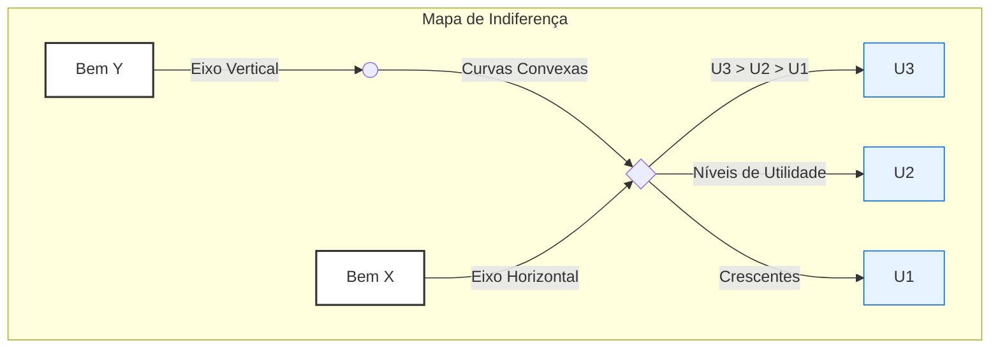

_Interpretação do Diagrama: Um mapa de indiferença típico, com curvas convexas (U1, U2, U3). Qualquer ponto na curva U2 é preferível a qualquer ponto em U1. Todas as curvas são negativamente inclinadas e não se cruzam._

`[imagem: Pasted image 20250628153633.png]`

---

#### 3. A Taxa Marginal de Substituição (TMS)

A inclinação da curva de indiferença em um determinado ponto tem um significado econômico fundamental.

> [!definition] Taxa Marginal de Substituição (TMS)
> 
> A Taxa Marginal de Substituição do bem Y pelo bem X (TMS_Y,X) mede a taxa à qual um consumidor está disposto a voluntariamente desistir do bem Y para obter uma unidade adicional do bem X, mantendo-se no mesmo nível de satisfação (na mesma curva de indiferença). É a medida da valoração subjetiva de um bem em termos do outro.
> 
> $TMSY,X​=−ΔXΔY​$
> 
> Graficamente, a TMS em um ponto é o **valor absoluto da inclinação da curva de indiferença** naquele ponto.


##### TMS Decrescente

A consequência mais importante da **convexidade** das preferências é a **TMS Decrescente**.

> [!important] A Lei da Taxa Marginal de Substituição Decrescente
> 
> À medida que um consumidor se move ao longo de uma curva de indiferença, aumentando o consumo do bem X e diminuindo o do bem Y, a TMS (o valor absoluto da inclinação) diminui.
> 
> **Análise:**
> 
> - **Quando o consumidor tem muito Y e pouco X:** Ele está disposto a abrir mão de uma quantidade relativamente grande de Y para obter uma unidade de X. O bem X é subjetivamente muito valioso para ele, pois é escasso em sua cesta. A TMS é alta.
>     
> - **Quando o consumidor tem pouco Y e muito X:** Agora, ele possui muito X e o bem Y se tornou relativamente escasso. Ele só aceitará abrir mão de uma pequena quantidade de Y para obter mais uma unidade de X. A TMS é baixa.
>     
> 
> **Relação com a Convexidade:** É precisamente a forma convexa ("abaulada" para a origem) que faz com que a inclinação da curva se torne cada vez mais "plana" à medida que nos movemos para a direita, demonstrando a queda na TMS.

---

#### 4. Casos Especiais de Preferências

A análise da forma das curvas de indiferença para bens que não seguem a regra da convexidade é um tópico clássico em provas.

##### Substitutos Perfeitos

- **Definição:** Dois bens são substitutos perfeitos se o consumidor está disposto a substituí-los um pelo outro a uma **taxa constante**. A TMS é constante.
    
- **Exemplo Clássico:** Manteiga e margarina; canetas azuis e pretas (para um consumidor que não se importa com a cor).
    
- **Forma da Curva de Indiferença:** **Linhas retas** com inclinação negativa. A inclinação (e, portanto, a TMS) é constante ao longo de toda a curva.
    

`[imagem: Pasted image 20250628153827.png]`

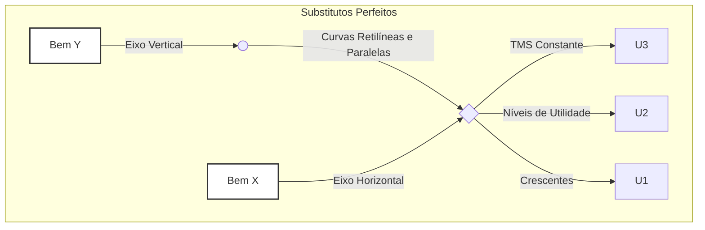

##### Complementares Perfeitos

- **Definição:** Dois bens são complementares perfeitos se são consumidos juntos em proporções fixas. O consumidor não obtém satisfação adicional ao consumir mais de um bem sem consumir mais do outro na proporção correta.
    
- **Exemplo Clássico:** Pé direito e pé esquerdo de um sapato; café e açúcar (para alguém que só toma café com uma quantidade fixa de açúcar).
    
- **Forma da Curva de Indiferença:** **Formato de "L"**. O vértice do "L" ocorre no ponto onde os bens são consumidos na proporção desejada. Adicionar mais de um bem, sem adicionar do outro, não aumenta a utilidade (move o consumidor para um ponto na parte horizontal ou vertical da curva, mas não para uma curva mais alta).
    

`[imagem: Pasted image 20250628153939.png]`

```mermaid
graph TD
    subgraph Complementares Perfeitos
        direction LR
        A[Bem Y] -- Eixo Vertical --> B(( ))
        B -- Curvas em "L" --> D{ }
        C[Bem X] -- Eixo Horizontal --> D
        D -- Proporção Fixa --> E[U3]
        D -- Níveis de Utilidade --> F[U2]
        D -- Crescentes --> G[U1]
    end

    style A fill:#fff,stroke:#333,stroke-width:2px
    style C fill:#fff,stroke:#333,stroke-width:2px
```

---

#### Questões para Autoavaliação (Active Recall)

> [!question] Questão 1
> 
> Explique, utilizando os axiomas da teoria do consumidor, por que duas curvas de indiferença de um mesmo mapa de indiferença não podem se cruzar. Qual axioma seria violado e por quê?

> [!question] Questão 2
> 
> O que significa uma Taxa Marginal de Substituição (TMS) decrescente e qual propriedade das preferências do consumidor é responsável por essa característica? Descreva o comportamento do consumidor que essa propriedade representa.

> [!question] Questão 3
> 
> Um consumidor afirma que, para ele, suco de laranja e suco de tangerina são indiferentes, e ele sempre está disposto a trocar um copo de um pelo outro na proporção de 1 para 1. Como seria o mapa de indiferença desse consumidor para esses dois bens? Qual é o valor da sua TMS?.

---


## [ECO-1.1] A Curva de Oferta da Firma em Concorrência Perfeita (nota complementar)

> Origem no vault: `07 - ECONOMIA/01 - Microeconomia/1.1 - Extra/A Curva de Oferta da Firma em Concorrência Perfeita.md` · 3.4 KB

---

### A Curva de Oferta da Firma em Concorrência Perfeita

#### 1. Tomadora de Preços: P = RMg

- Em concorrência perfeita, cada firma enfrenta uma **demanda horizontal**, pois é incapaz de influenciar o preço de mercado.
    
- Isso significa que **Preço = Receita Marginal = Receita Média (P = RMg = RM)** — cada unidade produzida gera exatamente esse preço como receita.
    

#### 2. Regra de Maximização de Lucro: P = CMg

- A condição clássica para maximização de lucro (ou mínima perda) é quando **Receita Marginal = Custo Marginal**.
    
- Em concorrência perfeita: **Preço = Custo Marginal (P = CMg)** .
    

#### 3. Curva de Oferta da Firma: CMg acima do mínimo do AVC

- A **curva de oferta no curto prazo** é exatamente:
    
    - o **segmento da curva de Custo Marginal acima do mínimo da curva de Custo Variável Médio (AVC)**.
        
    - Se o preço estiver **abaixo do mínimo do AVC**, produzir representa prejuízo maior do que fechar; logo, a firma opta por **não produzir** (Q = 0).
        

##### 🛑 Regra de parada (shutdown rule):

- Se **P ≥ AVC_mínimo**: produza onde **P = CMg**.
    
- Se **P < AVC_mínimo**: melhor fechar e arcar apenas com custos fixos.
    

#### 4. Por que esse trecho da CMg é a oferta?

1. A firma observa o preço de mercado.
    
2. Compara com o AVC mínimo:
    
    - Se for menor, **encessa a produção**.
        
    - Se for igual ou maior, determina Q tal que **P = CMg**.
        
3. Esse Q é a quantidade ofertada — e, à medida que o preço sobe, a firma produz mais, seguindo a curva de CMg acima do AVC.
    

#### 5. Formato da Curva: crescente

- A curva de **Custo Marginal é ascendente** devido à **lei dos rendimentos decrescentes**, que faz os custos por unidade adicional aumentar conforme expande-se a produção.
    
- Assim, a curva de oferta é **positivamente inclinada**: preços mais altos remuneram custos marginais crescentes.
    

---

##### 🧾 Resumo passo a passo

|Etapa|Lógica|
|---|---|
|**1. Tomador de preços**|Preço = RMg|
|**2. Max. Lucro**|Produção onde P = CMg|
|**3. Verificar AVC**|Se P ≥ AVC_mínimo ⟶ produza; caso contrário ⟶ Q = 0|
|**4. Oferta**|Q = quantidade onde P = CMg (acima de AVC_mínimo)|
|**5. Forma da curva**|Positivamente inclinada pelo custo marginal crescente|

---

#### 📝 Pontos essenciais para prova

- A firma **não escolhe o preço**, apenas a quantidade.
    
- Em equilíbrio de curto prazo:
    
    - **Se P ≥ AVC mínimo** → firma produz e “compensa parte dos custos fixos”.
        
    - **Se P < AVC mínimo** → firma fecha temporariamente; só arca com custos fixos.
        
- A curva de oferta da firma = **Custo Marginal acima do ponto mínimo do AVC**.
    

---

#### Conclusão

A curva de oferta da firma em concorrência perfeita é derivada diretamente de seu **custo marginal**, a partir do ponto em que cobre seus **custos variáveis mínimos**. O modelo combina lógica de preço-tomador (P = RMg), maximização de lucro (P = CMg), e decisão de produção condicionada ao **shutdown rule** (comparação com AVC), resultando em uma curva de oferta ascendente — fiel representação da racionalidade microeconômica no curto prazo.

---


## [ECO-1.1] Função de Produção Cobb-Douglas (nota complementar)

> Origem no vault: `07 - ECONOMIA/01 - Microeconomia/1.1 - Extra/Função de Produção Cobb-Douglas.md` · 3.1 KB

#### 📊 **Interpretação econômica da Cobb-Douglas**

- Os parâmetros α\alpha e β\beta indicam a **contribuição relativa** do capital e do trabalho para a produção total.
    
    - Por exemplo, se α=0.3 = 0.3 e β=0.7, significa que o trabalho tem maior peso na geração do produto que o capital.
        
- A soma α+β\alpha + \beta indica os **retornos de escala** da função:
    
    - Se α+β=1, há **retornos constantes de escala**: dobrar ambos os fatores dobra a produção exatamente.
        
    - Se α+β>1, há **retornos crescentes de escala**: dobrar ambos os fatores aumenta a produção em mais que o dobro.
        
    - Se α+β<1, há **retornos decrescentes de escala**: dobrar ambos os fatores aumenta a produção em menos que o dobro.
        

---

#### 📈 **Relação com a Teoria da Firma**

Na **Teoria da Firma**, o objetivo da firma é maximizar lucros, o que depende diretamente da função de produção e dos custos dos fatores. A função Cobb-Douglas é frequentemente utilizada por ser simples, realista e capaz de capturar características essenciais da produção:

1. **Elasticidade e Produtividade Marginal:**
    
    - Permite calcular claramente as produtividades marginais dos fatores de produção (quanto aumenta QQ ao adicionar mais uma unidade de KK ou LL).
        
    - As produtividades marginais decrescem conforme o fator aumenta, um princípio econômico essencial (**Lei dos rendimentos marginais decrescentes**).
        
2. **Tomada de decisão da firma:**
    
    - A firma utiliza a Cobb-Douglas para decidir quanto contratar de cada fator produtivo, buscando minimizar custos dado o nível desejado de produção.
        
    - Também é usada para determinar o nível ótimo de produção para maximizar lucros, considerando preços dos fatores e preço do produto no mercado.
        

---

#### 🖥️ **Exemplo prático (numérico):**

Considere a função Cobb-Douglas:

$Q=10⋅K^0.5⋅L^0.5$

Suponha que a empresa tenha:

- Capital (K) = 4 unidades.
    
- Trabalho (L) = 9 unidades.
    

A produção total será:

$Q=10⋅(4)^0,5⋅(9)^0,5=10⋅2⋅3=60$

Neste exemplo, α=0,5 e β=0,5, indicando:

- Retornos constantes de escala, pois 0,5+0,5=1.
    
- Cada fator contribui igualmente para a produção.
    

---

#### 🔗 **Visualização (Mermaid):**

Uma visualização simples e clara da aplicação Cobb-Douglas na decisão da firma pode ser:

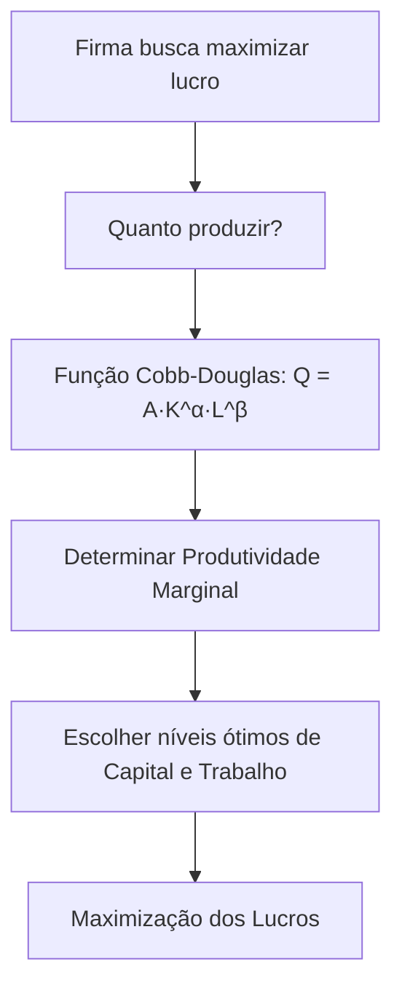

---

#### 💡 **Resumindo:**

A função Cobb-Douglas é essencial para entender como empresas combinam insumos produtivos (capital e trabalho) para produzir bens e serviços. É uma peça-chave da Teoria da Firma, pois permite análises concretas sobre produtividade, custos e decisões ótimas de produção.

---


## [ECO-1.1] Isoquantas e fronteira de possibilidades de produção (nota complementar)

> Origem no vault: `07 - ECONOMIA/01 - Microeconomia/1.1 - Extra/Isoquantas e fronteira de possibilidades de produção.md` · 11.3 KB

### Isoquantas e fronteira de possibilidades de produção: fundamentos e interconexões na teoria microeconômica

A compreensão das **isoquantas** e da **fronteira de possibilidades de produção (FPP)** constitui um dos pilares fundamentais da teoria microeconômica moderna. Estes conceitos, desenvolvidos ao longo do século XX, fornecem ferramentas analíticas essenciais para compreender como firmas tomam decisões produtivas e como economias alocam recursos escassos entre usos alternativos. Para o candidato à carreira diplomática, dominar estes instrumentos é crucial para analisar políticas econômicas, entender dinâmicas de comércio internacional e avaliar estratégias de desenvolvimento.

#### Isoquantas: geometria da produção eficiente

##### Fundamentos conceituais e matemáticos

Uma isoquanta representa o conjunto de todas as *combinações de insumos que produzem a mesma quantidade de produto*. Matematicamente, para uma função de produção Q = f(K,L), uma isoquanta é definida pela equação implícita **Q₀ = f(K,L) = constante**, onde K representa capital e L trabalho. O conceito foi desenvolvido independentemente por Philip Wicksteed (1894) e Léon Walras (1874-1877), sendo posteriormente popularizado por Ragnar Frisch, que cunhou o termo "isoquanta" em 1928-29.

As propriedades matemáticas fundamentais das isoquantas derivam diretamente dos pressupostos sobre a tecnologia de produção. **A inclinação negativa** resulta da necessidade de manter o produto constante: quando o diferencial total dQ = (∂f/∂K)dK + (∂f/∂L)dL = 0, obtemos $dK/dL = -(∂f/∂L)/(∂f/∂K) < 0$, assumindo produtos marginais positivos. **A convexidade em relação à origem** reflete a lei dos rendimentos marginais decrescentes - à medida que substituímos capital por trabalho ao longo da isoquanta, torna-se progressivamente mais difícil essa substituição, resultando em uma taxa marginal de substituição técnica (TMST) decrescente.

##### Taxa marginal de substituição técnica e tipos de isoquantas

A **TMST = PMgL/PMgK** representa quantas unidades de capital podem ser substituídas por uma unidade adicional de trabalho mantendo a produção constante. Para uma função Cobb-Douglas $Q = AK^α L^β$, a TMST = (β/α)(K/L), revelando como a substituibilidade entre fatores depende tanto dos parâmetros tecnológicos quanto das proporções correntes de uso dos fatores.

Os tipos principais de isoquantas refletem diferentes possibilidades tecnológicas. **Substitutos perfeitos** ($Q = aK + bL$) geram isoquantas lineares com TMST constante, indicando que os fatores podem ser trocados em proporção fixa sem afetar a eficiência. **Complementares perfeitos** ($Q = min{aK, bL}$) produzem isoquantas em formato L, onde a substituição é impossível - exemplificado pela relação entre máquinas e operadores especializados. A **função Cobb-Douglas**, com elasticidade de substituição unitária, representa o caso intermediário mais utilizado, enquanto a **função CES** (Constant Elasticity of Substitution) generaliza essas possibilidades através do parâmetro ρ.

#### Fronteira de possibilidades de produção: escolhas sociais sob escassez

##### Construção e significado econômico

A FPP ilustra todas as combinações possíveis de produção de dois bens que uma economia pode alcançar com recursos limitados e tecnologia fixa, quando todos os fatores são utilizados plena e eficientemente. Sua construção matemática parte das funções de produção setoriais $X = Fx(Kx, Lx) e Y = Fy(Ky, Ly)$, sujeitas às restrições de recursos $Kx + Ky = K̄ e Lx + Ly = L̄$.

A derivação mais elegante da FPP ocorre através da **caixa de Edgeworth para produção**. Os pontos de tangência entre isoquantas dos diferentes setores formam a curva de contrato, representando todas as alocações Pareto-eficientes de fatores entre os setores. A FPP emerge quando mapeamos essa curva de contrato do espaço de insumos para o espaço de produtos, revelando as possibilidades produtivas agregadas da economia.

##### Custos de oportunidade e formas da fronteira

O conceito central associado à FPP é o **custo de oportunidade**, medido pela *taxa marginal de transformação* ($TMT = -dY/dX$). Esta taxa indica quantas unidades do bem Y devem ser sacrificadas para produzir uma unidade adicional do bem X. Economicamente, $TMT = MCx/MCy$, relacionando os custos marginais de produção dos dois bens.

A forma da FPP depende crucialmente das características tecnológicas. Uma **FPP linear** surge quando há custos de oportunidade constantes, típico de tecnologias com substitutos perfeitos na produção ou setores com intensidades fatoriais idênticas. A **FPP côncava**, caso mais comum, reflete custos de oportunidade crescentes devido à lei dos rendimentos decrescentes e à heterogeneidade dos recursos - à medida que especializamos a produção em um bem, utilizamos recursos cada vez menos adequados para sua produção.

#### O diálogo profundo entre isoquantas e FPP

##### Da eficiência técnica à eficiência alocativa

A conexão fundamental entre isoquantas e FPP manifesta-se através de dois níveis distintos, mas interconectados de eficiência. **Eficiência técnica**, analisada através das isoquantas, garante que cada firma produz no mínimo custo possível para dado nível de produto - matematicamente, onde $TMST = w/r$ (razão dos preços dos fatores). **Eficiência alocativa**, representada por pontos sobre a FPP, assegura que a economia produz a combinação "correta" de bens que maximiza o bem-estar social - onde TMT = TMS (taxa marginal de substituição dos consumidores).

O **Primeiro Teorema do Bem-Estar** estabelece que todo equilíbrio competitivo alcança simultaneamente ambos os tipos de eficiência, situando a economia sobre as isoquantas relevantes e no ponto da FPP onde $TMT = TMS = Px/Py$. Esta unificação teórica demonstra como decisões descentralizadas ao nível das firmas (isoquantas) agregam-se para gerar resultados socialmente eficientes (FPP).

##### Tecnologia, rendimentos de escala e forma da fronteira

O progresso tecnológico afeta distintamente isoquantas e FPP. **Inovações Hicks-neutras** deslocam todas as isoquantas proporcionalmente em direção à origem, expandindo a FPP uniformemente e mantendo sua forma. **Progresso técnico enviesado** - poupador de capital ou trabalho - altera diferentemente as isoquantas, podendo mudar a curvatura da FPP e criar novas vantagens comparativas.

Os rendimentos de escala ao nível das firmas determinam crucialmente a forma da FPP agregada. **Rendimentos constantes** em ambos os setores, com tecnologias similares, geram FPP linear com especialização completa ótima. **Rendimentos decrescentes**, o caso padrão, produzem FPP côncava com custos de oportunidade crescentes, justificando diversificação produtiva. A análise moderna de Dalal (2006) demonstrou que condições menos restritivas que as tradicionalmente assumidas são suficientes para garantir concavidade da FPP.

#### Aplicações práticas e relevância contemporânea

##### Comércio internacional e vantagem comparativa

A teoria da vantagem comparativa encontra na FPP sua expressão mais clara. Países com diferentes FPPs (refletindo tecnologias ou dotações de fatores distintas) beneficiam-se mutuamente do comércio ao especializar-se onde possuem menor custo de oportunidade. O modelo Heckscher-Ohlin estende essa análise incorporando diferentes intensidades fatoriais entre setores, explicando padrões de comércio através das dotações relativas de fatores.

Exemplos contemporâneos abundam: a transformação dos Tigres Asiáticos de economias agrícolas para industriais e depois para serviços avançados ilustra como investimentos em educação e tecnologia podem deslocar dinamicamente a FPP. A experiência chinesa pós-1978 demonstra ganhos dramáticos de eficiência alocativa quando economias planificadas adotam mecanismos de mercado.

##### Decisões empresariais e políticas públicas

Ao nível microeconômico, a análise de isoquantas orienta decisões cruciais de investimento. A indústria automobilística global enfrenta constantemente o trade-off entre automação (capital-intensiva) e produção tradicional (trabalho-intensiva), com a escolha ótima dependendo dos preços relativos dos fatores em cada localização. Mudanças tecnológicas, como inteligência artificial e robótica, estão redefinindo as isoquantas em múltiplos setores.

Para políticas públicas, a FPP explicita trade-offs fundamentais. O dilema "canhões versus manteiga" transcende contextos bélicos - governos contemporâneos enfrentam escolhas entre investimento em infraestrutura versus programas sociais, saúde versus educação, consumo presente versus investimento para crescimento futuro. A análise rigorosa desses trade-offs usando o instrumental da FPP melhora significativamente a qualidade das decisões políticas.

##### Desafios analíticos e extensões modernas

A agregação de comportamentos microeconômicos (isoquantas) em resultados macroeconômicos (FPP) enfrenta desafios conceituais significativos. O **Teorema de Sonenschein-Mantel-Debreu** alerta que comportamentos individuais racionais não garantem automaticamente comportamento agregado bem-comportado. Heterogeneidade de produtos, qualidade variável de fatores e mudança tecnológica desigual complicam a análise agregada.

Extensões contemporâneas incorporam múltiplas dimensões anteriormente negligenciadas. A **economia ambiental** expande a análise incluindo "capital natural" como fator de produção e qualidade ambiental como output. Modelos de **economia circular** redefinem a própria noção de fronteira produtiva. A **economia digital** desafia conceitos tradicionais com bens de custo marginal zero e externalidades de rede.

#### Síntese e implicações para análise econômica avançada

Isoquantas e FPP, longe de serem meros exercícios acadêmicos, fornecem lentes analíticas indispensáveis para compreender questões econômicas fundamentais. **Isoquantas** revelam a estrutura profunda das possibilidades tecnológicas, orientando decisões de produção eficiente ao nível das firmas. A **FPP** agrega essas possibilidades microeconômicas em escolhas sociais, explicitando trade-offs inevitáveis sob escassez.

A unidade conceitual subjacente - otimização sujeita a restrições - permeia ambos os níveis de análise. Esta estrutura comum facilita a integração de insights micro e macroeconômicos, essencial para análise de políticas sofisticadas. Para o futuro diplomata, dominar estes conceitos permite avaliar rigorosamente propostas de política econômica, negociar acordos comerciais com compreensão profunda dos fundamentos econômicos, e contribuir efetivamente para estratégias de desenvolvimento nacional.

As direções futuras de pesquisa prometem enriquecer ainda mais estes frameworks. Modelos dinâmicos incorporando incerteza, insights da economia comportamental relaxando racionalidade perfeita, e aplicações de big data para estimação de funções de produção complexas expandirão o poder analítico destes conceitos fundamentais. A crescente importância de sustentabilidade ambiental e economia digital garantirá que isoquantas e FPP, adequadamente generalizadas, permanecerão centrais para análise econômica nas próximas décadas.

---


## [ECO-1.2] Oferta do Produtor (Fatores, Função, Elasticidade)

> Origem no vault: `07 - ECONOMIA/01 - Microeconomia/1.2 - Oferta do Produtor (Fatores, Função, Elasticidade)/_Oferta do Produtor (Fatores, Função, Elasticidade).md` · 21.5 KB

### Teoria da Oferta do Produtor: Fatores, Função de Produção e Elasticidade

#### Introdução

A teoria da oferta do produtor constitui um dos pilares fundamentais da microeconomia, explicando como as empresas tomam decisões de produção e como essas decisões se traduzem em curvas de oferta no mercado. **Esta teoria estabelece a relação técnica entre os fatores de produção e o produto final, sendo essencial para compreender o comportamento das empresas e a formação de preços na economia**. Para o diplomata brasileiro, dominar esses conceitos é crucial para analisar políticas econômicas, negociações comerciais e o desenvolvimento econômico nacional.

A compreensão da teoria da oferta envolve três componentes interconectados: os fatores de produção que constituem os insumos básicos, a função de produção que determina as relações técnicas entre insumos e produtos, e a elasticidade-preço da oferta que mede a sensibilidade dos produtores às variações de preços. **A Lei dos Rendimentos Decrescentes emerge como conceito central, explicando por que as curvas de custo marginal e oferta têm formato ascendente no curto prazo**.

#### Fatores de Produção

##### Definição e classificação dos insumos básicos

Os fatores de produção representam os insumos necessários para a geração de bens e serviços na economia. A teoria econômica tradicionalmente identifica três fatores primários, complementados por um quarto fator organizacional.

**Terra (Recursos Naturais)**: Engloba não apenas a terra física, mas todos os recursos naturais utilizados na produção. Inclui água, minerais, petróleo, gás natural, florestas, energia eólica e localizações geográficas. **No contexto brasileiro, este fator possui relevância especial dado o extenso território, rica biodiversidade e abundantes recursos minerais**. A terra caracteriza-se por oferta geralmente fixa, imobilidade geográfica e capacidade de gerar renda através da escassez natural.

**Trabalho (Capital Humano)**: Compreende todo esforço humano aplicado à produção, abrangendo tanto contribuições físicas quanto intelectuais. Inclui habilidades técnicas, conhecimento especializado, capacidades gerenciais e todas as formas de capital humano. O trabalho transforma matérias-primas em produtos acabados através da aplicação de conhecimento, habilidades e esforço. Distingue-se por oferta variável, mobilidade entre setores, possibilidade de aprimoramento através de educação e treinamento, sendo remunerado através de salários.

**Capital (Bens de Produção)**: Abrange todos os ativos produzidos pelo homem utilizados na produção de outros bens. Inclui maquinário, equipamentos, edificações, ferramentas, tecnologia e infraestrutura. O capital também engloba capital financeiro (recursos disponíveis para investimento). **Este fator aumenta a produtividade do trabalho ao fornecer ferramentas e tecnologia que ampliam a capacidade produtiva**. Caracteriza-se pela possibilidade de acumulação ao longo do tempo, sujeição à depreciação, mobilidade geográfica e geração de retornos através de juros ou lucros.

> [!important] Capacidade Empresarial A capacidade empresarial constitui o fator organizacional que combina os demais fatores de produção. Envolve inovação, assunção de riscos, tomada de decisões e identificação de oportunidades. Os empresários criam valor ao combinar fatores de formas inovadoras, introduzir inovações tecnológicas e assumir incertezas do mercado. São remunerados através do lucro e constituem o motor da mudança e crescimento econômico.

#### Função de Produção

##### Conceito fundamental

A função de produção representa a **relação técnica que demonstra a quantidade máxima de produto obtível a partir de uma dada combinação de fatores de produção, considerando o estado atual da tecnologia**. Matematicamente, expressa-se como Q = f(K, L), onde Q representa o produto, K o capital e L o trabalho. Esta função incorpora eficiência técnica e tecnologia disponível, constituindo a base para análise das decisões produtivas das empresas.

##### Distinção entre curto e longo prazo

A diferenciação temporal na análise econômica estabelece fundamentos cruciais para compreender o comportamento produtivo.

**Curto Prazo**: Período em que **pelo menos um fator de produção permanece fixo, geralmente o capital**. Esta restrição cria limitações na flexibilidade produtiva e sujeita a produção à Lei dos Rendimentos Decrescentes. No curto prazo, as empresas ajustam apenas fatores variáveis (normalmente trabalho) para alterar a produção. As decisões focam na otimização do uso de fatores variáveis dado o estoque fixo de capital.

**Longo Prazo**: Período em que **todos os fatores de produção podem ser ajustados e modificados**. Não existem fatores fixos, conferindo flexibilidade completa na combinação de insumos. As empresas podem alterar escala de produção, tecnologia e todos os fatores simultaneamente. Esta situação permite alcançar escalas ótimas de produção e está sujeita aos efeitos de retornos de escala.

##### Conceitos de produção no curto prazo

**Produto Total (PT)**: Representa a quantidade total de produto gerada por uma determinada quantidade de fator variável (normalmente trabalho) mantendo fixos os demais fatores. **Inicialmente cresce a taxas crescentes devido à especialização, posteriormente cresce a taxas decrescentes devido aos rendimentos decrescentes, eventualmente atinge um máximo e pode declinar**. O produto total reflete a capacidade produtiva total da empresa em cada nível de emprego do fator variável.

**Produto Médio (PM)**: Calcula-se dividindo o produto total pela quantidade de fator variável utilizada (PM = PT/L). **Mede a produtividade por unidade de insumo, indicando a eficiência na utilização do fator variável**. A curva de produto médio possui formato de U invertido, inicialmente crescente e posteriormente decrescente. Este conceito é fundamental para avaliar a eficiência produtiva e determinar níveis ótimos de utilização de fatores.

**Produto Marginal (PMg)**: Representa o **produto adicional obtido pelo emprego de uma unidade adicional do fator variável** (PMg = ΔPT/ΔL). Mede a contribuição da última unidade do fator variável para o produto total. **A curva de produto marginal intersecta a curva de produto médio em seu ponto máximo**. Quando PMg > PM, o produto médio está crescendo; quando PMg < PM, o produto médio está decrescendo.

> [!note] Relações Fundamentais
> 
> - Quando PMg > PM: Produto médio está crescendo
> - Quando PMg < PM: Produto médio está decrescendo
> - Quando PMg = PM: Produto médio atinge seu máximo
> - A curva PMg situa-se acima da curva PM quando PM cresce, e abaixo quando PM decresce

```chart
type: line
labels: [0, 1, 2, 3, 4, 5, 6, 7, 8, 9, 10]
series:
  - title: Produto Total (PT)
    data: [0, 10, 25, 45, 60, 70, 75, 75, 70, 60, 45]
  - title: Produto Médio (PM)
    data: [0, 10, 12.5, 15, 15, 14, 12.5, 10.7, 8.75, 6.67, 4.5]
  - title: Produto Marginal (PMg)
    data: [10, 15, 20, 15, 10, 5, 0, -5, -10, -15, -20]
tension: 0.2
width: 80%
labelColors: false
fill: false
beginAtZero: false
bestFit: false
bestFitTitle: 
bestFitNumber: 0
```

#### Lei dos Rendimentos Decrescentes

##### Conceito central da teoria da produção

A **Lei dos Rendimentos Decrescentes estabelece que, no curto prazo, quando um fator variável é adicionado a fatores fixos, o produto marginal do fator variável eventualmente decrescerá**. Esta lei constitui o fundamento teórico central que explica o formato das curvas de custo e oferta no curto prazo.

##### Lógica econômica da lei

**Fase de Especialização**: Inicialmente, adicionar trabalhadores permite divisão do trabalho e especialização, aumentando o produto marginal. Os trabalhadores podem se concentrar em tarefas específicas, melhorando a eficiência produtiva geral.

**Fase de Saturação**: Eventualmente, os fatores fixos (capital e terra) tornam-se limitações restritivas, causando interferência mútua entre trabalhadores. **O espaço físico limitado e o equipamento fixo impedem que trabalhadores adicionais sejam totalmente produtivos**.

**Restrições Físicas**: Fatores fixos criam gargalos que impedem o pleno aproveitamento da produtividade de trabalhadores adicionais. A capacidade limitada dos equipamentos e instalações restringe a contribuição marginal de novos trabalhadores.

```chart
type: line
labels: [1, 2, 3, 4, 5, 6, 7, 8]
series:
  - title: Produto Marginal
    data: [8, 15, 20, 18, 12, 6, 2, -3]
  - title: Produto Médio
    data: [8, 11.5, 14.3, 15.25, 14.6, 13, 11.4, 9.6]
tension: 0.2
width: 80%
labelColors: false
fill: false
beginAtZero: false
annotations:
  - x: 2.5
    text: "Fase I: Especialização (PMg > PM)"
  - x: 5.5
    text: "Fase II: Rendimentos Decrescentes (PMg < PM)"
  - x: 7.5
    text: "Fase III: Produto Marginal Negativo"
```

##### Relação fundamental com curvas de custo marginal

**Relação Inversa**: Quando o produto marginal diminui, o custo marginal aumenta. Esta relação matemática expressa-se como CM = W/PMg, onde W representa o salário e PMg o produto marginal do trabalho.

**Implicação para Custos**: **Rendimentos decrescentes levam a custos marginais crescentes de produção**. À medida que mais unidades são produzidas no curto prazo, cada unidade adicional torna-se mais cara devido à menor produtividade marginal.

**Formato da Curva de Custo**: Os rendimentos decrescentes explicam o formato ascendente das curvas de custo marginal no curto prazo, fundamental para compreender o comportamento da oferta.

```chart
type: line
labels: [1, 2, 3, 4, 5, 6, 7, 8]
series:
  - title: Produto Marginal (PMg)
    data: [15, 20, 18, 12, 8, 5, 3, 1]
  - title: Custo Marginal (CM)
    data: [6.67, 5, 5.56, 8.33, 12.5, 20, 33.33, 100]
tension: 0.2
width: 80%
labelColors: false
fill: false
beginAtZero: false
```

##### Conexão com a curva de oferta de curto prazo

**Curva de Oferta Ascendente**: **A Lei dos Rendimentos Decrescentes constitui a principal razão para o formato ascendente da curva de custo marginal e, consequentemente, da curva de oferta da empresa no curto prazo**.

**Comportamento do Produtor**: As empresas requerem preços mais elevados para compensar custos marginais crescentes resultantes dos rendimentos decrescentes. **Produzir quantidades maiores torna-se progressivamente mais caro, exigindo preços mais altos para manter a rentabilidade**.

**Oferta de Mercado**: As curvas de oferta individuais das empresas agregam-se para formar a curva de oferta de mercado ascendente. Esta agregação preserva a característica ascendente derivada dos rendimentos decrescentes em cada empresa.

> [!important] Importância Central A Lei dos Rendimentos Decrescentes é o **conceito central** que conecta a teoria da produção com a teoria dos custos e a determinação da oferta. Sem esta lei, não seria possível explicar por que as curvas de oferta são ascendentes no curto prazo, tornando-se fundamental para toda a análise microeconômica.

```chart
type: line
labels: [0, 1, 2, 3, 4, 5, 6, 7, 8]
series:
  - title: Custo Marginal = Curva de Oferta
    data: [0, 5, 8, 12, 17, 24, 33, 45, 60]
  - title: Custo Médio Variável
    data: [0, 8, 7, 8, 10, 13, 17, 22, 28]
tension: 0.2
width: 80%
labelColors: false
fill: false
beginAtZero: true
annotations:
  - x: 2
    text: "Ponto de Fechamento (P = CVM mínimo)"
```

#### Retornos de escala no longo prazo

##### Conceito e análise

No longo prazo, quando todos os fatores podem ser ajustados, a análise foca nos **retornos de escala**, que descrevem o que acontece com a produção quando todos os fatores variam na mesma proporção.

**Retornos Crescentes de Escala**: Situação em que a produção aumenta mais que proporcionalmente ao aumento dos insumos. Se os insumos aumentam por fator 'm', a produção aumenta por mais que 'm'. **Causas incluem indivisibilidade técnica, economias de especialização e vantagens dimensionais**. Exemplo: duplicar todos os insumos resulta em mais que o dobro da produção.

**Retornos Constantes de Escala**: Situação em que a produção aumenta proporcionalmente ao aumento dos insumos. Se os insumos aumentam por fator 'm', a produção aumenta exatamente por 'm'. Caracteriza-se pela replicação do processo produtivo em escala maior sem alteração na eficiência relativa.

**Retornos Decrescentes de Escala**: Situação em que a produção aumenta menos que proporcionalmente ao aumento dos insumos. Se os insumos aumentam por fator 'm', a produção aumenta por menos que 'm'. **Causas incluem deseconomias gerenciais, problemas de coordenação e ineficiências burocráticas**. Exemplo: duplicar todos os insumos resulta em menos que o dobro da produção.

##### Relação com custos de longo prazo

Os retornos de escala determinam o formato da curva de custo médio de longo prazo:

- **Retornos Crescentes** → Custos médios de longo prazo decrescentes (economias de escala)
- **Retornos Constantes** → Custos médios de longo prazo constantes
- **Retornos Decrescentes** → Custos médios de longo prazo crescentes (deseconomias de escala)

```chart
type: line
labels: [1, 2, 3, 4, 5, 6, 7, 8]
series:
  - title: Retornos Crescentes
    data: [10, 25, 45, 70, 100, 135, 175, 220]
  - title: Retornos Constantes
    data: [10, 20, 30, 40, 50, 60, 70, 80]
  - title: Retornos Decrescentes
    data: [10, 18, 24, 28, 30, 30, 28, 24]
tension: 0.2
width: 80%
labelColors: false
fill: false
beginAtZero: true
```

#### Elasticidade-Preço da Oferta

##### Conceito fundamental

A **elasticidade-preço da oferta mede a sensibilidade ou capacidade de resposta da quantidade ofertada de um bem a variações em seu preço**. Quantifica o grau de reação dos produtores às mudanças de preços, constituindo ferramenta essencial para análise de políticas econômicas e funcionamento de mercados.

**Fórmula**: EPO = (Variação Percentual na Quantidade Ofertada) / (Variação Percentual no Preço)

##### Interpretação dos tipos de elasticidade

**Oferta Perfeitamente Elástica (EPO = ∞)**: Curva de oferta horizontal indicando resposta infinita a mudanças de preço. Os ofertantes estão dispostos a ofertar qualquer quantidade ao preço vigente, mas nenhuma quantidade a preços menores.

**Oferta Perfeitamente Inelástica (EPO = 0)**: Curva de oferta vertical indicando ausência de resposta a mudanças de preço. A quantidade ofertada permanece fixa independentemente do preço. **Típica de bens com oferta completamente rígida no curto prazo**.

**Oferta Unitariamente Elástica (EPO = 1)**: Resposta proporcional a mudanças de preço. A variação percentual na quantidade ofertada iguala a variação percentual no preço.

**Oferta Elástica (EPO > 1)**: Quantidade ofertada responde mais que proporcionalmente a mudanças de preço. **Curva de oferta relativamente plana, indicando alta sensibilidade dos produtores a variações de preço**.

**Oferta Inelástica (EPO < 1)**: Quantidade ofertada responde menos que proporcionalmente a mudanças de preço. **Curva de oferta relativamente íngreme, indicando baixa sensibilidade dos produtores a variações de preço**.

```chart
type: line
labels: [1, 2, 3, 4, 5, 6, 7, 8, 9, 10]
series:
  - title: Perfeitamente Inelástica (EPO = 0)
    data: [5, 5, 5, 5, 5, 5, 5, 5, 5, 5]
  - title: Inelástica (EPO < 1)
    data: [1, 2, 3, 4, 5, 6, 7, 8, 9, 10]
  - title: Unitária (EPO = 1)
    data: [1, 2, 3, 4, 5, 6, 7, 8, 9, 10]
  - title: Elástica (EPO > 1)
    data: [1, 1.5, 2.5, 4, 6, 8.5, 11.5, 15, 19, 24]
  - title: Perfeitamente Elástica (EPO = ∞)
    data: [5, 5, 5, 5, 5, 5, 5, 5, 5, 5]
tension: 0.1
width: 80%
labelColors: false
fill: false
```
##### Determinantes da elasticidade-preço da oferta

**Horizonte Temporal**: **Fator mais importante na determinação da elasticidade da oferta**. No curto prazo, a oferta tende a ser mais inelástica devido a fatores fixos que limitam a capacidade de ajuste. No longo prazo, a oferta torna-se mais elástica pois todos os fatores podem ser ajustados, permitindo maior flexibilidade na resposta a preços.

**Flexibilidade no Uso de Insumos**: Maior disponibilidade e flexibilidade de insumos resulta em oferta mais elástica. **Quando os produtores podem facilmente substituir insumos ou alterar processos produtivos, respondem mais rapidamente a mudanças de preços**. Escassez ou especificidade de insumos torna a oferta mais inelástica.

**Disponibilidade de Capacidade Ociosa**: Empresas com capacidade ociosa podem aumentar produção rapidamente sem aumentos significativos de custos, tornando a oferta mais elástica. **Operação próxima à capacidade máxima torna a oferta inelástica devido a limitações físicas**.

**Custos de Produção**: Estrutura de custos influencia significativamente a elasticidade. **Custos marginais baixos e constantes resultam em oferta elástica, enquanto custos marginais altos e crescentes resultam em oferta inelástica**.

**Tecnologia e Inovação**: Tecnologia avançada e flexível permite ajustes rápidos na produção, aumentando a elasticidade da oferta. Processos produtivos rígidos ou tecnologia obsoleta limitam a capacidade de resposta.

**Capacidade de Armazenamento**: Bens com facilidade de armazenamento apresentam oferta mais elástica, pois produtores podem ajustar o momento de venda conforme variações de preço. **Bens perecíveis tendem a ter oferta mais inelástica**.

**Substitutos na Produção**: Disponibilidade de bens substitutos na produção aumenta a elasticidade da oferta. **Produtores podem facilmente alternar entre diferentes produtos conforme mudanças de preços relativos**.

> [!note] Aplicação Prática no Contexto Brasileiro A elasticidade-preço da oferta possui relevância especial para a economia brasileira, grande produtor de commodities agrícolas e minerais. A oferta de soja, por exemplo, é relativamente inelástica no curto prazo devido ao ciclo produtivo, mas mais elástica no longo prazo quando produtores podem ajustar áreas plantadas e investir em tecnologia.

#### Síntese das relações conceituais

A teoria da oferta do produtor estabelece conexões fundamentais entre produção, custos e comportamento de mercado. **Os rendimentos decrescentes na produção traduzem-se diretamente em custos marginais crescentes, que por sua vez criam curvas de oferta ascendentes**. Esta sequência lógica - produção → custos → oferta - constitui o núcleo da análise microeconômica.

A distinção temporal entre curto e longo prazo permeia toda a análise: restrições de curto prazo limitam flexibilidade e criam inelasticidade, enquanto ajustes de longo prazo permitem otimização e maior elasticidade. **Os efeitos de escala de longo prazo determinam a estrutura ideal da indústria e o tamanho ótimo das empresas**.

A elasticidade-preço da oferta sintetiza todos esses fatores, medindo como restrições produtivas, custos e horizontes temporais combinam-se para determinar a responsividade dos produtores. **Compreender esses conceitos é essencial para analisar políticas econômicas, desde tributação até subsídios, e para entender como mercados respondem a choques econômicos**.

#### Conclusão

A teoria da oferta do produtor fornece ferramentas analíticas essenciais para compreender o funcionamento dos mercados e a tomada de decisões empresariais. **A Lei dos Rendimentos Decrescentes emerge como conceito central, conectando a teoria da produção com a formação de preços e explicando o comportamento ascendente das curvas de oferta no curto prazo**. Esta compreensão teórica é fundamental para diplomatas brasileiros que precisam analisar políticas econômicas, negociar acordos comerciais e compreender o desenvolvimento econômico nacional.

A integração entre fatores de produção, função de produção e elasticidade da oferta revela como decisões microeconômicas individuais agregam-se em padrões macroeconômicos. **O domínio desses conceitos permite analisar desde a competitividade de setores específicos da economia brasileira até os efeitos de políticas governamentais sobre a oferta agregada**. Para o futuro diplomata, esta base teórica sólida constitui ferramenta indispensável para compreender e influenciar o cenário econômico nacional e internacional.

---

#### Questões de Autoavaliação

##### Questão 1

Analise a relação entre a Lei dos Rendimentos Decrescentes e o formato da curva de oferta de curto prazo de uma empresa. Explique por que esta lei é considerada fundamental para compreender o comportamento da oferta no curto prazo e como ela se conecta com a teoria dos custos de produção. (Desenvolva sua resposta em 60-90 linhas)

##### Questão 2

Compare e contraste os conceitos de retornos de escala (longo prazo) com a Lei dos Rendimentos Decrescentes (curto prazo). Explique como esses dois conceitos se relacionam com diferentes horizontes temporais na análise econômica e quais são suas implicações para a estrutura de custos das empresas. Forneça exemplos práticos de setores da economia brasileira onde cada conceito seria mais relevante.

##### Questão 3

Analise os determinantes da elasticidade-preço da oferta, explicando como cada fator influencia a capacidade de resposta dos produtores a mudanças de preços. Utilize exemplos de produtos brasileiros (como commodities agrícolas, produtos industriais e serviços) para ilustrar situações de oferta elástica e inelástica, justificando suas escolhas com base nos determinantes estudados.

---


## [ECO-1.2] Microeconomia – Nota de Estudo Avançado (nota complementar)

> Origem no vault: `07 - ECONOMIA/01 - Microeconomia/1.2 - Oferta do Produtor (Fatores, Função, Elasticidade)/Microeconomia – Nota de Estudo Avançado.md` · 97.5 KB

### Microeconomia – Nota de Estudo Avançado 

#### Introdução à Microeconomia

A **Microeconomia** é o ramo da economia que estuda o comportamento de agentes individuais – consumidores, empresas, trabalhadores – e a forma como interagem em mercados. Seu foco central é **como alocar recursos escassos** diante de necessidades e desejos ilimitados. Essa condição de **escassez** implica que escolher **uma alternativa** normalmente envolve **abrir mão de outra**, conceito conhecido como **trade-off**. Decisões econômicas, portanto, exigem avaliar custos e benefícios de escolhas mutuamente excludentes. O **custo de oportunidade** de algo é o valor da melhor alternativa renunciada para obtê-lo – uma ideia fundamental que permeia toda a microeconomia.

> [!definition] **Escassez** 
> Em economia, **escassez** significa que os recursos disponíveis (terra, trabalho, capital, tempo) são limitados, enquanto os desejos ou necessidades de consumo são virtualmente ilimitados. Diante da escassez, cada escolha implica um **trade-off**, ou seja, sacrificar uma alternativa para realizar outra.

>[!quote] _“O custo de alguma coisa é aquilo de que você desiste para obtê-la.”_ – Gregory Mankiw. (Este princípio resume a ideia de **custo de oportunidade**, ou seja, o verdadeiro custo de uma decisão inclui o valor da melhor alternativa que precisou ser abandonada para realizá-la.)

A microeconomia analisa **como** os agentes tomam decisões e **como** essas decisões interagem nos mercados. Por exemplo, consumidores maximizam satisfação dadas suas restrições (como renda e preços), enquanto as firmas produzem visando maximizar lucros dados seus custos de produção. Essas escolhas individuais se coordenam via **preços de mercado**, que ajustam oferta e demanda. Um dos insights fundamentais, destacado já por Alfred Marshall no fim do século XIX, é que preços e quantidades são determinados simultaneamente pelos **dois lados do mercado** – demanda e oferta – atuando juntos em equilíbrio. Em outras palavras, nem apenas a utilidade dos consumidores (lado da demanda) nem apenas os custos de produção (lado da oferta) isoladamente explicam o valor de um bem, mas sim a interação de ambos. Marshall ilustrou essa ideia com sua famosa metáfora da **tesoura**:

>[!quote] _“Seria tão razoável discutir se a lâmina superior ou a inferior de uma tesoura é a responsável por cortar o papel, quanto discutir se o valor é determinado pela demanda ou pela oferta.”_ – Alfred Marshall.

Em suma, a introdução à microeconomia estabelece os conceitos básicos de **escassez**, **trade-offs**, **incentivos** e **custo de oportunidade**, preparando o terreno para teorias mais formais do comportamento do consumidor, da firma e da determinação de preços nos mercados.

**Exemplo ilustrativo – Fronteira de Possibilidades de Produção:** Uma forma simples de visualizar trade-offs é através da **Fronteira de Possibilidades de Produção (FPP)**. A FPP mostra as combinações máximas de dois bens que uma economia (ou empresa) pode produzir usando todos os recursos disponíveis de forma eficiente. Pontos sobre a fronteira implicam eficiência (não há recursos ociosos); pontos abaixo, ineficiência; pontos acima são inatingíveis dados os recursos atuais. O formato normalmente **côncavo** da FPP reflete custos de oportunidade crescentes – para produzir quantidades adicionais de um bem, sacrifica-se quantidades cada vez maiores do outro bem.

```chart
type: line
labels: [0,20,40,60,80,100]
series:
  - title: "Fronteira de Possibilidades de Produção"
    data: [100,98,92,80,60,0]
xTitle: "Quantidade do Bem A"
yTitle: "Quantidade do Bem B"
```

No gráfico acima, cada ponto na curva (FPP) representa uma escolha de produção entre dois bens (A e B). Movendo-se ao longo da fronteira, aumentar a produção do Bem A implica reduzir a do Bem B – evidenciando o trade-off e o custo de oportunidade (a quantidade do Bem B sacrificada). A inclinação da FPP em um ponto dado corresponde exatamente a esse custo de oportunidade marginal entre os dois bens.

**Exercícios – Introdução:**

1. (Dissertativa) Explique com suas palavras por que a existência de **escassez** obriga indivíduos e sociedades a fazerem **escolhas**. Como o conceito de **custo de oportunidade** auxilia na decisão entre alternativas?
    
2. (Múltipla escolha) Qual das situações abaixo **não** representa um **trade-off** econômico?  
    a. Um estudante decide usar seu tempo livre para estudar em vez de trabalhar.  
    b. Uma fábrica pode produzir carros ou caminhões com seus insumos disponíveis.  
    c. O governo imprime moeda para pagar dívidas, causando inflação.  
    d. Uma pessoa recebe um aumento salarial e decide gastar mais em lazer.
    

#### Teoria do Consumidor

A teoria do consumidor procura compreender **como os indivíduos decidem o que consumir** dado seu orçamento limitado. Parte-se do pressuposto básico – exposto por Hal Varian e outros economistas – de que **“os consumidores escolhem a melhor cesta de bens que podem adquirir”** com sua renda disponível. Para dar conteúdo a essa ideia, é necessário definir o que significa _melhor cesta_ (as preferências do consumidor) e o que significa _poder adquirir_ (a restrição orçamentária).

- **Preferências e utilidade:** Supõe-se que cada consumidor possui preferências bem definidas sobre diferentes cestas de consumo. Podemos representá-las por meio de uma **função utilidade** $U(x,y,...)$ que atribui um número (nível de satisfação) a cada cesta de bens $(x,y,...)$. A utilidade permite ordenar as cestas do mais preferido para o menos preferido. Importante notar que, para a teoria básica, a utilidade é tratada como um conceito **ordinal** – interessa apenas a ordenação das preferências, não a intensidade absoluta da satisfação. Assim, se $U(A) > U(B)$, a cesta A é preferida à B, mas não é possível dizer _quanto_ a mais A é preferida. Os consumidores são assumidos racionais no sentido de que suas preferências são completas (podem comparar quaisquer cestas) e transitivas (consistentes na ordenação).
    
- **Curvas de indiferença:** Uma forma de visualizar preferências é através de **curvas de indiferença**. Cada curva de indiferença conecta todas as combinações de bens que proporcionam **o mesmo nível de utilidade** ao consumidor. Por exemplo, a curva de indiferença $U=100$ mostraria todas as cestas diferentes de dois bens que rendem utilidade exatamente 100. As propriedades típicas das curvas de indiferença incluem: (1) são decrescentes (se o consumidor tem **mais de um bem**, precisa ter menos do outro para permanecer igualmente satisfeito), (2) são convexas em relação à origem (prefere combinações balanceadas a extremos, refletindo uma **taxa marginal de substituição decrescente** entre os bens) e (3) curvas mais afastadas da origem indicam níveis de utilidade maiores (cestas preferidas).
    
- **Restrição orçamentária:** As escolhas do consumidor são limitadas por sua renda ($M$) e pelos preços dos bens. A **restrição orçamentária** para dois bens pode ser expressa como $P_X \cdot X + P_Y \cdot Y \le M$, onde $P_X$ e $P_Y$ são os preços dos bens $X$ e $Y$. O conjunto de consumo viável é composto pelas cestas $(X,Y)$ que o consumidor **pode pagar** com sua renda. Graficamente, a restrição orçamentária é uma **linha reta** no plano de bens: se todo o orçamento fosse gasto em $X$, poderia comprar $M/P_X$ unidades; se tudo fosse gasto em $Y$, poderia comprar $M/P_Y$ unidades. Esses são os interceptos da linha, e a inclinação da reta orçamentária é $-P_X/P_Y$, representando o trade-off de mercado entre $X$ e $Y$ (quanto de $Y$ deve-se renunciar para obter uma unidade extra de $X$, dado os preços).
    
- **Escolha ótima do consumidor:** Dadas preferências (curvas de indiferença) e restrição orçamentária, o consumidor racional escolherá a cesta de maior utilidade que caiba em seu orçamento – graficamente, a curva de indiferença **mais alta possível** que ainda toca a região orçamentária. Na situação típica (interior), a solução ótima ocorre no ponto em que uma curva de indiferença é **tangente** à linha de orçamento. Nesse ponto, a inclinação da curva de indiferença (Taxa Marginal de Substituição, ou $TMS$) é igual à inclinação da restrição orçamentária (razão de preços). Ou seja, no ótimo **$TMS = \frac{P_X}{P_Y}$**: a taxa à qual o consumidor está disposto a trocar $Y$ por $X$ (sacrifício subjetivo) coincide com a taxa à qual o mercado permite essa troca (custo objetivo). Se houvesse qualquer discrepância – por exemplo, o $TMS$ fosse maior que $P_X/P_Y$ – o consumidor poderia realocar gastos para aumentar sua satisfação total.
    

**Gráfico – Equilíbrio do Consumidor:** A figura abaixo ilustra uma situação de equilíbrio do consumidor com dois bens ($X$ e $Y$). A curva de indiferença apresentada reflete um nível de utilidade específico, e a linha orçamentária representa todas as combinações que o consumidor pode comprar com sua renda. O ponto de tangência entre elas indica a **cesta ótima**.

```chart
type: line
labels: [0,10,15,20,25,30,35,40]
series:
  - title: "Curva de Indiferença (U constante)"
    data: [null,40.0,26.67,20.0,16.0,13.33,11.43,10.0]
  - title: "Linha Orçamentária"
    data: [40,30,25,20,15,10,5,0]
xTitle: "Quantidade do Bem X"
yTitle: "Quantidade do Bem Y"
```

No gráfico, a **Linha Orçamentária** vai do ponto $(0,40)$ (toda renda gasta em $Y$) até $(40,0)$ (toda renda gasta em $X$), assumindo, por exemplo, renda $M=40$ e preços $P_X=P_Y=1$. A **Curva de Indiferença** mostrada é convexa e decrescente, representando todas as combinações de $X$ e $Y$ que dão ao consumidor um certo nível de utilidade (neste caso, o nível é tal que a tangência ocorre exatamente em $X=20, Y=20$). Observe que no ponto **$(20,20)$** as inclinações das duas curvas coincidem – é o equilíbrio do consumidor. Em quantidades menores de $X$ (mais $Y$), a inclinação da curva de indiferença era maior que a da restrição (TMS > $P_X/P_Y$), indicando que o consumidor valorizaria muito obter mais $X$ em troca de $Y$ e, de fato, poderia melhorar seu bem-estar deslocando-se nesse sentido. Em quantidades maiores de $X$ (menos $Y$) do que o ótimo, ocorre o oposto (TMS < razão de preços), e o consumidor preferiria trocar parte de $X$ por mais $Y$. Assim, somente no ponto de tangência não há incentivo para realocar o consumo – é a cesta _ótima_ dentro do orçamento.

**Demanda individual e de mercado:** A teoria do consumidor permite derivar a **curva de demanda** de um indivíduo para cada bem. Variando o preço de um bem $P_X$ e recalculando a escolha ótima (mantendo preferências, renda e outros preços constantes), obtemos diferentes quantidades consumidas de $X$ – essa relação $P_X \times Q_X$ é a **demanda individual** por $X$. A curva de demanda normalmente é **decrescente**: um preço menor leva a quantidade demandada maior (assumindo bens “normais”). Isso ocorre por dois efeitos combinados: (1) **efeito substituição** – com $X$ mais barato em relação a $Y$, o consumidor tende a substituir $Y$ por $X$; (2) **efeito renda** – a queda do preço de $X$ libera poder de compra (a restrição orçamentária se desloca para fora), permitindo alcançar curvas de indiferença mais altas. Para bens normais, ambos os efeitos aumentam $Q_X$. (Para bens **inferiores**, o efeito renda atua no sentido oposto ao de substituição; e em casos extremos de bens **Giffen**, um forte efeito renda negativo pode fazer a quantidade demandada **cair** quando o preço cai, violando a lei da demanda – embora esses casos sejam raros e teóricos.)

A **demanda de mercado** por um bem é simplesmente a soma horizontal das demandas individuais de todos os consumidores. Ela também tende a ser decrescente em função do preço, refletindo as preferências agregadas da sociedade. Autores como _Alfred Marshall_ desenvolveram a análise de excedentes (consumidor e produtor) a partir das curvas de demanda e oferta de mercado, tema que veremos adiante na seção de equilíbrio e bem-estar.

> [!note] **Demanda Marshalliana vs Hicksiana (avançado)** 
> Em nível avançado, distingue-se a demanda _Marshalliana_ (ordinária), derivada mantendo renda nominal fixa, da demanda _Hicksiana_ (compensada), derivada mantendo utilidade constante (ou seja, compensando variações de preço com ajuste de renda para permanecer na mesma indiferença). Essas distinções permitem definir conceitos como **efeito renda** e **efeito substituição** de forma precisa e introduzir medidas de variação de bem-estar (variação compensatória e equivalente). Embora relevantes em microeconomia avançada, para o entendimento fundamental da demanda basta a noção ordinária (Marshalliana) em que redução de preço normalmente eleva a quantidade consumida.

**Exercícios – Teoria do Consumidor:**

1. (Dissertativa) Defina **utilidade** e **curva de indiferença**. Explique por que as curvas de indiferença típicas são convexas em relação à origem. O que a convexidade indica sobre as preferências do consumidor?
    
2. (Múltipla escolha) Suponha que, para certo consumidor, **ambos** os bens $X$ e $Y$ sejam bens **normais**. Se o preço de $X$ diminuir (mantidas renda e preço de $Y$ constantes), podemos esperar que:  
    a. A quantidade demandada de $X$ aumente, e a demanda de $Y$ permaneça igual.  
    b. A quantidade demandada de $X$ aumente, e a de $Y$ **também** aumente.  
    c. A quantidade demandada de $X$ aumente, e a de $Y$ **diminua**.  
    d. A quantidade consumida de ambos os bens diminua (pois a renda real do consumidor caiu).
    
3. (Dissertativa) Explique o significado de **TMS (Taxa Marginal de Substituição)** entre dois bens. Como o TMS se relaciona com os preços na condição de ótimo do consumidor? Por que, no ponto de equilíbrio, o TMS é igual à razão entre os preços dos bens?
    

#### Oferta e Demanda – Lei dos Mercados

A **oferta e demanda** são os componentes fundamentais que regem os mercados na microeconomia. A **Lei da Demanda** estabelece que, **ceteris paribus**, quanto **menor o preço** de um bem, **maior a quantidade** que os consumidores desejam comprar (demanda aumenta); inversamente, preços mais altos reduzem a quantidade demandada. Já a **Lei da Oferta** diz que, em geral, **preços mais altos** levam os produtores a ofertarem **maiores quantidades** do bem no mercado, enquanto preços baixos desestimulam a oferta. Essas leis refletem comportamento típico de consumidores (utilidade marginal decrescente) e produtores (custos marginais crescentes), respectivamente.

**Curvas de demanda e oferta:** Podemos representar graficamente essas relações por meio de curvas em um plano Preço (vertical) vs. Quantidade (horizontal). A **curva de demanda** $D(p)$ tem inclinação negativa, enquanto a **curva de oferta** $S(p)$ normalmente tem inclinação positiva. O ponto em que as duas curvas se interceptam determina o **equilíbrio de mercado** – isto é, o **preço de equilíbrio** $P^_$ e a **quantidade de equilíbrio** $Q^_$, tais que a quantidade que os consumidores desejam comprar ao preço $P^_$ é exatamente igual à quantidade que as firmas desejam vender a $P^_$. Em $P^*$ não há excesso de demanda (escassez) nem excesso de oferta (estoques sobrando): o mercado _limpa_.

```chart
type: line
labels: [0,1,2,3,4,5,6,7,8,9,10]
series:
  - title: "Demanda"
    data: [10,9,8,7,6,5,4,3,2,1,0]
  - title: "Oferta"
    data: [0,1,2,3,4,5,6,7,8,9,10]
xTitle: "Quantidade"
yTitle: "Pre\u00e7o"
beginAtZero: true
```

No gráfico acima, a interseção da **curva de demanda** (decrescente) com a **curva de oferta** (crescente) ocorre no ponto **$(Q^_=5,\ P^_=5)$**. Esse é o **equilíbrio competitivo** desse mercado simples – ao preço de 5 (unidades monetárias), os consumidores desejam comprar 5 unidades, e os ofertantes desejam vender 5 unidades. Se o preço de mercado estivesse **acima** de 5 (por exemplo 7), a oferta seria maior que a demanda, gerando **excedente** de produto (estoque não vendido); os vendedores tenderiam a reduzir o preço para desovar estoques, empurrando o mercado de volta ao equilíbrio. Se o preço estivesse **abaixo** (por exemplo 3), a quantidade demandada excederia a ofertada – haveria **escassez** –, levando compradores a competir e oferecer preços maiores, novamente pressionando o preço para cima em direção a $P^*$. Essa dinâmica incentiva que, ao longo do tempo, o preço converge para o nível de equilíbrio em mercados competitivos, desde que não haja intervenções.

> [!definition] **Equilíbrio de mercado** 
> Situação em que, a um dado preço, a **quantidade demandada** é igual à **quantidade ofertada**. Nesse preço de equilíbrio, não há tendência a variações, pois não existem forças de excesso de demanda ou oferta empurrando o preço para cima ou para baixo. Em equilíbrio competitivo, todos os agentes que desejam transacionar ao preço vigente conseguem fazê-lo – o mercado “limpa”, sem sobras ou faltas involuntárias.

**Deslocamentos (shifts) das curvas:** É crucial distinguir movimentos **ao longo** das curvas (causados pelo próprio preço do bem) de deslocamentos das curvas em si (causados por mudanças em outros fatores). Por exemplo, um **aumento na renda** dos consumidores (para um bem normal) desloca **toda** a curva de demanda para a direita (demanda cresce em todos os preços). Da mesma forma, uma inovação tecnológica que **reduz os custos de produção** desloca a **curva de oferta** para a direita (oferta maior a cada preço). Esses deslocamentos alteram o equilíbrio: p.ex., demanda maior eleva o preço e quantidade de equilíbrio; oferta maior reduz o preço de equilíbrio e aumenta a quantidade, e assim por diante. Analisar _comparativamente_ diferentes equilíbrios (antes e depois de choques) – o chamado **estática comparativa** – permite entender como fatores exógenos influenciam os mercados.

**Elasticidade-preço e sensibilidade:** Embora a direção das mudanças seja prevista pelas leis de oferta e demanda, a **magnitude** das respostas depende da **elasticidade** das curvas (tema da próxima seção). Por exemplo, diante de um aumento da demanda, se a oferta for muito inelástica (pouco responsiva), o efeito será um grande aumento de preço e pequeno aumento na quantidade. Já se a oferta for elástica (produtores ajustam quantidade facilmente), o aumento na quantidade será maior e o preço subirá menos.

Como mencionado, Alfred Marshall enfatizou que tanto a demanda quanto a oferta são necessárias para se entender a determinação de preços. Seu famoso exemplo comparava a demanda e oferta às duas lâminas de uma tesoura, trabalhando juntas. Assim, o preço de equilíbrio **$P^*$** é o ponto em que a avaliação marginal dos consumidores (refletida na demanda) iguala o custo marginal de produzir aquela unidade (refletido na oferta). Esse conceito de equilíbrio parcial, introduzido por Marshall, permanece um pilar da microeconomia para analisar mercados individuais.

**Interferências no equilíbrio:** Governos muitas vezes implementam políticas que afetam o equilíbrio de mercado, como **controles de preço**. Dois exemplos clássicos:

- **Preço-teto (controle de preços máximos):** É um limite legal abaixo do preço de equilíbrio (por exemplo, um teto para preço de alimentos básicos). Se fixado abaixo de $P^*$, resulta em **excesso de demanda** (escassez) – a quantidade demandada excede a ofertada ao preço controlado. Essa escassez pode levar a racionamento, filas ou mercados paralelos. Um exemplo é o controle de aluguéis, que visa proteger inquilinos, mas pode gerar falta de moradias no mercado formal.
    
- **Preço-piso (controle de preços mínimos):** É um limite acima do equilíbrio (por exemplo, salário mínimo no mercado de trabalho, ou preço mínimo agrícola). Se acima de $P^*$, provoca **excesso de oferta** – quantidade ofertada excede a demanda – resultando em desemprego (no caso de salário mínimo muito alto) ou estoques excedentes (no caso de produtos agrícolas que o governo às vezes compra para sustentar o preço).
    

No geral, tais intervenções criam **desequilíbrios persistentes** e geralmente uma **perda de eficiência** (analisada na seção de bem-estar).

> [!note] **Oferta e demanda agregadas (macroeconomia)** 
> Em contextos macroeconômicos, usamos termos “oferta agregada” e “demanda agregada” para nos referir ao nível geral de produção e demanda em toda a economia (associados a nível de preços global). Não confundir com as curvas de oferta e demanda microeconômicas de um mercado específico. Embora conceitualmente relacionados (ambos representam equilíbrios de mercado), os determinantes de oferta/demanda agregadas incluem fatores macro (política monetária, expectativas, etc.) e extrapolam o escopo da microeconomia parcial.

**Exercícios – Oferta e Demanda:**

1. (Múltipla escolha) Considere o mercado de gasolina. Se o preço internacional do petróleo **cair significativamente**, é esperado que no mercado doméstico de gasolina (supondo livre mercado):  
    a. A curva de oferta de gasolina se desloque para a direita, reduzindo o preço de equilíbrio.  
    b. A curva de demanda por gasolina se desloque para a direita, aumentando a quantidade de equilíbrio.  
    c. O preço de equilíbrio da gasolina suba, pois produtores reduzirão a oferta.  
    d. A quantidade de equilíbrio diminua, pois consumidores comprarão menos gasolina quando está mais barata.
    
2. (Dissertativa) Explique o que ocorre quando se fixa um **preço-teto** abaixo do preço de equilíbrio de mercado. Use um diagrama de oferta e demanda para apoiar sua resposta, identificando as consequências em termos de excesso de demanda e formas de racionamento que podem surgir.
    

#### Elasticidades

**Elasticidade** é uma medida da **sensibilidade** da quantidade demandada ou ofertada às variações de preços, rendas ou outros fatores. A elasticidade mais comum é a **elasticidade-preço da demanda**, definida como a _variação percentual na quantidade demandada dividida pela variação percentual no preço_. Formalmente:

Ed=%ΔQd%ΔPE_{d} = \frac{\%\Delta Q_d}{\%\Delta P}

Esse coeficiente adimensional indica quão fortemente a quantidade $Q_d$ reage a mudanças em $P$. Por convenção, usa-se o valor absoluto (pois a variação em $Q_d$ é inversa à do preço pela lei da demanda).

- Se $E_d > 1$, diz-se que a demanda é **elástica** (a quantidade varia proporcionalmente mais que o preço – consumidores são muito responsivos às variações de preço).
    
- Se $E_d < 1$, a demanda é **inelástica** (quantidade varia proporcionalmente menos – consumidores relativamente insensíveis ao preço).
    
- Se $E_d = 1$, temos elasticidade **unitária** (variações percentuais iguais em preço e quantidade).
    
- Dois casos limite: demanda **perfeitamente inelástica** ($E_d = 0$, curva vertical – quantidade fixa independentemente do preço) e demanda **perfeitamente elástica** ($E_d \to \infty$, curva horizontal – ao menor aumento de preço, a quantidade cai a zero).
    

Vários fatores determinam a elasticidade da demanda: disponibilidade de **substitutos próximos** (mais substitutos, demanda mais elástica), se o bem é **necessidade ou supérfluo** (necessidades tendem a inelásticas), a **definição do mercado** (quanto mais específico o bem, mais elástico – ex: demanda por _marca X_ de refrigerante é mais elástica que por refrigerante genérico), a **proporção do gasto** com o bem no orçamento (bens que consomem grande parcela da renda tendem a ter demanda mais elástica) e o **horizonte de tempo** (no longo prazo, consumidores ajustam comportamento e demandas costumam ficar mais elásticas do que no curto prazo).

[!definition] **Elasticidades importantes:**

- _Elasticidade-preço da demanda ($E_d$):_ percentual $\Delta Q_d$ / percentual $\Delta P$. Indica a resposta da quantidade demandada à variação do próprio preço.
    
- _Elasticidade-preço da oferta:_ definida similarmente, $%\Delta Q_s / %\Delta P$. Mede a resposta da quantidade ofertada à mudança de preço. Depende da flexibilidade produtiva (capacidade de aumentar produção) e do horizonte de tempo (oferta é mais elástica no longo prazo quando fatores podem ser ajustados).
    
- _Elasticidade-renda da demanda:_ $%\Delta Q_d / %\Delta Renda$. Indica se um bem é **normal** ($E_r > 0$, demanda cresce com renda) ou **inferior** ($E_r < 0$, demanda cai quando a renda aumenta). Bens de luxo costumam ter $E_r > 1$, enquanto bens de primeira necessidade tendem a $E_r < 1$.
    
- _Elasticidade cruzada da demanda:_ $%\Delta Q_{d_bem_A} / %\Delta P_{bem_B}$. Se for positiva, os bens A e B são **substitutos** (ex: margarina e manteiga); se negativa, são **complementares** (ex: carros e combustível); se próxima de zero, os bens são independentes.
    

**Elasticidade e receita total:** Um uso prático da elasticidade da demanda é analisar o efeito de variações de preço na **receita total** (preço $\times$ quantidade) dos vendedores. Se a demanda é **elástica** ($E_d > 1$), uma redução de preço aumenta a receita total (pois o aumento percentual nas vendas supera a queda percentual do preço). Por outro lado, se a demanda é **inelástica** ($E_d < 1$), uma redução de preço diminui a receita (a quantidade vendida sobe pouco em relação à queda de preço). No caso unitário ($E_d = 1$), variações pequenas de preço não alteram a receita total. Esse conceito é importante, por exemplo, para governos ao definirem impostos (se desejam maximizar arrecadação, preferem tributar bens de demanda inelástica) e para empresas avaliarem políticas de preço.

**Exemplo numérico:** Suponha que uma companhia de transporte urbano considere aumentar o preço da passagem para elevar sua arrecadação. Se a demanda de passageiros for inelástica (digamos $E_d = 0.5$), isso significa que um aumento de 10% no preço gera apenas ~5% de queda na quantidade de passageiros – a receita (preço $\times$ quantidade) sobe. Contudo, se a demanda fosse elástica ($E_d = 1.5$), um aumento de 10% no preço causaria queda de ~15% no número de passageiros, reduzindo a receita total. Assim, conhecer a elasticidade é crucial para decisões de preço.

Vale notar que a **elasticidade não é constante ao longo da curva linear** – por exemplo, numa demanda linear simples, $E_d$ varia de valores altos (elástica) em preços altos/quantidades baixas, passando por unitária no ponto médio, até valores baixos (inelástica) em preços baixos/quantidades altas.

**Elasticidade da oferta:** De modo análogo, a oferta tem sua elasticidade, que depende principalmente da capacidade de ajuste dos produtores. Por exemplo, num horizonte curto, uma indústria pode ter dificuldade de expandir produção (oferta pouco elástica). No longo prazo, com possibilidade de investir em capital e contratar mais insumos, a oferta geralmente se torna mais elástica. Há casos de oferta perfeitamente inelástica no curto prazo – e.g., ingressos de um show (quantidade fixa) – e casos de oferta perfeitamente elástica – e.g., empresas em concorrência perfeita tomadoras de preço podem ofertar qualquer quantidade a um preço fixado de mercado (no modelo teórico, curva horizontal ao preço de mercado).

**Aplicações:** Elasticidades são aplicadas para prever impactos de políticas. Por exemplo, a **incidência de um imposto** – quem arca com o ônus, se consumidores ou produtores – depende das elasticidades relativas de oferta e demanda. O lado menos elástico do mercado suportará a maior parte do imposto (pois tem menor capacidade de resposta/escapatória). Também, nas relações internacionais, elasticidades importação/exportação influenciam resultados de desvalorizações cambiais (condição Marshall-Lerner). Em suma, elasticidade é um conceito versátil que quantifica _como_ e _quanto_ variáveis econômicas reagem a choques, enriquecendo muito as análises para além do simples sentido das variações.

**Exercícios – Elasticidades:**

1. (Dissertativa) Defina **elasticidade-preço da demanda** e explique a diferença entre demanda elástica, inelástica e unitária. Como a elasticidade está relacionada com a **receita total**? Dê um exemplo de bem com demanda elástica e outro com demanda inelástica, justificando.
    
2. (Múltipla escolha) Suponha que o preço de um bem X aumente 5% e, como resultado, a quantidade demandada caia 15%. Podemos afirmar que:  
    a. A demanda de X é inelástica e a receita total dos vendedores aumentará.  
    b. A demanda de X é elástica e a receita total dos vendedores diminuirá.  
    c. A elasticidade-preço da demanda de X é 0,33 (inelástica).  
    d. X é um bem inferior.
    
3. (Dissertativa) Explique por que a elasticidade da oferta de quartos de hotel pode ser baixa no curto prazo, mas bem mais alta no longo prazo. Quais fatores limitam o ajuste imediato da oferta e o que permite maior elasticidade conforme o horizonte de tempo se alonga?
    

#### Teoria da Firma e Custos de Produção

Enquanto os consumidores maximizam utilidade sujeita a restrições orçamentárias, **as firmas maximizam lucros** sujeitas a seus custos de produção e às condições de mercado. O **lucro econômico** é a diferença entre a receita total (preço vezes quantidade vendida) e o custo total de oportunidade de todos os insumos utilizados (incluindo custos explícitos e implícitos). A condição de máximo lucro geralmente envolve decisões de **quanto produzir** (no curto prazo) e **se deve entrar ou sair do mercado** (no longo prazo).

Para entender as decisões da firma, precisamos analisar sua **tecnologia de produção** e os **custos** associados:

- **Função de produção:** Relaciona a quantidade produzida ($Q$) com as quantidades de insumos utilizados (trabalho $L$, capital $K$, etc.). Por exemplo, $Q = F(L,K)$ resume a tecnologia da firma. No **curto prazo**, define-se um fator fixo (digamos $K$ fixo) e outros variáveis ($L$ variável). **Retornos marginais decrescentes** costumam ocorrer: inicialmente, aumentar o insumo de trabalho eleva a produção de forma crescente (ganhos de especialização), mas além de certo ponto, acréscimos adicionais de trabalho geram incrementos cada vez menores no output (devido à sobreutilização do fator fixo). A **Produtividade Marginal** de um insumo é a variação na produção resultante de uma unidade adicional daquele insumo (mantendo os demais constantes). A hipótese de produtividade marginal decrescente implica que essa contribuição marginal tende a cair conforme mais unidades do insumo são empregadas (ceteris paribus).
    
- **Custos de produção:** Podem ser divididos em **custos fixos** (independentes do nível de produção, como aluguel, custo de máquinas já instaladas) e **custos variáveis** (que aumentam com o nível de produção, como matérias-primas, mão de obra variável). No curto prazo, os custos fixos são “afundados” – devem ser pagos mesmo se a produção for zero. No longo prazo, todos os custos podem se tornar variáveis (a firma pode ajustar todos os fatores).
    

> [!definition] **Tipos de custos:**
 **Custo Fixo (CF):** Despesa que independe da quantidade produzida ($Q$). Ex.: aluguel da fábrica, amortização de máquinas. É incorrido mesmo com $Q=0$.
**Custo Variável (CV):** Despesa que varia conforme o nível de produção. Ex.: insumos, salários de operários (se ajustáveis ao nível de output). Para $Q=0$, $CV=0$.
**Custo Total (CT):** Soma do custo fixo e variável para produzir $Q$: $CT(Q) = CF + CV(Q)$.
**Custo Médio (CM):** Custo total por unidade produzida: $CM = \frac{CT}{Q}$. Pode-se decompor em custo fixo médio ($CFM = CF/Q$) e custo variável médio ($CVM = CV/Q$). Em geral, $CFM$ diminui à medida que $Q$ cresce (diluindo o fixo).
**Custo Marginal (CMg):** O aumento no custo total para produzir **uma unidade adicional**: $CMg = \frac{\Delta CT}{\Delta Q}$. Equivale, aproximadamente, ao custo dos insumos adicionais necessários para expandir a produção de $Q$ para $Q+1$. O comportamento típico do $CMg$ decorre dos retornos marginais decrescentes: costuma **cair inicialmente** (ganhos de escala crescentes) e depois **subir acentuadamente** quando a capacidade instalada fica sobrecarregada.
 **Curvas de custo no curto prazo:** Uma firma típica apresenta uma curva de **Custo Médio Total (CMT)** em formato de “U”: para baixos níveis de produção, o CMT é elevado (pois os custos fixos são divididos por poucos unidades, e a produtividade dos fatores ainda cresce); conforme $Q$ aumenta, o CMT tende a **cair** (espalhamento do custo fixo e ganhos iniciais de eficiência) até atingir um **mínimo**; depois, eventualmente, $CMT$ volta a **subir** (efeitos de sobrecarga dos fatores fixos, produtividade marginal decrescente elevando custos). O **Custo Marginal (CMg)** geralmente corta a curva de custo médio exatamente em seu ponto mínimo. Para quantidades menores que o ótimo, $CMg < CM$ (o custo marginal de produzir mais é menor que o custo médio, puxando o médio para baixo); após o ponto ótimo, $CMg > CM$ (custo marginal acima do médio, puxando-o para cima). O **Custo Variável Médio (CVM)** também tem formato de U semelhante e fica abaixo do CMT (a diferença $CMT - CVM$ é o custo fixo médio).
**Curvas de custo no longo prazo:** No longo prazo, a firma pode ajustar todos os insumos, de modo que não há custos fixos irreversíveis – pode-se escolher a escala ótima de produção para cada nível de output. A **curva de Custo Médio de Longo Prazo (CMLP)** envolve o envoltório das curvas de curto prazo (representa o menor custo por unidade para cada nível de produção, escolhendo livremente a escala). Frequentemente, o CMLP também é em U ou **alongado/achatado**: para baixos níveis de produção, pode haver **economias de escala** (o custo médio de longo prazo cai conforme $Q$ aumenta, possivelmente devido a especialização, eficiência técnica, etc.); além de certo ponto, podem surgir **deseconomias de escala** (o CMLP volta a subir com $Q$, possivelmente devido a dificuldades gerenciais, saturação de fatores). Se a curva de longo prazo for horizontal em algum trecho, indica **retornos constantes de escala** (custo médio constante conforme expande a escala).
    

Abaixo, um gráfico típico de curvas de custo **no curto prazo**:

```chart
type: line
labels: [2,3,4,5,6,7,8,9,10,11,12,13,14,15,16,17,18,19,20]
series:
  - title: "Custo M\u00e9dio Total (CMT)"
    data: [28.0,20.17,16.5,14.5,13.33,12.64,12.25,12.06,12.0,12.05,12.17,12.35,12.57,12.83,13.12,13.44,13.78,14.13,14.5]
  - title: "Custo Marginal (CMg)"
    data: [4,5,6,7,8,9,10,11,12,13,14,15,16,17,18,19,20,21,22]
xTitle: "Quantidade (Q)"
yTitle: "Custo por unidade"
beginAtZero: true
```

No exemplo acima, o **Custo Médio Total** (CMT) cai rapidamente de 28 para cerca de 12 conforme a produção aumenta de 2 para 10 unidades (efeito da diluição do custo fixo e ganhos de eficiência iniciais). O ponto de mínimo do CMT ocorre próximo de $Q=10$ (no valor mínimo $\approx 12$). A partir daí, o CMT volta a subir lentamente (atingindo ~14.5 em $Q=20$), indicando deseconomias em níveis altos de produção na planta atual. A curva de **Custo Marginal (CMg)** começa abaixo do CMT para pequenas quantidades (CMg = 4 quando CMT=28, em $Q=2$) e vai aumentando conforme a produção cresce (devido à produtividade marginal decrescente do fator variável). Ela cruza a CMT exatamente em $Q \approx 10$ – para produção menor que 10, o CMg está abaixo do médio (puxando-o para baixo), para produção maior, o CMg fica acima do médio (puxando-o para cima). Essa intersecção indica o nível de produção de **menor custo médio**.

Para a firma maximizar lucro, ela compara o preço de venda com seus custos: no **curto prazo**, a condição de equilíbrio (em mercados competitivos) será produzir até o ponto onde **$P = CMg$** (desde que $P$ cubra pelo menos os custos variáveis). No longo prazo, o equilíbrio requer também que o preço cubra todos os custos (incluindo fixos) – caso contrário, a firma sairia do mercado.

>[!note] **Maximização de lucro e seleção natural (Alchian)** 
>Armen Alchian (1950) argumentou que, mesmo que nem todos os empresários sejam perfeitamente racionais ou informados para _intencionalmente_ maximizar lucros, no longo prazo os mercados tendem a apresentar **comportamento como se** as firmas maximizassem lucro. Isso porque firmas que persistentemente não cobrem seus custos tendem a falir ou ser expulsas pela concorrência, enquanto as mais eficientes sobrevivem. Ou seja, há um processo análogo à seleção natural: as empresas com lucros maiores (com melhores estratégias ou tecnologias) se mantêm e expandem, ao passo que as ineficientes desaparecem. Assim, a hipótese de maximização de lucro pode ser vista menos como uma suposição psicológica sobre empresários e mais como um **resultado evolutivo** dos mercados competitivos.

**Decisões de curto e longo prazos:** No **curto prazo**, dada uma estrutura de custos fixos, uma firma continuará operando desde que a receita cubra pelo menos os custos variáveis. Se o preço de mercado $P$ cai abaixo do **Custo Variável Médio (CVM)** mínimo, a firma minimiza seu prejuízo **suspendendo a produção** (fecha temporariamente), pois a receita não cobre nem os custos variáveis – nesse caso, é melhor produzir zero e arcar apenas com o custo fixo do que produzir e ter prejuízo adicional. Isso é chamado **condição de fechamento** no curto prazo: $P < CVM_{min}$. Já no **longo prazo**, todos os custos devem ser cobertos; se o preço ficar abaixo do **Custo Total Médio** mínimo, a firma terá prejuízo mesmo no melhor cenário e optará por **sair do mercado** permanentemente. No equilíbrio de longo prazo de um mercado competitivo, o preço se ajusta de forma que as firmas ativas operam sem lucro econômico (lucro zero, cobrindo exatamente todos os custos, incluindo retorno normal do capital).

**Economias de escala e escopo:** Uma firma pode experimentar **economias de escala** quando aumentar a escala de produção (todos insumos proporcionalmente) reduz o custo médio de longo prazo – por exemplo, devido a eficiência produtiva, divisão de trabalho, etc. **Deseconomias de escala** ocorrem quando expandir demais a escala eleva o custo médio (problemas gerenciais, gargalos). Há também **economias de escopo**, quando produzir **conjuntamente** dois ou mais produtos sai mais barato do que produzi-los separadamente (aproveitamento de insumos compartilhados, como um subproduto útil). Esses conceitos ajudam a explicar por que certas indústrias tendem a ter poucas firmas grandes (fortes economias de escala levando a concentrações maiores) e por que empresas diversificam portfólios de produtos.

**Exercícios – Firma e Custos:**

1. (Dissertativa) Explique a diferença entre **custos fixos** e **custos variáveis**, dando exemplos. Por que, no curto prazo, uma firma pode continuar operando mesmo com prejuízo contábil, desde que o preço de venda esteja acima de certo nível crítico relacionado aos custos?
    
2. (Múltipla escolha) Uma empresa apresenta os seguintes custos: custo fixo mensal de $1000; custo variável médio mínimo de $5 por unidade, atingido quando produz 200 unidades; o custo total médio mínimo é $8 por unidade, em 300 unidades. Sobre essa firma, é **correto** afirmar que:  
    a. No curto prazo, se o preço for $6, a empresa deve continuar produzindo, embora tenha prejuízo contábil.  
    b. No longo prazo, se o preço permanecer em $6, a empresa continuará operando normalmente, pois cobre o custo variável.  
    c. Se o preço subir para $9, a empresa terá lucro econômico positivo no longo prazo, atraindo novas firmas ao mercado.  
    d. $5 é o preço de fechamento de longo prazo dessa firma.
    
3. (Dissertativa) Uma firma enfrenta **economias de escala** para baixos níveis de produção e **deseconomias de escala** em níveis altos. Descreva como seriam as curvas de custo médio de longo prazo para essa firma e quais fatores podem explicar economias e deseconomias de escala.
    

#### Estruturas de Mercado

A forma como as firmas interagem e competem varia conforme a **estrutura de mercado**. Os economistas clássicos e neoclássicos identificaram quatro modelos principais: **Concorrência Perfeita**, **Monopólio**, **Oligopólio** e **Concorrência Monopolística**. Cada estrutura tem características próprias quanto ao número de participantes, tipo de produto, existência de barreiras à entrada, poder de precificação das firmas e resultados em termos de eficiência e bem-estar. Abaixo resumimos os traços principais de cada estrutura:

|Característica|**Concorrência Perfeita**|**Monopólio**|**Oligopólio**|**Concorrência Monopolística**|
|---|---|---|---|---|
|**Número de firmas**|Muitas (atomizadas)|Uma única firma|Poucas firmas|Muitas firmas|
|**Tipo de produto**|Homogêneo (idêntico)|Único, sem substitutos próximos|Homogêneo ou diferenciado|Diferenciado (variedades)|
|**Poder de preço**|Nenhum – **tomadora de preço** (aceita $P^*$)|Alto – **fazedora de preço** (escolhe $P$ que maximiza lucro)|Interdependência estratégica; poder moderado (dependente de ações rivais)|Algum poder – cada firma é **fazedora de preço** na sua variedade, mas limit. pela concorrência de marcas substitutas|
|**Barreiras à entrada**|Nenhuma significativa|Elevadas (legais, tecnológicas ou de escala)|Moderadas a altas (economias de escala, acesso a tecnologia, cartelização)|Baixas (livre entrada de novas empresas e imitações)|
|**Demanda enfrentada**|Horizontal (perfeitamente elástica ao preço de mercado)|Descendente (toda demanda do mercado; ao reduzir $P$ vende mais)|Descendente, mas dependente de reação das rivais|Descendente (cada marca tem sua demanda própria)|
|**Maximização de lucro**|Produz onde $P = CMg$ (pois $P$ = receita marginal = CMg no ótimo)|Produz onde $RM = CMg$, estabelece preço acima do CMg|Equilíbrio de Nash em estratégias de preço/quantidade (Cournot, Bertrand, etc.)|Semelhante a monopólio no curto prazo; no longo prazo, lucro zero com $P = CMT$ > CMg|
|**Lucro econômico (LP)**|Zero (no longo prazo; lucro normal apenas)|Positivo **(lucros extraordinários)** podem persistir (pois não há entrada livre)|Possivelmente positivo se não houver comportamento competitivo acirrado; tendência a lucros positivos se barreiras sustentarem colusão ou inércia competitiva|Zero no longo prazo (entrada de novas empresas elimina lucros, mas persiste monopólio local de marca)|
|**Eficiência alocativa**|Alta – $P = CMg$, atinge eficiência de Pareto (exceto falhas ext.)|Baixa – $P > CMg$, quantidade menor que a ótima; gera perda de bem-estar (DWL)|Intermediária – depende do grau de competição; pode haver ineficiência se cartelização|Baixa – $P > CMg$ e produção não minimiza custo médio (excesso de capacidade), mas oferece variedade aos consumidores|
|**Exemplos típicos**|Produtos agrícolas, commodities, bolsas de valores|Empresa de água encanada local; patente farmacêutica (monopólio legal)|Indústria automobilística, mercados de óleo e gás, telecomunicações (em alguns países)|Restaurantes, marcas de roupa, produtos diferenciados (cosméticos, eletrônicos)|

##### Concorrência Perfeita

É a estrutura de mercado idealizada com **maior grau de competição**. As condições clássicas para concorrência perfeita são:

- **Muitas empresas e muitos consumidores**, nenhum com participação suficientemente grande para influenciar o preço individualmente (cada um é “tomador de preço”).
    
- **Produto homogêneo**: as unidades do bem são indistinguíveis independentemente de quem produz – resultando em uma única curva de oferta e demanda de mercado.
    
- **Informação perfeita**: todos agentes conhecem os preços e características do produto, sem custos de transação significativos.
    
- **Livre entrada e saída**: não há barreiras que impeçam novas empresas de entrarem no mercado em busca de lucro, nem obstáculos para saírem se houver prejuízo.
    

Nessas condições, o **preço de mercado** se forma pelo equilíbrio entre oferta e demanda total. Cada firma individual enfrenta uma **demanda perfeitamente elástica** ao preço de mercado $P^_$ – pode vender qualquer quantidade ao preço vigente, mas nada acima dele (pois os compradores têm muitas outras opções idênticas) e não teria por que vender abaixo (poderia vender tudo a $P^_$). Assim, a receita marginal da firma é igual ao preço de mercado ($RM = P$).

A decisão ótima da firma competitiva é produzir a quantidade em que seu **custo marginal** iguala o preço ($CMg = P$). Isso determina sua oferta individual. No curto prazo, pode haver lucros econômicos positivos se o preço estiver acima do custo total médio; porém, esses lucros atraem **entrada de novas firmas** no longo prazo, deslocando a oferta de mercado para a direita até o preço cair ao nível de custo mínimo. O equilíbrio de longo prazo, portanto, ocorre com as firmas operando no tamanho de escala eficiente (menor custo médio) e lucro econômico zero (apenas remuneração normal do capital). Se o preço estiver abaixo do custo total médio, ocorre prejuízo e **saída de empresas** até que a oferta contraia e o preço suba ao ponto de equilíbrio sustentável. Esse mecanismo de entrada e saída leva a uma situação de eficiência: no longo prazo, $P = CMT_{min} = CMg$, de modo que os consumidores pagam um preço igual ao custo marginal de produzir a última unidade (eficiência alocativa) e as firmas produzem no mínimo do custo médio (eficiência produtiva).

Em concorrência perfeita, o **excedente total** (consumidor + produtor) é maximizado – é o benchmark de eficiência econômica. Qualquer desvio no preço ou quantidade reduziria o bem-estar total (como veremos em equilíbrio e bem-estar). Por isso, muitas análises de políticas públicas consideram o caso competitivo como referência ideal.

> [!definition] **Tomador de preços** 
> Uma firma (ou consumidor) é tomadora de preços quando não exerce influência perceptível sobre o preço de mercado – ele é dado externamente. Em concorrência perfeita, todas as firmas são tomadoras de preço. Uma firma individual ajusta sua produção de forma que $CMg = P^_$; se tentar cobrar mais, não venderá (dada a concorrência); se cobrar menos, não faz sentido, pois pode vender tudo a $P^_$. Assim, o mercado impõe o preço e as firmas ajustam quantidades.

Na prática, poucos mercados se aproximam totalmente da concorrência perfeita, mas muitos mercados agrícolas e de commodities apresentam alta concorrência e produtos padronizados (trigo, milho, café, minerais), tendendo a funcionar de forma semelhante ao modelo.

**Curva de oferta de mercado:** Em concorrência perfeita, a oferta de mercado é a soma das ofertas individuais das firmas, que por sua vez correspondem ao trecho do **CMg** de cada firma que está acima do custo variável médio. Se o preço cai abaixo de $CVM_{min}$ de uma firma, ela interrompe produção (no curto prazo). Isso traça a curva de oferta agregada como uma curva crescente, refletindo custos marginais crescentes entre diferentes empresas (as mais eficientes produzem primeiro, etc.). No longo prazo, a curva de oferta pode ser horizontal se as condições de custo não se alteram com a entrada (caso de indústria de custo constante), ou inclinada se houver economia ou deseconomia de escala em nível setorial.

**Exercícios – Concorrência Perfeita:**

1. (Múltipla escolha) Uma firma em concorrência perfeita maximiza seu lucro produzindo até o ponto em que:  
    a. Preço = Custo Fixo Médio.  
    b. Receita Marginal = Custo Marginal.  
    c. Custo Marginal = Custo Médio.  
    d. Preço = Custo Total Médio.
    
2. (Dissertativa) Explique por que, em concorrência perfeita de longo prazo, o lucro econômico tende a zero. O que aconteceria se as empresas do setor estivessem obtendo lucro positivo? E se estivessem incorrendo em prejuízo?
    

##### Monopólio

No extremo oposto da concorrência perfeita está o **monopólio**, onde **existe apenas um vendedor** no mercado de determinado bem ou serviço, sem substitutos próximos. Essa firma monopolista **detém todo o poder de mercado**: ela é uma **formadora de preço** (price-maker), podendo escolher o preço ou a quantidade produzida (equivalentemente, já que a demanda do mercado vincula $P$ e $Q$). As razões para a existência de monopólios incluem:

- **Barreiras legais**: patentes, direitos autorais, concessões governamentais (por exemplo, uma companhia de eletricidade com concessão exclusiva).
    
- **Controle de recurso-chave**: se uma firma controla a totalidade (ou grande parte) de um insumo essencial (ex.: De Beers e diamantes historicamente).
    
- **Monopólio natural**: quando, devido a economias de escala muito fortes, uma única empresa consegue atender todo o mercado a um custo menor do que várias competidoras o fariam. Isso ocorre frequentemente com utilidades públicas (redes de água, energia, ferrovias) onde duplicar a infraestrutura seria ineficiente. Nesses casos, ter múltiplas firmas eleva demais o custo médio – a escala eficiente praticamente abrange todo o mercado.
    

A característica principal do monopólio é que a **curva de demanda do mercado é também a curva de demanda enfrentada pela firma** (pois ela _é_ o mercado). Para vender mais unidades, o monopolista precisa **reduzir o preço** – logo, sua **receita marginal (RM)** é menor que o preço: cada unidade adicional vendida barateia não só aquela unidade, mas também todas as anteriores (se cobra preço único para todos os clientes). Por isso, $RM$ cai mais rapidamente que o preço. Em um monopólio simples sobre um bem linear, se a demanda é linear $P(Q) = a - bQ$, então a receita marginal é $RM(Q) = a - 2bQ$ – mesma interseção no eixo preço, mas declive duas vezes maior.

O **equilíbrio monopolista** se dá quando a firma escolhe a quantidade $Q_m$ onde **$RM = CMg$**; então define o **preço monopolista $P_m$** que os consumidores estão dispostos a pagar por essa quantidade (na curva de demanda). Tipicamente, isso resulta em $P_m > CMg$ no equilíbrio e $Q_m$ menor do que o $Q_{cp}$ que ocorreria sob concorrência perfeita (onde $P = CMg$). Essa restrição de oferta para elevar preço beneficia o monopolista (lucro maior) às custas do consumidor e gera uma **perda de eficiência**: há consumidores que estariam dispostos a pagar um preço acima do custo marginal para obter o bem, mas não conseguem por causa da restrição na quantidade vendida (isso gera uma **perda seca** de bem-estar, ou **deadweight loss**, que veremos depois).

No gráfico a seguir, ilustra-se um monopólio com demanda linear, sua curva de receita marginal e um custo marginal constante para simplificar:

```chart
type: line
labels: [0,1,2,3,4,5,6,7,8,9,10]
series:
  - title: "Demanda (D)"
    data: [10,9,8,7,6,5,4,3,2,1,0]
  - title: "Receita Marginal (RM)"
    data: [10,8,6,4,2,0,-2,-4,-6,-8,-10]
  - title: "Custo Marginal (CMg)"
    data: [2,2,2,2,2,2,2,2,2,2,2]
xTitle: "Quantidade (Q)"
yTitle: "Pre\u00e7o / Custo"
beginAtZero: true
```

No exemplo, a demanda $P = 10 - Q$ (intercepta preço 10, intercepta quantidade 10). A receita marginal $RM = 10 - 2Q$ intercepta a quantidade em 5 (é zero nesse ponto) e torna-se negativa além disso. O custo marginal foi considerado constante em $2$ (linha horizontal). Para maximizar o lucro, o monopolista produz onde $RM = CMg$: aqui ocorre em **$Q_m = 4$** (pois $RM(4) = 10 - 2*4 = 2$, igual ao $CMg=2$). A essa quantidade, o monopolista cobra o **preço $P_m$ dado pela demanda em $Q=4$**, que é $P(4) = 6$. Comparativamente, num mercado competitivo, o equilíbrio se daria onde $Oferta = Demanda$; se considerássemos a oferta igual ao CMg ($P=2$), a quantidade seria **$Q_{cp} = 8$** (pois demanda $10-Q$ igual a 2 implica $Q=8$). Ou seja, o monopólio produz metade da quantidade do caso competitivo e cobra três vezes o preço do custo marginal. A área de **lucro** do monopolista seria o retângulo aproximadamente (6 - 4) * 4 = 8 (diferença entre preço e custo vezes quantidade), enquanto a **perda de bem-estar** resultante são os potenciais negócios não realizados nas unidades entre $Q=4$ e $Q=8$ que tinham valor para consumidores maior que o custo de produzi-las (o triângulo entre a demanda e o CMg de Q=4 a 8).

> [!definition] **Markup monopolista** 
> É comum expressar o poder de mercado de um monopolista pelo seu **markup** sobre o custo marginal. Em equilíbrio, a condição $RM = CMg$ pode ser escrita como $P \left(1 - \frac{1}{E_d}\right) = CMg$, onde $E_d$ é a elasticidade-preço da demanda do mercado no ponto de operação (lembrando que para um monopolista $RM = P \left(1 - \frac{1}{|E_d|}\right)$). Rearranjando: $\frac{P - CMg}{P} = \frac{1}{|E_d|}$. Essa expressão é conhecida como **índice de Lerner**, uma medida de poder de monopólio: quanto menor a elasticidade da demanda, mais o monopolista consegue elevar $P$ sobre o $CMg$. Em concorrência perfeita, $P=CMg$ e o índice de Lerner é zero (nenhum poder de mercado). Em monopólio, o índice é positivo, refletindo o grau de markup.

**Discriminação de preços:** Um monopolista, se puder, tentará extrair ao máximo o excedente dos consumidores. **Discriminar preços** significa cobrar preços diferentes de diferentes consumidores (ou grupos) de acordo com sua disposição a pagar. Existem graus de discriminação:

- **1º grau (perfeita):** cobrar a cada comprador exatamente o máximo que ele aceitaria pagar por cada unidade (o monopolista se apropria de todo excedente do consumidor). Teoricamente, o monopolista produziria até onde $P = CMg$ nesse caso (eficiente), mas todos os ganhos ficariam com ele. Na prática, é difícil implementar totalmente, mas barganhas individuais ou leilões se aproximam.
    
- **2º grau:** preços variam conforme a quantidade comprada (por exemplo, descontos para compras em volume, cupons, etc.), de forma a segmentar consumidores com diferentes intensidades de demanda.
    
- **3º grau:** preços diferentes para segmentos de mercado distintos, identificáveis por alguma característica (ex: descontos para estudantes ou idosos, preços diferenciados por região geográfica). O monopolista aloca menos quantidade ao segmento com demanda mais inelástica e cobra preço maior ali, e vice-versa.
    

A discriminação de preços pode aumentar tanto o lucro do monopolista quanto a quantidade total produzida (reduzindo a perda de peso morto) em relação ao monopólio simples de preço único – algumas trocas que antes não ocorriam podem ocorrer a preços diferenciados.

**Monopólio e inovação:** Um argumento clássico (associado a Joseph Schumpeter) é que a perspectiva de lucros monopolistas funciona como incentivo à inovação. Empresas investem em P&D para desenvolver produtos novos ou processos mais eficientes visando obter **poder de mercado** temporário (via patentes ou vantagem competitiva). Assim, embora monopólios tenham ineficiências estáticas, poderiam trazer benefícios dinâmicos em termos de progresso tecnológico. É um trade-off considerado em políticas de propriedade intelectual: conceder um monopólio temporário (patente) para estimular inovação, balanceando isso com difusão tecnológica futura.

**Políticas frente ao monopólio:** Por causa das ineficiências e transferência de excedente para produtores, governos implementam **políticas antitruste** (leis de concorrência) para prevenir a formação de monopólios e cartéis e **regular** monopólios naturais. Em monopólios naturais, a regulação pode impor preços próximos do custo marginal ou permitir apenas lucro normal (por exemplo, através de price caps ou taxas de retorno reguladas). Porém, regular é complexo, pois precisa equilibrar a viabilidade da empresa e os incentivos a investir versus proteção do consumidor.

**Exercícios – Monopólio:**

1. (Múltipla escolha) Diferentemente de uma firma competitiva, uma firma monopolista:  
    a. Pode escolher qualquer preço, independentemente da demanda do mercado.  
    b. Produz onde $P = CMg$ para maximizar seus lucros.  
    c. Tem receita marginal abaixo do preço e maximiza lucro onde $RM = CMg$.  
    d. Sempre obtém lucro econômico positivo, mesmo no longo prazo, porque não enfrenta concorrência.
    
2. (Dissertativa) Utilize um diagrama de demanda, receita marginal e custo marginal para explicar como um monopolista determina seu nível de produção e preço. Indique no gráfico a área de lucro do monopolista e a área de **perda de peso morto** gerada pelo monopólio (comparando com o excedente total sob concorrência).
    
3. (Dissertativa) Cite dois exemplos de monopólio natural e explique por que nesses casos pode ser mais eficiente ter apenas uma empresa atendendo o mercado. Quais são as formas pelas quais o governo pode controlar o comportamento de um monopólio natural em prol do bem-estar público?
    

##### Oligopólio

O **oligopólio** caracteriza mercados em que **poucas empresas** dominam a oferta de um determinado bem ou serviço. Como existem poucos competidores, cada firma **tem poder de mercado**, mas ao mesmo tempo suas decisões estratégicas (de preço, quantidade, investimento) são **interdependentes** – cada uma deve considerar as reações prováveis das rivais. Esse aspecto estratégico diferencia o oligopólio: ele é o campo típico de aplicação da **teoria dos jogos** na economia.

Características comuns de oligopólios:

- **Concentração elevada:** poucas empresas respondem por grande parcela da produção (e frequentemente há barreiras moderadas/altas dificultando entrada de novos concorrentes, como altas necessidades de capital, tecnologias complexas, economias de escala consideráveis).
    
- **Produtos podem ser homogêneos ou diferenciados:** Por exemplo, oligopólio de commodities (aço, alumínio) oferece produto homogêneo, ao passo que oligopólio automotivo ou de smartphones envolve produtos diferenciados por marca e características.
    
- **Comportamento estratégico:** Cada firma ao definir seu preço/output considera como seus rivais podem ajustar os deles. Isso leva a múltiplos possíveis equilíbrios e cenários de competição.
    

**Modelos clássicos de oligopólio:**

- _Cournot (1838):_ As empresas competem em **quantidades** simultaneamente. Cada firma escolhe sua produção assumindo que a da rival é fixa (não será alterada). O equilíbrio de Nash resultante (equilíbrio de Cournot) determina quantidades e um preço de mercado conforme a demanda residual. Em duopólio (2 firmas) com custos simétricos, o equilíbrio de Cournot cai entre a situação de concorrência perfeita e monopólio: quantidade total maior que a monopolista, mas menor que a concorrente; preço entre $P_{cp}$ e $P_{m}$. À medida que se aumenta o número de empresas no modelo Cournot, o resultado se aproxima do competitivo.
    
- _Bertrand (1883):_ As empresas competem em **preços** simultaneamente (com capacidade produtiva suficiente). Nesse modelo, paradoxalmente, se os produtos são homogêneos e as empresas têm custos iguais, o equilíbrio de Nash é com preço igual ao custo marginal – ou seja, **competição em preço pode levar ao resultado competitivo** mesmo com poucas empresas (é a chamada “paradoxo de Bertrand”, pois dois competidores já bastam para eliminar margem, assumindo capacidade para atender demanda). Entretanto, se os produtos forem diferenciados (Bertrand com diferenciação), o preço de equilíbrio fica acima do custo marginal.
    
- _Stackelberg (1934):_ Considera competição em quantidade com movimentos sequenciais – há um **líder** que escolhe primeiro sua produção, e um seguidor que reage. O líder antecipa a reação do seguidor (que se comporta como Cournot) e escolhe a quantidade que maximiza seu lucro dado isso. O líder acaba produzindo mais e obtendo lucro maior que o seguidor. Esse modelo mostra a vantagem de mover primeiro (comprometimento) em certas situações estratégicas.
    
- _Cartel/Colusão:_ As empresas oligopolistas podem **cooperar explicitamente** (ilegal na maioria dos países) ou tacitamente para agir como um **monopólio conjunto**, restringindo produção para elevar preços e dividir os lucros. Um cartel estável maximiza o lucro conjunto produzindo $Q_{m}$ total e repartindo entre as firmas segundo algum acordo. No entanto, cartéis sofrem incentivo à trapaça (cada firma individual teria motivo para expandir secretamente sua produção e vender mais a preço mais alto enquanto as demais seguram produção). Esse dilema lembra o **“dilema do prisioneiro”**: a colusão é melhor para o grupo, mas trair (expandir produção além do combinado) é tentador para cada participante individualmente. Por isso, muitos cartéis desmoronam sem algum mecanismo enforcement forte. Exemplos: a OPEP, que tenta coordenar oferta de petróleo; cartéis de licitações etc.
    

Devido a essas diversas possibilidades, não há um único resultado para oligopólios – o **equilíbrio** pode variar de quase competitivo (se a rivalidade for intensa, tipo guerra de preços) a quase monopolista (se a colusão prevalecer). Em muitos mercados oligopolizados, observa-se uma _estabilidade de preços_ relativa, possivelmente explicada pelo modelo de **demanda quebrada (kinked demand)**: as firmas percebem que se aumentarem preço, os rivais não seguirão (perdendo vendas de forma elástica), mas se reduzirem preço, os rivais acompanham (o ganho de quantidade é pequeno). Isso levaria a um preço _sticky_ onde pequenas variações não são vantajosas – entretanto, esse modelo é mais descritivo do que um resultado de otimização, servindo para explicar rigidez de preços em certos mercados.

**Exemplos**: mercados de aviação comercial (poucas companhias aéreas dominantes), indústria de cimento, automobilística, refrigerantes (Coca vs Pepsi), entre outros, geralmente funcionam como oligopólios. As empresas nesses mercados por vezes competem agressivamente (ex.: reduções de preço temporárias, campanhas de marketing) e em outros momentos buscam evitar concorrência de preços, focando em diferenciação e publicidade para conquistar mercado.

>[!note] **Concentração de mercado** 
>Economistas usam indicadores como o **Índice Herfindahl-Hirschman (HHI)** para medir o grau de concentração e inferir estrutura de mercado. O HHI é a soma dos quadrados das participações de mercado (%) de cada firma. Num monopólio puro, HHI = 100^2 = 10.000 (máximo); em concorrência perfeita (muitas firmas pequenas), o HHI tende a zero. Em oligopólios, o HHI é alto, mas não máximo. Por exemplo, um duopólio equilibrado (50%-50%) tem HHI = $50^2 + 50^2 = 5.000$. Autoridades antitruste monitoram o HHI em fusões: um HHI acima de ~2.500 já indica alta concentração e fusões nesse contexto sofrem escrutínio pois podem reduzir concorrência.

**Exercícios – Oligopólio:**

1. (Múltipla escolha) Em um duopólio de Cournot (competição em quantidades), se aumentar o número de empresas para 3, 4, ... e assim por diante, espera-se que:  
    a. A quantidade total de equilíbrio diminua e o preço aumente, aproximando-se do monopólio.  
    b. A quantidade total de equilíbrio aumente e o preço caia, aproximando-se do nível de concorrência perfeita.  
    c. Os lucros de cada empresa aumentem, pois há mais concorrentes para dividir o mercado.  
    d. O resultado permaneça inalterado, já que a entrada de novas firmas não afeta o equilíbrio de Cournot.
    
2. (Dissertativa) Explique por que acordos de **cartel** em oligopólios são inerentemente instáveis. Qual é o incentivo individual de cada empresa participante do cartel e como isso se relaciona ao dilema do prisioneiro na teoria dos jogos?
    
3. (Dissertativa) Dê um exemplo real de mercado oligopolista e descreva evidências de comportamento estratégico entre as firmas (por exemplo, guerras de preço, segmentação de mercado, lançamento de produtos para competir com rivais, etc.). Como os consumidores podem ser afetados por essa dinâmica oligopolista?
    

##### Concorrência Monopolística

A **concorrência monopolística** é uma estrutura que combina elementos de concorrência e monopólio. Há **muitas empresas** atuando (como na concorrência perfeita), porém cada uma oferece um produto **diferenciado** – seja por marca, qualidade, características, localização –, o que lhe dá **algum poder de mercado** sobre seu grupo de consumidores fiéis (semelhante a um mini-monopólio de sua variedade). Entretanto, como existem **produtos substitutos próximos** (outras marcas), o poder de mercado é limitado.

Características:

- **Muitas firmas**: não tão atomístico quanto concorrência perfeita, mas suficientes para que cada uma não se preocupe estrategicamente com reações de rivais específicas (diferente de oligopólio). A interação é mais difusa.
    
- **Livre entrada e saída**: não há barreiras significativas; novas empresas podem entrar lançando suas próprias versões diferenciadas do produto.
    
- **Produto diferenciado**: cada firma se esforça para tornar seu produto único aos olhos dos consumidores – por meio de design, branding, qualidade, funcionalidades. Isso cria fidelidade de certo público e torna a **demanda da firma inclinada para baixo** (pode aumentar vendas reduzindo preço, mas também pode ter margem acima do custo marginal sem perder todos clientes, pois alguns preferem sua marca).
    
- **Poder de mercado limitado**: Apesar de cada firma ser “monopolista” de seu produto, a presença de muitos substitutos próximos torna a demanda relativamente elástica. Se uma firma colocar preço muito acima das concorrentes, perderá grande parcela de clientes para as alternativas.
    

No **curto prazo**, a firma em concorrência monopolística se comporta similar a um monopolista: escolhe quantidade onde $RM = CMg$ e cobra um preço acima do custo marginal. Pode obter lucro econômico positivo se sua demanda for forte (por exemplo, um restaurante popular consegue cobrar mais que o custo das refeições e lotar mesas, obtendo lucros).

Porém, no **longo prazo**, a livre entrada faz com que lucros atraiam **novos entrantes**: surgem novas marcas, novas lojas, novos produtos competidores. Isso desloca a **demanda da firma incumbente para a esquerda** (os consumidores têm mais opções, a cota de mercado de cada firma existente tende a cair). A entrada continua até que os lucros econômicos sejam eliminados – isto é, até a curva de demanda tangenciar a curva de custo total médio da firma no ponto ótimo. Nesse equilíbrio de longo prazo:

- Cada firma ainda tem poder de mercado para cobrar $P > CMg$ (porque a demanda enfrenta é decrescente), mas $P$ se ajusta para ficar **igual ao Custo Total Médio** (como em concorrência perfeita, lucro econômico zero). Ou seja, $P = CMT$ > $CMg$ no equilíbrio.
    
- O resultado é que as firmas operam com **capacidade ociosa**: a quantidade produzida de equilíbrio não é aquela que minimiza seu custo médio (diferente da perf. conc.). As firmas poderiam, teoricamente, produzir mais a um custo médio menor, mas não o fazem porque seria necessário reduzir o preço, e isso não seria lucrativo dado o mercado disponível. Esse fenômeno é chamado de **excesso de capacidade** no longo prazo da concorrência monopolística – cada firma produz em uma escala menor do que a de custo mínimo.
    

Embora haja essa ineficiência (excesso de capacidade e markup $P>CMg$ implicando leve perda de eficiência alocativa), a concorrência monopolística traz um **benefício de variedade**: os consumidores valorizam ter muitas opções diferenciadas (sabores, estilos, localizações), e essa diversidade de produtos é justamente o que causa a escala não ótima de cada um. Há um trade-off entre **variedade e custo**: mais variedade significa menor escala média de cada firma e custos médios um pouco maiores, mas os consumidores podem encontrar produtos mais próximos de suas preferências. Em geral, enquanto a ineficiência da concorrência monopolística existe, ela é considerada um “custo” relativamente pequeno perto dos ganhos de diversidade, e tipicamente não se justifica intervenção antitruste nesses mercados, ao contrário de monopólios ou cartéis.

**Exemplos**: a maioria dos mercados de varejo e serviços nas cidades é de concorrência monopolística – restaurantes, hotéis, lojas de roupa, salões de beleza, confeitarias, todos competindo com produtos diferenciados. Marcas de produtos de consumo (pasta de dente, cervejas, celulares) também operam assim: muitas marcas, diferenças de características e marketing criando nichos, com fácil entrada de novas marcas (embora em alguns casos a publicidade e fidelidade atuem como leve barreira).

Vale notar que o modelo de concorrência monopolística foi formalizado independentemente por **Edward Chamberlin** e **Joan Robinson** em 1933. Joan Robinson, em especial, analisou como a existência de muitas firmas com produtos diferenciados implica que cada uma enfrenta uma curva de demanda própria inclinada e tem poder de monopólio sobre seu produto, mas que a livre entrada elimina seus lucros – apresentando o conceito de **excesso de capacidade** como ineficiência característica. Ela também introduziu o conceito de **monopsônio** (poder de mercado do lado do comprador, por exemplo, um empregador único no mercado de trabalho local), mas isso é outra faceta de poder de mercado.

> [!note] **Paul Krugman e a concorrência monopolística** 
> Paul Krugman, laureado com o Nobel em 2008, aplicou o modelo de concorrência monopolística para explicar padrões de comércio internacional (Nova Teoria do Comércio). Ele mostrou que mesmo países similares podem se beneficiar do comércio por causa de **economias de escala internas** e preferência por variedade: cada país pode especializar-se em algumas variedades de produto (por exemplo, diferentes marcas de automóveis) e trocar com outros, resultando em maior diversidade disponível e custos menores devido à produção em larga escala de cada variedade. Esse insight combina concorrência monopolística (variedade e poder de mercado de marcas) com ganhos de escala, explicando o comércio intraindústria observado entre países desenvolvidos. É um exemplo de como a teoria da concorrência monopolística tem aplicações além do mercado doméstico – no caso, entender fluxos comerciais e localização de indústrias (Krugman estendeu também à Economia Geográfica).

**Exercícios – Concorrência Monopolística:**

1. (Múltipla escolha) No equilíbrio de longo prazo de um mercado em concorrência monopolística, espera-se que:  
    a. As firmas produzam no mínimo do seu custo médio, tal como em concorrência perfeita.  
    b. O preço seja igual ao custo marginal, mas acima do custo médio.  
    c. O preço seja superior ao custo marginal, e igual ao custo médio total de cada firma.  
    d. Haja lucros econômicos positivos, porque cada firma detém poder de monopólio sobre seu produto.
    
2. (Dissertativa) Compare a situação de equilíbrio de uma firma em concorrência monopolística no **curto prazo** versus no **longo prazo**. Desenhe gráficos separados mostrando (i) curto prazo com lucro econômico positivo, e (ii) longo prazo após entrada de rivais, indicando a diferença na posição da curva de demanda da firma e o resultado em termos de preço, quantidade e lucro.
    
3. (Dissertativa) Explique o conceito de **excesso de capacidade** na concorrência monopolística. Por que os consumidores podem ainda assim apreciar esse tipo de mercado? Dê exemplos de setores onde existe grande variedade de marcas e produtos, e discuta se essa diversidade traz benefícios que compensam a possível ineficiência produtiva.
    

#### Falhas de Mercado

Os modelos de equilíbrio competitivo demonstram que, sob certas condições, os mercados alocam recursos eficientemente (maximizando o bem-estar social). Entretanto, na realidade, diversas situações levam a **falhas de mercado**, onde a busca individual pelo interesse próprio **não** resulta em otimização coletiva. As principais falhas de mercado clássicas são: **externalidades**, **bens públicos** (e recursos comuns) e **informação assimétrica**. Nessas situações, a intervenção do governo ou soluções institucionais podem potencialmente melhorar a eficiência.

##### Externalidades

**Externalidades** ocorrem quando as ações de consumo ou produção de um agente afetam direta e **involuntariamente** o bem-estar de terceiros, e esses efeitos **não são mediadas por preços de mercado**. Ou seja, há custos ou benefícios extras que não são levados em conta pelo agente que os causa.

- **Externalidade negativa:** impõe um **custo** a outros. Exemplo clássico: **poluição** ambiental de uma fábrica prejudica a saúde da população local ou contamina recursos, sem que esses prejuízos sejam pagos pela empresa (custo externo). Outro exemplo: congestionamento de trânsito – cada motorista adiciona atraso aos demais sem pagar por isso. Nesses casos, o mercado tende a produzir **mais** do que seria socialmente ótimo (a firma ou indivíduo poluidor decide com base em seu custo privado, ignorando parte do custo total que recai sobre a sociedade). O resultado é uma quantidade **excessiva** da atividade (ex.: poluição excessiva, tráfego em excesso) e bem-estar reduzido.
    
- **Externalidade positiva:** confere um **benefício** a terceiros. Exemplo: a educação de um indivíduo não só beneficia ele mesmo (salário futuro), mas também gera benefícios sociais (cidadãos mais engajados, inovação, menores taxas de criminalidade). Vacinação é outro exemplo – ao se vacinar, além de se proteger, o indivíduo reduz a probabilidade de transmissão para outros (imunidade de rebanho). Aqui, o mercado tende a produzir **menos** do que o nível socialmente ótimo, pois o indivíduo considera apenas seu benefício privado, não todo o ganho social. O resultado são atividades benéficas subofertadas do ponto de vista coletivo.
    

>[!definition] **Externalidade** 
>Quando **terceiros** são afetados (positiva ou negativamente) por uma transação alheia, e tais efeitos não são refletidos nos preços. Assim, existe um **custo social** ou **benefício social** adicional ao custo/benefício privado. Se $CMC$ é o custo marginal privado de produção e $CMC_{social}$ é o custo marginal para a sociedade, numa externalidade negativa $CMC_{social} = CMC + \text{custo externo}$; numa externalidade positiva, o **benefício marginal social** = benefício privado + benefício externo.

**Soluções para externalidades:**

- **Intervenção governamental:** Um meio é **taxar atividades com externalidades negativas** (Imposto Pigouviano), de forma que a empresa internalize o custo externo. Por exemplo, um imposto por unidade poluída igual ao dano marginal faria a firma reduzir produção até onde $CMC_{social} = \text{Benefício marginal social}$. Pigou propôs isso no início do século XX. No caso de externalidades positivas, o governo pode **subsidiar** a atividade (ex.: subsidiar educação, vacinas) para incentivar até o nível socialmente ótimo.
    
- **Regulamentação direta (comando e controle):** Impor limites ou padrões, como quantidade máxima de poluente emitido, ou exigir tecnologia antipoluição. Essa abordagem atinge o objetivo, mas pode ser menos eficiente se não considera diferenças de custo entre agentes para reduzir a externalidade.
    
- **Soluções de mercado e direitos de propriedade:** O _Teorema de Coase_ (Ronald Coase, 1960) argumenta que, se direitos de propriedade estiverem bem definidos e os custos de transação forem baixos, as partes privadas podem negociar acordos eficientes _por si só_, independentemente de quem detém o direito inicial. Por exemplo, moradores afetados pela poluição poderiam pagar a fábrica para poluir menos, ou a fábrica pagar aos moradores para aceitar certo nível de poluição – o resultado poderia ser eficiente desde que as partes possam negociar livremente. Em essência, o mercado “acha” a solução se pudermos atribuir direitos claros (direito de poluir vs direito a não ser poluído) e deixar que as partes transacionem. No mundo real, entretanto, custos de transação, problemas de coordenação (muitos afetados dispersos) e informação imperfeita dificultam essas barganhas, então Coase funciona melhor em casos simples. Ainda assim, inspirou mecanismos como **cap-and-trade** para poluição (o governo define um direito de emitir poluentes – cap – e permite que empresas negociem entre si esses direitos; assim, quem reduz mais poluição pode vender créditos, alocando redução onde é mais barato fazê-lo).
    
- **Atribuição de responsabilidade legal:** Legislação que torna o agente causador responsável financeiramente pelos danos (por exemplo, pagar indenizações, reflorestar áreas desmatadas). Isso também força internalizar custo.
    

**Exemplos adicionais:** Externalidades negativas incluem além de poluição: ruídos, antibióticos (uso excessivo cria bactérias resistentes, afetando outros), pesca predatória (depleta recursos comuns – ver recursos comuns abaixo). Positivas: controle de pragas por um agricultor beneficia vizinhos, embelezamento de propriedades vizinhas, inovações tecnológicas (conhecimento se espalha além do inventor – _spillovers_ tecnológicos).

##### Bens Públicos e Recursos Comuns

Essa categoria relaciona-se à **não-exclusão** e **não-rivalidade** no consumo de certos bens, o que faz os mercados falharem em fornecê-los adequadamente.

- **Bem público puro:** É aquele que é **não-excludível** (não é possível ou é muito custoso impedir alguém de usar, uma vez produzido) e **não-rival** (o consumo por um indivíduo não diminui a disponibilidade para outros). Exemplos clássicos: defesa nacional, iluminação de ruas, ar limpo, um farol na costa. Se fornecido, todos se beneficiam, independentemente de pagar ou não – isso gera o problema do **carona** (_free rider_): indivíduos têm incentivo a não pagar e esperar que outros paguem, pois não podem ser excluídos do benefício. Assim, se dependesse do mercado privado, tais bens tenderiam a não ser produzidos ou subproduzidos, já que ninguém voluntariamente pagaria o bastante (cada um querendo ser carona). Por isso, bens públicos costumam ser fornecidos pelo governo, financiados por impostos compulsórios.
    
- **Recurso comum (bem comum):** É **não-excludível**, porém **rival**. Ou seja, todos podem acessar, mas o uso de um usuário reduz a disponibilidade para outros. Exemplos: peixes no oceano aberto, pastagem de uso comum, água de lençol freático, florestas sem dono definido, ar puro (a capacidade de absorver poluição é limitada). Aqui o problema é a **sobre-utilização** – conhecido como a **tragédia dos comuns** (Garrett Hardin): quando cada um age em interesse próprio, tende a explorar o máximo possível do recurso, levando à exaustão ou degradação do bem (pois o custo da extração é compartilhado por todos, mas o benefício individual fica com quem extrai). Não havendo propriedade definida ou coordenação, o recurso comum é consumido além do ótimo sustentável. Soluções envolvem estabelecer direitos de propriedade ou gestão coletiva: por exemplo, cotas de pesca reguladas, privatização de terras, criação de reservas ambientais, ou acordos comunitários (Elinor Ostrom documentou casos de comunidades gerindo recursos comuns com regras informais eficazes).
    

Entre os dois extremos, existem **bens club** (ou bens de monopólio natural): **excludíveis porém não-rivais** (até certo ponto). Ex: TV a cabo, algum serviço online (muitos podem usar sem congestionamento, mas a empresa pode excluir não pagantes). Esses podem ser fornecidos pelo mercado (via assinatura), embora como o custo marginal de um usuário extra é baixo, muitas vezes há tendência de monopólio natural.

[!definition] **Classificação de bens:** Podemos classificar bens e recursos pelas características de **exclusividade** (possibilidade de restringir uso somente a pagantes) e **rivalidade** (se o uso por um impede/diminui o uso por outro). Temos então:

- _Bens privados:_ Excludíveis e rivais (a maioria dos bens comuns de mercado, de alimentos a roupas e carros).
    
- _Bens públicos:_ Não-excludíveis e não-rivais.
    
- _Recursos comuns:_ Não-excludíveis mas rivais.
    
- _Bens de clube:_ Excludíveis mas não-rivais (pelo menos até certo ponto de saturação).
    

Exemplo de tabela:

||**Excludível?** SIM|**Excludível?** NÃO|
|---|---|---|
|**Rival?** **SIM**|**Bem privado:** ex: comida, roupas, automóvel (quem paga consome, e não sobra para outros)|**Recurso comum:** ex: peixes no mar, florestas abertas (todos podem usar, mas recursos se esgotam)|
|**Rival?** **NÃO**|**Bem de clube:** ex: TV por assinatura, estrada pedagiada sem congestionamento (pode-se excluir não pagantes, mas um usuário a mais não impede outros)|**Bem público:** ex: farol, ar puro, segurança nacional (todos desfrutam, e uso de um não afeta o de outro)|

**Políticas:** Para bens públicos, governos costumam fornecer diretamente (e.g., defesa, iluminação pública) ou financiar provisão por terceiros. A análise de **demanda por bem público** soma as disposições a pagar verticalmente (já que todos consomem a mesma quantidade do bem, pergunta-se quanto cada um pagaria por uma unidade adicional). O nível ótimo é quando o **benefício marginal social agregado** iguala o custo marginal de fornecer o bem. Já para recursos comuns, políticas incluem licenciamento, cotas, criação de direitos de propriedade (privatização ou comunitarização) ou impostos do tipo Pigou para moderar o uso (ex: pedágio urbano para “preço” no uso de via pública congestionada – tornando parcialmente excludível pelo preço).

**Exercícios – Falhas de Mercado:**

1. (Múltipla escolha) Qual das situações abaixo representa uma **externalidade positiva**?  
    a. Uma fábrica de cimento lança poluentes no ar, aumentando casos de asma na vizinhança.  
    b. Um apicultor cria abelhas ao lado de um pomar, aumentando a polinização das flores.  
    c. Um vizinho toca bateria alta durante a noite, perturbando o sono dos demais moradores.  
    d. Um indivíduo consome peixes em excesso de um lago comum, reduzindo o estoque para outros pescadores.
    
2. (Dissertativa) Explique por que **defesa nacional** é considerada um **bem público**. Aborde as características de não-exclusão e não-rivalidade e descreva o que ocorreria se esse bem fosse deixado inteiramente para a iniciativa privada fornecer.
    
3. (Dissertativa) Defina o “problema do carona” (_free rider_) e dê um exemplo concreto. Como governos ou comunidades podem superar esse problema para garantir a provisão adequada de um bem público ou quase-público?
    

#### Equilíbrio de Mercado e Bem-Estar

Nesta seção, examinamos como medir o bem-estar gerado em mercados e como diferentes alocações podem ser comparadas em termos de eficiência econômica e equidade.

**Excedente do consumidor e do produtor:** Em um mercado, uma forma de quantificar os benefícios é através dos conceitos de **excedente**:

- O **excedente do consumidor** é a diferença entre o quanto os consumidores estariam dispostos a pagar (valor marginal que atribuem às unidades) e o quanto de fato pagam no mercado. Graficamente, é a área **abaixo da curva de demanda e acima do preço de mercado**, até a quantidade consumida. Representa o “ganho” dos consumidores por poderem comprar ao preço de equilíbrio em vez de pagar suas disposições máximas individuais.
    
- O **excedente do produtor** é a diferença entre o preço que os produtores recebem e o custo marginal (ou disposição a vender) para aquelas unidades. Graficamente, é a área **acima da curva de oferta (custo marginal) e abaixo do preço**, até a quantidade produzida. Equivale ao lucro bruto das empresas (receita menos custos variáveis, antes de custos fixos; se interpretarmos custos fixos já pagos como irrecuperáveis no curto prazo, excedente do produtor inclui a remuneração desses).
    

No equilíbrio competitivo (sem falhas), a soma **excedente total** = excedente do consumidor + excedente do produtor é **maximizada**. Qualquer quantidade menor que a de equilíbrio significaria algum valor para consumidores > custo marginal sem realização (perda de bem-estar), e qualquer quantidade maior significaria produzir unidades cujo custo excede o valor para consumidores (desperdício).

> [!definition] **Ótimo de Pareto** 
> Uma alocação de recursos é **eficiente no sentido de Pareto** se não é possível realocar recursos para **melhorar** a situação de pelo menos um indivíduo **sem piorar** a de outro. O equilíbrio competitivo em um mercado (sem falhas) atende a essa condição – é Pareto-eficiente: não há troca possível ou re-arranjo de produção que aumente o bem-estar de alguém sem reduzir de outro, pois já maximiza o excedente total.

O **Primeiro Teorema do Bem-Estar** formaliza que, sob certas condições (concorrência perfeita, ausência de externalidades, informação simétrica, etc.), o equilíbrio competitivo é Pareto-eficiente. Esse é um resultado notável, atribuído a economistas como Arrow e Debreu, que matematicamente demonstraram as condições em 1951. Em outras palavras, a “mão invisível” dos preços leva a uma alocação eficiente.

> [!note] **Primeiro Teorema do Bem-Estar** 
> _Quando todos os agentes são racionais e tomadores de preço, e os mercados são completos (incluindo todos bens relevantes) e competitivos, o equilíbrio resultante maximiza a eficiência de Pareto._ Ou seja, os mercados livres, nessas condições ideais, alocam recursos de forma que ninguém possa ser melhorado sem alguém piorar. Porém, se as premissas não são atendidas (presença de falhas de mercado), o resultado pode não ser eficiente – deixando espaço para intervenções corretivas.

**Perda de peso morto:** Quando uma intervenção ou distorção impede o mercado de chegar ao equilíbrio eficiente, ocorre uma **perda de bem-estar** – usualmente representada pelo triângulo de **deadweight loss** (DWL) entre a quantidade transacionada e a quantidade ótima. Exemplos:

- Um **imposto** por unidade (sobre vendas ou produção) elevará o preço pago pelos consumidores e reduzirá o preço recebido pelos produtores, diminuindo a quantidade negociada em relação ao equilíbrio sem imposto. Parte do excedente do consumidor e produtor é transferida para o governo (como receita de impostos), mas há uma parte que simplesmente **se perde** – as unidades que deixaram de ser transacionadas apesar de seu valor social superar o custo social (até o ponto de equilíbrio original). Essa é a perda de peso morto do imposto – um custo de ineficiência. A magnitude depende das elasticidades (mercados mais elásticos sofrem maior DWL com impostos, porque a redução de quantidade é maior). Note que impostos podem ser justificados por necessidades de arrecadação ou equidade, mas do ponto de vista de eficiência pura geram DWL (exceto impostos sobre coisas com oferta/demanda totalmente inelástica, que não distorcem quantidade).
    
- **Preço máximo (teto):** Se vinculativo (abaixo do equilíbrio), causa escassez – a quantidade efetivamente trocada é menor que a eficiente (porque oferta é insuficiente). Isso cria um DWL, além de transferir parte do excedente do produtor para consumidores (os que conseguem comprar a preço menor ganham, mas outros ficam sem o bem). Também leva a mecanismos não-preço de racionamento, possivelmente ineficientes (filas, sorteios, favorecimentos).
    
- **Preço mínimo (piso):** Se acima do equilíbrio, gera excedente de oferta – produtores não conseguem vender tudo. Quantidade vendida é menor que a de equilíbrio (limitada pela demanda). Há DWL similar. Por exemplo, um salário mínimo muito acima do salário de equilíbrio pode causar desemprego (excedente de oferta de trabalho), perdendo algumas contratações mutuamente benéficas.
    
- **Monopólio:** Como vimos, um monopólio restringe a quantidade para elevar preço, resultando também em uma quantidade menor que a eficiente. Os consumidores perdem excedente; parte vira lucro do monopolista (transferência), mas outra parte é perda seca de eficiência (unidades nunca produzidas/vendidas que teriam valor > custo).
    

Em resumo, sempre que $Q$ se desvia do $Q_{socialmente ótimo}$ onde benefício marginal = custo marginal social, há uma perda de eficiência representada pelo triângulo entre essas curvas do $Q$ real até $Q_{ótimo}$. A área desse triângulo quantifica a perda de excedente total devido à distorção.

**Equidade vs Eficiência:** Uma alocação eficiente de Pareto não implica necessariamente que seja **justa** ou desejável em termos distributivos. Por exemplo, um equilíbrio competitivo pode concentrar renda em alguns e deixar outros com muito pouco, mas ainda assim não haver maneira de realocar sem perda de eficiência. A sociedade muitas vezes está disposta a sacrificar um pouco de eficiência para ganhar em **equidade** (justiça distributiva). Políticas redistributivas (como impostos progressivos e transferências, subsídios direcionados, salário mínimo) visam melhorar a equidade, mas podem introduzir distorções (ineficiências). O **Segundo Teorema do Bem-Estar** afirma que, sob certas condições, qualquer alocação Pareto-eficiente (inclusive uma desejada distribuição de bem-estar) pode ser alcançada por algum equilíbrio competitivo, desde que se redistribuam adequadamente as dotações iniciais de recursos (por exemplo, via transferências lump-sum). Em termos práticos, isso sugere separar políticas de eficiência e de equidade: primeiro maximizar o “bolo” e depois redistribuir. Contudo, na prática, transferências não distorcivas (lump-sum) são difíceis, então muitas políticas envolvem trade-offs reais entre equidade e eficiência.

**Mercados e Bem-estar Social:** Além do excedente econômico, bem-estar inclui possivelmente fatores não capturados pelos mercados (externalidades, direitos, etc.). Mas dentro do arcabouço microeconômico tradicional, maximizar a soma de excedentes (ponderados igualmente) é critério de eficiência. Economistas também usam critérios como **Óptimo de Pareto** (já definido) e **Kaldor-Hicks** (uma mudança é desejável se os ganhos de uns poderiam em tese compensar as perdas de outros e ainda sobrar – mesmo que não haja compensação efetiva; é um critério menos estrito que Pareto). Ferramentas como **Curvas de utilidade social** ou **Box de Edgeworth** (especialmente para troca e equilíbrio geral) permitem avaliar distribuição e eficiência simultaneamente.

Vale lembrar que microeconomia avançada também aborda **Equilíbrio Geral**: considerando múltiplos mercados interligados simultaneamente (seguindo os trabalhos de Walras, Arrow-Debreu). O equilíbrio geral existe sob certas condições (teorema de existência) e os teoremas do bem-estar se aplicam a ele. Para estudo de CACD, é importante compreender qualitativamente que os mercados se interconectam (uma mudança em um pode afetar outros via renda, insumos, substituição) e que o equilíbrio geral amplia a análise de eficiência (envolvendo, por exemplo, trocas em uma economia de Robinson Crusoé e sexta de Edgeworth, ou produção em vários setores). Entretanto, para propósitos práticos, a análise parcial (um mercado de cada vez) muitas vezes é suficiente para intuições de bem-estar.

**Exercícios – Equilíbrio e Bem-Estar:**

1. (Múltipla escolha) Suponha um mercado competitivo em equilíbrio. Se for imposto um **tributo por unidade** sobre as vendas desse bem (ceteris paribus), podemos afirmar que:  
    a. A quantidade transacionada aumentará e o preço líquido recebido pelos produtores aumentará.  
    b. O excedente do consumidor e do produtor irão ambos diminuir, e haverá uma perda de peso morto a menos que a demanda ou oferta seja perfeitamente inelástica.  
    c. A receita de impostos do governo será igual exatamente à perda de peso morto imposta pela tributação.  
    d. Os produtores conseguem repassar 100% do imposto ao preço pago pelos consumidores, não importando as elasticidades.
    
2. (Dissertativa) Defina o conceito de **Ótimo (ou Eficiência) de Pareto**. Por que nem todas as situações eficientes em Pareto são necessariamente justas ou desejáveis do ponto de vista social? Ilustre com um exemplo simples onde uma alocação eficiente pode ser considerada injusta.
    
3. (Dissertativa) Considere que o governo deseja reduzir o consumo de um bem que gera externalidades negativas, por exemplo, cigarros. Ele estuda duas políticas: (i) impor um **imposto** significativo por maço; ou (ii) implementar uma **campanha educacional** massiva sobre os malefícios do fumo (que reduziria a demanda por cigarros). Discuta os **efeitos de bem-estar** de cada política: quem ganha ou perde excedente (consumidores, produtores, governo), e se há perda de peso morto ou correção de falha de mercado em cada caso. Qual política você avaliaria como mais eficiente e por quê?


🏭 **1. Estrutura Geral da Teoria da Firma**

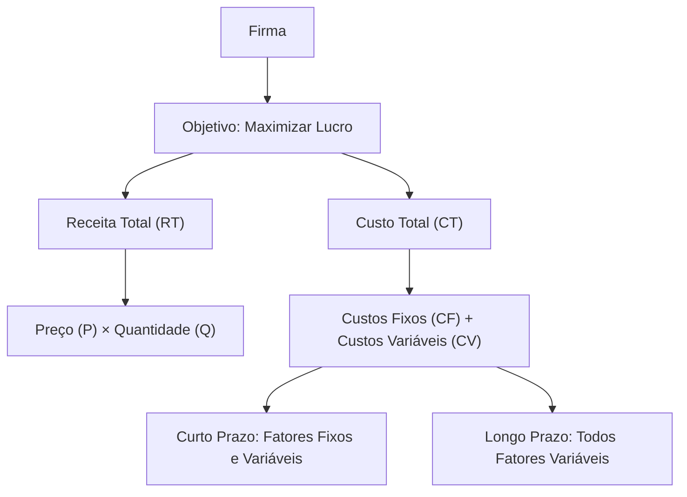


📈 **2. Relações entre tipos de custos**
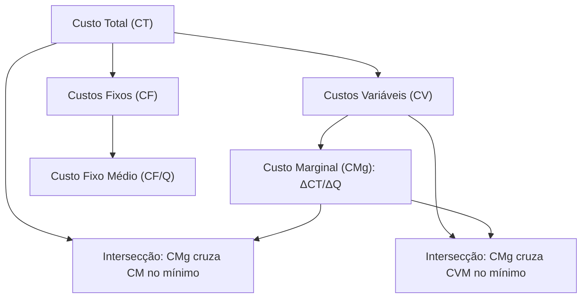


📊 **3. Processo Decisório da Firma no Curto e Longo Prazo**

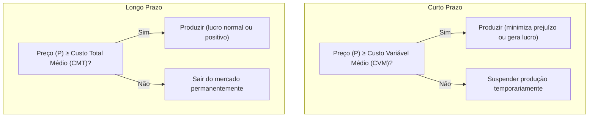


🔄 **4. Decisão de Produção em Diferentes Estruturas de Mercado**

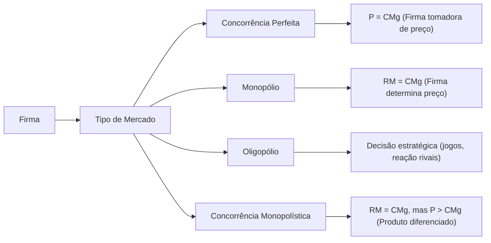


⚖️ **5. Decisão de Produção e Maximização do Lucro**

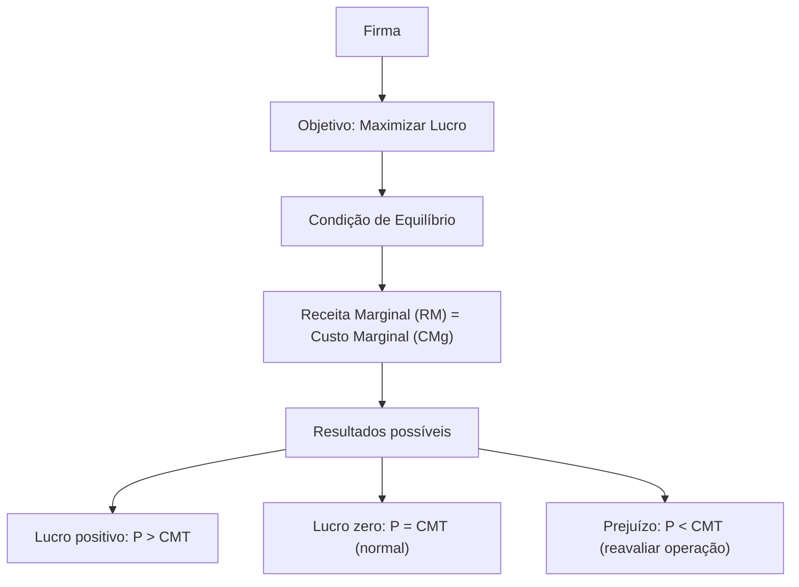


🏭 **1. Estruturas Gerais do Oligopólio**

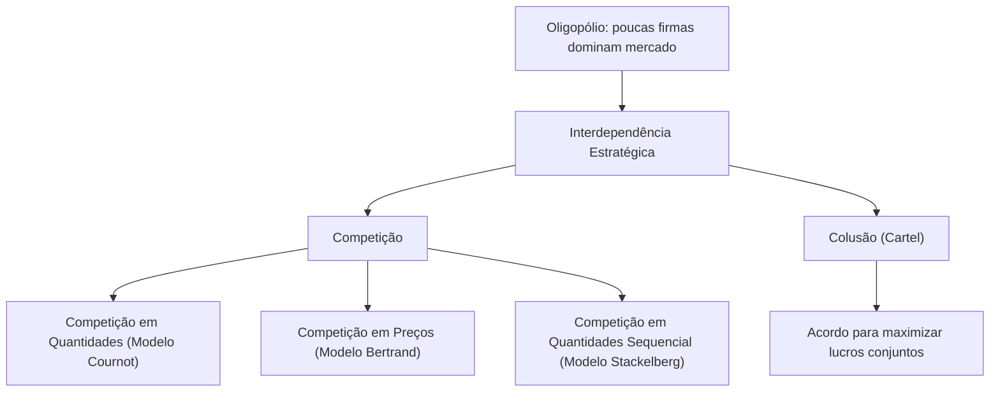


📉 **3. Modelo de Bertrand**

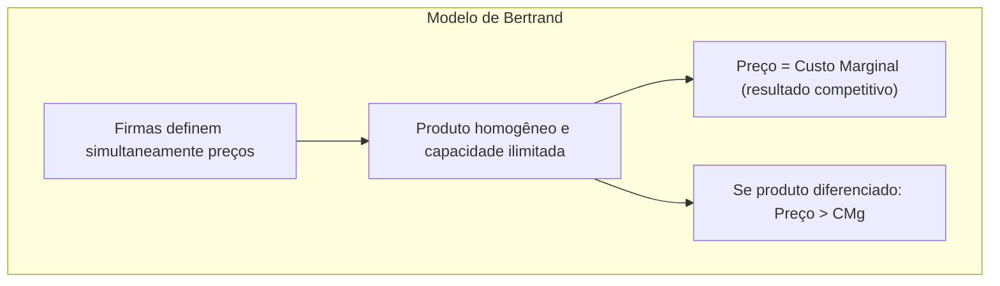

📊 **4. Modelo de Stackelberg**


🔗 **5. Colusão e Cartéis**

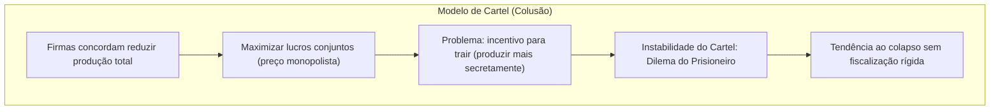


🔄 **6. Comparativo dos Modelos de Oligopólio**
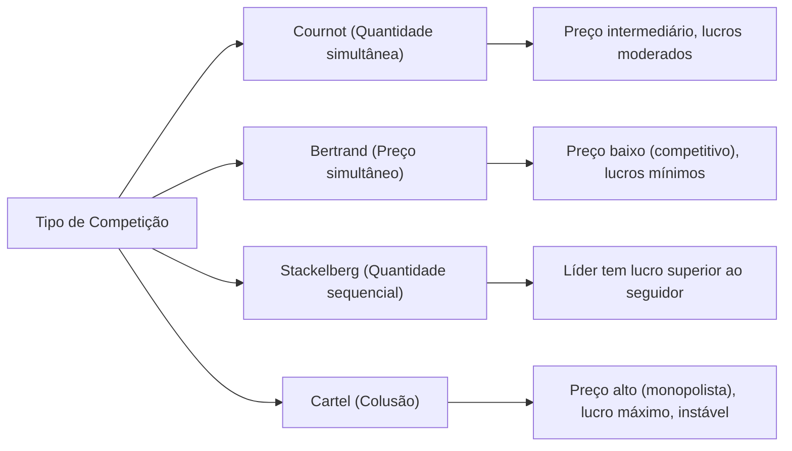

---


## [ECO-1.3] Tipos de Mercados e de bens (Concorrência, Monopólio, Bens Públicos, etc.)

> Origem no vault: `07 - ECONOMIA/01 - Microeconomia/1.3 - Tipos de Mercados e de bens (Concorrência, Monopólio, Bens Públicos, etc.)/_Tipos de Mercados e de bens (Concorrência, Monopólio, Bens Públicos, etc.).md` · 10.3 KB

### Estruturas de Mercado, Tipos de Bens e Falhas de Mercado

#### Introdução

As estruturas de mercado representam diferentes formas de organização econômica que determinam como preços são formados e recursos são alocados. **A compreensão das falhas de mercado é fundamental para justificar intervenções governamentais** e políticas públicas, tema central na formação diplomática. Este material analisa as principais estruturas competitivas, classifica bens econômicos e examina quando mercados falham em produzir resultados eficientes.

> [!info] Relevância para o CACD A análise de estruturas de mercado e falhas é essencial para compreender políticas econômicas nacionais e negociações comerciais internacionais, áreas centrais da atividade diplomática.

#### Estruturas de Mercado e Determinação de Preços

##### Concorrência perfeita

A concorrência perfeita representa o modelo teórico de máxima eficiência econômica. **As empresas são "tomadoras de preço"** porque individualmente não possuem poder para influenciar o preço de mercado, devendo aceitar o preço determinado pela interação entre oferta e demanda agregadas.

**Características fundamentais:**

- **Grande número de compradores e vendedores:** Nenhum agente individual possui participação significativa no mercado
- **Produtos homogêneos:** Bens perfeitamente substitutos, sem diferenciação
- **Informação perfeita:** Todos os agentes conhecem preços, qualidade e condições de mercado
- **Livre entrada e saída:** Ausência de barreiras econômicas, tecnológicas ou regulatórias

**Exemplos brasileiros:**

- Mercados de commodities agrícolas (soja, milho, café)
- Feiras livres de hortifrúti
- Mercado de câmbio

> [!note] Equilíbrio em Concorrência Perfeita **Preço = Custo Marginal** - A empresa maximiza lucro produzindo onde a receita marginal (igual ao preço) iguala o custo marginal.

##### Monopólio

No monopólio, uma única empresa controla completamente a oferta de um produto sem substitutos próximos. **O poder de monopólio permite fixar preços acima do custo marginal**, resultando em perda de bem-estar social (peso morto).

**Características principais:**

- **Único vendedor no mercado**
- **Produto sem substitutos próximos**
- **Barreiras significativas à entrada:** Podem ser econômicas (altos custos de entrada), tecnológicas (patentes), regulatórias (licenças) ou estratégicas

**Exemplos brasileiros:**

- Petrobras (exploração de petróleo em águas profundas)
- B3 (intermediação no mercado de capitais)
- Correios (serviços postais básicos)
- Empresas regionais de saneamento

> [!warning] Ineficiência do Monopólio **Preço > Custo Marginal** - O monopolista restringe produção para maximizar lucros, gerando preços mais altos e quantidades menores que na concorrência perfeita.

##### Oligopólio

O oligopólio caracteriza-se pela **interdependência estratégica entre empresas**. As decisões de preço, quantidade e investimento de uma empresa afetam diretamente os resultados das concorrentes, criando comportamento estratégico complexo.

**Características centrais:**

- **Poucas empresas dominam o mercado**
- **Produtos homogêneos ou diferenciados**
- **Barreiras significativas à entrada**
- **Possibilidade de formação de cartéis** (acordos explícitos ou tácitos sobre preços)

**Exemplos brasileiros:**

- Setor bancário: Itaú, Bradesco, Banco do Brasil, Caixa
- Telecomunicações: Vivo, Claro, TIM
- Aviação civil: GOL, LATAM, Azul
- Cervejeiro: Ambev (dominante), Heineken, Petrópolis

> [!info] Determinação de Equilíbrio em Oligopólio A **complexidade na determinação do equilíbrio** resulta da interdependência estratégica. Empresas devem antecipar reações dos concorrentes, utilizando conceitos da teoria dos jogos.

##### Concorrência monopolística

Estrutura intermediária que combina elementos competitivos com poder monopolístico limitado. Empresas possuem **algum controle sobre preços devido à diferenciação de produtos**.

**Características distintivas:**

- **Muitos vendedores**
- **Produtos diferenciados mas substitutos próximos**
- **Entrada relativamente livre**
- **Poder de mercado limitado**

**Exemplos brasileiros:**

- Restaurantes e lanchonetes
- Salões de beleza
- Postos de gasolina
- Farmácias locais

#### Tipos de Bens e Classificação Econômica

A classificação de bens baseia-se em dois critérios fundamentais que determinam como mercados funcionam e quando falham.

##### Critérios de classificação

**Rivalidade no consumo:** Característica de bens cujo **consumo por uma pessoa reduz ou impede o consumo por outra**. Um sanduíche é rival porque se uma pessoa o consome, outra não pode consumir o mesmo sanduíche.

**Excludabilidade:** **Possibilidade técnica e economicamente viável de impedir que pessoas não-pagantes consumam o bem**. Geralmente operacionalizada através do sistema de preços ou controle físico de acesso.

##### Matriz de classificação de bens

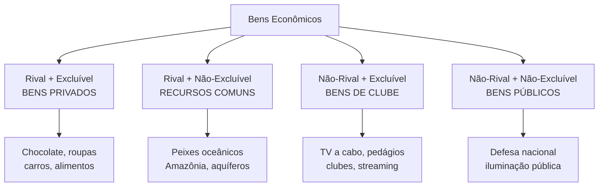

##### Bens privados

**Rival e excluível** - Representam o caso padrão onde mercados funcionam eficientemente. O mecanismo de preços aloca recursos adequadamente porque consumidores pagam pelos benefícios recebidos.

**Exemplos:** Alimentos, roupas, automóveis, eletrônicos

##### Bens públicos puros

**Não-rival e não-excluível** - Geram o **problema do carona (free-rider)**, principal falha de mercado associada. Uma vez provido, todos se beneficiam independentemente de contribuição, incentivando comportamento oportunista.

**Exemplos brasileiros:**

- Defesa nacional
- Segurança pública
- Iluminação pública
- Fogos de artifício do Réveillon de Copacabana

> [!warning] Problema do Carona Indivíduos têm incentivo para **consumir sem pagar**, pois não podem ser excluídos do benefício. Resulta em **subfinanciamento privado** de bens públicos, justificando provisão governamental.

##### Recursos comuns

**Rival mas não-excluível** - Geram a **Tragédia dos Comuns**. Cada usuário tem incentivo individual para usar intensivamente o recurso, mas uso coletivo excessivo pode causar esgotamento.

**Exemplos brasileiros:**

- Pesca oceânica (sobrepesca no litoral)
- Desmatamento da Amazônia
- Aquífero Guarani
- Pastos comunais

> [!danger] Tragédia dos Comuns **Superexploração de recursos** ocorre porque benefícios do uso são apropriados individualmente, mas custos do esgotamento são socializados. Solução requer regulação ou definição de direitos de propriedade.

##### Bens de clube (monopólios naturais)

**Não-rival mas excluível** - Uma vez produzidos, **custo marginal de atender consumidores adicionais é zero ou muito baixo**. Geram ineficiência quando preço é cobrado acima do custo marginal.

**Exemplos brasileiros:**

- TV a cabo e streaming
- Estradas pedagiadas
- Clubes recreativos
- Software

#### Externalidades como Falha de Mercado

**Externalidades são impactos (custos ou benefícios) das ações de um agente sobre o bem-estar de outros que não participam diretamente dessa ação**. Representam divergência entre custos/benefícios privados e sociais.

##### Externalidades negativas

Quando **custo marginal social > custo marginal privado**. O mercado produz quantidade excessiva porque agentes não internalizam todos os custos de sua atividade.

**Exemplos brasileiros:**

- Poluição industrial (caso histórico de Cubatão-SP)
- Desmatamento da Amazônia
- Poluição atmosférica em São Paulo
- Contaminação do Rio Doce (desastre de Mariana)

##### Externalidades positivas

Quando **benefício marginal social > benefício marginal privado**. O mercado produz quantidade insuficiente porque agentes não capturam todos os benefícios sociais.

**Exemplos brasileiros:**

- Educação (benefícios além dos individuais)
- Vacinação (imunidade coletiva)
- Pesquisa e desenvolvimento
- Preservação ambiental

> [!info] Soluções para Externalidades **Taxas pigouvianas** (internalização de custos externos), **subsídios** (para externalidades positivas), **regulamentação direta** ou **definição de direitos de propriedade** (Teorema de Coase).

#### Síntese das falhas de mercado

As três principais falhas analisadas - **problema do carona em bens públicos, tragédia dos comuns em recursos compartilhados, e externalidades em atividades com efeitos externos** - compartilham característica comum: **mercados falham quando direitos de propriedade são mal definidos ou inexistentes**.

Para bens públicos, ninguém pode ser "dono" do benefício; para recursos comuns, propriedade é coletiva e mal regulada; para externalidades, não há mercado para "direitos de poluir" ou "direitos ao ambiente limpo". **Intervenção governamental se justifica para corrigir essas ineficiências**, através de regulação, tributação, subsídios ou provisão direta.

A análise dessas estruturas e falhas é fundamental para diplomatas compreenderem políticas econômicas nacionais e negociações comerciais internacionais, especialmente em áreas como comércio, meio ambiente e regulação de setores estratégicos.

---

#### Questões para Autoavaliação

1. **Compare os mecanismos de determinação de preços na concorrência perfeita versus monopólio. Por que o monopólio gera ineficiência alocativa?**
    
2. **Analise um recurso natural brasileiro (como a Amazônia) usando os conceitos de rivalidade, excludabilidade e tragédia dos comuns. Que soluções de política pública poderiam mitigar os problemas identificados?**
    
3. **Explique por que a vacinação gera externalidades positivas e o problema do carona simultaneamente. Como políticas públicas de saúde podem abordar ambos os aspectos?**

---


## [ECO-2.1] Contabilidade Nacional (Renda, Produto, Agregados)

> Origem no vault: `07 - ECONOMIA/02 - Macroeconomia/2.1 - Contabilidade Nacional (Renda, Produto, Agregados)/_Contabilidade Nacional (Renda, Produto, Agregados).md` · 33.9 KB

### Contabilidade Nacional (Contas Nacionais)

A **Contabilidade Nacional** é o sistema de registro da atividade econômica agregada de um país em um período. Ela quantifica a produção, a distribuição e o uso da renda na economia. No Brasil, as Contas Nacionais são apuradas pelo **IBGE** seguindo padrões internacionais, conforme o _System of National Accounts (SNA)_ da ONU (Organização das Nações Unidas) e diretrizes do FMI. A seguir, apresentamos os conceitos centrais de produto e renda, principais identidades macroeconômicas e exemplos ilustrativos, com formatação adequada para estudo em Obsidian.

#### Conceitos Centrais: Produto e Renda

> [!definition] **Produto Interno Bruto (PIB):** É o **valor de mercado de todos os bens e serviços finais produzidos em um território** (país ou região) **em determinado período**). Ou seja, soma-se o valor da produção **final** (excluindo bens intermediários para evitar dupla contagem) realizada dentro das fronteiras do país em um ano (ou trimestre, etc.). O PIB pode ser medido em valores **nominais** (a preços correntes do próprio período) ou em valores **reais** (ajustados pela inflação a preços constantes de um ano-base). O PIB **nominal** reflete os preços correntes, podendo variar com a inflação, enquanto o PIB **real** é corrigido pela variação de preços, refletindo apenas o crescimento em quantidade (volume). Para converter PIB nominal em PIB real, utiliza-se o **deflator do PIB**, um índice de preços implícito dado por: $_Deflator do PIB = (PIB Nominal / PIB Real) × 100$. Esse deflator mede a variação geral de preços na economia, permitindo distinguir crescimento real de variações puramente monetárias.

**Três óticas de cálculo do PIB:** Apesar de seu cálculo envolver grande volume de dados, conceitualmente o PIB pode ser obtido por três abordagens equivalentes – **Produto**, **Renda** e **Despesa** –, que correspondem a três perspectivas do **mesmo valor agregado total**:

- **Ótica da Produção (ou do Valor Adicionado):** soma o **valor adicionado** em cada setor produtivo. Equivale ao valor bruto da produção menos o consumo intermediário, adicionando **impostos sobre produtos líquidos de subsídios**. Em termos simples: $PIB = Valor Bruto da Produção – Insumos (bens intermediários) + Impostos sobre produtos$. 
	- Essa ótica foca no **lado da oferta**: quanto cada setor/empresa agrega de novo valor.
    
- **Ótica da Renda:** soma todas as **remunerações aos fatores de produção** geradas no processo produtivo. Inclui salários, juros, aluguéis, lucros e tributos ligados à produção. Em resumo: 
	- $PIB = Salários + Lucros + Juros + Aluguéis + Impostos indiretos – Subsídios.$ 
	Essa abordagem evidencia **quem recebe** a renda gerada na economia (trabalhadores, empresários, governo etc.).
    
- **Ótica da Despesa (Demanda Agregada):** soma o **gasto em bens e serviços finais** pelos diferentes agentes. Segue a identidade clássica:
    
    $PIB=C+I+G+(X−M)$,
    
    onde **C** é o consumo das famílias, **I** é o investimento (formação bruta de capital fixo + variação de estoques), **G** são os gastos do governo e **(X – M)** é o saldo líquido de exportações (exportações menos importações). Essa é a visão pelo **lado da demanda**: o PIB é igual à soma do consumo interno privado, investimentos, gastos governamentais e demanda externa líquida. Note que importações entram com sinal negativo porque representam gasto que não gera produção interna.
    

As três óticas resultam, **por construção contábil**, no **mesmo valor de PIB**. Toda produção gera renda equivalente e é destinada a alguém (despesa). Assim, **Produto = Renda = Despesa** para a economia como um todo, garantindo a coerência das contas nacionais. Essa identidade fundamental não implica que todo produto seja consumido imediatamente, mas sim que a produção agregada encontra correspondência em rendas geradas e em despesas efetivas (incluindo investimento e variação de estoques).

> [!note] **PIB Nominal vs. Real:** O **PIB nominal** é medido a preços correntes do período de referência, podendo inflar-se apenas devido à alta de preços. Já o **PIB real** mede o volume produzido em termos de um ano-base, expurgando os efeitos da inflação. Por exemplo, se o PIB nominal cresceu 30% em valor de um ano para outro, mas os preços também subiram cerca de 30%, então o PIB real mostrará **estagnação** (0% de crescimento real) – todo o aumento nominal se deveu à inflação, não a mais produção. Para calcular o PIB real utiliza-se o _deflator do PIB_, que indica a variação média de preços dos bens e serviços do PIB. O deflator é definido como a razão entre PIB nominal e PIB real, multiplicada por 100. Uma variação de, digamos, +10% no deflator do PIB indica que os preços gerais da economia subiram 10% naquele ano (inflação implícita do PIB). Esse indicador é crucial para análises de crescimento econômico em termos **reais**, descontando a inflação.

##### Produto Nacional Bruto (PNB) e Renda Líquida do Exterior (RLEE)

> [!definition] **Produto Nacional Bruto (PNB):** É o **valor de mercado de bens e serviços finais produzidos por fatores de produção pertencentes aos **residentes** do país**, independentemente do local onde ocorre a produção. Difere do PIB (que é territorial) por incluir a produção realizada por nacionais no exterior e excluir a produção doméstica enviada como renda a não residentes. Em fórmula:

> $PNB=PIB+Renda Líquida Enviada ao Exterior (RLEE)$,

> onde a **Renda Líquida Enviada ao Exterior** é a diferença entre a renda enviada a fatores estrangeiros que atuam no país e a renda recebida do exterior por fatores nacionais. Em notação: $RLEE = Renda recebida do exterior – Renda enviada ao exterior$.

> Uma RLEE **negativa** indica que o país enviou mais renda a fatores externos (lucros de multinacionais, juros/remessas para investidores estrangeiros, pagamento a trabalhadores estrangeiros, etc.) do que recebeu; nesse caso o **PNB fica menor que o PIB**. Já uma RLEE positiva significa que entram mais rendimentos do que saem, fazendo o **PNB exceder o PIB**. Em economias avançadas, costuma-se observar $PNB ≥ PIB$ (pois geralmente possuem muitos investimentos no exterior gerando ingressos), enquanto economias receptoras de capital externo frequentemente têm $PIB > PNB$ devido à remessa de lucros e dividendos a estrangeiros.

> [!definition] **Produto Nacional Líquido (PNL):** Corresponde ao **produto nacional disponível após repor a depreciação do capital**. Calcula-se subtraindo do PNB o **Consumo de Capital Fixo** (depreciação do estoque de capital fixo). Assim,

> $PNL=PNB−Depreciacão$ .

> O PNL dá uma ideia do **produto efetivamente novo** gerado pelos residentes, descontando o desgaste de máquinas, equipamentos e estruturas durante o período. É menos divulgado que o PIB, mas conceitualmente importante para medir **crescimento sustentável** (pois uma parte do PIB bruto serve apenas para manter o capital existente).

> [!definition] **Renda Nacional (RN):** É a **soma de todas as remunerações recebidas pelos fatores de produção de propriedade de residentes** do país. Em outras palavras, corresponde à renda total **a custo de fatores** recebida pelos residentes. A RN está intimamente ligada ao PNL: partindo do PNL (que ainda está a preços de mercado), deve-se ajustar pelos **impostos indiretos e subsídios** para chegar à renda efetivamente recebida pelos fatores. Em fórmula:

> $Renda Nacional=PNL−Impostos Indiretos+Subsídios$ .


> Esse ajuste retira da produção líquida o que não vai para os fatores (impostos indiretos) e adiciona pagamentos do governo que aumentam a renda disponível dos produtores (subsídios). O resultado é equivalente à soma de salários, juros, aluguéis e lucros recebidos por trabalhadores, proprietários de capital e governo (na forma de impostos diretos) nacionais, pelo desempenho de suas atividades produtivas. **RN** é portanto próxima do conceito de **PIB a custo de fatores**, ajustada para incluir também o saldo de rendas com o exterior (torna-se nacional) e excluída a depreciação (torna-se líquida).

> [!definition] **Renda Pessoal (RP) e Renda Pessoal Disponível (RPD):** A **Renda Pessoal** representa a parcela da renda nacional que **efetivamente chega às famílias e empresas não financeiras** para uso próprio. Parte da RN é retida por empresas ou governo antes de chegar às pessoas. De forma simplificada, pode-se calcular:

>$Renda Pessoal=Renda Nacional−Lucros retidos das empresas−Impostos indiretos empresariais−Outras receitas correntes do governo+Transferências recebidas$.

> Ou seja, subtrai-se da RN os lucros não distribuídos (que ficam nas próprias empresas), os impostos indiretos pagos pelas empresas e eventuais outras rendas que foram para o governo, e adicionam-se as **transferências** governamentais e de outras fontes para as pessoas (por exemplo, benefícios previdenciários, assistenciais, subsídios às famílias ou instituições privadas). **Renda Pessoal Disponível**, por sua vez, é a porção da renda pessoal que resta **após o pagamento dos impostos diretos** (como IRPF e contribuições sociais) e acrescentando as transferências governamentais ou outras recebidas pelas famílias. Em suma:

> $Renda Pessoal Disponível=Renda Pessoal−Impostos diretos+Transferências recebidas$ .

> A Renda Pessoal Disponível indica **quanto as famílias têm para consumir ou poupar** em um dado período. É um indicador importante para análise de consumo das famílias e capacidade de poupança do setor privado. Por exemplo, quando se fala em _renda disponível per capita_, refere-se a essa medida dividida pela população, dando ideia do potencial de consumo médio por pessoa.

> [!example] **Exemplos Práticos:** No caso do **Brasil**, normalmente o PNB é **ligeiramente menor** que o PIB, pois o país apresenta **Renda Líquida enviada ao exterior negativa** – envia-se mais rendas a fatores estrangeiros (lucros de multinacionais, juros a investidores externos, etc.) do que se recebe do exterior. Em **2019**, por exemplo, o PIB brasileiro foi cerca de R$ 7,26 trilhões enquanto o PNB ficou em torno de R$ 7,15 trilhões, refletindo essa saída líquida de recursos ao exterior. Por outro lado, **países desenvolvidos** muitas vezes têm **PNB maior** que o PIB, já que recebem mais rendas do exterior do que enviam. Economias com forte presença de multinacionais estrangeiras, como a **Irlanda**, apresentam **PIB muito superior ao PNB** – na Irlanda, o PIB chega a ser ~20% maior que o PNB –, devido ao volume de lucros remetidos por empresas estrangeiras operando no país. Já em países que dependem de **remessas de trabalhadores emigrantes**, verifica-se o oposto: o PNB supera o PIB. No **Nepal**, por exemplo, as remessas de trabalhadores no exterior atingiram **26,6% do PIB** em 2023, indicando que uma parcela significativa da renda nacional é auferida fora do território – o que eleva o PNB bem acima do PIB doméstico. Esses casos ilustram a diferença conceitual entre produto **interno** (produção no território) e produto **nacional** (produção pelos nacionais), evidenciando como fluxos internacionais de renda podem alterar a medida de riqueza de um país.

#### Identidades Macroeconômicas Fundamentais

A contabilidade nacional obedece a identidades (igualdades contábeis) que sempre se verificam ex-post, relacionando os agregados definidos acima. Duas das identidades fundamentais em macroeconomia são:

- **Identidade da Despesa (Ótica do Gasto):** Esta é a própria fórmula do PIB pela ótica da despesa agregada:
    
    $Y=C+I+G+(X−M)$,
    
    onde $Y$ representa o PIB (renda agregada). Essa identidade simplesmente **define** que o valor total da produção $Y$ é igual à soma do consumo privado (**C**), investimento doméstico (**I**), gastos do governo (**G**) e exportações líquidas (**X – M**). Ela sempre se verifica por construção das Contas Nacionais, assegurando que toda a produção encontre um destino (demanda interna ou externa, incluindo variação de estoques). Se rearranjarmos essa identidade, isolando $Y−C−G$ no primeiro membro, obtemos outra visão: $Y−C−G=I+(X−M)$. Note que $Y−C−G$ é justamente a **poupança nacional** (renda total menos consumo privado menos consumo público), mostrando que **a poupança total de uma economia é igual à soma do investimento interno com o saldo em conta-corrente externo ($X – M$)**.
    
- **Identidade Poupaça–Investimento (economia aberta):** Numa **economia fechada** (sem setor externo), a **poupança nacional (S)** sempre iguala o investimento interno (I), ou seja, _S = I_. Numa **economia aberta**, parte da poupança pode financiar gastos de outros países (quando há superávit externo) ou parte do investimento pode ser financiada por poupança externa (déficit externo). Assim, a identidade amplia-se para:
    
    $S=I+(X−M)$.
    
    Aqui, $S−I=X−M$ expressa que o **excedente de poupança doméstica** é enviado ao exterior na forma de exportações líquidas (país credor), enquanto um $X−M$ negativo indica **necessidade de poupança externa** (entrada de capital estrangeiro para cobrir $I>SI>S$). Incluindo o **governo** nessa análise, podemos decompor SS em **poupança privada** e **poupança pública**. Seja $Sp$ a poupança do setor privado e $Sg$ a poupança do governo (que é _T – G_, a diferença entre tributos e gastos públicos), e decompomos também II em privado e público. A identidade completa passa a ser:
    
    $Sp−Ip+Sg−Ig=X−M$,
    
    que equivale, após rearranjos, a
    
    $Sp=Ip+(G−T)+(X−M)$.
    
    Isso significa que a **poupança do setor privado** financia três usos possíveis: (1) o **investimento privado doméstico** $Ip$; (2) o **déficit do governo** $(G−T)$ caso os gastos públicos excedam a arrecadação (absorvendo poupança, ou se for superávit provendo poupança); e (3) o **empréstimo líquido ao exterior** $(X−M)$ se a economia tiver superávit externo (ou recebe financiamento externo se $X−M$ for negativo). Em outras palavras, quando o governo gasta mais do que arrecada, ele absorve parte da poupança disponível; quando o país importa mais do que exporta, ele utiliza poupança externa para fechar a conta. Essa identidade salienta o **trade-off** na utilização da poupança nacional: financiar investimento interno, financiar gastos do governo ou financiar outros países (via superávit externo). Por exemplo, um déficit público maior (G−T(G−T elevado) geralmente precisa ser compensado por menor investimento privado ou maior entrada de recursos externos, mantendo a igualdade $S = I + (G - T) + (X - M)$.
    

#### Perguntas de Autoavaliação

> [!question] **1.** Quais são as **três óticas de cálculo do PIB**? Explique brevemente cada uma e por que, em termos de Contas Nacionais, elas resultam no mesmo valor de PIB.

> [!question] **2.** Qual a **diferença entre PIB e PNB**? Em que situações (ou tipos de países) o PNB tende a ser **maior** que o PIB, e quando ocorre o contrário?

> [!question] **3.** O que é o **deflator do PIB** e **como ele é calculado**? Explique seu uso na distinção entre PIB nominal e PIB real.

### Sistema de Contas Nacionais: Conceitos Fundamentais e Estrutura

#### Conceitos Fundamentais

#### Definição e Objetivos do Sistema de Contas Nacionais

O Sistema de Contas Nacionais (SCN) constitui um conjunto padronizado de recomendações internacionalmente acordadas sobre como compilar as medidas de atividade econômica, de acordo com rígidas convenções contábeis baseadas em princípios econômicos. O SCN apresenta informações sobre a geração, distribuição e uso da renda no país, incluindo dados sobre a acumulação de ativos não financeiros, patrimônio financeiro e sobre as relações entre a economia nacional e o resto do mundo.

O objetivo fundamental do Sistema de Contas Nacionais é fornecer um quadro contábil que permite que os dados econômicos sejam compilados e apresentados em formato projetado para fins de análise econômica, tomada de decisões e formulação de políticas. As contas fornecem um registro completo e detalhado de atividades econômicas complexas que ocorrem em uma economia, e da interação entre os diferentes agentes econômicos.

A contabilidade social tem como objetivo apresentar uma visão da economia de um país ou região em termos quantitativos, constituindo um excelente instrumento de sistematização das estatísticas econômicas e de orientação na formulação da política econômica. O esquema contábil do SCN tem sua lógica centrada na ideia de reproduzir os fenômenos essenciais da vida econômica de um país: produção de bens e serviços; geração, alocação e distribuição da renda; consumo e acumulação.

#### Metodologia Internacional do SNA (System of National Accounts)

O Sistema de Contas Nacionais da ONU consiste em um padrão internacional de recomendações para a compilação de medidas de atividade econômica. O SNA é o conjunto padronizado de recomendações internacionalmente acordadas sobre como compilar medidas de atividade econômica, definindo conceitos, classificações e regras contábeis que compõem o padrão internacionalmente definido.

As recomendações são expressas em termos de um conjunto de conceitos, definições, classificações e regras contábeis que compõem o padrão internacionalmente definido para medir itens como o Produto Interno Bruto (PIB), o indicador mais frequentemente citado de desempenho econômico. A estrutura do SCN oferece contas que são abrangentes, consistentes e integradas.

O manual SNA 2008 foi desenvolvido sob responsabilidade conjunta de organismos internacionais, incluindo a Comissão das Comunidades Europeias, Fundo Monetário Internacional, Organização para a Cooperação Econômica e o Desenvolvimento, Nações Unidas e Banco Mundial. A compilação de um SCN é orientada por um conjunto de normas contábeis, princípios econômicos e convenções, definidas através de discussões em fóruns internacionais.

#### Evolução Histórica do SCN Brasileiro

As origens dos sistemas de contas nacionais remontam a um informe de 1947 do Subcomitê de Estatísticas da Renda Nacional, do Comitê de Especialistas em Estatística da Liga das Nações, liderado por Richard Stone. Em 1953, a Organização das Nações Unidas publicou o primeiro manual com recomendações para a compilação de sistemas de contas nacionais.

No Brasil, o Sistema de Contas Nacionais foi criado em 1952, seguindo diretrizes da Organização das Nações Unidas. A Fundação Getúlio Vargas implementou a contabilidade nacional desde 1948, calculando o PIB de 1947 a 1989 através do Sistema de Contas Nacionais Consolidadas. Tratava-se de um sistema simplificado, com um conjunto de contas mais agregado, que sofria revisões a cada Censo Econômico.

A Fundação Getúlio Vargas e o Instituto Brasileiro de Geografia e Estatística disputaram a primazia do cálculo e divulgação dos dados por mais de quatro décadas. O processo de instauração, consolidação e emprego de metodologias esteve longe de uma estabilidade que permitisse dados consistentes à interpretação da economia brasileira.

A maior mudança na metodologia de construção das Contas Nacionais do Brasil ocorreu em 1997, quando o IBGE adotou a 3ª Versão do Manual de Contas Nacionais da ONU, realizando uma alteração profunda no Sistema. Esta mudança não afetou apenas a base de dados, mas a própria estrutura do sistema, que foi ampliada, estabelecendo o Sistema de Contas Nacionais do Brasil na forma como vigora atualmente.

#### Papel do IBGE na Compilação das Contas Nacionais

O IBGE assumiu o cálculo das contas nacionais em dezembro de 1986, função desempenhada pela Fundação Getúlio Vargas desde 1947. O Instituto adotou essa estrutura desde dezembro de 1997, quando publicou a primeira revisão do SCN com a introdução das recomendações internacionais de 1993.

O IBGE tem como responsabilidade a produção do Sistema de Contas Nacionais do país através da Coordenação de Contas Nacionais da Diretoria de Pesquisas. Os trabalhos de cálculo de um sistema de contas nacionais no IBGE estão divididos em duas grandes áreas: a estimação de uma TRU a preços correntes e constantes do ano anterior e a estimação da CEI.

Anualmente, as TRU são calculadas a preços correntes e a preços constantes do ano anterior e a CEI a preços correntes. O processo final de síntese do SCN é realizado com o confronto dos resultados obtidos na compilação das TRU e da CEI buscando identificar e ajustar as incoerências.

#### Estrutura do SCN

#### Tabelas de Recursos e Usos (TRU)

As Tabelas de Recursos e Usos constituem um dos dois núcleos básicos do Sistema de Contas Nacionais, sendo construídas a partir de um corte na economia considerando atividades econômicas e produtos. As TRU são constituídas pelas tabelas de recursos de bens e serviços, composta por três quadrantes, e de usos de bens e serviços, subdividida em quatro quadrantes.

O principal objetivo das tabelas de recursos e usos é a análise dos fluxos de bens e serviços e dos aspectos básicos do processo de produção - estrutura de insumos e estrutura de produção de produtos por atividade – e a geração da renda. As TRU representam as operações de produção, importação e usos (intermediário e final) realizadas pelas atividades econômicas - fluxos.

A tabela de recursos de bens e serviços discrimina a origem dos produtos em nacional e importado, apresentando o valor da oferta (produção mais importação) a preços de consumidor e a preços básicos. A tabela de usos de bens e serviços apresenta o equilíbrio entre oferta e demanda a preços de consumidor, assim como o consumo intermediário das atividades econômicas detalhado por produto.

As TRU mostram as relações de produção entre as atividades e a renda gerada no processo produtivo, apresentando como saldo o valor adicionado bruto a preços básicos por atividade econômica e, consequentemente, o Produto Interno Bruto do país. Nas linhas da TRU, veem-se os produtos; nas colunas, as atividades econômicas.

#### Contas Econômicas Integradas (CEI)

As Contas Econômicas Integradas constituem o núcleo central de um SCN, pois é por setor institucional que se pode explicitar todo o processo de geração, distribuição e acumulação da renda - fluxos e estoques. A visão de conjunto da economia é fornecida pelas CEI onde, numa única tabela, são dispostas, em colunas, as contas dos setores institucionais, do resto do mundo e de bens e serviços.

As CEI reúnem distintos dados do Sistema de Contas Nacionais com objetivo de unificar essas informações por setores institucionais (por exemplo, Famílias, Governo, Empresas), colocando todas essas informações econômicas num mesmo lugar. As CEI descrevem, para cada setor institucional da economia, os fenômenos de produção, consumo, acumulação e patrimônio e suas inter-relações no período considerado.

A CEI é publicada em três grandes conjuntos de contas: contas correntes, contas de acumulação e contas de patrimônio. As contas correntes são compostas pela conta de produção, que mede o PIB, e pelas contas de renda, que medem a renda nacional, a renda nacional disponível e poupança.

#### Setores Institucionais

O Sistema de Contas Nacionais foi desenvolvido para representar a economia de uma determinada região de maneira simples e organizada, estabelecendo classificações específicas que permitem ordenar as operações econômicas. A classificação por setor institucional é um enfoque para apresentar o processo de produção onde as unidades são definidas de acordo com seu comportamento, função e objetivos econômicos.

As unidades institucionais são unidades econômicas que têm capacidade, por direito próprio, de possuir ativos, contrair passivos e realizar atividades econômicas e transações com outras unidades. Dentre suas características estão a autonomia de decisão e a posse de unidade patrimonial.

São definidos cinco setores institucionais mutuamente exclusivos: empresas não financeiras, empresas financeiras, governo geral, instituições sem fins de lucro a serviço das famílias e famílias. À classificação dos setores institucionais se agrega um conjunto de contas, denominadas resto do mundo, que descrevem os fluxos entre unidades institucionais residentes e não residentes.

O setor institucional governo geral é constituído por unidades que têm como função principal produzir serviços não mercantis destinados à coletividade e/ou efetuar operações de repartição de renda e de patrimônio. As empresas não financeiras são aquelas cuja principal atividade é a produção de bens e serviços não financeiros de mercado. As empresas financeiras são todas as unidades institucionais residentes que se dedicam principalmente a prestar serviços financeiros.

#### Unidades e Atividades Econômicas

A classificação por atividade econômica estrutura as Tabelas de Recursos e Usos, sendo chamada "classificação funcional" porque representa o processo de produção e os fluxos de bens e serviços produzidos na economia. Nesta classificação, as unidades são definidas de acordo com seu perfil tecnológico, estritamente unidades produtivas.

Para a produção das TRUs é necessário a construção das relações técnico-econômicas do processo produtivo, onde o objeto de investigação é a unidade de produção. O agrupamento dessas unidades de produção (empresas ou unidades locais), classificadas pela homogeneidade no processo produtivo, define as atividades econômicas.

As atividades representam o conjunto de agentes do processo de produção que agregam unidades produtivas com estruturas relativamente homogêneas de consumo e produção. As unidades produtivas podem ser uma empresa ou unidade local onde, por definição, se realiza uma única atividade.

Os produtos representam o conjunto de bens e serviços, sendo a classificação de bens e serviços em grupos de produtos derivada diretamente da classificação de atividades. Esta classificação procura manter a homogeneidade de cada grupamento no que diz respeito à origem (atividade produtora e procedência, nacional ou importada) e ao destino (tipo de consumidor e/ou usos específicos).
#### Referências

[15](https://repositorio.ipea.gov.br/bitstream/11058/13345/5/PPE_v53_n1_Artigo4_estimacao_de_matrizes.pdf) Repositório IPEA. Estimação de matrizes insumo-produto anuais para o Brasil no sistema de contas nacionais: referência 2010. Disponível em: [https://repositorio.ipea.gov.br/bitstream/11058/13345/5/PPE_v53_n1_Artigo4_estimacao_de_matrizes.pdf](https://repositorio.ipea.gov.br/bitstream/11058/13345/5/PPE_v53_n1_Artigo4_estimacao_de_matrizes.pdf)

[7](https://www.periodicos.unimontes.br/index.php/economiaepoliticaspublicas/article/view/4939) Revista Economia e Políticas Públicas. Para uma história das contas nacionais no Brasil: origens. Disponível em: [https://www.periodicos.unimontes.br/index.php/economiaepoliticaspublicas/article/view/4939](https://www.periodicos.unimontes.br/index.php/economiaepoliticaspublicas/article/view/4939)

[16](https://www.periodicos.unimontes.br/index.php/economiaepoliticaspublicas/article/view/7764) Revista Economia e Políticas Públicas. A implantação das contas nacionais no Brasil: Uma réplica ao artigo "Para uma história das contas nacionais no Brasil". Disponível em: [https://www.periodicos.unimontes.br/index.php/economiaepoliticaspublicas/article/view/7764](https://www.periodicos.unimontes.br/index.php/economiaepoliticaspublicas/article/view/7764)

[17](http://periodicos.uff.br/revistaeconomica/article/view/34998/20252) Revista Econômica UFF. O Sistema de Contas Nacionais: evolução histórica e implantação no Brasil. Disponível em: [http://periodicos.uff.br/revistaeconomica/article/view/34998/20252](http://periodicos.uff.br/revistaeconomica/article/view/34998/20252)

[2](https://www.ibge.gov.br/estatisticas/economicas/servicos/9052-sistema-de-contas-nacionais-brasil.html) IBGE. SCN - Sistema de Contas Nacionais. Disponível em: [https://www.ibge.gov.br/estatisticas/economicas/servicos/9052-sistema-de-contas-nacionais-brasil.html](https://www.ibge.gov.br/estatisticas/economicas/servicos/9052-sistema-de-contas-nacionais-brasil.html)

[18](https://en.wikipedia.org/wiki/System_of_National_Accounts) Wikipedia. System of National Accounts. Disponível em: [https://en.wikipedia.org/wiki/System_of_National_Accounts](https://en.wikipedia.org/wiki/System_of_National_Accounts)

[6](https://ftp.ibge.gov.br/Contas_Nacionais/Contas_Nacionais_Trimestrais/Metodologia_da_Pesquisa/Series_Relatorios_Metodologicos_2a_edicao.pdf) IBGE. Metodologia da Pesquisa - Contas Nacionais Trimestrais. Disponível em: [https://ftp.ibge.gov.br/Contas_Nacionais/Contas_Nacionais_Trimestrais/Metodologia_da_Pesquisa/Series_Relatorios_Metodologicos_2a_edicao.pdf](https://ftp.ibge.gov.br/Contas_Nacionais/Contas_Nacionais_Trimestrais/Metodologia_da_Pesquisa/Series_Relatorios_Metodologicos_2a_edicao.pdf)

[3](https://periodicos.fgv.br/rbe/article/viewFile/1824/2679) FGV. O Sistema de Contas Nacionais. Disponível em: [https://periodicos.fgv.br/rbe/article/viewFile/1824/2679](https://periodicos.fgv.br/rbe/article/viewFile/1824/2679)

[5](https://unstats.un.org/unsd/nationalaccount/sna.asp) UN Statistics Division. The System of National Accounts (SNA). Disponível em: [https://unstats.un.org/unsd/nationalaccount/sna.asp](https://unstats.un.org/unsd/nationalaccount/sna.asp)

[1](https://ftp.ibge.gov.br/Contas_Nacionais/Sistema_de_Contas_Nacionais/Notas_Metodologicas_2010/02_estrutura_scn.pdf) IBGE. Estrutura do Sistema de Contas Nacionais. Disponível em: [https://ftp.ibge.gov.br/Contas_Nacionais/Sistema_de_Contas_Nacionais/Notas_Metodologicas_2010/02_estrutura_scn.pdf](https://ftp.ibge.gov.br/Contas_Nacionais/Sistema_de_Contas_Nacionais/Notas_Metodologicas_2010/02_estrutura_scn.pdf)

[12](https://lacam.unifesspa.edu.br/ultimasnoticias/145-contas-econ%C3%B4micas-integradas-%C3%A9-uma-frente-de-pesquisa-do-lacam.html) UNIFESSPA. Contas Econômicas Integradas é uma frente de pesquisa do LACAM. Disponível em: [https://lacam.unifesspa.edu.br/ultimasnoticias/145-contas-econ%C3%B4micas-integradas-%C3%A9-uma-frente-de-pesquisa-do-lacam.html](https://lacam.unifesspa.edu.br/ultimasnoticias/145-contas-econ%C3%B4micas-integradas-%C3%A9-uma-frente-de-pesquisa-do-lacam.html)

[14](https://ftp.ibge.gov.br/Contas_Nacionais/Sistema_de_Contas_Nacionais/Notas_Metodologicas_2010/04_setores_institucionais.pdf) IBGE. Setores Institucionais. Disponível em: [https://ftp.ibge.gov.br/Contas_Nacionais/Sistema_de_Contas_Nacionais/Notas_Metodologicas_2010/04_setores_institucionais.pdf](https://ftp.ibge.gov.br/Contas_Nacionais/Sistema_de_Contas_Nacionais/Notas_Metodologicas_2010/04_setores_institucionais.pdf)

[11](https://fjp.mg.gov.br/wp-content/uploads/2020/07/5.8_Estat%C3%ADstica-Informa%C3%A7%C3%B5es-28.pdf) FJP. Tabela de Recursos e Usos e Matriz Insumo-Produto de Minas Gerais. Disponível em: [https://fjp.mg.gov.br/wp-content/uploads/2020/07/5.8_Estat%C3%ADstica-Informa%C3%A7%C3%B5es-28.pdf](https://fjp.mg.gov.br/wp-content/uploads/2020/07/5.8_Estat%C3%ADstica-Informa%C3%A7%C3%B5es-28.pdf)

[13](https://www.qconcursos.com/questoes-de-concursos/questoes/a1dcee8e0f6) QConcursos. As contas econômicas integradas (CEI) descrevem, para cada setor institucional. Disponível em: [https://www.qconcursos.com/questoes-de-concursos/questoes/a1dcee8e0f6](https://www.qconcursos.com/questoes-de-concursos/questoes/a1dcee8e0f6)

[4](https://pt.wikipedia.org/wiki/Contabilidade_social) Wikipedia. Contabilidade social. Disponível em: [https://pt.wikipedia.org/wiki/Contabilidade_social](https://pt.wikipedia.org/wiki/Contabilidade_social)

[8](https://agenciadenoticias.ibge.gov.br/agencia-sala-de-imprensa/2013-agencia-de-noticias/releases/13265-asi-maior-mudanca-na-metodologia-de-construcao-das-contas-nacionais-do-brasil-ocorreu-em-1997) IBGE. Maior mudança na metodologia de construção das Contas Nacionais do Brasil ocorreu em 1997. Disponível em: [https://agenciadenoticias.ibge.gov.br/agencia-sala-de-imprensa/2013-agencia-de-noticias/releases/13265-asi-maior-mudanca-na-metodologia-de-construcao-das-contas-nacionais-do-brasil-ocorreu-em-1997](https://agenciadenoticias.ibge.gov.br/agencia-sala-de-imprensa/2013-agencia-de-noticias/releases/13265-asi-maior-mudanca-na-metodologia-de-construcao-das-contas-nacionais-do-brasil-ocorreu-em-1997)

[9](https://www.ipea.gov.br/acaosocial/article926d.html?id_article=388) IPEA. Terceiro Setor - Pesquisa Ação Social das Empresas. Disponível em: [https://www.ipea.gov.br/acaosocial/article926d.html?id_article=388](https://www.ipea.gov.br/acaosocial/article926d.html?id_article=388)

[10](https://memoria.ibge.gov.br/images/memoria/linha-do-tempo/LinhaDoTempoSemImagem.pdf) IBGE. Linha do tempo - síntese da História do IBGE (1936-2016). Disponível em: [https://memoria.ibge.gov.br/images/memoria/linha-do-tempo/LinhaDoTempoSemImagem.pdf](https://memoria.ibge.gov.br/images/memoria/linha-do-tempo/LinhaDoTempoSemImagem.pdf)


#### Fontes Consultadas

- **IBGE** – _Sistema de Contas Nacionais – Brasil_ (metodologia e dados agregados) – **ibge.gov.br/estatisticas/economicas/contas-nacionais.html**[ibge.gov.br](https://www.ibge.gov.br/estatisticas/economicas/servicos/9052-sistema-de-contas-nacionais-brasil.html#:~:text=ressaltar%2C%20s%C3%A3o%20apresentadas%20segundo%20uma%C2%A0classifica%C3%A7%C3%A3o,pr%C3%A1ticas%2C%C2%A0conforme%20preconizam%20as%20recomenda%C3%A7%C3%B5es%20internacionais)
    
- **ONU (SNA 2008)** – _System of National Accounts 2008_ (manual internacional de Contas Nacionais) – **unstats.un.org/unsd/nationalaccount/docs/sna2008.pdf**
    
- **FMI (World Economic Outlook)** – Publicação com dados macroeconômicos e definições padronizadas – **imf.org/en/Publications/WEO**

---


## [ECO-2.1.2] Teorias clássica e keynesiana de determinação da renda

> Origem no vault: `07 - ECONOMIA/02 - Macroeconomia/2.1 - Contabilidade Nacional (Renda, Produto, Agregados)/2.1.2 Teorias clássica e keynesiana de determinação da renda..md` · 26.7 KB

### A Determinação da Renda Nacional: O Debate entre as Teorias Clássica e Keynesiana

#### Introdução: Duas Visões de Mundo em Conflito

O debate sobre a determinação da renda e do produto nacional constitui a espinha dorsal da macroeconomia moderna. Longe de ser uma mera disputa técnica, a controvérsia entre as escolas de pensamento clássica e keynesiana representa um profundo conflito de visões de mundo sobre a natureza fundamental das economias capitalistas. De um lado, a visão clássica, que dominou o pensamento econômico até a década de 1930, retrata um sistema harmonioso, autorregulável, que tende naturalmente ao equilíbrio de pleno emprego, guiado pela "mão invisível" do mercado.1 De outro, a revolução iniciada por John Maynard Keynes apresenta uma economia inerentemente instável, sujeita a falhas de coordenação e capaz de permanecer em equilíbrios com desemprego massivo e persistente.2

 As premissas e conclusões de cada escola não apenas informam modelos teóricos, mas fundamentam as políticas econômicas adotadas por nações e organismos internacionais para lidar com recessões, desemprego, inflação e crises financeiras. O debate clássico-keynesiano é, portanto, a chave para analisar criticamente as respostas a eventos como a Grande Depressão, a crise financeira de 2008 e a pandemia de COVID-19, temas recorrentes e de alta relevância para a política externa e a governança econômica global.4 Esta nota de estudo oferece uma análise aprofundada e comparativa dessas duas escolas, focando nos seus pilares teóricos e implicações práticas.

#### Seção 1: A Visão Clássica: A Oferta Cria sua Própria Demanda

##### 1.1. Contexto e Pressupostos: O Mundo Harmonioso do _Laissez-Faire_

A teoria macroeconômica clássica floresceu em um período, anterior à Grande Depressão de 1929, de grande otimismo quanto à capacidade dos mercados de se autorregularem.1 Sua estrutura lógica repousa sobre um conjunto de pressupostos que, em conjunto, pintam o quadro de uma economia eficiente e estável, na qual a intervenção governamental é, na melhor das hipóteses, desnecessária e, na pior, prejudicial.

O pressuposto mais fundamental é a **plena flexibilidade de preços e salários**.8 Para os clássicos, todos os mercados, incluindo o mercado de trabalho, se ajustam rapidamente a qualquer desequilíbrio através de mudanças nos preços relativos. Se, por exemplo, houvesse um excesso de oferta de mão de obra (desemprego), o preço do trabalho — o salário real (

W/P) — cairia. Essa queda tornaria a contratação mais atraente para as empresas e, ao mesmo tempo, desincentivaria alguns trabalhadores a oferecerem seus serviços, levando o mercado de trabalho de volta ao equilíbrio.8

Essa crença na flexibilidade dos preços leva diretamente à conclusão de que a economia tende automaticamente ao **pleno emprego** dos seus fatores de produção. Qualquer desemprego que pudesse existir seria de natureza temporária e autolimitada. Os clássicos admitiam a existência de desemprego **friccional** (trabalhadores em transição entre empregos) ou **voluntário** (indivíduos que se recusam a trabalhar pelo salário de equilíbrio do mercado), mas rejeitavam categoricamente a possibilidade de desemprego **involuntário** persistente.8 A lógica é inescapável: se os mercados são livres e os preços flexíveis, não pode haver um excesso de oferta duradouro de qualquer bem, inclusive do trabalho. A persistência do desemprego, nesse arcabouço, só poderia ser explicada por "imperfeições" ou "rigidezes" impostas externamente ao mercado, como a atuação de sindicatos ou a fixação de salários mínimos pelo governo. A implicação política é direta e poderosa: a melhor política é a de _laissez-faire_, ou seja, a não intervenção estatal, para permitir que o mecanismo de preços funcione sem entraves.12

##### 1.2. O Pilar Central – A Lei de Say: "A Oferta Cria sua Própria Demanda"

O pilar que sustenta toda a estrutura clássica é a chamada Lei de Say, formulada pelo economista francês Jean-Baptiste Say. Frequentemente resumida na máxima "a oferta cria sua própria demanda" 14, essa lei é muito mais do que um simples slogan; é uma teoria sobre a lógica da produção e do consumo em uma economia de mercado.

A análise detalhada da Lei de Say revela que o ato de produzir bens e serviços (a oferta) gera, simultaneamente, uma renda na forma de salários, lucros, juros e aluguéis, cujo valor é exatamente igual ao valor da produção.16 Essa renda é então utilizada pelos seus detentores para adquirir a produção gerada (a demanda). Dessa forma, a produção financia o seu próprio consumo, tornando logicamente impossível uma crise geral de superprodução ou uma insuficiência de demanda agregada.14 Say admitia a possibilidade de crises setoriais — a produção excessiva de sapatos, por exemplo, poderia coexistir com a produção insuficiente de chapéus —, mas estas seriam resolvidas por ajustes nos preços relativos, que sinalizariam aos produtores a necessidade de realocar recursos dos setores com excesso de oferta para os com excesso de demanda.

Um ponto crucial na lógica de Say é o tratamento da poupança. E se os indivíduos não gastarem toda a sua renda, mas decidirem poupar uma parte? Para os clássicos, isso não representa um problema. A poupança não é vista como uma "fuga" do fluxo de renda, mas simplesmente como uma forma de gasto diferido. Toda a poupança seria canalizada para o investimento através do mercado de fundos emprestáveis. A taxa de juros atuaria como o preço que equilibra a oferta de poupança e a demanda por investimento. Se a poupança aumentasse, a taxa de juros cairia, tornando o crédito mais barato e estimulando um aumento equivalente no investimento das empresas. Assim, cada dólar poupado se transformaria em um dólar investido, garantindo que a demanda agregada sempre igualasse a oferta agregada.10

Essa visão depende de duas premissas comportamentais implícitas que Keynes viria a atacar frontalmente. Primeiro, assume-se que a motivação primária para produzir é obter outros bens e serviços, não acumular moeda.16 Segundo, o dinheiro é visto como um mero "véu", um intermediário neutro que facilita as trocas, mas que não é desejado por si só como uma reserva de valor.10 O entesouramento (reter moeda em vez de gastá-la ou poupá-la) é considerado irracional, pois implicaria abrir mão dos juros que poderiam ser ganhos.

##### 1.3. A Determinação da Renda: O Lado da Oferta

Decorre da Lei de Say e do pressuposto de pleno emprego que, no modelo clássico, o nível de equilíbrio da renda e do produto nacional (Y) é determinado **exclusivamente por fatores do lado da oferta**.8 A demanda agregada é passiva e se ajusta para absorver o que quer que a economia seja capaz de produzir.

A capacidade produtiva da economia é descrita pela **função de produção agregada**: Y=f(K,N,T), onde o produto (Y) depende do estoque de capital físico (K), da quantidade de mão de obra empregada (N) e do nível de desenvolvimento tecnológico (T).13

A cadeia causal clássica para a determinação da renda é a seguinte:

1. O mercado de trabalho, através do mecanismo de salários flexíveis, determina o nível de emprego de pleno emprego (Npe​).8
    
2. Dado o estoque de capital e a tecnologia existentes, esse nível de emprego de pleno emprego é inserido na função de produção para determinar o produto de pleno emprego (Ype​), também conhecido como produto potencial.13
    
3. Este nível de produto (Ype​) é fixo no curto prazo, pois o capital, o trabalho e a tecnologia não mudam rapidamente. A curva de oferta agregada, portanto, é vertical nesse nível de produto.
    
4. A Lei de Say garante que a demanda agregada será sempre suficiente para comprar essa produção de pleno emprego.
    

##### 1.4. A Dicotomia Clássica e a Neutralidade da Moeda

A separação entre os determinantes do produto e o papel da moeda é formalizada no conceito da **Dicotomia Clássica**. Esta teoria postula uma divisão estrita entre o lado **real** da economia (variáveis como produto, emprego, salário real, taxa de juros real) e o lado **monetário** ou **nominal** (nível de preços, salário nominal, taxa de juros nominal).19 As variáveis reais são determinadas por fatores reais (produtividade, dotação de fatores), enquanto as variáveis nominais são determinadas pela quantidade de moeda em circulação.

O mecanismo que conecta a moeda aos preços é a **Teoria Quantitativa da Moeda (TQM)**, expressa pela equação de trocas: MV=PY.20 Nessa equação,

M é a oferta de moeda, V é a velocidade de circulação da moeda (a frequência com que uma unidade monetária troca de mãos), P é o nível geral de preços, e Y é o produto real. Os clássicos assumiam que a velocidade (V) é constante ou estável, determinada por fatores institucionais, e que o produto (Y) está fixo no nível de pleno emprego (Ype​) pelos fatores de oferta. Com V e Y fixos, a equação implica uma relação direta e proporcional entre a oferta de moeda (M) e o nível de preços (P).10

A consequência direta é a **neutralidade da moeda**: alterações na quantidade de moeda são "neutras" em relação ao lado real da economia. Dobrar a oferta monetária, por exemplo, simplesmente dobraria todos os preços e salários nominais, sem alterar o produto, o emprego ou qualquer outra variável real.19 A política monetária, portanto, seria uma ferramenta incapaz de influenciar a atividade econômica real, servindo apenas para determinar o nível de inflação.

##### 1.5. Implicações de Política Econômica: A Defesa da Não Intervenção

As conclusões de política econômica do modelo clássico são diretas e inequívocas:

- **Política Fiscal:** É ineficaz para aumentar o produto. Um aumento nos gastos do governo (G), por exemplo, competiria com o setor privado por um volume fixo de recursos. Isso elevaria a taxa de juros, desestimulando o investimento privado em um montante equivalente ao aumento dos gastos públicos. Esse fenômeno é conhecido como **efeito deslocamento** (_crowding out_) total. A composição da demanda mudaria, mas seu nível total (e, portanto, o produto) permaneceria o mesmo.13
    
- **Política Monetária:** É ineficaz para estimular o produto e o emprego, devido à neutralidade da moeda. Seu único efeito seria sobre o nível de preços.23
    

A prescrição política lógica e consistente que emerge do arcabouço clássico é a de _laissez-faire_. O papel do Estado deveria se limitar a garantir o funcionamento dos mercados livres, proteger os direitos de propriedade e manter a estabilidade monetária (ou seja, evitar variações bruscas na oferta de moeda). Qualquer tentativa de gerenciar ativamente a demanda agregada seria fútil e potencialmente prejudicial, pois introduziria distorções no sistema de preços que impede os ajustes automáticos e eficientes do mercado.12

#### Seção 2: A Revolução Keynesiana: A Demanda Determina a Renda

##### 2.1. Contexto Histórico: A Grande Depressão e o Colapso da Ortodoxia

A Grande Depressão da década de 1930 foi o evento cataclísmico que abalou os alicerces da ortodoxia clássica. A profundidade da recessão, a queda vertiginosa da produção e, acima de tudo, a persistência de taxas de desemprego em massa por mais de uma década representaram uma anomalia que o modelo clássico simplesmente não conseguia explicar.7 O desemprego atingiu níveis superiores a 25% em países como os Estados Unidos, e essa situação perdurou por anos, desafiando frontalmente a noção de um retorno rápido e automático ao pleno emprego.7

O fracasso da teoria clássica não foi apenas descritivo, mas também prescritivo. O remédio clássico para o desemprego — a redução dos salários nominais — foi aplicado, mas em vez de curar a doença, pareceu agravá-la. A queda dos salários reduziu a renda e o poder de compra dos trabalhadores, deprimindo ainda mais o consumo e a demanda agregada, em um ciclo vicioso.24 A realidade teimava em não se conformar com a teoria. Foi nesse vácuo intelectual, criado pela incapacidade da ortodoxia de explicar e resolver a maior crise econômica da história, que John Maynard Keynes publicou sua obra seminal, "A Teoria Geral do Emprego, do Juro e da Moeda" em 1936, propondo uma revolução no pensamento econômico.26

##### 2.2. O Pilar Oposto – O Princípio da Demanda Efetiva

No coração da revolução keynesiana está a inversão completa da lógica da Lei de Say. Keynes substituiu-a pelo **Princípio da Demanda Efetiva**, que postula que não é a oferta que cria a demanda, mas sim a demanda que determina o nível de oferta (produção) e, consequentemente, o nível de emprego.26

A cadeia causal keynesiana opera na direção oposta à clássica:

1. Os empresários formam **expectativas** sobre o nível futuro de demanda por seus produtos.
    
2. Com base nessas expectativas de vendas e lucros, eles tomam suas decisões de **investimento** e de **produção**.
    
3. O nível de produção decidido pelas empresas determina a quantidade de trabalhadores que elas irão contratar, estabelecendo assim o **nível de emprego** da economia.
    

O ponto de **demanda efetiva** é o nível de produto em que as expectativas de receita dos empresários se igualam exatamente aos custos de produção (incluindo o lucro normal) necessários para gerar aquele produto. É um ponto de equilíbrio, pois não há incentivo para os empresários produzirem mais ou menos. A grande ruptura de Keynes com o pensamento clássico está na sua afirmação de que este ponto de equilíbrio **não corresponde necessariamente ao pleno emprego**.3 A economia poderia perfeitamente se estabilizar em um "equilíbrio com desemprego", onde a demanda agregada esperada é muito baixa para justificar a contratação de toda a força de trabalho disponível.

##### 2.3. Novos Pressupostos para um Mundo Imperfeito: Rigidez e Desemprego Involuntário

Para construir seu modelo, Keynes partiu de observações mais realistas sobre o funcionamento das economias modernas, abandonando os pressupostos idealizados dos clássicos.

Um pressuposto central é a **rigidez (_stickiness_) de preços e salários nominais no curto prazo**.30 Keynes observou que, na prática, os salários e muitos preços não se ajustam instantaneamente para baixo em resposta a uma queda na demanda. Isso pode ocorrer devido a contratos de trabalho, custos de remarcação de preços (os chamados _menu costs_), ou simplesmente por convenções sociais e a resistência dos trabalhadores a cortes nominais em seus vencimentos.4

Essa rigidez, combinada com a possibilidade de demanda agregada insuficiente, abre a porta para o conceito mais radical de Keynes: o **equilíbrio com desemprego involuntário**. Diferentemente dos clássicos, Keynes definiu o desemprego involuntário como a situação em que existem pessoas dispostas e capazes de trabalhar pelos salários vigentes, mas que não encontram emprego porque a demanda por produtos e, consequentemente, por trabalho, é insuficiente.33 Para Keynes, esta não era uma situação transitória, mas um possível estado de equilíbrio estável da economia.

É crucial, no entanto, entender uma nuance fundamental para uma análise de nível exigido pelo CACD. Embora a rigidez salarial seja uma característica importante do modelo keynesiano, ela não é a _causa fundamental_ do desemprego. A causa raiz é a **insuficiência da demanda efetiva**. Keynes argumentou que o desemprego poderia persistir mesmo que os salários fossem perfeitamente flexíveis. Uma queda geral nos salários, ao reduzir a renda dos trabalhadores, poderia diminuir o consumo. Mais importante, ao criar uma expectativa de que os preços continuariam a cair (deflação), poderia levar as empresas a adiar investimentos e os consumidores a adiar compras, deprimindo ainda mais a demanda agregada. Nesse cenário, a flexibilidade salarial, o remédio clássico, poderia agravar a doença.32 A rigidez salarial, portanto, é mais uma descrição de como as economias funcionam no curto prazo do que a explicação causal definitiva para o desemprego.

##### 2.4. O Papel da Incerteza e dos "Espíritos Animais" na Instabilidade do Investimento

Para explicar por que a demanda agregada poderia ser cronicamente insuficiente, Keynes focou no componente mais volátil do gasto: o investimento privado. Ele introduziu uma distinção crucial entre **risco** e **incerteza**. Risco refere-se a situações em que os resultados futuros são desconhecidos, mas suas probabilidades podem ser calculadas (como em um jogo de roleta). Incerteza, por outro lado, descreve situações em que o futuro é fundamentalmente incognoscível, não havendo base para o cálculo de probabilidades.36 Keynes argumentou que as decisões de investimento de longo prazo — construir uma fábrica, lançar um novo produto — são tomadas em um ambiente de incerteza radical.

Como, então, os empresários tomam essas decisões? Se o cálculo racional é impossível, as decisões de investimento dependem de fatores psicológicos: ondas de otimismo e pessimismo que Keynes batizou de **_animal spirits_** (espíritos animais).38 Este termo descreve um "impulso espontâneo para a ação", uma confiança intuitiva que leva os empresários a investir apesar da incerteza sobre o futuro.41

Como esses "espíritos animais" são, por natureza, instáveis e sujeitos a mudanças súbitas e violentas — influenciados por notícias, psicologia de massas e confiança geral no sistema —, o investimento privado torna-se o motor da instabilidade econômica, o principal responsável pelas flutuações dos ciclos de negócios.37 Uma onda de pessimismo pode levar a uma queda drástica no investimento, reduzindo a demanda agregada e mergulhando a economia na recessão. Este conceito, central em Keynes, foi revitalizado por economistas como George Akerlof e Robert Shiller para explicar a crise financeira de 2008, demonstrando sua contínua relevância.43

##### 2.5. Implicações de Política Econômica: A Defesa da Intervenção Ativa

A conclusão lógica do diagnóstico keynesiano é que, deixada por conta própria, uma economia de mercado não possui um mecanismo de autocorreção confiável e é propensa a crises de demanda e desemprego. A instabilidade do investimento privado exige uma força estabilizadora externa. Para Keynes, essa força é o **Estado**.

A teoria keynesiana fornece a justificativa intelectual para a **intervenção governamental ativa** na economia, com o objetivo de gerenciar a demanda agregada.40 A ferramenta principal para essa tarefa é a **política fiscal**. Em períodos de recessão, quando o gasto privado (consumo e investimento) é insuficiente, o governo deve intervir para preencher essa lacuna, aumentando seus próprios gastos (G) em obras públicas, por exemplo, ou cortando impostos (T) para estimular o consumo e o investimento privados. Essas políticas expansionistas visam injetar demanda na economia, quebrar o ciclo de pessimismo e levar a economia de volta a um nível mais próximo do pleno emprego.27 Essa foi a base teórica para políticas como o _New Deal_ nos Estados Unidos durante a Grande Depressão.48

#### Seção 3: A Síntese Gráfica: O Modelo de Oferta e Demanda Agregadas (OA-DA)

O modelo de Oferta Agregada (OA) e Demanda Agregada (DA) é uma ferramenta pedagógica poderosa para visualizar e contrastar as visões clássica e keynesiana. Embora seja uma simplificação, ele captura a essência do debate sobre a determinação do produto e do nível de preços.50

##### 3.1. Visualizando o Debate: As Formas da Curva de Oferta Agregada

A principal diferença entre as duas escolas no modelo OA-DA reside na forma da curva de Oferta Agregada.

- **O Caso Clássico:** A visão clássica é representada por uma **curva de Oferta Agregada (OA) perfeitamente vertical** no nível de produto de pleno emprego (Ype​).12 A verticalidade da curva ilustra a ideia central de que o produto é determinado unicamente por fatores de oferta (capital, trabalho, tecnologia) e é, portanto, independente do nível geral de preços. As empresas oferecerão essa quantidade fixa de produto, não importa qual seja o nível de preços, pois a flexibilidade dos salários nominais garante que o salário real e a lucratividade permaneçam constantes.
    
- **O Caso Keynesiano:** A visão keynesiana de curto prazo é representada por uma **curva de Oferta Agregada (OA) horizontal ou positivamente inclinada**.50
    
    - No **caso keynesiano extremo**, a curva OA é **horizontal**. Isso representa uma situação de depressão profunda, com grande capacidade ociosa e desemprego. As empresas podem aumentar a produção para atender a um aumento da demanda sem precisar elevar os preços, pois há recursos abundantes e os salários nominais são rígidos.
        
    - No **caso keynesiano geral (curto prazo)**, a curva OA é **positivamente inclinada**. À medida que a produção aumenta, alguns gargalos começam a surgir e os custos podem começar a subir, exigindo preços mais altos para justificar a expansão da oferta. No entanto, a curva só se torna vertical quando a economia atinge o pleno emprego.
        

##### 3.2. Análise Comparativa do Impacto de Políticas de Demanda

O modelo OA-DA permite analisar claramente por que as duas escolas chegam a conclusões tão diferentes sobre a eficácia das políticas de estímulo à demanda. Consideremos uma política fiscal expansionista, como um aumento dos gastos do governo (G), que desloca a curva de Demanda Agregada (DA) para a direita.

- **Impacto no Modelo Clássico:** Com uma curva OA vertical, o deslocamento da DA para a direita move o equilíbrio de um ponto a outro sobre a mesma linha vertical. O resultado é um **aumento do nível geral de preços** (de P1​ para P2​), mas **nenhuma alteração no nível de produto**, que permanece fixo em Ype​. A política de demanda é, portanto, **puramente inflacionária** e ineficaz para combater o desemprego.50
    
- **Impacto no Modelo Keynesiano:** Com uma curva OA horizontal ou inclinada, o mesmo deslocamento da DA para a direita leva a um novo equilíbrio com um **aumento significativo do produto real** (de Y1​ para Y2​). O efeito sobre o nível de preços é pequeno ou nulo (no caso da curva horizontal). A política de demanda é, neste caso, **altamente eficaz para aumentar o produto e reduzir o desemprego**.47
    

##### 3.3. Tabela Comparativa: Teoria Clássica vs. Teoria Keynesiana

A tabela a seguir resume as diferenças fundamentais entre as duas escolas, servindo como uma ferramenta de revisão estratégica para o CACD.

|Critério de Comparação|Teoria Clássica|Teoria Keynesiana|
|---|---|---|
|**Princípio Central**|Lei de Say (A oferta cria sua própria demanda)|Princípio da Demanda Efetiva (A demanda determina a renda)|
|**Determinação da Renda**|Lado da Oferta (Capital, Trabalho, Tecnologia)|Lado da Demanda (Consumo, Investimento, Gastos do Gov.)|
|**Flexibilidade de Preços/Salários**|Totalmente flexíveis|Rígidos ou "pegajosos" (_sticky_) no curto prazo|
|**Estado de Equilíbrio**|Sempre no Pleno Emprego|Pode ocorrer equilíbrio com desemprego involuntário|
|**Causa do Desemprego**|Friccional ou Voluntário (causado por rigidezes institucionais)|Insuficiência de Demanda Agregada|
|**Papel da Moeda**|Neutra (afeta apenas preços) - Função de Meio de Troca|Não-Neutra no curto prazo (afeta juros e renda) - Função de Reserva de Valor|
|**Causa das Flutuações**|Choques exógenos no lado da oferta (e.g., tecnologia)|Instabilidade do investimento privado ("espíritos animais")|
|**Eficácia da Política Fiscal**|Ineficaz (gera _crowding out_ total)|Eficaz para gerenciar a demanda e combater o desemprego|
|**Eficácia da Política Monetária**|Ineficaz para variáveis reais (só causa inflação)|Eficaz, mas pode ser limitada (e.g., armadilha da liquidez)|
|**Foco Temporal**|Longo Prazo|Curto Prazo ("No longo prazo, estaremos todos mortos")|
|**Prescrição de Política**|_Laissez-faire_, não intervenção|Intervenção estatal ativa para estabilizar a economia|

#### Seção 4: Conclusão: A Relevância Duradoura do Debate

O embate entre as teorias clássica e keynesiana transcende o tempo e a academia. Ele representa o dilema central da política macroeconômica: deve-se confiar na capacidade de autocorreção dos mercados ou é necessária uma gestão ativa por parte do Estado para garantir a estabilidade e a prosperidade? A visão clássica oferece um modelo de elegância e otimismo, onde a liberdade de mercado conduz a resultados eficientes. A visão keynesiana apresenta um quadro mais cauteloso, reconhecendo as falhas inerentes a um sistema complexo movido por expectativas e incerteza, e defendendo um papel pragmático para a política pública.

O legado desse debate é visível nas respostas políticas às grandes crises econômicas contemporâneas. A crise financeira global de 2008 e a recessão causada pela pandemia de COVID-19 reacenderam vigorosamente a discussão. Argumentos por políticas de austeridade fiscal para restaurar a "confiança" dos mercados ecoam a lógica clássica, enquanto os massivos pacotes de estímulo fiscal e monetário implementados por governos ao redor do mundo são uma aplicação direta da receita keynesiana para combater uma queda drástica na demanda agregada.48 Para um futuro diplomata, compreender a profundidade teórica e as implicações práticas desse debate não é apenas um exercício acadêmico; é uma ferramenta essencial para analisar, interpretar e navegar as complexas correntes da economia global.

#### Seção 5: Questões para Autoavaliação (Active Recall)

> [!question] Questão 1
> 
> Contraste a "Lei de Say" e o "Princípio da Demanda Efetiva" como os pilares opostos das teorias clássica e keynesiana. Explique como cada princípio leva a conclusões radicalmente diferentes sobre a possibilidade de crises de superprodução e a necessidade de intervenção estatal.

> [!question] Questão 2
> 
> Explique o conceito de "desemprego involuntário" de Keynes. Por que, segundo a teoria clássica, tal fenômeno não poderia existir de forma persistente? Analise o papel da flexibilidade (ou rigidez) dos salários nominais na argumentação de cada escola.

> [!question] Questão 3
> 
> Utilizando o modelo de Oferta e Demanda Agregadas (OA-DA), demonstre e explique os efeitos de uma política fiscal expansionista (aumento dos gastos do governo) sobre o produto e o nível de preços no "caso clássico" (curva de oferta vertical) e no "caso keynesiano" (curva de oferta horizontal/inclinada). Relacione os resultados gráficos com os pressupostos fundamentais de cada teoria.

---


## [ECO-2.2] Contas externas (Balanço de Pagamentos, Liquidez, Solvência)

> Origem no vault: `07 - ECONOMIA/02 - Macroeconomia/2.2 - Contas externas (Balanço de Pagamentos, Liquidez, Solvência)/_Contas externas (Balanço de Pagamentos, Liquidez, Solvência).md` · 21.5 KB

### Contas Externas e Balanço de Pagamentos: Estrutura, Análise e Indicadores de Vulnerabilidade

#### I. Introdução ao Balanço de Pagamentos: O Espelho Econômico de uma Nação

O Balanço de Pagamentos (BP) constitui a mais abrangente ferramenta contábil para a análise das relações econômicas de um país com o resto do mundo. Ele não é um mero exercício de escrituração, mas sim a narrativa quantitativa da interação de uma economia com o exterior, refletindo todas as suas transações comerciais, financeiras e de renda.

> [!definition] Definição: Balanço de Pagamentos
> 
> O Balanço de Pagamentos é o registro estatístico sistemático que resume todas as transações econômicas realizadas entre os residentes de uma economia e os não-residentes durante um período específico, geralmente um trimestre ou um ano. Seu propósito analítico é fundamental para a formulação de políticas monetária, fiscal e cambial, além de servir como um instrumento indispensável para a avaliação de risco-país por parte de investidores, agências de rating e organismos internacionais como o Fundo Monetário Internacional (FMI).

A estrutura do BP baseia-se no princípio contábil das partidas dobradas, segundo o qual toda transação internacional possui duas faces de igual valor, mas de natureza oposta: um crédito (que representa uma entrada de divisas ou uma redução de passivos/aumento de ativos) e um débito (que representa uma saída de divisas ou um aumento de passivos/redução de ativos). Por exemplo, a exportação de um bem (um crédito na balança comercial) gera um direito de recebimento para o exportador, que se materializa como uma entrada de moeda estrangeira ou um aumento de seus ativos no exterior (um débito na conta financeira).

Decorrente desse princípio, a soma de todos os créditos e débitos no Balanço de Pagamentos é, por definição, igual a zero. A identidade fundamental do BP pode ser expressa como:

Saldo da Conta Corrente+Saldo da Conta de Capital+Saldo da Conta Financeira+Erros e Omisso˜es=0

É crucial distinguir este "equilíbrio contábil" de um "equilíbrio econômico". O fato de o balanço ser numericamente zero não implica que a posição externa do país seja sustentável. A verdadeira análise reside em compreender _como_ esse zero é alcançado, ou seja, quais contas apresentam superávits e quais apresentam déficits para se compensarem mutuamente. Um país pode "equilibrar" suas contas financiando um consumo excessivo de importados com a queima de suas poupanças (reservas internacionais), um caminho que, embora contabilisticamente equilibrado, é economicamente insustentável.

#### II. A Estrutura do Balanço de Pagamentos (FMI BPM6)

A metodologia padrão para a compilação do BP é o Manual de Balanço de Pagamentos e Posição de Investimento Internacional, 6ª edição (BPM6), do FMI. Ele organiza as transações em três contas principais: a Conta de Transações Correntes, a Conta de Capital e a Conta Financeira.

Snippet de código

```Snippet de código
graph TD
    subgraph Balanço de Pagamentos (Estrutura BPM6)
        direction LR
        subgraph "Grupo A: Contas Correntes & de Capital"
            direction TB
            A
            B[<b>Conta de Capital</b>]
        end
        subgraph "Grupo B: Conta Financeira"
            direction TB
            C[<b>Conta Financeira</b>]
        end
        subgraph "Itens de Balanço"
            direction TB
            D[Erros e Omissões]
            E
        end
        A -- Saldo reflete a relação Poupança-Investimento --> C
        B -- Fluxos específicos --> C
        C -- Financia o saldo de A+B --> E
        D -- Ajuste estatístico --> E
    end
```

##### A. Conta de Transações Correntes: O Vínculo com a Economia Real e a Renda Nacional

Esta conta registra o intercâmbio de bens, serviços e rendas de um país com o resto do mundo. Seu saldo é um dos indicadores macroeconômicos mais importantes, pois revela se o país é um poupador líquido (superávit) ou um tomador líquido de recursos (déficit) em relação ao exterior. É composta por quatro subcontas:

1. **Balança Comercial (Bens):** Registra as exportações (crédito) e importações (débito) de mercadorias. Os valores são apurados na base "Free on Board" (FOB), o que significa que o preço da mercadoria é medido na fronteira do país exportador, excluindo os custos de frete e seguro internacionais, que são registrados na balança de serviços.
    
2. **Balança de Serviços:** Registra a compra e venda de serviços. Suas principais categorias incluem:
    
    - **Transportes:** Fretes de mercadorias e passagens em meios de transporte internacionais.
        
    - **Viagens:** Conjunto de bens e serviços adquiridos por viajantes (turistas, estudantes, pacientes em tratamento médico, viajantes a negócios) fora de seu território de residência. Gastos de estrangeiros no país são um crédito; gastos de residentes no exterior são um débito.
        
    - **Seguros e Previdência:** Pagamento de prêmios e recebimento de indenizações de seguradoras não-residentes.
        
    - **Uso de Propriedade Intelectual:** Royalties e taxas de licença pelo uso de patentes, marcas registradas, direitos autorais e franquias.
        
    - **Serviços de Telecomunicação, Computação e Informação.**
        
3. **Renda Primária:** Reflete a remuneração dos fatores de produção (trabalho e capital) empregados no exterior ou por não-residentes na economia doméstica.
    
    - **Renda do Trabalho:** Salários e outras remunerações pagas a trabalhadores não-residentes (e.g., trabalhadores fronteiriços ou sazonais) e recebidas por residentes que trabalham temporariamente no exterior.
        
    - **Renda de Investimento:** É o componente mais expressivo desta conta. Registra os rendimentos do capital. Os débitos incluem juros da dívida externa pagos pelo governo ou por empresas, e lucros e dividendos remetidos por filiais de multinacionais no país para suas matrizes. Os créditos incluem juros e dividendos recebidos por residentes que possuem ativos financeiros no exterior.
        
4. **Renda Secundária:** Registra as transferências unilaterais correntes, ou seja, transações que não possuem uma contrapartida econômica direta (um _quid pro quo_). O exemplo mais comum são as remessas pessoais de trabalhadores emigrados para suas famílias no país de origem (crédito). Inclui também doações e ajuda internacional governamental (débito, se o país é doador).
    

> [!note] A Conta Corrente como Espelho da Poupança Nacional
> 
> A análise da conta corrente transcende a mera contabilidade de fluxos comerciais. Ela está intrinsecamente ligada à estrutura da economia doméstica através da identidade macroeconômica fundamental:
> 
> S−I=CC
> 
> Onde S é a Poupança Nacional (pública e privada), I é o Investimento Doméstico e CC é o saldo em Transações Correntes. Um déficit em transações correntes (CC<0) implica matematicamente que o Investimento doméstico é maior que a Poupança nacional (I>S). Nesse caso, o país está investindo mais do que consegue financiar com seus próprios recursos, necessitando "importar" a poupança do resto do mundo para fechar essa lacuna. Esta perspectiva desloca o debate de uma visão puramente comercial para uma análise sobre a adequação da poupança interna frente às necessidades de investimento, que é uma questão estrutural muito mais profunda.

##### B. Conta de Capital e Financeira: O Registro das Transações de Ativos

Este grupo de contas registra as transações que envolvem a transferência de propriedade de ativos e passivos entre residentes e não-residentes.

1. **Conta de Capital:** De escopo significativamente menor no BPM6, esta conta registra principalmente:
    
    - **Transferências de capital:** Como o perdão de dívidas por parte de credores externos ou transferências de patrimônio de migrantes.
        
    - **Aquisição/Alienação de ativos não-financeiros não-produzidos:** Transações envolvendo ativos como patentes, marcas registradas, franquias e terras para uso de embaixadas.
        
2. Conta Financeira: Análise Detalhada dos Fluxos de Capital
    
    Esta é a contrapartida da conta corrente, mostrando como o déficit ou superávit corrente é financiado. Ela registra a compra e venda de ativos e passivos financeiros.
    
    > [!important] Convenção de Sinal na Conta Financeira (BPM6)
    > 
    > A convenção de sinal pode ser contraintuitiva. Um aumento nos ativos externos de um residente (e.g., comprar uma ação em Nova York) ou uma redução nos passivos externos (e.g., pagar um empréstimo a um banco estrangeiro) representa uma saída de capital e é registrado com sinal negativo. Por outro lado, um aumento nos passivos externos (e.g., um estrangeiro compra um título do governo brasileiro) ou uma redução nos ativos externos (e.g., um residente vende sua ação em Nova York) representa uma entrada de capital e é registrado com sinal positivo.
    
    Os principais componentes da Conta Financeira são:
    
    - **Investimento Direto (ID):** Considerado o fluxo de capital de maior qualidade, caracteriza-se pelo interesse do investidor em obter uma influência duradoura na gestão da empresa investida. O critério internacionalmente aceito é a aquisição de 10% ou mais do poder de voto ou do capital ordinário da empresa. Ele se subdivide em participação no capital (compra/venda de ações para controle) e operações intercompanhia (empréstimos e créditos entre a matriz e suas filiais). O ID é visto como "capital de longo prazo" ou _sticky money_, pois é menos suscetível a reversões súbitas em momentos de crise, refletindo um compromisso de longo prazo com a economia receptora.
        
    - **Investimento em Carteira (ou de Portfólio):** Refere-se a transações com títulos de dívida (como _bonds_) e de participação no capital (ações) que _não_ se qualificam como investimento direto. Sua característica principal é a alta liquidez e, consequentemente, alta volatilidade. É frequentemente chamado de _hot money_ por sua capacidade de entrar e sair rapidamente do país em resposta a mudanças nos diferenciais de taxas de juros, na percepção de risco ou no "sentimento" do mercado global.
        
    - **Derivativos Financeiros:** Registra as transações líquidas com contratos financeiros cujo valor deriva de um ativo ou indicador subjacente (e.g., opções e futuros de câmbio ou juros).
        
    - **Outros Investimentos:** Categoria residual que abarca todas as transações financeiras não incluídas nas anteriores. Seus componentes mais importantes são:
        
        - **Empréstimos e Financiamentos:** Concedidos por bancos, governos ou organismos multilaterais (como FMI e Banco Mundial).
            
        - **Créditos Comerciais:** Financiamentos de curto prazo diretamente ligados a operações de importação e exportação.
            
        - **Moeda e Depósitos:** Transações envolvendo depósitos bancários entre residentes e não-residentes.
            
    
    A análise da Conta Financeira deve ir além da mera identificação dos fluxos. É fundamental avaliar a sustentabilidade do padrão de financiamento externo. Um país que apresenta déficits correntes crônicos financiados predominantemente por endividamento de curto prazo (em "Outros Investimentos") ou por capital volátil ("Investimento em Carteira") está acumulando vulnerabilidades. A composição da conta financeira, portanto, serve como um poderoso indicador antecedente de crises de balanço de pagamentos.
    

##### C. O Fechamento do Balanço: Erros e Omissões e Ativos de Reserva

1. **Erros e Omissões:** Esta é uma linha de ajuste residual que garante que a soma de todas as contas do BP seja zero. Sua existência deriva de imperfeições na coleta de dados, discrepâncias temporais no registro de transações e transações não declaradas. Embora seja uma necessidade contábil, um valor consistentemente grande e com sinal definido em "Erros e Omissões" possui relevância analítica. Um valor persistentemente negativo, por exemplo, pode ser um forte indício de **fuga de capitais não registrada**, sinalizando desconfiança na economia ou instabilidade política.
    
2. **Ativos de Reserva (Reservas Internacionais):** São os ativos externos que estão sob controle direto da autoridade monetária (o Banco Central) e que se encontram prontamente disponíveis para financiar desequilíbrios no balanço de pagamentos, intervir no mercado de câmbio para defender a moeda nacional ou servir como um colchão de segurança contra choques externos. Sua composição inclui ouro monetário, Direitos Especiais de Saque (DES) do FMI, a posição de reserva do país no FMI e, principalmente, moedas estrangeiras conversíveis (dólares, euros, etc.), geralmente investidas em títulos de alta liquidez e baixo risco (como os _Treasuries_ dos EUA). A variação nos ativos de reserva é o resultado líquido de todas as outras transações do BP. Um resultado global positivo (soma das contas corrente, de capital, financeira e erros/omissões) leva a um acúmulo de reservas; um resultado negativo leva a uma perda.
    

#### III. A Lógica Econômica dos Déficits e Superávits

O saldo em transações correntes é a medida mais observada do desempenho externo de um país.

- **Déficit em Transações Correntes (CC<0):** Significa que o país, como um todo, está gastando mais no exterior (com importações, serviços, pagamento de juros e lucros) do que está recebendo (com exportações e recebimento de rendas). Isso implica que o país é um **tomador líquido de poupança externa** e está absorvendo mais bens e serviços do que sua produção doméstica. Para pagar por esse excesso de gastos, ele precisa se financiar no exterior.
    
- **Superávit em Transações Correntes (CC>0):** Significa que o país está recebendo mais do exterior do que gasta. Ele é um **fornecedor líquido de poupança para o resto do mundo**, produzindo mais do que absorve internamente. O excedente de divisas pode ser usado para acumular ativos no exterior ou pagar dívidas.
    

A identidade do balanço de pagamentos demonstra como o equilíbrio contábil é sempre alcançado. Um déficit em transações correntes deve ser matematicamente compensado por uma combinação de:

1. **Uma entrada líquida de capitais na conta financeira:** O país vende seus ativos (ações, títulos) para não-residentes ou toma empréstimos, resultando em um saldo positivo na conta financeira.
    
2. **Uma redução das reservas internacionais:** Se a entrada de capital privado não for suficiente para cobrir o déficit, o Banco Central deve intervir, vendendo suas divisas (ativos de reserva) para fechar a lacuna.
    

Por exemplo, se o Brasil registra um déficit em transações correntes de US$ 50 bilhões em um ano, esse "buraco" precisa ser financiado. Isso pode ocorrer por meio de uma entrada líquida de US$ 50 bilhões na conta financeira (e.g., US$ 40 bilhões em Investimento Direto e US$ 10 bilhões em Investimento em Carteira). Nesse caso, o nível de reservas internacionais permaneceria inalterado. Contudo, se a entrada líquida na conta financeira fosse de apenas US$ 30 bilhões, o Banco Central teria que vender US$ 20 bilhões de suas reservas para cobrir a diferença.

#### IV. Análise de Vulnerabilidade Externa: Ferramentas e Indicadores

Os indicadores de vulnerabilidade externa são ferramentas de diagnóstico utilizadas para avaliar a resiliência de um país a choques, como uma crise financeira global, uma queda abrupta nos preços de suas commodities de exportação ou uma reversão súbita dos fluxos de capital (um _sudden stop_). Eles são divididos em indicadores de liquidez (curto prazo) e de solvência (longo prazo).

##### A. Indicadores de Liquidez Externa (Capacidade de Curto Prazo)

Estes indicadores buscam responder à pergunta: "O país tem recursos para honrar seus compromissos imediatos?".

1. **Reservas Internacionais / Importações:**
    
    - **Fórmula:** Total de Ativos de Reserva / Valor médio mensal das importações de bens e serviços.
        
    - **Interpretação:** Mede para quantos meses de importações as reservas do país são suficientes. Um _benchmark_ tradicional, embora hoje considerado simplista, sugere que um nível de **3 meses** é o mínimo desejável. Um valor abaixo disso pode ser um sinal de alerta.
        
2. **Reservas Internacionais / Dívida Externa de Curto Prazo (Regra Guidotti-Greenspan):**
    
    - **Fórmula:** Total de Ativos de Reserva / Dívida Externa com vencimento em até um ano.
        
    - **Interpretação e Lógica:** Este indicador, conhecido como Regra Guidotti-Greenspan, emergiu como uma lição das crises financeiras do México (1994) e da Ásia (1997-98). Nesses episódios, países que possuíam reservas aparentemente adequadas pelo critério de meses de importação entraram em colapso porque, diante de uma crise de confiança, não conseguiram rolar suas dívidas de curto prazo. A regra postula que um país deve manter um estoque de reservas internacionais suficiente para cobrir **pelo menos 100%** de suas obrigações externas que vencem no prazo de um ano. A lógica é que, em um cenário de pânico (_sudden stop_), todo o capital de curto prazo pode tentar fugir simultaneamente, e o país precisa ter liquidez em moeda forte para cobrir essa saída sem declarar uma moratória. É hoje um dos mais importantes indicadores de resiliência macroprudencial.
        

##### B. Indicadores de Solvência Externa (Capacidade de Longo Prazo)

Estes indicadores avaliam se a trajetória da dívida externa do país é sustentável no longo prazo.

1. **Dívida Externa Total / PIB:**
    
    - **Fórmula:** Estoque Total da Dívida Externa / Produto Interno Bruto (PIB) nominal.
        
    - **Interpretação:** Mede o peso da dívida externa em relação à capacidade total de geração de renda da economia. Não há um limiar universalmente aceito, mas níveis persistentemente acima de 60% para economias emergentes são frequentemente associados a um aumento do risco de insolvência.
        
2. **Dívida Externa Total / Exportações:**
    
    - **Fórmula:** Estoque Total da Dívida Externa / Receitas anuais de exportação de bens e serviços.
        
    - **Interpretação:** Este indicador é, em muitos casos, mais crítico que a relação Dívida/PIB. A razão para isso reside no **problema do descasamento de moedas**: o PIB é gerado majoritariamente em moeda local, mas a dívida externa é denominada e deve ser paga em moeda estrangeira. As exportações são a principal fonte de geração de divisas da economia. Portanto, este rácio mede diretamente a capacidade do país de gerar a moeda forte necessária para honrar seu endividamento externo. Um valor acima de 200-250% é geralmente considerado perigoso.
        
3. **Serviço da Dívida / Exportações:**
    
    - **Fórmula:** (Amortizações do principal + Pagamentos de Juros do ano) / Receitas anuais de exportação.
        
    - **Interpretação:** Mede a pressão de caixa de curto prazo imposta pela dívida. Ele indica qual porcentagem das receitas de exportação de um ano está comprometida com o pagamento do serviço da dívida (principal e juros). Níveis consistentemente acima de 20-25% sinalizam uma elevada vulnerabilidade, pois deixam pouca margem de manobra para financiar importações essenciais ou para absorver choques externos negativos (como uma queda nos preços das exportações).
        

##### Tabela-Resumo de Indicadores de Vulnerabilidade

|Indicador|Fórmula|O que Mede|Tipo|Benchmark de Referência|
|---|---|---|---|---|
|Reservas / Importações|RI / Média Mensal de Importações|Capacidade de pagar por importações|Liquidez|> 3 meses|
|Regra Guidotti-Greenspan|RI / Dívida Externa de Curto Prazo|Capacidade de resistir a _sudden stops_|Liquidez|> 100%|
|Dívida Externa / PIB|Dívida Externa Total / PIB|Peso da dívida sobre a economia|Solvência|Varia (cautela > 60%)|
|Dívida Externa / Exportações|Dívida Externa Total / Exportações|Capacidade de gerar divisas para pagar|Solvência|Varia (cautela > 200%)|
|Serviço da Dívida / Exportações|(Juros+Amortizações) / Exportações|Pressão de caixa da dívida|Solvência/Liquidez|Varia (cautela > 20%)|

#### V. Questões para Autoavaliação (Active Recall)

> [!question] Questão 1
> 
> Um país apresenta um déficit em transações correntes crescente, mas seu nível de reservas internacionais permanece estável. Com base na estrutura do Balanço de Pagamentos, descreva detalhadamente os fluxos na Conta Financeira que poderiam explicar essa situação. Discorra sobre a diferença, em termos de vulnerabilidade externa, se esse financiamento for predominantemente via Investimento Direto versus Investimento em Carteira.

> [!question] Questão 2
> 
> Explique a lógica por trás da Regra Guidotti-Greenspan. Por que o indicador tradicional de "meses de importação" se mostrou insuficiente para prever as crises financeiras do final do século XX, e como a Regra Guidotti-Greenspan aborda essa deficiência?

> [!question] Questão 3
> 
> Analise a seguinte afirmação: "Um superávit em transações correntes é sempre um sinal de uma economia saudável e competitiva". Discuta a validade dessa afirmação, considerando a identidade macroeconômica S−I=CC e possíveis cenários econômicos que podem levar a um superávit (e.g., recessão com queda abrupta do investimento).

---


## [ECO-2.2.3] Indicadores de Liquidez Externa

> Origem no vault: `07 - ECONOMIA/02 - Macroeconomia/2.2 - Contas externas (Balanço de Pagamentos, Liquidez, Solvência)/2.2.3 Indicadores de Liquidez Externa..md` · 29.8 KB

### Indicadores de Liquidez Externa

#### O conceito fundamental de liquidez externa

A liquidez externa representa a capacidade de um país de honrar suas obrigações em moeda estrangeira e resistir a choques externos sem perturbações severas no balanço de pagamentos. Este conceito fundamental para a estabilidade macroeconômica ganhou importância crescente após as sucessivas crises financeiras das últimas décadas, tornando-se elemento central na análise de vulnerabilidade externa das economias.

Para um analista, compreender a liquidez externa significa dominar um dos principais determinantes da margem de manobra da política econômica nacional. **Países com sólida posição de liquidez externa desfrutam de maior autonomia para implementar políticas contracíclicas**, reduzem sua vulnerabilidade a humores do mercado internacional e conseguem financiar suas necessidades externas em condições mais favoráveis. A experiência brasileira, marcada por crises cambiais recorrentes até o início dos anos 2000 e pela subsequente acumulação de reservas robustas, ilustra dramaticamente como a liquidez externa pode transformar a inserção internacional de um país.

A importância da liquidez externa transcende questões puramente econômicas. **A capacidade de um país resistir a pressões externas sem recorrer a ajustes recessivos ou assistência internacional condicional representa um elemento crucial de soberania econômica**. Neste contexto, as reservas internacionais funcionam como o principal instrumento de defesa, compreendendo moedas conversíveis, ouro monetário, Direitos Especiais de Saque (DES) e posição de reserva no FMI. Esta composição diversificada permite que autoridades monetárias intervenham em mercados cambiais, forneçam liquidez em momentos de stress e sinalizem solidez aos investidores internacionais.

#### Anatomia dos indicadores de liquidez externa

##### A razão reservas sobre importações perdeu relevância mas mantém valor didático

O indicador mais tradicional, a razão entre reservas internacionais e importações anuais, nasceu em um mundo de menor mobilidade de capitais, quando o principal risco externo era a incapacidade de pagar por importações essenciais. **A métrica indica quantos meses de importações o país conseguiria financiar utilizando apenas suas reservas**, calculada multiplicando-se o quociente entre reservas e importações anuais por doze.

Embora o benchmark clássico de três meses de importações tenha perdido relevância em economias financeiramente integradas, o indicador mantém utilidade para países com controles de capital ou mercados financeiros pouco desenvolvidos. Para economias emergentes abertas, valores entre três e seis meses são considerados adequados, reconhecendo tanto a necessidade de cobrir importações quanto outros drenos potenciais do balanço de pagamentos. A principal limitação desta métrica reside em ignorar vulnerabilidades do setor financeiro e a volatilidade dos fluxos de capital, características definidoras do sistema financeiro internacional contemporâneo.

##### O critério Guidotti-Greenspan revolucionou a análise de adequação de reservas

Proposto independentemente por Pablo Guidotti e Alan Greenspan nos anos 1990, este critério estabelece que **as reservas internacionais devem cobrir integralmente a dívida externa de curto prazo** (vencimento residual inferior a um ano). A lógica é elegante: em cenário de interrupção completa do acesso a mercados internacionais, o país deveria conseguir honrar todas as obrigações vincendas nos próximos doze meses sem necessitar de novo financiamento externo.

A experiência das crises emergentes validou empiricamente este critério. Países com razão Guidotti-Greenspan inferior a 1,0 mostraram-se sistematicamente mais vulneráveis a ataques especulativos e sudden stops. **Na região Ásia-Pacífico, a média atual de 1,9 reflete o aprendizado traumático da crise de 1997-98**, quando países aparentemente sólidos descobriram tardiamente a insuficiência de suas reservas frente aos vencimentos concentrados de dívida corporativa em moeda estrangeira.

##### A cobertura da base monetária protege contra fugas de capital doméstico

A razão entre reservas e agregado monetário amplo (M2) captura uma vulnerabilidade distinta: a possibilidade de residentes converterem ativos domésticos em moeda estrangeira durante crises de confiança. **O benchmark tradicional de 20% do M2 reconhece que, historicamente, parcela significativa da base monetária pode buscar refúgio em ativos externos durante episódios de stress**.

Este indicador assume particular relevância em economias com histórico inflacionário, onde a memória de desvalorizações abruptas pode provocar corridas contra a moeda doméstica. Países com sistemas bancários dolarizados ou com controles de capital fracos tendem a necessitar de coberturas mais elevadas. A métrica possui limitações importantes: pode superestimar necessidades em economias com alta taxa de poupança doméstica e subestimar vulnerabilidades em países com déficits externos crônicos.

##### A métrica ARA do FMI busca integração metodológica

Desenvolvida após a crise financeira global, a métrica ARA (Assessing Reserve Adequacy) do FMI representa a tentativa mais sofisticada de criar um indicador sintético de adequação de reservas. **A fórmula pondera quatro fontes potenciais de pressão sobre o balanço de pagamentos**: dívida de curto prazo (30%), outros passivos externos (15-20%), base monetária (5-10%) e exportações (5-10%), com pesos diferenciados para regimes cambiais fixos e flexíveis.

Para regimes flexíveis, a fórmula completa é: ARA = 0,3 × Dívida Curto Prazo + 0,15 × Outros Passivos + 0,05 × M2 + 0,05 × Exportações. Reservas entre 100% e 150% da métrica ARA são consideradas adequadas, reconhecendo tanto os custos de manter reservas excessivas quanto os riscos de cobertura insuficiente. **A metodologia permite ajustes para características específicas**: economias dependentes de commodities podem necessitar buffers adicionais, enquanto países com controles de capital efetivos podem operar com margens menores.

#### As contribuições teóricas que moldaram nossa compreensão

##### Paul Krugman estabeleceu os fundamentos analíticos

O modelo seminal de Krugman (1979) revolucionou a compreensão de crises cambiais ao demonstrar como **inconsistências entre política fiscal expansiva e regime de câmbio fixo levam inevitavelmente ao colapso**. O insight fundamental reside no timing: ataques especulativos ocorrem antes do esgotamento completo das reservas, quando o "shadow price" da moeda (taxa que prevaleceria após o colapso) iguala a taxa oficial.

Esta primeira geração de modelos estabeleceu a importância crucial da consistência entre políticas domésticas e regime cambial. Para a análise de liquidez externa, a contribuição de Krugman demonstra como déficits fiscais persistentes financiados por expansão monetária drenam gradualmente as reservas internacionais, criando vulnerabilidade crescente a ataques especulativos. **O modelo explica elegantemente crises como a argentina dos anos 1980**, mas mostrou-se insuficiente para compreender colapsos de regimes aparentemente sustentáveis, como o Sistema Monetário Europeu em 1992.

##### Maurice Obstfeld introduziu o papel das expectativas autorrealizáveis

A segunda geração de modelos, desenvolvida por Obstfeld a partir de 1986, demonstrou que **crises podem emergir mesmo com fundamentos sólidos se as expectativas do mercado se coordenarem pessimisticamente**. O conceito de múltiplos equilíbrios revolucionou a análise: um regime cambial viável pode tornar-se insustentável simplesmente porque o mercado acredita que o será.

O mecanismo opera através do trade-off enfrentado por governos entre manter a paridade cambial (com custos em termos de desemprego e recessão) e abandoná-la (com custos inflacionários e de credibilidade). **Quando especuladores atacam a moeda, elevam as taxas de juros necessárias para defendê-la, aumentando o custo social da manutenção do regime**. Se este custo superar os benefícios percebidos, o governo racionalmente abandona a paridade, validando as expectativas dos especuladores.

Esta abordagem explica crises em países com fundamentos razoáveis mas vulnerabilidades políticas ou sociais. Para a análise de liquidez externa, os modelos de segunda geração destacam que **reservas abundantes podem ser insuficientes se o compromisso político com sua utilização não for crível** ou se os custos sociais da defesa cambial forem percebidos como excessivos.

##### Carmen Reinhart e Kenneth Rogoff documentaram padrões históricos universais

A monumental obra "This Time Is Different" (2009) de Reinhart e Rogoff transformou o debate ao demonstrar, através de análise de oito séculos de dados, que **crises financeiras exibem padrões recorrentes notavelmente similares across time and space**. A "síndrome do this time is different" – a crença recorrente de que circunstâncias atuais são únicas e imunes a problemas passados – emerge como explicação central para a repetição de erros.

Para liquidez externa, suas contribuições são múltiplas. Primeiro, estabeleceram o conceito de "debt intolerance": **países com histórico de defaults enfrentam thresholds de endividamento muito mais baixos** que economias com reputação sólida. Segundo, documentaram que crises de dívida externa duram em média 6-7 anos, com recuperação do acesso a mercados sendo processo lento e gradual. Terceiro, demonstraram empiricamente que acumulação rápida de dívida externa constitui o mais robusto preditor de crises futuras.

##### Guillermo Calvo conceitualizou os sudden stops

O conceito de "sudden stops" desenvolvido por Calvo captura fenômeno central das crises modernas: **reversões abruptas e massivas dos fluxos de capital que forçam ajustes dramáticos no balanço de pagamentos**. Diferentemente de modelos anteriores focados em ataques especulativos contra moedas, Calvo enfatizou como interrupções no financiamento externo podem devastar economias independentemente da sustentabilidade dos fundamentos.

A análise de Calvo destaca três vulnerabilidades críticas. Primeira, "liability dollarization": quando dívidas denominadas em moeda estrangeira interagem com desvalorizações para criar espirais deflacionárias através de efeitos de balanço. Segunda, mercados de crédito imperfeitos amplificam choques externos através de racionamento creditício. Terceira, **economias pequenas e abertas podem sofrer sudden stops triggered por eventos completamente exógenos**, como mudanças na política monetária de países centrais ou contágio de crises em outros mercados emergentes.

#### Lições das grandes crises de liquidez externa

##### A crise mexicana de 1994-95 inaugurou a era moderna

A "Crise Tequila" estabeleceu o template das crises financeiras modernas. **México mantinha indicadores macroeconômicos aparentemente sólidos mas acumulava vulnerabilidades ocultas**: déficit em conta corrente crescente financiado por capital volátil, dívida pública crescentemente dolarizada através dos Tesobonos, e reservas internacionais insuficientes para cobrir obrigações de curto prazo.

O colapso, triggered por fatores políticos (assassinato de Colosio) e externos (alta de juros americanos), resultou em desvalorização de 50% e contração do PIB de 6%. **A resposta internacional – pacote de US$ 50 bilhões liderado pelos EUA – estabeleceu precedente de resgates massivos** mas também evidenciou os perigos da dependência de hot money. Para análise de liquidez externa, a crise mexicana demonstrou definitivamente a insuficiência do indicador tradicional de reservas/importações e a importância crítica da composição do financiamento externo.

##### A crise asiática de 1997-98 transformou o paradigma

A crise asiática chocou pela velocidade e severidade, atingindo economias consideradas modelos de desenvolvimento. **Tailândia, Indonésia e Coreia do Sul compartilhavam vulnerabilidades comuns apesar de fundamentos macroeconômicos diversos**: endividamento externo corporativo elevado e não-hedgeado, sistemas bancários frágeis com empréstimos relacionados, e regimes cambiais quasi-fixos que incentivavam tomada excessiva de risco cambial.

As desvalorizações foram dramáticas: 88% na Coreia, 520% na Indonésia. Os programas do FMI, totalizando mais de US$ 100 bilhões, **incluíram condicionalidades severas que aprofundaram inicialmente as recessões**, gerando debate duradouro sobre resposta apropriada a crises. A experiência asiática levou à acumulação massiva de reservas na região – de aproximadamente 10% do PIB nos anos 1990 para quase 30% atualmente – refletindo preferência por "auto-seguro" sobre dependência de assistência internacional condicional.

##### A crise argentina de 2001 demonstrou limites de regimes rígidos

O colapso do currency board argentino após uma década de aparente sucesso oferece lições únicas sobre **incompatibilidade entre regimes cambiais ultra-rígidos e choques externos persistentes**. A paridade peso-dólar, estabelecida em 1991 para combater hiperinflação, inicialmente trouxe estabilidade mas progressivamente gerou perda de competitividade, especialmente após desvalorização do real brasileiro em 1999.

O desenrolar da crise foi particularmente traumático: quatro anos de recessão precederam o colapso, o "corralito" congelou depósitos bancários, e o default de US$ 95 bilhões permanece entre os maiores da história. **A experiência argentina demonstra que mesmo reservas substanciais podem ser insuficientes quando o regime cambial é percebido como fundamentalmente insustentável** e quando ajustes fiscais necessários são politicamente inviáveis.

##### As crises recentes confirmam vulnerabilidades persistentes

Episódios recentes como as pressões sobre a lira turca (2018-presente) e as recorrentes dificuldades argentinas demonstram que **vulnerabilidades clássicas persistem apesar de décadas de aprendizado**. Turquia combina déficit em conta corrente estrutural, dependência de financiamento externo de curto prazo, e dívida corporativa não-hedgeada em moeda estrangeira – receita clássica para crises. Argentina alterna períodos de acesso a mercados com episódios de stress, refletindo o conceito de "debt intolerance" de Reinhart-Rogoff.

A experiência recente também revela novos elementos: papel das políticas não-convencionais de bancos centrais desenvolvidos em determinar fluxos para emergentes, importância crescente de considerações geopolíticas, e impacto de mudanças tecnológicas como criptomoedas. **A pandemia de COVID-19 demonstrou tanto a importância de reservas adequadas quanto os limites de abordagens puramente nacionais**, com países necessitando acesso a linhas de swap e facilidades multilaterais apesar de posições aparentemente sólidas.

#### A operacionalização dos indicadores na análise de risco

##### Agências de rating desenvolveram metodologias multidimensionais

As três grandes agências (S&P, Moody's, Fitch) incorporam indicadores de liquidez externa como componentes críticos mas não exclusivos de suas avaliações. **S&P enfatiza particularmente métricas fiscais e sua interação com vulnerabilidades externas**, Moody's privilegia fatores institucionais que afetam capacidade de resposta a crises, enquanto Fitch adota abordagem mais balanceada entre indicadores quantitativos e qualitativos.

Todas reconhecem que níveis absolutos importam menos que trajetórias e contexto. **Deterioração rápida de indicadores, mesmo partindo de níveis confortáveis, frequentemente triggers downgrades**, enquanto melhorias graduais podem não resultar em upgrades imediatos. Fatores qualitativos como qualidade institucional, histórico de políticas, e acesso a fontes alternativas de liquidez (swaps, facilidades regionais) recebem ponderação crescente.

##### Sistemas de early warning evoluíram significativamente

O FMI desenvolveu sofisticado Early Warning Exercise (EWE) que combina modelos quantitativos com judgment qualitativo. **Indicadores como crescimento excessivo do crédito, desvios da taxa real de câmbio de tendências históricas, e deterioração de termos de troca demonstraram poder preditivo robusto** com lead time de 12-18 meses. Modelos de Markov-switching permitem identificação endógena de mudanças de regime, capturando não-linearidades características de crises financeiras.

Instituições privadas desenvolveram modelos proprietários que frequentemente superam indicadores públicos em capacidade preditiva. Machine learning e big data permitem incorporação de variáveis não-tradicionais como sentimento de mídia social, fluxos de dados de alta frequência, e indicadores de conectividade financeira. **A fronteira atual explora como integrar sinais quantitativos com inteligência qualitativa sobre desenvolvimentos políticos e sociais**.

##### A gestão prática requer abordagem holística

Bancos centrais e tesouros nacionais operacionalizam análise de liquidez externa através de frameworks integrados que combinam múltiplos indicadores, stress testing regular, e monitoramento contínuo de condições de mercado. **Brasil exemplifica boas práticas**: além de manter reservas em torno de 130% da métrica ARA, desenvolveu conjunto sofisticado de instrumentos (swaps cambiais, repos, linhas de liquidez) que permitem resposta calibrada a diferentes cenários de stress.

A experiência demonstra importância de comunicação clara sobre objetivos e estratégias. **Mercados valorizam não apenas níveis adequados de reservas mas também clareza sobre condições de uso e compromisso crível com estabilidade financeira**. Transparência excessiva sobre táticas específicas pode ser contraproducente, mas framework geral deve ser bem compreendido por participantes de mercado.

#### As interconexões conceituais fundamentais

##### Liquidez externa interage dinamicamente com toda a macroeconomia

A relação entre liquidez externa e balanço de pagamentos é bidirecional e complexa. **Déficits persistentes em conta corrente erodem gradualmente a posição de liquidez**, mas reservas adequadas permitem suavização intertemporal que pode ser optimal para economias em desenvolvimento. A composição do financiamento importa tanto quanto magnitude: déficits financiados por investimento direto estrangeiro são mais sustentáveis que aqueles dependentes de fluxos de portfólio ou dívida de curto prazo.

A conta capital e financeira determina criticamente a dinâmica de liquidez. **Sudden stops – reversões abruptas superiores a dois desvios-padrão da média histórica – representam o cenário mais temido**, forçando ajustes dramáticos através de compressão de importações, desvalorização abrupta, ou ambos. Reservas adequadas não eliminam possibilidade de sudden stops mas reduzem dramaticamente sua probabilidade e severidade.

##### Política cambial e liquidez externa são indissociáveis

O trilemma clássico de política monetária – impossibilidade de manter simultaneamente câmbio fixo, política monetária autônoma e mobilidade de capital – **estabelece trade-offs fundamentais que determinam necessidades de liquidez externa**. Regimes fixos ou quasi-fixos requerem reservas substancialmente maiores, não apenas para intervenção direta mas para sinalizar compromisso crível com a paridade.

Regimes flexíveis reduzem mas não eliminam necessidade de reservas adequadas. **Flutuação suja permanece norma entre emergentes**, com bancos centrais intervindo para reduzir volatilidade excessiva, prevenir overshooting, ou defender níveis considerados fundamentais para estabilidade financeira. A credibilidade do regime – construída através de histórico consistente – afeta profundamente a relação entre reservas e estabilidade.

##### Sustentabilidade da dívida externa depende crucialmente de liquidez adequada

Indicadores tradicionais de sustentabilidade como dívida/PIB ou dívida/exportações capturam apenas parcialmente vulnerabilidades. **Perfil de vencimentos, composição por moeda, e disponibilidade de instrumentos de hedge importam tanto quanto níveis agregados**. Países com mesmos níveis de endividamento podem enfrentar riscos dramaticamente diferentes dependendo destes fatores microestruturais.

Liquidez externa adequada melhora sustentabilidade através de múltiplos canais. Diretamente, permite refinanciamento ordeiro de vencimentos mesmo durante períodos de stress de mercado. Indiretamente, **reduz prêmios de risco, melhora termos de financiamento, e cria espaço para políticas contracíclicas que sustentam capacidade de pagamento**. O conceito de "debt intolerance" de Reinhart-Rogoff demonstra como histórico importa: países com defaults prévios enfrentam thresholds de sustentabilidade significativamente mais restritivos.

#### O panorama institucional e sua evolução

##### Instituições multilaterais refinam constantemente suas abordagens

O FMI permanece como árbitro central de metodologias, mas suas abordagens evoluíram dramaticamente. **A métrica ARA representa apenas a mais recente iteração de esforços para criar indicadores comprehensivos**, sucedendo frameworks anteriores que se mostraram inadequados durante crises sucessivas. Críticas acadêmicas apontam limitações persistentes: dificuldade em distinguir países claramente vulneráveis daqueles com reservas adequadas, tratamento problemático do componente M2, e negligência de fatores geopolíticos crescentemente importantes.

O Banco Mundial complementa análise de liquidez com foco em sustentabilidade de longo prazo através do Debt Sustainability Framework. **Classificação de capacidade de endividamento (forte, média, fraca) incorpora qualidade institucional e políticas**, reconhecendo que países com mesmos indicadores quantitativos podem ter capacidades dramaticamente diferentes de gestão de vulnerabilidades. Stress tests específicos para riscos climáticos e desastres naturais representam inovação importante para pequenos estados insulares e economias vulneráveis a mudanças climáticas.

##### O Bank for International Settlements monitora dimensão global

O BIS ocupa posição única no monitoramento de liquidez global, definida como "facilidade de financiamento nos mercados financeiros internacionais". **Seus Global Liquidity Indicators rastreiam crédito em moedas principais (USD, EUR, JPY) para não-residentes**, capturando dimensão crucial frequentemente negligenciada por análises focadas em países individuais. Com crédito internacional representando 38% do PIB global, estas métricas revelam vulnerabilidades sistêmicas que análises nacionais podem subestimar.

A evolução recente mostra mudança estrutural importante: crescimento impulsionado por emissão de títulos rather than empréstimos bancários tradicionais. **Esta "marketização" do financiamento internacional cria novas vulnerabilidades**, incluindo maior pro-ciclicalidade, potencial para sell-offs abruptos, e transmissão mais rápida de choques através de preços de mercado. Bancos centrais de economias avançadas reconhecem crescentemente que suas políticas afetam liquidez global com impactos desproporcionales em emergentes.

##### Brasil exemplifica evolução de devedor problemático a credor externo líquido

A transformação brasileira oferece case study único de construção gradual de solidez externa. **De crises recorrentes até 1999, Brasil construiu position entre as mais sólidas entre grandes emergentes**, com reservas atualmente em torno de US$ 350 bilhões (130% da métrica ARA) e posição externa líquida positiva. Esta transformação não foi linear: incluiu períodos de acumulação acelerada, uso durante a crise de 2008, e refinamento contínuo de instrumentos e estratégias.

O Banco Central do Brasil desenvolveu framework sofisticado que vai além de simples acumulação de reservas. **Instrumentos incluem swaps cambiais (que fornecem hedge sem usar reservas diretamente), repos em dólares, e durante a pandemia, acesso a linha de swap com Federal Reserve**. A experiência de 2008 – quando Brasil utilizou reservas agressivamente incluindo através de empréstimos a exportadores – estabeleceu credibilidade sobre disposição de usar buffers acumulados quando necessário.

A gestão operacional também evoluiu significativamente. Revisão completa dos processos incluiu diversificação para novos instrumentos (corporate bonds, MBS, títulos chineses), desenvolvimento de sistemas proprietários, e achieving straight-through processing superior a 99%. **Esta modernização operacional, frequentemente negligenciada em análises acadêmicas, prova-se crucial para implementação efetiva de políticas durante períodos de stress** quando velocidade e precisão de execução podem determinar sucesso ou fracasso de intervenções.

#### Perspectivas futuras e desafios emergentes

##### Mudanças estruturais desafiam frameworks estabelecidos

O sistema financeiro internacional atravessa transformações que podem tornar obsoletas métricas tradicionais de liquidez externa. **Crescente digitalização inclui não apenas criptomoedas mas também moedas digitais de bancos centrais (CBDCs)**, cujas implicações para fluxos de capital e necessidades de reservas permanecem incertas. Possibilidade de substituição currency mais fácil e rápida pode aumentar volatilidade e necessidades de buffers, ou alternativamente criar novos mecanismos de estabilização.

Fragmentação geopolítica representa outro desafio fundamental. **Movimento de "desdolarização" parcial, sanctions financeiras como instrumento de política externa, e emergência de sistemas de pagamento alternativos questionam premissas básicas** sobre fungibilidade de reservas e acesso universal a liquidez internacional. Bancos centrais respondem diversificando reservas geograficamente e por instrumento, mas trade-offs entre segurança, liquidez e retorno tornam-se mais complexos.

Mudanças climáticas emergem como fonte adicional de vulnerabilidade externa. **Eventos climáticos extremos podem trigger sudden stops, destruir capacidade exportadora, ou gerar necessidades fiscais extraordinárias**, todas com implicações para liquidez externa. Desenvolvimento de instrumentos como catastrophe bonds e climate swaps representa tentativa de criar novos buffers, mas adequação destes mecanismos permanece não-testada em crises sistêmicas.

##### Implicações para política econômica permanecem profundas

A experiência acumulada estabelece princípios claros para gestão prudente de liquidez externa. **Primeiro, múltiplos indicadores devem ser monitorados simultaneamente**, reconhecendo que diferentes métricas capturam vulnerabilidades distintas. Segundo, contexto específico do país – estrutura econômica, qualidade institucional, histórico – deve informar calibragem de targets. Terceiro, liquidez adequada representa necessidade but not suficiência: deve ser combinada com políticas macro prudentes e frameworks institucionais robustos.

Para economias emergentes, trade-off entre custo de manter reservas e benefícios de insurance permanece central. **Evidência sugere assimetria importante: custos de reservas inadequadas durante crises excedem vastamente custos de carregamento durante períodos normais**. Isto justifica o que alguns observadores caracterizam como "excesso" de reservas em muitos emergentes, melhor compreendido como prêmio de seguro racional em mundo de tail risks elevados.

Coordenação internacional assume importância crescente. **Experiência pandêmica demonstrou valor de mecanismos multilaterais como alocação de SDRs e linhas de swap entre bancos centrais**, mas também revelou limitações de arquitetura atual. Propostas para reforma incluem facilitades de liquidez precautória mais acessíveis, rede expandida de swaps, e possível substituto multilateral para acumulação unilateral de reservas. Progresso permanece lento, refletindo tensões entre soberania nacional e benefícios de coordenação.

#### Conclusão: A centralidade persistente da liquidez externa

A análise comprehensiva dos indicadores de liquidez externa revela sua centralidade persistente para estabilidade macroeconômica e autonomia de política econômica. **Décadas de crises e recuperações estabeleceram tanto a importância crucial de buffers adequados quanto a complexidade de sua correta calibragem**. De métricas simples como reservas sobre importações a frameworks sofisticados como a métrica ARA, a evolução dos indicadores reflete aprendizado doloroso mas essencial sobre vulnerabilidades do sistema financeiro internacional.

Para profissionais da diplomacia brasileira, domínio deste instrumental transcende interesse acadêmico. **Liquidez externa adequada expande dramaticamente o espaço de manobra para política externa**, permitindo resistência a pressões, financiamento de iniciativas estratégicas, e projeção de estabilidade que fortalece soft power. A transformação brasileira de serial defaulter a detentor de reservas robustas ilustra como solidez financeira externa pode reposicionar fundamentalmente um país no sistema internacional.

Olhando adiante, desafios emergentes – digitalização financeira, fragmentação geopolítica, mudanças climáticas – requererão adaptação contínua de frameworks e métricas. **Mas a lição fundamental permanece: em mundo de mobilidade de capital e volatilidade endêmica, liquidez externa adequada representa não luxo mas necessidade fundamental** para países que aspiram a desenvolvimento sustentável e inserção internacional soberana. O domínio técnico destes conceitos, combinado com compreensão de suas implicações políticas e estratégicas, constitui competência essencial para a diplomacia econômica do século XXI.

---


## [ECO-2.2.4] Indicadores de Solvência Externa

> Origem no vault: `07 - ECONOMIA/02 - Macroeconomia/2.2 - Contas externas (Balanço de Pagamentos, Liquidez, Solvência)/2.2.4 Indicadores de Solvência Externa..md` · 14.6 KB

### Indicadores de Solvência Externa

#### Introdução

Os indicadores de solvência externa constituem ferramentas fundamentais para a análise da capacidade de um país honrar seus compromissos financeiros internacionais no longo prazo. Diferentemente dos indicadores de liquidez, que avaliam a capacidade de pagamento no curto prazo, os indicadores de solvência externa focam na sustentabilidade da posição externa de um país ao longo do tempo, considerando sua estrutura econômica, fluxo de receitas externas e endividamento. A análise desses indicadores é essencial para investidores, agências de classificação de risco, organismos multilaterais e formuladores de política econômica, pois permite identificar vulnerabilidades e antecipar possíveis crises no balanço de pagamentos.

#### Conceito e Importância

A solvência externa refere-se à capacidade de um país cumprir integralmente suas obrigações financeiras com o resto do mundo no longo prazo. Esta capacidade depende fundamentalmente da relação entre o estoque de passivos externos e a capacidade de geração de divisas da economia. Um país é considerado solvente quando consegue honrar seus compromissos externos sem necessidade de ajustes drásticos em sua política econômica ou reestruturação de dívidas.

> [!important] **Solvência vs. Liquidez Externa**  
> Enquanto a solvência externa avalia a capacidade de pagamento no longo prazo, a liquidez externa refere-se à disponibilidade imediata de recursos para honrar compromissos de curto prazo. Um país pode enfrentar problemas de liquidez mesmo sendo solvente, caso não disponha de reservas suficientes para cobrir obrigações imediatas.

A importância dos indicadores de solvência externa reside em sua capacidade de:

1. Sinalizar potenciais desequilíbrios externos antes que se transformem em crises
    
2. Orientar decisões de política econômica relacionadas à gestão da dívida externa e do balanço de pagamentos
    
3. Influenciar a percepção de risco dos investidores internacionais e, consequentemente, o custo de captação externa
    
4. Servir como parâmetro para avaliações de agências de rating e organismos multilaterais como o FMI
    

#### Principais Indicadores de Solvência Externa

#### 1. Dívida Externa/PIB

Este indicador relaciona o estoque total da dívida externa (pública e privada) com o tamanho da economia, medido pelo Produto Interno Bruto. Quanto maior esta relação, maior o peso do endividamento externo sobre a capacidade produtiva do país.

> [!definition] **Interpretação**  
> Uma relação dívida externa/PIB elevada indica que o país comprometeu uma parcela significativa de sua capacidade de geração de riqueza com obrigações externas. Valores acima de 50% do PIB costumam acender alertas, embora o nível crítico varie conforme o perfil da economia.

Historicamente, países com relação dívida externa/PIB muito elevada tendem a enfrentar dificuldades para manter o serviço da dívida em períodos de choques externos ou desaceleração econômica.

#### 2. Dívida Externa/Exportações

Este indicador mede a relação entre o estoque da dívida externa e o fluxo anual de exportações de bens e serviços. Ele é considerado um dos mais relevantes indicadores de solvência externa, pois relaciona diretamente o endividamento com a principal fonte de geração de divisas.

> [!note] **Parâmetro de Referência**  
> Segundo padrões internacionais, uma relação dívida externa/exportações superior a 200% indica potencial vulnerabilidade externa. Para países emergentes, o FMI frequentemente recomenda manter este indicador abaixo de 150%.

A importância deste indicador deriva do fato de que as exportações representam a fonte primária de divisas para o pagamento de compromissos externos, independentemente da taxa de câmbio ou de políticas de controle de capitais.

#### 3. Serviço da Dívida Externa/Exportações

Este indicador mede a proporção das receitas de exportação comprometida com o pagamento de juros e amortizações da dívida externa em determinado período. Ele reflete o peso imediato das obrigações externas sobre a capacidade de geração de divisas do país.

> [!example] **Referência Histórica**  
> O Acordo de Londres de 1953 sobre a dívida de guerra da Alemanha estabeleceu um limite de 5% para a relação entre o serviço da dívida externa e as receitas de exportação, visando não comprometer a recuperação econômica do país. Atualmente, muitos países em desenvolvimento gastam mais de 6,3% de suas receitas de exportação com o serviço da dívida pública externa.

Um valor elevado para este indicador sugere que o país pode enfrentar dificuldades para cumprir seus compromissos externos sem recorrer a novo endividamento ou redução de reservas internacionais.

#### 4. Passivo Externo Líquido/PIB

O Passivo Externo Líquido (PEL) representa a diferença entre o total de passivos externos (investimentos estrangeiros diretos, investimentos em carteira e outros investimentos) e o total de ativos externos do país (incluindo reservas internacionais). A relação PEL/PIB indica o grau de exposição da economia a choques externos e à volatilidade dos fluxos de capital.

> [!important] **Composição do PEL**  
> A análise do PEL deve considerar não apenas seu montante, mas também sua composição. Um PEL composto majoritariamente por investimentos diretos tende a ser menos volátil que um dominado por investimentos em carteira ou dívida de curto prazo.

O crescimento acelerado do PEL em relação ao PIB pode sinalizar um processo insustentável de acumulação de passivos externos, mesmo quando os indicadores tradicionais de dívida externa parecem confortáveis.

#### 5. Passivo Externo Líquido/Exportações

Este indicador relaciona o Passivo Externo Líquido com o fluxo anual de exportações, oferecendo uma medida da capacidade do país de gerar divisas suficientes para cobrir seus compromissos externos líquidos. É considerado um indicador mais abrangente que a relação dívida externa/exportações, pois incorpora todas as formas de passivos externos.

> [!definition] **Interpretação Ampliada**  
> O IEDI (Instituto de Estudos para o Desenvolvimento Industrial) utiliza este indicador como uma das principais métricas de solvência externa, considerando que valores acima de 4 (ou 400%) indicam elevada vulnerabilidade externa.

A análise deste indicador deve considerar a tendência de longo prazo e não apenas seu valor pontual, pois movimentos bruscos nos preços de ativos podem afetar temporariamente o valor do PEL sem alterar fundamentalmente a posição externa do país.

#### 6. Reservas Internacionais/Dívida Externa

Este indicador mede a proporção da dívida externa que poderia ser coberta imediatamente pelas reservas internacionais do país. Embora seja frequentemente classificado como indicador de liquidez, também oferece insights sobre a solvência externa de longo prazo.

> [!note] **Critério Greenspan-Guidotti**  
> O critério Greenspan-Guidotti sugere que as reservas internacionais devem cobrir 100% da dívida externa de curto prazo (com vencimento em até 12 meses). Uma versão ampliada deste critério soma à dívida de curto prazo o déficit em transações correntes para melhor captar a potencial demanda por divisas em momentos de dificuldade.

O Banco Central do Brasil e o FMI utilizam variações deste indicador em suas análises de vulnerabilidade externa, com o FMI incluindo as operações intercompanhias no cálculo da dívida externa de curto prazo.

#### 7. Reservas Internacionais/Meses de Importação

Este indicador mede por quanto tempo as reservas internacionais poderiam financiar as importações do país caso cessassem todas as entradas de divisas. Tradicionalmente, considera-se adequado um nível de reservas equivalente a pelo menos três meses de importações.

> [!example] **Caso Brasileiro**  
> No Brasil, o nível de reservas em 2024 era equivalente a aproximadamente 12,4 meses de importações, mantendo-se acima de 12 meses desde 2009, com exceção de um breve intervalo entre agosto de 2022 e setembro de 2023.

Este indicador é particularmente relevante para economias com baixa diversificação de exportações ou alta dependência de importações essenciais, como alimentos, medicamentos e insumos industriais.

#### 8. Indicador ARA (Assessing Reserve Adequacy) do FMI

O FMI desenvolveu uma metodologia própria para avaliar a adequação das reservas internacionais, conhecida como ARA (Assessing Reserve Adequacy). Este indicador combina diferentes métricas de vulnerabilidade externa, ponderadas de acordo com o perfil da economia.

> [!definition] **Composição do ARA**  
> O nível mínimo adequado de reservas segundo a metodologia ARA é calculado pela soma de 5% das exportações anuais, 30% da dívida externa de curto prazo, 15% do saldo de outras obrigações externas e 5% dos meios de pagamento ampliados. O FMI considera adequados níveis efetivos de reservas entre 100% e 150% desse valor.

Em 2019, segundo previsão do FMI, a relação entre o nível de reservas no Brasil e o mínimo apropriado segundo a metodologia ARA era de aproximadamente 166%, indicando um excedente de reservas entre US$ 36 bilhões e US$ 150 bilhões.

#### Análise Integrada e Interpretação

A avaliação da solvência externa de um país requer a análise conjunta de múltiplos indicadores, considerando suas interrelações e tendências ao longo do tempo. Nenhum indicador isolado é capaz de capturar todas as dimensões da vulnerabilidade externa.

#### Fatores que Influenciam a Interpretação dos Indicadores

1. **Composição da dívida externa**: dívidas de curto prazo ou com taxas flutuantes representam maior risco que dívidas de longo prazo com taxas fixas
    
2. **Moeda de denominação**: passivos denominados em moeda estrangeira implicam maior vulnerabilidade a choques cambiais que passivos em moeda nacional
    
3. **Perfil dos credores**: financiamento via organismos multilaterais tende a ser mais estável que via mercados privados
    
4. **Estrutura produtiva e exportadora**: economias com pauta exportadora diversificada e de alto valor agregado tendem a ser menos vulneráveis
    
5. **Regime cambial e controles de capital**: afetam a capacidade de ajuste do balanço de pagamentos frente a choques externos
    

#### Simulações e Projeções

A análise de solvência externa frequentemente incorpora simulações de trajetórias futuras para o saldo em transações correntes e o passivo externo líquido, baseadas em hipóteses sobre variáveis como taxas de crescimento das exportações e importações, taxas de remuneração dos ativos e passivos externos e crescimento real do PIB.

> [!important] **Análise Dinâmica**  
> Tal análise permite identificar quais seriam as combinações plausíveis dessas variáveis que garantiriam a solvência externa do país no longo prazo, sendo a sustentabilidade do passivo externo líquido o critério fundamental[5](https://repositorio.ipea.gov.br/bitstream/11058/7244/1/cc32-nt_reavaliando_a_vulnerabilidade.pdf)[19](http://www.ipea.gov.br/cartadeconjuntura/index.php/2016/08/reavaliando-a-vulnerabilidade-externa-da-economia-brasileira-indicadores-e-simulacoes/).

#### Indicadores de Solvência Externa no Brasil

A análise dos indicadores de solvência externa do Brasil revela uma evolução significativa nas últimas décadas, com períodos de maior e menor vulnerabilidade.

#### Evolução Histórica

O Brasil enfrentou graves crises de solvência externa nas décadas de 1980 e 1990, quando o serviço da dívida chegou a consumir mais de 60% das receitas de exportação. A partir dos anos 2000, houve melhora significativa nos indicadores, impulsionada pelo crescimento das exportações e pela acumulação de reservas internacionais.

> [!note] **Mudança Estrutural**  
> Uma mudança estrutural importante foi a transição do Brasil de devedor líquido para credor líquido em moeda estrangeira a partir de 2006, o que alterou a resposta da economia a choques cambiais. Desde então, depreciações cambiais geram redução da dívida líquida do setor público, ao contrário do que ocorria anteriormente[25](https://blogdoibre.fgv.br/posts/reservas-internacionais-e-divida-publica-contextualizando-o-debate).

#### Situação Atual

Atualmente, o Brasil encontra-se em uma situação relativamente confortável em termos de solvência externa, especialmente devido ao elevado volume de reservas internacionais e ao perfil mais favorável do financiamento externo. No entanto, persistem desafios relacionados ao baixo dinamismo das exportações de bens manufaturados e à dependência de fluxos de capital para financiar déficits em transações correntes.

> [!example] **Indicadores Recentes**  
> Em 2024, as reservas internacionais do Brasil representavam 15,14% do PIB, uma leve diminuição em relação ao valor registrado no final de 2023 (16,20% do PIB)[21](https://www.bcb.gov.br/content/publicacoes/relgestaoreservas/GESTAORESERVAS202503-relatorio_anual_reservas_internacionais_2025.pdf). A razão entre o volume de reservas internacionais e a dívida líquida diminuiu de 26,81% em 2023 para 24,62% ao final de 2024[21](https://www.bcb.gov.br/content/publicacoes/relgestaoreservas/GESTAORESERVAS202503-relatorio_anual_reservas_internacionais_2025.pdf).

#### Questões para Autoavaliação

> [!question] **Questão 1: Comparação Conceitual**  
> Compare e contraste os conceitos de solvência externa e liquidez externa, explicando como seus respectivos indicadores se complementam na análise da vulnerabilidade externa de um país. Por que é possível que um país enfrente problemas de liquidez mesmo sendo solvente no longo prazo?

> [!question] **Questão 2: Análise de Indicadores**  
> Analise criticamente a relevância dos indicadores "Dívida Externa/Exportações" e "Passivo Externo Líquido/Exportações" para a avaliação da solvência externa. Quais são as vantagens e limitações de cada um desses indicadores? Em que circunstâncias um pode ser mais relevante que o outro?

> [!question] **Questão 3: Políticas Econômicas**  
> Um país em desenvolvimento apresenta deterioração em seus indicadores de solvência externa, com aumento da relação dívida externa/PIB e do serviço da dívida/exportações. Quais políticas econômicas poderiam ser implementadas para melhorar esses indicadores no médio e longo prazo? Discuta os potenciais trade-offs envolvidos em cada alternativa de política.

---


## [ECO-2.3] Economia do Setor Público e Política Fiscal

> Origem no vault: `07 - ECONOMIA/02 - Macroeconomia/2.3 - Economia do Setor Público e Política Fiscal/_Economia do Setor Público e Política Fiscal.md` · 57.9 KB

### 2.3 Economia do Setor Público e Política Fiscal

#### Sumário

Esta nota de estudo aborda os fundamentos da Economia do Setor Público e da Política Fiscal, temas essenciais para a compreensão da atuação do Estado na economia. Analisaremos as funções do governo, a estrutura de seus gastos e receitas, o processo orçamentário e os conceitos de equilíbrio, déficit e superávit fiscal. Discutiremos também a dinâmica do endividamento público, a importância da responsabilidade fiscal, a teoria da Equivalência Ricardiana e os efeitos da política fiscal sobre as principais variáveis macroeconômicas, como consumo, investimento, poupança e a interação com a política monetária. O foco será nos conceitos teóricos e em sua aplicação, com exemplos relevantes para o contexto brasileiro.

#### Conceitos Principais

- **Setor Público:** Refere-se ao conjunto de entidades governamentais em todos os níveis (federal, estadual e municipal) e empresas estatais que desempenham funções econômicas, como a provisão de bens e serviços públicos, regulação de mercados, redistribuição de renda e estabilização macroeconômica. Sua atuação visa corrigir falhas de mercado, promover o bem-estar social e alcançar objetivos de política econômica.
    
- **Política Fiscal:** É o conjunto de instrumentos que o governo utiliza para gerenciar suas receitas e despesas, com o objetivo de influenciar a atividade econômica agregada. Os principais instrumentos incluem a tributação (impostos, taxas, contribuições), os gastos públicos (consumo, investimento, transferências) e a gestão da dívida pública. A política fiscal pode ser expansionista (aumentando gastos ou reduzindo impostos para estimular a economia) ou contracionista (reduzindo gastos ou aumentando impostos para conter a inflação ou reduzir o déficit).
    
- **Gastos Públicos:** São todas as despesas realizadas pelo governo para financiar suas atividades e prover bens e serviços à sociedade. Incluem gastos correntes (como salários de funcionários, custeio da máquina pública, juros da dívida) e gastos de capital (investimentos em infraestrutura, equipamentos, etc.). A composição e o nível dos gastos públicos têm impacto direto na demanda agregada, na alocação de recursos e na distribuição de renda.
    
- **Receitas Públicas:** São os recursos arrecadados pelo governo para financiar seus gastos. A principal fonte de receita são os tributos (impostos, taxas e contribuições sociais). Outras fontes incluem receitas patrimoniais (aluguéis, dividendos de estatais), receitas de serviços e transferências recebidas de outros entes. A estrutura tributária (tipos de impostos, alíquotas) afeta a eficiência econômica e a equidade distributiva.
    
- **Orçamento Público:** É o instrumento legal que estima as receitas e fixa as despesas do governo para um determinado período (geralmente um ano). No Brasil, o ciclo orçamentário envolve o Plano Plurianual (PPA), a Lei de Diretrizes Orçamentárias (LDO) e a Lei Orçamentária Anual (LOA). O orçamento reflete as prioridades políticas do governo e serve como ferramenta de planejamento, gestão e controle das finanças públicas.
    
- **Equilíbrio Orçamentário:** Ocorre quando as receitas do governo são iguais às suas despesas em um determinado período. Na prática, busca-se o equilíbrio ou superávit primário (receitas menos despesas, excluindo juros da dívida) como indicador de sustentabilidade fiscal. O equilíbrio nominal (incluindo juros) é mais difícil de alcançar em países com dívida elevada. A busca pelo equilíbrio visa evitar o crescimento excessivo da dívida pública.
    
- **Superávit Público:** Situação em que as receitas do governo excedem suas despesas em um determinado período. Pode ser primário (receitas maiores que despesas não financeiras) ou nominal (receitas maiores que despesas totais, incluindo juros). Um superávit primário indica que o governo está gerando recursos para pagar juros da dívida ou reduzir o endividamento. Superávits consistentes contribuem para a sustentabilidade fiscal e podem abrir espaço para redução de impostos ou aumento de investimentos futuros.
    
- **Déficit Público:** Situação em que as despesas do governo superam suas receitas em um determinado período. Pode ser primário (despesas não financeiras maiores que receitas) ou nominal (despesas totais maiores que receitas). Déficits persistentes levam ao aumento da dívida pública. O financiamento do déficit pode ocorrer por emissão de moeda (gerando inflação), emissão de títulos da dívida ou endividamento externo.
    
- **Dívida Pública:** É o estoque total de obrigações financeiras do governo, acumulado ao longo do tempo para financiar déficits passados. Pode ser interna (devida a credores nacionais) ou externa (devida a credores estrangeiros). A gestão da dívida pública é crucial para a estabilidade macroeconômica, pois níveis elevados de endividamento podem levar a crises fiscais, aumento das taxas de juros e redução do crescimento econômico. A relação Dívida/PIB é um indicador chave de sustentabilidade fiscal.
    
- **Abordagem Ricardiana (Equivalência Ricardiana):** Teoria macroeconômica, associada a David Ricardo e desenvolvida por Robert Barro, que postula que o financiamento dos gastos do governo por meio de dívida ou por impostos é equivalente em seus efeitos sobre a economia real. A ideia central é que os agentes econômicos racionais antecipam que a dívida emitida hoje terá que ser paga com impostos futuros, ajustando sua poupança privada para compensar a despoupança do governo. Assim, uma redução de impostos financiada por dívida não aumentaria o consumo, pois as famílias poupariam o valor para pagar os impostos futuros.
    
- **Responsabilidade Fiscal:** Refere-se a um conjunto de regras, normas e práticas que visam garantir a gestão prudente e sustentável das finanças públicas. No Brasil, a Lei de Responsabilidade Fiscal (LRF - Lei Complementar nº 101/2000) estabelece limites para gastos (especialmente com pessoal), endividamento e metas de resultado fiscal para todos os entes da federação, além de regras de transparência e controle. O objetivo é garantir o equilíbrio das contas públicas e a sustentabilidade da dívida no longo prazo.
    
- **Consumo:** Componente da demanda agregada que representa os gastos das famílias e do governo em bens e serviços finais. O consumo das famílias é influenciado pela renda disponível, riqueza, taxas de juros, expectativas e crédito. O consumo do governo refere-se aos gastos correntes para a manutenção da máquina pública e prestação de serviços.
    
- **Investimento:** Componente da demanda agregada que representa os gastos em bens de capital (máquinas, equipamentos, construção) que aumentam a capacidade produtiva futura da economia. O investimento privado é influenciado pela taxa de juros, expectativas de lucro, confiança empresarial e condições de crédito. O investimento público refere-se aos gastos do governo em infraestrutura e bens de capital.
    
- **Poupança:** Parcela da renda que não é consumida. A poupança nacional é a soma da poupança privada (famílias e empresas) e da poupança pública (governo). Em uma economia fechada, a poupança nacional deve ser igual ao investimento. Em uma economia aberta, o investimento pode ser financiado pela poupança interna ou pela poupança externa (déficit em conta corrente). A poupança pública é a diferença entre as receitas e os gastos correntes do governo (Superávit Corrente).
    

#### Análise Detalhada da Economia do Setor Público e Política Fiscal

##### 2.3.1 Gastos e Receitas do Governo

A análise das finanças públicas começa pela compreensão de como o governo arrecada recursos e como os utiliza.

- **Gastos do Governo:**
    
    - **Classificação:** Os gastos públicos podem ser classificados de diversas formas. Uma classificação comum é entre:
        
        - _Gastos Correntes:_ Despesas que não contribuem diretamente para a formação ou aquisição de um bem de capital. Incluem:
            
            - _Pessoal e Encargos Sociais:_ Salários, aposentadorias e pensões de servidores públicos.
                
            - _Juros e Encargos da Dívida:_ Pagamento de juros da dívida pública interna e externa.
                
            - _Outras Despesas Correntes:_ Custeio da máquina administrativa (material de consumo, serviços de terceiros), transferências correntes (subsídios, subvenções, benefícios sociais como Bolsa Família, seguro-desemprego, benefícios previdenciários do RGPS).
                
        - _Gastos de Capital:_ Despesas que contribuem para a formação ou aquisição de um bem de capital, aumentando a riqueza física do país. Incluem:
            
            - _Investimentos:_ Obras públicas (estradas, portos, escolas, hospitais), aquisição de equipamentos e instalações, participação no capital de empresas.
                
            - _Inversões Financeiras:_ Aquisição de imóveis ou bens de capital já em utilização, aquisição de títulos representativos do capital de empresas já constituídas.
                
            - _Transferências de Capital:_ Transferências a outros entes ou entidades destinadas a investimentos ou amortização de dívidas.
                
    - **Gastos Obrigatórios vs. Discricionários:** Outra classificação importante distingue:
        
        - _Gastos Obrigatórios:_ Despesas cuja execução é determinada por lei ou pela Constituição, sobre as quais o governo tem pouca ou nenhuma margem de manobra no curto prazo. Exemplos incluem benefícios previdenciários, gastos com pessoal ativo e inativo, pagamento de juros, transferências constitucionais para estados e municípios, e gastos mínimos em saúde e educação. No Brasil, representam a maior parte do orçamento.
            
        - _Gastos Discricionários:_ Despesas sobre as quais o governo tem maior flexibilidade para decidir o montante e a alocação a cada ano. Incluem a maior parte dos investimentos e algumas despesas de custeio. São os gastos mais afetados por cortes em momentos de ajuste fiscal.
            
    - **Principais Áreas de Gasto no Brasil:** Historicamente, os maiores componentes do gasto público federal no Brasil são a Previdência Social (RGPS e regimes próprios), gastos com pessoal, transferências para estados e municípios, e juros da dívida. Gastos com saúde e educação também são significativos, em parte devido às vinculações constitucionais. O investimento público tem representado uma parcela relativamente pequena do gasto total nas últimas décadas.
        
- **Receitas do Governo:**
    
    - **Classificação:** As receitas públicas também podem ser classificadas de diversas formas. A principal distinção é entre:
        
        - _Receitas Correntes:_ Recursos que aumentam o patrimônio líquido do Estado e não provêm da alienação de bens ou contração de dívidas. São a principal fonte de financiamento dos gastos correntes. Incluem:
            
            - _Receita Tributária:_ Arrecadação de impostos (sobre renda, consumo, propriedade, comércio exterior), taxas (cobradas pela prestação de serviços públicos específicos) e contribuições de melhoria (decorrentes de obras públicas).
                
            - _Receita de Contribuições:_ Principalmente as contribuições sociais destinadas ao financiamento da seguridade social (Previdência, Saúde e Assistência), como INSS, PIS/PASEP, COFINS, CSLL.
                
            - _Receita Patrimonial:_ Rendas provenientes do patrimônio do Estado (aluguéis, dividendos de estatais, juros de aplicações financeiras).
                
            - _Receita Agropecuária, Industrial e de Serviços:_ Rendas de atividades produtivas do Estado.
                
            - _Transferências Correntes:_ Recursos recebidos de outros entes da federação ou de organismos internacionais sem contrapartida direta.
                
            - _Outras Receitas Correntes:_ Multas, juros de mora, etc.
                
        - _Receitas de Capital:_ Recursos que alteram o patrimônio do Estado, geralmente provenientes da alienação de bens ou da contração de dívidas. São usadas para financiar gastos de capital ou amortizar dívidas. Incluem:
            
            - _Operações de Crédito:_ Emissão de títulos da dívida pública.
                
            - _Alienação de Bens:_ Venda de ativos do Estado (privatizações, venda de imóveis).
                
            - _Amortização de Empréstimos Concedidos._
                
            - _Transferências de Capital:_ Recursos recebidos para financiar investimentos.
                
    - **Impostos Diretos vs. Indiretos:**
        
        - _Impostos Diretos:_ Incidem sobre a renda e o patrimônio (ex: Imposto de Renda - IR, Imposto sobre Propriedade Territorial Rural - ITR, Imposto sobre Propriedade de Veículos Automotores - IPVA, Imposto Predial e Territorial Urbano - IPTU). Tendem a ser mais progressivos (quem ganha mais, paga proporcionalmente mais).
            
        - _Impostos Indiretos:_ Incidem sobre o consumo de bens e serviços (ex: Imposto sobre Produtos Industrializados - IPI, Imposto sobre Circulação de Mercadorias e Serviços - ICMS, Imposto sobre Serviços - ISS, PIS/COFINS). Tendem a ser mais regressivos (pesam proporcionalmente mais sobre a renda dos mais pobres). A estrutura tributária brasileira é marcada por uma alta participação dos impostos indiretos.
            
    - **Estrutura da Receita no Brasil:** A maior parte da receita do governo federal provém de impostos sobre bens e serviços (IPI, PIS/COFINS) e sobre a renda (IRPF, IRPJ, CSLL), além das contribuições previdenciárias.
        
- **Análise da Estrutura Fiscal Brasileira:** O Brasil possui uma carga tributária elevada para padrões de países em desenvolvimento, mas a estrutura é considerada complexa, regressiva (alta incidência sobre consumo) e com muitos gastos obrigatórios e indexados, o que confere pouca flexibilidade à política fiscal. A rigidez orçamentária e a alta participação de gastos obrigatórios (especialmente previdência e pessoal) dificultam ajustes fiscais e a realocação de recursos para investimentos. A reforma tributária (simplificação e mudança da base de incidência) e a reforma administrativa (controle de gastos com pessoal) são temas recorrentes no debate sobre a melhoria da gestão fiscal no país.
    

##### 2.3.2 Política Orçamentária e Equilíbrio Orçamentário

O orçamento público é a peça central da gestão fiscal, refletindo as escolhas do governo e buscando o equilíbrio entre receitas e despesas.

- **Orçamento Público:**
    
    - **Definição:** É a lei que contém a estimativa das receitas e a fixação das despesas do governo para o exercício financeiro seguinte. É um instrumento de planejamento (define prioridades), gestão (autoriza a execução das despesas) e controle (permite a fiscalização pelo Legislativo e órgãos de controle).
        
    - **Tipos de Orçamento:**
        
        - _Orçamento Tradicional ou Clássico:_ Peça meramente contábil, focada no controle dos gastos, sem vinculação explícita com planejamento ou resultados.
            
        - _Orçamento de Desempenho:_ Busca relacionar os gastos com o desempenho e os resultados alcançados pelos programas governamentais.
            
        - _Orçamento-Programa:_ Vincula o orçamento ao planejamento de médio e longo prazo, estruturando as despesas por programas, projetos e atividades, com objetivos e metas definidos. É o modelo adotado no Brasil.
            
    - **Ciclo Orçamentário no Brasil:** A Constituição de 1988 estabeleceu um sistema integrado de planejamento e orçamento:
        
        - _Plano Plurianual (PPA):_ Define diretrizes, objetivos e metas da administração pública para um período de quatro anos, orientando os orçamentos anuais.
            
        - _Lei de Diretrizes Orçamentárias (LDO):_ Estabelece as metas e prioridades para o ano seguinte, orienta a elaboração da LOA, dispõe sobre alterações na legislação tributária e define a política de aplicação das agências financeiras de fomento. Inclui metas fiscais (resultado primário e nominal) e limites para despesas.
            
        - _Lei Orçamentária Anual (LOA):_ Estima as receitas e fixa as despesas para o exercício financeiro, detalhando os programas e ações governamentais. Contém o Orçamento Fiscal, o Orçamento da Seguridade Social e o Orçamento de Investimento das Empresas Estatais.
            
    - **Processo de Elaboração e Aprovação:** O Poder Executivo elabora as propostas do PPA, LDO e LOA e as envia ao Congresso Nacional, que as discute, emenda e aprova. O processo envolve a Comissão Mista de Orçamento (CMO) e os plenários da Câmara e do Senado. Após aprovação, a lei é sancionada pelo Presidente da República.
        
    - **Princípios Orçamentários:** A elaboração e execução do orçamento devem seguir princípios como unidade, universalidade, anualidade, exclusividade, orçamento bruto, equilíbrio, especificação, publicidade e legalidade.
        
- **Equilíbrio Orçamentário:**
    
    - **Conceito:** Idealmente, o orçamento deve prever receitas suficientes para cobrir todas as despesas. A busca pelo equilíbrio visa garantir a sustentabilidade das finanças públicas.
        
    - **Resultados Fiscais:** A avaliação do equilíbrio se dá através dos resultados fiscais:
        
        - _Resultado Primário:_ Diferença entre as receitas primárias (não financeiras, principalmente tributos e contribuições) e as despesas primárias (não financeiras, como custeio, pessoal, transferências e investimentos). Um superávit primário indica que o governo gera recursos suficientes para pagar ao menos parte dos juros da dívida. É o principal indicador de esforço fiscal e sustentabilidade da dívida.
            
        - _Resultado Nominal (ou Resultado Total):_ Diferença entre as receitas totais e as despesas totais, incluindo as despesas financeiras (juros da dívida). Um déficit nominal representa o aumento da dívida pública no período (Necessidade de Financiamento do Setor Público - NFSP).
            
    - **Metas Fiscais:** A LDO estabelece metas anuais para o resultado primário do setor público consolidado (União, Estados, Municípios e Estatais). O cumprimento dessas metas é fundamental para a credibilidade da política fiscal. Regras fiscais, como o Teto de Gastos (EC 95/2016, agora substituído pelo Novo Arcabouço Fiscal - Lei Complementar 200/2023), buscam limitar o crescimento das despesas para garantir o equilíbrio de longo prazo.
        
- **Política Orçamentária:**
    
    - **Orçamento como Instrumento:** O orçamento não é apenas uma peça contábil, mas o principal instrumento de implementação da política fiscal. As decisões sobre quais impostos cobrar, quanto gastar e onde alocar os recursos (saúde, educação, infraestrutura, defesa, etc.) refletem as prioridades políticas e têm impactos macroeconômicos e distributivos.
        
    - **Restrições Orçamentárias:** A gestão orçamentária enfrenta diversas restrições:
        
        - _Restrição Orçamentária do Governo:_ O governo não pode gastar indefinidamente mais do que arrecada. Déficits precisam ser financiados, gerando dívida que precisará ser paga no futuro.
            
        - _Rigidez Orçamentária:_ No Brasil, a alta proporção de despesas obrigatórias (previdência, pessoal, vinculações constitucionais) e a indexação de muitos gastos limitam a capacidade do governo de ajustar o orçamento no curto prazo e de realocar recursos para áreas prioritárias ou investimentos.
            
        - _Regras Fiscais:_ Leis como a LRF e o Novo Arcabouço Fiscal impõem limites e metas que restringem a discricionariedade na política orçamentária.
            

##### 2.3.3 Conceitos de Superávit e Déficit Público

O resultado orçamentário, seja superavitário ou deficitário, tem implicações importantes para a economia.

- **Superávit Público:**
    
    - **Definição:** Ocorre quando as receitas do governo superam suas despesas.
        
        - _Superávit Primário:_ Receitas primárias > Despesas primárias. Indica capacidade de pagar juros e/ou reduzir a dívida.
            
        - _Superávit Nominal:_ Receitas totais > Despesas totais (incluindo juros). Indica redução do estoque da dívida pública.
            
    - **Efeitos Econômicos:**
        
        - _Redução da Dívida Pública:_ Permite ao governo reduzir seu endividamento, diminuindo a pressão sobre as taxas de juros futuras e aumentando a confiança dos credores.
            
        - _Aumento da Poupança Pública:_ Um superávit contribui para a poupança nacional, o que pode liberar recursos para o investimento privado (reduzindo o efeito _crowding-out_).
            
        - _Contração da Demanda Agregada (curto prazo):_ Se o superávit for obtido por aumento de impostos ou corte de gastos, pode ter um efeito contracionista sobre a atividade econômica no curto prazo.
            
        - _Melhora da Credibilidade:_ Superávits consistentes sinalizam responsabilidade fiscal, melhorando a percepção de risco do país e podendo reduzir o custo de financiamento do governo.
            
- **Déficit Público:**
    
    - **Definição:** Ocorre quando as despesas do governo superam suas receitas.
        
        - _Déficit Primário:_ Despesas primárias > Receitas primárias. Indica que o governo não gera receita suficiente sequer para cobrir seus gastos não financeiros, necessitando se endividar para pagar parte desses gastos e a totalidade dos juros. Sinaliza insustentabilidade fiscal se persistente.
            
        - _Déficit Nominal:_ Despesas totais > Receitas totais. Representa a Necessidade de Financiamento do Setor Público (NFSP) e mede o aumento da dívida pública no período.
            
    - **Financiamento do Déficit:** O governo precisa financiar seus déficits. As principais formas são:
        
        - _Emissão de Moeda (Senhoriagem):_ O Banco Central "imprime dinheiro" para emprestar ao Tesouro. É uma forma altamente inflacionária de financiamento, proibida ou fortemente restringida na maioria dos países hoje (inclusive no Brasil pela LRF, exceto em condições muito específicas).
            
        - _Emissão de Títulos da Dívida Pública:_ O governo vende títulos no mercado financeiro para captar recursos, prometendo pagar juros aos compradores. É a forma mais comum de financiamento hoje. Aumenta o estoque da dívida pública.
            
        - _Endividamento Externo:_ Captação de empréstimos ou emissão de títulos no mercado internacional. Aumenta a dívida externa e expõe o país a riscos cambiais.
            
        - _Venda de Ativos (Privatizações):_ Embora tecnicamente uma receita de capital, a venda de ativos pode ser usada para cobrir déficits ou reduzir a dívida.
            
    - **Consequências do Déficit:**
        
        - _Aumento da Dívida Pública:_ Déficits nominais persistentes levam a um crescimento do estoque da dívida pública. Se a dívida crescer mais rápido que o PIB, a relação Dívida/PIB aumenta, sinalizando risco fiscal.
            
        - _Pressão Inflacionária:_ Se financiado por emissão de moeda, gera inflação. Mesmo se financiado por dívida, déficits elevados podem aumentar a demanda agregada e gerar pressões inflacionárias, ou levar o Banco Central a manter juros mais altos para conter a inflação e garantir o financiamento da dívida.
            
        - _Aumento das Taxas de Juros:_ Para atrair compradores para seus títulos, o governo pode precisar oferecer taxas de juros mais altas, especialmente se a percepção de risco fiscal aumentar. Juros mais altos encarecem o crédito para toda a economia e podem desestimular o investimento privado (_crowding-out_).
            
        - _Risco de Crise Fiscal:_ Déficits primários persistentes e uma trajetória explosiva da dívida podem levar a uma perda de confiança dos credores, dificuldade de financiamento, fuga de capitais e uma crise fiscal aguda.
            
- **Análise do Superávit e Déficit no Brasil:** O Brasil teve um histórico de déficits nominais elevados, que contribuíram para a hiperinflação até o Plano Real. Após o Real, houve um esforço para gerar superávits primários, especialmente entre 1999 e 2013, visando estabilizar e reduzir a relação Dívida/PIB. A partir de 2014, o país voltou a registrar déficits primários expressivos, levando a um rápido aumento da dívida pública. A busca pela retomada de resultados primários positivos e a contenção do déficit nominal são desafios centrais da política fiscal brasileira atual, refletidos na implementação de regras fiscais como o Teto de Gastos e o Novo Arcabouço Fiscal.
    

##### 2.3.4 Abordagem Ricardiana da Dívida Pública

A Equivalência Ricardiana, ou Teorema de Ricardo-Barro, oferece uma perspectiva teórica controversa sobre os efeitos da política fiscal.

- **Equivalência Ricardiana:**
    
    - **Hipótese Central:** Sob certas condições, a escolha do governo entre financiar seus gastos com impostos hoje ou com dívida (que implica impostos futuros) é irrelevante para o nível de consumo agregado e para a taxa de juros real da economia.
        
    - **Argumento:** Agentes econômicos (famílias) são racionais, possuem expectativas racionais e altruísmo intergeracional (preocupam-se com o bem-estar de seus descendentes). Ao observar que o governo reduziu impostos hoje e emitiu dívida, eles antecipam que seus descendentes (ou eles mesmos no futuro) terão que pagar impostos mais altos para quitar essa dívida. Portanto, em vez de aumentar seu consumo com a renda extra da redução de impostos, eles pouparão integralmente esse valor para poder pagar os impostos futuros. A poupança privada aumenta exatamente na mesma medida em que a poupança pública diminui (devido ao déficit gerado pela redução de impostos), mantendo a poupança nacional e a taxa de juros inalteradas.
        
    - **Implicações para a Política Fiscal:** Se a Equivalência Ricardiana for válida, a política fiscal baseada em alterações na forma de financiamento (impostos vs. dívida) seria ineficaz para estimular a demanda agregada. Uma política de corte de impostos financiada por dívida não aumentaria o consumo. A única forma de a política fiscal afetar a demanda seria através de mudanças nos gastos do governo.
        
- **Críticas à Equivalência Ricardiana:** A teoria baseia-se em hipóteses muito restritivas, que são frequentemente questionadas:
    
    - _Horizonte Infinito/Altruísmo Intergeracional:_ Nem todas as famílias se preocupam com o bem-estar de gerações futuras distantes ou vivem o suficiente para internalizar os impostos futuros.
        
    - _Racionalidade e Expectativas Perfeitas:_ Agentes podem não ser perfeitamente racionais ou podem não ter informação completa sobre os planos fiscais futuros do governo.
        
    - _Restrições de Liquidez:_ Muitas famílias enfrentam restrições de liquidez e gostariam de consumir mais, mas não podem tomar empréstimos facilmente. Para essas famílias, uma redução de impostos hoje, mesmo que temporária, levaria a um aumento do consumo.
        
    - _Mercados de Capitais Imperfeitos:_ As taxas de juros para o governo tomar emprestado podem ser diferentes das taxas que as famílias enfrentam.
        
    - _Impostos Distorcivos:_ A teoria assume impostos de montante fixo (_lump-sum_), que não afetam as decisões de trabalho e poupança. Impostos sobre renda ou consumo, que são a realidade, geram distorções que a teoria não captura.
        
    - _Incerteza:_ Há incerteza sobre quem pagará os impostos futuros e quando.
        
- **Evidências Empíricas:** A maioria dos estudos empíricos tende a rejeitar a validade estrita da Equivalência Ricardiana. Evidências sugerem que cortes de impostos financiados por dívida geralmente levam a um aumento no consumo, embora talvez não na proporção total prevista pelos modelos keynesianos tradicionais. Isso indica que, embora alguns agentes possam ter comportamento ricardiano, outros (especialmente os com restrição de liquidez) reagem ao aumento da renda disponível. Portanto, a política fiscal via impostos e dívida parece ter, sim, efeitos sobre a demanda agregada, ainda que a magnitude desses efeitos seja objeto de debate.
    

##### 2.3.5 Endividamento e Responsabilidade Fiscal

A gestão da dívida pública e a adoção de regras de responsabilidade fiscal são cruciais para a estabilidade macroeconômica.

- **Endividamento Público:**
    
    - **Causas:** O endividamento público surge da necessidade de financiar déficits orçamentários nominais acumulados ao longo do tempo. Esses déficits podem ser causados por fatores como:
        
        - _Políticas Fiscais Expansionistas:_ Aumento de gastos ou redução de impostos para estimular a economia.
            
        - _Crises Econômicas:_ Queda na arrecadação e aumento de gastos sociais (seguro-desemprego) durante recessões.
            
        - _Guerras ou Desastres Naturais:_ Aumento abrupto de gastos emergenciais.
            
        - _Problemas Estruturais:_ Rigidez de gastos (previdência, pessoal), ineficiência na arrecadação, juros elevados sobre a dívida existente.
            
        - _Resgates Financeiros:_ Apoio a bancos ou empresas em dificuldades.
            
    - **Consequências:** Níveis elevados e crescentes de dívida pública podem gerar:
        
        - _Aumento do Custo de Financiamento:_ Maior percepção de risco leva a taxas de juros mais altas exigidas pelos credores.
            
        - _Efeito Crowding-Out:_ Juros altos podem desestimular o investimento privado.
            
        - _Pressão Inflacionária:_ Risco de monetização da dívida ou pressão sobre a política monetária.
            
        - _Vulnerabilidade Externa:_ Alta dívida externa aumenta a exposição a choques cambiais e crises de confiança.
            
        - _Restrição à Política Fiscal:_ Dívida alta limita a capacidade do governo de usar a política fiscal para estabilização ou investimento.
            
        - _Risco de Crise Fiscal/Default:_ Em casos extremos, pode levar à incapacidade de pagamento da dívida.
            
    - **Tipos de Dívida Pública:**
        
        - _Dívida Interna:_ Contraída junto a credores residentes no país (bancos, fundos de pensão, pessoas físicas), geralmente denominada em moeda local.
            
        - _Dívida Externa:_ Contraída junto a credores não residentes (governos estrangeiros, organismos internacionais, investidores privados estrangeiros), geralmente denominada em moeda estrangeira.
            
    - **Indicadores de Endividamento:** O principal indicador é a **Relação Dívida Bruta do Governo Geral (DBGG) / PIB**. Outros indicadores incluem a Dívida Líquida do Setor Público (DLSP) / PIB (que desconta ativos do governo), o perfil da dívida (prazos, indexadores, composição entre interna/externa). A trajetória da relação Dívida/PIB é crucial: uma trajetória ascendente indica insustentabilidade.
        
- **Responsabilidade Fiscal:**
    
    - **Conceito:** Conjunto de leis, regras e instituições que visam garantir a gestão fiscal prudente, o controle do endividamento e a transparência das contas públicas.
        
    - **Lei de Responsabilidade Fiscal (LRF - LC 101/2000) no Brasil:** É o principal marco legal da responsabilidade fiscal no país. Seus objetivos são a prevenção de riscos e a correção de desvios capazes de afetar o equilíbrio das contas públicas. Principais instrumentos:
        
        - _Metas Fiscais:_ Estabelecimento de metas de resultado primário e nominal na LDO.
            
        - _Limites para Despesas:_ Principalmente limites para despesas com pessoal para União, Estados e Municípios.
            
        - _Limites para Endividamento:_ Limites para a dívida consolidada e operações de crédito.
            
        - _Regra de Ouro:_ Proibição de operações de crédito (endividamento) em montante superior às despesas de capital (investimentos), exceto se autorizado por crédito suplementar ou especial com finalidade precisa e aprovado por maioria absoluta no Legislativo.
            
        - _Transparência:_ Exigência de publicação de relatórios periódicos sobre a execução orçamentária e gestão fiscal (RREO, RGF).
            
        - _Controle e Penalidades:_ Previsão de mecanismos de controle e sanções para gestores e entes que descumprirem a lei.
            
    - **Outras Regras Fiscais no Brasil:**
        
        - _Teto de Gastos (EC 95/2016):_ Limitava o crescimento da despesa primária da União à inflação do ano anterior (vigorou até 2023).
            
        - _Novo Arcabouço Fiscal (LC 200/2023):_ Substituiu o Teto de Gastos. Limita o crescimento da despesa primária a 70% do crescimento da receita primária (com limites mínimo de 0,6% e máximo de 2,5% de crescimento real da despesa). Vincula o crescimento dos gastos ao cumprimento de metas de resultado primário.
            
    - **Importância:** A responsabilidade fiscal é fundamental para garantir a sustentabilidade da dívida pública, manter a confiança dos agentes econômicos, reduzir o custo de financiamento do governo, criar um ambiente macroeconômico estável e preservar a capacidade do Estado de prover bens e serviços essenciais no longo prazo.
        

##### 2.3.6 Papel do Governo

A visão sobre o tamanho e as funções adequadas do governo na economia é um tema central e controverso na teoria econômica e no debate político.

- **Visões sobre o Papel do Governo:**
    
    - _Visão Clássica/Liberal:_ Defende um Estado mínimo, focado na garantia dos direitos de propriedade, segurança, justiça e defesa. Acredita que o mercado, através da "mão invisível", é o mecanismo mais eficiente para alocar recursos. A intervenção estatal deve ser limitada, pois gera distorções e ineficiências.
        
    - _Visão Keynesiana:_ Argumenta que o mercado pode falhar em garantir o pleno emprego e a estabilidade econômica. Defende um papel ativo do governo na estabilização macroeconômica, utilizando a política fiscal (gastos e impostos) para gerenciar a demanda agregada e suavizar os ciclos econômicos.
        
    - _Visão Desenvolvimentista:_ Enfatiza o papel do Estado na promoção do desenvolvimento econômico, especialmente em países em desenvolvimento, através de políticas industriais, investimentos em infraestrutura, educação e tecnologia, e proteção de setores estratégicos.
        
    - _Visão Social-Democrata/Estado de Bem-Estar:_ Defende um papel amplo do Estado na provisão de serviços sociais universais (saúde, educação, previdência), na redistribuição de renda e na redução das desigualdades, buscando conciliar eficiência econômica com justiça social.
        
    - _Visão Neoliberal:_ Retoma ideias liberais clássicas, defendendo a redução do tamanho do Estado, privatizações, desregulamentação e disciplina fiscal rigorosa, argumentando que isso aumenta a eficiência econômica e o crescimento.
        
- **Funções Econômicas do Governo (Musgrave):** Richard Musgrave identificou três funções econômicas principais do governo:
    
    - _Função Alocativa:_ Corrigir falhas de mercado, como a existência de bens públicos (que o mercado privado não forneceria eficientemente, ex: defesa nacional, iluminação pública), externalidades (custos ou benefícios que afetam terceiros não envolvidos na transação, ex: poluição - negativa, vacinação - positiva), poder de mercado (monopólios, oligopólios) e informação assimétrica. O governo atua através da provisão direta de bens, regulação ou tributação/subsídios.
        
    - _Função Distributiva:_ Promover uma distribuição de renda e riqueza considerada mais justa pela sociedade. Instrumentos incluem impostos progressivos (quem ganha mais, paga mais), transferências de renda (benefícios sociais, seguro-desemprego) e gastos sociais direcionados aos mais pobres (saúde e educação públicas).
        
    - _Função Estabilizadora:_ Utilizar as políticas macroeconômicas (fiscal e monetária) para suavizar as flutuações do ciclo econômico, buscando manter o pleno emprego, a estabilidade de preços (controle da inflação) e o equilíbrio externo.
        
- **Governo e Crescimento Econômico:** O papel do governo no crescimento é debatido. Alguns argumentam que um Estado menor e menos intervencionista libera recursos para o setor privado e aumenta a eficiência, impulsionando o crescimento. Outros defendem que investimentos públicos em infraestrutura, educação, saúde e C&T são essenciais para aumentar a produtividade e o crescimento de longo prazo, especialmente em países em desenvolvimento. A qualidade das instituições (segurança jurídica, combate à corrupção, estabilidade política) também é considerada um fator crucial para o crescimento, e o governo tem um papel central em garanti-la.
    

##### 2.3.7 Objetivos e Instrumentos de Política Fiscal

A política fiscal é utilizada para alcançar múltiplos objetivos macroeconômicos e sociais, através de diferentes instrumentos.

- **Objetivos da Política Fiscal:**
    
    - **Estabilização Macroeconômica:** Principal objetivo no curto prazo. Usar gastos e impostos para influenciar a demanda agregada, combatendo recessões (política expansionista) ou pressões inflacionárias (política contracionista).
        
    - **Alocação de Recursos:** Direcionar recursos para a provisão de bens e serviços públicos (educação, saúde, infraestrutura, defesa) e corrigir falhas de mercado (subsídios para atividades com externalidades positivas, impostos sobre atividades com externalidades negativas).
        
    - **Distribuição de Renda:** Utilizar impostos progressivos e transferências sociais para reduzir a desigualdade de renda e riqueza.
        
    - **Crescimento Econômico (Longo Prazo):** Influenciar a taxa de crescimento potencial da economia através de investimentos públicos em infraestrutura e capital humano, incentivos fiscais para investimento privado e P&D, e manutenção da estabilidade macroeconômica e da sustentabilidade fiscal.
        
- **Instrumentos da Política Fiscal:**
    
    - **Gastos do Governo:**
        
        - _Gastos Correntes (Consumo do Governo):_ Aumento/redução de gastos com pessoal ou custeio afeta diretamente a demanda agregada.
            
        - _Investimento Público:_ Gastos em infraestrutura (estradas, portos, energia) aumentam a demanda no curto prazo e a capacidade produtiva no longo prazo.
            
    - **Tributação:**
        
        - _Impostos, Taxas, Contribuições:_ Alterações nas alíquotas ou na base de cálculo afetam a renda disponível das famílias e os custos das empresas, influenciando consumo e investimento. Impostos podem ser usados para desestimular certas atividades (impostos sobre cigarro, bebidas, emissões de carbono) ou incentivar outras (isenções fiscais).
            
    - **Transferências:**
        
        - _Subsídios:_ Pagamentos a empresas ou setores para reduzir custos ou preços.
            
        - _Benefícios Sociais:_ Transferências de renda para famílias (aposentadorias, pensões, Bolsa Família, seguro-desemprego) afetam diretamente o consumo dos beneficiários.
            
    - **Dívida Pública:** A forma como o governo financia seus déficits (dívida interna/externa, prazos, indexadores) e gerencia o estoque da dívida também é um instrumento fiscal, afetando taxas de juros, expectativas e a sustentabilidade das contas públicas.
        
- **Política Fiscal Expansionista e Contracionista:**
    
    - **Expansionista (ou Estimulativa):** Visa aumentar a demanda agregada e estimular a atividade econômica, geralmente em períodos de recessão ou baixo crescimento. Instrumentos: aumento dos gastos públicos (consumo ou investimento), redução de impostos, aumento de transferências. Efeito colateral: tende a gerar déficit público e aumentar a dívida.
        
    - Contracionista (ou Restritiva): Visa reduzir a demanda agregada para conter pressões inflacionárias ou reduzir o déficit fiscal. Instrumentos: redução dos gastos públicos, aumento de impostos, redução de transferências. Efeito colateral: pode desacelerar a atividade econômica no curto prazo.
        
        A escolha entre política expansionista ou contracionista depende do estado do ciclo econômico, do nível de inflação e da situação fiscal do país (nível da dívida, capacidade de financiamento). A eficácia da política fiscal também depende de fatores como a credibilidade do governo, as expectativas dos agentes e a interação com a política monetária.
        

##### 2.3.8 Efeitos Fiscais sobre a Política Monetária

As políticas fiscal e monetária estão interligadas e suas interações são cruciais para a condução da política macroeconômica.

- **Interação entre Política Fiscal e Monetária:**
    
    - A política fiscal (decisões sobre gastos, impostos e dívida) afeta a demanda agregada, a inflação e as taxas de juros, que são variáveis chave para a política monetária (conduzida pelo Banco Central, focada no controle da inflação através da taxa de juros básica - Selic no Brasil).
        
    - Por outro lado, a política monetária (nível da taxa Selic) afeta o custo de financiamento da dívida pública e pode influenciar as decisões fiscais.
        
    - Uma coordenação adequada entre as duas políticas é essencial para alcançar os objetivos macroeconômicos de forma eficaz. Uma política fiscal expansionista (aumento de gastos/déficit) pode gerar pressões inflacionárias, forçando o Banco Central a adotar uma política monetária mais contracionista (juros mais altos) para cumprir sua meta de inflação. Essa combinação (fiscal expansionista + monetária contracionista) pode ser prejudicial ao crescimento. Idealmente, as políticas devem ser coordenadas para evitar conflitos e potencializar seus efeitos positivos.
        
- **Efeitos da Política Fiscal sobre a Taxa de Juros e a Oferta de Moeda:**
    
    - _Taxa de Juros:_ Uma política fiscal expansionista financiada por dívida aumenta a demanda por fundos emprestáveis no mercado, pressionando as taxas de juros para cima (exceto se a Equivalência Ricardiana for válida). Além disso, se o aumento do déficit gerar preocupações sobre a sustentabilidade fiscal, o prêmio de risco exigido pelos credores pode aumentar, elevando ainda mais os juros da dívida pública e, por contágio, os juros da economia. Uma política fiscal contracionista (superávit primário) tende a ter o efeito oposto, reduzindo a pressão sobre os juros.
        
    - _Oferta de Moeda:_ Se o déficit fiscal for financiado por emissão de moeda pelo Banco Central (monetização da dívida), isso leva a um aumento direto da base monetária e da oferta de moeda, gerando inflação. Como mencionado, essa prática é geralmente proibida ou limitada hoje.
        
- **Dominância Fiscal:**
    
    - Situação em que a política fiscal (necessidade de financiar déficits elevados ou rolar uma dívida pública grande e crescente) impõe restrições severas à condução da política monetária, impedindo o Banco Central de perseguir seu objetivo principal (controle da inflação) de forma independente.
        
    - Pode ocorrer quando a dívida pública é tão alta que um aumento da taxa de juros pelo Banco Central (para conter a inflação) levaria a um aumento tão grande nos gastos com juros e no déficit nominal que poderia comprometer a solvência do governo e gerar expectativas de inflação ainda maiores (ou até de monetização futura da dívida). Nesse cenário, o Banco Central pode ser forçado a manter os juros baixos para não agravar a situação fiscal, mesmo que isso signifique perder o controle da inflação. A dominância fiscal representa uma perda de credibilidade da política monetária e um risco grave para a estabilidade macroeconômica. Evitar a dominância fiscal é um dos principais objetivos da responsabilidade fiscal.
        
- **Sustentabilidade da Dívida e Política Monetária:**
    
    - A sustentabilidade da dívida pública (garantia de que o governo será capaz de honrar seus compromissos no futuro) é crucial para a eficácia da política monetária. Se a dívida é percebida como insustentável, as expectativas de inflação podem se desancorar, tornando mais difícil para o Banco Central controlar a inflação apenas com a taxa de juros.
        
    - Uma política fiscal crível, que sinalize um compromisso com a sustentabilidade da dívida (geração de superávits primários suficientes para estabilizar ou reduzir a relação Dívida/PIB), facilita o trabalho da política monetária, permitindo que o Banco Central alcance a meta de inflação com taxas de juros mais baixas. A falta de credibilidade fiscal, ao contrário, exige juros mais altos para compensar o risco fiscal e controlar as expectativas, prejudicando o crescimento.
        

##### 2.3.9 Consumo, Investimento, Poupança e Gasto do Governo

Estes são os componentes da demanda agregada em uma economia fechada (Y = C + I + G) ou aberta (Y = C + I + G + X - M), e são influenciados pela política fiscal.

- **Consumo (C):**
    
    - _Determinantes:_ Principalmente a **renda disponível** (renda após impostos e transferências). A **propensão marginal a consumir (PMC)** indica quanto do aumento da renda é destinado ao consumo. Outros fatores incluem a **riqueza** das famílias, as **taxas de juros** (afetam o custo do crédito ao consumo e o retorno da poupança), as **expectativas** sobre a renda futura e a inflação, e a disponibilidade de **crédito**.
        
    - _Tipos:_ **Consumo das Famílias** (gastos em bens duráveis, não duráveis e serviços) e **Consumo do Governo** (gastos correntes do governo, como salários e custeio, que entram diretamente na demanda agregada).
        
    - _Política Fiscal:_ A política fiscal afeta o consumo principalmente via **impostos** (que reduzem a renda disponível) e **transferências** (que aumentam a renda disponível). Cortes de impostos ou aumento de benefícios sociais tendem a aumentar o consumo.
        
- **Investimento (I):**
    
    - _Determinantes:_ A **taxa de juros real** (custo do capital), as **expectativas de lucro futuro** (ligadas à confiança empresarial e às perspectivas de crescimento da demanda), o **custo de instalação** de novo capital, a **tecnologia** e a **política governamental** (incentivos fiscais, investimento público).
        
    - _Tipos:_ **Investimento Privado** (realizado por empresas) e **Investimento Público** (realizado pelo governo em infraestrutura).
        
    - _Política Fiscal:_ A política fiscal afeta o investimento através de:
        
        - _Impostos sobre o lucro ou sobre o capital:_ Reduzem o retorno esperado do investimento.
            
        - _Incentivos fiscais:_ Podem estimular o investimento em setores específicos ou em P&D.
            
        - _Investimento Público:_ Pode complementar o investimento privado (criando infraestrutura que aumenta a produtividade privada) ou competir com ele por recursos (efeito _crowding-out_).
            
        - _Taxa de Juros:_ Déficits fiscais elevados podem aumentar a taxa de juros, desestimulando o investimento privado (efeito _crowding-out_).
            
- **Poupança (S):**
    
    - _Definição:_ Renda não consumida (S = Y - C - G em economia fechada).
        
    - _Tipos:_
        
        - **Poupança Privada (Sp):** Poupança das famílias e empresas (Sp = Y - T - C, onde T são impostos líquidos de transferências).
            
        - **Poupança Pública (Sg):** Poupança do governo (Sg = T - G). Corresponde ao superávit orçamentário (ou déficit, se negativa).
            
        - **Poupança Nacional (S):** Soma da poupança privada e pública (S = Sp + Sg = Y - C - G).
            
    - **Relação Poupança-Investimento:** Em uma economia fechada, a poupança nacional deve ser igual ao investimento (S = I). Em uma economia aberta, o investimento pode ser financiado pela poupança nacional ou pela poupança externa (S + S_externa = I, onde S_externa é o déficit em conta corrente, ou seja, importações líquidas de capital).
        
    - _Política Fiscal:_ A política fiscal afeta diretamente a **poupança pública** (Sg = T - G). Um aumento do déficit público (G > T) reduz a poupança pública. A política fiscal também pode afetar a **poupança privada** indiretamente, via alterações na renda disponível ou na taxa de juros. A Equivalência Ricardiana sugere que um aumento do déficit público seria totalmente compensado por um aumento da poupança privada, mantendo a poupança nacional constante. Evidências empíricas sugerem que essa compensação é apenas parcial.
        
- **Gasto do Governo (G):**
    
    - **Impacto na Demanda Agregada:** O gasto do governo (tanto consumo quanto investimento público) é um componente direto da demanda agregada. Um aumento nos gastos do governo (ΔG) eleva diretamente a demanda.
        
    - **Multiplicador dos Gastos (Keynesiano):** O efeito inicial do aumento dos gastos do governo sobre a renda e o produto pode ser amplificado através do efeito multiplicador. O aumento inicial de G gera renda para alguém, que consome uma parte (PMC) dessa renda extra, gerando mais renda para outros, e assim por diante. O multiplicador é dado por 1 / (1 - PMC). Quanto maior a PMC, maior o multiplicador. Esse efeito é mais forte quando há recursos ociosos na economia (recessão).
        
    - **Efeito Crowding-Out (Deslocamento):** O aumento dos gastos do governo, se financiado por dívida, pode elevar as taxas de juros. Juros mais altos podem reduzir o investimento privado e, em menor medida, o consumo sensível a juros. Esse efeito negativo sobre o investimento privado é chamado de _crowding-out_ e pode reduzir o impacto expansionista inicial do aumento dos gastos públicos. A magnitude do _crowding-out_ depende da sensibilidade do investimento à taxa de juros e da forma como a política monetária reage ao estímulo fiscal.
        

#### Conexões

A Economia do Setor Público e a Política Fiscal estão intrinsecamente conectadas a diversas outras áreas da Economia e do Direito:

- **Macroeconomia:** A política fiscal é um dos principais instrumentos da política macroeconômica, utilizada para influenciar a demanda agregada, o nível de produto, o emprego, a inflação e as contas externas. Conceitos como PIB, inflação, desemprego, taxas de juros, consumo, investimento e poupança são centrais para a análise fiscal.
    
- **Microeconomia:** A análise dos efeitos de impostos e subsídios sobre mercados específicos, a eficiência na provisão de bens públicos, a teoria da escolha pública (como decisões políticas são tomadas) e a análise de custo-benefício de projetos públicos são aplicações de princípios microeconômicos.
    
- **Política Monetária:** Há uma forte interação entre política fiscal e monetária, especialmente no que diz respeito à inflação, taxas de juros, financiamento da dívida e o conceito de dominância fiscal.
    
- **Contabilidade Nacional:** As contas nacionais fornecem a estrutura para medir as variáveis macroeconômicas (PIB, consumo, investimento, gastos do governo) e calcular os resultados fiscais (déficit/superávit primário e nominal) e a dívida pública.
    
- **Finanças Públicas / Direito Financeiro:** Campo que estuda em detalhe a gestão das finanças do Estado, incluindo o processo orçamentário (PPA, LDO, LOA), a legislação tributária, as regras fiscais (LRF, Arcabouço Fiscal), o controle das contas públicas e a gestão da dívida.
    

#### Pontos de Atenção (Foco CACD)

Para a preparação para o CACD, é crucial focar nos seguintes aspectos:

- **Tópicos Relevantes:**
    
    - Conceitos de **déficit e superávit primário e nominal** e suas implicações para a **dívida pública**.
        
    - **Sustentabilidade da dívida pública** (dinâmica Dívida/PIB).
        
    - **Lei de Responsabilidade Fiscal (LRF)** e **Novo Arcabouço Fiscal** no Brasil: objetivos, regras e limites.
        
    - **Instrumentos da política fiscal** (gastos, impostos, transferências) e seus efeitos sobre a demanda agregada (política expansionista vs. contracionista).
        
    - **Efeito multiplicador** dos gastos e impostos.
        
    - **Efeito _crowding-out_**.
        
    - **Interação entre política fiscal e monetária** (coordenação, dominância fiscal).
        
    - **Equivalência Ricardiana:** Entender a lógica, as hipóteses e as críticas.
        
    - **Estrutura tributária e de gastos no Brasil:** Principais características, desafios (regressividade, rigidez orçamentária).
        
    - **Funções do governo** na economia (alocativa, distributiva, estabilizadora).
        
- **Possíveis Questões Discursivas:**
    
    - Analisar os desafios da política fiscal no Brasil contemporâneo, considerando a rigidez orçamentária e a necessidade de ajuste fiscal.
        
    - Discutir a interação entre política fiscal e monetária no Brasil, abordando o conceito de dominância fiscal.
        
    - Avaliar a validade da Equivalência Ricardiana e suas implicações para a condução da política fiscal.
        
    - Comparar os efeitos macroeconômicos de uma política fiscal expansionista via aumento de gastos versus via corte de impostos.
        
    - Discutir o papel da Lei de Responsabilidade Fiscal e do Novo Arcabouço Fiscal na busca pela sustentabilidade da dívida pública brasileira.
        
- **Controvérsias e Debates:**
    
    - **Tamanho ótimo do Estado:** Debate entre visões que defendem Estado mínimo versus Estado mais interventor/provedor de bem-estar.
        
    - **Austeridade vs. Estímulo:** Controvérsia sobre qual a melhor resposta fiscal a crises econômicas (cortar gastos para reduzir dívida ou aumentar gastos para estimular a demanda).
        
    - **Reforma Tributária no Brasil:** Debate sobre a simplificação do sistema, a redução da regressividade (tributar mais renda/patrimônio e menos consumo) e a carga tributária ideal.
        
    - **Qualidade do Gasto Público:** Discussão sobre a eficiência e a efetividade dos gastos do governo no Brasil.
        
    - **Limites do Endividamento:** Qual o nível sustentável da dívida pública?
        
- **Análise Crítica da Política Fiscal Brasileira:**
    
    - Avaliar os resultados das regras fiscais implementadas (Metas de Primário, Teto de Gastos, Novo Arcabouço).
        
    - Analisar o impacto da política fiscal sobre a desigualdade de renda no Brasil.
        
    - Discutir a relação entre a política fiscal e o baixo investimento público em infraestrutura.
        
    - Avaliar a sustentabilidade de longo prazo da Previdência Social e seu impacto fiscal.
        
- **Autores e Referências:**
    
    - **Manuais de Macroeconomia:** Blanchard; Mankiw; Dornbusch, Fischer & Startz; Sachs & Larrain.
        
    - **Manuais de Economia do Setor Público/Finanças Públicas:** Stiglitz; Musgrave & Musgrave; Rosen & Gayer.
        
    - **Autores Brasileiros (Finanças Públicas/Macro):** Fábio Giambiagi, Mansueto Almeida, Affonso Celso Pastore, José Roberto Afonso, Marcos Mendes, Samuel Pessôa, Nelson Barbosa, Fernando Rezende.
        
    - **Teóricos Chave:** Keynes (política fiscal ativa), Ricardo/Barro (Equivalência Ricardiana), Musgrave (funções do governo).
        

#### Material Complementar

- **Bibliografia Essencial:**
    
    - BLANCHARD, Olivier. _Macroeconomia_. Prentice Hall (ou edição mais recente). (Capítulos sobre política fiscal, dívida pública, interação com política monetária).
        
    - MANKIW, N. Gregory. _Macroeconomia_. LTC (ou edição mais recente). (Capítulos sobre demanda agregada, política fiscal, dívida pública, Equivalência Ricardiana).
        
    - GIAMBIAGI, Fábio; ALÉM, Ana Cláudia. _Finanças Públicas: Teoria e Prática no Brasil_. Campus Elsevier (ou edição mais recente). (Referência fundamental sobre finanças públicas brasileiras).
        
    - BRASIL. _Lei Complementar nº 101, de 4 de maio de 2000 (Lei de Responsabilidade Fiscal)_.
        
    - BRASIL. _Lei Complementar nº 200, de 30 de agosto de 2023 (Novo Regime Fiscal Sustentável)_.
        
    - Artigos e Textos para Discussão do IPEA, Tesouro Nacional e Banco Central sobre política fiscal e dívida pública no Brasil.
        
- **Links para Sites Relevantes:**
    
    - **Tesouro Nacional (Ministério da Fazenda):** [https://www.tesourotransparente.gov.br/](https://www.tesourotransparente.gov.br/) (Dados sobre resultado fiscal, dívida pública, relatórios).
        
    - **Banco Central do Brasil (BCB):** [https://www.bcb.gov.br/](https://www.bcb.gov.br/) (Estatísticas fiscais do setor público, Relatório de Inflação, Atas do Copom).
        
    - **Instituto de Pesquisa Econômica Aplicada (IPEA):** [https://www.ipea.gov.br/](https://www.ipea.gov.br/) (Estudos, Textos para Discussão, Boletins sobre conjuntura e finanças públicas).
        
    - **Ministério do Planejamento e Orçamento (MPO):** [https://www.gov.br/planejamento/pt-br](https://www.gov.br/planejamento/pt-br) (Informações sobre PPA, LDO, LOA).
        
    - **Secretaria da Receita Federal (RFB):** [https://www.gov.br/receitafederal/pt-br](https://www.gov.br/receitafederal/pt-br) (Dados sobre arrecadação tributária).
        
    - **Instituição Fiscal Independente (IFI/Senado):** [https://www12.senado.leg.br/ifi](https://www12.senado.leg.br/ifi) (Relatórios de acompanhamento fiscal).

---


## [ECO-2.3] Abordagem Ricardiana da Dívida Pública (nota complementar)

> Origem no vault: `07 - ECONOMIA/02 - Macroeconomia/2.3 - Economia do Setor Público e Política Fiscal/Abordagem Ricardiana da Dívida Pública..md` · 56.0 KB

### A Equivalência Ricardiana: Uma Análise Crítica da Abordagem da Dívida Pública

> [!definition] **Equivalência Ricardiana:** Proposição teórica em macroeconomia (também chamada Teorema Ricardo-Barro) que afirma que, sob certas condições, o financiamento dos gastos do governo via dívida pública **equivale** ao financiamento via impostos presentes, de modo que déficits e dívida do governo **não afetam** a atividade econômica agregada. Em essência, para o setor privado uma dívida pública representa apenas um **imposto futuro** que será cobrado, não gerando efeito líquido sobre a riqueza ou o consumo atual.

#### A Proposição Central da Equivalência Ricardiana

A tese fundamental da equivalência ricardiana sustenta que a forma como o governo financia seus gastos (por tributação imediata ou por emissão de dívida) não altera o resultado econômico agregado no presente. Se o governo opta por emitir **dívida pública** ao invés de aumentar **impostos** hoje, isso apenas **postergará** a cobrança de impostos para o futuro, uma vez que essa dívida eventualmente terá de ser paga com tributos futuros. Em outras palavras, há um _trade-off_ intertemporal: pagar tributos **hoje** ou pagar (com juros) **amanhã**.

Segundo essa perspectiva, dado um nível fixo de despesa pública, a substituição de impostos por dívida **não teria efeito** sobre variáveis como a **demanda agregada** ou a **taxa de juros** da economia. A razão é que, ao emitir dívida, o governo apenas adia a tributação; os agentes privados, entendendo que enfrentarão impostos mais altos no futuro para quitar essa dívida, ajustariam seu comportamento de modo a neutralizar o impacto do déficit. Assim, a dívida pública **não aumentaria a riqueza líquida** do setor privado nem estimularia gastos adicionais. Qualquer aumento no déficit público seria compensado por mudanças equivalentes no comportamento privado, tornando o financiamento por dívida **equivalente** ao financiamento por impostos em termos de efeito econômico final.

Para ilustrar, **David Ricardo** já no século XIX apresentou o raciocínio básico: se o governo financia uma despesa extra via déficit (cobrando impostos no futuro em vez de agora), os indivíduos percebem que a folga tributária atual é temporária e será seguida de impostos mais altos adiante. Portanto, eles **não aumentam seu consumo** com a renda disponível adicional; ao contrário, **poupam** esse benefício presente para conseguir pagar os impostos futuros quando estes chegarem. Essa poupança privada adicional **compensa exatamente** o gasto extra do governo, de forma que a **demanda agregada permanece inalterada**. Em termos simples: uma redução de impostos hoje financiada por dívida resulta em aumento equivalente da poupança privada, anulando o estímulo ao consumo.

Robert J. **Barro**, em 1974, formalizou essa especulação ricardiana em um modelo teórico rigoroso, no célebre artigo _"Are Government Bonds Net Wealth?"_ (J. Political Economy). Barro demonstrou condições sob as quais a emissão de títulos da dívida pública não é percebida pelos agentes como riqueza real, pois implica apenas obrigações futuras. Sua conclusão foi contundente: _para um dado nível de gasto público_, trocar impostos por dívida **não altera** riqueza percebida, consumo, demanda ou taxa de juros da economia. Tentativas do governo de impulsionar a demanda agregada via política fiscal (por exemplo, via cortes de impostos financiados por endividamento) estariam, nessas condições, **condenadas ao fracasso**. Essa ideia contrasta diretamente com a visão **keynesiana**, segundo a qual um corte de impostos elevaria a renda disponível e o consumo, gerando efeito multiplicador positivo sobre a demanda e o produto. Na equivalência ricardiana, ao contrário, o efeito multiplicador seria zero, pois o aumento do consumo privado é anulado pelo aumento simultâneo da poupança privada.

#### A Lógica do Agente Racional e Prospectivo

Um ponto central da teoria é a hipótese de comportamento do **consumidor racional e prospectivo** (com visão de longo prazo). Nessa lógica, os indivíduos incorporam em suas decisões atuais a expectativa de impostos futuros decorrentes da dívida emitida hoje. Quando o governo realiza um corte de impostos financiado por dívida (ou seja, aumenta o déficit público), o **consumidor racional** não interpreta esse alívio tributário como ganho permanente de renda, mas sim como um **empréstimo temporário** do governo, que terá de ser devolvido posteriormente via tributação. Portanto, em vez de elevar seu consumo presente, ele ajusta seu orçamento intertemporal:

- **Poupança Precautória:** O contribuinte aumenta sua **poupança privada** no montante do alívio fiscal atual, reservando recursos para pagar os impostos mais altos no futuro. Em outras palavras, ele guarda hoje o que sabe que será cobrado depois, adquirindo os títulos da dívida pública emitidos pelo governo.
    
- **Consumo Mantido:** Como consequência, o **consumo presente permanece praticamente inalterado**, já que o acréscimo de renda disponível (devido ao imposto menor agora) é **inteiramente poupado** em antecipação à carga tributária futura. O padrão de consumo ao longo do tempo é suavizado com base na renda permanente esperada, não na renda corrente momentaneamente maior.
    
- **Riqueza Líquida Inalterada:** Os títulos públicos recebidos (ou adquiridos) pelo setor privado não são vistos como riqueza líquida adicional, mas sim como **passivos futuros** equivalentes ao valor presente dos impostos que os quitariam. Assim, a riqueza efetiva das famílias não aumenta com a emissão da dívida; elas reconhecem o passivo implícito atrelado a esses títulos.
    

Dessa forma, o **efeito líquido** do déficit sobre a economia seria nulo: o aumento da **dívida pública** eleva a poupança privada na mesma proporção, de modo que não há variação no consumo agregado, na demanda ou na taxa de juros de equilíbrio. O governo, em essência, está apenas redistribuindo recursos no tempo (cobrando menos agora e mais depois), e os agentes, sendo racionais e olhando à frente, **neutralizam** esse remanejamento temporal.

Vale destacar que essa lógica depende crucialmente da capacidade dos agentes de **antecipar corretamente** as ações futuras do governo. Os consumidores devem compreender que o déficit atual implica maior tributação futura e agem de acordo com essa antecipação (um caso de **expectativas racionais** no contexto fiscal). Quando tal comportamento prospectivo prevalece, a política fiscal que altera a **composição temporal** de impostos e dívida não consegue “enganar” o setor privado nem induzir expansão de consumo. Para o consumidor otimizador, o que importa é a **renda permanente** ao longo da vida (ajustada pelos impostos ao longo do tempo), de modo que **mudar a época da tributação** (sem alterar gastos públicos) não altera sua decisão de consumo de longo prazo.

**Exemplo ilustrativo:** imagine que o governo decida conceder um **alívio fiscal** de $100 aos contribuintes este ano, financiando esse corte de impostos com endividamento (dívida que terá de ser paga com juros daqui a, digamos, 10 anos). Um indivíduo racional, ao receber esse extra de $100, não o vê como ganho líquido. Ele sabe que no futuro haverá um imposto adicional aproximadamente equivalente a $100 (mais juros) para quitar a dívida. Portanto, ele opta por **guardar os $100** agora – por exemplo, comprando um título do governo – para resgatar no futuro e arcar com o imposto quando este vier. Seu consumo presente não aumenta, apesar da renda disponível temporariamente maior. Em resultado, os $100 que o governo colocou na economia via redução de imposto **voltam** na forma de poupança (compra de títulos), financiando o déficit. A demanda agregada não se altera, e a economia não recebe estímulo líquido. Essa história resume a essência do argumento ricardiano: **dívida hoje = imposto amanhã**, logo os agentes agem hoje como se já estivessem pagando esse imposto futuro.

#### As Premissas Cruciais do Modelo (Análise Crítica)

Para que o teorema da equivalência ricardiana seja rigorosamente válido, é necessário assumir um conjunto de premissas bastante **fortes e restritivas**. A validade da proposição depende de os agentes e a economia satisfazerem condições ideais que, na prática, são difícilmente encontradas simultaneamente. A seguir, examinamos em detalhe as premissas centrais do modelo – e porque cada uma delas é alvo de críticas quanto à sua realismo.

##### Racionalidade e Visão de Longo Prazo dos Agentes

A primeira premissa fundamental é que os agentes são **perfeitamente racionais e prospectivos**, com horizonte intertemporal de planejamento de longo prazo (essencialmente, ao longo de toda a vida – e além, como veremos adiante). Os consumidores são capazes de **antecipar** com exatidão os custos futuros associados à dívida pública emitida hoje e incorporá-los em suas decisões atuais de poupança e consumo. Em outras palavras, supõe-se que indivíduos formem **expectativas racionais** sobre a política fiscal: ao observar um aumento do déficit, eles **preveem** o aumento de impostos no futuro necessário para sanear essa dívida e imediatamente ajustam seu comportamento.

Essa hipótese implica um nível de **racionalidade econômica extrema**, por vezes chamado de “super-racionalidade”. Os agentes precisam compreender a dinâmica da dívida governamental e ter conhecimento (ou convicção) de que o governo não fornecerá um “alívio gratuito”, mas sim cobrará mais tributos adiante. Devem, ainda, calcular o valor presente dos passivos futuros e sentir-se responsáveis por eles. Trata-se de um processo cognitivo complexo: requer estimar a trajetória futura de gastos públicos, impostos, juros da dívida e crescimento da economia, para avaliar corretamente o impacto intertemporal. Qualquer falha de informação ou compreensão pode comprometer essa perfeita antecipação. **Martin Feldstein (1976)** já argumentava que a complexidade dessas antecipações torna duvidosa a relevância empírica do teorema – afinal, espera-se que famílias comuns façam cálculos atuariais de longo prazo envolvendo múltiplas gerações, algo pouco plausível.

Críticas comuns a essa premissa apontam que muitos indivíduos são **míopes** ou não totalmente racionais em suas finanças pessoais. Em vez de planificarem otimamente toda a vida, podem dar peso desproporcional ao presente (preferência por consumo imediato) ou subestimar obrigações futuras. Além disso, a **incerteza** inerente dificulta decisões perfeitamente racionais: os agentes não sabem ao certo quando, como e sobre quem recairão os impostos futuros para pagar a dívida. Essa incerteza sobre a incidência futura de tributos é um fator realista que não figura no modelo simplificado e que tende a **quebrar** a equivalência.

Outro aspecto é que a premissa assume um público amplamente informado e atento à política fiscal. Se uma parcela significativa de consumidores **não estiver ciente** do nível de déficit público ou não entender suas implicações (o que não é incomum), eles podem **não ajustar** seu consumo adequadamente. Estudos teóricos indicam que, se ao menos alguns agentes forem desinformados ou não reagirem racionalmente, a equivalência ricardiana pode deixar de valer, pois nem todos “capitalizariam” totalmente os impostos futuros esperados.

Resumindo, exigir racionalidade e previsão perfeitas dos agentes é uma hipótese forte. No mundo real, limitadas por informação incompleta, capacidade cognitiva e horizontes de planejamento menores, as pessoas podem **falhar em internalizar** plenamente a carga futura representada pela dívida. Com isso, um déficit público pode sim levar a algum aumento de consumo privado (contrariando a equivalência), se os indivíduos percebem o alívio fiscal presente mas **não** levam integralmente em conta os custos futuros.

##### Mercados de Crédito Perfeitos (Ausência de Restrições de Liquidez)

A segunda premissa crucial é a existência de **mercados financeiros completos e perfeitos**, nos quais os agentes podem **tomar emprestado e emprestar livremente** à mesma taxa de juros para todos, incluindo para o governo. Isso significa que **não há restrições de liquidez**: qualquer indivíduo que deseje antecipar consumo futuro pode pegar empréstimos, e qualquer um que tenha renda extra agora pode facilmente aplicá-la (poupar) em ativos financeiros, remunerados à taxa de mercado, inclusive comprando títulos da dívida pública. Supõe-se, portanto, que os consumidores enfrentam condições ideais para **realocar recursos no tempo** – não há fricções, limites de crédito, diferenças de taxa ou riscos que impeçam alguém de equilibrar consumo presente e futuro de acordo com sua preferência intertemporal.

Essa condição é importante para a equivalência ricardiana porque garante que, se um agente desejar **poupar** o corte de impostos atual para pagar impostos futuros, ele consiga fazê-lo integralmente e de forma remunerada. Em contrapartida, se hoje os impostos fossem mais altos (e a pessoa quisesse manter consumo estável), ela poderia **pegar emprestado** contra seus rendimentos futuros para não precisar reduzir o consumo – e essa dívida privada seria paga quando os impostos caíssem no futuro. Em suma, mercados perfeitos permitem que a **poupança e o endividamento privados contrabalancem** variações na política fiscal, sustentando a equivalência.

No mundo real, porém, essa premissa raramente se verifica plenamente. Muitos consumidores enfrentam **restrições de liquidez** ou de crédito: não conseguem pegar empréstimos livremente (especialmente os de menor renda, que têm acesso limitado a crédito ou pagam juros muito mais altos que o governo) e, portanto, não podem adiantar consumo futuro quando necessário. Igualmente, podem existir custos e dificuldades para poupar – nem todos têm acesso fácil a aplicações financeiras sofisticadas, ou confiança para investir em títulos públicos. Consequentemente, se o governo reduz impostos hoje, **nem todos os agentes conseguirão simplesmente poupar** esse valor para o futuro.

Um caso emblemático é o de famílias **pobres ou com restrição orçamentária**, que consomem toda (ou quase toda) sua renda disponível e gostariam até de consumir mais (se pudessem se endividar). Para esses agentes _liquidity-constrained_, um corte de impostos agora representa renda adicional **que eles efetivamente consumirão**, pois supre necessidades correntes que antes ficavam insatisfeitas. Eles **não têm a opção** de poupar plenamente o alívio fiscal, pois já operavam no limite de consumo. Assim, sua resposta a um déficit pode ser elevar o consumo presente, rompendo a equivalência. Estudos indicam que se os indivíduos mais afetados pela falta de crédito são de baixa renda (logo, sua parcela no imposto futuro associado à dívida é pequena), eles não sentirão tanto a obrigação futura e, portanto, o corte de impostos **aumentará seu consumo**, invalidando o resultado ricardiano para essa parcela da população.

Além disso, imperfeições financeiras como **diferenças nas taxas de juros** (por exemplo, o governo consegue se financiar a juros menores do que os indivíduos pagam em empréstimos pessoais) podem introduzir distorções. Mesmo um agente racional que quisesse poupar o montante exato para cobrir tributos futuros pode não conseguir fazê-lo de forma perfeita se a taxa de retorno de sua poupança privada for inferior à taxa de juros da dívida pública. Essas fricções implicam que o equilíbrio de poupança e dívida do setor privado **não acompanhará um a um** o movimento do déficit público, permitindo efeitos reais da política fiscal.

Em resumo, a premissa de mercados de crédito perfeitos é uma idealização forte. **Restrições de liquidez, crédito caro ou inacessível e outras falhas financeiras** fazem com que, na prática, **nem todos os agentes consigam neutralizar** as variações na tributação temporal. Assim, cortes de impostos financiados por dívida tendem a **estimular consumo** de agentes credit constrained (que antes não podiam tomar emprestado e passam a consumir o alívio imediato), enfraquecendo ou eliminando a equivalência ricardiana na economia como um todo.

##### Altruísmo Intergeracional e Horizontes Infinitos

Uma terceira premissa — talvez a mais notável na formulação de Barro — é o **altruísmo intergeracional** dos agentes, levando-os a atuar como se fizessem parte de **famílias dinásticas com horizonte infinito**. Em outras palavras, assume-se que os indivíduos se preocupam com o bem-estar de seus descendentes a ponto de **deixar heranças** planejadas que vinculem o consumo de diferentes gerações. Graças a esse altruísmo, mesmo que cada indivíduo tenha vida finita, a família (linhagem) se comporta como se fosse **imortal**, estendendo suas considerações de orçamento além de sua própria morte. Assim, quando o governo emite dívida hoje, o indivíduo da geração atual sabe que, se ele não pagar plenamente essa dívida em vida, **seus filhos ou netos** terão de pagá-la via impostos futuros. Como ele **se importa** com os filhos quase tanto quanto consigo mesmo, ele **ajusta suas decisões** para compensar também os impactos além de seu próprio horizonte de vida.

No modelo de Barro (1974), essa suposição é crucial: ela evita o problema apontado em modelos de gerações sobrepostas (OLG) tradicionais, como o de Diamond (1965), em que indivíduos têm horizonte finito e **não** se preocupam com gerações futuras. Nesses modelos OLG sem heranças, uma parte da dívida pública recai em gerações _ainda não nascidas_ no momento do endividamento, de modo que a geração atual pode consumir mais e **deixar o fardo** para os descendentes pagarem. Isso tornaria os títulos do governo **riqueza líquida** para a geração presente, reduzindo a poupança agregada e invalidando a equivalência ricardiana. De fato, por muito tempo esse raciocínio levou os economistas a crerem que déficits **sempre** estimulavam o consumo presente às custas do futuro, até Barro mostrar sob que condições esse resultado poderia ser revertido.

Barro argumentou que, se os **pais** considerarem os impostos futuros que recairão sobre seus filhos como se fossem _sua própria obrigação_, então o **legado intergeracional ativo** conecta as gerações de forma a neutralizar o efeito da dívida. Em termos práticos: diante de um déficit atual, os pais poderiam **deixar uma herança maior** aos filhos, suficiente para cobrir os impostos extras que esses filhos terão de pagar no futuro devido à dívida. Desse modo, a primeira geração (atual) não aumenta seu consumo, preferindo poupar/transferir recursos aos filhos; a geração seguinte recebe a herança e com ela arca com a dívida sem precisar contrair menos consumo do que teria se os impostos já tivessem sido pagos anteriormente. Comportando-se assim, a família estendida garante que a **carga da dívida seja internalizada**: para a família como um todo, a dívida não representa riqueza nova, apenas um deslocamento de obrigação entre as gerações, o qual elas mutuamente compensam via transferências privadas. Em suma, a existência de um motivo de herança suficientemente forte “cola” as gerações em uma corrente intertemporal, produzindo efetivamente um horizonte infinito equivalente ao do governo.

Evidentemente, essa premissa levanta vários questionamentos. Ela requer que os indivíduos **sejam altruístas em grau elevado** e de forma bastante racional: deixar de consumir algo hoje para legar recursos aos filhos para um evento fiscal futuro. No mundo real, nem todos os pais agem assim. Muitos consumidores **não planejam deixar herança** significativa (podem inclusive planejar consumir sua poupança até o fim da vida, ou ter preferências de gastar com si próprios na velhice). Aqueles que de fato se importam com os filhos podem não calcular de forma precisa o impacto dos déficits nos impostos futuros dos descendentes, ou assumir (por incerteza ou otimismo) que as coisas serão resolvidas de outra forma. Há ainda uma parcela da população sem filhos ou herdeiros diretos; para estes, a hipótese de preocupação intergeracional não se aplica – sua maximização de utilidade termina na própria vida, logo **não internalizam** tributos para além dela.

Mesmo entre famílias com herdeiros, a existência de **transferências intergeracionais operantes** é debatida. Evidências empíricas sugerem que a propensão a deixar herança varia conforme a riqueza: famílias de alta renda geralmente deixam patrimônio significativo (por altruísmo ou motivos dinásticos), mas famílias de baixa renda raramente o fazem – consomem praticamente tudo que ganham. Modelos como os de **Smetters (1999)** e **Mankiw (2000)** consideram uma população heterogênea, em que apenas uma parcela dos indivíduos se comporta de modo “ricardiano” (poupando para as próximas gerações), enquanto outros consomem toda sua renda ao longo da vida. Nesses modelos híbridos, a equivalência ricardiana deixa de valer plenamente: cortes de impostos geram **efeitos significativos na demanda**, pois os “gastadores” imediatamente consomem a renda extra, já que **não planejam legar** nada para pagar dívidas futuras. Isso está de acordo com a intuição de que, se uma fração dos agentes não é altruísta em relação aos descendentes, a dívida pública passa a ser parcialmente percebida como riqueza líquida para a geração atual.

Em suma, a premissa de altruísmo intergeracional é uma hipótese **bastante restritiva** e possivelmente irrealista em nível generalizado. Basta que **alguns agentes tenham horizonte finito e comportem-se de forma egoísta (não deixando herança)** para que a equivalência ricardiana comece a falhar. Na ausência de preocupação direta com os filhos ou se essa preocupação for incompleta, a emissão de dívida beneficia a geração presente às custas de futuras, e assim pode **afetar o consumo e a acumulação de capital** (reduzindo a poupança nacional, como enfatizado por autores como **Modigliani**). Portanto, a forte condição de “famílias dinásticas infinitas” dificilmente se verifica plenamente, limitando a aplicabilidade do teorema no mundo real.

##### Impostos Não-Distorcivos (Lump-Sum)

A quarta premissa-chave é que a estrutura tributária utilizada nos ajustes fiscais seja **não-distorciva**, ou seja, que os impostos sejam do tipo **lump-sum** (um valor fixo independente das decisões econômicas dos agentes). Impostos lump-sum não afetam incentivos marginais de trabalhar, investir ou consumir – por exemplo, uma taxa fixa per capita que cada cidadão deve pagar, independentemente de sua renda ou comportamento. No modelo ricardiano, assume-se implicitamente (ou explicitamente, em algumas formulações) que os impostos presentes ou futuros são dessa natureza não-distorciva. Essa suposição é importante para que a _troca temporal_ entre impostos agora ou depois **não gere alterações nas decisões** dos agentes além daquelas relacionadas à renda disponível.

Na prática, porém, os sistemas tributários reais se baseiam predominantemente em impostos **distorsivos** – por exemplo, imposto de renda, contribuição sobre salários, imposto sobre consumo (IVA/ICMS), tributação de lucro etc. Tais tributos **afetam o comportamento**: um imposto de renda alto pode desestimular trabalho ou esforço adicional; um imposto sobre consumo altera a decisão de poupar vs. consumir; encargos sobre salários podem reduzir oferta de trabalho, e assim por diante. Nessa realidade, a **distribuição temporal** dos impostos importa, pois **muda incentivos intertemporais** dos agentes. Se o governo opta por postergar impostos (financiando-se via dívida hoje), normalmente isso significa **impostos futuros mais altos** sobre renda ou consumo. Agentes racionais antecipando isso podem reagir de formas que **não ocorreriam sob impostos lump-sum**: por exemplo, sabendo que no futuro as alíquotas de imposto de renda serão maiores, um trabalhador pode decidir **trabalhar mais agora** (quando a tributação está menor) e trabalhar menos no futuro, alterando assim a alocação de esforço ao longo do tempo. Similarmente, consumidores podem preferir **consumir agora** (enquanto impostos sobre consumo são baixos) e planejar consumir menos no futuro quando estarão mais altos. Esses ajustes de comportamento significam que a política fiscal de adiar impostos **afeta as escolhas intertemporais** de trabalho e consumo, invalidando a equivalência estrita.

O próprio Barro, em trabalhos posteriores, reconheceu que a natureza distorciva dos impostos do mundo real é uma das limitações mais significativas ao teorema. Em 1996, ele enfatizou que déficits (que mudam o timing dos impostos) geralmente **importam** porque, se os tributos recaem sobre renda do trabalho, consumo etc., as pessoas respondem deslocando quando trabalhar ou consumir para aproveitar períodos de tributação menor. Assim, “_variar o momento antecipado desses tributos altera a alocação intertemporal do esforço de trabalho e do consumo_”. Essa conclusão leva à recomendação de que **governos devem suavizar alíquotas** ao longo do tempo (tax smoothing) para minimizar distorções – mas isso já reconhece implicitamente que, diferentemente do cenário de impostos lump-sum, a equivalência não se sustenta quando a tributação interfere nas decisões.

Outra consequência de impostos não-lump-sum é a possível **redistribuição de carga tributária entre grupos** de agentes de forma não uniforme. Por exemplo, um déficit hoje pode implicar futuros aumentos de impostos progressivos sobre renda. Mesmo que o valor presente agregado dos impostos seja o mesmo, a **distribuição** pode recair mais fortemente sobre alguns grupos (por exemplo, trabalhadores futuros de alta renda) do que sobre outros. Agentes atuais que esperam não estar nesse grupo altamente tributado podem não se sentir obrigados a poupar totalmente o alívio atual – eles podem acreditar que conseguirão **evitar** parte do imposto futuro (por aposentadoria, planejamento tributário, mobilidade etc.). Nesse caso, a resposta em poupança/consumo não seria uniforme entre todos, abrindo brecha para efeitos líquidos expansionistas do déficit.

Em resumo, a hipótese de **impostos lump-sum** é claramente uma abstração teórica. No mundo real, onde _todos_ os impostos significativos criam alguma distorção, a equivalência ricardiana fica seriamente comprometida. O _timing_ da tributação afeta decisões e bem-estar, e portanto financiar gastos via dívida ou imposto hoje **não será neutro**: a dívida altera quem paga e quando paga, modificando incentivos e possivelmente o nível de atividade econômica. Trata-se, portanto, de outra premissa altamente restritiva e dificilmente atendida nas economias modernas.

> [!note] **Premissas restritivas:** As quatro condições acima (racionalidade prospectiva plena, mercados de crédito perfeitos, altruísmo intergeracional e impostos não-distorcivos) demonstram quão **estrito** é o conjunto de hipóteses necessário para a equivalência ricardiana se sustentar. Críticos argumentam que esses pressupostos são pouco realistas, de modo que o teorema serve mais como um **referencial teórico** de como _seria_ a economia sob condições ideais, do que uma descrição fiel do mundo real. A seguir, examinamos as implicações teóricas dessa proposição e em que medida ela se verifica (ou não) empiricamente.

#### Implicações para a Política Fiscal

Se todas as premissas anteriores se mantiverem, a principal implicação da equivalência ricardiana é que a **política fiscal torna-se neutra** em termos de demanda agregada, quando se trata apenas de escolher entre financiamento via impostos ou via dívida. Em particular, políticas governamentais que consistam em **trocar dívida por impostos** – por exemplo, cortar tributos hoje e cobrir a diferença emitindo títulos públicos – **não terão efeito estimulativo** sobre o consumo ou o PIB. Nessa visão, os consumidores ajustam seu comportamento de modo a exatamente compensar a ação do governo: um déficit orçamentário é acompanhado de igual aumento da poupança privada, de forma que a **despesa agregada da economia permanece inalterada**.

Isso significa que medidas clássicas de estímulo keynesiano, como **reduções de impostos para aumentar a renda disponível das famílias**, seriam ineficazes se financiadas por endividamento público. As famílias não usam a renda extra para consumir mais, e sim para poupar visando pagar impostos futuros. Do mesmo modo, **aumento de gasto público financiado por dívida** não “multiplicaria” a demanda, pois os agentes entenderiam que aquele gasto extra hoje implica impostos maiores amanhã – reagindo, portanto, com maior poupança preventiva e possivelmente reduzindo consumo privado em montante semelhante ao aumento de gasto governamental (embora, estritamente falando, o teorema original aborda apenas mudanças na forma de financiamento dado um nível de gasto; variações no **nível de G** podem ter efeitos se alterarem a utilidade dos agentes, conforme observado por Buchanan e pelo próprio Barro).

Outra implicação é que a política fiscal deixaria de ter impacto sobre variáveis como a **taxa de juros real**, a **poupança nacional** e a **acumulação de capital privado**. Sob equivalência ricardiana, um déficit do governo não provoca pressão adicional por recursos financeiros, porque o setor privado provê poupança exatamente igual ao necessário para financiar o aumento da dívida. Assim, **não ocorre o "crowding out"** do investimento privado: a taxa de juros permanece praticamente a mesma que estaria caso o orçamento fosse equilibrado. O estoque de capital da economia não é reduzido por causa do déficit, pois a redução da poupança pública é compensada pelo aumento da poupança privada, mantendo inalterado o total de investimento disponível. Em termos externos, déficits não levariam a mais endividamento externo ou desequilíbrios em conta-corrente, já que a poupança doméstica supre a necessidade de financiamento do governo.

Para formuladores de política, essas conclusões – se válidas – impõem forte cautela: **endividar-se para estimular a economia seria inútil**. Apenas a composição do financiamento muda, sem efeito real. A única forma de política fiscal ter efeito seria via mudanças efetivas no **nível de gastos públicos** (a provisão de bens públicos ou investimentos governamentais), ou através de políticas que violem as premissas (por exemplo, transferências a consumidores liquidez-constrained, que de fato elevam consumo). Em resumo, na visão ricardiana pura, **políticas orçamentárias expansionistas baseadas em déficit não elevam a demanda** – logo, não são instrumentos eficazes para combate a recessões ou aquecimento da economia. Essa é uma conclusão diametralmente oposta à tradição keynesiana, que recomenda déficits em épocas de contração para estimular a atividade. O teorema de Ricardo-Barro sugere que tal estímulo seria neutralizado pelo setor privado, deixando toda a carga da estabilização econômica para a **política monetária** ou para mudanças de gastos (e não de impostos).

É importante ressaltar que essa implicação de neutralidade fiscal tem sido objeto de intenso debate e investigação empírica. Se válida, ela justificaria preocupações menores com déficits de curto prazo (já que não afetariam a economia) e reforçaria a ideia de que o importante é a **sustentabilidade intertemporal** das contas públicas, não o _mix_ temporal de financiamento. Além disso, essa perspectiva dá suporte à proposição de **equivalência entre impostos e dívida** em termos de impacto econômico: políticos não poderiam iludir os cidadãos trocando impostos visíveis hoje por endividamento “invisível”, pois os cidadãos (racionais) já descontariam o truque, ajustando seu comportamento.

Por outro lado, se as premissas falharem, a política fiscal **recupera seu poder** de influenciar a economia. Por isso, o interesse dos economistas em testar empiricamente a equivalência ricardiana: se evidências mostrassem que ela prevalece, governos deveriam focar em outras alavancas que não a gestão da dívida para manejar a demanda; caso contrário, déficits e ajustes fiscais teriam sim efeitos que precisam ser considerados (seja estimulando a atividade, seja gerando _crowding out_ e outras repercussões).

#### A Equivalência Ricardiana no Mundo Real

Na prática, o teorema da equivalência ricardiana **raramente se verifica em sua plenitude**. A proposição depende de condições bastante rígidas – racionalidade perfeita, mercados completos, horizonte intergeracional infinito, impostos não-distorcivos – que, conforme discutido, dificilmente encontram paralelo completo no mundo real. Quando examinamos situações concretas, percebemos que mesmo pequenos desvios dessas premissas podem introduzir efeitos significativos da política fiscal sobre a economia. Assim, déficits públicos tendem sim a ter impacto, ainda que possivelmente **atenuado** em comparação com o que modelos keynesianos simples preveem.

As razões para a não confirmação empírica completa da equivalência ricardiana estão diretamente ligadas à violação de suas premissas:

- **Horizontes de vida finitos e altruísmo limitado:** Nem todos os indivíduos se comportam como dinastias infinitas. Muitas pessoas se preocupam prioritariamente com seu próprio bem-estar e, no máximo, com legar algo imediato aos filhos, mas não a ponto de internalizar totalmente impostos que serão pagos por gerações distantes. A morte impõe um horizonte natural que quebra a cadeia intergeracional. Se os agentes não consideram integralmente os impactos além de sua vida, a dívida pública passa a representar, ao menos em parte, **riqueza líquida** para a geração atual (pois ela não espera arcar com toda a conta). Este ponto foi reconhecido inclusive por Barro: a _finitude da vida_ é a primeira objeção teórica que ele lista como limite à equivalência. Em contextos onde a população está envelhecendo ou a taxa de crescimento demográfico é baixa, pode haver ainda menos incentivo para a geração atual se sacrificar em prol de gerações futuras. Consequentemente, déficits podem elevar a demanda atual às custas do investimento e da renda futura (conforme salientado por autores como Modigliani, em contraste à visão de Barro).
    
- **Imperfeições nos mercados de crédito:** Restrições de liquidez e crédito não são apenas hipotéticas – são realidade para muitos agentes, especialmente famílias de menor renda ou países emergentes com mercados financeiros menos desenvolvidos. Como vimos, se uma parcela da população não consegue poupar ou pegar emprestado livremente, a reação prevista pela equivalência ricardiana se enfraquece. Esses indivíduos **consomem segundo sua renda corrente**, não segundo a renda permanente, por necessidade ou limitação. Evidências empíricas (como estudos baseados na decomposição do consumo entre consumidores ricardianos vs. _rule-of-thumb_) mostram que uma fração significativa das famílias age de forma **não ricardiana**, gastando ganhos temporários de renda em vez de guardá-los. Assim, cortes de imposto financiados por dívida frequentemente levam a pelo menos **algum aumento no consumo agregado**, indicando violação parcial da equivalência. Em economias em desenvolvimento, onde restrições de crédito são mais severas, a expectativa é de que a equivalência ricardiana tenha aderência ainda menor.
    
- **Impostos distorcivos e distribuição de carga tributária:** Os sistemas tributários reais introduzem distorções e desigualdades intertemporais. Por exemplo, se o governo adia impostos, isso pode significar que as gerações futuras enfrentarão não apenas uma carga maior, mas possivelmente impostos sobre bases distintas (trabalho, consumo) que influenciam as decisões. Como discutido, a mera antecipação de impostos distorcivos futuros pode alterar comportamento presente de trabalho e consumo, gerando efeitos antes mesmo de os impostos subirem de fato. Além disso, a percepção de quem **efetivamente pagará** a dívida pública importa: se agentes atuais acreditam que parte da dívida pode ser inflacionada (monetizada) ou mutualizada entre muitos futuros contribuintes, eles podem não sentir necessidade de poupar exatamente dólar por dólar do alívio atual. E se houver a esperança de algum ajuste fiscal via corte de gastos futuros em vez de impostos, ou de perdão de dívida, isso também reduziria a propensão a compensar o déficit com poupança. Em síntese, a presença de impostos distorcivos e a incerteza sobre a política fiscal futura tendem a fazer com que **o setor privado não ajuste perfeitamente** seu consumo conforme o predito pela equivalência.
    
- **Crescimento econômico e sustentabilidade da dívida:** Uma ressalva interessante levantada por Feldstein (1976) é que, em um ambiente de economia **em crescimento** (população ou produtividade crescentes), a dívida pública pode crescer indefinidamente sem que seja totalmente paga, desde que a taxa de crescimento _g_ exceda a taxa de juros _r_ da dívida. Nessa situação (g > r), cada geração precisa pagar apenas os juros da dívida, e mesmo estes podem ser rolados continuamente sem explosão da dívida/PIB. Isso implica que nenhuma geração específica arcará com o _principal_ da dívida – o governo eternamente refinancia. Se os agentes perceberem esse cenário, a geração atual que recebe um corte de impostos financiado por dívida **não espera ter que pagar integralmente no futuro**, pois o crescimento da economia “diluirá” a dívida. Como resultado, mesmo agentes altruístas podem se sentir efetivamente mais ricos e consumir mais hoje, rompendo a equivalência. O próprio Barro reconheceu que não pode “rigorosamente descartar” o caso r < g em que a emissão de dívida **aumentaria** a riqueza líquida e a demanda agregada. Essa condição especial (que alguns países desenvolvidos experimentaram em certos períodos, e que gerou debates recentes sobre sustentabilidade da dívida pública com juros baixos) ressalta que a equivalência ricardiana não é universal: depende também do contexto macroeconômico e da política de gestão da dívida.
    

Diante de tudo isso, a maioria das evidências empíricas aponta que a equivalência ricardiana, **embora teoricamente elegante**, não se confirma integralmente. Estudos econométricos ao redor do mundo testaram suas implicações – por exemplo, checando se consumo privado de fato não responde a variações em déficits ou transferências governamentais. Os resultados geralmente **rejeitam** a neutralidade completa: frequentemente encontra-se que aumentos no déficit (ou na dívida) estão associados a alguma redução na poupança privada, mas raramente na proporção de 1-para-1 que o teorema exigiria. Por exemplo, pesquisa de **Feldstein (1982)** sobre o efeito da seguridade social nos EUA concluiu que a renda garantida pelo governo a aposentados reduziu a poupança privada – evidência contrária à equivalência estrita, que prevê compensação via heranças. Estudos para o **Brasil** e outros países emergentes também tendem a encontrar que a equivalência ricardiana é **violada**, especialmente devido à presença de consumidores com restrição de liquidez e à instabilidade/inesperabilidade da política fiscal, embora alguns períodos ou metodologias apontem efeitos parciais (por exemplo, certas metodologias de renda permanente sugerem que agentes antecipam em parte os impostos futuros, mas não totalmente).

Importa notar, porém, que mesmo que a equivalência ricardiana pura não se realize, ela tem um papel importante como **baliza teórica**. Primeiro, ela reforça a ideia de que **dívida pública não é um presente gratuito**: cedo ou tarde, alguém paga a conta. Isso serve como lembrete aos formuladores de política de que **endividar-se é adiar impostos**, e que os agentes podem reagir a esse fato de formas que mitigam os resultados esperados de políticas fiscal expansivas. Segundo, a teoria estimulou um enorme debate acadêmico, levando economistas a investigar **quando e quanto** a política fiscal funciona. As objeções formais ao teorema (listadas por Barro em 1989 como principais limitações: horizontes finitos, imperfeições de crédito, incerteza fiscal e impostos distorcivos) delinearam condições nas quais se espera que a política de déficits tenha impacto – orientando tanto pesquisas empíricas quanto a formulação de modelos macroeconômicos mais realistas.

> [!important] **Valor como Referência Teórica:** Apesar de suas premissas heroicas e de não se verificar plenamente no mundo real, a equivalência ricardiana permanece um **referencial teórico fundamental** em macroeconomia. Ela funciona como um **experimento mental** que explicita o papel das expectativas e das restrições orçamentárias intertemporais: se os agentes fossem totalmente racionais e olhando adiante, a dívida do governo seria apenas um **imposto diferido**, sem criar ilusão de riqueza. Esse resultado extremo serve de _benchmark_ para avaliar políticas fiscais – qualquer desvio observado na realidade indica a presença de fricções (miopia, restrições de crédito, etc.) que merecem atenção. Assim, o teorema de Ricardo-Barro, mesmo não sendo uma descrição literal do comportamento geral, é valioso por lembrar que **não há almoço grátis** em política fiscal: aumentos de dívida implicam custos futuros e, pelo menos em parte, os agentes econômicos irão responder a isso. Entender seus limites ajuda a calibrar melhor as expectativas sobre o que déficits públicos podem (ou não) alcançar em termos de estímulo econômico.

#### Questões para Autoavaliação

> [!question] **1. Quais são as premissas necessárias para a validade do teorema da equivalência ricardiana? Explique brevemente cada premissa e discuta por que elas são consideradas restritivas ou irrealistas no contexto de uma economia real.**

> [!question] **2. Por que, de acordo com a equivalência ricardiana, um corte de impostos financiado por dívida pública não aumenta o consumo agregado nem a demanda? Descreva a lógica do comportamento do agente racional nesse caso e cite pelo menos dois fatores do mundo real que podem fazer com que essa lógica falhe.**

> [!question] **3. Se a equivalência ricardiana raramente se confirma integralmente na prática, qual é a utilidade desse conceito para a análise de política fiscal e das contas públicas? Como ele pode orientar o pensamento de formuladores de política, mesmo quando suas premissas não se verificam plenamente?**

### Teorema de Barro-Ricardo (Equivalência Ricardiana)

A Equivalência Ricardiana representa uma das proposições mais controversas da macroeconomia moderna, estabelecendo que, sob certas condições restritivas, o financiamento governamental via dívida é equivalente ao financiamento via tributação. Esta teoria desafia fundamentalmente a eficácia da política fiscal keynesiana e tornou-se central nos debates sobre sustentabilidade fiscal, especialmente relevante para economias emergentes como o Brasil.

#### Proposição central e fundamentos teóricos

A essência da Equivalência Ricardiana reside na **neutralidade intertemporal da política fiscal**. Quando o governo reduz impostos hoje financiando-se via endividamento, agentes racionais reconhecem que esta redução tributária será compensada por aumentos futuros de impostos necessários para honrar a dívida contraída. Consequentemente, os consumidores poupam integralmente a redução tributária, antecipando as obrigações fiscais futuras.

O **modelo matemático básico** pode ser expresso através da restrição orçamentária intertemporal do governo: ∑(t=0 to ∞) Gt/(1+r)^t = ∑(t=0 to ∞) Tt/(1+r)^t, onde G representa gastos governamentais, T os tributos, e r a taxa real de juros. Esta restrição assegura que o valor presente de todos os gastos governamentais iguala o valor presente de todas as receitas tributárias.

A **lógica comportamental** fundamenta-se na hipótese de que famílias otimizam seu consumo considerando não apenas a renda corrente, mas toda a renda permanente ao longo de sua existência (e da existência de seus descendentes). Quando enfrentam uma redução tributária financiada por dívida pública, **agentes prospectivos racionais** compreendem que o valor presente de sua carga tributária total permanece inalterado, levando-os a poupar integralmente a redução de impostos para custear os tributos futuros mais elevados.

#### Pressupostos restritivos e análise crítica

##### Racionalidade perfeita e capacidade de previsão

O teorema exige que **todos os agentes possuam expectativas racionais perfeitas** sobre políticas fiscais futuras e sejam capazes de realizar cálculos sofisticados de valor presente. Na prática, evidências comportamentais demonstram que a maioria dos indivíduos possui **informação limitada sobre níveis de endividamento público** e capacidade computacional restrita para avaliar implicações fiscais intertemporais.

Estudos empíricos revelam que indivíduos frequentemente exibem **viés de foco no presente** e **miopia comportamental**, concentrando-se em benefícios imediatos em detrimento do planejamento financeiro de longo prazo. A pesquisa de B. Douglas Bernheim (1987) argumenta que "evidências comportamentais pesam fortemente contra a visão ricardiana", destacando a fragilidade extrema do pressuposto de racionalidade perfeita.

##### Mercados de capital perfeitos

A teoria assume que **indivíduos podem emprestar e tomar emprestado livremente** à mesma taxa de juros do governo, sem restrições de crédito. Este pressuposto é sistematicamente violado na realidade, onde significativas parcelas da população enfrentam **restrições de liquidez**, particularmente em economias emergentes com sistemas financeiros menos desenvolvidos.

No Brasil, a **alta concentração bancária** (cinco bancos controlam 80% do crédito comercial) e os **spreads persistentemente elevados** entre taxas de política monetária e taxas de empréstimo limitam severamente a capacidade de suavização do consumo. Estas imperfeições de mercado invalidam o pressuposto fundamental de arbitragem perfeita necessário para a equivalência.

##### Altruísmo intergeracional e horizontes infinitos

O teorema requer que indivíduos se importem com o bem-estar de gerações futuras tanto quanto com o próprio, planejando com **horizontes temporais infinitos**. O modelo de Blanchard (1985) demonstra que horizontes finitos realísticos produzem "aumentos significativos nas taxas de juros reais e grandes efeitos permanentes de crowding-out da dívida governamental".

Evidências empíricas mostram que indivíduos exibem **desconexão intergeracional** e que políticas fiscais frequentemente não se traduzem em planejamento financeiro intrafamiliar, enfraquecendo os ajustes comportamentais esperados. A **falta de motivos de herança operativos** para amplas parcelas da população quebra os vínculos intergeracionais necessários para a teoria.

##### Tributação não-distorciva (lump-sum)

A teoria assume que **todos os tributos são de montante fixo**, não afetando incentivos econômicos para trabalhar, poupar ou investir. Na realidade, a maioria dos sistemas tributários é progressiva e distorciva, afetando significativamente o comportamento econômico. A pesquisa de Andrew Abel demonstra "a falha da Equivalência Ricardiana sob tributação progressiva da riqueza".

Sistemas tributários reais criam **diferentes taxas marginais** através de níveis de renda, quebrando a equivalência e gerando efeitos redistributivos que não são capturados pelo modelo básico.

#### Evidências empíricas e falhas práticas

##### Restrições de liquidez como fonte primária de violação

Estudos consistentemente identificam **consumidores com restrições de liquidez** como fonte primária de desvio da equivalência ricardiana. Pesquisas mostram que a poupança privada aumenta apenas 20-50 centavos para cada dólar adicional de endividamento governamental, sugerindo equivalência parcial, não completa.

Durante a era Reagan (1981-1986), quando déficits governamentais americanos foram historicamente grandes, a **razão consumo-PIB aumentou** em vez de diminuir, contrariando diretamente as previsões ricardianas. Análises de Carroll, Poterba e Summers encontraram que "aumentos nos déficits governamentais são seguidos por diminuições na poupança privada", refutando a equivalência.

##### Evidências de experimentos naturais

Estudos sobre **transferências fiscais e cheques-estímulo** consistentemente encontram que famílias aumentam o consumo, contrariando previsões ricardianas. Durante a pandemia de COVID-19, taxas de consumo de 20-40% dos estímulos fiscais contradizem a equivalência plena, embora sugiram efeitos ricardianos parciais.

**Experimentos laboratoriais** controlados encontram aproximadamente 62% dos participantes comportando-se inconsistentemente com proposições ricardianas, mesmo quando pressupostos são artificialmente satisfeitos.

#### Implicações para eficácia da política fiscal

##### Quando a política fiscal torna-se inefetiva

Sob **equivalência ricardiana perfeita**, política fiscal torna-se completamente inefetiva para estabilização econômica. Aumentos nos gastos governamentais são completamente compensados por reduções no consumo privado, resultando em **multiplicadores fiscais zero**. O timing dos déficits torna-se irrelevante, e preocupações com sustentabilidade da dívida são reduzidas.

##### Condições para efetividade política fiscal

A política fiscal permanece efetiva quando pressupostos ricardianos são violados:

**Restrições de liquidez**: Muitos indivíduos, especialmente em mercados emergentes, não conseguem emprestar livremente para suavizar consumo. **Imperfeições do mercado de crédito** fazem com que taxas de juros variem entre segmentos de consumidores, impedindo arbitragem perfeita.

**Horizontes finitos**: Sem altruísmo intergeracional perfeito, gerações atuais podem não internalizar completamente cargas tributárias futuras. **Incerteza e assimetrias informacionais** sobre políticas fiscais futuras quebram equivalência.

**Agentes heterogêneos**: Diferentes propensões marginais a consumir entre grupos de renda criam efeitos multiplicadores fiscais. Programas de transferência social como Bolsa Família demonstram **altos multiplicadores fiscais** entre populações-alvo, contradizendo previsões ricardianas.

#### Falhas na aplicação ao mundo real

##### Contexto brasileiro e mercados emergentes

No Brasil, **fatores institucionais específicos** afetam a validade da Equivalência Ricardiana. O sistema bancário altamente concentrado e taxas de juros reais persistentemente elevadas criam restrições de crédito para muitos consumidores. A **instabilidade institucional** e reversões frequentes de políticas quebram pressupostos sobre políticas futuras previsíveis.

**Desigualdade de renda** significa que famílias de alta renda exibem comportamento mais ricardiano, enquanto famílias com restrições mostram respostas de consumo mais altas a transferências fiscais. Esta heterogeneidade invalida o modelo de agente representativo.

##### Coordenação entre política fiscal e monetária

A experiência brasileira demonstra **dificuldades em manter mix consistente de políticas** entre diferentes autoridades. Quando política fiscal é não-ricardiana, a determinação do nível de preços desloca-se das autoridades monetárias para as fiscais, conforme a Teoria Fiscal do Nível de Preços.

A **autonomia operacional do Banco Central** (alcançada em 2021) visa reduzir preocupações com dominância fiscal, fortalecendo a transmissão da política monetária. Aumentos agressivos da taxa Selic (2021-2022) de 2% para 13,75% demonstraram compromisso com estabilidade de preços mesmo diante de pressões fiscais.

#### Debates contemporâneos e relevância para política econômica

##### Resposta fiscal ao COVID-19

A **resposta fiscal global à pandemia** (mais de 5 trilhões de dólares nos EUA) foi muito maior que precedentes históricos. Padrões mistos de consumo dos cheques-estímulo sugerem efeitos ricardianos parciais, com gastos significativos apesar de comportamento de poupança.

**Restrições no espaço fiscal** em mercados emergentes (estímulos de 2,4% do PIB versus taxas mais altas em economias avançadas) limitaram opções de política, destacando constraints específicos destes países.

##### Investimento em infraestrutura e multiplicadores

**Multiplicadores de infraestrutura** frequentemente ficam abaixo de 1 no curto prazo devido a atrasos de implementação e efeitos substituição. Contudo, **benefícios substantivos de longo prazo** emergem após 2-5 anos, particularmente em mercados emergentes com lacunas de infraestrutura.

**Canais de produtividade** fazem com que infraestrutura de qualidade eleve potencial de crescimento de longo prazo além de efeitos de demanda, justificando custos fiscais de curto prazo através de ganhos de produtividade.

##### Multiplicadores dependentes do estado econômico

Evidências mostram que **multiplicadores fiscais são significativamente maiores durante recessões** (2-3) do que durante expansões (próximo de zero). Transferências sociais e gastos em infraestrutura apresentam multiplicadores mais altos que cortes tributários amplos.

**Consolidação fiscal prematura** pode ser contraproducente durante recessões econômicas, ilustrando a importância do timing na política fiscal.

#### Implicações estratégicas para concursos CACD

##### Análise crítica para provas

Candidatos devem demonstrar **compreensão tanto dos fundamentos teóricos quanto das limitações práticas** da Equivalência Ricardiana. A teoria serve como benchmark importante para entender efeitos da política fiscal, mas suas premissas restritivas limitam aplicabilidade empírica.

**Síntese dialética** é crucial: reconhecer elegância teórica enquanto identifica sistematicamente onde pressupostos falham na prática. Isto demonstra sofisticação analítica valorizada em exames diplomáticos.

##### Contexto de política econômica brasileira

Compreender como **características específicas do Brasil** (concentração bancária, desigualdade, instabilidade institucional) afetam transmissão da política fiscal. Reconhecer que efetividade varia entre instrumentos, timing e populações-alvo.

**Sequenciamento de reformas** é fundamental: reformas estruturais devem preceder expansões fiscais para maximizar efetividade. **Perspectiva de longo prazo**: investimentos em infraestrutura justificam custos fiscais de curto prazo através de ganhos de produtividade.

#### Conclusão

A Equivalência Ricardiana permanece **teoricamente elegante mas empiricamente limitada**. Embora forneça insights valiosos sobre condições sob as quais política fiscal pode ser inefetiva, evidências consistentemente mostram desvios de suas previsões devido a restrições de liquidez, horizontes finitos, imperfeições de mercado e fatores comportamentais.

Para formuladores de política brasileiros, a teoria destaca a importância de **qualidade institucional, desenvolvimento de mercados e condições econômicas** na determinação da efetividade fiscal. Políticas devem considerar heterogeneidade de agentes, reconhecendo que efetividade varia significativamente entre tempo, instrumentos e populações-alvo.

**A compreensão nuançada** da Equivalência Ricardiana - incluindo tanto contribuições teóricas quanto limitações práticas - é essencial para análise sofisticada de política macroeconômica e representa conhecimento fundamental para carreiras diplomáticas que requerem expertise em economia internacional e política econômica comparada.

---


## [ECO-2.3] Crises Fiscais na Era Moderna (nota complementar)

> Origem no vault: `07 - ECONOMIA/02 - Macroeconomia/2.3 - Economia do Setor Público e Política Fiscal/Crises Fiscais na Era Moderna.md` · 50.5 KB

### Crises Fiscais na Era Moderna: Uma Análise das Perspectivas de Autores de Referência

#### Introdução: O que é uma Crise Fiscal?

Uma **crise fiscal** ocorre quando o Estado se torna incapaz de financiar seus gastos correntes e/ou de honrar o serviço de sua dívida pública. Em outras palavras, o governo enfrenta dificuldade em rolar sua dívida ou pagar juros sem incorrer em inadimplência ou recorrer a medidas extraordinárias. É importante distinguir entre problemas de **liquidez** – quando falta caixa a curto prazo, mas os fundamentos de solvência permanecem – e problemas de **solvência** – quando a trajetória da dívida é insustentável no longo prazo, indicando que o Estado não conseguirá pagar suas obrigações nem mesmo no futuro próximo. Em crises de liquidez, intervenções pontuais (como empréstimos-ponte ou apoio de um credor de última instância) podem resolver o impasse. Já em crises de solvência, geralmente são necessárias reestruturações de dívida ou fortes ajustes fiscais.

As crises fiscais modernas normalmente manifestam-se em contextos de **endividamento público elevado**, perda de confiança de credores e, não raro, combinam-se com crises cambiais ou bancárias. Na era contemporânea, os países passaram por vários episódios marcantes – do default da Rússia em 1998 à crise da dívida na Zona do Euro pós-2010 – que reacenderam debates teóricos sobre causas, consequências e soluções adequadas para crises fiscais. A seguir, analisamos as perspectivas de diferentes economistas e escolas de pensamento de referência sobre esse tema, focando em suas teses centrais, evidências apresentadas e implicações de política econômica.

> [!note] **Liquidez vs. Solvência em Crises Fiscais**  
> _Liquidez:_ falta de recursos de curto prazo para pagar obrigações imediatas, mesmo que a solvência de longo prazo esteja mantida. Pode ser remediada com crédito emergencial.  
> _Solvência:_ trajetória insustentável da dívida no longo prazo (dívida crescendo mais rápido que a capacidade de pagamento). Exige reestruturação ou ajuste estrutural, pois o problema não se resolve apenas com empréstimos temporários.

#### Perspectivas de Autores e Escolas de Pensamento

##### Carmen Reinhart & Kenneth Rogoff – Perspectiva Histórico-Empírica

**Tese Central:** Reinhart e Rogoff, em estudos históricos abrangendo vários séculos, argumentam que existem _“tetos” de endividamento_ a partir dos quais os riscos de crise fiscal e baixo crescimento econômico aumentam significativamente. Em especial, eles destacaram que, historicamente, quando a dívida pública de um país ultrapassa cerca de **90% do PIB**, observa-se uma forte desaceleração do crescimento econômico e maior probabilidade de crises. Essa conclusão, apresentada em seu influente estudo _“Growth in a Time of Debt”_ (2010), sugeria que dívidas acima desse limiar frequentemente atuam como um freio permanente sobre o crescimento econômico, servindo de argumento para políticas de austeridade em economias altamente endividadas.

Para sustentar sua tese, Reinhart & Rogoff coletaram evidências históricas extensas, incluindo frequentes episódios de default soberano. Em sua obra _“This Time is Different”_, eles mostram que a história financeira é marcada por **ciclos recorrentes de expansão e colapso do crédito**, seguidos por default da dívida soberana ou reestruturações. De acordo com os autores, **a dívida pública tende a seguir um ciclo prolongado de boom e bust**: períodos de rápido endividamento (_boom_) são frequentemente sucedidos por crises (_bust_) que envolvem calotes ou reestruturações. O _“busto”_ caracteriza-se por elevada incidência de crises da dívida, com o endividamento crescendo até mesmo após o default (devido à contração do PIB e acúmulo de atrasados). Em muitos casos, a dívida excessiva acaba sendo eliminada não por pagamento integral, mas sim por **default em série ou inflação elevada** – esta última vista como uma forma “indireta” de calote, comum no século XX após o abandono do padrão-ouro.

Reinhart & Rogoff enfatizam a **recorrência histórica dos calotes soberanos** (_serial default_), inclusive em países desenvolvidos, argumentando que grandes acumulações de dívida quase sempre terminam de forma traumática para credores. Essa perspectiva histórico-empírica levou-os a alertar para os riscos de se ultrapassar certos níveis de endividamento. Suas pesquisas influenciaram o debate político no pós-2008, dando respaldo acadêmico a programas de austeridade em diversos países ao sugerir que reduzir a dívida abaixo de limiares críticos (como 90% do PIB) seria necessário para restaurar crescimento e evitar crises.

_Implicações de Política:_ A recomendação implícita na obra de Reinhart & Rogoff é de prudência fiscal nos períodos de bonança – evitando que a dívida ultrapasse os supostos limiares de risco – e de ajuste fiscal relativamente rápido quando a dívida já está alta, para reconquistar a confiança dos credores. Sua análise apoia programas de austeridade em economias endividadas, embora **reconheçam que uma consolidação fiscal muito abrupta pode agravar a recessão no curto prazo**. Vale notar que a tese dos “90%” gerou intenso debate acadêmico: outros pesquisadores identificaram problemas de metodologia nos cálculos originais e questionaram se há de fato um limiar universal de dívida que freia o crescimento. Reinhart & Rogoff responderam refinando a análise, mas o consenso sobre um número mágico (90%) permanece inconclusivo. Ainda assim, a visão de que _“dívida pública alta é perigosa”_ continua influente, especialmente entre formuladores de política que temem os impactos de crises fiscais.

##### Olivier Blanchard – Perspectiva Macroeconômica Nuançada (r < g)

**Tese Central:** Olivier Blanchard propõe uma visão mais _nuançada_ da sustentabilidade fiscal, enfatizando a importância da relação entre a taxa de juros que o governo paga na dívida (**r**) e a taxa de crescimento da economia (**g**). Sua tese, destacada no influente discurso presidencial na AEA em 2019, é que se **r < g** de forma persistente – isto é, se a economia cresce mais rápido do que os juros da dívida – então a carga da dívida pública tende a se reduzir com o tempo mesmo sem superávits primários, dando aos governos um _espaço fiscal_ maior do que se supunha. Nessa situação, a dívida pode ser rolada com baixo custo e até declinar em proporção do PIB, questionando a urgência de austeridade agressiva em ambientes de juros baixos.

Blanchard fornece evidências históricas de que, em muitos países avançados, **taxas de juros seguras** (de títulos públicos) frequentemente ficaram abaixo das taxas de crescimento econômico – não sendo uma condição rara, mas quase uma normalidade histórica. Isso implica que governos podem emitir dívida adicional (rolar dívida antiga com juros menores) sem aumentar proporcionalmente o fardo dessa dívida, pois o denominador (PIB) cresce mais rápido. Ele argumenta que, _quando r < g_, **os custos fiscais da dívida pública são baixos ou até negativos**, já que a razão dívida/PIB pode cair mesmo com déficits primários modestos. Assim, níveis de dívida considerados altos podem ser sustentáveis por longos períodos, desde que a dinâmica r–g permaneça favorável.

No entanto, Blanchard não advoga um endividamento irrestrito. Ele ressalva que **mesmo com juros baixos existem riscos**, como o de mudanças abruptas na percepção dos investidores. Um perigo citado é o de _“múltiplos equilíbrios”_: se os investidores passarem a acreditar que a dívida é arriscada, podem exigir prêmios de risco maiores, elevando **r** e potencialmente invertendo a dinâmica (r > g), o que tornaria a dívida efetivamente mais arriscada num círculo vicioso. Ou seja, confiança e expectativas importam. Além disso, Blanchard aponta que emitir dívida tem outros custos: pode reduzir a acumulação de capital privado (se bem que menos do que se imaginava, dada a baixa taxa segura) e envolve questões de bem-estar intergeracional.

_Implicações de Política:_ A principal implicação da análise de Blanchard é **reavaliar o ritmo e a necessidade de consolidação fiscal em ambientes de juros baixos**. Quando um país se financia a juros menores que sua taxa de crescimento, políticas fiscais expansionistas (ou pelo menos menos contracionistas) podem ser mantidas com relativo conforto, focando-se em estimular o crescimento e o emprego sem pânico imediato sobre a dívida. Isso contrastou com a ortodoxia pós-2008 que pregava ajustes rápidos. Blanchard sugere que os formuladores de política devem prestar mais atenção à relação r–g na avaliação da sustentabilidade da dívida, e menos em supostos limiares arbitrários de dívida. **Austeridade prematura pode ser desnecessária ou até nociva** num contexto de juros estruturais baixos. Sua perspectiva influenciou instituições como o FMI a adotarem posição mais flexível em relação a dívidas elevadas de países avançados, enfatizando que se os juros permanecerem baixos, o “espaço fiscal” é maior e a urgência de cortes drásticos é menor do que se pensava.

##### Alberto Alesina & Silvia Ardagna – _Austeridade Expansionista_?

**Tese Central:** Alesina e Ardagna são conhecidos pela tese controversa da **“austeridade expansionista”**, que propõe que, ao contrário do preceito keynesiano tradicional, ajustes fiscais _podem estimular_ a economia em certas circunstâncias. Em particular, suas pesquisas (com base em dados de países da OCDE das últimas décadas) sugerem que planos de consolidação fiscal baseados predominantemente em **cortes de gastos públicos**, e não em aumentos de impostos, tendem a ter efeitos recessivos menores e podem até ser acompanhados de aceleração do crescimento econômico no curto prazo. A lógica por trás dessa tese é a **confiança**: cortes de gastos sinalizariam ao mercado que o governo está pondo as contas em ordem, levando a expectativas mais otimistas de investidores e consumidores – a famosa _“fada da confiança”_ – que elevariam o investimento privado e o consumo a ponto de compensar a contração fiscal.

Evidências citadas por Alesina, Ardagna e colaboradores incluem episódios em que **economias cresceram logo após ajustes fiscais severos**. Eles identificaram casos (como Dinamarca e Irlanda nos anos 1980, Canadá e Suécia nos 1990, e mais recentemente Irlanda e Reino Unido no pós-2009) em que pacotes de austeridade baseados majoritariamente em cortes de despesas foram seguidos de rápida recuperação econômica. Segundo seus estudos, um plano de austeridade composto por cortes equivalentes a 1% do PIB tende, em média, a produzir queda de apenas ~0,5 p.p. no crescimento (e efeito temporário, dissipando-se em ~2 anos). Em alguns casos, especialmente se implementados em fases de crescimento ou acompanhados por políticas monetárias acomodatícias, tais planos mostraram-se praticamente neutros ou _expansionistas_, com o PIB retomando alta logo após o ajuste. Em contraste, ajustes via aumento de impostos foram associados a recessões profundas e prolongadas (quedas de PIB bem maiores e persistentes).

A explicação proposta é que **cortes de gastos sinalizam menor carga futura de impostos e menor interferência do Estado**, encorajando a iniciativa privada. Empresas, antecipando um ambiente de estabilidade fiscal e menores impostos adiante, aumentariam investimentos; famílias, menos temerosas de tributos futuros, manteriam ou ampliariam consumo. Além disso, Alesina destaca que _a composição do ajuste importa_: reduzir transferências e gastos correntes tende a doer menos no crescimento do que elevar tributos, porque evita contrair tanto a renda disponível e preserva incentivos. Observou-se também aumento de investimento privado e **melhora da confiança empresarial** durante ou logo após ajustes baseados em despesa – o oposto ocorrendo em ajustes baseados em impostos.

_Implicações de Política:_ A tese da austeridade expansionista, se válida, encoraja governos endividados a optarem preferencialmente por **cortes de gastos** para equilibrar o orçamento, ao invés de aumentos tributários, e até sugere que esse ajuste fiscal pode não ser tão contracionista quanto se supõe – podendo restaurar rápido o crescimento via confiança. Políticas derivadas dessa visão incluem cortes profundos em gastos públicos (inclusive em programas sociais) com o argumento de que o setor privado preencherá a lacuna gerada na demanda. Essa perspectiva exerceu forte influência no debate europeu por volta de 2010-2012, quando várias autoridades citaram estudos de Alesina para justificar programas de austeridade mesmo em economias deprimidas. **Controvérsia:** Muitos economistas contestam essa tese, apontando que casos de _“expansão via contração”_ costumam envolver fatores auxiliares (desvalorizações cambiais que impulsionam exportações, quedas de juros ou booms externos) – ou seja, a austeridade em si não seria a causa primária do crescimento. O próprio FMI não corroborou totalmente os resultados de Alesina: estudos do Fundo sugeriram que a maioria dos ajustes fiscais contrai sim o PIB, e que os episódios de sucesso de cortes de gastos estavam correlacionados a condições monetárias favoráveis e outros estímulos. Ainda assim, o trabalho de Alesina & Ardagna mantém relevância no debate, tendo levado muitos governos a desenharem consolidações _fiscalmente “amigáveis ao crescimento”_ (isto é, focadas em despesa) na esperança de minimizar seus custos econômicos.

> [!definition] **“Austeridade Expansionista”**  
> Conceito segundo o qual um ajuste fiscal (especialmente via cortes de gastos) pode **elevar a confiança** dos agentes econômicos e, paradoxalmente, _estimular_ o crescimento. Esse fenômeno – também chamado de _“expansão fiscal contração”_ – teria ocorrido em alguns países onde, após cortes orçamentários severos, verificou-se aumento quase imediato do PIB e do investimento privado. Críticos denominam a suposta fonte desse crescimento de _“fada da confiança”_, aludindo ao caráter parcialmente **psicológico** do mecanismo (confiança dos investidores).

##### Thomas Piketty – Perspectiva da Desigualdade e do Capital no Longo Prazo

**Tese Central:** Piketty, ao analisar a dinâmica de longo prazo do capital e da distribuição de riqueza, oferece uma visão diferenciada das crises fiscais, enfocando **desigualdade e sustentabilidade da dívida**. Sua tese parte da condição histórica em muitas economias maduras de que a taxa de retorno do capital (**r**) tende a superar a taxa de crescimento econômico (**g**) por longos períodos – _r > g_. Essa desigualdade (destacada em _“O Capital no Século XXI”_) favorece a concentração de riqueza nas mãos do topo da distribuição e implica que, sem intervenções, o capital privado cresce mais rapidamente que a renda nacional. Em termos de finanças públicas, **r > g** também significa que, se governos tiverem que pagar juros maiores que o crescimento, o fardo real da dívida pode aumentar continuamente, tornando-a insustentável sem geração de excedentes primários significativos. Em suma, Piketty vê uma conexão entre a _dinâmica da desigualdade_ e os desafios da dívida pública: sociedades muito desiguais politicamente costumam resistir a impostos suficientes sobre ricos, levando governos a se endividar; mas se o custo da dívida (r) excede o crescimento (g), a dívida pública pode “explodir” ou exigir ajustes dolorosos.

Historicamente, Piketty mostra que **grandes acúmulos de dívida pública foram resolvidos apenas por medidas extraordinárias**. Ele analisa os casos dos pós-guerras: após a Segunda Guerra Mundial, por exemplo, muitas economias desenvolvidas viram suas dívidas públicas gigantescas (frequentemente acima de 100% do PIB) _despencarem_ em poucos anos. As formas como isso ocorreu, segundo Piketty, foram: **inflação elevada**, que diminuiu o valor real das dívidas (na França e Reino Unido pós-1945, a inflação corroeu a dívida a níveis historicamente baixos); **calotes ou reestruturações explícitas** (como no caso da França pós-Revolução de 1789, onde houve um _default_ maciço via hiperinflação dos assignats, reduzindo a dívida herdada do Antigo Regime para cerca de 20% do PIB); ou, alternativamente, **tributação excepcional sobre capital/riqueza**, transferindo recursos dos mais ricos para o Estado. Piketty defende esta última opção como a mais justa e eficaz: um imposto progressivo sobre grandes fortunas poderia, ao mesmo tempo, diminuir a desigualdade _e_ reduzir rapidamente a dívida pública. Ele chega a caracterizar um imposto global sobre o capital como a solução ideal (ainda que utópica) para evitar tanto calotes desordenados quanto décadas de austeridade.

Do ponto de vista de política fiscal, Piketty critica a ênfase exclusiva em austeridade para reduzir dívidas altas. Para ele, **ajustes fiscais convencionais tendem a agravar a desigualdade e sufocar o crescimento**, tornando a própria redução da dívida mais difícil. Se os ricos continuam obtendo retornos elevados (r) enquanto a economia patina (baixo g), a carga dos ajustes cai desproporcionalmente sobre trabalhadores e classes médias, o que ele considera social e politicamente inviável a longo prazo. Em vez disso, Piketty propõe soluções mais estruturais: inflação moderada controlada pode ser aceitável como “imposto inflacionário” sobre rentistas em situações extremas, e sobretaxas sobre riqueza ou heranças podem contribuir para _“socializar”_ o custo dos ajustes de maneira equitativa.

_Implicações de Política:_ No contexto de crises fiscais, a perspectiva de Piketty sugere que **soluções heterodoxas muitas vezes serão necessárias** quando a dívida atinge níveis historicamente recordes, ao invés de se contar apenas com superávits primários gerados por austeridade. Grandes dívidas já foram eliminadas no passado através de **combinações de inflação e impostos progressivos**, sem as quais talvez levassem gerações para serem pagas. Em seu trabalho, Piketty chega a argumentar que políticas como aquelas aplicadas no pós-guerra – controle de capitais, tributação fortemente progressiva, tolerância a inflação moderada – foram cruciais para reduzir dívidas e ao mesmo tempo diminuir a desigualdade, lançando as bases para o crescimento do pós-guerra. Aplicado aos debates atuais, isso significa que insistir somente em corte de gastos e reformas estruturais regressivas (cortes em aposentadorias, etc.) pode não apenas ser injusto, mas também ineficaz economicamente. **Redistribuição e reestruturação** fazem parte do menu de opções de Piketty para lidar com crises fiscais. Sua perspectiva une questões de sustentabilidade fiscal às de justiça social, lembrando que o endividamento público e privado são duas faces de uma mesma moeda distributiva.

##### Barry Eichengreen – Perspectiva da Economia Política Internacional (_Original Sin_)

**Tese Central:** Eichengreen, examinando crises em economias emergentes, destaca o papel da chamada **“pecado original”** – expressão cunhada por ele e colaboradores (Hausmann e Panizza) para descrever a incapacidade de muitos países emergentes de emitir dívida externa na sua **própria moeda**. Em outras palavras, a maioria dos países em desenvolvimento é forçada a contrair empréstimos em moedas fortes (dólar, euro, iene), pois investidores internacionais não aceitam papéis denominados na moeda local, especialmente para prazos longos. Esse fenômeno cria uma vulnerabilidade intrínseca: um _mismatch_ de moeda entre ativos e passivos do país.

A implicação crítica do _pecado original_ é que uma crise cambial facilmente se converte em **crise fiscal**. Se a moeda local sofre uma forte depreciação (por fuga de capitais ou choque externo), o valor em moeda doméstica da dívida externa _dispara_. Mesmo países que aparentavam solvência sob câmbio estável podem subitamente ver sua dívida explodir para níveis impagáveis por causa da desvalorização. Eichengreen cita vários episódios – p. ex., a crise asiática de 1997-98, ou crises latino-americanas – em que governos inicialmente sólidos tiveram que resgatar bancos ou pagar dívidas dolarizadas após depreciações, incorrendo em insolvência soberana. **Resumindo:** a impossibilidade de se financiar em sua própria moeda é um _pecado original_ que condena países emergentes a estarem sempre expostos ao risco de default decorrente de choques cambiais.

Além disso, ele observa que esses países muitas vezes **não têm um credor de última instância internacional** disposto a prover liquidez em moeda forte quando necessário – ao contrário de economias avançadas que emitem em sua moeda e podem contar com seus bancos centrais. Assim, emergentes se veem obrigados a acumular grandes reservas cambiais (auto-seguro) ou aceitar programas do FMI com condicionalidades (geralmente austeridade) quando enfrentam choques, o que em ambos os casos carrega custos econômicos.

Eichengreen também discute como superar o _pecado original_: ele defende reformas financeiras globais, e no nível doméstico, desenvolvimento de mercados locais de capitais para atrair investidores externos a emitir em moeda local. Mas reconhece que fatores fora do controle do país – como o domínio de algumas moedas internacionais e preferências dos investidores por ativos “seguros” – mantêm essa restrição para a maioria. Seu ceticismo com soluções fáceis leva à conclusão de que emergentes devem **manter dívida externa moderada e procurar alongar prazos em moeda local** sempre que possível, bem como evitar déficits externos excessivos.

_Implicações de Política:_ A perspectiva de Eichengreen adverte os formuladores de política econômica em países emergentes que **endividar-se em moeda estrangeira é perigosamente enganador** – pode parecer barato em tempos normais (juros menores do que em moeda local), mas traz risco de quebra em cenários adversos. Políticas responsáveis deveriam, assim, incluir limites prudenciais à exposição cambial do setor público (e até do privado, que muitas vezes acaba “socializado” na crise). Além disso, sua análise reforça a importância de **taxas de câmbio flexíveis e reservas internacionais abundantes**: com um câmbio flutuante, ajustes cambiais graduais ocorrem ao longo do tempo (em vez de correções abruptas), e reservas internacionais podem dar liquidez para amortecer temporariamente a demanda por moeda forte em crises, evitando a espiral de desvalorização e default. Quando discute crises passadas, Eichengreen mostra que a _“intolerância à dívida”_ (conceito relacionado, de Reinhart, Rogoff e Savastano) faz com que emergentes entrem em crise com dívidas externas em percentuais do PIB bem menores do que países ricos, precisamente por esse fator de moeda. Assim, **austeridade preventiva** (manter dívida mais baixa) e gestão cuidadosa da composição da dívida são, para ele, chaves para emergentes evitarem crises fiscais.

> [!definition] **“Pecado Original”** (Original Sin)  
> No contexto econômico, refere-se à situação em que um país _não consegue emitir dívida_ externa de longo prazo em sua própria moeda, tendo de recorrer a moedas estrangeiras (dólar, euro etc.). A consequência é a vulnerabilidade cambial: em caso de forte desvalorização da moeda local, o peso da dívida externa cresce enormemente, frequentemente precipitando crises fiscais e defaults. Apenas algumas economias grandes e confiáveis (EUA, Zona do Euro, Japão, Reino Unido, Suíça) escapam desse destino; quase todos os demais países sofreram do “pecado original” ao longo da história recente.

##### Paul Krugman – Perspectiva Keynesiana Contemporânea

**Tese Central:** Krugman, um proeminente economista de linha keynesiana, sustenta que **políticas de austeridade em momentos de recessão profunda ou demanda deprimida são contraproducentes e autodestrutivas**. A base teórica de sua posição é o princípio keynesiano de insuficiência de demanda agregada somado à noção de _armadilha da liquidez_: quando taxas de juros estão próximas a zero e a economia opera com grande capacidade ociosa, cortes de gastos públicos ou aumentos de impostos tendem apenas a contrair ainda mais a economia, **agravando a recessão e podendo até piorar os indicadores fiscais** que se pretendia melhorar. Krugman cita frequentemente a _paradoxo da austeridade_: se o PIB cai acentuadamente devido ao corte de gastos, a razão dívida/PIB pode **subir** em vez de cair, pois o denominador (PIB) encolhe mais rapidamente do que o ajuste no numerador (dívida).

Ele apoia suas teses com referências históricas: por exemplo, atribui à austeridade fiscal prematura o aprofundamento da Grande Depressão nos anos 1930 (sob Hoover nos EUA) e analisa o caso do Reino Unido e Zona do Euro após 2010, quando políticas de corte de gastos coincidiram com quedas do PIB, aumento do desemprego e **elevação das dívidas públicas relativas**. De fato, no rescaldo da crise de 2008-09, vários países europeus implementaram austeridade e viram suas economias contrair, o que levou a dívida/PIB a piorar (ex.: Espanha, Portugal, Grécia inicialmente). Krugman cunhou termos como _“confidence fairy”_ (fada da confiança) para ironizar a ideia de que investidores privados magicamente compensariam a retirada do gasto público – segundo ele, evidências empíricas mostravam o contrário: a contração fiscal reduziu a confiança e a demanda efetiva, ampliando a depressão.

Na visão krugmaniana, **multiplicadores fiscais são altos em recessões severas**, ou seja, cada dólar a menos de gasto público reduz o PIB em mais de um dólar (especialmente se a política monetária não pode compensar porque já está no limite mínimo de juros). Assim, um ajuste fiscal “bem-intencionado” pode sair pela culatra, derrubando receitas públicas ainda mais (devido ao PIB menor) e piorando a dívida no curto prazo. Krugman reforça essa lógica com modelos de demanda e com observações do período pós-2008: economias que resistiram à pressão por austeridade (como os EUA pós-2010, que adotaram estímulos prolongados) tiveram recuperação mais rápida, enquanto as que cortaram cedo (Reino Unido, Zona do Euro) sofreram _double-dip_ recessions ou recuperações anêmicas.

_Implicações de Política:_ A recomendação de Krugman é clara: **em épocas de recessão ou crise financeira, os governos devem _gastar mais_, não menos**. A política fiscal expansionista – mesmo que aumente temporariamente o déficit – é vista como remédio necessário para reativar o crescimento e reduzir o desemprego. Isso, por sua vez, restabeleceria a arrecadação e melhoraria a sustentabilidade fiscal no médio prazo, em contraste com a austeridade prematura que prolonga a crise e enfraquece ainda mais as contas públicas. Ele frequentemente cita Keynes: _“the boom, not the slump, is the right time for austerity at the Treasury”_ – ou seja, **austeridade deve ficar para tempos de prosperidade**, quando a economia está forte e pode absorver o ajuste, não durante a contração.

No debate prático, Krugman defendeu medidas como pacotes de estímulo maiores em 2009-2010, investimento público em infraestrutura, extensão de seguros-desemprego e até tolerância a déficits mais altos enquanto a taxa de juros permanece baixa. Em crises de dívida soberana (por exemplo, Grécia 2010), advogou que a prioridade deveria ser restaurar o crescimento, possivelmente via alívio da dívida (reestruturação) e estímulo, pois **“você não consegue extrair sangue de uma pedra”** – sem crescimento, a dívida não é paga de qualquer maneira. Seu ponto de vista ganhou força à medida que o FMI e outros reconheceram que haviam subestimado o impacto negativo da austeridade (multiplicadores maiores que o previsto). Em síntese, Krugman representa o lado do debate fiscal que privilegia **estímulo fiscal em recessões**, mesmo com dívida alta, confiando que isso é necessário para evitar depressões e que, a longo prazo, uma economia saudável torna a dívida manejável.

##### Joseph Stiglitz – Crítica às Políticas de Austeridade e Custos Sociais

**Tese Central:** Stiglitz apresenta uma crítica contundente à ênfase exagerada em austeridade fiscal imposta especialmente em crises nas economias emergentes e na Europa. Ele argumenta que insistir em ajustes duros durante ou logo após crises financeiras **sufoca o crescimento, eleva o desemprego e aprofunda desigualdades**, minando as bases de uma recuperação sustentada. Com base em análises de episódios como a crise do Leste Asiático (1997-98) e a crise da Zona do Euro pós-2010, Stiglitz afirma que os programas de austeridade prescritos – frequentemente sob influência do FMI ou de credores internacionais – produziram **custos econômicos e sociais desnecessariamente altos**, tornando as recessões mais longas e dolorosas do que precisariam ser.

Durante a crise asiática, por exemplo, Stiglitz (então economista-chefe do Banco Mundial) criticou o FMI por exigir cortes orçamentários e altas de juros em países como Tailândia, Indonésia e Coreia do Sul. Ele temia (corretamente, segundo muitos) que tais medidas _pró-cíclicas_ agravariam a contração econômica em vez de restaurar confiança – de fato, aquelas economias mergulharam em recessões profundas, e Stiglitz atribui parte da culpa à terapia de austeridade que reduziu demanda interna num momento crítico. De modo similar, na crise do euro, ele aponta que países como Grécia, Portugal e Espanha foram forçados a reduções fiscais draconianas que despedaçaram seus sistemas produtivos e **aumentaram a relação dívida/PIB ao contrair o PIB**. Stiglitz ressalta que _mesmo o FMI posteriormente reconheceu o erro_ de ter subestimado os multiplicadores fiscais (ou seja, o estrago da austeridade foi maior que o previsto).

Outro aspecto central da visão de Stiglitz é a **ênfase na distribuição e no capital humano**: programas de austeridade usualmente implicam cortes em áreas como educação, saúde, investimentos públicos e rede de proteção social. Isso, segundo ele, causa danos de longo prazo à economia – por exemplo, mão de obra menos qualificada, infraestrutura deficiente – e agrava a desigualdade. Ele alerta para efeitos de _histerese_: desemprego elevado prolongado degrada habilidades e reduz a produtividade futura da força de trabalho. Assim, do ponto de vista de sustentabilidade a longo prazo, a austeridade pode ser “barato que sai caro” – economiza-se no orçamento hoje, mas sacrifica-se crescimento futuro e, paradoxalmente, a base fiscal de amanhã (menor PIB, menor arrecadação).

Em lugar da austeridade cega, Stiglitz defende abordagens alternativas centradas no **estímulo ao crescimento e em reformas estruturais progressivas**. Isso inclui: políticas fiscais expansionistas bem direcionadas (gasto em investimento, transferência a quem tem maior propensão a consumir), reformas institucionais para melhorar a arrecadação sem contrair a economia (por ex., combater evasão fiscal e tributar mais o topo), e – crucialmente – **reestruturação da dívida insustentável**. Stiglitz advoga que, quando a dívida de um país é claramente impagável, insistir em cobrar integralmente (via superávits primários enormes) é inútil e nocivo. Melhor é admitir a realidade e proceder a um perdão parcial ou alongamento substantivo, liberando espaço para que o país cresça novamente. Ele elogia casos onde isso ocorreu (por exemplo, a moratória da Argentina em 2001 seguida de reestruturação significativa) que permitiram retomada do crescimento.

_Implicações de Política:_ A perspectiva de Stiglitz para crises fiscais pode ser resumida em **“crescimento primeiro, ajuste depois”**. Ele sugere que a restauração da saúde fiscal de um país passa invariavelmente pela retomada do crescimento econômico, já que somente com PIB em expansão as receitas se recuperam e a razão dívida/PIB se estabiliza. Portanto, condicionalidades internacionais e planos de ajuste deveriam ser calibrados para _não matar o paciente_. No caso europeu, Stiglitz defendeu políticas menos ortodoxas: maior papel do BCE (Banco Central Europeu) como garantidor de dívida, metas de déficit menos rígidas para permitir recuperação, e investimento europeu coordenado (um _New Deal_ continental). Ele também realça a importância de considerar o **custo humano**: políticas públicas devem minimizar impactos sobre os mais vulneráveis – por isso, ele seria a favor de alongar prazos para ajuste fiscal de modo a preservar gastos sociais críticos. A mensagem central é que **austeridade não pode ser um fim em si**, especialmente em crises; deve ser apenas um meio, usado com parcimônia e timing correto (durante expansão), e complementado por medidas de alívio de dívida se necessário. Caso contrário, corre-se o risco de um círculo vicioso: austeridade causa recessão, que piora dívida, que leva a mais austeridade. Stiglitz clama por quebrar esse círculo via foco em crescimento e cooperação internacional mais compassiva.

##### Stephanie Kelton – Teoria Monetária Moderna (TMM) e a Visão Heterodoxa

**Tese Central:** Stephanie Kelton, expoente da **Teoria Monetária Moderna (TMM)**, apresenta uma abordagem heterodoxa que desafia frontalmente as noções tradicionais de restrição orçamentária para governos com moeda soberana. A TMM argumenta que um país que emite sua própria moeda **fiduciária** (que flutua livremente e não tem conversibilidade fixa em metal ou outra moeda) _não enfrenta restrições financeiras de solvência_ da mesma forma que uma família, empresa ou mesmo um país sem moeda própria. Kelton afirma que tais governos **“podem criar e gastar dinheiro na sua própria moeda à vontade, sem risco de inadimplência”**, desde que haja recursos reais disponíveis na economia. Em outras palavras, _não há como um emissor de moeda “quebrar” involuntariamente em sua própria moeda_, pois ele sempre pode emitir o necessário para pagar compromissos denominados nela. O verdadeiro limite, segundo a TMM, é a **inflação**: se o governo gastar além do que a economia pode produzir (isto é, além do pleno emprego dos recursos), então os preços subirão. Portanto, _o controle da inflação_ – e não atingir um determinado nível de dívida ou déficit – deve ser o foco da política fiscal de países monetariamente soberanos.

Kelton desmistifica vários conceitos: por exemplo, o “déficit público” de um país soberano é visto como o **superávit do setor privado** – em termos contábeis, se o governo gasta mais do que arrecada, esse dinheiro em excesso é exatamente a riqueza financeira líquida que o setor privado doméstico acumula. Logo, longe de ser sempre um mal, o déficit pode ser um mecanismo normal para sustentar a demanda agregada e a poupança privada. Ela também enfatiza que títulos do governo (dívida pública) não são uma necessidade para financiar gastos, mas sim uma **opção de política**: governos na TMM emitem títulos principalmente para **regular a taxa de juros** (absorvendo liquidez para manter a taxa desejada) e oferecer um ativo seguro ao mercado, _não_ porque precisem daquela captação para gastar. Assim, um país como os EUA, Reino Unido, Brasil (com moeda própria e dívida na moeda local) não “precisa” pegar emprestado seu próprio dinheiro – ele emite conforme necessário.

Implicações diretas dessa visão: países com moeda própria **podem – e devem, segundo Kelton – usar os déficits públicos de forma agressiva como ferramenta de estabilização macroeconômica**, visando o pleno emprego. Se houver desemprego, significa que o governo _pode gastar mais_ (ou tributar menos) até que a capacidade ociosa seja absorvida, sem receio de falência. A TMM propõe inclusive uma política chamada _“garantia de emprego”_ pelo governo: ofertar um emprego a salário fixo para todos os que quiserem trabalhar, funcionando como um mecanismo anticílico e estabilizador automático. Quanto à dívida pública, Kelton e colegas minimizam sua relevância em países soberanos: servindo a dívida na própria moeda, o governo pode sempre rolar ou monetizar essa dívida. Preocupar-se com indicadores como dívida/PIB seria secundário em comparação com indicadores reais (desemprego, inflação, crescimento). De fato, Kelton chama o receio de altas dívidas de _“mito do déficit”_, argumentando que gerações futuras não estarão sobrecarregadas pela dívida, pois herdarão também os ativos (títulos são riqueza privada) e a infraestrutura construída com aqueles gastos deficitários.

_Implicações de Política:_ A abordagem TMM revolucionaria a gestão de crises fiscais de economias com moeda própria. Em uma recessão, em vez de austeridade para “acalmar mercados”, o governo deveria **atuar como gastador em última instância**, financiando diretamente a recuperação. A Kelton enfatiza que a **disciplina necessária é a disciplina inflacionária**, e não fiscal no sentido convencional. Assim, se a inflação estiver baixa (como costuma em crises), há espaço para estímulo sem medo. Em casos de necessidade de consolidar finanças, a TMM preferiria medidas de controle de inflação (p. ex., aumento de impostos _apenas quando_ for preciso reduzir demanda para frear preços) em vez de cortes por preocupação com solvência. Naturalmente, essa visão atrai críticas: opositores temem que apagar a restrição orçamentária leve a gastança sem freios e acelere a inflação ou desvalorize a moeda. Kelton responde que há _mal-entendidos_: a TMM não diz que **qualquer gasto é infinito e sem custo** – diz que o limite é real (inflacionário), e que governos devem calibrar gastos de acordo com essa margem disponível.

No contexto de crises de dívida em países emergentes, a TMM seria aplicável somente na parcela da dívida em moeda local. Para emergentes com dívida externa, a recomendação implícita seria: **busquem “desdolarizar” sua dívida**, para recuperar a soberania monetária plena. Ademais, a TMM sugere que bancos centrais e tesouros trabalhem em sintonia (já que, no fundo, o BC pode sustentar os títulos do Tesouro). Um exemplo prático: no auge da pandemia de 2020, bancos centrais compraram quantidades enormes de dívida governamental (QE), financiando déficits recordes sem explosão inflacionária imediata – um caso que Kelton citou como validação de que _o dinheiro pode ser criado quando necessário_. Em resumo, a perspectiva de Kelton redefine crises fiscais não como crise de “falta de dinheiro”, mas potencialmente como crises de má gestão de recursos e de inflação. Para países com moeda própria, **calotes domésticos não precisam ocorrer** (sempre se pode emitir moeda para pagar); já a inflação é o dragão a ser domado, via tributação e controle de demanda no momento oportuno.

#### O Debate Central: Austeridade vs. Estímulo em Crises Fiscais

As visões acima delineiam um **debate fundamental** em economia: diante de uma crise fiscal (ou risco iminente), o governo deve priorizar **austeridade ou estímulo?** Simplificando, de um lado estão os que enfatizam restauração da confiança dos credores via disciplina fiscal imediata; de outro, os que defendem reativar o crescimento econômico e até aliviar dívidas como pré-condição para saneamento fiscal duradouro.

- **Argumentos a favor da Austeridade Imediata:** Economistas como Reinhart & Rogoff e Alberto Alesina (respaldados por alguns formuladores do FMI e da UE na década passada) advogam que, quando a dívida pública atinge níveis elevados, **sinalizar compromisso com ajuste é crucial** para evitar uma perda de confiança catastrófica. Eles temem que, sem austeridade, os credores demandem prêmios de risco altos ou simplesmente parem de refinanciar a dívida, precipitando uma crise aguda de financiamento. Por isso, recomendam cortar gastos (preferencialmente) e/ou aumentar tributos para **reduzir deficits rapidamente**, mesmo que haja custo recessivo no curto prazo. A perspectiva dos _“austerianos”_ também se ancora na ideia de **multiplicadores fiscais baixos ou até negativos** em certas situações: acreditam que o setor privado compensará parte da contração do gasto público (via confiança, juros menores, menos expectativa de impostos futuros). Na interpretação mais otimista (Alesina/Ardagna), um ajuste bem desenhado pode até ser _expansionista_, pois a **credibilidade fiscal conquistada gera um boom de investimento privado** que anula o efeito contrativo da austeridade. Esse argumento foi visto na Zona do Euro pós-2010: líderes alegavam que cortar déficits restabeleceria a estabilidade e, assim, o crescimento retomaria espontaneamente. Outra razão pró-austeridade é evitar o acúmulo exponencial de dívida – sob a ótica de Reinhart & Rogoff, deixar a dívida ultrapassar certos patamares (como ~90% do PIB) arrisca aprisionar o país num período prolongado de baixo crescimento e vulnerabilidade a crises. Portanto, defensores desse lado priorizam **metas de dívida/PIB decrescentes**, argumentando que o sacrifício de curto prazo vale a pena para retomar um caminho sustentável e evitar algo pior (um default desordenado ou crise inflacionária, por exemplo). Em suma, para o campo austeridade, **a consolidação fiscal é condição para recuperar a confiança e a saúde econômica** – lembrando o ditado “arrumar a casa” para que a economia volte a prosperar.
    
- **Argumentos a favor do Estímulo e da Flexibilidade:** Do outro lado, economistas keynesianos como Krugman e Stiglitz, bem como vozes heterodoxas como Kelton, sustentam que **cortes fiscais num momento de fraqueza econômica fazem mais mal do que bem**. Eles argumentam que a prioridade deve ser restaurar o crescimento, pois somente ele garantirá a arrecadação e a capacidade de pagar dívidas. Krugman ressalta que em recessões severas os **multiplicadores fiscais são elevados** – ou seja, austeridade tende a _mergulhar ainda mais a economia na contração_, inclusive piorando a relação dívida/PIB. De fato, a experiência europeia pós-2010 forneceu evidências: países que impuseram austeridade drástica viram suas dívidas em % do PIB aumentar, não diminuir, dado o colapso do denominador (PIB). Esses economistas também contestam a existência de “fadas da confiança”: se o setor privado já está pessimista e contraindo gastos, esperar que ele espontaneamente invista durante uma retração do gasto público é considerado irreal. Pelo contrário, Stiglitz e outros apontam que **a austeridade frequentemente abala a confiança** – mas dos consumidores e empresários domésticos, que enfrentam um mercado em queda e incerteza maior, e não necessariamente reduz prêmios de risco se a perspectiva de crescimento do país piora. Além disso, enfatizam os **impactos sociais**: desemprego em massa, perda de capital humano e coesão social, que podem ter consequências econômicas permanentes (histerese). Assim, para esse grupo, insistir em superávits fiscais em meio à recessão é _dar um tiro no pé_. A política alternativa seria o **estímulo fiscal ou, pelo menos, a não-austeridade**: permitir que déficits aumentem temporariamente e usar o orçamento para sustentar a demanda agregada, impedindo espirais depressivas. Uma citação famosa de Keynes (defendida por Krugman) resume: _“o momento certo para austeridade é durante o boom, não durante a recessão”_.
    
    Outro ponto nesse lado do debate é a defesa de **reestruturação de dívida quando necessária**. Stiglitz argumenta que certos níveis de endividamento não são realistas de pagar e sujeitar um país a anos de contração para tentar pagá-los acaba pior para todos – por isso, credores e devedores deveriam negociar perdões parciais ou alongamentos, inserindo o custo da crise nos cálculos (como ocorreu com a dívida alemã em 1953, por exemplo). Essa é uma divergência marcante: os pro-austeridade tendem a rejeitar default, buscando pagamento integral via ajuste; os pro-estímulo frequentemente aceitam reestruturações como parte da solução para retornar à sustentabilidade. Por fim, teóricos da TMM como Kelton ampliam o argumento contra austeridade ao afirmar que, **para países com moeda soberana, a restrição de solvência é autoimposta** – eles podem e devem emitir moeda para financiar déficits até o pleno emprego, administrando o risco inflacionário posteriormente. Sob essa lente, políticas de austeridade em economias com moeda própria seriam totalmente equivocadas, fruto de _mitos_ (como a falsa analogia entre Estado e família) e não de necessidade econômica real.
    
- **Reavaliações e Consensos Emergentes:** O debate austeridade vs. estímulo teve ápice acalorado no início dos anos 2010, mas desde então houve certa convergência em alguns pontos. Uma admissão importante veio do FMI em 2012-2013: estudos internos (Blanchard & Leigh) constataram que **os multiplicadores fiscais durante a crise europeia foram subestimados**, isto é, a contração causada pelos cortes foi bem maior do que os modelos previam. Isso levou o FMI a suavizar sua prescrição de austeridade para vários países (por exemplo, dando prazos maiores para ajustes e reconhecendo que consolidar muito rápido pode ser contraproducente). Alguns formuladores passaram a adotar o termo “_growth-friendly fiscal consolidation_” – privilegiando cortes de gastos menos prejudiciais ao crescimento e evitando aumentos de impostos ou cortes de investimento público. Ainda assim, a divisão não desapareceu: países credores e instituições como a Comissão Europeia relutaram em abandonar regras rígidas (vide o Tratado Fiscal europeu), enquanto a literatura econômica passou a distinguir contextos: acredita-se hoje que **austeridade em plena recessão (com juros na ZLB) é altamente danosa**, ao passo que ajustes em tempos normais ou boom podem ter efeitos menos severos ou até positivos em confiança. Em outras palavras, há um consenso de timing: **não fazer ajuste no fundo do poço da economia**, mas sim postergá-lo até sinais de recuperação (o próprio FMI adotou esse conselho para Grécia e Portugal depois de 2013).
    

Na prática, vários casos evidenciam a importância do contexto: a **Zona do Euro** após 2010 virou um laboratório. Países como Grécia e Portugal, submetidos a pacotes severos, sofreram enormes quedas do PIB e demoraram a estabilizar a dívida (que inicialmente subiu). A Irlanda, que combinou austeridade com forte ajuste no setor bancário e migração, recuperou-se um pouco mais rápido – por fatores específicos, não apenas pelo ajuste em si. Fora da Europa, o caso dos **EUA pós-2008** ilustra a estratégia oposta: após um grande estímulo inicial em 2009, houve hesitação e alguma austeridade (cortes automáticos em 2013), o que muitos economistas acreditam ter retardado a recuperação; apenas com a mudança de política em 2020 (fortes estímulos fiscais monetizados pelo Fed) viu-se um crescimento rápido com queda do desemprego, validando a visão keynesiana de resposta a crises.

Em síntese, **o debate austeridade vs. estímulo não é absoluto, mas condicionado às circunstâncias**: se a economia está em recessão, a posição keynesiana ganhou peso – focar em estímulo/recuperação e ajustar depois; se a economia está perto do pleno emprego e enfrenta juros em alta, a disciplina fiscal volta à cena para evitar sobreaquecimento e manter a dívida sob controle (como discutido em 2022-2023 quando a inflação subiu globalmente). A lição central para crises fiscais é que o _sequenciamento_ importa: consolidar cedo demais pode falhar, consolidar tarde demais pode inviabilizar (pela política ou pelos mercados). Encontrar o ponto ótimo requer julgar a confiança dos credores versus a saúde da economia real. Em última instância, as provas do CACD valorizam entender os **argumentos de ambos os lados** e saber contextualizar – por exemplo, reconhecer que em _crises de demanda_ a austeridade é altamente questionável, enquanto em _crises de credibilidade com inflação_ (como algumas latino-americanas históricas) o ajuste pode ser inevitável. O debate continua evoluindo, mas a tendência pós-Covid foi uma maior tolerância a déficits temporários e uso da política fiscal como instrumento anticíclico, algo impensável no auge da austeridade europeia pré-2015.

> [!important] **Multiplicadores Fiscais e o Erro de Previsão do FMI:**  
> Em 2012, o FMI reconheceu que suas projeções subestimaram gravemente o impacto contracionista da austeridade na Europa. Estudos mostraram que o multiplicador fiscal (efeito de 1 unidade de corte de gasto sobre o PIB) era **bem maior que 1** naquele contexto – ou seja, cada €1 cortado do orçamento reduziu o PIB em mais de €1, elevando até a dívida/PIB. Essa revisão levou a uma correção de rumo: políticas fiscais passaram a levar mais em conta o ciclo econômico, evitando apertos simultâneos em vários países e permitindo ajustamentos mais graduais para não sufocar a recuperação.

#### Perguntas para Autoavaliação

1. **Compare as visões de Reinhart & Rogoff e de Olivier Blanchard sobre dívida pública elevada.** Quais os riscos destacados por Reinhart & Rogoff ao se ultrapassar certos níveis de dívida em relação ao PIB? E por que Blanchard argumenta que, com juros baixos, esses riscos podem ser menores do que se imagina? Como cada perspectiva informaria a decisão de adotar (ou não) austeridade imediata em uma economia altamente endividada?
    
2. **Explique o conceito de “austeridade expansionista” de Alesina & Ardagna e apresente as principais críticas feitas a essa tese por economistas de orientação keynesiana.** Em quais condições teóricas a austeridade poderia ser expansionista? Quais evidências contrárias foram observadas em crises reais (por exemplo, na Europa pós-2010) e o que dizem estudos posteriores do FMI sobre o efeito dos cortes de gastos nesses casos?
    
3. **Segundo a Teoria Monetária Moderna (Stephanie Kelton), por que um país com moeda soberana “não enfrenta restrições de solvência típicas”?** Quais são os limites reais ao gasto público de acordo com a TMM e como isso difere da visão convencional? Ilustre sua resposta considerando como a TMM orientaria a resposta a uma crise fiscal em comparação com a abordagem tradicional do FMI.

---


## [ECO-2.3.2] Política orçamentária e equilíbrio orçamentário

> Origem no vault: `07 - ECONOMIA/02 - Macroeconomia/2.3 - Economia do Setor Público e Política Fiscal/2.3.2 Política orçamentária e equilíbrio orçamentário..md` · 41.0 KB

### Política Orçamentária, Resultados Fiscais e a Sustentabilidade da Dívida Pública: Uma Análise Estratégica para o CACD

#### Introdução

A política fiscal, ou política orçamentária, constitui um dos mais poderosos instrumentos de que o Estado dispõe para a gestão da economia. Ela abrange o conjunto de decisões governamentais sobre a arrecadação de receitas, majoritariamente por meio de tributos, e a alocação de despesas públicas, com o fito de alcançar objetivos macroeconômicos fundamentais como a estabilidade de preços, o crescimento econômico sustentado, o pleno emprego e a equidade social.1 A forma como um governo gerencia suas contas públicas reverbera por toda a sociedade, influenciando desde o custo do crédito para famílias e empresas até a capacidade estatal de prover serviços essenciais como saúde, educação e segurança.

Para a carreira diplomática, a compreensão aprofundada da política fiscal transcende a análise econômica doméstica. A saúde fiscal de uma nação é um pilar de sua credibilidade e de sua projeção no cenário internacional. Um Estado com contas públicas equilibradas e uma trajetória de dívida sustentável sinaliza estabilidade e capacidade de honrar compromissos, o que se traduz em menor percepção de risco soberano, acesso a capital internacional a custos mais baixos e maior autonomia na condução de sua política externa. Inversamente, crises fiscais podem minar a soberania, forçar o recurso a organismos financeiros internacionais e limitar a margem de manobra diplomática. O debate sobre a gestão da dívida pública, portanto, é indissociável da discussão sobre a capacidade do Estado de se afirmar como um ator relevante e confiável no sistema internacional.

Esta nota de estudo foi elaborada com o objetivo estratégico de fornecer ao candidato ao Concurso de Admissão à Carreira de Diplomata (CACD) uma análise exaustiva e analítica da política fiscal brasileira. A estrutura foi desenhada para construir o conhecimento de forma sistemática e lógica. Inicia-se pela explanação dos conceitos fundamentais da política orçamentária e seus componentes. Em seguida, adentra-se no cerne da análise fiscal: a decodificação dos diferentes conceitos de resultado orçamentário, com foco na distinção crucial entre os resultados primário e nominal. A partir daí, examina-se a dinâmica da dívida pública, explicando como os déficits são financiados e quais fatores determinam a sustentabilidade do endividamento. Por fim, a nota oferece uma análise crítica da trajetória institucional das regras fiscais no Brasil, desde a pioneira Lei de Responsabilidade Fiscal (LRF) até o Novo Arcabouço Fiscal, passando pelo controverso Teto de Gastos, desvendando a lógica, os impactos e os debates que moldaram a governança fiscal do país nas últimas décadas.

#### I. A Política Orçamentária e Seus Componentes

##### 1.1. Conceito e Funções da Política Fiscal

A política orçamentária, em sua essência, é o ramo da política econômica que utiliza o orçamento público – a previsão das receitas e a fixação das despesas – como principal ferramenta de intervenção.1 Suas decisões moldam a interação econômica entre o Estado e a sociedade, e sua condução reflete as prioridades políticas e os desafios econômicos de um governo. A teoria clássica das finanças públicas, consolidada por autores como Richard Musgrave, atribui ao orçamento três funções primordiais que se inter-relacionam para formar a base da atividade financeira do Estado:

1. **Função Alocativa:** O Estado atua para corrigir falhas de mercado, provendo bens e serviços que o setor privado não ofertaria de maneira eficiente ou em quantidade suficiente. Isso inclui os "bens públicos puros", como defesa nacional e segurança pública, caracterizados pela não rivalidade e não excludência, e os "bens meritórios", como educação e saúde, cujo consumo o Estado incentiva por gerarem externalidades positivas para toda a sociedade. A alocação de recursos para infraestrutura (estradas, portos, saneamento) também se enquadra nesta função, sendo vital para a produtividade e o crescimento de longo prazo.
    
2. **Função Distributiva:** O Estado utiliza a política fiscal para alterar a distribuição de renda e riqueza que resulta do funcionamento do mercado, buscando um padrão considerado socialmente mais justo. Os principais instrumentos para essa função são, do lado da receita, a tributação progressiva (onde alíquotas mais altas incidem sobre rendas e patrimônios maiores) e, do lado da despesa, os gastos sociais direcionados, como programas de transferência de renda (a exemplo do Bolsa Família no Brasil), aposentadorias e pensões, e o acesso universal a serviços públicos de qualidade.1
    
3. **Função Estabilizadora:** Esta é a função macroeconômica por excelência. Por meio da manipulação das receitas e despesas agregadas, o governo busca suavizar os ciclos econômicos, combatendo a inflação em períodos de superaquecimento da demanda e estimulando a atividade econômica para reduzir o desemprego durante recessões.1 Uma política fiscal expansionista (aumento de gastos ou redução de impostos) visa a elevar a demanda agregada, enquanto uma política contracionista (redução de gastos ou aumento de impostos) busca o oposto.
    

##### 1.2. A Arquitetura do Orçamento Público Brasileiro

No Brasil, a política orçamentária é a materialização das políticas públicas setoriais.2 O processo orçamentário é regido por uma arquitetura jurídica robusta, definida na Constituição de 1988, que visa a integrar planejamento e orçamento. Três instrumentos legais hierarquicamente articulados formam a espinha dorsal desse sistema:

- **Plano Plurianual (PPA):** É o instrumento de planejamento estratégico de médio prazo do governo. Elaborado no primeiro ano de mandato presidencial, tem vigência de quatro anos, estendendo-se até o final do primeiro ano do mandato seguinte. O PPA estabelece, de forma regionalizada, as diretrizes, objetivos e metas da administração pública para as despesas de capital e outras delas decorrentes, e para os programas de duração continuada.
    
- **Lei de Diretrizes Orçamentárias (LDO):** Funciona como a ponte entre o planejamento estratégico do PPA e o orçamento anual. Aprovada anualmente pelo Congresso Nacional, a LDO define as metas e prioridades para o exercício financeiro seguinte, orienta a elaboração da lei orçamentária, dispõe sobre alterações na legislação tributária e estabelece a política de aplicação das agências financeiras oficiais de fomento. Crucialmente, é na LDO que se definem as metas para o resultado fiscal (primário e nominal) e os parâmetros para a execução orçamentária.
    
- **Lei Orçamentária Anual (LOA):** É o orçamento propriamente dito. Trata-se de uma lei de iniciativa do Poder Executivo, aprovada pelo Legislativo, que estima as receitas e autoriza a realização das despesas da União para o período de um ano. A LOA detalha "quanto" será gasto, "em que" área (saúde, educação, etc.) e "para que" (qual programa ou ação). Ela se divide em três peças: o Orçamento Fiscal, referente aos Poderes da União; o Orçamento da Seguridade Social, que abrange as políticas de saúde, previdência e assistência social; e o Orçamento de Investimento das Empresas Estatais.
    

##### 1.3. Estrutura das Receitas e Despesas do Governo Central

Para uma análise fiscal precisa, é imperativo compreender a composição das contas do governo. As receitas e despesas são classificadas como primárias (não financeiras) ou financeiras.

- **Receitas Primárias:** São os ingressos de recursos que não provêm de operações de crédito e que o governo utiliza para financiar suas atividades. As principais categorias são:
    
    - **Receitas Tributárias:** Compreendem os impostos (como Imposto de Renda - IR, Imposto sobre Produtos Industrializados - IPI, Imposto de Importação - II) e as taxas.
        
    - **Contribuições Sociais:** Representam a maior parcela da arrecadação federal e são vinculadas ao financiamento da Seguridade Social. Incluem a Contribuição para o Financiamento da Seguridade Social (COFINS), a Contribuição Social sobre o Lucro Líquido (CSLL), o PIS/PASEP e as contribuições previdenciárias ao Regime Geral de Previdência Social (RGPS) e ao regime dos servidores.
        
    - **Outras Receitas Primárias:** Englobam receitas de concessões, dividendos pagos por empresas estatais, royalties (como os do petróleo), entre outras.
        
- **Despesas Primárias:** São os gastos não financeiros do governo, que não incluem o pagamento de juros ou a amortização da dívida pública. A distinção mais relevante para a análise da sustentabilidade fiscal é entre despesas obrigatórias e discricionárias 8:
    
    - **Despesas Obrigatórias:** São aquelas cuja execução é imposta ao governo por determinação constitucional ou legal. O gestor público não tem liberdade para decidir se irá ou não realizá-las. Exemplos incluem os benefícios previdenciários (aposentadorias e pensões do RGPS), despesas com pessoal ativo e inativo, abono salarial, seguro-desemprego e as transferências constitucionais de receitas para estados e municípios.
        
    - **Despesas Discricionárias:** São os gastos sobre os quais o governo possui poder de decisão quanto à sua execução e ao seu montante. É nesta categoria que se encontram os investimentos públicos (obras de infraestrutura, construção de hospitais e escolas) e as despesas de custeio da máquina administrativa (manutenção, material de consumo, serviços de terceiros).
        

A crescente participação das despesas obrigatórias no orçamento brasileiro representa um dos maiores desafios estruturais para a gestão fiscal. Essa dinâmica, impulsionada por fatores como o envelhecimento da população, que pressiona os gastos com previdência, e a indexação de muitos benefícios ao salário mínimo, resulta em uma acentuada "rigidez fiscal". Com uma parcela cada vez maior do orçamento comprometida com gastos que crescem de forma automática, a margem de manobra do governo se reduz drasticamente. Em cenários de crise que exigem ajuste fiscal, a impossibilidade política e jurídica de cortar despesas obrigatórias no curto prazo faz com que o ônus do ajuste recaia quase que integralmente sobre as despesas discricionárias.8 O resultado é a compressão severa do investimento público, o que compromete a capacidade do Estado de prover infraestrutura e serviços, prejudicando o potencial de crescimento de longo prazo da economia. Este ciclo vicioso – baixo investimento levando a baixo crescimento, que por sua vez dificulta a gestão da dívida – foi um dos principais argumentos para a instituição de regras fiscais mais rígidas, como o Teto de Gastos.

#### II. Os Resultados Fiscais: Decodificando a Saúde das Contas Públicas

A avaliação da política fiscal de um país requer o uso de indicadores que sintetizem a situação de suas contas. No Brasil e internacionalmente, dois conceitos de resultado orçamentário são centrais: o resultado primário e o resultado nominal. A distinção entre eles é fundamental para diagnosticar a saúde fiscal e compreender a dinâmica da dívida pública.

##### 2.1. O Resultado Primário: O Termômetro do Esforço Fiscal

> [!definition]
> 
> O Resultado Primário é a diferença entre as receitas não financeiras (primárias) e as despesas não financeiras (primárias) do setor público. Ele exclui deliberadamente de seu cálculo todas as receitas e despesas relacionadas a juros da dívida pública.11 Um resultado positivo (
> 
> Receitas>Despesas) é denominado **superávit primário**, enquanto um resultado negativo (Despesas>Receitas) é um **déficit primário**.

A importância analítica do resultado primário reside no fato de ele ser considerado o melhor indicador do **esforço fiscal** realizado pelo governo em um determinado período.13 Ao isolar os efeitos dos juros – que são, em grande medida, uma herança de déficits passados (o estoque da dívida) e da política monetária corrente (a taxa de juros) –, o resultado primário mede a contribuição da política orçamentária do ano corrente para a variação do endividamento público.

Um superávit primário significa que o governo arrecadou o suficiente para cobrir todos os seus gastos operacionais e de investimento, e ainda gerou uma "poupança" que pode ser usada para pagar os juros e/ou amortizar o principal da dívida pública. Por essa razão, desde a implementação do Plano Real e, especialmente, com a Lei de Responsabilidade Fiscal e os acordos com o Fundo Monetário Internacional (FMI) no final da década de 1990, a obtenção de superávits primários tornou-se o principal objetivo e a principal âncora da política fiscal brasileira.13 A metodologia de cálculo mais comum para o resultado primário é a "acima da linha", que consiste na apuração direta dos fluxos de receitas e despesas primárias, realizada pela Secretaria do Tesouro Nacional (STN).

##### 2.2. O Resultado Nominal: A Variação Efetiva da Dívida

> [!definition]
> 
> O Resultado Nominal é o indicador mais abrangente da situação fiscal. Ele corresponde ao resultado primário subtraído do total de juros nominais apropriados sobre a dívida pública no período.11 Um resultado nominal negativo (déficit nominal) é conceitualmente sinônimo de **Necessidade de Financiamento do Setor Público (NFSP)**.

A NFSP representa o montante de novos recursos que o setor público consolidado (União, estados, municípios e estatais não financeiras) precisa tomar emprestado da economia (setor privado, setor financeiro, resto do mundo) para cobrir a totalidade de seus dispêndios, incluindo o serviço da dívida.20 Em termos práticos, o resultado nominal (ou NFSP) mede a variação total do estoque da dívida líquida do setor público em um período. Se o governo registra um déficit nominal de R$ 100 bilhões em um ano, sua dívida líquida aumentará exatamente por esse valor.

A metodologia de cálculo do resultado nominal é tipicamente a "abaixo da linha", realizada pelo Banco Central do Brasil (BCB). Em vez de somar receitas e despesas, essa metodologia apura a variação do estoque da dívida líquida entre o início e o fim de um período, fazendo os ajustes necessários para expurgar efeitos que não decorrem do desequilíbrio orçamentário (como privatizações ou variações cambiais sobre a dívida externa).10

##### 2.3. A Relação Crucial: Primário, Nominal e Juros

A interconexão entre os dois conceitos é expressa pela equação fundamental da análise fiscal:

$Resultado Nominal=Resultado Primário−Juros Nominais$


Esta identidade revela a dinâmica central das contas públicas. Um país pode realizar um esforço fiscal significativo, mas a evolução de sua dívida dependerá crucialmente do peso da conta de juros.

> [!example]
> 
> Análise de Cenário: O Dilema Brasileiro
> 
> Considere um cenário hipotético, mas representativo da realidade brasileira em muitos períodos. O governo, por meio de aumento de impostos e cortes de despesas, consegue gerar um **superávit primário** de 2% do PIB. Este resultado demonstra um forte compromisso com a disciplina fiscal.
> 
> No entanto, o país possui um elevado estoque de dívida pública acumulada de anos anteriores. Suponha que a taxa de juros nominal média sobre essa dívida, influenciada por uma política monetária restritiva do Banco Central para combater a inflação, resulte em uma despesa com **juros nominais** de 5% do PIB.
> 
> Aplicando a equação:
> 
> $ \text{Resultado Nominal} = 2% \text{ do PIB} - 5% \text{ do PIB} = -3% \text{ do PIB} $
> 
> O resultado é um **déficit nominal** de 3% do PIB. Isso significa que, apesar do esforço fiscal para gerar um superávit primário, a dívida pública total crescerá 3% do PIB naquele ano. O superávit foi insuficiente para cobrir toda a conta de juros.11

Este exemplo ilustra uma tensão fundamental na condução da política econômica brasileira. A distinção entre os resultados não é meramente contábil; ela espelha um conflito de atribuições e objetivos entre as autoridades fiscal (Ministério da Fazenda/Planejamento) e monetária (Banco Central). O governo federal é diretamente responsável pela geração do resultado primário, que se tornou sua principal meta e demonstração de "dever de casa" fiscal. Contudo, o resultado nominal, que determina a trajetória da dívida, é fortemente impactado pela taxa de juros Selic, definida pelo BCB em sua missão de controlar a inflação.

Uma política fiscal frouxa (déficit ou baixo superávit primário) pressiona a demanda e a inflação, forçando o Banco Central a manter os juros elevados, o que aumenta a conta de juros e o déficit nominal. Por outro lado, uma política monetária muito apertada, com juros reais elevados, pode tornar a tarefa de estabilização da dívida hercúlea, mesmo com superávits primários robustos, além de poder desacelerar a economia e a arrecadação. Essa interdependência complexa é central para entender a lógica por trás das grandes reformas e regras fiscais, como o Teto de Gastos, que foram propostas, em parte, como uma forma de promover um ajuste fiscal estrutural que permitisse ao Banco Central sustentar taxas de juros mais baixas de forma permanente.

#### III. A Dinâmica da Dívida Pública e Sua Sustentabilidade

Quando um governo incorre em um déficit nominal (NFSP), ele gasta mais do que arrecada, e essa diferença precisa ser financiada. A principal forma de financiamento é a emissão de novos títulos da dívida pública, que são vendidos a investidores no mercado financeiro.12 A gestão dessa dívida e a garantia de sua sustentabilidade no longo prazo são, talvez, os maiores desafios da política macroeconômica.

##### 3.1. O Financiamento do Déficit e a Composição da Dívida

A Dívida Pública Federal (DPF) no Brasil é majoritariamente mobiliária (composta por títulos) e interna (denominada em reais e detida por agentes domésticos). Sua composição por tipo de indexador é um fator estratégico, pois determina a vulnerabilidade das contas públicas a diferentes choques econômicos:

- **Títulos Pós-fixados (Letras Financeiras do Tesouro - LFTs):** Sua remuneração é atrelada à taxa Selic, a taxa básica de juros da economia. Uma maior concentração em LFTs protege o Tesouro do risco de inflação (pois não paga prêmios de risco elevados), mas expõe o custo da dívida diretamente às decisões de política monetária. Em períodos de alta de juros, o serviço da dívida aumenta rapidamente.
    
- **Títulos Prefixados (Letras do Tesouro Nacional - LTNs; Notas do Tesouro Nacional, Série F - NTN-Fs):** Pagam uma taxa de juros fixa, definida no momento da emissão. A demanda por esses títulos reflete a credibilidade do Banco Central no controle da inflação futura. Se os investidores esperam inflação alta, exigirão taxas prefixadas maiores, elevando o custo de rolagem da dívida.
    
- **Títulos Indexados à Inflação (Notas do Tesouro Nacional, Série B - NTN-Bs):** Sua remuneração é composta por uma taxa de juros real mais a variação de um índice de preços, geralmente o IPCA. Esses títulos protegem o poder de compra dos investidores e são muito demandados, mas podem elevar o custo da dívida em períodos de surtos inflacionários.26
    
- **Títulos Cambiais:** Indexados à variação da taxa de câmbio, sua participação na dívida interna foi drasticamente reduzida após as crises do final dos anos 1990, como forma de mitigar a vulnerabilidade a choques externos.
    

Um objetivo estratégico permanente do Tesouro Nacional é o **alongamento do prazo médio da dívida**. Uma dívida com vencimentos mais longos reduz o risco de rolagem – o risco de o governo não conseguir refinanciar os títulos que vencem em um determinado momento, especialmente durante uma crise de confiança. No entanto, para que os investidores aceitem emprestar recursos por prazos mais longos, é necessária uma elevada credibilidade fiscal e uma percepção de estabilidade macroeconômica de longo prazo.

##### 3.2. A Dinâmica da Relação Dívida/PIB

O indicador mais importante para avaliar a solvência de um país não é o valor absoluto de sua dívida, mas sim a sua relação com o Produto Interno Bruto (Dívida/PIB). Esse rácio contextualiza o endividamento em relação à capacidade da economia de gerar renda para servi-lo. A evolução desse rácio é governada por uma equação dinâmica fundamental, que pode ser expressa de forma simplificada como:

Δd=(r−g)⋅d−s

Onde:

- $\Delta d$ é a variação da relação Dívida/PIB.
- $d$ é a relação Dívida/PIB do período anterior.
- $r$ é a taxa de juros real implícita da dívida.
- $g$ é a taxa de crescimento real do PIB.
- $s$ é o superávit primário como proporção do PIB.

A análise dos componentes dessa equação revela os fatores-chave para a sustentabilidade da dívida:

- **Superávit Primário (s):** É o componente que está sob controle mais direto da política fiscal. Um superávit primário (s>0) atua diretamente para reduzir a relação Dívida/PIB. Um déficit primário (s<0) a aumenta.
    
- **Diferencial (r−g):** Este termo é conhecido como o "efeito bola de neve" (_snowball effect_). Se a taxa de juros real paga sobre a dívida (r) for superior à taxa de crescimento da economia (g), a relação Dívida/PIB tenderá a crescer por sua própria dinâmica, mesmo que o resultado primário seja zero. Para estabilizar a dívida, o governo precisaria gerar um superávit primário grande o suficiente para compensar esse efeito. Inversamente, se g>r, a dívida tende a se diluir com o tempo, o que torna o ajuste fiscal menos custoso. A história fiscal brasileira é marcada por longos períodos em que r>g, devido a uma combinação de juros reais elevados e baixo crescimento econômico, tornando o controle da dívida um desafio persistente.
    

##### 3.3. Condições para a Sustentabilidade da Dívida

> [!note]
> 
> Uma dívida pública é considerada sustentável quando o governo é capaz de cumprir todas as suas obrigações de pagamento, presentes e futuras, sem a necessidade de uma revisão drástica da política fiscal (aumentos de impostos ou cortes de gastos politicamente inviáveis), sem recorrer ao default (calote) ou à monetização excessiva da dívida (impressão de dinheiro que gera hiperinflação).

A condição teórica para a sustentabilidade é que o valor presente de todos os superávits primários futuros esperados seja igual ou superior ao estoque atual da dívida líquida.32 Isso implica que os agentes econômicos devem acreditar que o governo será capaz e estará disposto a gerar os resultados fiscais necessários no futuro.

É importante distinguir **sustentabilidade** de **solvência**. Um governo que emite dívida em sua própria moeda soberana, como o Brasil, é tecnicamente sempre solvente, pois pode, no limite, ordenar que seu banco central crie moeda para pagar os credores. No entanto, essa não é uma solução viável, pois levaria a uma explosão inflacionária, desvalorização da moeda e colapso econômico. A sustentabilidade, portanto, é um conceito mais restritivo e economicamente relevante, que se refere à capacidade de manter a estabilidade macroeconômica enquanto se honra a dívida.

Apesar dos desafios, a dívida pública brasileira possui fatores de resiliência. A maior parte é denominada em moeda local e detida por investidores domésticos (bancos, fundos de pensão, pessoas físicas), o que a torna menos vulnerável a crises cambiais. Além disso, o país mantém um nível significativo de reservas internacionais, que funcionam como um seguro contra choques externos.

A análise da dinâmica da dívida revela que a sustentabilidade fiscal não é um problema que pode ser resolvido apenas com "cortes de gastos". É um desafio complexo que reside na intersecção de três áreas de política: a **política fiscal**, que controla o superávit primário (s); a **política monetária**, que influencia fortemente a taxa de juros real (r); e a **agenda de crescimento econômico**, que determina a taxa de crescimento do PIB (g). Uma abordagem puramente focada em maximizar s por meio de austeridade, especialmente com cortes em investimentos, pode ser contraproducente se deprimir o crescimento (g), piorando o diferencial (r−g) e anulando parte do esforço fiscal.34 Uma estratégia de estabilização bem-sucedida exige, portanto, uma coordenação macroeconômica crível, que combine um arcabouço fiscal responsável, uma política monetária que ancore a inflação a juros reais moderados e reformas estruturais que elevem o potencial de crescimento da economia.

#### IV. As Regras Fiscais no Brasil: Uma Análise Crítica da Trajetória Institucional

Para garantir a disciplina fiscal e a sustentabilidade da dívida, diversos países adotam "regras fiscais" – restrições duradouras sobre a política orçamentária, definidas por meio de indicadores numéricos. O Brasil tem uma rica e conturbada história na adoção desses mecanismos, refletindo os desafios de sua economia política. A trajetória evoluiu de regras procedimentais para um teto rígido de gastos e, mais recentemente, para um arcabouço complexo que tenta equilibrar disciplina e flexibilidade.

##### 4.1. A Lei de Responsabilidade Fiscal (LRF) - O Marco da Prudência Fiscal

Promulgada em 2000 como Lei Complementar nº 101, a LRF representou um divisor de águas na gestão pública brasileira. Surgiu como resposta à instabilidade fiscal crônica e aos desmandos administrativos que marcaram os entes subnacionais (estados e municípios) nas décadas anteriores.35 Seu objetivo principal foi estabelecer um código de conduta para os administradores públicos em todas as esferas de governo, impondo uma cultura de planejamento, controle, transparência e responsabilidade.

Os pilares da LRF são:

1. **Planejamento e Metas Fiscais:** A lei fortaleceu o papel da LDO como o principal instrumento de planejamento fiscal, tornando obrigatória a definição de metas anuais para receitas, despesas, resultados nominal e primário, e montante da dívida pública.
    
2. **Controle da Despesa com Pessoal:** Talvez seu mecanismo mais conhecido, a LRF estabeleceu limites rígidos para os gastos com pessoal (ativos e inativos) como percentual da Receita Corrente Líquida (RCL), com valores específicos para a União, estados e municípios, e para cada um dos Poderes (ver Tabela 1).
    
3. **Controle do Endividamento:** A lei estabeleceu balizas para o endividamento dos entes públicos e proibiu operações de crédito entre um ente e seu respectivo banco central, além de impor restrições a operações de antecipação de receita orçamentária (ARO).
    
4. **Transparência e Mecanismos Corretivos:** A LRF introduziu a obrigatoriedade de publicação de relatórios periódicos de gestão fiscal e de execução orçamentária, de ampla divulgação.38 Além disso, criou "gatilhos" e sanções institucionais (como a suspensão de transferências voluntárias e a proibição de contratar operações de crédito) e pessoais (improbidade administrativa) para os gestores que descumprirem os limites.
    

A LRF foi fundamental para induzir um ajuste fiscal nos estados e municípios e para aumentar a transparência das contas públicas. Contudo, mostrou-se insuficiente para conter a dinâmica de crescimento do gasto primário agregado da União, que continuou a se expandir nas décadas seguintes, e sua aplicação enfrentou desafios em municípios com baixa capacidade técnica e administrativa.

---

**Tabela 1: Limites de Despesa com Pessoal da Lei de Responsabilidade Fiscal (% da Receita Corrente Líquida - RCL)**

|Ente da Federação|Limite Global|Poder Executivo|Poder Legislativo (incl. TC)|Poder Judiciário|Ministério Público|
|---|---|---|---|---|---|
|**União**|50%|40,9%|2,5%|6,0%|0,6%|
|**Estados**|60%|49,0%|3,0%|6,0%|2,0%|
|**Municípios**|60%|54,0%|6,0%|-|-|
|Fonte: Lei Complementar nº 101/2000.37 Nota: O limite do Executivo da União inclui 3% para compensações ao DF e ex-Territórios.|||||||

---

##### 4.2. O Teto de Gastos (EC 95) - A Âncora da Austeridade

Diante da grave crise fiscal e recessão de 2014-2016, que levou a déficits primários recordes e a uma explosão da dívida pública, o governo buscou uma solução drástica para reancorar as expectativas e sinalizar um compromisso inequívoco com o ajuste fiscal. A resposta foi a Emenda Constitucional nº 95, de 2016, conhecida como "Teto de Gastos".17

- **Lógica e Mecanismo:** A lógica do Teto era simples e brutal: quebrar a tendência de crescimento real das despesas primárias. A regra estabelecia que, por 20 anos, o gasto primário do governo federal em um ano seria igual ao do ano anterior, corrigido apenas pela inflação acumulada (IPCA). O objetivo era forçar o gasto público a diminuir como proporção do PIB ao longo do tempo, à medida que a economia voltasse a crescer, gerando superávits primários crescentes e garantindo a queda da dívida.
    
- **Análise Crítica:** O Teto de Gastos é uma das regras fiscais mais controversas e estudadas do mundo.
    
    - **Sucessos Iniciais:** A regra foi bem-sucedida em seu objetivo inicial de ancorar as expectativas. A percepção de um controle fiscal futuro mais rígido contribuiu para a queda das expectativas de inflação e dos juros de longo prazo, permitindo que o Banco Central promovesse um ciclo de redução da taxa Selic, o que, por si só, ajudou no ajuste fiscal ao diminuir a despesa nominal com juros.
        
    - **Efeitos Adversos e Insustentabilidade:** Com o tempo, suas deficiências estruturais tornaram-se evidentes. Como as despesas obrigatórias (especialmente com Previdência) continuaram a crescer em termos reais por força da demografia e de regras de indexação, elas foram "espremendo" as despesas discricionárias dentro do limite fixo do Teto. O resultado foi uma compressão histórica do investimento público e do custeio da máquina administrativa, ameaçando a capacidade do Estado de funcionar e de promover o crescimento. A regra foi amplamente criticada por seu impacto negativo no financiamento de áreas sociais como saúde e educação, com estudos apontando para a associação entre os cortes e a piora de indicadores sociais, como a mortalidade infantil. Sua rigidez excessiva também se mostrou um problema, exigindo a decretação de "orçamentos de guerra" e outras exceções para lidar com crises como a pandemia de COVID-19, o que minou sua credibilidade. Ao final, o Teto tornou-se politicamente e economicamente insustentável, sendo rompido sucessivamente até sua revogação formal.
        

##### 4.3. O Novo Arcabouço Fiscal (RFS) - A Busca por um Novo Equilíbrio

Em 2023, para substituir o Teto de Gastos, foi instituído o Regime Fiscal Sustentável (RFS), por meio da Lei Complementar nº 200, popularmente conhecido como "Novo Arcabouço Fiscal". A proposta buscou corrigir as falhas do Teto, reintroduzindo alguma flexibilidade e atrelando o crescimento da despesa à performance da economia, sem abandonar o objetivo de sustentabilidade da dívida.

- **Lógica e Mecanismo:** O RFS é significativamente mais complexo que o Teto. Ele se baseia em uma **dupla âncora**: uma meta para o resultado primário e um limite para o crescimento da despesa.
    
    - **Regra de Crescimento da Despesa:** O crescimento real da despesa primária a cada ano é limitado a **70% do crescimento real da receita primária** do governo nos 12 meses anteriores.
        
    - **Banda para a Despesa:** Esse crescimento, no entanto, está contido dentro de uma banda, com um crescimento real mínimo (piso) de **0,6%** e um máximo (teto) de **2,5%** ao ano.53 A banda tem uma função anticíclica: o piso evita o colapso dos serviços públicos em anos de queda de receita, e o teto impede um crescimento explosivo dos gastos em anos de boom econômico, forçando a geração de poupança.
        
    - **Meta de Resultado Primário e Gatilhos:** A LDO estabelece uma meta para o resultado primário, com uma banda de tolerância de 0,25% do PIB para cima ou para baixo. Se o governo descumprir o piso da meta de resultado, "gatilhos" são acionados: no ano seguinte, o crescimento da despesa cai para **50%** do crescimento da receita, e outras vedações (como reajustes salariais e concursos) podem ser impostas.
        
- **Análise Crítica:** O RFS tenta ser um meio-termo entre a rigidez do Teto e a ausência de regras.
    
    - **Pontos Positivos:** É mais flexível e permite a recuperação do investimento público e dos gastos sociais, condicionada ao desempenho da economia. O mecanismo anticíclico é teoricamente superior à regra pró-cíclica implícita no Teto.
        
    - **Desafios e Críticas:** Sua principal vulnerabilidade é a **forte dependência do crescimento da receita**. Analistas de instituições como o IBRE/FGV apontam que as metas de resultado primário associadas ao arcabouço são ambiciosas e dificilmente serão cumpridas sem um aumento significativo e politicamente custoso da carga tributária. Sua complexidade também é uma desvantagem em relação à simplicidade do Teto, podendo dificultar o monitoramento e a comunicação. O arcabouço também torna o **conflito distributivo** pelo orçamento mais explícito e agudo, pois o espaço para gastar em uma área depende diretamente da capacidade do governo de arrecadar mais, intensificando a disputa política por fontes de receita e por fatias do orçamento.
        

A evolução das regras fiscais no Brasil pode ser vista como um pêndulo, refletindo a disputa na economia política entre visões mais "fiscalistas" ou "austeras" e visões mais "desenvolvimentistas". A LRF estabeleceu as bases procedimentais da responsabilidade. O Teto de Gastos representou o auge da abordagem de austeridade, priorizando a credibilidade por meio de uma âncora rígida. O RFS é uma reação aos custos sociais e econômicos do Teto, tentando reintroduzir a capacidade de o Estado fazer política fiscal, mas criando novas dependências e complexidades. Essa trajetória ilustra a busca contínua por uma regra fiscal "ideal" – crível, mas flexível; disciplinadora, mas que não sufoque o crescimento –, um dos desafios centrais e perenes da macroeconomia brasileira.

---

**Tabela 2: Comparativo das Principais Regras Fiscais Brasileiras**

|Característica|Lei de Responsabilidade Fiscal (LRF)|Teto de Gastos (EC 95)|Novo Arcabouço Fiscal (RFS)|
|---|---|---|---|
|**Âncora Principal**|Limites para despesa de pessoal e dívida; metas fiscais na LDO.|Limite para o crescimento real da despesa primária total (zero).|Dupla: Limite para crescimento da despesa real E meta de resultado primário.|
|**Flexibilidade**|Média. Focada em limites específicos, não no gasto total.|Muito baixa. Regra rígida de crescimento zero, insensível ao ciclo econômico.|Alta. Crescimento do gasto atrelado à receita, com bandas e cláusulas de escape.|
|**Mecanismo de Controle**|Sanções institucionais e pessoais em caso de descumprimento dos limites.|Vedações automáticas (reajustes, concursos) em caso de descumprimento do teto.|Gatilhos que reduzem o crescimento do gasto (de 70% para 50% da receita) e impõem vedações em caso de descumprimento da meta de resultado.|
|**Crítica Central**|Insuficiente para conter o crescimento do gasto primário agregado da União.|Rigidez excessiva, compressão do investimento, custo social elevado, pró-cíclica.|Complexidade, alta dependência do crescimento da receita, risco de otimismo nas projeções.|
|Fonte: Elaboração própria com base em.37|||||

---

#### Conclusão: Desafios Estruturais e Perspectivas para a Política Fiscal Brasileira

A análise da política orçamentária, dos resultados fiscais e da sustentabilidade da dívida no Brasil revela um campo de tensões permanentes e dilemas complexos. A trajetória institucional, marcada pela sucessão de diferentes regimes fiscais, evidencia a busca incessante por um equilíbrio entre a necessidade de disciplina para garantir a estabilidade macroeconômica e a demanda por um Estado capaz de promover o crescimento e reduzir as profundas desigualdades sociais. A política fiscal brasileira está no epicentro do conflito distributivo, onde as escolhas sobre tributar e gastar definem os rumos do desenvolvimento nacional e a credibilidade do país no cenário internacional.

Para além do debate sobre a regra fiscal do momento, a sustentabilidade das contas públicas no Brasil enfrenta desafios estruturais de longo prazo que continuarão a pautar a agenda econômica nas próximas décadas:

- **Transição Demográfica:** O envelhecimento acelerado da população brasileira impõe uma pressão crescente e inexorável sobre as despesas da Previdência Social e do sistema de saúde. Sem reformas contínuas que adaptem os sistemas de proteção social a essa nova realidade demográfica, os gastos obrigatórios continuarão a comprimir o espaço para outras despesas essenciais, como investimento e educação, tornando qualquer arcabouço fiscal vulnerável no longo prazo.
    
- **Passivos Contingentes e Judicialização:** As contas públicas estão expostas a riscos significativos decorrentes de "esqueletos" – obrigações que não estão na dívida registrada, mas que podem se materializar subitamente, como resultado de decisões judiciais desfavoráveis à União (precatórios, disputas tributárias) ou da necessidade de socorrer empresas estatais e governos subnacionais.63 A crescente judicialização da política fiscal, onde o Judiciário é chamado a arbitrar disputas orçamentárias, introduz um elemento de imprevisibilidade e pode minar a autoridade das regras fiscais estabelecidas democraticamente.
    
- **Federalismo Fiscal e a "Guerra Fiscal":** A estrutura federativa brasileira gera seus próprios desafios. A competição tributária entre os estados para atrair investimentos, conhecida como "guerra fiscal", resulta em renúncias de receita que corroem a base de arrecadação do ICMS, principal tributo estadual. Essa prática gera distorções alocativas e agrava as desigualdades regionais, além de criar passivos e fragilizar a situação fiscal dos próprios estados.68 O Regime de Recuperação Fiscal (RRF), criado para socorrer estados em grave desequilíbrio, é um sintoma dessa tensão federativa, mas também gera debates sobre risco moral, onde a expectativa de resgate futuro pode incentivar a indisciplina fiscal.
    
- **Risco Fiscal Climático:** Um desafio emergente, mas de magnitude potencialmente vasta, é o impacto das mudanças climáticas sobre as finanças públicas. Os riscos físicos (eventos climáticos extremos que demandam gastos com reconstrução e assistência) e os riscos de transição (mudanças na estrutura econômica decorrentes da descarbonização que afetam a arrecadação) representarão um passivo crescente para o Estado brasileiro, exigindo a incorporação dessa dimensão na análise de risco e no planejamento orçamentário.
    

Em última análise, a experiência brasileira demonstra que não existe uma regra fiscal perfeita ou uma solução puramente técnica para o desafio da sustentabilidade. Um arcabouço fiscal robusto para o Brasil precisa combinar credibilidade, para ancorar expectativas e permitir juros baixos, com flexibilidade, para absorver choques e viabilizar investimentos estratégicos. Alcançar esse equilíbrio depende menos da sofisticação da regra em si e mais da capacidade das instituições políticas de construir um consenso social mínimo sobre as prioridades de gasto, a estrutura da tributação e a distribuição dos custos e benefícios do ajuste fiscal. O futuro da política fiscal brasileira e, em grande medida, do próprio desenvolvimento do país, residirá na qualidade desse processo político.

#### Questões para Autoavaliação (Active Recall)

> [!question]
> 
> Questão 1: Discorra sobre a importância analítica da distinção entre os resultados primário e nominal para a avaliação da política fiscal de um país. Utilize o caso brasileiro para exemplificar como um país pode gerar superávits primários e, ainda assim, observar um aumento de sua dívida pública.

> [!question]
> 
> Questão 2: Analise criticamente a evolução das regras fiscais no Brasil, comparando a lógica, os objetivos e os resultados da Lei de Responsabilidade Fiscal (LRF), do Teto de Gastos (EC 95) e do Novo Arcabouço Fiscal (RFS). De que forma essa trajetória reflete os dilemas estruturais da economia política brasileira?

> [!question]
> 
> Questão 3: A sustentabilidade da dívida pública depende da interação entre o resultado primário, a taxa de juros e o crescimento do PIB. Explique a dinâmica da relação Dívida/PIB e discuta os principais desafios de longo prazo para a sustentabilidade fiscal no Brasil, para além do debate sobre a regra fiscal corrente.

---


## [ECO-2.4] O modelo IS-LM-BP

> Origem no vault: `07 - ECONOMIA/02 - Macroeconomia/2.4 - O modelo IS-LM-BP/_O modelo IS-LM-BP.md` · 61.8 KB

### 2.4 O modelo IS-LM-BP

#### Sumário

O **modelo IS-LM-BP**, também conhecido como **modelo Mundell-Fleming**, é uma extensão do **modelo IS-LM** para economias abertas. Ele analisa o equilíbrio simultâneo em três mercados: o **mercado de bens** (*Curva IS*), o **mercado monetário** (*Curva LM*) e o **Balanço de Pagamentos** (*Curva BP*). O modelo é uma ferramenta fundamental para analisar os efeitos de políticas **fiscal** e **monetária** em uma *economia aberta*, levando em consideração a **taxa de juros**, a **renda** e a **taxa de câmbio**, e crucialmente, o grau de **mobilidade de capitais** e o **regime cambial** (fixo ou flutuante). O **modelo IS-LM-BP** permite entender como a eficácia das políticas **fiscal** e **monetária** é afetada pela abertura da economia e pela forma como a **taxa de câmbio** é determinada. Apesar de suas **limitações** e suposições simplificadoras, o modelo continua sendo um ponto de partida essencial na **macroeconomia** internacional para a análise da interação entre políticas domésticas e o setor externo.

#### Conceitos Principais

* **Modelo IS-LM**
    Um modelo macroeconômico desenvolvido por John Hicks (a partir da teoria keynesiana) que analisa o equilíbrio simultâneo no **mercado de bens e serviços** (Curva IS) e no **mercado monetário** (Curva LM) em uma economia **fechada**, determinando a **taxa de juros** e a **renda** de equilíbrio.

* **Modelo IS-LM-BP**
    Uma extensão do **modelo IS-LM** para economias **abertas**. Inclui a **Curva BP**, que representa o equilíbrio no **Balanço de Pagamentos**. Analisa o equilíbrio simultâneo nos mercados de bens, monetário e de **Balanço de Pagamentos**, determinando a **taxa de juros**, a **renda** e a **taxa de câmbio** de equilíbrio, levando em conta a **mobilidade de capitais** e o **regime cambial**.

* **Curva IS**
    Representa o conjunto de combinações de **taxa de juros** ($i$) e **renda** ($Y$) que garantem o **equilíbrio no mercado de bens** e serviços. É derivada da igualdade entre a poupança (S) e o investimento (I), e na economia aberta, inclui exportações (X) e importações (M): $Y = C(Y-T) + I(i) + G + X(Y^*, \epsilon) - M(Y, \epsilon)$, onde C é consumo, T impostos, G gastos do governo, $Y^*$ renda externa e $\epsilon$ **taxa de câmbio** real. Tem inclinação negativa, pois uma menor **taxa de juros** estimula o investimento e, portanto, a **renda** de equilíbrio.

* **Curva LM**
    Representa o conjunto de combinações de **taxa de juros** ($i$) e **renda** ($Y$) que garantem o **equilíbrio no mercado monetário**. É derivada da igualdade entre a oferta real de moeda ($M/P$) e a demanda por moeda ($L(Y, i)$), onde $M$ é a oferta de moeda, $P$ o nível de preços, $Y$ a **renda** (relacionada à demanda por transação) e $i$ a **taxa de juros** (relacionada ao custo de oportunidade de manter moeda). Tem inclinação positiva, pois uma maior **renda** aumenta a demanda por moeda, exigindo uma maior **taxa de juros** para equilibrar o mercado monetário.

* **Curva BP**
    Representa o conjunto de combinações de **taxa de juros** ($i$) e **renda** ($Y$) que garantem o **equilíbrio no Balanço de Pagamentos** (BP). O **Balanço de Pagamentos** está em equilíbrio quando o saldo da conta corrente (transações de bens e serviços, transferências) mais o saldo da conta de capital e financeira (fluxos de investimento) é zero, ou seja, a variação nas reservas internacionais é nula. $BP = CC(Y, \epsilon) + CK(i, i^*) = 0$, onde CC é a conta corrente e CK a conta de capital/financeira, $i^*$ é a **taxa de juros** externa e $\epsilon$ **taxa de câmbio** real. A inclinação da Curva BP depende do grau de **mobilidade de capitais**.

* **Equilíbrio no Mercado de Bens**
    Uma condição onde a produção total de bens e serviços (renda, $Y$) é igual à demanda agregada (consumo + investimento + gastos do governo + exportações - importações). Gráficamente, é representado por qualquer ponto na **Curva IS**.

* **Equilíbrio no Mercado Monetário**
    Uma condição onde a oferta real de moeda é igual à demanda por moeda para transação e especulação. Gráficamente, é representado por qualquer ponto na **Curva LM**.

* **Equilíbrio no Balanço de Pagamentos**
    Uma condição onde o saldo total das transações de um país com o resto do mundo (saldo da conta corrente + saldo da conta de capital e financeira) é igual a zero, ou seja, não há superávit nem déficit no **Balanço de Pagamentos** e as reservas internacionais não se alteram (excluindo intervenção cambial para manter o equilíbrio). Gráficamente, é representado por qualquer ponto na **Curva BP**.

* **Taxa de Juros**
    O preço do dinheiro, representando o custo de tomar empr emprestado ou a remuneração por emprestar. É uma variável chave no **modelo IS-LM-BP**, influenciando o investimento (Curva IS), a demanda por moeda (Curva LM) e os fluxos de capital (Curva BP).

* **Renda**
    O total de bens e serviços produzidos em uma economia em um determinado período, equivalente ao produto interno bruto (PIB) e ao total de rendimentos gerados. É a principal variável de resultado no **modelo IS-LM-BP**, representando o nível de atividade econômica.

* **Taxa de Câmbio**
    O preço da moeda de um país em relação à moeda de outro país. É uma variável crucial no **modelo IS-LM-BP** em economia aberta, influenciando as exportações e importações (conta corrente) e os fluxos de capital (em alguns modelos). Pode ser fixa (determinada pelo governo) ou flutuante (determinada pelo mercado).

* **Mobilidade de Capitais**
    A facilidade com que os capitais financeiros (investimentos, empréstimos) podem se mover entre países em resposta a diferenças nas **taxas de juros** ou outras oportunidades de investimento. A **mobilidade de capitais** (perfeita, imperfeita ou zero) é um fator determinante na inclinação da **Curva BP** e na eficácia das políticas **fiscal** e **monetária** no **modelo IS-LM-BP**.

* **Regimes Cambiais**
    O sistema pelo qual um país administra sua **taxa de câmbio** em relação a outras moedas. Os principais **regimes cambiais** são o **câmbio fixo** (a autoridade monetária intervém para manter a **taxa de câmbio** em um nível predeterminado) e o **câmbio flutuante** (a **taxa de câmbio** é determinada pelas forças de mercado, sem intervenção significativa da autoridade monetária). O **regime cambial** é crucial para analisar os efeitos das políticas **fiscal** e **monetária** no **modelo IS-LM-BP**.

* **Política Fiscal**
    A utilização dos gastos do governo (G) e da tributação (T) para influenciar a **renda** e a atividade econômica. É uma das principais ferramentas de política macroeconômica analisadas no **modelo IS-LM-BP**.

* **Política Monetária**
    A utilização do controle sobre a oferta de moeda (M) e as **taxas de juros** pela autoridade monetária (Banco Central) para influenciar a **renda**, a inflação e a atividade econômica. É uma das principais ferramentas de política macroeconômica analisadas no **modelo IS-LM-BP**.

#### Análise Detalhada do Modelo IS-LM-BP

##### O Modelo IS-LM em Economia Fechada (Revisão)

O **modelo IS-LM** serve como base para a análise em economia aberta.

* **Curva IS:**
    * Equação e derivação: Deriva da condição de que o investimento planejado ($I$) deve ser igual à poupança planejada ($S$) mais o superávit orçamentário do governo ($T-G$). Na economia fechada, a demanda agregada (DA) é $C(Y-T) + I(i) + G$. O **equilíbrio no mercado de bens** ocorre quando $Y = DA$. A **Curva IS** mostra a relação inversa entre $i$ e $Y$.
    * Variáveis que a afetam: Mudanças nos gastos do governo ($G$), nos impostos ($T$), no investimento autônomo (componente do investimento que não depende da **taxa de juros**), na confiança dos consumidores/empresas, etc., deslocam a **Curva IS**.
    * Inclinação e deslocamentos: A **Curva IS** tem inclinação negativa. Uma política **fiscal** expansionista (aumento de $G$, redução de $T$) desloca a **Curva IS** para a direita. Uma política **fiscal** contracionista desloca-a para a esquerda.
* **Curva LM:**
    * Equação e derivação: Deriva do **equilíbrio no mercado monetário**, onde a oferta de moeda real ($M/P$) é igual à demanda por moeda ($L(Y, i)$).
    * Variáveis que a afetam: Mudanças na oferta de moeda ($M$) pelo Banco Central, no nível de preços ($P$), nas expectativas sobre inflação ou nas preferências por liquidez deslocam a **Curva LM**.
    * Inclinação e deslocamentos: A **Curva LM** tem inclinação positiva. Uma política **monetária** expansionista (aumento de $M$) desloca a **Curva LM** para a direita. Uma política **monetária** contracionista desloca-a para a esquerda.
* **Equilíbrio:**
    * Determinação da taxa de juros e da renda de equilíbrio: O **equilíbrio** na economia fechada ocorre na interseção das **Curvas IS** e **LM**, onde há **equilíbrio** simultâneo nos mercados de bens e monetário, determinando a **taxa de juros** ($i^*$) e a **renda** ($Y^*$) de **equilíbrio**.
    * Efeitos da política fiscal e monetária: No **modelo IS-LM** fechado, a política **fiscal** expansionista desloca a IS para a direita, aumentando a **renda** e a **taxa de juros** ("crowding out"). A política **monetária** expansionista desloca a LM para a direita, aumentando a **renda** e reduzindo a **taxa de juros**.

##### Abertura da Economia: A Curva BP

A inclusão do setor externo e a consideração do **Balanço de Pagamentos** são essenciais em economia aberta.

* **Balanço de Pagamentos (BP):**
    * *Conta corrente e conta de capital e financeira*: O **Balanço de Pagamentos** registra todas as transações econômicas entre os residentes de um país e o resto do mundo. A conta corrente inclui transações de bens (balança comercial), serviços, renda e transferências. A conta de capital e financeira registra os fluxos de investimento e empréstimos (entrada e saída de capitais).
    * Determinantes das exportações, importações e fluxos de capital: As exportações dependem da **renda externa** e da **taxa de câmbio**. As importações dependem da **renda doméstica** e da **taxa de câmbio**. Os fluxos de capital (conta de capital e financeira) dependem principalmente da diferença entre a **taxa de juros doméstica ($i$)** e a **taxa de juros externa ($i^*$)**, ajustada pelo risco e expectativas de **taxa de câmbio**.
* **Curva BP:**
    * Equação e derivação: A **Curva BP** representa a condição de **equilíbrio no Balanço de Pagamentos**, onde $BP = CC(Y, \epsilon) + CK(i, i^*) = 0$. Para um dado nível de **taxa de câmbio** e **taxa de juros externa**, a **Curva BP** mostra as combinações de ==taxa de juros doméstica== e **renda** que mantêm o **Balanço de Pagamentos** em **equilíbrio**.
    * Variáveis que a afetam: Mudanças na **taxa de câmbio** ($\epsilon$), na **taxa de juros externa ($i^*$)**, em transferências internacionais ou em choques que afetam a conta corrente ou de capital deslocam a **Curva BP**. Uma desvalorização cambial desloca a BP para a direita (melhora a conta corrente). Um aumento na **taxa de juros** externa desloca a BP para a esquerda (piora a conta de capital).
    * Inclinação e mobilidade de capitais: A inclinação da **Curva BP** depende crucialmente do grau de **mobilidade de capitais**.
        * **Mobilidade de capitais** perfeita: Pequenas diferenças nas **taxas de juros** levam a fluxos de capital infinitos. A **Curva BP** é horizontal, em $i = i^*$.
        * **Mobilidade de capitais** imperfeita: Fluxos de capital respondem a diferenças nas **taxas de juros**, mas não de forma infinita. A **Curva BP** tem inclinação positiva (maior $Y$ implica maior déficit na conta corrente, que deve ser compensado por um maior superávit na conta de capital, o que requer uma maior **taxa de juros** doméstica $i$). Quanto maior a **mobilidade de capitais**, mais plana é a **Curva BP**.
        * **Mobilidade de capitais** zero: Não há fluxos de capital respondendo a diferenças de juros. O **Balanço de Pagamentos** é determinado apenas pela conta corrente. A **Curva BP** é vertical em um nível de **renda** onde a conta corrente está em **equilíbrio** (exportações = importações).

##### O Modelo IS-LM-BP

A interação dos três mercados determina o **equilíbrio** na economia aberta.

* **Equilíbrio simultâneo:** O **equilíbrio** na economia aberta ocorre na interseção das três curvas (IS, LM, BP), onde há **equilíbrio** simultâneo nos mercados de bens, monetário e de **Balanço de Pagamentos**. O modelo determina a **taxa de juros**, a **renda** e a **taxa de câmbio** de **equilíbrio** (embora a **taxa de câmbio** seja endógena ou exógena dependendo do **regime cambial**).
* **Regimes Cambiais:** O impacto das políticas **fiscal** e **monetária** depende fundamentalmente do **regime cambial** e da **mobilidade de capitais**.
    * **Câmbio fixo:** O governo (Banco Central) se compromete a manter a **taxa de câmbio** em um nível predeterminado, intervindo no mercado de câmbio (comprando ou vendendo moeda estrangeira e, consequentemente, *alterando as reservas internacionais e a oferta de moeda doméstica*).
        * Funcionamento do modelo: Sob **câmbio fixo**, o **equilíbrio** deve ocorrer na **Curva BP**. Se o **Balanço de Pagamentos** está em *superávit (acima da BP)*, há pressão de apreciação cambial, e o Banco Central compra moeda estrangeira, aumentando as reservas e a oferta de moeda (deslocando a LM para a direita). Se está em *déficit (abaixo da BP)*, há pressão de depreciação, o Banco Central vende moeda estrangeira, reduzindo reservas e oferta de moeda (deslocando a LM para a esquerda). A **política monetária** é endógena, sendo determinada pela necessidade de manter a **taxa de câmbio** fixa.
        * *Efeitos da política fiscal*: Uma ==política fiscal expansionista== (IS para a direita) tende a aumentar a **renda** e a **taxa de juros**, gerando um superávit no **Balanço de Pagamentos** (acima da BP). Sob **câmbio fixo**, o Banco Central é forçado a intervir, comprando moeda estrangeira e aumentando a oferta de moeda (LM para a direita), o que aumenta ainda mais a **renda**.
        * Efeitos da política monetária: Uma política **monetária** expansionista (LM para a direita) tende a reduzir a **taxa de juros** e aumentar a **renda**, gerando um déficit no **Balanço de Pagamentos** (abaixo da BP). Sob **câmbio fixo**, o Banco Central é forçado a intervir, vendendo moeda estrangeira e reduzindo a oferta de moeda (LM para a esquerda), revertendo o impulso inicial.
        * Mobilidade de capitais e eficácia das políticas: Sob **câmbio fixo** e **mobilidade de capitais** perfeita, a política **fiscal** é altamente eficaz (o aumento da **renda** leva a um superávit na conta corrente, e a diferença de juros atrai fluxos de capital infinitos, forçando intervenção do BC e expansão monetária). A política **monetária** é completamente ineficaz (qualquer tentativa de expandir a oferta de moeda é anulada pela necessidade de defender a **taxa de câmbio** fixa). Sob **mobilidade de capitais** imperfeita ou zero, a política **fiscal** é menos eficaz e a **política monetária** tem algum impacto, mas ainda limitado pela necessidade de defender a **taxa de câmbio**.
    * **Câmbio flutuante:** A **taxa de câmbio** é determinada pelo mercado, ajustando-se para manter o **Balanço de Pagamentos** em **equilíbrio** sem intervenção significativa do Banco Central. A **política monetária** é exógena.
        * Funcionamento do modelo: Sob **câmbio flutuante**, o **equilíbrio** ocorre na interseção das **Curvas IS** e **LM**. A **Curva BP** mostra as combinações de $i$ e $Y$ consistentes com o **equilíbrio no Balanço de Pagamentos** para um dado **nível** de **taxa de câmbio**. Se a interseção IS-LM não está sobre a BP, a **taxa de câmbio** se ajusta (valoriza ou desvaloriza) deslocando a **Curva IS** (via exportações/importações) e a **Curva BP** (via conta corrente e, em alguns modelos, conta de capital) até que as três curvas se intersectem. No modelo básico, a **taxa de câmbio** ajusta a BP para a interseção IS-LM.
        * Efeitos da política fiscal: Uma política **fiscal** expansionista (IS para a direita) tende a aumentar a **renda** e a **taxa de juros**, gerando um superávit no **Balanço de Pagamentos** (acima da BP). Sob **câmbio flutuante**, isso causa uma **valorização cambial**, o que piora a conta corrente (reduz exportações, aumenta importações), deslocando a IS de volta para a esquerda.
        * Efeitos da política monetária: Uma política **monetária** expansionista (LM para a direita) tende a reduzir a **taxa de juros** e aumentar a **renda**, gerando um déficit no **Balanço de Pagamentos** (abaixo da BP). Sob **câmbio flutuante**, isso causa uma **depreciação cambial**, o que melhora a conta corrente (aumenta exportações, reduz importações), deslocando a IS para a direita e aumentando ainda mais a **renda**.
        * Mobilidade de capitais e eficácia das políticas: Sob **câmbio flutuante** e **mobilidade de capitais** perfeita, a política **fiscal** é completamente ineficaz (o impulso fiscal é totalmente anulado pela **valorização cambial**). A política **monetária** é altamente eficaz (a tentativa de reduzir juros gera saída de capital, **depreciação cambial** e estímulo via exportações líquidas). Sob **mobilidade de capitais** imperfeita ou zero, a política **fiscal** é mais eficaz e a **política monetária** tem algum impacto, mas limitado pela resposta dos fluxos de capital e da conta corrente.
    * **Casos Especiais:**
        * Armadilha da liquidez: Situação (no **mercado monetário**) onde a **taxa de juros** está muito baixa, e a demanda por moeda é infinitamente elástica. A **Curva LM** é horizontal. Nesse caso, a política **monetária** é ineficaz para reduzir a **taxa de juros** e estimular a economia.
        * Caso clássico: Situação (no **mercado monetário**) onde a demanda por moeda não depende da **taxa de juros**, apenas da **renda**. A **Curva LM** é vertical. Nesse caso, a política **fiscal** pode aumentar a **taxa de juros** e causar "crowding out" total do investimento.


###### 1 Perfect capital mobility

###### 1.1 Fixed exchange rate

[](https://policonomics.com/wp-content/uploads/2016/02/IS-LM-BP-Perfect-mobility-Fixed-exchange-rate-Monetary-policy.jpg)

An *expansionary monetary policy* will shift the LM curve to LM’, which makes the equilibrium go from point E0 to E1. However, since we are below the BP curve, we know the economy has a *balance of payments deficit*. Since exchange rates are fixed,  is required: the government will purchase domestic currency and sell foreign currency, which will drop the money supply and therefore shift the LM’ curve to its original position (which makes the equilibrium go to E2). ==Monetary policy has therefore no effect under these circumstances.==

[](https://policonomics.com/wp-content/uploads/2016/02/IS-LM-BP-Perfect-mobility-Fixed-exchange-rate-Fiscal-policy.jpg)

An *expansionary fiscal* policy will shift the IS curve to IS’, moving the equilibrium form point E0 to point E1. Since the economy has now a balance of payments surplus, and because the exchange rate is fixed, government will intervene in the exact opposite way: *they’ll purchase foreign currency and sell domestic currency*. This will increase the money supply, shifting the LM curve to the right. The final equilibrium is reached at point E2 where, at the same interest rate, production has increased greatly: fiscal policy works perfectly under these circumstances.

###### 1.2 Flexible exchange rate

[](https://policonomics.com/wp-content/uploads/2016/02/IS-LM-BP-Perfect-mobility-Flexible-exchange-rate-Monetary-policy.jpg)

An *expansionary monetary policy* will shift the LM curve to LM’, which makes the equilibrium go from point E0 to E1. However, since now exchange rates are flexible, we have a different situation: the balance of payments deficit will depreciate the domestic currency. This will increase net exports (since foreigners can now buy more of our products with the same amount of money), which will shift the IS curve to the right (to IS’). The final equilibrium is reached at point E2 where, at the same interest rate, production has increased greatly: ==monetary policy works perfectly under these circumstances==.

[](https://policonomics.com/wp-content/uploads/2016/02/IS-LM-BP-Perfect-mobility-Flexible-exchange-rate-Fiscal-policy.jpg)

An *expansionary fiscal policy* will shift the IS curve to IS’, moving the equilibrium from point E0 to point E1. The economy will therefore have a balance of payments surplus, which in this case of *flexible exchange rate* will appreciate the domestic currency. This will decrease net exports, since we are able to import more goods and services with less money, while foreigners will import less of our products because of our appreciated domestic currency. This drop in net exports will shift the IS’ curve back to its original position. Since now the final equilibrium E2 corresponds to the initial equilibrium, we know ==fiscal policy is no good in this case==.

It is easy to see why Mundell devised what is known as the ==impossible trinity==. In a few words, no economy can have the following three: perfect capital mobility, fixed exchange rates and an independent and efficient monetary policy. Under the perfect capital mobility assumption, and in order to have an efficient monetary policy, exchange rates must be flexible. Or have fixed exchange rates but assume that monetary policy won’t be efficient.

###### 2 Imperfect capital mobility

###### 2.1 Fixed exchange rate

[](https://policonomics.com/wp-content/uploads/2016/02/IS-LM-BP-Imperfect-mobility-Fixed-exchange-rate-Monetary-policy.jpg)

Here we have the exact same situation as before: an *expansionary monetary policy* will shift the LM curve to LM’, which makes the equilibrium go from point E0 to E1. However, since we are below the BP curve, we know the economy has a balance of payments deficit. Since *exchange rates are fixed*, the government will purchase domestic currency and sell foreign currency, which will drop the money supply and therefore shift the LM’ curve to its original position (which makes the equilibrium go to E2). *Monetary policy has again no effect, no matter how great or small capital mobility is*.

[](https://policonomics.com/wp-content/uploads/2016/02/IS-LM-BP-Imperfect-mobility-Fixed-exchange-rate-Fiscal-policy.jpg)

An *expansionary fiscal policy* will shift the IS curve to IS’, moving the equilibrium from point E0 to point E1. Now, depending on capital mobility, we’ll either have a balance of payments surplus (high capital mobility, BP+ curve) or a balance of payments deficit (small capital mobility, BP- curve). Since *exchange rates are fixed*, government will need to intervene: its acquisitions and disposals of both domestic and foreign currency will shift the LM curve to either LM’ or to LM* (you can review what happens above: a balance of payments surplus is the same scenario as in a fiscal policy with perfect capital mobility and fixed exchange rates, while the balance of payments deficit corresponds to the monetary policy scenario). Under these circumstances, fiscal policy is completely efficient. It’s actually the more efficient the higher capital mobility is.

###### 2.2 Flexible exchange rate

[](https://policonomics.com/wp-content/uploads/2016/02/IS-LM-BP-Imperfect-mobility-Flexible-exchange-rate-Monetary-policy.jpg)

An expansionary monetary policy will shift the LM curve to LM’, which makes the equilibrium go from point E0 to E1. However, since now exchange rates are flexible, the balance of payments deficit will depreciate the domestic currency. This will increase net exports, shifting the IS curve to IS’. Also, since domestic assets are less expensive, the BP curve will shift to the right (to either BP’+ or BP’-). Therefore, with high capital mobility, final equilibrium will be at point E2. Monetary policy works well under these assumptions. It’s actually the more efficient the higher capital mobility is.

[](https://policonomics.com/wp-content/uploads/2016/02/IS-LM-BP-Imperfect-mobility-Flexible-exchange-rate-Fiscal-policy.jpg)

An expansionary fiscal policy will shift the IS curve to IS’, moving the equilibrium from point E0 to point E1. Now, depending on capital mobility, we’ll either have a balance of payments surplus (high capital mobility, BP+ curve) or a balance of payments deficit (small capital mobility, BP- curve). In the case of a balance of payments surplus, and considering flexible exchange rates, there will be an appreciation of the domestic currency. This will decrease net exports, which will shift the IS’ curve to the left. Also, since domestic assets are more expensive, the BP+ curve will shift to the left. The final equilibrium will therefore be at point E2. If there is a balance of payments deficit (the case for the BP- curve), the result will be the same one as in the monetary policy case (being E2* the final equilibrium). In this scenario, fiscal policy will be more efficient the smaller capital mobility is.


##### Aplicações e Limitações

O **modelo IS-LM-BP** tem sido amplamente utilizado, mas com ressalvas.

* **Aplicações:**
    * Análise dos efeitos de políticas macroeconômicas em economia aberta: O modelo permite comparar o impacto de estímulos **fiscal** e **monetário** sob diferentes **regimes cambiais** e níveis de **mobilidade de capitais**.
    * Compreensão da dinâmica da balança de pagamentos: Ajuda a entender como as variáveis internas (**renda**, **taxa de juros**) e externas (**taxa de câmbio**, **taxa de juros** externa) afetam os componentes do **Balanço de Pagamentos**.
    * Estudo dos regimes cambiais: O modelo ilustra por que certos **regimes cambiais** podem ser mais adequados em determinadas circunstâncias ou sob certos choques.
* **Limitações:**
    * Suposições simplificadoras: O modelo faz várias suposições simplificadoras (preços fixos no curto prazo, expectativas estáticas, ausência de incerteza) que podem não refletir a complexidade do mundo real.
    * Visão estática: O modelo é essencialmente estático, analisando o **equilíbrio** em um dado momento, sem fornecer uma análise dinâmica completa dos ajustes ao longo do tempo.
    * Desconsideração de expectativas e outros fatores: Não incorpora explicitamente o papel das expectativas (sobre inflação, **taxa de câmbio**, políticas futuras) ou de outros fatores relevantes (como o papel do setor financeiro, choques de oferta).

#### Conexões

* **Macroeconomia:** O **modelo IS-LM-BP** é uma ferramenta fundamental na **Macroeconomia**, especialmente para a análise de economias abertas.
* **Política Fiscal:** O modelo permite analisar a eficácia da **Política Fiscal** em diferentes cenários de economia aberta.
* **Política Monetária:** O modelo permite analisar a eficácia da **Política Monetária** em diferentes cenários de economia aberta.
* **Economia Internacional:** O modelo é uma ferramenta central na **Economia Internacional**, abordando temas como **taxa de câmbio**, **Balanço de Pagamentos**, **mobilidade de capitais** e coordenação de políticas.
* **Balanço de Pagamentos:** A **Curva BP** representa o **equilíbrio** no **Balanço de Pagamentos**, um componente essencial da economia aberta.
* **Regimes Cambiais:** O **regime cambial** (fixo ou flutuante) é um fator crucial que determina o funcionamento e os resultados do **modelo IS-LM-BP**.

#### Pontos de Atenção

* **Tópicos de maior relevância para o CACD:** O **Modelo IS-LM-BP** como extensão do IS-LM para economia aberta. A **Derivação e Inclinação das Curvas IS, LM e BP**. O **Equilíbrio Simultâneo**. O **Papel Crucial da Mobilidade de Capitais** (perfeita, imperfeita, zero) na inclinação da Curva BP e na eficácia das políticas. Os **Efeitos da Política Fiscal e Monetária sob Câmbio Fixo** (fiscal eficaz, monetária ineficaz com perfeita **mobilidade de capitais**) e **Câmbio Flutuante** (fiscal ineficaz, monetária eficaz com perfeita **mobilidade de capitais**). O entendimento da **Intuição** por trás dos resultados em cada regime/mobilidade (por que a política é eficaz ou ineficaz). As **Aplicações** e **Limitações** do modelo. A relação entre o modelo e o debate sobre a escolha do **regime cambial**.
* **Possíveis questões discursivas e de estudo de caso:** Analisar o **modelo IS-LM-BP** como ferramenta para a análise macroeconômica em economia aberta. Discutir os efeitos da política **fiscal** e **monetária** no **modelo IS-LM-BP** sob diferentes **regimes cambiais** (fixo e flutuante) e graus de **mobilidade de capitais**. Avaliar as **aplicações** e **limitações** do **modelo IS-LM-BP** para a compreensão da dinâmica de economias abertas e a análise de políticas macroeconômicas. Estudo de caso aplicando o modelo para analisar um choque específico (ex: aumento dos gastos do governo, choque na demanda externa, aumento da **taxa de juros** externa) sob um determinado **regime cambial** e nível de **mobilidade de capitais**.
* **Principais controvérsias e debates teóricos e práticos:** As suposições simplificadoras do modelo em relação ao mundo real. Sua utilidade em cenários de alta inflação, expectativas voláteis ou crises financeiras. A relevância da **mobilidade de capitais** perfeita no contexto atual. As críticas de outras escolas de pensamento macroeconômico ao modelo.
* **Análise crítica do modelo IS-LM-BP e suas aplicações:** Pesar sua utilidade como ferramenta analítica contra suas simplificações.
* **O papel da mobilidade de capitais e dos regimes cambiais:** Entender como esses dois fatores determinam significativamente os resultados macroeconômicos em economia aberta.
* **A eficácia da política fiscal e monetária em economia aberta:** Compreender por que as políticas internas têm efeitos diferentes dependendo do ambiente externo.
* **Principais autores e referências bibliográficas:** Olivier Blanchard (Macroeconomia). N. Gregory Mankiw (Macroeconomia). Rudiger Dornbusch e Stanley Fischer (Macroeconomia). Paul Krugman e Maurice Obstfeld (Economia Internacional). Robert Mundell e Marcus Fleming (autores originais do modelo).

#### Material Complementar

* **Bibliografia essencial:**
    * Capítulos sobre o **modelo IS-LM-BP** (ou **Mundell-Fleming**) em livros de **Macroeconomia** intermediária (Blanchard, Mankiw, Dornbusch & Fischer) e **Economia Internacional** (Krugman & Obstfeld).
    * Artigos clássicos de Robert Mundell e Marcus Fleming sobre o modelo.
    * Artigos e materiais de estudo que aplicam o modelo a casos específicos ou discutem suas extensões e limitações.
* **Links para sites relevantes:**
    * Banco Central do Brasil: [https://www.bcb.gov.br/](https://www.bcb.gov.br/) (Informações sobre **política monetária**, **taxa de juros**, **taxa de câmbio** e **Balanço de Pagamentos** no Brasil).
    * Ministério da Fazenda do Brasil: [https://www.gov.br/fazenda/pt-br](https://www.gov.br/fazenda/pt-br) (Informações sobre **política fiscal** no Brasil).
    * Fundo Monetário Internacional (FMI): [https://www.imf.org/](https://www.imf.org/) (Publicações e análises sobre **macroeconomia**, **regimes cambiais** e **Balanço de Pagamentos** em nível global).
    * Banco Mundial: [https://www.bancomundial.org/pt/](https://www.bancomundial.org/pt/) (Dados e análises sobre **macroeconomia** e **desenvolvimento**).


### O Modelo IS-LM-BP (Mundell-Fleming): Política Macroeconômica em uma Economia Aberta

#### Visão Geral do Modelo

O modelo **IS-LM-BP**, também conhecido como modelo **Mundell-Fleming**, estende o tradicional modelo IS-LM para uma **economia aberta**. Nele, adiciona-se a curva **BP (Balanço de Pagamentos)** às curvas **IS** (equilíbrio do mercado de bens) e **LM** (equilíbrio do mercado monetário). Esse modelo é a principal ferramenta para analisar como políticas fiscal e monetária operam em uma **pequena economia aberta** – ou seja, uma economia integrada aos mercados mundiais, com livre comércio e fluxos de capital. A grande contribuição do modelo Mundell-Fleming é mostrar que a eficácia dessas políticas **depende do regime cambial (taxa de câmbio fixa ou flutuante)** e do **grau de mobilidade de capitais**. Em especial, evidencia-se o chamado **“Trilema” da macroeconomia aberta**: a impossibilidade de ter simultaneamente câmbio fixo, mobilidade irrestrita de capitais e política monetária independente (ver seção sobre o Trilema).

#### Componentes do Modelo IS-LM-BP

##### Curva IS (Investment-Savings) – Equilíbrio no mercado de bens

A curva **IS** representa as combinações de renda (Y) e taxa de juros (i) que equilibram o **mercado de bens e serviços** (igualando demanda agregada e produto). Ela deriva da condição:

Y=C(Y−T)+I(Y,i)+G+NX(e,Y,… ), Y = C(Y - T) + I(Y,i) + G + NX(e,Y,\dots) ,

onde o produto (Y) é dado pela soma do consumo, investimento, gasto do governo (G) e exportações líquidas (NX). Um **aumento na taxa de juros** encarece o crédito e tende a **reduzir o investimento privado**, contraindo a demanda e o produto de equilíbrio. Por isso, a IS é **decrescente**: juros mais altos implicam menor renda de equilíbrio (relação inversa entre _i_ e _Y_). Além disso, em uma economia aberta, a taxa de câmbio também desloca a IS: por exemplo, uma **depreciação cambial** (aumento de _e_, valor da moeda estrangeira) barateia as exportações do país, elevando NX e deslocando a IS para a direita (maior demanda agregada). Já uma **apreciação** da moeda doméstica reduz NX e desloca a IS para a esquerda.

##### Curva LM (Liquidez-Moeda) – Equilíbrio no mercado monetário

A curva **LM** representa as combinações de renda (Y) e juros (i) que equilibram o **mercado de moeda**, dado um certo nível de oferta monetária. A condição de equilíbrio é dada por

M/P=L(i,Y), M/P = L(i, Y) ,

onde a oferta de moeda real (M/P) iguala a demanda por liquidez _L_, função decrescente da taxa de juros (preferência pela liquidez) e crescente do nível de renda (transações). Conforme **a renda aumenta**, a demanda por moeda cresce; se a oferta monetária é fixa, **os juros sobem** para restabelecer o equilíbrio, já que juros mais altos desestimulam a demanda por moeda. Portanto, a LM tem **inclinação positiva**: níveis maiores de Y associam-se a juros de equilíbrio mais altos, tudo o mais constante. Movimentos da curva LM ocorrem principalmente por variações na **oferta monetária**: uma expansão da oferta de moeda desloca a LM para a direita (juros menores a cada nível de renda), ao passo que uma contração monetária a desloca para a esquerda.

##### Curva BP (Balance of Payments) – Equilíbrio no balanço de pagamentos

A curva **BP** representa as combinações de juros (i) e renda (Y) para as quais o **balanço de pagamentos** está em equilíbrio (saldo zero) – isto é, a conta corrente (NX, essencialmente) se iguala à conta de capitais (fluxos de capital financeiro). Numa pequena economia aberta, o equilíbrio externo requer que entradas e saídas de capital compensem eventuais déficits ou superávits comerciais.

- **Inclinação da BP e Mobilidade de Capitais:** Em geral, a BP tende a ter **inclinação positiva** no plano (Y, i). Isso porque um aumento da renda _Y_ eleva as importações e piora o saldo em transações correntes, tendendo a gerar déficit externo; para que o BP permaneça equilibrado, é necessário compensar esse déficit com entrada de capitais estimulada por **juros domésticos mais altos**. Contudo, **o grau de mobilidade de capitais afeta a inclinação da BP**:
    
    - Com **baixa mobilidade** (grande fricção ou controles de capital), mesmo aumentos de juros internos atraem pouco capital estrangeiro – assim, a BP é **fortemente inclinada (próxima da vertical)**, pois é preciso um grande aumento de juros para equilibrar um déficit gerado por maior renda.
        
    - Com **mobilidade alta**, entradas de capital respondem mais facilmente a diferenças de juros, então a BP se torna **mais plana** (menos inclinada).
        
    - No caso extremo de **mobilidade perfeita de capitais**, assume-se que qualquer diferença mesmo pequena entre a taxa de juros doméstica e a internacional provoca fluxos de capital praticamente infinitos. Assim, os agentes podem arbitrar livremente entre ativos domésticos e estrangeiros sem restrições. Nessa situação, a curva BP é **horizontal** ao nível da taxa de juros mundial (_i = i_).*. Em outras palavras, com mobilidade perfeita, o país enfrenta uma taxa de juros _exógena_ dada pelo mercado internacional – se os juros domésticos tentam ficar acima ou abaixo do patamar externo, fluxos de capital de entrada ou saída ocorrerão até restaurar a igualdade (considerando expectativa de câmbio constante).
        

> [!note] **BP e equilíbrio externo: posições acima ou abaixo da curva**  
> Pontos _acima_ da curva BP correspondem a **superávit** no balanço de pagamentos (excedente externo), pois para um dado nível de renda, a taxa de juros doméstica é alta o suficiente para atrair capital e mais do que compensar eventuais déficits comerciais. Pontos _abaixo_ da BP significam **déficit** no balanço de pagamentos, pois ou a renda está alta (importações elevadas) ou os juros domésticos baixos causam saída líquida de capital – de todo modo, há pressão negativa nas reservas internacionais.

#### Eficácia das Políticas Macroeconômicas: Análise Comparativa (Mundell-Fleming)

Agora, entramos no **ponto central**: como o modelo IS-LM-BP explica a eficácia (ou não) das políticas fiscal e monetária expansionistas sob diferentes regimes cambiais, assumindo **mobilidade perfeita de capitais**. A seguir, analisamos detalhadamente o impacto de um aumento de gasto público (**política fiscal expansionista**) e de uma expansão da oferta de moeda (**política monetária expansionista**) em dois cenários opostos: primeiro com **câmbio fixo** e depois com **câmbio flutuante**. Em cada caso, destacamos o mecanismo de transmissão e o resultado final sobre o nível de renda.

##### 1. Regime de Câmbio Fixo (Mobilidade Perfeita de Capitais)

Sob um sistema de **taxa de câmbio fixada** (pelo Banco Central) e livre mobilidade de capitais, a autoridade monetária se compromete a comprar ou vender reservas internacionais para manter a cotação da moeda dentro de um valor alvo. Isso significa que a **base monetária interna torna-se endógena**: o Banco Central perde controle autônomo da oferta de moeda, pois precisa ajustá-la para sustentar o câmbio fixo sempre que houver fluxos de capital ou desequilíbrios externos. Vejamos como isso afeta cada política:

###### Política Fiscal Expansionista (Gasto Público sob câmbio fixo)

Considere uma **política fiscal expansionista** – por exemplo, um aumento dos gastos do governo (∆G > 0) – em um regime de câmbio fixo. Os passos e efeitos são os seguintes:

1. **Deslocamento da IS para a direita:** O aumento de G eleva a demanda agregada, causando, a princípio, um aumento do produto de equilíbrio. A curva IS se desloca para a direita, indicando um novo equilíbrio de curto prazo com renda maior.
    
2. **Pressão altista sobre os juros domésticos:** No instante inicial, a oferta de moeda é a mesma e a renda está mais alta, o que gera excesso de demanda por moeda. Assim, há pressão para **aumento da taxa de juros doméstica** (_i_) a fim de reequilibrar o mercado monetário.
    
3. **Entrada de capitais (fluxo de capital estrangeiro):** Como a mobilidade de capitais é perfeita, quaisquer juros domésticos acima da taxa de juros externa (_i_ > _i_*) atraem **fortes entradas de capital** estrangeiro em busca de retorno maior. Investidores internacionais passam a demandar ativos domésticos, convertendo moeda estrangeira em moeda local para investir no país.
    
4. **Pressão para apreciação cambial:** O influxo de capitais aumenta a demanda pela moeda doméstica no mercado de câmbio, colocando pressão para que a **taxa de câmbio se aprecie** (moeda local tende a valorizar). Sob câmbio _estritamente fixo_, entretanto, o Banco Central **não permite** que essa apreciação ocorra.
    
5. **Intervenção do Banco Central – compra de divisas e expansão monetária:** Para segurar a taxa de câmbio no nível fixo, o Banco Central intervém: ele **compra as moedas estrangeiras** que estão entrando (oriundas do influxo de capitais) e, em troca, **emite moeda doméstica** (expansão da base monetária). Na prática, as reservas internacionais sobem e a **oferta de moeda interna aumenta** automaticamente. Essa expansão monetária desloca a curva **LM para a direita**.
    
6. **Juros retornam ao nível internacional:** Com o aumento da oferta de moeda, a pressão altista sobre os juros é aliviada. A LM continua se expandindo até que a taxa de juros doméstica **retorne ao patamar da taxa internacional** (_i = i_*). Nesse ponto, o incentivo para entrada adicional de capital cessa, pois não há mais diferencial de juros a explorar.
    
7. **Novo equilíbrio com renda maior:** O equilíbrio final da economia se dá onde a nova IS (mais à direita) cruza a nova LM (mais à direita), **no mesmo nível de juros original**. A renda de equilíbrio, porém, agora é **mais alta** do que antes da política fiscal. Em outras palavras, a expansão fiscal resultou em um aumento permanente do nível de renda, **totalmente financiado por influxos de capital e expansão monetária** para manter o câmbio fixo. Importante: o Balanço de Pagamentos como um todo volta a ficar equilibrado no novo ponto (o superávit inicial na conta de capitais foi compensado pela acumulação de reservas).
    

> [!important] **Conclusão – Fiscal sob câmbio fixo:** Com mobilidade perfeita de capitais e câmbio fixo, **a política fiscal expansionista é altamente eficaz em elevar a renda**. A intervenção do Banco Central (emitindo moeda para comprar reservas) impede que os juros subam, evitando o _crowding out_ do investimento doméstico. Assim, o estímulo fiscal não é neutralizado – ao contrário, ele se **sustenta integralmente**, com o país absorvendo recursos externos para financiar a expansão. O resultado é um **forte aumento do produto**, enquanto a taxa de juros permanece atrelada à taxa internacional e o câmbio não se altera.

###### Política Monetária Expansionista (Oferta de Moeda sob câmbio fixo)

Agora, vejamos uma **política monetária expansionista** sob câmbio fixo – por exemplo, o Banco Central aumenta a oferta de moeda (∆M > 0 via open market). A sequência de eventos esperada é:

1. **Deslocamento da LM para a direita:** A expansão monetária diretamente **reduz a taxa de juros doméstica** no curto prazo, pois há excesso de oferta de moeda no mercado monetário. A LM desloca-se para a direita, indicando novos equilíbrios possíveis com juros mais baixos para cada nível de renda. Inicialmente, isso provoca um aumento da renda e queda de _i_.
    
2. **Fuga de capitais (saída líquida):** Imediatamente, entretanto, a taxa de juros doméstica inferior à taxa externa (_i_ < _i_*) torna os ativos domésticos menos atraentes. Devido à mobilidade perfeita, ocorre **saída massiva de capitais**: investidores retiram recursos do país em busca de maior retorno lá fora.
    
3. **Pressão para desvalorização cambial:** A saída de capitais significa que investidores estão vendendo moeda doméstica para comprar moeda estrangeira. Isso cria pressão para que a **taxa de câmbio se desvalorize** (a moeda local tende a depreciar frente à estrangeira). Como o regime é fixo, o Banco Central não pode permitir que a cotação suba além do nível fixo.
    
4. **Intervenção do Banco Central – venda de reservas e contração monetária:** Para sustentar o câmbio, o Banco Central intervém vendendo suas **reservas internacionais** (moeda estrangeira) em troca de moeda doméstica. Ao recomprar a moeda local, ele efetivamente **contrai a base monetária interna**, retirando liquidez do sistema. Consequentemente, a **LM se desloca de volta para a esquerda**, desfazendo a expansão inicial.
    
5. **Juros retornam ao nível internacional:** A fuga de capitais e a ação do BC continuam até que a taxa de juros doméstica volte a se igualar à taxa internacional (_i = i_*). Nesse ponto, cessam os incentivos para saída adicional de capital, pois o diferencial de juros foi eliminado.
    
6. **Equilíbrio retorna ao ponto original:** O resultado final é que a economia retorna ao **mesmo nível de renda e juros iniciais**. A expansão monetária foi completamente **neutralizada** pela perda de reservas e pela contração monetária subsequente necessária para manter o câmbio fixo. O balanço de pagamentos, que inicialmente apresentava déficit (devido à saída de capital), é equilibrado pela redução equivalente nas reservas internacionais do BC.
    

> [!warning] **Conclusão – Monetária sob câmbio fixo:** Com mobilidade de capitais perfeita e câmbio fixo, **a política monetária expansionista é totalmente ineficaz em alterar a renda**. Qualquer tentativa de baixar os juros domésticos esbarra em saídas de capital e pressões cambiais que forçam o Banco Central a reverter a expansão de moeda. Em última instância, a autoridade monetária perde completamente sua autonomia: a oferta de moeda fica refém da necessidade de manter o câmbio, tornando impossível usar a política monetária para estimular a economia. Este cenário ilustra porque um país **não pode sustentar câmbio fixo e, ao mesmo tempo, ter uma política monetária independente** – um ponto central do Trilema (ver adiante).

_(Mermaid)_ **Fluxo resumido – Câmbio Fixo, Mobilidade Perfeita:**

mermaid

mermaid


##### 2. Regime de Câmbio Flutuante (Mobilidade Perfeita de Capitais)

No regime de **câmbio flutuante**, o valor da moeda é determinado livremente pelo mercado, sem promessa de intervenção contínua do Banco Central para mantê-lo fixo. Assim, a oferta monetária interna pode ser controlada pela autoridade monetária independentemente, já que não há obrigação de intervir no mercado cambial. Entretanto, as flutuações da taxa de câmbio passam a desempenhar um papel crucial nos ajustes do balanço de pagamentos. Sob mobilidade perfeita de capitais, assumimos novamente que a taxa de juros doméstica tende a igualar a externa no equilíbrio de médio prazo (embora, no ajustamento, _i_ possa se mover temporariamente). Analisemos as políticas:

###### Política Fiscal Expansionista (Gasto Público sob câmbio flutuante)

Examinemos um **estímulo fiscal** (aumento de G) em câmbio flutuante:

1. **Deslocamento da IS para a direita:** Tal como no caso anterior, o aumento do gasto público eleva a demanda agregada e desloca a IS para a direita. Inicialmente, isso pressiona para cima tanto a renda quanto a taxa de juros doméstica, pois há maior demanda por moeda dado o nível fixo inicial de oferta monetária.
    
2. **Pressão altista nos juros e superávit externo temporário:** No primeiro momento, os juros domésticos tendem a subir acima da taxa internacional, já que a LM não se mexeu. Essa alta de juros provoca um **superávit no balanço de pagamentos** temporário: há entrada de capital atraída pelo diferencial de juros, e simultaneamente a renda mais alta piora a balança comercial (mais importações). No balanço geral, assumindo mobilidade perfeita, prevalece o efeito financeiro de entrada de capitais, criando um superávit BP momentâneo.
    
3. **Apreciação cambial pela livre flutuação:** Diferentemente do câmbio fixo, aqui o Banco Central **não intervém** para segurar o câmbio. Assim, o influxo de capitais e o superávit externo resultante fazem a moeda doméstica **apreciar-se** no mercado (queda na taxa _e_, valor da moeda estrangeira). A apreciação ocorre até eliminar o diferencial de juros: conforme a moeda valoriza, investidores externos passam a encarar risco cambial de perda (espera-se depreciação futura), o que diminui o ganho líquido de arbitrar os juros, estancando o fluxo de capitais. Em equilíbrio de curto prazo, a taxa de juros doméstica pode até permanecer igual à internacional (_i = i_*), com o ajuste ocorrendo majoritariamente via câmbio.
    
4. **Queda nas exportações líquidas (NX):** A **apreciação cambial** torna os bens domésticos mais caros para o resto do mundo e barateia os bens estrangeiros internamente. Isso provoca uma **redução das exportações líquidas**: as importações aumentam e as exportações caem, contraindo o componente NX da demanda agregada.
    
5. **Deslocamento da IS para a esquerda (efeito externo):** Com a queda de NX, a curva IS recua para a esquerda, pois a demanda agregada diminui. Na prática, o ganho inicial de demanda pública (G) está sendo **anulado pelo declínio da demanda externa líquida**. Esse é o efeito de _crowding out_ via setor externo: o estímulo fiscal é “expelido” pela deterioração da balança comercial, induzida pela apreciação da moeda.
    
6. **Novo equilíbrio com renda inicial (ou muito próxima):** O ajuste prossegue até que o balanço de pagamentos volte ao equilíbrio. Isso tipicamente ocorre quando a IS retorna à posição original, indicando que o nível de renda de equilíbrio voltou essencialmente ao patamar inicial _Y₀_. No novo equilíbrio _E₂_, a composição da demanda mudou (G maior, NX menor), mas o **nível de renda é praticamente o mesmo de antes da política fiscal**. Ou seja, houve **deslocamento completo**: a expansão fiscal não conseguiu elevar sustentadamente o produto.
    

> [!warning] **Conclusão – Fiscal sob câmbio flutuante:** Em um regime de câmbio flutuante com perfeita mobilidade de capitais, **a política fiscal expansionista é ineficaz em alterar o nível de renda**. O aumento dos gastos do governo é totalmente **neutralizado pela queda das exportações líquidas**, resultante da apreciação cambial. Em outras palavras, sob taxa de câmbio flexível, o setor externo realiza um _crowding out_ que extingue o efeito do estímulo fiscal. Assim, o produto permanece no longo prazo inalterado em relação ao nível original, apesar do impulso fiscal. Esse resultado contrasta fortemente com o caso de câmbio fixo – destacando como a flexibilidade cambial esvazia a eficácia da política fiscal expansionista.

###### Política Monetária Expansionista (Oferta de Moeda sob câmbio flutuante)

Por fim, consideremos uma **expansão monetária** (aumento de M) sob câmbio flutuante:

1. **Deslocamento da LM para a direita:** O Banco Central aumenta a oferta de moeda, deslocando a LM para a direita. Imediatamente, a taxa de juros doméstica cai (excesso de liquidez) e a renda começa a se expandir devido ao custo mais baixo do crédito e maior gasto sensível a juros.
    
2. **Déficit externo temporário:** Com os juros domésticos agora abaixo do nível internacional, ocorre um **déficit no balanço de pagamentos** no curto prazo – há **saída de capitais** (investidores domésticos buscam melhor retorno fora, e estrangeiros retiram recursos) e, simultaneamente, a renda em alta piora a balança comercial (mais importações). Sob perfeita mobilidade, a saída de capitais predomina, gerando pressão cambial.
    
3. **Depreciação cambial pela livre flutuação:** Sem intervenção do BC, o mercado cambial reage ao déficit externo – a moeda doméstica **se deprecia** (alta de _e_, a taxa de câmbio). A depreciação continua até restabelecer a atratividade de investir no país: conforme a moeda se desvaloriza, os ativos domésticos ficam “baratos” para estrangeiros e o potencial ganho com uma futura apreciação esperada compensa o diferencial de juros, brecando a fuga líquida de capitais.
    
4. **Aumento das exportações líquidas (NX):** A **depreciação do câmbio** torna os produtos domésticos mais competitivos internacionalmente e encarece as importações. O resultado é um **aumento nas exportações líquidas**: as exportações crescem e as importações caem, elevando o componente NX da demanda agregada.
    
5. **Deslocamento da IS para a direita (estímulo externo):** O incremento de NX desloca adicionalmente a curva IS para a direita. Agora, além do estímulo direto via política monetária (juros baixos incentivando consumo/investimento interno), a economia recebe um **estímulo indireto** via setor externo: a demanda externa líquida cresce devido ao câmbio desvalorizado.
    
6. **Novo equilíbrio com renda mais alta:** O processo de ajustamento cessa quando o balanço de pagamentos se equilibra novamente – isto é, o superávit na balança comercial passa a compensar totalmente a saída líquida de juros (serviços do capital). No novo equilíbrio, a taxa de juros doméstica tende de volta à taxa externa de longo prazo (podendo retornar a _i_*), e a renda de equilíbrio do país se eleva significativamente em relação ao nível inicial _Y₀_. Ou seja, a economia atinge um **patamar de renda maior (Y₁ > Y₀)** de forma sustentada. A política monetária expansionista, amplificada pela desvalorização cambial e pelo aumento de exportações, conseguiu elevar o produto.
    

> [!important] **Conclusão – Monetária sob câmbio flutuante:** Sob câmbio flutuante com alta mobilidade de capitais, **a política monetária expansionista é extremamente eficaz para expandir a renda**. A queda de juros domésticos provoca uma depreciação do câmbio que **reforça o estímulo** através de exportações líquidas mais altas. Nesse contexto, não há uma autoridade monetária obrigada a contrair a base monetária (como no câmbio fixo); ao contrário, o Banco Central permite a desvalorização da moeda, colhendo os benefícios de um setor externo mais dinâmico. O resultado é que a expansão monetária produz um aumento robusto do produto doméstico – de fato, no modelo Mundell-Fleming **a política monetária “funciona melhor” sob câmbio flutuante**, enquanto a política fiscal é que se torna inócua.

_(Mermaid)_ **Fluxo resumido – Câmbio Flutuante, Mobilidade Perfeita:**

```mermaid
flowchart TD
    subgraph Expansão Fiscal (G↑)
        F1[Gasto público ↑ (IS →)] --> F2[Juros domésticos ↑]
        F2 --> F3[Entrada de capitais (K_in ↑)]
        F3 --> F4[**Apreciação cambial** (flutuante)]
        F4 --> F5[NX ↓ (exportações caem, importações ↑)]
        F5 --> F6[IS ← (demanda cai via setor externo)]
        F6 --> F7{{**Renda volta ao inicial**: estímulo fiscal anulado}}
    end
    subgraph Expansão Monetária (M↑)
        M1[Oferta de moeda ↑ (LM →)] --> M2[Juros domésticos ↓]
        M2 --> M3[Saída de capitais (K_out ↑)]
        M3 --> M4[**Depreciação cambial** (flutuante)]
        M4 --> M5[NX ↑ (exportações ↑, importações caem)]
        M5 --> M6[IS → (demanda adicional externa)]
        M6 --> M7{{**Renda aumenta**: estímulo monetário amplificado}}
    end
```

#### O "Trilema da Política Econômica" (Trindade Impossível)

O **trilema de Mundell-Fleming**, também conhecido como a “**trindade impossível**”, é a conclusão poderosa extraída dessas análises. Ele postula que um país **não pode ter, simultaneamente, as três coisas**: **câmbio fixo**, **livre mobilidade de capitais** e **política monetária autônoma**. Em outras palavras, dos três objetivos de política econômica internacional – (1) estabilidade cambial, (2) livre fluxo de capitais e (3) capacidade de usar os juros/taxa de câmbio para estabilização interna –, só é possível atingir **dois** ao mesmo tempo, sempre à custa do terceiro. O modelo IS-LM-BP ilustra claramente essas restrições:

- Um país que adota **câmbio fixo e permite mobilidade irrestrita de capitais** (como analisado no cenário 1) terá de abrir mão de controlar sua política monetária. De fato, vimos que, com câmbio fixo, a taxa de juros doméstica fica ancorada à taxa internacional – o Banco Central é obrigado a ajustar a oferta de moeda para manter o câmbio, tornando a **política monetária ineficaz** como instrumento doméstico. Esse era o caso, por exemplo, dos países atrelados ao **padrão-ouro** ou de experiências de câmbio fixo como a Argentina nos anos 1990: a inflação e a atividade interna só podiam ser administradas via política fiscal, já que a monetária estava subordinada à defesa do câmbio.
    
- Um país que prioriza **mobilidade de capitais e autonomia da política monetária** precisa permitir que a taxa de câmbio seja **flutuante**. Esse é o caso de economias com meta de inflação (política monetária independente) e finanças abertas: elas aceitam a volatilidade cambial em nome de poder usar os juros para controlar a inflação ou estimular a economia. Conforme vimos, com câmbio flutuante a política monetária se torna poderosa para influenciar a demanda agregada, mas, por outro lado, a **política fiscal perde força** porque o ajuste cambial tende a anular seus efeitos.
    
- Por fim, a terceira configuração possível seria **câmbio fixo com política monetária autônoma**, o que só é viável se o país impor **controles sobre os fluxos de capital** (baixíssima mobilidade). Nesse caso, analizado por Mundell-Fleming como “mobilidade imperfeita”, o Banco Central consegue manejar a oferta de moeda sem fugir do câmbio fixo porque os capitais não respondem livremente às diferenças de juros. Contudo, essa situação tem limites no mundo moderno integrado – e geralmente traz ineficiências ou custos elevados de isolamento financeiro.
    

> [!important] **Resumo do Trilema:** _É impossível segurar todas as pontas: sob livre mobilidade de capitais, ou o país fixa o câmbio e perde a política monetária, ou mantém a autonomia monetária deixando o câmbio flutuar. Alternativamente, para fixar o câmbio e ainda ter controle monetário, seria preciso fechar ou restringir o mercado de capitais. Esse é o “trilema” da economia aberta – só podemos escolher **2 dos 3** objetivos simultaneamente._

Em síntese, o modelo IS-LM-BP de Mundell-Fleming evidencia que a eficácia das políticas macroeconômicas depende crucialmente do regime cambial e do grau de integração financeira internacional. **Políticas fiscais funcionam melhor sob câmbio fixo**, enquanto **políticas monetárias funcionam melhor sob câmbio flutuante**, dado o livre movimento de capitais. Essa constatação esclarece decisões de política econômica observadas historicamente e orienta a escolha de regimes cambiais conforme as prioridades de cada país.

#### Questões para Autoavaliação

1. **Câmbio Fixo e Política Monetária:** Suponha que um país com câmbio fixo e mobilidade perfeita de capitais reduza sua taxa de juros doméstica via expansão monetária. Descreva passo a passo, segundo o modelo Mundell-Fleming, o que acontecerá com o balanço de pagamentos, as reservas internacionais e o nível de renda desse país. Por que a tentativa de estímulo monetário fracassa?
    
2. **Crowding Out via Setor Externo:** No contexto de câmbio flutuante e alta mobilidade de capitais, explique por que um aumento dos gastos públicos não consegue elevar a renda de equilíbrio. Como a taxa de câmbio reage e qual é o papel das exportações líquidas nesse resultado?
    
3. **Trindade Impossível:** O que diz o “trilema” da política econômica em economia aberta? Apresente um exemplo histórico ou hipotético que ilustre a dificuldade de conciliar câmbio fixo, livre fluxo de capitais e autonomia monetária, relacionando com as conclusões do modelo IS-LM-BP.

---


## [ECO-2.5] Teoria e Política monetária

> Origem no vault: `07 - ECONOMIA/02 - Macroeconomia/2.5 - Teoria e Política monetária/_Teoria e Política monetária.md` · 103.2 KB

### 2.5 Teoria e Política monetária

#### Sumário

A Teoria e Política Monetária constitui um campo central da Macroeconomia, dedicado ao estudo da moeda, suas funções, e os mecanismos pelos quais a autoridade monetária (tipicamente o Banco Central) influencia a oferta de moeda e as taxas de juros para alcançar objetivos macroeconômicos. Esta nota de estudo abordará os conceitos fundamentais da moeda, a dinâmica da oferta e demanda por moeda, a natureza e os tipos de inflação, e as diversas ferramentas, objetivos e regimes da política monetária, com especial atenção ao contexto brasileiro e sua relevância para o Concurso de Admissão à Carreira de Diplomata (CACD). Serão exploradas as principais teorias, como a Teoria Quantitativa da Moeda e a Teoria da Preferência pela Liquidez de Keynes, bem como os canais de transmissão da política monetária e os debates contemporâneos sobre sua eficácia e limitações, incluindo a discussão sobre políticas monetárias não convencionais. Este sumário estabelece o escopo da nota, alinhando-se com a profundidade esperada para um candidato ao CACD, introduzindo os pilares da teoria e da política monetária e sinalizando a abrangência do material.

#### Conceitos Principais

- Moeda
    
    A moeda é um ativo financeiro singular que desempenha um papel crucial nas economias modernas, servindo como um meio de troca geralmente aceito na aquisição de bens e serviços, uma unidade de conta para registrar e comparar valores econômicos, e uma reserva de valor que permite a transferência de poder de compra ao longo do tempo.1 No sistema econômico brasileiro, o Banco Central do Brasil (BCB) detém o monopólio da emissão da moeda nacional, o Real.3 O dinheiro em espécie emitido pelo BCB possui o que se denomina poder liberatório, ou seja, a capacidade intrínseca de quitar quaisquer obrigações financeiras equivalentes ao seu valor de face.4 A evolução histórica da moeda, desde formas primitivas de moeda-mercadoria até a predominante moeda fiduciária contemporânea, reflete uma crescente abstração e uma maior dependência da confiança depositada nas instituições emissoras e na estabilidade do sistema econômico como um todo. A própria definição de moeda transcende o dinheiro físico, englobando outros ativos que possuem alta liquidez. A confiança, especialmente no caso da moeda fiduciária que não possui valor intrínseco, é um pilar fundamental; sua erosão, como ocorre em períodos de hiperinflação, pode levar ao colapso das funções essenciais da moeda, comprometendo a eficiência das trocas e a estabilidade econômica.2
    
- Funções da Moeda
    
    As funções clássicas da moeda – meio de troca, unidade de conta e reserva de valor – são interdependentes e vitais para o funcionamento eficiente de uma economia.
    
    Meio de troca: Esta é a função primordial da moeda, eliminando a necessidade da complexa "dupla coincidência de desejos" que caracteriza as economias de escambo. A aceitação geral da moeda como intermediária nas transações reduz drasticamente os custos de transação.1
    
    Unidade de conta (ou medida de valor): A moeda fornece um padrão comum para expressar os preços de todos os bens, serviços e ativos, simplificando as comparações de valor e os cálculos econômicos.1
    
    Reserva de valor: A moeda permite que o poder de compra seja armazenado e transferido do presente para o futuro.1 A eficácia desta função é crucial e diretamente afetada pela estabilidade do nível de preços. A inflação elevada, por exemplo, corrói o valor real da moeda, diminuindo sua atratividade como forma de manter riqueza.5
    
    A interconexão dessas funções é evidente: uma inflação descontrolada prejudica a função de reserva de valor, o que, por sua vez, pode levar à rejeição da moeda como meio de troca e dificultar seu uso como unidade de conta, um fenômeno observado em processos hiperinflacionários.
    
- Oferta de Moeda
    
    A oferta de moeda representa a quantidade total de moeda e ativos com alta liquidez disponíveis em uma economia em um dado momento. Ela é composta não apenas pelo papel moeda em poder do público (PMPP) e pelos depósitos à vista nos bancos comerciais (que juntos formam o agregado M1), mas também por um espectro de outros ativos financeiros com diferentes graus de liquidez. Estes são classificados em agregados monetários mais amplos, como M2, M3 e M4, cada um incorporando ativos progressivamente menos líquidos.6 O Banco Central, como autoridade monetária, desempenha um papel central na determinação e no controle da oferta de moeda, utilizando para isso seus diversos instrumentos de política monetária.7 O controle da oferta de moeda é um dos principais mecanismos pelos quais o Banco Central busca influenciar a atividade econômica e, crucialmente, a taxa de inflação. No entanto, a própria definição e mensuração da "moeda" que é mais relevante para a condução da política monetária podem se tornar complexas devido à constante inovação financeira e ao surgimento de novos instrumentos e substitutos da moeda tradicional.
    
- Demanda por Moeda
    
    A demanda por moeda refere-se à quantidade de riqueza que os agentes econômicos – indivíduos, famílias e empresas – desejam reter na forma de moeda líquida, em detrimento de outros ativos que poderiam oferecer rendimentos, como títulos ou ações. John Maynard Keynes, em sua Teoria da Preferência pela Liquidez, identificou três motivos principais para essa demanda: o motivo transação (necessidade de moeda para pagamentos do dia a dia), o motivo precaução (reserva para imprevistos) e o motivo especulação (reter moeda na expectativa de melhores oportunidades de investimento futuro ou para evitar perdas em outros ativos).9 A intensidade da demanda por moeda é influenciada por diversos fatores, notadamente o nível de renda da economia (maior renda geralmente implica maior demanda para transações e precaução), as taxas de juros (que representam o custo de oportunidade de reter moeda) e as expectativas dos agentes sobre o futuro da economia, incluindo a inflação e as próprias taxas de juros.10 A instabilidade da demanda por moeda, especialmente em cenários de elevada incerteza econômica ou altas e voláteis taxas de inflação, pode impor desafios significativos à condução da política monetária, dificultando a capacidade do Banco Central de prever os impactos de suas ações.
    
- Inflação
    
    A inflação é caracterizada como um aumento contínuo e generalizado do nível de preços dos bens e serviços em uma economia durante um determinado período, resultando na diminuição do poder de compra da moeda.5 É um fenômeno que vai além de aumentos isolados de preços de produtos específicos, refletindo uma perda de valor da unidade monetária. A mensuração da inflação é realizada por meio de índices de preços, que acompanham a variação média dos preços de uma cesta de consumo representativa. No Brasil, o principal índice utilizado como referência para o sistema de metas de inflação é o Índice Nacional de Preços ao Consumidor Amplo (IPCA), calculado pelo IBGE.13 A inflação não é um fenômeno puramente monetário; suas causas podem ser diversas, incluindo pressões de demanda, aumentos de custos, fatores inerciais e a influência das expectativas dos agentes econômicos. Seus efeitos são sentidos de forma desigual pela sociedade, prejudicando de maneira mais intensa as famílias de baixa renda, que possuem menor capacidade de proteger seu poder de compra contra a elevação dos preços.5
    
- Tipos de Inflação
    
    A inflação pode ser classificada de acordo com suas causas predominantes. A inflação de demanda ocorre quando há um excesso de procura por bens e serviços em relação à capacidade de oferta da economia, pressionando os preços para cima.14 Por outro lado, a inflação de custos (ou de oferta) origina-se de um aumento nos custos de produção – como salários, matérias-primas, energia ou o impacto de uma desvalorização cambial sobre insumos importados – que são repassados aos preços finais pelos produtores.14 A inflação inercial é um tipo particular, caracterizado pela persistência da inflação passada, que se propaga para o presente através de mecanismos de indexação (reajustes automáticos de preços e salários baseados na inflação anterior) e pela formação de expectativas adaptativas.17 Este tipo de inflação foi um componente significativo da alta inflação brasileira em décadas passadas. A inflação estrutural está associada a desequilíbrios e rigidezes na própria estrutura produtiva de uma economia, como gargalos em setores chave, problemas de infraestrutura ou concentração de mercado que permite poder de preço.17 Finalmente, a inflação de expectativas ocorre quando os agentes econômicos antecipam aumentos futuros de preços e ajustam seus comportamentos (remarcando preços, negociando salários mais altos) de forma a validar essas próprias expectativas, criando um ciclo autossustentado.11 A identificação correta do tipo predominante de inflação é crucial para a formulação de políticas de combate eficazes, sendo que, na prática, os processos inflacionários frequentemente resultam de uma combinação complexa desses diferentes fatores.
    
- Taxa de Juros
    
    A taxa de juros pode ser entendida como o "preço do dinheiro" no tempo; é o custo que se paga por um empréstimo ou a remuneração que se recebe por uma poupança ou aplicação financeira. No contexto da política monetária brasileira, a taxa de juros básica da economia é a Taxa Selic (Sistema Especial de Liquidação e de Custódia), cuja meta é definida periodicamente pelo Comitê de Política Monetária (Copom) do Banco Central do Brasil.22 A Taxa Selic serve como principal instrumento para o BCB influenciar as condições de liquidez da economia e, consequentemente, buscar o controle da inflação, alinhando-a às metas estabelecidas. É fundamental distinguir a taxa de juros nominal da taxa de juros real; esta última, que desconta a inflação esperada da taxa nominal, é a que efetivamente influencia as decisões de consumo, poupança e investimento dos agentes econômicos. O Banco Central, ao definir a Selic, busca, em última instância, impactar a taxa de juros real da economia.
    
- Política Monetária
    
    A política monetária compreende o conjunto de ações e medidas adotadas pela autoridade monetária de um país, tipicamente o Banco Central, com o propósito de controlar a oferta de moeda e as taxas de juros.14 Os objetivos primordiais da política monetária geralmente incluem a busca pela estabilidade de preços (controle da inflação), a promoção do pleno emprego e o fomento ao crescimento econômico sustentável. Para atingir esses objetivos, os Bancos Centrais dispõem de diversos instrumentos, sendo os mais comuns a taxa de juros básica (como a Selic no Brasil), o recolhimento compulsório (percentual dos depósitos bancários que deve ser mantido junto ao BC) e as operações de mercado aberto (compra e venda de títulos públicos). A eficácia da política monetária está intrinsecamente ligada à credibilidade da instituição que a conduz, à estabilidade das expectativas dos agentes econômicos e, crucialmente, à ausência de dominância fiscal – situação em que a política fiscal expansionista e insustentável impede que a política monetária atinja seus objetivos de controle inflacionário.
    
- Banco Central
    
    O Banco Central é a instituição pública, dotada de autonomia em muitos países, que detém a responsabilidade primordial pela condução da política monetária, pela emissão da moeda nacional, pela supervisão e regulamentação do sistema financeiro e pela manutenção da estabilidade financeira e do poder de compra da moeda. No Brasil, essa entidade é o Banco Central do Brasil (BCB). Um dos temas centrais no debate contemporâneo sobre a governança monetária é a independência do Banco Central. Esta independência, que visa proteger as decisões de política monetária de pressões políticas conjunturais e de ciclos eleitorais, é considerada fundamental para aumentar a credibilidade das ações do Banco Central no combate à inflação e na ancoragem das expectativas dos agentes econômicos.3 A autonomia formal do BCB foi estabelecida pela Lei Complementar 179/2021, buscando alinhar o Brasil às melhores práticas internacionais nessa área.
    

#### Análise Detalhada da Teoria e Política Monetária

##### 2.5.1 Funções da Moeda

A moeda, em suas diversas formas, é uma instituição social fundamental que evoluiu para facilitar as interações econômicas. Suas três funções clássicas – meio de troca, unidade de conta e reserva de valor – são intrinsecamente ligadas e essenciais para a operação eficiente das economias modernas.

- **Meio de troca:**
    
    - A principal função da moeda é servir como um intermediário universalmente aceito nas trocas de bens e serviços.1 Esta função supera a principal limitação do escambo, que é a necessidade de uma "dupla coincidência de desejos" – ou seja, cada parte na transação deve desejar exatamente o que a outra oferece. A **aceitação geral** da moeda por todos os participantes da economia é, portanto, a sua característica definidora como meio de troca.
    - Ao facilitar as transações, a moeda promove a especialização produtiva e a divisão do trabalho, pois os indivíduos podem se concentrar em produzir aquilo em que são mais eficientes e, em seguida, trocar sua produção por outros bens e serviços de que necessitam. Isso leva a uma **redução dos custos de transação**, incluindo o tempo e o esforço que seriam gastos na busca por trocas diretas compatíveis. A confiança na estabilidade do valor da moeda é crucial para que ela continue sendo amplamente aceita. Se a inflação corrói rapidamente o poder de compra da moeda, os agentes econômicos podem hesitar em aceitá-la, buscando alternativas mais estáveis, o que pode levar à dolarização informal da economia ou ao ressurgimento de formas de escambo, prejudicando a eficiência econômica geral.
- **Unidade de conta:**
    
    - A moeda funciona como um padrão comum para medir e expressar o valor de todos os bens, serviços, dívidas e ativos em uma economia. Os preços são cotados em unidades monetárias (como o Real no Brasil), permitindo uma **medida de valor** padronizada.
    - Isso simplifica enormemente a **comparação de preços** entre diferentes mercadorias e serviços, tornando as decisões de consumo e investimento mais informadas. Além disso, facilita a escrituração contábil, o cálculo de lucros e perdas, e o planejamento financeiro para empresas e governos. Sem uma unidade de conta comum, a complexidade das relações de troca seria imensa, pois o preço de cada bem teria que ser expresso em termos de todos os outros bens. Em períodos de inflação muito alta e instável, a função da moeda como unidade de conta é severamente prejudicada. Os preços podem mudar tão rapidamente que perdem seu conteúdo informativo, dificultando a tomada de decisões econômicas racionais e a formação de contratos.
- **Reserva de valor:**
    
    - A moeda permite que os indivíduos e empresas transfiram poder de compra do presente para o futuro, ou seja, ela tem a **capacidade de transferir poder de compra para o futuro**.1 Ao reter moeda, os agentes econômicos podem poupar para realizar consumo ou investimento em um momento posterior.
    - Diversos ativos podem servir como reserva de valor, como imóveis, obras de arte, ouro ou títulos financeiros. No entanto, a moeda geralmente se distingue por sua alta liquidez, ou seja, a facilidade com que pode ser convertida em meio de troca sem perda significativa de valor.
    - O **impacto da inflação** sobre esta função é direto e adverso.5 A inflação representa a perda do poder de compra da moeda ao longo do tempo. Se a taxa de inflação é alta, o valor real da moeda mantida como reserva diminui rapidamente, tornando-a uma forma ineficiente de conservar riqueza. Em situações extremas de hiperinflação, a moeda pode perder completamente sua função de reserva de valor, levando os agentes a buscar refúgio em ativos reais ou moedas estrangeiras consideradas mais estáveis. Essa "fuga da moeda" pode, por sua vez, realimentar o processo inflacionário.

##### 2.5.2 Criação e Distribuição de Moeda

A criação e distribuição de moeda são processos centrais para o funcionamento da economia, envolvendo o Banco Central, os bancos comerciais e o público em geral. A compreensão desses mecanismos é fundamental para entender como a política monetária opera.

- **Moeda fiduciária vs. moeda mercadoria:**
    
    - Historicamente, diversas mercadorias com valor intrínseco, como ouro, prata, sal ou gado, foram utilizadas como **moeda mercadoria**. Seu valor como meio de troca estava diretamente ligado ao seu valor como bem de consumo ou uso.1 A dificuldade de transporte, divisibilidade e padronização dessas moedas levou à sua gradual substituição.
    - As moedas modernas são predominantemente **moeda fiduciária**. Esta não possui valor intrínseco relevante (o valor do papel ou metal de que é feita é muito inferior ao seu valor de face). Seu valor e aceitação como meio de troca derivam da "fidúcia" (confiança) que os agentes econômicos depositam na autoridade emissora – geralmente o Banco Central – e na garantia legal de sua aceitação (curso forçado). A estabilidade do valor da moeda fiduciária depende crucialmente da credibilidade da política monetária e da saúde fiscal do governo. No Brasil, o Real é um exemplo de moeda fiduciária, emitida com exclusividade pelo Banco Central do Brasil. A transição para a moeda fiduciária simplificou a gestão da oferta monetária, mas também aumentou a responsabilidade das autoridades monetárias em manter seu valor.
- **Base monetária e multiplicador monetário:**
    
    - A **Base Monetária (B)**, também conhecida como M0 ou passivo monetário das autoridades monetárias, é o agregado monetário sobre o qual o Banco Central tem controle mais direto. Ela é composta pelo Papel Moeda em Poder do Público (PMPP) – notas e moedas metálicas fora dos bancos – e pelas reservas bancárias, que são os depósitos compulsórios e voluntários (encaixes) dos bancos comerciais junto ao Banco Central.6 A base monetária é considerada "moeda de alta potência" (_high-powered money_) porque serve de lastro para a expansão da oferta de moeda pelos bancos comerciais.
    - O **Multiplicador Monetário (ou Bancário)** é o mecanismo pelo qual o sistema bancário comercial expande a oferta de moeda (principalmente M1, que inclui depósitos à vista) para um múltiplo da base monetária inicial.6 Quando um banco recebe um depósito, ele mantém uma fração como reserva (determinada pela taxa de compulsório e por suas próprias decisões de liquidez) e empresta o restante. Esse empréstimo gera um novo depósito em outro banco (ou no mesmo), que por sua vez retém uma fração e empresta o restante, e assim sucessivamente. O tamanho do multiplicador é inversamente relacionado à taxa de retenção de reservas (soma da taxa de compulsório e da taxa de encaixe voluntário dos bancos) e à preferência do público por reter papel moeda em vez de depósitos. Uma fórmula simplificada é m=1/(c+r(1−c)), onde c é a preferência do público por moeda em espécie e r é a taxa de reservas dos bancos. A relação fundamental é que a Oferta de Moeda (por exemplo, M1) é igual ao produto do multiplicador monetário pela Base Monetária (M1=m×B). Assim, o Banco Central, ao controlar a base monetária e a taxa de compulsório, influencia indiretamente a oferta total de moeda na economia.
- **O papel dos bancos comerciais:**
    
    - Os bancos comerciais são cruciais no processo de criação de moeda escritural (depósitos à vista) através da intermediação financeira e da concessão de empréstimos.1 Ao aceitarem depósitos e concederem crédito, eles não apenas transferem recursos de poupadores para investidores, mas também expandem a quantidade de meios de pagamento na economia, conforme explicado pelo mecanismo do multiplicador monetário.
    - A capacidade dos bancos comerciais de criar moeda depende de sua liquidez, das regulamentações impostas pelo Banco Central (como os depósitos compulsórios) e das condições gerais da economia que afetam a demanda por crédito e o risco de inadimplência. A saúde e a estabilidade do sistema bancário são, portanto, vitais para a eficácia da política monetária e para o financiamento da atividade econômica. Crises bancárias podem levar a uma contração abrupta do crédito e da oferta de moeda, com sérias consequências recessivas. Por isso, a supervisão prudencial do sistema financeiro é uma das funções essenciais do Banco Central.
- **Instrumentos de criação de moeda (pelo Banco Central):**
    
    - O Banco Central dispõe de instrumentos para influenciar diretamente a base monetária e, indiretamente, a oferta de moeda. Os principais são:
        - **Operações de Mercado Aberto (Open Market):** Compra e venda de títulos públicos federais pelo Banco Central no mercado secundário. Quando o BCB compra títulos, ele injeta liquidez no sistema bancário, aumentando as reservas dos bancos e, consequentemente, a base monetária. Quando vende títulos, retira liquidez, reduzindo as reservas bancárias e a base monetária. Este é o instrumento mais flexível e frequentemente utilizado para o controle diário da liquidez e para sinalizar a taxa de juros básica.
        - **Operações de Redesconto:** São empréstimos de liquidez concedidos pelo Banco Central aos bancos comerciais, geralmente para cobrir necessidades de caixa de curto prazo ou para atuar como emprestador de última instância em momentos de crise de liquidez no sistema.23 A taxa de juros cobrada nessas operações (taxa de redesconto) e as condições de acesso influenciam o custo de captação dos bancos e sua disposição para expandir o crédito.
        - **Variações nas Reservas Internacionais:** A compra de moeda estrangeira pelo Banco Central (para acumular reservas internacionais) implica a emissão de moeda nacional para pagar por essas divisas, expandindo a base monetária. A venda de reservas tem o efeito oposto, contraindo a base monetária. Essas operações são frequentemente ligadas à política cambial.
        - **Emissão Direta de Moeda (Financiamento ao Tesouro):** Historicamente, o financiamento direto dos déficits do governo pelo Banco Central através da emissão de moeda foi uma fonte de expansão da base monetária. Contudo, em economias modernas com Bancos Centrais independentes ou autônomos, essa prática é severamente restringida ou proibida para evitar a monetização da dívida pública e pressões inflacionárias descontroladas, garantindo a disciplina fiscal e a credibilidade da política monetária. No Brasil, a Lei de Responsabilidade Fiscal e a própria Constituição impõem limites a esse tipo de financiamento.

##### 2.5.3 Oferta da Moeda e Mecanismos de Controle

A gestão da oferta de moeda é uma das principais responsabilidades do Banco Central, visando a estabilidade econômica. Para isso, utiliza-se a definição de diferentes agregados monetários e um conjunto de instrumentos de controle.

- Definição e medidas da oferta de moeda (M0, M1, M2, M3, M4 no contexto brasileiro):
    
    A oferta de moeda representa o estoque total de ativos financeiros que podem ser utilizados como meio de pagamento ou que possuem alta liquidez, sendo facilmente conversíveis em meios de pagamento. Devido à variedade de ativos com diferentes graus de liquidez, os Bancos Centrais definem diferentes agregados monetários para medir a oferta de moeda.6 No Brasil, o Banco Central do Brasil (BCB) utiliza os seguintes agregados principais:
    
    - **M0 (Base Monetária):** É o agregado mais restrito e sob controle mais direto do BCB. Compreende o Papel Moeda Emitido (PME) pelas autoridades monetárias mais as reservas bancárias (depósitos compulsórios e voluntários dos bancos comerciais no BCB). É o passivo monetário do Banco Central.
    - **M1:** Inclui o Papel Moeda em Poder do Público (PMPP) – que é o PME menos o caixa dos bancos – e os depósitos à vista (contas correntes) nos bancos comerciais. M1 representa os meios de pagamento de liquidez imediata, ou seja, aqueles que podem ser usados diretamente para transações.
    - **M2:** Engloba o M1 mais os depósitos especiais remunerados, os depósitos de poupança e os títulos emitidos por instituições depositárias (como Certificados de Depósito Bancário - CDBs).6 Estes ativos são considerados "quase-moeda" por sua alta liquidez.
    - **M3:** Abrange o M2 mais as cotas de fundos de renda fixa e as operações compromissadas lastreadas em títulos federais registradas no Sistema Especial de Liquidação e de Custódia (Selic).
    - **M4:** É o agregado mais amplo, incluindo o M3 mais os títulos públicos federais, estaduais e municipais que estão em poder do público (excluindo a carteira do próprio Banco Central).6 A escolha de qual agregado monetário monitorar ou tentar controlar é uma decisão estratégica da política monetária. No Brasil, com a adoção do regime de metas de inflação em 1999, o foco principal da política monetária deslocou-se do controle direto dos agregados monetários para o gerenciamento da taxa de juros básica (Taxa Selic) como instrumento principal para atingir a meta de inflação. Contudo, o acompanhamento dos agregados monetários continua relevante como indicador da liquidez da economia e de potenciais pressões inflacionárias.
    
    **Tabela: Agregados Monetários no Brasil**
    

|   |   |   |   |
|---|---|---|---|
|**Agregado**|**Componentes Principais**|**Grau de Liquidez**|**Relevância para Análise Monetária**|
|M0|Papel Moeda Emitido + Reservas Bancárias|Altíssimo|Controlado diretamente pelo BCB; base para o multiplicador monetário.|
|M1|PMPP + Depósitos à Vista|Muito Alto|Meios de pagamento de liquidez imediata; tradicionalmente o conceito mais restrito de moeda.|
|M2|M1 + Depósitos de Poupança + Títulos Privados (CDBs, etc.)|Alto|Inclui "quase-moedas" com alta liquidez; reflete uma medida mais ampla de poupança líquida.|
|M3|M2 + Cotas de Fundos de Renda Fixa + Operações Compromissadas com Títulos Federais|Médio|Inclui ativos financeiros com menor liquidez, mas ainda relevantes para a dinâmica financeira.|
|M4|M3 + Títulos Públicos Federais, Estaduais e Municipais (em poder do público não financeiro)|Baixo|Agregado mais amplo, refletindo a riqueza financeira líquida total da economia, incluindo a dívida pública interna.|

```
*Fonte: Elaborado com base em.[6, 44, 46]*
```

- Fatores que determinam a oferta de moeda:
    
    A oferta de moeda em uma economia é resultado da interação de diversos fatores:
    
    - **Ações do Banco Central:** Este é o principal determinante. O BCB controla a base monetária (M0) através de suas operações e define a taxa de recolhimento compulsório, que afeta diretamente o multiplicador bancário.
    - **Comportamento dos bancos comerciais:** A decisão dos bancos sobre o nível de reservas voluntárias (além das compulsórias) que desejam manter e sua disposição em conceder empréstimos (influenciada pela percepção de risco e rentabilidade) afetam o multiplicador monetário e a criação de moeda escritural.
    - **Preferência do público por liquidez:** A proporção da moeda que o público decide manter em espécie (PMPP) versus depósitos bancários (que podem ser multiplicados) influencia o valor do multiplicador monetário. Uma maior preferência por papel moeda reduz o multiplicador.
    - **Fluxos de capitais internacionais:** Entradas e saídas de capital estrangeiro podem impactar as reservas internacionais do país. Se o Banco Central intervém no mercado de câmbio para comprar ou vender divisas, isso afeta diretamente a base monetária (a compra de dólares, por exemplo, injeta Reais na economia). A oferta de moeda, portanto, não é um elemento totalmente exógeno e controlado unicamente pelo Banco Central; ela possui um componente endógeno significativo, que responde às decisões e ao comportamento dos bancos comerciais e do público não bancário.
- Instrumentos de controle da oferta de moeda:
    
    O Banco Central dispõe de um arsenal de instrumentos para influenciar a oferta de moeda e as condições de liquidez da economia. Os principais são:
    
    - **Taxa de juros (Taxa Selic no Brasil):** No regime de metas de inflação, a taxa Selic é o principal instrumento. O BCB, através do Copom, estabelece a meta para a Selic. Embora a Selic seja uma taxa de juros, e não um controle direto da quantidade de moeda, sua alteração influencia o custo do crédito, as decisões de poupança e investimento, a demanda por moeda e, por fim, a inflação e a atividade econômica.
    - **Recolhimento compulsório (ou reservas obrigatórias):** É a parcela dos depósitos captados pelos bancos comerciais que eles são obrigados a manter depositada no Banco Central, sem poder emprestar. Um aumento na alíquota do compulsório reduz a quantidade de recursos que os bancos têm disponível para empréstimos, diminuindo o multiplicador monetário e contraindo a oferta de moeda. Uma redução tem o efeito oposto, expandindo a capacidade de criação de moeda pelos bancos.
    - **Operações de mercado aberto (Open Market):** Consistem na compra e venda de títulos públicos federais pelo Banco Central no mercado secundário.27 Quando o BCB compra títulos, injeta liquidez no sistema financeiro (aumenta a base monetária). Quando vende títulos, retira liquidez (diminui a base monetária). Essas operações são o instrumento mais ágil e utilizado para o controle diário da liquidez e para manter a taxa de juros de curto prazo (Selic) em linha com a meta definida pelo Copom.
    - **Redesconto:** São linhas de crédito que o Banco Central oferece aos bancos comerciais para suprir necessidades de liquidez de curto prazo ou em situações de crise (atuando como emprestador de última instância). A taxa de juros cobrada nessas operações (taxa de redesconto) e as condições de acesso (prazos, garantias exigidas) influenciam o custo para os bancos obterem esses recursos emergenciais e, por consequência, sua política de crédito.
    - **Outros instrumentos:** O BCB pode também utilizar a **regulamentação e o controle seletivo do crédito**, estabelecendo regras específicas para determinadas modalidades de crédito (ex: crédito imobiliário, crédito rural), como limites de financiamento, prazos máximos, ou exigências de garantias, com o objetivo de direcionar o crédito para setores prioritários ou conter a expansão excessiva em outros. A **persuasão moral**, embora menos formal, envolve o Banco Central utilizando sua influência e comunicação para orientar o comportamento das instituições financeiras. Os instrumentos de política monetária possuem diferentes características em termos de agilidade, precisão e alcance de seus impactos. A escolha e a combinação desses instrumentos dependem do diagnóstico do Banco Central sobre a conjuntura econômica e os objetivos a serem alcançados.
    
    **Tabela: Principais Instrumentos de Política Monetária e Seus Efeitos**
    

|   |   |   |   |   |
|---|---|---|---|---|
|**Instrumento**|**Ação do Banco Central**|**Efeito sobre a Liquidez/Oferta de Moeda**|**Efeito sobre a Taxa de Juros de Mercado**|**Principal Objetivo no Contexto Brasileiro**|
|**Taxa Selic (Meta)**|Aumento da meta Selic|Indireto (via outros instrumentos)|Aumento|Sinalizar postura contracionista, controlar a inflação.|
||Redução da meta Selic|Indireto (via outros instrumentos)|Redução|Sinalizar postura expansionista, estimular a atividade (com inflação controlada).|
|**Recolh. Compulsório**|Aumento da alíquota|Redução|Aumento (potencial)|Contração forte da liquidez, redução da capacidade de empréstimo dos bancos.|
||Redução da alíquota|Aumento|Redução (potencial)|Expansão da liquidez, aumento da capacidade de empréstimo dos bancos.|
|**Open Market**|Venda de títulos públicos|Redução|Aumento|Enxugar liquidez, manter Selic na meta (se estiver abaixo).|
||Compra de títulos públicos|Aumento|Redução|Injetar liquidez, manter Selic na meta (se estiver acima).|
|**Redesconto**|Aumento da taxa de redesconto / Restringir acesso|Redução (potencial)|Aumento (potencial do custo marginal)|Desestimular bancos a recorrerem ao BC, sinalizar restrição de liquidez.|
||Redução da taxa de redesconto / Facilitar acesso|Aumento (potencial)|Redução (potencial do custo marginal)|Prover liquidez ao sistema, especialmente em momentos de necessidade ou para estimular o crédito.|

```
*Fonte: Elaborado com base em.[22, 23, 27, 28, 38, 40, 41, 43, 48, 49]*
```

- **O papel do Banco Central (do Brasil):**
    - O Banco Central do Brasil (BCB) é a autoridade monetária do país, investida da responsabilidade de formular e executar a política monetária, com o objetivo primordial de assegurar a estabilidade do poder de compra da moeda nacional.3 Suas funções são amplas e incluem a emissão de moeda, a atuação como banqueiro do governo e como banco dos bancos (inclusive como emprestador de última instância), a execução da política cambial e a supervisão de todo o Sistema Financeiro Nacional (SFN) para garantir sua solidez e eficiência.
    - Desde a implementação do regime de metas para a inflação em 1999, o BCB utiliza seus instrumentos, com destaque para a Taxa Selic, para conduzir a inflação em direção à meta estabelecida pelo Conselho Monetário Nacional (CMN). A autonomia operacional do BCB, formalizada pela Lei Complementar nº 179/2021, representa um marco institucional importante, pois visa proteger as decisões de política monetária de influências políticas conjunturais, fortalecendo a credibilidade da instituição e a eficácia de suas ações no combate à inflação. A credibilidade do Banco Central é um ativo intangível de extrema importância; quanto maior a confiança dos agentes econômicos na determinação e capacidade do BCB em cumprir suas metas, mais eficaz tende a ser a política monetária, especialmente na ancoragem das expectativas inflacionárias, o que pode reduzir os custos sociais do controle da inflação.

##### 2.5.4 Procura da Moeda

A decisão dos agentes econômicos de manter parte de sua riqueza na forma de moeda, que geralmente não rende juros ou oferece rendimentos baixos em comparação com outros ativos, é explicada pela teoria da demanda por moeda. Esta teoria, fundamentalmente desenvolvida por John Maynard Keynes, explora os motivos que levam à retenção de liquidez.

- Motivos para demandar moeda (Keynes):
    
    Keynes, em sua obra "Teoria Geral do Emprego, do Juro e da Moeda", identificou três motivos principais que levam indivíduos e empresas a demandar (reter) moeda:
    
    - **Transação:** Este é o motivo mais direto e refere-se à necessidade de moeda para realizar as transações cotidianas, como a compra de bens e serviços e o pagamento de contas. A quantidade de moeda demandada para transações está positivamente relacionada ao nível de renda nominal da economia: quanto maior a renda (e, portanto, o volume de transações), maior a necessidade de moeda para realizá-las. Fatores institucionais, como a frequência com que os salários são pagos e os hábitos de consumo, também influenciam essa parcela da demanda por moeda.
    - **Precaução:** Este motivo surge da incerteza inerente ao futuro. Os agentes econômicos retêm moeda como uma forma de se precaver contra despesas inesperadas (como uma emergência médica ou um reparo urgente) ou para aproveitar oportunidades de compra vantajosas que possam surgir subitamente. A demanda por precaução também tende a ser positivamente relacionada ao nível de renda, mas é acentuadamente influenciada pelo grau de incerteza percebido na economia. Em períodos de maior instabilidade econômica ou política, a demanda por moeda por motivo de precaução tende a aumentar.
    - **Especulação:** Este motivo é o mais distintivo da teoria keynesiana e relaciona-se com a função da moeda como reserva de valor, em comparação com outros ativos financeiros, como os títulos. Os agentes especulam sobre a direção futura da taxa de juros. Se esperam que a taxa de juros suba (o que implica uma queda no preço dos títulos existentes, dada a relação inversa entre preço de títulos e taxa de juros), eles preferirão reter moeda em vez de títulos, para evitar perdas de capital e poder comprar títulos a preços mais baixos posteriormente. Assim, a demanda especulativa por moeda é inversamente relacionada à taxa de juros corrente: quanto menor a taxa de juros, maior a expectativa de que ela suba, e maior a demanda por moeda para especulação. Keynes também introduziu o conceito de "motivo finança", relacionado à demanda por moeda para realizar investimentos planejados, mas este é muitas vezes agrupado com o motivo transação. Os motivos para demandar moeda não são estanques e podem interagir. Por exemplo, um aumento na incerteza (motivo precaução) pode levar os agentes a reavaliar suas posições especulativas, buscando maior liquidez.
- Fatores que afetam a demanda por moeda:
    
    A quantidade de moeda que os agentes desejam reter é influenciada por um conjunto de variáveis econômicas e psicológicas:
    
    - **Renda (Y):** Um aumento na renda nominal da economia geralmente leva a um aumento na demanda por moeda, pois impulsiona a necessidade de moeda para transações e, possivelmente, para precaução.
    - **Taxa de juros (i):** A taxa de juros representa o custo de oportunidade de reter moeda (que não rende juros ou rende muito pouco) em vez de aplicá-la em ativos que oferecem uma remuneração, como títulos. Portanto, existe uma relação inversa entre a taxa de juros e a demanda por moeda, especialmente a parcela destinada à especulação. Taxas de juros mais altas tornam mais custoso reter moeda ociosa.
    - **Nível geral de preços (P):** Um aumento no nível geral de preços (inflação) aumenta a quantidade nominal de moeda necessária para realizar o mesmo volume de transações reais. Assim, a demanda nominal por moeda tende a aumentar com o nível de preços. A demanda por encaixes reais (M/P) é o que os modelos teóricos geralmente consideram.
    - **Expectativas:** As expectativas dos agentes econômicos sobre a trajetória futura da inflação, das taxas de juros e da estabilidade econômica geral são um fator crucial, especialmente para a demanda especulativa por moeda. Se há expectativa de inflação alta, a tendência é reduzir a retenção de moeda, que perde valor.
    - **Inovação Financeira e Instituições:** O desenvolvimento de novos instrumentos financeiros (como cartões de crédito, transferências eletrônicas, fundos de investimento de alta liquidez) e a eficiência das instituições financeiras podem alterar a forma e a intensidade da demanda por moeda.10 Por exemplo, a maior facilidade de acesso a crédito pode reduzir a necessidade de manter saldos de precaução elevados. A existência de substitutos próximos da moeda com baixo risco e alta liquidez também pode afetar a demanda por M1. A função de demanda por moeda é um componente essencial para a análise do equilíbrio no mercado monetário e para a compreensão dos canais de transmissão da política monetária. Se essa função for instável ou seus parâmetros (como a sensibilidade da demanda por moeda à taxa de juros) mudarem frequentemente, a capacidade do Banco Central de prever os impactos de suas ações sobre a economia pode ser comprometida.
- Teoria da Preferência pela Liquidez (Keynes):
    
    Esta teoria é o pilar da análise keynesiana da demanda por moeda e do papel da taxa de juros na economia.9 Keynes argumentou que a taxa de juros não é determinada pela poupança e investimento (como na teoria clássica), mas sim pela intersecção da oferta de moeda (controlada pela autoridade monetária) e da demanda por moeda (preferência pela liquidez dos agentes).
    
    - A ênfase na **incerteza** e nas **expectativas** é central para a demanda especulativa. Os agentes formam expectativas sobre o futuro da taxa de juros. Se a taxa de juros atual estiver muito baixa, muitos especuladores podem esperar que ela suba (e os preços dos títulos caiam). Nesse cenário, eles preferirão manter sua riqueza na forma líquida (moeda) a investir em títulos que podem se desvalorizar.
    - Keynes introduziu o conceito de **"armadilha da liquidez"** (_liquidity trap_): uma situação em que a taxa de juros está tão baixa que a preferência pela liquidez se torna virtualmente absoluta.10 Qualquer aumento na oferta de moeda pelo Banco Central seria totalmente absorvido pelos agentes na forma de encaixes ociosos, sem provocar uma queda adicional na taxa de juros e, portanto, sem estimular o investimento e a demanda agregada. Nesta situação, a política monetária convencional (via manipulação da taxa de juros) torna-se ineficaz. A armadilha da liquidez é um argumento keynesiano clássico para justificar o uso da política fiscal (aumento dos gastos públicos ou redução de impostos) como o principal instrumento para combater recessões profundas, quando a política monetária perde sua tração.

##### 2.5.5 Tipos de Inflação

A inflação, definida como um aumento contínuo e generalizado do nível de preços que resulta na diminuição do poder de compra da moeda 5, é um dos principais desafios macroeconômicos. Sua medição é realizada por meio de índices de preços, como o IPCA no Brasil, que reflete a variação de uma cesta de consumo representativa.13 Compreender os diferentes tipos de inflação é crucial para a formulação de políticas de estabilização eficazes.

- **Definição e medição da inflação:**
    
    - A inflação não se refere a aumentos esporádicos ou isolados nos preços de alguns bens, mas sim a um processo sustentado de elevação do nível médio de todos os precios na economia. Essa elevação contínua implica uma perda progressiva do valor real da moeda, afetando as decisões de consumo, poupança e investimento.
    - A mensuração da inflação é realizada através da construção de índices de preços. Estes índices acompanham a evolução do custo de uma cesta de bens e serviços consumida por um grupo específico da população ao longo do tempo. No Brasil, o Índice Nacional de Preços ao Consumidor Amplo (IPCA), calculado pelo Instituto Brasileiro de Geografia e Estatística (IBGE), é o índice oficial utilizado pelo sistema de metas de inflação.13 Outros índices importantes incluem o Índice Nacional de Preços ao Consumidor (INPC), que foca nas famílias de menor renda, e o Índice Geral de Preços - Mercado (IGP-M), calculado pela Fundação Getulio Vargas (FGV), que tem maior ponderação de preços no atacado e é sensível a variações cambiais. A escolha do índice de referência é importante, pois diferentes metodologias e cestas podem apresentar resultados distintos, influenciando a percepção sobre o processo inflacionário e as decisões de política.
- **Tipos de inflação:**
    
    - **Demanda:** Este tipo de inflação ocorre quando a demanda agregada por bens e serviços na economia supera a capacidade produtiva (oferta agregada) disponível, especialmente quando a economia opera próxima ao pleno emprego dos fatores de produção.11 O "aquecimento" da demanda pode ser causado por diversos fatores, como aumento dos gastos do governo, expansão do crédito ao consumidor, aumento dos investimentos privados ou um boom nas exportações. A lógica é que "muito dinheiro está correndo atrás de poucos bens", levando a uma pressão ascendente sobre os preços. O combate à inflação de demanda tipicamente envolve políticas monetárias contracionistas (elevação da taxa de juros para reduzir a liquidez e o crédito) e/ou políticas fiscais restritivas (corte de gastos públicos ou aumento de impostos).
    - **Custos (ou de Oferta):** A inflação de custos é desencadeada por um aumento autônomo nos custos de produção, que são subsequentemente repassados pelos produtores aos preços finais dos bens e serviços. As principais fontes de choques de custos incluem: aumentos salariais descolados dos ganhos de produtividade; elevação dos preços de matérias-primas e insumos energéticos essenciais (como petróleo); desvalorização da taxa de câmbio, que encarece os componentes e bens de capital importados; aumento de impostos indiretos (como ICMS ou IPI); ou quebras de safra agrícola que reduzem a oferta de alimentos. Uma característica da inflação de custos é que ela pode levar à estagflação – um cenário de inflação persistente combinada com estagnação econômica ou recessão – pois o aumento dos custos tende a reduzir a lucratividade das empresas e, consequentemente, a oferta agregada.
    - **Inercial:** A inflação inercial é um fenômeno particularmente relevante para economias com histórico de inflação elevada e persistente, como foi o caso do Brasil nas décadas de 1970, 1980 e início dos anos 1990. Ela se caracteriza pela perpetuação da inflação passada no presente, mesmo na ausência de choques de demanda ou de custos significativos. Isso ocorre devido à internalização da inflação passada nas expectativas dos agentes econômicos e à existência de mecanismos de indexação formal (contratos reajustados automaticamente pela inflação passada) ou informal (práticas de reajuste de preços e salários baseadas na inflação observada). A indexação cria uma "memória inflacionária" que torna a inflação resistente a políticas de estabilização convencionais, pois os agentes continuam a reajustar seus preços e salários com base no que ocorreu no passado, gerando um ciclo vicioso. A quebra da inflação inercial geralmente requer medidas mais drásticas, como reformas monetárias, planos de estabilização abrangentes que envolvam desindexação e, crucialmente, a ancoragem das expectativas em um novo regime de baixa inflação.
    - **Hiperinflação:** Representa um estágio extremo e descontrolado de inflação, classicamente definido por Phillip Cagan como um período em que a taxa de inflação mensal excede 50%.18 A hiperinflação é caracterizada pela rápida e contínua aceleração dos preços, levando a uma perda quase total das funções da moeda, especialmente como reserva de valor e unidade de conta. Os agentes econômicos tentam se livrar da moeda nacional o mais rápido possível ("fuga da moeda"), buscando refúgio em ativos reais ou moedas estrangeiras estáveis (processo de dolarização). A hiperinflação desorganiza profundamente o sistema produtivo, destrói a poupança, causa enormes distorções nos preços relativos e tem custos sociais devastadores, empobrecendo grande parte da população. Suas causas estão frequentemente associadas a déficits fiscais crônicos e elevados, financiados predominantemente pela emissão de moeda pelo Banco Central, e a uma completa perda de credibilidade na capacidade do governo de controlar a situação econômica. O Brasil vivenciou períodos de inflação muito alta que se aproximaram da hiperinflação antes da implementação do Plano Real em 1994. Na prática, os processos inflacionários raramente são de um único tipo. Frequentemente, são o resultado de uma combinação de fatores de demanda, custos, inércia e expectativas. A experiência brasileira é um exemplo claro dessa complexidade, onde diferentes tipos de inflação coexistiram e se retroalimentaram em diversos momentos históricos.
- Efeitos da inflação sobre a economia:
    
    A inflação, especialmente quando é alta, instável e imprevisível, gera uma série de efeitos negativos sobre a economia e o bem-estar da população:
    
    - **Redução do poder de compra:** Este é o efeito mais direto e sentido pela população. A inflação corrói o valor real da moeda, diminuindo a quantidade de bens e serviços que pode ser adquirida com uma mesma quantia de dinheiro. Esse impacto é particularmente severo para as famílias de baixa renda e para aqueles com rendimentos fixos (como aposentados e assalariados com baixo poder de barganha), que têm menor capacidade de se proteger da alta dos preços.
    - **Distorção de preços relativos:** Em um ambiente inflacionário, nem todos os preços sobem na mesma proporção ou ao mesmo tempo. Isso causa distorções nos preços relativos dos bens e serviços, dificultando a sinalização correta do mercado sobre escassez e abundância. Decisões de investimento e alocação de recursos tornam-se menos eficientes, pois os agentes têm dificuldade em distinguir variações de preços relativos de variações no nível geral de preços.
    - **Incerteza e desestímulo ao investimento:** A inflação alta e volátil aumenta a incerteza sobre o futuro da economia, incluindo os custos de produção, a demanda futura e a rentabilidade dos projetos. Essa incerteza desestimula o investimento de longo prazo, pois torna mais arriscado o cálculo do retorno esperado. As empresas podem adiar decisões de investimento ou optar por aplicações financeiras de curto prazo para se proteger da inflação.
    - **Redistribuição regressiva de renda e riqueza:** A inflação pode ter efeitos distributivos perversos. Frequentemente, ela transfere renda de credores para devedores (se a inflação for maior que a esperada e as taxas de juros não a compensarem totalmente) e de grupos sociais com menor poder de barganha para reajustar suas rendas (como assalariados e informais) para aqueles com maior poder de fixar preços ou com rendimentos indexados.
    - **Impacto nas contas públicas:** A inflação afeta as finanças do governo de maneiras complexas. Por um lado, pode aumentar a arrecadação nominal de impostos. Por outro, também eleva os custos dos gastos públicos. O chamado "imposto inflacionário" ocorre quando o governo financia seus déficits através da emissão de moeda, o que gera inflação e reduz o valor real dos saldos monetários detidos pelo público – uma forma de tributação implícita e regressiva.
    - **Fuga de capitais e dolarização:** Em cenários de inflação muito elevada e persistente, pode ocorrer uma fuga de capitais, à medida que os investidores buscam proteger seu patrimônio em moedas ou ativos estrangeiros considerados mais estáveis. Internamente, pode haver um processo de "dolarização" informal da economia, onde uma moeda estrangeira forte passa a ser utilizada como unidade de conta, meio de troca e reserva de valor, em detrimento da moeda nacional.
    - **Custos de "menu" e custos de "sola de sapato":** São custos transacionais associados à inflação. Os "custos de menu" referem-se aos custos que as empresas incorrem ao terem que remarcar seus preços com frequência. Os "custos de sola de sapato" representam o tempo e o esforço despendidos pelos indivíduos e empresas para minimizar a retenção de moeda que está perdendo valor rapidamente, por exemplo, realizando mais saques bancários ou buscando aplicações financeiras de curtíssimo prazo. A inflação, portanto, não é apenas um problema econômico, mas também social e político, justificando a ênfase dada pela maioria dos Bancos Centrais à manutenção da estabilidade de preços como um objetivo prioritário da política econômica.

##### 2.5.6 Moeda e Preços no Longo Prazo

A relação entre a quantidade de moeda em circulação e o nível geral de preços é um dos temas mais fundamentais e duradouros da teoria econômica, com implicações diretas para a condução da política monetária. A Teoria Quantitativa da Moeda (TQM) e o conceito de neutralidade da moeda são centrais para essa discussão.

- **Teoria Quantitativa da Moeda (TQM):**
    
    - A TQM, em sua forma mais básica, estabelece uma relação de proporcionalidade entre a quantidade de moeda (M) e o nível geral de preços (P), assumindo que outros fatores permaneçam constantes. Suas origens remontam a pensadores clássicos, mas foi formalizada e popularizada por economistas como Irving Fisher e os teóricos da Escola de Cambridge (Alfred Marshall, A.C. Pigou) no início do século XX.1
    - **Equação das trocas (Irving Fisher):** A formulação mais conhecida é a equação de trocas: MV=PY. Nesta equação, M representa o estoque de moeda na economia; V é a velocidade-renda da moeda (o número médio de vezes que uma unidade de moeda é utilizada para comprar bens e serviços finais que compõem o Produto Interno Bruto - PIB - em um determinado período); P é o nível geral de preços (um índice de preços como o deflator do PIB ou o IPCA); e Y é o produto real da economia (PIB real).1 Esta equação é, em si, uma identidade contábil, ou seja, é verdadeira por definição. Ela se transforma em uma teoria sobre a determinação do nível de preços quando se introduzem hipóteses sobre o comportamento de V e Y. A TQM clássica assume que, no longo prazo, V é relativamente estável, determinada por fatores institucionais e tecnológicos que mudam lentamente, e Y tende ao nível de pleno emprego, determinado por fatores reais da oferta (como tecnologia, estoque de capital e oferta de trabalho). Sob essas hipóteses, variações na quantidade de moeda (M) causariam variações proporcionais e diretas no nível de preços (P).
    - **Equação de Cambridge (Abordagem da Demanda por Moeda):** Uma formulação alternativa, desenvolvida por economistas da Universidade de Cambridge, foca na demanda por moeda. A equação é Md​=kPY, onde Md​ é a quantidade de moeda que os agentes desejam reter, e k é a proporção da renda nominal (PY) que eles escolhem manter na forma de encaixes monetários líquidos.60 Em equilíbrio, a oferta de moeda (Ms​) iguala a demanda (Md​), então Ms​=kPY. O fator k é o inverso da velocidade da moeda (k=1/V) e reflete a preferência pela liquidez dos agentes. Se k e Y (no pleno emprego) são estáveis no longo prazo, novamente, variações em Ms​ levam a variações proporcionais em P.
    - **Relação entre moeda, produção e preços:** A implicação central da TQM é que, no longo prazo, se a velocidade da moeda é constante e a economia opera em seu nível de produto potencial (pleno emprego), um aumento na oferta de moeda resultará primariamente em um aumento proporcional no nível de preços, sem afetar o produto real.
    - **Validade e limitações:** A TQM oferece uma explicação plausível para fenômenos inflacionários de longo prazo e, especialmente, para episódios de hiperinflação, onde a expansão descontrolada da oferta monetária é um fator causal evidente. Historicamente, existe uma correlação positiva entre o crescimento da quantidade de moeda e a inflação em longos períodos. Contudo, no curto prazo, a validade da TQM é mais questionada. A velocidade da moeda (V) pode não ser estável, flutuando em resposta a mudanças nas taxas de juros, inovações no sistema financeiro e alterações nas expectativas dos agentes econômicos. Além disso, o produto real (Y) pode desviar-se do pleno emprego devido a ciclos econômicos. Críticos, especialmente da tradição keynesiana, argumentam que a causalidade pode, em certas circunstâncias, ir dos preços para a moeda, ou que a política monetária tem efeitos reais sobre o produto e o emprego, pelo menos no curto prazo, devido a rigidezes de preços e salários. A TQM, ao focar na relação de longo prazo, fornece a base teórica para a ideia de que o controle da oferta de moeda é crucial para a estabilidade de preços, mas sua aplicação como guia para a política monetária de curto prazo é complexa.
- **Neutralidade da moeda:**
    
    - O conceito de neutralidade da moeda é uma das principais implicações da Teoria Quantitativa da Moeda clássica. Ele postula que, no longo prazo, alterações na quantidade de moeda em circulação afetam apenas as variáveis nominais da economia (como o nível geral de preços, os salários nominais e a taxa de juros nominal), não tendo impacto sobre as variáveis reais (como o produto real, o nível de emprego, o consumo real e a taxa de juros real).1
    - A lógica subjacente é que, no longo prazo, a capacidade produtiva de uma economia é determinada por fatores reais, como a disponibilidade de capital e trabalho, o nível tecnológico e a eficiência das instituições. A moeda, nesse contexto, é vista como um "véu" que facilita as trocas, mas não altera fundamentalmente as relações de produção e consumo reais. Um aumento na quantidade de moeda, por exemplo, levaria a um aumento proporcional em todos os preços e salários nominais, deixando os preços relativos e os salários reais inalterados.
    - Existe também o conceito de **superneutralidade da moeda**, uma proposição ainda mais forte, que sugere que não apenas o nível da oferta de moeda, mas também a _taxa de crescimento_ da oferta de moeda não afeta as variáveis reais no longo prazo.
    - A neutralidade da moeda é um ponto de divergência fundamental entre as escolas de pensamento econômico. Enquanto economistas clássicos e monetaristas tendem a aceitar a neutralidade da moeda no longo prazo (e, para alguns monetaristas, até mesmo no curto prazo, sob certas condições de expectativas racionais), os economistas keynesianos argumentam que a moeda pode ter efeitos reais significativos, especialmente no curto prazo. Isso ocorreria devido à existência de rigidezes nominais (preços e salários que não se ajustam instantaneamente), informações imperfeitas e ao papel crucial das expectativas na determinação do comportamento dos agentes econômicos. Se a moeda não é neutra no curto prazo, a política monetária pode ser utilizada para estabilizar o produto e o emprego, além de controlar a inflação. O reconhecimento da não neutralidade no curto prazo justifica a atuação dos Bancos Centrais na tentativa de suavizar os ciclos econômicos.3

##### 2.5.7 Teoria Quantitativa da Moeda (aprofundamento)

A Teoria Quantitativa da Moeda (TQM) é um dos pilares da teoria monetária, buscando explicar a relação entre a quantidade de moeda e o nível de preços. Suas formulações e implicações têm sido objeto de intenso debate e desenvolvimento ao longo da história do pensamento econômico.

- **Formalização matemática:**
    
    - A expressão mais difundida da TQM é a **Equação de Trocas de Irving Fisher**: MV=PY.1 Nesta equação, M representa o estoque nominal de moeda em circulação; V é a velocidade-renda da moeda, que mede o número médio de vezes que uma unidade monetária é utilizada para financiar transações de bens e serviços finais (componentes do PIB) em um dado período; P é o índice do nível geral de preços; e Y é o produto real da economia (PIB real). Esta equação, em sua forma original, é uma identidade contábil, ou seja, é verdadeira por definição, pois PY representa o valor nominal do produto (PIB nominal), e MV representa o total de gastos nominais na economia. Para que se torne uma teoria explicativa da inflação, são necessárias hipóteses adicionais sobre o comportamento de V e Y.
    - Uma formulação alternativa, conhecida como **Abordagem de Cambridge** (ou equação dos encaixes monetários), desenvolvida por economistas como Alfred Marshall e A.C. Pigou, foca na demanda por moeda: Md​=kPY.60 Aqui, Md​ é a quantidade de moeda que os agentes econômicos desejam reter (demandar), e k é a proporção da renda nominal (PY) que eles escolhem manter na forma de encaixes líquidos. O parâmetro k é o inverso da velocidade da moeda (k=1/V) e reflete a conveniência e a preferência pela liquidez. Em equilíbrio, a oferta de moeda (Ms​) deve ser igual à demanda por moeda (Md​), resultando em Ms​=kPY.
    - Ambas as formulações, sob certas condições, levam a conclusões semelhantes. Se V (na equação de Fisher) ou k (na equação de Cambridge) forem considerados estáveis ou previsíveis, e se Y for determinado por fatores reais de oferta e estiver no nível de pleno emprego no longo prazo, então um aumento na oferta de moeda (Ms​) levará a um aumento proporcional no nível de preços (P). Em termos de taxas de variação, a equação de Fisher pode ser escrita como: %ΔM+%ΔV=%ΔP+%ΔY. Se %ΔV=0 (velocidade constante) e %ΔY=gY​ (taxa de crescimento do produto real exógena), então a taxa de inflação (%ΔP=π) será dada por π=%ΔM−gY​. Se o produto real também for constante no longo prazo (gY​=0), então π=%ΔM.
- **Pressupostos e críticas:**
    
    - Os **pressupostos fundamentais** da TQM em sua versão clássica são:
        1. **Estabilidade da velocidade da moeda (V) ou de k:** Acredita-se que V (ou k) é determinada por fatores institucionais (como sistemas de pagamento, frequência de recebimentos) e hábitos da população, que mudam apenas lentamente ao longo do tempo.
        2. **Produto real (Y) determinado no pleno emprego (no longo prazo):** A produção da economia seria fixada no seu nível potencial, dependendo da dotação de fatores (capital, trabalho) e da tecnologia, e não seria afetada por variações na quantidade de moeda.
        3. **Causalidade de M para P:** A oferta de moeda (M) é considerada uma variável exógena, controlada pela autoridade monetária, e suas variações causam mudanças no nível de preços (P).
    - As **críticas** a esses pressupostos são numerosas e levaram a refinamentos e teorias alternativas:
        1. **Instabilidade de V (ou k):** John Maynard Keynes foi um dos principais críticos da suposição de uma velocidade da moeda estável.10 Ele argumentou que a demanda por moeda (e, portanto, k ou V) não depende apenas da renda, mas também da taxa de juros (especialmente o motivo especulação). Se a taxa de juros afeta a demanda por moeda, V não será constante se os juros variarem. Inovações financeiras, como o surgimento de novos ativos líquidos e meios de pagamento eletrônicos, também podem alterar a velocidade da moeda de forma imprevisível.
        2. **Produto abaixo do pleno emprego:** No curto prazo, e mesmo em períodos mais longos, a economia pode operar com desemprego de fatores. Nesse caso, um aumento na oferta de moeda poderia estimular a demanda agregada e levar a um aumento tanto do produto real (Y) quanto do nível de preços (P), e não apenas de P.
        3. **Endogeneidade da oferta de moeda:** Alguns economistas, particularmente da escola pós-keynesiana, argumentam que a oferta de moeda não é totalmente controlada pelo Banco Central de forma exógena. Em um sistema com crédito bancário, a oferta de moeda pode se expandir endogenamente em resposta à demanda por crédito por parte das empresas e consumidores, tornando a causalidade mais complexa.
        4. **Simplificação excessiva:** A TQM, em suas formas mais simples, tende a ignorar o papel dos mercados de crédito, a formação de expectativas dos agentes econômicos, a estrutura de mercado, os conflitos distributivos e outros fatores que podem influenciar o processo inflacionário. As críticas à TQM, especialmente as de inspiração keynesiana, foram fundamentais para o desenvolvimento da macroeconomia moderna, levando à criação de modelos como o IS-LM e, posteriormente, os modelos Novo-Clássicos e Novo-Keynesianos, que incorporam de forma mais sofisticada o papel das expectativas, das rigidezes nominais e dos efeitos da política monetária sobre as variáveis reais no curto prazo.
- **Relevância para a política monetária:**
    
    - Apesar das críticas e limitações, a TQM mantém sua relevância em certos contextos. Ela oferece uma explicação poderosa para a **inflação de longo prazo** e é particularmente útil para entender episódios de **alta inflação e hiperinflação**, onde o crescimento descontrolado da oferta de moeda é, invariavelmente, um fator causal proeminente.18 A experiência histórica de diversos países, incluindo o Brasil, corrobora a ideia de que uma expansão monetária excessiva e persistente leva à aceleração inflacionária.
    - A TQM serve como um **alerta fundamental para os Bancos Centrais** sobre os riscos inerentes a uma política monetária frouxa e à monetização de déficits fiscais. A disciplina monetária é vista como uma condição necessária, embora não sempre suficiente, para a estabilidade de preços.
    - No passado, alguns Bancos Centrais adotaram **metas para o crescimento de agregados monetários** como estratégia de política monetária, uma abordagem diretamente inspirada pela TQM. Contudo, a instabilidade empírica da demanda por moeda (e, portanto, da velocidade V) tornou essa estratégia menos popular, levando muitos países a adotarem regimes de metas de inflação, onde a taxa de juros, e não um agregado monetário, é o principal instrumento.
    - O corolário da TQM, a **neutralidade da moeda no longo prazo** 60, continua sendo um conceito basilar no debate sobre os objetivos e os limites da política monetária. Se a moeda é neutra no longo prazo, a política monetária não pode afetar de forma sustentada o crescimento real da economia, devendo focar-se na estabilidade de preços. Embora a política monetária moderna raramente se baseie de forma simplista na TQM para a tomada de decisões de curto prazo, os seus princípios subjacentes ainda informam a compreensão de que a estabilidade de preços sustentada requer uma gestão monetária prudente e o controle da expansão excessiva da liquidez.

##### 2.6 Política Monetária

A política monetária é uma das principais ferramentas da política econômica, consistindo no conjunto de ações e decisões tomadas pela autoridade monetária – tipicamente o Banco Central – para controlar a oferta de moeda, a disponibilidade de crédito e as taxas de juros, com o objetivo de alcançar as metas macroeconômicas estabelecidas para a economia.

- **Papel do Banco Central (do Brasil):**
    
    - **Objetivos e funções:**
        - O Banco Central do Brasil (BCB), conforme a Lei Complementar nº 179/2021, tem por **objetivo fundamental assegurar a estabilidade de preços**. Sem prejuízo de seu objetivo fundamental, o BCB também tem por objetivos zelar pela estabilidade e pela eficiência do sistema financeiro, suavizar as flutuações do nível de atividade econômica e fomentar o pleno emprego.3
        - Para cumprir sua missão, o BCB desempenha diversas **funções essenciais**: é o **emissor** exclusivo da moeda nacional (o Real); atua como **banqueiro do governo**, gerenciando as contas do Tesouro Nacional e administrando a dívida pública federal interna e externa (embora com restrições ao financiamento direto); funciona como **banco dos bancos**, provendo liquidez ao sistema bancário através de operações de redesconto e atuando como emprestador de última instância; é o principal **supervisor do Sistema Financeiro Nacional (SFN)**, regulando e fiscalizando as instituições financeiras para garantir sua solidez e o cumprimento das normas; e, crucialmente, é o **executor da política monetária e da política cambial** (esta última em coordenação com as diretrizes do governo).3
    - **Independência:**
        - A **independência (ou autonomia) do Banco Central** é um arranjo institucional que visa conferir à autoridade monetária liberdade para tomar suas decisões de política monetária com base em critérios técnicos e focada em seus objetivos estatutários (principalmente a estabilidade de preços), protegendo-a de interferências políticas conjunturais ou eleitoreiras.3
        - No Brasil, a **Lei Complementar nº 179, de 24 de fevereiro de 2021**, estabeleceu a autonomia formal do Banco Central do Brasil. Essa lei define mandatos fixos para o Presidente e os Diretores do BCB, não coincidentes com o mandato do Presidente da República, e estabelece critérios técnicos para sua nomeação e demissão.
        - A justificativa teórica e empírica para a independência do BC reside na ideia de que ela aumenta a **credibilidade** da política monetária. Um Banco Central independente e crível tem maior capacidade de ancorar as expectativas de inflação dos agentes econômicos, tornando o controle inflacionário mais eficaz e com menores custos em termos de volatilidade do produto e do emprego. A independência reduz o chamado "viés inflacionário" (_inflation bias_), que pode surgir quando a política monetária é usada para fins políticos de curto prazo (como estimular a economia antes de eleições) em detrimento da estabilidade de preços de longo prazo. A autonomia do BCB é um avanço institucional importante, alinhado com as melhores práticas internacionais, mas seus efeitos de longo prazo sobre a performance macroeconômica brasileira continuam sendo objeto de análise e debate.
- Objetivos da política monetária:
    
    Os objetivos da política monetária podem variar entre os países e ao longo do tempo, mas geralmente incluem:
    
    - **Estabilidade de preços:** Este é amplamente considerado o objetivo primordial da política monetária na maioria das economias contemporâneas, incluindo o Brasil, que adota o regime de metas para a inflação.3 Uma inflação baixa, estável e previsível é vista como fundamental para a eficiência da alocação de recursos, para a proteção do poder de compra da moeda (especialmente dos mais pobres) e para a redução da incerteza, o que favorece o investimento e o crescimento sustentável.
    - **Pleno emprego:** Embora frequentemente subordinado ao objetivo de estabilidade de preços, a política monetária pode contribuir para a manutenção de um alto nível de emprego ao suavizar as flutuações cíclicas da atividade econômica e ao manter o produto agregado próximo do seu potencial.3
    - **Crescimento econômico:** Um ambiente de estabilidade macroeconômica, com inflação controlada e taxas de juros em níveis adequados, é propício ao investimento produtivo, à inovação e ao consumo, elementos essenciais para o crescimento econômico de longo prazo.
    - **Estabilidade financeira:** O Banco Central também tem a responsabilidade de zelar pela solidez, eficiência e integridade do sistema financeiro.3 A política monetária interage com a política macroprudencial para prevenir crises financeiras, que podem ter custos severos para a economia real e comprometer a eficácia da própria política monetária.
    - **Outros objetivos:** Em determinadas conjunturas, a política monetária pode ser utilizada para influenciar a taxa de câmbio (por exemplo, para controlar pressões inflacionárias de origem cambial ou para manter a competitividade externa) ou para responder a choques econômicos externos. Existe um debate contínuo na teoria e na prática sobre a hierarquia e a eventual existência de _trade-offs_ (conflitos) entre esses objetivos. Por exemplo, uma política monetária muito restritiva para combater a inflação rapidamente pode ter custos em termos de redução do crescimento e aumento do desemprego no curto prazo. A forma como o Banco Central pondera esses diferentes objetivos (seu "mandato") e a necessidade de coordenação com outras políticas econômicas, especialmente a política fiscal, são cruciais para os resultados macroeconômicos.
- Instrumentos da política monetária (revisão e aprofundamento):
    
    Conforme já detalhado na seção 2.5.3, os principais instrumentos clássicos da política monetária incluem:
    
    - **Taxa de juros básica (no Brasil, a Taxa Selic):** É a principal ferramenta no regime de metas de inflação. O Comitê de Política Monetária (Copom) do BCB define a meta para a Selic, que influencia todas as demais taxas de juros da economia.22 As decisões do Copom são baseadas em uma avaliação prospectiva da inflação em relação à meta, considerando o balanço de riscos e o cenário macroeconômico.
    - **Recolhimentos compulsórios:** São as parcelas dos depósitos que os bancos comerciais são obrigados a manter junto ao Banco Central.27 Alterações nas alíquotas de compulsório afetam diretamente a liquidez dos bancos e sua capacidade de multiplicar crédito, sendo um instrumento de impacto mais amplo e menos frequente.
    - **Operações de mercado aberto (Open Market Operations):** Consistem na compra e venda de títulos públicos federais pelo BCB no mercado secundário.27 São o principal instrumento para o ajuste fino da liquidez bancária no dia a dia e para assegurar que a taxa Selic efetiva (taxa DI) permaneça próxima da meta estabelecida pelo Copom.
    - **Operações de Redesconto e Assistência de Liquidez:** São empréstimos concedidos pelo BCB às instituições financeiras para atender a necessidades de liquidez de curto prazo ou para atuar como "emprestador de última instância" em momentos de estresse financeiro.23 As condições dessas operações (taxas, prazos, garantias) sinalizam a postura do BCB em relação à liquidez do sistema.
    - **Outros instrumentos:** Incluem a **regulamentação do crédito**, onde o BCB pode impor condições específicas para certas modalidades de empréstimo, e a **persuasão moral**, através da qual o BCB busca influenciar o comportamento dos bancos por meio de recomendações e diálogo. A comunicação transparente das decisões e das razões por trás do uso dos instrumentos é fundamental para a credibilidade e eficácia da política monetária.
- Regimes de política monetária:
    
    Um regime de política monetária define o arcabouço institucional e as regras que guiam as decisões da autoridade monetária. Os principais regimes são:
    
    - **Metas de inflação (_Inflation Targeting_):** Adotado pelo Brasil desde junho de 1999.3 Neste regime, o Conselho Monetário Nacional (CMN) estabelece uma meta numérica explícita para a inflação (medida pelo IPCA) e um intervalo de tolerância para um horizonte de tempo definido. O Banco Central tem a responsabilidade e a autonomia operacional para utilizar os instrumentos de política monetária (principalmente a taxa Selic) para fazer a inflação convergir para essa meta. A transparência (comunicação das decisões e análises do Copom) e a prestação de contas (_accountability_, como a carta aberta em caso de descumprimento da meta) são pilares deste regime, visando ancorar as expectativas inflacionárias dos agentes.
    - **Metas de taxa de câmbio (_Exchange Rate Targeting_):** O Banco Central se compromete a manter a taxa de câmbio nominal em relação a uma moeda estrangeira de referência (ou uma cesta de moedas) em um nível fixo ou dentro de uma banda predeterminada.5 Neste regime, a política monetária perde autonomia, pois deve ser direcionada para defender a meta cambial, muitas vezes em detrimento de objetivos domésticos como o controle da inflação ou o estímulo ao crescimento. Foi utilizado no Brasil no início do Plano Real (âncora cambial).
    - **Metas de agregados monetários (_Monetary Targeting_):** O Banco Central estabelece metas para a taxa de crescimento de um ou mais agregados monetários (como M1 ou M2), baseando-se na Teoria Quantitativa da Moeda, que postula uma relação estável entre a quantidade de moeda e o nível de preços no longo prazo.71 Esta abordagem foi popular em alguns países desenvolvidos nas décadas de 1970 e 1980, mas perdeu proeminência devido à crescente instabilidade da demanda por moeda (e, portanto, da velocidade da moeda), que dificultou o controle efetivo da inflação através do controle dos agregados.
    - **Outros regimes:** Incluem regimes mais **discricionários**, onde o Banco Central não se compromete com uma regra explícita, mas toma decisões com base em uma avaliação mais ampla de múltiplos indicadores e objetivos. Recentemente, tem havido discussões acadêmicas sobre regimes alternativos, como o de **metas para o PIB Nominal (_Nominal GDP Targeting_)**, onde o objetivo seria estabilizar a taxa de crescimento do PIB nominal. O regime de metas de inflação é atualmente o mais difundido entre os Bancos Centrais de economias emergentes e desenvolvidas, devido à sua capacidade de prover um arcabouço claro, transparente e crível para a condução da política monetária focada na estabilidade de preços. No entanto, sua implementação e eficácia podem ser desafiadas por choques de oferta significativos, pela necessidade de coordenação robusta com a política fiscal e pela complexidade da ancoragem das expectativas em ambientes de alta incerteza.
    
    **Tabela: Comparativo dos Regimes de Política Monetária**
    

|   |   |   |   |   |   |
|---|---|---|---|---|---|
|**Regime**|**Âncora Nominal Principal**|**Instrumento Principal**|**Vantagens**|**Desvantagens/Desafios**|**Exemplo de País/Período**|
|**Metas de Inflação**|Taxa de Inflação (IPCA)|Taxa de Juros Básica (Selic)|Transparência, credibilidade, ancoragem de expectativas, foco claro na estabilidade de preços.|Dificuldade com choques de oferta, defasagens na transmissão, necessidade de coordenação fiscal.|Brasil (desde 1999), Reino Unido, Canadá, Chile.|
|**Metas Cambiais**|Taxa de Câmbio Nominal|Intervenções cambiais, Taxa de Juros (subordinada)|Estabilização cambial, controle da inflação de importados (em economias pequenas e abertas).|Perda de autonomia da política monetária, vulnerabilidade a ataques especulativos, necessidade de reservas elevadas.|Argentina (conversibilidade nos anos 90), Brasil (início do Plano Real).|
|**Metas de Agregados Monetários**|Crescimento de Agregado (M1, M2)|Controle da Base Monetária (via open market, compulsório)|Simplicidade teórica (TQM), controle direto sobre uma variável nominal.|Instabilidade da demanda por moeda (velocidade V), dificuldade de controle preciso do agregado-alvo.|Alemanha (Bundesbank, pré-euro), EUA (anos 70/80, parcialmente).|

```
*Fonte: Elaborado com base em.[3, 5, 7, 47, 65, 68, 69, 70, 71, 72, 73, 74]*
```

- **Transmissão da política monetária:**
    
    - Os mecanismos de transmissão da política monetária descrevem os diversos canais pelos quais as decisões da autoridade monetária (por exemplo, uma alteração na taxa de juros básica) se propagam pela economia, afetando variáveis macroeconômicas como a demanda agregada, o produto, o emprego e, finalmente, o nível geral de preços.22 Esses canais são complexos, interagem entre si e operam com defasagens de tempo que podem ser longas, variáveis e incertas. Os principais canais identificados na literatura são:
        - **Canal da taxa de juros:** Uma alteração na taxa de juros básica pelo Banco Central (ex: Selic) influencia as taxas de juros de curto e longo prazo praticadas no mercado (taxas de empréstimos bancários, financiamentos, remuneração de aplicações financeiras). Mudanças nessas taxas afetam o custo do capital para as empresas e o custo do crédito para os consumidores, impactando suas decisões de investimento e consumo e, consequentemente, a demanda agregada.
        - **Canal do crédito:** Este canal foca não apenas no custo, mas também na disponibilidade de crédito. Uma política monetária contracionista (aumento de juros) pode levar os bancos a se tornarem mais seletivos na concessão de empréstimos (devido ao aumento do risco de inadimplência ou à redução de sua própria liquidez), restringindo o volume de crédito disponível mesmo para tomadores dispostos a pagar taxas mais altas. Isso afeta o investimento e o consumo.
        - **Canal da taxa de câmbio:** Em economias abertas, a política monetária afeta a taxa de câmbio. Um aumento na taxa de juros doméstica, por exemplo, pode atrair capital estrangeiro em busca de maior rentabilidade, levando à apreciação da moeda nacional. Uma moeda nacional mais forte torna as importações mais baratas (o que pode ajudar a reduzir a inflação de bens comercializáveis) e as exportações mais caras (o que pode reduzir a demanda externa por produtos nacionais). O efeito líquido sobre a demanda agregada e a inflação depende da magnitude desses efeitos e da estrutura da economia.23
        - **Canal do preço dos ativos (ou da riqueza):** Alterações na política monetária podem influenciar os preços de diversos ativos financeiros e reais, como ações, títulos e imóveis. Por exemplo, uma queda nas taxas de juros pode tornar os títulos de renda fixa menos atraentes e levar a um aumento nos preços das ações. O aumento do valor da riqueza dos indivíduos (efeito riqueza) pode estimular o consumo. Para as empresas, um aumento no valor de suas ações pode facilitar a captação de recursos para investimento.
        - **Canal das expectativas:** Este é um canal cada vez mais reconhecido como crucial. As ações e, fundamentalmente, a comunicação do Banco Central sobre sua estratégia e perspectivas futuras moldam as expectativas dos agentes econômicos (empresas, consumidores, investidores) em relação à inflação futura, ao crescimento econômico e às próprias taxas de juros. Se o Banco Central consegue ancorar as expectativas de inflação em torno da meta, isso facilita o controle efetivo da inflação, pois os agentes tendem a incorporar essa expectativa em suas decisões de formação de preços e salários. A compreensão desses canais de transmissão é vital para que o Banco Central possa calibrar adequadamente seus instrumentos e antecipar os efeitos de suas políticas. A eficácia de cada canal pode variar dependendo das características estruturais da economia, do regime de política monetária adotado e do estado da conjuntura econômica.
- **Efetividade e limitações da política monetária:**
    
    - A **efetividade** da política monetária em alcançar seus objetivos, principalmente a estabilidade de preços, é um tema central de debate. Em geral, considera-se que a política monetária é mais eficaz no controle da inflação de demanda e na ancoragem das expectativas inflacionárias, especialmente quando conduzida por um Banco Central independente e com alta credibilidade.
    - Contudo, a política monetária enfrenta diversas **limitações**:
        - **Choques de oferta e inflação de custos:** A política monetária tem dificuldade em combater diretamente a inflação causada por choques de oferta (como uma alta abrupta nos preços do petróleo) ou por pressões de custos estruturais. Nesses casos, uma política monetária muito restritiva para conter a inflação pode levar a uma recessão severa sem resolver as causas primárias do aumento de preços.16
        - **Defasagens (lags) na transmissão:** As decisões de política monetária levam tempo para impactar plenamente a economia real e os preços. Essas defasagens podem ser longas (muitos meses ou até trimestres) e seu tamanho pode variar ao longo do tempo, dificultando a calibragem precisa dos instrumentos.47
        - **Armadilha da liquidez:** Em situações de taxas de juros nominais muito próximas de zero, a política monetária convencional de redução de juros perde sua eficácia, pois os agentes podem preferir reter moeda a investir em ativos com retorno ínfimo (conforme discutido na Teoria da Preferência pela Liquidez de Keynes).
        - **Dominância fiscal:** Se a política fiscal do governo é percebida como insustentável, com déficits elevados e crescente endividamento público, isso pode minar a credibilidade da política monetária e sua capacidade de controlar a inflação.79 O mercado pode temer que o governo recorra à monetização da dívida (financiamento do déficit via emissão de moeda pelo Banco Central), o que geraria inflação independentemente das ações do BC.
        - **Incerteza e instabilidade das relações macroeconômicas:** A economia é um sistema complexo e dinâmico. Mudanças estruturais, choques inesperados e a própria evolução do comportamento dos agentes podem alterar as relações entre as variáveis macroeconômicas, tornando mais difícil para o Banco Central prever os efeitos de suas políticas.
        - **Globalização financeira:** Em um mundo com alta mobilidade de capitais, a capacidade de um Banco Central de conduzir uma política monetária totalmente autônoma pode ser reduzida, pois as taxas de juros domésticas e a taxa de câmbio são influenciadas pelos fluxos financeiros globais. A política monetária, portanto, não deve ser vista como uma solução isolada para todos os problemas macroeconômicos. Seu sucesso frequentemente depende de um conjunto de condições institucionais favoráveis, da coordenação com outras políticas (especialmente a fiscal e a cambial) e da natureza dos desafios econômicos enfrentados.
- **Política monetária não convencional (PMNC):**
    
    - A política monetária não convencional refere-se a um conjunto de instrumentos e estratégias adotados por Bancos Centrais quando as ferramentas tradicionais da política monetária, principalmente o manejo da taxa de juros de curto prazo, se mostram insuficientes ou ineficazes para alcançar os objetivos desejados. Essas situações ocorrem tipicamente durante crises financeiras severas, períodos de deflação ou quando as taxas de juros nominais atingem seu limite inferior próximo de zero (_zero lower bound_ - ZLB), caracterizando a "armadilha da liquidez".47
    - **Principais exemplos de PMNC:**
        - **Quantitative Easing (QE) ou Flexibilização Quantitativa:** Consiste na compra em larga escala de ativos financeiros de longo prazo (como títulos públicos ou privados) pelo Banco Central, com o objetivo de injetar liquidez diretamente no sistema financeiro, reduzir as taxas de juros de longo prazo, aliviar as condições de crédito e sinalizar o compromisso do BC com uma política monetária acomodatícia.54 Foi amplamente utilizado por Bancos Centrais de países desenvolvidos após a crise financeira global de 2008 e durante a pandemia de COVID-19.
        - **Forward Guidance (Prescrição Futura ou Orientação Futura):** Envolve a comunicação explícita do Banco Central sobre suas intenções futuras em relação à trajetória da política monetária, especialmente da taxa de juros básica.54 O objetivo é influenciar as expectativas dos agentes econômicos sobre as taxas de juros futuras, reduzindo a incerteza e ancorando as taxas de juros de prazos mais longos. O _forward guidance_ pode ser condicionado ao tempo (ex: "manteremos os juros baixos até o final do ano X") ou a indicadores econômicos (ex: "manteremos os juros baixos até que a inflação atinja Y% ou o desemprego caia para Z%"). O Banco Central do Brasil utilizou o _forward guidance_ como instrumento durante a pandemia de COVID-19, entre agosto de 2020 e março de 2021, sinalizando a intenção de não elevar a taxa Selic enquanto certas condições fiscais e inflacionárias fossem mantidas.54
        - **Taxas de Juros Negativas (NIRP - Negative Interest Rate Policy):** Alguns Bancos Centrais (como o Banco Central Europeu, o Banco do Japão e o Banco Nacional Suíço) experimentaram a aplicação de taxas de juros negativas sobre as reservas que os bancos comerciais mantêm depositadas no Banco Central. O objetivo é desincentivar os bancos a manterem reservas ociosas e estimulá-los a conceder mais crédito à economia.
        - **Controle da Curva de Juros (_Yield Curve Control_ - YCC):** O Banco Central se compromete a comprar ou vender títulos públicos em quantidades necessárias para manter as taxas de juros de determinados vencimentos (ex: títulos de 10 anos) em um nível específico ou dentro de uma banda.
    - **Aplicabilidade e Uso no Brasil:** O Brasil, historicamente, enfrentou desafios de inflação alta, o que tornou o cenário de taxas de juros próximas a zero menos comum do que em economias desenvolvidas. No entanto, durante a crise da COVID-19, com a Selic atingindo seu mínimo histórico de 2% ao ano, o BCB recorreu ao _forward guidance_.54 A discussão sobre a aplicabilidade de outras PMNCs no Brasil é complexa e depende das condições macroeconômicas específicas, da credibilidade da política fiscal e dos potenciais efeitos colaterais desses instrumentos. Estudos do IPEA e do próprio BCB analisam as experiências internacionais e os potenciais canais de transmissão e riscos associados às PMNCs no contexto brasileiro.54 As PMNCs geralmente envolvem riscos e incertezas maiores do que as políticas convencionais, e sua eficácia e consequências de longo prazo ainda são objeto de debate entre os economistas.

#### Conexões

A Teoria e Política Monetária possui interfaces cruciais com diversas áreas da economia e da política econômica, sendo impossível analisá-la de forma isolada.

- **Macroeconomia:** A política monetária é um dos principais instrumentos da política macroeconômica, juntamente com a política fiscal e a política cambial. Ela afeta e é afetada por variáveis macroeconômicas chave como produto, emprego, inflação, taxa de juros e taxa de câmbio. Modelos macroeconômicos (como IS-LM, OA-DA, modelos novo-keynesianos) são utilizados para analisar os efeitos da política monetária.
- **Inflação:** O controle da inflação é o objetivo primordial da política monetária na maioria dos países atualmente, incluindo o Brasil.3 A teoria monetária busca entender as causas da inflação (demanda, custos, inercial, expectativas) para orientar as ações de combate a ela.
- **Sistema Financeiro:** O sistema financeiro (bancos, mercados de capitais, etc.) é o canal através do qual a política monetária é transmitida para a economia real.3 A saúde e a eficiência do sistema financeiro são cruciais para a eficácia da política monetária. O Banco Central também tem a função de supervisionar e regular o sistema financeiro.
- **Política Fiscal:** Existe uma interdependência crítica entre política monetária e política fiscal.79 Uma política fiscal expansionista e insustentável pode gerar pressões inflacionárias e minar a capacidade do Banco Central de controlar a inflação (dominância fiscal). A coordenação entre as duas políticas é essencial para a estabilidade macroeconômica. A dívida pública e seu financiamento também têm implicações diretas para a política monetária.85
- **Economia Internacional:** Em economias abertas, a política monetária afeta e é afetada pelos fluxos de capitais internacionais, pela taxa de câmbio e pelas condições econômicas globais. Decisões de política monetária em grandes economias (como o Federal Reserve dos EUA) podem ter repercussões significativas em países emergentes como o Brasil. A gestão das reservas internacionais e a política cambial estão intimamente ligadas à política monetária.


`[imagem: transmissao_politica_monetaria.png]`


#### Pontos de Atenção

Para o Concurso de Admissão à Carreira de Diplomata (CACD), alguns tópicos dentro de Teoria e Política Monetária merecem atenção especial, dada sua complexidade teórica e relevância prática para a economia brasileira e o cenário internacional.

- **Tópicos de maior relevância para o CACD:**
    
    - **Regime de Metas de Inflação:** Compreensão detalhada de seu funcionamento no Brasil, o papel do Copom, a definição da meta pelo CMN, os instrumentos utilizados (principalmente a Selic) e os mecanismos de _accountability_.3
    - **Instrumentos de Política Monetária:** Funcionamento das operações de mercado aberto, recolhimento compulsório e redesconto, e como o BCB os utiliza.23
    - **Mecanismos de Transmissão da Política Monetária:** Entender os canais de juros, crédito, câmbio e expectativas, e suas defasagens.23
    - **Teoria Quantitativa da Moeda e Neutralidade da Moeda:** Seus pressupostos, críticas e relevância para o longo prazo.7
    - **Demanda por Moeda e Preferência pela Liquidez de Keynes:** Motivos para demandar moeda e o conceito de armadilha da liquidez.9
    - **Tipos de Inflação:** Especialmente a distinção entre inflação de demanda e de custos, e o conceito de inflação inercial e sua importância histórica no Brasil.16
    - **Independência/Autonomia do Banco Central:** Argumentos a favor e contra, e a experiência brasileira recente.3
    - **Coordenação entre Política Monetária e Fiscal:** O problema da dominância fiscal e seus impactos.79
- **Possíveis questões discursivas e de estudo de caso:**
    
    - Análise da eficácia da política monetária brasileira em diferentes conjunturas econômicas (ex: períodos de alta inflação, crises internacionais, pandemia).
    - Comparação do regime de metas de inflação com outros regimes monetários (metas cambiais, metas monetárias), discutindo vantagens e desvantagens para o Brasil.
    - Discussão sobre os desafios da política monetária em um cenário de juros baixos (próximos ao _zero lower bound_) e a relevância de políticas não convencionais.
    - Análise do impacto da autonomia do Banco Central do Brasil sobre a condução da política monetária e os resultados macroeconômicos.
    - Estudo de caso sobre a resposta da política monetária brasileira a um choque de oferta específico (ex: choque de preços de commodities) versus um choque de demanda.
    - O papel das expectativas na inflação e como a política monetária busca ancorá-las.
- **Principais controvérsias e debates teóricos e aplicados:**
    
    - **Eficácia da política monetária vs. política fiscal:** Qual instrumento é mais eficaz para estabilizar a economia em diferentes cenários?.89
    - **Custos da desinflação:** Qual o _trade-off_ entre reduzir a inflação e o nível de atividade econômica/emprego no curto prazo (Curva de Phillips)?
    - **Regras vs. Discrição na política monetária:** É preferível que o Banco Central siga regras fixas ou tenha flexibilidade para tomar decisões discricionárias?
    - **O nível ótimo de inflação:** Qual a taxa de inflação ideal para uma economia? Existe um nível a partir do qual a inflação se torna mais prejudicial?
    - **Impactos distributivos da política monetária:** Como as decisões de política monetária afetam diferentes grupos de renda?
    - **Limites da política monetária não convencional:** Quais os riscos e os efeitos de longo prazo de instrumentos como o _quantitative easing_?.80
- **Aplicações da teoria monetária na formulação de políticas econômicas:**
    
    - A Teoria Quantitativa da Moeda, apesar de suas limitações, alerta para os riscos inflacionários da emissão monetária excessiva, fundamentando a necessidade de disciplina monetária para a estabilidade de preços no longo prazo.60
    - A Teoria da Preferência pela Liquidez de Keynes justifica a intervenção do Banco Central para gerenciar as taxas de juros e influenciar a demanda agregada, especialmente em situações onde a economia opera abaixo do pleno emprego.10
    - O entendimento dos diferentes tipos de inflação (demanda, custos, inercial) é crucial para diagnosticar corretamente as pressões inflacionárias e escolher os instrumentos de política mais adequados.16 Por exemplo, a inflação de custos dificilmente é combatida apenas com aperto monetário sem gerar recessão.
    - O conceito de expectativas racionais (escola Novo-Clássica) e expectativas adaptativas influencia como os Bancos Centrais comunicam suas políticas e buscam construir credibilidade para ancorar as expectativas de inflação.
- **O papel do Banco Central e seus desafios:**
    
    - Manter a estabilidade de preços em um ambiente de choques frequentes (domésticos e internacionais) e incerteza.3
    - Coordenar a política monetária com a política fiscal para evitar conflitos e garantir a sustentabilidade macroeconômica.79
    - Comunicar-se de forma clara e transparente com o público e os mercados para gerenciar as expectativas.
    - Adaptar-se às inovações financeiras (como criptomoedas e fintechs) e seus potenciais impactos sobre o sistema monetário e financeiro.
    - Lidar com os desafios impostos pela globalização financeira, que pode aumentar a volatilidade dos fluxos de capital e reduzir a autonomia da política monetária.
    - No caso do Brasil, superar o histórico de alta inflação e consolidar a credibilidade do regime de metas e da autonomia do BCB.
- **Relação entre política monetária e outras políticas econômicas:**
    
    - **Política Fiscal:** Essencial. Déficits fiscais persistentes financiados por dívida podem pressionar as taxas de juros e a inflação, ou levar à dominância fiscal, onde a política monetária se torna refém da necessidade de financiar o governo.79 Superávits fiscais ou uma trajetória crível de endividamento podem dar mais espaço para a política monetária atuar.
    - **Política Cambial:** Em regimes de câmbio flutuante, a taxa de câmbio é mais um canal de transmissão da política monetária. Em regimes de câmbio fixo, a política monetária fica subordinada à manutenção da paridade cambial. Intervenções no mercado de câmbio pelo BCB afetam a liquidez e podem ter implicações monetárias.
    - **Política de Rendas:** Políticas que afetam diretamente a formação de salários e preços (ex: salário mínimo, controle de preços) podem interagir com a política monetária, facilitando ou dificultando o controle da inflação. A indexação de rendas à inflação passada foi um grande desafio para a política monetária brasileira.
- **Principais autores e referências bibliográficas:**
    
    - **Clássicos:** Irving Fisher (Teoria Quantitativa da Moeda), John Maynard Keynes (Teoria da Preferência pela Liquidez, Teoria Geral).
    - **Monetaristas:** Milton Friedman (defesa da TQM e regras monetárias).
    - **Novos Clássicos:** Robert Lucas Jr. (expectativas racionais).
    - **Novos Keynesianos:** N. Gregory Mankiw, Olivier Blanchard (fundamentos microeconômicos para rigidezes nominais).
    - **Brasileiros (com foco em política monetária e inflação brasileira):** Fernando Cardim de Carvalho 91, Luiz Gonzaga Belluzzo 94, André Lara Resende 96, Francisco Lopes 98, Affonso Celso Pastore, Pedro Malan, Persio Arida, Edmar Bacha.
    - _Manuais de Macroeconomia frequentemente recomendados para o CACD:_
        - Mankiw, N. G. _Macroeconomics_. (Capítulos sobre moeda, inflação, política monetária).1
        - Blanchard, O. _Macroeconomics_. (Capítulos relevantes).45
        - Vasconcellos, M. A. S. de; Gremaud, A. P. _Fundamentos de Economia_. (Capítulos sobre moeda e política monetária).2
    - _Documentos do Banco Central do Brasil:_ Relatórios de Inflação, Atas do Copom, Notas e Manuais Metodológicos (ex: Manual de Estatísticas Monetárias e de Crédito - MECIR).20
    - _Publicações do IPEA e FGV:_ Artigos e textos para discussão sobre política monetária brasileira.22

#### Material Complementar

- **Bibliografia essencial (livros e artigos acadêmicos sobre teoria e política monetária):**
    
    - **Livros de Macroeconomia (Manuais Internacionais):**
        - Mankiw, N. Gregory. _Macroeconomics_. Worth Publishers. (Capítulos relevantes sobre sistema monetário, inflação, política monetária).1
        - Blanchard, Olivier. _Macroeconomics_. Pearson Education. (Capítulos relevantes sobre mercado monetário, expectativas, inflação e política monetária).105
    - **Livros de Economia Brasileira / Política Monetária no Brasil:**
        - Carvalho, Fernando J. Cardim de; et al. _Economia Monetária e Financeira: Teoria e Política_. Editora Campus/Elsevier..91
        - Franco, Gustavo H. B. _O Plano Real e Outros Ensaios_. Editora Francisco Alves. (Para entender o contexto da estabilização e a mudança de regime monetário no Brasil).
        - Giambiagi, Fabio; et al. _Economia Brasileira Contemporânea_. Editora Campus/Elsevier. (Contém capítulos sobre política monetária e inflação no Brasil).
    - **Artigos Acadêmicos (Clássicos e sobre o Brasil):**
        - Keynes, John Maynard. _A Teoria Geral do Emprego, do Juro e da Moeda_. (Capítulos sobre preferência pela liquidez).
        - Friedman, Milton. "The Role of Monetary Policy." _American Economic Review_, 1968. (Visão monetarista).
        - Artigos de autores brasileiros como André Lara Resende 96, Persio Arida, Affonso Celso Pastore, sobre os desafios da política monetária e inflação no Brasil (muitos disponíveis em periódicos acadêmicos como Revista Brasileira de Economia, Revista de Economia Política, ou como working papers de instituições como IPEA, FGV, PUC-Rio).
        - Estudos e Textos para Discussão do IPEA sobre política monetária e inflação.22
- **Links para sites relevantes (Banco Central, instituições financeiras, etc.). Priorizar fontes.gov.br.:**
    
    - **Banco Central do Brasil (BCB):** Principal fonte de informação sobre política monetária, inflação, taxas de juros, agregados monetários e estabilidade financeira no Brasil.
        - Página Principal: [https://www.bcb.gov.br](https://www.bcb.gov.br) 29
        - Controle da Inflação (explicações sobre o regime de metas, Selic, transmissão da política monetária): [https://www.bcb.gov.br/controleinflacao](https://www.bcb.gov.br/controleinflacao) 5
        - Relatório de Inflação (publicação trimestral com análises e projeções): [https://www.bcb.gov.br/publicacoes/relatorioinflacao](https://www.bcb.gov.br/publicacoes/relatorioinflacao) (Ex: Relatório de Março de 2025 47)
        - Atas do Copom (detalham as decisões sobre a Taxa Selic): [https://www.bcb.gov.br/publicacoes/atasdocopom](https://www.bcb.gov.br/publicacoes/atasdocopom)
        - Estatísticas Monetárias e de Crédito (incluindo agregados monetários): [https://www.bcb.gov.br/estatisticas/estatisticasmonetariascredito](https://www.bcb.gov.br/estatisticas/estatisticasmonetariascredito) 152
        - Notas Metodológicas sobre Estatísticas Monetárias: [https://www.bcb.gov.br/estatisticas/notas_metodologicas_estatisticas_monetarias_credito](https://www.bcb.gov.br/estatisticas/notas_metodologicas_estatisticas_monetarias_credito) 117
        - Glossário do BCB (para termos técnicos): [https://www.bcb.gov.br/htms/mecir/glosP.asp](https://www.bcb.gov.br/htms/mecir/glosP.asp) 86
    - **Instituto de Pesquisa Econômica Aplicada (IPEA):** Publica estudos e artigos sobre a economia brasileira, incluindo política monetária.
        - Página Principal: [https://www.ipea.gov.br](https://www.ipea.gov.br)
        - Carta de Conjuntura (análises conjunturais, incluindo política monetária): [https://www.ipea.gov.br/cartadeconjuntura/](https://www.ipea.gov.br/cartadeconjuntura/) 22
    - **Fundação Getulio Vargas (FGV IBRE):** Produz pesquisas e índices de preços relevantes.
        - Página Principal: [https://portal.fgv.br/ibre](https://portal.fgv.br/ibre)
    - **Tesouro Nacional:** Informações sobre a dívida pública, que tem forte relação com a política monetária.
        - Página Principal: [https://www.tesourotransparente.gov.br](https://www.tesourotransparente.gov.br)
        - Caderno de Finanças Públicas (explicações sobre instrumentos): 40
    - **Instituto Brasileiro de Geografia e Estatística (IBGE):** Responsável pelo cálculo do IPCA e INPC.
        - Página Principal: [https://www.ibge.gov.br](https://www.ibge.gov.br)
        - IPCA: [https://www.ibge.gov.br/estatisticas/economicas/precos-e-custos/9256-indice-nacional-de-precos-ao-consumidor-amplo.html](https://www.ibge.gov.br/estatisticas/economicas/precos-e-custos/9256-indice-nacional-de-precos-ao-consumidor-amplo.html) 13
        - Explica Inflação: [https://www.ibge.gov.br/explica/inflacao.php](https://www.ibge.gov.br/explica/inflacao.php) 56
    - **Conselho Monetário Nacional (CMN) via Ministério da Fazenda:** Define as diretrizes da política monetária e a meta de inflação.
        - Informações sobre o CMN: [https://www.gov.br/fazenda/pt-br/assuntos/cmn](https://www.gov.br/fazenda/pt-br/assuntos/cmn) 153

---


## [ECO-2.5.1] Funções da moeda

> Origem no vault: `07 - ECONOMIA/02 - Macroeconomia/2.5 - Teoria e Política monetária/2.5.1 Funções da moeda..md` · 18.1 KB

### 2.5.1 Funções da Moeda

#### Introdução

As funções da moeda constituem um dos pilares fundamentais da teoria monetária. A compreensão profunda dessas funções é essencial não apenas para o domínio teórico da economia monetária, mas também para a análise de questões práticas relacionadas ao sistema monetário internacional, tema cada vez mais relevante no contexto diplomático contemporâneo.

A moeda, como instituição econômica e social, evoluiu ao longo da história humana para desempenhar três funções fundamentais que a distinguem de outros ativos: meio de troca, unidade de conta e reserva de valor. Essas funções, identificadas e sistematizadas por economistas clássicos como William Stanley Jevons e posteriormente desenvolvidas por autores como Irving Fisher e Milton Friedman, formam a base conceitual para compreender tanto o funcionamento dos sistemas monetários domésticos quanto as complexidades do sistema monetário internacional.

#### Desenvolvimento Histórico das Funções da Moeda

##### Origens Teóricas

O estudo sistemático das funções da moeda remonta aos economistas clássicos do século XIX. William Stanley Jevons, em sua obra "Money and the Mechanism of Exchange" (1875), foi um dos primeiros a identificar claramente as três funções fundamentais da moeda. Posteriormente, Carl Menger, em "Principles of Economics" (1871), contribuiu significativamente para a compreensão da evolução da moeda como instituição social, argumentando que a moeda surge espontaneamente como resultado da busca por maior eficiência nas trocas.

A contribuição de Irving Fisher, particularmente em "The Purchasing Power of Money" (1911), foi fundamental para formalizar matematicamente a relação entre a quantidade de moeda e seu papel na economia através da famosa equação quantitativa MV = PT. Fisher enfatizou que a moeda é, antes de tudo, um meio de troca, mas reconheceu a importância das outras funções para o funcionamento eficiente do sistema econômico.

##### Evolução Conceitual no Século XX

Milton Friedman, em suas contribuições à teoria monetária, especialmente em "A Monetary History of the United States" (1963) e "Free to Choose" (1980), aprofundou a análise das funções da moeda no contexto da política monetária moderna. Friedman argumentou que a estabilidade das funções da moeda é crucial para a eficácia da política monetária e que distorções nessas funções podem levar a instabilidades macroeconômicas significativas.

John Maynard Keynes, em "A Teoria Geral do Emprego, do Juro e da Moeda" (1936), introduziu uma perspectiva inovadora ao enfatizar a função da moeda como reserva de valor e sua relação com a preferência pela liquidez. Keynes argumentou que a demanda por moeda não se limita às necessidades transacionais, mas inclui também motivos especulativos e de precaução, ampliando significativamente a compreensão das funções monetárias.

#### As Três Funções Fundamentais da Moeda

##### 1. Meio de Troca (Medium of Exchange)

A função de meio de troca é considerada por muitos economistas como a mais fundamental das funções da moeda. Esta função resolve o problema fundamental do escambo conhecido como "dupla coincidência de desejos", identificado por Jevons. No sistema de escambo, para que uma troca ocorra, é necessário que cada parte possua exatamente o que a outra deseja, uma condição extremamente restritiva que limita severamente a eficiência das trocas.

A moeda, ao servir como meio de troca universalmente aceito, elimina essa restrição e permite que as trocas sejam realizadas de forma indireta. Um indivíduo pode vender seus bens ou serviços por moeda e posteriormente usar essa moeda para adquirir os bens ou serviços que deseja, mesmo que o vendedor original não tenha interesse nos bens que o comprador possui.

###### Características Necessárias para a Função de Meio de Troca

Para que um ativo funcione eficientemente como meio de troca, deve possuir certas características essenciais:

**Aceitabilidade Geral**: O ativo deve ser amplamente aceito pela sociedade como forma de pagamento. Esta aceitabilidade pode derivar de decreto governamental (moeda fiduciária) ou de consenso social (como historicamente ocorreu com metais preciosos).

**Divisibilidade**: A moeda deve ser divisível em unidades menores para facilitar transações de diferentes valores. Esta característica é crucial para permitir trocas precisas e eficientes.

**Portabilidade**: O meio de troca deve ser facilmente transportável, permitindo que seja usado em diferentes locais e contextos. Esta característica foi fundamental na evolução da moeda de commodities físicas para formas mais abstratas.

**Durabilidade**: A moeda deve manter suas características físicas ao longo do tempo, resistindo ao desgaste normal do uso. Esta propriedade garante que o meio de troca mantenha sua funcionalidade ao longo de múltiplas transações.

**Uniformidade**: Unidades idênticas da moeda devem ter o mesmo valor, garantindo que não haja ambiguidade sobre o valor sendo trocado.

###### Evolução Histórica dos Meios de Troca

A evolução dos meios de troca reflete a busca contínua por maior eficiência nas transações. Historicamente, diversos bens serviram como meio de troca, incluindo gado, sal, conchas, metais preciosos e, eventualmente, papel-moeda e moedas digitais.

Os metais preciosos, particularmente ouro e prata, dominaram como meio de troca durante séculos devido às suas características favoráveis: durabilidade, divisibilidade, portabilidade e aceitabilidade geral. O padrão-ouro, que vigorou internacionalmente até o século XX, exemplifica a importância da função de meio de troca no sistema monetário internacional.

A transição para moedas fiduciárias no século XX representou uma mudança fundamental na natureza do meio de troca. Diferentemente das moedas-commodity, as moedas fiduciárias derivam seu valor não de propriedades físicas intrínsecas, mas da confiança na autoridade emissora e na estabilidade do sistema econômico subjacente.

##### 2. Unidade de Conta (Unit of Account)

A função de unidade de conta refere-se ao papel da moeda como padrão comum para expressar preços e valores na economia. Esta função é fundamental para o funcionamento eficiente dos mercados, pois permite comparações diretas entre diferentes bens e serviços, facilitando decisões econômicas racionais.

###### Importância da Função de Unidade de Conta

Sem uma unidade de conta comum, a comparação de valores seria extremamente complexa. Em uma economia com n bens, seria necessário conhecer n(n-1)/2 preços relativos para realizar comparações completas. Com uma unidade de conta comum, apenas n preços são necessários, reduzindo drasticamente a complexidade informacional.

A função de unidade de conta também facilita:

**Contabilidade e Registro**: Permite o registro sistemático de transações, ativos e passivos em uma base comum, essencial para a contabilidade empresarial e nacional.

**Planejamento Econômico**: Facilita o planejamento de longo prazo ao fornecer uma base estável para projeções e comparações intertemporais.

**Contratos e Obrigações**: Permite a especificação clara de obrigações futuras em termos monetários, facilitando o desenvolvimento de mercados de crédito e instrumentos financeiros complexos.

###### Estabilidade da Unidade de Conta

A eficácia da moeda como unidade de conta depende crucialmente de sua estabilidade de valor ao longo do tempo. Inflação alta e volátil pode comprometer seriamente esta função, levando a distorções nos preços relativos e dificultando decisões econômicas eficientes.

Milton Friedman argumentou que a estabilidade da unidade de conta é uma das principais justificativas para políticas monetárias focadas no controle da inflação. Quando a unidade de conta é instável, os agentes econômicos podem recorrer a unidades de conta alternativas, como moedas estrangeiras ou índices de preços, fenômeno conhecido como "dolarização" em economias com alta inflação.

##### 3. Reserva de Valor (Store of Value)

A função de reserva de valor refere-se à capacidade da moeda de manter poder de compra ao longo do tempo, permitindo que os agentes econômicos transfiram recursos do presente para o futuro. Esta função é crucial para o planejamento econômico intertemporal e para a acumulação de riqueza.

###### Características da Reserva de Valor

Para funcionar efetivamente como reserva de valor, a moeda deve:

**Manter Poder de Compra**: O valor real da moeda deve permanecer relativamente estável ao longo do tempo, protegendo contra a erosão inflacionária.

**Liquidez**: A moeda deve poder ser facilmente convertida em outros ativos ou usada para transações quando necessário.

**Baixo Custo de Armazenamento**: O custo de manter a moeda deve ser mínimo, incluindo custos de armazenamento físico, segurança e oportunidade.

###### Limitações da Moeda como Reserva de Valor

É importante notar que a moeda não é necessariamente a melhor reserva de valor disponível. Em períodos de inflação alta, outros ativos como imóveis, ações ou commodities podem oferecer melhor proteção contra a erosão do poder de compra. John Maynard Keynes reconheceu esta limitação em sua análise da preferência pela liquidez, argumentando que a escolha entre manter moeda ou outros ativos depende das expectativas sobre taxas de juros futuras e da incerteza econômica.

###### Teoria da Preferência pela Liquidez de Keynes

Keynes revolucionou a compreensão da função de reserva de valor ao introduzir a teoria da preferência pela liquidez. Segundo esta teoria, a demanda por moeda como reserva de valor é influenciada por três motivos principais:

**Motivo Transação**: Demanda por moeda para facilitar transações correntes.

**Motivo Precaução**: Demanda por moeda como proteção contra incertezas futuras.

**Motivo Especulação**: Demanda por moeda baseada em expectativas sobre movimentos futuros das taxas de juros e preços de outros ativos.

Esta análise ampliou significativamente a compreensão da demanda por moeda, mostrando que ela não se limita às necessidades transacionais, mas inclui também considerações sobre portfólio e gestão de riscos.

#### Interrelação entre as Funções

As três funções da moeda não são independentes, mas estão intimamente interrelacionadas. A eficácia de uma função frequentemente depende do desempenho das outras, criando um sistema integrado que deve funcionar harmoniosamente para que a moeda seja efetiva.

##### Complementaridade das Funções

A função de meio de troca depende da aceitabilidade geral da moeda, que por sua vez é influenciada pela confiança em sua estabilidade como unidade de conta e reserva de valor. Se uma moeda perde credibilidade como reserva de valor devido à inflação alta, sua aceitabilidade como meio de troca pode ser comprometida.

Similarmente, a função de unidade de conta é mais efetiva quando a moeda também serve como meio de troca amplamente aceito. Uma unidade de conta que não é usada em transações reais tem utilidade limitada para comparações de preços e planejamento econômico.

##### Conflitos Potenciais entre Funções

Em certas circunstâncias, pode haver tensões entre as diferentes funções da moeda. Por exemplo, políticas monetárias expansionistas podem facilitar a função de meio de troca ao aumentar a liquidez, mas podem comprometer a função de reserva de valor ao gerar pressões inflacionárias.

Durante períodos de alta inflação, diferentes ativos podem especializar-se em diferentes funções. Uma moeda estrangeira estável pode servir como unidade de conta e reserva de valor, enquanto a moeda doméstica continua sendo usada como meio de troca devido a regulamentações ou custos de transação.

#### Aplicações no Contexto Internacional

##### Moedas de Reserva Internacional

No sistema monetário internacional, certas moedas desempenham as três funções em escala global, sendo conhecidas como moedas de reserva internacional. O dólar americano, o euro, o iene japonês e, mais recentemente, o yuan chinês, servem essas funções em diferentes graus.

###### Características das Moedas de Reserva

Para que uma moeda funcione efetivamente como reserva internacional, deve possuir:

**Estabilidade Macroeconômica**: O país emissor deve demonstrar estabilidade política e econômica de longo prazo.

**Mercados Financeiros Desenvolvidos**: Devem existir mercados líquidos e profundos para instrumentos denominados na moeda.

**Conversibilidade**: A moeda deve ser livremente conversível e não sujeita a controles de capital restritivos.

**Rede de Efeitos**: O uso amplo da moeda cria incentivos para seu uso adicional, criando um círculo virtuoso de adoção.

##### Desafios Contemporâneos

O sistema monetário internacional contemporâneo enfrenta diversos desafios relacionados às funções da moeda:

**Fragmentação Monetária**: O desenvolvimento de moedas digitais de bancos centrais (CBDCs) e criptomoedas pode levar à fragmentação do sistema monetário, com diferentes ativos especializando-se em diferentes funções.

**Desdolarização**: Alguns países e blocos econômicos, incluindo os BRICS, têm buscado reduzir a dependência do dólar americano, desenvolvendo sistemas de pagamento alternativos e promovendo o uso de moedas locais no comércio bilateral.

**Instabilidade Cambial**: A volatilidade das taxas de câmbio pode comprometer a eficácia das moedas nacionais em suas funções tradicionais, levando à adoção de moedas estrangeiras ou ativos alternativos.

#### Tendências e Perspectivas 

##### Análise de Questões Recentes

A análise das questões do CACD dos últimos anos revela padrões importantes na abordagem das funções da moeda:

**CACD 2024**: A questão 59, item 3, abordou especificamente as funções da moeda no contexto internacional, enfatizando a relação entre confiança e uso em reservas oficiais. Esta questão demonstra a importância crescente de compreender as funções da moeda no contexto do sistema monetário internacional.

**Contextualização Atual**: As questões têm sido consistentemente contextualizadas com temas contemporâneos, como o papel dos BRICS, discussões sobre desdolarização e o desenvolvimento de sistemas de pagamento alternativos.

**Integração Teórico-Prática**: O exame tem exigido não apenas conhecimento teórico das funções da moeda, mas também capacidade de aplicar esses conceitos a situações práticas do sistema monetário internacional.

##### Temas Prováveis para 2025

Com base na análise de tendências e desenvolvimentos recentes, os seguintes temas relacionados às funções da moeda são prováveis para o CACD 2025:

**Moedas Digitais de Bancos Centrais (CBDCs)**: O desenvolvimento de CBDCs por diversos bancos centrais levanta questões sobre como essas novas formas de moeda desempenharão as funções tradicionais e seu impacto no sistema monetário internacional.

**Criptomoedas e Stablecoins**: O crescimento das criptomoedas e stablecoins desafia as concepções tradicionais das funções da moeda, particularmente no contexto de pagamentos internacionais e reserva de valor.

**Sistemas de Pagamento Alternativos**: O desenvolvimento de sistemas como o PIX no Brasil, o sistema SWIFT alternativo da China e outras iniciativas de pagamento digital podem ser abordados no contexto das funções da moeda.

**Fragmentação Monetária Global**: A possível fragmentação do sistema monetário internacional em blocos regionais ou temáticos pode ser explorada através da lente das funções da moeda.

#### Estratégias de Estudo e Preparação

##### Domínio Conceitual

Para uma preparação efetiva, é essencial:

**Compreensão Profunda**: Não se limitar à memorização das três funções, mas compreender profundamente suas interrelações e implicações práticas.

**Contextualização Histórica**: Compreender a evolução histórica das funções da moeda e como diferentes formas de moeda desempenharam essas funções ao longo do tempo.

**Aplicação Prática**: Ser capaz de aplicar os conceitos teóricos a situações práticas do sistema monetário contemporâneo.

##### Conexões Interdisciplinares

O estudo das funções da moeda deve ser integrado com outros tópicos relevantes:

**Política Monetária**: Compreender como as políticas dos bancos centrais afetam o desempenho das diferentes funções da moeda.

**Sistema Monetário Internacional**: Analisar como as funções da moeda operam no contexto internacional e como diferentes moedas competem nessas funções.

**História Econômica**: Estudar casos históricos de sucesso e fracasso no desempenho das funções da moeda.

##### Análise de Questões

A prática com questões anteriores deve focar em:

**Identificação de Padrões**: Reconhecer como as funções da moeda são tipicamente abordadas nas questões do CACD.

**Contextualização**: Praticar a aplicação dos conceitos a contextos específicos, particularmente relacionados à diplomacia e relações internacionais.

**Integração**: Desenvolver a capacidade de integrar o conhecimento sobre funções da moeda com outros tópicos de economia e relações internacionais.

---

#### Referências

[1] Jevons, W. S. (1875). *Money and the Mechanism of Exchange*. London: Macmillan.

[2] Menger, C. (1871). *Principles of Economics*. Vienna: Wilhelm Braumüller.

[3] Fisher, I. (1911). *The Purchasing Power of Money*. New York: Macmillan.

[4] Friedman, M., & Schwartz, A. J. (1963). *A Monetary History of the United States, 1867-1960*. Princeton: Princeton University Press.

[5] Friedman, M., & Friedman, R. (1980). *Free to Choose*. New York: Harcourt Brace Jovanovich.

[6] Keynes, J. M. (1936). *The General Theory of Employment, Interest and Money*. London: Macmillan.

[7] Mankiw, N. G. (2019). *Macroeconomics* (9th ed.). New York: Worth Publishers.

[8] Fórum ClippingCACD. (2024). Questão 59 item 3 - CACD 2024. Disponível em: https://forum.clippingcacd.com.br/t/questao-59-item-3-economia-1a-fase-cacd-2024

---

---


## [ECO-2.5.2] Criação e distribuição de moeda

> Origem no vault: `07 - ECONOMIA/02 - Macroeconomia/2.5 - Teoria e Política monetária/2.5.2 Criação e distribuição de moeda..md` · 33.0 KB

### 2.5.2 Criação e Distribuição de Moeda

#### Introdução

A criação e distribuição de moeda constituem processos fundamentais para o funcionamento de qualquer sistema econômico moderno. Estes mecanismos determinam não apenas a quantidade de moeda em circulação, mas também sua distribuição através da economia, influenciando diretamente variáveis macroeconômicas como inflação, crescimento econômico e estabilidade financeira. Para o diplomata brasileiro, compreender esses processos é essencial, especialmente considerando o papel crescente das discussões sobre soberania monetária, sistemas de pagamento internacionais e coordenação de políticas monetárias no cenário diplomático contemporâneo.

O estudo da criação e distribuição de moeda evoluiu significativamente desde os trabalhos pioneiros de economistas como Irving Fisher e Milton Friedman até as contribuições contemporâneas que incorporam as complexidades dos sistemas bancários modernos, instrumentos financeiros sofisticados e tecnologias emergentes como as moedas digitais de bancos centrais (CBDCs). Esta evolução reflete não apenas avanços teóricos, mas também transformações práticas nos sistemas monetários e financeiros globais.

#### Fundamentos Teóricos da Criação Monetária

##### Evolução Histórica dos Conceitos

A compreensão moderna da criação monetária tem suas raízes nos trabalhos dos economistas clássicos, mas foi significativamente refinada ao longo do século XX. Adam Smith, em "A Riqueza das Nações" (1776), já reconhecia o papel dos bancos na criação de crédito, embora sua análise fosse limitada pelo contexto do padrão-ouro da época.

David Ricardo, em "Principles of Political Economy and Taxation" (1817), desenvolveu uma compreensão mais sofisticada do papel dos bancos centrais na criação monetária, argumentando que a emissão de papel-moeda deveria ser cuidadosamente controlada para manter a estabilidade de preços. Suas ideias influenciaram profundamente o desenvolvimento da teoria monetária clássica e continuam relevantes para debates contemporâneos sobre política monetária.

##### Contribuições de Irving Fisher

Irving Fisher, em "The Purchasing Power of Money" (1911), formalizou matematicamente a relação entre criação monetária e nível de preços através da equação quantitativa MV = PT. Fisher argumentou que, mantendo-se constantes a velocidade de circulação (V) e o volume de transações (T), aumentos na quantidade de moeda (M) resultariam em aumentos proporcionais no nível de preços (P).

A contribuição de Fisher foi fundamental para estabelecer uma base científica para a análise da criação monetária, fornecendo um framework teórico que permitiu análises mais rigorosas dos efeitos da política monetária. Sua obra influenciou gerações de economistas e continua sendo referência fundamental para compreender os mecanismos de transmissão da política monetária.

##### A Revolução Keynesiana

John Maynard Keynes, em "A Teoria Geral do Emprego, do Juro e da Moeda" (1936), revolucionou a compreensão da criação monetária ao introduzir conceitos como preferência pela liquidez e a importância das expectativas na demanda por moeda. Keynes argumentou que a criação monetária não afeta apenas o nível de preços, mas também variáveis reais como emprego e produção, especialmente no curto prazo.

A análise keynesiana destacou a importância dos canais de transmissão da política monetária, mostrando como a criação de moeda pelo banco central afeta as taxas de juros, que por sua vez influenciam decisões de investimento e consumo. Esta perspectiva ampliou significativamente a compreensão dos efeitos econômicos da criação monetária e forneceu justificativas teóricas para o uso ativo da política monetária como instrumento de estabilização macroeconômica.

##### Contribuições Monetaristas

Milton Friedman e Anna Schwartz, em "A Monetary History of the United States" (1963), forneceram evidências empíricas extensas sobre a importância da criação monetária para a estabilidade macroeconômica. Sua análise histórica demonstrou que variações na taxa de crescimento da oferta monetária estavam fortemente correlacionadas com flutuações econômicas, incluindo recessões e períodos inflacionários.

Friedman argumentou que a criação monetária deveria seguir uma regra simples e previsível, crescendo a uma taxa constante compatível com o crescimento de longo prazo da economia. Esta "regra de Friedman" influenciou profundamente o desenvolvimento de frameworks de política monetária baseados em regras e contribuiu para o desenvolvimento do regime de metas de inflação adotado por muitos bancos centrais contemporâneos.

#### Mecanismos de Criação Monetária

##### Criação Monetária pelo Banco Central

O banco central possui o monopólio legal da criação de moeda de alto poder (base monetária), que inclui papel-moeda em circulação e reservas bancárias. Esta capacidade única confere ao banco central um papel central no sistema monetário e financeiro, permitindo-lhe influenciar a quantidade total de moeda na economia através de diversos instrumentos.

###### Operações de Mercado Aberto

As operações de mercado aberto constituem o principal instrumento de criação monetária na maioria dos sistemas monetários modernos. Através da compra e venda de títulos públicos no mercado secundário, o banco central pode aumentar ou diminuir a quantidade de reservas bancárias, influenciando assim a capacidade do sistema bancário de criar crédito.

Quando o banco central compra títulos públicos, paga por eles criando reservas bancárias ex nihilo, aumentando a base monetária. Conversamente, quando vende títulos, retira reservas do sistema bancário, reduzindo a base monetária. Este mecanismo permite ao banco central exercer controle preciso sobre as condições monetárias, ajustando a liquidez do sistema financeiro conforme necessário para atingir seus objetivos de política monetária.

###### Facilidades de Redesconto

As facilidades de redesconto permitem aos bancos comerciais obter liquidez diretamente do banco central, geralmente mediante o oferecimento de garantias adequadas. A taxa de redesconto, controlada pelo banco central, influencia o custo de obtenção de liquidez pelos bancos e, consequentemente, suas decisões de empréstimo.

Este instrumento é particularmente importante durante períodos de estresse financeiro, quando pode funcionar como emprestador de última instância, fornecendo liquidez necessária para manter a estabilidade do sistema bancário. A disponibilidade e o custo das facilidades de redesconto influenciam diretamente a disposição dos bancos de expandir o crédito e, portanto, a criação de moeda bancária.

###### Depósitos Compulsórios

Os depósitos compulsórios constituem um instrumento direto de controle da criação monetária, exigindo que os bancos mantenham uma fração de seus depósitos como reservas junto ao banco central. Alterações nas alíquotas de depósitos compulsórios afetam diretamente a capacidade dos bancos de criar crédito, influenciando o multiplicador monetário.

No Brasil, o Banco Central utiliza ativamente os depósitos compulsórios como instrumento de política monetária, ajustando as alíquotas conforme necessário para influenciar as condições de liquidez do sistema bancário. Este instrumento é particularmente útil em economias emergentes, onde outros instrumentos de política monetária podem ser menos efetivos devido ao desenvolvimento limitado dos mercados financeiros.

##### Criação Monetária pelo Sistema Bancário

O sistema bancário comercial desempenha um papel crucial na criação monetária através do processo de criação de crédito. Quando um banco concede um empréstimo, cria simultaneamente um depósito na conta do mutuário, aumentando assim a quantidade de moeda em circulação. Este processo, conhecido como criação monetária endógena, multiplica os efeitos das ações do banco central sobre a oferta monetária total.

###### O Multiplicador Monetário

O multiplicador monetário representa a relação entre a base monetária controlada pelo banco central e a oferta monetária total na economia. Este multiplicador depende de fatores como a alíquota de depósitos compulsórios, a preferência do público por moeda em espécie versus depósitos bancários, e a disposição dos bancos de manter reservas excedentes.

Matematicamente, o multiplicador monetário simples pode ser expresso como:

$m = 1 / (r + c(1-r))$

Onde:
- m = multiplicador monetário
- r = alíquota de depósitos compulsórios
- c = razão moeda/depósitos preferida pelo público

Esta formulação, embora simplificada, ilustra como mudanças nas políticas do banco central (através de r) ou no comportamento do público e dos bancos (através de c) podem afetar significativamente a quantidade total de moeda na economia.

###### Limitações do Modelo do Multiplicador

É importante reconhecer que o modelo tradicional do multiplicador monetário tem limitações significativas na explicação da criação monetária em sistemas financeiros modernos. A realidade é que os bancos não são meros intermediários passivos, mas criadores ativos de crédito e moeda, respondendo a oportunidades de negócios e condições de mercado.

Economistas pós-keynesianos como Basil Moore e Steve Keen argumentaram que a criação monetária é fundamentalmente endógena, determinada pela demanda por crédito e pela disposição dos bancos de emprestar, com o banco central acomodando passivamente essas necessidades através do fornecimento de reservas. Esta perspectiva, conhecida como "teoria do dinheiro endógeno", desafia a visão tradicional de que o banco central controla diretamente a oferta monetária.

##### Inovações Financeiras e Criação Monetária

O desenvolvimento de inovações financeiras tem complicado significativamente a análise da criação monetária. Instrumentos como derivativos, securitização, e shadow banking criam formas de liquidez que podem funcionar como substitutos próximos da moeda tradicional, afetando a eficácia dos instrumentos tradicionais de política monetária.

###### Shadow Banking

O sistema de shadow banking, que inclui fundos do mercado monetário, veículos de investimento estruturado, e outros intermediários financeiros não-bancários, pode criar formas de liquidez que funcionam como moeda para muitos propósitos práticos. Este desenvolvimento desafia as definições tradicionais de moeda e complica a tarefa dos bancos centrais de controlar as condições monetárias.

A crise financeira de 2008 destacou a importância do shadow banking na criação de liquidez e na transmissão de choques financeiros. A contração súbita da liquidez criada por este sistema contribuiu significativamente para a severidade da crise, demonstrando a necessidade de uma compreensão mais ampla dos mecanismos de criação monetária.

###### Moedas Digitais e Criptomoedas

O desenvolvimento de criptomoedas como Bitcoin e Ethereum, bem como stablecoins como Tether e USD Coin, representa uma nova fronteira na criação monetária. Estas moedas digitais são criadas através de algoritmos computacionais ou backing por ativos tradicionais, operando fora do sistema bancário tradicional.

Embora o volume de criptomoedas ainda seja relativamente pequeno comparado aos agregados monetários tradicionais, seu crescimento levanta questões importantes sobre o futuro da criação monetária e o papel dos bancos centrais. Alguns países, como El Salvador, já adotaram Bitcoin como moeda legal, enquanto outros estão desenvolvendo suas próprias moedas digitais de banco central (CBDCs).

#### Distribuição de Moeda na Economia

##### Canais de Distribuição

A distribuição de moeda recém-criada através da economia ocorre através de diversos canais, cada um com características e implicações distributivas distintas. A compreensão desses canais é crucial para analisar os efeitos da política monetária sobre diferentes setores e grupos sociais.

###### Canal Bancário

O canal bancário é tradicionalmente o principal mecanismo de distribuição de moeda nova na economia. Quando o banco central injeta liquidez no sistema bancário, esta liquidez é distribuída através de empréstimos a empresas e indivíduos. A distribuição através deste canal depende das políticas de crédito dos bancos, que podem variar conforme o ciclo econômico e a percepção de risco.

Durante períodos de expansão econômica, os bancos tendem a ser mais liberais em suas políticas de crédito, facilitando a distribuição de liquidez para uma ampla gama de mutuários. Conversamente, durante recessões ou períodos de incerteza, os bancos podem restringir o crédito, limitando a distribuição de moeda nova mesmo quando o banco central está injetando liquidez no sistema.

###### Canal Fiscal

O canal fiscal refere-se à distribuição de moeda através de gastos governamentais financiados por criação monetária. Este mecanismo, embora menos comum em economias desenvolvidas devido a preocupações com independência do banco central, ainda é relevante em muitos países emergentes e em situações excepcionais como crises econômicas severas.

Durante a pandemia de COVID-19, muitos países utilizaram o canal fiscal de forma mais intensa, com bancos centrais comprando títulos públicos para financiar programas de estímulo fiscal. Esta coordenação entre política fiscal e monetária, embora controversa, demonstrou a importância do canal fiscal como mecanismo de distribuição monetária em circunstâncias excepcionais.

###### Canais de Mercado Financeiro

Os mercados financeiros constituem canais importantes de distribuição monetária, especialmente através de operações de mercado aberto e programas de compra de ativos. Quando o banco central compra títulos públicos ou corporativos, injeta liquidez diretamente nos mercados financeiros, afetando preços de ativos e condições de financiamento.

Este canal pode ter efeitos distributivos significativos, beneficiando desproporcionalmente detentores de ativos financeiros. A política de quantitative easing implementada por bancos centrais após a crise de 2008 exemplifica como a distribuição monetária através de mercados financeiros pode afetar a distribuição de riqueza na sociedade.

##### Efeitos Distributivos da Criação Monetária

A criação e distribuição de moeda têm efeitos distributivos importantes que são frequentemente subestimados na análise de política monetária. Estes efeitos podem afetar diferentes grupos sociais de maneiras distintas, influenciando a distribuição de renda e riqueza na sociedade.

###### Efeito Cantillon

O efeito Cantillon, nomeado em homenagem ao economista irlandês Richard Cantillon (1680-1734), refere-se ao fato de que a criação de moeda nova não afeta todos os preços simultaneamente, mas se propaga gradualmente através da economia. Os primeiros receptores da moeda nova se beneficiam de poder de compra adicional antes que os preços se ajustem, enquanto os últimos a receber a moeda enfrentam preços já inflacionados.

Este efeito tem implicações distributivas significativas, pois determina quem se beneficia e quem é prejudicado pela criação monetária. Em sistemas onde a moeda nova é distribuída principalmente através do sistema bancário, empresas e indivíduos com melhor acesso ao crédito tendem a se beneficiar mais do que aqueles com acesso limitado ao sistema financeiro.

###### Impactos sobre Diferentes Classes de Ativos

A criação monetária afeta diferentes classes de ativos de maneiras distintas, influenciando a distribuição de riqueza entre detentores de diferentes tipos de ativos. Ativos reais como imóveis e commodities tendem a se beneficiar da criação monetária, pois servem como hedge contra inflação. Conversely, detentores de ativos financeiros nominais podem ser prejudicados se a criação monetária gerar inflação.

A política de quantitative easing implementada após a crise de 2008 ilustra esses efeitos distributivos. A compra massiva de títulos pelos bancos centrais inflacionou preços de ativos financeiros, beneficiando principalmente detentores de ações e títulos, enquanto teve efeitos limitados sobre salários e renda do trabalho.

#### Sistemas Monetários Contemporâneos

##### Regimes de Política Monetária

Os sistemas monetários contemporâneos operam sob diferentes regimes de política monetária, cada um com características distintas em termos de criação e distribuição de moeda. A escolha do regime afeta fundamentalmente como a moeda é criada e distribuída na economia.

###### Regime de Metas de Inflação

O regime de metas de inflação, adotado por muitos bancos centrais desde os anos 1990, foca na estabilidade de preços como objetivo primário da política monetária. Sob este regime, a criação monetária é ajustada conforme necessário para manter a inflação próxima à meta estabelecida, geralmente em torno de 2% ao ano em países desenvolvidos.

O Brasil adotou o regime de metas de inflação em 1999, após a crise cambial que levou ao abandono do regime de câmbio fixo. Desde então, o Banco Central do Brasil tem utilizado a taxa Selic como principal instrumento para controlar a criação monetária e manter a inflação próxima à meta estabelecida pelo Conselho Monetário Nacional.

###### Regimes de Câmbio Fixo

Em regimes de câmbio fixo, a criação monetária é subordinada ao objetivo de manter a paridade cambial. O banco central deve estar disposto a comprar ou vender moeda estrangeira conforme necessário para manter a taxa de câmbio, o que pode resultar em criação ou destruição monetária endógena.

Este regime pode limitar significativamente a autonomia da política monetária, especialmente em economias pequenas e abertas. A experiência brasileira com o Plano Real entre 1994 e 1999 ilustra tanto os benefícios (estabilização da inflação) quanto os custos (vulnerabilidade a crises cambiais) deste tipo de regime.

###### Regimes de Currency Board

O currency board representa uma forma extrema de regime de câmbio fixo, onde a criação monetária é completamente subordinada à manutenção de reservas em moeda estrangeira. Sob este regime, cada unidade de moeda doméstica deve ser lastreada por reservas equivalentes em moeda estrangeira, eliminando a discricionariedade na criação monetária.

Argentina implementou um currency board entre 1991 e 2001, vinculando o peso argentino ao dólar americano. Embora inicialmente bem-sucedido em estabilizar a inflação, o regime eventualmente colapsou devido a pressões econômicas e políticas, demonstrando as limitações deste tipo de arranjo monetário.

##### Coordenação Internacional

A criação e distribuição de moeda em economias abertas é influenciada por considerações de coordenação internacional. Políticas monetárias de grandes economias podem ter spillovers significativos para outros países, criando necessidades de coordenação ou resposta política.

###### Spillovers de Política Monetária

As políticas monetárias de grandes economias, especialmente dos Estados Unidos, têm efeitos significativos sobre outros países através de canais como fluxos de capital, taxas de câmbio e preços de commodities. Quando o Federal Reserve implementa políticas expansionistas, pode gerar influxos de capital para economias emergentes, criando pressões inflacionárias e apreciação cambial.

Estes spillovers complicam a gestão da política monetária em economias menores, que devem considerar não apenas condições domésticas, mas também desenvolvimentos na economia global. O conceito de "guerra cambial" reflete preocupações de que países possam usar políticas monetárias expansionistas para obter vantagens competitivas através da depreciação de suas moedas.

###### Acordos de Swap Cambial

Os acordos de swap cambial entre bancos centrais representam uma forma de coordenação internacional na criação e distribuição de liquidez. Estes acordos permitem que bancos centrais forneçam liquidez em moedas estrangeiras durante períodos de estresse financeiro, facilitando o funcionamento dos mercados financeiros globais.

O Federal Reserve estabeleceu linhas de swap com diversos bancos centrais após a crise de 2008, fornecendo liquidez em dólares para aliviar pressões nos mercados de financiamento em dólar. Estes acordos demonstram a importância da coordenação internacional na gestão da liquidez global e na manutenção da estabilidade financeira.

#### Desenvolvimentos Tecnológicos e Futuro da Criação Monetária

##### Moedas Digitais de Bancos Centrais (CBDCs)

As moedas digitais de bancos centrais representam uma inovação potencialmente transformadora na criação e distribuição de moeda. CBDCs são versões digitais das moedas nacionais, emitidas e controladas diretamente pelos bancos centrais, que podem oferecer novas possibilidades para a implementação de política monetária.

###### Características e Vantagens das CBDCs

As CBDCs podem oferecer diversas vantagens sobre as formas tradicionais de moeda:

**Controle Direto**: Permitem aos bancos centrais exercer controle mais direto sobre a criação e distribuição de moeda, potencialmente aumentando a eficácia da política monetária.

**Inclusão Financeira**: Podem facilitar o acesso a serviços financeiros básicos para populações não bancarizadas, distribuindo moeda diretamente sem necessidade de intermediação bancária.

**Transparência**: Podem fornecer dados em tempo real sobre fluxos monetários, melhorando a capacidade dos bancos centrais de monitorar e ajustar a política monetária.

**Eficiência**: Podem reduzir custos de transação e aumentar a velocidade de pagamentos, especialmente para transações internacionais.

###### Desafios e Riscos

A implementação de CBDCs também apresenta desafios significativos:

**Desintermediação Bancária**: CBDCs podem reduzir o papel dos bancos comerciais na criação de crédito e distribuição de moeda, potencialmente afetando a estabilidade do sistema bancário.

**Privacidade**: CBDCs podem permitir monitoramento governamental extensivo de transações privadas, levantando preocupações sobre privacidade e liberdades civis.

**Estabilidade Financeira**: A disponibilidade de CBDCs pode facilitar corridas bancárias digitais, onde depositantes podem rapidamente converter depósitos bancários em moeda do banco central.

**Complexidade Técnica**: A implementação de CBDCs requer infraestrutura tecnológica sofisticada e segura, apresentando desafios técnicos e de segurança cibernética.

##### Experiências Internacionais com CBDCs

Diversos países estão explorando ou implementando CBDCs, fornecendo insights valiosos sobre os desafios e oportunidades desta tecnologia.

###### China - Yuan Digital (DCEP)

A China está na vanguarda do desenvolvimento de CBDCs com seu yuan digital (Digital Currency Electronic Payment - DCEP). O projeto, iniciado em 2014, já passou por extensos testes piloto em várias cidades chinesas e representa a implementação mais avançada de CBDC por uma grande economia.

O yuan digital é projetado para substituir gradualmente o dinheiro físico em circulação, mantendo o sistema bancário de dois níveis onde bancos comerciais continuam distribuindo a moeda digital para usuários finais. Esta abordagem busca preservar o papel dos bancos na intermediação financeira enquanto oferece ao Banco Popular da China maior controle sobre a política monetária.

###### Bahamas - Sand Dollar

As Bahamas foram o primeiro país a lançar oficialmente uma CBDC nacional com o Sand Dollar em 2020. O projeto foi motivado principalmente por considerações de inclusão financeira, buscando fornecer acesso a serviços financeiros básicos para populações em ilhas remotas onde a infraestrutura bancária tradicional é limitada.

A experiência das Bahamas fornece insights valiosos sobre os desafios práticos de implementação de CBDCs, incluindo questões de adoção pelos usuários, integração com sistemas de pagamento existentes, e gestão de riscos operacionais.

###### União Europeia - Euro Digital

O Banco Central Europeu está explorando ativamente o desenvolvimento de um euro digital, com estudos e consultas públicas em andamento. O projeto enfrenta desafios únicos devido à natureza multinacional da zona do euro e à necessidade de coordenação entre diferentes sistemas financeiros nacionais.

O euro digital é concebido como complemento, não substituto, do dinheiro físico, buscando preservar a privacidade dos usuários enquanto oferece os benefícios da tecnologia digital. O projeto ilustra a complexidade de implementar CBDCs em sistemas monetários multinacionais.

#### Implicações para a Diplomacia Econômica

##### Soberania Monetária

A criação e distribuição de moeda estão intimamente ligadas à soberania monetária, um conceito cada vez mais importante na diplomacia econômica contemporânea. A capacidade de controlar a criação monetária é vista como fundamental para a autonomia política e econômica nacional.

###### Desdolarização

Diversos países, incluindo membros dos BRICS, têm buscado reduzir sua dependência do dólar americano através de iniciativas de desdolarização. Estas iniciativas incluem o desenvolvimento de sistemas de pagamento alternativos, promoção do uso de moedas locais no comércio bilateral, e criação de mecanismos de financiamento em moedas não-dólar.

O desenvolvimento do sistema de pagamentos SPFS pela Rússia, do CIPS pela China, e discussões sobre uma moeda comum dos BRICS refletem preocupações sobre a dependência excessiva do sistema monetário internacional dominado pelo dólar. Estas iniciativas têm implicações significativas para a criação e distribuição de liquidez internacional.

###### Sistemas de Pagamento Soberanos

O desenvolvimento de sistemas de pagamento nacionais representa uma forma de exercer soberania monetária na era digital. O PIX brasileiro, lançado em 2020, exemplifica como países podem desenvolver infraestruturas de pagamento eficientes e soberanas que reduzem a dependência de sistemas internacionais.

Estes sistemas não apenas facilitam a distribuição de moeda doméstica, mas também podem servir como plataformas para futuras inovações como CBDCs. A experiência brasileira com o PIX demonstra como inovações em sistemas de pagamento podem transformar rapidamente a distribuição monetária na economia.

##### Coordenação Monetária Internacional

A crescente integração financeira global cria necessidades de coordenação na criação e distribuição de moeda entre diferentes países. Esta coordenação pode ocorrer através de mecanismos formais como acordos de swap cambial ou informais como consultas entre bancos centrais.

###### G20 e Coordenação de Políticas

O G20 tem servido como fórum importante para coordenação de políticas monetárias, especialmente durante crises financeiras globais. Durante a crise de 2008 e a pandemia de COVID-19, o G20 facilitou coordenação entre bancos centrais para evitar beggar-thy-neighbor policies e promover estabilidade financeira global.

A presidência brasileira do G20 em 2024 incluiu discussões sobre sistemas de pagamento internacionais, CBDCs, e inclusão financeira, demonstrando a importância crescente destes temas na agenda diplomática internacional.

###### BRICS e Cooperação Monetária

Os países BRICS têm explorado diversas formas de cooperação monetária, incluindo o desenvolvimento de mecanismos de pagamento alternativos e discussões sobre uma possível moeda comum. Embora ainda em estágios iniciais, estas iniciativas refletem aspirações de maior autonomia monetária e redução da dependência de sistemas dominados por países desenvolvidos.

O Novo Banco de Desenvolvimento dos BRICS e o Arranjo Contingente de Reservas representam passos concretos na direção de maior cooperação monetária e financeira entre economias emergentes. Estas instituições podem eventualmente desempenhar papéis importantes na criação e distribuição de liquidez internacional alternativa.

#### Tendências e Perspectivas para o CACD 2025

##### Análise de Questões Recentes

A análise das questões do CACD dos últimos anos revela tendências importantes na abordagem da criação e distribuição de moeda:

**Contextualização Internacional**: As questões têm consistentemente contextualizado conceitos de criação monetária dentro de discussões sobre sistema monetário internacional, soberania monetária, e coordenação de políticas.

**Integração com Temas Contemporâneos**: Temas como CBDCs, sistemas de pagamento digitais, e desdolarização têm aparecido com frequência crescente, refletindo sua importância no cenário econômico global.

**Foco em Mecanismos Práticos**: As questões têm exigido compreensão não apenas dos conceitos teóricos, mas também dos mecanismos práticos através dos quais a política monetária é implementada.

##### Temas Prováveis para 2025

Com base na análise de tendências e desenvolvimentos recentes, os seguintes temas relacionados à criação e distribuição de moeda são prováveis para o CACD 2025:

**CBDCs e Transformação Digital**: O desenvolvimento acelerado de CBDCs por diversos países, incluindo o Brasil, torna este tema altamente provável para questões futuras.

**Sistemas de Pagamento Internacionais**: Discussões sobre sistemas alternativos ao SWIFT e desenvolvimento de infraestruturas de pagamento soberanas são temas crescentemente relevantes.

**Coordenação Monetária Internacional**: A necessidade de coordenação entre bancos centrais em um mundo multipolar pode ser explorada através de questões sobre acordos de swap, cooperação regional, e gestão de spillovers.

**Sustentabilidade e Política Monetária**: A crescente importância de considerações ambientais na política monetária, incluindo green quantitative easing e financiamento sustentável, pode aparecer em questões futuras.

#### Estratégias de Estudo e Preparação

##### Domínio Conceitual

Para uma preparação efetiva, é essencial:

**Compreensão dos Mecanismos**: Dominar não apenas os conceitos teóricos, mas também os mecanismos práticos através dos quais a moeda é criada e distribuída.

**Análise Institucional**: Compreender o papel de diferentes instituições (banco central, bancos comerciais, mercados financeiros) na criação e distribuição monetária.

**Perspectiva Internacional**: Desenvolver compreensão dos aspectos internacionais da criação monetária, incluindo spillovers, coordenação, e sistemas alternativos.

##### Conexões Interdisciplinares

O estudo da criação e distribuição de moeda deve ser integrado com:

**Política Monetária**: Compreender como diferentes instrumentos de política afetam a criação e distribuição de moeda.

**Sistema Financeiro**: Analisar o papel do sistema bancário e mercados financeiros na multiplicação e distribuição de liquidez.

**Economia Internacional**: Estudar as implicações internacionais da criação monetária, incluindo efeitos sobre câmbio, fluxos de capital, e estabilidade global.

**Tecnologia e Inovação**: Acompanhar desenvolvimentos em tecnologia financeira, incluindo CBDCs, blockchain, e sistemas de pagamento digitais.

##### Análise de Casos Práticos

A preparação deve incluir análise de casos práticos relevantes:

**Experiências Históricas**: Estudar casos históricos de criação monetária excessiva (hiperinflações) e suas consequências.

**Políticas Contemporâneas**: Analisar políticas monetárias recentes, incluindo quantitative easing, forward guidance, e negative interest rates.

**Inovações Tecnológicas**: Examinar experiências com CBDCs, sistemas de pagamento digitais, e outras inovações financeiras.

**Coordenação Internacional**: Estudar casos de coordenação monetária internacional, incluindo acordos de swap e resposta a crises globais.

---

#### Referências

[1] Smith, A. (1776). *An Inquiry into the Nature and Causes of the Wealth of Nations*. London: W. Strahan and T. Cadell.

[2] Ricardo, D. (1817). *On the Principles of Political Economy and Taxation*. London: John Murray.

[3] Fisher, I. (1911). *The Purchasing Power of Money*. New York: Macmillan.

[4] Keynes, J. M. (1936). *The General Theory of Employment, Interest and Money*. London: Macmillan.

[5] Friedman, M., & Schwartz, A. J. (1963). *A Monetary History of the United States, 1867-1960*. Princeton: Princeton University Press.

[6] Moore, B. J. (1988). *Horizontalists and Verticalists: The Macroeconomics of Credit Money*. Cambridge: Cambridge University Press.

[7] Keen, S. (2011). *Debunking Economics: The Naked Emperor Dethroned?* London: Zed Books.

[8] Banco Central do Brasil. (2021). *Relatório de Economia Bancária*. Brasília: BCB.

[9] Bank for International Settlements. (2021). *Central Bank Digital Currencies: System Design and Interoperability*. Basel: BIS.

[10] International Monetary Fund. (2021). *The Rise of Digital Money*. Washington: IMF.

---

---


## [ECO-2.5.3] Oferta da moeda e mecanismos de controle

> Origem no vault: `07 - ECONOMIA/02 - Macroeconomia/2.5 - Teoria e Política monetária/2.5.3 Oferta da moeda e mecanismos de controle..md` · 38.2 KB

### 2.5.3 Oferta da Moeda e Mecanismos de Controle

#### Introdução

A oferta da moeda e seus mecanismos de controle constituem elementos centrais da política monetária moderna e representam temas fundamentais para a compreensão do funcionamento das economias contemporâneas. Para o diplomata brasileiro, dominar esses conceitos é essencial não apenas para compreender as dinâmicas econômicas domésticas, mas também para navegar as complexidades das relações econômicas internacionais, onde questões monetárias desempenham papel crescentemente importante.

O controle da oferta monetária evoluiu significativamente desde os primórdios da teoria monetária, refletindo tanto avanços teóricos quanto transformações práticas nos sistemas financeiros globais. Desde as contribuições pioneiras de economistas como Irving Fisher e Milton Friedman até os desenvolvimentos contemporâneos que incorporam inovações tecnológicas e novos instrumentos de política, a compreensão dos mecanismos de controle monetário continua sendo fundamental para a formulação e implementação de políticas econômicas eficazes.

A experiência brasileira oferece perspectivas particularmente ricas sobre esses temas, tendo o país experimentado diversos regimes monetários e enfrentado desafios únicos relacionados ao controle da oferta monetária, incluindo períodos de hiperinflação, estabilização monetária, e adaptação a choques externos. Esta experiência nacional, combinada com desenvolvimentos internacionais, fornece um laboratório valioso para compreender tanto os sucessos quanto as limitações dos diferentes mecanismos de controle monetário.

#### Fundamentos Teóricos da Oferta Monetária

##### Evolução Conceitual

A compreensão moderna da oferta monetária tem suas raízes nos trabalhos dos economistas clássicos, mas foi significativamente refinada ao longo dos séculos XIX e XX. David Hume, em seus ensaios econômicos do século XVIII, já reconhecia a importância da quantidade de moeda para o nível de preços, estabelecendo fundamentos para o que posteriormente se tornaria a teoria quantitativa da moeda.

Adam Smith, em "A Riqueza das Nações" (1776), forneceu insights importantes sobre o papel dos bancos na expansão da oferta monetária através da criação de crédito. Smith reconheceu que os bancos poderiam aumentar a quantidade efetiva de moeda na economia através da emissão de notas bancárias lastreadas apenas parcialmente em reservas metálicas, antecipando desenvolvimentos posteriores na teoria bancária.

##### Contribuições da Escola Clássica

David Ricardo, em "Principles of Political Economy and Taxation" (1817), desenvolveu uma análise mais sistemática da oferta monetária, argumentando que a quantidade de moeda em circulação deveria ser cuidadosamente controlada para manter a estabilidade de preços. Ricardo foi um dos primeiros a reconhecer a importância da credibilidade e das regras na gestão monetária, ideias que continuam relevantes na política monetária contemporânea.

John Stuart Mill, em "Principles of Political Economy" (1848), aprofundou a análise ricardiana, introduzindo conceitos importantes sobre a velocidade de circulação da moeda e sua relação com a demanda por saldos monetários. Mill reconheceu que a oferta monetária efetiva dependia não apenas da quantidade física de moeda, mas também da frequência com que era utilizada em transações.

##### A Revolução Fisheriana

Irving Fisher revolucionou a análise da oferta monetária com sua formulação matemática da teoria quantitativa da moeda em "The Purchasing Power of Money" (1911). A equação de Fisher, MV = PT, forneceu um framework rigoroso para analisar a relação entre oferta monetária (M), velocidade de circulação (V), nível de preços (P), e volume de transações (T).

Fisher argumentou que, no longo prazo, a velocidade de circulação e o volume de transações eram relativamente estáveis, implicando uma relação direta entre mudanças na oferta monetária e mudanças no nível de preços. Esta análise forneceu justificativas teóricas para políticas monetárias focadas no controle da quantidade de moeda como meio de manter a estabilidade de preços.

##### Desenvolvimentos Keynesianos

John Maynard Keynes, em "A Teoria Geral do Emprego, do Juro e da Moeda" (1936), desafiou aspectos fundamentais da teoria quantitativa clássica, argumentando que a demanda por moeda era mais complexa e variável do que supunham os economistas clássicos. Keynes introduziu o conceito de preferência pela liquidez, mostrando que a demanda por moeda dependia não apenas de necessidades transacionais, mas também de motivos especulativos e de precaução.

A análise keynesiana teve implicações importantes para a compreensão da oferta monetária, sugerindo que mudanças na quantidade de moeda poderiam ter efeitos variáveis sobre preços e atividade econômica, dependendo das condições econômicas e das expectativas dos agentes. Esta perspectiva complicou significativamente a tarefa de controlar a oferta monetária e seus efeitos econômicos.

##### Contribuições Monetaristas

Milton Friedman e a escola monetarista, especialmente através de "A Monetary History of the United States" (1963), forneceram evidências empíricas extensas sobre a importância da oferta monetária para a estabilidade macroeconômica. Friedman argumentou que variações na taxa de crescimento da oferta monetária eram a principal causa de flutuações econômicas, incluindo recessões e períodos inflacionários.

A contribuição monetarista foi fundamental para reestabelecer a importância do controle da oferta monetária na política econômica, após décadas de dominância keynesiana. Friedman propôs que a oferta monetária deveria crescer a uma taxa constante e previsível, compatível com o crescimento de longo prazo da economia, minimizando a discricionariedade na política monetária.

#### Definições e Medidas da Oferta Monetária

##### Agregados Monetários

A medição da oferta monetária requer definições precisas dos diferentes tipos de ativos que funcionam como moeda na economia. Os bancos centrais modernos utilizam uma hierarquia de agregados monetários, cada um incluindo diferentes categorias de ativos com base em sua liquidez e função monetária.

###### M0 - Base Monetária

A base monetária (M0) representa a forma mais restrita de oferta monetária, incluindo apenas moeda em circulação (papel-moeda e moedas metálicas) e reservas bancárias mantidas junto ao banco central. Este agregado representa o passivo direto do banco central e constitui a base sobre a qual o sistema bancário pode criar moeda adicional através do processo de multiplicação monetária.

A base monetária é o agregado sobre o qual o banco central exerce controle mais direto, podendo influenciá-la através de operações de mercado aberto, facilidades de redesconto, e outros instrumentos de política monetária. No Brasil, o Banco Central monitora cuidadosamente a evolução da base monetária como indicador das condições de liquidez do sistema financeiro.

###### M1 - Moeda em Sentido Estrito

O agregado M1 inclui a base monetária mais depósitos à vista em bancos comerciais. Este agregado representa os ativos mais líquidos da economia, que podem ser utilizados imediatamente para transações sem custos significativos de conversão. M1 é frequentemente considerado a medida mais próxima do conceito teórico de moeda como meio de troca.

A evolução de M1 reflete tanto as ações do banco central quanto o comportamento do sistema bancário e do público. Mudanças na preferência do público entre moeda em espécie e depósitos bancários, bem como alterações nas políticas de crédito dos bancos, podem afetar significativamente a evolução deste agregado.

###### M2 - Moeda em Sentido Amplo

M2 expande M1 para incluir depósitos de poupança e outros depósitos de curto prazo que, embora não sejam imediatamente utilizáveis para transações, podem ser rapidamente convertidos em meios de pagamento. Este agregado reflete uma concepção mais ampla de moeda que inclui ativos que servem principalmente como reserva de valor, mas mantêm alta liquidez.

No contexto brasileiro, M2 inclui depósitos de poupança, depósitos a prazo, e quotas de fundos de investimento de curto prazo. A evolução deste agregado é influenciada por fatores como taxas de juros, expectativas inflacionárias, e preferências de portfólio dos agentes econômicos.

###### M3 e M4 - Agregados Mais Amplos

Os agregados M3 e M4 incluem instrumentos financeiros progressivamente menos líquidos, como depósitos a prazo de longo prazo, títulos públicos, e outros ativos financeiros que podem servir como substitutos próximos da moeda. Estes agregados refletem uma concepção ainda mais ampla de liquidez na economia.

A relevância destes agregados mais amplos tem sido debatida entre economistas e formuladores de política. Enquanto alguns argumentam que capturam melhor a liquidez total disponível na economia, outros sustentam que incluem ativos que não funcionam efetivamente como moeda para a maioria dos propósitos práticos.

##### Desafios na Medição

A medição precisa da oferta monetária enfrenta diversos desafios conceituais e práticos que se tornaram mais complexos com o desenvolvimento de inovações financeiras e tecnológicas.

###### Inovações Financeiras

O desenvolvimento de novos instrumentos financeiros tem complicado significativamente a definição e medição da oferta monetária. Instrumentos como fundos do mercado monetário, contas de investimento com características de depósito, e cartões de crédito com limites pré-aprovados podem funcionar como substitutos próximos da moeda tradicional.

Estas inovações levantam questões fundamentais sobre quais ativos devem ser incluídos nos agregados monetários e como ponderar sua importância relativa. A experiência americana com fundos do mercado monetário nos anos 1980 e 1990 ilustra como inovações financeiras podem tornar obsoletas definições tradicionais de oferta monetária.

###### Globalização Financeira

A crescente integração dos mercados financeiros globais criou novos desafios para a medição da oferta monetária em economias abertas. Depósitos em moeda estrangeira, instrumentos financeiros internacionais, e fluxos de capital transfronteiriços podem afetar a liquidez doméstica de maneiras que não são capturadas pelos agregados monetários tradicionais.

No Brasil, a dolarização parcial da economia durante os anos 1980 e 1990 ilustrou esses desafios, com significativas quantidades de dólares americanos circulando paralelamente à moeda nacional. Esta experiência destacou a importância de considerar ativos em moeda estrangeira na análise da liquidez total da economia.

###### Moedas Digitais e Criptomoedas

O desenvolvimento de criptomoedas como Bitcoin e Ethereum, bem como stablecoins como Tether e USD Coin, representa um novo desafio para a medição da oferta monetária. Embora ainda representem uma fração pequena da liquidez total, estas moedas digitais podem funcionar como meios de pagamento e reservas de valor para certas transações.

A questão de se e como incluir criptomoedas nos agregados monetários permanece em aberto, com diferentes bancos centrais adotando abordagens distintas. A volatilidade das criptomoedas e sua aceitação limitada como meio de pagamento sugerem que, por enquanto, seu impacto sobre a oferta monetária tradicional é limitado, mas esta situação pode mudar rapidamente.

#### Instrumentos de Controle da Oferta Monetária

##### Operações de Mercado Aberto

As operações de mercado aberto constituem o principal instrumento de controle da oferta monetária na maioria dos sistemas monetários modernos. Através da compra e venda de títulos públicos no mercado secundário, o banco central pode influenciar diretamente a quantidade de reservas bancárias e, consequentemente, a capacidade do sistema bancário de criar crédito.

###### Mecanismo de Funcionamento

Quando o banco central compra títulos públicos no mercado aberto, paga por eles criando reservas bancárias, aumentando assim a base monetária. Este aumento nas reservas permite aos bancos expandir seus empréstimos, multiplicando o efeito inicial através do processo de criação de crédito bancário. Conversamente, quando o banco central vende títulos, retira reservas do sistema, reduzindo a capacidade de criação de crédito.

A eficácia das operações de mercado aberto depende da existência de mercados secundários líquidos e bem desenvolvidos para títulos públicos. No Brasil, o desenvolvimento do mercado de títulos públicos federais foi fundamental para permitir ao Banco Central utilizar efetivamente este instrumento de política monetária.

###### Vantagens das Operações de Mercado Aberto

As operações de mercado aberto oferecem diversas vantagens como instrumento de política monetária:

**Flexibilidade**: Podem ser implementadas rapidamente e em qualquer magnitude, permitindo ajustes finos nas condições de liquidez.

**Reversibilidade**: Podem ser facilmente revertidas se as condições econômicas mudarem, oferecendo flexibilidade na implementação da política monetária.

**Precisão**: Permitem controle preciso sobre a quantidade de liquidez injetada ou retirada do sistema financeiro.

**Transparência**: São facilmente observáveis pelo mercado, facilitando a comunicação da política monetária.

###### Limitações e Desafios

Apesar de suas vantagens, as operações de mercado aberto também enfrentam limitações:

**Dependência do Mercado**: Requerem mercados secundários líquidos e bem funcionais, que podem não existir em economias menos desenvolvidas.

**Efeitos Distributivos**: Podem ter efeitos distributivos significativos, beneficiando detentores de títulos públicos em detrimento de outros grupos.

**Limites de Eficácia**: Em situações de crise financeira severa, podem ser insuficientes para restaurar o funcionamento normal dos mercados de crédito.

##### Taxa de Redesconto

A taxa de redesconto representa o custo pelo qual os bancos comerciais podem obter liquidez diretamente do banco central, geralmente mediante o oferecimento de garantias adequadas. Este instrumento permite ao banco central influenciar o custo marginal de obtenção de liquidez pelos bancos, afetando suas decisões de empréstimo e, consequentemente, a oferta monetária.

###### Evolução Histórica

Historicamente, a taxa de redesconto foi um dos principais instrumentos de política monetária, especialmente antes do desenvolvimento de mercados de títulos públicos líquidos. O Federal Reserve americano, criado em 1913, utilizou inicialmente a taxa de redesconto como seu principal instrumento de política, refletindo a importância deste mecanismo nos sistemas bancários da época.

No Brasil, as facilidades de redesconto desempenharam papel importante durante períodos de instabilidade financeira, funcionando como emprestador de última instância para bancos em dificuldades. A experiência brasileira ilustra tanto o potencial quanto os riscos associados ao uso extensivo deste instrumento.

###### Mecanismo de Transmissão

A taxa de redesconto afeta a oferta monetária através de diversos canais:

**Custo de Liquidez**: Influencia diretamente o custo marginal de obtenção de liquidez pelos bancos, afetando suas decisões de empréstimo.

**Sinalização**: Serve como sinal das intenções de política monetária do banco central, influenciando expectativas de mercado.

**Disponibilidade de Liquidez**: A disponibilidade das facilidades de redesconto pode afetar a disposição dos bancos de assumir riscos e expandir o crédito.

###### Desafios Contemporâneos

O uso da taxa de redesconto como instrumento de política monetária enfrenta diversos desafios no contexto contemporâneo:

**Estigma**: Bancos podem ser relutantes em utilizar facilidades de redesconto devido ao estigma associado, limitando a eficácia do instrumento.

**Arbitragem**: Em mercados financeiros desenvolvidos, bancos podem ter acesso a fontes alternativas de liquidez, reduzindo a importância da taxa de redesconto.

**Risco Moral**: O acesso fácil à liquidez do banco central pode incentivar comportamentos de risco excessivo pelos bancos.

##### Depósitos Compulsórios

Os depósitos compulsórios constituem um instrumento direto de controle da oferta monetária, exigindo que os bancos mantenham uma fração de seus depósitos como reservas junto ao banco central. Este instrumento afeta diretamente o multiplicador monetário, influenciando a capacidade do sistema bancário de criar crédito.

###### Funcionamento dos Depósitos Compulsórios

O mecanismo dos depósitos compulsórios é relativamente simples: o banco central estabelece uma alíquota que determina a fração dos depósitos bancários que deve ser mantida como reserva. Aumentos na alíquota reduzem a capacidade dos bancos de emprestar, contraindo a oferta monetária, enquanto reduções têm o efeito oposto.

Matematicamente, o efeito dos depósitos compulsórios sobre o multiplicador monetário pode ser expresso como:

$m = 1 / (r + c(1-r))$

Onde:
- m = multiplicador monetário
- r = alíquota de depósitos compulsórios
- c = razão moeda/depósitos preferida pelo público

Esta formulação mostra como mudanças na alíquota de compulsórios (r) afetam diretamente a capacidade de multiplicação monetária do sistema bancário.

###### Experiência Brasileira

O Brasil tem utilizado extensivamente os depósitos compulsórios como instrumento de política monetária, especialmente durante períodos de alta volatilidade econômica. Durante os anos 1980 e 1990, alíquotas de compulsórios extremamente altas foram utilizadas para controlar a expansão monetária em contextos de alta inflação.

A experiência brasileira ilustra tanto a eficácia quanto os custos dos depósitos compulsórios como instrumento de política. Embora eficazes no controle da oferta monetária, alíquotas altas podem impor custos significativos sobre o sistema bancário, reduzindo a eficiência da intermediação financeira.

###### Vantagens e Desvantagens

Os depósitos compulsórios oferecem certas vantagens como instrumento de política monetária:

**Controle Direto**: Permitem controle direto sobre o multiplicador monetário, oferecendo precisão na implementação da política.

**Eficácia em Crises**: Podem ser particularmente eficazes durante crises financeiras, quando outros instrumentos podem perder eficácia.

**Simplicidade**: São relativamente simples de implementar e monitorar, não requerendo mercados financeiros sofisticados.

No entanto, também apresentam desvantagens significativas:

**Custos de Eficiência**: Podem impor custos significativos sobre o sistema bancário, reduzindo a eficiência da intermediação financeira.

**Distorções**: Podem criar distorções na alocação de recursos, favorecendo instituições não sujeitas aos compulsórios.

**Rigidez**: São menos flexíveis que outros instrumentos, dificultando ajustes finos na política monetária.

##### Instrumentos Não-Convencionais

A crise financeira de 2008 e seus desdobramentos levaram ao desenvolvimento de instrumentos não-convencionais de política monetária, expandindo significativamente o arsenal disponível aos bancos centrais para controlar a oferta monetária e as condições financeiras.

###### Quantitative Easing (QE)

O quantitative easing representa uma extensão das operações de mercado aberto tradicionais, envolvendo a compra de grandes volumes de títulos de longo prazo para injetar liquidez no sistema financeiro quando as taxas de juros de curto prazo já estão próximas de zero.

O Federal Reserve americano implementou múltiplas rodadas de QE após a crise de 2008, comprando trilhões de dólares em títulos do Tesouro e mortgage-backed securities. Estas operações tiveram efeitos significativos sobre a oferta monetária e as condições financeiras, embora seus efeitos sobre a economia real permaneçam objeto de debate.

###### Forward Guidance

O forward guidance envolve comunicação explícita sobre as intenções futuras de política monetária, buscando influenciar expectativas de mercado e condições financeiras de longo prazo. Este instrumento reconhece que a política monetária opera não apenas através de ações presentes, mas também através de expectativas sobre ações futuras.

O Banco Central Europeu e o Bank of Japan têm utilizado extensivamente forward guidance, fornecendo orientações sobre a trajetória futura das taxas de juros e outras medidas de política. A eficácia deste instrumento depende crucialmente da credibilidade do banco central e da clareza de sua comunicação.

###### Taxas de Juros Negativas

Alguns bancos centrais, incluindo o Banco Central Europeu, o Bank of Japan, e bancos centrais de países nórdicos, implementaram taxas de juros negativas, cobrando dos bancos por manter reservas excedentes. Esta política busca incentivar os bancos a emprestar em vez de manter liquidez ociosa.

As taxas de juros negativas representam um desenvolvimento radical na política monetária, desafiando conceitos tradicionais sobre o funcionamento dos mercados financeiros. Seus efeitos de longo prazo sobre o sistema financeiro e a economia real ainda estão sendo estudados.

#### Transmissão da Política Monetária

##### Canais de Transmissão

A eficácia do controle da oferta monetária depende dos mecanismos através dos quais mudanças na política monetária se transmitem para a economia real. A literatura econômica identifica diversos canais de transmissão, cada um com características e importância relativa distintas.

###### Canal das Taxas de Juros

O canal das taxas de juros representa o mecanismo tradicional de transmissão da política monetária. Mudanças na oferta monetária afetam as taxas de juros de curto prazo, que por sua vez influenciam taxas de longo prazo, decisões de investimento e consumo, e, finalmente, atividade econômica e preços.

Este canal opera através da seguinte cadeia causal:
Política Monetária → Taxas de Curto Prazo → Taxas de Longo Prazo → Custo de Capital → Investimento e Consumo → Demanda Agregada → Preços e Produto

A eficácia deste canal depende de fatores como o desenvolvimento dos mercados financeiros, a estrutura de financiamento da economia, e a sensibilidade dos agentes econômicos às mudanças nas taxas de juros.

###### Canal do Crédito

O canal do crédito reconhece que mudanças na oferta monetária podem afetar a disponibilidade de crédito independentemente de seus efeitos sobre as taxas de juros. Este canal é particularmente importante para empresas pequenas e médias que dependem de financiamento bancário e têm acesso limitado a mercados de capitais.

O canal do crédito opera através de dois subcanais:

**Canal do Balanço Bancário**: Mudanças na política monetária afetam a capacidade dos bancos de emprestar através de seus efeitos sobre o capital bancário e a percepção de risco.

**Canal do Balanço das Empresas**: Mudanças na política monetária afetam o valor dos ativos e a capacidade de endividamento das empresas, influenciando suas decisões de investimento.

###### Canal do Câmbio

Em economias abertas, mudanças na oferta monetária podem afetar a taxa de câmbio, que por sua vez influencia a competitividade externa, o comércio internacional, e a inflação através de preços de bens importados.

Este canal é particularmente importante para economias emergentes, onde flutuações cambiais podem ter efeitos significativos sobre a inflação e a atividade econômica. A experiência brasileira ilustra a importância deste canal, especialmente durante períodos de alta volatilidade cambial.

###### Canal dos Preços de Ativos

Mudanças na oferta monetária podem afetar preços de ativos como ações e imóveis, influenciando a riqueza dos agentes econômicos e suas decisões de consumo e investimento. Este canal ganhou importância crescente com o desenvolvimento dos mercados financeiros e o aumento da participação de ativos financeiros na riqueza das famílias.

O canal dos preços de ativos opera através do efeito riqueza: aumentos nos preços de ativos aumentam a riqueza percebida dos detentores desses ativos, incentivando maior consumo e investimento.

##### Fatores que Afetam a Transmissão

A eficácia dos diferentes canais de transmissão varia conforme características estruturais da economia e condições conjunturais específicas.

###### Estrutura do Sistema Financeiro

A estrutura do sistema financeiro afeta significativamente a transmissão da política monetária. Economias com sistemas bancários dominantes podem experimentar transmissão mais forte através do canal do crédito, enquanto economias com mercados de capitais desenvolvidos podem ser mais sensíveis ao canal das taxas de juros.

No Brasil, a predominância do financiamento bancário para empresas pequenas e médias torna o canal do crédito particularmente importante, enquanto o desenvolvimento crescente do mercado de capitais tem aumentado a importância do canal dos preços de ativos.

###### Grau de Abertura da Economia

Economias mais abertas tendem a experimentar transmissão mais forte através do canal do câmbio, enquanto economias mais fechadas dependem mais dos canais domésticos. O grau de integração financeira internacional também afeta a autonomia da política monetária doméstica.

###### Credibilidade da Política Monetária

A credibilidade do banco central afeta fundamentalmente a eficácia da transmissão monetária. Bancos centrais com alta credibilidade podem influenciar expectativas mais efetivamente, potencializando os efeitos de suas ações sobre a economia.

A experiência brasileira com o Plano Real ilustra a importância da credibilidade: o sucesso inicial do plano dependeu crucialmente da capacidade de ancorar expectativas inflacionárias através de políticas monetárias críveis.

#### Desafios Contemporâneos no Controle da Oferta Monetária

##### Globalização Financeira

A crescente integração dos mercados financeiros globais criou novos desafios para o controle da oferta monetária em economias abertas. Fluxos de capital internacionais podem afetar significativamente as condições monetárias domésticas, limitando a autonomia da política monetária nacional.

###### Trilema da Política Monetária

O trilema da política monetária, formulado por Robert Mundell, estabelece que um país não pode simultaneamente manter câmbio fixo, política monetária independente, e livre mobilidade de capitais. Esta restrição fundamental força escolhas difíceis sobre o regime de política monetária em economias abertas.

O Brasil experimentou este trilema durante a crise de 1999, quando a manutenção do regime de câmbio semi-fixo se tornou insustentável diante de pressões especulativas, levando à adoção do câmbio flexível e do regime de metas de inflação.

###### Spillovers Internacionais

Políticas monetárias de grandes economias podem ter spillovers significativos para outros países, complicando o controle da oferta monetária doméstica. O quantitative easing implementado pelos bancos centrais de países desenvolvidos após 2008 gerou influxos massivos de capital para economias emergentes, criando pressões inflacionárias e de apreciação cambial.

Estes spillovers requerem coordenação internacional ou desenvolvimento de instrumentos de política capazes de mitigar seus efeitos. O Brasil utilizou diversos instrumentos, incluindo controles de capital e intervenções cambiais, para lidar com estes desafios.

##### Inovações Tecnológicas

O desenvolvimento de novas tecnologias financeiras está transformando fundamentalmente a natureza da moeda e os mecanismos de sua criação e controle.

###### Moedas Digitais de Bancos Centrais (CBDCs)

As CBDCs representam uma inovação potencialmente transformadora que pode alterar fundamentalmente os mecanismos de controle da oferta monetária. Ao permitir que o banco central forneça moeda digital diretamente ao público, as CBDCs podem reduzir o papel dos bancos comerciais na criação monetária.

O desenvolvimento de CBDCs levanta questões fundamentais sobre o futuro do sistema bancário e os mecanismos de transmissão da política monetária. Se amplamente adotadas, as CBDCs podem permitir formas mais diretas de controle monetário, mas também podem criar novos riscos para a estabilidade financeira.

###### Criptomoedas e Stablecoins

O crescimento das criptomoedas e stablecoins desafia os monopólios nacionais sobre a criação monetária. Embora ainda representem uma fração pequena da oferta monetária total, estas moedas digitais podem crescer rapidamente e afetar a eficácia dos instrumentos tradicionais de política monetária.

A regulamentação das criptomoedas e stablecoins tornou-se uma prioridade para bancos centrais e reguladores financeiros, buscando preservar a eficácia da política monetária enquanto permitem inovação tecnológica.

###### Sistemas de Pagamento Digitais

O desenvolvimento de sistemas de pagamento digitais como o PIX brasileiro está transformando a velocidade e eficiência das transações monetárias. Estas inovações podem afetar a velocidade de circulação da moeda e, consequentemente, a relação entre oferta monetária e atividade econômica.

##### Mudanças Estruturais na Economia

Transformações estruturais na economia global estão criando novos desafios para o controle da oferta monetária.

###### Envelhecimento Populacional

O envelhecimento populacional em muitos países desenvolvidos está afetando a demanda por diferentes tipos de ativos financeiros e a eficácia dos canais de transmissão da política monetária. Populações mais velhas tendem a preferir ativos mais seguros e podem ser menos sensíveis a mudanças nas taxas de juros.

###### Mudanças Tecnológicas

Avanços tecnológicos estão afetando a estrutura da economia e a sensibilidade a políticas monetárias. A digitalização pode reduzir custos de transação e afetar a demanda por moeda, enquanto a automação pode alterar a relação entre política monetária e emprego.

###### Desigualdade de Renda

O aumento da desigualdade de renda em muitos países pode afetar a transmissão da política monetária, pois diferentes grupos de renda têm sensibilidades distintas a mudanças nas condições monetárias. Famílias de alta renda, que detêm mais ativos financeiros, podem ser mais sensíveis a mudanças nos preços de ativos, enquanto famílias de baixa renda podem ser mais afetadas por mudanças nas condições de crédito.

#### Experiência Internacional Comparada

##### Estados Unidos

O Federal Reserve americano desenvolveu um dos sistemas mais sofisticados de controle da oferta monetária, utilizando principalmente operações de mercado aberto para implementar a política monetária. A experiência americana com quantitative easing após 2008 forneceu insights valiosos sobre os efeitos e limitações dos instrumentos não-convencionais.

###### Evolução do Framework

O framework de política monetária americano evoluiu significativamente desde a criação do Federal Reserve em 1913. Inicialmente focado na taxa de redesconto, o sistema gradualmente migrou para operações de mercado aberto como instrumento principal, refletindo o desenvolvimento dos mercados de títulos públicos.

A experiência americana com diferentes regimes monetários, incluindo o padrão-ouro, o sistema de Bretton Woods, e o regime de metas de inflação implícitas, oferece lições valiosas sobre os desafios e oportunidades do controle monetário.

###### Inovações Recentes

O Federal Reserve tem sido pioneiro no desenvolvimento de instrumentos não-convencionais, incluindo quantitative easing, forward guidance, e yield curve control. Estas inovações expandiram significativamente o arsenal de política monetária e influenciaram práticas de outros bancos centrais.

##### União Europeia

O Banco Central Europeu enfrenta desafios únicos no controle da oferta monetária devido à natureza multinacional da zona do euro. A necessidade de coordenar políticas entre diferentes países com estruturas econômicas distintas complica significativamente a implementação da política monetária.

###### Desafios da União Monetária

A experiência europeia ilustra os desafios de implementar política monetária única em uma região economicamente heterogênea. Diferenças nas estruturas financeiras, níveis de desenvolvimento, e condições econômicas entre países membros podem resultar em efeitos assimétricos da política monetária.

A crise da dívida soberana europeia de 2010-2012 destacou estes desafios, mostrando como problemas fiscais em alguns países podem afetar a transmissão da política monetária em toda a união.

###### Instrumentos Específicos

O BCE desenvolveu instrumentos específicos para lidar com os desafios da união monetária, incluindo o Securities Markets Programme (SMP), o Outright Monetary Transactions (OMT), e o Asset Purchase Programme (APP). Estes instrumentos buscam garantir transmissão uniforme da política monetária através da zona do euro.

##### Japão

O Japão oferece uma experiência única com deflação persistente e taxas de juros próximas de zero por períodos prolongados. O Bank of Japan foi pioneiro no uso de instrumentos não-convencionais, incluindo quantitative easing e taxas de juros negativas.

###### Lições da Experiência Japonesa

A experiência japonesa demonstra tanto as possibilidades quanto as limitações da política monetária em contextos de deflação persistente. Apesar de políticas monetárias extremamente expansionistas, o Japão lutou para gerar inflação sustentada e crescimento econômico robusto.

Esta experiência influenciou significativamente o pensamento sobre política monetária, destacando a importância de expectativas, credibilidade, e coordenação com outras políticas econômicas.

##### China

A China representa um caso único de controle da oferta monetária em uma economia de grande escala em transição. O Banco Popular da China utiliza uma combinação de instrumentos tradicionais e específicos para controlar a oferta monetária em um contexto de rápida transformação econômica.

###### Instrumentos Específicos

O sistema chinês utiliza instrumentos como quotas de crédito, orientação administrativa, e controles de capital para complementar instrumentos tradicionais de política monetária. Esta abordagem reflete tanto as características específicas da economia chinesa quanto a filosofia de política econômica do país.

###### Desenvolvimento do Yuan Digital

A China está na vanguarda do desenvolvimento de CBDCs com seu yuan digital, oferecendo insights valiosos sobre as implicações desta tecnologia para o controle da oferta monetária. O projeto chinês pode influenciar significativamente o desenvolvimento de CBDCs em outros países.

#### Tendências e Perspectivas para o CACD 2025

##### Análise de Questões Recentes

A análise das questões do CACD dos últimos anos revela padrões importantes na abordagem da oferta monetária e seus mecanismos de controle:

**Integração Internacional**: As questões têm consistentemente integrado aspectos domésticos e internacionais do controle monetário, refletindo a crescente importância da coordenação internacional.

**Inovações Tecnológicas**: Temas relacionados a CBDCs, sistemas de pagamento digitais, e criptomoedas têm aparecido com frequência crescente.

**Instrumentos Não-Convencionais**: As questões têm explorado instrumentos não-convencionais de política monetária, refletindo sua crescente importância após a crise de 2008.

**Contexto Brasileiro**: As questões frequentemente utilizam a experiência brasileira como contexto, exigindo conhecimento específico sobre o sistema monetário nacional.

##### Temas Prováveis para 2025

Com base na análise de tendências e desenvolvimentos recentes, os seguintes temas são prováveis para o CACD 2025:

**CBDCs e Transformação Digital**: O desenvolvimento acelerado de CBDCs por diversos países torna este tema altamente provável.

**Coordenação Monetária Internacional**: A necessidade crescente de coordenação entre bancos centrais em um mundo multipolar.

**Instrumentos de Política Verde**: A integração de considerações ambientais na política monetária, incluindo green quantitative easing.

**Fragmentação Monetária Global**: Os desafios para o controle monetário em um sistema internacional fragmentado.

**Estabilidade Financeira**: A relação entre controle monetário e estabilidade do sistema financeiro.

##### Estratégias de Estudo

Para uma preparação efetiva, recomenda-se:

**Domínio Conceitual**: Compreensão profunda dos mecanismos de controle monetário e suas interrelações.

**Análise Institucional**: Conhecimento detalhado das instituições e instrumentos específicos do sistema brasileiro.

**Perspectiva Comparada**: Compreensão das experiências internacionais e suas lições para o Brasil.

**Acompanhamento de Desenvolvimentos**: Monitoramento de inovações tecnológicas e mudanças regulatórias.

**Integração Interdisciplinar**: Conexão com temas de relações internacionais, direito, e tecnologia.

---

#### Referências

[1] Hume, D. (1752). *Political Discourses*. Edinburgh: A. Kincaid and A. Donaldson.

[2] Smith, A. (1776). *An Inquiry into the Nature and Causes of the Wealth of Nations*. London: W. Strahan and T. Cadell.

[3] Ricardo, D. (1817). *On the Principles of Political Economy and Taxation*. London: John Murray.

[4] Mill, J. S. (1848). *Principles of Political Economy*. London: John W. Parker.

[5] Fisher, I. (1911). *The Purchasing Power of Money*. New York: Macmillan.

[6] Keynes, J. M. (1936). *The General Theory of Employment, Interest and Money*. London: Macmillan.

[7] Friedman, M., & Schwartz, A. J. (1963). *A Monetary History of the United States, 1867-1960*. Princeton: Princeton University Press.

[8] Mishkin, F. S. (2018). *The Economics of Money, Banking, and Financial Markets* (12th ed.). Boston: Pearson.

[9] Banco Central do Brasil. (2021). *Relatório de Política Monetária*. Brasília: BCB.

[10] Bank for International Settlements. (2021). *Central Bank Digital Currencies: Foundational Principles and Core Features*. Basel: BIS.

---

---


## [ECO-2.5.4] Procura da moeda

> Origem no vault: `07 - ECONOMIA/02 - Macroeconomia/2.5 - Teoria e Política monetária/2.5.4 Procura da moeda..md` · 28.6 KB

### 2.5.4 Procura da Moeda

#### Introdução

A procura ou demanda por moeda constitui um dos pilares fundamentais da teoria monetária moderna e representa tema central para a compreensão dos mecanismos de transmissão da política monetária. Para o diplomata brasileiro, dominar este conceito é essencial não apenas para compreender as dinâmicas econômicas domésticas, mas também para navegar as complexidades das relações monetárias internacionais, onde questões sobre demanda por diferentes moedas desempenham papel crescentemente importante no sistema monetário global.

A teoria da demanda por moeda evoluiu significativamente desde os trabalhos pioneiros dos economistas clássicos até as contribuições contemporâneas que incorporam inovações financeiras, tecnológicas e comportamentais. Esta evolução reflete não apenas avanços teóricos, mas também transformações práticas nos sistemas monetários e financeiros, incluindo o desenvolvimento de novos instrumentos financeiros, a globalização dos mercados, e o surgimento de moedas digitais.

A experiência brasileira oferece perspectivas particularmente ricas sobre a demanda por moeda, tendo o país experimentado períodos de alta inflação que alteraram dramaticamente os padrões de demanda monetária, processos de estabilização que restauraram a confiança na moeda nacional, e adaptações a choques externos que afetaram a preferência entre moeda doméstica e estrangeira. Esta experiência nacional, combinada com desenvolvimentos teóricos internacionais, fornece um laboratório valioso para compreender os determinantes e a dinâmica da demanda por moeda.

#### Fundamentos Teóricos da Demanda por Moeda

##### Abordagem Clássica

A teoria clássica da demanda por moeda, desenvolvida por economistas como Irving Fisher e Alfred Marshall, focava principalmente na função da moeda como meio de troca. Segundo esta abordagem, a demanda por moeda era determinada principalmente pelo volume de transações que os agentes econômicos precisavam realizar.

Irving Fisher, em "The Purchasing Power of Money" (1911), formalizou esta perspectiva através da equação quantitativa $MV = PT$, onde a demanda por moeda (M) era vista como função estável do volume de transações (T) e inversamente relacionada à velocidade de circulação (V). Fisher argumentou que a velocidade de circulação era relativamente estável no curto prazo, determinada por fatores institucionais como frequência de pagamentos e hábitos de pagamento.

Alfred Marshall e outros economistas da Escola de Cambridge desenvolveram uma abordagem ligeiramente diferente, enfatizando a demanda por saldos monetários reais. A equação de Cambridge, $M = kPY$, onde k representa a fração da renda nominal que os agentes desejam manter em forma de moeda, ofereceu uma perspectiva mais flexível sobre a demanda monetária, reconhecendo que k poderia variar conforme mudanças nas preferências e condições econômicas.

##### A Revolução Keynesiana

John Maynard Keynes revolucionou a teoria da demanda por moeda em "A Teoria Geral do Emprego, do Juro e da Moeda" (1936), introduzindo o conceito de preferência pela liquidez. Keynes argumentou que a demanda por moeda não se limitava às necessidades transacionais, mas incluía também motivos especulativos e de precaução.

###### Os Três Motivos Keynesianos

Keynes identificou três motivos principais para a demanda por moeda:

**Motivo Transação**: Demanda por moeda para facilitar transações correntes de bens e serviços. Este motivo corresponde aproximadamente à visão clássica, sendo determinado principalmente pelo nível de renda e pelo padrão de pagamentos da economia.

**Motivo Precaução**: Demanda por moeda como proteção contra incertezas futuras e emergências imprevistas. Este motivo reconhece que os agentes econômicos enfrentam incerteza sobre suas necessidades futuras de liquidez e mantêm saldos monetários como seguro contra essa incerteza.

**Motivo Especulação**: Demanda por moeda baseada em expectativas sobre movimentos futuros das taxas de juros e preços de outros ativos. Este motivo foi a contribuição mais inovadora de Keynes, reconhecendo que a moeda pode ser demandada como ativo de investimento alternativo a títulos e outros ativos financeiros.

###### Teoria da Preferência pela Liquidez

A teoria da preferência pela liquidez de Keynes estabeleceu que a demanda por moeda é função decrescente da taxa de juros. Quando as taxas de juros são altas, o custo de oportunidade de manter moeda é elevado, reduzindo a demanda por saldos monetários. Conversamente, quando as taxas são baixas, o custo de oportunidade é menor, aumentando a demanda por moeda.

Esta relação inversa entre demanda por moeda e taxa de juros teve implicações profundas para a teoria monetária, sugerindo que a política monetária poderia afetar a economia real através de seus efeitos sobre as taxas de juros e a demanda por moeda. A análise keynesiana também introduziu a possibilidade de "armadilha da liquidez", situação em que a demanda por moeda se torna perfeitamente elástica em relação à taxa de juros, limitando a eficácia da política monetária.

##### Desenvolvimentos Pós-Keynesianos

###### Contribuições de Tobin

James Tobin, em "Liquidity Preference as Behavior Towards Risk" (1958), refinhou a análise keynesiana aplicando a teoria moderna de portfólio à demanda por moeda. Tobin argumentou que a escolha entre moeda e outros ativos deveria ser analisada como problema de otimização de portfólio, considerando tanto retorno esperado quanto risco.

A contribuição de Tobin foi fundamental para integrar a teoria da demanda por moeda com a teoria financeira moderna, mostrando como considerações de risco e diversificação afetam a demanda por diferentes ativos, incluindo moeda. Esta perspectiva ajudou a explicar por que agentes racionais poderiam manter moeda mesmo quando outros ativos oferecem retornos superiores.

###### Teoria do Portfólio

O desenvolvimento da teoria moderna de portfólio por Harry Markowitz e outros influenciou significativamente a análise da demanda por moeda. Esta abordagem reconhece que a moeda é apenas um dos muitos ativos disponíveis aos investidores, e sua demanda deve ser analisada no contexto de decisões mais amplas de alocação de portfólio.

A teoria do portfólio sugere que a demanda por moeda depende não apenas de seu retorno (geralmente zero ou baixo) e risco (geralmente baixo), mas também de sua correlação com outros ativos e seu papel na diversificação do portfólio. Esta perspectiva é particularmente relevante para compreender a demanda por diferentes moedas no contexto internacional.

##### Abordagem Monetarista

Milton Friedman, em "The Quantity Theory of Money: A Restatement" (1956), ofereceu uma reformulação moderna da teoria quantitativa que incorporava insights keynesianos enquanto mantinha ênfase na estabilidade da demanda por moeda.

###### Função de Demanda de Friedman

Friedman propôs que a demanda por moeda deveria ser analisada como demanda por qualquer outro bem durável, dependendo de fatores como:

- Renda permanente dos agentes
- Retorno esperado de ativos alternativos
- Preferências dos agentes
- Fatores institucionais

A inovação de Friedman foi enfatizar a renda permanente em vez da renda corrente como determinante principal da demanda por moeda. Esta perspectiva sugeriu que a demanda por moeda seria mais estável do que implicado pela análise keynesiana, pois a renda permanente varia menos que a renda corrente.

###### Estabilidade da Demanda por Moeda

Friedman argumentou que a função de demanda por moeda era estável e previsível, contrariando visões keynesianas que enfatizavam sua instabilidade. Esta estabilidade era fundamental para a prescrição monetarista de que a política monetária deveria focar no controle da oferta monetária em vez de tentar ajustar continuamente as condições econômicas.

A evidência empírica sobre a estabilidade da demanda por moeda tem sido mista, com períodos de aparente estabilidade alternando com episódios de instabilidade significativa. Esta variabilidade tem importantes implicações para a condução da política monetária e a escolha de regimes monetários.

#### Determinantes da Demanda por Moeda

##### Renda e Riqueza

A renda constitui um dos determinantes mais importantes da demanda por moeda, refletindo principalmente o motivo transação identificado por Keynes. Agentes com maior renda tendem a realizar mais transações e, portanto, demandar mais saldos monetários para facilitar essas transações.

###### Elasticidade-Renda da Demanda por Moeda

A elasticidade-renda da demanda por moeda mede a sensibilidade da demanda monetária a mudanças na renda. Evidências empíricas sugerem que esta elasticidade é tipicamente positiva e próxima da unidade, indicando que a demanda por moeda cresce aproximadamente na mesma proporção que a renda.

No entanto, a elasticidade-renda pode variar conforme o nível de desenvolvimento econômico e a sofisticação do sistema financeiro. Em economias menos desenvolvidas, onde o acesso a instrumentos financeiros alternativos é limitado, a elasticidade-renda pode ser superior à unidade. Em economias desenvolvidas, com sistemas financeiros sofisticados, pode ser inferior à unidade devido à disponibilidade de substitutos próximos da moeda.

###### Renda Permanente vs. Renda Corrente

A distinção entre renda permanente e corrente, enfatizada por Friedman, tem implicações importantes para a análise da demanda por moeda. Se os agentes baseiam suas decisões de demanda monetária na renda permanente, a demanda por moeda será menos volátil que se baseada na renda corrente.

Esta distinção é particularmente relevante para economias sujeitas a choques temporários de renda, como flutuações nos preços de commodities. No Brasil, variações nos preços de commodities podem afetar significativamente a renda corrente, mas ter efeitos menores sobre a renda permanente e, consequentemente, sobre a demanda por moeda.

##### Taxa de Juros

A taxa de juros representa o custo de oportunidade de manter moeda em vez de ativos que rendem juros. Aumentos na taxa de juros aumentam este custo de oportunidade, reduzindo a demanda por moeda, enquanto reduções têm o efeito oposto.

###### Diferentes Taxas de Juros

A demanda por moeda pode ser afetada por diferentes taxas de juros:

**Taxa de Juros de Curto Prazo**: Afeta principalmente a demanda especulativa por moeda, influenciando a escolha entre moeda e títulos de curto prazo.

**Taxa de Juros de Longo Prazo**: Influencia decisões de portfólio de longo prazo e pode afetar a demanda por moeda como reserva de valor.

**Taxa de Juros Real vs. Nominal**: Em períodos de inflação significativa, a taxa de juros real pode ser mais relevante para decisões de demanda monetária que a taxa nominal.

###### Elasticidade-Juros da Demanda por Moeda

A elasticidade-juros da demanda por moeda mede a sensibilidade da demanda monetária a mudanças nas taxas de juros. Esta elasticidade é tipicamente negativa, mas sua magnitude varia conforme condições econômicas e características institucionais.

Durante períodos de alta inflação, a elasticidade-juros pode ser particularmente alta, pois os agentes são mais sensíveis ao custo de oportunidade de manter moeda. A experiência brasileira durante os anos 1980 e início dos 1990 ilustra esta sensibilidade, com mudanças nas taxas de juros gerando variações dramáticas na demanda por moeda.

##### Expectativas Inflacionárias

As expectativas inflacionárias afetam significativamente a demanda por moeda, pois a inflação reduz o poder de compra dos saldos monetários ao longo do tempo. Quando os agentes esperam inflação alta, tendem a reduzir sua demanda por moeda, preferindo ativos que oferecem proteção contra a erosão inflacionária.

###### Mecanismos de Transmissão

As expectativas inflacionárias afetam a demanda por moeda através de diversos mecanismos:

**Custo de Oportunidade**: Inflação esperada aumenta o custo de oportunidade de manter moeda, mesmo quando as taxas de juros nominais permanecem constantes.

**Incerteza**: Alta inflação geralmente está associada a maior volatilidade de preços, aumentando a incerteza e afetando as decisões de portfólio.

**Substituição de Moedas**: Em casos extremos, expectativas de inflação muito alta podem levar à substituição da moeda doméstica por moedas estrangeiras ou outros ativos.

###### Experiência Brasileira

A experiência brasileira com hiperinflação oferece insights valiosos sobre os efeitos das expectativas inflacionárias na demanda por moeda. Durante os anos 1980 e início dos 1990, expectativas de inflação alta levaram a reduções dramáticas na demanda por moeda, com agentes buscando rapidamente converter saldos monetários em ativos reais ou moeda estrangeira.

O sucesso do Plano Real em estabilizar expectativas inflacionárias resultou em aumento significativo na demanda por moeda, demonstrando a importância da credibilidade da política monetária para a estabilidade da demanda monetária.

##### Desenvolvimento Financeiro

O grau de desenvolvimento do sistema financeiro afeta significativamente a demanda por moeda através da disponibilidade de substitutos próximos e da eficiência dos mecanismos de pagamento.

###### Substitutos da Moeda

Em sistemas financeiros desenvolvidos, diversos instrumentos podem funcionar como substitutos próximos da moeda:

**Depósitos de Poupança**: Oferecem liquidez relativamente alta com algum retorno, reduzindo a demanda por moeda stricto sensu.

**Fundos do Mercado Monetário**: Permitem acesso rápido a recursos com retornos superiores aos da moeda tradicional.

**Cartões de Crédito**: Reduzem a necessidade de manter saldos monetários para transações, afetando principalmente o motivo transação.

**Sistemas de Pagamento Eletrônico**: Aumentam a eficiência das transações, potencialmente reduzindo a demanda por moeda física.

###### Inovações Financeiras

O desenvolvimento de inovações financeiras pode afetar dramaticamente a demanda por moeda. A introdução de novos instrumentos de pagamento, como cartões de débito e sistemas de pagamento móvel, pode reduzir a demanda por moeda física, enquanto o desenvolvimento de novos ativos financeiros pode afetar a demanda por saldos monetários em geral.

No Brasil, a introdução do PIX em 2020 representou uma inovação significativa que afetou os padrões de demanda por moeda, facilitando transações eletrônicas e reduzindo a necessidade de manter moeda física para muitas transações.

##### Fatores Institucionais

Características institucionais da economia afetam significativamente a demanda por moeda através de seus efeitos sobre custos de transação, disponibilidade de alternativas, e confiança no sistema monetário.

###### Frequência de Pagamentos

A frequência com que salários e outras rendas são pagos afeta a demanda por moeda. Economias onde os pagamentos são mais frequentes tendem a ter menor demanda por saldos monetários, pois os agentes precisam manter menos moeda entre pagamentos.

###### Desenvolvimento Institucional

A qualidade das instituições financeiras e regulatórias afeta a confiança no sistema monetário e, consequentemente, a demanda por moeda. Instituições fracas podem levar à preferência por ativos alternativos, incluindo moedas estrangeiras ou ativos reais.

###### Regulamentação Financeira

Regulamentações que limitam o acesso a instrumentos financeiros alternativos podem aumentar artificialmente a demanda por moeda. Conversamente, liberalização financeira pode reduzir esta demanda ao aumentar a disponibilidade de substitutos.

#### Modelos Teóricos da Demanda por Moeda

##### Modelo de Baumol-Tobin

O modelo de Baumol-Tobin, desenvolvido independentemente por William Baumol (1952) e James Tobin (1956), oferece uma análise microeconômica rigorosa da demanda transacional por moeda. Este modelo trata a decisão de manter moeda como problema de gestão de inventário, onde os agentes devem equilibrar os custos de manter moeda (juros perdidos) com os custos de converter outros ativos em moeda (custos de transação).

###### Estrutura do Modelo

O modelo assume que um agente recebe renda Y no início de cada período e a gasta uniformemente ao longo do período. O agente pode manter esta renda em moeda (que não rende juros) ou em títulos (que rendem taxa de juros r). Converter títulos em moeda envolve custo fixo de transação b.

A demanda ótima por moeda no modelo de Baumol-Tobin é:

M* = √(bY/2r)

Esta formulação mostra que a demanda por moeda:
- Aumenta com a raiz quadrada da renda (elasticidade-renda de 0,5)
- Diminui com a raiz quadrada da taxa de juros (elasticidade-juros de -0,5)
- Aumenta com a raiz quadrada dos custos de transação

###### Implicações do Modelo

O modelo de Baumol-Tobin tem várias implicações importantes:

**Economias de Escala**: A elasticidade-renda menor que a unidade implica economias de escala na demanda por moeda, sugerindo que agentes com maior renda mantêm proporcionalmente menos moeda.

**Importância dos Custos de Transação**: O modelo destaca a importância dos custos de transação para a demanda por moeda, sugerindo que inovações que reduzem estes custos podem afetar significativamente a demanda monetária.

**Sensibilidade à Taxa de Juros**: O modelo prevê que a demanda por moeda é sensível à taxa de juros, fornecendo justificativa teórica para este canal de transmissão da política monetária.

###### Limitações e Extensões

O modelo de Baumol-Tobin, embora elegante, tem limitações importantes:

**Certeza**: O modelo assume certeza sobre fluxos de renda e gastos, ignorando motivos de precaução.

**Sincronização**: Assume sincronização perfeita entre recebimentos e gastos, o que pode não refletir a realidade.

**Custos de Transação Fixos**: Assume custos de transação fixos, enquanto na realidade podem variar com o valor da transação.

Extensões do modelo têm abordado algumas dessas limitações, incorporando incerteza, custos de transação variáveis, e múltiplos ativos.

##### Modelo de Demanda por Moeda de Friedman

Milton Friedman propôs uma abordagem alternativa que trata a moeda como bem durável e aplica a teoria padrão da demanda do consumidor. Segundo Friedman, a demanda por moeda deveria ser analisada como demanda por qualquer outro bem, dependendo de preços relativos, renda, e preferências.

###### Função de Demanda de Friedman

Friedman especificou a função de demanda por moeda como:

$M/P = f(Yp, rm - rb, rb - re, re - rp, π, u)$

Onde:
- M/P = demanda por saldos monetários reais
- Yp = renda permanente
- rm, rb, re, rp = retornos da moeda, títulos, ações, e bens físicos
- π = taxa de inflação esperada
- u = outras variáveis (preferências, fatores institucionais)

###### Características Distintivas

A abordagem de Friedman tinha várias características distintivas:

**Renda Permanente**: Ênfase na renda permanente em vez da renda corrente como determinante principal.

**Múltiplos Ativos**: Consideração de múltiplos ativos alternativos, não apenas títulos.

**Estabilidade**: Argumento de que a função de demanda por moeda é estável e previsível.

**Substituição**: Reconhecimento de que diferentes ativos podem ser substitutos da moeda em diferentes graus.

##### Modelos de Otimização Dinâmica

Desenvolvimentos mais recentes na teoria da demanda por moeda utilizam técnicas de otimização dinâmica para analisar decisões intertemporais de demanda monetária.

###### Modelo de Cash-in-Advance

O modelo de cash-in-advance, desenvolvido por Robert Lucas e outros, assume que certas transações requerem moeda, criando demanda transacional mesmo em modelos de equilíbrio geral dinâmico.

###### Modelos de Busca

Modelos de busca analisam a demanda por moeda no contexto de fricções de busca nos mercados. Estes modelos mostram como custos de busca e matching podem criar demanda por moeda como meio de facilitar trocas.

###### Modelos de Gerações Sobrepostas

Modelos de gerações sobrepostas incorporam considerações demográficas e de ciclo de vida na análise da demanda por moeda, mostrando como diferentes grupos etários podem ter padrões distintos de demanda monetária.

#### Evidências Empíricas

##### Estudos Clássicos

A literatura empírica sobre demanda por moeda é extensa e tem produzido resultados variados conforme período, país, e metodologia utilizada.

###### Estudos de Goldfeld

Stephen Goldfeld conduziu estudos influentes sobre a demanda por moeda nos Estados Unidos durante os anos 1970, encontrando evidências de instabilidade na função de demanda que desafiaram prescrições monetaristas.

###### Literatura Internacional

Estudos internacionais têm encontrado padrões variados de demanda por moeda, refletindo diferenças em estruturas econômicas, desenvolvimento financeiro, e estabilidade macroeconômica.

##### Evidências para o Brasil

A literatura sobre demanda por moeda no Brasil é particularmente rica devido às experiências únicas do país com inflação alta e estabilização monetária.

###### Período de Alta Inflação

Durante os anos 1980 e início dos 1990, estudos encontraram evidências de instabilidade significativa na demanda por moeda, com elasticidades variando dramaticamente conforme mudanças no ambiente inflacionário.

###### Pós-Plano Real

Após a estabilização monetária com o Plano Real, estudos encontraram maior estabilidade na demanda por moeda, embora ainda com sensibilidade significativa a mudanças nas taxas de juros e expectativas inflacionárias.

##### Metodologias Econométricas

###### Cointegração

Técnicas de cointegração têm sido amplamente utilizadas para analisar relações de longo prazo entre demanda por moeda e seus determinantes.

###### Modelos de Correção de Erro

Modelos de correção de erro permitem análise simultânea de dinâmicas de curto e longo prazo na demanda por moeda.

###### Modelos de Mudança de Regime

Modelos que permitem mudanças estruturais têm sido úteis para analisar períodos de instabilidade na demanda por moeda.

#### Demanda por Moeda em Economias Abertas

##### Substituição de Moedas

Em economias abertas, agentes podem escolher entre moeda doméstica e estrangeira, criando possibilidades de substituição de moedas que complicam a análise da demanda monetária.

###### Dolarização

A dolarização, processo pelo qual agentes adotam moeda estrangeira (tipicamente dólar americano) para algumas ou todas as funções da moeda, representa forma extrema de substituição monetária.

###### Determinantes da Substituição

A substituição de moedas é influenciada por fatores como:
- Estabilidade relativa das moedas
- Custos de transação
- Regulamentações governamentais
- Rede de efeitos e externalidades

##### Modelos de Portfólio Internacional

Em economias abertas, a demanda por moeda deve ser analisada no contexto de decisões mais amplas de portfólio internacional, considerando múltiplas moedas e ativos.

###### Teoria da Paridade de Juros

A teoria da paridade de juros sugere que diferenças nas taxas de juros entre países devem ser compensadas por mudanças esperadas nas taxas de câmbio, afetando a demanda relativa por diferentes moedas.

###### Prêmio de Risco

Diferenças persistentes entre retornos de ativos em diferentes moedas podem refletir prêmios de risco que afetam a demanda por cada moeda.

##### Experiência Internacional

###### Países em Desenvolvimento

Países em desenvolvimento frequentemente experimentam maior volatilidade na demanda por moeda devido a instabilidade macroeconômica e sistemas financeiros menos desenvolvidos.

###### Economias em Transição

Economias em transição oferecem laboratórios naturais para estudar mudanças na demanda por moeda durante transformações estruturais.

#### Implicações para a Política Monetária

##### Estabilidade da Demanda por Moeda

A estabilidade da função de demanda por moeda tem implicações cruciais para a condução da política monetária. Se a demanda é estável e previsível, o controle da oferta monetária pode ser instrumento eficaz de política. Se é instável, outros instrumentos podem ser necessários.

###### Regras vs. Discricionariedade

A estabilidade da demanda por moeda é central ao debate entre regras e discricionariedade na política monetária. Demanda estável favorece regras simples, enquanto instabilidade pode justificar maior discricionariedade.

###### Escolha de Agregados Monetários

A estabilidade relativa da demanda por diferentes agregados monetários afeta a escolha de qual agregado utilizar como alvo ou indicador de política.

##### Transmissão da Política Monetária

A compreensão da demanda por moeda é fundamental para analisar os mecanismos de transmissão da política monetária.

###### Canal das Taxas de Juros

O canal das taxas de juros opera através dos efeitos das mudanças nas taxas sobre a demanda por moeda e, consequentemente, sobre gastos e investimentos.

###### Canal do Crédito

O canal do crédito pode ser afetado pela demanda por moeda se mudanças nesta demanda afetarem a disponibilidade de fundos para empréstimos bancários.

##### Inovações Financeiras

Inovações financeiras que afetam a demanda por moeda podem alterar a eficácia dos instrumentos tradicionais de política monetária, requerendo adaptações nas estratégias de política.

###### Moedas Digitais

O desenvolvimento de moedas digitais, incluindo CBDCs e criptomoedas, pode afetar dramaticamente a demanda por moeda tradicional e os mecanismos de transmissão da política monetária.

###### Sistemas de Pagamento

Inovações em sistemas de pagamento podem reduzir a demanda por moeda física e afetar a velocidade de circulação, com implicações para a política monetária.

#### Tendências e Perspectivas para o CACD 2025

##### Análise de Questões Recentes

A análise das questões do CACD dos últimos anos sobre demanda por moeda revela padrões importantes:

**Integração Teórica**: As questões têm exigido compreensão integrada de diferentes abordagens teóricas, desde clássicas até contemporâneas.

**Aplicação Prática**: Ênfase na aplicação de conceitos teóricos a situações práticas, especialmente no contexto brasileiro e internacional.

**Inovações Tecnológicas**: Crescente importância de temas relacionados a inovações financeiras e tecnológicas que afetam a demanda por moeda.

##### Temas Prováveis para 2025

Com base na análise de tendências, os seguintes temas são prováveis:

**Moedas Digitais e Demanda por Moeda**: Efeitos das CBDCs e criptomoedas sobre padrões tradicionais de demanda monetária.

**Demanda por Moeda em Economias Digitais**: Como a digitalização da economia afeta os motivos tradicionais para demanda por moeda.

**Substituição Internacional de Moedas**: Tendências de desdolarização e seus efeitos sobre a demanda por diferentes moedas.

**Política Monetária e Demanda por Moeda**: Como mudanças na condução da política monetária afetam a estabilidade da demanda por moeda.

##### Estratégias de Estudo

Para preparação efetiva, recomenda-se:

**Domínio Teórico**: Compreensão profunda das diferentes abordagens teóricas e suas implicações.

**Análise Empírica**: Familiaridade com evidências empíricas, especialmente para o Brasil.

**Aplicações Práticas**: Capacidade de aplicar conceitos teóricos a situações práticas e contemporâneas.

**Integração Interdisciplinar**: Conexão com temas de política monetária, finanças internacionais, e inovação tecnológica.

---

#### Referências

[1] Fisher, I. (1911). *The Purchasing Power of Money*. New York: Macmillan.

[2] Marshall, A. (1923). *Money, Credit and Commerce*. London: Macmillan.

[3] Keynes, J. M. (1936). *The General Theory of Employment, Interest and Money*. London: Macmillan.

[4] Baumol, W. J. (1952). The Transactions Demand for Cash: An Inventory Theoretic Approach. *Quarterly Journal of Economics*, 66(4), 545-556.

[5] Tobin, J. (1956). The Interest-Elasticity of Transactions Demand for Cash. *Review of Economics and Statistics*, 38(3), 241-247.

[6] Tobin, J. (1958). Liquidity Preference as Behavior Towards Risk. *Review of Economic Studies*, 25(2), 65-86.

[7] Friedman, M. (1956). The Quantity Theory of Money: A Restatement. In M. Friedman (Ed.), *Studies in the Quantity Theory of Money*. Chicago: University of Chicago Press.

[8] Goldfeld, S. M. (1976). The Case of the Missing Money. *Brookings Papers on Economic Activity*, 1976(3), 683-730.

[9] Banco Central do Brasil. (2021). *Relatório de Política Monetária*. Brasília: BCB.

[10] Mishkin, F. S. (2018). *The Economics of Money, Banking, and Financial Markets* (12th ed.). Boston: Pearson.

---

---


## [ECO-2.5.5] Tipos de Inflação

> Origem no vault: `07 - ECONOMIA/02 - Macroeconomia/2.5 - Teoria e Política monetária/2.5.5 Tipos de Inflação..md` · 40.4 KB

### 2.5.5 Tipos de Inflação

#### Introdução

Os tipos de inflação constituem tema fundamental na teoria monetária e representam conhecimento essencial para diplomatas brasileiros, especialmente considerando a rica experiência nacional com diferentes manifestações inflacionárias e os desafios contemporâneos relacionados ao controle de preços em economias globalizadas. A compreensão profunda dos diversos tipos de inflação é crucial não apenas para análises econômicas domésticas, mas também para negociações internacionais, coordenação de políticas macroeconômicas, e avaliação de riscos em investimentos e comércio internacional.

A classificação dos tipos de inflação evoluiu significativamente desde os trabalhos pioneiros de economistas como Irving Fisher e John Maynard Keynes até as contribuições contemporâneas que incorporam complexidades de economias modernas, incluindo globalização, inovações tecnológicas, e interdependências financeiras internacionais. Esta evolução reflete não apenas avanços teóricos, mas também a necessidade prática de compreender e combater diferentes manifestações inflacionárias que requerem estratégias de política distintas.

A experiência brasileira oferece um laboratório excepcional para o estudo dos tipos de inflação, tendo o país experimentado praticamente todas as formas conhecidas de pressões inflacionárias: desde inflação de demanda durante períodos de crescimento acelerado, passando por inflação de custos durante choques de preços de commodities, até inflação inercial durante os anos de alta inflação crônica. Esta experiência nacional, combinada com desenvolvimentos teóricos internacionais, fornece perspectivas únicas sobre as causas, manifestações, e tratamentos de diferentes tipos de inflação.

#### Fundamentos Teóricos da Classificação Inflacionária

##### Evolução Histórica dos Conceitos

A compreensão moderna dos tipos de inflação tem suas raízes nos trabalhos dos economistas clássicos, mas foi significativamente refinada ao longo dos séculos XIX e XX. David Hume, em seus ensaios econômicos do século XVIII, já distinguia entre aumentos de preços causados por expansão monetária e aqueles resultantes de mudanças na oferta de bens, estabelecendo fundamentos para classificações posteriores.

Irving Fisher, em "The Purchasing Power of Money" (1911), forneceu uma das primeiras análises sistemáticas das causas da inflação, distinguindo entre fatores monetários e reais. Fisher enfatizou que, embora mudanças na quantidade de moeda fossem a causa principal da inflação no longo prazo, fatores como mudanças na velocidade de circulação e no volume de transações poderiam gerar pressões inflacionárias no curto prazo.

##### Contribuições Keynesianas

John Maynard Keynes revolucionou a análise inflacionária em "A Teoria Geral do Emprego, do Juro e da Moeda" (1936) e trabalhos posteriores, introduzindo conceitos que se tornaram fundamentais para a classificação moderna dos tipos de inflação. Keynes distinguiu entre inflação verdadeira, que ocorre quando a economia opera em pleno emprego, e aumentos de preços que acompanham expansões da produção em condições de desemprego.

A análise keynesiana também introduziu a importância das expectativas na dinâmica inflacionária, reconhecendo que expectativas de inflação futura podem se tornar auto-realizáveis através de ajustes antecipados de preços e salários. Esta perspectiva foi fundamental para o desenvolvimento posterior de conceitos como inflação inercial e o papel das expectativas na persistência inflacionária.

##### Desenvolvimentos Pós-Keynesianos

A escola pós-keynesiana, incluindo economistas como Joan Robinson e Nicholas Kaldor, desenvolveu análises mais sofisticadas dos tipos de inflação, enfatizando fatores estruturais e distributivos. Estes economistas argumentaram que a inflação frequentemente reflete conflitos distributivos entre diferentes grupos sociais, com cada grupo tentando manter ou aumentar sua participação na renda nacional através de aumentos de preços ou salários.

Esta perspectiva foi particularmente influente na América Latina, onde economistas como Celso Furtado e Raúl Prebisch desenvolveram teorias sobre inflação estrutural que enfatizavam rigidezes e desequilíbrios estruturais como causas fundamentais de pressões inflacionárias persistentes.

##### Contribuições Monetaristas

Milton Friedman e a escola monetarista ofereceram uma perspectiva alternativa, argumentando que "inflação é sempre e em toda parte um fenômeno monetário". Embora reconhecessem que fatores não-monetários poderiam causar mudanças temporárias no nível de preços, os monetaristas sustentavam que apenas expansão monetária sustentada poderia gerar inflação persistente.

A contribuição monetarista foi fundamental para reestabelecer a importância dos fatores monetários na análise inflacionária, após décadas de dominância keynesiana que enfatizava fatores reais. No entanto, a experiência com choques de oferta nos anos 1970 demonstrou limitações da perspectiva monetarista pura, levando ao desenvolvimento de sínteses que incorporam tanto fatores monetários quanto reais.

#### Classificação por Causas Fundamentais

##### Inflação de Demanda

A inflação de demanda ocorre quando a demanda agregada excede a capacidade produtiva da economia, gerando pressões para aumentos generalizados de preços. Este tipo de inflação é tipicamente associado a períodos de crescimento econômico acelerado, políticas fiscais expansionistas, ou condições monetárias excessivamente frouxas.

###### Mecanismos de Transmissão

A inflação de demanda opera através de diversos mecanismos:

**Excesso de Demanda Agregada**: Quando gastos totais (consumo, investimento, gastos governamentais, exportações líquidas) excedem a capacidade produtiva da economia, empresas respondem aumentando preços em vez de expandir produção.

**Pressões no Mercado de Trabalho**: Excesso de demanda por trabalho leva a aumentos salariais que se transmitem para preços através de custos de produção mais altos.

**Pressões em Mercados de Insumos**: Demanda excessiva por matérias-primas e insumos intermediários gera aumentos de preços que se propagam através da cadeia produtiva.

**Efeitos de Expectativas**: Expectativas de inflação futura podem acelerar ajustes de preços, amplificando pressões inflacionárias iniciais.

###### Características Distintivas

A inflação de demanda apresenta características específicas que a distinguem de outros tipos:

**Correlação com Atividade Econômica**: Está positivamente correlacionada com indicadores de atividade econômica como PIB, emprego, e utilização da capacidade produtiva.

**Resposta a Políticas Restritivas**: Responde relativamente bem a políticas monetárias e fiscais restritivas que reduzem a demanda agregada.

**Distribuição Setorial**: Tende a afetar mais intensamente setores com maior elasticidade-preço da demanda e menor capacidade de expansão rápida da oferta.

**Dinâmica Temporal**: Pode acelerar rapidamente se não controlada, mas também pode ser revertida relativamente rápido através de políticas apropriadas.

###### Experiência Brasileira

O Brasil experimentou episódios significativos de inflação de demanda, particularmente durante o "milagre econômico" dos anos 1968-1973, quando crescimento acelerado do PIB (média de 11% ao ano) gerou pressões inflacionárias crescentes. Durante este período, políticas expansionistas combinadas com crescimento da demanda interna criaram condições clássicas de inflação de demanda.

Mais recentemente, o período 2004-2008 apresentou características de inflação de demanda, com crescimento econômico robusto, expansão do crédito, e programas sociais gerando pressões sobre preços de bens e serviços, especialmente no setor de serviços onde a oferta é menos elástica.

##### Inflação de Custos (Cost-Push)

A inflação de custos resulta de aumentos nos custos de produção que são repassados para preços finais, independentemente das condições de demanda. Este tipo de inflação pode ocorrer mesmo em períodos de recessão ou baixo crescimento econômico, criando o fenômeno conhecido como estagflação.

###### Fontes de Pressões de Custos

As pressões de custos podem originar-se de diversas fontes:

**Choques de Preços de Commodities**: Aumentos nos preços de petróleo, alimentos, e outras commodities essenciais afetam custos de produção em múltiplos setores.

**Aumentos Salariais**: Reajustes salariais acima da produtividade, seja por pressões sindicais ou políticas governamentais, elevam custos de mão-de-obra.

**Desvalorizações Cambiais**: Depreciação da moeda nacional aumenta custos de insumos importados, gerando pressões inflacionárias.

**Mudanças Regulatórias**: Novas regulamentações ambientais, trabalhistas, ou tributárias podem aumentar custos de produção.

**Choques de Oferta**: Eventos climáticos, conflitos, ou outras disruções que reduzem a oferta de bens essenciais.

###### Características da Inflação de Custos

A inflação de custos apresenta características específicas:

**Independência da Demanda**: Pode ocorrer mesmo quando a demanda agregada é fraca ou em declínio.

**Resistência a Políticas Restritivas**: Políticas monetárias restritivas podem ser ineficazes ou até contraproducentes, pois podem agravar a recessão sem reduzir significativamente a inflação.

**Propagação Setorial**: Tende a se propagar através de cadeias produtivas, com setores a montante afetando setores a jusante.

**Persistência**: Pode ser mais persistente que inflação de demanda, especialmente se os choques de custos forem permanentes.

###### Experiência Internacional e Brasileira

Os choques do petróleo de 1973 e 1979 forneceram exemplos clássicos de inflação de custos em escala global. No Brasil, estes choques foram particularmente severos devido à alta dependência de petróleo importado, contribuindo para aceleração inflacionária nos anos 1970 e início dos 1980.

Mais recentemente, o Brasil experimentou pressões de custos durante 2002-2003, quando a depreciação cambial significativa (de cerca de R$ 2,30 para R$ 3,50 por dólar) gerou pressões inflacionárias através de custos de insumos importados, mesmo em contexto de baixo crescimento econômico.

##### Inflação Estrutural

A inflação estrutural resulta de rigidezes e desequilíbrios estruturais na economia que impedem ajustes eficientes de preços relativos, gerando tendência inflacionária persistente. Este conceito foi desenvolvido principalmente por economistas latino-americanos para explicar a inflação crônica em economias em desenvolvimento.

###### Fontes de Rigidezes Estruturais

As rigidezes estruturais podem manifestar-se em diversos aspectos:

**Setor Agrícola**: Baixa elasticidade da oferta agrícola devido a fatores como estrutura fundiária inadequada, tecnologia atrasada, e infraestrutura deficiente.

**Setor Externo**: Dependência excessiva de exportações de commodities e importações de bens manufaturados, criando vulnerabilidade a choques externos.

**Sistema Financeiro**: Desenvolvimento inadequado do sistema financeiro que impede alocação eficiente de recursos e amplifica choques.

**Infraestrutura**: Deficiências em infraestrutura de transporte, energia, e comunicações que aumentam custos de produção e distribuição.

**Mercado de Trabalho**: Rigidezes no mercado de trabalho que impedem ajustes eficientes de salários e emprego.

**Concentração Industrial**: Estruturas oligopolísticas que permitem markup pricing e reduzem pressões competitivas sobre preços.

###### Mecanismos de Propagação

A inflação estrutural opera através de mecanismos específicos:

**Desequilíbrios Setoriais**: Crescimento desigual entre setores gera pressões inflacionárias quando setores em expansão enfrentam gargalos de oferta.

**Conflito Distributivo**: Diferentes grupos sociais tentam manter ou aumentar sua participação na renda através de aumentos de preços ou salários.

**Indexação**: Mecanismos formais ou informais de indexação propagam e perpetuam pressões inflacionárias.

**Expectativas Adaptativas**: Experiência passada com inflação gera expectativas de inflação futura que se tornam auto-realizáveis.

###### Experiência Latino-Americana

A teoria da inflação estrutural foi desenvolvida principalmente para explicar a experiência latino-americana com inflação crônica. No Brasil, esta abordagem foi influente durante os anos 1950 e 1960, quando economistas como Celso Furtado argumentaram que a inflação brasileira resultava principalmente de desequilíbrios estruturais em vez de excesso de demanda.

A experiência brasileira com inflação estrutural incluiu elementos como:
- Gargalos na produção agrícola que geravam pressões sobre preços de alimentos
- Dependência de importações que criava vulnerabilidade a choques cambiais
- Concentração industrial que facilitava aumentos de preços
- Sistema financeiro inadequado que amplificava instabilidades

##### Inflação Inercial

A inflação inercial caracteriza-se pela persistência de taxas inflacionárias elevadas mesmo na ausência de choques de demanda ou oferta, resultando de mecanismos de indexação e expectativas adaptativas que perpetuam a inflação passada. Este conceito foi desenvolvido principalmente por economistas brasileiros para explicar a persistência da inflação alta durante os anos 1980.

###### Mecanismos de Inércia Inflacionária

A inércia inflacionária opera através de diversos mecanismos:

**Indexação Formal**: Contratos, salários, e preços são formalmente indexados à inflação passada, garantindo que aumentos de preços sejam automaticamente propagados.

**Indexação Informal**: Mesmo na ausência de indexação formal, agentes econômicos ajustam preços baseados na inflação passada como forma de manter poder de compra.

**Expectativas Adaptativas**: Expectativas de inflação futura são formadas com base na experiência passada, criando profecias auto-realizáveis.

**Conflito Distributivo**: Diferentes grupos tentam manter sua participação na renda real através de reajustes baseados na inflação passada.

**Rigidezes Nominais**: Custos de menu e outras rigidezes fazem com que ajustes de preços sejam escalonados, perpetuando a inflação.

###### Características da Inflação Inercial

A inflação inercial apresenta características distintivas:

**Persistência**: Mantém-se em níveis elevados por períodos prolongados, mesmo na ausência de choques.

**Resistência a Políticas Convencionais**: Políticas monetárias e fiscais restritivas podem ser ineficazes para reduzi-la rapidamente.

**Sincronização**: Reajustes de preços e salários tendem a ser sincronizados, amplificando pressões inflacionárias.

**Memória Inflacionária**: A economia desenvolve "memória" da inflação passada que influencia comportamentos futuros.

###### Experiência Brasileira com Inflação Inercial

O Brasil desenvolveu a mais sofisticada experiência mundial com inflação inercial durante os anos 1980 e início dos 1990. Características específicas incluíram:

**Indexação Generalizada**: Praticamente todos os preços, salários, e contratos eram indexados à inflação passada através de diversos índices.

**Tablitas**: Sistemas de correção monetária que garantiam reajustes automáticos baseados na inflação.

**Conflito Distributivo**: Diferentes grupos sociais competiam através de mecanismos de indexação para manter participação na renda.

**Expectativas Adaptativas**: Décadas de inflação alta criaram expectativas profundamente enraizadas de inflação futura.

A experiência brasileira demonstrou que inflação inercial requer tratamentos específicos, como choques heterodoxos que quebrem simultaneamente contratos indexados e expectativas, em vez de políticas graduais que podem ser ineficazes.

##### Inflação Monetária

A inflação monetária resulta diretamente de expansão excessiva da oferta monetária em relação ao crescimento da produção, conforme previsto pela teoria quantitativa da moeda. Este tipo de inflação é tipicamente associado a políticas monetárias expansionistas, financiamento monetário de déficits fiscais, ou perda de controle sobre a criação monetária.

###### Mecanismos de Transmissão

A inflação monetária opera através de mecanismos bem estabelecidos:

**Efeito Quantidade**: Aumento na quantidade de moeda, mantendo-se constantes outros fatores, leva a aumentos proporcionais no nível de preços.

**Efeito Liquidez**: Excesso de liquidez reduz taxas de juros, estimulando gastos e investimentos que pressionam preços.

**Efeito Expectativas**: Expansão monetária visível pode gerar expectativas de inflação futura que aceleram ajustes de preços.

**Efeito Câmbio**: Em economias abertas, expansão monetária pode depreciar a moeda, gerando inflação através de preços de importados.

###### Condições para Inflação Monetária

A inflação monetária é mais provável sob certas condições:

**Pleno Emprego**: Quando a economia opera próxima ao pleno emprego, expansão monetária tem maior probabilidade de gerar inflação em vez de crescimento real.

**Expectativas Racionais**: Agentes que antecipam efeitos inflacionários de políticas monetárias podem acelerar ajustes de preços.

**Velocidade de Circulação Estável**: A relação entre moeda e preços é mais previsível quando a velocidade de circulação é estável.

**Ausência de Rigidezes**: Preços flexíveis facilitam transmissão rápida de expansão monetária para inflação.

###### Experiência Histórica

Exemplos históricos clássicos de inflação monetária incluem:

**Hiperinflações**: Alemanha (1923), Hungria (1946), Zimbabwe (2000s) experimentaram hiperinflações causadas por expansão monetária descontrolada.

**Financiamento Monetário**: Muitos países em desenvolvimento experimentaram inflação monetária devido ao financiamento monetário de déficits fiscais.

**Políticas Expansionistas**: Períodos de políticas monetárias excessivamente expansionistas em países desenvolvidos também geraram inflação monetária.

No Brasil, elementos de inflação monetária foram evidentes durante vários períodos, especialmente quando o Banco Central financiava déficits fiscais através de emissão monetária, contribuindo para aceleração inflacionária.

#### Classificação por Intensidade

##### Inflação Rastejante (Creeping Inflation)

A inflação rastejante caracteriza-se por aumentos de preços baixos e relativamente estáveis, tipicamente entre 1% e 3% ao ano. Este tipo de inflação é geralmente considerado normal e até benéfico para economias saudáveis, sinalizando crescimento econômico moderado e flexibilidade de preços.

###### Características da Inflação Rastejante

**Previsibilidade**: Taxas baixas e estáveis facilitam planejamento econômico de longo prazo.

**Flexibilidade**: Permite ajustes graduais de preços relativos sem grandes distorções.

**Compatibilidade com Crescimento**: Não interfere significativamente com decisões de investimento e consumo.

**Facilidade de Controle**: Pode ser facilmente controlada através de políticas monetárias convencionais.

###### Benefícios Potenciais

Inflação rastejante pode ter benefícios econômicos:

**Lubrificação de Mercados**: Facilita ajustes de preços relativos e salários reais.

**Incentivo ao Investimento**: Desencoraja entesouramento e incentiva investimentos produtivos.

**Flexibilidade Monetária**: Permite que bancos centrais respondam a choques sem enfrentar deflação.

**Redução de Dívidas**: Facilita ajuste de dívidas nominais através de erosão inflacionária moderada.

##### Inflação Moderada

A inflação moderada envolve aumentos de preços entre aproximadamente 3% e 10% ao ano. Embora ainda manejável, este nível de inflação pode começar a gerar distorções econômicas e requer atenção política mais cuidadosa.

###### Características e Desafios

**Distorções Crescentes**: Pode começar a afetar decisões de investimento e planejamento de longo prazo.

**Pressões Distributivas**: Diferentes grupos podem ser afetados desigualmente, gerando tensões sociais.

**Complexidade de Controle**: Requer políticas mais ativas e pode ser mais difícil de controlar que inflação rastejante.

**Risco de Aceleração**: Pode acelerar se não controlada adequadamente, evoluindo para inflação alta.

##### Inflação Alta

A inflação alta, tipicamente acima de 10% ao ano, gera distorções econômicas significativas e requer ação política urgente. Este nível de inflação pode comprometer seriamente o funcionamento eficiente da economia.

###### Efeitos Econômicos

**Distorções de Preços Relativos**: Dificulta sinalização eficiente de escassez relativa através do sistema de preços.

**Redução de Investimentos**: Incerteza sobre preços futuros desencoraja investimentos de longo prazo.

**Redistribuição Arbitrária**: Transfere renda de credores para devedores e de grupos com menor poder de barganha para aqueles com maior poder.

**Custos de Menu**: Aumenta custos de mudança frequente de preços e renegociação de contratos.

##### Hiperinflação

A hiperinflação representa o extremo da escala inflacionária, tipicamente definida como inflação superior a 50% ao mês. Este fenômeno pode destruir completamente o sistema monetário e causar colapso econômico.

###### Características da Hiperinflação

**Aceleração Exponencial**: Taxas de inflação crescem exponencialmente, podendo atingir milhares ou milhões de por cento ao ano.

**Colapso Monetário**: A moeda nacional perde suas funções básicas, sendo substituída por moedas estrangeiras ou escambo.

**Distorções Extremas**: O sistema de preços deixa de funcionar eficientemente, causando má alocação massiva de recursos.

**Instabilidade Social**: Pode gerar instabilidade política e social severa.

###### Experiências Históricas

Exemplos notáveis de hiperinflação incluem:

**Alemanha (1923)**: Inflação atingiu trilhões de por cento, destruindo a moeda alemã.

**Hungria (1946)**: Registrou a maior hiperinflação da história, com preços dobrando a cada 15 horas.

**Zimbabwe (2000s)**: Hiperinflação atingiu bilhões de por cento, levando ao abandono da moeda nacional.

**Brasil (1989-1990)**: Embora não tecnicamente hiperinflação, o Brasil experimentou inflação extremamente alta que se aproximou de níveis hiperinflacionários.

#### Classificação por Setores Afetados

##### Inflação de Bens

A inflação de bens refere-se a aumentos de preços concentrados em bens físicos, incluindo alimentos, energia, bens duráveis, e outros produtos tangíveis. Este tipo de inflação pode ter causas específicas relacionadas a choques de oferta, mudanças na demanda por bens específicos, ou fatores sazonais.

###### Características Específicas

**Volatilidade**: Preços de bens, especialmente commodities, tendem a ser mais voláteis que preços de serviços.

**Sazonalidade**: Muitos bens, particularmente alimentos, apresentam padrões sazonais de preços.

**Sensibilidade a Choques**: Mais sensível a choques de oferta, condições climáticas, e eventos geopolíticos.

**Transmissão Internacional**: Preços de bens comercializáveis são mais influenciados por fatores internacionais.

##### Inflação de Serviços

A inflação de serviços concentra-se em aumentos de preços de serviços como educação, saúde, transporte, e serviços financeiros. Este tipo de inflação tende a ser mais persistente e menos volátil que inflação de bens.

###### Características Distintivas

**Persistência**: Preços de serviços tendem a ser mais rígidos e persistentes que preços de bens.

**Intensidade de Mão-de-Obra**: Serviços são tipicamente mais intensivos em mão-de-obra, tornando-os sensíveis a custos salariais.

**Menor Comerciabilidade**: Muitos serviços não são comercializáveis internacionalmente, sendo menos afetados por fatores externos.

**Qualidade Variável**: Mudanças na qualidade dos serviços podem complicar medição de inflação.

##### Inflação de Ativos

A inflação de ativos refere-se a aumentos sustentados nos preços de ativos como imóveis, ações, e outros instrumentos financeiros. Embora não incluída em índices de preços ao consumidor tradicionais, pode ter efeitos econômicos significativos.

###### Características e Implicações

**Efeitos Riqueza**: Pode afetar consumo através de efeitos riqueza sobre detentores de ativos.

**Estabilidade Financeira**: Bolhas de preços de ativos podem ameaçar estabilidade financeira.

**Distribuição de Renda**: Pode afetar distribuição de renda entre detentores e não-detentores de ativos.

**Política Monetária**: Levanta questões sobre se bancos centrais devem responder a inflação de ativos.

#### Classificação por Expectativas

##### Inflação Antecipada

A inflação antecipada refere-se a aumentos de preços que são previstos e incorporados nas expectativas dos agentes econômicos. Quando a inflação é totalmente antecipada, seus efeitos distributivos são minimizados, pois contratos podem ser ajustados antecipadamente.

###### Características da Inflação Antecipada

**Incorporação em Contratos**: Expectativas de inflação são incorporadas em salários, juros, e outros contratos.

**Menores Distorções**: Causa menos distorções econômicas que inflação não-antecipada.

**Custos de Menu**: Ainda impõe custos de menu e outros custos de transação.

**Facilita Planejamento**: Permite melhor planejamento econômico de longo prazo.

##### Inflação Não-Antecipada

A inflação não-antecipada ocorre quando aumentos de preços não são previstos pelos agentes econômicos, gerando efeitos redistributivos e distorções mais significativas.

###### Efeitos da Inflação Não-Antecipada

**Redistribuição**: Transfere renda de credores para devedores e de grupos com contratos nominais fixos.

**Distorções de Investimento**: Pode distorcer decisões de investimento baseadas em sinais de preços incorretos.

**Incerteza**: Aumenta incerteza econômica, desestimulando investimentos de longo prazo.

**Custos de Ajuste**: Impõe custos de ajuste sobre agentes que devem renegociar contratos.

#### Medição e Índices de Inflação

##### Índices de Preços ao Consumidor

Os índices de preços ao consumidor (IPC) são as medidas mais comuns de inflação, refletindo mudanças no custo de vida de famílias típicas.

###### IPCA - Índice Nacional de Preços ao Consumidor Amplo

No Brasil, o IPCA é o índice oficial de inflação, utilizado pelo sistema de metas de inflação. Características incluem:

**Cobertura Geográfica**: Abrange 11 regiões metropolitanas e municípios.

**População de Referência**: Famílias com renda de 1 a 40 salários mínimos.

**Cesta de Consumo**: Baseada na Pesquisa de Orçamentos Familiares (POF).

**Metodologia**: Utiliza média geométrica ponderada de índices regionais.

###### Outros Índices Brasileiros

**INPC**: Foca em famílias de menor renda (1 a 5 salários mínimos).

**IGP-M**: Inclui preços no atacado, construção civil, e consumidor.

**IPA**: Índice de Preços no Atacado, focado em preços de produtores.

##### Índices Internacionais

###### Estados Unidos

**CPI**: Consumer Price Index, principal medida de inflação.

**Core CPI**: Exclui alimentos e energia para capturar tendências subjacentes.

**PCE**: Personal Consumption Expenditures, preferido pelo Federal Reserve.

###### União Europeia

**HICP**: Harmonised Index of Consumer Prices, usado pelo BCE.

**Core HICP**: Versão que exclui componentes voláteis.

##### Desafios na Medição

###### Viés de Substituição

Índices tradicionais podem superestimar inflação ao não capturar adequadamente substituição entre produtos quando preços relativos mudam.

###### Mudanças de Qualidade

Melhorias na qualidade de produtos podem ser confundidas com inflação se não adequadamente ajustadas.

###### Novos Produtos

Introdução de novos produtos pode não ser rapidamente incorporada em índices tradicionais.

###### Economia Digital

Digitalização da economia cria desafios para medição tradicional de preços e qualidade.

#### Consequências Econômicas dos Diferentes Tipos de Inflação

##### Efeitos Distributivos

Diferentes tipos de inflação têm efeitos distributivos distintos sobre diferentes grupos sociais.

###### Credores vs. Devedores

**Inflação Antecipada**: Efeitos distributivos são minimizados se incorporada em contratos.

**Inflação Não-Antecipada**: Beneficia devedores às custas de credores através de erosão do valor real das dívidas.

###### Grupos de Renda

**Inflação de Alimentos**: Afeta desproporcionalmente famílias de baixa renda que gastam maior proporção da renda em alimentos.

**Inflação de Ativos**: Beneficia detentores de ativos, potencialmente aumentando desigualdade.

##### Efeitos sobre Crescimento Econômico

###### Inflação Baixa e Estável

Pode facilitar crescimento econômico através de:
- Flexibilidade de preços relativos
- Incentivos ao investimento
- Redução de custos de transação

###### Inflação Alta e Volátil

Prejudica crescimento através de:
- Incerteza sobre preços futuros
- Distorções de investimento
- Custos de proteção contra inflação

##### Efeitos sobre Competitividade Internacional

###### Inflação Relativa

Inflação doméstica superior à internacional pode prejudicar competitividade através de:
- Apreciação real da moeda
- Perda de market share em exportações
- Aumento de importações

###### Inflação Setorial

Inflação concentrada em setores específicos pode afetar competitividade setorial de forma diferenciada.

#### Políticas Anti-Inflacionárias por Tipo

##### Políticas para Inflação de Demanda

###### Política Monetária Restritiva

**Aumento de Juros**: Reduz investimento e consumo, diminuindo demanda agregada.

**Redução da Oferta Monetária**: Contrai liquidez disponível na economia.

**Operações de Mercado Aberto**: Venda de títulos públicos para retirar liquidez.

###### Política Fiscal Restritiva

**Redução de Gastos**: Diminui demanda agregada diretamente.

**Aumento de Impostos**: Reduz renda disponível e consumo privado.

**Superávit Fiscal**: Retira demanda líquida da economia.

##### Políticas para Inflação de Custos

###### Políticas de Oferta

**Investimento em Infraestrutura**: Reduz custos de transporte e logística.

**Políticas de Produtividade**: Aumenta eficiência produtiva, reduzindo custos unitários.

**Desregulamentação**: Remove barreiras que aumentam custos de produção.

###### Políticas Cambiais

**Apreciação Cambial**: Reduz custos de insumos importados.

**Hedging Cambial**: Protege empresas contra volatilidade cambial.

##### Políticas para Inflação Inercial

###### Choques Heterodoxos

**Congelamento de Preços**: Quebra temporariamente mecanismos de indexação.

**Reforma Monetária**: Cria nova moeda sem memória inflacionária.

**Desindexação**: Remove mecanismos formais de indexação.

###### Políticas de Expectativas

**Comunicação**: Sinaliza compromisso com estabilidade de preços.

**Credibilidade**: Constrói reputação anti-inflacionária.

**Âncoras Nominais**: Estabelece metas claras para expectativas.

##### Políticas para Inflação Estrutural

###### Reformas Estruturais

**Reforma Agrária**: Melhora eficiência na produção de alimentos.

**Investimento em Infraestrutura**: Remove gargalos estruturais.

**Reforma do Sistema Financeiro**: Melhora alocação de recursos.

###### Políticas de Desenvolvimento

**Diversificação Econômica**: Reduz dependência de setores específicos.

**Desenvolvimento Tecnológico**: Aumenta produtividade geral da economia.

**Integração Internacional**: Aproveita vantagens comparativas.

#### Experiência Brasileira: Casos Históricos

##### Período 1950-1964: Inflação Estrutural

Durante este período, o Brasil experimentou inflação crescente que muitos economistas atribuíram a fatores estruturais:

###### Características do Período

**Industrialização**: Processo de substituição de importações gerou desequilíbrios setoriais.

**Gargalos de Oferta**: Infraestrutura inadequada criou custos crescentes.

**Conflito Distributivo**: Diferentes grupos competiam por participação na renda através de aumentos de preços e salários.

**Financiamento Inflacionário**: Déficits públicos eram financiados através de emissão monetária.

###### Políticas Adotadas

**Plano de Metas**: Investimentos em infraestrutura para remover gargalos.

**Políticas Salariais**: Tentativas de controlar reajustes salariais.

**Controles de Preços**: Controles seletivos em setores específicos.

##### Período 1964-1973: Controle Gradualista

O regime militar adotou políticas gradualistas para controlar a inflação:

###### Estratégias Utilizadas

**Política Salarial**: Controle rigoroso de reajustes salariais.

**Política Monetária**: Controle da expansão monetária.

**Indexação Controlada**: Introdução de correção monetária para títulos públicos.

**Reformas Estruturais**: Reforma financeira e tributária.

###### Resultados

A inflação foi reduzida de cerca de 90% em 1964 para aproximadamente 15% no início dos anos 1970, mas às custas de recessão inicial e compressão salarial.

##### Período 1973-1985: Aceleração Inflacionária

Os choques do petróleo e políticas expansionistas levaram à aceleração inflacionária:

###### Fatores Contribuintes

**Choques Externos**: Aumentos nos preços do petróleo.

**Políticas Expansionistas**: II PND e outros programas de investimento.

**Indexação Crescente**: Expansão de mecanismos de indexação.

**Crise da Dívida**: Crise da dívida externa nos anos 1980.

###### Evolução da Inflação

A inflação acelerou de cerca de 15% em 1973 para mais de 200% em 1985, caracterizando-se crescentemente como inflação inercial.

##### Período 1985-1994: Planos de Estabilização

Múltiplas tentativas de estabilização foram implementadas:

###### Plano Cruzado (1986)

**Estratégia**: Congelamento de preços e salários, reforma monetária.

**Resultados**: Sucesso inicial seguido de ressurgimento inflacionário.

**Lições**: Demonstrou importância de políticas fiscais consistentes.

###### Outros Planos

**Plano Bresser (1987)**: Congelamento temporário com menor sucesso.

**Plano Verão (1989)**: Tentativa de choque heterodoxo com fracasso rápido.

**Planos Collor (1990-1991)**: Confisco de ativos financeiros e controles de preços.

###### Características Comuns

Todos os planos enfrentaram problemas similares:
- Inconsistência fiscal
- Resistência de grupos organizados
- Falta de credibilidade
- Ressurgimento da indexação

##### Plano Real (1994): Estabilização Bem-Sucedida

O Plano Real conseguiu estabilizar a economia através de estratégia inovadora:

###### Estratégia do Plano Real

**Fase 1 - Ajuste Fiscal**: Criação do Fundo Social de Emergência.

**Fase 2 - URV**: Introdução de unidade de conta indexada.

**Fase 3 - Nova Moeda**: Lançamento do Real com paridade cambial.

###### Fatores de Sucesso

**Gradualismo**: Implementação em fases permitiu ajustes.

**Âncora Cambial**: Paridade com dólar forneceu âncora nominal.

**Consenso Político**: Amplo apoio político facilitou implementação.

**Credibilidade**: Equipe econômica com alta credibilidade.

###### Resultados

A inflação foi reduzida de mais de 2000% em 1994 para menos de 10% em 1995, mantendo-se controlada desde então.

#### Tendências Contemporâneas e Desafios Futuros

##### Globalização e Inflação

A crescente integração econômica global tem afetado significativamente a dinâmica inflacionária:

###### Efeitos Desinflacionários

**Competição Internacional**: Aumenta pressões competitivas sobre preços.

**Cadeias Globais de Valor**: Permite aproveitamento de custos menores globalmente.

**Arbitragem de Preços**: Facilita arbitragem internacional de preços.

###### Novos Desafios

**Sincronização Internacional**: Choques globais podem afetar múltiplos países simultaneamente.

**Volatilidade de Commodities**: Preços de commodities mais voláteis afetam inflação global.

**Spillovers Monetários**: Políticas monetárias de grandes economias afetam outros países.

##### Tecnologia e Inflação

Avanços tecnológicos estão transformando a dinâmica inflacionária:

###### Efeitos Desinflacionários

**Aumento de Produtividade**: Tecnologia aumenta produtividade, reduzindo custos.

**Novos Modelos de Negócio**: Economia digital pode reduzir custos de transação.

**Transparência de Preços**: Internet facilita comparação de preços.

###### Novos Desafios

**Medição de Qualidade**: Melhorias tecnológicas complicam medição de inflação.

**Novos Produtos**: Produtos digitais desafiam índices tradicionais.

**Disrupção Setorial**: Tecnologia pode causar mudanças rápidas em preços relativos.

##### Mudanças Demográficas

Envelhecimento populacional e outras mudanças demográficas afetam inflação:

###### Efeitos sobre Demanda

**Mudança na Composição de Gastos**: Populações mais velhas gastam diferentemente.

**Pressões sobre Serviços**: Maior demanda por serviços de saúde e cuidados.

###### Efeitos sobre Oferta

**Redução da Força de Trabalho**: Pode gerar pressões salariais.

**Mudanças de Produtividade**: Envelhecimento pode afetar produtividade.

##### Mudanças Climáticas

Mudanças climáticas emergem como novo fator inflacionário:

###### Efeitos Diretos

**Choques de Oferta**: Eventos climáticos extremos afetam produção agrícola.

**Custos de Energia**: Transição energética pode afetar custos de energia.

###### Efeitos Indiretos

**Políticas Ambientais**: Regulamentações ambientais podem aumentar custos.

**Investimentos Verdes**: Necessidade de investimentos pode afetar preços.

#### Tendências e Perspectivas para o CACD 2025

##### Análise de Questões Recentes

A análise das questões do CACD sobre tipos de inflação revela padrões importantes:

**Contextualização Brasileira**: Questões frequentemente utilizam experiência brasileira como contexto.

**Integração Internacional**: Crescente ênfase em aspectos internacionais da inflação.

**Inovações Conceituais**: Incorporação de desenvolvimentos teóricos recentes.

**Aplicação Prática**: Foco em aplicação de conceitos a situações práticas.

##### Temas Prováveis para 2025

Com base em tendências atuais, temas prováveis incluem:

**Inflação Global vs. Local**: Tensões entre fatores globais e domésticos na determinação da inflação.

**Tecnologia e Medição de Inflação**: Desafios da economia digital para medição tradicional.

**Mudanças Climáticas e Inflação**: Novos tipos de choques inflacionários relacionados ao clima.

**Política Monetária e Tipos de Inflação**: Como diferentes tipos de inflação requerem respostas políticas distintas.

**Expectativas e Comunicação**: Papel crescente da comunicação de bancos centrais na gestão de expectativas.

##### Estratégias de Estudo

Para preparação efetiva, recomenda-se:

**Domínio Conceitual**: Compreensão profunda das diferentes classificações e suas interrelações.

**Experiência Brasileira**: Conhecimento detalhado da experiência histórica brasileira.

**Perspectiva Comparada**: Compreensão de experiências internacionais relevantes.

**Desenvolvimentos Contemporâneos**: Acompanhamento de tendências atuais e emergentes.

**Integração Política**: Conexão entre tipos de inflação e políticas apropriadas.

---

#### Referências

[1] Fisher, I. (1911). *The Purchasing Power of Money*. New York: Macmillan.

[2] Keynes, J. M. (1936). *The General Theory of Employment, Interest and Money*. London: Macmillan.

[3] Friedman, M. (1963). *Inflation: Causes and Consequences*. New York: Asia Publishing House.

[4] Furtado, C. (1959). *Formação Econômica do Brasil*. Rio de Janeiro: Fundo de Cultura.

[5] Prebisch, R. (1950). *The Economic Development of Latin America and its Principal Problems*. New York: United Nations.

[6] Lopes, F. L. (1986). *O Choque Heterodoxo: Combate à Inflação e Reforma Monetária*. Rio de Janeiro: Campus.

[7] Franco, G. H. B. (2005). *A Moeda e a Lei: Uma História Monetária Brasileira*. Rio de Janeiro: Jorge Zahar.

[8] Bacha, E. L. (1998). *O Plano Real: Uma Avaliação*. In: M. Mercadante (Ed.), *O Brasil Pós-Real*. Campinas: UNICAMP.

[9] Banco Central do Brasil. (2021). *Relatório de Inflação*. Brasília: BCB.

[10] International Monetary Fund. (2021). *World Economic Outlook: Managing Divergent Recoveries*. Washington: IMF.

---

---


## [ECO-2.5.6] Moeda e preços no longo prazo

> Origem no vault: `07 - ECONOMIA/02 - Macroeconomia/2.5 - Teoria e Política monetária/2.5.6 Moeda e preços no longo prazo..md` · 29.7 KB

### 2.5.6 Moeda e Preços no Longo Prazo

#### Introdução

A relação entre moeda e preços no longo prazo constitui um dos temas mais fundamentais e duradouros da teoria econômica, representando conhecimento essencial para diplomatas brasileiros que devem compreender as dinâmicas monetárias tanto domésticas quanto internacionais. Esta relação é central para questões de política monetária, estabilidade macroeconômica, e coordenação internacional de políticas, temas cada vez mais relevantes no cenário diplomático contemporâneo.

A análise da relação de longo prazo entre moeda e preços evoluiu significativamente desde os trabalhos pioneiros dos economistas clássicos até as contribuições contemporâneas que incorporam expectativas racionais, rigidezes nominais, e complexidades de economias modernas. Esta evolução reflete não apenas avanços teóricos, mas também a necessidade prática de compreender como políticas monetárias afetam variáveis econômicas fundamentais ao longo de horizontes temporais extensos.

A experiência brasileira oferece perspectivas particularmente valiosas sobre a relação entre moeda e preços no longo prazo, tendo o país experimentado períodos de inflação crônica que testaram os limites da teoria monetária, processos de estabilização que demonstraram a importância da credibilidade e expectativas, e adaptações a choques externos que ilustraram as complexidades de economias abertas. Esta experiência nacional, combinada com desenvolvimentos teóricos internacionais, fornece insights únicos sobre os mecanismos através dos quais a moeda afeta preços em horizontes temporais longos.

#### Fundamentos Teóricos da Relação Moeda-Preços

##### Origens Clássicas

A compreensão moderna da relação entre moeda e preços no longo prazo tem suas raízes nos trabalhos dos economistas clássicos, particularmente David Hume e sua análise do mecanismo de fluxo de espécie-preço. Hume, em seus "Political Discourses" (1752), argumentou que aumentos na quantidade de moeda levariam, no longo prazo, a aumentos proporcionais no nível de preços, sem afetar variáveis reais como produção e emprego.

A contribuição de Hume foi fundamental para estabelecer o conceito de neutralidade da moeda no longo prazo, ideia que se tornaria central na teoria monetária. Hume reconheceu que, embora mudanças na quantidade de moeda pudessem ter efeitos temporários sobre variáveis reais, estes efeitos se dissipariam no longo prazo através de ajustes de preços, restaurando os níveis originais de variáveis reais.

##### Desenvolvimento da Teoria Quantitativa

Irving Fisher formalizou matematicamente a relação entre moeda e preços em "The Purchasing Power of Money" (1911), através da famosa equação quantitativa MV = PT. Esta equação estabelece que o produto da quantidade de moeda (M) pela velocidade de circulação (V) deve igualar o produto do nível de preços (P) pelo volume de transações (T).

Fisher argumentou que, no longo prazo, tanto a velocidade de circulação quanto o volume de transações eram determinados por fatores reais (tecnologia, preferências, instituições) e, portanto, relativamente estáveis. Esta estabilidade implicava uma relação direta e proporcional entre mudanças na quantidade de moeda e mudanças no nível de preços no longo prazo.

A contribuição de Fisher foi crucial para fornecer uma base científica rigorosa para a análise da relação moeda-preços, estabelecendo um framework que continua influente na teoria monetária contemporânea. Sua análise também destacou a importância de distinguir entre efeitos de curto e longo prazo das mudanças monetárias.

##### Refinamentos da Escola de Cambridge

Economistas da Escola de Cambridge, incluindo Alfred Marshall e Arthur Pigou, desenvolveram uma abordagem alternativa que enfatizava a demanda por saldos monetários reais. A equação de Cambridge, M = kPY, onde k representa a fração da renda nominal que os agentes desejam manter em forma de moeda, ofereceu uma perspectiva mais flexível sobre a relação moeda-preços.

A abordagem de Cambridge reconheceu que k poderia variar conforme mudanças nas preferências, desenvolvimento financeiro, e outras condições econômicas. Esta flexibilidade permitiu análises mais sofisticadas da relação moeda-preços, reconhecendo que fatores além da quantidade de moeda poderiam afetar o nível de preços no longo prazo.

##### Contribuições Keynesianas

John Maynard Keynes, embora conhecido principalmente por suas contribuições à teoria de curto prazo, também ofereceu insights importantes sobre a relação moeda-preços no longo prazo. Em "A Tract on Monetary Reform" (1923) e trabalhos posteriores, Keynes argumentou que a relação entre moeda e preços no longo prazo dependia crucialmente das expectativas dos agentes econômicos.

Keynes reconheceu que expectativas sobre inflação futura poderiam afetar comportamentos presentes, criando possibilidades de múltiplos equilíbrios de longo prazo. Esta perspectiva antecipou desenvolvimentos posteriores na teoria das expectativas e sua importância para a relação moeda-preços.

##### Revolução Monetarista

Milton Friedman revitalizou e modernizou a teoria quantitativa em "The Quantity Theory of Money: A Restatement" (1956), argumentando que a relação entre moeda e preços no longo prazo era estável e previsível. Friedman enfatizou que "inflação é sempre e em toda parte um fenômeno monetário", estabelecendo uma conexão direta entre crescimento monetário e inflação no longo prazo.

A contribuição de Friedman foi fundamental para reestabelecer a importância da moeda na determinação de preços de longo prazo, após décadas de dominância keynesiana que enfatizava fatores reais. Friedman também forneceu evidências empíricas extensivas sobre a estabilidade da relação moeda-preços em diferentes países e períodos históricos.

#### Neutralidade da Moeda

##### Conceito de Neutralidade

A neutralidade da moeda refere-se à proposição de que mudanças na quantidade de moeda não afetam variáveis reais (produção, emprego, taxas de juros reais) no longo prazo, influenciando apenas variáveis nominais (preços, salários nominais, taxas de juros nominais). Este conceito é fundamental para compreender a relação entre moeda e preços no longo prazo.

###### Neutralidade de Longo Prazo

A neutralidade de longo prazo é amplamente aceita na teoria econômica moderna, baseando-se na ideia de que, dado tempo suficiente, preços e salários se ajustam completamente a mudanças na quantidade de moeda. Este ajuste restaura os níveis originais de variáveis reais, deixando apenas variáveis nominais permanentemente afetadas.

O mecanismo através do qual a neutralidade opera envolve:

**Ajuste de Preços**: Aumentos na quantidade de moeda levam a aumentos proporcionais em todos os preços nominais.

**Ajuste de Salários**: Salários nominais se ajustam para manter salários reais constantes.

**Ajuste de Taxas de Juros**: Taxas de juros nominais se ajustam para manter taxas reais constantes (Efeito Fisher).

**Restauração do Equilíbrio**: Variáveis reais retornam aos seus níveis de equilíbrio de longo prazo.

###### Superneutralidade

A superneutralidade é um conceito mais forte que a neutralidade simples, referindo-se à proposição de que mudanças na taxa de crescimento da quantidade de moeda não afetam variáveis reais no longo prazo. Enquanto a neutralidade se refere a mudanças no nível da quantidade de moeda, a superneutralidade se refere a mudanças em sua taxa de crescimento.

A superneutralidade é mais controversa que a neutralidade simples, pois mudanças permanentes na taxa de inflação podem afetar decisões de portfólio, custos de manter moeda, e outros aspectos do comportamento econômico que podem ter efeitos reais persistentes.

##### Evidências Empíricas

###### Estudos de Longo Prazo

Evidências empíricas sobre a neutralidade da moeda no longo prazo são geralmente favoráveis, especialmente para períodos longos e mudanças monetárias substanciais. Estudos históricos de países que experimentaram mudanças dramáticas na política monetária frequentemente encontram evidências de neutralidade de longo prazo.

**Experiências Históricas**: Episódios como descobertas de ouro no século XIX, hiperinflações do século XX, e grandes mudanças de regime monetário geralmente confirmam a neutralidade de longo prazo.

**Estudos Cross-Country**: Comparações entre países com diferentes taxas de crescimento monetário mostram correlações fortes entre moeda e preços no longo prazo, mas correlações fracas entre moeda e variáveis reais.

**Análises de Séries Temporais**: Estudos econométricos de longo prazo frequentemente encontram evidências de neutralidade, embora os resultados possam variar conforme metodologia e período analisado.

###### Limitações e Qualificações

Apesar do apoio empírico geral, a neutralidade da moeda no longo prazo enfrenta algumas qualificações importantes:

**Efeitos de Distribuição**: Mudanças monetárias podem ter efeitos distributivos permanentes que afetam a composição da demanda e, potencialmente, variáveis reais.

**Custos de Menu**: Custos de ajuste de preços podem criar não-neutralidades persistentes, especialmente se estes custos variam entre setores.

**Efeitos de Liquidez**: Mudanças na quantidade de moeda podem afetar permanentemente a liquidez da economia e o funcionamento dos mercados financeiros.

**Interações com Política Fiscal**: A neutralidade pode não se aplicar quando mudanças monetárias estão associadas a mudanças na política fiscal.

##### Implicações para Política Monetária

###### Objetivos de Longo Prazo

A neutralidade da moeda tem implicações importantes para os objetivos de longo prazo da política monetária:

**Foco na Estabilidade de Preços**: Se a moeda é neutra no longo prazo, o principal objetivo da política monetária deve ser manter estabilidade de preços.

**Limitações para Crescimento**: Política monetária não pode afetar permanentemente o crescimento econômico ou o emprego.

**Importância da Credibilidade**: Credibilidade na manutenção da estabilidade de preços torna-se crucial para ancorar expectativas.

###### Regras vs. Discricionariedade

A neutralidade de longo prazo fornece argumentos para políticas monetárias baseadas em regras:

**Regras de Crescimento Monetário**: Se a moeda é neutra no longo prazo, regras simples de crescimento monetário podem ser eficazes.

**Metas de Inflação**: Regimes de metas de inflação são consistentes com a neutralidade de longo prazo.

**Limitações da Discricionariedade**: Políticas discricionárias podem gerar inconsistência temporal e prejudicar credibilidade.

#### Efeito Fisher

##### Definição e Conceito

O Efeito Fisher, nomeado em homenagem a Irving Fisher, refere-se à relação entre taxas de juros nominais, taxas de juros reais, e expectativas inflacionárias. Segundo esta teoria, mudanças nas expectativas de inflação se refletem integralmente em mudanças nas taxas de juros nominais, mantendo as taxas de juros reais constantes no longo prazo.

A equação de Fisher pode ser expressa como:

$i = r + πᵉ$

Onde:
- i = taxa de juros nominal
- r = taxa de juros real
- πᵉ = expectativa de inflação

###### Efeito Fisher Completo

O Efeito Fisher completo ocorre quando mudanças nas expectativas de inflação se traduzem em mudanças um-para-um nas taxas de juros nominais, mantendo as taxas reais completamente inalteradas. Esta versão forte do efeito é consistente com a neutralidade completa da moeda no longo prazo.

###### Efeito Fisher Parcial

Na prática, o Efeito Fisher pode ser apenas parcial, com mudanças nas expectativas de inflação se refletindo incompletamente nas taxas de juros nominais. Isto pode ocorrer devido a rigidezes nos mercados financeiros, regulamentações, ou outros fatores que impedem ajustes completos.

##### Mecanismos de Transmissão

###### Expectativas de Inflação

O Efeito Fisher opera principalmente através de mudanças nas expectativas de inflação:

**Formação de Expectativas**: Agentes econômicos formam expectativas sobre inflação futura baseadas em informações disponíveis.

**Ajuste de Contratos**: Contratos financeiros são ajustados para incorporar expectativas de inflação.

**Arbitragem**: Arbitragem entre ativos nominais e reais força convergência das taxas de retorno real.

###### Mercados Financeiros

Os mercados financeiros desempenham papel crucial na transmissão do Efeito Fisher:

**Mercados de Títulos**: Preços de títulos se ajustam para refletir expectativas de inflação.

**Mercados de Derivativos**: Instrumentos como swaps de inflação permitem separação entre componentes reais e nominais.

**Mercados Internacionais**: Arbitragem internacional pode afetar a transmissão do Efeito Fisher em economias abertas.

##### Evidências Empíricas

###### Estudos de Longo Prazo

Evidências empíricas sobre o Efeito Fisher são mistas, variando conforme período, país, e metodologia:

**Evidências Favoráveis**: Estudos de longo prazo frequentemente encontram evidências de Efeito Fisher completo ou próximo do completo.

**Evidências Contrárias**: Alguns estudos encontram Efeito Fisher parcial ou até inexistente, especialmente em períodos curtos.

**Variação Cross-Country**: A força do Efeito Fisher varia entre países, possivelmente refletindo diferenças institucionais e de desenvolvimento financeiro.

###### Fatores que Afetam o Efeito Fisher

Diversos fatores podem afetar a força do Efeito Fisher:

**Credibilidade da Política Monetária**: Bancos centrais com maior credibilidade podem experimentar Efeito Fisher mais forte.

**Desenvolvimento Financeiro**: Mercados financeiros mais desenvolvidos facilitam ajustes necessários para o Efeito Fisher.

**Regime Monetário**: Diferentes regimes monetários podem afetar a relação entre inflação e taxas de juros.

**Volatilidade Inflacionária**: Alta volatilidade da inflação pode enfraquecer o Efeito Fisher.

##### Implicações para Política Monetária

###### Transmissão da Política Monetária

O Efeito Fisher tem implicações importantes para a transmissão da política monetária:

**Canal das Taxas de Juros**: Se o Efeito Fisher é completo, mudanças na política monetária afetam principalmente taxas nominais, não reais.

**Expectativas**: A eficácia da política monetária depende crucialmente de como afeta expectativas de inflação.

**Credibilidade**: Credibilidade do banco central é fundamental para o funcionamento do Efeito Fisher.

###### Política de Comunicação

O Efeito Fisher destaca a importância da comunicação do banco central:

**Orientação sobre Expectativas**: Comunicação clara sobre objetivos inflacionários pode facilitar ajustes de taxas de juros.

**Transparência**: Transparência sobre processo decisório pode melhorar formação de expectativas.

**Consistência**: Consistência entre ações e comunicação é crucial para credibilidade.

#### Teoria Quantitativa Moderna

##### Reformulação Contemporânea

A teoria quantitativa moderna incorpora desenvolvimentos teóricos e empíricos das últimas décadas, mantendo a intuição básica da relação entre moeda e preços no longo prazo enquanto reconhece complexidades adicionais.

###### Expectativas Racionais

A incorporação de expectativas racionais na teoria quantitativa moderna reconhece que agentes econômicos formam expectativas de forma sofisticada, utilizando toda informação disponível:

**Formação de Expectativas**: Agentes usam modelos econômicos e informações disponíveis para formar expectativas sobre inflação futura.

**Consistência**: Expectativas devem ser consistentes com o modelo econômico subjacente.

**Aprendizado**: Agentes podem aprender e ajustar suas expectativas conforme nova informação se torna disponível.

###### Rigidezes Nominais

A teoria quantitativa moderna reconhece que rigidezes nominais podem afetar a velocidade de ajuste de preços:

**Custos de Menu**: Custos de mudança de preços podem retardar ajustes.

**Contratos**: Contratos nominais podem impedir ajustes imediatos de preços e salários.

**Informação Imperfeita**: Informação imperfeita pode retardar reconhecimento de mudanças monetárias.

##### Modelos DSGE

Os modelos de Equilíbrio Geral Dinâmico Estocástico (DSGE) representam a fronteira atual da teoria quantitativa moderna:

###### Características dos Modelos DSGE

**Microfundamentação**: Baseados em comportamento otimizador de agentes individuais.

**Equilíbrio Geral**: Consideram interações entre todos os mercados da economia.

**Dinâmica**: Incorporam aspectos intertemporais e expectativas.

**Choques Estocásticos**: Permitem análise de respostas a diferentes tipos de choques.

###### Implicações para Relação Moeda-Preços

Os modelos DSGE confirmam muitas intuições da teoria quantitativa clássica:

**Neutralidade de Longo Prazo**: Moeda permanece neutra no longo prazo na maioria dos modelos.

**Não-Neutralidade de Curto Prazo**: Rigidezes nominais geram efeitos reais temporários.

**Papel das Expectativas**: Expectativas desempenham papel crucial na transmissão monetária.

##### Evidências Empíricas Modernas

###### Técnicas Econométricas Avançadas

Técnicas econométricas modernas permitem testes mais rigorosos da teoria quantitativa:

**Cointegração**: Testa relações de longo prazo entre moeda e preços.

**Modelos de Correção de Erro**: Separa dinâmicas de curto e longo prazo.

**Análise de Quebras Estruturais**: Identifica mudanças de regime que podem afetar a relação moeda-preços.

**Modelos de Espaço de Estados**: Permite análise de parâmetros variáveis no tempo.

###### Resultados Empíricos

Evidências empíricas modernas geralmente confirmam a teoria quantitativa no longo prazo:

**Relação de Longo Prazo**: Estudos de cointegração frequentemente encontram relações estáveis entre moeda e preços.

**Neutralidade**: Testes de neutralidade de longo prazo geralmente confirmam a proposição teórica.

**Variação Temporal**: A força da relação pode variar ao longo do tempo, refletindo mudanças estruturais.

#### Experiência Internacional Comparada

##### Estados Unidos

A experiência americana fornece evidências importantes sobre a relação moeda-preços no longo prazo:

###### Períodos Históricos

**Era do Padrão-Ouro (1879-1914)**: Relação estável entre moeda e preços, com deflação durante recessões.

**Entre-Guerras (1914-1945)**: Períodos de instabilidade monetária e quebras na relação moeda-preços.

**Era Bretton Woods (1945-1971)**: Relação relativamente estável sob regime de câmbio fixo.

**Era Pós-Bretton Woods (1971-presente)**: Relação moeda-preços influenciada por regime de metas de inflação.

###### Lições da Experiência Americana

**Importância do Regime Monetário**: Diferentes regimes monetários afetam a relação moeda-preços.

**Papel das Expectativas**: Credibilidade do Federal Reserve é crucial para estabilidade da relação.

**Efeitos de Inovações Financeiras**: Inovações financeiras podem afetar a velocidade de circulação e a relação moeda-preços.

##### Alemanha

A experiência alemã, incluindo a hiperinflação de 1923 e o sucesso do Bundesbank, oferece insights valiosos:

###### Hiperinflação de 1923

**Colapso da Relação**: Durante a hiperinflação, a relação normal entre moeda e preços colapsou.

**Velocidade de Circulação**: A velocidade de circulação aumentou dramaticamente conforme agentes tentavam se livrar de moeda.

**Restauração**: A estabilização requereu reforma monetária completa e restauração da confiança.

###### Sucesso do Bundesbank

**Credibilidade**: O Bundesbank construiu forte credibilidade anti-inflacionária.

**Estabilidade**: Relação estável entre moeda e preços durante décadas de baixa inflação.

**Influência Internacional**: Modelo alemão influenciou design de outros bancos centrais.

##### Japão

A experiência japonesa com deflação oferece perspectivas únicas:

###### Deflação Persistente

**Quebra da Relação**: Durante a deflação, a relação tradicional entre moeda e preços se enfraqueceu.

**Armadilha da Liquidez**: Políticas monetárias expansionistas foram ineficazes para gerar inflação.

**Expectativas**: Expectativas deflacionárias se tornaram auto-realizáveis.

###### Lições da Experiência Japonesa

**Limites da Política Monetária**: Política monetária pode ser ineficaz em certas circunstâncias.

**Importância das Expectativas**: Expectativas deflacionárias podem ser difíceis de reverter.

**Necessidade de Coordenação**: Coordenação entre políticas monetária e fiscal pode ser necessária.

##### Brasil

A experiência brasileira oferece insights únicos sobre a relação moeda-preços:

###### Período de Alta Inflação (1980-1994)

**Instabilidade da Relação**: A relação entre moeda e preços tornou-se altamente instável.

**Velocidade de Circulação**: A velocidade de circulação variou dramaticamente conforme mudanças no ambiente inflacionário.

**Indexação**: Mecanismos de indexação complicaram a relação moeda-preços.

###### Pós-Plano Real (1994-presente)

**Restauração da Estabilidade**: O Plano Real restaurou uma relação mais estável entre moeda e preços.

**Regime de Metas**: O regime de metas de inflação forneceu âncora nominal clara.

**Desafios Externos**: Choques externos testaram a estabilidade da relação.

#### Fatores que Afetam a Relação de Longo Prazo

##### Desenvolvimento Financeiro

O grau de desenvolvimento do sistema financeiro afeta significativamente a relação entre moeda e preços no longo prazo:

###### Inovações Financeiras

**Substitutos da Moeda**: Desenvolvimento de substitutos próximos da moeda pode afetar a demanda monetária.

**Eficiência de Pagamentos**: Sistemas de pagamento mais eficientes podem afetar a velocidade de circulação.

**Instrumentos de Hedge**: Disponibilidade de instrumentos de proteção contra inflação pode afetar comportamentos.

###### Intermediação Financeira

**Eficiência Bancária**: Sistemas bancários mais eficientes podem afetar a transmissão monetária.

**Mercados de Capitais**: Desenvolvimento de mercados de capitais pode afetar canais de transmissão.

**Inclusão Financeira**: Maior inclusão financeira pode afetar a demanda por moeda.

##### Globalização

A crescente integração econômica global afeta a relação moeda-preços:

###### Mobilidade de Capital

**Fluxos de Capital**: Fluxos de capital internacional podem afetar a autonomia da política monetária.

**Arbitragem**: Arbitragem internacional pode afetar a transmissão de políticas monetárias.

**Contágio**: Crises financeiras podem se propagar internacionalmente.

###### Comércio Internacional

**Preços de Commodities**: Preços internacionais de commodities afetam inflação doméstica.

**Cadeias de Valor**: Cadeias globais de valor podem afetar transmissão de choques monetários.

**Competição**: Competição internacional pode afetar poder de mercado doméstico.

##### Mudanças Estruturais

Mudanças estruturais na economia podem afetar a relação moeda-preços:

###### Mudanças Demográficas

**Envelhecimento**: Envelhecimento populacional pode afetar padrões de poupança e investimento.

**Urbanização**: Mudanças demográficas podem afetar padrões de consumo.

###### Mudanças Tecnológicas

**Produtividade**: Aumentos de produtividade podem afetar a relação entre moeda e preços.

**Digitalização**: Economia digital pode afetar medição de preços e velocidade de circulação.

**Automação**: Automação pode afetar mercados de trabalho e formação de preços.

##### Mudanças Institucionais

Mudanças no framework institucional podem afetar a relação moeda-preços:

###### Regime Monetário

**Independência do Banco Central**: Maior independência pode melhorar credibilidade e estabilizar a relação.

**Transparência**: Maior transparência pode melhorar formação de expectativas.

**Accountability**: Mecanismos de prestação de contas podem afetar comportamento do banco central.

###### Regime Fiscal

**Sustentabilidade Fiscal**: Sustentabilidade fiscal afeta credibilidade da política monetária.

**Coordenação**: Coordenação entre políticas monetária e fiscal pode afetar eficácia.

**Regras Fiscais**: Regras fiscais podem afetar expectativas sobre dominância fiscal.

#### Implicações para Política Monetária

##### Design de Regimes Monetários

A compreensão da relação moeda-preços no longo prazo tem implicações importantes para o design de regimes monetários:

###### Metas de Inflação

**Âncora Nominal**: Metas de inflação fornecem âncora nominal clara consistente com neutralidade de longo prazo.

**Flexibilidade**: Permitem flexibilidade de curto prazo enquanto mantêm estabilidade de longo prazo.

**Comunicação**: Facilitam comunicação sobre objetivos de política monetária.

###### Regras de Política

**Regra de Taylor**: Relaciona taxa de juros a desvios da inflação e produto de suas metas.

**Regras de Crescimento Monetário**: Baseadas diretamente na teoria quantitativa.

**Regras de Nível de Preços**: Focam no nível de preços em vez da taxa de inflação.

##### Estratégias de Comunicação

A relação moeda-preços no longo prazo destaca a importância da comunicação do banco central:

###### Gestão de Expectativas

**Orientação Futura**: Comunicação sobre intenções futuras pode afetar expectativas de longo prazo.

**Credibilidade**: Construção de credibilidade é crucial para ancorar expectativas.

**Consistência**: Consistência entre ações e comunicação é fundamental.

###### Transparência

**Processo Decisório**: Transparência sobre processo decisório melhora compreensão pública.

**Modelos Econômicos**: Explicação de modelos utilizados pode melhorar credibilidade.

**Incertezas**: Reconhecimento de incertezas pode melhorar realismo das expectativas.

##### Coordenação Internacional

A relação moeda-preços no longo prazo tem implicações para coordenação internacional:

###### Spillovers

**Efeitos Internacionais**: Políticas monetárias de grandes economias afetam outros países.

**Coordenação**: Coordenação pode melhorar eficácia de políticas nacionais.

**Competição**: Competição entre políticas pode gerar resultados subótimos.

###### Sistemas Monetários Internacionais

**Regimes Cambiais**: Escolha de regime cambial afeta autonomia da política monetária.

**Moedas de Reserva**: Moedas de reserva têm responsabilidades especiais.

**Cooperação**: Cooperação internacional pode melhorar estabilidade global.

#### Tendências e Perspectivas para o CACD 2025

##### Análise de Questões Recentes

A análise das questões do CACD sobre moeda e preços no longo prazo revela padrões importantes:

**Integração Teórica**: Questões exigem compreensão integrada de teoria clássica e desenvolvimentos modernos.

**Aplicação Prática**: Ênfase na aplicação de conceitos teóricos a situações práticas de política monetária.

**Contexto Internacional**: Crescente importância de aspectos internacionais da relação moeda-preços.

**Evidências Empíricas**: Questões frequentemente requerem conhecimento de evidências empíricas relevantes.

##### Temas Prováveis para 2025

Com base em tendências atuais, temas prováveis incluem:

**Neutralidade em Economias Digitais**: Como a digitalização afeta a neutralidade da moeda no longo prazo.

**Moedas Digitais de Bancos Centrais**: Implicações das CBDCs para a relação moeda-preços.

**Globalização e Autonomia Monetária**: Tensões entre integração global e autonomia da política monetária.

**Mudanças Climáticas**: Como mudanças climáticas podem afetar a relação moeda-preços no longo prazo.

**Coordenação Internacional**: Necessidade crescente de coordenação em um mundo multipolar.

##### Estratégias de Estudo

Para preparação efetiva, recomenda-se:

**Domínio Teórico**: Compreensão profunda da teoria quantitativa clássica e moderna.

**Evidências Empíricas**: Familiaridade com evidências empíricas sobre neutralidade e Efeito Fisher.

**Experiência Brasileira**: Conhecimento detalhado da experiência brasileira com diferentes regimes monetários.

**Perspectiva Comparada**: Compreensão de experiências internacionais relevantes.

**Desenvolvimentos Contemporâneos**: Acompanhamento de tendências atuais em teoria e política monetária.

**Integração Interdisciplinar**: Conexão com temas de economia internacional, finanças, e política econômica.

---

#### Referências

[1] Hume, D. (1752). *Political Discourses*. Edinburgh: A. Kincaid and A. Donaldson.

[2] Fisher, I. (1911). *The Purchasing Power of Money*. New York: Macmillan.

[3] Marshall, A. (1923). *Money, Credit and Commerce*. London: Macmillan.

[4] Keynes, J. M. (1923). *A Tract on Monetary Reform*. London: Macmillan.

[5] Friedman, M. (1956). The Quantity Theory of Money: A Restatement. In M. Friedman (Ed.), *Studies in the Quantity Theory of Money*. Chicago: University of Chicago Press.

[6] Lucas, R. E. (1972). Expectations and the Neutrality of Money. *Journal of Economic Theory*, 4(2), 103-124.

[7] Sargent, T. J., & Wallace, N. (1975). Rational Expectations, the Optimal Monetary Instrument, and the Optimal Money Supply Rule. *Journal of Political Economy*, 83(2), 241-254.

[8] Christiano, L. J., Eichenbaum, M., & Evans, C. L. (2005). Nominal Rigidities and the Dynamic Effects of a Shock to Monetary Policy. *Journal of Political Economy*, 113(1), 1-45.

[9] Banco Central do Brasil. (2021). *Relatório de Política Monetária*. Brasília: BCB.

[10] Mishkin, F. S. (2018). *The Economics of Money, Banking, and Financial Markets* (12th ed.). Boston: Pearson.

---

---


## [ECO-2.5.7] Teoria Quantitativa da Moeda

> Origem no vault: `07 - ECONOMIA/02 - Macroeconomia/2.5 - Teoria e Política monetária/2.5.7 Teoria Quantitativa da Moeda..md` · 33.8 KB

### 2.5.7 Teoria Quantitativa da Moeda

#### Introdução

A Teoria Quantitativa da Moeda representa um dos pilares fundamentais da teoria monetária e constitui conhecimento essencial para diplomatas brasileiros, especialmente considerando sua relevância para compreender relações entre política monetária, inflação, e estabilidade macroeconômica tanto em contextos domésticos quanto internacionais. Esta teoria fornece o framework conceitual básico para analisar como mudanças na quantidade de moeda afetam o nível geral de preços, questão central para a condução de políticas econômicas e negociações internacionais.

A evolução da Teoria Quantitativa da Moeda desde suas origens clássicas até suas formulações contemporâneas reflete não apenas avanços teóricos, mas também a necessidade prática de compreender fenômenos monetários complexos em economias modernas. Desde os trabalhos pioneiros de Irving Fisher até as contribuições de Milton Friedman e desenvolvimentos recentes que incorporam expectativas racionais e rigidezes nominais, esta teoria continua sendo referência fundamental para análise monetária.

A experiência brasileira oferece um laboratório excepcional para testar e compreender a Teoria Quantitativa da Moeda, tendo o país experimentado períodos de expansão monetária acelerada, hiperinflação, estabilização monetária, e adaptação a choques externos. Esta rica experiência nacional, combinada com desenvolvimentos teóricos internacionais, fornece perspectivas únicas sobre a validade, limitações, e aplicações práticas da teoria quantitativa em diferentes contextos econômicos.

#### Origens e Desenvolvimento Histórico

##### Antecedentes Clássicos

As raízes da Teoria Quantitativa da Moeda podem ser rastreadas até os trabalhos de filósofos e economistas dos séculos XVI e XVII, que observaram relações entre a quantidade de metais preciosos e o nível de preços. Jean Bodin, em "Response to the Paradoxes of Malestroit" (1568), foi um dos primeiros a argumentar que o influxo de ouro e prata das Américas era responsável pelo aumento geral de preços na Europa.

David Hume, em "Of Money" (1752), forneceu uma das primeiras análises sistemáticas da relação entre quantidade de moeda e preços. Hume argumentou que aumentos na quantidade de moeda levariam, no longo prazo, a aumentos proporcionais no nível de preços, sem afetar variáveis reais como produção e emprego. Esta análise estabeleceu fundamentos conceituais que permaneceriam centrais na teoria quantitativa.

##### Contribuições do Século XIX

Durante o século XIX, economistas como David Ricardo e John Stuart Mill refinaram e desenvolveram a teoria quantitativa. Ricardo, em "Principles of Political Economy and Taxation" (1817), enfatizou a importância do controle da quantidade de moeda para manter estabilidade de preços, argumentando que bancos centrais deveriam regular cuidadosamente a emissão monetária.

John Stuart Mill, em "Principles of Political Economy" (1848), introduziu conceitos importantes sobre a velocidade de circulação da moeda e sua relação com a demanda por saldos monetários. Mill reconheceu que a relação entre moeda e preços poderia ser afetada por mudanças nos hábitos de pagamento e no desenvolvimento do sistema financeiro.

##### A Escola de Cambridge

Economistas da Escola de Cambridge, incluindo Alfred Marshall e Arthur Pigou, desenvolveram uma abordagem alternativa à teoria quantitativa que enfatizava a demanda por saldos monetários. A equação de Cambridge, M = kPY, onde k representa a fração da renda nominal que os agentes desejam manter em forma de moeda, ofereceu uma perspectiva mais flexível que reconhecia variações na demanda monetária.

Esta abordagem foi importante para destacar que a relação entre moeda e preços dependia não apenas da oferta monetária, mas também da demanda por moeda, que poderia variar conforme mudanças nas preferências, desenvolvimento financeiro, e outras condições econômicas.

#### A Formulação de Irving Fisher

##### A Equação de Troca

Irving Fisher, em "The Purchasing Power of Money" (1911), forneceu a formulação mais influente e duradoura da Teoria Quantitativa da Moeda através da famosa equação de troca:

**MV = PT**

Onde:
- **M** = Quantidade de moeda em circulação
- **V** = Velocidade de circulação da moeda
- **P** = Nível geral de preços
- **T** = Volume de transações na economia
- 
`[imagem: teoria_quantitativa_moeda.png]`


###### Interpretação da Equação

A equação de Fisher é, fundamentalmente, uma identidade contábil que deve sempre ser verdadeira por definição. O lado esquerdo (MV) representa o total de gastos monetários na economia, enquanto o lado direito (PT) representa o valor total das transações. Por construção, estes dois lados devem ser iguais.

A transformação desta identidade em teoria substantiva requer suposições sobre o comportamento das variáveis:

**Velocidade de Circulação (V)**: Fisher argumentou que a velocidade de circulação era determinada por fatores institucionais como frequência de pagamentos, hábitos de pagamento, e desenvolvimento do sistema financeiro. No curto prazo, estes fatores eram relativamente estáveis, tornando V aproximadamente constante.

**Volume de Transações (T)**: Fisher assumiu que o volume de transações era determinado por fatores reais como tecnologia, recursos disponíveis, e preferências dos consumidores. No longo prazo, T tenderia ao seu nível de pleno emprego, sendo independente da quantidade de moeda.

###### Implicações Teóricas

Com V e T assumidos como relativamente estáveis ou determinados independentemente de M, a equação de Fisher implica uma relação direta e proporcional entre mudanças na quantidade de moeda (M) e mudanças no nível de preços (P). Esta é a essência da Teoria Quantitativa da Moeda: aumentos na quantidade de moeda levam a aumentos proporcionais no nível de preços.

##### Mecanismo de Transmissão

Fisher também descreveu o mecanismo através do qual mudanças na quantidade de moeda se transmitem para preços:

###### Efeito Direto

Quando a quantidade de moeda aumenta, os agentes econômicos se encontram com saldos monetários superiores aos desejados. Para reduzir estes saldos excessivos, aumentam seus gastos, elevando a demanda por bens e serviços. Com a oferta de bens relativamente fixa no curto prazo, este aumento de demanda resulta em aumentos de preços.

###### Efeito Indireto

O aumento inicial de gastos pode estimular temporariamente a produção e o emprego. No entanto, Fisher argumentou que estes efeitos reais seriam temporários. No longo prazo, o aumento de preços restauraria o equilíbrio real da economia, com a produção e o emprego retornando aos seus níveis naturais.

##### Críticas e Limitações

Mesmo durante a época de Fisher, a teoria quantitativa enfrentou críticas importantes:

###### Estabilidade da Velocidade

Críticos questionaram a suposição de que a velocidade de circulação era estável. Evidências empíricas mostraram que V poderia variar significativamente, especialmente durante períodos de instabilidade econômica ou mudanças no sistema financeiro.

###### Direção de Causalidade

Alguns economistas argumentaram que a causalidade poderia correr de preços para moeda, em vez do contrário. Se bancos centrais acomodassem passivamente mudanças na demanda por moeda, aumentos de preços poderiam levar a aumentos na quantidade de moeda.

###### Efeitos Reais

Críticos também questionaram a suposição de que mudanças monetárias não tinham efeitos reais duradouros. Evidências de ciclos econômicos associados a mudanças monetárias sugeriam que a moeda poderia afetar variáveis reais por períodos significativos.

#### A Reformulação de Milton Friedman

##### Contexto Histórico

Durante as décadas de 1930 a 1950, a Teoria Quantitativa da Moeda perdeu influência devido ao domínio da teoria keynesiana, que enfatizava a instabilidade da demanda por moeda e a possibilidade de armadilhas de liquidez. Milton Friedman, em "The Quantity Theory of Money: A Restatement" (1956), ofereceu uma reformulação moderna que revitalizou a teoria quantitativa.

##### A Abordagem de Friedman

Friedman tratou a demanda por moeda como demanda por qualquer outro bem durável, aplicando a teoria padrão da demanda do consumidor. Segundo esta abordagem, a demanda por moeda dependia de fatores como:

###### Renda Permanente

Friedman enfatizou a renda permanente, em vez da renda corrente, como determinante principal da demanda por moeda. A renda permanente representa a renda de longo prazo esperada pelos agentes, sendo mais estável que a renda corrente e, portanto, gerando uma demanda por moeda mais estável.

###### Retornos de Ativos Alternativos

A demanda por moeda dependia dos retornos esperados de ativos alternativos, incluindo:
- Títulos (retorno = taxa de juros)
- Ações (retorno = dividendos + ganhos de capital)
- Bens físicos (retorno = proteção contra inflação)

###### Preferências e Fatores Institucionais

Friedman reconheceu que preferências dos agentes e fatores institucionais poderiam afetar a demanda por moeda, mas argumentou que estes fatores mudavam lentamente, contribuindo para a estabilidade da função de demanda.

##### Função de Demanda por Moeda

Friedman especificou a função de demanda por moeda como:

**M/P = f(Yp, rm - rb, rb - re, re - rp, π, u)**

Onde:
- M/P = demanda por saldos monetários reais
- Yp = renda permanente
- rm, rb, re, rp = retornos da moeda, títulos, ações, e bens físicos
- π = taxa de inflação esperada
- u = outras variáveis (preferências, fatores institucionais)

##### Estabilidade da Demanda por Moeda

A contribuição crucial de Friedman foi argumentar que a função de demanda por moeda era estável e previsível. Esta estabilidade contrastava com a visão keynesiana de que a demanda por moeda era altamente instável devido a fatores especulativos.

###### Evidências Empíricas

Friedman e seus colaboradores forneceram evidências empíricas extensivas sobre a estabilidade da demanda por moeda em diferentes países e períodos históricos. Estes estudos mostraram que, embora a demanda por moeda pudesse variar no curto prazo, ela exibia padrões estáveis no longo prazo.

###### Implicações para Política Monetária

A estabilidade da demanda por moeda tinha implicações importantes para a política monetária:

**Controle da Oferta Monetária**: Se a demanda por moeda era estável, o controle da oferta monetária poderia ser instrumento eficaz para controlar a inflação.

**Regras vs. Discricionariedade**: A estabilidade da relação moeda-preços favorecia políticas baseadas em regras simples em vez de ajustes discricionários frequentes.

**Metas de Crescimento Monetário**: Friedman propôs que a oferta monetária deveria crescer a uma taxa constante, compatível com o crescimento de longo prazo da economia.

#### Versões Modernas da Teoria Quantitativa

##### Incorporação de Expectativas Racionais

Desenvolvimentos teóricos das décadas de 1970 e 1980 incorporaram expectativas racionais na teoria quantitativa, reconhecendo que agentes econômicos formam expectativas de forma sofisticada:

###### Formação de Expectativas

Sob expectativas racionais, agentes utilizam toda informação disponível e modelos econômicos consistentes para formar expectativas sobre variáveis futuras, incluindo inflação. Isto significa que mudanças na política monetária podem afetar expectativas imediatamente, acelerando a transmissão para preços.

###### Neutralidade da Moeda

A incorporação de expectativas racionais reforçou a conclusão de neutralidade da moeda no longo prazo, mas também mostrou que esta neutralidade poderia ser atingida mais rapidamente se mudanças monetárias fossem antecipadas pelos agentes.

###### Crítica de Lucas

Robert Lucas argumentou que relações econométricas tradicionais, incluindo aquelas da teoria quantitativa, poderiam ser instáveis devido a mudanças de regime de política. Esta "crítica de Lucas" destacou a importância de modelos estruturais baseados em comportamento otimizador dos agentes.

##### Modelos de Equilíbrio Geral

Modelos modernos de equilíbrio geral dinâmico estocástico (DSGE) incorporaram a teoria quantitativa em frameworks mais sofisticados:

###### Microfundamentação

Estes modelos baseiam-se em comportamento otimizador de agentes individuais (famílias, empresas, governo), fornecendo microfundamentação rigorosa para relações macroeconômicas.

###### Rigidezes Nominais

Modelos DSGE frequentemente incorporam rigidezes nominais (custos de menu, contratos escalonados) que podem gerar efeitos reais temporários de mudanças monetárias, mesmo mantendo neutralidade de longo prazo.

###### Choques Estocásticos

Estes modelos permitem análise de respostas a diferentes tipos de choques (monetários, tecnológicos, fiscais), fornecendo insights sobre dinâmicas de curto e longo prazo.

##### Teoria Quantitativa Fiscal

Desenvolvimentos recentes incluem a "teoria quantitativa fiscal", que estende a lógica da teoria quantitativa para analisar como políticas fiscais afetam o nível de preços:

###### Equação Quantitativa Fiscal

Analogamente à equação MV = PT, a teoria quantitativa fiscal propõe relações entre variáveis fiscais e o nível de preços, reconhecendo que políticas fiscais podem ter efeitos inflacionários independentes de políticas monetárias.

###### Dominância Fiscal

Em situações de dominância fiscal, a política fiscal pode determinar o nível de preços, limitando a eficácia da política monetária. Esta possibilidade é particularmente relevante para países com alta dívida pública ou sistemas fiscais instáveis.

#### Evidências Empíricas

##### Estudos Clássicos

###### Estudos de Friedman e Schwartz

Milton Friedman e Anna Schwartz, em "A Monetary History of the United States" (1963), forneceram evidências históricas extensivas sobre a relação entre moeda e preços. Seu estudo cobriu quase um século de dados americanos e encontrou correlações fortes entre mudanças monetárias e mudanças de preços.

###### Estudos Internacionais

Estudos subsequentes estenderam a análise para outros países e períodos, geralmente encontrando evidências favoráveis à teoria quantitativa no longo prazo, embora com variações significativas no curto prazo.

##### Metodologias Econométricas

###### Análise de Cointegração

Técnicas de cointegração, desenvolvidas nas décadas de 1980 e 1990, permitiram testes mais rigorosos de relações de longo prazo entre moeda e preços. Estes estudos frequentemente encontraram evidências de cointegração entre moeda, preços, e renda, consistentes com a teoria quantitativa.

###### Modelos de Correção de Erro

Modelos de correção de erro permitiram análise simultânea de dinâmicas de curto e longo prazo, mostrando que, embora desvios de curto prazo da teoria quantitativa fossem comuns, havia tendências de retorno ao equilíbrio de longo prazo.

###### Análise de Quebras Estruturais

Estudos que permitiam quebras estruturais encontraram que a relação moeda-preços poderia ser estável dentro de regimes específicos, mas instável durante transições entre regimes (mudanças de política monetária, crises financeiras, etc.).

##### Evidências para o Brasil

###### Período de Alta Inflação

Durante os anos 1980 e início dos 1990, o Brasil ofereceu um laboratório natural para testar a teoria quantitativa em condições extremas. Estudos deste período encontraram evidências mistas:

**Correlação Forte**: Havia correlação forte entre crescimento monetário e inflação no longo prazo.

**Instabilidade de Curto Prazo**: A relação era altamente instável no curto prazo devido a choques, mudanças de regime, e expectativas voláteis.

**Velocidade Variável**: A velocidade de circulação variou dramaticamente, refletindo mudanças nos hábitos de pagamento e fuga da moeda nacional.

###### Pós-Plano Real

Após a estabilização monetária em 1994, estudos encontraram maior estabilidade na relação moeda-preços:

**Estabilização da Velocidade**: A velocidade de circulação se estabilizou em níveis mais previsíveis.

**Relação de Longo Prazo**: Evidências de cointegração entre moeda, preços, e renda se tornaram mais robustas.

**Regime de Metas**: O regime de metas de inflação forneceu framework consistente com a teoria quantitativa.

##### Limitações das Evidências

###### Problemas de Medição

**Definição de Moeda**: Diferentes definições de moeda (M1, M2, M3) podem produzir resultados diferentes.

**Inovações Financeiras**: Inovações financeiras podem afetar a relação entre agregados monetários tradicionais e atividade econômica.

**Qualidade dos Dados**: Problemas de qualidade de dados podem afetar resultados empíricos, especialmente em países em desenvolvimento.

###### Mudanças Estruturais

**Quebras de Regime**: Mudanças de regime monetário podem causar quebras estruturais na relação moeda-preços.

**Globalização**: Crescente integração financeira internacional pode afetar a autonomia da política monetária doméstica.

**Tecnologia**: Mudanças tecnológicas podem afetar a demanda por moeda e a velocidade de circulação.

#### Aplicações da Teoria Quantitativa

##### Política Monetária

###### Metas de Crescimento Monetário

A teoria quantitativa forneceu justificativa teórica para políticas de metas de crescimento monetário, implementadas por vários bancos centrais durante os anos 1970 e 1980:

**Bundesbank**: O banco central alemão utilizou metas de crescimento monetário com sucesso durante décadas.

**Federal Reserve**: O Fed implementou metas monetárias sob Paul Volcker para combater a inflação dos anos 1970.

**Banco Central do Brasil**: Utilizou controle monetário durante vários períodos, especialmente durante tentativas de estabilização.

###### Regime de Metas de Inflação

Embora regimes de metas de inflação não se baseiem diretamente na teoria quantitativa, são consistentes com seus insights fundamentais:

**Âncora Nominal**: Metas de inflação fornecem âncora nominal clara, consistente com a neutralidade de longo prazo da moeda.

**Flexibilidade**: Permitem flexibilidade de curto prazo enquanto mantêm estabilidade de longo prazo.

**Comunicação**: Facilitam comunicação sobre objetivos de política monetária.

##### Análise de Inflação

###### Diagnóstico de Pressões Inflacionárias

A teoria quantitativa fornece framework útil para diagnosticar fontes de pressões inflacionárias:

**Inflação Monetária**: Quando inflação está associada a crescimento monetário excessivo.

**Choques de Velocidade**: Quando mudanças na velocidade de circulação afetam a relação moeda-preços.

**Fatores Reais**: Quando inflação resulta de choques de oferta ou mudanças estruturais.

###### Previsão de Inflação

Modelos baseados na teoria quantitativa podem ser úteis para previsão de inflação de longo prazo:

**Tendências de Longo Prazo**: A teoria quantitativa é particularmente útil para identificar tendências inflacionárias de longo prazo.

**Complementaridade**: Pode complementar outros modelos de previsão que focam em dinâmicas de curto prazo.

##### Análise Internacional

###### Comparações Cross-Country

A teoria quantitativa facilita comparações entre países com diferentes políticas monetárias:

**Inflação Relativa**: Países com maior crescimento monetário tendem a ter maior inflação no longo prazo.

**Regimes Monetários**: Diferentes regimes monetários podem ser avaliados através da lente da teoria quantitativa.

###### Taxa de Câmbio

Versões da teoria quantitativa podem ser aplicadas à análise de taxas de câmbio:

**Paridade do Poder de Compra**: Baseada na ideia de que taxas de câmbio se ajustam para equalizar níveis de preços entre países.

**Modelo Monetário**: Relaciona taxas de câmbio a fundamentos monetários dos países.

#### Críticas e Limitações

##### Críticas Teóricas

###### Instabilidade da Velocidade

Uma das críticas mais persistentes à teoria quantitativa é a instabilidade da velocidade de circulação:

**Inovações Financeiras**: Desenvolvimento de novos instrumentos financeiros pode afetar a velocidade de circulação.

**Mudanças Comportamentais**: Mudanças nos hábitos de pagamento e gestão de caixa podem afetar a velocidade.

**Ciclos Econômicos**: A velocidade pode variar sistematicamente ao longo do ciclo econômico.

###### Direção de Causalidade

Críticos argumentam que a causalidade pode correr de preços para moeda, especialmente quando bancos centrais acomodam passivamente mudanças na demanda por moeda:

**Acomodação Endógena**: Bancos centrais podem ajustar a oferta monetária em resposta a mudanças na demanda.

**Feedback Effects**: Mudanças de preços podem afetar a demanda por moeda, criando loops de feedback.

###### Agregação

A teoria quantitativa trata a economia como um todo homogêneo, ignorando heterogeneidades importantes:

**Setores Diferentes**: Diferentes setores podem ter velocidades de circulação distintas.

**Agentes Heterogêneos**: Diferentes agentes podem ter demandas por moeda distintas.

**Efeitos Distributivos**: Mudanças monetárias podem ter efeitos distributivos que afetam a demanda agregada.

##### Críticas Empíricas

###### Quebras Estruturais

Evidências empíricas frequentemente mostram quebras estruturais na relação moeda-preços:

**Mudanças de Regime**: Mudanças de regime monetário podem causar quebras na relação.

**Crises Financeiras**: Crises podem alterar permanentemente a relação moeda-preços.

**Inovações Tecnológicas**: Mudanças tecnológicas podem afetar a estabilidade da relação.

###### Horizontes Temporais

A teoria quantitativa pode ser mais válida para horizontes temporais muito longos, limitando sua utilidade prática:

**Longo Prazo vs. Curto Prazo**: A relação pode ser válida apenas para horizontes de décadas.

**Relevância Política**: Horizontes muito longos podem ter relevância limitada para formulação de políticas.

##### Limitações Práticas

###### Medição de Variáveis

Dificuldades práticas na medição de variáveis-chave limitam a aplicabilidade da teoria:

**Definição de Moeda**: Não há consenso sobre qual agregado monetário é mais relevante.

**Medição da Velocidade**: A velocidade só pode ser calculada ex-post, limitando sua utilidade preditiva.

**Nível de Preços**: Diferentes índices de preços podem produzir resultados diferentes.

###### Implementação de Políticas

Dificuldades práticas na implementação de políticas baseadas na teoria quantitativa:

**Controle da Oferta Monetária**: Bancos centrais podem ter controle limitado sobre agregados monetários amplos.

**Lags de Política**: Longos lags entre ações de política e efeitos sobre preços complicam a implementação.

**Incerteza**: Incerteza sobre parâmetros-chave dificulta a calibração de políticas.

#### A Teoria Quantitativa no Contexto Brasileiro

##### Período Desenvolvimentista (1950-1980)

Durante o período desenvolvimentista, o Brasil experimentou crescimento monetário acelerado para financiar investimentos em infraestrutura e industrialização:

###### Características do Período

**Financiamento Inflacionário**: Déficits públicos eram frequentemente financiados através de emissão monetária.

**Crescimento e Inflação**: O país experimentou crescimento econômico alto acompanhado de inflação crescente.

**Controles de Preços**: Controles administrativos de preços complicaram a relação moeda-preços.

###### Evidências da Teoria Quantitativa

**Correlação de Longo Prazo**: Havia correlação entre crescimento monetário e inflação no longo prazo.

**Instabilidade de Curto Prazo**: A relação era instável no curto prazo devido a controles e choques.

**Velocidade Crescente**: A velocidade de circulação aumentou conforme agentes tentavam se proteger da inflação.

##### Período de Alta Inflação (1980-1994)

Este período ofereceu um teste extremo da teoria quantitativa:

###### Características do Período

**Hiperinflação**: Inflação atingiu níveis extremamente altos, aproximando-se de hiperinflação.

**Indexação Generalizada**: Mecanismos de indexação se espalharam por toda a economia.

**Múltiplos Planos**: Vários planos de estabilização foram tentados sem sucesso duradouro.

###### Comportamento das Variáveis

**Crescimento Monetário**: Crescimento monetário foi extremamente alto e volátil.

**Velocidade de Circulação**: A velocidade aumentou dramaticamente conforme agentes fugiam da moeda nacional.

**Relação Moeda-Preços**: A relação se tornou altamente instável devido a expectativas voláteis e mudanças de regime frequentes.

###### Lições para a Teoria Quantitativa

**Importância das Expectativas**: O papel das expectativas se mostrou crucial para a dinâmica inflacionária.

**Limites da Teoria**: A teoria quantitativa simples foi insuficiente para explicar a complexidade da inflação inercial.

**Necessidade de Estabilização**: Demonstrou a necessidade de políticas abrangentes de estabilização.

##### Pós-Plano Real (1994-presente)

O Plano Real e desenvolvimentos posteriores ofereceram oportunidade de testar a teoria quantitativa em condições de estabilidade:

###### Estabilização Monetária

**Âncora Cambial**: O Plano Real utilizou inicialmente âncora cambial para estabilizar preços.

**Regime de Metas**: Transição para regime de metas de inflação em 1999.

**Credibilidade**: Construção gradual de credibilidade da política monetária.

###### Evidências da Teoria Quantitativa

**Estabilização da Velocidade**: A velocidade de circulação se estabilizou em níveis mais previsíveis.

**Relação de Longo Prazo**: Evidências mais claras de relação estável entre moeda e preços no longo prazo.

**Eficácia da Política**: Maior eficácia de políticas monetárias baseadas em princípios da teoria quantitativa.

###### Desafios Contemporâneos

**Inovações Financeiras**: Desenvolvimento de novos instrumentos financeiros afetou agregados monetários.

**Globalização**: Integração financeira internacional complicou a autonomia da política monetária.

**Choques Externos**: Volatilidade de preços de commodities e fluxos de capital afetaram a relação moeda-preços.

#### Desenvolvimentos Contemporâneos

##### Moedas Digitais de Bancos Centrais (CBDCs)

O desenvolvimento de CBDCs levanta questões importantes para a teoria quantitativa:

###### Implicações Teóricas

**Definição de Moeda**: CBDCs podem alterar definições tradicionais de agregados monetários.

**Velocidade de Circulação**: Pagamentos digitais podem afetar a velocidade de circulação.

**Controle Monetário**: CBDCs podem permitir controle mais direto da oferta monetária.

###### Experiências Internacionais

**China**: O yuan digital chinês oferece insights sobre implementação prática de CBDCs.

**Bahamas**: O Sand Dollar fornece evidências sobre efeitos de CBDCs em economias pequenas.

**Projetos Piloto**: Múltiplos bancos centrais estão testando CBDCs em projetos piloto.

##### Criptomoedas e Stablecoins

O crescimento de criptomoedas desafia aspectos da teoria quantitativa:

###### Desafios Conceituais

**Moedas Privadas**: Criptomoedas representam formas de moeda fora do controle de bancos centrais.

**Volatilidade**: Alta volatilidade de criptomoedas limita suas funções monetárias.

**Adoção**: Adoção limitada reduz impacto sobre agregados monetários tradicionais.

###### Stablecoins

**Estabilidade**: Stablecoins buscam combinar benefícios de moedas digitais com estabilidade de valor.

**Lastro**: Diferentes mecanismos de lastro (fiat, commodities, algoritmos) têm implicações distintas.

**Regulamentação**: Questões regulatórias afetam desenvolvimento e adoção.

##### Economia Digital

A digitalização da economia tem implicações para a teoria quantitativa:

###### Mudanças Estruturais

**Pagamentos Digitais**: Crescimento de pagamentos digitais pode afetar a velocidade de circulação.

**E-commerce**: Comércio eletrônico pode alterar padrões de transações.

**Economia de Plataformas**: Novos modelos de negócio podem afetar a demanda por moeda.

###### Medição de Variáveis

**Preços Digitais**: Produtos digitais apresentam desafios para medição de preços.

**Qualidade**: Melhorias rápidas de qualidade complicam índices de preços.

**Novos Produtos**: Introdução rápida de novos produtos afeta cestas de consumo.

#### Implicações para Política Monetária

##### Design de Regimes Monetários

A teoria quantitativa continua influenciando o design de regimes monetários:

###### Metas de Inflação

**Consistência Teórica**: Regimes de metas de inflação são consistentes com insights da teoria quantitativa.

**Âncora Nominal**: Fornecem âncora nominal clara para expectativas.

**Flexibilidade**: Permitem flexibilidade operacional enquanto mantêm foco de longo prazo.

###### Comunicação

**Transparência**: Teoria quantitativa destaca importância da comunicação clara sobre objetivos.

**Expectativas**: Gestão de expectativas é crucial para eficácia da política monetária.

**Credibilidade**: Credibilidade é fundamental para ancorar expectativas inflacionárias.

##### Instrumentos de Política

###### Operações de Mercado Aberto

**Controle da Base Monetária**: Operações de mercado aberto permitem controle direto da base monetária.

**Transmissão**: Eficácia depende da estabilidade da relação entre base monetária e agregados mais amplos.

###### Facilidades Permanentes

**Corredor de Taxas**: Facilidades permanentes criam corredor para taxas de juros de curto prazo.

**Sinalização**: Taxas das facilidades sinalizam postura da política monetária.

##### Coordenação Internacional

A teoria quantitativa tem implicações para coordenação internacional:

###### Spillovers Monetários

**Efeitos Internacionais**: Políticas monetárias de grandes economias afetam outros países.

**Coordenação**: Coordenação pode melhorar eficácia de políticas nacionais.

###### Regimes Cambiais

**Autonomia Monetária**: Escolha de regime cambial afeta autonomia da política monetária.

**Trilema**: Trilema da política monetária limita opções de política em economias abertas.

#### Tendências e Perspectivas para o CACD 2025

##### Análise de Questões Recentes

A análise das questões do CACD sobre teoria quantitativa revela padrões importantes:

**Fundamentos Teóricos**: Questões exigem compreensão sólida dos fundamentos teóricos da teoria quantitativa.

**Aplicações Práticas**: Ênfase na aplicação de conceitos a situações práticas de política monetária.

**Experiência Brasileira**: Frequente utilização da experiência brasileira como contexto.

**Desenvolvimentos Contemporâneos**: Crescente importância de temas relacionados a inovações tecnológicas.

##### Temas Prováveis para 2025

Com base em tendências atuais, temas prováveis incluem:

**CBDCs e Teoria Quantitativa**: Como moedas digitais de bancos centrais afetam a aplicabilidade da teoria quantitativa.

**Economia Digital**: Implicações da digitalização para medição de variáveis monetárias.

**Globalização e Autonomia**: Tensões entre integração global e autonomia da política monetária.

**Sustentabilidade**: Como considerações ambientais podem afetar a política monetária.

**Coordenação Internacional**: Necessidade crescente de coordenação em um mundo multipolar.

##### Estratégias de Estudo

Para preparação efetiva, recomenda-se:

**Domínio Conceitual**: Compreensão profunda da equação de Fisher e suas implicações.

**Evolução Histórica**: Conhecimento da evolução da teoria desde Fisher até desenvolvimentos contemporâneos.

**Evidências Empíricas**: Familiaridade com evidências empíricas, especialmente para o Brasil.

**Aplicações Práticas**: Capacidade de aplicar conceitos a situações práticas de política monetária.

**Desenvolvimentos Contemporâneos**: Acompanhamento de inovações tecnológicas e suas implicações.

**Perspectiva Crítica**: Compreensão das limitações e críticas à teoria quantitativa.

**Integração Interdisciplinar**: Conexão com temas de economia internacional, finanças, e política econômica.

---

#### Referências

[1] Bodin, J. (1568). *Response to the Paradoxes of Malestroit*. Paris.

[2] Hume, D. (1752). Of Money. In *Political Discourses*. Edinburgh: A. Kincaid and A. Donaldson.

[3] Ricardo, D. (1817). *On the Principles of Political Economy and Taxation*. London: John Murray.

[4] Mill, J. S. (1848). *Principles of Political Economy*. London: John W. Parker.

[5] Fisher, I. (1911). *The Purchasing Power of Money*. New York: Macmillan.

[6] Marshall, A. (1923). *Money, Credit and Commerce*. London: Macmillan.

[7] Friedman, M. (1956). The Quantity Theory of Money: A Restatement. In M. Friedman (Ed.), *Studies in the Quantity Theory of Money*. Chicago: University of Chicago Press.

[8] Friedman, M., & Schwartz, A. J. (1963). *A Monetary History of the United States, 1867-1960*. Princeton: Princeton University Press.

[9] Lucas, R. E. (1976). Econometric Policy Evaluation: A Critique. *Carnegie-Rochester Conference Series on Public Policy*, 1(1), 19-46.

[10] Sargent, T. J., & Wallace, N. (1981). Some Unpleasant Monetarist Arithmetic. *Federal Reserve Bank of Minneapolis Quarterly Review*, 5(3), 1-17.

[11] Banco Central do Brasil. (2021). *Relatório de Política Monetária*. Brasília: BCB.

[12] Lopes, F. L. (1986). *O Choque Heterodoxo: Combate à Inflação e Reforma Monetária*. Rio de Janeiro: Campus.

[13] Franco, G. H. B. (2005). *A Moeda e a Lei: Uma História Monetária Brasileira*. Rio de Janeiro: Jorge Zahar.

[14] Mishkin, F. S. (2018). *The Economics of Money, Banking, and Financial Markets* (12th ed.). Boston: Pearson.

[15] Woodford, M. (2003). *Interest and Prices: Foundations of a Theory of Monetary Policy*. Princeton: Princeton University Press.

---


## [ECO-2.6] Política Monetária (Papel do BC, Instrumentos, Inflação)

> Origem no vault: `07 - ECONOMIA/02 - Macroeconomia/2.6 - Política Monetária (Papel do BC, Instrumentos, Inflação)/_Política Monetária (Papel do BC, Instrumentos, Inflação).md` · 62.1 KB

### 2.6 Política Monetária

#### Sumário

A política monetária constitui um conjunto de medidas adotadas pela autoridade monetária de um país, tipicamente o Banco Central, com o propósito de controlar a oferta de moeda, as taxas de juros e as condições gerais de crédito na economia.1 Seu papel fundamental é o de instrumento de política econômica para a *estabilização macroeconômica*, buscando conciliar o crescimento econômico, a *manutenção de um elevado nível de emprego* e, de forma primordial, a *estabilidade de preços*. A eficácia da política monetária está intrinsecamente ligada à credibilidade da autoridade monetária e à sua coordenação com as demais políticas econômicas, notadamente a política fiscal. Uma política monetária crível, transparente e bem comunicada tende a ancorar as expectativas dos agentes econômicos, potencializando seus efeitos sobre a inflação e a atividade econômica.

O Banco Central (BC) é a instituição central na execução da política monetária.3 Suas funções tradicionais englobam a *emissão da moeda nacional*, a atuação como *banqueiro do governo* (administrando suas contas e realizando operações financeiras) e como *banco dos bancos* (provendo liquidez ao sistema bancário e atuando como emprestador de última instância).3 No Brasil, o Banco Central do Brasil (BCB) tem como objetivo fundamental assegurar a estabilidade de preços, ou seja, manter a inflação em níveis baixos e previsíveis.3 Objetivos secundários, como zelar pela estabilidade e eficiência do sistema financeiro, suavizar as flutuações do nível de atividade econômica e fomentar o pleno emprego, foram formalmente incorporados à sua missão pela Lei Complementar nº 179/2021, que também versa sobre a autonomia da instituição.3

Os principais instrumentos à disposição da autoridade monetária incluem a *taxa básica de juros* (no Brasil, a taxa Selic), o r*ecolhimento compulsório sobre os depósitos bancários* e as *operações de mercado aberto* (compra e venda de títulos públicos).1 A seleção e a calibragem desses instrumentos são cruciais e dependem do diagnóstico da conjuntura econômica e do regime de política monetária adotado, como o regime de metas para a inflação vigente no Brasil.

Paralelamente à condução da política monetária, a regulação e a supervisão do sistema financeiro são essenciais para a estabilidade macroeconômica.10 A regulação financeira estabelece as regras para o funcionamento das instituições e dos mercados, visando garantir sua solidez, eficiência e integridade, proteger os consumidores de serviços financeiros e prevenir crises sistêmicas. A supervisão financeira, por sua vez, consiste no monitoramento e na fiscalização contínuos para assegurar o cumprimento dessas regras e identificar potenciais vulnerabilidades.13 Um sistema financeiro instável ou mal regulado pode comprometer a eficácia dos canais de transmissão da política monetária e, em última instância, gerar crises econômicas que exigem respostas complexas e custosas da política monetária e fiscal.

#### Conceitos Principais

- Política Monetária
    
    A Política Monetária compreende o conjunto de ações e decisões implementadas pela autoridade monetária de um país, usualmente o Banco Central, com o intuito de gerenciar a oferta de moeda, as taxas de juros e as condições gerais de crédito na economia. O objetivo primordial da política monetária, especialmente no contexto brasileiro contemporâneo, é a manutenção da estabilidade de preços, ou seja, o controle da inflação. Adicionalmente, a política monetária pode ter como objetivos secundários a promoção do pleno emprego, o estímulo ao crescimento econômico sustentado e a garantia da estabilidade do sistema financeiro.
    
- Banco Central (BC)
    
    O Banco Central é uma instituição pública, frequentemente dotada de autonomia em relação ao Poder Executivo, que detém a responsabilidade primária pela formulação e execução da política monetária, bem como pela regulação e supervisão do sistema financeiro nacional.3 No Brasil, o Banco Central do Brasil (BCB) tem como objetivo fundamental, estabelecido pela Lei Complementar nº 179/2021, assegurar a estabilidade de preços.3 Suas funções incluem ser o emissor da moeda, o banqueiro do governo, o banco dos bancos e o supervisor do sistema financeiro.3
    
- Taxa de Juros
    
    A taxa de juros representa o custo do dinheiro ao longo do tempo; é a remuneração paga pelo tomador de um empréstimo ao credor ou o custo de oportunidade de se manter moeda em sua forma líquida em vez de aplicá-la em ativos que gerem rendimento.18 A taxa básica de juros, como a Taxa Selic no Brasil, é o principal instrumento da política monetária, utilizada pelo Banco Central para influenciar as demais taxas de juros praticadas na economia (crédito, aplicações financeiras), afetando assim as decisões de consumo e investimento dos agentes econômicos e, por conseguinte, a demanda agregada e a trajetória da inflação.9
    
- Oferta de Moeda
    
    A oferta de moeda refere-se à quantidade total de ativos monetários disponíveis em uma economia em um dado momento.22 Essa quantidade não se restringe apenas ao papel-moeda em circulação e às moedas metálicas, mas abrange diferentes conceitos de liquidez, classificados como agregados monetários (M1, M2, M3, M4), que incluem desde os ativos mais líquidos (como depósitos à vista) até ativos menos líquidos (como depósitos de poupança e títulos públicos).22 O controle da oferta de moeda é um dos mecanismos pelos quais a política monetária busca atingir seus objetivos.
    
- Inflação
    
    A inflação é caracterizada por um aumento persistente e generalizado do nível de preços dos bens e serviços em uma economia, o que acarreta a diminuição do poder de compra da moeda.24 Suas causas podem ser diversas, incluindo o excesso de demanda agregada em relação à capacidade de oferta da economia (inflação de demanda), elevações nos custos de produção (inflação de custos ou de oferta), a incorporação da inflação passada nas expectativas futuras dos agentes (inflação inercial) ou desequilíbrios estruturais na economia.24 O controle da inflação é o objetivo central da política monetária na maioria dos países, incluindo o Brasil.
    
- Regulação Financeira
    
    A regulação financeira consiste no conjunto de leis, normas, regras e diretrizes estabelecidas pelas autoridades competentes (como o Banco Central e, no caso do mercado de capitais, a Comissão de Valores Mobiliários - CVM) para disciplinar o funcionamento das instituições financeiras, dos mercados e dos instrumentos financeiros.10 Seus objetivos precípuos são garantir a solidez, a eficiência e a integridade do sistema financeiro, proteger os depositantes, investidores e consumidores de serviços financeiros, assegurar a transparência das operações e prevenir a ocorrência de crises financeiras sistêmicas.10
    
- Supervisão Financeira
    
    A supervisão financeira é o processo contínuo de monitoramento, fiscalização e avaliação das atividades das instituições financeiras e dos mercados, com o intuito de assegurar o cumprimento da regulação financeira, identificar e mitigar riscos prudenciais e de conduta, e garantir a estabilidade do sistema.13 A supervisão pode adotar diferentes metodologias, como a supervisão baseada em risco, que concentra os esforços de fiscalização nas entidades e atividades que representam maior potencial de risco para a estabilidade financeira ou para a proteção dos consumidores.14
    
- Sistema Bancário
    
    O sistema bancário é um componente crucial do sistema financeiro, formado pelo conjunto de instituições financeiras – como bancos comerciais, bancos múltiplos, bancos de investimento, caixas econômicas e cooperativas de crédito – que desempenham a função primordial de intermediação financeira.13 Essas instituições captam recursos de agentes econômicos superavitários (poupadores) através de depósitos e outros instrumentos, e os direcionam para agentes deficitários (tomadores de empréstimos) por meio da concessão de crédito e financiamentos.32 O funcionamento eficiente e seguro do sistema bancário é vital para a alocação de recursos na economia, a facilitação de pagamentos e a transmissão dos impulsos da política monetária.
    
- Mercado de Capitais
    
    O mercado de capitais é o segmento do sistema financeiro onde são negociados valores mobiliários de médio e longo prazo, como ações, debêntures, bônus e outros títulos, permitindo que empresas (sociedades anônimas de capital aberto) e o governo captem recursos diretamente de investidores para financiar seus projetos e atividades.32 Ele se divide em mercado primário, onde ocorre a primeira emissão e venda dos títulos pelos emissores, e mercado secundário, onde os títulos já emitidos são negociados entre os investidores, como nas bolsas de valores.35 A regulação e supervisão do mercado de capitais no Brasil são exercidas principalmente pela Comissão de Valores Mobiliários (CVM).
    

A compreensão precisa desses conceitos é essencial, pois eles formam o alicerce para a análise da política monetária e de sua interação com a economia. Por exemplo, a distinção clara entre "oferta de moeda" (um estoque de ativos monetários) e "política monetária" (um conjunto de ações para influenciar esse estoque e outras variáveis) é fundamental. Similarmente, "regulação" refere-se ao arcabouço normativo, enquanto "supervisão" é a atividade de fiscalização do cumprimento dessas normas. Esses conceitos não são isolados; eles se interligam para formar o complexo panorama da gestão macroeconômica. A política monetária, por exemplo, ao ajustar a taxa de juros e a oferta de moeda, busca controlar a inflação. O Banco Central, ao executar essa política, também tem o papel de regular e supervisionar o sistema bancário e, em conjunto com a CVM, o mercado de capitais, para assegurar a estabilidade necessária à eficácia da própria política monetária.

#### Análise Detalhada da Política Monetária

##### 2.6.1 Papel do Banco Central

- Funções e objetivos do Banco Central:
    
    Os Bancos Centrais modernos desempenham um papel multifacetado na economia, sendo a estabilidade de preços o seu objetivo primordial na maioria dos casos, incluindo o Banco Central do Brasil (BCB).3 Este objetivo traduz-se na manutenção de uma inflação baixa, estável e previsível, condição essencial para a tomada de decisões de investimento e consumo e para a preservação do poder de compra da moeda.
    
    Além da estabilidade de preços, a **estabilidade financeira** é outro objetivo crucial, implicando zelar pela solidez e eficiência do sistema financeiro.3 Isso envolve a prevenção e mitigação de riscos sistêmicos que possam levar a crises financeiras com graves consequências para a economia real.
    
    A Lei Complementar nº 179/2021, que formalizou a autonomia do BCB, também estabeleceu como objetivos acessórios o fomento ao **pleno emprego** e a suavização das flutuações do nível de **crescimento econômico**.3 Estes objetivos devem ser perseguidos de forma a não comprometer o objetivo fundamental de estabilidade de preços.
    
    Outras funções essenciais do Banco Central incluem:
    
    - **Executor da política monetária:** Implementar as decisões de política monetária definidas pelo comitê de política monetária (Copom, no caso do Brasil).
    - **Banco dos bancos:** Atuar como emprestador de última instância, provendo liquidez ao sistema bancário em momentos de necessidade, e receber os depósitos compulsórios das instituições financeiras.
    - **Banqueiro do governo:** Administrar as contas do Tesouro Nacional e atuar como seu agente financeiro.
    - **Emissor de moeda:** Deter o monopólio da emissão de papel-moeda e moeda metálica.
    - **Supervisor do Sistema Financeiro:** Regular e fiscalizar as insituições financeiras para garantir sua solidez e o cumprimento das normas.3
    - **Executor da política cambial e gestor das reservas internacionais:** Implementar a política cambial definida pelo governo e administrar as reservas internacionais do país.
    
- Independência do Banco Central:
    
    A *independência do Banco Central (IBC)* refere-se ao grau de autonomia que a instituição possui em relação ao governo (Poder Executivo e Legislativo) para formular e executar a política monetária, livre de pressões políticas conjunturais. A Lei Complementar nº 179/2021 formalizou a autonomia do BCB, estabelecendo mandatos fixos para seus dirigentes, não coincidentes com o ciclo político.
    
    - **Argumentos a favor da independência** incluem a potencial redução do viés inflacionário, uma vez que decisões técnicas e de longo prazo seriam menos suscetíveis a manipulações com fins eleitorais.41 A maior credibilidade da política monetária, decorrente da independência, tenderia a ancorar as expectativas de inflação, tornando o controle inflacionário mais eficaz e menos custoso em termos de atividade econômica.41 A experiência internacional, especialmente em países desenvolvidos, sugere uma correlação entre IBC e taxas de inflação mais baixas e estáveis.41 Adicionalmente, a IBC pode impor maior disciplina fiscal ao governo, dificultando o financiamento de déficits via emissão monetária.41 A autonomia financeira e orçamentária, como proposta pela PEC 65/2023, buscaria alinhar o BCB às melhores práticas internacionais, permitindo maior eficiência na gestão de recursos e investimentos em tecnologia.44
        
    - **Argumentos contra ou ressalvas à independência** frequentemente apontam para um possível déficit democrático, já que uma autoridade não eleita passaria a deter um poder considerável sobre a política econômica.41 Há também o risco de um foco excessivo no controle da inflação em detrimento de outros objetivos macroeconômicos importantes, como o pleno emprego e o crescimento, e a potencial dificuldade de coordenação com a política fiscal.41 As evidências sobre os benefícios da IBC são, por vezes, consideradas menos robustas para economias emergentes.41
        
    - Existem **diferentes modelos de independência**. A distinção clássica é entre independência de objetivos (o governo define as metas, como a meta de inflação) e independência de instrumentos (o BC tem autonomia para escolher e utilizar os instrumentos para atingir essas metas). O modelo brasileiro, com a LC 179/2021, enquadra-se predominantemente no segundo tipo, onde o Conselho Monetário Nacional (CMN) define a meta de inflação, e o BCB tem autonomia para conduzir a política monetária.3 A autonomia pode também abranger as esferas operacional, administrativa e financeira, como detalhado na referida lei e na PEC 65/2023.3
        
- Responsabilidade (accountability) do Banco Central:
    
    Com maior autonomia, a necessidade de mecanismos de prestação de contas (accountability) torna-se ainda mais premente.8 O Banco Central deve ser responsável perante a sociedade e seus representantes eleitos pelas suas decisões e pelos resultados alcançados. No Brasil, a LC 179/2021 prevê que o Presidente do BCB apresente, semestralmente, em arguição pública no Senado Federal, relatórios de inflação e de estabilidade financeira, explicando as decisões tomadas.8 A transparência na comunicação das decisões, por meio da divulgação das atas das reuniões do Copom e de relatórios periódicos, é um componente fundamental da accountability.9
    
    A autonomia do Banco Central, embora possa contribuir para um controle inflacionário mais eficaz ao isolar a política monetária de pressões políticas de curto prazo, não é uma panaceia. Ela deve ser acompanhada por robustos mecanismos de transparência e accountability para assegurar que o BC atue em consonância com os interesses mais amplos da sociedade. A própria definição de "independência" pode ser matizada, pois mesmo um BC formalmente autônomo do governo pode sofrer influências, por exemplo, das expectativas e reações do mercado financeiro. Críticos argumentam que um foco excessivo na credibilidade junto aos mercados pode levar a políticas excessivamente conservadoras, com custos sociais em termos de crescimento e emprego, um debate particularmente relevante na análise da política monetária brasileira.42
    

##### 2.6.2 Objetivos e Instrumentos de Política Monetária

- Objetivos da política monetária:
    
    Os Bancos Centrais ao redor do mundo operam sob diferentes regimes e com distintos arranjos de objetivos.
    
    - **Metas de inflação:** Este é o regime adotado pelo Brasil desde junho de 1999. Nele, o Conselho Monetário Nacional (CMN) estabelece uma meta numérica para a inflação (medida pelo IPCA) e um intervalo de tolerância. O Banco Central do Brasil (BCB) tem a responsabilidade de utilizar os instrumentos de política monetária para assegurar que a inflação efetiva convirja para essa meta.9 Historicamente, o Brasil teve períodos de cumprimento e descumprimento dessas metas, frequentemente justificados por choques econômicos internos ou externos.17 A partir de janeiro de 2025, a sistemática de acompanhamento da meta no Brasil passou a ser de horizonte contínuo, com verificação mensal da inflação acumulada em doze meses, e não mais apenas ao final do ano-calendário.9
    - **Metas de taxa de câmbio:** Neste regime, a autoridade monetária compromete-se a manter a taxa de câmbio em um nível fixo ou dentro de uma banda de flutuação em relação a uma moeda estrangeira de referência ou a uma cesta de moedas. Embora menos comum como regime principal atualmente, a taxa de câmbio permanece uma variável crucial monitorada pelos Bancos Centrais, inclusive no Brasil, devido ao seu impacto sobre a inflação e a balança de pagamentos.9
    - **Metas de agregados monetários:** Este regime foca no controle da quantidade de moeda em circulação na economia (M1, M2, etc.) como forma de influenciar o nível de preços. Sua popularidade diminuiu ao longo do tempo devido à crescente instabilidade da relação entre os agregados monetários e a inflação, dificultando a sua utilização como âncora nominal efetiva.9
    - **Outros regimes:** Podem existir regimes mais discricionários, onde o Banco Central não se compromete com metas explícitas, ou regimes mistos que combinam elementos de diferentes abordagens.
- Instrumentos da política monetária:
    
    Os Bancos Centrais dispõem de um conjunto de instrumentos para implementar suas decisões e alcançar seus objetivos.
    
    - **Taxa de juros (Selic, etc.):** No Brasil, a taxa Selic (Sistema Especial de Liquidação e de Custódia) é a taxa básica de juros da economia e o principal instrumento de política monetária.1 O Comitê de Política Monetária (Copom) do BCB define a meta para a taxa Selic. O BCB, então, atua no mercado aberto por meio da compra e venda de títulos públicos federais para garantir que a taxa Selic efetiva (a taxa média das operações interbancárias de um dia lastreadas em títulos públicos) permaneça próxima da meta definida.9
    - **Recolhimento compulsório (reservas bancárias):** Consiste na parcela dos depósitos captados pelos bancos comerciais que eles são obrigados a manter depositada no Banco Central, sem que possam utilizá-la para conceder crédito.1 Ao alterar as alíquotas do compulsório, o BCB afeta diretamente a liquidez do sistema bancário e sua capacidade de multiplicação da moeda e de concessão de empréstimos. Um aumento do compulsório tem efeito contracionista, enquanto uma redução tem efeito expansionista.55
    - **Operações de mercado aberto (compra e venda de títulos):** São o instrumento mais ágil e frequentemente utilizado para o controle diário da liquidez bancária e para manter a taxa de juros de curto prazo na meta estabelecida.1 A compra de títulos públicos pelo BCB injeta liquidez no sistema, pressionando as taxas de juros para baixo. A venda de títulos retira liquidez, pressionando as taxas para cima.
    - **Outros instrumentos (redesconto, etc.):**
        - **Operações de Redesconto:** São empréstimos de liquidez concedidos pelo Banco Central às instituições financeiras, geralmente para atender a necessidades de caixa de curtíssimo prazo ou em situações de estresse de liquidez, funcionando como um mecanismo de "emprestador de última instância".1 As condições dessas operações (taxas, prazos, garantias) podem ser ajustadas para influenciar o comportamento dos bancos. O regulamento e funcionamento detalhado dessas operações no Brasil são estabelecidos pelo BCB.59
    
    **Tabela 1: Instrumentos Convencionais de Política Monetária no Brasil**
    

|   |   |   |   |   |
|---|---|---|---|---|
|**Instrumento**|**Definição**|**Como funciona no Brasil (atuação do BCB/Copom)**|**Principal Objetivo do Instrumento**|**Impacto Típico (na liquidez, no crédito, na inflação)**|
|**Taxa Selic (Meta)**|Taxa básica de juros da economia.|Definida pelo Copom em suas reuniões periódicas. O BCB atua no mercado aberto para manter a taxa Selic efetiva próxima da meta. 9|Influenciar todas as taxas de juros da economia, as condições de crédito e as expectativas. 2|Aumento da Selic: Reduz liquidez, encarece crédito, desestimula consumo/investimento, contém inflação. Redução da Selic: Aumenta liquidez, barateia crédito, estimula consumo/investimento, pode pressionar inflação. 2|
|**Recolhimento Compulsório**|Percentual dos depósitos bancários que as instituições financeiras devem manter retido no Banco Central.|Alíquotas definidas pelo BCB sobre diferentes tipos de depósitos (à vista, a prazo, poupança). 55|Controlar a liquidez do sistema bancário e o multiplicador monetário, afetando a capacidade de concessão de crédito. 52|Aumento do compulsório: Reduz a liquidez disponível para os bancos emprestarem, contrai o crédito, pode ajudar a conter a inflação. Redução do compulsório: Aumenta a liquidez, expande o crédito, pode estimular a demanda. 55|
|**Operações de Mercado Aberto (Open Market)**|Compra e venda de títulos públicos federais pelo Banco Central no mercado secundário.|Realizadas diariamente pelo BCB para regular a liquidez do sistema bancário e manter a taxa Selic efetiva em torno da meta. 51|Ajuste fino e diário da liquidez do sistema bancário e da taxa de juros de curto prazo. 2|Compra de títulos pelo BCB: Injeta liquidez, pressiona juros para baixo. Venda de títulos pelo BCB: Retira liquidez, pressiona juros para cima. 51|
|**Operações de Redesconto**|Empréstimos de liquidez concedidos pelo Banco Central às instituições financeiras.|Linhas de assistência financeira para bancos com dificuldades de liquidez, atuando como emprestador de última instância. Condições (taxas, prazos) definidas pelo BCB. 59|Prover liquidez ao sistema bancário em situações específicas e evitar crises de liquidez. 59|Aumento da taxa de redesconto ou condições mais restritivas: Desestimula os bancos a recorrerem ao BCB, pode levar a uma postura mais cautelosa no crédito. Redução da taxa ou condições mais frouxas: Facilita o acesso à liquidez. 2|

- Transmissão da política monetária:
    
    A transmissão da política monetária é o processo complexo e multifacetado pelo qual as decisões da autoridade monetária, como uma alteração na taxa básica de juros, se propagam pela economia, afetando variáveis como a demanda agregada, o nível de produção, o emprego e, em última instância, a taxa de inflação.9 Este processo não é imediato e ocorre através de diversos canais interligados, com defasagens que podem ser longas, variáveis e incertas.9
    
    - **Canal da taxa de juros:** É o canal mais direto. Uma alteração na taxa básica de juros (Selic) pelo Banco Central influencia as taxas de juros de curto prazo do mercado interbancário. Essas, por sua vez, afetam as taxas de juros de empréstimos e financiamentos para consumidores e empresas, bem como a rentabilidade de aplicações financeiras. Taxas de juros mais altas encarecem o crédito e desestimulam o consumo e o investimento, reduzindo a demanda agregada. Taxas mais baixas têm o efeito oposto.60
    - **Canal do crédito:** Este canal foca não apenas no custo (taxa de juros), mas também na disponibilidade de crédito na economia. Uma política monetária contracionista pode levar os bancos a restringirem a oferta de crédito (*credit crunch*), seja por aumento da percepção de risco ou por redução da sua própria liquidez. Inversamente, uma política expansionista pode aumentar a disposição dos bancos a emprestar. Este canal é particularmente relevante em economias com imperfeições no mercado de crédito.60
    - **Canal do preço dos ativos:** As decisões de política monetária podem afetar os preços de diversos ativos financeiros (ações, títulos de renda fixa, imóveis). Por exemplo, uma queda na taxa de juros pode tornar os títulos de renda fixa menos atraentes, levando investidores a buscar ativos de maior risco, como ações, elevando seus preços. O aumento da riqueza financeira pode estimular o consumo (efeito riqueza). Para as empresas, a valorização de suas ações pode reduzir o custo de capital, incentivando o investimento.60
    - **Canal da taxa de câmbio:** Em economias abertas, a política monetária influencia a taxa de câmbio. Uma elevação da taxa de juros doméstica, _ceteris paribus_, tende a atrair capital estrangeiro, valorizando a moeda nacional. Uma valorização cambial pode baratear produtos importados e encarecer exportações, afetando a balança comercial e a demanda agregada. Além disso, a taxa de câmbio tem um impacto direto nos preços de bens comercializáveis internacionalmente (_tradables_), conhecido como efeito _pass-through_ cambial para a inflação.60
    - **Canal das expectativas:** As ações e, crucialmente, a comunicação do Banco Central moldam as expectativas dos agentes econômicos (empresas, consumidores, investidores) sobre a trajetória futura da inflação, das taxas de juros e da atividade econômica. Se o Banco Central demonstra credibilidade e um compromisso firme com suas metas (por exemplo, a meta de inflação), as expectativas tendem a se ancorar, tornando a política monetária mais eficaz. Por exemplo, se os agentes acreditam que a inflação será controlada, eles podem ser menos propensos a reajustar preços e salários de forma excessiva.48
- Efetividade e limitações da política monetária:
    
    A efetividade da política monetária em alcançar seus objetivos depende de uma série de fatores. A credibilidade da autoridade monetária é fundamental: se os agentes econômicos confiam que o Banco Central fará o necessário para cumprir suas metas, as expectativas se ancoram mais facilmente, potencializando os efeitos das políticas.9 A saúde e a eficiência do sistema financeiro também são cruciais para a transmissão dos impulsos monetários; um sistema fragilizado pode obstruir o canal do crédito, por exemplo. A ausência de dominância fiscal, ou seja, uma situação em que a política fiscal não impõe restrições indevidas à condução da política monetária, é outra condição importante.
    
    Contudo, a política monetária possui **limitações** significativas.9 As defasagens temporais entre a implementação de uma medida e seus plenos efeitos na economia são tipicamente longas, variáveis e incertas, dificultando a calibragem precisa da política. A política monetária é menos eficaz para combater choques de oferta (como aumentos abruptos nos preços internacionais de petróleo ou alimentos, ou quebras de safra) do que choques de demanda. Problemas estruturais da economia, como baixa produtividade ou infraestrutura deficiente, não são solucionáveis apenas com política monetária. Em situações de "*armadilha da liquidez*", quando as taxas de juros nominais já estão próximas de zero, a política monetária convencional perde grande parte de sua potência, exigindo o recurso a medidas não convencionais.64
    
    A escolha e a calibragem dos instrumentos de política monetária são, portanto, um exercício complexo que exige um diagnóstico acurado da conjuntura econômica, uma compreensão dos canais de transmissão e uma avaliação dos potenciais custos e benefícios de cada ação, tudo isso dentro do arcabouço do regime de política monetária adotado. No Brasil, os mecanismos de transmissão da política monetária são frequentemente objeto de debate, com alguns analistas argumentando que particularidades estruturais, como a elevada participação de crédito direcionado (cujas taxas não respondem diretamente à Selic) e a persistência de mecanismos de indexação em alguns setores, podem reduzir a eficácia dos canais tradicionais e exigir uma postura mais contracionista da política monetária para atingir os mesmos resultados inflacionários, comparativamente a economias com canais de transmissão mais fluidos.61

`[imagem: transmissao_politica_monetaria 1.png]`

##### 2.6.3 Inflação e Taxa de Juros

- Relação entre inflação e taxa de juros:
    
    A relação entre inflação e taxa de juros é um dos pilares da política monetária contemporânea. Em geral, os bancos centrais utilizam a taxa de juros como principal instrumento para influenciar o nível de atividade econômica e, consequentemente, a taxa de inflação.2 Quando a inflação está acima da meta desejada ou há sinais de superaquecimento da demanda, a autoridade monetária tende a elevar a taxa básica de juros. Esse aumento encarece o custo do crédito para consumidores e empresas, desestimula o consumo e o investimento, e pode atrair capital estrangeiro (valorizando a moeda nacional), contribuindo para reduzir a pressão inflacionária. Por outro lado, em cenários de inflação baixa e atividade econômica fraca, o banco central pode reduzir a taxa de juros para baratear o crédito, estimular o consumo e o investimento e, assim, impulsionar a economia.
    
- Taxa de juros real vs. taxa de juros nominal:
    
    É fundamental distinguir entre a taxa de juros nominal e a taxa de juros real para analisar os efeitos da política monetária.
    
    - A **taxa de juros nominal (i)** é a taxa de juros expressa em unidades monetárias correntes, ou seja, é a taxa que observamos nos contratos de empréstimo ou na remuneração de aplicações financeiras, sem considerar o efeito da inflação.18
    - A **taxa de juros real (r)** é a taxa de juros nominal ajustada pela taxa de inflação (π). Ela representa o ganho (ou custo) real do poder de compra. Uma aproximação comum é r≈i−π.18 Para decisões de investimento e poupança, a taxa de juros real é a variável mais relevante.
    - O **Efeito Fisher**, postulado por Irving Fisher, estabelece que, *no longo prazo, a taxa de juros nominal se ajusta integralmente às variações na taxa de inflação esperada (πe), de modo a manter a taxa de juros real de equilíbrio (r∗) constante*. Formalmente, i=r∗+πe.66 Isso implica que, se a inflação esperada aumenta, a taxa de juros nominal também deve aumentar na mesma proporção para que a taxa real não se altere.
- Curva de Phillips:
    
    A Curva de Phillips descreve uma relação empírica, originalmente observada por A.W. Phillips para o Reino Unido, de uma *correlação negativa de curto prazo entre a taxa de inflação (ou a taxa de variação dos salários nominais) e a taxa de desemprego*.67 A ideia subjacente é que, quando a economia está aquecida e o desemprego é baixo, há maior pressão por aumentos salariais, que por sua vez podem levar a aumentos de preços.
    
    - **Versões da Curva de Phillips:** A curva original foi posteriormente modificada para incorporar o papel das **expectativas de inflação** (Curva de Phillips Aceleracionista ou Aumentada pelas Expectativas), argumentando-se que o _trade-off_ só existiria no curto prazo, enquanto as expectativas não se ajustassem. No longo prazo, a curva seria vertical na Taxa Natural de Desemprego (NAIRU - _Non-Accelerating Inflation Rate of Unemployment_).67 A **Curva de Phillips Novo-Keynesiana** (NKPC) deriva de fundamentos microeconômicos com rigidez de preços e salários, relacionando a inflação corrente às expectativas de inflação futura e a uma medida do hiato do produto (ou custo marginal real) e a choques de oferta.52
    - **Aplicabilidade no Brasil:** A aplicabilidade e a forma da Curva de Phillips para a economia brasileira são temas de intenso debate acadêmico. Diversos estudos empíricos buscaram estimar essa relação para o Brasil, com resultados variados, refletindo as particularidades da economia brasileira, como histórico de alta inflação, indexação, choques de oferta frequentes e mudanças de regime econômico.52 Alguns estudos encontram evidências do _trade-off_ no curto prazo, enquanto outros questionam sua estabilidade ou relevância para a condução da política monetária.67
- Modelos de determinação da taxa de juros (Regra de Taylor):
    
    A Regra de Taylor, proposta por John B. Taylor, é uma diretriz ou função de reação que sugere como um banco central deveria (ou como de fato o faz, em alguns casos) ajustar a taxa de juros nominal de curto prazo em resposta a desvios da inflação em relação à sua meta e do produto em relação ao seu nível potencial (o hiato do produto).52 A forma original da regra é: it​=r∗+πt​+α(πt​−π∗)+β(yt​−y∗), onde it​ é a taxa de juros nominal, r∗ é a taxa de juros real de equilíbrio, πt​ é a taxa de inflação corrente, π∗ é a meta de inflação, yt​ é o logaritmo do produto corrente, y∗ é o logaritmo do produto potencial, e α e β são coeficientes que medem a sensibilidade da política monetária aos desvios da inflação e do produto.
    
    - **Estimativas para o Brasil:** Pesquisadores têm estimado versões da Regra de Taylor para o Brasil, buscando entender a função de reação do BCB. Esses estudos frequentemente incorporam variáveis adicionais, como a taxa de câmbio real e índices de preços de commodities, para melhor capturar a complexidade da condução da política monetária em uma economia emergente e aberta como a brasileira.52 Os resultados indicam que o BCB, de fato, reage à inflação e ao hiato do produto, mas a magnitude e a significância dessas reações, bem como a influência de outras variáveis, são objeto de contínuo debate.
- Expectativas de inflação e taxa de juros:
    
    As expectativas dos agentes econômicos sobre a inflação futura desempenham um papel crucial na dinâmica inflacionária e na eficácia da política monetária.17 Se as empresas e os trabalhadores esperam uma inflação mais alta, eles tendem a reajustar seus preços e salários preventivamente, o que pode tornar a inflação autorrealizável. Os bancos centrais, especialmente aqueles que operam sob o regime de metas de inflação, buscam ativamente ancorar as expectativas de inflação na meta estabelecida. Uma política monetária crível, que sinaliza um compromisso firme com o controle da inflação, ajuda a manter as expectativas ancoradas. Quando as expectativas estão desancoradas (ou seja, significativamente acima da meta), o custo para o banco central reduzir a inflação, em termos de taxas de juros mais altas ou de uma desaceleração econômica mais pronunciada, tende a ser maior.24
    
    A inter-relação entre inflação, taxa de juros e expectativas é, portanto, central para a condução da política monetária. O Banco Central monitora de perto as expectativas de inflação (por exemplo, através de pesquisas com analistas de mercado, como o Relatório Focus do BCB) e ajusta a taxa de juros não apenas em resposta à inflação corrente, mas também para influenciar essas expectativas. A complexidade reside no fato de que a aplicabilidade de modelos como a Curva de Phillips e a Regra de Taylor no Brasil é desafiadora, dadas as especificidades estruturais e a história de instabilidade econômica do país. Isso exige uma análise cuidadosa e adaptada da teoria à realidade brasileira, um ponto de atenção para o CACD.
    

##### 2.6.4 Política Monetária Não Convencional

- Causas e características da *política monetária não convencional (PMNC)*:
    
    A Política Monetária Não Convencional (PMNC) refere-se a um conjunto de ferramentas e estratégias adotadas por bancos centrais quando os instrumentos tradicionais de política monetária, principalmente a manipulação das taxas de juros de curto prazo, tornam-se ineficazes ou insuficientes para atingir os objetivos macroeconômicos.64 A principal causa para o recurso à PMNC é a situação conhecida como Zero Lower Bound (ZLB), onde as taxas de juros nominais de curto prazo já estão em zero ou muito próximas de zero, limitando a capacidade do banco central de prover estímulo adicional através de reduções convencionais de juros.64 Outra situação é a "armadilha da liquidez", onde mesmo com juros baixos, os agentes econômicos preferem reter moeda a investir, devido a expectativas pessimistas ou alta aversão ao risco.64
    
    As PMNCs buscam, então, influenciar as condições financeiras por outros canais, como as taxas de juros de longo prazo, as expectativas dos agentes, a liquidez nos mercados e o prêmio de risco dos ativos.64 Crises financeiras sistêmicas, como a de 2008, e choques econômicos de grande magnitude, como a pandemia de COVID-19, foram contextos que levaram à ampla utilização de PMNCs por bancos centrais de economias avançadas.64
    
- **Quantitative Easing (QE)**:
    
    O Quantitative Easing (Flexibilização Quantitativa) é uma das PMNCs mais proeminentes. Consiste na compra em larga escala de ativos financeiros de longo prazo (como títulos públicos e, em alguns casos, títulos privados, incluindo mortgage-backed securities) pelo Banco Central, diretamente nos mercados secundários.64 O objetivo principal é injetar liquidez no sistema financeiro, reduzir as taxas de juros de longo prazo (achatando a curva de juros), facilitar as condições de crédito e sinalizar o compromisso do banco central com uma política monetária acomodatícia por um período prolongado.75 Bancos centrais como o Federal Reserve (Fed) dos EUA, o Banco do Japão (BoJ) e o Banco Central Europeu (BCE) utilizaram o QE extensivamente.64
    
- **Forward Guidance (FG)**:
    
    O Forward Guidance (Orientação Futura ou Prescrição Futura) é uma ferramenta de comunicação explícita do Banco Central sobre suas intenções futuras de política monetária.64 O BC pode se comprometer a manter as taxas de juros em níveis baixos por um determinado período de tempo ("time-based FG") ou até que certas condições econômicas específicas sejam alcançadas, como uma determinada taxa de inflação ou nível de desemprego ("state-contingent FG").64 O objetivo é reduzir a incerteza, ancorar as expectativas dos agentes econômicos sobre a trajetória futura dos juros e, assim, influenciar as taxas de juros de médio e longo prazo e as decisões de investimento e consumo.64
    
- Taxas de juros negativas:
    
    Este instrumento não convencional envolve o Banco Central cobrar uma taxa dos bancos comerciais pelos depósitos que estes mantêm junto à autoridade monetária, em vez de remunerá-los.64 O intuito é desincentivar os bancos a manterem reservas ociosas e estimulá-los a conceder mais crédito à economia real. Alguns países da Zona do Euro, Suíça e Japão experimentaram taxas de juros negativas sobre as reservas bancárias.
    
- Outros instrumentos não convencionais:
    
    Além dos mencionados, outros instrumentos podem ser utilizados, como:
    
    - **Programas de empréstimos direcionados:** Facilidades de crédito oferecidas pelo Banco Central diretamente a bancos ou outros intermediários financeiros, muitas vezes com condições favoráveis e vinculadas ao direcionamento do crédito para setores específicos ou para pequenas e médias empresas.
    - **Intervenções cambiais específicas:** Compras ou vendas de moeda estrangeira com objetivos que vão além da simples suavização da volatilidade, podendo visar, por exemplo, combater pressões deflacionárias ou facilitar o ajuste externo.78
    - **Leilões de liquidez de longo prazo:** Provisão de liquidez aos bancos por prazos mais longos do que o usual nas operações de mercado aberto convencionais.80
- Efetividade e riscos da política monetária não convencional:
    
    A efetividade das PMNCs é um tema de intenso debate entre economistas. Alguns estudos sugerem que o QE, por exemplo, teve impacto na redução das taxas de juros de longo prazo e na estabilização dos mercados financeiros, mas seus efeitos sobre a inflação e o crescimento real da economia são menos consensuais e parecem depender do contexto específico de cada país e da magnitude das medidas.64 O forward guidance pode ser eficaz em ancorar expectativas, mas sua credibilidade é crucial.
    
    Os riscos associados às PMNCs incluem o potencial de gerar inflação excessiva no futuro, caso a liquidez injetada não seja devidamente drenada quando a economia se recuperar.64 Podem também surgir distorções nos preços dos ativos, com a formação de bolhas especulativas, e um aumento da desigualdade de riqueza. A "estratégia de saída" (exit strategy), ou seja, o processo de normalização da política monetária após um período de PMNC, é particularmente desafiador e pode gerar volatilidade nos mercados.64
    
- Experiência brasileira com PMNC:
    
    No Brasil, a discussão e utilização de PMNCs é mais recente e limitada em comparação com economias avançadas. O principal exemplo de aplicação foi o uso do forward guidance pelo Banco Central do Brasil durante a pandemia de COVID-19, entre agosto de 2020 e março de 2021.64 O Copom comunicou a intenção de não elevar a taxa Selic, desde que certas condições fiscais e inflacionárias fossem mantidas, visando prover estímulo adicional à economia em um contexto de taxas de juros já historicamente baixas.64 Estudos sobre os efeitos desse FG no Brasil apresentaram resultados mistos, com alguns indicando impacto limitado na curva de juros e na taxa de câmbio.64 O debate sobre a aplicabilidade e os riscos de outras PMNCs, como o QE, no contexto brasileiro, considera as particularidades da economia, como o histórico inflacionário, a estrutura da dívida pública e a sensibilidade a choques externos.17 Documentos do Tesouro Nacional e do IPEA também têm abordado os impactos fiscais e sobre a dívida pública de potenciais políticas monetárias não convencionais no Brasil.52
    

##### 2.6.5 Conceitos Básicos da Regulação e Supervisão do Sistema Bancário, Financeiro e do Mercado de Capitais

- Regulação financeira:
    
    A regulação financeira consiste no conjunto de regras, normas e padrões estabelecidos por autoridades governamentais e órgãos reguladores para orientar e controlar as atividades das instituições financeiras e o funcionamento dos mercados financeiros.10
    
    - **Objetivos e justificativas:** Os principais objetivos da regulação financeira incluem:
        - Manter a estabilidade e a solidez do sistema financeiro, prevenindo crises sistêmicas.10
        - Proteger os depositantes, investidores e consumidores de serviços financeiros contra perdas indevidas, fraudes e práticas abusivas.10
        - Garantir a eficiência, a integridade e a transparência dos mercados financeiros.
        - Promover a concorrência leal entre as instituições financeiras.
        - Prevenir o uso do sistema financeiro para atividades ilícitas, como lavagem de dinheiro e financiamento ao terrorismo. A justificativa para a regulação reside nas falhas de mercado inerentes ao setor financeiro, como assimetria de informação, externalidades (risco sistêmico) e o potencial de comportamento de manada.
    - **Tipos de regulação:**
        - **Regulação Prudencial:** Focada na solidez e segurança das instituições financeiras individualmente (nível microprudencial).10 Inclui requisitos de capital mínimo (Acordos de Basileia), limites de exposição a riscos (crédito, mercado, liquidez, operacional), regras de governança corporativa e adequação de provisionamentos. No Brasil, o BCB e o CMN são os principais responsáveis pela regulação prudencial bancária.10
        - **Regulação de Conduta:** Visa disciplinar o relacionamento entre as instituições financeiras e seus clientes, garantindo tratamento justo, transparência na oferta de produtos e serviços, e proteção contra práticas abusivas ou enganosas.11 Abrange temas como publicidade, suitability (adequação do produto ao perfil do cliente) e tratamento de reclamações.
    - **Regulação Macroprudencial:** Tem como objetivo principal a estabilidade do sistema financeiro como um todo (nível macroprudencial), buscando prevenir e mitigar o risco sistêmico, que é o risco de que a falha de uma ou mais instituições, ou um choque em um segmento do mercado, possa se propagar e desestabilizar todo o sistema financeiro e a economia real.88 Os instrumentos macroprudenciais podem incluir limites para a relação empréstimo-valor (LTV), requerimentos de capital contracíclicos, limites para a exposição a determinados setores ou moedas, e o uso de recolhimentos compulsórios com finalidade prudencial.100 No Brasil, o CMN e o BCB são responsáveis pela política macroprudencial.108
- Supervisão financeira:
    
    A supervisão financeira é a atividade de acompanhamento, monitoramento e fiscalização exercida pelas autoridades competentes sobre as instituições e os mercados financeiros, para verificar o cumprimento das leis e regulamentos, avaliar a sua situação econômico-financeira, a gestão de riscos e a adequação de seus controles internos.13
    
    - **Papel do supervisor:** O supervisor (no Brasil, principalmente o BCB para bancos e a CVM para o mercado de capitais) tem o poder de exigir informações, realizar inspeções _in loco_ e _ex loco_, aplicar sanções administrativas em caso de descumprimento das normas, e determinar medidas corretivas para sanar irregularidades ou deficiências.13
    - **Métodos de supervisão:** Incluem a análise de dados e informações enviadas periodicamente pelas instituições (supervisão indireta ou _off-site_), a realização de inspeções e auditorias nas próprias instituições (supervisão direta ou _on-site_), reuniões com a administração das entidades e a utilização de testes de estresse para avaliar a resiliência das instituições a cenários adversos.14
    - **Supervisão baseada em risco (SBR):** Metodologia que foca os recursos de supervisão nas instituições e atividades que apresentam os maiores riscos para a estabilidade do sistema financeiro ou para os objetivos da regulação.14 A CVM, por exemplo, adota um Plano Bienal de Supervisão Baseada em Risco, identificando riscos prioritários e definindo ações de tratamento.14
- Sistema bancário:
    
    O sistema bancário é o conjunto de bancos e instituições financeiras assemelhadas que realizam a intermediação de recursos entre poupadores e tomadores, além de proverem serviços de pagamento e outros serviços financeiros essenciais.13
    
    - **Estrutura e funcionamento:** No Brasil, o sistema bancário é composto por bancos múltiplos, bancos comerciais, bancos de investimento, caixas econômicas, cooperativas de crédito, entre outros.15 Sua estrutura e funcionamento são regulados e supervisionados pelo BCB.
    - **Riscos bancários:** Os bancos estão expostos a diversos riscos, como risco de crédito (inadimplência dos tomadores), risco de mercado (variações nos preços de ativos, taxas de juros, câmbio), risco de liquidez (incapacidade de honrar obrigações de curto prazo) e risco operacional (falhas em processos, sistemas, pessoas ou eventos externos).38
    - **Regulação e supervisão:** A regulação prudencial (ex: Basileia III) e a supervisão contínua pelo BCB visam mitigar esses riscos e garantir a solidez do sistema bancário.10 O Fundo Garantidor de Créditos (FGC) oferece uma rede de segurança para os depositantes.10
- Mercado de capitais:
    
    O mercado de capitais é o ambiente onde empresas e o governo captam recursos de médio e longo prazo através da emissão e negociação de valores mobiliários, como ações e debêntures.15
    
    - **Estrutura e funcionamento:** Inclui o mercado primário (ofertas iniciais) e o mercado secundário (negociação em bolsa de valores e mercado de balcão organizado). No Brasil, a B3 é a principal infraestrutura de mercado.35
    - **Regulação e supervisão:** A Comissão de Valores Mobiliários (CVM) é a autarquia federal responsável por regular, desenvolver, controlar e fiscalizar o mercado de valores mobiliários no Brasil, protegendo os investidores e assegurando a transparência e o bom funcionamento do mercado.14

#### Conexões

A Política Monetária não opera isoladamente, mas interage profundamente com diversas outras áreas da economia e da política econômica. Compreender essas conexões é vital para uma análise completa de seus efeitos e limitações.

- **Macroeconomia:** A política monetária é um dos principais instrumentos da política macroeconômica, juntamente com a política fiscal e a política cambial. Suas ações visam influenciar variáveis macroeconômicas agregadas como o nível geral de preços (inflação), o produto interno bruto (PIB), a taxa de desemprego e a taxa de juros. As teorias macroeconômicas, como os modelos IS-LM, a Curva de Phillips e a Teoria Quantitativa da Moeda, fornecem o arcabouço para entender como a política monetária afeta esses agregados.1
    
- **Inflação:** O controle da inflação é, reconhecidamente, o objetivo primordial da política monetária na maioria dos países atualmente, incluindo o Brasil.3 Alterações na taxa de juros e na oferta de moeda impactam a demanda agregada e as expectativas inflacionárias, que são determinantes cruciais da trajetória dos preços.24 A persistência inflacionária e os diferentes tipos de inflação (demanda, custos, inercial) condicionam a resposta da política monetária.
    
- **Sistema Financeiro:** O sistema financeiro, composto por bancos, mercados de capitais e outras instituições, é o principal canal de transmissão da política monetária.32 A saúde e a estrutura do sistema financeiro afetam a eficácia com que as decisões do Banco Central se traduzem em mudanças nas condições de crédito e investimento na economia real. Por outro lado, a própria política monetária e a regulação financeira influenciam o comportamento e a estabilidade do sistema financeiro.10
    
- **Política Fiscal:** A política fiscal (decisões sobre gastos públicos e tributação) tem uma interdependência crucial com a política monetária. Uma política fiscal expansionista (aumento de gastos ou redução de impostos) pode gerar pressões inflacionárias, exigindo uma política monetária mais contracionista para manter a estabilidade de preços. Por outro lado, uma política fiscal contracionista pode aliviar a pressão sobre a política monetária. A coordenação entre essas duas políticas é essencial para a estabilidade macroeconômica.16 A questão da dominância fiscal, onde a política monetária fica subordinada às necessidades de financiamento do governo, é um risco que pode comprometer o controle da inflação.
    
- **Economia Internacional:** Em um mundo globalizado, a política monetária de um país é influenciada e influencia os fluxos internacionais de capital, as taxas de câmbio e as condições econômicas globais. Decisões de política monetária em grandes economias, como os Estados Unidos, podem ter repercussões significativas em países emergentes como o Brasil, através do canal da taxa de câmbio e dos fluxos de investimento.60 A coordenação internacional de políticas monetárias, embora complexa, é por vezes discutida em fóruns como o G20.
    

#### Pontos de Atenção

Para o Concurso de Admissão à Carreira de Diplomata (CACD), o tema "Política Monetária" exige atenção a diversos aspectos teóricos, práticos e contextuais, especialmente no que tange à realidade brasileira.

- **Tópicos de maior relevância para o CACD:**
    
    - **Objetivos e Instrumentos da Política Monetária:** Compreensão clara do que é política monetária, seus objetivos primordiais (estabilidade de preços) e secundários (estabilidade financeira, pleno emprego, crescimento), e o funcionamento dos instrumentos clássicos (taxa Selic, recolhimento compulsório, operações de mercado aberto, redesconto) no contexto brasileiro.1
    - **Regime de Metas de Inflação no Brasil:** Entendimento detalhado do funcionamento, histórico, sucessos, desafios e a nova sistemática a partir de 2025.9
    - **Papel e Autonomia do Banco Central do Brasil (BCB):** Funções, a questão da independência (LC 179/2021) e os mecanismos de _accountability_.3
    - **Mecanismos de Transmissão da Política Monetária:** Como as decisões do BCB afetam a economia real e a inflação, e as particularidades desses canais no Brasil.60
    - **Relação entre Política Monetária e Fiscal:** A importância da coordenação e os riscos da dominância fiscal.16
    - **Regulação e Supervisão do Sistema Financeiro Nacional (SFN):** Conceitos de regulação prudencial, de conduta e macroprudencial; papel do CMN, BCB e CVM.10
- **Possíveis questões discursivas e de estudo de caso:**
    
    - Análise da eficácia da política monetária brasileira no controle da inflação em diferentes períodos históricos.
    - Discussão sobre os prós e contras da autonomia do Banco Central do Brasil, à luz da experiência internacional e da LC 179/2021.
    - Exame dos desafios da coordenação entre política monetária e política fiscal no Brasil.
    - Avaliação da aplicabilidade da Curva de Phillips ou da Regra de Taylor para a economia brasileira.
    - Análise da resposta da política monetária brasileira a choques externos (ex: crises financeiras globais, pandemia).
    - O papel da política macroprudencial na promoção da estabilidade financeira no Brasil.
    - Impacto das inovações financeiras (como o Pix e as moedas digitais) na condução da política monetária.156
- **Principais controvérsias e debates teóricos e aplicados:**
    
    - **Independência do Banco Central:** Debate sobre o nível ótimo de autonomia e os mecanismos de accountability.41
    - **Coordenação versus Independência das Políticas Monetária e Fiscal:** Qual arranjo institucional produz melhores resultados macroeconômicos?.
    - **Eficácia dos Instrumentos de Política Monetária em Economias Emergentes:** As ferramentas tradicionais funcionam da mesma forma que em países desenvolvidos?.17
    - **Custo do Controle Inflacionário:** O _trade-off_ entre inflação e desemprego (Curva de Phillips) e o impacto de juros altos no crescimento e na dívida pública.67
    - **Política Monetária Não Convencional:** Limites, riscos e aplicabilidade no Brasil.17 Economistas como André Lara Resende têm questionado a ortodoxia monetária e a relação tradicional entre juros e inflação no Brasil.158
- **Aplicações da política monetária na economia brasileira:**
    
    - Combate à hiperinflação e estabilização pós-Plano Real.17
    - Resposta a crises internacionais (ex: 2008, COVID-19).64
    - Gestão das expectativas de inflação através da comunicação do Copom (atas e comunicados).9
- **O papel do Banco Central do Brasil (BCB):**
    
    - Implementação do regime de metas de inflação.3
    - Atuação no mercado de câmbio.3
    - Regulamentação e supervisão do SFN, incluindo o sistema bancário e, em conjunto com a CVM, o mercado de capitais.10
- **Relação entre política monetária e outras políticas econômicas:**
    
    - **Política Fiscal:** Interdependência crucial, necessidade de sustentabilidade fiscal para a eficácia da política monetária.16
    - **Política Cambial:** Impacto da taxa de câmbio na inflação e nas decisões de política monetária.16
    - **Políticas de Renda e Estruturais:** Podem afetar a inflação de custos e a taxa natural de desemprego, influenciando o ambiente em que a política monetária opera.
- **Principais autores e referências bibliográficas:**
    
    - **Manuais de Macroeconomia:** Blanchard 23; Mankiw.23
    - **Economia Brasileira e Política Monetária no Brasil:** Obras de Fernando Cardim de Carvalho 177, André Lara Resende 158, Luiz Gonzaga Belluzzo.180
    - **Publicações Institucionais:** Relatórios de Inflação e de Estabilidade Financeira do BCB [1


---

### Efeito Curva J: Dinâmica da Balança Comercial Após Desvalorização Cambial

#### 1. Definição e Conceito Fundamental

> [!definition]  
> **Efeito Curva J:** fenômeno econômico pelo qual, após uma desvalorização da taxa de câmbio, a balança comercial de um país tende inicialmente a **piorar** antes de melhorar ao longo do tempo, formando um gráfico com o formato da letra "J".

Esse efeito descreve a evolução temporal da balança comercial em resposta a uma mudança cambial significativa.

---

#### 2. Mecanismo Econômico do Efeito Curva J

##### 2.1. Contexto Inicial

Considere que um país desvaloriza sua moeda em relação ao dólar (ou outra moeda de referência). Essa desvalorização implica que os preços das exportações em moeda estrangeira permanecem constantes, mas em moeda local o preço das importações **aumenta** (ficam mais caras para os consumidores domésticos).

---

##### 2.2. Por que a balança comercial piora inicialmente?

- **Rigidez de curto prazo nos volumes comerciais:**  
    Imediatamente após a desvalorização, os volumes exportados e importados não se ajustam instantaneamente. Isso ocorre porque:
    
    - Contratos comerciais vigentes travam quantidades e preços para o curto prazo.
        
    - Consumidores e produtores precisam de tempo para mudar hábitos de consumo e produção.
        
    - A elasticidade-preço da demanda por importações e exportações costuma ser baixa no curto prazo.
        
- **Impacto no valor da balança comercial:**  
    Com a moeda mais fraca, o preço em moeda local das importações sobe imediatamente, elevando o valor total pago por importações — mesmo que o volume importe pouco no curto prazo.  
    Como o volume das exportações não aumenta imediatamente, a receita de exportação em moeda local varia pouco.  
    Portanto, o resultado líquido é um **aumento do déficit comercial ou piora da balança comercial** no curto prazo.
    

---

##### 2.3. Ajuste e melhora da balança comercial no médio e longo prazo

Com o passar do tempo:

- **Exportações crescem:**  
    Produtos nacionais ficam relativamente mais baratos para compradores estrangeiros, aumentando as quantidades exportadas.
    
- **Importações caem:**  
    Consumidores domésticos reduzem a compra de produtos importados devido ao preço mais alto em moeda local.
    
- **Melhora líquida da balança comercial:**  
    O aumento das exportações e a redução das importações levam a uma melhora da balança comercial que pode superar o nível pré-desvalorização, fechando o gráfico no formato da letra “J”.
    

---

#### 3. Representação Gráfica do Efeito Curva J

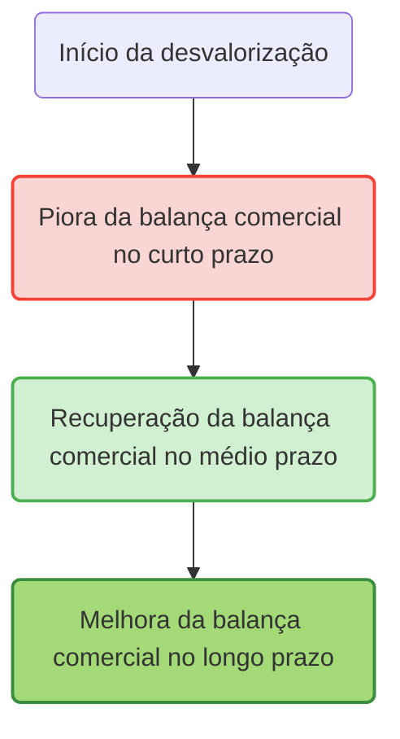

> [!note]  
> No eixo vertical está o saldo da balança comercial (superávit ou déficit), e no eixo horizontal o tempo. Após a desvalorização (ponto A), a balança comercial piora inicialmente (ponto B), mas depois começa a se recuperar (ponto C) até alcançar um patamar superior ao inicial (ponto D), formando o “J”.

---

#### 4. Importância e Implicações do Efeito Curva J

- **Política cambial e comercial:**  
    Governos devem considerar que os efeitos positivos de uma desvalorização cambial na balança comercial não são imediatos, podendo haver uma fase inicial de deterioração que causa pressões políticas e econômicas.
    
- **Elasticidades-preço:**  
    O efeito Curva J está associado à elasticidade-preço das exportações e importações. Se essas elasticidades forem muito baixas, a recuperação será lenta ou pequena; se forem altas, a melhora será rápida e significativa.
    
- **Sustentabilidade do ajuste externo:**  
    A possibilidade de a balança comercial se ajustar e melhorar após a desvalorização é fundamental para a recuperação econômica em países com déficits externos crônicos.
    

---

#### 5. Exemplo histórico ilustrativo

- **Brasil na crise da dívida dos anos 1980:**  
    Durante os anos 1980, o Brasil sofreu desvalorizações cambiais significativas. A balança comercial brasileira inicialmente piorou, pois o valor em moeda local das importações disparou, antes que a competitividade das exportações e a redução das importações levassem a uma melhora gradual no saldo comercial, em um padrão que refletia o efeito Curva J.
    

---

#### 6. Resumo

|Ponto|Explicação Rápida|
|---|---|
|**Curto prazo**|Balança comercial piora após desvalorização|
|**Causa**|Preço das importações sobe em moeda local, volumes fixos|
|**Médio/Longo prazo**|Balança melhora à medida que exportações aumentam e importações caem|
|**Forma do gráfico**|Piora inicial seguida de melhora, formando a letra “J”|

---

#### 7. Questões para Autoavaliação

> [!question] 1. Explique por que a balança comercial de um país normalmente piora logo após uma desvalorização cambial, antes de melhorar posteriormente.

> [!question] 2. Como a elasticidade-preço das exportações e importações influencia o formato e a intensidade do efeito Curva J?

> [!question] 3. Cite um exemplo histórico de um país que apresentou o efeito Curva J após uma desvalorização cambial e descreva brevemente o que ocorreu.

---

---


## [ECO-2.6.4] Política Monetária Não Convencional

> Origem no vault: `07 - ECONOMIA/02 - Macroeconomia/2.6 - Política Monetária (Papel do BC, Instrumentos, Inflação)/_Política Monetária Não Convencional.md` · 22.4 KB

### Política Monetária Não Convencional 

A Política Monetária Não Convencional (UMP - Unconventional Monetary Policy) surgiu quando os instrumentos tradicionais se mostraram insuficientes, especialmente após o colapso financeiro de 2008. Países desenvolvidos encontraram-se na armadilha da liquidez, com taxas de juros próximas ao zero, forçando bancos centrais como o Federal Reserve, BCE e Banco do Japão a inovar drasticamente. **O resultado foram políticas que injetaram trilhões de dólares na economia global, alterando fundamentalmente a dinâmica financeira internacional e criando spillovers significativos para economias emergentes como o Brasil.**

#### Definição e características fundamentais

##### O que torna uma política monetária "não convencional"

A política monetária convencional baseia-se exclusivamente no ajuste da taxa básica de juros para influenciar as condições econômicas. Quando você estuda o modelo IS-LM clássico, está vendo exatamente isso: o banco central move a taxa de juros e, através dos canais de transmissão tradicionais, afeta investimento, consumo e, consequentemente, produto e emprego.

**A política não convencional vai além dessa única ferramenta.** Ela surge quando a taxa básica atinge o que chamamos de "zero lower bound" - o limite inferior efetivo próximo ao zero. Nesse ponto, cortes adicionais de juros tornam-se inviáveis ou ineficazes, criando a necessidade de instrumentos alternativos que não dependem da alteração da taxa de juros nominal de curto prazo.

##### Contexto histórico e desenvolvimento

O marco inicial foi a **experiência japonesa dos anos 1990-2000**, quando o Banco do Japão enfrentou deflação persistente e taxas de juros próximas ao zero. O Japão tornou-se o laboratório mundial para políticas não convencionais, implementando pela primeira vez programas de Quantitative Easing entre 2001-2006.

**A verdadeira revolução chegou com a crise de 2008.** O colapso do Lehman Brothers e a subsequente paralisia dos mercados financeiros globais forçaram bancos centrais das principais economias a adotar medidas extraordinárias. Em poucos meses, o Federal Reserve, o Banco Central Europeu e o Banco da Inglaterra implementaram programas que injetaram trilhões na economia global.

#### Principais instrumentos da política não convencional

##### Quantitative Easing - o pilar central

**O Quantitative Easing (QE) representa o coração das políticas não convencionais.** Trata-se da compra em larga escala de títulos de longo prazo pelo banco central, visando injetar liquidez diretamente no sistema financeiro e reduzir os rendimentos de longo prazo.

O funcionamento é elegante em sua simplicidade: quando o banco central compra títulos no mercado secundário, está criando demanda adicional por esses ativos. Pela lei básica de oferta e demanda, os preços sobem e os rendimentos caem. **Simultaneamente, o banco central está expandindo sua base monetária**, injetando reserves bancárias no sistema.

**Os programas de QE americanos ilustram perfeitamente essa dinâmica.** O QE1 (2008-2010) injetou US$ 1,75 trilhão, focando em títulos hipotecários para estabilizar o mercado imobiliário. O QE2 (2010-2011) concentrou-se em US$ 600 bilhões em títulos do Tesouro. O QE3 (2012-2014) foi o mais inovador: um programa de final aberto, com compras mensais condicionadas às condições econômicas.

A eficácia foi impressionante. Estudos do próprio Fed estimam que os programas de QE reduziram os rendimentos de títulos de 10 anos em mais de 120 pontos base cumulativamente, com impactos positivos significativos sobre PIB (+0,5 a +1,0% cumulativo) e emprego.

##### Forward Guidance - orientando expectativas

**O Forward Guidance representa uma revolução na comunicação dos bancos centrais.** Tradicionalmente, bancos centrais eram deliberadamente obscuros em sua comunicação - lembre-se da famosa frase de Alan Greenspan: "Se você entendeu o que eu disse, então eu me expressei mal."

A política não convencional inverteu essa lógica. **O Forward Guidance consiste na comunicação clara e explícita sobre as intenções futuras de política monetária**, visando influenciar as expectativas e, consequentemente, as condições financeiras atuais.

Existem diferentes tipos de Forward Guidance. O **Delphic Guidance** oferece previsões condicionais baseadas nas perspectivas econômicas - "Se a inflação permanecer baixa, manteremos juros baixos." O **Odyssean Guidance** vai além, oferecendo compromissos firmes sobre ações futuras - "Manteremos juros baixos até 2015."

**A experiência brasileira com Forward Guidance (2020-2021) oferece lições importantes.** O BCB comunicou que o estímulo monetário seria mantido até a convergência das expectativas para as metas. Pesquisas posteriores mostraram eficácia limitada, com o mercado interpretando o guidance como compromisso incondicional, gerando perda de flexibilidade da política monetária. A literatura internacional recomenda apenas versões quantitativas do Forward Guidance, enquanto o Brasil adotou uma versão qualitativa que não trouxe os benefícios esperados.

##### Taxa de juros negativa - rompendo barreiras conceituais

**A implementação de taxas nominais negativas desafiou fundamentos econômicos básicos.** Se tradicionalmente considerávamos zero como o limite inferior para juros nominais, a crise europeia provou que era possível ir além.

O mecanismo é direto: o banco central cobra dos bancos comerciais pela manutenção de reservas, criando incentivos para que emprestem esses recursos ou invistam em outras aplicações. **A zona do euro manteve sua taxa de depósito em -0,5% entre 2014-2022**, enquanto o Japão implementou -0,1% em 2016 e a Suíça chegou a -0,75%.

Os resultados foram mistos. Por um lado, as taxas negativas ajudaram a depreciar moedas e estimular exportações. Por outro, criaram distorções nos mercados financeiros, comprimiram margens bancárias e geraram comportamentos inusitados - como o entesouramento físico de dinheiro em alguns casos.

##### Yield Curve Control - dominando a curva de juros

**O Yield Curve Control (YCC) representa o instrumento mais sofisticado das políticas não convencionais.** Em vez de simplesmente comprar títulos para reduzir rendimentos, o banco central define metas específicas para diferentes pontos da curva de juros e se compromete a fazer o necessário para atingi-las.

**A experiência japonesa com YCC (2016-2024) oferece o caso mais completo de análise.** O Banco do Japão definiu meta de 0% para títulos de 10 anos, realizando compras ilimitadas para manter esse patamar. O programa foi tecnicamente bem-sucedido em controlar rendimentos, mas gerou efeitos colaterais significativos: o BoJ passou a deter mais de 50% do mercado de títulos japoneses, eliminando praticamente a liquidez e distorcendo os mecanismos de descoberta de preços.

#### Mecanismos de transmissão específicos

##### Canal do balanço de portfólio

**Este canal é fundamental para entender como o QE afeta a economia real.** Quando o banco central compra títulos de longo prazo, está removendo esses ativos dos balanços de investidores privados. Esses investidores, por sua vez, precisam realocar seus recursos para outros ativos.

**O resultado é um efeito cascata através do sistema financeiro.** Investidores migram para títulos corporativos, ações, imóveis e outros ativos de risco. Esse movimento eleva preços de ativos, reduz custos de financiamento para empresas e famílias, e estimula consumo através do efeito riqueza.

Pesquisas empíricas mostram que o canal do portfólio responde por 50-70% do efeito total das políticas de QE, tornando-se o mecanismo dominante de transmissão.

##### Canal de sinalização

**O canal de sinalização opera através das expectativas sobre política futura.** Ao implementar QE, o banco central sinaliza implicitamente que pretende manter taxas baixas por período prolongado - afinal, seria contraditório implementar estímulo extraordinário e elevar juros rapidamente.

**Essa sinalização ancora as expectativas de taxa de juros futura**, reduzindo os prêmios de risco de prazo embutidos nos rendimentos de longo prazo. Estudos de eventos mostram que anúncios de QE frequentemente têm impacto maior que as compras efetivas, evidenciando a importância deste canal.

##### Canal de liquidez e funcionamento de mercados

Durante crises financeiras, mercados podem entrar em disfunção, com spreads de liquidez ampliados e mecanismos normais de arbitragem interrompidos. **O QE atua como "market maker of last resort"**, fornecendo liquidez direta e restaurando o funcionamento normal dos mercados.

**Este canal foi especialmente importante durante março de 2020**, quando mesmo mercados tradicionalmente líquidos como o de títulos do Tesouro americano entraram em stress. A intervenção rápida do Fed com compras ilimitadas restaurou a liquidez em questão de dias.

#### Experiências internacionais comparadas

##### Estados Unidos - pioneirismo e eficácia

**A experiência americana representa o benchmark para políticas não convencionais.** O Federal Reserve demonstrou pragmatismo notável, adaptando suas políticas conforme a evolução da crise e aprendendo empiricamente sobre a eficácia de diferentes instrumentos.

**O QE1 foi o mais efetivo dos programas**, focando em títulos hipotecários durante o pico da crise. A compra de MBS (mortgage-backed securities) no valor de US$ 1,25 trilhão teve impacto direto sobre o mercado imobiliário, elevando as originações de hipotecas em 170% e estabilizando o setor.

O programa de saída (tapering) iniciado em 2013 demonstrou igual sofisticação. **A comunicação gradual e previsível evitou disruptions maiores**, embora tenha gerado o famoso "taper tantrum" em mercados emergentes, incluindo o Brasil.

##### Zona do euro - fragmentação e complexidade institucional

**A experiência europeia ilustra como características institucionais afetam a eficácia das políticas não convencionais.** A fragmentação entre 19 economias nacionais, as restrições do Artigo 123 do TFUE (proibição de financiamento monetário) e a ausência de um tesouro único criaram desafios únicos.

**O programa OMT (Outright Monetary Transactions) representa talvez o maior sucesso do BCE** - ironicamente, sem nunca ter sido implementado. O famoso discurso de Mario Draghi em julho de 2012 ("whatever it takes") e o subsequente anúncio do OMT em setembro reduziram dramaticamente os spreads soberanos da periferia, demonstrando o poder da sinalização credível.

**O PEPP (Pandemic Emergency Purchase Programme) mostrou a evolução institucional do BCE.** Com envelope de €1,85 trilhão e flexibilidade para desviar da chave de capital, o programa demonstrou maior pragmatismo e eficácia que programas anteriores.

##### Japão - laboratório de longo prazo

**O Japão serve como laboratório global para políticas não convencionais**, com mais de duas décadas de experiência. **A trajetória japonesa oferece lições importantes sobre sustentabilidade e limites dessas políticas.**

O YCC japonês, implementado entre 2016-2024, controlou efetivamente os rendimentos de 10 anos, mas criou distorções severas. **O BoJ tornou-se detentor de mais da metade do mercado de títulos japoneses**, eliminando a liquidez e os mecanismos normais de descoberta de preços.

**A saída do YCC em março de 2024 sob o governador Ueda Kazuo** marcou o fim de uma era. A experiência japonesa demonstra tanto as possibilidades quanto os limites das políticas não convencionais em economias de baixo crescimento.

##### Reino Unido - pragmatismo e adaptação

**O Banco da Inglaterra destacou-se pela rapidez de implementação e adaptação às circunstâncias.** O programa inicial de QE foi lançado em março de 2009, poucos meses após a crise, totalizando £375 bilhões até 2012.

**A resposta ao Brexit demonstrou a flexibilidade do framework britânico.** Em agosto de 2016, apenas um mês após o referendum, o BoE implementou um pacote abrangente incluindo corte de juros, £60 bilhões adicionais de QE e £10 bilhões em compras de títulos corporativos. A resposta rápida e coordenada ajudou a estabilizar mercados durante período de extrema incerteza.

#### Contexto brasileiro e spillovers internacionais

##### Impactos das políticas não convencionais no Brasil

**O Brasil experimentou profundamente os spillovers das políticas não convencionais globais.** Durante os períodos de QE, o país recebeu fluxos massivos de capital internacional, causando apreciação do real e pressões inflacionárias. **O então ministro Guido Mantega cunhou o termo "guerra cambial" em 2010**, criticando os efeitos desestabilizadores dessas políticas sobre economias emergentes.

Os mecanismos de transmissão para o Brasil são bem documentados. **Políticas expansionistas de países desenvolvidos reduzem rendimentos globais, incentivando busca por yield em mercados emergentes.** O Brasil, com suas taxas de juros historicamente elevadas, tornou-se destino preferencial desses fluxos.

**Durante o "taper tantrum" de 2013**, quando o Fed sinalizou redução das compras de QE, o Brasil experimentou reversão abrupta de fluxos, depreciação cambial e necessidade de elevação de juros domésticos. **O episode ilustra a vulnerabilidade estrutural de economias emergentes às mudanças de política monetária de países desenvolvidos.**

##### A experiência brasileira com forward guidance

**O Brasil implementou forward guidance entre 2020-2021**, representando a primeira experiência formal do BCB com orientação prospectiva. A versão adotada foi qualitativa, comunicando que o estímulo extraordinário seria mantido até convergência das expectativas para as metas.

**Avaliações posteriores revelaram eficácia limitada.** Estudos empíricos mostram que o mercado interpretou o guidance como compromisso incondicional, gerando perda de flexibilidade da política monetária. **A literatura internacional recomenda apenas versões quantitativas** do forward guidance, enquanto o Brasil adotou uma abordagem qualitativa que não trouxe benefícios institucionais esperados.

##### Posicionamento internacional do Brasil

**A diplomacia brasileira tem sido ativa em fóruns internacionais sobre coordenação monetária.** No G20, o Brasil liderou discussões sobre spillovers monetários e conseguiu reconhecimento da legitimidade de controles de capital como ferramenta de gestão macroeconômica.

**Acordos de swap cambial representam instrumentos importantes** para reduzir vulnerabilidades externas. O acordo bilateral Brasil-China de 2024, no valor de R$ 157 bilhões, visa diversificar fontes de liquidez internacional e reduzir dependência do dólar americano.

#### Eficácia e limitações das políticas não convencionais

##### Evidências de eficácia

**A literatura empírica converge para efeitos positivos significativos das políticas não convencionais.** Estudos de evento mostram que anúncios de QE tipicamente reduzem rendimentos de longo prazo em 50-150 pontos base, com efeitos persistentes.

**Modelos DSGE e VAR estruturais confirmam impactos macroeconômicos positivos.** Estimativas consolidadas sugerem que programas de QE geram aumentos de PIB entre 0,5-1,0% cumulativos e elevações de inflação entre 0,2-0,4% cumulativos. **O equivalente monetário é significativo**: QE pode fornecer estímulo equivalente a cortes de 3-4 pontos percentuais na taxa básica.

**A experiência durante a pandemia COVID-19 confirmou a relevância dessas políticas.** Tanto economias desenvolvidas quanto emergentes utilizaram políticas não convencionais com sucesso, demonstrando que essas ferramentas tornaram-se parte permanente do arsenal dos bancos centrais.

##### Limitações e riscos identificados

**As limitações tornaram-se aparentes com o uso prolongado.** A experiência japonesa demonstra que políticas não convencionais podem distorcer mercados financeiros sem necessariamente gerar os efeitos desejados sobre inflação e crescimento.

**Efeitos distributivos representam preocupação crescente.** QE eleva preços de ativos financeiros e imobiliários, beneficiando desproporcionalmente detentores de riqueza. **Estudos mostram que os 10% mais ricos da população capturam a maior parte dos benefícios**, enquanto os efeitos sobre emprego e salários são mais difusos.

**Distorções de mercado são inevitáveis.** Taxas muito baixas por períodos prolongados incentivam tomada excessiva de risco, potencialmente gerando bolhas de ativos. **A compressão de prêmios de risco pode mascarar vulnerabilidades fundamentais**, criando fragilidades financeiras de longo prazo.

#### Coordenação internacional e questões multilaterais

##### Spillovers e coordenação

**Políticas monetárias não convencionais geram spillovers internacionais significativos.** Estudos do BIS e FMI mostram que programas de QE afetam fluxos de capital globais, taxas de câmbio e condições financeiras internacionais de forma mais intensa que políticas convencionais.

**A coordenação internacional tornou-se mais complexa mas essencial.** Durante a crise COVID-19, bancos centrais coordenaram informalmente suas respostas, incluindo acordos de swap em dólares e timing similar de implementação de políticas extraordinárias.

##### Discussões no G20 e organismos multilaterais

**O G20 tem servido como principal fórum para discussões sobre spillovers monetários.** Sob liderança brasileira e de outros emergentes, foi estabelecido reconhecimento de que países desenvolvidos devem considerar efeitos sobre emergentes ao formular políticas domésticas.

**O FMI evoluiu sua postura sobre políticas não convencionais.** Inicialmente cético, o Fundo passou a reconhecer sua eficácia e legitimar seu uso em circunstâncias apropriadas. **A COVID-19 marcou ponto de inflexão**, com o FMI explicitamente recomendando uso de políticas não convencionais por economias emergentes com credibilidade institucional adequada.

#### Relevância para a carreira diplomática

##### Implicações para diplomacia econômica

**Compreender políticas monetárias não convencionais é essencial para diplomatas modernos.** Essas políticas afetam taxas de câmbio, fluxos de capital e condições financeiras globais de forma mais intensa que instrumentos tradicionais, criando novas dinâmicas nas relações econômicas internacionais.

**A diplomacia econômica brasileira deve navegar cuidadosamente esses desafios.** Por um lado, spillovers podem desestabilizar a economia doméstica. Por outro, oferecem oportunidades de aprendizado institucional e acesso a liquidez internacional através de acordos de swap.

##### Questões de negociação multilateral

**Acordos comerciais e de investimento crescentemente incluem considerações monetárias.** A compreensão de como políticas não convencionais afetam competitividade e fluxos comerciais tornou-se essencial para negociadores internacionais.

**A governança financeira global está em evolução.** Novos mecanismos de coordenação, reforma do sistema monetário internacional e discussões sobre moedas digitais de bancos centrais (CBDCs) requerem conhecimento técnico profundo dessas questões.

#### Preparação específica para o CACD

##### Padrões de cobrança nas provas

**O tema foi incluído no edital de 2017**, refletindo sua crescente importância na economia global. **Questões típicas cobram definições conceituais, contexto histórico e mecanismos de funcionamento** das principais ferramentas não convencionais.

**A abordagem das provas é conceitual, não matemática.** Candidatos devem dominar os fundamentos teóricos, principais experiências internacionais e capacidade de conectar com outros tópicos econômicos e de relações internacionais.

##### Conexões essenciais com outros tópicos

**Política monetária não convencional conecta-se organicamente com múltiplos itens do programa:**

- **Crise de 2008**: Marco histórico fundamental
- **Modelo IS-LM**: Armadilha da liquidez e zero lower bound
- **Economia aberta**: Spillovers e efeitos cambiais
- **Sistema financeiro internacional**: Reforma da governança global
- **Coordenação de políticas**: G20 e multilateralismo econômico

##### Estratégia de estudo recomendada

**Construa compreensão a partir dos fundamentos.** Inicie com a definição clara do que torna uma política "não convencional" e o contexto que levou ao seu desenvolvimento. **Domine os conceitos de zero lower bound e armadilha da liquidez** - eles são fundamentais para entender por que essas políticas se tornaram necessárias.

**Estude detalhadamente as principais experiências internacionais.** O QE americano, as políticas do BCE, a experiência japonesa e a resposta britânica oferecem lições distintas sobre design, implementação e eficácia dessas políticas.

**Conecte sempre com o contexto brasileiro e diplomático.** Compreenda como spillovers afetam o Brasil, a experiência doméstica com forward guidance e o posicionamento internacional brasileiro em fóruns multilaterais.

**Mantenha-se atualizado sobre desenvolvimentos recentes.** Políticas monetárias não convencionais continuam evoluindo, com bancos centrais adaptando instrumentos e testando novas abordagens. A saída do YCC japonês em 2024, as discussões sobre CBDCs e os debates sobre política monetária pós-pandemia são todos relevantes para sua preparação.

#### Conclusão e perspectivas futuras

**A política monetária não convencional representa mudança paradigmática permanente na condução da política econômica.** O que começou como resposta de emergência à crise de 2008 tornou-se parte integrante do toolkit dos bancos centrais globais.

**Para futuros diplomatas, essas políticas são especialmente relevantes** porque transcendem fronteiras nacionais, afetando relações econômicas internacionais de forma mais intensa que instrumentos tradicionais. **Compreender seus mecanismos, limitações e spillovers tornou-se essencial para atuação efetiva na diplomacia econômica moderna.**

**As evidências empíricas confirmam eficácia quando bem implementadas**, mas destacam também a necessidade de vigilância contínua quanto a riscos e coordenação internacional apropriada. **O desafio futuro será encontrar o equilíbrio entre o uso dessas ferramentas poderosas e a manutenção da estabilidade financeira global.**

---


## [ECO-2.6] Política Monetária no Brasil (nota complementar)

> Origem no vault: `07 - ECONOMIA/02 - Macroeconomia/2.6 - Política Monetária (Papel do BC, Instrumentos, Inflação)/Política Monetária no Brasil.md` · 24.4 KB

### A Política Monetária no Brasil: Instrumentos, o Papel do Banco Central e o Controle da Inflação

A **política monetária** refere-se ao conjunto de ações do Banco Central destinadas a controlar a **oferta de moeda** e as **taxas de juros**, com o objetivo de manter a estabilidade da moeda (controle da inflação) e propiciar o bom funcionamento da economia. No Brasil, sob o regime de metas de inflação, o Banco Central do Brasil (BCB) busca assegurar a estabilidade do poder de compra da moeda, atuando de forma autônoma para cumprir as metas estabelecidas pelo Conselho Monetário Nacional. Para entender como essas ações operam, é útil relembrar primeiro as funções básicas da moeda na economia e, em seguida, analisar detalhadamente os principais instrumentos de política monetária utilizados pelo BCB em prol da estabilidade de preços.

#### As Funções Fundamentais da Moeda

A moeda desempenha **três funções clássicas** que explicam sua importância na economia e fundamentam a necessidade de estabilidade monetária:

1. **Meio de Troca:** a moeda funciona como intermediário de aceitação geral nas transações, ou seja, um ativo amplamente aceito para a aquisição de bens e serviços, eliminando as ineficiências do escambo e da "dupla coincidência de desejos". Em outras palavras, todos aceitam moeda em troca de mercadorias, facilitando as trocas indiretas em uma economia complexa.
    
2. **Unidade de Conta:** a moeda serve de **padrão de valor** para expressar e comparar os preços de bens e serviços. Ela fornece uma medida comum que permite calcular valores, fazer registros contábeis e cotar preços de forma uniforme. Sem uma unidade de conta estável, torna-se difícil para agentes econômicos planejarem e avaliarem custos, receitas e lucros.
    
3. **Reserva de Valor:** a moeda permite **armazenar poder de compra ao longo do tempo**, funcionando como um meio de **acumular riqueza** para uso futuro. Essa função pressupõe estabilidade: em condições de alta inflação, a moeda perde a capacidade de reter valor e os indivíduos buscam outros ativos para se proteger. Portanto, manter a inflação baixa é crucial para que a moeda continue sendo uma reserva de valor confiável.
    

> [!important] **Importância da Estabilidade Monetária** 
> Se a moeda não consegue cumprir adequadamente alguma dessas funções (por exemplo, em episódios de hiperinflação em que deixa de ser boa reserva de valor ou unidade de conta), toda a economia sofre. Por isso, **controlar a inflação** e garantir a confiança na moeda são objetivos centrais do Banco Central. A política monetária existe, em essência, para preservar essas funções da moeda e assegurar que ela continue desempenhando seu papel fundamental nas transações econômicas.

#### Os Instrumentos da Política Monetária

Para alcançar a estabilidade de preços e influenciar as condições monetárias, o Banco Central dispõe de **diversos instrumentos de política monetária**. Os três principais mecanismos tradicionais são: as **operações de mercado aberto**, os **depósitos compulsórios** e a **taxa de redesconto**. Cada um atua por canais distintos, mas complementares, afetando a **liquidez do sistema financeiro** e, consequentemente, as **taxas de juros**, o **crédito** e o **nível de atividade econômica**. A seguir, examinamos em detalhe como cada instrumento funciona no contexto brasileiro, com ênfase especial na taxa Selic e no papel do Comitê de Política Monetária (Copom).

##### 1. Operações de Mercado Aberto e a Taxa Selic

As **operações de mercado aberto (open market)** constituem o **principal instrumento** da política monetária cotidiana no Brasil. Elas envolvem a **compra e venda de títulos públicos federais** pelo Banco Central no mercado financeiro, com o objetivo de regular a quantidade de dinheiro (liquidez) na economia. Por meio dessas operações, o BCB consegue influenciar diretamente a taxa básica de juros, a **taxa Selic**, de forma a mantê-la próxima do valor desejado.

- O **Copom (Comitê de Política Monetária)** se reúne periodicamente (usual intervalo de 45 dias) e define a **meta para a taxa Selic** – isto é, o nível desejado para a taxa de juros básica da economia. Contudo, o Copom define apenas a meta; a taxa Selic efetiva resulta das operações de mercado interbancário. **Cabe ao Banco Central atuar diariamente no mercado aberto para que a taxa de juros de curto prazo fique **próxima à meta** estipulada pelo Copom.** Na prática, a Selic é a taxa de juros média dos empréstimos **overnight** entre instituições financeiras lastreados em títulos públicos. Controlando a oferta de reservas bancárias via open market, o BC consegue fazer com que essa taxa **Selic “over”** convirja para a **meta Selic** decidida pelo Copom.
    
- **Mecanismo de atuação:** quando o **Banco Central compra títulos públicos** no mercado aberto, ele **injeta moeda** na economia (pois paga os vendedores dos títulos em dinheiro/reservas bancárias). Esse aumento de **liquidez** faz com que haja mais recursos disponíveis no sistema bancário, tendendo a **reduzir a taxa de juros interbancária**. Por outro lado, ao **vender títulos públicos**, o BC **retira moeda em circulação** (os bancos pagam pelos títulos, drenando suas reservas), o que reduz a liquidez e pressiona **para cima** a taxa de juros. Desse modo, através de compras e vendas diárias de títulos (muitas vezes via operações **compromissadas**, isto é, acordos de recompra), o Banco Central **neutraliza os desequilíbrios de liquidez** e mantém a **taxa Selic efetiva muito próxima da meta** estabelecida.
    

> [!note] _Em resumo_: 
> a lógica das operações de mercado aberto é simples – **inject liquidity to push the interest rate down, or absorb liquidity to push it up** – de forma a alinhar a taxa **Selic over** à meta do Copom. A figura a seguir ilustra esse processo de forma esquemática:

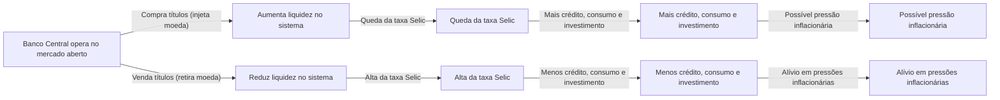

Como mostra o diagrama, ao aumentar a liquidez (via compras de títulos), o BC **reduz os juros de curto prazo**, barateando o crédito e estimulando, em certa medida, a demanda agregada – o que pode gerar **pressões inflacionárias** se exceder a capacidade produtiva. No sentido oposto, ao contrair a liquidez (vendendo títulos e elevando os juros), o crédito encarece e a atividade econômica esfria, **contribuindo para conter a inflação**. Esse é o **princípio básico da política monetária**: juros mais altos tendem a desestimular consumo e investimentos (contendo a alta de preços), enquanto juros mais baixos têm efeito expansivo sobre a economia, mas podem pressionar a inflação.

> [!definition] **Taxa Selic** 
> É a **taxa básica de juros** da economia brasileira, calculada como a média das taxas negociadas diariamente nas operações interbancárias lastreadas em títulos públicos, com prazo de um dia (overnight). A **meta da Selic** é fixada pelo Copom e serve de **referência central** para a política monetária. O Banco Central utiliza as operações de mercado aberto para garantir que a **Selic efetiva (overnight)** permaneça **igual ou muito próxima à meta** definida, assegurando a transmissão da política monetária para as demais taxas de juros da economia (financiamentos, empréstimos, retornos de investimentos, etc.).

**Relevância no Brasil:** As operações de mercado aberto, centradas no controle da taxa Selic, são particularmente importantes porque o Brasil adota um **regime de metas de inflação** desde 1999. A taxa Selic é o instrumento operacional que o Banco Central manipula para influenciar a inflação futura: alterações na Selic afetam diversas variáveis (crédito, consumo, investimento, expectativas inflacionárias e até o câmbio, como veremos). Portanto, manter a **credibilidade** de que a autoridade monetária **alcançará a meta de inflação** depende de atuar de forma contundente via Selic. Historicamente, o open market tem se mostrado eficaz para ancorar a inflação, ainda que ao custo de taxas de juros relativamente altas em vários períodos. A autonomia formal do Banco Central, conquistada em 2021, reforça essa credibilidade ao blindar essas decisões técnicas de pressões político-eleitorais (tema retomado adiante).

##### 2. Depósitos Compulsórios (Recolhimento Compulsório)

Os **depósitos compulsórios** são outro instrumento clássico de política monetária, atuando de forma mais estrutural sobre a liquidez e a capacidade de criação de moeda pelos bancos. Consistem na **exigência legal** para que os bancos comerciais depositem uma **fração de seus depósitos** junto ao Banco Central, não podendo utilizá-la para empréstimos. Ao alterar a alíquota do compulsório, o Banco Central muda a proporção de recursos que os bancos precisam reter imobilizados, afetando diretamente o **multiplicador bancário** de crédito.

> [!definition] **Depósito Compulsório** 
> Trata-se da parcela do dinheiro dos depositantes que as instituições financeiras são **obrigadas a manter depositada no Banco Central**. Esse mecanismo funciona como um **colchão de liquidez** para o sistema bancário e uma ferramenta para o BC influenciar a oferta de moeda. Em momentos de crise, por exemplo, a redução do compulsório libera recursos aos bancos, ajudando a evitar escassez de crédito, ao passo que aumentos do compulsório retiram liquidez da economia, auxiliando no combate à inflação.

**Efeitos na liquidez e no crédito:** Quando o Banco Central **eleva a alíquota do compulsório**, os bancos precisam reter uma fatia maior de seus depósitos como reserva obrigatória. Isso **reduz os recursos livres** para novas operações de crédito, **contraindo** a capacidade de criação de moeda pelo sistema bancário. Em termos simples, **a elevação do compulsório “trava” o multiplicador monetário**, retirando moeda em circulação, enquanto a **redução do compulsório libera moeda**, pois os bancos passam a poder emprestar uma porção maior de seus depósitos. Assim, aumentar o compulsório tende a **restringir a expansão do crédito** (ação contracionista, usada para conter inflação ou riscos sistêmicos), ao passo que reduzir o compulsório **estimula o crédito** ao injetar liquidez adicional no sistema (ação expansionista).

Vale notar que o **impacto prático** do compulsório depende também do comportamento dos bancos. Se as instituições já mantêm **reservas voluntárias** acima do mínimo exigido, pequenas variações no compulsório podem ser absorvidas sem grande efeito na oferta de crédito. Por outro lado, em situações de **mercado de crédito aquecido**, o compulsório se torna um instrumento poderoso: por exemplo, uma redução de alguns pontos percentuais em certos compulsórios pode liberar dezenas de bilhões de reais para empréstimos (como discutido em propostas recentes para estimular o crédito imobiliário). Contudo, **o Banco Central utiliza o compulsório com parcimônia** enquanto instrumento anticíclico, pois ele afeta de forma abrangente a liquidez de longo prazo, diferentemente do ajuste fino diário proporcionado pelas operações de mercado aberto.

##### 3. Taxa de Redesconto (Assistência de Liquidez)

A **taxa de redesconto** é o terceiro instrumento tradicional de política monetária, embora seja acionado com menor frequência e geralmente em situações específicas. Refere-se à **taxa de juros cobrada pelo Banco Central nos empréstimos que ele concede aos bancos comerciais**, atuando como **emprestador de última instância**. Em outras palavras, se um banco enfrenta falta temporária de liquidez e não consegue empréstimos no mercado interbancário (por exemplo, no mercado overnight), ele pode recorrer ao Banco Central para obter recursos emergenciais – pagando, para isso, a taxa de redesconto estabelecida.

> [!definition] **Taxa de Redesconto** 
> É a taxa de juros aplicada pelo Banco Central nos **empréstimos de curto prazo a instituições financeiras**, típica do papel de **emprestador de última instância** desempenhado pelo BC. Geralmente, o redesconto é **fixado em nível superior ao da taxa Selic**, exatamente para desencorajar os bancos de recorrerem rotineiramente a essa facilidade. Assim, bancos só buscam o redesconto em último caso, quando esgotadas as alternativas de captação junto a outras instituições.

**Função e efeitos:** Por ser uma fonte de liquidez de emergência, a taxa de redesconto serve como **teto informal** para a taxa de juros no mercado interbancário: se os juros entre bancos subirem muito, os bancos preferirão tomar emprestado do Banco Central (desde que a taxa de redesconto seja mais baixa do que esse pico). **Alterar a taxa de redesconto** é mais uma alavanca disponível ao Banco Central: ao **reduzir a taxa de redesconto**, o BC **barateia o custo de empréstimo direto para os bancos**, encorajando as instituições a usar essa linha em momentos de aperto – o que **injeta moeda na economia** e expande a liquidez. Por outro lado, ao **elevar a taxa de redesconto**, impõe-se um **custo mais alto para socorros** aos bancos, desestimulando que recorram a essa facilidade e induzindo-os a serem mais cautelosos no gerenciamento de suas reservas, o que **diminui a criação de moeda** pelo sistema.

Um efeito indireto de manter a taxa de redesconto em patamar elevado é que os bancos passam a **evitar ao máximo ficar sem reservas no fim do dia**, já que o socorro do BC sairia caro. Por precaução, **voluntariamente eles manterão mais reservas excedentes**, reduzindo assim o **multiplicador monetário** e a oferta potencial de crédito na economia. Em suma, **uma taxa de redesconto alta torna a política monetária mais restritiva** (ao punir a falta de liquidez dos bancos), enquanto **uma taxa de redesconto baixa torna a política mais expansionista** (ao facilitar empréstimos de última instância, evitando quebradeiras e injetando recursos quando necessário). Na prática, o redesconto é utilizado sobretudo em contextos de crise financeira ou para instituições com dificuldades temporárias – seu uso rotineiro não é comum, mas sua existência assegura que o mercado tenha um **backstop** de liquidez, fundamental para a confiança no sistema bancário.

#### O Papel do Banco Central e a Autonomia Formal

O **Banco Central do Brasil (BCB)** tem, por mandato legal, o **objetivo fundamental de assegurar a estabilidade de preços**, isto é, manter a inflação sob controle e, consequentemente, preservar o valor da moeda. Além disso, o BC também zela pela estabilidade do sistema financeiro. Desde 1999, a instituição opera sob o regime de **metas de inflação**: o Conselho Monetário Nacional (CMN) define, com anos de antecedência, uma meta quantitativa de inflação (por exemplo, 3% ao ano, com margem de tolerância), e **cabe ao Banco Central conduzir a política monetária para cumpri-la**. O principal instrumento para isso é, como vimos, a taxa Selic, definida pelo Copom.

Em **fevereiro de 2021**, foi sancionada a **Lei Complementar nº 179**, que conferiu **autonomia formal** ao Banco Central do Brasil. Essa lei estabeleceu o BC como uma **autarquia de natureza especial**, com **mandatos fixos e não coincidentes** para o presidente e diretores (mandatos de quatro anos, com possibilidade de recondução, intercalados ao ciclo do Poder Executivo). Na prática, isso significa que as decisões de política monetária devem ser tomadas com base em critérios **técnicos e de longo prazo**, **sem influência político-partidária direta**. Antes mesmo da lei, o BCB já operava com relativa independência, mas a formalização da autonomia trouxe **mais credibilidade e previsibilidade** para o mercado, ao separar a gestão da política monetária das mudanças de governo de curto prazo.

**Debate sobre autonomia e credibilidade:** A autonomia do Banco Central é amplamente defendida por economistas ortodoxos como um meio de **assegurar a credibilidade da política monetária**. Os defensores argumentam que um BC autônomo pode se **concentrar nos objetivos de estabilidade de preços de longo prazo**, tomando decisões muitas vezes impopulares (como manter juros altos) quando necessárias, **sem ceder a pressões políticas imediatas**. Isso contribui para ancorar as expectativas de inflação dos agentes econômicos, ou seja, para que empresas e consumidores acreditem que a inflação futura permanecerá sob controle. Um ambiente de expectativas bem ancoradas, por sua vez, torna a política monetária **mais eficaz** – o Banco Central consegue influenciar a inflação com ajustes de juros menores do que seria preciso caso sua credibilidade estivesse em xeque.

Por outro lado, a autonomia formal **não é isenta de controvérsias**. Críticos apontam que ela pode reduzir a **responsabilidade democrática** do Banco Central, uma vez que a cúpula da instituição não responde diretamente ao voto popular e suas decisões podem ter impacto profundo no nível de atividade e emprego. Uma **crítica central** é que um Banco Central autônomo demais poderia **se fixar unicamente no combate à inflação**, negligenciando outros objetivos econômicos, como o crescimento econômico e o pleno emprego. Ademais, governos eleitos podem sentir-se tolhidos em implementar medidas de estímulo (como baixar juros para aquecer a economia) se o Banco Central independente entender que a prioridade é conter preços. Essa tensão foi observada no Brasil recente: em 2023, por exemplo, membros do governo federal criticaram abertamente a manutenção da Selic em patamar elevado pelo BC autônomo, argumentando que isso prejudicava a atividade econômica. Ainda assim, a direção do Banco Central – amparada pela autonomia legal – **manteve a taxa básica alta enquanto julgou necessário**, sinalizando compromisso com a meta de inflação apesar das pressões políticas. Esse episódio ilustra tanto a **consolidação da autonomia** (decisões técnicas prevalecendo) quanto o desafio de **coordenação entre política monetária e política econômica do governo**.

> [!note] **Autonomia e confiança dos agentes** 
> Passados os primeiros anos da autonomia formal, a avaliação geral é que o Banco Central tem conseguido navegar por um ambiente desafiador sem comprometer sua missão principal. Segundo depoimento do indicado à presidência do BC para 2025, Gabriel Galípolo, o Banco Central atravessou seus primeiros anos de autonomia de forma **estável**, tomando decisões sem se deixar invadir por questões externas e cumprindo seu mandato. Em síntese, a autonomia contribuiu para blindar a política monetária de humores políticos de curto prazo, **reforçando a confiança** de que o combate à inflação está em boas mãos – embora o debate sobre os **limites do papel do BC** na economia persista, demandando equilíbrio entre **independência** e **accountability**.

#### Política Monetária e a Taxa de Câmbio

Em economias abertas como a do Brasil, existe uma **estreita relação** entre a política monetária (especialmente a taxa de juros doméstica) e a **taxa de câmbio**. A taxa de câmbio é influenciada, entre outros fatores, pelos **fluxos de capitais internacionais**, os quais reagem aos diferenciais de juros entre os países. Assim, **alterações na taxa Selic** costumam desencadear um canal de transmissão via câmbio:

- **Juros mais altos e apreciação cambial:** Quando o Banco Central **eleva a taxa Selic**, o rendimento dos ativos em reais (títulos públicos, por exemplo) torna-se mais atraente em comparação aos rendimentos em outras moedas. Isso tende a **atrair investidores estrangeiros**, que buscam aproveitar o **diferencial de juros**. Para investir em títulos brasileiros, esses investidores precisam converter moeda estrangeira em reais, o que **aumenta a demanda pela moeda nacional** e leva à **valorização do real** (ou seja, queda da cotação do dólar frente ao real). Esse movimento é conhecido como parte do fenômeno de **carry trade**, no qual capital estrangeiro toma empréstimos em países de juros baixos e aplica em países de juros altos para lucrar com a diferença de taxas. Em resumo, **juros domésticos altos tendem a fortalecer a moeda local** – a não ser que fatores externos contrabalancem essa tendência.
    
- **Juros mais baixos e depreciação cambial:** Por outro lado, **quando a Selic é reduzida**, o diferencial de juros em relação a outras economias diminui, e o mercado brasileiro se torna relativamente menos atrativo para o capital estrangeiro. Investidores internacionais podem realocar recursos para mercados com retorno melhor, gerando uma **saída líquida de capitais**. Essa saída implica vender reais para comprar moedas estrangeiras, o que **pressiona para baixo o valor do real** (desvalorização cambial). Em termos práticos, dólares ficam relativamente mais caros (alta do dólar), reflexo da menor demanda por ativos denominados em reais.
    

Essa dinâmica mostra que o **câmbio é um importante canal de transmissão da política monetária**. Quando juros sobem e o real se valoriza, os preços de importados tendem a cair em reais, ajudando a conter a inflação (pois mercadorias importadas e insumos ficam mais baratos). Por outro lado, juros em queda e **depreciação do câmbio** podem **pressionar a inflação** via aumento do custo de produtos importados e matérias-primas cotadas em dólar. O Banco Central leva isso em conta: por exemplo, durante ciclos de alta de juros, é comum o real se fortalecer, o que auxilia no combate à inflação; já cortes de juros excessivos podem provocar forte desvalorização do câmbio, exigindo cautela pela autoridade monetária.

> [!important] **Fatores adicionais** 
> É válido destacar que a relação entre juros e câmbio, embora significativa, **não é mecânica nem isolada**. Fatores como o ambiente externo (taxas de juros internacionais, aversão global a risco) e a percepção de **risco-país** influenciam os fluxos de capitais. Por exemplo, uma alta da Selic em contexto de grave incerteza fiscal interna ou de fortes aumentos de juros nos EUA pode ter efeito limitado sobre a valorização do real. Ainda assim, de modo geral, o BC brasileiro monitora atentamente o canal cambial: ele faz parte da estratégia de controlar a inflação e preservar a competitividade da economia. Em situações de movimentos cambiais desordenados, o Banco Central pode também atuar diretamente no mercado de câmbio (via leilões de swap cambial, por exemplo), mas isso já é parte da chamada **política cambial** – que complementa a política monetária quando necessário.

---

> [!question] **Questões para Autoavaliação**
> 
> 1. **Operações de Mercado Aberto:** Como o Banco Central utiliza as operações de mercado aberto para **controlar a taxa Selic** e qual é o impacto desse controle sobre a oferta de crédito e a inflação? Explique o mecanismo envolvendo a compra e venda de títulos e a influência na liquidez do sistema bancário.
>     
> 2. **Autonomia do Banco Central:** Quais são os principais **argumentos a favor e contra a autonomia formal** do Banco Central do Brasil na condução da política monetária? Discuta como a autonomia pode afetar a **credibilidade** das metas de inflação e a possibilidade de **coordenação** com as políticas econômicas do governo eleito.
>     
> 3. **Política Monetária e Câmbio:** De que forma uma **elevação** ou **redução** da taxa Selic tende a influenciar a **taxa de câmbio** do real frente a outras moedas? Descreva o canal de transmissão cambial da política monetária e como as variações do câmbio podem realimentar o objetivo de controle da inflação no Brasil.
>

---


## [ECO-2.6.5] Conceitos Básicos da Regulação e Supervisão do Sistema bancário, financeiro e do Mercado de Capitais

> Origem no vault: `07 - ECONOMIA/02 - Macroeconomia/2.6 - Política Monetária (Papel do BC, Instrumentos, Inflação)/2.6.5 Conceitos Básicos da Regulação e Supervisão do Sistema bancário, financeiro e do Mercado de Capitais..md` · 42.9 KB

### Regulação e Supervisão do Sistema Financeiro: Princípios, Instrumentos e a Arquitetura Nacional e Internacional

#### A Racionalidade Econômica da Regulação Financeira

A intervenção estatal no sistema financeiro por meio da regulação e da supervisão não constitui uma anomalia, mas uma resposta necessária às características intrínsecas que o distinguem de outros setores da economia. Enquanto a teoria econômica convencional postula que mercados em livre concorrência tendem a uma alocação de recursos eficiente, conhecida como Ótimo de Pareto, essa conclusão se baseia em premissas rigorosas, como a existência de informação perfeita e a ausência de externalidades. O setor financeiro, por sua natureza, viola sistematicamente essas premissas, gerando um conjunto de falhas de mercado que, se não corrigidas, podem levar a crises de grande magnitude com severas consequências para a economia real. A crise financeira global de 2008 é o exemplo mais contundente de como brechas e falhas na arquitetura regulatória podem criar os próprios mecanismos de sua destruição, evidenciando que a instabilidade é uma característica endêmica de um sistema financeiro desregulado.

##### A Natureza Especial do Setor Financeiro e as Falhas de Mercado

O sistema financeiro desempenha um papel central na economia moderna, intermediando recursos entre poupadores e investidores e alocando capital para atividades produtivas. Contudo, essa função vital é exercida em um ambiente de incerteza e informação imperfeita, o que o torna particularmente suscetível a falhas de mercado. A regulação emerge, portanto, não como uma distorção, mas como um mecanismo essencial para mitigar essas falhas e promover a estabilidade. As principais justificativas econômicas para a regulação financeira estão ancoradas em três falhas de mercado inter-relacionadas: a assimetria de informação, o risco sistêmico e as externalidades negativas.

Essas falhas não são fenômenos isolados, mas formam uma cadeia causal que explica a fragilidade inerente do sistema. A assimetria de informação é a falha fundamental, a origem de comportamentos que minam a estabilidade no nível da instituição individual. Essa fragilidade individual, quando amplificada pela alta interconexão entre as instituições, transforma-se em risco sistêmico. A materialização do risco sistêmico, por sua vez, gera externalidades negativas devastadoras, cujos custos transbordam do setor financeiro e são impostos a toda a sociedade. Compreender essa sequência lógica é fundamental para entender por que a regulação financeira precisa ser abrangente e multifacetada, atuando em todas as etapas dessa cadeia de instabilidade.

##### Assimetria de Informação: O Cerne da Instabilidade

A falha de mercado mais fundamental e pervasiva no sistema financeiro é a assimetria de informação, conceito desenvolvido por economistas laureados com o Nobel, como George Akerlof, Michael Spence e Joseph Stiglitz. Ela ocorre quando uma das partes em uma transação—tipicamente o tomador de recursos—possui informações mais completas e precisas sobre os riscos e a qualidade de um projeto do que a outra parte—o credor ou investidor.9 Esse desequilíbrio de poder informacional cria dois problemas clássicos que ocorrem em momentos distintos da transação financeira e que, juntos, minam a eficiência e a estabilidade do mercado.

> [!definition]
> 
> Assimetria de Informação: Uma falha de mercado que ocorre em transações onde uma parte possui mais ou melhor informação do que a outra, criando um desequilíbrio de poder que pode levar a resultados ineficientes ou ao colapso do mercado.

- **Seleção Adversa (_Adverse Selection_):** Este problema ocorre _antes_ da transação ser concluída.12 Nos mercados financeiros, os tomadores de empréstimos que apresentam os maiores riscos (e, portanto, são os mais propensos a não pagar) são, paradoxalmente, os que mais ativamente buscam crédito, pois têm menos a perder. Os credores, incapazes de distinguir perfeitamente entre bons e maus tomadores, podem acabar estabelecendo taxas de juros que refletem um risco médio. Essa taxa pode ser alta demais para os bons tomadores, que se retiram do mercado, deixando para trás apenas os tomadores de alto risco. Esse fenômeno, ilustrado por Akerlof em seu célebre artigo "The Market for 'Lemons'" sobre o mercado de carros usados, pode levar a uma alocação ineficiente de capital, onde os projetos mais arriscados são financiados, ou até mesmo ao colapso do mercado de crédito, pois os credores, temendo selecionar apenas "limões", podem se recusar a emprestar.
    
- **Risco Moral (_Moral Hazard_):** Este problema surge _após_ a transação ser realizada. Uma vez que o tomador obteve o financiamento, ele pode ter incentivos para alterar seu comportamento e assumir mais riscos do que o acordado, pois sabe que parte das perdas será absorvida pelo credor. O credor, por sua vez, não consegue monitorar perfeitamente as ações do devedor. Um exemplo clássico é uma empresa que, após receber um empréstimo para um projeto de baixo risco, decide investir os recursos em um empreendimento mais arriscado e potencialmente mais lucrativo, sabendo que, em caso de sucesso, ficará com a maior parte dos ganhos, mas em caso de fracasso, as perdas serão compartilhadas com o credor.
    

A regulação, nesse contexto, atua como um mecanismo para mitigar esses problemas. Requisitos de divulgação de informações (_disclosure_), padrões de capital mínimo e supervisão contínua são instrumentos que visam reduzir a assimetria informacional, permitindo que os credores avaliem melhor os riscos (combatendo a seleção adversa) e que monitorem o comportamento dos devedores (limitando o risco moral).

##### Risco Sistêmico: A Ameaça do Efeito Dominó

O risco sistêmico é a consequência mais temida da instabilidade financeira. Ele pode ser definido como o risco de que a dificuldade ou a falência de uma instituição financeira se propague em cascata para outras instituições, comprometendo o funcionamento de todo o sistema financeiro e, em última instância, da economia real.8 Essa propagação ocorre devido à alta interconexão entre as instituições financeiras, que estão ligadas por uma complexa rede de obrigações interbancárias, exposições a derivativos e ativos comuns.

> [!definition]
> 
> Risco Sistêmico: Risco de perturbação no sistema financeiro com potencial para gerar consequências negativas graves para o mercado interno e a economia real. É o risco de que a falência de uma entidade cause um efeito dominó, colapsando todo o sistema.8

O risco sistêmico é uma manifestação macroeconômica das falhas de mercado no nível microeconômico. A busca individual por lucro por parte das instituições, em um ambiente de assimetria de informação e risco moral, leva a uma acumulação excessiva de riscos individuais. A interconexão do sistema amplifica esses riscos, transformando um problema localizado em uma ameaça global.

Um aspecto central do risco sistêmico é o problema das instituições "grandes demais para quebrar" (_Too Big to Fail_ - TBTF). A percepção de que o governo inevitavelmente resgatará uma grande instituição para evitar um colapso sistêmico cria um perigoso risco moral: os executivos dessas instituições são incentivados a assumir riscos excessivos, pois sabem que os lucros serão privados, mas as perdas serão socializadas. A regulação macroprudencial, especialmente após a crise de 2008, passou a focar intensamente na mitigação do risco sistêmico, com medidas específicas para instituições sistemicamente importantes.

##### Externalidades Negativas: Os Custos Sociais da Instabilidade

Uma crise financeira gera custos que transcendem em muito as perdas dos acionistas e credores das instituições diretamente envolvidas. Esses custos impostos a terceiros que não participaram da transação original são conhecidos como externalidades negativas.3 O risco sistêmico é, em si, a maior externalidade negativa do setor financeiro, pois a decisão de uma instituição de assumir um risco elevado não leva em conta o custo potencial que sua falência imporia a todo o sistema.20

As consequências de uma crise sistêmica para a sociedade são profundas e duradouras:

- **Recessão Econômica:** A contração do crédito (_credit crunch_) paralisa o investimento e o consumo, levando a uma queda acentuada do PIB.
    
- **Desemprego em Massa:** Empresas fecham ou reduzem suas operações, resultando em perdas de emprego generalizadas.
    
- **Perda de Poupança e Riqueza:** A queda no valor dos ativos (ações, imóveis) destrói a riqueza das famílias.
    
- **Custo Fiscal:** Os governos são frequentemente forçados a intervir com pacotes de resgate (bailouts) para salvar o sistema, o que aumenta a dívida pública e impõe um fardo sobre os contribuintes presentes e futuros.
    

A regulação financeira é justificada, em grande medida, pela necessidade de forçar as instituições a internalizarem essas externalidades. Ao exigir mais capital, mais liquidez e uma gestão de risco mais prudente, o regulador impõe um custo privado à tomada de risco, aproximando o nível de risco escolhido pelas instituições daquele que seria socialmente ótimo.

A percepção da regulação como um "contrato de incentivos" é particularmente útil aqui. O regulador (o principal) estabelece regras (o contrato) para o setor financeiro (o agente) com o objetivo de alinhar os incentivos privados (maximização do lucro) com o interesse público (estabilidade financeira). Uma regulação bem desenhada, como os requisitos de capital de Basileia III, torna o comportamento arriscado mais "caro" para os acionistas do banco, incentivando a prudência. Em contraste, uma regulação falha ou incompleta, como a que prevaleceu antes de 2008, cria brechas para a arbitragem regulatória—como a transferência de riscos para veículos fora do balanço via securitização—, demonstrando que o "contrato" não previa e não coibia todas as formas de comportamento arriscado.5

#### A Evolução da Regulação Prudencial Internacional: Os Acordos de Basileia

No centro da regulação prudencial bancária global estão os Acordos de Basileia, um conjunto de recomendações e padrões desenvolvidos para fortalecer a solidez e a resiliência do sistema financeiro internacional. A evolução desses acordos, de Basileia I a Basileia III, reflete um processo contínuo de aprendizado, no qual os reguladores globais reagiram a sucessivas crises e às limitações das estruturas regulatórias anteriores.

##### O Comitê de Basileia de Supervisão Bancária (BCBS): Origem e Mandato

O Comitê de Basileia de Supervisão Bancária (BCBS, na sigla em inglês) foi estabelecido em 1974 pelos presidentes dos bancos centrais dos países do Grupo dos Dez (G-10). Sua criação foi uma resposta direta à instabilidade no sistema financeiro internacional da época, incluindo a quebra do banco alemão Herstatt. O Comitê opera sob os auspícios do Banco de Compensações Internacionais (BIS), sediado em Basileia, na Suíça, que provê seu secretariado.

O mandato fundamental do BCBS é fortalecer a regulação, a supervisão e as práticas dos bancos em todo o mundo, com o objetivo primordial de aumentar a estabilidade financeira. Ele funciona como o principal definidor de padrões globais para a regulação prudencial bancária e como um fórum para a cooperação regular em matéria de supervisão.

É crucial notar que o BCBS não é uma autoridade supranacional com poder legal para impor suas regras. Suas recomendações não são juridicamente vinculantes. Sua eficácia deriva do compromisso de seus membros—que hoje incluem 45 autoridades de 28 jurisdições, incluindo o Brasil desde 2009—de transpor e implementar esses padrões em suas legislações nacionais.

##### Basileia I (1988): O Primeiro Passo

O primeiro Acordo de Capital de Basileia, conhecido como Basileia I, foi publicado em 1988 e representou um marco histórico na regulação bancária internacional. Seu foco principal era singular e direto: o **risco de crédito**, ou seja, o risco de que um tomador de empréstimo não honrasse suas obrigações.

A principal inovação de Basileia I foi a introdução de um **requisito mínimo de capital regulatório**. O acordo estipulava que os bancos internacionalmente ativos deveriam manter um capital mínimo equivalente a **8% de seus ativos ponderados pelo risco (Risk-Weighted Assets - RWA)**. O conceito de ponderação de risco, embora simples, foi revolucionário: em vez de exigir capital com base no volume total de ativos, o acordo reconhecia que diferentes ativos possuem diferentes níveis de risco. Os ativos eram classificados em cinco categorias de risco, com pesos que variavam de 0% (para ativos considerados sem risco, como títulos do governo de países da OCDE) a 100% (para a maioria dos empréstimos a empresas do setor privado).

Apesar de seu sucesso em estabelecer um padrão mínimo global e aumentar a capitalização dos bancos, as limitações de Basileia I tornaram-se evidentes com o tempo. Sua abordagem era excessivamente simplista e gerava oportunidades de **arbitragem regulatória**. Por exemplo, ao atribuir o mesmo peso de risco (100%) a todos os empréstimos corporativos, o acordo não diferenciava entre um empréstimo a uma empresa de alta qualidade (rating AAA) e um a uma empresa de alto risco (rating B), incentivando os bancos a priorizarem os ativos mais arriscados dentro de cada categoria. Além disso, o acordo negligenciava outros riscos importantes, como o risco de mercado e o risco operacional.

##### Basileia II (2004): Sofisticação e Seus Limites

Publicado em 2004, o Acordo de Basileia II foi uma tentativa de superar as deficiências de seu predecessor, criando um arcabouço regulatório mais abrangente e sensível aos riscos.36 Sua estrutura foi concebida em torno de três "pilares" complementares, que se tornaram um paradigma na regulação financeira.

- **Pilar 1: Requisitos Mínimos de Capital:** Este pilar expandiu significativamente o escopo da regulação de capital. Além do risco de crédito, introduziu exigências de capital explícitas para o **risco de mercado** (perdas decorrentes de flutuações nos preços de mercado) e, pela primeira vez, para o **risco operacional** (perdas resultantes de falhas em processos internos, pessoas e sistemas, ou de eventos externos). A maior inovação do Pilar 1 foi permitir que bancos mais sofisticados utilizassem seus próprios
    
    **modelos internos de classificação de risco (Internal Ratings-Based - IRB)** para calcular os requisitos de capital para risco de crédito. A intenção era alinhar o capital regulatório (exigido pelo supervisor) com o capital econômico (que o próprio banco considera necessário para cobrir seus riscos), recompensando instituições com sistemas de gestão de risco mais avançados.
    
- **Pilar 2: Processo de Supervisão (_Supervisory Review_):** Este pilar reconhecia que os requisitos mínimos do Pilar 1 poderiam não ser suficientes para cobrir todos os riscos de uma instituição. Ele conferia aos supervisores nacionais a responsabilidade e as ferramentas para avaliar o processo interno de adequação de capital de cada banco (conhecido como ICAAP) e, se necessário, exigir que a instituição mantivesse capital _acima_ do mínimo regulatório. O Pilar 2 também visava cobrir riscos não totalmente quantificados no Pilar 1, como o risco de concentração, o risco estratégico e o risco de liquidez.
    
- **Pilar 3: Disciplina de Mercado (_Market Discipline_):** O terceiro pilar visava complementar a regulação e a supervisão por meio da transparência. Ele exigia que os bancos divulgassem publicamente informações detalhadas sobre seus perfis de risco, suas exposições e a adequação de seu capital.38 A lógica era que, com mais informação, os participantes do mercado (investidores, analistas, agências de rating) poderiam avaliar melhor a solidez de um banco, exercendo uma forma de disciplina que recompensaria a prudência e penalizaria a tomada excessiva de risco.
    

Apesar de sua sofisticação teórica, Basileia II falhou catastroficamente em prevenir a crise financeira de 2008. Suas principais fraquezas foram:

1. **Pro-ciclicidade:** A confiança nos modelos internos dos bancos mostrou-se perigosa. Em períodos de bonança econômica, os modelos tendiam a subestimar os riscos, levando a uma redução dos requisitos de capital justamente quando os riscos sistêmicos se acumulavam.
    
2. **Negligência com o Risco de Liquidez:** O acordo focava quase exclusivamente na solvência (capital), mas não estabelecia requisitos quantitativos para a liquidez. A crise demonstrou que bancos solventes podiam quebrar por falta de liquidez.
    
3. **Falha em Endereçar o Risco Sistêmico:** Basileia II manteve uma abordagem microprudencial, focada na segurança de cada instituição isoladamente, sem considerar a interconexão e o risco que as instituições representavam para o sistema como um todo.
    

---

##### Tabela 1: Evolução Comparativa dos Acordos de Basileia (I, II e III)

|Característica|Basileia I (1988)|Basileia II (2004)|Basileia III (Pós-2010)|
|---|---|---|---|
|**Foco Principal**|Risco de Crédito.|Risco de Crédito, Mercado e Operacional.|Risco Sistêmico e Risco de Liquidez.|
|**Abordagem de Risco**|Padronizada e simples.|Sensível ao risco (modelos internos permitidos).|Híbrida (modelos internos com _backstops_ robustos).|
|**Requisito de Capital (Mínimo)**|8% do RWA (Total).|8% do RWA (Total).|4.5% (CET1), 6% (Nível 1), 8% (Total).|
|**Inovações-Chave**|Introdução do capital mínimo e RWA.|Estrutura de 3 Pilares; Modelos IRB.|Requisitos de liquidez (LCR, NSFR); Razão de Alavancagem; _Buffers_ de capital; Regulação de SIFIs.|
|**Principal Falha Exposta**|Demasiado simplista; arbitragem regulatória.|Pro-cíclico; negligência com liquidez e risco sistêmico.|(Em debate) Complexidade; potencial impacto no crédito.|

---

##### Análise Aprofundada de Basileia III: A Resposta à Crise de 2008

Basileia III, cujas reformas foram anunciadas a partir de 2010, não é uma mera atualização de seu predecessor, mas uma profunda reestruturação da filosofia regulatória global. Nascido das cinzas da crise de 2008, seu objetivo explícito é construir um sistema bancário mais resiliente, capaz de absorver choques sem gerar crises sistêmicas. Para isso, o acordo atua em três frentes principais: fortalecimento do capital, introdução de padrões de liquidez e mitigação do risco sistêmico.

A evolução de Basileia I a III pode ser vista como um movimento pendular na filosofia regulatória. Basileia I representava a simplicidade, com regras claras e universais. Basileia II foi um movimento em direção à complexidade e à confiança nos modelos internos dos bancos, uma abordagem baseada em princípios. A crise de 2008 demonstrou que essa confiança era excessiva e perigosa. Basileia III, então, representa um retorno ao centro: mantém a sensibilidade ao risco, mas a ancora com _backstops_ (salvaguardas) robustos e não baseados em modelos, como a razão de alavancagem e o piso de capital (_output floor_). Isso revela o reconhecimento por parte dos reguladores de que a complexidade dos modelos internos precisa ser limitada por regras mais simples e difíceis de manipular.

###### 1. Fortalecimento do Capital (Qualidade e Quantidade)

A lição central da crise foi que não apenas a quantidade, mas principalmente a **qualidade** do capital importa. Muitos instrumentos que contavam como capital regulatório antes de 2008 não se mostraram capazes de absorver perdas em um cenário de estresse.

- **Maior Qualidade do Capital:** O foco de Basileia III deslocou-se para a parcela mais nobre do capital, o **Capital Principal de Nível 1 (Common Equity Tier 1 - CET1)**, que consiste basicamente em ações ordinárias e lucros retidos.43 Este é o capital com maior capacidade de absorção de perdas enquanto a instituição continua operando (_going-concern_). O acordo elevou o requisito mínimo de CET1 para **4,5%** dos RWA. O requisito de Nível 1 total (CET1 mais Capital Adicional de Nível 1) foi elevado para **6%**, enquanto o capital total (Nível 1 + Nível 2) foi mantido em 8%.
    
- **Maior Quantidade de Capital (Buffers):** Além dos requisitos mínimos, Basileia III introduziu "colchões" (buffers) de capital, que devem ser compostos integralmente por CET1 e acumulados em tempos de normalidade para serem utilizados em momentos de estresse.
    
    - **_Buffer_ de Conservação de Capital (Capital Conservation Buffer - CCB):** Um _buffer_ obrigatório de **2,5%** dos RWA, que se soma aos requisitos mínimos. Na prática, eleva o requisito total de CET1 para 7% (4,5% + 2,5%). Se o capital de um banco cai dentro dessa faixa de _buffer_, ele sofre restrições automáticas na distribuição de dividendos, recompra de ações e pagamento de bônus, criando um forte incentivo para a recapitalização.
        
    - **_Buffer_ de Capital Contracíclico (Counter-cyclical Capital Buffer - CCyB):** Um _buffer_ discricionário, que pode variar de **0% a 2,5%** dos RWA. As autoridades nacionais podem "ativá-lo" durante períodos de crescimento excessivo do crédito na economia. O objetivo é "esfriar" o ciclo de crédito (_lean against the wind_), forçando os bancos a acumularem mais capital durante a bonança, que poderá ser liberado durante a recessão para sustentar a oferta de crédito e absorver perdas, suavizando o ciclo econômico.
        

###### 2. Introdução de Padrões de Liquidez

Talvez a inovação mais transformadora de Basileia III tenha sido a introdução dos primeiros padrões globais de liquidez, elevando o risco de liquidez ao mesmo patamar de importância do risco de solvência (capital). A crise de 2008 demonstrou que bancos com capital adequado podiam ser levados à falência por uma súbita "seca" de financiamento no mercado (_liquidity run_). Para evitar a repetição desse cenário, foram criados dois novos indicadores.

- **Índice de Cobertura de Liquidez (Liquidity Coverage Ratio - LCR):** É uma métrica de curto prazo, desenhada para garantir que os bancos possuam um estoque suficiente de **Ativos Líquidos de Alta Qualidade (High-Quality Liquid Assets - HQLA)** para sobreviver a um cenário de estresse agudo de 30 dias.43 HQLA são ativos, como títulos soberanos de alta qualidade e reservas no banco central, que podem ser convertidos em caixa rapidamente com pouca ou nenhuma perda de valor. A fórmula é:
    
    `[imagem: Pasted image 20250620193140.png]`
    
    .
    
- **Índice de Financiamento Estável Líquido (Net Stable Funding Ratio - NSFR):** É uma métrica estrutural de longo prazo, com horizonte de um ano. Seu objetivo é garantir que os bancos mantenham um perfil de financiamento estável, reduzindo o descasamento de maturidades. O NSFR exige que as atividades de longo prazo (ativos ilíquidos) sejam financiadas com fontes de recursos também de longo prazo (passivos estáveis), incentivando os bancos a depender menos de financiamento de curto prazo no mercado atacadista, que se mostrou volátil e pouco confiável durante a crise.
    

###### 3. Medidas para Mitigar o Risco Sistêmico

Reconhecendo a falha de Basileia II em abordar o risco sistêmico, Basileia III introduziu ferramentas macroprudenciais explícitas.

- **Razão de Alavancagem (_Leverage Ratio_):** Uma medida simples e não ponderada pelo risco, que atua como uma salvaguarda (_backstop_) para os requisitos de capital baseados em RWA. Ela é calculada dividindo-se o Capital de Nível 1 pela exposição total do banco (incluindo itens dentro e fora do balanço). O requisito mínimo foi fixado em **3%**.43 Seus objetivos são conter o acúmulo de alavancagem no sistema bancário e mitigar o risco de que os modelos de ponderação de risco dos bancos subestimem o verdadeiro risco de seus ativos.
    
- **Instituições Financeiras Sistemicamente Importantes (SIFIs):** Para atacar diretamente o problema do _Too Big to Fail_, Basileia III estabeleceu um regime mais rigoroso para as instituições cuja falência poderia desestabilizar o sistema financeiro global (G-SIBs). Esses bancos são obrigados a manter um **_buffer_ de capital adicional** (uma sobretaxa que varia de 1% a 3,5% de CET1), proporcional à sua importância sistêmica.49 Essa exigência aumenta a capacidade de absorção de perdas dessas instituições e cria um desincentivo para que elas se tornem ainda maiores e mais complexas.
    

A implementação de Basileia III no Brasil, iniciada em 2013, foi conduzida pelo Banco Central e pelo CMN. O processo foi relativamente suave, em parte devido ao fato de o Brasil já possuir um "diferencial regulatório": o sistema bancário nacional já operava com requisitos de capital mais elevados que os padrões internacionais vigentes antes da crise. Essa postura historicamente mais conservadora da regulação brasileira, forjada em décadas de instabilidade macroeconômica interna, conferiu maior resiliência ao sistema durante a crise de 2008 e facilitou a convergência para as novas e mais rigorosas regras globais.

---

##### Tabela 3: Principais Requisitos de Basileia III

|Requisito|Mínimo Regulatório|Descrição|
|---|---|---|
|**Capital Principal (CET1)**|4.5%|Capital da mais alta qualidade (ações, lucros retidos) para absorção de perdas com a instituição em funcionamento.|
|**Capital Nível 1 (Tier 1)**|6.0%|CET1 mais outros instrumentos de capital que também absorvem perdas (e.g., instrumentos híbridos perpétuos).|
|**Capital Total**|8.0%|Nível 1 mais Nível 2 (instrumentos que absorvem perdas na liquidação da instituição, como dívida subordinada).|
|**_Buffer_ de Conservação (CCB)**|2.5% (adicional)|"Colchão" de CET1 para ser usado em períodos de estresse. Eleva o requisito efetivo de CET1 para 7.0%.|
|**_Buffer_ Contracíclico (CCyB)**|0% - 2.5% (adicional, discricionário)|"Colchão" de CET1 acumulado em tempos de bonança para conter a expansão excessiva do crédito.|
|**Razão de Alavancagem**|3.0%|Medida não ponderada pelo risco (Nível 1 / Exposição Total) para conter o endividamento excessivo.|
|**LCR**|100%|Exige ativos líquidos de alta qualidade para cobrir saídas de caixa em um estresse de 30 dias.|
|**NSFR**|100%|Exige que ativos de longo prazo sejam financiados por passivos estáveis de longo prazo.|

---

#### A Arquitetura Institucional da Governança Financeira Global e Nacional

A eficácia da regulação financeira depende não apenas da qualidade das regras, mas também da arquitetura institucional responsável por criá-las, implementá-las e fiscalizá-las. A crise de 2008 expôs graves falhas de coordenação na governança financeira global, levando a uma reconfiguração significativa dessa arquitetura. No plano doméstico, o Brasil possui uma estrutura bem definida, o Sistema Financeiro Nacional (SFN), que interage com esses organismos internacionais.

##### A Estrutura Internacional Pós-Crise

A governança financeira global é sustentada por um conjunto de organizações que, embora não possuam poder de lei formal sobre os países, exercem enorme influência por meio da definição de padrões, da cooperação e da pressão dos pares (_peer pressure_).

###### 1. Banco de Compensações Internacionais (BIS - Bank for International Settlements)

Frequentemente chamado de "o banco central dos bancos centrais", o BIS é a mais antiga instituição financeira internacional, fundado em 1930. Sua missão é fomentar a cooperação monetária e financeira internacional e servir como um banco para os bancos centrais. O BIS não é um regulador direto, mas desempenha um papel indispensável como facilitador da governança global. Ele atua como:

- **Fórum de Cooperação:** Promove o diálogo e a troca de informações entre as autoridades monetárias e de supervisão de todo o mundo.
    
- **Centro de Pesquisa:** Realiza e publica pesquisas de ponta sobre temas relevantes para a estabilidade monetária e financeira.
    
- **Anfitrião de Organismos-Chave:** Crucialmente, o BIS **hospeda e provê o secretariado** para os dois principais órgãos da arquitetura regulatória global: o Comitê de Basileia de Supervisão Bancária (BCBS) e o Conselho de Estabilidade Financeira (FSB). Ele oferece a infraestrutura física e intelectual que permite a essas organizações funcionarem.
    

###### 2. Comitê de Basileia de Supervisão Bancária (BCBS)

Conforme detalhado anteriormente, o BCBS é o **definidor de padrões globais** (_global standard-setter_) para a regulação prudencial do setor bancário.28 Seu trabalho, materializado nos Acordos de Basileia, estabelece os requisitos mínimos de capital, liquidez e gestão de risco que os bancos internacionalmente ativos devem seguir.

###### 3. Conselho de Estabilidade Financeira (FSB - Financial Stability Board)

A criação do FSB em 2009, por iniciativa do G-20, foi a resposta mais direta a uma falha crítica exposta pela crise: a ausência de um órgão com mandato e capacidade para monitorar o sistema financeiro de forma holística e coordenar a resposta regulatória em nível global. Antes de 2008, a regulação era fragmentada e setorial (o BCBS cuidava dos bancos, a IOSCO dos mercados de valores mobiliários, etc.), sem uma visão macroprudencial do sistema como um todo, incluindo o crescente "sistema bancário sombra" (_shadow banking_).

O FSB foi criado para preencher esse vácuo. Seu mandato é amplo e coordenador:

- **Monitorar o sistema financeiro global** para identificar vulnerabilidades e riscos sistêmicos.
    
- **Coordenar o trabalho das autoridades financeiras nacionais e dos organismos internacionais** de definição de padrões (como o BCBS e a IOSCO) para desenvolver políticas que enderecem essas vulnerabilidades.
    
- **Promover a implementação consistente e coerente** das reformas regulatórias acordadas entre seus membros.
    
- **Colaborar com o FMI** na condução de Exercícios de Alerta Prévio (_Early Warning Exercises_).
    

Assim como o BCBS, o FSB não tem poder legal vinculante. Ele opera por meio do compromisso de seus membros e da pressão dos pares para garantir que as reformas acordadas no âmbito do G-20 sejam efetivamente implementadas.

##### A Estrutura no Brasil: O Sistema Financeiro Nacional (SFN)

O SFN é o conjunto de instituições e órgãos que regulam, fiscalizam e operam o sistema financeiro no Brasil. Sua estrutura é hierárquica, com uma clara divisão de funções entre órgãos normativos (que criam as regras) e entidades supervisoras (que executam e fiscalizam).

###### 1. Conselho Monetário Nacional (CMN): O Órgão Normativo Superior

O CMN é o **órgão deliberativo máximo** do SFN. Criado pela Lei da Reforma Bancária de 1964, sua principal responsabilidade é formular a política da moeda e do crédito, visando à estabilidade da moeda e ao desenvolvimento do país.64 Ele é o "legislador" do sistema financeiro. Suas principais competências incluem:

- Estabelecer as diretrizes gerais das políticas monetária, creditícia e cambial.
    
- Regular as condições de constituição, funcionamento e fiscalização das instituições financeiras.
    
- Disciplinar o crédito em todas as suas modalidades.
    
- Autorizar as emissões de papel-moeda.
    
- Definir a meta para a inflação, que deve ser perseguida pelo Banco Central.
    

O CMN é composto por três membros: o Ministro da Fazenda, que o preside; a Ministra do Planejamento e Orçamento; e o Presidente do Banco Central do Brasil.62 Suas decisões são formalizadas por meio de Resoluções.

###### 2. Banco Central do Brasil (BACEN): O Executor e Supervisor

O BACEN é uma autarquia federal, hoje com autonomia formal, que atua como o **principal órgão executor** das políticas traçadas pelo CMN e como o **supervisor do sistema bancário**.67 Seus objetivos fundamentais são assegurar a estabilidade do poder de compra da moeda (controle da inflação) e zelar pela estabilidade e eficiência do sistema financeiro.69 É o responsável direto pela implementação e fiscalização das recomendações de Basileia no Brasil.44 Suas atribuições são vastas e incluem 67:

- Emitir papel-moeda e moeda metálica.
    
- Executar a política monetária, utilizando instrumentos como a taxa Selic e o recolhimento compulsório.
    
- Atuar como o "banco dos bancos", recebendo depósitos compulsórios e realizando operações de redesconto.
    
- Fiscalizar as instituições financeiras (bancos, cooperativas de crédito, etc.).
    
- Autorizar o funcionamento e estabelecer as condições de operação dessas instituições.
    
- Gerir as reservas internacionais do país.
    

###### 3. Comissão de Valores Mobiliários (CVM): O Regulador do Mercado de Capitais

A CVM é uma entidade autárquica em regime especial, vinculada ao Ministério da Fazenda, mas dotada de autonomia administrativa, financeira e orçamentária.71 Ela é a autoridade responsável por

**disciplinar, fiscalizar e desenvolver o mercado de valores mobiliários** no Brasil.71 Enquanto o BACEN supervisiona o mercado de crédito e as instituições bancárias, a CVM foca no mercado de capitais (ações, debêntures, fundos de investimento, etc.). Seus principais objetivos são 73:

- Proteger os titulares de valores mobiliários e os investidores.
    
- Assegurar a transparência e o acesso do público a informações sobre as companhias abertas e os valores mobiliários negociados (_full disclosure_).
    
- Garantir o funcionamento eficiente e regular dos mercados de bolsa e de balcão.
    
- Coibir fraudes, manipulação de mercado e o uso de informação privilegiada (_insider trading_).
    

---

##### Tabela 2: Estrutura e Competências no Sistema Financeiro Nacional (SFN)

|Instituição|Natureza|Principais Competências/Funções|
|---|---|---|
|**Conselho Monetário Nacional (CMN)**|Órgão normativo superior (deliberativo).|Formular a política da moeda e do crédito; Estabelecer diretrizes gerais para o SFN; Definir a meta de inflação; Regular o funcionamento das instituições financeiras.|
|**Banco Central do Brasil (BACEN)**|Órgão executor e supervisor (autarquia).|Executar as políticas definidas pelo CMN; Fiscalizar as instituições financeiras (exceto mercado de capitais); Emitir moeda; Atuar como "banco dos bancos"; Gerir as reservas internacionais.|
|**Comissão de Valores Mobiliários (CVM)**|Órgão normativo e supervisor (autarquia).|Regular, desenvolver e fiscalizar o mercado de valores mobiliários; Proteger os investidores; Assegurar a transparência (_disclosure_); Coibir fraudes, manipulação de mercado e _insider trading_.|

---

#### A Regulação Específica do Mercado de Capitais no Brasil

Enquanto a regulação prudencial bancária, liderada pelo BACEN, foca na solvência e liquidez das instituições de crédito, a regulação do mercado de capitais, a cargo da CVM, concentra-se em garantir a integridade, a transparência e a justiça das relações entre investidores, intermediários e companhias emissoras de valores mobiliários.

##### Objetivos Fundamentais: Proteção, Transparência e Equidade

A missão da CVM, delineada na Lei 6.385/76, é sustentada por um tripé de objetivos que visam fomentar um ambiente de confiança, essencial para a formação de poupança e seu direcionamento para o investimento produtivo.

- **Proteção ao Investidor:** Este é o pilar central da atuação da CVM. A autarquia busca proteger os investidores, com especial atenção aos minoritários, contra emissões irregulares de valores mobiliários e atos ilegais de administradores e controladores de companhias abertas. A premissa é que um mercado só pode se desenvolver de forma sustentável se os participantes se sentirem seguros para alocar seu capital.
    
- **Transparência (_Disclosure_):** O princípio do _full disclosure_ (ampla divulgação) é a principal ferramenta para mitigar a assimetria de informação no mercado de capitais. A CVM exige e fiscaliza a divulgação contínua e completa de informações relevantes por parte das companhias abertas, permitindo que os investidores tomem decisões de investimento bem-fundamentadas. Isso se materializa em normas detalhadas sobre a publicação de fatos relevantes, demonstrações financeiras, formulários de referência e, mais recentemente, informações sobre práticas ambientais, sociais e de governança (ESG).77
    
- **Equidade e Integridade do Mercado:** A CVM atua para assegurar a observância de práticas comerciais equitativas e para coibir qualquer modalidade de fraude ou manipulação que vise criar condições artificiais de demanda, oferta ou preço dos valores mobiliários. O objetivo é garantir um _level playing field_, onde a formação de preços reflita os fundamentos econômicos dos ativos, e não a ação de agentes mal-intencionados.
    

##### O Combate a Ilícitos: _Insider Trading_ e Manipulação de Mercado

A credibilidade do mercado de capitais depende da percepção de que ele é um ambiente justo. A CVM dedica esforços significativos para combater duas das práticas mais nocivas a essa percepção: o uso de informação privilegiada e a manipulação de mercado.

###### 1. _Insider Trading_ (Uso Indevido de Informação Privilegiada)

O _insider trading_ ocorre quando alguém negocia valores mobiliários de posse de uma "informação relevante" que ainda não foi divulgada ao público, com o objetivo de obter vantagem para si ou para outrem.81 Essa prática corrói a confiança no mercado, pois cria uma desigualdade fundamental entre os _insiders_ (que têm acesso à informação) e os investidores comuns. A conduta é um ilícito tanto na esfera administrativa, punível pela CVM com multas e inabilitação, quanto na esfera criminal, tipificada no Art. 27-D da Lei 6.385/76.82 

A CVM utiliza tecnologia avançada, como o sistema SIA-Eagle, para monitorar negociações em tempo real e identificar padrões atípicos que possam indicar o uso de informação privilegiada.84 Casos emblemáticos, como os envolvendo a OSX e a JBS, resultaram em multas recordes aplicadas pela autarquia, demonstrando sua atuação sancionadora.

No entanto, um desafio estrutural persiste. A análise dos dados revela uma notável disparidade entre a punição administrativa e a criminal. Entre 2008 e 2018, a CVM proferiu 66 condenações administrativas por _insider trading_, enquanto a esfera penal, em 20 anos, registrou apenas uma condenação definitiva.86 Isso ocorre porque a prova em casos de _insider trading_ é predominantemente indireta (baseada em indícios como o _timing_ da operação e a relação do negociador com a fonte da informação). A CVM consolidou uma jurisprudência que permite a condenação com base em um conjunto robusto de indícios. Já o processo penal, regido pelo princípio do _in dubio pro reo_ (na dúvida, a favor do réu), exige um padrão probatório mais elevado ("além da dúvida razoável"), que é extremamente difícil de atingir nesses casos. Essa lacuna de _enforcement_ entre as esferas representa uma fragilidade no combate ao crime de colarinho branco no Brasil, com potenciais implicações para a percepção de impunidade e a confiança dos investidores.

###### 2. Manipulação de Mercado e Outras Fraudes

A CVM também combate ativamente a manipulação de mercado, que envolve qualquer artifício destinado a alterar artificialmente a formação de preços ou o volume de negociações de um ativo. A Resolução CVM 62, que atualizou a antiga Instrução CVM 8/79, veda expressamente essas práticas.

Uma característica importante da regulação da CVM é o uso deliberado de "tipos abertos", ou seja, conceitos jurídicos amplos como "operação fraudulenta" e "prática não equitativa".89 Isso não é uma imprecisão, mas uma estratégia regulatória consciente. Em um mercado financeiro dinâmico e em constante inovação tecnológica, definir uma lista exaustiva de todas as condutas proibidas seria ineficaz, pois novas formas de fraude surgiriam rapidamente. Os conceitos abertos conferem à CVM a flexibilidade necessária para enquadrar e punir novas práticas danosas ao mercado com base em sua finalidade e efeito, garantindo que a regulação permaneça relevante e eficaz ao longo do tempo.

Algumas modalidades específicas de manipulação e fraude incluem:

- **_Spoofing_ e _Layering_:** Práticas de manipulação em mercados eletrônicos de alta frequência. Envolvem a inserção de um grande número de ordens de compra ou venda sem a intenção de executá-las, com o objetivo de criar uma falsa percepção de pressão compradora ou vendedora e, assim, mover o preço do ativo em uma direção desejada. As ordens falsas são canceladas assim que a operação real é executada.
    
- **_Front Running_:** Ocorre quando um intermediário (como um corretor), de posse de uma ordem grande de um cliente que sabe que impactará o preço do ativo, realiza uma operação para sua própria carteira _antes_ de executar a ordem do cliente, para lucrar com a variação de preço subsequente.
    
- **_Churning_:** Prática em que um intermediário com poder discricionário sobre a carteira de um cliente realiza um número excessivo de operações com o único propósito de gerar mais taxas de corretagem para si, em detrimento dos interesses do cliente.
    

Ao policiar ativamente essas condutas, a CVM busca garantir que o mercado de capitais brasileiro seja um ambiente íntegro, transparente e seguro, capaz de cumprir sua função essencial de financiar o desenvolvimento econômico do país.

#### Questões para Autoavaliação (Active Recall)

> [!question]
> 
> Questão 1: Discorra sobre a evolução da filosofia regulatória internacional, contrastando os Acordos de Basileia I, II e III. Como a crise financeira de 2008 atuou como um catalisador para a introdução de uma perspectiva macroprudencial, e quais foram os principais instrumentos criados por Basileia III para endereçar as falhas de seus predecessores (risco de liquidez e risco sistêmico)?

> [!question]
> 
> Questão 2: Analise a arquitetura de regulação e supervisão do Sistema Financeiro Nacional (SFN) brasileiro, detalhando as competências e a interação entre o Conselho Monetário Nacional (CMN), o Banco Central do Brasil (BACEN) e a Comissão de Valores Mobiliários (CVM). De que forma a implementação de padrões internacionais, como Basileia III, exemplifica a relação entre esses órgãos e a governança financeira global?

> [!question]
> 
> Questão 3: Explique o conceito de insider trading e os mecanismos utilizados pela CVM para coibi-lo. Analise a aparente disparidade entre a eficácia das sanções administrativas aplicadas pela CVM e as condenações na esfera penal no Brasil. Quais são as implicações dessa disparidade para a integridade e a confiança no mercado de capitais brasileiro?

---


## [ECO-2.7] Crescimento e Desenvolvimento Econômico

> Origem no vault: `07 - ECONOMIA/02 - Macroeconomia/2.7 - Crescimento e Desenvolvimento Econômico (Solow, Schumpeter)/_Crescimento e Desenvolvimento Econômico.md` · 22.8 KB

### Teorias de Crescimento Econômico: De Harrod-Domar ao Crescimento Endógeno

#### Introdução

A evolução das teorias de crescimento econômico ao longo do século XX representa uma das transformações mais significativas no pensamento econômico moderno. Cada modelo teórico surgiu como resposta às limitações empíricas e conceituais de seus predecessores, construindo um arcabouço analítico progressivamente mais sofisticado para compreender os determinantes do crescimento de longo prazo. Esta nota examina a trajetória intelectual que vai desde as primeiras tentativas de dinamização da teoria keynesiana até as modernas teorias de crescimento endógeno, destacando as principais inovações conceituais e suas implicações para a política econômica.

#### O Modelo de Harrod-Domar

#### Contexto e Lógica Fundamental

O modelo de Harrod-Domar, desenvolvido independentemente por Roy Harrod (1939) e Evsey Domar (1946), representou uma das primeiras tentativas sistemáticas de incorporar elementos dinâmicos à teoria keynesiana. O modelo surge no contexto pós-Grande Depressão, quando os economistas buscavam compreender as condições necessárias para o crescimento equilibrado de longo prazo.

> [!definition] **Dupla Natureza do Investimento**  
> O conceito central do modelo reside na dupla natureza do investimento: por um lado, o investimento constitui um componente da demanda agregada, contribuindo para a utilização efetiva dos meios de produção existentes; por outro lado, o investimento tem como objetivo final aumentar a capacidade produtiva da economia.

A formalização matemática do modelo estabelece que a taxa de crescimento econômico é dada pela relação entre a *taxa de poupança* $(s)$ e o *coeficiente capital-produto* $(v): g = s/v$. Esta formulação simples, contudo, esconde complexidades fundamentais relacionadas à estabilidade do crescimento.

#### O Problema da Instabilidade: "Crescimento no Fio da Navalha"

A principal contribuição teórica e, simultaneamente, a maior limitação do modelo de Harrod-Domar reside no famoso problema do "crescimento no fio da navalha" (_knife-edge growth_). Este conceito refere-se à condição extremamente restritiva para a manutenção do crescimento equilibrado.

> [!important] **Taxa Garantida vs. Taxa Natural**  
> Harrod distinguiu entre a taxa garantida de crescimento (aquela que equilibra poupança e investimento) e a taxa natural de crescimento (determinada pelo crescimento da força de trabalho e da produtividade). A coincidência entre essas duas taxas é necessária para o crescimento equilibrado, mas altamente improvável.

A instabilidade fundamental do modelo deriva da suposição de coeficientes fixos de produção, que impossibilita a substituição entre fatores. Qualquer desvio, mesmo mínimo, da trajetória de crescimento garantida resulta em movimentos cumulativos que levam a economia para o desemprego crescente ou inflação persistente. Esta característica torna o crescimento estável uma ocorrência excepcional, não uma tendência natural da economia.

#### O Modelo Neoclássico de Crescimento de Solow-Swan

#### A Resposta Conceitual a Harrod-Domar

O modelo de Solow-Swan, formulado independentemente por Robert Solow e Trevor Swan em 1956, constituiu uma resposta direta às limitações de estabilidade do modelo de Harrod-Domar. A principal inovação conceitual foi o abandono da hipótese de coeficientes fixos de produção, introduzindo a possibilidade de substituição entre capital e trabalho.

> [!note] **Abandono das Proporções Fixas**  
> Solow argumentou que a instabilidade fundamental do modelo de Harrod-Domar decorria especificamente da "suposição crucial" de que a produção ocorre sob condições de proporções fixas, sem possibilidade de substituição entre trabalho e capital.

A função de produção neoclássica assume retornos constantes de escala, mas rendimentos marginais decrescentes para cada fator individualmente. Esta especificação permite que a economia se ajuste automaticamente a desequilíbrios através de mudanças nos preços relativos dos fatores, eliminando a instabilidade inerente ao modelo anterior.

#### Estado Estacionário e Convergência

Um dos conceitos centrais do modelo de Solow é o estado estacionário (_steady state_), uma situação de equilíbrio de longo prazo onde as variáveis per capita permanecem constantes.

> [!definition] **Estado Estacionário**  
> No estado estacionário, o investimento per capita iguala exatamente a depreciação do capital per capita, considerando tanto o desgaste físico quanto a necessidade de equipar novos trabalhadores. Nesta condição, o capital por trabalhador, e consequentemente o produto per capita, permanecem constantes.

A dinâmica de convergência para o estado estacionário é governada pela lei dos rendimentos decrescentes do capital. Economias com baixo estoque de capital per capita apresentam alta produtividade marginal do capital, incentivando maior acumulação. Inversamente, economias com alto capital per capita enfrentam produtividade marginal decrescente, reduzindo os incentivos ao investimento.

#### A Tecnologia como Fator Exógeno: O Paradoxo Central

A conclusão mais fundamental e paradoxal do modelo de Solow refere-se ao papel da tecnologia no crescimento de longo prazo. O modelo demonstra que variações na taxa de poupança podem elevar o nível de renda per capita, mas não afetam sua taxa de crescimento de longo prazo.

> [!important] **O Paradoxo Tecnológico de Solow**  
> O único determinante do crescimento sustentado da renda per capita no longo prazo é o progresso tecnológico, que, paradoxalmente, é tratado como completamente exógeno ao modelo - uma variável que "cai do céu".

#### O Resíduo de Solow

A aplicação empírica do modelo revelou uma descoberta surpreendente: a maior parte do crescimento econômico observado não podia ser explicada pela acumulação de capital e trabalho.

> [!definition] **Resíduo de Solow**  
> O Resíduo de Solow, também conhecido como Produtividade Total dos Fatores (PTF), representa a parcela do crescimento econômico que não pode ser atribuída ao aumento dos fatores de produção tradicionais. É calculado como a diferença entre a taxa de crescimento do produto e a contribuição ponderada do crescimento do capital e trabalho.

Edward Dennison caracterizou aptamente o resíduo como "uma medida da nossa ignorância", destacando que ele poderia refletir tanto progresso tecnológico genuíno quanto imprecisões na mensuração dos insumos produtivos. Esta limitação motivou o desenvolvimento das teorias de crescimento endógeno.

#### As Teorias de Crescimento Endógeno

#### Contexto e Motivação Teórica

A partir da década de 1980, emergiu uma nova geração de modelos de crescimento econômico motivada pela insatisfação com o tratamento exógeno da tecnologia no modelo de Solow. Os teóricos do crescimento endógeno buscaram "endogeneizar" o progresso tecnológico, ou seja, explicar suas origens e determinantes dentro do próprio modelo econômico.

> [!important] **Objetivo Central do Crescimento Endógeno**  
> A teoria do crescimento endógeno sustenta que o crescimento econômico resulta principalmente de forças internas ao sistema econômico, não de fatores externos inexplicáveis. O investimento em capital humano, inovação e conhecimento constituem os motores fundamentais do crescimento.

#### Modelos Baseados em Capital Humano

#### O Modelo de Lucas (1988)

Robert Lucas desenvolveu um modelo onde o capital humano - definido como habilidades, conhecimentos e capacidades dos indivíduos - constitui o motor central do crescimento. O modelo incorpora externalidades do capital humano que superam os rendimentos decrescentes tradicionais.

> [!note] **Mecanismo de Acumulação em Lucas**  
> A acumulação de capital humano ocorre através da educação formal e do "learning-by-doing". Crucialmente, o modelo assume que não há rendimentos decrescentes na acumulação de capital humano: um determinado esforço educacional produz o mesmo retorno independentemente do nível já alcançado.

O modelo de Lucas incorpora efeitos de transbordamento (_spillover effects_), onde o capital humano de um indivíduo beneficia a produtividade de outros trabalhadores, criando externalidades positivas que sustentam o crescimento contínuo. Esta especificação permite crescimento endógeno sustentado sem a necessidade de progresso tecnológico exógeno.

#### Modelos Baseados em Inovação e P&D

#### O Paradigma Schumpeteriano: Romer, Aghion & Howitt

Uma segunda vertente das teorias de crescimento endógeno baseia-se na tradição schumpeteriana, onde a inovação tecnológica constitui o motor fundamental do crescimento. Estes modelos formalizam o conceito de "destruição criadora" de Joseph Schumpeter.

> [!definition] **Destruição Criadora**  
> A destruição criadora é um processo onde novas inovações tornam tecnologias existentes obsoletas, criando um ciclo contínuo de criação e destruição que impulsiona o crescimento econômico. Empresários inovadores obtêm lucros monopolísticos temporários até serem superados por inovações subsequentes.

#### O Modelo de Romer (1990)

Paul Romer desenvolveu um modelo onde o conhecimento é tratado como um bem não-rival e parcialmente excludente. As empresas investem em Pesquisa e Desenvolvimento (P&D) para criar novas variedades de bens intermediários, obtendo direitos de monopólio temporário através de patentes.

> [!important] **Características das Ideias em Romer**  
> As ideias possuem três características fundamentais: são não-rivais (podem ser utilizadas simultaneamente por múltiplos agentes), parcialmente excludentes (através de patentes) e fundamentais para o crescimento (tornam todos os fatores de produção mais produtivos).

#### O Modelo de Aghion & Howitt (1992)

Aghion e Howitt formalizaram o conceito de destruição criadora em um modelo de crescimento endógeno. O modelo apresenta três elementos centrais: o crescimento depende fundamentalmente da inovação; a inovação resulta de decisões privadas de empresários em busca de lucro; e existe destruição criadora onde novas empresas substituem as antigas.

> [!note] **Mecanismo de Incentivos**  
> Empresas investem em P&D para obter lucros de monopólio temporários protegidos por patentes. Estes lucros incentivam a inovação, mas também criam uma contradição: inovadores estabelecidos tentam impedir novas inovações para preservar seus lucros.

#### Papel das Patentes e Propriedade Intelectual

O sistema de patentes desempenha um papel dual nos modelos de crescimento endógeno. Por um lado, as patentes incentivam a inovação ao garantir lucros monopolísticos temporários aos inovadores. Por outro lado, criam distorções ao conferir poder de mercado e potencialmente retardar a difusão de conhecimento.

> [!example] **Impacto do Tempo de Pendência das Patentes**  
> Estudos empíricos demonstram que a redução no tempo de pendência das patentes pode elevar significativamente a taxa de crescimento econômico. Uma redução de 5,4 para 2,8 anos no tempo médio de pendência poderia elevar a taxa de crescimento de longo prazo em 0,101 pontos percentuais.

#### Implicações de Política Econômica

#### Recomendações do Modelo de Solow

O modelo de Solow implica que políticas focadas no aumento da taxa de poupança podem elevar o nível de renda per capita, mas não afetam a taxa de crescimento de longo prazo. Consequentemente, políticas de estímulo ao investimento têm efeitos limitados sobre o crescimento sustentado.

> [!note] **Limitações das Políticas de Poupança**  
> No modelo de Solow, aumentos na taxa de poupança geram crescimento transitório durante a convergência para um novo estado estacionário, mas não alteram a taxa de crescimento de longo prazo, que permanece determinada exclusivamente pelo progresso tecnológico exógeno.

#### Recomendações das Teorias de Crescimento Endógeno

As teorias de crescimento endógeno sugerem um conjunto muito mais amplo de políticas para promover o crescimento sustentado:

**Políticas de Capital Humano:**

- Investimento em educação de alta qualidade em todos os níveis.
    
- Programas de treinamento e qualificação profissional.
    
- Estímulo à pesquisa universitária e à cooperação universidade-empresa.
    

**Políticas de Inovação e P&D:**

- Subsídios diretos à pesquisa e desenvolvimento.
    
- Incentivos fiscais para atividades inovativas.
    
- Fortalecimento do sistema de propriedade intelectual.
    
- Redução do tempo de pendência das patentes.
    

**Políticas Institucionais:**

- Proteção efetiva dos direitos de propriedade
    
- Criação de ambientes competitivos que estimulem a inovação
    
- Desenvolvimento de mercados de capital de risco.
    

#### Convergência e Divergência Internacional

Os diferentes modelos implicam perspectivas distintas sobre a convergência internacional de renda:

> [!important] **Convergência Condicional vs. Crescimento Endógeno**  
> O modelo de Solow prevê convergência condicional: países com características similares tendem a convergir para o mesmo nível de renda per capita. As teorias de crescimento endógeno, contudo, sugerem que diferenças em capital humano e capacidade inovativa podem gerar divergência persistente.

#### Questões para Autoavaliação

> [!question] **Questão 1: Comparação Conceitual**  
> Compare e contraste o tratamento da tecnologia nos modelos de Solow e de crescimento endógeno. Por que a endogeneização da tecnologia representa um avanço teórico fundamental? Quais são as implicações desta diferença para as recomendações de política econômica?

> [!question] **Questão 2: Instabilidade vs. Convergência**  
> Explique por que o modelo de Harrod-Domar prevê instabilidade fundamental ("crescimento no fio da navalha"), enquanto o modelo de Solow garante convergência para o estado estacionário. Qual modificação conceitual específica permite a Solow resolver o problema de instabilidade de Harrod-Domar?

> [!question] **Questão 3: Políticas de Crescimento**  
> Um país em desenvolvimento deseja acelerar seu crescimento econômico de longo prazo. Compare as recomendações de política que derivariam: (a) do modelo de Solow; (b) dos modelos de crescimento endógeno baseados em capital humano; (c) dos modelos baseados em inovação e P&D. Justifique as diferenças fundamentais entre essas abordagens.

---

#### Referências

[6](https://testbook.com/ugc-net-economics/harrod-domar-model-of-economic-growth) Testbook.com. "Harrod Domar Model Explanation, Assumptions, Components, Etc." 2025.

[2](https://en.wikipedia.org/wiki/Harrod%E2%80%93Domar_model) Wikipedia. "Harrod–Domar model." 2005.

[7](https://www.tutor2u.net/economics/reference/economic-growth-harrod-domar-model) Tutor2u. "Economic Growth - What is the Harrod-Domar Model?" 2023.

[4](https://www.economicshelp.org/blog/498/economics/harod-domar-model-of-growth-and-its-limitations/) Economics Help. "Harrod-Domar Model of Growth and its Limitations." 2025.

3 YouTube. "#Part 1_Harrod-Domar Model Of Economic Growth. Introduction & Assumption." 2018.

[8](http://jrm-research.blogspot.com/2007/05/) JRM Research Blog. "Knife-Edge Equilibrium." 2007.

[5](http://joseluisoreiro.com.br/site/link/16680a11652d402eefb328648736eb37b0f73f62.pdf) Oreiro, José Luis. "O Modelo Harrod-Domar." 2019.

[9](https://agendapos.fclar.unesp.br/agenda-pos/economia/1362.pdf) Agenda Pós FCLAR UNESP. "Teorias de Crescimento Econômico: Um Estudo Comparado."

[10](https://www.challengerapp.in/questions/pspan-stylecolor-rgb255255255consider-the-following-statements-the-knifeedge-problem-in-the-harroddomar-growth-model-implies-a-constant-p--------ol----lirate-of-population-growthlilioutputlilirate-of-savinglilicapitaloutput-ratioliol-650a835e140dc17773bdf828) Challenger App. "Consider the following statements. The knife-edge problem in the Harrod-Domar growth model." 2024.

[1](https://en.wikipedia.org/wiki/Solow%E2%80%93Swan_model) Wikipedia. "Solow–Swan model." 2005.

[17](https://www.investopedia.com/terms/n/neoclassical-growth-theory.asp) Investopedia. "What Is the Neoclassical Growth Theory, and What Does It Predict?" 2023.

[13](https://corporatefinanceinstitute.com/resources/economics/solow-growth-model/) Corporate Finance Institute. "Solow Growth Model - Overview, Assumptions, and How to Solve." 2024.

[12](http://piketty.pse.ens.fr/les/Solow1956.pdf) Solow, Robert M. "A Contribution to the Theory of Economic Growth." 1956.

[11](https://www.encyclopedia.com/social-sciences/applied-and-social-sciences-magazines/neoclassical-growth-model) Encyclopedia.com. "Neoclassical Growth Model." 2025.

14 YouTube. "Estado Estacionário."

[16](https://economiamainstream.com.br/artigo/a-deducao-do-modelo-basico-de-crescimento-de-solow/) Economia Mainstream. "A dedução do modelo básico de crescimento de Solow."

43 YouTube. "Efectos del Progreso Técnico en el Crecimiento Económico. Modelo de Solow." 2024.

[15](https://pt.wikipedia.org/wiki/Estado_estacion%C3%A1rio_\(economia\)) Wikipedia. "Estado estacionário (economia)." 2012.

[44](https://pt.wikipedia.org/wiki/Modelo_de_Solow) Wikipedia. "Modelo de Solow." 2006.

[19](https://economiamainstream.com.br/artigo/o-que-explica-o-residuo-de-solow-eficiencia-e-tecnologia/) Economia Mainstream. "Entenda o que é a Produtividade Total dos Fatores (PTF)."

[22](http://joseluisoreiro.com.br/site/link/31c5b48b3e2b481d3fad1c617f5a465f3fdc71ed.pdf) Oreiro, José Luis. "O Modelo de Crescimento de Solow." 2017.

[20](https://en.wikipedia.org/wiki/Solow_residual) Wikipedia. "Solow residual." 2005.

[45](https://www.qconcursos.com/questoes-de-concursos/questoes/f1f0a013-43) QConcursos. "Na teoria de crescimento econômico, o resíduo de Solow é ca..." 2025.

[21](https://www.investopedia.com/terms/s/solow-residual.asp) Investopedia. "Solow Residual: Definition, Example, vs. TFP." 2023.

[18](http://rpierse.esy.es/rpierse/files/mac2.pdf) Pierce, R. "The Solow Growth Model with Technical Progress."

[25](https://maisretorno.com/portal/termos/t/teoria-do-crescimento-endogeno) Mais Retorno. "Teoria do crescimento endógeno: saiba o que é." 2021.

[46](https://realeconomy.rsmus.com/solow-residual-total-factor-productivity-and-the-u-s-economy/) RSM. "Solow Residual: Total factor productivity and the U.S. economy." 2024.

[23](https://pt.wikipedia.org/wiki/Teoria_do_crescimento_end%C3%B3geno) Wikipedia. "Teoria do crescimento endógeno." 2019.

[24](https://www.scielo.br/j/rep/a/WnBDbqpKJCBMMDSncFqz4Rc/) SciELO. "Modelos evolucionistas de crescimento endógeno." 2022.

[27](https://www.bnb.gov.br/revista/ren/article/download/382/327/743) BNB. "uma Análise pela Teoria do Crescimento Endógeno."

[28](https://mpra.ub.uni-muenchen.de/97956/1/MPRA_paper_97956.pdf) MPRA. "Paul Romer's endogenous growth."

[26](https://www.anpec.org.br/encontro/2016/submissao/files_I/i9-30a341e11d0ee71e4a9ce6e018bcbf2f.docx) ANPEC. "capital humano e geração de inovação." 2016.

[47](https://rijeza.com.br/blog/o-papel-da-pesquisa-e-desenvolvimento-na-industria/) Rijeza. "O papel da Pesquisa e Desenvolvimento na Indústria."

[30](https://pt.wikipedia.org/wiki/Destrui%C3%A7%C3%A3o_criativa) Wikipedia. "Destruição criativa." 2008.

[31](https://sebrae.com.br/sites/PortalSebrae/artigos/use-a-destruicao-criativa-para-inovar-no-seu-e-commerce,16918d7148bd6810VgnVCM1000001b00320aRCRD) Sebrae. "Use a destruição criativa para inovar no seu e-commerce." 2023.

[48](https://revistas.pucsp.br/index.php/rpe/article/download/59294/40548/184992) Revista Pesquisa e Debate. "Destruição Criativa: A tese de Schumpeter sobre a Decomposição."

[49](https://www.infoescola.com/economia/destruicao-criativa/) InfoEscola. "Destruição criativa - Economia." 2019.

[50](https://blog.aevo.com.br/destruicao-criativa/) Aevo. "Destruição criativa: o que é e qual a relação com a inovação." 2024.

[35](https://jacintolaw.com.br/qual-a-importancia-da-propriedade-intelectual-no-desenvolvimento-de-um-negocio/) Jacinto Law. "Qual a importância da propriedade intelectual no desenvolvimento." 2024.

[51](https://www.desenvolvimento.rs.gov.br/upload/arquivos/carga20170525/04092540-1353522869-crescimento-20e-20concentra-c3-a7-c3-a3o-20da-20produ-c3-a7-c3-a3o-20na-20perspectiva-20do-20desenvolvimento-20e.pdf) Desenvolvimento RS. "Desenvolvimento Endógeno e Sistemas Locais."

[39](https://maisretorno.com/portal/termos/d/destruicao-criativa) Mais Retorno. "Destruição Criativa: saiba o que é e como acontece." 2022.

[29](https://oglobo.globo.com/economia/precisamos-de-mais-destruicao-criativa-25078254) O Globo. "Precisamos de mais destruição criativa?" 2021.

[33](https://iedi.org.br/cartas/carta_iedi_n_1112.html) IEDI. "Destruição Criativa e Crescimento Impulsionado pela Inovação." 2025.

[32](https://www.scielo.br/j/ee/a/4GLhckdmBxSNjYwQtFzX8yn/?lang=pt&format=pdf) Estudos Econômicos. "Uma Extensão ao Modelo Schumpeteriano de Crescimento."

[52](https://petecounb.wordpress.com/wp-content/uploads/2015/08/a_model_of_growth___vers_o_1__1992_-2.pdf) Aghion & Howitt. "A Model of Growth Through Creative Destruction." 1992.

[53](https://revistas.unifacs.br/index.php/rde/article/viewFile/6657/4535) RDE. "CRESCIMENTO ECONÔMICO E INOVAÇÃO NO BRASIL, CHINA E."

[34](https://www.scielo.br/j/rbe/a/jGS8bjmm6cBgMZ3FtGKZYpB/?lang=pt&format=pdf) SciELO. "O Impacto do Tempo de Pendência das Patentes na."

[38](https://revistas.ufg.br/reoeste/article/view/79679) UFG. "Educação e inovação tecnológica no Brasil." 2025.

[37](https://repositorio.ufc.br/bitstream/riufc/65318/1/1998_tcc_wmteixeira.pdf) UFC. "As Novas Teorias do Crescimento Endógeno e as Fontes de." 1998.

[54](https://www.anpec.org.br/encontro2003/artigos/D20.pdf) ANPEC. "Uma Extensão ao Modelo Schumpeteriano de Crescimento Endógeno." 2003.

[40](https://www.bnb.gov.br/revista/ren/article/download/469/373/953) BNB. "Crescimento Econômico e Convergência de Renda nos Estados."

[55](https://rpubs.com/nvscaraboto/1090818) RPubs. "Modelo de Solow - Um exercício prático."

[41](https://www.rbgdr.net/revista/index.php/rbgdr/article/download/5710/975/12628) RBGDR. "CONVERGÊNCIA CONDICIONAL: UMA ANÁLISE DOS CLUBES."

[56](https://www.ipece.ce.gov.br/wp-content/uploads/sites/45/2018/08/Crescimento_economico_e_convergencia.pdf) IPECE. "CRESCIMENTO ECONOMICO E CONVERGENCIA DE RENDA DA."

[57](https://www.cedeplar.ufmg.br/pesquisas/td/TD%20354.pdf) CEDEPLAR. "hipótese de convergência: uma análise."

[42](https://pt.wikipedia.org/wiki/Armadilha_da_renda_m%C3%A9dia) Wikipedia. "Armadilha da renda média." 2019.

[58](https://pt.wikipedia.org/wiki/Contabilidade_do_crescimento) Wikipedia. "Contabilidade do crescimento." 2011.

---


## [ECO-2.7.2] Os modelos Solow e Schumpeteriano

> Origem no vault: `07 - ECONOMIA/02 - Macroeconomia/2.7 - Crescimento e Desenvolvimento Econômico (Solow, Schumpeter)/_Os modelos Solow e Schumpeteriano.md` · 29.7 KB

### O Papel da Inovação no Crescimento Econômico: Uma Análise dos Modelos de Solow e Schumpeteriano

#### 1. Introdução: A Centralidade da Inovação para o Crescimento Econômico

O crescimento econômico é amplamente reconhecido como um fator crucial para o bem-estar e o progresso de uma sociedade. Ele se manifesta no aumento da produção de bens e serviços ao longo do tempo, elevando o padrão de vida e proporcionando maiores oportunidades para os indivíduos. Tradicionalmente, os modelos econômicos enfatizavam o papel do capital físico e do trabalho como os principais motores do crescimento. No entanto, a experiência histórica demonstra que o aumento desses fatores por si só não é suficiente para explicar o crescimento econômico sustentado a longo prazo. As nações que experimentaram as maiores taxas de crescimento geralmente o fizeram acompanhado de avanços significativos na produtividade, impulsionados pela inovação.

A inovação, entendida como a introdução de novas ideias, métodos, produtos ou processos, emerge como o motor fundamental da melhoria da produtividade e da expansão econômica duradoura. Ela permite que as economias produzam mais com os mesmos recursos ou produzam bens e serviços de maior valor. Nesse contexto, o Modelo de Crescimento de Solow e o Modelo de Crescimento Schumpeteriano se destacam como dois arcabouços teóricos essenciais para a compreensão da intrincada relação entre inovação e crescimento econômico, representando perspectivas distintas sobre a natureza e o papel da inovação.

#### 2. O Modelo de Crescimento de Solow: Progresso Tecnológico como Fator Exógeno

O Modelo de Crescimento de Solow, também conhecido como Modelo de Solow-Swan, é um modelo neoclássico fundamental que busca explicar o crescimento econômico de longo prazo através da análise da *acumulação de capital*, do *crescimento da força de trabalho* e do *progresso tecnológico*. Desenvolvido independentemente por Robert Solow e Trevor Swan em meados da década de 1950, o modelo fornece uma estrutura para entender como esses fatores interagem para impulsionar a produção econômica ao longo do tempo.1

No cerne do Modelo de Solow está a **função de produção de Cobb-Douglas**, frequentemente expressa como Y = A * K<sup>α</sup> * L<sup>1-α</sup>. Nesta equação, ==Y== representa a produção total (Produto Interno Bruto), ==A== simboliza a _produtividade total dos fatores (que representa a tecnologia)_, ==K== é o _estoque de capital físico_, ==L== é a _força de trabalho_, e ==α== é a _elasticidade da produção em relação ao capital (com um valor entre 0 e 1)_. A acumulação de capital, um dos pilares do modelo, refere-se ao processo de aumento do estoque de bens de capital, como máquinas, ferramentas e edifícios, sendo um motor essencial do crescimento econômico no modelo. A variação no estoque de capital (==ΔK==) é determinada pela *taxa de poupança (s)* multiplicada pela *produção (Y)* menos a *taxa de depreciação (δ)* multiplicada pelo *estoque de capital (K)*: 

$ΔK = sY - δK$

O modelo também introduz o conceito de *estado estacionário*, <u>uma situação em que o capital por trabalhador (k = K/L) permanece constante ao longo do tempo</u>. No estado estacionário, `o investimento se iguala à depreciação (sY = δK), o que significa que a economia não está mais acumulando capital per capita.` Uma das premissas cruciais do Modelo de Solow é que o progresso tecnológico (ou inovação), representado pela variável '==A==', é tratado como um fator exógeno. Isso implica que o progresso tecnológico ocorre fora do modelo e não é explicado por suas variáveis internas, como acumulação de capital ou crescimento da força de trabalho. No Modelo de Solow, um aumento em 'A' causa um deslocamento para cima na função de produção, resultando em maior produção para qualquer nível dado de capital e trabalho. O modelo postula que o progresso tecnológico é o único motor do crescimento sustentado de longo prazo na renda per capita. O chamado *resíduo de Solow* surge neste contexto, medindo a parte do crescimento da produção que não é explicada pela acumulação de capital e pelo crescimento do trabalho, sendo atribuída ao progresso tecnológico. Embora o Modelo de Solow enfatize a importância do progresso tecnológico para o crescimento econômico, sua natureza exógena representa uma limitação significativa, pois não elucida as fontes ou os determinantes desse progresso, deixando em aberto a questão de o que impulsiona os avanços tecnológicos.

#### 3. O Modelo de Crescimento Schumpeteriano: A Inovação como Força Endógena da Destruição Criativa

Em contraste com a abordagem do Modelo de Solow, o **Modelo de Crescimento Schumpeteriano** oferece uma perspectiva alternativa onde o crescimento econômico é impulsionado pela inovação endógena, particularmente através do *processo de destruição criativa*. Este modelo, que homenageia o economista Joseph Schumpeter, enfatiza o papel central dos empreendedores na introdução de "novas combinações" que revolucionam a estrutura econômica e geram crescimento.

A destruição criativa é um conceito fundamental no modelo schumpeteriano, descrevendo o processo pelo qual novas inovações substituem tecnologias, produtos e processos antigos, levando à reestruturação econômica e ao crescimento. Os empreendedores desempenham um papel crucial neste processo, identificando oportunidades, assumindo riscos e trazendo novas ideias para o mercado. A inovação no modelo schumpeteriano pode assumir várias formas, incluindo a introdução de novos produtos (como o smartphone), novos métodos de produção (como a linha de montagem), a abertura de novos mercados, a descoberta de novas fontes de matérias-primas e a implementação de novas formas de organização industrial. A busca por lucros monopolistas temporários é o que motiva os empreendedores a inovar, perturbando o equilíbrio econômico existente e desencadeando ondas de crescimento.

No Modelo de Schumpeter, a inovação é considerada endógena, o que significa que ela surge de dentro do sistema econômico como resultado de ações deliberadas de empreendedores e empresas. Os empreendedores investem em pesquisa e desenvolvimento (P&D) impulsionados pela perspectiva de obter lucros extraordinários com inovações bem-sucedidas. A destruição criativa, por sua vez, leva à realocação de recursos para usos mais produtivos e eficientes, impulsionando o crescimento econômico de longo prazo, apesar das interrupções de curto prazo. O modelo schumpeteriano também sugere uma natureza cíclica para o crescimento, com períodos de expansão liderada pela inovação seguidos por imitação e eventual declínio dos lucros, o que prepara o terreno para novas ondas de inovação. A natureza endógena da inovação neste modelo permite a análise de fatores e políticas que podem influenciar a taxa e a direção da mudança tecnológica, representando um avanço significativo em relação ao Modelo de Solow.

**4. Análise Comparativa: As Abordagens de Solow e Schumpeter à Inovação**

As abordagens do Modelo de Solow e do Modelo Schumpeteriano em relação à inovação divergem fundamentalmente em suas premissas subjacentes e conclusões sobre o motor do crescimento econômico. Enquanto o Modelo de Solow assume que o progresso tecnológico é um fator exógeno, que surge de fora do sistema econômico e afeta todas as empresas de maneira uniforme, o Modelo Schumpeteriano enfatiza a natureza endógena da inovação, impulsionada por empreendedores que introduzem mudanças disruptivas no mercado.

No Modelo de Solow, a tecnologia é vista como um fator que evolui suavemente ao longo do tempo, aumentando a produtividade de todos os fatores de produção. Em contraste, Schumpeter via a inovação como eventos discretos e disruptivos, que criam vantagens temporárias para os inovadores e levam à obsolescência das tecnologias e empresas existentes. A competição desempenha um papel diferente nos dois modelos. *No Modelo de Solow, a competição é implícita, mas não é um motor central do crescimento. Já no Modelo Schumpeteriano, a competição (especialmente a ameaça de novos entrantes) é um fator chave que incentiva as empresas a inovar para manter sua vantagem competitiva.*

Em termos de conclusões sobre o motor do crescimento econômico, o Modelo de Solow postula que o crescimento sustentado de longo prazo na renda per capita é unicamente impulsionado pelo progresso tecnológico exógeno. Por outro lado, o Modelo Schumpeteriano argumenta que o crescimento econômico é resultado do processo contínuo de inovação endógena e destruição criativa, estimulado pelos esforços empreendedores. Essas conclusões contrastantes levam a diferentes implicações de política econômica. O Modelo de Solow sugere que as políticas devem se concentrar em fatores que possam influenciar a taxa exógena de progresso tecnológico, como o investimento em P&D, embora o modelo não modele explicitamente a origem desse progresso. Já o Modelo Schumpeteriano aponta para políticas que fomentem o empreendedorismo, a competição e a proteção da propriedade intelectual.

A tabela a seguir resume as principais diferenças conceituais entre os dois modelos em relação à inovação:

|                           |                                                   |                                                  |
| ------------------------- | ------------------------------------------------- | ------------------------------------------------ |
| **Característica**        | **Modelo de Solow**                               | **Modelo Schumpeteriano**                        |
| **Inovação/Tecnologia**   | Exógena, desincorporada, afeta a todos igualmente | Endógena, incorporada em novas empresas/produtos |
| **Motor do Crescimento**  | Progresso tecnológico exógeno                     | Inovação endógena e destruição criativa          |
| **Papel do Empreendedor** | Não modelado explicitamente                       | Papel central na introdução de inovações         |
| **Natureza da Mudança**   | Gradual, contínua                                 | Descontínua, disruptiva                          |
| **Papel da Competição**   | Implícito, não um motor primário                  | Motor chave da inovação                          |

**5. A Evolução da Inovação nos Modelos de Crescimento Econômico Modernos**

Modelos de crescimento econômico mais recentes buscaram superar as limitações do tratamento da tecnologia como um fator exógeno no Modelo de Solow, incorporando a inovação de forma endógena. A **Teoria do Crescimento Endógeno**, desenvolvida por economistas como *Paul Romer e Robert Lucas*, surgiu como uma resposta a essa limitação, enfatizando que a inovação tecnológica é resultado de atividades intencionais dentro da economia, como P&D, desenvolvimento de capital humano e criação de conhecimento.

O Modelo AK, um modelo de crescimento endógeno simples, demonstra como uma taxa de poupança constante pode levar a um crescimento sustentado sem retornos decrescentes, frequentemente atribuído à acumulação de conhecimento. O Modelo de Romer, por sua vez, modela explicitamente a mudança tecnológica como um resultado endógeno dos investimentos em P&D, destacando a natureza não rival das ideias. A Nova Teoria do Crescimento enfatiza ainda mais o papel da inovação, do conhecimento e do empreendedorismo como os principais motores do crescimento econômico de longo prazo, frequentemente ligados a retornos crescentes de escala.

O Modelo de Solow ofereceu uma contribuição fundamental ao destacar o papel crucial do progresso tecnológico para o crescimento sustentado e por sua simplicidade na compreensão das dinâmicas básicas de crescimento. No entanto, sua limitação reside no tratamento exógeno da tecnologia, que não fornece insights sobre os motores da inovação ou as alavancas de política para influenciá-la. O Modelo Schumpeteriano, por sua vez, contribuiu significativamente ao enfatizar a natureza dinâmica e disruptiva da inovação, o papel dos empreendedores e o conceito de destruição criativa. Uma limitação dos primeiros modelos schumpeterianos era sua natureza frequentemente descritiva e a falta de uma estrutura matemática formal, dificultando a testagem empírica. As modernas teorias de crescimento endógeno construíram sobre ambos os modelos, formalizando as ideias schumpeterianas dentro de uma estrutura rigorosa e abordando as deficiências do Modelo de Solow.


**7. Síntese: O Papel da Inovação à Luz dos Modelos Estudados e Técnicas de Anotação**

Em síntese, a inovação emerge como um motor central e indispensável do crescimento econômico sustentado. Tanto o Modelo de Solow quanto o Modelo Schumpeteriano, embora com abordagens distintas, reconhecem a importância da inovação para a prosperidade econômica. O Modelo de Solow, através da sua análise da produtividade total dos fatores, destaca a contribuição crucial do progresso tecnológico para o aumento da produção per capita a longo prazo, mesmo que não explique a origem desse progresso. Já o Modelo Schumpeteriano oferece uma explicação dinâmica de como a inovação, impulsionada pelo espírito empreendedor e pela destruição criativa, remodela continuamente a economia, gerando ondas de crescimento e desenvolvimento.

A aplicação de técnicas modernas de anotação, como mapas conceituais, flashcards digitais e resumos interativos, facilita a compreensão e a retenção das complexas ideias e conceitos apresentados nesses modelos. Ao visualizar as relações entre os componentes dos modelos, memorizar os termos-chave e interagir ativamente com o material de estudo, os estudantes e profissionais podem obter uma compreensão mais profunda do papel fundamental que a inovação desempenha na trajetória do crescimento econômico. Em última análise, a compreensão de ambas as perspectivas – a do Modelo de Solow que enfatiza a importância do progresso tecnológico e a do Modelo Schumpeteriano que explica o mecanismo através do qual a inovação impulsiona o crescimento – proporciona uma visão mais abrangente e matizada da complexa relação entre inovação e crescimento econômico.

**8. Exemplos Práticos e Estudos de Caso do Impacto da Inovação**

Diversos exemplos práticos e estudos de caso ilustram o impacto significativo da inovação no crescimento econômico, refletindo os conceitos apresentados nos modelos de Solow e Schumpeteriano. O rápido crescimento econômico dos Tigres Asiáticos (Coreia do Sul, Taiwan, Singapura e Hong Kong) no final do século XX pode ser parcialmente explicado por investimentos massivos em capital e melhorias na educação e tecnologia, fatores que se alinham com a ênfase do Modelo de Solow nesses elementos.

A linha de montagem de Henry Ford é um exemplo clássico de "destruição criativa" que revolucionou a indústria automobilística, um conceito central no Modelo Schumpeteriano. Essa inovação não apenas aumentou drasticamente a eficiência da produção, mas também tornou os automóveis mais acessíveis, transformando a sociedade e a economia. O surgimento de serviços de streaming como a Netflix representa outro exemplo moderno de destruição criativa, disruptindo as indústrias tradicionais de mídia e entretenimento. A Netflix substituiu modelos de negócios existentes, forçando as empresas tradicionais a se adaptarem ou enfrentarem a obsolescência.

O impacto da internet é talvez o exemplo mais abrangente de destruição criativa, levando ao declínio de algumas indústrias (como as de mídia física) e ao surgimento de muitas novas (comércio eletrônico, mídias sociais, etc.). A internet criou novos mercados, modelos de negócios e formas de comunicação, alterando fundamentalmente a maneira como as pessoas vivem e trabalham. A substituição de tecnologias de iluminação menos eficientes pela tecnologia LED ilustra o progresso tecnológico (Modelo de Solow) que também leva ao deslocamento de tecnologias mais antigas (destruição criativa schumpeteriana). A tecnologia LED oferece maior eficiência energética e durabilidade, resultando em benefícios econômicos e ambientais.

O crescimento dos Tigres Asiáticos demonstra a importância da acumulação de capital e da adoção de tecnologias (embora o Modelo de Solow não explique a origem destas). Os exemplos da linha de montagem e da Netflix estão diretamente ligados ao conceito de destruição criativa de Schumpeter, onde novas inovações alteram fundamentalmente as indústrias existentes. O impacto da internet alinha-se com a visão schumpeteriana da inovação criando novos mercados e modelos de negócios, tornando os antigos obsoletos. A mudança para a iluminação LED ilustra o progresso tecnológico (Solow) que também leva ao deslocamento de tecnologias mais antigas (destruição criativa schumpeteriana).

**9. Implicações de Política Econômica para Fomentar a Inovação e o Crescimento**

A compreensão do papel da inovação no crescimento econômico, à luz dos modelos de Solow e Schumpeteriano, traz consigo importantes implicações para a política econômica. Sob a perspectiva do Modelo de Solow, políticas que visam aumentar as taxas de poupança podem promover a acumulação de capital, embora o modelo sugira que isso tenha apenas efeitos de nível no longo prazo, sem afetar a taxa de crescimento de longo prazo. Mais crucialmente, o modelo destaca a importância de investir em educação, pesquisa e desenvolvimento para fomentar o progresso tecnológico, que é a chave para o crescimento sustentado no arcabouço de Solow. Além disso, políticas que promovam um ambiente macroeconômico estável, propício ao investimento e ao planejamento de longo prazo, são relevantes.

Do ponto de vista do Modelo Schumpeteriano, é fundamental implementar políticas que incentivem o empreendedorismo, como a redução de barreiras à entrada, a facilitação do acesso ao financiamento e a proteção dos direitos de propriedade intelectual (patentes). A política de concorrência desempenha um papel crucial ao fomentar a inovação, prevenindo monopólios e incentivando a entrada de novas empresas inovadoras. É também importante considerar políticas que apoiem os trabalhadores e as comunidades afetadas pela destruição criativa, como programas de requalificação e redes de segurança social.15 Adicionalmente, pode ser necessária a intervenção governamental para corrigir falhas de mercado na inovação, como o subinvestimento em P&D devido aos transbordamentos de conhecimento.

As modernas teorias de crescimento endógeno informam a política econômica ao enfatizar o papel do governo no investimento em pesquisa fundamental, na concessão de bolsas e incentivos fiscais para P&D, no apoio ao desenvolvimento do capital humano e na promoção da difusão do conhecimento. Uma estratégia política abrangente para o crescimento econômico necessita reconhecer as contribuições de ambas as perspectivas, a de Solow e a de Schumpeter, bem como os avanços nas modernas teorias de crescimento, adotando uma abordagem equilibrada que considere tanto a acumulação de fatores quanto a promoção ativa da inovação através de diversos instrumentos de política.

**Conclusão**

A inovação é inegavelmente um motor essencial do crescimento econômico a longo prazo. Os modelos de Solow e Schumpeteriano oferecem perspectivas valiosas, embora distintas, sobre a natureza e o papel da inovação nesse processo. Enquanto o Modelo de Solow destaca a importância do progresso tecnológico como um fator exógeno para o crescimento sustentado, o Modelo Schumpeteriano enfatiza a inovação endógena, impulsionada pelo empreendedorismo e pela destruição criativa, como a força motriz fundamental da transformação econômica. Os modelos de crescimento econômico modernos evoluíram para incorporar a natureza endógena da inovação, construindo sobre as bases estabelecidas por Solow e Schumpeter. A aplicação de técnicas modernas de anotação pode enriquecer significativamente o estudo desses modelos complexos. Em termos de política econômica, a compreensão de ambas as perspectivas é crucial para a formulação de estratégias eficazes que promovam um ambiente propício à inovação e ao crescimento econômico duradouro.


### FUNÇÃO DE PRODUÇÃO DE COBB-DOUGLAS E SUAS APLICAÇÕES EM MODELOS ECONÔMICOS

#### Por que estudar a função de Cobb-Douglas?

Imagine que você seja um economista tentando entender por que alguns países são mais ricos que outros, ou um formulador de políticas querendo saber onde investir recursos limitados para maximizar o crescimento econômico. A função de produção de Cobb-Douglas é uma das ferramentas mais importantes para responder essas questões fundamentais.

Desenvolvida em 1928 pelo matemático Charles Cobb e pelo economista Paul Douglas, esta função representa uma tentativa elegante de capturar matematicamente como uma economia transforma insumos básicos (trabalho e capital) em produtos finais (bens e serviços). Pense nela como uma "receita econômica" que nos mostra exatamente como misturar trabalho e capital para obter o máximo de produção.

#### Compreendendo a estrutura básica

A função de Cobb-Douglas é expressa pela equação **Q = A × L^α × K^β**. Cada elemento desta equação tem um significado profundo que vale a pena explorar cuidadosamente.

O termo **Q** representa o produto total, ou seja, tudo que uma economia (ou empresa) consegue produzir em um determinado período. Pense no PIB de um país como um exemplo de Q em escala nacional.

O fator **A** é talvez o mais fascinante: representa a *Produtividade Total dos Fatores (PTF)*. Este não é apenas um número, mas sim uma medida da eficiência com que uma economia utiliza seus recursos. Quando A aumenta, significa que a mesma quantidade de trabalho e capital pode produzir mais output. Isso pode acontecer por avanços tecnológicos, melhores instituições, educação mais qualificada ou simplesmente uma organização mais eficiente da produção.

Os fatores **L** e **K** representam, respectivamente, trabalho e capital. Trabalho não se refere apenas ao número de trabalhadores, mas pode incluir as horas trabalhadas ou até mesmo a qualidade do trabalho (considerando educação e habilidades). Capital, por sua vez, engloba máquinas, equipamentos, infraestrutura e qualquer bem durável usado na produção.

#### Desvendando os expoentes α e β

Os expoentes α e β são onde a função revela sua verdadeira sofisticação. Eles representam as elasticidades parciais de produção, conceito que inicialmente pode parecer abstrato, mas que na verdade é bastante intuitivo.

Quando α equals 0,3, isso significa que um aumento de 1% no fator trabalho resulta em um aumento de 0,3% no produto total, mantendo o capital constante. De forma similar, β mede a sensibilidade do produto em relação ao capital. Esses valores não são arbitrários - estudos empíricos mostram que, para a maioria das economias desenvolvidas, α fica em torno de 0,7 e β em torno de 0,3, sugerindo que o trabalho tem uma participação maior na produção do que o capital.

#### O conceito crucial dos retornos de escala

A soma α + β nos revela algo fundamental sobre o comportamento da economia. Quando α + β equals 1, temos retornos constantes de escala. Isso significa que se dobrarmos todos os insumos, o produto também dobrará exatamente. É como se a economia fosse perfeitamente escalável, sem ganhos ou perdas de eficiência.

Quando α + β > 1, temos retornos crescentes de escala, uma situação onde dobrar os insumos mais que dobra o produto. Isso pode ocorrer devido a economias de escala, especialização ou efeitos de rede. Por outro lado, α + β < 1 indica retornos decrescentes, onde dobrar os insumos menos que dobra o produto, possivelmente devido a congestionamento ou limitações gerenciais.

#### A aplicação revolucionária no Modelo de Solow

O modelo de crescimento de Solow, desenvolvido por Robert Solow nos anos 1950, utilizou a função de Cobb-Douglas de forma brilhante para entender o crescimento econômico de longo prazo. Solow assumiu retornos constantes de escala, simplificando a função para **Y = A × L^α × K^(1-α)**.

A genialidade do modelo está na sua versão per capita. Dividindo tudo pelo fator trabalho L, obtemos **y = A × k^α**, onde y é o produto per capita e k é o capital per capita. Esta transformação nos permite entender como o padrão de vida (medido pelo produto per capita) se relaciona com a quantidade de capital disponível por trabalhador.

O modelo revela que o crescimento econômico sustentado de longo prazo só é possível através do crescimento da Produtividade Total dos Fatores (A), que representa o progresso tecnológico. Sem avanços tecnológicos, uma economia eventualmente atingiria um estado estacionário onde o crescimento per capita cessaria. Esta conclusão tem implicações profundas para as políticas de desenvolvimento.

#### Aplicações práticas na contabilidade do crescimento

Uma das aplicações mais práticas da função de Cobb-Douglas é na chamada "contabilidade do crescimento". Imagine que queremos entender por que o PIB de um país cresceu 5% em um ano. A função nos permite decompor esse crescimento em três componentes: quanto veio do aumento da força de trabalho, quanto veio do aumento do capital e quanto veio do progresso tecnológico.

A equação para essa decomposição é **Δy/y = ΔA/A + α(ΔL/L) + β(ΔK/K)**. Se sabemos que o trabalho cresceu 2%, o capital cresceu 4%, e assumimos α = 0,7 e β = 0,3, podemos calcular que o crescimento devido ao trabalho foi 1,4% (0,7 × 2%) e devido ao capital foi 1,2% (0,3 × 4%). Isso significa que 2,6% do crescimento veio dos fatores tradicionais e 2,4% veio do progresso tecnológico.

#### Extensões modernas e aplicações internacionais

A função de Cobb-Douglas evoluiu significativamente desde sua concepção original. Modelos modernos incorporam capital humano (educação e habilidades) como um terceiro fator, resultando em **Y = A × L^α × K^β × H^γ**, onde H representa capital humano. Esta extensão é particularmente relevante para países em desenvolvimento, onde investimentos em educação podem ter retornos especialmente altos.

No contexto das relações internacionais, a função é utilizada para analisar diferenças de produtividade entre países. Quando dois países têm acesso similar a trabalho e capital, mas um é mais produtivo, a diferença geralmente reside no fator A. Isso pode refletir diferenças institucionais, qualidade da educação, infraestrutura ou ambiente de negócios.

#### Limitações e desenvolvimentos alternativos

É importante reconhecer que a função de Cobb-Douglas, apesar de sua utilidade, tem limitações significativas. Ela assume que a elasticidade de substituição entre capital e trabalho é sempre igual a 1, o que significa que é sempre igualmente fácil substituir um fator pelo outro. Na realidade, essa facilidade de substituição pode variar entre setores e ao longo do tempo.

Funções alternativas como a CES (Elasticidade de Substituição Constante) permitem diferentes valores para essa elasticidade, oferecendo maior flexibilidade. A função Translog vai ainda mais longe, permitindo que a elasticidade varie com os níveis de produção.

#### Relevância para o diplomata brasileiro

Para um futuro diplomata brasileiro, compreender a função de Cobb-Douglas é essencial por várias razões. Primeiro, ela fornece o framework teórico para entender debates sobre desenvolvimento econômico em fóruns internacionais. Quando o Brasil participa de discussões no G20 sobre crescimento sustentável, ou quando negocia acordos de cooperação técnica, os conceitos subjacentes frequentemente se baseiam nesta função.

Segundo, a função ajuda a entender por que diferentes países seguem estratégias de desenvolvimento distintas. Países com abundante mão de obra podem focar em indústrias intensivas em trabalho, enquanto países com capital abundante podem priorizar indústrias intensivas em capital. O Brasil, com sua combinação única de recursos naturais, força de trabalho e capital, pode usar esses insights para formular políticas econômicas mais eficazes.

Finalmente, a função é fundamental para entender os relatórios de organismos internacionais como o Banco Mundial, FMI e OCDE. Esses relatórios frequentemente usam análises baseadas em funções de produção para fazer recomendações de política, e um diplomata que compreende esses conceitos pode participar mais efetivamente dessas discussões.

#### Exercício de aplicação prática

Para consolidar sua compreensão, considere o seguinte exemplo: suponha que o Brasil tenha α = 0,7 e que a força de trabalho cresça 1,5% ao ano. Se queremos que o produto per capita cresça 2% ao ano, qual deve ser a taxa de crescimento do capital e da produtividade total dos fatores?

Usando a equação de crescimento per capita, temos que o crescimento do produto per capita equals α vezes o crescimento do capital per capita plus o crescimento da PTF. Como o capital per capita cresce à diferença entre o crescimento do capital e o crescimento da população, podemos resolver para encontrar as combinações necessárias de crescimento do capital e da PTF.

Este tipo de análise não é apenas um exercício acadêmico, mas uma ferramenta real usada por formuladores de políticas para decidir onde alocar recursos limitados entre investimentos em capital físico versus investimentos em pesquisa e desenvolvimento ou educação.

---


## [ECO-2.8] Emprego e renda (Desemprego, Lei de Okun)

> Origem no vault: `07 - ECONOMIA/02 - Macroeconomia/2.8 - Emprego e renda (Desemprego, Lei de Okun)/_Emprego e renda (Desemprego, Lei de Okun).md` · 34.5 KB

### Emprego, Renda e Mercado de Trabalho

#### Conceitos Básicos: PIA, PEA, Ocupados, Desempregados e Inativos

No estudo do mercado de trabalho, dividimos a população em grupos para medir emprego e desemprego de forma consistente. Os principais conceitos são:

> [!definition] **Definições fundamentais:**
> 
> - **População em Idade Ativa (PIA)**: conjunto de pessoas em idade de trabalhar (no Brasil, geralmente com 14 anos ou mais). Corresponde à população total excluídos os muito jovens (abaixo da idade mínima) e, em algumas definições, os muito idosos.
>     
> - **População Economicamente Ativa (PEA)**: também chamada **força de trabalho**, inclui todas as pessoas da PIA que estão empregadas **ou** procurando emprego. Em outras palavras, é a soma de população **ocupada** + população **desocupada** (desempregada).
>     
> - **População Ocupada**: pessoas que, na semana de referência, exerceram algum trabalho remunerado (ou não remunerado, como trabalho familiar) por pelo menos 1 hora, **ou** tinham um emprego do qual estavam temporariamente afastadas.
>     
> - **População Desocupada (Desempregada)**: pessoas sem trabalho na semana de referência, que **estavam disponíveis** para trabalhar e **tomaram providência efetiva para encontrar trabalho** no período recente (por exemplo, nos últimos 30 dias), mas não conseguiram emprego. Essas atendem o critério de desemprego utilizado pelo IBGE (conforme normas da OIT).
>     
> - **População Fora da Força de Trabalho**: indivíduos da PIA que **não** estão nem ocupados nem procurando emprego (ou seja, não entram na PEA). Inclui, por exemplo, estudantes não empregados que não procuram trabalho, pessoas dedicadas a afazeres domésticos, aposentados que não trabalham etc. (também chamada de **população não economicamente ativa, PNEA**).
>     

**Relações importantes:** A PEA subdivide-se entre **empregados** (ocupados) e **desempregados**. Já a **taxa de desemprego** (ou **taxa de desocupação**) é definida como a razão entre o número de desempregados (desocupados) e a PEA  – indicador chave da condição do mercado de trabalho (detalhado adiante). Vale notar que o IBGE utiliza o termo _desocupação_ como sinônimo de desemprego.

> [!note] **Idade mínima considerada (Brasil)** 
> Nas pesquisas domiciliares, o IBGE define quem está em idade de trabalhar. Historicamente a **PNAD** considerava pessoas **de 10 anos ou mais** como PIA, mas a **PNAD Contínua** adotou, a partir de 2012, a idade mínima de **14 anos**. Assim, atualmente a taxa de desemprego oficial considera a população de **14 anos ou mais**. (Legalmente, o trabalho formal é permitido a partir de 16 anos na maioria dos casos, mas inclui-se 14–15 anos devido a aprendizes, etc.)

#### Principais Indicadores do Mercado de Trabalho

Para avaliar emprego e renda, utilizamos vários **indicadores**, definidos a seguir (conforme a metodologia da PNAD Contínua do IBGE):

- **Taxa de Participação** (ou **taxa de atividade**): proporção da população em idade ativa que participa da força de trabalho, ou seja, $\frac{\text{PEA}}{\text{PIA}}\times 100$. Indica o grau de engajamento da população no mercado de trabalho (incluindo empregados e quem busca emprego). Por exemplo, em uma dada ocasião no Brasil, cerca de 62% da PIA integrava a PEA (participando do mercado de trabalho).
    
- **Taxa de Desemprego** (**taxa de desocupação**): parcela da força de trabalho que está desempregada. Formalmente, $\frac{\text{desempregados}}{\text{PEA}}\times 100$. Por exemplo, se a PEA é 110 milhões e 7 milhões estão desocupados, a taxa de desemprego é ~6,4%. Esse indicador reflete o grau de ociosidade imediata da força de trabalho.
    
- **Nível de Ocupação**: proporção da população em idade ativa que está ocupada, isto é, $\frac{\text{ocupados}}{\text{PIA}}\times 100$. Complementar à taxa de participação e desemprego, esse indicador mostra o percentual de pessoas em idade de trabalhar que efetivamente estão empregadas. (Equivale à **taxa de emprego** ou _employment-to-population ratio_.) Segundo dados recentes do IBGE, o nível da ocupação no Brasil ficou em **58,2%**, ou seja, pouco mais da metade da população em idade ativa estava ocupada.
    
- **Taxa de Subutilização** da força de trabalho: métrica mais ampla de **uso incompleto da força de trabalho**. Inclui os desempregados **mais** pessoas subempregadas (trabalhando menos horas do que poderiam e gostariam) **mais** aqueles disponíveis para trabalhar mas que desistiram de procurar (desalentados). A _taxa composta de subutilização_ é calculada como $\frac{\text{desocupados + subocupados + força de trabalho potencial}}{\text{PEA + força de trabalho potencial}}\times100$ (onde “força de trabalho potencial” abrange os disponíveis não engajados na busca de emprego). Esse indicador capta o desemprego oculto e a subocupação. No Brasil, por exemplo, a taxa de subutilização foi estimada em **15,4%** no trimestre até abril de 2025 – significativamente acima da taxa de desemprego estrita, refletindo subemprego em horas e desalento.
    
- **Taxa de Informalidade**: proporção dos trabalhadores ocupados que estão em ocupações informais (sem registro formal ou proteção trabalhista). Inclui empregados sem carteira assinada, conta-própria informais, trabalhadores familiares não remunerados etc. É um indicador importante de qualidade do emprego e acesso a direitos. No Brasil recente, a taxa de informalidade atingiu em torno de **37–38%** da população ocupada (ex.: 37,9% no início de 2025, equivalente a 39,2 milhões de trabalhadores informais).
    

> [!example] **Exemplo (Brasil, 2024–2025)** 
> No 4º trimestre de 2024, a taxa de desemprego caiu para **6,2%**, a menor desde 2014. No início de 2025, houve leve alta sazonal para **7,0%**. Ao mesmo tempo, a taxa de subutilização da força de trabalho ficou em torno de **15%**, revelando um contingente adicional de subempregados e desalentados. O nível de ocupação oscilou próximo de **58%** e a participação na força de trabalho em torno de **62%** da PIA. A informalidade manteve-se alta (entre **37–38%** dos ocupados), apesar do aumento do emprego formal – no início de 2025, o número de empregados com carteira assinada atingiu **39,6 milhões**, um recorde histórico . Esses números ilustram a recuperação do mercado de trabalho brasileiro pós-crise, porém com desafios de subutilização e informalidade persistentes.

#### Tipos de Desemprego e Taxa Natural de Desemprego

Nem todo desemprego é igual em causa ou duração. A teoria econômica identifica **diferentes tipos de desemprego**:

- **Desemprego friccional:** resulta das transições e atritos no mercado de trabalho. Envolve pessoas **temporariamente desempregadas** porque estão **trocando de emprego**, mudando de carreira, ou **buscando o primeiro emprego**. Mesmo em uma economia saudável, há sempre um nível de desemprego friccional, pois leva tempo para trabalhadores encontrarem vagas adequadas e empresas preencherem posições. É geralmente de curto prazo e considerado _“desemprego voluntário”_ (o indivíduo está entre empregos por escolha ou circunstância natural de busca).
    
- **Desemprego estrutural:** causado por **mudanças estruturais** na economia, que podem tornar certas habilidades ou ocupações obsoletas. Surge quando há **desequilíbrio entre as qualificações dos trabalhadores e as demandas do mercado**, muitas vezes devido a progresso tecnológico (automatização) ou mudanças nos padrões de consumo. Exemplos: avanços tecnológicos que substituem trabalhadores (e.g. robôs industriais) ou declínio de indústrias tradicionais; trabalhadores cujas profissões deixam de ser demandadas enfrentam desemprego de longo prazo se não se requalificarem. Esse desemprego é **involuntário**, porém _não_ diminui apenas com a melhora cíclica da economia, exigindo políticas de requalificação ou tempo para realocação setorial.
    
- **Desemprego sazonal:** decorre de flutuações sazonais da atividade econômica. Certos setores contratam muito em determinadas épocas e pouco em outras, gerando variações previsíveis no emprego. Por exemplo, na **agricultura de safra**, no **turismo** ou comércio de fim de ano, é comum haver contrações temporárias seguidas de dispensas. Trabalhadores rurais migrantes no período de colheita e desempregados na entressafra são um caso típico. Esse desemprego tende a se repetir ciclicamente a cada ano conforme as estações ou eventos.
    
- **Desemprego cíclico (ou conjuntural):** resulta de **flutuações da demanda agregada** na economia ao longo do ciclo econômico. Em **recessões ou crises**, a queda na demanda por bens e serviços leva as empresas a reduzirem produção e cortarem postos de trabalho – aumentando o desemprego cíclico. Já em períodos de expansão econômica forte, a criação de vagas reduz o desemprego cíclico. Diferentemente dos tipos anteriores, este desemprego é diretamente ligado à **insuficiência de demanda**; é considerado _involuntário_ (trabalhadores perderam empregos devido à contração econômica, não por opção) e pode atingir muitos setores simultaneamente.
    

**Taxa Natural de Desemprego:** é o nível de desemprego que prevalece quando a economia está em **pleno emprego**, isto é, operando em seu potencial de longo prazo, sem pressões inflacionárias crescentes ou recessivas. Nessa situação, **todo o desemprego remanescente é friccional e estrutural** (ou seja, _natural_) – não há desemprego cíclico. Em outras palavras, a taxa natural corresponde ao desemprego **mínimo sustentável** mesmo em equilíbrio, pois sempre existirão indivíduos entre empregos ou incompatibilidades de habilidades. Importante destacar que _pleno emprego não significa desemprego zero_; significa desemprego na taxa natural, que é maior que zero. Por exemplo, se a taxa natural estimada for 5%, atingir pleno emprego implica manter o desemprego em ~5%. Qualquer desemprego abaixo disso possivelmente geraria inflação (segundo a teoria da Curva de Phillips aceleracionista). Conceitos relacionados incluem o NAIRU (_Non-Accelerating Inflation Rate of Unemployment_), que é basicamente a taxa de desemprego consistente com inflação estável – em geral alinhada à taxa natural.

> [!note] **Pleno emprego ≠ desemprego zero** 
> Um erro comum é pensar que “pleno emprego” significa nenhuma pessoa desempregada. Na verdade, mesmo em uma economia bem aquecida, haverá desemprego friccional e talvez algum estrutural. No CACD 2020 (TPS), por exemplo, uma questão cobrava justamente que, _se o PIB estiver igual ao potencial (hiato do produto nulo), a taxa de desemprego observada será igual à taxa natural de desemprego – ou seja, a economia está em pleno emprego, mas **ainda existe desemprego** (natural)_. A banca enfatizou que para efeitos de prova _“desemprego nunca é zero”_, mesmo no pleno emprego.

#### Visões Clássica vs. Keynesiana sobre a Determinação do Emprego

A teoria macroeconômica oferece duas visões contrastantes sobre o que determina o nível de emprego e as causas do desemprego: a **visão clássica/neoclássica** versus a **visão keynesiana**.

- **Visão clássica (e neoclássica):** Defende que os mercados, inclusive o de trabalho, tendem naturalmente ao equilíbrio através de preços flexíveis. Em particular, **salários flexíveis** asseguram que a oferta e demanda de trabalho se igualem, alcançando o **pleno emprego** em equilíbrio. Qualquer excesso de trabalhadores (desemprego) pressionaria os salários para baixo, estimulando a demanda por mão de obra e eliminando o desemprego involuntário. Assim, no modelo clássico _não há desemprego de equilíbrio além do friccional_; todo indivíduo disposto a trabalhar pelo salário de equilíbrio consegue emprego. Nesse quadro, **desemprego observado decorre de fatores “friccionais” (transitórios) ou de intervenções/distorsões** que impeçam o ajuste de mercado (por exemplo, um salário mínimo alto ou sindicatos fortes poderiam fixar salários acima do equilíbrio, gerando desemprego **voluntário** para quem recusa baixar sua pretensão salarial, ou **desemprego clássico** por salários rígidos acima do ponto de equilíbrio). Em suma, para os clássicos, o desemprego é em grande parte voluntário ou fruto de rigidezes impostas; a política econômica deve focar em **remover barreiras** ao livre ajuste (mantendo mercados flexíveis) e não em estimular demanda para criar empregos.
    
- **Visão keynesiana:** Argumenta que o nível de emprego é primariamente determinado pela **demanda agregada** por bens e serviços. Empresas contratam trabalhadores em função de suas expectativas de vendas e produção necessária – logo, se a demanda for insuficiente, a economia pode estacionar com alta desocupação. Aqui, mesmo que os salários e preços pudessem diminuir, isso nem sempre garante o retorno ao pleno emprego, pois salários mais baixos podem **reduzir a renda e a demanda** ainda mais (_efeito perverso_). Além disso, Keynes destacou que salários nominais tendem a ser rígidos para baixo (por contratos, resistência dos trabalhadores etc.), o que impede ajustes rápidos. Assim, **desemprego involuntário** pode persistir: pessoas dispostas a trabalhar pelo salário vigente não conseguem vaga por falta de demanda pelos produtos. Nessa visão, o mercado de trabalho não se ajusta sozinho ao pleno emprego – o equilíbrio pode ocorrer **com desemprego**. Portanto, políticas ativas (estímulo fiscal, monetário) podem ser necessárias para elevar a demanda agregada e reduzir o desemprego. Em resumo, Keynes postulou que _“a demanda efetiva governa o emprego”_ e que é possível equilibrar a economia com desemprego elevado se a procura por bens for insuficiente.
    

Em termos gráficos, a distinção aparece no modelo oferta e demanda de trabalho: no clássico, a curva de oferta de trabalho e demanda se cruzam no pleno emprego (salário real de equilíbrio), enquanto para Keynes o emprego depende do cruzamento entre demanda agregada e oferta potencial – podendo ficar aquém do pleno emprego. Outra forma de comparar é lembrar: **clássicos enfatizam fatores de oferta** (flexibilidade de salários, preferências ao lazer vs. trabalho, produtividade) para explicar emprego, ao passo que **keynesianos enfatizam fatores de demanda** (gastos, investimento, expectativas) e **rigidezes de preço/salário**.

O diagrama a seguir resume, de forma simplificada, as diferenças de cada visão:
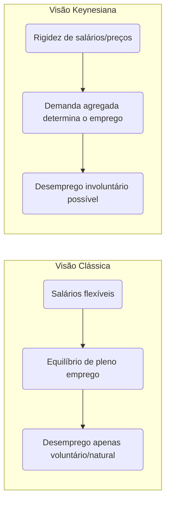

Em síntese, na visão clássica **o mercado de trabalho se autoequilibra**: o emprego é ofertado até o ponto em que o salário real iguala a produtividade marginal do trabalho, e qualquer pessoa que aceite esse salário será empregada – restando somente desemprego “natural” (gente em transição ou temporariamente desempregada por opção). Já na visão keynesiana, **podem existir equilíbrios de subemprego**, onde a falta de demanda por produtos leva a poucas contratações; mesmo pessoas dispostas a trabalhar pelos salários atuais podem não encontrar emprego, caracterizando _desemprego involuntário_. Por isso, as prescrições de política diferem: clássicos tendem a preconizar não-intervenção (ou apenas reformas pró-mercado, como flexibilização trabalhista), enquanto keynesianos defendem políticas de estímulo à demanda ou investimento público para alcançar o pleno emprego.

#### Lei de Okun: Crescimento do PIB e Desemprego

A **Lei de Okun** descreve empiricamente uma relação inversa entre o crescimento econômico e as variações na taxa de desemprego. Proposta pelo economista **Arthur Okun** nos anos 1960, ela se baseia na observação de que, quando a economia cresce mais rápido do que seu potencial, o desemprego tende a cair, e vice-versa.

**Definição e formulação:** Em termos simples, Okun encontrou que para **reduzir o desemprego** é necessário um crescimento do PIB acima do _crescimento “normal”_ (de tendência) da economia. Uma versão bastante citada da lei diz que, aproximadamente, **para cada 1 ponto percentual de redução na taxa de desemprego**, o PIB real precisa crescer cerca de **2 pontos percentuais acima do crescimento potencial** ao longo de um ano. Por exemplo, se a taxa de crescimento potencial de longo prazo do PIB é 2% ao ano, seria preciso crescer cerca de **4%** num ano para baixar o desemprego em 1 p.p. (essa é uma regra empírica, válida para economias como a dos EUA). Inversamente, se o desemprego aumenta 1 p.p., isso está associado a um PIB cerca de 2% menor do que poderia ser. Outra formulação equivalente é em termos de hiato do produto: cada ponto de desemprego acima da taxa natural está associado a uma perda de ~2% do PIB em relação ao potencial (output gap negativo).

Matematicamente, uma forma da Lei de Okun é:

$Δu≈−β(g−gpotencial​)$

onde $\Delta u$ é a variação da taxa de desemprego, $g$ é o crescimento real do PIB e $g_{potencial}$ o crescimento de potencial; $\beta$ é a _elasticidade de Okun_ (valor empírico). Por exemplo, $\beta \approx 0,5$ implica que a cada 1 ponto de crescimento acima do potencial, o desemprego cai 0,5 p.p. (aproximando a regra 2-para-1 mencionada). Há também a formulação de _hiato_:

$Y∗Y−Y∗​≈−c(u−u∗)$

em que $Y$ é PIB real, $Y^_$ PIB potencial, $u$ desemprego observado e $u^_$ desemprego natural. Aqui $c$ seria ~2 (na economia dos EUA, historicamente). Em resumo, essas fórmulas capturam a mesma ideia: **crescimento acima do normal reduz desemprego; crescimento abaixo do normal eleva desemprego**.

**Implicações práticas:** A Lei de Okun serve como **regra de bolso** para prever mudanças no desemprego dada a taxa de crescimento do PIB. Policymakers usam-na para avaliar quanto a economia precisa crescer para absorver novos entrantes no mercado de trabalho e reduzir a desocupação. Por exemplo, se a força de trabalho cresce ~1% ao ano em um país, este talvez precise crescer pelo menos esse 1% (mais ganhos de produtividade) apenas para manter o desemprego estável. Para reduzir o desemprego, o crescimento deve superar esse patamar. De fato, conforme **Ben Bernanke** resumiu, _“um crescimento do PIB próximo ao potencial normalmente é necessário apenas para manter o desemprego estável; para reduzir o desemprego, o PIB deve crescer acima do potencial”_ .

Em termos de política econômica, isso significa que após uma recessão, conseguir **taxas de crescimento elevadas** por algum período é crucial para reverter o aumento do desemprego que a recessão causou. Governos costumam definir metas de crescimento justamente pensando em Okun: por exemplo, se o desemprego está alto, buscar um crescimento robusto (via estímulos) ajuda a fechar o hiato do produto e retornar o desemprego ao nível desejado.

> [!example] **Exemplo empírico (EUA)** 
> Historicamente nos EUA pós-1945, a lei de Okun apresentou coeficientes próximos aos previstos. Por volta dos anos 1960–1980, a cada 1% de queda no desemprego correspondia ~3% de aumento no PIB (versão original de Okun). Em décadas recentes, a relação ficou mais próxima de 2:1. Durante a crise de 2008-2009, porém, houve quebras na regularidade – o PIB dos EUA caiu fortemente sem aumento proporcional do desemprego inicial, e na recuperação seguinte o emprego voltou mais lentamente (produtividade oscilante). Ainda assim, no longo prazo, confirma-se a tendência: **períodos de crescimento robusto coincidem com quedas do desemprego**, enquanto recessões fazem o desemprego disparar. O Federal Reserve acompanha essa relação para calibrar a política monetária, lembrando que a lei de Okun não é exata mas fornece um _guia útil_ – desde que se estime corretamente a taxa natural de desemprego e o potencial de crescimento.

**Observações:** A Lei de Okun é **empírica**, não uma lei teórica fixa. Os coeficientes (2 para 1, ou 3 para 1, etc.) variam conforme o país e período, dependendo de fatores como produtividade do trabalho, variação da força de trabalho, horas trabalhadas, etc. No Brasil, por exemplo, a elasticidade pode ser diferente da dos EUA – economias emergentes tendem a ter uma relação menos estável. Além disso, curto-circuitos podem ocorrer: na crise da COVID-19, muitos países viram o PIB despencar sem aumento proporcional do desemprego oficial, devido a medidas de retenção de empregos e queda da participação. Portanto, Okun é um **padrão geral** mais do que uma regra rígida. Ainda assim, sua mensagem central permanece válida: _desemprego alto sinaliza que a economia está produzindo bem abaixo do seu potencial_, e recuperar o produto é chave para reduzir a desocupação. Como lembrado anteriormente, se o PIB efetivo se iguala ao PIB potencial, o desemprego tende ao nível natural – ponto de equilíbrio entre crescimento e emprego.

#### Perguntas de Autoavaliação

> [!question] **1.** Explique a diferença entre **desemprego estrutural** e **desemprego cíclico**. 
> Que tipo de política econômica seria mais apropriada para combater cada um desses problemas?

> [!question] **2.** O que é **taxa natural de desemprego** e por que ela não é igual a zero? Relacione esse conceito com a ideia de **pleno emprego** na economia.

> [!question] **3.** De acordo com a **Lei de Okun**, o que aconteceria com a taxa de desemprego se o PIB crescesse exatamente na sua **taxa potencial** por vários anos? E o que seria necessário para reduzir significativamente o desemprego ao longo de um ano?

#### Referências

- **IBGE – PNAD Contínua,** _“Taxa de desocupação é de 6,6% e taxa de subutilização é de 15,4% no trimestre encerrado em abril/2025”_. **Agência de Notícias IBGE**, 29/05/2025. Link[agenciadenoticias.ibge.gov.br](https://agenciadenoticias.ibge.gov.br/agencia-sala-de-imprensa/2013-agencia-de-noticias/releases/43501-pnad-continua-taxa-de-desocupacao-e-de-6-6-e-taxa-de-subutilizacao-e-de-15-4-no-trimestre-encerrado-em-abril#:~:text=A%20popula%C3%A7%C3%A3o%20ocupada%20,no%20ano%20%2857%2C3)[agenciadenoticias.ibge.gov.br](https://agenciadenoticias.ibge.gov.br/agencia-sala-de-imprensa/2013-agencia-de-noticias/releases/43501-pnad-continua-taxa-de-desocupacao-e-de-6-6-e-taxa-de-subutilizacao-e-de-15-4-no-trimestre-encerrado-em-abril#:~:text=ano).
    
- **Wikipédia (pt).** _“População em idade ativa”_. Última edição: 2022. Link[pt.wikipedia.org](https://pt.wikipedia.org/wiki/Popula%C3%A7%C3%A3o_em_idade_ativa#:~:text=Sendo%20que%20Popula%C3%A7%C3%A3o%20Economicamente%20Ativa,e%20nem%20est%C3%A3o%20procurando%20trabalho)[pt.wikipedia.org](https://pt.wikipedia.org/wiki/Popula%C3%A7%C3%A3o_em_idade_ativa#:~:text=No%20Brasil%2C%20o%20Instituto%20Brasileiro,2).
    
- **Brasil Escola – Sociologia.** _“Diferentes tipos de desemprego”_ (por Paulo S. Ribeiro). Link[brasilescola.uol.com.br](https://brasilescola.uol.com.br/sociologia/diferentes-tipos-desemprego.htm#:~:text=Uma%20das%20formas%20seria%20o,desempregados%2C%20como%20o%20seguro%20desemprego)[brasilescola.uol.com.br](https://brasilescola.uol.com.br/sociologia/diferentes-tipos-desemprego.htm#:~:text=O%20quarto%20e%20%C3%BAltimo%20tipo,seus%20funcion%C3%A1rios%20para%20cortar%20despesas).
    
- **Curso de Macroeconomia – ENAP.** _Módulo 2: Emprego, Mercado de Trabalho e Distribuição de Renda._ Brasília: ENAP. Link[repositorio.enap.gov.br](https://repositorio.enap.gov.br/bitstream/1/3012/1/MACROECONOMIA_MOD_2.pdf#:~:text=trabalho%20a%20capacidade%20de%20determinar,%C3%A0s%20decis%C3%B5es%20de%20produ%C3%A7%C3%A3o%20e)[repositorio.enap.gov.br](https://repositorio.enap.gov.br/bitstream/1/3012/1/MACROECONOMIA_MOD_2.pdf#:~:text=1.%20A%20PEA%20distribui,popula%C3%A7%C3%A3o%20desempregada%20e%20a%20PEA).
    
- **Investopedia.** _“Okun’s Law: Economic Growth and Unemployment”_ (Jan 2022). Link[investopedia.com](https://www.investopedia.com/articles/economics/12/okuns-law.asp#:~:text=pace%20above%20its%20potential)[investopedia.com](https://www.investopedia.com/articles/economics/12/okuns-law.asp#:~:text=The%20law%20has%20indeed%20evolved%C2%A0over,fall%20in%20GDP).
    
- **Blog IDEG (Marcello Bolzan).** _“A prova de Economia do TPS CACD 2020 – análise”_. Publicado em 14/06/2021. Link[ideg.com.br](https://ideg.com.br/estudar-para-a-prova-de-economia-do-tps-cacd-concurso-diplomata/#:~:text=a%20taxa%20de%20crescimento%20do,chamaria%20de%20exercito%20de%20reserva).


### A Lei de Okun: Compreendendo a Relação entre Desemprego e Crescimento Econômico

#### Começando pelo essencial: O que é a Lei de Okun?

A Lei de Okun representa uma das relações empíricas mais importantes e duradouras da macroeconomia moderna. Desenvolvida pelo economista americano Arthur Okun em 1962, ela estabelece uma conexão sistemática entre duas variáveis fundamentais: a taxa de desemprego e o crescimento do produto interno bruto de um país.

Imagine que você seja um formulador de políticas tentando entender por que, quando a economia cresce rapidamente, o desemprego tende a cair, e vice-versa. A Lei de Okun fornece uma ferramenta quantitativa para compreender exatamente essa relação, permitindo prever mudanças no desemprego com base no crescimento econômico.

#### A intuição econômica por trás da lei

Antes de mergulharmos nas fórmulas, é fundamental entender por que essa relação existe. Quando uma economia produz mais bens e serviços, as empresas geralmente precisam de mais trabalhadores para atender à demanda aumentada. Inversamente, quando a produção diminui, as empresas tendem a demitir funcionários ou reduzir as horas de trabalho.

Essa relação, embora intuitiva, não é perfeita nem automática. Existem vários fatores que podem influenciar sua intensidade, como mudanças na produtividade do trabalho, alterações na jornada de trabalho e variações na participação da força de trabalho. Arthur Okun reconheceu essas complexidades e desenvolveu sua lei como uma aproximação útil da realidade, não como uma lei física imutável.

#### As duas formulações principais da Lei de Okun

A Lei de Okun pode ser expressa de duas maneiras distintas, cada uma oferecendo uma perspectiva diferente sobre a relação desemprego-produto.

##### Versão das Diferenças (Difference Version)

A primeira formulação relaciona mudanças na taxa de desemprego com a taxa de crescimento do PIB real:

__Δu = -β(g - g_)

Onde Δu representa a mudança na taxa de desemprego, g é a taxa de crescimento real do PIB, g* é a taxa de crescimento necessária para manter o desemprego constante (geralmente chamada de taxa de crescimento de tendência), e β é o coeficiente de Okun.

Para compreender essa fórmula, pense no seguinte: se uma economia precisa crescer 3% ao ano apenas para absorver novos entrantes no mercado de trabalho e manter a produtividade, então qualquer crescimento acima disso reduzirá o desemprego, enquanto crescimento abaixo disso aumentará o desemprego.

##### Versão do Hiato (Gap Version)

A segunda formulação relaciona o nível da taxa de desemprego com o hiato do produto:

__(Y - Y_)/Y_ = -β(u - u*)**

Aqui, Y representa o PIB real, Y* é o PIB potencial, u é a taxa de desemprego atual e u* é a taxa natural de desemprego. Esta versão nos permite entender quanto a economia está produzindo abaixo de seu potencial com base na diferença entre o desemprego atual e o natural.

#### O Coeficiente de Okun: Interpretação e Variações

O parâmetro β, conhecido como coeficiente de Okun, merece atenção especial. Para os Estados Unidos, onde Okun desenvolveu originalmente sua lei, esse coeficiente era aproximadamente 0,3. Isso significa que cada ponto percentual de aumento no desemprego estava associado a uma redução de aproximadamente 3% no PIB em relação ao seu potencial.

É crucial entender que esse coeficiente não é universal nem constante. Diferentes países apresentam coeficientes distintos devido a variações nas instituições do mercado de trabalho, na flexibilidade do emprego, na estrutura produtiva e nas políticas macroeconômicas. Por exemplo, países com mercados de trabalho mais rígidos podem apresentar coeficientes menores, pois as empresas ajustam mais lentamente o emprego em resposta a mudanças na demanda.

#### Fatores que influenciam a relação de Okun

Vários elementos podem alterar a intensidade da relação entre desemprego e crescimento econômico. A produtividade do trabalho desempenha um papel fundamental: quando a produtividade cresce rapidamente, é possível aumentar a produção sem necessariamente criar novos empregos na mesma proporção.

A participação da força de trabalho também afeta essa relação. Durante recessões, algumas pessoas podem se desencorajar e parar de procurar emprego, saindo da força de trabalho. Isso pode fazer com que a taxa de desemprego oficial não capture completamente o impacto real da recessão no mercado de trabalho.

As variações na jornada de trabalho representam outro fator importante. Em vez de demitir trabalhadores durante uma recessão, algumas empresas podem optar por reduzir as horas trabalhadas. Isso permite ajustar a produção sem alterar significativamente o número de empregados.

#### Aplicações práticas em política econômica

A Lei de Okun tem aplicações práticas importantes para formuladores de políticas. Bancos centrais utilizam essa relação para avaliar o impacto de suas decisões de política monetária sobre o mercado de trabalho. Se um banco central sabe que uma determinada taxa de crescimento resultará em uma redução específica no desemprego, pode calibrar suas políticas para atingir objetivos de emprego.

Governos também usam a Lei de Okun para avaliar o custo social de diferentes políticas fiscais. Por exemplo, ao considerar medidas de austeridade que possam reduzir o crescimento econômico, os formuladores de políticas podem estimar o impacto resultante no desemprego usando a relação de Okun.

#### Limitações e críticas da Lei de Okun

Embora útil, a Lei de Okun apresenta várias limitações importantes que devem ser reconhecidas. Primeiro, ela é uma relação empírica baseada em dados históricos, não uma lei econômica fundamental. Isso significa que mudanças estruturais na economia podem alterar ou até mesmo invalidar a relação.

A lei também assume que a relação entre desemprego e crescimento é linear e estável ao longo do tempo. Na realidade, essa relação pode variar dependendo do ciclo econômico, sendo potencialmente diferente durante recessões profundas comparadas a recessões moderadas.

Além disso, a Lei de Okun não considera explicitamente fatores como mudanças demográficas, transformações tecnológicas ou alterações na estrutura industrial da economia. Esses fatores podem influenciar significativamente a relação entre desemprego e crescimento.

#### Evidências empíricas e variações internacionais

Estudos empíricos têm confirmado a validade geral da Lei de Okun em muitos países, mas com coeficientes que variam consideravelmente. Países europeus com mercados de trabalho mais regulamentados tendem a apresentar coeficientes menores que os Estados Unidos, refletindo menor flexibilidade no ajuste do emprego.

Economias em desenvolvimento podem apresentar padrões diferentes devido a fatores como maior informalidade no mercado de trabalho, diferentes estruturas produtivas e instituições menos desenvolvidas. Isso destaca a importância de estimar coeficientes específicos para cada país ao aplicar a Lei de Okun.

#### Relevância para o Brasil e países em desenvolvimento

Para um futuro diplomata brasileiro, compreender a Lei de Okun é particularmente relevante ao analisar políticas econômicas domésticas e internacionais. O Brasil apresenta características únicas, como alto grau de informalidade no mercado de trabalho e maior volatilidade econômica, que podem afetar a aplicabilidade direta da lei.

Estudos sobre o Brasil sugerem que o coeficiente de Okun pode ser menor que o observado em países desenvolvidos, possivelmente devido à maior flexibilidade informal do mercado de trabalho. Durante crises, muitos trabalhadores podem migrar para o setor informal em vez de se tornarem oficialmente desempregados.

#### Conexões com outras teorias macroeconômicas

A Lei de Okun se conecta intimamente com outras teorias macroeconômicas importantes. Ela complementa a Curva de Phillips, que relaciona inflação e desemprego, formando um triângulo de relações entre crescimento, desemprego e inflação que é fundamental para a compreensão das políticas macroeconômicas.

A lei também se relaciona com teorias de crescimento econômico, especialmente ao considerar como mudanças na força de trabalho afetam o produto potencial de longo prazo. Isso é particularmente relevante para países com mudanças demográficas significativas.

#### Implicações para políticas de estabilização

Uma compreensão sólida da Lei de Okun permite aos formuladores de políticas avaliar melhor os trade-offs entre diferentes objetivos macroeconômicos. Se um governo sabe que determinada política fiscal resultará em um crescimento específico, pode usar a Lei de Okun para estimar o impacto correspondente no emprego.

Isso é especialmente importante durante recessões, quando os formuladores de políticas precisam equilibrar preocupações sobre déficits fiscais com a necessidade de manter o emprego. A Lei de Okun fornece uma ferramenta quantitativa para avaliar esses trade-offs.

Para consolidar sua compreensão, considere este exercício: se uma economia tem um coeficiente de Okun de 0,4 e precisa de 2,5% de crescimento para manter o desemprego estável, qual seria o impacto no desemprego de uma recessão que resultasse em crescimento de -1%? Usando a fórmula da versão das diferenças, o desemprego aumentaria em 1,4 pontos percentuais [0,4 × ((-1) - 2,5) = 1,4].

A Lei de Okun, portanto, representa uma ferramenta valiosa mas não infalível para compreender as dinâmicas do mercado de trabalho. Sua aplicação requer cuidadosa consideração das características específicas de cada economia e do contexto histórico e institucional relevante.

---


## [ECO-3.1] Teorias de Comércio

> Origem no vault: `07 - ECONOMIA/03 - Economia internacional/3.1 - Teorias de Comércio (Clássicas, Neoclássicas, Prebisch)/3.1_Teorias de Comércio..md` · 63.9 KB

### Teorias do Comércio Internacional: Evolução Histórica e Analítica

#### 1. O ponto de partida: Mercantilismo e a crítica liberal clássica

**Visão geral:** As primeiras reflexões sobre comércio internacional surgiram em meio ao pensamento **mercantilista** (séculos XVI–XVIII), que via a riqueza nacional como sinônimo de acumulação de metais preciosos e superávits comerciais. Os mercantilistas concebiam o comércio como um jogo de soma zero, em que uma nação só enriquece às custas de outra. Dessa perspectiva, recomendava-se intervenção estatal maciça: incentivo às exportações, barreiras às importações e colonização para obtenção de insumos, tudo para garantir entrada de ouro/prata.

> [!definition] **Mercantilismo**  
> _Definição:_ Doutrina econômica dos séculos XVI–XVIII que preconizava forte intervenção estatal para obter **superávits comerciais** e acumular **metais preciosos** (ouro/prata), entendidos como fonte da riqueza e do poder nacional. Via o comércio como jogo de **soma zero**, em que o ganho de um país representava perda para outro.

**Crítica liberal clássica:** No fim do século XVIII, pensadores clássicos desafiaram o mercantilismo. **David Hume (1758)** demonstrou, via o mecanismo preço-espécie-fluxo, que um país não poderia manter superávits comerciais indefinidamente: a entrada de ouro elevaria a oferta monetária doméstica, causando inflação e perda de competitividade das exportações, corrigindo o desequilíbrio externo. **Adam Smith (1776)**, por sua vez, redefiniu riqueza como resultado do trabalho produtivo, não dos metais, e argumentou que o comércio livre poderia beneficiar todas as nações ao permitir a **especialização**. Em _A Riqueza das Nações_, Smith formulou a **teoria das vantagens absolutas**: cada país deve se especializar nos bens em que possui _custo absoluto menor_ (maior produtividade) que os demais, exportando-os, e importar os bens em que é menos eficiente. Assim, todos ganhariam com o aumento da eficiência global.

##### Visão mercantilista vs. liberal – principais contrastes

- **Papel do Estado:** Mercantilismo defendia protecionismo e intervenção; os clássicos (Smith e Hume) advogavam livre-comércio e mínima intervenção, confiando nas forças de mercado para gerar ganhos mútuos.
    
- **Natureza do comércio:** Para mercantilistas era um **conflito distributivo** (soma zero); para os liberais, era **benéfico mutuamente** (soma positiva) graças à especialização produtiva.
    
- **Medida de riqueza:** Mercantilismo focava em metais e balança comercial; os clássicos focavam em **produção e consumo** (bem-estar geral).
    

> [!note] **Ganhos mútuos no comércio**  
> A visão liberal introduz a ideia crucial de que o comércio internacional **não** é um jogo de soma zero. Quando países se especializam conforme suas vantagens, todos podem consumir mais do que em autarquia. Smith e Ricardo mostraram que a abertura comercial permite uma situação de _ganho mútuo_, ampliando o bem-estar agregado – conceito central que contraria a mentalidade mercantilista.

##### Teoria das Vantagens Absolutas – _Adam Smith (1776)_

Smith postulou que um país tem **vantagem absoluta** na produção de um bem quando é capaz de produzi-lo com custo menor (ou produtividade maior) que seus parceiros. Nesse caso, é benéfico que cada nação se dedique a produzir os bens em que é absolutamente mais eficiente e troque o excedente com outras nações. No exemplo clássico de Smith, se Portugal produz vinho e tecidos com menos trabalho que a Inglaterra, e esta produz ferramentas com mais eficiência, ambos ganhariam ao trocar vinho português por ferramentas inglesas, por exemplo. Essa especialização **eleva a produção total mundial**, permitindo que cada país consuma mais do que seria possível isoladamente.

Contudo, a teoria das vantagens absolutas apresentava uma **limitação séria**: e se um país não tiver vantagem absoluta em nada? Smith não oferecia resposta para uma nação que fosse menos eficiente em _todos_ os bens. Sem vantagem absoluta, pela lógica smithiana, essa nação ficaria excluída do comércio. Esse limite abria espaço para uma teoria mais abrangente, desenvolvida por David Ricardo.

##### Teoria das Vantagens Comparativas – _David Ricardo (1817)_

**Essência da teoria:** Ricardo demonstrou que _mesmo que um país seja menos eficiente na produção de todos os bens (ou outro seja mais eficiente em tudo), ainda assim o comércio pode beneficiá-los a ambos_. O critério relevante não são os custos absolutos, mas os **custos relativos** (custos de oportunidade). Ou seja, cada país deve especializar-se na produção do bem em que sua **ineficiência** relativa é menor (ou sua eficiência relativa é maior), e importar aqueles bens em que é _relativamente_ menos eficiente.

Em termos simples, um país possui **vantagem comparativa** na produção de um bem se o _custo de oportunidade_ de produzir esse bem (medido em quantas unidades de outro bem deixam de ser produzidas) é menor que em outros países. Assim, mesmo um país sem vantagem absoluta pode exportar o bem em que é “menos ineficiente” e importar os demais. Ricardo formalizou essa ideia com seu famoso exemplo envolvendo **Inglaterra** e **Portugal**: embora Portugal fosse absolutamente mais produtivo que a Inglaterra tanto em vinho quanto em tecido, a sua vantagem era relativamente maior em vinho. Logo, Portugal deveria especializar-se em vinho e trocar por tecido inglês, permitindo que ambos consumissem mais de ambos os bens.

> [!definition] **Vantagem Comparativa**  
> _Definição:_ Capacidade de um país produzir um bem a um **custo de oportunidade menor** que outro país. Mesmo que um país não tenha vantagem absoluta em nenhum bem, ele terá vantagem comparativa naquele cuja produção sacrifica menos outros bens. A teoria demonstra que a especialização segundo vantagens comparativas permite **ganhos mútuos** no comércio internacional [fep.up.pt](https://www.fep.up.pt/disciplinas/lec207/apoio/ei_classicos.pdf#:~:text=David%20Ricardo%20tentou%20mostrar%20que,das%20vantagens%20comparativas%2C%20vejamos%20o)[fep.up.pt](https://www.fep.up.pt/disciplinas/lec207/apoio/ei_classicos.pdf#:~:text=nulo%2C%20uma%20vez%20que%20Portugal,comparativa%20ou%20relativa%20permite%20determinar).

**Por que o comércio é vantajoso mesmo assim?** Porque ao se especializar conforme vantagens comparativas, cada país desloca recursos para atividades relativamente mais produtivas internamente, aumentando a eficiência global. O resultado é que a produção **mundial** de cada bem cresce ou, pelo menos, cada país obtém mais do bem importado do que se tentasse produzi-lo internamente. A troca permite que ambos países consumam além de suas fronteiras de produção em autarquia, repartindo os ganhos do aumento de eficiência. Em suma, **é o diferencial de eficiência relativa – não a absoluta – que fundamenta os ganhos do comércio** .

**Custo de oportunidade:** Ricardo não usou explicitamente esse termo, mas posteriormente economistas (Haberler, 1936) generalizaram a teoria em termos de custo de oportunidade. Por exemplo, se o **Brasil** produz 1 tonelada de soja ao custo de deixar de produzir 2 toneladas de milho, enquanto os **EUA** para produzir 1 tonelada de soja sacrificam 5 de milho, então o Brasil tem custo de oportunidade menor em soja (e comparativamente maior em milho). Logo, compensa ao Brasil exportar soja e importar milho dos EUA, mesmo que os EUA fossem mais eficientes em termos absolutos em ambas as culturas.

> [!example] **Exemplo simplificado – Brasil e Inglaterra:**  
> Considere que no **Brasil** um trabalhador produz 1 sapato ou 2 bolsas por hora, enquanto na **Inglaterra** um trabalhador produz 6 sapatos ou 3 bolsas por hora. A Inglaterra tem vantagem absoluta na produção de _ambos_ (é mais eficiente em sapatos e bolsas). Segundo Smith, não haveria comércio. **Ricardo**, porém, observa os custos de oportunidade: no Brasil, abrir mão de 1 sapato permite fazer 2 bolsas; já na Inglaterra, deixar de produzir 1 sapato permite 0,5 bolsa. Ou seja, o Brasil sacrifica mais bolsas por cada sapato que produza – seu custo de oportunidade de sapatos é maior. Em contrapartida, o custo de oportunidade de produzir bolsas no Brasil (0,5 sapato por bolsa) é menor que na Inglaterra (2 sapatos por bolsa). **Conclusão:** o Brasil tem vantagem comparativa em **bolsas** e deve exportá-las, importando **sapatos** ingleses. Assim, ambos se beneficiam: cada país se dedica ao bem que produz relativamente melhor e troca pelo outro, aumentando o consumo total de sapatos e bolsas.

**Implicações e avaliação:** A teoria das vantagens comparativas de Ricardo foi um marco, constituindo a base intelectual em favor do livre-comércio. Ela explica o **padrão de comércio** entre países com diferentes **tecnologias ou eficiências** setoriais. No modelo **ricardiano original** (1 fator – trabalho), há previsões importantes: (i) especialização _completa_ de cada país no bem de vantagem comparativa (pois assumindo retornos constantes, não há razão para produzir o bem desvantajoso); (ii) igualdade de salários (produtividade marginal do trabalho) entre países não é garantida, mas os salários refletem a produtividade nacional; (iii) ganhos líquidos do comércio para cada nação, embora possa haver distribuição desigual internamente (Ricardo em si não tratou de distribuição entre grupos).

> [!note] **Limitações do modelo Ricardiano:**
> 
> - Supõe **especialização completa**, algo raramente visto na prática – países normalmente produzem diversos bens por questões de preferências, custo de transporte, políticas et
>     
> - Baseia-se em um único fator de produção (trabalho) e não trata da distribuição de renda entre diferentes fatores (capital, terra, trabalho qualificado). Assim, não prevê como os ganhos do comércio se repartem internamente.
>     
> - Ignora **economias de escala** e **diferenciação de produto** como motivos de comércio – aspectos que só seriam incorporados teoricamente no século XX.
>     

**Saldo histórico:** As ideias de Smith e Ricardo consolidaram a visão de que o comércio internacional tende a ser **benéfico** e fundamentado em vantagens de produtividade. Essa visão liberal clássica guiou a defesa do livre-comércio ao longo do século XIX. Contudo, o modelo ricardiano simplificado logo seria expandido para incluir múltiplos fatores de produção e analisar os efeitos do comércio sobre a **distribuição de renda** dentro dos países – o que nos leva às teorias neoclássicas.

#### 2. As Teorias Neoclássicas e a Dotação de Fatores

No início do século XX, economistas suecos aprofundaram a análise das causas do comércio internacional, indo além das diferenças tecnológicas da teoria clássica. O chamado modelo **Heckscher-Ohlin (H-O)** incorporou **múltiplos fatores de produção** e diferenças na _dotação relativa_ desses fatores entre países como motor do comércio. Trata-se de uma abordagem **neoclássica** (baseada em equilíbrio geral e escolhas ótimas) que gerou também importantes teoremas sobre distribuição de renda e crescimento.

##### O Modelo Heckscher-Ohlin (H-O)

> [!definition] **Heckscher-Ohlin (HO):**  
Modelo de comércio internacional que explica o padrão do comércio com base na diferença relativa de **dotação de fatores de produção** entre os países.

**Ideia central:** Países diferem na **dotação relativa de fatores** (trabalho, capital, terra, etc.), e bens diferem na **intensidade de uso** desses fatores. Um país **abundante** em determinado fator terá custo relativamente baixo nesse fator e, portanto, vantagem em produzir bens que o utilizam intensivamente. Assim, **cada país exportará os bens que utilizam intensivamente seus fatores abundantes e importará os bens que utilizam intensivamente seus fatores escassos**. Em outras palavras, a vantagem comparativa decorre da _dotação de fatores_, não apenas de produtividade tecnológica.

> Essa proposição é conhecida como **Teorema Heckscher-Ohlin**: diferenças nas dotações fatoriais explicam o padrão de especialização. Por exemplo, um país com muita terra e capital mas pouca mão de obra terá vantagem em bens **intensivos em terra/capital** (ex.: grãos em larga escala) e importará bens **intensivos em trabalho** (ex.: têxteis). Já um país abundante em trabalho exportará bens intensivos em mão de obra e importará bens de capital intensivo.

**Assunções principais:** O modelo H-O clássico supõe 2 países, 2 bens, 2 fatores (modelo "2x2x2"), concorrência perfeita e retornos constantes de escala. Assume ainda que as **tecnologias são similares** entre países (para concentrar as diferenças no fator de produção) e que os fatores são _internamente móveis_ (entre setores) mas _imóveis internacionalmente_. Nessas condições, as vantagens comparativas derivam **unicamente** das diferenças de fatores: o país com abundância relativa de trabalho terá custos de mão de obra mais baixos e especializar-se-á em bens labor-intensivos; o país rico em capital produzirá relativamente mais bens capital-intensivos.

Um corolário importante é que, se não houver restrições ao comércio, a concorrência tendencialmente **equaliza os preços dos fatores** entre países: é o chamado _Teorema da Equalização do Preço dos Fatores_. Simplificadamente, quando dois países comerciam livremente bens, indiretamente estão "comerciando" trabalho e capital embutidos nos produtos, equalizando a remuneração desses fatores (salários, juros) entre si – pelo menos no modelo teórico ideal (na realidade, obstáculos como tarifas, custos de transporte e tecnologias distintas impedem a completa equalização).

**Exemplo aplicado – Brasil e China:** O comércio Brasil-China ilustra bem a lógica H-O. O **Brasil** é abundante em **terras férteis e recursos naturais**, além de capital natural (minérios, petróleo), enquanto a **China** é extremamente abundante em **mão de obra** e desenvolveu grande base de **capital industrial**. De acordo com H-O, o Brasil tende a exportar bens intensivos em terra e recursos (commodities agropecuárias como soja, carnes; minérios e petróleo) e importar da China bens intensivos em trabalho e capital manufatureiro (eletrônicos, máquinas, têxteis). De fato, em 2024 cerca de 28% das exportações brasileiras destinaram-se à China, com destaque para soja em grão, petróleo e minério de ferro, enquanto 24% das importações brasileiras vieram da China, consistindo majoritariamente em produtos manufaturados como químicos, eletrônicos e máquinas. Esse padrão confirma que cada país exporta o que faz uso intensivo de seus fatores abundantes – o Brasil, recursos naturais; a China, trabalho e capacidade industrial.

> [!example] **Comércio Brasil–China sob a ótica H-O:**  
> _Brasil:_ abundante em terra e recursos naturais ⇒ **Exporta** commodities agrícolas (soja, carnes), minerais (minério de ferro) e energéticos (petróleo).  
> _China:_ abundante em mão de obra e capital industrial ⇒ **Exporta** bens manufaturados intensivos em trabalho e tecnologia (máquinas, eletrônicos, produtos químicos).  
> _Ganho mútuo:_ O Brasil importa bens industrializados mais baratos da China, enquanto a China importa alimentos e insumos que não pode produzir com igual eficiência. Cada qual aproveita seu fator abundante, conforme prevê Heckscher-Ohlin.

**Teoremas de Stolper-Samuelson e Rybczynski:** O modelo H-O trouxe também previsões sobre distribuição de renda e efeitos de mudanças de dotação, conforme discutido a seguir.

##### Teorema de Stolper-Samuelson (SS)

Formulado por Wolfgang Stolper e Paul Samuelson (1941), este teorema analisa o impacto do comércio (ou variações de preços) sobre a remuneração dos fatores dentro de um país. Em resumo, o teorema SS afirma que **a abertura comercial beneficia o fator _abundante_ de um país e prejudica o fator _escasso_** em termos reais. Mais formalmente: **um aumento no preço relativo de um bem exportado eleva o salário real/retorno real do fator usado intensivamente na produção desse bem, e reduz o rendimento real do outro fator**.

No contexto de livre-comércio, isso significa que:

- No país com abundância de trabalho (exportador de bens labor-intensivos), a abertura _elevará os salários reais_ dos trabalhadores e _reduzirá a remuneração real do capital_ (já que o bem importado é capital-intensivo e seu preço relativo cai).
    
- No país rico em capital (exportador de bens capital-intensivos), o livre-comércio _beneficiará os detentores de capital_ (lucros, juros sobem em termos reais) e _prejudicará os trabalhadores_ menos qualificados (salários reais caem), pois o bem importado intensivo em trabalho fica relativamente mais barato.
    

Em outras palavras, **o comércio tem efeitos redistributivos internos**: há _vencedores e perdedores dentro de cada país_. Isso é um resultado importante porque contrasta com a visão de Ricardo (que não detalhou a distribuição). Mostra que, embora o país como um todo ganhe em eficiência, certos grupos podem perder poder de compra – o que explica os conflitos políticos em torno do livre-comércio.

> [!important] **Impacto distributivo do comércio (Stolper-Samuelson)**  
> A abertura comercial tende a **aumentar a renda real do fator abundante** e **reduzir a do fator escasso**. Ou seja, nem todos dentro de um país ganham igualmente com o comércio: os setores/fatores competitivos internacionalmente prosperam, enquanto os setores antes protegidos (intensivos no fator escasso) sofrem com a concorrência externa. _Exemplo:_ no Brasil (abundante em terra e trabalho), agricultores e trabalhadores ganham com as exportações agrícolas, mas indústrias intensivas em capital e seus investidores podem enfrentar perda de rentabilidade frente a importações baratas de bens de capital.

##### Teorema de Rybczynski

Proposto por Tadeusz Rybczynski (1955), este teorema examina o efeito de uma variação na dotação de fatores sobre a produção setorial, mantendo os preços dos bens constantes (p. ex., num país participante de comércio mundial com preços dados). O resultado: **um aumento na dotação de um fator de produção expandirá _mais que proporcionalmente_ a produção do bem que usa intensivamente esse fator e _reduzirá_ a produção do outro bem** (que usa relativamente mais o fator inalterado).

Por exemplo, se a força de trabalho de um país crescer (migração, boom populacional) e o capital fixo permanecer o mesmo, a produção do bem **trabalho-intensivo** aumentará significativamente, enquanto a do bem **capital-intensivo** encolherá – porque o trabalho adicional vai majoritariamente para o setor que mais o utiliza, e para expandir este setor retira-se algum capital do outro setor, contraindo-o. Da mesma forma, se um país acumula capital (investimento), ele produzirá muito mais do bem capital-intensivo e menos do bem trabalho-intensivo, dado que o trabalho não se expandiu na mesma proporção.

O teorema de Rybczynski tem implicações sobre o **desenvolvimento**: por exemplo, a expansão da dotação de capital de um país (via investimento ou entrada de K estrangeiro) pode levar à desindustrialização de setores labor-intensivos, e vice-versa. Também explica como mudanças populacionais ou de qualificação alteram a estrutura produtiva de uma economia aberta.

> [!definition] **Teorema de Rybczynski**  
> _Definição:_ Em um modelo de comércio com dois bens e dois fatores, se os preços dos bens permanecem constantes (demandas mundiais perfeitamente elásticas), um **aumento na dotação de um fator** provoca uma expansão **mais que proporcional** na produção do bem que usa intensivamente esse fator **e** uma redução absoluta na produção do outro bem.  _Exemplo:_ Se o estoque de capital de um país crescer (p.e. investimento externo), a produção do setor capital-intensivo aumentará acentuadamente, enquanto a produção do setor trabalho-intensivo cairá – assumindo preços internacionais fixos.

##### O Paradoxo de Leontief e explicações alternativas

A teoria Heckscher-Ohlin dominou a visão econômica nos anos 1930–40. Contudo, em 1953, **Wassily Leontief** realizou o primeiro grande teste empírico do modelo e obteve um resultado inesperado, conhecido como **Paradoxo de Leontief**. Ao analisar a estrutura das exportações e importações dos EUA (então o país mais capital-abundante do mundo), Leontief encontrou que as **exportações dos EUA eram mais intensivas em trabalho do que as importações**, que por sua vez eram mais intensivas em capital. Em outras palavras, os EUA – abundantes em capital – _exportavam bens tipicamente labor-intensivos e importavam bens capital-intensivos_, contrariando a previsão de H-O. Esse paradoxo sugeriu que algo estava faltando na explicação.

**Possíveis explicações para o paradoxo:**

- **Capital humano e qualificação:** Leontief não distinguiu trabalho qualificado de não qualificado. Os EUA poderiam ser abundantes em **trabalho qualificado** (engenheiros, técnicos) e suas exportações – embora intensivas em trabalho no cálculo – eram intensivas em _trabalho altamente qualificado_, que pode ser visto como “quase capital” dado o investimento em educação. Vistos assim, os EUA exportariam bens intensivos em **“capital humano”** e importariam bens intensivos em trabalho não qualificado, alinhando-se melhor à vantagem de fatores qualificados. De fato, muitos argumentaram que a vantagem comparativa dos EUA residia na mão de obra altamente produtiva, mais do que no capital físico. Reclassificando o fator "trabalho qualificado" como capital humano, as exportações americanas se mostrariam intensivas em _capital (físico + humano)_, resolvendo o paradoxo em grande medida.
    
- **Diferenças tecnológicas:** H-O assume tecnologias iguais, mas se os EUA tinham tecnologia superior em certos setores, poderiam produzir bens labor-intensivos de forma tão eficiente que competiam internacionalmente, invertendo o padrão esperado. Ou seja, **vantagens tecnológicas** (estilo Ricardiano) podem ter mascarado as diferenças de dotação. Alguns economistas concluíram que a explicação Ricardiana (diferenças de produtividade) continuava relevante – os EUA exportavam bens nos quais eram _tecnologicamente_ muito eficientes, mesmo que não correspondessem à sua dotação de capital.
- **Recursos naturais:** Leontief comparou apenas “capital vs. trabalho”. Se considerarmos **recursos naturais/terra** como fator separado, pode-se observar que boa parte das importações americanas na época eram produtos agrícolas e matérias-primas (algodão, minerais) intensivos em terra, que era relativamente escassa nos EUA industriais pós-guerra. Assim, incorporando a dotação de terra, os EUA seriam escassos nesse fator e importariam bens terra-intensivos, o que está de acordo com H-O. Enquanto isso, suas exportações manufaturadas utilizavam intensivamente capital e trabalho qualificado.
    
- **Preferências domésticas (Hipótese de Linder):** Stefan Linder (1961) sugeriu que países com demandas domésticas semelhantes tendem a comerciar entre si _produtos similares_. Ou seja, parte do comércio não é explicado por vantagens comparativas tradicionais, mas por **similitudes de preferências** em países de renda próxima. No caso dos EUA, sua pauta de comércio poderia refletir a produção de bens que satisfazem preferências domésticas sofisticadas, alguns dos quais exportados para outros países ricos, enquanto importam outros bens diferenciados. A hipótese de Linder, portanto, enfatiza a **demanda**: países de renda alta produzem e trocam entre si bens de consumo diferenciados para atender gostos parecidos. Essa ideia antecipa a importância do **comércio intra-industrial** entre países similares (tema da próxima seção) e vai além da simples dotação de fatores.
    

Em suma, o paradoxo de Leontief motivou ajustes na teoria e abriu caminho para **novas teorias do comércio**. Hoje se reconhece que a abordagem H-O é válida sob certas condições, mas a realidade do comércio é influenciada também por diferenças tecnológicas, capital humano, recursos naturais e preferências. Na segunda metade do século XX, a constatação de que grande parte do comércio ocorre entre países similares, frequentemente trocando bens da mesma indústria, levou ao desenvolvimento da chamada **Nova Teoria do Comércio**, explorada a seguir.

#### 3. As Teorias Contemporâneas do Comércio

A partir dos anos 1970-80, economistas buscaram explicar fenômenos que os modelos clássicos e neoclássicos não previam bem: por que países de estrutura semelhante (p.ex., duas nações industrializadas) **comercializam intensamente entre si**, frequentemente trocando **variedades do mesmo tipo de produto** (**comércio intra-industrial**)? Por que existem **empresas multinacionais** e **cadeias globais de valor**? Para responder, surgiram teorias incorporando **economias de escala**, **concorrência imperfeita**, **diferenciação de produtos** e, mais recentemente, **heterogeneidade das firmas**. Essas abordagens não substituem as anteriores, mas complementam a compreensão dos padrões de comércio.

##### Comércio Intra-industrial e Economias de Escala

**Fato estilizado:** Uma parcela muito grande do comércio global ocorre _dentro da mesma indústria_ entre países desenvolvidos. Por exemplo, países europeus exportam e importam automóveis entre si; os EUA simultaneamente exportam e importam produtos químicos, máquinas e eletrônicos da UE e Japão. Estima-se que cerca de **60% do comércio entre economias avançadas seja intra-industrial**. Essas trocas envolvem bens semelhantes (carros por carros, eletrônicos por eletrônicos) e não se explicam pelas teorias de vantagens comparativas tradicionais, que preveriam que cada país se especializasse totalmente em certos bens.

As **teorias clássicas/HO** esperariam comércio principalmente _inter-industrial_ (cada país exportando setores diferentes e importando setores em que não tem vantagem). De fato, elas explicam bem o comércio **Norte–Sul** (entre países de níveis distintos de desenvolvimento ou dotações). Porém, não explicam satisfatoriamente o comércio **Norte–Norte** (entre países avançados com fatores e tecnologias semelhantes) nem a troca de **variedades de um mesmo bem**. Também não contemplam elementos modernos como **economias de escala** (o aumento de eficiência com a produção em larga escala) e **preferências por variedade**.

**Nova Teoria do Comércio (Krugman e outros):** Na década de 1980, Paul **Krugman**, Elhanan Helpman, Kelvin Lancaster e outros desenvolveram modelos considerando **retornos crescentes de escala** e **concorrência imperfeita**. A premissa é que muitas indústrias apresentam _custos fixos_ elevados e, portanto, uma escala maior de produção reduz o custo unitário (**economias de escala internas**). Além disso, consumidores apreciam **diferenciação de produtos** – variedades diferentes do mesmo bem (ex.: um consumidor pode preferir um carro alemão BMW e outro um francês Peugeot, e valorizar ter ambas opções no mercado).

> [!definition] **Economias de Escala (Retornos Crescentes)**  
> _Definição:_ Situação em que o **custo médio de produção diminui** à medida que a quantidade produzida aumenta. Ou seja, dobrar os insumos mais do que dobra a produção, reduzindo custos unitários. Em comércio internacional, economias de escala incentivam a **especialização da produção** em poucos locais, para atingir mercados globais com maior eficiência.

**Como economias de escala geram comércio?** Em um modelo com _concorrência monopolística_ (muitas empresas, cada uma produzindo uma variedade diferenciada) – típico da Nova Teoria –, mesmo países idênticos se beneficiarão trocando bens: cada país pode especializar-se em produzir algumas variedades com grande escala e eficiência, e importar as variedades que não produz. O resultado é que todos dispõem de maior **variedade de produtos** a preços mais baixos (devido à escala) do que se cada país tentasse produzir de tudo em pequena escala. Assim, o comércio é _ganha-ganha_ mesmo sem diferenças de tecnologia ou fatores, pois baseia-se no **aumento de variedade e redução de custos**.

**Exemplo de comércio intra-industrial:** Os países da **União Europeia** produzem automóveis de diversas marcas. A **Alemanha** produz BMW, Audi; a **França**, Peugeot, Renault; a **Itália**, Fiat, etc. Graças ao mercado integrado, cada país pode consumir não só os carros nacionais mas também os importados dos vizinhos. Alemanha exporta BMW para franceses e importa Renaults e Peugeots, e vice-versa. Todos os países europeus assim desfrutam de maior diversidade de modelos e beneficiam-se de custos menores, pois cada montadora concentra a produção de determinados modelos em fábricas com grande escala. Esse fluxo de **carros por carros** é comércio intra-industrial – algo inexplicável pelos modelos clássicos, mas previsto pela Nova Teoria do Comércio baseada em **diferenciação de produto e economias de escala**.

> [!example] **Exemplo – Comércio Intra-industrial na UE (setor automotivo):**  
> Tanto **Alemanha** quanto **França** produzem automóveis, mas ainda assim trocam **grandes volumes de carros entre si**. A Alemanha exporta BMWs e Mercedes para o mercado francês, enquanto a França exporta Renaults e Peugeots para a Alemanha. Nenhum dos dois “abandona” a produção de veículos – ao contrário, cada país se especializa em **modelos/marcas específicas** e importa o restante. Esse intercâmbio de variedades ocorre porque a produção em larga escala de poucos modelos por país torna-os mais baratos (economia de escala) e consumidores demandam diversidade de opções. Assim, aproximadamente **60% do comércio total europeu** é intra-industrial, refletindo especialização em variedades e vantagens de escala.

**Ganho com variedade e competição:** Além das economias de escala, o comércio em mercados imperfeitos traz outros benefícios. A entrada de produtos estrangeiros aumenta a **concorrência interna**, forçando empresas domésticas a se tornarem mais eficientes e reduzindo seu poder de monopólio, o que tende a baixar preços para o consumidor. Ademais, consumidores ganham acesso a uma gama mais ampla de produtos (ganho pela variedade) que não existiria sem comércio. Krugman quantificou esses ganhos de variedade em alguns mercados, mostrando serem significativos para o bem-estar.

Resumidamente, a Nova Teoria do Comércio explica **padrões não previstos por Ricardo/Heckscher-Ohlin**, especialmente comércio entre países semelhantes e intra-indústrias, incorporando elementos antes negligenciados:

- **Retornos crescentes de escala:** incentivo à especialização e exportação mesmo sem diferenças de fatores.
    
- **Produtos diferenciados e preferência por variedade:** justificam trocas de bens similares.
    
- **Estruturas de mercado imperfeitas (monopolística ou oligopólio):** permitem que empresas utilizem economias de escala e segmentem mercados, inclusive via comércio.
    
- **"Home Market Effect":** mercados maiores tendem a abrigar empresas e indústrias com economias de escala, produzindo mais que a demanda doméstica e exportando o excedente (uma implicação formal dos modelos de Krugman).
    

##### Modelos de Krugman (1980) – Economias de escala e concorrência imperfeita

Paul **Krugman** (Prêmio Nobel de Economia em 2008) foi o pioneiro a formalizar a incorporação de economias de escala e competição monopolística em modelos de comércio, em artigos seminal de 1979-1980. Em seu modelo típico:

- Há **muitos bens diferenciados** dentro de um setor e consumidores que valorizam variedade (utilidade do tipo “amor pela variedade”).
    
- Cada firma produz uma variedade e enfrenta custos fixos significativos ⇒ **monopólio natural** daquela variedade, mas com concorrência livre de entrada (concorrência monopolística).
    
- Países inicialmente simétricos começarão a produzir subconjuntos das variedades, e o **comércio** ocorre para cada país consumir variedades estrangeiras.
    
- Os ganhos vêm de: (1) **maior variedade** de consumo; (2) **menores custos médios** por variedade devido à produção concentrada em menos locais de grande escala; (3) **pressão competitiva** que reduz sobrepreços.
    

O modelo de Krugman mostrou que mesmo sem qualquer diferença de produtividade ou fatores, o comércio melhora o bem-estar. Além disso, ele explicou fenômenos observados empiricamente, como a existência de **comércio bilateral significativo entre economias desenvolvidas** e porque essas trocas ocorrem predominantemente em setores de bens diferenciados (indústrias automobilística, química, eletrônicos, etc.).

Krugman também explorou casos de **economias de escala externas** (quando a concentração geográfica de um setor beneficia todas as firmas via encadeamentos, conhecimento compartilhado), o que explica, por exemplo, por que certos países se especializam em certas indústrias não apenas por dotação, mas por vantagens adquiridas (industrial clusters, efeitos de aglomeração). Isso foge do escopo direto do comércio intra-industrial, mas conecta-se a padrões de especialização histórica.

##### Teoria do Ciclo de Vida do Produto – _Raymond Vernon (1966)_

Outra perspectiva importante nas teorias contemporâneas é a dinâmica temporal das vantagens comparativas. **Raymond Vernon**, observando o pós-guerra, propôs a _Teoria do Ciclo de Vida do Produto_ para explicar por que certos bens são inicialmente exportados por um país inovador e, anos depois, esse mesmo país passa a importá-los. A teoria delineia **três fases** principais no ciclo de vida de um novo produto e como cada fase afeta o padrão de comércio:

1. **Novo produto (introdução):** um bem inovador é desenvolvido e produzido no país inventor (tipicamente uma economia avançada com alto poder de compra, que demanda a novidade). A produção piloto ocorre localmente, próxima ao centro de P&D, e o consumo é doméstico ou restrito. _Ex:_ Nos anos 1970, os EUA inventaram microcomputadores – inicialmente produzidos e consumidos quase só nos EUA. Nessa fase, há **monopólio de inovação** e geralmente **nenhuma exportação** significativa (a tecnologia é recém-criada, outros países nem demandam ainda).
    
2. **Produto em maturação (crescimento):** o produto ganha aceitação e demanda cresce também em outros países desenvolvidos. Começam as **exportações** do país inovador para outros mercados avançados. As firmas aprimoram processos, podendo padronizar partes da produção. Em muitos casos, empresas do país original **instalam fábricas em outros países ricos** para atender aos mercados externos ou esses países começam a produzir localmente via licenças ou imitação. A concorrência aumenta. _Ex:_ Alguns anos após a invenção do microcomputador, empresas americanas começaram a exportá-lo para Europa/Japão; posteriormente, surgiram fabricantes japoneses e europeus de computadores.
    
3. **Produto padronizado (maturidade/standardização):** o bem torna-se amplamente conhecido, a tecnologia estabiliza (pouca inovação incremental) e a produção se torna **rotineira**, com foco em custos. Agora o fator-chave é produzir ao custo mais baixo possível. Isso frequentemente leva à **transferência da produção para países em desenvolvimento**, onde há custos menores de mão de obra. O país que originalmente inovou perde sua vantagem especial – outros dominam a produção em massa. Em muitos casos, o país inovador passa a **importar** o produto de baixo custo que antes exportava. _Ex:_ Décadas depois, a produção de computadores pessoais migrou em grande parte para Ásia (China, Taiwan, etc.), e os EUA passaram a importar computadores fabricados externamente. O mesmo ocorreu com produtos como televisores: inventados nos EUA, depois fabricados no Japão, e mais tarde em massa em economias emergentes, com os EUA importando TVs.
    

> [!important] **Comparativo das Fases – Ciclo de Vida do Produto:**
> 
> - _Fase de Inovação:_ Vantagem comparativa no país **inovador** (avançado); produção e consumo locais, tecnologia exclusiva.
>     
> - _Fase de Expansão:_ Outros países avançados adotam o produto; o país inovador **exporta**, mas começa a surgir concorrência externa (produção se espalha entre países desenvolvidos).
>     
> - _Fase de Padronização:_ Vantagem comparativa desloca-se para países **de menor custo**; produção relocalizada para emergentes; o inovador original pode se tornar **importador** do próprio produto que criou [en.wikipedia.org](https://en.wikipedia.org/wiki/Product_life-cycle_theory#:~:text=In%20the%20new%20product%20stage%2C,the%20product%20to%20developed%20countries).
>     

Essa teoria explica, portanto, uma **mudança dinâmica** no padrão de comércio – é uma forma de _vantagem comparativa dinâmica_. Inicialmente, a **inovação tecnológica** dá vantagem a quem inventa; depois, quando a tecnologia se difunde e o produto vira commoditie, prevalecem os **custos de produção baixos**, tipicamente encontrados em países em desenvolvimento. Vernon desenvolveu essa ideia para esclarecer paradoxos como o dos EUA importarem bens que eles próprios haviam pioneirado (caso de eletrônicos, por exemplo).

A teoria do ciclo de vida não contradiz H-O ou Ricardo, mas complementa: mostra que a **vantagem comparativa não é estática**, ela pode migrar conforme um setor evolui. Também ajuda a entender os fluxos de **investimento direto estrangeiro**: empresas de países avançados investem em fábricas no exterior quando o produto atinge maturidade, buscando mão de obra barata (nascimento das multinacionais industriais).

```mermaid
flowchart LR
    A["Novo Produto<br>🔹Inovação em país desenvolvido<br>🔹Produção e consumo locais<br>🔹Exportações inexistentes ou iniciais"]
    B["Produto em Crescimento<br>🔹Aumento da demanda global (outros países desenvolvidos)<br>🔹Início de exportações do país inovador<br>🔹Produção expande-se a outros países avançados"]
    C["Produto Padronizado<br>🔹Produção torna-se de baixo custo e intensiva em escala<br>🔹Deslocamento da manufatura para países em desenvolvimento<br>🔹País inovador importa o produto antes exportado"]
    A --> B --> C
```

_Exemplo histórico:_ O **telefone celular** segue padrão semelhante: inventado e primeiro comercializado nos EUA/Motorola (anos 1980), depois houve grande produção e inovação na Europa/Japão (Nokia, Ericsson nos 1990s), e hoje, já padronizado, a maioria dos celulares é produzida na China/Vietnã/Índia para marcas globais, enquanto os países originais importam esses aparelhos de volta.

##### “Novas Novas” Teorias do Comércio – Heterogeneidade das Firmas (Melitz)

Por fim, as pesquisas dos anos 2000 inauguraram o que se chama de “**novas novas teorias**” do comércio internacional, focadas em **diferenças entre empresas individuais** dentro do mesmo setor. Marc **Melitz** (2003) é referência-chave: ele incorporou ao modelo de Krugman a ideia de que as firmas têm **produtividades distintas** e que participar do comércio implica custos fixos (por exemplo, custos de estabelecer rede de distribuição no exterior). As principais implicações dessa linha teórica:

- **Somente algumas firmas exportam:** Mesmo em setores abertos ao comércio, geralmente apenas uma parcela das empresas tem produtividade suficientemente alta para cobrir os custos fixos de exportação e competir no exterior. Firmas **menos produtivas servem apenas o mercado doméstico** ou até fecham quando enfrentam concorrência estrangeira. “Países não comerciam, quem comercia são as firmas” – há grande heterogeneidade de desempenho.
    
- **Realokação e ganhos de produtividade:** A abertura comercial provoca uma **seleção das firmas**: as empresas mais produtivas expandem-se para exportar, enquanto as menos produtivas podem contrair ou sair do mercado diante da competição. Recursos (trabalho, capital) realocam-se das firmas menos eficientes para as mais eficientes. Isso gera um **aumento da produtividade média** do setor. Ou seja, além dos ganhos tradicionais (especialização, variedade), o comércio traz um ganho novo via **realocação** eficiente _dentro_ das indústrias [irpp.org](https://irpp.org/research-studies/international-trade-with-firm-heterogeneity/#:~:text=Lapham%20describes%20an%20important%20model,and%20more%20productive%20than%20nonexporters). Melitz mostrou que essa melhoria agregada na produtividade é um canal importante de ganho de bem-estar, evidenciado empiricamente.
    
- **Efeitos distributivos entre empresas e trabalhadores:** Como apenas as firmas melhores conseguem exportar, elas tendem a crescer e obter lucros maiores com a integração internacional, enquanto firmas não exportadoras ficam estagnadas ou encolhem. Isso pode ampliar a concentração em certos setores. Também, trabalhadores qualificados podem se concentrar em firmas exportadoras mais produtivas (que frequentemente pagam melhores salários), levando a **diferenças salariais** dentro do mesmo setor entre empresas exportadoras e não exportadoras.
    
- **Novas margens de ajuste:** As _antigas_ teorias focavam na quantidade de comércio de cada setor (intensidade). A abordagem heterogênea destaca duas “margens” de comércio: a **extensiva** (quantas empresas ou produtos participam do comércio) e a **intensiva** (quanto cada empresa exporta). Políticas comerciais ou choques podem ter efeitos ao permitir entrada/saída de firmas no mercado exportador (margem extensiva) além de alterar volumes das existentes (intensiva).
    

Empiricamente, as previsões do modelo Melitz foram confirmadas: estudos mostram que, em média, **exportadores são mais produtivos, maiores e pagam salários maiores que empresas que só vendem domesticamente**. Além disso, quando há liberalização comercial, observa-se aumento de produtividade setorial em parte porque as firmas menos eficientes perdem participação (ou quebram) e as mais eficientes crescem.

> [!note] **Heterogeneidade de Firmas – o que muda?**
> 
> - Acrescenta **microfundamentos**: dentro de um mesmo setor, as firmas não são idênticas. Logo, o comércio não afeta todas uniformemente – há **vencedores e perdedores também entre as empresas**.
>     
> - Explica **ganhos adicionais de bem-estar**: ao fechar as firmas ineficientes e expandir as eficientes, o comércio eleva a **produtividade total** da economia, um ganho dinâmico não capturado em modelos anteriores.
>     
> - Informa políticas: reduzir **custos fixos de exportação** (ex.: burocracia, infraestrutura) pode aumentar o número de empresas que exportam, ampliando os ganhos do comércio. Por outro lado, setores com poucas firmas muito produtivas podem exigir atenção antitruste para manter concorrência.
>     

**Exemplo ilustrativo:** Considere o setor têxtil de um país abrindo-se ao comércio. Antes, existiam 100 fábricas locais medianamente produtivas. Com importações concorrentes e possibilidade de exportar, talvez as 20 menos eficientes fechem (não conseguem competir nem interna nem externamente), 60 atendam só o mercado interno (produtividade moderada), e 20 mais eficientes passem a exportar. Essas 20 exportadoras expandem sua produção, contratam mais trabalhadores e investem em tecnologia, tornando-se ainda mais produtivas. No agregado, a produtividade do setor aumenta, o custo médio cai e possivelmente o país passa a produzir e exportar artigos têxteis de maior qualidade ou nicho. Os trabalhadores das fábricas fechadas precisam se realocar (o que pode ser custoso a curto prazo, evidenciando a necessidade de políticas de ajuste).

Em síntese, a abordagem de Melitz reforça que, para além de “que setor” vence ou perde com o comércio, é crucial saber “**quais empresas** dentro do setor ganham ou perdem”. As políticas comerciais modernas consideram esses efeitos, pensando em **competitividade empresarial** e não apenas em setores agregados.

#### Comparação entre os principais modelos teóricos

Cada teoria do comércio internacional aborda diferentes fontes de vantagens, faz pressupostos distintos e explica certos padrões empíricos melhor que outros. A tabela a seguir resume comparativamente elementos-chave de cada modelo:

| **Teoria/Modelo**                                   | **Base do comércio**                                                                           | **Estrutura de mercado**                                                         | **Retornos de escala**                                                                              | **Padrão típico de especialização**                                                                                                                                                                                                                     | **Exemplos empíricos**                                                                                                                                                                                                                                                                     |
| --------------------------------------------------- | ---------------------------------------------------------------------------------------------- | -------------------------------------------------------------------------------- | --------------------------------------------------------------------------------------------------- | ------------------------------------------------------------------------------------------------------------------------------------------------------------------------------------------------------------------------------------------------------- | ------------------------------------------------------------------------------------------------------------------------------------------------------------------------------------------------------------------------------------------------------------------------------------------ |
| **Mercantilismo** (séc. XVI–XVIII)                  | Poder econômico via acumulação de ouro e superávits comerciais (visão zero-soma)               | Intervencionismo estatal (monopólios coloniais, proteção)                        | – (não formaliza produção)                                                                          | Promove exportações de tudo, restringe importações (especialização artificial via política)                                                                                                                                                             | Colônias fornecendo metais/insumos à metrópole; balança favorável imposta                                                                                                                                                                                                                  |
| **Vantagens Absolutas** – Smith (1776)              | Diferenças de produtividade **absoluta** (custo unitário) por país                             | Concorrência perfeita                                                            | Constantes (implícito)                                                                              | **Interindustrial**: cada país produz bens em que é absolutamente mais eficiente; pode haver país sem comércio se for menos eficiente em tudo                                                                                                           | Inglaterra (Rev. Ind.) exportando manufaturas, importando vinho de Portugal (Smith)                                                                                                                                                                                                        |
| **Vantagens Comparativas** – Ricardo (1817)         | Diferenças de **produtividade relativa** (custos de oportunidade)                              | Concorrência perfeita                                                            | Constantes                                                                                          | **Interindustrial**: cada país especializa-se no bem em que tem custo de oportunidade menor, importando o outro (especialização muitas vezes quase completa)                                                                                            | Portugal exportando vinho e importando tecido da Inglaterra, mesmo sendo superior em ambos                                                                                                                                                                                                 |
| **Heckscher-Ohlin** – H-O (1933)                    | Diferenças nas **dotações de fatores** (trabalho, capital, terra)                              | Concorrência perfeita                                                            | Constantes                                                                                          | **Interindustrial**: cada país exporta bens intensivos em seus fatores abundantes e importa bens intensivos nos fatores escassos; especialização geralmente **parcial** (retornos decrescentes)                                                         | Brasil exportando commodities (terra/trabalho) e importando manufaturas (capital) da China; EUA (capital abundante) exportando aviões, importando têxteis nos 1950s                                                                                                                        |
| – **Teoremas derivados (H-O)**                      | (Consequências do modelo H-O)                                                                  | –                                                                                | –                                                                                                   | Stolper-Samuelson: comércio eleva remuneração real do fator abundante e deprime a do escasso.Rybczynski: aumento de um fator expande produção do bem intensivo nesse fator e contrai do outro.                                                          | Abertura no México pós-NAFTA beneficiou mão de obra abundante (empregos em manufaturas) e prejudicou capital local antes protegido; imigração de mão de obra para EUA reduz produção agrícola e expande manufatura intensiva em trabalho no país de origem (ilustração Rybczynski)         |
| **Paradoxo de Leontief** (1953)                     | (Desafio empírico a H-O)                                                                       | –                                                                                | –                                                                                                   | EUA capital-abundante exportando bens labor-intensivos e importando bens capital-intensivos; motivou inclusão de **capital humano**, **tecnologia** e **preferências** nas explicações.                                                                 | Exportações dos EUA (1947) eram agrícolas e leves (labor-intensivas), importações incluíam produtos químicos e aço (capital-intensivos) – contrário ao previsto.                                                                                                                           |
| **Nova Teoria do Comércio** – Krugman (1979–1980)   | **Economias de escala internas** + **diferenciação de produtos**; “amor à variedade”           | Concorrência monopolística (muitas firmas, produtos diferenciados) ou oligopólio | Crescentes (internos)                                                                               | **Intraindustrial**: países semelhantes trocam variedades do mesmo bem; cada país exporta e importa na mesma indústria (especialização em variedades). Volume de comércio elevado entre países de renda/fator similares (Norte–Norte).                  | Comércio de **automóveis** entre Alemanha e França (ambos exportam e importam carros); EUA–Europa trocando máquinas e químicos; ~60% do comércio UE e EUA é intra-setorial.                                                                                                                |
| **Ciclo de Vida do Produto** – Vernon (1966)        | **Inovação tecnológica** inicial e posterior **difusão industrial** para países de menor custo | Monopólio temporário na inovação → depois concorrência perfeita de custo         | Variáveis por fase (inovação com retornos crescentes e monopólio; maturidade vira competição custo) | **Dinâmico ao longo do tempo**: país inovador exporta no início; outros avançados passam a produzir; na maturidade, países em desenvolvimento produzem em massa e exportam de volta ao inovador.                                                        | EUA inventam e exportam _microchips_ (anos 1960), Japão e Europa passam a produzir (1970-80), hoje China e outros emergentes produzem chips comuns e exportam para EUA; o país inovador concentra-se em novas gerações (ex.: chips de IA).                                                 |
| **“Novas Novas” (Heterogeneidade)** – Melitz (2003) | **Produtividade das firmas** (algumas firmas mais eficientes aproveitam comércio)              | Concorrência monopolística + custo fixo de exportação (nem todas participam)     | Crescentes (internos)                                                                               | **Intraindustrial com seleção de empresas**: dentro de um setor, apenas firmas produtivas exportam; comércio provoca realocação de recursos para essas firmas eficientes. País ganha eficiência agregada, porém nem todas empresas/empregos sobrevivem. | Setor têxtil indiano: com abertura, só empresas com tecnologia avançada exportam, as menos produtivas ficam no mercado doméstico ou fecham – produtividade média sobe. Exportadores em média são ~2x mais produtivos e maiores que não exportadores (padrão observado em diversos países). |

_(Fonte: Elaborado pelo autor com base em Krugman, Obstfeld & Melitz (2015); Feenstra & Taylor (2014); Vernon (1966), entre outros.)_

#### Questões de Autoavaliação

1. **Comparação de Modelos:** Em que diferem as explicações clássicas (Ricardo) e neoclássicas (Heckscher-Ohlin) para o comércio internacional? Qual delas melhor explica o comércio entre Brasil e China, e qual explica o comércio entre Alemanha e França? Justifique mencionando fatores de produção e tipos de bens envolvidos.
    
2. **Distribuição de Ganhos:** Explique o Teorema de Stolper-Samuelson e analise como a liberalização comercial afetaria _trabalhadores_ e _capitalistas_ em um país abundante em trabalho e em outro abundante em capital. Que implicações isso traz para a formulação de políticas de comércio?
    
3. **Novas Teorias em Ação:** Como a presença de **economias de escala** e **diferenciação de produto** pode levar dois países semelhantes a ambos exportarem e importarem automóveis um do outro? Além disso, segundo Melitz, o que ocorre com as empresas menos produtivas de uma indústria quando o país se abre ao comércio internacional? Ilustre com um exemplo hipotético ou real.
    

#### Fontes Consultadas

- **Krugman, Paul; Obstfeld, Maurice; Melitz, Marc.** _Economia Internacional: Teoria e Política_. 10ª ed. Pearson, 2015. (Principal manual teórico cobrindo modelos clássicos, H-O, novas teorias)
    
- **Feenstra, Robert; Taylor, Alan.** _International Economics_. Worth Publishers, 2014. (Manual moderno com tratamento de H-O, evidências empíricas e novas abordagens)
    
- **Vernon, Raymond.** “International Investment and International Trade in the Product Cycle.” _Quarterly Journal of Economics_, vol. 80, 1966, pp. 190–207. (Artigo original da teoria do ciclo de vida do produto).
    
- **Melitz, Marc.** “The Impact of Trade on Intra-Industry Reallocations and Aggregate Industry Productivity.” _Econometrica_, vol. 71, 2003, pp. 1695–1725. (Artigo seminal da heterogeneidade das firmas no comércio)
    
- **Lapham, Beverly.** “International Trade with Firm Heterogeneity: Theoretical Developments and Policy Implications.” _Institute for Research on Public Policy_, 2015. (Síntese acessível da literatura de firmas heterogêneas)[irpp.org](https://irpp.org/research-studies/international-trade-with-firm-heterogeneity/#:~:text=Lapham%20describes%20an%20important%20model,and%20more%20productive%20than%20nonexporters)
    
- **Helpman, Elhanan; Krugman, Paul.** _Market Structure and Foreign Trade_. MIT Press, 1985. (Desenvolvimentos da Nova Teoria do Comércio em detalhe técnico)
    
- **Leontief, Wassily.** _Domestic Production and Foreign Trade; The American Capital Position Re-Examined_. Economia Internazionale, 1953. (Estudo original do paradoxo de Leontief)
    
- **Hume, David.** "Of the Balance of Trade." _Political Discourses_, 1758. (Ensaio clássico criticando o mercantilismo via mecanismo preço-espécie-fluxo)
    
- **Instituto Rio Branco – Provas do CACD (Diversos anos).** Questões objetivas e discursivas sobre comércio internacional, em especial: prova de 2013 (teorias clássicas vs. neoclássicas) e prova de 2010 (ciclo de vida do produto e novas teorias). (Referência para estilo de cobrança em concursos).


---

### Aprofundamento no Efeito Curva J: Análise Quantitativa e Condição Marshall-Lerner

Nesta nota avançada, aprofundamos a análise do efeito Curva J, introduzindo conceitos quantitativos, modelos matemáticos, e a fundamental condição Marshall-Lerner, essenciais para a compreensão sofisticada desse fenômeno.

---

#### 1. Base Conceitual Revisada

Recordando rapidamente:

- O **efeito Curva J** descreve como a balança comercial (exportações menos importações) evolui após uma desvalorização cambial:
    
    - **Piora inicial**, devido à inelasticidade dos volumes negociados no curto prazo.
        
    - **Melhora posterior**, com a reação positiva das quantidades exportadas e redução das importações no médio e longo prazo.
        

---

#### 2. Fundamentos Quantitativos: Elasticidade-preço da Demanda

O efeito Curva J é determinado pelas **elasticidades-preço da demanda por exportações e importações**:

- **Elasticidade-preço da demanda:** Mede a sensibilidade da quantidade demandada de um produto a mudanças em seu preço.
    

Formalmente, a elasticidade-preço da demanda por importações é dada por:

EM=% variac¸a˜o na quantidade importada% variac¸a˜o no prec¸o das importac¸o˜esE_{M} = \frac{\%\ \text{variação na quantidade importada}}{\%\ \text{variação no preço das importações}}

Para exportações, temos a elasticidade-preço da demanda externa pelos bens exportados do país:

EX=% variac¸a˜o na quantidade exportada% variac¸a˜o no prec¸o das exportac¸o˜esE_{X} = \frac{\%\ \text{variação na quantidade exportada}}{\%\ \text{variação no preço das exportações}}

---

#### 3. Condição Marshall-Lerner: a Condição Chave para Melhora da Balança Comercial

> [!important]  
> A **Condição Marshall-Lerner** afirma que, após uma desvalorização cambial, a balança comercial só melhorará de forma duradoura se a soma das elasticidades-preço das exportações e das importações (em valor absoluto) for maior que um:
> 
> ∣EX∣+∣EM∣>1|E_{X}| + |E_{M}| > 1

**Explicação Intuitiva:**  
Se a soma das elasticidades exceder 1, significa que as quantidades exportadas e importadas respondem suficientemente aos preços relativos alterados pela desvalorização. Assim, o efeito-volume (quantidades maiores de exportação e menores de importação) compensa o efeito-preço (importações mais caras), melhorando o saldo comercial.

- Caso contrário, se a soma das elasticidades for inferior a 1, a balança comercial pode piorar permanentemente.
    

---

#### 4. Equação Básica para Analisar o Efeito Cambial na Balança Comercial

A análise do efeito Curva J pode ser representada quantitativamente pela expressão simplificada da balança comercial em moeda local:

BC=E⋅QX−e⋅PM∗⋅QMBC = E \cdot Q_X - e \cdot P_M^* \cdot Q_M

Onde:

- BCBC: Balança Comercial em moeda local
    
- EE: Preço em moeda local das exportações
    
- QXQ_X: Quantidade exportada
    
- ee: Taxa de câmbio (moeda local/unidade de moeda estrangeira)
    
- PM∗P_M^*: Preço das importações em moeda estrangeira
    
- QMQ_M: Quantidade importada
    

Após a desvalorização cambial (e↑e \uparrow):

- Imediatamente (t0t_0):
    
    - ee sobe, encarecendo importações, aumentando o valor da fatura de importação (e⋅PM∗⋅QMe \cdot P_M^* \cdot Q_M).
        
    - Volume de exportações (QXQ_X) e importações (QMQ_M) constantes devido à rigidez de curto prazo.
        
- No médio prazo (t1t_1):
    
    - QXQ_X sobe devido a bens nacionais mais baratos no exterior.
        
    - QMQ_M cai devido a importações mais caras.
        
    - O saldo comercial melhora gradualmente.
        

---

#### 5. A dinâmica temporal: Explicação Gráfica Avançada

```mermaid
graph TD
    A[Desvalorização Cambial] --> B[Piora inicial da BC<br>(efeito-preço domina)]
    B --> C{Condição Marshall-Lerner}
    C -->|Elasticidade alta<br>\(|E_X|+|E_M|>1\)| D[Melhora posterior da BC<br>(efeito-volume domina)]
    C -->|Elasticidade baixa<br>\(|E_X|+|E_M|<1\)| E[Piora permanente da BC]

    style B fill:#ffcccc,stroke:#d9534f,stroke-width:2px
    style D fill:#c8e6c9,stroke:#4caf50,stroke-width:2px
    style E fill:#f5c6cb,stroke:#721c24,stroke-width:2px
```

**Explicação:**

- Inicialmente, prevalece o **efeito-preço** (curto prazo), gerando déficit maior.
    
- A evolução posterior depende da soma das elasticidades (Marshall-Lerner):
    
    - Se suficientemente altas, a melhora ocorre.
        
    - Caso contrário, a deterioração será duradoura.
        

---

#### 6. Exemplos históricos aplicados à Condição Marshall-Lerner e Curva J

> [!example]
> 
> - **Brasil, 1999**:  
>     Após a desvalorização cambial no início de 1999 (abandono da âncora cambial do Plano Real), inicialmente a balança comercial piorou (encarecimento de importações contratadas), mas em poucos meses melhorou significativamente. As exportações reagiram fortemente à desvalorização, cumprindo claramente a Condição Marshall-Lerner.
>     
> - **México, crise do peso (1994-1995)**:  
>     Após forte desvalorização do peso mexicano, a balança comercial inicialmente se deteriorou de forma acentuada, mas em poucos meses ocorreu uma forte reversão, com exportações mexicanas aumentando fortemente (indústria manufatureira orientada para exportação), também demonstrando cumprimento da Condição Marshall-Lerner.
>     

Esses exemplos históricos ilustram claramente como elasticidades-preço suficientemente elevadas levaram à recuperação posterior da balança comercial, ilustrando a validade empírica do efeito Curva J e da Condição Marshall-Lerner.

---

#### 7. Conclusão e Resumo Quantitativo

|Conceito-Chave|Detalhes|
|---|---|
|**Efeito Curva J**|Piora inicial seguida de recuperação após desvalorização cambial|
|**Elasticidade-preço**|Determina a resposta das exportações/importações às mudanças de preços relativos|
|**Condição Marshall-Lerner**|Soma das elasticidades ((|

---

#### 8. Questões Avançadas para Autoavaliação (CACD)

> [!question]
> 
> 1. Demonstre matematicamente por que uma soma das elasticidades-preço de exportações e importações menor que 1 implica deterioração permanente da balança comercial após uma desvalorização cambial.
>     

> [!question]  
> 2. Cite e explique um exemplo histórico brasileiro onde a Condição Marshall-Lerner foi claramente cumprida.

> [!question]  
> 3. Como políticas econômicas complementares (fiscal, monetária, industrial) poderiam influenciar o cumprimento da Condição Marshall-Lerner após uma desvalorização cambial?

---

---


## [ECO-3.1.2] O comércio intra-firma e intra-setorial

> Origem no vault: `07 - ECONOMIA/03 - Economia internacional/3.1 - Teorias de Comércio (Clássicas, Neoclássicas, Prebisch)/3.1.2_O comércio intra-firma e intra-setorial..md` · 40.1 KB

### Comércio Intrafirma e Intrassetorial: As Novas Dinâmicas do Comércio Global

#### 1. Introdução: A Insuficiência dos Modelos Clássicos e a Nova Face do Comércio

O comércio internacional do século XXI não pode ser compreendido apenas pela lente das vantagens comparativas. Fenômenos como o comércio de produtos similares entre nações ricas e as transações internas a empresas multinacionais exigem um novo arcabouço teórico. Este relatório disseca esses fenômenos — o comércio intrassetorial e o intrafirma — e explora suas causas, características e implicações estratégicas, com foco especial no contexto brasileiro e nos desafios para a política externa.

O extraordinário crescimento do comércio no período pós-Segunda Guerra Mundial, especialmente entre os países industrializados da Europa e da América do Norte, revelou um padrão que desafiava a sabedoria econômica convencional. Nações com dotações de fatores e níveis tecnológicos semelhantes, como Alemanha e França, tornaram-se os maiores parceiros comerciais uns dos outros, engajando-se em um intenso intercâmbio de produtos da mesma indústria, como automóveis, químicos e maquinário.1 Este fato empírico contrariava diretamente as previsões dos modelos de David Ricardo e da dupla Eli Heckscher e Bertil Ohlin. Essas teorias clássicas e neoclássicas, que dominaram o pensamento econômico por mais de um século, previam um comércio baseado em diferenças: países diferentes, com tecnologias ou dotações de fatores distintas, trocariam produtos diferentes (comércio interindustrial). A realidade, contudo, mostrava um mundo onde a semelhança, e não a diferença, parecia impulsionar uma parcela cada vez maior das trocas globais.

Para decifrar este enigma, surgiram novos conceitos e teorias que deslocaram o foco da análise do nível do país para o nível da indústria e, posteriormente, para o nível da firma. O **comércio intrassetorial** emergiu para descrever a troca de bens similares, enquanto o **comércio intrafirma** passou a designar as transações que ocorrem dentro das fronteiras organizacionais de uma mesma empresa multinacional. Compreender esses dois conceitos é fundamental para decifrar a arquitetura da economia global contemporânea, marcada pela fragmentação da produção em Cadeias Globais de Valor (CGV) e pela competição baseada em inovação e diferenciação.

Este relatório se desenvolverá em quatro partes principais. Primeiro, será realizada uma análise aprofundada do comércio intrassetorial, detalhando a crítica aos modelos clássicos e a revolução teórica proporcionada pela "Nova Teoria do Comércio" de Paul Krugman. Em segundo lugar, o estudo se voltará para o comércio intrafirma, explorando-o como a espinha dorsal das CGVs e analisando as motivações estratégicas que o impulsionam. A terceira parte oferecerá uma síntese analítica, conectando os dois fenômenos, aprofundando a discussão com a "Nova Nova Teoria do Comércio" de Marc Melitz e aplicando essas lentes à realidade da inserção internacional do Brasil. Por fim, o relatório concluirá com uma análise prospectiva sobre o futuro das CGVs em um cenário de crescentes tensões geopolíticas e acelerada transformação tecnológica.

#### 2. O Comércio Intrassetorial: A Lógica da Especialização em um Mundo de Variedades

O comércio intrassetorial representa um dos mais importantes quebra-cabeças empíricos que levaram a uma revisão fundamental da teoria do comércio internacional. Sua existência e predominância no comércio entre países desenvolvidos exigiram um novo conjunto de ferramentas analíticas que pudessem explicar por que nações similares trocam produtos similares.

##### 2.1. A Crítica às Teorias de Vantagens Comparativas

Para entender a revolução causada pelo conceito de comércio intrassetorial, é imperativo primeiro revisitar a lógica dos modelos que o precederam e que se mostraram incapazes de explicá-lo.

A teoria clássica do comércio internacional, em suas vertentes mais influentes, baseia-se na ideia de que as diferenças entre os países são o motor fundamental das trocas.

- **Vantagem Comparativa Ricardiana:** Proposta por David Ricardo no século XIX, esta teoria postula que o comércio é benéfico para todos os países, desde que se especializem na produção dos bens em que possuem uma vantagem comparativa, ou seja, um menor custo de oportunidade. A fonte dessa vantagem reside em diferenças relativas na produtividade do trabalho, que podem ser interpretadas como diferenças tecnológicas entre as nações.1
    
- **Modelo Heckscher-Ohlin (H-O):** Desenvolvido no início do século XX, este modelo neoclássico argumenta que a vantagem comparativa deriva das diferenças na dotação de fatores de produção (capital e trabalho) de cada país. A tecnologia é assumida como idêntica em todo o mundo. Assim, países com abundância relativa de capital tenderão a exportar bens intensivos em capital, enquanto países com abundância relativa de trabalho exportarão bens intensivos em trabalho.1
    

A implicação lógica e comum a ambos os modelos é a previsão de um padrão de comércio predominantemente **interindustrial**: o intercâmbio de produtos de indústrias diferentes. Por exemplo, o Brasil, rico em recursos naturais, exportaria soja para a Alemanha, rica em capital, e importaria desta última automóveis e máquinas. Não haveria, sob essa lógica, uma razão econômica para o Brasil exportar automóveis para a Alemanha e, simultaneamente, importar automóveis alemães.4

A anomalia empírica tornou-se evidente no pós-guerra, quando se observou que a maior parte do crescimento do comércio mundial ocorria entre países industrializados com estruturas produtivas muito parecidas. O comércio de bens da mesma categoria — o comércio intrassetorial — não era uma curiosidade estatística, mas uma característica central e dominante do sistema.7 O modelo de Heckscher-Ohlin, em particular, era incapaz de explicar esse fenômeno, pois suas premissas de concorrência perfeita e produtos homogêneos não deixavam espaço conceitual para a troca de diferentes variedades de um mesmo bem.4 Se um carro é um carro, e a Alemanha tem vantagem comparativa em sua produção, ela deveria apenas exportá-lo, e não importá-lo. O fato de que o comércio intrassetorial era a norma, e não a exceção, exigia uma nova teoria.

> **Tabela 1: Comparativo das Teorias de Comércio Internacional**

| **Critério**           | **Teoria Clássica (Ricardo)**                                                                    | **Teoria Neoclássica (Heckscher-Ohlin)**                                                    | **Nova Teoria do Comércio (Krugman)**                                                                        | **"Nova Nova" Teoria do Comércio (Melitz)**                                                                                           |
| :--------------------- | :----------------------------------------------------------------------------------------------- | :------------------------------------------------------------------------------------------ | :----------------------------------------------------------------------------------------------------------- | :------------------------------------------------------------------------------------------------------------------------------------ |
| **Unidade de Análise** | País                                                                                             | País                                                                                        | Indústria / Setor                                                                                            | Firma                                                                                                                                 |
| **Premissas-Chave**    | Concorrência perfeita; Retornos constantes de escala; Fator único (trabalho); Firmas homogêneas. | Concorrência perfeita; Retornos constantes de escala; Múltiplos fatores; Firmas homogêneas. | Concorrência monopolística; **Retornos crescentes de escala**; Diferenciação de produtos; Firmas simétricas. | Concorrência monopolística; Retornos crescentes de escala; **Firmas heterogêneas** em produtividade.                                  |
| **Causa do Comércio**  | Diferenças relativas de tecnologia/produtividade.                                                | Diferenças relativas na dotação de fatores (capital, trabalho).                             | **Economias de escala** e **preferência por variedade**.                                                     | Custos de exportação e **diferenças de produtividade entre firmas** do mesmo setor.                                                   |
| **Padrão de Comércio** | **Interindustrial**: Troca de bens diferentes.                                                   | **Interindustrial**: Troca de bens diferentes.                                              | **Intrassetorial**: Troca de bens similares (variedades).                                                    | Ambos: Explica o comércio intrassetorial e por que, dentro de um setor, **apenas as firmas mais produtivas exportam**.                |
| **Ganhos do Comércio** | Ganhos da especialização baseada na vantagem comparativa.                                        | Ganhos da especialização baseada na vantagem comparativa.                                   | Ganhos de escala (eficiência, preços menores) e **ganhos de variedade** (maior escolha para o consumidor).   | Ganhos de escala e variedade, mais um **ganho de produtividade agregada** pela realocação de recursos para as firmas mais eficientes. |

##### 2.2. A "Nova Teoria do Comércio": O Modelo de Concorrência Monopolística de Krugman

A resposta a esse desafio teórico veio no final dos anos 1970 e início dos 1980, com os trabalhos de Paul Krugman, que lhe renderam o Prêmio de Ciências Econômicas em Memória de Alfred Nobel em 2008. Krugman desenvolveu um modelo que, ao abandonar as premissas de concorrência perfeita e retornos constantes, conseguiu explicar de forma elegante o comércio intrassetorial. A explicação repousa sobre uma tríade de conceitos interligados.9

1. **Economias de Escala (ou Retornos Crescentes de Escala):** Este é o pilar do modelo. Em muitas indústrias, especialmente na manufatura, os custos médios de produção diminuem à medida que a produção aumenta. Isso ocorre porque os custos fixos (como P&D, maquinário, instalações) são diluídos por um número maior de unidades produzidas. A função de custo de uma firma típica pode ser representada como C=F+c⋅Q, onde F é o custo fixo, c é o custo marginal constante, e Q é a quantidade. O custo médio, CM=C/Q=F/Q+c, claramente diminui com o aumento de Q.12 Isso cria um poderoso incentivo para que cada empresa se especialize na produção de um número limitado de variedades de um produto, mas em grande volume, para maximizar a eficiência e minimizar os custos.7
    
2. **Diferenciação de Produtos e "Preferência por Variedade":** O modelo assume que os consumidores não veem os produtos de uma mesma indústria como perfeitamente substituíveis. Eles valorizam a diversidade e a escolha, um conceito conhecido como "preferência por variedade" (_love of variety_).13 Consumidores não demandam apenas "automóveis", mas sim diferentes tipos, marcas e modelos, cada um com atributos específicos. O comércio internacional, nesse contexto, desempenha um papel crucial ao permitir que os consumidores de um país tenham acesso a uma gama muito maior de variedades (nacionais e importadas) do que seria possível em uma economia fechada, aumentando seu bem-estar.7
    
3. **Concorrência Monopolística:** Esta estrutura de mercado, teorizada por Edward Chamberlin, captura a essência da competição em indústrias com produtos diferenciados. Ela combina dois elementos:
    
    - **Elemento Monopolístico:** Cada firma é a única produtora de sua variedade específica (e.g., a Ferrari é a única produtora de Ferraris). Isso lhe confere poder de mercado e uma curva de demanda com inclinação negativa, permitindo-lhe influenciar o preço.16
        
    - **Elemento Competitivo:** A firma compete com um grande número de outras empresas que produzem bens que são substitutos próximos (e.g., Lamborghini, Porsche). Crucialmente, assume-se a livre entrada e saída de firmas no mercado. Se as firmas existentes estão obtendo lucros extraordinários, novas empresas serão atraídas para o setor, introduzindo novas variedades. Esse processo de entrada continua até que os lucros econômicos sejam zerados, o que ocorre quando o preço de cada firma se iguala ao seu custo médio de produção (P=CM).9
        

A abertura comercial, no modelo de Krugman, equivale a integrar dois mercados distintos em um mercado maior. Isso provoca duas mudanças fundamentais no equilíbrio da indústria: a curva de demanda de cada firma torna-se mais elástica (mais sensível ao preço) devido ao aumento da concorrência, e o mercado maior permite que cada firma produza em uma escala mais eficiente. O resultado é um novo equilíbrio com mais firmas (e, portanto, mais variedades disponíveis para o consumidor) e preços mais baixos, pois as empresas podem explorar melhor as economias de escala.2 Os ganhos do comércio, portanto, não advêm da vantagem comparativa, mas do aumento da eficiência produtiva (ganhos de escala) e do maior bem-estar do consumidor (ganhos de variedade).18

Um ponto de análise mais sutil, mas de grande relevância para a política, é a natureza menos conflituosa do comércio intrassetorial. O comércio interindustrial, previsto pelo modelo H-O, gera vencedores e perdedores bem definidos. O Teorema de Stolper-Samuelson demonstra que a abertura comercial aumenta a remuneração real do fator abundante do país e reduz a do fator escasso. Isso significa que setores inteiros que competem com as importações encolhem, gerando desemprego e perdas de capital, o que alimenta a formação de grupos de interesse politicamente organizados que demandam protecionismo. Em contraste, o comércio intrassetorial implica uma realocação de recursos _dentro_ da mesma indústria. Uma empresa automobilística pode parar de produzir um sedã familiar para se especializar em um SUV, mas os trabalhadores e o capital tendem a permanecer no setor automotivo. Os custos de ajuste são, portanto, significativamente menores e os conflitos distributivos, menos agudos.19 Este fato ajuda a explicar por que a liberalização comercial profunda, como a que ocorreu na formação da União Europeia, foi politicamente mais viável entre países industrializados com estruturas produtivas semelhantes.

##### 2.3. Mensuração e Evidência: O Índice de Grubel-Lloyd (GL)

Para quantificar a importância do comércio intrassetorial, os economistas Herbert Grubel e Peter Lloyd desenvolveram um índice que se tornou a ferramenta padrão para essa medição.22

- **Definição e Fórmula:** O índice mede, para um determinado produto ou setor i, a proporção do comércio total que é intrassetorial, ou seja, a parte que é sobreposta (exportações e importações ocorrendo simultaneamente). A fórmula é a seguinte:
    
    $GLi​=1−(Xi​+Mi​)∣Xi​−Mi​∣​$
    
    Onde Xi​ e Mi​ representam, respectivamente, o valor das exportações e das importações do setor i.
    
- **Interpretação:** O valor do índice varia entre 0 e 1.
    
    - Um índice igual a **0** indica que o comércio é puramente **interindustrial**. Isso ocorre quando um país apenas exporta (Mi​=0) ou apenas importa (Xi​=0) o produto em questão. Não há sobreposição.
        
    - Um índice igual a **1** indica que o comércio é puramente **intrassetorial**. Isso ocorre quando o valor das exportações é exatamente igual ao das importações (Xi​=Mi​).
        
    - Valores intermediários indicam a intensidade do fenômeno. Um índice de 0.60, por exemplo, significa que 60% do comércio total naquele setor é de natureza intrassetorial, enquanto os 40% restantes correspondem ao padrão interindustrial de especialização.24
        

Estudos empíricos utilizando o índice GL confirmam a prevalência do comércio intrassetorial entre países desenvolvidos, especialmente em setores de manufatura com alta diferenciação de produtos. Uma análise do IPEA sobre o comércio do Brasil com os países da OCDE, por exemplo, utilizou o índice para mostrar que, embora existente, o comércio intrassetorial brasileiro com essas nações é predominantemente do tipo "vertical" (troca de bens de qualidades diferentes), com o Brasil exportando variedades de menor qualidade e importando as de maior qualidade, refletindo diferenças na dotação de fatores e tecnologia.26

#### 3. O Comércio Intrafirma: As Cadeias de Valor no Interior das Multinacionais

Se o comércio intrassetorial revelou a importância da indústria como unidade de análise, o comércio intrafirma força um mergulho ainda mais profundo, para dentro da própria empresa. Este fenômeno designa as transações que não ocorrem no mercado aberto, mas sim dentro da estrutura hierárquica de uma mesma corporação multinacional.

##### 3.1. Definição, Dimensão e Relevância

> [!definition] Comércio Intrafirma
> 
> O comércio intrafirma consiste nas transações transfronteiriças de bens, serviços, insumos, capital e ativos intangíveis que ocorrem entre as diferentes unidades de uma mesma Empresa Multinacional (EMN) — por exemplo, entre a matriz e uma filial, ou entre duas filiais localizadas em países distintos.18

Este tipo de comércio representa uma parcela substancial e estruturalmente importante do comércio global. Estimativas da Conferência das Nações Unidas sobre Comércio e Desenvolvimento (UNCTAD) e da Organização para a Cooperação e Desenvolvimento Econômico (OCDE) indicam que o comércio intrafirma responde por aproximadamente **um terço** de todo o comércio mundial de bens.7 Dados mais detalhados, como os da base de dados de Comércio por Características das Empresas (TEC) da OCDE, revelam o papel desproporcional das empresas de propriedade estrangeira no volume total de exportações e importações dos países, um forte indicativo da intensidade das transações intrafirma.29

A existência e a magnitude do comércio intrafirma têm uma implicação analítica fundamental: uma parte significativa do que as estatísticas convencionais registram como "comércio internacional" não é, de fato, o resultado de transações de mercado entre agentes independentes (_arm's-length trade_). Em vez disso, é o resultado de decisões estratégicas de alocação de recursos tomadas de forma centralizada pela gestão de grandes corporações. As estatísticas tradicionais de balança comercial tratam a exportação de uma peça da Ford do Brasil para a Ford do México da mesma forma que uma exportação de uma empresa brasileira independente para um comprador mexicano independente. No entanto, a lógica por trás dessas duas transações é completamente diferente. A primeira é guiada pela estratégia de otimização da cadeia de produção global da Ford; a segunda, pelo mecanismo de preços do mercado. Essa distinção transforma a nossa compreensão sobre a governança da economia global e a eficácia das políticas comerciais nacionais, que podem ter efeitos muito distintos sobre transações de mercado e sobre fluxos intrafirma.

##### 3.2. As Razões Estratégicas para a Internalização

A decisão de uma EMN de realizar uma transação internamente ("fazer") em vez de recorrer a um fornecedor externo ("comprar") é uma escolha estratégica fundamental, explicada por um conjunto de teorias da firma e de negócios internacionais. As principais motivações podem ser sintetizadas em quatro categorias.

> **Tabela 2: Fatores Determinantes do Comércio Intrafirma**

| **Fator Estratégico**                   | **Desafio do Mercado (Transação Externa)**                                                                                                                                           | **Solução via Internalização (Comércio Intrafirma)**                                                                                                | **Conceito Teórico Associado**                              |
| :-------------------------------------- | :----------------------------------------------------------------------------------------------------------------------------------------------------------------------------------- | :-------------------------------------------------------------------------------------------------------------------------------------------------- | :---------------------------------------------------------- |
| **Governança de CGV**                   | Risco de interrupção no fornecimento, problemas de qualidade, falta de sincronia na produção fragmentada.                                                                            | Controle direto sobre todas as etapas da produção, garantindo qualidade, pontualidade e coordenação da cadeia.                                      | Teoria da Governança de Cadeias Globais de Valor (Gereffi). |
| **Proteção de Ativos Intangíveis**      | Risco de imitação, cópia ou uso indevido de tecnologia, patentes, marcas e *know-how* por parceiros externos.                                                                        | Manutenção de segredos comerciais e propriedade intelectual dentro da firma, evitando vazamentos e protegendo a vantagem competitiva.               | Paradigma OLI (Dunning); Teoria da Propriedade Intelectual. |
| **Minimização dos Custos de Transação** | Altos custos de negociação, monitoramento e garantia de cumprimento de contratos com fornecedores externos, especialmente em ambientes de alta incerteza ou com instituições fracas. | Substituição de contratos de mercado pela hierarquia da firma, reduzindo a incerteza, os custos de barganha e o risco de comportamento oportunista. | Teoria dos Custos de Transação (Coase, Williamson).         |
| **Otimização Fiscal**                   | Exposição da totalidade dos lucros à tributação em jurisdições com impostos elevados.                                                                                                | Alocação estratégica de lucros para jurisdições de baixa tributação através da manipulação de **preços de transferência**.                          | Planejamento Tributário Internacional; Teoria da Agência.   |

A análise detalhada dessas motivações revela a complexa racionalidade por trás da expansão das EMNs e do comércio intrafirma:

1. **Governança das Cadeias Globais de Valor (CGV):** A globalização permitiu que as empresas fragmentassem o processo produtivo, buscando localizar cada etapa no país que oferece as melhores condições (custo, qualificação, logística). Um smartphone pode ser projetado na Califórnia, ter seus chips fabricados em Taiwan, a tela na Coreia do Sul, outros componentes no Vietnã e ser montado na China. O comércio intrafirma é o fluxo de componentes, serviços e capital que conecta esses elos da cadeia. A internalização dessas transações dá à EMN o controle necessário para coordenar essa complexa orquestra global, garantindo padrões de qualidade, sincronia logística (_just-in-time_) e a capacidade de adaptar a produção rapidamente a mudanças na demanda ou na oferta.32
    
2. **Proteção de Ativos Intangíveis:** Em uma economia baseada no conhecimento, a principal fonte de vantagem competitiva para muitas EMNs não está em seus ativos físicos, mas nos intangíveis: tecnologia proprietária, P&D, design de produtos, algoritmos, marcas e _know-how_ gerencial. Contratar uma empresa externa para produzir um componente que incorpore uma tecnologia-chave ou para realizar P&D cria um risco significativo de que esse conhecimento estratégico vaze para concorrentes. Ao manter essas atividades "sensíveis" dentro da própria estrutura corporativa, a EMN protege seus ativos mais valiosos. O comércio intrafirma de componentes de alta tecnologia ou de serviços de P&D é, portanto, um mecanismo de defesa da propriedade intelectual.34
    
3. **Minimização dos Custos de Transação:** Com base nas ideias pioneiras de Ronald Coase e Oliver Williamson, as firmas existem porque, em muitas situações, é mais eficiente organizar a produção internamente do que usar o mecanismo de preços do mercado. Recorrer a fornecedores externos envolve "custos de transação": os custos de encontrar o parceiro certo, negociar os termos do contrato, monitorar a qualidade e o desempenho, e garantir o cumprimento do acordo. Esses custos podem ser proibitivamente altos, especialmente quando o insumo necessário é muito específico para a firma compradora (especificidade de ativos) ou quando o ambiente institucional do país do fornecedor é fraco (insegurança jurídica, corrupção). Em tais cenários, a EMN opta por "internalizar" a transação, produzindo o insumo em uma de suas próprias filiais e transferindo-o via comércio intrafirma, o que substitui a incerteza do contrato pela certeza do comando hierárquico.37
    
4. **Otimização Fiscal via Preços de Transferência:** Este é um dos aspectos mais examinados e controversos do comércio intrafirma. O "preço de transferência" é o preço que uma unidade da EMN cobra de outra por um bem ou serviço. Como esse preço não é determinado pelo mercado, mas pela própria empresa, ele pode ser manipulado para fins de planejamento tributário. Uma EMN pode, por exemplo, fazer com que sua filial em um país de alta tributação venda componentes para uma filial em um paraíso fiscal por um preço artificialmente baixo. Isso minimiza o lucro registrado na jurisdição de alta tributação e maximiza o lucro na de baixa tributação, reduzindo a carga fiscal global da corporação.7 Para combater essa prática, que causa erosão da base tributária (BEPS -
    
    _Base Erosion and Profit Shifting_), a comunidade internacional, sob a liderança da OCDE, desenvolveu o princípio _arm's length_. Este princípio determina que os preços de transferência devem ser equivalentes àqueles que seriam praticados entre empresas independentes em condições de mercado comparáveis. O Brasil, após anos utilizando um sistema próprio com margens fixas, alinhou recentemente sua legislação de preços de transferência ao padrão da OCDE, em um esforço para combater a elisão fiscal e se integrar melhor às normas tributárias globais.41
    

#### 4. Síntese Analítica e Implicações Estratégicas (Foco CACD)

A compreensão isolada dos conceitos de comércio intrassetorial e intrafirma é insuficiente. A análise estratégica exige a capacidade de relacioná-los, de entender suas evoluções teóricas e, fundamentalmente, de aplicar esse conhecimento para diagnosticar a posição do Brasil no cenário global e os desafios para sua política externa.

##### 4.1. A Intersecção dos Fenômenos

Os conceitos de comércio intrafirma e intrassetorial não são mutuamente excludentes; pelo contrário, eles frequentemente se sobrepõem e se reforçam. Uma parcela significativa e crescente do comércio intrassetorial é, na realidade, composta por transações intrafirma.18

O exemplo da indústria automobilística global é paradigmático para ilustrar essa intersecção. Consideremos uma montadora multinacional, como a Volkswagen. Ela opera uma CGV altamente fragmentada:

- A matriz na Alemanha projeta um novo modelo de veículo.
    
- Uma filial na Argentina é especializada na produção de caixas de câmbio.
    
- Uma filial no Brasil é especializada na fabricação de motores.
    
- A montagem final do veículo ocorre em uma fábrica no México para atender ao mercado norte-americano.
    

Neste cenário, quando a fábrica do Brasil exporta motores para a fábrica do México, essa transação é, simultaneamente:

- **Comércio Intrafirma:** Ocorre entre duas subsidiárias da mesma EMN (Volkswagen do Brasil e Volkswagen do México). A decisão de produzir motores no Brasil e enviá-los ao México não foi uma decisão de mercado, mas uma decisão de alocação estratégica da corporação para otimizar sua cadeia de produção.42
    
- **Comércio Intrassetorial:** É uma troca de bens pertencentes à mesma indústria (automotiva) entre dois países. Ambos os países, Brasil e México, são ao mesmo tempo exportadores e importadores de produtos e componentes automotivos.43
    

Este exemplo demonstra como a organização da produção em CGVs por parte das EMNs é um dos principais motores por trás do crescimento do comércio intrassetorial. A especialização de cada filial em um componente ou tarefa específica (motores, câmbios, eletrônica) gera um intenso fluxo de comércio de bens intermediários dentro da mesma indústria e da mesma firma.

##### 4.2. Para Além da Firma Simétrica: A "Nova Nova Teoria do Comércio" (NNTT)

O modelo de Krugman, apesar de seu poder explicativo, continha uma simplificação importante: assumia que todas as firmas dentro de uma indústria eram idênticas (simétricas) em termos de produtividade e custos. A observação empírica, no entanto, mostra uma vasta heterogeneidade entre as empresas. Em qualquer setor, coexistem firmas grandes e pequenas, mais e menos produtivas.

A "Nova Nova Teoria do Comércio" (NNTT), cujo trabalho seminal é o de Marc Melitz (2003), incorporou essa **heterogeneidade das firmas** ao arcabouço da concorrência monopolística, gerando novos e poderosos insights.45

O argumento central de Melitz é que a participação no comércio internacional não é uma decisão trivial. Exportar envolve custos fixos significativos: pesquisa de mercados externos, adaptação de produtos a regulações locais, estabelecimento de canais de distribuição, custos legais, etc. Diante desses custos, a conclusão do modelo é inequívoca: **apenas as firmas mais produtivas** — aquelas com custos marginais baixos o suficiente para gerar lucros que compensem os custos fixos de exportação — conseguirão vender para o exterior. As firmas com produtividade intermediária sobrevivem servindo apenas o mercado doméstico, enquanto as menos produtivas de todas são incapazes de competir e são forçadas a sair do mercado.47

Isso leva a uma compreensão mais profunda dos ganhos do comércio, que pode ser vista como um mecanismo de **seleção natural ou darwiniana** no nível da indústria. A liberalização comercial intensifica a concorrência no mercado doméstico e, ao mesmo tempo, abre novas oportunidades de exportação. Esse duplo efeito provoca uma **realocação de recursos** dentro da indústria:

1. As firmas menos produtivas, que já operavam com margens apertadas, não conseguem competir com as importações e saem do mercado.
    
2. As firmas mais produtivas, as exportadoras, aproveitam o acesso a mercados maiores para expandir sua produção, vendas e lucros.
    

O resultado líquido desse processo de seleção é um **aumento da produtividade média de toda a indústria**, pois os recursos (trabalho e capital) são transferidos das empresas menos eficientes para as mais eficientes. Este é um ganho de bem-estar adicional, não capturado pelos modelos anteriores, que ajuda a explicar por que, dentro de um mesmo setor, a globalização cria vencedores e perdedores no nível da firma.47

##### 4.3. Implicações para a Política Externa e o Desenvolvimento do Brasil

A aplicação dessas teorias ao caso brasileiro revela tanto os desafios estruturais quanto as complexas interações entre a política econômica e a política externa.

- **Diagnóstico da Inserção Brasileira:** A participação do Brasil nas CGVs, quando comparada à de outras economias emergentes, especialmente as asiáticas, é considerada periférica e de baixa complexidade. A inserção brasileira ocorre predominantemente nas etapas iniciais das cadeias, como o fornecimento de _commodities_ agrícolas e minerais, ou em etapas de montagem de baixo valor agregado. O país tem grande dificuldade em avançar para segmentos mais sofisticados, como P&D, design, produção de componentes de alta tecnologia e serviços complexos, que são os que capturam a maior parte do valor.33 Consequentemente, a pauta de comércio brasileira reflete um padrão mais próximo do interindustrial clássico do que do intrassetorial sofisticado que caracteriza as trocas entre nações desenvolvidas.
    
- **Desafios Estruturais e Dependência Tecnológica:** Uma série de fatores domésticos, frequentemente agrupados sob a rubrica do "Custo Brasil", dificultam uma inserção mais qualificada. Entre eles, destacam-se a alta complexidade do sistema tributário, a burocracia excessiva, deficiências de infraestrutura e logística, e tarifas de importação sobre bens intermediários e de capital que são relativamente elevadas em comparação com as de concorrentes.33 Essas barreiras desincentivam a integração das empresas brasileiras às CGVs e perpetuam um quadro de dependência tecnológica em setores estratégicos, evidenciado pelos baixos níveis de investimento em P&D como proporção do PIB em comparação com países desenvolvidos e mesmo com a China.54
    

A política externa brasileira, por sua vez, tem como um de seus vetores históricos a busca por **autonomia**, seja pela diversificação de parceiros, pela liderança regional ou pela participação ativa em foros multilaterais para reformar as regras do sistema internacional.57 O que a análise das novas dinâmicas do comércio revela é a profunda conexão entre essa aspiração diplomática e a estrutura produtiva do país.

A autonomia na política externa não é um mero ato de vontade política; ela depende de uma base material de poder, que inclui capacidade econômica, industrial e tecnológica. Um padrão de inserção internacional baseado na exportação de _commodities_ e na importação de bens de capital e tecnologia — um padrão essencialmente interindustrial — gera vulnerabilidades estruturais. Ele torna a economia excessivamente dependente de ciclos de preços de matérias-primas e da demanda de poucos grandes compradores, como a China, limitando a margem de manobra diplomática e o poder de barganha do país.

Em contrapartida, uma inserção qualificada nas CGVs, com o domínio de etapas de alto valor agregado, promove o aprendizado tecnológico, a diversificação econômica e a criação de empregos de maior qualidade. Isso fortalece a economia e, por consequência, amplia as opções e a capacidade de projeção do país no cenário internacional. Portanto, a agenda de adensamento das cadeias produtivas, de superação da dependência tecnológica e de fomento à competitividade internacional não é apenas uma pauta econômica setorial. Ela é uma **condição necessária e um instrumento fundamental para a realização dos objetivos estratégicos de longo prazo da política externa brasileira**. Um diplomata deve ser capaz de articular essa conexão intrínseca entre a organização da produção global e a distribuição de poder no sistema internacional.

#### 5. Conclusão: Geopolítica e o Futuro das Cadeias Globais de Valor

O comércio global moderno, como visto, é moldado pela fragmentação da produção em CGVs, pela troca de variedades no comércio intrassetorial e pelas estratégias complexas das EMNs que orquestram o comércio intrafirma. As teorias econômicas evoluíram para capturar essa realidade, deslocando o foco de análise do país para a indústria e, finalmente, para a firma. Contudo, no momento presente, essa arquitetura econômica enfrenta um novo conjunto de forças disruptivas, de natureza geopolítica e tecnológica, que prometem reconfigurá-la profundamente.

A lógica puramente econômica de busca pela máxima eficiência e pelo menor custo, que guiou a expansão das CGVs por décadas, está sendo crescentemente desafiada por imperativos de segurança nacional. A rivalidade estratégica entre os Estados Unidos e a China está forçando um **"desacoplamento" (_decoupling_)** em setores considerados críticos, como semicondutores, equipamentos de telecomunicações (5G) e inteligência artificial.60 Essa tendência é explicada pela teoria da

**"interdependência armada" (_weaponized interdependence_)**, de Henry Farrell e Abraham Newman, que argumenta que a estrutura em rede das CGVs cria "pontos de estrangulamento" (_chokepoints_) — como o controle sobre uma tecnologia-chave, um sistema de pagamento ou o fornecimento de uma matéria-prima crítica. Esses pontos podem ser instrumentalizados por Estados para exercer coerção sobre outros atores, transformando a interdependência econômica em uma fonte de poder e vulnerabilidade.63

A percepção de vulnerabilidade foi agudizada pela pandemia de COVID-19 e pela guerra na Ucrânia, que expuseram a fragilidade de cadeias de suprimentos globais longas e otimizadas para a eficiência (_just-in-time_). A resposta de governos e empresas tem sido uma busca por maior **resiliência**, muitas vezes em detrimento da eficiência. Isso se manifesta em estratégias como o **_reshoring_** (trazer a produção de volta para o país de origem), o **_near-shoring_** (transferir a produção para países geograficamente próximos) e o **_friend-shoring_** (realocar a produção para países politicamente alinhados), mesmo que essas opções impliquem custos mais elevados.67

Paralelamente, novas tecnologias estão remodelando as possibilidades produtivas. A **digitalização** acelera a coordenação das CGVs e impulsiona o comércio de serviços, mas também cria novos campos de disputa regulatória, como os fluxos transfronteiriços de dados e a privacidade.70 A

**manufatura aditiva (impressão 3D)**, por sua vez, detém um potencial ainda mais disruptivo: ao permitir a produção localizada, customizada e sob demanda, ela pode encurtar radicalmente as CGVs, substituindo o comércio de bens intermediários por fluxos de dados (arquivos digitais de design), o que alteraria fundamentalmente a lógica do _offshoring_.73

Para o Brasil, este cenário de reconfiguração global apresenta tanto riscos quanto oportunidades. O país se encontra em uma encruzilhada estratégica. A fragmentação e a politização das CGVs podem abrir janelas de oportunidade para atrair investimentos de empresas que buscam diversificar suas bases produtivas para longe da Ásia, capitalizando a posição brasileira como uma grande economia ocidental e democrática. Contudo, a capacidade de aproveitar essas oportunidades não é automática. Ela dependerá da implementação de reformas internas profundas para superar os desafios estruturais do "Custo Brasil", aumentar a competitividade e, acima de tudo, fomentar um ecossistema de inovação que permita ao país ascender na cadeia de valor. A compreensão das dinâmicas do comércio intrassetorial e intrafirma não é, portanto, um mero exercício acadêmico; é uma ferramenta indispensável para navegar e moldar o papel do Brasil no complexo e contestado tabuleiro da economia global do século XXI.

#### 6. Questões para Autoavaliação (Active Recall)

> [!question] Questão 1
> 
> Diferencie o comércio interindustrial do comércio intrassetorial, explicando por que o segundo representa uma anomalia para as teorias clássicas de comércio e como a "Nova Teoria do Comércio" de Paul Krugman o explica, detalhando o papel das economias de escala e da diferenciação de produtos.

> [!question] Questão 2
> 
> Defina comércio intrafirma e analise criticamente as quatro principais motivações estratégicas que levam uma empresa multinacional a internalizar suas transações em vez de recorrer ao mercado. Relacione o conceito de preços de transferência com os esforços regulatórios da OCDE.

> [!question] Questão 3
> 
> Explique a relação entre comércio intrafirma e intrassetorial, utilizando um exemplo prático. Em seguida, discuta como a "Nova Nova Teoria do Comércio" (modelo de Melitz) aprofunda a análise de Krugman ao introduzir a heterogeneidade das firmas e quais as implicações disso para a produtividade da indústria.

---


## [ECO-3.1.3] O papel das economias de escala e da concorrência imperfeita para o comércio internacional

> Origem no vault: `07 - ECONOMIA/03 - Economia internacional/3.1 - Teorias de Comércio (Clássicas, Neoclássicas, Prebisch)/3.1.3_O papel das economias de escala e da concorrência imperfeita para o comércio internacional..md` · 55.4 KB

### Economias de Escala e Concorrência Imperfeita no Comércio Internacional

> [!abstract] Síntese
> As economias de escala e a concorrência imperfeita revolucionaram a teoria do comércio internacional ao explicar padrões que as teorias clássicas não conseguiam justificar. Quando há retornos crescentes de escala, países semelhantes comercializam produtos similares (comércio intra-industrial), pois a especialização permite produção em maior escala e menor custo unitário. Em mercados de concorrência imperfeita, o comércio internacional intensifica a competição, reduz o poder de mercado das empresas e amplia dramaticamente a variedade de produtos disponíveis aos consumidores, gerando ganhos de bem-estar além daqueles previstos pelas teorias tradicionais.

#### 1. O Problema: Limitações das Teorias Clássicas

>[!question] Questão-Chave
>Por que países com dotações e tecnologias semelhantes (como Alemanha e França) comercializam intensamente produtos similares (como automóveis)? As teorias clássicas não explicam esse fenômeno.

##### 1.1. Anomalias Empíricas não Explicadas

As teorias tradicionais de comércio internacional (Ricardo, Heckscher-Ohlin) enfrentam importantes limitações:

1. **Comércio entre países similares**: As teorias clássicas preveem comércio entre países diferentes (Norte-Sul), mas não explicam o grande volume de comércio entre países similares (Norte-Norte)

2. **Comércio intra-industrial**: Não justificam a troca simultânea de produtos similares (ex: França exporta e importa automóveis da Alemanha)

3. **Empresas multinacionais**: Não abordam o papel central das multinacionais e da produção fragmentada globalmente

4. **Aglomerações industriais**: Não explicam a concentração geográfica da produção

##### 1.2. Pressupostos Limitantes das Teorias Clássicas

- **Retornos constantes de escala**: Assumem que duplicar os insumos duplica exatamente a produção
- **Concorrência perfeita**: Pressupõem mercados com muitos produtores sem poder de mercado
- **Produtos homogêneos**: Consideram produtos como commodities, sem diferenciação
- **Ausência de custos fixos**: Ignoram os custos iniciais significativos de muitas indústrias

```mermaid
graph TD
    A[Teorias Clássicas<br>Ricardo e H-O] --> B[Explicam comércio<br>interindustrial]
    A --> C[Baseadas em<br>vantagens comparativas]
    A --> D[Assumem retornos<br>constantes de escala]
    A --> E[Assumem concorrência<br>perfeita]
    
    F[Novas Teorias do Comércio<br>Krugman] --> G[Explicam comércio<br>intra-industrial]
    F --> H[Baseadas em economias<br>de escala]
    F --> I[Incorporam concorrência<br>imperfeita]
    F --> J[Consideram diferenciação<br>de produtos]
```

#### 2. Economias de Escala: Fundamentos Conceituais

>[!definition] Definição
>**Economias de escala** ocorrem quando o aumento da escala de produção resulta em redução do custo médio por unidade produzida. Matematicamente, o custo médio (CMe) é decrescente em relação à quantidade produzida.

##### 2.1. Caracterização Formal

- **Função de produção**: $Y = f(K,L)$ com retornos crescentes de escala
- **Retornos crescentes**: $f(λK, λL) > λ·f(K,L)$ para λ > 1
- **Custo médio**: $CMe(q) = \frac{C(q)}{q}$ é decrescente em q
- **Elasticidade de escala** ($ε$): $ε = \frac{d\ln Y}{d\ln x} > 1$

>[!example] Exemplo Prático
>Imagine uma fábrica de aviões com custo fixo de $1 bilhão e custo variável de $50 milhões por avião:
>- Produzindo 10 aviões: custo médio = $150 milhões/avião
>- Produzindo 100 aviões: custo médio = $60 milhões/avião
>Esse é o motivo pelo qual a indústria aeronáutica é tão concentrada globalmente.

##### 2.2. Tipos de Economias de Escala

###### 2.2.1. Economias de Escala Internas
Ocorrem **dentro da firma individual** - custos unitários caem com o aumento da produção da própria empresa.

**Fontes principais**:
- **Divisão do trabalho**: especialização de funções (princípio de Adam Smith)
- **Indivisibilidades técnicas**: equipamentos com escala mínima eficiente
- **Economias geométricas**: relação volume-área (tanques, navios, tubulações)
- **Economias financeiras**: custo de capital menor para empresas maiores
- **Diluição de P&D**: custos fixos de inovação distribuídos por mais unidades

**Implicação importante**: tendência à concentração de mercado e oligopolização

###### 2.2.2. Economias de Escala Externas
Ocorrem no **nível da indústria ou cluster** - custos unitários de cada empresa diminuem com o crescimento do setor como um todo.

**Fontes principais**:
- **Spillovers de conhecimento**: difusão de inovações entre empresas próximas
- **Mercado de trabalho especializado**: pool de trabalhadores com habilidades específicas
- **Fornecedores especializados**: acesso a insumos customizados e de alta qualidade
- **Infraestrutura dedicada**: logística, energia, comunicações especializadas
- **Serviços complementares**: consultoria técnica, laboratórios, certificadoras

**Implicação importante**: aglomeração geográfica (Silicon Valley, distritos industriais italianos)

###### 2.2.3. Economias de Escala Dinâmicas
Ocorrem ao **longo do tempo** pela acumulação de experiência produtiva.

**Mecanismos principais**:
- **Learning-by-doing**: produtividade aumenta com produção acumulada
- **Curva de aprendizado**: custos caem aproximadamente 20% a cada duplicação da produção acumulada
- **Inovação induzida**: escala incentiva esforço de P&D

**Formalização**: Curva de experiência $C(Q_t) = C(Q_0)·\left(\frac{Q_t}{Q_0}\right)^{-α}$, onde α é o parâmetro de aprendizado

>[!important] Implicações Fundamentais
>1. **Especialização benéfica**: Mesmo sem diferenças entre países, a especialização gera ganhos
>2. **Concentração industrial**: Produção tende a se concentrar em poucas localizações
>3. **Padrão de especialização arbitrário**: História e acidentes importam (path dependence)
>4. **Comércio intra-industrial explicado**: Países similares trocam produtos similares

#### 3. Modelo Básico de Comércio com Economias de Escala

##### 3.1. Pressupostos Simplificados do Modelo
- **Países idênticos**: mesmas preferências, tecnologia e dotação de fatores
- **Função de produção com custos fixos**: $C(q) = F + c·q$
- **Custo médio decrescente**: $CMe = \frac{F}{q} + c$
- **Consumidores valorizam variedade**: função utilidade CES (elasticidade de substituição constante)
- **Um único fator de produção**: trabalho
- **Custos de transporte insignificantes**

##### 3.2. Equilíbrio em Autarquia vs. Comércio

>[!note] Autarquia (Sem Comércio)
>- Cada país produz todas as variedades para seu mercado
>- Número de variedades limitado pelo tamanho do mercado doméstico
>- Escala de produção por variedade relativamente pequena
>- Custos médios mais altos por unidade

>[!note] Com Comércio Internacional
>- Cada país se especializa em um subconjunto de variedades
>- Consumidores acessam variedades domésticas e importadas
>- Escala de produção por variedade aumenta
>- Custos médios diminuem com maior escala

##### 3.3. Resultados e Implicações Teóricas

1. **Especialização incompleta**: cada país produz um subconjunto diferente de variedades
2. **Comércio intra-industrial**: países trocam variedades diferentes do mesmo setor
3. **Ganhos de comércio duplos**:
   - **Efeito escala**: produtos mais baratos (produção mais eficiente)
   - **Efeito variedade**: mais opções para consumidores (amor à diversidade)

4. **Bem-estar superior**: comparado à autarquia ou ao livre comércio sem economias de escala

```mermaid
graph LR
    A[Economias<br>de Escala] --> B[Custos menores<br>com maior produção]
    A --> C[Concentração<br>da produção]
    
    D[Preferência<br>por Variedade] --> E[Consumidores valorizam<br>produtos diferenciados]
    D --> F[Demanda por<br>importações]
    
    B --> G[Especialização<br>em variedades]
    C --> G
    E --> G
    F --> G
    
    G --> H[Comércio<br>Intra-industrial]
    
    H --> I[Ganhos de<br>Bem-estar]
    H --> J[Padrão de comércio<br>entre países similares]
```

##### 3.4. Formalização Matemática Simplificada
- **Função utilidade do consumidor**: $U = \sum_{i=1}^{n} c_i^{\alpha}$ onde $0 < \alpha < 1$
- **Condição de maximização**: $p_i = \lambda \alpha c_i^{\alpha-1}$
- **Função custo da firma**: $C(q_i) = F + c \cdot q_i$
- **Condição de equilíbrio**: $p_i = \frac{c}{1-1/\varepsilon}$ onde $\varepsilon = \frac{1}{1-\alpha}$ é a elasticidade da demanda
- **Número de variedades**: $n = \frac{L}{\sigma F}$ em autarquia, $n = \frac{2L}{\sigma F}$ com comércio (dois países idênticos)

#### 4. Concorrência Imperfeita no Comércio Internacional

>[!question] Questão-Chave
>Como a estrutura de mercado (monopólio, oligopólio, concorrência monopolística) afeta os padrões de comércio e seus benefícios?

##### 4.1. Estruturas de Mercado e Comércio

###### 4.1.1. Monopólio e Comércio
- **Discriminação de preços internacional** (dumping):
  - **Definição jurídica**: venda abaixo do valor normal (preço doméstico)
  - **Definição econômica**: discriminação de preços entre mercados com elasticidades diferentes
  - **Condição necessária**: mercados segmentados (barreiras à arbitragem)
  
- **Quebra de monopólios nacionais**:
  - Importações como força disciplinadora da concorrência
  - Redução do poder de mercado doméstico
  - Diminuição de ineficiência-X (slack organizacional)

###### 4.1.2. Oligopólio e Comércio

>[!note] Modelos de Oligopólio Aplicados ao Comércio
>- **Cournot**: competição por quantidades
>  - Equilíbrio: $q_i = \frac{a-c}{b(n+1)}$
>  - Preço: $p = c + \frac{a-c}{n+1}$
>  - Comércio aumenta n, reduzindo preço e markup
>
>- **Bertrand**: competição por preços
>  - Com produtos homogêneos: $p = c$ (paradoxo de Bertrand)
>  - Com diferenciação: $p_i = c + \frac{t}{2}$ onde t é o grau de diferenciação
>
>- **Stackelberg**: liderança de mercado
>  - Líder: $q_L = \frac{a-c}{2b}$
>  - Seguidor: $q_F = \frac{a-c}{4b}$
>  - Abertura comercial pode alterar posições de liderança

###### 4.1.3. Política Comercial Estratégica
- **Modelo de Brander-Spencer (1985)**:
  - Subsídio à exportação pode alterar equilíbrio de Cournot
  - Transfere rendas de oligopólio para país doméstico
  - Justificativa teórica para intervenção governamental

- **Críticas e limitações**:
  - Informação imperfeita dos governos
  - Riscos de retaliação e guerras comerciais
  - Captura por grupos de interesse
  - Aplicação limitada na prática (restrições da OMC)

##### 4.2. Concorrência Monopolística e Comércio

###### 4.2.1. Modelo de Dixit-Stiglitz-Krugman
Características essenciais:
- **Diferenciação horizontal**: cada firma produz variedade única do produto
- **Substitutibilidade imperfeita**: elasticidade de substituição constante (CES)
- **Livre entrada**: lucros zero no equilíbrio de longo prazo
- **Simetria**: todas as variedades entram simetricamente na utilidade

>[!example] Exemplo Intuitivo
>Imagine o mercado de cervejas artesanais:
>- Cada cervejaria produz uma variedade única (diferenciação)
>- Consumidores valorizam diversidade de sabores (preferência por variedade)
>- Custos fixos de operação + custos variáveis por litro (economias de escala)
>- Com comércio internacional, cervejarias produzem mais de seus tipos específicos (maior escala)
>- Consumidores acessam maior variedade de cervejas do mundo todo (ganho de variedade)

###### 4.2.2. Efeitos do Comércio Internacional

1. **Efeito Pró-competitivo**
   - Redução do markup sobre custo marginal
   - Aproximação do preço ao custo marginal
   - Redução do poder de monopólio das firmas domésticas
   - Pressão por eficiência e produtividade

2. **Efeito Escala**
   - Produção concentrada em menos variedades por país
   - Escala maior por variedade produzida
   - Custos médios menores pela diluição dos custos fixos
   - Aumento da eficiência produtiva

3. **Efeito Variedade**
   - Acesso a variedades estrangeiras
   - Aumento do índice de variedade consumida
   - Ganhos de bem-estar por "love of variety"
   - Aumento da utilidade do consumidor mesmo com preços constantes

4. **Efeito Seleção** (Melitz, 2003)
   - Apenas firmas mais produtivas exportam
   - Firmas menos eficientes saem do mercado
   - Aumento da produtividade média da indústria
   - Realocação de recursos para firmas mais eficientes

###### 4.2.3. Formalização dos Ganhos de Comércio
- **Ganho de variedade**: $\Delta W_{var} = n^{\frac{1}{\sigma-1}} - n_0^{\frac{1}{\sigma-1}}$
- **Ganho de escala**: $\Delta W_{esc} = \frac{p_0}{p} - 1 = \frac{q}{q_0} - 1$
- **Ganho total aproximado**: $\Delta W \approx \frac{1}{2}\left(n^{\frac{1}{\sigma-1}} - 1\right) + \frac{1}{2}\left(\frac{q}{q_0} - 1\right)$

#### 5. Comércio Intra-industrial: Evidências e Medição

##### 5.1. Medição do Comércio Intra-industrial

###### 5.1.1. Índice de Grubel-Lloyd (IGL)
```
IGL = 1 - |X - M|/(X + M)
```
Onde:
- X = exportações do setor i
- M = importações do setor i
- IGL ∈ [0,1]: quanto maior, mais intra-industrial

**Interpretação do IGL**:
- IGL = 0: Comércio puramente inter-industrial
- IGL = 1: Comércio puramente intra-industrial
- 0 < IGL < 1: Combinação de ambos os tipos

>[!tip] Como Calcular na Prática
>Para o setor automobilístico:
>- Exportações = $10 bilhões
>- Importações = $8 bilhões
>- IGL = 1 - |10-8|/(10+8) = 1 - 2/18 = 1 - 0,11 = 0,89
>Isso indica um comércio predominantemente intra-industrial (89%).

###### 5.1.2. Padrões Empíricos Observados
- **Alto entre países desenvolvidos**: IGL > 0.7 em manufaturados na UE e NAFTA
- **Correlação positiva com**:
  - Similaridade de renda per capita (hipótese de Linder)
  - Proximidade geográfica (custos de transporte)
  - Integração econômica (UE, NAFTA, Mercosul)
  - Tamanho das economias (mercados maiores)
- **Baixo em**: 
  - Commodities e produtos primários
  - Comércio Norte-Sul (países com diferentes dotações)
  - Setores intensivos em recursos naturais

##### 5.2. Tipos de Comércio Intra-industrial

###### 5.2.1. Comércio Intra-industrial Horizontal
- **Definição**: Troca de produtos similares com diferentes atributos
- **Exemplos**: Carros de mesmo segmento (Golf vs Focus), chocolates, vinhos
- **Driver principal**: Preferência por variedade dos consumidores
- **Modelo teórico aplicável**: Krugman/Dixit-Stiglitz

###### 5.2.2. Comércio Intra-industrial Vertical
- **Definição**: Troca de produtos similares mas de diferentes qualidades
- **Exemplos**: Carros de luxo por compactos, têxteis finos por básicos
- **Medição**: Razão de valores unitários (unit value ratios) > 1.15 ou < 0.85
- **Driver principal**: Diferenças em dotação de fatores dentro da mesma indústria
- **Modelo teórico aplicável**: Falvey-Kierzkowski

###### 5.2.3. Comércio Intra-firma
- **Definição**: Comércio entre unidades da mesma empresa multinacional
- **Magnitude**: ≈1/3 do comércio mundial, >40% em países desenvolvidos
- **Motivação**: Fragmentação da produção, especialização vertical
- **Implicações**: Transfer pricing, evasão fiscal, controle de qualidade

##### 5.3. Implicações Político-Econômicas

###### 5.3.1. Ajustes Menos Custosos
- **Realocação intra-setorial**: trabalhadores mudam entre firmas do mesmo setor
- **Menor desemprego estrutural**: habilidades permanecem relevantes e transferíveis
- **Menor resistência política**: lobbies setoriais menos mobilizados
- **Custos transitórios**: menores perdas de capital específico ao setor

###### 5.3.2. Facilitação da Integração Econômica
- **Acordos comerciais mais viáveis**: menos conflitos distributivos entre setores
- **Deepening vs widening**: aprofundamento antes de expansão geográfica
- **Convergência regulatória**: padrões técnicos comuns, reconhecimento mútuo
- **Complementaridade com IDE**: investimento e comércio como complementos

#### 6. Nova Geografia Econômica

>[!definition] Definição
>A Nova Geografia Econômica estuda como a interação entre economias de escala, custos de transporte e mobilidade de fatores determina a distribuição espacial da atividade econômica, explicando a formação de aglomerações industriais e desigualdades regionais persistentes.

##### 6.1. Fundamentos Teóricos

###### 6.1.1. Forças de Aglomeração (Centrípetas)
1. **Linkages de mercado**:
   - **Backward**: acesso a insumos intermediários
   - **Forward**: acesso a compradores/mercados finais
   - **Causalidade circular**: reforço mútuo dos efeitos

2. **Economias de aglomeração**:
   - **Spillovers tecnológicos**: difusão de conhecimento localizada
   - **Pooling de mão-de-obra**: mercado de trabalho especializado
   - **Infraestrutura compartilhada**: custos fixos diluídos
   - **Serviços especializados**: disponibilidade de serviços auxiliares

###### 6.1.2. Forças de Dispersão (Centrífugas)
1. **Custos de congestionamento**: 
   - Aluguéis e preços da terra
   - Transportes urbanos e commuting
   - Poluição e externalidades negativas

2. **Competição local**: 
   - Por trabalhadores (pressão salarial)
   - Por consumidores (mercados saturados)
   - Por insumos não-comercializáveis

3. **Fatores imóveis**: 
   - Recursos naturais localizados
   - Terra agrícola e uso do solo
   - Amenidades naturais específicas

```mermaid
graph TD
    A[Nova Geografia<br>Econômica] --> B[Forças de<br>Aglomeração]
    A --> C[Forças de<br>Dispersão]
    A --> D[Equilíbrios<br>Múltiplos]
    
    B --> E[Linkages<br>de Mercado]
    B --> F[Economias de<br>Aglomeração]
    B --> G[Mercado de<br>Trabalho]
    
    C --> H[Congestionamento]
    C --> I[Competição<br>Local]
    C --> J[Fatores<br>Imóveis]
    
    D --> K[Centro-Periferia]
    D --> L[Dispersão]
    D --> M[Aglomerações<br>Múltiplas]
    
    N[Custos de<br>Transporte] --> O[Determinam<br>Equilíbrio]
    P[Tamanho de<br>Mercado] --> O
```

##### 6.2. Implicações para o Desenvolvimento Regional e Global

###### 6.2.1. Padrões Centro-Periferia
- **Causalidade cumulativa**: vantagens iniciais se amplificam ao longo do tempo
- **Path dependence**: história importa para localização industrial
- **Multiple equilibria**: diversas configurações possíveis dependendo de condições iniciais
- **Armadilhas de pobreza**: equilíbrios de baixo nível podem ser estáveis

>[!example] Exemplo Histórico
>O "Manufacturing Belt" nos EUA (região industrial do nordeste e meio-oeste) consolidou-se no século XIX e, apesar das mudanças econômicas e tecnológicas, manteve posição dominante por mais de um século. Este é um exemplo clássico de path dependence e equilíbrio centro-periferia.

###### 6.2.2. Políticas de Desenvolvimento Regional
1. **Big Push**: 
   - Investimentos coordenados para romper armadilhas
   - Coordenação de expectativas dos agentes
   - Mobilização simultânea de recursos complementares

2. **Infraestrutura estratégica**: 
   - Redução de custos de transporte e comunicação
   - Corredores de desenvolvimento e nós logísticos
   - Efeitos ambíguos de integração espacial

3. **Clusters industriais**: 
   - Políticas focalizadas em setores específicos
   - Especialização regional inteligente
   - Sistemas regionais de inovação

4. **Capital humano diferenciado**: 
   - Criação de vantagens comparativas dinâmicas
   - Formação adaptada às vocações regionais
   - Atração e retenção de talentos

#### 7. Aplicações ao Brasil e ao Mercosul

##### 7.1. Industrialização Brasileira e Economias de Escala

###### 7.1.1. Período ISI (1930-1980)
- **Estratégia**: Busca por escala no mercado protegido nacional
- **Mecanismos**: Reserva de mercado, tarifas elevadas, substituição de importações
- **Sucessos**: Industrialização ampla, complexo industrial integrado
- **Limitações**: 
  - Concentração de renda e mercado interno insuficiente
  - Falta de especialização e escala subótima
  - Baixa pressão competitiva e ineficiências

###### 7.1.2. Abertura Econômica (1990s)
- **Choque competitivo**: Reestruturação industrial forçada
- **Resultados mistos**: 
  - Ganhos de produtividade por racionalização
  - Desnacionalização de segmentos escala-intensivos
  - Especialização em nichos com vantagens comparativas
  - Desverticalização e inserção em cadeias globais

###### 7.1.3. Período Recente (2000-2025)
- **Tendências preocupantes**: 
  - Desindustrialização precoce
  - Especialização regressiva (reprimarização)
  - Perda de elos complexos nas cadeias de valor
- **Nichos de excelência**: 
  - Aeroespacial (Embraer)
  - Agronegócio de alta tecnologia
  - Petróleo e gás em águas profundas

##### 7.2. Mercosul e Integração Regional

###### 7.2.1. Concepção Original e Evolução
- **Motivação inicial**: Ampliação de mercado para ganhos de escala
- **Objetivos**: Criar espaço econômico integrado de 200+ milhões de consumidores
- **Evolução do comércio intra-regional**:
  - Aumento do índice Grubel-Lloyd Brasil-Argentina: de 0.12 (1990) para 0.40+ (2000s)
  - Declínio relativo pós-2010 (expansão da China)

###### 7.2.2. Regime Automotivo: Caso Emblemático
- **Complementaridade produtiva**: Brasil-Argentina
- **Especialização por modelos**: Escala ampliada por plataforma
- **Comércio administrado**: Coeficientes de desvio e compensação
- **Resultados**: 
  - Comércio intra-industrial elevado (IGL > 0.8)
  - Racionalização produtiva regional
  - Limitações por instabilidade macroeconômica

###### 7.2.3. Desafios Contemporâneos
- **Assimetrias estruturais**: Concentração em poucos polos
- **Integração superficial**: Baixa convergência regulatória
- **Necessidade de modernização**: Revisão da TEC e simplificação
- **Tensão entre ampliação e aprofundamento**: Negociações externas vs. coesão interna

##### 7.3. Inserção nas Cadeias Globais de Valor

###### 7.3.1. Posição Brasileira nas CGVs
- **Participação abaixo da média mundial**: ≈25% vs. 50+%
- **Concentração upstream**: Fornecedor de insumos básicos
- **Baixa integração em serviços de alto valor**: Design, P&D, marketing
- **Padrão distinto do México e Leste Asiático**: Inserção mais periférica

###### 7.3.2. Estratégias de Upgrading
- **Tipologia de upgrading**: Produto, processo, funcional, cadeia
- **Casos de sucesso brasileiro**: 
  - Embraer: integrador de sistemas aeroespaciais
  - WEG: motores elétricos e automação industrial
  - Inovação em agronegócio (Embrapa)

###### 7.3.3. Políticas para Melhor Inserção
- **Facilitação de comércio**: Redução de custos de transação
- **Capacitação tecnológica**: Sistema de inovação mais efetivo
- **Atração seletiva de IDE**: Em segmentos estratégicos das cadeias
- **Acordos comerciais modernos**: Cláusulas de facilitação e convergência

#### 8. Desafios Contemporâneos: Economia Digital e Novas Fronteiras

##### 8.1. Novas Economias de Escala na Era Digital

###### 8.1.1. Características Distintas
- **Custos marginais próximos de zero**: Bens informacionais e digitais
- **Economias de rede**: Valor aumenta com número de usuários (Lei de Metcalfe)
- **Efeitos de plataforma**: Mercados de múltiplos lados
- **Winner-takes-all markets**: Tendência à concentração extrema

>[!example] Plataformas Digitais e Comércio
>Amazon e Alibaba transformaram o comércio global criando economias de escala em:
>- Logística integrada global
>- Matching eficiente entre compradores e vendedores
>- Big data para previsão de demanda
>- Compartilhamento de reputação e confiança
>Isso permite que pequenas empresas acessem mercados globais com custos fixos drasticamente reduzidos.

###### 8.1.2. Implicações para o Comércio Internacional
- **Desmaterialização do comércio**: Serviços digitais substituindo bens físicos
- **Micro-multinacionais**: PMEs com acesso direto a mercados globais
- **Concentração de poder de mercado**: Big techs como gatekeepers
- **Desafios regulatórios transfronteiriços**: Tributação, privacidade, segurança

##### 8.2. Tensões Geopolíticas e Comerciais Emergentes

###### 8.2.1. Competição Tecnológica EUA-China
- **Setores estratégicos**: Semicondutores, 5G, IA, computação quântica
- **Controles de exportação**: Restrições a tecnologias sensíveis
- **Subsídios massivos**: CHIPS Act (EUA), Made in China 2025
- **Implicações**: Possível fragmentação tecnológica global

###### 8.2.2. Transição Energética e Comércio Verde
- **Carbon Border Adjustment Mechanism** (CBAM): Ajustes de carbono na fronteira
- **Nova geografia das vantagens comparativas**: Acesso a energia limpa
- **Economias de escala em tecnologias verdes**: Custos decrescentes de renováveis
- **Corrida por cadeias de valor sustentáveis**: Minerais críticos, baterias, hidrogênio

###### 8.2.3. Resiliência vs. Eficiência nas Cadeias Globais
- **Reshoring e nearshoring**: Redução de vulnerabilidades
- **Redundância vs. just-in-time**: Custos de resiliência
- **Diversificação de fornecedores**: Gestão de risco geopolítico
- **Autonomia estratégica**: Setores críticos e segurança nacional

#### 9. Estudos de Caso para o CACD

##### 9.1. Embraer e Bombardier: Duopólio Global em Jatos Regionais

###### 9.1.1. Características do Setor
- **Economias de escala extremas**: Custos fixos elevados em P&D
- **Curva de aprendizado**: Redução de custos com experiência acumulada
- **Duopólio global**: Competição estratégica Embraer-Bombardier
- **Barreiras à entrada**: Tecnológicas, regulatórias, reputacionais

###### 9.1.2. Estratégias Competitivas
- **Famílias de aeronaves**: Compartilhamento de componentes e sistemas
- **Especialização em nicho**: Foco em jatos regionais (30-120 passageiros)
- **Internacionalização da cadeia**: Fornecedores globais
- **Inovação incremental**: Eficiência, conforto, alcance

###### 9.1.3. Dimensão Comercial e Geopolítica
- **Disputa Embraer-Bombardier na OMC** (2017): Subsídios canadenses
- **Tentativa de aquisição pela Boeing** (2018-2020): Bloqueada pela Comissão Europeia
- **Apoio estatal estratégico**: Financiamento à exportação (BNDES)
- **Reconversão para defesa**: Diversificação para reduzir ciclicidade

##### 9.2. Indústria Automotiva no Mercosul: Integração Produtiva Regional

###### 9.2.1. Evolução do Comércio Intra-industrial
- **Antes da integração**: Comércio inter-industrial (IGL < 0.2)
- **Pós-Mercosul**: Aumento dramático do comércio intra-industrial (IGL > 0.8)
- **Concentração setorial**: Dominância do setor automotivo
- **Sensibilidade macroeconômica**: Volatilidade com crises cambiais

###### 9.2.2. Regime Automotivo Comum
- **Estabelecimento**: Acordo bilateral Brasil-Argentina (1996)
- **Mecanismos**: Coeficientes de desvio, compensação de comércio
- **Adaptações**: Flexibilizações em períodos de crise
- **Limitações**: Ausência de política industrial comum

###### 9.2.3. Desafios Contemporâneos
- **Transformação tecnológica**: Eletrificação, conectividade, autonomia
- **Competição asiática**: Pressão por escala global
- **Fragmentação regulatória**: Divergências em padrões técnicos
- **Transição energética**: Adaptação à economia de baixo carbono

##### 9.3. Semicondutores: Economias de Escala Extremas e Geopolítica

###### 9.3.1. Estrutura da Indústria
- **Custos fixos gigantescos**: Fábricas (fabs) > US$20 bilhões
- **Lei de Moore**: Ritmo acelerado de inovação e obsolescência
- **Especialização geográfica**: Taiwan (TSMC), Coreia (Samsung), EUA (Intel)
- **Fragmentação vertical**: Design (fabless) vs. fabricação (foundries)

###### 9.3.2. Implicações Geopolíticas
- **Vulnerabilidade de cadeias**: Dependência de poucos fornecedores
- **Chokepoints estratégicos**: Taiwan, equipamentos litográficos (ASML)
- **Nacionalismo tecnológico**: Subsídios massivos para soberania
- **Controles de exportação**: Restrições a tecnologias avançadas

###### 9.3.3. Lições para Países em Desenvolvimento
- **Limitações de catching-up**: Escala mínima proibitiva em nós avançados
- **Estratégias de nicho**: Foco em segmentos específicos (design, encapsulamento)
- **Importância da capacitação**: Formação de capital humano especializado
- **Dilemas entre autonomia e integração**: Opções estratégicas limitadas

#### 10. Questões Estratégicas para o CACD

>[!tip] Estratégia para Provas
>Para questões sobre economias de escala e comércio internacional no CACD, estruture sua resposta comparando as teorias clássicas com as novas teorias, use exemplos concretos (especialmente brasileiros), e mostre a evolução do pensamento econômico nesta área.

##### 10.1. Economias de Escala Dinâmicas e Indústria Nascente

**Questão-tipo**: *Analise criticamente como o conceito de economias de escala dinâmicas (learning by doing) pode justificar políticas de proteção temporária a indústrias nascentes. Em que condições essa proteção geraria benefícios líquidos para a sociedade?*

**Pontos-chave para resposta**:
- **Fundamento teórico**: Curva de aprendizado e redução de custos com experiência
- **Externalidades positivas**: Spillovers de conhecimento não capturados pelo mercado
- **Condições para sucesso**:
  - Proteção temporária com sunset clauses
  - Benchmarks de performance para disciplinar empresas
  - Potencial de competitividade internacional futura
  - Capacidade institucional para evitar captura regulatória
- **Exemplos contrastantes**: Leste Asiático (sucesso) vs. América Latina (problemas)
- **Compatibilidade com regras da OMC**: Espaço de política limitado atualmente

##### 10.2. Transformação Digital e Padrões de Comércio

**Questão-tipo**: *Discuta como a revolução digital e o comércio eletrônico estão alterando a importância relativa das economias de escala na produção física versus economias de rede nas plataformas digitais. Quais as implicações para países em desenvolvimento?*

**Pontos-chave para resposta**:
- **Transição de paradigmas**: Economias de escala físicas vs. digitais
- **Características distintas**: Network effects vs. custos fixos tradicionais
- **Oportunidades para países em desenvolvimento**:
  - Leapfrogging tecnológico
  - Inserção em nichos digitais
  - Democratização do acesso a mercados globais
- **Desafios estruturais**:
  - Divisão digital persistente
  - Concentração de poder em big techs do Norte Global
  - Infraestrutura digital insuficiente
- **Exemplos de sucesso**: Índia (serviços de TI), M-Pesa (Quênia), MercadoLibre (América Latina)

##### 10.3. Resiliência vs. Eficiência nas Cadeias Globais

**Questão-tipo**: *Examine o trade-off entre os ganhos de eficiência derivados da concentração industrial global (mega-fábricas) e os riscos de vulnerabilidade nas cadeias de suprimento, como evidenciado na pandemia de COVID-19.*

**Pontos-chave para resposta**:
- **Tensão fundamental**: Eficiência alocativa vs. resiliência sistêmica
- **Lições da COVID-19**:
  - Vulnerabilidades em cadeias "lean" e just-in-time
  - Dependência excessiva de fornecedores únicos
  - Falta de redundância em produtos críticos
- **Tendências emergentes**:
  - Nearshoring e friend-shoring
  - Diversificação estratégica de fornecedores
  - Estoques de segurança em setores críticos
- **Custos da resiliência**: Trade-offs econômicos reais
- **Implicações para o Brasil**: Oportunidades em nearshoring para América do Norte

##### 10.4. Transição Energética e Nova Geografia Econômica

**Questão-tipo**: *Como a transição para uma economia de baixo carbono pode alterar os padrões de economias de escala e localização industrial? Considere tanto as novas tecnologias quanto as políticas de ajuste de carbono na fronteira.*

**Pontos-chave para resposta**:
- **Economias de escala em tecnologias limpas**:
  - Curvas de aprendizado em renováveis (solar, eólica)
  - Descentralização vs. centralização da produção energética
  - Escala mínima em novas tecnologias (hidrogênio verde)
- **Políticas climáticas com impacto comercial**:
  - Carbon Border Adjustment Mechanism (CBAM) da UE
  - Impactos em indústrias intensivas em energia
  - Risco de carbon leakage
- **Nova geografia das vantagens comparativas**:
  - Acesso a energias renováveis como fator locacional
  - Potencial brasileiro (sol, vento, água, biomassa)
  - Minerais críticos para transição energética
- **Tensões Norte-Sul**:
  - Financiamento da transição
  - Transferência tecnológica
  - Justiça climática e responsabilidades diferenciadas

#### 11. Síntese e Revisão

##### 11.1. Pontos Fundamentais para o CACD

1. **Superação das Teorias Clássicas**
   - Limitações do modelo ricardiano e H-O em explicar comércio entre países similares
   - Comércio intra-industrial como fenômeno central do comércio contemporâneo
   - Conciliação entre novas e antigas teorias (complementaridade, não substituição)

2. **Ganhos Adicionais do Comércio**
   - Efeito escala: redução de custos médios com maior produção
   - Efeito variedade: expansão de opções para consumidores
   - Efeito pró-competitivo: redução de markups e poder de mercado
   - Efeito seleção: realocação para firmas mais produtivas

3. **Implicações para Política Comercial**
   - Justificativas estratégicas para intervenção (policy space)
   - Dilemas entre proteção e exposição à competição internacional
   - Políticas complementares (educação, infraestrutura, inovação)
   - Integração regional como estratégia intermediária

4. **Aplicações ao Brasil e Mercosul**
   - Desafios de escala no processo de industrialização
   - Comércio intra-industrial no Mercosul: potenciais e limitações
   - Inserção em cadeias globais: posição atual e estratégias de upgrading
   - Oportunidades na economia digital e transição energética

##### 11.2. Bibliografia Essencial para o CACD

###### 11.2.1. Obras Fundamentais
- KRUGMAN, P. "Increasing Returns, Monopolistic Competition and International Trade". *Journal of International Economics*, 1979.
- HELPMAN, E.; KRUGMAN, P. *Market Structure and Foreign Trade*. MIT Press, 1985.
- KRUGMAN, P. *Geography and Trade*. MIT Press, 1991.
- MELITZ, M. "The Impact of Trade on Intra-Industry Reallocations and Aggregate Industry Productivity". *Econometrica*, 2003.

###### 11.2.2. Manuais Didáticos
- KRUGMAN, P.; OBSTFELD, M.; MELITZ, M. *Economia Internacional*. Pearson, última edição. (Capítulos 7 e 8)
- FEENSTRA, R. *Advanced International Trade: Theory and Evidence*. Princeton University Press, 2015.
- CAVES, R.; FRANKEL, J.; JONES, R. *Economia Internacional: Comércio e Transações Globais*. Saraiva.

###### 11.2.3. Contexto Brasileiro
- KUME, H.; PIANI, G.; MIRANDA, P. "Comércio Intra-industrial, Política Comercial e Ajuste Estrutural no Brasil". IPEA, 2006.
- VEIGA, P.M.; RIOS, S. "Inserção em Cadeias Globais de Valor e Políticas Públicas". IPEA, 2015.
- BAUMANN, R. (org.) *O Brasil e a Economia Global*. Campus, 1996.

###### 11.2.4. Artigos Recentes Relevantes
- BERNARD, A. et al. "Global Firms". *Journal of Economic Literature*, 2018.
- ANTRÀS, P. "Conceptual Aspects of Global Value Chains". *World Bank Economic Review*, 2020.
- BALDWIN, R. *The Great Convergence: Information Technology and the New Globalization*. Harvard University Press, 2016.

>[!success] Roteiro de Estudo
>1. Comece pelos capítulos 7 e 8 do Krugman-Obstfeld-Melitz para fundamentos
>2. Estude a evolução do comércio intra-industrial brasileiro nos artigos do IPEA
>3. Aprofunde com artigos recentes sobre cadeias globais de valor
>4. Conecte com aspectos de geopolítica comercial contemporânea
>5. Pratique questões dissertativas integrando diferentes dimensões do tema


> **Síntese Didática (Técnica de Feynman):**  
> O comércio intrafirma ocorre quando uma mesma empresa multinacional realiza transações entre suas unidades em diferentes países, como quando a matriz envia componentes para suas filiais ou vice-versa, buscando reduzir custos de transação e proteger tecnologia proprietária. Já o comércio intrassetorial acontece quando países trocam produtos do mesmo setor industrial, como quando a Alemanha exporta carros de luxo para a França enquanto importa carros populares franceses, refletindo a demanda dos consumidores por variedade e a busca das empresas por economias de escala. Esses padrões modernos de comércio desafiam as teorias tradicionais baseadas apenas em vantagens comparativas, mostrando que países podem comercializar intensamente mesmo quando possuem dotações de fatores similares, e que as empresas multinacionais criam seus próprios fluxos comerciais internos por razões estratégicas.

#### Comércio Intrafirma (Intra-empresa)

##### Definição e Características Essenciais

O comércio intrafirma refere-se às transações comerciais internacionais realizadas entre diferentes unidades de uma mesma empresa transnacional (ETN), sejam elas entre matriz e filiais, ou entre filiais localizadas em países distintos. Essas transações representam uma parcela significativa do comércio mundial contemporâneo, estimada entre 30% e 40% do total, sendo especialmente relevante em setores como eletrônicos, automobilístico, farmacêutico e de tecnologia da informação. O comércio intrafirma distingue-se do comércio entre empresas independentes (arm's length trade) por ocorrer dentro de uma estrutura hierárquica unificada, onde as decisões são tomadas considerando os objetivos globais da corporação, não apenas os interesses de cada unidade individual.

##### Causas e Determinantes Principais

- **Redução de Custos de Transação**: Seguindo a teoria dos custos de transação de Ronald Coase e Oliver Williamson, as empresas internalizam operações quando os custos de coordenação interna são menores que os custos de transacionar no mercado aberto. Isso inclui custos de negociação, elaboração de contratos, monitoramento de qualidade e resolução de disputas.

- **Proteção de Ativos Intangíveis**: Tecnologias proprietárias, know-how técnico, segredos industriais e marcas são mais facilmente protegidos quando as transações ocorrem dentro da empresa. A transferência desses ativos para terceiros envolveria riscos de apropriação indevida ou imitação.

- **Aproveitamento de Vantagens Específicas de Localização**: As ETNs distribuem suas atividades globalmente para explorar vantagens comparativas locais - mão de obra qualificada na Índia para serviços de TI, custos baixos de produção na China, proximidade de mercados consumidores na Europa, incentivos fiscais em zonas econômicas especiais.

- **Gestão de Preços de Transferência**: As empresas podem ajustar os preços internos entre suas unidades para otimizar a carga tributária global, transferindo lucros de jurisdições com alta tributação para aquelas com menor carga fiscal, dentro dos limites legais e regulatórios.

- **Coordenação de Cadeias Globais de Valor**: A fragmentação internacional da produção requer coordenação precisa entre diferentes etapas produtivas. O comércio intrafirma facilita o just-in-time, o controle de qualidade e a sincronização de processos produtivos complexos.

- **Economias de Escala e Escopo**: A centralização de certas atividades (P&D, design, marketing) permite economias de escala, enquanto a produção descentralizada aproveita economias de escopo e flexibilidade operacional.

##### Formas Comuns e Exemplos Ilustrativos

O comércio intrafirma manifesta-se de diversas formas:

- **Bens Intermediários**: Componentes eletrônicos produzidos na Malásia enviados para montagem final no México; peças automotivas fabricadas no Brasil exportadas para plantas na Argentina.

- **Produtos Acabados**: Smartphones montados na China distribuídos para subsidiárias de vendas na Europa e América; medicamentos produzidos na Irlanda enviados para filiais comerciais globalmente.

- **Serviços Especializados**: Serviços de P&D compartilhados entre centros de pesquisa na Califórnia e Bangalore; serviços financeiros centralizados em Luxemburgo para subsidiárias europeias.

- **Transferência de Tecnologia e Propriedade Intelectual**: Licenciamento interno de patentes, transferência de designs e especificações técnicas, compartilhamento de software proprietário.

Exemplo concreto: A Intel produz chips em fábricas nos EUA, Irlanda, Israel e China, que são então enviados para centros de teste e empacotamento na Malásia e Vietnã, antes de serem distribuídos globalmente - todo esse fluxo ocorre majoritariamente como comércio intrafirma.

##### Métodos de Mensuração e Desafios

A mensuração precisa do comércio intrafirma enfrenta diversos obstáculos:

- **Disponibilidade de Dados**: Nem todos os países coletam sistematicamente dados sobre a propriedade das empresas envolvidas no comércio internacional. Os EUA são uma exceção, publicando regularmente estatísticas sobre comércio intrafirma.

- **Definição de Controle**: Determinar o que constitui "controle" pode ser complexo - geralmente usa-se o critério de propriedade de pelo menos 10% do capital votante, mas isso pode não capturar todas as formas de controle efetivo.

- **Preços de Transferência**: Os preços praticados no comércio intrafirma podem não refletir valores de mercado, dificultando comparações e análises de valor real.

- **Classificação Setorial**: Empresas diversificadas podem ter transações intrafirma que cruzam múltiplos setores, complicando a classificação.

Métodos utilizados incluem pesquisas diretas com empresas multinacionais, análise de dados aduaneiros com informações de propriedade, e estimativas baseadas em dados de investimento direto estrangeiro (IDE).

##### Implicações Econômicas e Políticas

- **Impacto na Balança Comercial**: O comércio intrafirma pode distorcer as estatísticas tradicionais de comércio, já que os fluxos não respondem necessariamente a forças de mercado convencionais. Déficits ou superávits comerciais podem refletir estratégias corporativas internas mais do que competitividade nacional.

- **Difusão Tecnológica Seletiva**: Enquanto facilita a transferência de tecnologia dentro da empresa, pode limitar spillovers tecnológicos para empresas locais, reduzindo os benefícios potenciais do IDE para o país hospedeiro.

- **Desafios para Política Industrial**: Governos enfrentam dificuldades em implementar políticas industriais tradicionais quando uma parcela significativa do comércio está sob controle de decisões corporativas internas, não de forças de mercado.

- **Questões de Soberania Regulatória**: A manipulação de preços de transferência pode erodir bases tributárias nacionais. Iniciativas como o projeto BEPS (Base Erosion and Profit Shifting) da OCDE buscam combater práticas abusivas.

- **Resiliência e Vulnerabilidade**: Durante crises (como a pandemia de COVID-19), o comércio intrafirma pode ser mais resiliente devido ao controle centralizado, mas também pode transmitir choques rapidamente através das cadeias internas.

#### Comércio Intrassetorial (Intra-indústria)

##### Definição e Distinção de Tipos

O comércio intrassetorial refere-se ao intercâmbio internacional de produtos pertencentes ao mesmo setor ou indústria, conforme classificações padronizadas como a SITC (Standard International Trade Classification) ou o Sistema Harmonizado. Este fenômeno contrasta com o comércio intersetorial tradicional, onde países trocam produtos de setores diferentes (ex: manufaturas por commodities agrícolas).

Distinguem-se dois tipos principais:

- **Comércio Intrassetorial Horizontal**: Envolve a troca de produtos diferenciados mas de qualidade e preço similares. Exemplo: França exporta vinhos Bordeaux para a Itália enquanto importa vinhos Toscanos - produtos diferenciados por características específicas mas em faixas de preço comparáveis. Este tipo de comércio reflete principalmente a demanda por variedade (love of variety) dos consumidores.

- **Comércio Intrassetorial Vertical**: Caracteriza-se pela troca de produtos do mesmo setor mas com diferentes níveis de qualidade, sofisticação tecnológica ou preço. Exemplo: Alemanha exporta automóveis premium (BMW, Mercedes) para a Polônia enquanto importa carros mais básicos ou componentes de menor valor agregado. Reflete diferenças em capacidades tecnológicas, custos de produção e segmentação de mercado.

##### Causas e Determinantes Principais

- **Economias de Escala**: A produção em larga escala de variedades específicas permite redução de custos unitários. Países especializam-se em nichos dentro de um mesmo setor para explorar essas economias, levando ao comércio de variedades.

- **Diferenciação de Produtos**: 
  - **Diferenciação Horizontal**: Produtos com características diferentes mas qualidade similar (cores, designs, sabores).
  - **Diferenciação Vertical**: Produtos com diferentes níveis de qualidade ou sofisticação tecnológica.
  - A diferenciação permite que empresas conquistem poder de mercado e atendam a preferências heterogêneas dos consumidores.

- **Estrutura de Mercado - Concorrência Monopolística**: Mercados com muitas empresas produzindo bens substitutos imperfeitos, cada uma com algum poder de mercado devido à diferenciação. Esta estrutura, teorizada por Edward Chamberlin e Joan Robinson, é prevalente em muitas indústrias modernas.

- **Preferências dos Consumidores por Variedade**: Consumidores valorizam a possibilidade de escolha entre diferentes variedades, mesmo que funcionalmente similares. Este "amor pela variedade" é formalizado em modelos como o de Dixit-Stiglitz.

- **Similaridade de Renda e Demanda**: A hipótese de Linder sugere que países com níveis de renda per capita similares terão estruturas de demanda parecidas, facilitando o comércio intrassetorial. Consumidores em países de renda similar demandam produtos de qualidade e sofisticação comparáveis.

- **Custos de Transporte e Proximidade Geográfica**: Menores custos de transporte facilitam o comércio de variedades, especialmente importante para produtos diferenciados horizontalmente onde as margens podem ser menores.

##### Modelos Teóricos Explicativos

- **Modelo de Krugman (1979, 1980)**: Paul Krugman desenvolveu modelos seminais mostrando como economias de escala e diferenciação de produtos podem gerar comércio entre países idênticos. No modelo básico, cada firma produz uma variedade única com custos fixos e rendimentos crescentes de escala. O comércio permite que países se especializem em subconjuntos de variedades, aumentando a variedade disponível para consumidores em todos os países.

- **Modelo de Lancaster**: Baseado na "nova teoria do consumidor", onde produtos são valorizados por suas características. O comércio intrassetorial surge porque diferentes países se especializam em produtos com diferentes combinações de características.

- **Modelos de Helpman e Krugman**: Integram comércio intrassetorial (baseado em economias de escala) com comércio intersetorial (baseado em vantagens comparativas), mostrando como ambos podem coexistir.

- **Modelos de Qualidade Vertical (Falvey, Kierzkowski)**: Explicam o comércio intrassetorial vertical através de diferenças em dotações de capital, onde países mais ricos em capital produzem variedades de maior qualidade.

##### Métodos de Mensuração

O principal indicador é o **Índice de Grubel-Lloyd (IGL)**:

IGL = 1 - [|Xi - Mi| / (Xi + Mi)]

Onde Xi representa exportações e Mi importações do setor i.

- **Interpretação**: 
  - IGL = 0: Comércio puramente intersetorial (apenas exporta ou apenas importa)
  - IGL = 1: Comércio puramente intrassetorial (exportações = importações)
  - 0 < IGL < 1: Combinação de comércio intra e intersetorial

- **Refinamentos do Índice**:
  - Ajustes para desequilíbrios comerciais agregados
  - Decomposição entre componentes horizontal e vertical
  - Análise em diferentes níveis de agregação (quanto mais desagregado, menor tende a ser o índice)

- **Limitações**:
  - Sensibilidade ao nível de agregação dos dados
  - Não distingue automaticamente entre comércio horizontal e vertical
  - Pode ser influenciado por reexportações e comércio de trânsito

##### Implicações Econômicas

- **Ganhos de Comércio Ampliados**: Além dos ganhos tradicionais de especialização, o comércio intrassetorial gera ganhos de variedade (consumidores acessam maior diversidade de produtos) e ganhos de escala (produção mais eficiente).

- **Menores Custos de Ajuste**: A liberalização comercial em setores com alto comércio intrassetorial tende a gerar menores custos sociais, pois não requer realocação completa de recursos entre setores, apenas ajustes dentro do mesmo setor.

- **Efeitos sobre a Distribuição de Renda**: O comércio intrassetorial tende a ter efeitos distributivos menos severos que o comércio intersetorial, pois não altera drasticamente a demanda relativa por diferentes fatores de produção.

- **Inovação e Competitividade**: A competição em variedades incentiva inovação em design, qualidade e características dos produtos, podendo gerar ganhos dinâmicos de produtividade.

- **Integração Econômica Regional**: Blocos econômicos como a União Europeia apresentam altíssimos níveis de comércio intrassetorial, refletindo integração produtiva e convergência de padrões de consumo.

#### Relações e Distinções Cruciais

##### Intersecção Possível

O comércio intrafirma e intrassetorial frequentemente se sobrepõem na economia global contemporânea:

- **Exemplos de Sobreposição**: Uma montadora como a Toyota pode transferir diferentes modelos de veículos entre suas plantas no Japão, Tailândia e Brasil (intrafirma), sendo essas transferências classificadas como comércio intrassetorial no setor automobilístico.

- **Setores de Alta Sobreposição**: 
  - Eletrônicos: Samsung transferindo componentes e produtos acabados entre suas unidades globais
  - Farmacêutico: Laboratórios multinacionais distribuindo diferentes medicamentos entre subsidiárias
  - Automobilístico: Montadoras globais otimizando produção entre plantas

- **Implicações da Sobreposição**: Dificulta a análise separada dos fenômenos e pode amplificar tanto os benefícios (eficiência produtiva) quanto os desafios (poder de mercado, questões tributárias) de cada tipo de comércio.

##### Diferenças Fundamentais na Lógica

- **Base de Classificação**:
  - Intrafirma: Definido pela **estrutura de propriedade** - quem controla as empresas envolvidas
  - Intrassetorial: Definido pela **natureza dos produtos** - o que está sendo comercializado

- **Forças Motivadoras**:
  - Intrafirma: Decisões estratégicas corporativas, minimização de custos de transação, proteção de ativos
  - Intrassetorial: Forças de mercado, preferências dos consumidores, economias de escala

- **Determinação de Preços**:
  - Intrafirma: Preços de transferência definidos internamente, podendo divergir de preços de mercado
  - Intrassetorial: Preços determinados por forças de mercado, mesmo que em concorrência imperfeita

- **Implicações para Política Pública**:
  - Intrafirma: Foco em regulação de preços de transferência, políticas de IDE, questões tributárias
  - Intrassetorial: Foco em política comercial, integração regional, competitividade setorial

#### Importância no Comércio Global Contemporâneo

##### Relevância Quantitativa

- **Comércio Intrafirma**: 
  - Representa aproximadamente 30-40% do comércio mundial total
  - Nos EUA, cerca de 48% das importações e 30% das exportações são intrafirma
  - Em setores específicos como eletrônicos e automóveis, pode ultrapassar 50%
  - Crescimento correlacionado com a expansão das cadeias globais de valor

- **Comércio Intrassetorial**:
  - Representa cerca de 25% do comércio mundial total, mas varia significativamente por região
  - Na União Europeia, atinge 60-70% do comércio intra-bloco
  - Entre países da OCDE, frequentemente supera 50%
  - Menor em comércio Norte-Sul, maior em comércio Norte-Norte

##### Fatores Impulsionadores do Crescimento

- **Revolução nos Transportes e Comunicações**: Redução drástica nos custos de coordenação internacional e movimentação de bens, viabilizando tanto a fragmentação produtiva (intrafirma) quanto o comércio de variedades (intrassetorial).

- **Liberalização Comercial e de Investimentos**: Redução de tarifas e barreiras não-tarifárias, acordos de livre comércio, tratados de proteção de investimentos facilitam ambos os tipos de comércio.

- **Mudanças Tecnológicas**: Digitalização, automação e padronização de processos produtivos permitem maior fragmentação e especialização.

- **Convergência de Padrões de Consumo**: Globalização cultural leva à similaridade de preferências, especialmente entre países de renda similar, impulsionando o comércio intrassetorial.

- **Estratégias Corporativas**: Busca por eficiência global, acesso a mercados e recursos, e otimização fiscal direcionam a expansão do comércio intrafirma.

- **Acordos Regionais de Integração**: União Europeia, NAFTA/USMCA, ASEAN criam ambientes propícios para ambos os tipos de comércio através de harmonização regulatória e redução de barreiras.

#### Conexões Interdisciplinares (Foco CACD)

##### Conexões com Outros Temas do Edital

- **Globalização Econômica e Cadeias Globais de Valor**: O comércio intrafirma é o mecanismo central através do qual as CGVs operam, permitindo a coordenação de processos produtivos fragmentados globalmente, enquanto o comércio intrassetorial reflete a especialização flexível dentro das cadeias e a busca por nichos de mercado em uma economia globalizada.

- **Política Externa Brasileira e Estratégias de Desenvolvimento**: A análise da participação brasileira nesses fluxos revela desafios como a necessidade de atrair ETNs para setores estratégicos (aumentando o comércio intrafirma) e de desenvolver capacidades para competir em nichos de maior valor agregado (comércio intrassetorial vertical), influenciando políticas de atração de IDE e de apoio à internacionalização de empresas brasileiras.

- **Direito Internacional Econômico e Regulação**: O comércio intrafirma levanta questões complexas sobre preços de transferência (Arm's Length Principle da OCDE), erosão de bases tributárias (BEPS), e necessidade de cooperação internacional em matéria tributária, enquanto o comércio intrassetorial influencia negociações sobre regras de origem, padrões técnicos e medidas antidumping.

- **Desenvolvimento Tecnológico e Inovação**: O comércio intrafirma pode facilitar a transferência de tecnologia para filiais em países em desenvolvimento, mas também pode limitar spillovers para empresas locais, enquanto o comércio intrassetorial, especialmente o vertical, pode incentivar upgrading tecnológico e inovação em produtos para competir em segmentos de maior valor agregado.

- **Economia Política Internacional**: Ambos os tipos de comércio alteram as coalizões políticas domésticas em torno da política comercial - o comércio intrafirma cria interesses corporativos transnacionais que podem divergir de interesses nacionais, enquanto o comércio intrassetorial pode reduzir a oposição protecionista ao gerar menores custos de ajuste.

#### Questões para Revisão

- Explique as principais razões pelas quais uma empresa multinacional optaria por realizar comércio intrafirma em vez de transacionar com empresas independentes no mercado aberto. Quais os desafios que esse tipo de comércio impõe aos formuladores de políticas públicas, especialmente em países em desenvolvimento?

---


## [ECO-3.1.4] A crítica de Prebisch e da Cepal

> Origem no vault: `07 - ECONOMIA/03 - Economia internacional/3.1 - Teorias de Comércio (Clássicas, Neoclássicas, Prebisch)/3.1.4 A crítica de Prebisch e da Cepal..md` · 24.1 KB

### A Crítica de Prebisch e da CEPAL: A Tese da Deterioração dos Termos de Troca e a Defesa da Industrialização

#### Introdução: A Emergência de um Pensamento Econômico Periférico

O período que se seguiu à Segunda Guerra Mundial foi marcado pela consolidação de uma nova ordem econômica e política global, articulada em torno das instituições de Bretton Woods e da Organização das Nações Unidas (ONU). Nesse cenário, o pensamento econômico hegemônico, forjado nos grandes centros industriais do Atlântico Norte, gozava de um prestígio inconteste, apresentando suas teorias como universalmente válidas. Contudo, a realidade observada nos países da América Latina divergia frontalmente das previsões otimistas de convergência e ganhos mútuos emanadas da ortodoxia. Foi nesse contexto de dissonância entre teoria e realidade que emergiu a Comissão Econômica para a América Latina (CEPAL), criada em 1948 como uma das comissões regionais da ONU.

A CEPAL, sob a liderança intelectual do economista argentino Raúl Prebisch, rapidamente se converteu no epicentro de uma ruptura epistemológica sem precedentes. Em vez de aceitar passivamente as teorias importadas, a instituição propôs uma análise radicalmente nova, fundamentada no que Prebisch chamou de "uma interpretação autêntica da realidade latino-americana". Esta abordagem, que ficaria conhecida como o método histórico-estruturalista, rejeitava a "falsa pretensão de universalidade" das doutrinas clássicas e neoclássicas, argumentando que as leis econômicas não eram abstratas ou atemporais, mas sim condicionadas pela estrutura histórica e pela posição de cada país no sistema econômico mundial.

O marco fundador deste novo pensamento foi o documento de autoria de Prebisch intitulado "O Desenvolvimento Econômico da América Latina e seus Principais Problemas", publicado em 1949. Apresentado na Conferência de Havana, o texto rapidamente se tornou conhecido como o "Manifesto da CEPAL" e estabeleceu os pilares conceituais que orientariam a instituição por décadas. Nele, Prebisch introduziu sua análise seminal da economia mundial, dividida em um sistema assimétrico de **Centro-Periferia**, e lançou um ataque frontal à tradicional divisão internacional do trabalho, que, segundo ele, condenava a América Latina a uma condição de subdesenvolvimento crônico. A CEPAL, portanto, não nasceu como um mero órgão técnico, mas como um projeto intelectual revolucionário, representando a primeira grande iniciativa institucional do Sul Global para construir um paradigma próprio e desafiar a hegemonia cognitiva do Norte.

#### A Crítica Estruturalista à Teoria Clássica do Comércio Internacional

A análise cepalina parte de uma crítica fundamental à aplicabilidade da teoria clássica do comércio internacional à realidade dos países subdesenvolvidos. O ponto de partida não é um ajuste de modelos, mas uma reinterpretação completa da dinâmica da economia mundial, baseada no conceito de sistema Centro-Periferia.

##### O Contexto Histórico-Estrutural: O Sistema Centro-Periferia

O diagnóstico cepalino inicia-se com uma constatação empírica: o progresso técnico e o crescimento econômico dos países industrializados, o "centro", não se propagavam de maneira uniforme e benéfica para os países especializados na exportação de produtos primários, a "periferia". A economia mundial não era um espaço homogêneo de trocas entre iguais, mas um sistema hierárquico e estruturalmente desigual.

De um lado, o **centro** era caracterizado por uma estrutura produtiva diversificada e homogênea. A industrialização havia criado uma economia complexa, com fortes encadeamentos intersetoriais e capacidade de gerar e difundir internamente o progresso técnico. Do outro lado, a **periferia** possuía uma estrutura produtiva especializada e heterogênea. A especialização na produção de um ou poucos bens primários para exportação convivia com um vasto setor de subsistência de baixa produtividade, resultando em uma economia desarticulada. Nesse modelo, o setor primário-exportador, embora pudesse ser dinâmico, atuava como um enclave, incapaz de irradiar modernização para o restante da economia, de elevar a produtividade geral e, crucialmente, de sustentar o crescimento dos salários reais da população. O subdesenvolvimento, portanto, não era visto como uma "etapa" prévia ao desenvolvimento, mas como o resultado direto e persistente do modo de inserção da periferia na divisão internacional do trabalho.

##### A Desconstrução da Teoria das Vantagens Comparativas

Armada com esse diagnóstico estrutural, a CEPAL dirigiu sua crítica mais contundente à teoria das vantagens comparativas de David Ricardo, a pedra angular da defesa do livre-comércio. A teoria ricardiana, em sua essência, postula que todos os países se beneficiam do comércio ao se especializarem na produção dos bens em que possuem um custo de oportunidade relativamente menor. A especialização e o livre intercâmbio levariam a uma alocação mais eficiente dos recursos globais, maximizando a produção e o bem-estar de todas as nações.

Prebisch ataca o pilar sobre o qual todo o edifício ricardiano se sustenta: a premissa, muitas vezes implícita, de que os frutos do progresso técnico são distribuídos equitativamente entre os parceiros comerciais. Para a CEPAL, esta premissa é "terminantemente negada pelos fatos". Devido às profundas assimetrias estruturais entre centro e periferia, a especialização em produtos primários, longe de ser uma via para a prosperidade, tornava-se uma armadilha. O que a teoria clássica apresentava como uma "vantagem" natural era, na verdade, uma desvantagem estrutural que aprisionava a periferia em um padrão de produção de baixo dinamismo tecnológico e a condenava a uma relação de dependência e subordinação. A divisão internacional do trabalho, assim, deixava de ser um arranjo técnico de eficiência para ser vista como um mecanismo político de reprodução da desigualdade global.

#### A Tese Central: A Deterioração Secular dos Termos de Troca (DTT)

No coração da crítica cepalina reside sua contribuição teórica mais original e influente: a tese da tendência secular à deterioração dos termos de troca. Esta tese não apenas forneceu a principal evidência contra a teoria das vantagens comparativas, mas também explicou o mecanismo pelo qual o sistema Centro-Periferia se reproduzia e aprofundava a desigualdade.

##### Definição Conceitual e Fundamento Empírico

> [!definition] **Termos de Troca (TdT):** A relação entre o índice de preços dos produtos de exportação (Px​) de um país e o índice de preços de seus produtos de importação (Pm​). A fórmula é expressa como TdT=(Px​/Pm​). Uma deterioração, ou queda no valor dos TdT, significa que o país precisa exportar um volume físico cada vez maior de seus produtos para conseguir importar a mesma quantidade de bens e serviços do exterior.

A hipótese, formulada de maneira independente e quase simultânea por Raúl Prebisch na CEPAL e por Hans Singer na ONU, ficou conhecida como a **tese Prebisch-Singer**. Ela postula que existe uma tendência de longo prazo (secular) para que os preços dos produtos primários (exportados pela periferia) caiam em relação aos preços dos produtos manufaturados (exportados pelo centro). O fundamento empírico inicial para esta tese veio da análise de séries estatísticas do comércio do Reino Unido, que, desde o final do século XIX até a década de 1940, mostravam uma clara tendência de melhora nos seus termos de troca, o que implicava uma deterioração para seus parceiros comerciais primário-exportadores. Embora a metodologia e os dados tenham sido objeto de intenso debate, a tese forneceu um poderoso ponto de partida para a investigação das causas estruturais do subdesenvolvimento.

##### A Mecânica da Deterioração: Uma Análise das Assimetrias Estruturais

Prebisch e a CEPAL não se contentaram com a constatação empírica. Eles desenvolveram uma sofisticada explicação teórica para a DTT, baseada em duas assimetrias fundamentais entre as estruturas econômicas e sociais do centro e da periferia.

###### A Diferença na Elasticidade-Renda da Demanda

O primeiro mecanismo explicativo reside na natureza distinta dos bens produzidos e exportados pelos dois polos do sistema. A **elasticidade-renda da demanda** mede como a demanda por um bem reage a variações na renda dos consumidores.

- **Na Periferia:** Os produtos de exportação típicos — alimentos e matérias-primas — possuem uma **baixa elasticidade-renda da demanda**, geralmente menor que 1. Isso significa que, à medida que a renda mundial cresce, a demanda por esses produtos cresce em uma proporção menor. Este fenômeno está associado à Lei de Engel, que observa que as famílias gastam uma proporção decrescente de sua renda em alimentos à medida que enriquecem. Além disso, o progresso técnico no centro frequentemente leva à economia de matérias-primas ou à sua substituição por produtos sintéticos, deprimindo ainda mais a demanda.
    
- **No Centro:** Em contraste, os produtos manufaturados, especialmente os mais sofisticados e tecnologicamente avançados, possuem uma **alta elasticidade-renda da demanda**, maior que 1. À medida que a renda mundial aumenta, a demanda por esses bens cresce mais que proporcionalmente.
    

Essa assimetria fundamental gera uma tendência crônica ao desequilíbrio externo para a periferia. Como a demanda mundial por suas exportações cresce lentamente, enquanto sua demanda por importações (manufaturados) cresce rapidamente, os países periféricos enfrentam uma constante pressão sobre sua balança de pagamentos. Para manter o equilíbrio comercial sem endividamento, o crescimento econômico da periferia teria que ser sistematicamente mais lento que o do centro, o que perpetuaria a divergência de renda e o subdesenvolvimento.

###### A Apropriação Desigual dos Ganhos de Produtividade

> [!important] Este é o argumento mais profundo e original da análise cepalina. Ele transcende a análise de mercados de bens e penetra na estrutura social e de poder de cada polo, explicando por que o progresso técnico, que deveria beneficiar a todos, acaba por reforçar a desigualdade.

A tese central é que os ganhos de produtividade resultantes do avanço tecnológico são distribuídos de maneiras radicalmente diferentes no centro e na periferia.

- **No Centro:** Os ganhos de produtividade são **apropriados internamente** e se convertem em maiores rendas para os fatores de produção (trabalho e capital). Isso ocorre devido a duas características estruturais:
    
    1. **Mercados de Trabalho Organizados:** A presença de sindicatos fortes e um relativo baixo excedente de mão de obra conferem aos trabalhadores poder de barganha para reivindicar e obter aumentos salariais que acompanham os ganhos de produtividade.
        
    2. **Estruturas Industriais Oligopolizadas:** As indústrias nos países centrais operam em mercados de concorrência imperfeita. As empresas, em vez de repassar a totalidade dos ganhos de produtividade aos consumidores na forma de preços mais baixos, retêm uma parcela significativa como lucros mais elevados.
        
        O resultado é que os preços dos bens manufaturados são "pegajosos" para baixo (sticky downwards). O progresso técnico não leva a uma queda proporcional nos preços, mas sim a um aumento da renda nominal no centro.
        
- **Na Periferia:** Ocorre o processo inverso. Os ganhos de produtividade são **transferidos para o exterior** através da queda dos preços de exportação.
    
    1. **Mercados de Trabalho Desorganizados:** A existência de um vasto excedente de mão de obra no setor de subsistência (subemprego estrutural) e a fragilidade ou inexistência de sindicatos no setor primário-exportador impedem que os trabalhadores se apropriem dos ganhos de produtividade. Os salários permanecem estagnados em níveis de subsistência.
        
    2. **Estruturas de Mercado Competitivas:** O setor de produção de commodities opera em mercados que se aproximam da concorrência perfeita. Os produtores individuais são tomadores de preço. Quando o progresso técnico aumenta a produtividade (por exemplo, uma nova semente que aumenta a colheita), a oferta agregada se expande. Dada a demanda inelástica, a concorrência entre os inúmeros produtores força os preços para baixo.
        
        O resultado é um paradoxo trágico: o esforço de modernização e o aumento da eficiência na periferia não se traduzem em maior bem-estar interno. Em vez disso, beneficiam os consumidores e industriais do centro, que passam a adquirir alimentos e matérias-primas a preços relativamente mais baixos. A periferia, na prática, subsidia o desenvolvimento do centro.
        

A tabela a seguir sintetiza as assimetrias estruturais que fundamentam o argumento cepalino.

|Característica Estrutural|Centro (Países Industrializados)|Periferia (Países Agroexportadores)|
|---|---|---|
|**Estrutura Produtiva**|Diversificada e homogênea|Especializada e heterogênea|
|**Mercado de Trabalho**|Organizado (sindicatos fortes), baixo excedente de mão de obra|Desorganizado, alto subemprego estrutural|
|**Estrutura de Mercado (Setor Exportador)**|Oligopolista / Concorrência Monopolística|Próximo à concorrência perfeita|
|**Elasticidade-Renda da Demanda (Exportações)**|Alta (>1)|Baixa (<1)|
|**Apropriação dos Ganhos de Produtividade**|Internalizados como maiores salários e lucros|Externalizados como preços mais baixos|

##### Consequências da DTT

A deterioração secular dos termos de troca impõe severos constrangimentos ao desenvolvimento da periferia:

1. **Armadilha do Crescimento e Transferência de Renda:** A periferia é forçada a um "crescimento empobrecedor". Para manter sua capacidade de importar os bens de capital e a tecnologia necessários para a modernização, ela precisa aumentar constantemente o volume físico de suas exportações, o que por sua vez pode pressionar ainda mais os preços para baixo. Configura-se uma transferência contínua de renda real da periferia para o centro.
    
2. **Obstáculo à Acumulação de Capital:** A DTT mina a capacidade da periferia de gerar poupança interna e acumular capital. O excedente econômico gerado pelo progresso técnico, em vez de ser reinvestido para diversificar a economia, é transferido para o exterior. Sem acumulação de capital robusta, o processo de desenvolvimento fica comprometido em sua raiz.
    
3. **Vulnerabilidade Externa:** A dependência de um ou poucos produtos primários, cujos preços não apenas tendem a cair no longo prazo, mas também são extremamente voláteis no curto prazo, torna as economias periféricas altamente vulneráveis a choques externos e aos ciclos de expansão e recessão dos países centrais.
    

#### A Proposta Terapêutica: A Industrialização por Substituição de Importações (ISI)

Diante de um diagnóstico tão contundente, a inação não era uma opção. Se a especialização primária, ditada pela divisão internacional do trabalho, era a causa do problema, a solução teria que vir de uma mudança radical nessa especialização. A proposta terapêutica formulada pela CEPAL foi a **Industrialização por Substituição de Importações (ISI)**.

##### A ISI como Resposta Lógica ao Diagnóstico Cepalino

A ISI não foi uma escolha arbitrária de política, mas a consequência lógica e direta da análise da DTT. Se a estrutura produtiva era a raiz do subdesenvolvimento, a única saída era promover uma deliberada e profunda **transformação estrutural**. O objetivo era romper com a armadilha da especialização primária e construir internamente um setor industrial dinâmico.

A industrialização era vista como a estratégia para atacar as causas da DTT em suas duas frentes. Primeiramente, ao produzir bens manufaturados, a periferia passaria a ter uma estrutura produtiva mais complexa e voltada para bens com **alta elasticidade-renda da demanda**. Em segundo lugar, e mais importante, a industrialização criaria as condições para a **internalização dos ganhos de produtividade**. A urbanização e a criação de empregos industriais poderiam absorver o excedente de mão de obra, fortalecer os sindicatos e, com o tempo, criar estruturas de mercado menos competitivas, permitindo que os aumentos de produtividade se traduzissem em maiores salários e lucros, alimentando um ciclo virtuoso de crescimento puxado pela demanda interna. O objetivo final não era a autarquia ou o fechamento ao comércio mundial, mas sim reconfigurar a inserção da periferia em bases mais equitativas e dinâmicas.

##### O Papel do Estado e os Instrumentos de Política

A CEPAL argumentava que essa transformação estrutural jamais ocorreria de forma espontânea. As forças de mercado, deixadas a si mesmas, apenas reforçariam a especialização primária existente, pois as indústrias nascentes da periferia não teriam como competir com as indústrias maduras e eficientes do centro. Portanto, a industrialização exigia a ação deliberada e protagonista do **Estado**.

O Estado deveria liderar o projeto de desenvolvimento, utilizando um conjunto de instrumentos de política econômica para proteger e fomentar a indústria nacional:

- **Políticas Protecionistas:** A principal ferramenta era a proteção da "indústria nascente". Isso era feito através de políticas comerciais ativas, como a imposição de **altas tarifas de importação** sobre bens de consumo manufaturados e a utilização de **barreiras não-tarifárias**, como cotas de importação e complexos regimes de licenciamento e controle cambial.
    
- **Fomento e Financiamento:** A ação estatal ia além da proteção. Incluía a concessão de **subsídios e crédito direcionado** a juros baixos para os setores industriais prioritários, além de **investimentos públicos diretos** em infraestrutura (energia, transportes) e em indústrias de base (siderurgia, petroquímica), consideradas estratégicas e com alto custo de entrada para o capital privado.
    

Nesse arranjo, o setor primário-exportador não era abandonado, mas sua função estratégica era redefinida. Ele deixava de ser o motor do crescimento para se tornar o **gerador de divisas** (moeda estrangeira) necessárias para financiar a importação de bens de capital, insumos intermediários e tecnologia que a indústria nascente ainda não conseguia produzir.22 A ISI era, portanto, um projeto de engenharia estrutural, onde o Estado orquestrava uma complexa transferência de recursos do setor primário para o novo setor industrial.

#### Síntese Estratégica e Legado

A contribuição da CEPAL representa um corpo teórico coerente, cuja lógica interna conecta de forma robusta a observação da realidade, o diagnóstico crítico, a formulação teórica e a proposta de política econômica.

##### Diagrama da Dinâmica Centro-Periferia

O diagrama a seguir visualiza a lógica do sistema Centro-Periferia e o mecanismo da deterioração dos termos de troca.

```mermaid
graph TD
    subgraph Centro
        direction LR
        A[Indústrias Oligopolizadas]:::centroStyle
        B[Inovação Tecnológica]:::centroStyle
        C[Controle do Capital]:::centroStyle
        D{Poder de Mercado}:::centroStyle
        A & B & C --> D
    end
    subgraph Periferia [Estrutura Especializada e Heterogênea]
        direction LR
        E[Setor Primário-Exportador]:::periferiaStyle
        F[Baixa Diversificação]:::periferiaStyle
        G[Dependência Tecnológica]:::periferiaStyle
        H{Vulnerabilidade Externa}:::periferiaStyle
        E & F & G --> H
    end
    Centro -->|"Exporta Manufaturados (Preços Rígidos)"| Periferia
    Periferia -->|"Exporta Primários (Preços em Queda Relativa)"| Centro
    Periferia -.->|"Transferência de Valor (DTT)"| Centro
    
    classDef centroStyle fill:#dae8fc,stroke:#6c8ebf,stroke-width:2px,color:#000
    classDef periferiaStyle fill:#f8cecc,stroke:#b85450,stroke-width:2px,color:#000
```
##### A Coerência Lógica do Argumento Cepalino: Uma Cadeia Causal

Para fins de revisão estratégica, a lógica do pensamento cepalino clássico pode ser resumida na seguinte cadeia causal:

- **Observação Empírica:** Constatação de um crescimento desigual entre as nações industrializadas e as agroexportadoras no pós-guerra.
    
- **Crítica Teórica:** A teoria das vantagens comparativas é inadequada para explicar essa divergência, pois sua premissa de distribuição equitativa dos ganhos do comércio é falsa.
    
- **Diagnóstico Estrutural:** A causa fundamental da desigualdade é a divisão da economia mundial no sistema **Centro-Periferia**.
    
- **Mecanismo Central:** O principal mecanismo de reprodução dessa desigualdade é a **Deterioração Secular dos Termos de Troca (DTT)**.
    
- **Causas da DTT:** A deterioração é explicada por duas assimetrias: (1) a diferença na **elasticidade-renda da demanda** e, mais profundamente, (2) a **apropriação desigual dos ganhos de produtividade**, decorrente de diferenças nas estruturas de mercado e de trabalho.
    
- **Proposta Terapêutica:** A única solução lógica é a **mudança estrutural** para romper com a especialização primária, implementada através da **Industrialização por Substituição de Importações (ISI)**, liderada ativamente pelo Estado.
    

##### Perspectivas Críticas e a Evolução do Pensamento Cepalino

O pensamento cepalino e a política de ISI foram alvo de intensas críticas de diferentes vertentes ideológicas.

- **Críticas Neoclássicas ("Direita"):** Economistas ortodoxos questionaram a validade empírica da tese da DTT para todos os produtos e períodos. Criticaram duramente a ISI por gerar ineficiências alocativas, indústrias de alto custo e baixa qualidade, distorções de preços e por fomentar a corrupção e um Estado excessivamente interventor, que sufocaria a iniciativa privada.
    
- **Críticas da Teoria da Dependência ("Esquerda"):** Autores como Fernando Henrique Cardoso, embora partindo da análise cepalina, consideravam-na "reformista" e insuficiente. Argumentavam que a CEPAL não dava a devida centralidade à análise das classes sociais e ao papel do capital internacional. Para os dependentistas, a ISI não rompia a dependência, mas apenas a transformava: a dependência comercial e financeira do passado dava lugar a uma nova e mais profunda dependência tecnológica e financeira, consolidando um "desenvolvimento associado" e subordinado aos interesses do capital multinacional.
    

Apesar das críticas e dos problemas reais enfrentados pelos países que implementaram a ISI (como crises de balanço de pagamentos e inflação), o legado do pensamento cepalino é inegável. Ele inaugurou uma tradição de pensamento econômico original e autônomo na América Latina, colocou a questão do desenvolvimento e da desigualdade no centro do debate acadêmico e político, e influenciou gerações de economistas e formuladores de políticas na região e em todo o mundo em desenvolvimento.

#### Questões para Autoavaliação (Active Recall)

> [!question] Questão 1: Explique detalhadamente o mecanismo de "apropriação desigual dos ganhos de produtividade" segundo a tese de Prebisch-Singer. Como as diferenças nas estruturas de mercado e de trabalho entre o centro e a periferia resultam na deterioração dos termos de troca?

> [!question] Questão 2: Discorra sobre a crítica da CEPAL à teoria das vantagens comparativas. Por que, na visão cepalina, a especialização em produtos primários constitui uma "armadilha" para o desenvolvimento e como a política de Industrialização por Substituição de Importações (ISI) foi proposta como uma solução lógica para essa armadilha?

> [!question] Questão 3: Analise a relação causal entre a tese da deterioração dos termos de troca e a diferença na elasticidade-renda da demanda por bens primários e manufaturados. Como essa assimetria impõe uma restrição estrutural ao crescimento dos países periféricos?

---


## [ECO-3.1] A Crítica Estrutural ao Modelo ISI (nota complementar)

> Origem no vault: `07 - ECONOMIA/03 - Economia internacional/3.1 - Teorias de Comércio (Clássicas, Neoclássicas, Prebisch)/3.1 Extra/A Crítica Estrutural ao Modelo ISI.md` · 4.6 KB

---

#### A Crítica Estrutural ao Modelo ISI: A Criação de uma "Nova Dependência"

##### 1. A Lógica do ISI

A Industrialização por Substituição de Importações (ISI) foi uma estratégia adotada pelo Brasil e vários países da América Latina a partir das décadas de 1940–1950. Seu objetivo central era reduzir a dependência de bens de consumo importados (roupas, eletrodomésticos, alimentos processados) promovendo a produção nacional, por meio de proteções tarifárias, subsídios e incentivos fiscais.

##### 2. O Paradoxo da “Nova Dependência”

A crítica estrutural destacou que, mesmo com sucesso parcial na produção de bens de consumo, o modelo não eliminou a dependência externa — apenas a **transformou**. Surgiu uma “nova dependência”:

- A produção nacional de bens de consumo precisou de **máquinas, equipamentos e tecnologia** importados para operar;
    
- A indústria nacional nascente, protegida e muitas vezes ineficiente, não gerava capacidade exportadora suficiente para financiar tais importações;
    
- Logo, a dependência original (consumo) deslocou‑se para outra forma (capital e tecnologia), tornando-se mais rígida e estrutural.
    

📌 **Conceito de “nova dependência”** (Theotônio dos Santos e a Teoria da Dependência): mesmo com industrialização nacional, os países permanecem subordinados ao controle de tecnologias, direitos autorais, capitais externos, endividamento e lucros repatriados pelas multinacionais.

##### 3. Estrangulamento do Balanço de Pagamentos

Esse novo tipo de dependência gerou um grave problema externo: o **estrangulamento do balanço de pagamentos**:

- A demanda por importações de bens de capital excedia as receitas cambiais obtidas com as exportações tradicion­ais;
    
- A produção interna não possuía escala, qualidade nem especialização suficiente para competir no mercado externo;
    
- Assim, sempre que se acelerava a industrialização interna, o país enfrentava **dificuldades crônicas para pagar por suas importações**, forçando o uso de reservas cambiais ou endividamento externo.
    

Em efeito, o estancamento de divisas tornou-se “mais rígido” — o estrangulamento externo passou a atuar como um **fator limitante crônico** ao crescimento.

##### 4. Mecanismo Resumido

1. **Proteção e substituição** de bens de consumo
    
2. **Elevação da produção local**, porém demanda crescente por MAQUINÁRIO e TECNOLOGIA
    
3. **Importação de bens de capital** eleva conta externa
    
4. **Exportações congeladas ou ineficientes** = menor entrada de divisas
    
5. **Crises de balanço**: necessidade de endividamento ou restrição da economia
    

---

#### 📝 Resumo para Provas & Revisão

- O ISI procurou resolver a dependência de bens de consumo — mas substituiu este problema por outro: a **dependência de bens de capital e tecnologia**.
    
- A “nova dependência” foi formalizada por teóricos da dependência como Theotônio dos Santos — resultando em uma dependência mais profunda do sistema capitalista global ([researchgate.net](https://www.researchgate.net/publication/382557800_La_recuperacion_de_las_ideas_de_la_integracion_regional_en_America_Latina_Las_aportaciones_de_Juan_Bautista_Alberdi_Lucas_Alaman_Jose_Marti_y_Alfredo_Palacios?utm_source=chatgpt.com "La recuperación de las ideas de la integración regional en América ..."), [pt.wikipedia.org](https://pt.wikipedia.org/wiki/Teoria_da_depend%C3%AAncia?utm_source=chatgpt.com "Teoria da dependência")).
    
- O **estrangulamento externo** se manifesta no quadro de desequilíbrio persistente da balança de pagamentos — fator limitante ao crescimento e propulsor das crises macroeconômicas típicas das décadas de 1970–80 .
    

---

#### Conclusão

O ISI representou um passo importante para diversificar a produção e melhorar o mercado interno, mas revelou-se uma “faca de dois gumes”. Ao substituir a dependência de bens de consumo por uma dependência mais grave e sistêmica — de **máquina, tecnologia, capital financeiro e proteção externa** — o modelo gerou vulnerabilidades estruturais que inviabilizaram seu sucesso a longo prazo. A crise do balanço de pagamentos tornou‑se o nó central dessa nova dependência, exigindo reformas profundas para romper o ciclo.

---


## [ECO-3.2.1] Os fluxos internacionais de bens, capitais e serviços

> Origem no vault: `07 - ECONOMIA/03 - Economia internacional/3.2 - Macroeconomia aberta (Câmbio, Juros, Inflação)/3.2.1 Os fluxos internacionais de bens, capitais e serviços..md` · 23.4 KB

### Os Fluxos Internacionais na Economia Global: Bens, Serviços e Capitais

#### I. Introdução: A Arquitetura do Balanço de Pagamentos (BPM6)

##### 1.1. Fundamentos e Definição

O Balanço de Pagamentos (BP) é um registro estatístico que resume, para um dado período, todas as transações econômicas entre os residentes de uma economia e os não-residentes.1 A sua principal função é fornecer um panorama abrangente das relações comerciais e financeiras de um país com o resto do mundo, sendo uma ferramenta indispensável para a análise macroeconômica e a formulação de políticas.3

> [!note] Análise Conceitual para o CACD
> 
> É fundamental compreender que, apesar do nome "Balanço", o BP registra fluxos (transações que ocorrem ao longo de um período, como um trimestre ou um ano) e não estoques (posições em um ponto específico no tempo).4 Adicionalmente, o BP contabiliza
> 
> **transações econômicas**, que envolvem a transferência de valor, não se limitando a pagamentos monetários.4 O critério definidor de uma transação internacional é a
> 
> **residência** das partes envolvidas, e não a nacionalidade. Um residente é uma pessoa ou empresa cujo centro de interesse econômico predominante está no território econômico do país por um ano ou mais.5 Assim, uma filial de uma empresa estrangeira operando no Brasil é considerada residente para fins do BP.

##### 1.2. O Princípio Contábil das Partidas Dobradas

O registro no Balanço de Pagamentos segue o método contábil das partidas dobradas, o que significa que toda transação dá origem a dois lançamentos de igual valor: um a crédito (sinal positivo) e outro a débito (sinal negativo).3 Por convenção:

- **Crédito (+):** Qualquer transação que resulte em uma entrada de divisas (moeda estrangeira) no país. Exemplos incluem exportações de bens e serviços, recebimento de rendas do exterior e entrada de investimentos estrangeiros.6
    
- **Débito (-):** Qualquer transação que resulte em uma saída de divisas do país. Exemplos incluem importações, pagamento de rendas ao exterior e investimentos de residentes no exterior.6
    

A implicação direta desse método é que, do ponto de vista contábil, a soma de todos os débitos e créditos é sempre igual a zero, e o BP está sempre em equilíbrio.3 Termos como "déficit" ou "superávit" no Balanço de Pagamentos referem-se, na prática, ao saldo de um subconjunto de contas — tipicamente a Conta de Transações Correntes. Um saldo não nulo em uma dessas subcontas indica um desequilíbrio econômico que deve, necessariamente, ser compensado por um saldo de sinal oposto em outra parte do BP.7

##### 1.3. A Estrutura Macro (BPM6): As Grandes Contas

Seguindo as diretrizes da 6ª edição do Manual de Balanço de Pagamentos e Posição de Investimento Internacional do FMI (BPM6), adotado pelo Brasil em 2015, o BP é estruturado em três grandes contas 4:

1. **Conta de Transações Correntes:** Agrupa os fluxos que não envolvem transações de ativos financeiros. É a conta que mais se aproxima da atividade "real" da economia com o exterior. Subdivide-se em: Balança Comercial (bens), Balança de Serviços, Renda Primária (remuneração de fatores de produção, como juros, lucros e salários) e Renda Secundária (transferências unilaterais, como doações e remessas de trabalhadores).1
    
2. **Conta de Capital:** De expressão quantitativa geralmente menor, registra as transferências de capital (como o perdão de dívidas) e a aquisição ou alienação de ativos não-financeiros não-produzidos (como patentes, marcas registradas e direitos autorais).2
    
3. **Conta Financeira:** É a contrapartida da Conta Corrente. Registra as transações que alteram os estoques de ativos e passivos financeiros de um país com o resto do mundo, ou seja, os fluxos de capitais.2
    

##### 1.4. O Impacto Estratégico da Transição para o BPM6

A adoção do BPM6 pelo Brasil não foi apenas uma atualização técnica; ela alterou significativamente a percepção sobre a vulnerabilidade externa da economia brasileira, ao evidenciar um maior grau de "internacionalização".9 Uma das mudanças mais relevantes foi o tratamento contábil dos

**lucros reinvestidos**.

O mecanismo funciona da seguinte forma: quando uma empresa estrangeira no Brasil decide não remeter seus lucros à matriz e, em vez disso, reinvesti-los na operação local, o BPM6 exige dois lançamentos simultâneos. Primeiro, registra-se um **débito na conta de Renda Primária** (dentro da Conta Corrente), como se os lucros tivessem sido enviados ao exterior. Isso, isoladamente, piora o saldo em transações correntes. Em contrapartida, registra-se um **crédito de mesmo valor na conta de Investimento Direto Estrangeiro (IDE)**, dentro da Conta Financeira, refletindo que aquele capital, virtualmente remetido, retornou imediatamente ao país como um investimento de longo prazo.

A consequência analítica é de extrema importância: parte do aumento do déficit em transações correntes observado após a adoção do BPM6 tornou-se "autofinanciável".9 Um déficit gerado por lucros reinvestidos é qualitativamente mais saudável do que um déficit oriundo de desequilíbrios comerciais, pois ele já nasce com seu financiamento garantido na forma de IDE — o tipo de capital mais estável e produtivo. Essa nuance é crucial para uma análise sofisticada das contas externas.

#### II. O Fluxo Internacional de Bens: O Comércio Tradicional e a Balança Comercial

##### 2.1. A Balança Comercial: O Fluxo Mais Visível

A Balança Comercial é o componente mais tradicional e publicamente acompanhado do Balanço de Pagamentos. Ela registra as transações de compra (importações, um débito) e venda (exportações, um crédito) de bens físicos (mercadorias) entre residentes e não-residentes.1 Para garantir a comparabilidade internacional, os valores das mercadorias são registrados na base FOB (Free on Board), que representa o valor do bem na fronteira do país exportador, excluindo os custos de frete e seguro internacionais. Esses custos, por serem serviços, são registrados na Balança de Serviços.6

##### 2.2. As Forças Motrizes do Comércio de Bens

As teorias econômicas oferecem diferentes explicações para o que impulsiona o comércio de bens:

- **Teorias Clássicas (Vantagens Comparativas):** Formulada por David Ricardo, esta teoria sustenta que o comércio é benéfico para todos os países, mesmo que um deles seja mais produtivo em todos os bens (vantagem absoluta). O ganho mútuo surge quando cada país se especializa na produção e exportação do bem em que possui um **custo de oportunidade** relativamente menor.12 Esta teoria explica fundamentalmente o comércio interindustrial, entre países com diferentes dotações de fatores.
    
- **Novas Teorias do Comércio:** Desenvolvidas a partir dos trabalhos de Paul Krugman, estas teorias explicam o comércio intraindustrial — o fenômeno de países com características semelhantes (ex: Alemanha e Japão) que importam e exportam produtos da mesma indústria (ex: automóveis).15 As forças motrizes aqui são:
    
    - **Economias de Escala:** A produção em larga escala para o mercado mundial permite que as empresas reduzam seus custos médios, tornando os produtos mais baratos.17
        
    - **Diferenciação de Produtos:** Os consumidores valorizam a variedade. O comércio internacional permite o acesso a diferentes marcas e modelos de um mesmo produto, aumentando o bem-estar.19
        

##### 2.3. A Composição da Pauta Comercial e suas Implicações Estratégicas

A análise da Balança Comercial vai além do saldo; a composição da pauta de exportações e importações revela a estrutura produtiva de um país e suas vulnerabilidades.

> [!definition] Commodities vs. Manufaturados
> 
> - **Commodities:** São produtos primários ou com baixo grau de processamento, como soja, minério de ferro e petróleo. Caracterizam-se por serem padronizados (homogêneos), produzidos em larga escala e terem seus preços definidos em bolsas de valores internacionais, sujeitos a alta volatilidade.20
>     
> - **Produtos Manufaturados:** São bens que passaram por um processo de transformação industrial, como automóveis, aeronaves e produtos eletrônicos. Possuem maior valor agregado, tecnologia incorporada e seus preços tendem a ser mais estáveis.22
>     

A estrutura da pauta exportadora de um país impacta diretamente seus **termos de troca (TT)**, definidos como o rácio entre o índice de preços de exportação (Px​) e o índice de preços de importação (Pm​), ou seja, TT=Px​/Pm​.23 Uma melhora nos TT significa que o país pode comprar mais importações com a mesma quantidade de exportações, aumentando seu poder de compra no cenário internacional.

Para países como o Brasil, cuja pauta exportadora é fortemente concentrada em commodities 24, os termos de troca são altamente voláteis, acompanhando os ciclos de preços desses produtos nos mercados globais.26 Essa dependência estrutural expõe a economia ao risco da

**"Doença Holandesa"**. Ocorre quando um boom nos preços das commodities provoca uma entrada maciça de divisas, levando a uma apreciação significativa da taxa de câmbio real. Essa valorização cambial, por sua vez, encarece os produtos manufaturados nacionais no exterior e barateia os importados no mercado doméstico, minando a competitividade da indústria e podendo levar a um processo de desindustrialização prematura.28 Essa dinâmica está alinhada à

**Hipótese de Prebisch-Singer**, que postula uma tendência de deterioração secular dos termos de troca para economias primário-exportadoras, reforçando a necessidade estratégica de diversificação da pauta para produtos de maior valor agregado.29

#### III. O Fluxo Internacional de Serviços: A Fronteira Crescente da Globalização

##### 3.1. A Balança de Serviços: Definição e Relevância

A Balança de Serviços registra a compra e a venda de produtos intangíveis entre residentes e não-residentes. Este fluxo tem demonstrado um dinamismo notável, crescendo a taxas superiores às do comércio de bens e tornando-se um pilar da economia globalizada moderna.31 O marco regulatório multilateral para este comércio é o

**Acordo Geral sobre Comércio de Serviços (GATS)**, da Organização Mundial do Comércio (OMC), que visa à liberalização progressiva por meio de negociações entre os países membros.33

Diferentemente dos bens, as barreiras ao comércio de serviços não são tarifárias (impostos de importação), mas sim **regulatórias**. Elas incluem restrições à propriedade estrangeira em certos setores, requisitos de licenciamento profissional que não reconhecem qualificações estrangeiras, e outras normas domésticas que podem discriminar contra fornecedores estrangeiros.

##### 3.2. Análise das Principais Categorias de Serviços

A estrutura da Balança de Serviços, conforme o BPM6 e a classificação W/120 da OMC, inclui diversas categorias, das quais se destacam 6:

- **Transportes:** Inclui fretes de mercadorias e o transporte de passageiros por vias aérea, marítima, fluvial e terrestre. É um serviço fundamental que viabiliza o próprio comércio de bens.36
    
- **Viagens (Turismo):** Contabiliza o conjunto de bens e serviços consumidos por não-residentes durante sua estadia em um país (exportação de serviços) e por residentes em viagens ao exterior (importação de serviços).38
    
- **Serviços Financeiros e de Seguros:** Abrange comissões e taxas por intermediação financeira, serviços de corretagem, prêmios de seguros e resgate de sinistros. São essenciais para facilitar os fluxos de capital e mitigar os riscos do comércio internacional.40
    
- **Uso de Propriedade Intelectual:** Anteriormente denominada "Royalties e Licenças", esta conta registra os pagamentos pelo uso autorizado de ativos intangíveis, como patentes, marcas, franquias e direitos autorais sobre obras audiovisuais e literárias.6
    
- **Serviços de Tecnologia da Informação e Comunicação (TIC) e Outros Serviços de Negócios:** Este é um dos segmentos mais dinâmicos. Inclui serviços de telecomunicações, desenvolvimento de software, processamento de dados, consultoria, publicidade, e pesquisa e desenvolvimento (P&D). O crescimento exponencial da economia digital impulsiona fortemente este fluxo.45
    

O comércio de serviços é um vetor estratégico para a modernização econômica. A crescente fragmentação das cadeias globais de valor intensificou a demanda por "serviços de conexão", como logística, finanças e telecomunicações, que integram as diferentes etapas da produção.48 A digitalização, por sua vez, permitiu que muitos serviços de alto valor agregado, como consultoria e TI, fossem prestados remotamente, superando barreiras geográficas.49 A importação desses serviços avançados funciona como um insumo crucial que eleva a produtividade e a competitividade de toda a economia doméstica.48 A evidência internacional sugere que não existem grandes nações exportadoras de serviços que não sejam, ao mesmo tempo, grandes importadoras, indicando que a abertura e a integração nesse setor são um caminho de mão dupla para o desenvolvimento.48

#### IV. O Fluxo Internacional de Capitais: Financiamento, Volatilidade e Estabilidade (Foco Principal)

##### 4.1. A Conta Financeira: O Registro dos Fluxos de Capital

A Conta Financeira é a contrapartida das contas Corrente e de Capital. Ela registra todas as transações que envolvem a troca de ativos e passivos financeiros entre residentes e não-residentes.6 Em outras palavras, é onde se contabilizam os fluxos internacionais de capitais. Suas quatro categorias funcionais, conforme o BPM6, são: Investimento Direto, Investimento em Carteira, Derivativos e Outros Investimentos.51

##### 4.2. Investimento Direto Estrangeiro (IDE): O Capital de Longo Prazo

> [!definition] Definição de IDE
> 
> O Investimento Direto Estrangeiro (IDE ou IED) é uma categoria de investimento transfronteiriço que reflete o objetivo de um investidor residente em uma economia de obter um interesse duradouro e um grau significativo de influência na gestão de uma empresa residente em outra economia. O critério quantitativo adotado internacionalmente (FMI/OCDE) para definir essa influência é a detenção de 10% ou mais do poder de voto da empresa investida.52 O IDE abrange tanto a aquisição de participação no capital (equity) quanto as operações de dívida entre empresas do mesmo grupo econômico (empréstimos intercompanhia).

**Benefícios Potenciais:** O IDE é frequentemente visto como o tipo de capital mais benéfico para países em desenvolvimento, pois é uma fonte de financiamento externo mais estável e de longo prazo.6 Potencialmente, ele contribui para a formação bruta de capital fixo, gera empregos qualificados, promove a transferência de tecnologia e de práticas gerenciais (know-how), e estimula a concorrência e a eficiência no mercado local.56

**Críticas e Riscos:** Apesar dos benefícios, uma visão mais crítica aponta para riscos significativos. Uma dependência excessiva do IDE pode tornar a economia vulnerável às estratégias globais de empresas multinacionais, que podem não estar alinhadas com os interesses nacionais.57 A entrada de grandes corporações pode deslocar empresas locais menos capitalizadas ("crowding out"), e a transferência de tecnologia pode ser limitada a processos menos avançados, mantendo a tecnologia de ponta na matriz.57 Além disso, há o risco de erosão da soberania nacional, com governos sendo pressionados a oferecer concessões fiscais e regulatórias excessivas para atrair esses investimentos.58

##### 4.3. Investimento em Carteira (de Portfólio): O Capital de Curto Prazo

> [!definition] Definição de Investimento em Carteira
> 
> O Investimento em Carteira (ou de Portfólio) compreende as transações transfronteiriças com títulos de participação no capital (ações) e títulos de dívida (como títulos públicos e privados) que não se enquadram na definição de IDE. Ou seja, o investidor não tem o objetivo de exercer controle ou influência significativa sobre a gestão da empresa (geralmente, detendo menos de 10% do poder de voto).6 A motivação é puramente financeira: obter rentabilidade através de juros, dividendos ou ganhos de capital.

**Natureza e Motivações:** Este tipo de capital é conhecido por sua **alta volatilidade**, sendo frequentemente chamado de "capital volátil" ou "hot money".60 A volatilidade é uma medida da intensidade e frequência com que o preço de um ativo flutua.62 Os fluxos de carteira podem entrar e sair de um país com grande rapidez, pois são guiados por incentivos de curto prazo, principalmente:

- **Diferenciais de Taxas de Juros:** O capital busca países que oferecem taxas de juros mais elevadas em comparação com as taxas das economias centrais, ajustadas pelo risco.61
    
- **Percepção de Risco:** É extremamente sensível a mudanças na percepção de risco do país (risco-país) e à instabilidade política ou econômica. Uma notícia negativa pode desencadear uma fuga maciça de capitais.60
    

##### 4.4. Outros Investimentos: A Categoria Residual

Esta é uma conta residual que abrange todas as transações financeiras não classificadas nas categorias anteriores. Seus principais componentes são **empréstimos** (comerciais e financeiros), **créditos comerciais** (financiamento de exportações e importações) e **moeda e depósitos**.2

#### V. Análise Comparativa Estratégica e a Inter-relação dos Fluxos

##### 5.1. Tabela Comparativa Estratégica: IDE vs. Investimento em Carteira

A distinção entre IDE e Investimento em Carteira é um dos pontos mais importantes da análise dos fluxos de capital, com implicações diretas para a estabilidade macroeconômica.

|Característica|**Investimento Direto Estrangeiro (IDE)**|**Investimento em Carteira (Portfólio)**|
|---|---|---|
|**Horizonte Temporal**|Longo prazo, com interesse duradouro na atividade produtiva.6|Curto prazo, frequentemente especulativo.60|
|**Motivação Principal**|Controle ou influência gerencial, acesso a novos mercados, busca por eficiência produtiva ou recursos estratégicos.54|Rentabilidade financeira de curto prazo, diversificação de portfólio, ganhos de capital.61|
|**Volatilidade**|Baixa. É considerado um capital "pegajoso" (sticky capital), menos propenso a fugas abruptas durante crises.55|Alta. É o "capital volátil" (hot money), altamente sensível a mudanças no sentimento do mercado e nas taxas de juros.61|
|**Impacto na Economia Real**|Direto e significativo. Geralmente associado à formação de capital, criação de capacidade produtiva e geração de empregos.6|Indireto. Proporciona liquidez ao mercado financeiro, mas não se traduz necessariamente em investimento produtivo.67|
|**Transferência de Tecnologia**|Potencialmente alta, através de spillovers tecnológicos, de gestão (know-how) e de acesso a redes globais.56|Praticamente nula.|
|**Implicação para a Estabilidade**|Contribui para a estabilidade macroeconômica, fornecendo uma fonte de financiamento externo mais previsível e resiliente.55|Fonte potencial de instabilidade. Reversões súbitas ("sudden stops") podem provocar crises cambiais e financeiras graves.60|

##### 5.2. A Identidade Fundamental do BP e o Financiamento do Déficit Corrente

A estrutura de partidas dobradas do Balanço de Pagamentos impõe uma identidade contábil fundamental. Simplificando e desconsiderando a Conta de Capital e os Erros e Omissões por sua menor magnitude, temos a seguinte relação aproximada:

$Saldo da Conta Corrente≈−Saldo da Conta FinanceiraCC≈−CF$

Do ponto de vista econômico, isso significa que um país que gasta mais com o exterior do que aufere em suas transações correntes — ou seja, um país com **déficit em transações correntes (CC < 0)** — precisa, inevitavelmente, financiar essa diferença. O financiamento ocorre por meio de uma **entrada líquida de capitais**, que se traduz em um **superávit na conta financeira (CF > 0)**. Na prática, o país está se endividando ou vendendo seus ativos (ações, títulos, empresas) para o resto do mundo para poder consumir e investir além de sua renda corrente.3

##### 5.3. A Qualidade do Financiamento e a Vulnerabilidade Externa

Um déficit em transações correntes (DTC) revela que a poupança interna de um país é insuficiente para financiar seu nível de investimento doméstico (S<I). A diferença (I−S) deve ser coberta por poupança externa, que ingressa no país via Conta Financeira.72

Contudo, nem todo financiamento é igual. A sustentabilidade da posição externa de um país depende crucialmente da **composição** desses fluxos de capital.

- Se o DTC é financiado predominantemente por **IDE**, o financiamento é considerado de alta qualidade: estável, de longo prazo e direcionado à ampliação da capacidade produtiva.
    
- Por outro lado, se o financiamento depende de **Investimento em Carteira** ou de outros empréstimos de curto prazo, a economia se torna vulnerável. Esses capitais voláteis podem ser retirados abruptamente em resposta a uma mudança na percepção de risco, um evento conhecido como "parada súbita" (_sudden stop_). Uma reversão dessa magnitude força um ajuste macroeconômico doloroso e recessivo para eliminar o déficit externo, geralmente por meio de uma forte desvalorização cambial e uma contração da demanda agregada.69
    

> [!important] Indicador-Chave de Vulnerabilidade: NFE
> 
> Para avaliar esse risco, analistas utilizam o conceito de Necessidade de Financiamento Externo (NFE). Embora existam variações, uma definição comum é o valor do déficit em transações correntes deduzido do ingresso líquido de IDE.73 A NFE mede, portanto, a parcela do déficit que precisa ser coberta por capitais mais voláteis (carteira, outros investimentos). Quanto maior a NFE, maior a exposição do país a uma crise de balanço de pagamentos.

#### VI. Questões para Autoavaliação (Active Recall - Foco CACD)

> [!question] Questão 1
> 
> Diferencie, sob a ótica da estabilidade macroeconômica de um país em desenvolvimento, o financiamento de um déficit em transações correntes por meio de Investimento Direto Estrangeiro (IDE) em comparação ao financiamento por meio de Investimento em Carteira. Analise as motivações dos investidores e as implicações de longo prazo de cada modalidade de fluxo de capital.

> [!question] Questão 2
> 
> A adoção da metodologia do 6º Manual do Balanço de Pagamentos (BPM6) pelo Banco Central do Brasil levou a um aumento contábil do déficit em transações correntes e, simultaneamente, a um aumento nos registros de entrada de IDE, devido ao tratamento dado aos lucros reinvestidos. Discorra sobre como essa mudança metodológica afeta a análise da vulnerabilidade externa do país. Um déficit corrente maior, nesse contexto específico, significa necessariamente uma piora da saúde das contas externas? Justifique.

> [!question] Questão 3
> 
> Analise a inter-relação entre a pauta de exportações de um país predominantemente baseada em commodities e sua dependência de fluxos de capital externo. Discuta como os termos de troca e o fenômeno da "Doença Holandesa" podem influenciar a necessidade de financiamento externo e a composição desejável da conta financeira.

---


## [ECO-3.2.4] Determinantes da Política Cambial

> Origem no vault: `07 - ECONOMIA/03 - Economia internacional/3.2 - Macroeconomia aberta (Câmbio, Juros, Inflação)/3.2.4_Determinantes da Política Cambial..md` · 43.1 KB

### Política Cambial e Interconexões Macroeconômicas

A **política cambial** abrange as decisões e medidas relacionadas ao regime de taxa de câmbio de um país e às intervenções no mercado de moedas. Este tema é fundamental em **macroeconomia aberta**, especialmente para o Concurso de Admissão à Carreira de Diplomata (CACD), pois conecta o setor externo à política monetária, inflação e crescimento econômico. A seguir, são analisados em profundidade:

- **Regimes de câmbio** e suas características, com vantagens, desvantagens e implicações para autonomia monetária e estabilidade.
    
- Diferença entre **taxa de câmbio nominal e real** (incluindo a real efetiva) e sua relevância para competitividade externa.
    
- **Determinantes da política cambial**, incluindo objetivos (controle inflacionário, competitividade, estabilidade financeira), reservas, fluxos de capital e o **trilema de Mundell-Fleming**.
    
- A ligação entre **poupança externa e crescimento econômico**, discutindo financiamento do investimento doméstico via déficit externo, riscos e sustentabilidade.
    
- As interconexões entre **câmbio, juros e inflação**, detalhando canais de transmissão (pass-through cambial, impacto dos juros sobre fluxos de capitais) e dilemas de política econômica.
    

#### Regimes de Câmbio

> [!definition] **Regime Cambial**  
> Regime cambial é a forma como um país administra o valor de sua moeda em relação a outras moedas estrangeiras. Ele define se a taxa de câmbio será determinada pelo mercado ou fixada (e em que grau o governo ou banco central intervém para controlá-la). As principais modalidades vão desde **câmbio fixo** até **câmbio flutuante**, incluindo arranjos intermediários como flutuação administrada (“suja”), bandas cambiais e o **currency board** (caixa de conversão).

Os regimes cambiais diferem quanto à flexibilidade da taxa de câmbio e ao nível de intervenção do banco central. Cada regime traz vantagens e desvantagens, e a escolha impacta a **autonomia da política monetária** e a estabilidade macroeconômica do país. Abaixo, analisamos cada regime principal:

##### Câmbio Fixo

No regime de **câmbio fixo**, o valor da moeda é atrelado (fixado) a outra moeda ou a uma cesta de moedas. O banco central se compromete a manter a taxa de câmbio em um nível fixo (ou dentro de uma margem muito estreita) por meio de intervenções no mercado de câmbio – comprando ou vendendo reservas internacionais (moedas estrangeiras) para equilibrar oferta e demanda. Por exemplo, um país pode fixar sua moeda em 5 unidades por dólar e atuar sempre que a cotação ameaçar sair desse nível.

- **Vantagens:** proporciona **estabilidade no valor da moeda** e previsibilidade para o comércio exterior e investimentos. A fixação funciona como âncora nominal, ajudando a **controlar a inflação** – especialmente se a moeda de referência é estável –, pois impõe disciplina: variações cambiais não afetam preços domésticos e políticas expansionistas ficam limitadas. Também **reduz custos de transação** e incertezas em contratos internacionais, podendo atrair investimento externo ao eliminar o risco cambial.
    
- **Desvantagens:** implica perda de **flexibilidade e autonomia da política monetária**. O país abre mão de usar os juros livremente para fins domésticos, já que precisa alinhá-los ao patamar externo para sustentar o câmbio fixo. Na prática, a política monetária fica subordinada à do país âncora, levando a **vulnerabilidade às políticas externas**. Além disso, é necessário manter **grandes reservas internacionais** para defender a paridade, o que pode ser custoso. Um câmbio fixo inadequado (sobrevalorizado) pode gerar **desequilíbrios externos** – déficit em conta corrente por perda de competitividade – e ataques especulativos. Em face de choques, a falta de ajustamento cambial pode acarretar crises cambiais severas caso as reservas se esgotem.
    

> [!example] **Exemplo – Câmbio Fixo e Crise:**  
> A Argentina adotou um **currency board** em 1991, fixando 1 peso argentino = 1 dólar americano, com plena conversibilidade. Inicialmente, a credibilidade do regime derrubou a inflação e atraiu capitais. Porém, com o dólar forte no fim da década de 1990, o peso ficou **supervalorizado**, prejudicando exportações e crescimento. Sem liberdade para desvalorizar e enfrentando fuga de capitais, o país esgotou reservas. Em 2001, a paridade tornou-se insustentável, levando à quebra do regime de câmbio fixo (default e maxidesvalorização em 2002). O caso ilustra o risco de um câmbio fixo rígido: ganhos de estabilidade de curto prazo podem se converter em vulnerabilidade e crise se fundamentos econômicos divergirem.

##### Câmbio Flutuante (Puro)

No regime de **câmbio flutuante** (flexível), a taxa de câmbio é determinada livremente pelo mercado, pela interação entre oferta e demanda de divisas, sem um nível pré-determinado pelo governo. O banco central não se compromete com um valor específico e geralmente **não intervém** (ou intervém minimamente) no mercado de câmbio, permitindo que a moeda se valorize ou desvalorize conforme os fluxos cambiais.

- **Vantagens:** confere **autonomia total à política monetária** interna. Como não há meta para o câmbio, o banco central pode ajustar a taxa de juros de acordo com objetivos domésticos (controle da inflação ou estímulo à atividade), sem precisar defender paridades. O câmbio atua como **amortecedor de choques externos**: por exemplo, em caso de choque negativo (queda de preços de exportação ou saída de capitais), a moeda se desvaloriza e ajuda a ajustar a economia (exportações ficam mais competitivas, importações caem). Ao mesmo tempo, o regime flutuante dispensa acumulação massiva de reservas e elimina o risco de esgotamento de reservas ou ataques especulativos contra um nível fixo. Em suma, há maior **flexibilidade** para absorver eventos adversos.
    
- **Desvantagens:** pode trazer **alta volatilidade cambial**. As cotações podem oscilar significativamente em curtos períodos, gerando incerteza para comércio e investimentos. Movimentos bruscos de depreciação podem elevar a inflação (via preços de importados), enquanto apreciações súbitas podem prejudicar exportadores – essa instabilidade pode ser especialmente danosa em economias emergentes (“overshooting” cambial). Ademais, mesmo sem compromisso formal, muitos países enfrentam o fenômeno do _fear of floating_ (“medo de flutuar”), evitando flutuações excessivas por preocupações com inflação ou estabilidade financeira. Ou seja, apesar de dizerem-se flutuantes, acabam por intervir com frequência, caracterizando na prática uma flutuação administrada.
    

##### Flutuação Suja (Câmbio Administrado)

A **flutuação suja** (ou **câmbio administrado**) é um regime intermediário, essencialmente um câmbio flutuante com intervenções ocasionais do banco central para **evitar oscilações excessivas** ou direcionar a taxa a um patamar mais desejado. Não há compromisso com um nível fixo, mas a autoridade monetária atua ativamente quando julga necessário. É o regime vigente em muitos países, inclusive o Brasil desde 1999: o câmbio é oficialmente flutuante, porém o Banco Central pode intervir comprando ou vendendo moeda estrangeira (ou usando derivativos, como swaps cambiais) para atenuar volatilidades ou correções consideradas desordenadas.

- **Características:** fornece uma margem de **estabilidade maior que a flutuação pura**, sem engessar totalmente o câmbio como no regime fixo. O banco central pode suavizar choques (intervindo, por exemplo, quando há movimentos especulativos abruptos) e acumular reservas em momentos favoráveis. Entretanto, como não há uma regra clara ou meta explícita de câmbio, a eficácia depende da credibilidade e da capacidade (reservas disponíveis) da autoridade monetária.
    
- **Vantagens e desvantagens:** a flutuação suja combina pontos do fixo e do flutuante. A vantagem é a redução de volatilidade extrema e possibilidade de **ação preventiva contra desequilíbrios**, mantendo ao mesmo tempo certo grau de liberdade da política monetária (mais do que no fixo, porém menos do que no flutuante puro caso as intervenções sejam frequentes). Por outro lado, pode introduzir **opacidade na política econômica** – se o mercado não compreende qual o “piso/teto” implícito buscado pelo BC, pode haver ruído. Intervir requer gastar reservas (custo) e, se o mercado estiver determinado a levar o câmbio a outro patamar (por fundamentos), as intervenções apenas compram tempo. Em suma, é um equilíbrio delicado entre evitar instabilidade e não comprometer a credibilidade da política monetária.
    

##### Bandas Cambiais (Faixas de Flutuação)

O regime de **bandas cambiais** estabelece uma faixa ou corredor dentro da qual a taxa de câmbio pode flutuar. Há, portanto, um **teto e um piso** para a cotação da moeda. Enquanto o câmbio permanece dentro do intervalo estipulado, vigora a flutuação de mercado; se atinge os limites, o banco central intervém para trazê-lo de volta à faixa (comprando ou vendendo reservas, ou ajustando juros). Muitas vezes, as bandas são **deslizantes (crawling bands)**, ajustadas periodicamente conforme diferenças inflacionárias, de forma a evitar apreciação ou depreciação real excessiva.

- **Vantagens:** busca combinar estabilidade e flexibilidade. Dentro da banda, o câmbio pode variar de acordo com condições de mercado, permitindo ajustes graduais. Ao mesmo tempo, os limites fornecem alguma **previsibilidade**, protegendo contra oscilações muito amplas. Isso pode reduzir volatilidade e especulação de curto prazo, oferecendo **credibilidade condicional** – o mercado sabe que além de certo ponto o BC atuará firmemente.
    
- **Desvantagens:** requer **credibilidade alta** e ampla reserva de divisas para defender os limites. Se os agentes acreditam que a banda não é sustentável (por exemplo, por pressões de mercado fortes), podem testar o limite superior ou inferior, forçando intervenções maciças. Em cenários de ataques especulativos, o regime de bandas pode acabar se tornando um câmbio fixo de facto, até romper: a experiência mostra vários casos em que bandas cambiais acabaram em abruptas desvalorizações ou abandono do regime (ex.: Brasil em 1999, quando mantinha bandas que foram rompidas levando à adoção da flutuação). Ou seja, **pode atrasar mas não impedir** um ajuste cambial inevitável, às custas de perdas de reservas e aumento de taxas de juros durante a defesa do intervalo.
    

##### Currency Board (Caixa de Conversão)

O **currency board** é um arranjo extremo de câmbio fixo, no qual a base monetária do país é **100% lastreada em reservas internacionais** na moeda-âncora. Existe normalmente por lei um compromisso de conversão fixa (por exemplo, 1 unidade da moeda local = 1 unidade da moeda estrangeira) e emissão de moeda local apenas ocorre se houver ingresso equivalente de moeda forte. Diferentemente de um fixo comum, o currency board impõe disciplina automática: o banco central (ou autoridade monetária) não pode _expandir a moeda doméstica_ além das reservas, e a paridade só muda por ato legislativo. Exemplos conhecidos são o já citado caso argentino nos anos 90 e o de Hong Kong, que mantém um currency board fixo em relação ao dólar americano desde 1983.

- **Vantagens:** constitui talvez o **mais crível** regime fixo – a promessa de paridade é reforçada pelo respaldo integral em reservas e pela dificuldade de reversão. Isso pode virtualmente eliminar o risco cambial e domar expectativas inflacionárias domésticas (como foi no início do Plano de Conversibilidade argentino). É útil para países que precisam **importar credibilidade monetária** em contextos de hiperinflação ou colapso de confiança na moeda local.
    
- **Desvantagens:** ao extremo, elimina totalmente a política monetária independente: a oferta de moeda torna-se endógena (entra moeda estrangeira, base doméstica expande; sai, contrai). O país **não pode ajustar juros** livremente nem atuar como emprestador de última instância pleno, o que em crises bancárias é problemático. Adicionalmente, choques econômicos externos ou internos precisam ser absorvidos via variações de preços e salários (ajuste real doloroso) em vez de cambial. A rigidez pode levar a **profundas recessões** para corrigir desequilíbrios, já que a opção de desvalorização está descartada. E se a confiança se perde e o regime quebra, as consequências são severas (moratória, quebras bancárias, etc.), dado que todo o sistema econômico estava construído sobre a paridade fixa.
    

**Implicações para Autonomia Monetária e Estabilidade:** Em resumo, existe um **trade-off clássico** na escolha do regime cambial. Regimes mais fixos oferecem _estabilidade cambial nominal_ (útil para controlar inflação e dar previsibilidade), porém **amarram a política monetária** – com mobilidade de capitais, não se pode ter câmbio fixo e autonomia dos juros simultaneamente. Já regimes flutuantes liberam a política monetária para focar em objetivos internos (como meta de inflação), mas permitem que a taxa de câmbio flutue, potencialmente gerando volatilidade no curto prazo. As opções intermediárias tentam balancear essas considerações em graus variados. A decisão envolve considerar a estrutura econômica do país, seu histórico de inflação, credibilidade institucional e tolerância a volatilidades versus a necessidade de ancoragem cambial.

#### Taxa de Câmbio Nominal e Real

**Taxa de câmbio nominal** é o preço de uma moeda em termos de outra, geralmente expresso em unidades da moeda doméstica por unidade da moeda estrangeira (por exemplo, R$/US$). É a cotação observada no mercado, sem ajustes de preços. Já a **taxa de câmbio real** mede o valor relativo de duas moedas levando em conta a diferença de níveis de preços (inflação) entre os países. Em essência, o câmbio real reflete o poder de compra da moeda de um país em relação à de outro, ou a relação de preços de bens domésticos vs. bens estrangeiros quando convertidos a uma mesma moeda.

Em termos formais, pode-se definir a taxa de câmbio real (ε) como:


$Câmbio Real = Câmbio Nominal × (P_estrangeiro / P_doméstico)$

onde $P_{\text{estrangeiro}}$ e $P_{\text{doméstico}}$ são índices de preços (por exemplo, inflação acumulada ou nível de preços) no exterior e no país, respectivamente. Essa fórmula mostra o ajuste do câmbio nominal pelo diferencial de preços. **Exemplo:** Suponha que 1 USD = 5 reais (câmbio nominal). Se um conjunto de bens custa US$ 10 nos EUA e os mesmos bens custam R$ 50 no Brasil, então o câmbio real entre $Brasil-EUA = 5×1050=15×5010​=1$. Nesse caso, o poder de compra é equivalente – 1 dólar compra a mesma quantidade de bens que 5 reais. Já se os bens no Brasil custassem R$ 60, o câmbio real seria $5×1060=0,835×6010​=0,83$, indicando que a moeda brasileira estaria valorizada em termos reais (os bens domésticos ficam relativamente mais caros que os externos).

> [!example] **Taxa de Câmbio Real e Competitividade:**  
> Se a inflação doméstica excede a externa e o câmbio nominal permanece fixo, a **taxa de câmbio real** se aprecia. Por exemplo, imagine que em um ano os preços internos subam 10% e os externos apenas 2%, e o câmbio permaneça em 5 R$/US$. Nesse período, o câmbio real apreciará aproximadamente (ignorando compósitos) 8%, tornando produtos nacionais **mais caros** relativamente aos estrangeiros. Isso reduz a competitividade das exportações e favorece importados. Ao contrário, se a inflação doméstica é menor que a externa ou se a moeda se deprecia nominalmente além do diferencial de preços, ocorre **depreciação real**, barateando os bens domésticos no comparativo internacional e **aumentando a competitividade** das exportações (embora encarecendo importações e pressionando a inflação). Políticas cambiais e monetárias frequentemente monitoram o câmbio real como indicador de competitividade e **balanço de pagamentos**.

**Taxa de câmbio real efetiva:** em economias com múltiplos parceiros comerciais, usamos a **taxa de câmbio efetiva real (TCER)**, que é um índice ponderado do câmbio real em relação a várias moedas. A ponderação reflete a participação de cada país no comércio (exportações/importações). Assim, a TCER captura a competitividade global de um país. Por exemplo, uma **apreciação da TCER** significa que, em média ponderada, a moeda doméstica valorizou-se em termos reais frente às moedas dos principais parceiros – possivelmente indicando perda de competitividade generalizada. Já uma **depreciação efetiva** sinaliza ganho de competitividade externa ampla. O cálculo envolve somar as variações de câmbio real bilateral multiplicadas pelos pesos do comércio com cada parceiro. Em resumo, enquanto o câmbio nominal é observado diretamente no mercado, o **câmbio real** (bilateral ou efetivo) é um conceito ajustado por preços e fundamental para avaliar desequilíbrios e orientar políticas: ele indica se a moeda está **sobrevalorizada ou subvalorizada** em termos de poder de compra, afetando saldos comerciais e nível de atividade econômica via setor externo.

#### Determinantes da Política Cambial

A política cambial – isto é, como o governo/BC gerencia o regime de câmbio e eventuais intervenções – é influenciada por diversos **objetivos macroeconômicos e restrições** estruturais. Dentre os principais fatores que guiam as decisões de política cambial, destacam-se:

- **Controle da inflação:** Países frequentemente usam o câmbio como ferramenta (explícita ou implícita) para combater pressões inflacionárias. Uma **moeda valorizada** barateia os produtos importados e insumos, ajudando a segurar preços internos. Por exemplo, manter o câmbio fixo ou administrar para evitar depreciações pode ser motivado pelo desejo de **estabilidade de preços**. Este foi o caso em vários planos de estabilização (como o Plano Real), em que se utilizou um câmbio quase fixo inicialmente para ancorar expectativas inflacionárias. Em contrapartida, permitir forte depreciação cambial em um regime de metas de inflação pode comprometer o alcance da meta, via _pass-through_ aos preços. Logo, governos ponderam o impacto do câmbio sobre a inflação ao definirem sua postura cambial.
    
- **Competitividade das exportações:** Uma **moeda desvalorizada** torna produtos nacionais mais baratos em dólar, estimulando exportações e a produção local voltada ao mercado externo. Ao contrário, uma moeda muito forte pode prejudicar a indústria doméstica pela concorrência dos importados. Assim, autoridades podem buscar um nível de câmbio “competitivo” para fomentar crescimento via setor externo (_política de desenvolvimento via exportações_). Na prática, alguns países adotam intervenções para evitar valorizações excessivas (por exemplo, comprando reservas para frear a alta da moeda). O dilema é equilibrar isso com a inflação: um câmbio competitivo (mais depreciado) ajuda exportadores mas encarece importados, podendo elevar a inflação.
    
- **Estabilidade financeira e evitamento de crises:** Movimentos cambiais muito abruptos ou desalinhamentos prolongados podem desestabilizar a economia. **Depreciações acentuadas** podem criar crises de balança de pagamentos ou dificuldades para empresas/governo endividados em moeda estrangeira; **valorizações excessivas** podem levar a déficits externos insustentáveis e posterior ajuste abrupto. Assim, a política cambial visa também **evitar volatilidades extremas** e manter a confiança. A acumulação de **reservas internacionais** atua como seguro contra choques e ajuda a possibilitar intervenções estabilizadoras. Após várias crises cambiais nos anos 80-90, muitos emergentes passaram a acumular grandes reservas e adotar regimes mais flexíveis para absorver choques, mas ainda assim intervindo para suavizar movimentos disruptivos.
    
- **Atração de investimentos e fluxo de capitais:** Uma moeda estável e previsível, bem como expectativa de não haver desvalorizações bruscas, tende a atrair **investimento estrangeiro direto** (IED) e investimentos de portfólio, pois reduz o risco cambial para o investidor. Por isso, governos podem manter certa estabilidade cambial para criar um ambiente propício a influxos de capital. Por outro lado, uma moeda artificialmente valorizada para conter inflação pode afastar IED produtivo se investidores perceberem risco de correção futura ou perda de competitividade. Há ainda o fator dos **juros domésticos**: juros altos atraem capital especulativo de curto prazo, apreciando a moeda (discussão mais detalhada adiante). A gerência do câmbio considera esses trade-offs, às vezes impondo **controles de capitais** ou taxação de fluxos (p. ex. IOF no Brasil sobre investimentos externos de curto prazo) para mitigar efeitos adversos na taxa de câmbio.
    
- **Nível de desenvolvimento e estrutura econômica:** Países em diferentes estágios adotam políticas cambiais condizentes com suas prioridades. Economias avançadas, com instituições fortes, tendem a ter câmbio flutuante e livre mobilidade de capitais, focando em política monetária autônoma. Já economias em desenvolvimento, especialmente com histórico de inflação alta ou setores externos frágeis, podem optar por arranjos mais gerenciados, ao menos transitoriamente, para atingir estabilidade ou proteger indústrias nascentes. Além disso, a **posição em conta corrente** (superavitária ou deficitária) e o volume da dívida externa influenciam a tolerância a flutuações cambiais.
    
- **O trilema da política econômica (Trindade Impossível):** Um elemento teórico crucial é o **trilema de Mundell-Fleming**, que estabelece que é _impossível_ ter, simultaneamente: (1) **câmbio fixo**, (2) **livre mobilidade de capitais** e (3) **política monetária autônoma**. Um país pode escolher apenas **dois** desses três objetivos, sacrificando o terceiro. Por exemplo, se adota câmbio fixo e deseja livre fluxo de capitais, não conseguirá controlar autonomamente sua taxa de juros (terá de segui-la conforme necessário para manter o câmbio). Se quer autonomia monetária e fluxo livre de capitais, terá de deixar o câmbio flutuar (não pode fixá-lo). E se pretende câmbio fixo com autonomia monetária, precisará controlar capitais (impedir arbitragem). Esse trilema guia a escolha do regime: economias abertas e integradas financiaramente, que valorizam a política monetária própria (como para metas de inflação), tendem a optar por câmbio flutuante. Países que privilegiam a estabilidade cambial podem fixar o câmbio, mas então ou renunciam a fixar juros ou impõem restrições aos fluxos de capital. **Não há almoço grátis:** a combinação de políticas tem limitações estruturais impostas pela trindade impossível.
    

_Trindade Impossível:_ diagrama ilustrando o trilema de Mundell-Fleming. Cada vértice do triângulo representa um objetivo de política econômica (estabilidade cambial, livre mobilidade de capitais e autonomia monetária). A impossibilidade está em alcançar os três simultaneamente: cada lado do triângulo corresponde a uma combinação de dois objetivos à custa do terceiro. Por exemplo, um país com **câmbio fixo e capitais móveis** (lado inferior) não dispõe de política monetária independente; com **câmbio flutuante e capitais móveis** (lado direito), preserva a autonomia monetária às expensas da estabilidade cambial; com **câmbio fixo e autonomia monetária** (lado esquerdo), necessita de **controles de capitais** para funcionar. Esse princípio, corroborado pela teoria e evidência histórica, orienta a formulação da política cambial e monetária.

- **Considerações políticas e outras:** Vale notar que escolhas cambiais também podem refletir considerações políticas (ex.: preferência por estabilidade cambial para sinalizar comprometimento com determinada estratégia econômica, ou para evitar pressões inflacionárias em anos eleitorais). Ademais, acordos internacionais ou arranjos regionais (como uniões monetárias, p.ex. o euro, ou mecanismos de bandas conjuntas) podem influenciar ou restringir a política cambial de um país.
    

Em suma, a política cambial é **multidimensional**. Os formuladores pesam objetivos muitas vezes conflitantes: inflação baixa vs. moeda competitiva, estabilidade cambial vs. liberdade monetária, atração de capitais vs. proteção a produtores internos, etc. A estratégia ótima tende a evoluir conforme o contexto econômico – por exemplo, um país pode inicialmente fixar o câmbio para debelar a inflação e, depois de estabilizado, migrar para regime flexível (como ocorreu no Brasil pós-1994, culminando no float de 1999). Entender esses determinantes e trade-offs é essencial para analisar decisões cambiais.

#### Relação Poupança Externa – Crescimento Econômico

**Poupança externa** refere-se ao uso de recursos do exterior para financiar o investimento doméstico, equivalendo contabilmente ao **déficit em transações correntes** de um país. Pela identidade macroeconômica fundamental:

$Investimento Doméstico = Poupança Interna + Poupança Externa$

Ou seja, se um país investe mais do que poupa internamente, a diferença vem da poupança externa (entrada líquida de capital estrangeiro). Por exemplo, um déficit em conta corrente de 3% do PIB indica que esse montante de investimento interno foi financiado por recursos externos (via empréstimos, investimento estrangeiro ou uso de reservas).

**Como a poupança externa pode estimular o crescimento?** Em economias com **baixa poupança interna**, recorrer à poupança externa permite elevar a taxa de investimento além do que seria possível apenas com recursos domésticos. Investimentos maiores em capital produtivo (fábricas, infraestrutura, tecnologia) tendem a elevar a capacidade produtiva e, portanto, o **crescimento econômico** no longo prazo. Por exemplo, muitos países em desenvolvimento se beneficiaram de influxos de capital estrangeiro para financiar projetos de desenvolvimento que impulsionaram o PIB. Além disso, a poupança externa pode vir na forma de **investimento estrangeiro direto (IED)**, que além de financiar pode trazer transferência de tecnologia e produtividade. Assim, do ponto de vista de uso produtivo, déficits moderados e sustentáveis em conta corrente podem complementar a poupança doméstica de forma positiva.

**Riscos e sustentabilidade:** Apesar dos potenciais benefícios, a dependência de poupança externa envolve riscos significativos:

- **Endividamento Externo:** Se o déficit em conta corrente é financiado majoritariamente por dívida (empréstimos, títulos), o país acumula **dívida externa**. Um alto endividamento em moeda estrangeira pode se tornar insustentável, especialmente se os credores perdem confiança. O serviço da dívida (juros e amortizações) pode pesar nas contas externas futuras, exigindo superávits comerciais ou novos empréstimos para rolar, o que pode virar uma espiral. Crises de balanço de pagamentos frequentemente ocorrem quando investidores externos de repente deixam de financiar um déficit elevado – fenômeno de _sudden stop_. Nessa situação, o país pode enfrentar forte depreciação cambial, reservas caindo e necessidade de ajuste recessivo (redução de importações forçada).
    
- **Substituição da poupança interna:** Uma crítica apontada por alguns economistas é que influxos fáceis de capital externo podem **desestimular a poupança doméstica**. Governos e agentes privados, ao contar com recursos externos, podem postergar ajustes fiscais ou consumir mais, ao invés de poupar. Nesse caso, a poupança externa não adiciona, mas substitui a interna, resultando em **poupança total estável porém com dívida maior**. Estudos sobre o Brasil, por exemplo, indicam períodos em que aumento de poupança externa não elevou o investimento proporcionalmente, sugerindo deslocamento de poupança interna.
    
- **Apreciação cambial e perda de competitividade:** Entradas volumosas de capital estrangeiro tendem a valorizar a taxa de câmbio (maior oferta de dólares reduz seu preço em moeda local). Uma **apreciação cambial** sustentada pode prejudicar setores exportadores e a indústria doméstica, um fenômeno ligado à chamada “doença holandesa”. Isso pode reduzir o crescimento de longo prazo caso a estrutura produtiva fique distorcida (país muito endividado e sem base exportadora sólida). Além disso, moeda forte estimula importações e pode ampliar ainda mais o déficit externo, gerando ciclo vicioso. Bresser-Pereira e outros autores argumentam que dependência excessiva de poupança externa frequentemente traz **oscilações cambiais e vulnerabilidade**, prejudicando a competitividade industrial em vez de promover investimento sustentável [anpec.org.br](https://www.anpec.org.br/sul/2013/submissao/files_I/i6-cb4d6931fe20d4ee3d7a83097aec80da.pdf#:~:text=Portanto%2C%20a%20depend%C3%AAncia%20excessiva%20da,ind%C3%BAstria%20nacional%20no%20com%C3%A9rcio%20exterior).
    
- **Composição dos fluxos de capital:** Importa também de que forma a poupança externa se manifesta. **Investimento direto** e reinvestimento de lucros tendem a ser mais estáveis e produtivos, enquanto **capitais de curto prazo** (investimentos de portfólio, empréstimos bancários de curto vencimento) são voláteis e podem reverter rapidamente diante de choques. Uma dependência de financiamento de curto prazo torna o crescimento frágil – foi o caso de várias crises emergentes (México 1994, Ásia 1997, Brasil 1999), onde influxos de portfolio financiavam déficits até que uma mudança de expectativas provocou fuga de capitais.
    
- **Indicadores de sustentabilidade:** Para avaliar se a poupança externa está em nível saudável, analisa-se indicadores como **% do PIB do déficit em conta corrente**, relação **dívida externa/PIB** ou **dívida externa/exportações**, e o **uso dos recursos** (financiam investimento produtivo ou consumo?). Déficits moderados (por ex. 2-3% PIB) financiados por IED geralmente são vistos como manejáveis, enquanto déficits altos e crescentes (5%+ do PIB) financiados por dívida acendem alerta de possível crise cambial.
    

> [!example] **Exemplo – Poupança Externa vs. Interna:**  
> Considere dois países hipotéticos, A e B, ambos com investimento correspondendo a 25% do PIB. O país A possui poupança interna de 22% do PIB, financiando a maior parte do investimento e registrando déficit externo de 3% do PIB (poupança externa de 3%). Já o país B poupa internamente apenas 15% do PIB, recorrendo a 10% do PIB de poupança externa (déficit em conta corrente de 10%) para fechar os 25% de investimento. O país B cresce rapidamente graças ao alto investimento financiado externamente, porém torna-se **muito vulnerável**: sua dívida externa aumenta ano a ano e investidores podem temer calote ou desvalorização cambial, exigindo juros maiores. Se o apetite dos credores muda, B pode enfrentar um ajuste forçado (queda de investimento e recessão). O país A, com déficit menor, está **menos exposto** a choques externos e tem mais condições de ajustar gradualmente caso necessário. Este exemplo ilustra que, embora **a poupança externa possa acelerar o crescimento ao viabilizar mais investimento**, há um nível a partir do qual ela passa de benigna a perigosa. O ideal é utilizá-la de forma **complementar**, enquanto se cria condições de elevar a poupança doméstica no longo prazo.

Em síntese, a poupança externa é um instrumento de dois gumes: pode **impulsionar o desenvolvimento** quando bem alocada e mantida sob controle, mas **cobra seu preço** caso seja utilizada em excesso ou para cobrir desequilíbrios estruturais sem reformas. Para diplomatas e formuladores de política, compreender essa relação é essencial na análise de sustentabilidade externa de um país e na negociação de financiamentos internacionais.

#### Relação Câmbio – Juros – Inflação

No contexto de uma economia aberta, **taxa de câmbio, taxa de juros e inflação** estão interligadas por vários canais de transmissão. Essas três variáveis formam um tripé de influência mútua que desafia os formuladores de política econômica, pois ações sobre uma podem repercutir nas outras, gerando dilemas. Vamos detalhar as interconexões principais:

##### Pass-through cambial e Inflação

A taxa de câmbio influencia os **preços internos** por meio do _pass-through cambial_ (repasse cambial). Quando a moeda doméstica **desvaloriza** (câmbio sobe, ou seja, é necessário mais reais por dólar), os bens importados e insumos importados ficam mais caros em moeda local. Isso tende a aumentar os custos de produção e os preços ao consumidor de produtos importados ou com conteúdo importado, elevando a inflação. Por exemplo, uma forte depreciação do real encarece imediatamente commodities cotadas em dólar (petróleo, trigo, eletrônicos importados etc.), pressionando índices de preços. O grau desse repasse depende de fatores como: participação de importados na economia, condições de demanda (se agentes conseguem repassar custos), credibilidade do banco central (se as expectativas estão ancoradas) etc. Em economias emergentes, o pass-through geralmente não é zero, ou seja, depreciações costumam ter impacto inflacionário notável, embora a magnitude possa variar – estudos para o Brasil indicam que um **1% de depreciação cambial adiciona alguns décimos de ponto porcentual na inflação** ao longo de alguns trimestres [scielo.br](https://www.scielo.br/j/rec/a/546CzFV6JkVXKWrKHKGKpkg/?lang=pt#:~:text=O%20%3Ci%3Epass,No%20segundo%20per%C3%ADodo%20o).

Ao contrário, uma **apreciação cambial** (moeda fortalecida) barateia importados e pode ajudar a reduzir a inflação, ao menos temporariamente, via importação de produtos mais baratos e maior concorrência para bens domésticos. Autoridades monetárias cientes desse mecanismo podem utilizar o câmbio como amortecedor da inflação – por exemplo, durante certos períodos, políticas buscaram impedir desvalorizações para não alimentar a alta de preços.

> [!example] **Exemplo de Pass-through:**  
> Suponha que ocorra um choque externo elevando o dólar de R$ 5,00 para R $ 6,00 (+20%). Produtos importados, como eletrônicos, e insumos como trigo e petróleo, ficam proporcionalmente mais caros em reais. Esse aumento de custos tende a se refletir em preços domésticos: derivados de trigo (pães, massas) sobem, combustíveis encarecem, e bens industriais que dependem de peças importadas também têm seus preços pressionados. Em consequência, no horizonte de alguns meses, a inflação medida (por exemplo, IPCA) registra alta adicional devido a esse repasse cambial. Estimativas do Banco Central indicam que tal depreciação poderia acrescentar, digamos, +1,0 p.p. na inflação acumulada do ano, dependendo do contexto. Esse efeito ilustrativo demonstra o desafio: grandes desvalorizações cambiais dificultam o controle inflacionário, a menos que compensadas por política monetária mais apertada ou outros fatores.

É importante notar que o pass-through tende a ser **menos intenso** em ambientes de inflação baixa e estável, porque as empresas e formadores de preço absorvem parte do choque em margens em vez de repassar integralmente (receosas de perder competitividade). Nos anos 2000, com o regime de metas de inflação no Brasil, observou-se redução do coeficiente de repasse cambial em comparação aos anos 90. Ainda assim, permanece um canal sensível: _câmbio e inflação têm relação direta_, e isso condiciona a resposta da política de juros.

##### Taxa de juros, fluxos de capital e câmbio

A **taxa de juros doméstica** afeta a taxa de câmbio principalmente através dos **fluxos de capitais internacionais**. Em um mundo de mobilidade financeira, investidores buscam melhores combinações de retorno e risco globalmente. Assim:

- **Juros mais altos** em um país tendem a atrair capitais estrangeiros em busca de rentabilidade (especialmente investimentos de portfólio em renda fixa). Um aumento na taxa Selic, por exemplo, torna ativos em reais mais atraentes. Com isso, há maior entrada de moeda estrangeira (investidores vendendo dólares para aplicar em reais), o que provoca uma **valorização cambial** (queda do dólar). Esse efeito é conhecido por diferencial de juros: se o Brasil eleva juros enquanto EUA mantém, aumenta o _carry trade_ favorável ao real. De fato, frequentemente se observa que **alta de juros leva à apreciação da moeda local**, tudo mais constante.
    
- **Juros mais baixos** ou queda dos juros, por sua vez, podem desencadear saída de capitais (investidores buscando retornos melhores alhures), pressionando o câmbio para cima (depreciação da moeda doméstica). Esse canal ficou claro em vários momentos: por exemplo, quando o Fed (BC dos EUA) sobe seus juros, capitais deixam mercados emergentes, gerando desvalorizações generalizadas de moedas emergentes.
    

Vale destacar que os juros não atuam sozinhos – expectativas quanto a risco-país, solvência fiscal, crescimento futuro também pesam. Mas, de modo geral, o **canal da taxa de juros para o câmbio** é central na condução de políticas: bancos centrais entendem que ao modificar a taxa básica influenciam não apenas demanda agregada e inflação, mas também a atratividade da moeda no mercado internacional.

**Interdependência (Juros ↔ Câmbio):** Essa relação é de mão dupla. Não só os juros influenciam o câmbio, mas movimentos cambiais também podem retroalimentar decisões de juros. Por exemplo, se uma forte depreciação cambial ameaça a meta de inflação, o Banco Central pode decidir subir juros para conter a inflação esperada e também para tornar a moeda mais atrativa, freando a depreciação. Assim, muitas vezes autoridades monetárias calibram juros considerando o comportamento cambial (mesmo em regimes de câmbio flutuante, onde oficialmente o objetivo primário é inflação, o câmbio entra na reação pois afeta os preços).

##### Dilemas de Política e Interações Complexas

Devido a esses canais, surgem **dilemas de política econômica** na administração simultânea de câmbio, juros e inflação:

- Um primeiro dilema é o conflito entre **controlar a inflação vs. estimular a economia** em presença do canal cambial. Suponha que a inflação esteja em alta. O remédio típico é elevar os juros (política monetária contracionista). Isso provavelmente atrairá capitais e **apreciará o câmbio**, o que até ajuda a inflação (via barateamento de importados) – porém, a combinação de juros altos e moeda valorizada pode deprimir a atividade econômica e piorar o balanço comercial (mais importações, menos exportações). A autoridade enfrenta um trade-off: tolerar um pouco mais de inflação para não prejudicar tanto o crescimento/exportações, ou segurar a inflação a custo de um crescimento menor e possivelmente maior déficit externo.
    
- Inversamente, se a economia está fraca, o banco central pode querer **baixar juros** para estimulá-la. Contudo, juros menores podem desencadear saída de capitais e desvalorização cambial, o que alimenta inflação. Em um regime de metas de inflação, esse cenário complica a decisão: um corte de juros poderia ser expansionista (bom para o PIB), mas arrisca descumprir a meta inflacionária via câmbio. Esse dilema se manifesta frequentemente em países emergentes, onde a sensibilidade da inflação ao câmbio é alta.
    
- Em regimes de câmbio fixo, os dilemas assumem outra forma: perde-se o instrumento juros para regular a economia (pois está comprometido com a paridade cambial). Se a inflação interna difere muito da externa, a economia pode ficar desalinhada (inflação maior que do país âncora → perda de competitividade; inflação menor → ganho de competitividade temporário mas com possível sobre-aquecimento). O ajuste virá via nível de atividade: sem poder mexer no câmbio ou juros livremente, resta usar política fiscal (muitas vezes dolorosa) para controlar a demanda e preços.
    
- Outro ponto é a **defasagem temporal**: efeitos de juros sobre demanda são geralmente mais lentos (trimestres) do que efeitos do câmbio sobre preços de importados (que podem ser imediatos). Isso torna a condução da política complexa, exigindo certo _timing_. Por exemplo, uma desvalorização brusca pode exigir resposta rápida de juros para evitar desancoragem das expectativas inflacionárias, mesmo que a atividade esteja esfriando.
    

Em síntese, a relação entre câmbio, juros e inflação demanda uma abordagem **integrada**. Bancos centrais em economias abertas precisam considerar o **canal cambial de transmissão monetária**. No caso brasileiro, o regime de metas de inflação reconhece explicitamente que choques de câmbio são fonte relevante de pressão inflacionária, e a comunicação do Banco Central frequentemente menciona o comportamento do real como fator nas decisões de juros. Por outro lado, a área econômica do governo observa o impacto dos juros (e da política monetária) sobre o câmbio e, portanto, sobre setor externo e crescimento.

Como consequência, mesmo sob câmbio flutuante, há uma coordenação tácita necessária: a política monetária foca inflação mas vigilante com o câmbio; a política cambial (que formalmente é livre) acaba por atuar em conjunturas críticas (via intervenções) para suavizar o conflito entre estabilidade de preços e estabilidade financeira. O entendimento dessas interligações é essencial para elaborar estratégias que minimizem os **dilemas** – por exemplo, construir credibilidade anti-inflacionária pode reduzir o pass-through cambial, permitindo mais liberdade para baixar juros sem desancorar preços; ou ter linhas de defesa (reservas, swaps) pode permitir calibrar juros visando atividade sem deixar o câmbio overshoot descontroladamente. Não por acaso, o CACD e a análise diplomática de economia buscam profissionais capazes de navegar por essas complexas interconexões macroeconômicas.

#### Autoavaliação

1. **Regimes de câmbio:** Quais são as principais diferenças entre um regime de câmbio fixo e um flutuante em termos de vantagens, desvantagens e impacto sobre a autonomia da política monetária? Cite exemplos de situações em que cada regime seria preferível.
    
2. **Trilema de Mundell-Fleming:** Explique o que é a “trindade impossível” e como ela limita as combinações de regime cambial, liberdade de fluxo de capitais e política monetária independente que um país pode adotar.
    
3. **Câmbio, Juros e Inflação:** Como a desvalorização da moeda doméstica pode influenciar a inflação interna? Descreva os mecanismos de pass-through cambial e de fluxos de capitais, e discuta por que um banco central, ao fixar a taxa de juros, precisa considerar o impacto no câmbio e vice-versa.

---


## [ECO-3.2.5] A relação poupança externa-crescimento econômico

> Origem no vault: `07 - ECONOMIA/03 - Economia internacional/3.2 - Macroeconomia aberta (Câmbio, Juros, Inflação)/3.2.5 A relação poupança externa-crescimento econômico..md` · 25.0 KB

### Poupança Externa e Crescimento Econômico: O Dilema entre Financiamento e Vulnerabilidade

#### Introdução: A Faca de Dois Gumes do Capital Externo

A relação entre a utilização de poupança externa e o processo de crescimento econômico constitui um dos dilemas mais persistentes e complexos para os países em desenvolvimento. Por um lado, o capital externo surge como uma fonte essencial de financiamento, capaz de romper o ciclo vicioso de baixa poupança e baixo investimento que caracteriza muitas dessas nações, permitindo a aceleração da acumulação de capital e da modernização. Por outro, a dependência desses recursos externos representa uma fonte de profunda vulnerabilidade macroeconômica, expondo a economia doméstica a choques, crises cambiais e processos de endividamento que podem reverter décadas de progresso. Esta nota de estudo se debruçará sobre essa dualidade fundamental, analisando como essa "faca de dois gumes" moldou a trajetória do desenvolvimento brasileiro.

A relevância deste tema é perene. Ele testa a capacidade do candidato de conectar a teoria macroeconômica (contas nacionais, balanço de pagamentos), a história econômica do Brasil (desenvolvimentismo, crises) e a economia internacional (fluxos de capital, condicionalidades). Compreender este dilema é, portanto, central para uma análise sofisticada da política externa e da inserção internacional do Brasil.

A estrutura do argumento aqui desenvolvido partirá dos fundamentos contábeis que definem a poupança externa, explorará a promessa do crescimento financiado por capital estrangeiro e, em seguida, utilizará o II Plano Nacional de Desenvolvimento (II PND) e a subsequente crise da dívida dos anos 1980 como o estudo de caso central para ilustrar os riscos inerentes a esse modelo. Por fim, a nota abordará o debate contemporâneo sobre a "qualidade" do capital, diferenciando fluxos estáveis de voláteis, e extrairá lições cruciais para a formulação de políticas no presente.

#### Fundamentos Macroeconômicos: De Onde Vem a Poupança Externa?

##### O Conceito de Poupança Externa e sua Relação com as Contas Externas

> [!definition] Definição: Poupança Externa
> 
> A poupança externa (Sext​) é, conceitualmente, o conjunto de recursos líquidos provenientes do resto do mundo que um país utiliza para financiar seu excesso de investimento sobre a poupança doméstica. Contabilmente, ela é o espelho (o valor com sinal trocado) do déficit em transações correntes do balanço de pagamentos.

Quando um país recorre à poupança externa, isso significa, em termos práticos, que ele está gastando mais do que sua renda nacional. Esse excesso de absorção doméstica (soma do consumo e do investimento) sobre a produção interna é satisfeito por um fluxo líquido de bens e serviços do exterior, o que se reflete em um excesso de importações sobre exportações. Esse desequilíbrio comercial, somado ao balanço de rendas e transferências, resulta em um déficit na conta de transações correntes.1 Portanto, o déficit em transações correntes é a contrapartida contábil exata da absorção de poupança externa por uma economia.3

##### A Identidade Macroeconômica Fundamental

A relação entre poupança, investimento e o setor externo pode ser derivada da identidade fundamental da Renda Nacional em uma economia aberta. A produção total de uma economia (Produto Interno Bruto, ou Y) deve ser igual à sua despesa total, que é composta pelo Consumo (C), Investimento (I), Gastos do Governo (G) e o saldo da balança comercial (Exportações, X, menos Importações, M):

$Y=C+I+G+(X−M)$

A poupança nacional (S) é a parte da renda que não é consumida pelas famílias (C) nem pelo governo (G). Portanto, S=Y−C−G. Substituindo Y na equação da poupança, temos:

$S=(C+I+G+X−M)−C−G$

Simplificando, chegamos à identidade fundamental que conecta o saldo doméstico ao saldo externo:

$S−I=X−M$

Esta equação mostra que o excesso de poupança sobre o investimento de um país deve ser igual ao seu superávit em transações correntes (TCC). Se um país investe mais do que poupa (I>S), então seu saldo em transações correntes será negativo (X−M<0), indicando um déficit que é financiado pela poupança externa.2

A identidade pode ser expandida para mostrar a interação entre os setores privado e público, resultando na chamada "identidade dos três déficits". A poupança nacional (S) é a soma da poupança privada (Sp​) e da poupança do governo (Sg​=T−G, onde T são os tributos). A identidade se torna:

$(Sp​−I)+(T−G)=(X−M)$

Esta formulação é crucial, pois demonstra que um déficit externo (X−M<0) é financiado por uma combinação de insuficiência de poupança do setor privado em relação ao seu investimento (Sp​<I) e/ou por um déficit do setor público (G>T).6

##### A Identidade como uma Armadilha Política

A identidade $S−I=X−M$ não é apenas uma fórmula contábil; ela revela uma restrição fundamental que pode se transformar em uma armadilha política. A decisão de adotar uma estratégia de "crescimento com poupança externa" significa, por definição, aceitar e até mesmo induzir um déficit em transações correntes (X−M<0). Para que esse déficit se materialize, é necessário que o país importe mais do que exporta. Esse resultado é frequentemente alcançado ou acompanhado por uma apreciação da taxa de câmbio real, que barateia os bens importados e encarece os produtos de exportação no mercado mundial.

Essa apreciação cambial, no entanto, desencadeia uma cadeia de consequências perversas. Ao reduzir o preço doméstico dos bens comercializáveis, ela eleva artificialmente os salários reais e o poder de compra, estimulando o consumo das famílias. O aumento do consumo, por sua vez, reduz a poupança interna. Simultaneamente, a perda de competitividade das exportações e o aumento da concorrência dos importados desestimulam o investimento nos setores produtivos de bens comercializáveis.

O resultado final é que a poupança externa, que na teoria deveria se _somar_ à poupança interna para financiar um volume maior de investimento, acaba por _substituí-la_. O país se endivida não apenas para aumentar sua capacidade produtiva, mas também para sustentar um nível de consumo artificialmente elevado, financiado pelo capital estrangeiro. Este mecanismo explica por que diversos estudos empíricos, como os citados em `1`, encontram uma alta taxa de substituição da poupança interna pela externa, minando a eficácia da estratégia de crescimento.

#### A Promessa: Financiando o Salto para o Desenvolvimento

##### A Tese Convencional: Superando a Restrição de Capital

A teoria econômica do desenvolvimento tradicionalmente aponta a baixa capacidade de poupança interna como um dos principais obstáculos ao crescimento. Em países com baixos níveis de renda per capita, a maior parte dos recursos é destinada ao consumo de subsistência, restando uma parcela insuficiente para financiar os investimentos em capital físico, tecnologia e infraestrutura necessários para impulsionar a produtividade.

Nesse contexto, a poupança externa é vista como um "atalho" para o desenvolvimento. Ao permitir que a taxa de investimento de um país exceda sua taxa de poupança doméstica, o capital estrangeiro possibilitaria a quebra desse ciclo vicioso. Os recursos externos poderiam financiar a construção de indústrias, a modernização da infraestrutura e a importação de bens de capital, acelerando o crescimento do PIB e a transformação estrutural da economia.

##### Exemplo Histórico Breve: O "Milagre Econômico" (1968-1973)

O período do "Milagre Econômico" no Brasil serve como um exemplo emblemático da aplicação dessa tese. Entre 1968 e 1973, a economia brasileira registrou taxas de crescimento do PIB sem precedentes, com médias anuais superiores a 10%.10 Esse desempenho foi viabilizado por uma conjuntura internacional extremamente favorável, marcada pela alta liquidez no mercado de eurodólares e pela ampla disponibilidade de crédito externo barato.

A política econômica da época, conduzida pelo ministro da Fazenda Antônio Delfim Netto, estimulou ativamente o ingresso de capitais estrangeiros para financiar a expansão da indústria automobilística, siderúrgica e petroquímica, além de grandes projetos de infraestrutura.11 A farta disponibilidade de crédito externo permitiu que o Brasil sustentasse um ritmo de crescimento acelerado sem enfrentar, naquele momento, os constrangimentos de balanço de pagamentos que tipicamente acompanham tal expansão.

Contudo, por trás da prosperidade, a semente da vulnerabilidade futura estava sendo plantada. O "milagre" foi financiado por um aumento expressivo do endividamento externo. A dívida externa bruta do Brasil saltou de aproximadamente US$ 3,8 bilhões em 1968 para US$ 12,6 bilhões ao final de 1973.16 Esse passivo acumulado, embora manejável na conjuntura favorável dos anos do "milagre", formaria a base sobre a qual a crise da década seguinte seria construída.

#### O Grande Experimento Brasileiro: O II PND e o Crescimento com Endividamento (1974-1979)

##### A Resposta ao Choque: Ajuste Recessivo vs. Fuga para a Frente

O primeiro choque do petróleo, em 1973, representou o fim abrupto da conjuntura internacional favorável que sustentara o "milagre". A quadruplicação dos preços do petróleo impôs um dilema drástico ao Brasil: de um lado, a opção ortodoxa de promover um forte ajuste recessivo para contrair a demanda, reduzir as importações e reequilibrar as contas externas; de outro, a opção heterodoxa de financiar o crescente déficit externo e tentar "crescer para fora da crise".

O governo do General Ernesto Geisel, que assumiu em 1974, optou pela segunda via, lançando o ambicioso II Plano Nacional de Desenvolvimento (II PND). A estratégia era audaciosa: em vez de frear a economia, o plano propunha aprofundar e completar o processo de industrialização por substituição de importações, com investimentos maciços em setores considerados estratégicos – insumos básicos (siderurgia, petroquímica, papel e celulose), bens de capital e energia. O objetivo de longo prazo era, paradoxalmente, reduzir a vulnerabilidade externa estrutural do país, tornando-o autossuficiente nesses setores-chave.

##### A Estratégia de "Crescimento com Dívida"

Para viabilizar um programa de investimentos dessa magnitude em meio a uma crise externa, a única fonte de recursos disponível era o capital internacional. O II PND foi, desde sua concepção, um plano de "crescimento com dívida". A conjuntura internacional, marcada pela reciclagem dos "petrodólares" (os vastos excedentes financeiros dos países exportadores de petróleo, depositados em bancos internacionais), garantia a liquidez abundante e o crédito farto necessários para essa estratégia.

A racionalidade por trás dessa opção era que o endividamento seria um mal necessário e, sobretudo, temporário. Acreditava-se que os investimentos do II PND, ao completarem a matriz industrial brasileira, gerariam no futuro a capacidade de exportar mais bens de maior valor agregado e de substituir importações, provendo as divisas necessárias para honrar a dívida contraída no processo. O endividamento de curto prazo era visto como o preço a pagar pela autonomia estrutural de longo prazo.

##### O Paradoxo do Sucesso e a Semente da Destruição

O II PND representa um dos maiores paradoxos da história econômica brasileira. Sob a ótica da engenharia de produção e da transformação estrutural, o plano foi um sucesso notável. Ele efetivamente dotou o Brasil de uma estrutura industrial e energética muito mais complexa e integrada, aumentando a produção de bens de capital e insumos básicos, reduzindo coeficientes de importação em vários setores e expandindo a matriz energética com grandes projetos hidrelétricos e um programa robusto de prospecção de petróleo pela Petrobras. Esse legado material e tecnológico foi positivo e duradouro.

Contudo, essa impressionante realização estrutural foi erguida sobre uma base financeira insustentável. A estratégia para reduzir a dependência _real_ (de importações de bens) acabou por criar uma dependência _financeira_ (de crédito externo) que se provaria fatal. O financiamento do plano exigiu um crescimento vertiginoso da dívida externa, que se tornou o principal pilar de sustentação do balanço de pagamentos.19 Crucialmente, grande parte dessa dívida foi contraída junto a bancos comerciais internacionais com taxas de juros flutuantes, atreladas a referenciais como a taxa LIBOR (London Inter-bank Offered Rate).

Isso criou uma situação em que o Brasil se tornava, simultaneamente, mais forte do ponto de vista industrial e mais frágil do ponto de vista financeiro. A viabilidade de toda a estratégia desenvolvimentista passou a depender criticamente da continuidade do cenário internacional de juros baixos e alta liquidez. No momento em que esse cenário se reverteu de forma drástica, no final da década, a fragilidade financeira se sobrepôs à força industrial, e o "sucesso" estrutural do plano foi completamente ofuscado pelo colapso financeiro que ele mesmo ajudou a gerar.

#### O Perigo: Vulnerabilidade Externa e a Crise da Dívida dos Anos 1980

##### A Anatomia da Vulnerabilidade e o "Sudden Stop"

A dependência contínua de poupança externa, especialmente na forma de dívida, gera uma condição de vulnerabilidade crônica. A economia de um país torna-se refém das condições de liquidez global e do "humor" dos credores internacionais, ficando perigosamente suscetível a choques externos.26 O tamanho e a composição do passivo externo tornam-se fatores críticos que determinam a resiliência do país a esses choques.

> [!important] O Conceito de "Sudden Stop"
> 
> O termo "sudden stop", popularizado pelo economista Rudiger Dornbusch, descreve a interrupção abrupta e em larga escala dos fluxos de capital para um país.28 Este fenômeno ocorre quando os credores internacionais, por uma mudança na percepção de risco ou por um choque externo, perdem a confiança na capacidade de pagamento do país devedor. Eles não apenas cessam a concessão de novos empréstimos, mas também se recusam a rolar as dívidas existentes que estão vencendo. Isso força o país a realizar um ajuste violento e imediato em seu balanço de pagamentos, o que geralmente implica uma maxidesvalorização cambial, uma contração drástica das importações e uma profunda recessão econômica.

##### O Estudo de Caso Definitivo: A Crise da Dívida Externa

A crise da dívida externa latino-americana dos anos 1980 é o estudo de caso definitivo dos perigos do modelo de crescimento com endividamento. O gatilho externo que transformou a vulnerabilidade acumulada em uma crise aberta foi o chamado "Choque Volcker". Entre 1979 e 1982, o Federal Reserve (o banco central dos EUA), sob a presidência de Paul Volcker, promoveu uma elevação drástica e sem precedentes das taxas de juros americanas para combater a alta inflação no país.

Este ato de política monetária teve um duplo efeito devastador para o Brasil e outros países endividados:

1. **Aumento Exponencial do Serviço da Dívida:** Como a dívida externa brasileira havia sido majoritariamente contraída a taxas de juros flutuantes, o "Choque Volcker" provocou uma explosão no valor dos juros a serem pagos, tornando o serviço da dívida proibitivamente caro.
    
2. **Recessão Global e Queda das Exportações:** A política monetária restritiva nos EUA e em outros países desenvolvidos induziu uma forte recessão na economia mundial. Isso derrubou os preços das commodities e a demanda pelas exportações brasileiras, minando a capacidade do país de gerar as divisas necessárias para pagar uma dívida que se tornava cada vez mais cara.
    

O estopim da crise regional foi a declaração de moratória do México em agosto de 1982. O evento desencadeou um pânico generalizado nos mercados financeiros internacionais, resultando em um `sudden stop` completo dos fluxos de crédito para toda a América Latina. O Brasil, com suas reservas internacionais se esvaindo, viu-se sem capacidade de financiar seu déficit e rolar sua imensa dívida externa.

As consequências foram catastróficas. O país foi forçado a um ajuste recessivo brutal, negociado com o Fundo Monetário Internacional (FMI), que marcou o início da "Década Perdida". Os anos 1980 foram caracterizados por estagnação econômica, queda acentuada do PIB per capita, hiperinflação descontrolada, aumento da pobreza e da desigualdade, e uma profunda crise social e política. O sonho desenvolvimentista financiado pela dívida havia se transformado em um pesadelo de estagnação e crise.

##### A Assimetria do Sistema Internacional

A crise da dívida externa brasileira não pode ser compreendida apenas como um erro de política interna ou um mero acidente de percurso. Ela foi, fundamentalmente, a manifestação de uma assimetria de poder estrutural no sistema financeiro internacional. A vulnerabilidade do Brasil, construída internamente pela estratégia de endividamento, foi ativada por uma decisão de política monetária soberana, tomada em Washington para resolver um problema doméstico norte-americano. Este episódio ilustra de forma dramática a condição de "policy taker" (tomador de políticas) dos países em desenvolvimento, cujos destinos econômicos são profundamente influenciados por decisões tomadas nos centros do capitalismo global.

Ao se endividar massivamente em dólares a taxas flutuantes, o Brasil atrelou sua estabilidade macroeconômica à política monetária do Federal Reserve.19 A decisão de Paul Volcker de elevar os juros foi focada em resolver o problema da inflação nos EUA, sendo o impacto devastador sobre os países devedores uma externalidade, não a consideração principal. Além disso, os Estados Unidos, como emissores da moeda de reserva global, possuem ferramentas para gerir crises – como a capacidade de prover liquidez em dólares e sua influência decisiva em instituições como o FMI – que não estão disponíveis para os países da periferia. A crise evidencia que, em um sistema financeiro global hierárquico, os riscos e os custos do ajuste não são distribuídos simetricamente. A periferia arcou com os custos de uma mudança de regime de política monetária no centro, demonstrando a vulnerabilidade estrutural que é inerente à dependência financeira.

#### O Debate Contemporâneo: A Qualidade do Financiamento Importa

##### A Lição dos Anos 80 e 90: Além da Quantidade

A experiência traumática da crise da dívida e das crises financeiras que se seguiram nos anos 1990 (como a do México em 1994 e a da Ásia em 1997) gerou uma lição fundamental: a _composição_ dos fluxos de capital externo é tão ou mais importante que seu volume total. A análise econômica evoluiu de um foco quase exclusivo no saldo em transações correntes para uma avaliação muito mais cuidadosa da estrutura da conta capital e financeira do balanço de pagamentos.9 A questão deixou de ser apenas "quanto capital está entrando?" para se tornar "que tipo de capital está entrando?".

##### Análise Comparativa dos Tipos de Fluxo de Capital

Os fluxos de capital não são homogêneos. Sua estabilidade, horizonte temporal e vínculo com a economia real variam drasticamente, com implicações diretas para a vulnerabilidade de um país.

|Característica|**Investimento Direto Estrangeiro (IDE)**|**Investimento em Carteira (Portfólio)**|**Empréstimos e Títulos**|
|---|---|---|---|
|**Horizonte Temporal**|Longo Prazo|Curto Prazo|Variável (Curto a Longo Prazo)|
|**Volatilidade**|Baixa|Alta|Média a Alta|
|**Vínculo com Investimento Real**|Alto (Formação de Capital Fixo)|Baixo / Indireto|Variável (Pode financiar consumo ou investimento)|
|**Principais Riscos**|Remessa de lucros, questões regulatórias|Reversão súbita (`sudden stop`), contágio financeiro|Risco de rolagem, risco de taxa de juros (se flutuante)|
|**Fontes**|8|8|8|

- **Investimento Direto Estrangeiro (IDE):** É amplamente considerado o fluxo de capital de "alta qualidade". Caracteriza-se por seu horizonte de longo prazo e seu vínculo direto com a formação de capital fixo (construção de novas fábricas, aquisição de empresas para expansão, etc.). Por representar um compromisso de longo prazo com o país receptor, o IDE tende a ser muito menos volátil e mais estável durante períodos de turbulência financeira. É o tipo de capital que mais se aproxima da promessa teórica de financiar o aumento da capacidade produtiva.8
    
- **Investimento em Carteira (Portfólio):** Compreende a compra de ativos financeiros domésticos (ações e títulos) por não residentes. Este tipo de fluxo é, por natureza, de curto prazo e altamente volátil. É frequentemente motivado por arbitragem de diferenciais de taxas de juros e por expectativas de mercado de curto prazo, sendo conhecido como "hot money". Por sua alta liquidez, pode ser revertido de forma quase instantânea, sendo o principal combustível dos `sudden stops` e do contágio em crises financeiras.8
    
- **Empréstimos e Títulos (Outros Investimentos):** Esta categoria inclui empréstimos bancários tradicionais e a emissão de bônus soberanos ou corporativos no mercado internacional. Sua qualidade é variável e depende crucialmente de seus termos, como prazos de maturação e tipo de taxa de juros. O endividamento de curto prazo é particularmente arriscado, pois expõe o país a um constante risco de rolagem. Dívidas com taxas de juros flutuantes, como ficou claro na crise dos anos 80, transferem o risco das condições financeiras globais para o país devedor.
    

#### Conclusão: Lições e o Dilema Persistente

A história econômica do Brasil no século XX funciona como um laboratório vívido do dilema da poupança externa. O país recorreu ao capital estrangeiro para financiar saltos de desenvolvimento notáveis, como o "Milagre Econômico" e a transformação estrutural do II PND. Contudo, pagou um preço altíssimo na forma de crises devastadoras quando a conjuntura internacional se tornou adversa. A crise dos anos 1980 não foi um evento aleatório, mas a consequência lógica e previsível de um modelo de crescimento que priorizou o financiamento em detrimento da sustentabilidade financeira, ignorando os riscos inerentes à dependência excessiva de capital externo, especialmente na forma de dívida.

A principal lição extraída dessa trajetória é que não há substituto para a poupança interna como alicerce para o crescimento econômico sustentável e de longo prazo. A dependência crônica de capital externo, sobretudo o de natureza volátil, é uma estratégia de altíssimo risco que subordina o desenvolvimento nacional às vicissitudes dos mercados financeiros globais. Uma gestão macroeconômica prudente, portanto, exige um conjunto de políticas que vá além do equilíbrio fiscal e do controle da inflação. Ela deve incluir uma gestão ativa da conta de capitais, com o objetivo de atrair fluxos de longo prazo e alta qualidade, como o IDE, e de mitigar os riscos associados aos fluxos de curto prazo, que alimentam a instabilidade.

O dilema, no entanto, persiste. Em um mundo financeiramente globalizado, renunciar por completo ao capital externo não é uma opção viável ou desejável. A questão estratégica para o Brasil e outras nações em desenvolvimento continua a ser como utilizar esses recursos de forma a complementar a poupança doméstica e impulsionar o investimento produtivo, sem recriar as vulnerabilidades que levaram a crises passadas. A resposta reside na difícil, mas indispensável, combinação de políticas que fomentem a poupança interna, garantam a estabilidade macroeconômica e melhorem o ambiente de negócios, criando as condições para atrair um capital que contribua para o desenvolvimento, em vez de ameaçá-lo.

#### Questões para Autoavaliação (Active Recall)

> [!question] Questão 1:
> 
> Discorra sobre a estratégia de "crescimento com endividamento" adotada pelo Brasil durante o II PND, analisando sua racionalidade econômica à época e como ela, paradoxalmente, semeou as bases para a crise da dívida externa dos anos 1980.

> [!question] Questão 2:
> 
> Explique a identidade macroeconômica S−I=TCC e utilize-a para analisar criticamente a tese de que a poupança externa necessariamente se traduz em maior investimento. Em sua resposta, aborde o papel da taxa de câmbio como mecanismo de ajuste e seus efeitos sobre o consumo e a poupança doméstica.

> [!question] Questão 3:
> 
> Diferencie Investimento Direto Estrangeiro (IDE) de Investimento em Carteira, explicando por que o debate contemporâneo sobre financiamento externo enfatiza a "qualidade" em detrimento da "quantidade" dos fluxos de capital. Utilize exemplos da história econômica recente para ilustrar os riscos associados aos fluxos mais voláteis.

---


## [ECO-3.2.6] A relação câmbio-juros-inflação

> Origem no vault: `07 - ECONOMIA/03 - Economia internacional/3.2 - Macroeconomia aberta (Câmbio, Juros, Inflação)/3.2.6 A relação câmbio-juros-inflação..md` · 17.5 KB

### A dinâmica câmbio-juros-inflação na economia global

A relação entre câmbio, juros e inflação constitui o nexo fundamental da macroeconomia aberta, determinando desde a eficácia da política monetária até a estabilidade financeira dos países. **Para economias emergentes como o Brasil, essa tríade representa simultaneamente o principal instrumento de política econômica e sua maior vulnerabilidade externa**. O domínio deste tema revela-se essencial para compreender os dilemas contemporâneos da política econômica, especialmente após as transformações estruturais impostas pela pandemia e pela fragmentação do sistema internacional.

A experiência brasileira ilustra de forma paradigmática essa dinâmica: da hiperinflação dos anos 1980-90 ao sucesso do regime de metas inflacionárias, passando pela crise cambial de 1999 e pelos desafios atuais de transmissão monetária em ambiente de alta incerteza fiscal. A trajetória nacional demonstra como a **credibilidade institucional e a consistência entre políticas monetária e fiscal** determinam o sucesso ou fracasso dos regimes de estabilização. Internacionalmente, as políticas monetárias não convencionais adotadas após 2008 e intensificadas durante a pandemia criaram novos canais de transmissão e spillovers que desafiam os modelos tradicionais.

#### Fundamentos teóricos e a arquitetura conceitual

A compreensão da relação câmbio-juros-inflação parte de quatro pilares teóricos fundamentais que, embora desenvolvidos separadamente, formam um arcabouço integrado para análise de economias abertas.

A **Paridade das Taxas de Juros** estabelece o vínculo entre diferenciais de juros e expectativas cambiais. Em sua versão coberta (CIP), a relação $(1 + i) = (1 + i*) × (F/S)$ demonstra que, sob mobilidade perfeita de capitais, o diferencial de juros deve refletir exatamente o prêmio do câmbio a termo. Evidências empíricas confirmam amplamente a validade da CIP para países desenvolvidos, mas sua versão descoberta (UIP) - que substitui a taxa a termo pela expectativa da taxa futura - sistematicamente falha nos testes empíricos, fenômeno conhecido como "forward premium puzzle".

A **Paridade do Poder de Compra (PPP)** conecta níveis de preços e taxa de câmbio. Enquanto sua versão absoluta ($S = P/P*$) raramente se verifica empiricamente devido a custos de transporte e barreiras comerciais, a versão relativa (Δs = π - π*) apresenta maior aderência no longo prazo. Estudos brasileiros, controlando por quebras estruturais, encontram evidências de PPP relativa em horizontes superiores a cinco anos, mas rejeitam consistentemente a versão absoluta.

O **Efeito Fisher Internacional** combina as relações anteriores, sugerindo que países com taxas de juros nominais mais altas experimentarão depreciação cambial proporcional ao diferencial inflacionário. A equação $(1 + i)/(1 + i*) = E[S(t+1)]/S(t)$ captura essa dinâmica, embora evidências empíricas mostrem baixo poder preditivo no curto prazo, especialmente em economias emergentes onde **prêmios de risco país dominam os diferenciais de juros puros**.

A **Teoria da Paridade das Taxas de Juros Reais** postula que, em equilíbrio e sob perfeita mobilidade de capitais, as taxas reais devem convergir internacionalmente ($r = r*$). Desvios persistentes dessa paridade sinalizam segmentação de mercados, barreiras regulatórias ou, mais comumente em países emergentes, prêmios de risco específicos que refletem vulnerabilidades fiscais ou externas.

#### Modelos macroeconômicos e a síntese teórica moderna

O **Modelo Mundell-Fleming** revolucionou a análise de economias abertas ao estender o framework IS-LM incorporando o balanço de pagamentos. Sua contribuição central reside na identificação do "trilema" ou "tríade impossível": um país não pode simultaneamente manter taxa de câmbio fixa, política monetária independente e livre mobilidade de capitais. Essa impossibilidade teórica fundamenta as escolhas de regime cambial e explica por que o Brasil, após 1999, optou pela flexibilidade cambial para preservar a autonomia monetária.

A eficácia relativa das políticas monetária e fiscal depende crucialmente do regime cambial adotado. Sob **câmbio flexível com mobilidade perfeita de capitais**, a política monetária torna-se o instrumento privilegiado de estabilização, enquanto a política fiscal perde eficácia devido ao crowding out via apreciação cambial. Inversamente, regimes de câmbio fixo anulam a política monetária mas potencializam os efeitos fiscais.

O **Modelo de Overshooting de Dornbusch** representa avanço fundamental ao incorporar rigidez de preços e expectativas racionais. Sua insight central explica por que taxas de câmbio são mais voláteis que os fundamentos sugeririam: após um choque monetário expansionista, o câmbio deprecia além do novo equilíbrio de longo prazo (overshooting), criando expectativa de apreciação futura que compensa o diferencial de juros. Esse mecanismo, amplamente verificado empiricamente, fundamenta a compreensão moderna da volatilidade cambial.

A **Taylor Rule e suas extensões** para economia aberta fornecem o framework operacional para bancos centrais modernos. A regra básica $i = r* + π + α(π - π*) + β(y - y*)$ incorpora, em economias abertas, um termo adicional para desvios cambiais. Pesquisas recentes (Gießler, 2020; NBER studies, 2024) mostram que bancos centrais respondem assimetricamente a choques de demanda versus oferta, com coeficientes de resposta até três vezes maiores para inflação derivada de pressões de demanda.

#### Mecanismos de transmissão e a realidade operacional

A política monetária opera através de múltiplos canais que se reforçam ou atenuam mutuamente. O **canal tradicional das taxas de juros** funciona via impacto no custo do capital: elevações da Selic encarecem o crédito, reduzem investimento e consumo, contraem a demanda agregada e, consequentemente, aliviam pressões inflacionárias. No Brasil, entretanto, esse canal enfrenta obstáculos estruturais significativos: **42% do crédito bancário é direcionado** a taxas subsidiadas, reduzindo a sensibilidade da economia às variações da taxa básica.

O **canal cambial** assume importância desproporcional em economias emergentes. A sequência causal ↑Selic → entrada de capitais → apreciação cambial → ↓pass-through → ↓inflação opera com intensidade variável conforme o grau de credibilidade da política monetária. Estudos do Banco Central do Brasil documentam redução significativa do pass-through cambial: de 0,25-0,40 no período pré-Real para 0,10-0,20 após a consolidação do regime de metas, evidenciando como a **estabilidade macroeconômica altera parâmetros estruturais** da economia.

O **canal das expectativas** ganhou protagonismo com a adoção de regimes de metas inflacionárias. A capacidade do banco central de ancorar expectativas determina em grande medida a eficácia da política monetária, permitindo ajustes mais suaves nas taxas de juros para alcançar os mesmos resultados. A experiência brasileira pós-1999 demonstra que períodos de maior credibilidade (2004-2014) coincidiram com menor volatilidade tanto de juros quanto de inflação.

O **pass-through cambial** - a transmissão de variações cambiais aos preços domésticos - apresenta características não-lineares documentadas extensivamente. Depreciações tendem a ter impacto inflacionário maior que o efeito desinflacionário de apreciações equivalentes, fenômeno atribuído a rigidezes de preços e comportamento estratégico das empresas. Fatores microeconômicos como estrutura de mercado, participação de insumos importados e estratégias de pricing-to-market interagem com determinantes macro como ambiente inflacionário e credibilidade monetária.

#### Evidência empírica brasileira: lições de três décadas

A trajetória brasileira oferece laboratório privilegiado para análise da relação câmbio-juros-inflação. O **Plano Real (1994-1999)** demonstrou simultaneamente o poder e os limites da âncora cambial. O sucesso inicial no controle da hiperinflação - de 1.477% em 1994 para 14% em 1995 - veio ao custo de crescente vulnerabilidade externa. O déficit em conta corrente saltou de 0,3% do PIB em 1994 para 4,43% em 1998, enquanto as taxas de juros atingiram 40% para defender o regime cambial.

A **crise de 1999** e a subsequente adoção do regime de metas inflacionárias marcaram inflexão fundamental. A desvalorização abrupta - o real atingiu R$ 2,16 em março após flutuar próximo à paridade - não gerou a espiral inflacionária temida. A inflação de 8,94% em 1999 ficou dentro da meta ajustada, validando a aposta na flexibilidade cambial com âncora nominal alternativa.

O **período 2004-2014** representa o apogeu do regime de metas no Brasil. A inflação média de 5,8% aproximou-se consistentemente do centro da meta, enquanto a volatilidade de juros e câmbio diminuiu significativamente. O pass-through cambial reduziu-se para níveis comparáveis a economias desenvolvidas, evidenciando os ganhos de credibilidade do arranjo institucional.

A **resposta à crise de 2008** demonstrou a maturidade do framework. A redução agressiva da Selic de 13,75% para 8,75%, combinada com medidas macroprudenciais e fiscais contracíclicas, resultou em contração de apenas 0,1% do PIB em 2009 - desempenho notável entre economias emergentes. A rápida recuperação em 2010 (+7,5%) ocorreu sem desancoragem inflacionária.

O período **2015-2016** trouxe novo teste ao regime. A combinação de choque político, recessão profunda e necessidade de realinhamento de preços administrados levou a inflação a 10,67% em 2015. O Banco Central manteve postura contracionista apesar da recessão, priorizando a reconquista da credibilidade - decisão controversa mas que preservou a âncora nominal.

A **pandemia de COVID-19** impôs desafios sem precedentes. A Selic atingiu mínimo histórico de 2%, enquanto programas fiscais massivos (R$ 600 bilhões em auxílio emergencial) sustentaram a demanda. A subsequente explosão inflacionária global encontrou o Brasil com instrumentos limitados: o crédito direcionado e as vinculações orçamentárias reduziram a potência tanto da política monetária quanto da fiscal.

#### O contexto internacional e os desafios contemporâneos

A experiência internacional oferece contrastes instrutivos. O **Volcker Shock (1979-1982)** permanece como demonstração paradigmática de como credibilidade se conquista através de ações consistentes, mesmo a alto custo. A elevação do fed funds rate para 20% quebrou a espiral inflacionária ao custo de duas recessões, mas estabeleceu a reputação antiinflacionária que permitiu três décadas de estabilidade subsequente.

O **Japão e a armadilha da liquidez** ilustram os limites da política monetária. Três décadas de taxas próximas a zero, quantitative easing massivo e até juros negativos falharam em reverter a deflação persistente. A experiência japonesa - com dívida pública de 260% do PIB sustentada apenas pela poupança doméstica - questiona modelos convencionais sobre sustentabilidade fiscal e eficácia monetária.

A **Zona do Euro** exemplifica os desafios de política monetária única para economias heterogêneas. A impossibilidade de ajustes cambiais bilaterais transformou diferenciais de competitividade em desequilíbrios persistentes, culminando na crise da dívida soberana de 2010-2012. O dilema entre estabilidade de preços agregada e necessidades específicas dos países membros permanece não resolvido.

As **políticas não convencionais** adotadas globalmente após 2008 criaram novo paradigma. O quantitative easing - compras massivas de ativos pelos bancos centrais - demonstrou que política monetária permanece eficaz mesmo no zero lower bound, mas ao custo de distorções crescentes nos mercados de ativos. Pesquisas recentes (BIS, 2024) documentam spillovers assimétricos significativos: enquanto a expansão monetária americana beneficiou economias emergentes via fluxos de capital, a normalização subsequente gerou volatilidade desproporcional.

O **forward guidance** emergiu como instrumento crucial quando taxas de juros perderam espaço de manobra. A comunicação sobre trajetórias futuras de política permite influenciar toda a curva de juros, não apenas as taxas curtas. Evidências de Swanson (2020-2023) mostram que o forward guidance manteve eficácia mesmo após a normalização das taxas, tornando-se componente permanente do toolkit de política monetária.

#### Transformações estruturais e implicações para política

A economia global atravessa transformações estruturais que alteram fundamentalmente a dinâmica câmbio-juros-inflação. A **fragmentação das cadeias globais** - acelerada por tensões geopolíticas e lições pandêmicas sobre resiliência - implica em pressões inflacionárias estruturalmente mais elevadas. Estudos do Banco Mundial documentam quase 3.000 restrições comerciais impostas em 2023, quintuplicando em relação a 2015.

As **mudanças climáticas** introduzem nova fonte de choques de oferta recorrentes. O Bank of England estima que eventos climáticos extremos já dobraram em frequência e intensidade, impondo volatilidade adicional sobre preços de alimentos e energia. Bancos centrais enfrentam o dilema de responder a choques temporários mas frequentes sem desancorar expectativas.

A **revolução digital e as criptomoedas** desafiam o monopólio estatal sobre a moeda. Embora o Bitcoin e similares permaneçam voláteis demais para ameaçar moedas fiduciárias, as Central Bank Digital Currencies (CBDCs) representam resposta institucional que pode revolucionar a transmissão monetária. China lidera com o e-CNY processando 7 trilhões de yuan em transações, enquanto 134 países exploram projetos similares.

A **dominância fiscal** emerge como restrição crescente à política monetária. No Brasil, onde 50 milhões recebem transferências governamentais versus 43 milhões de trabalhadores formais, a capacidade do Banco Central de controlar a demanda agregada encontra limites estruturais. A dívida bruta aproximando-se de 80% do PIB impõe dinâmica perversa: juros altos necessários para controlar inflação agravam a situação fiscal, potencialmente minando a própria credibilidade que sustenta o regime.

#### Perspectivas futuras e a fronteira do conhecimento

A literatura acadêmica recente aponta direções promissoras e preocupantes. A **integração entre modelos DSGE e machine learning** promete previsões mais acuradas e melhor compreensão de não-linearidades. Estudos mostram que modelos híbridos superam consistentemente tanto econometria tradicional quanto ML puro, sugerindo complementaridade entre estrutura teórica e capacidade computacional.

A **hipótese de quebra estrutural na Curva de Phillips** ganha evidência robusta. Pesquisas do Fed (2024) usando dados regionais identificam achatamento significativo em mercados de trabalho normais, mas manutenção da inclinação em mercados apertados. Essa não-linearidade implica que pequenos aumentos no desemprego podem gerar desinflação desproporcional - insight crucial para calibragem de política.

As **expectativas e sua formação** retornam ao centro do debate. Modelos agent-based sugerem que o sucesso no controle inflacionário pós-pandemia deveu-se mais ao ancoramento de expectativas que ao impacto direto dos juros sobre a atividade. Isso reforça a importância da comunicação e credibilidade sobre ações específicas de política.

O **papel da política monetária em mundo de baixo crescimento estrutural** permanece questão aberta. Acemoglu (2024) estima conservadoramente que mesmo a revolução da IA agregará apenas 1% ao PIB em uma década. Se o crescimento potencial permanece limitado, bancos centrais enfrentam trade-offs mais agudos entre estabilidade de preços e outros objetivos.

#### Conclusão: navegando complexidade crescente em mundo fragmentado

A relação câmbio-juros-inflação permanece no coração da macroeconomia aplicada, mas sua dinâmica tornou-se crescentemente complexa. Para o Brasil, os desafios são múltiplos: canais de transmissão obstruídos por direcionamento de crédito, dominância fiscal latente, e vulnerabilidade a spillovers externos em mundo de políticas não convencionais.

O sucesso futuro dependerá da capacidade de **preservar conquistas institucionais** - independência do Banco Central, compromisso com estabilidade de preços, transparência e previsibilidade - enquanto se **adapta a novas realidades** - mudanças climáticas, fragmentação geopolítica, revolução tecnológica. A experiência histórica, nacional e internacional, demonstra que credibilidade, uma vez perdida, cobra preço elevado para ser reconquistada. Em mundo de incerteza radical crescente, a âncora nominal robusta não é luxo tecnocrático, mas necessidade para navegação econômica.

A fronteira do conhecimento sugere que modelos lineares e relações estáveis pertencem ao passado. O futuro pertence a frameworks flexíveis capazes de incorporar quebras estruturais, não-linearidades e incerteza fundamental. Para formuladores de política, isso implica humildade sobre a precisão de previsões, mas convicção sobre princípios fundamentais. A história econômica, afinal, é generosa em lições sobre o custo de abandonar âncoras nominais em nome de ganhos de curto prazo.

---


## [ECO-3.3] Efeitos de tarifas, quotas, subsídios e outros instrumentos

> Origem no vault: `07 - ECONOMIA/03 - Economia internacional/3.3 - Efeitos de tarifas, quotas, subsídios e outros instrumentos/_Efeitos de tarifas, quotas, subsídios e outros instrumentos.md` · 131.3 KB

### Instrumentos de Política Comercial: Tarifas, Cotas, Subsídios e Barreiras Não-Tarifárias

#### Introdução

A política comercial refere-se ao conjunto de medidas que um governo utiliza para regular o comércio exterior de bens e serviços. Esses **instrumentos de política comercial** podem ter caráter **liberalizante** (facilitando importações e exportações) ou **protecionista** (dificultando a entrada de produtos estrangeiros para favorecer produtores nacionais). Desde as políticas mercantilistas dos séculos XV-XVIII até as regras atuais da Organização Mundial do Comércio (OMC), os países vêm alternando períodos de abertura e proteção comercial conforme seus objetivos econômicos e políticos. É fundamental compreender os principais instrumentos de política comercial – **tarifas**, **cotas**, **subsídios**, **barreiras não-tarifárias**, **medidas antidumping**, **exigências de conteúdo local**, entre outros – bem como seus mecanismos de funcionamento, efeitos econômicos (micro e macro), justificativas políticas, críticas teóricas e implicações para o bem-estar.

Em termos gerais, instrumentos como tarifas e cotas impactam diretamente a **oferta e demanda** de mercado, alterando preços e quantidades comercializadas. Já instrumentos como subsídios, regras técnicas ou conteúdo local atuam de forma indireta nos custos de produção e nas preferências do mercado. Cada ferramenta possui motivações políticas específicas – desde a proteção de indústrias nascentes até preocupações de segurança nacional – e todas tendem a gerar **ganhadores e perdedores internos**, levantando debates sobre eficiência econômica e distribuição de renda. Nos próximos tópicos, exploraremos em profundidade cada instrumento e seus impactos, traçando conexões com a experiência brasileira, o direito internacional econômico (OMC/GATT) e a história econômica e geopolítica.

_(Sugestão de gráfico: **Curva de oferta e demanda com livre-comércio vs. protecionismo**, ilustrando a diferença entre equilíbrio de mercado aberto e mercado com restrições. Por exemplo, representar a demanda e oferta domésticas de um bem, mostrando como a introdução de uma tarifa ou cota eleva o preço interno acima do preço mundial, reduzindo a quantidade importada.)_

#### Tarifas de Importação

**Tarifas de importação** (ou tarifas alfandegárias) são impostos cobrados sobre produtos estrangeiros que entram no país. Trata-se do instrumento de política comercial mais tradicional e explícito: ao impor uma tarifa (ad valorem ou específica) sobre um bem importado, o governo eleva o preço desse bem no mercado interno, desestimulando seu consumo e tornando os produtos nacionais relativamente mais competitivos. As tarifas podem ter dupla finalidade – **fiscal** (gerar arrecadação para o Estado) ou **protetiva** (encarecer produtos externos para proteger a indústria doméstica). Historicamente, antes do estabelecimento de impostos de renda e consumo modernos, muitas nações obtinham parcela relevante de receita através de tarifas de importação; hoje, seu uso está mais associado a políticas protecionistas do que arrecadatórias.

**Mecanismo e efeitos microeconômicos:** Imagine um bem qualquer (por exemplo, calçados) cujo preço no mercado mundial é menor que o preço que seria praticado internamente sem comércio. Com livre-comércio, os consumidores domésticos podem adquirir esse produto importado a um preço baixo, importando a diferença entre o que a demanda interna deseja e a oferta doméstica consegue suprir. Ao impor uma tarifa, o governo adiciona um custo (por exemplo, 20%) sobre o preço do bem importado. Isso desloca para cima o **preço interno** do produto de importação – digamos que o preço suba de _P₁_ (livre-comércio) para _P₂_ (com tarifa). Com o preço mais alto, a **quantidade demandada** pelos consumidores nacionais cai, a **produção doméstica** aumenta (pois produtores locais conseguem competir melhor a _P₂_) e as **importações** encolhem substancialmente. Em termos gráficos, a tarifa _t_ eleva o preço doméstico e provoca um **novo equilíbrio** com menor consumo total e menor participação das importações. Os resultados distributivos imediatos são os seguintes:

- Os **produtores domésticos** do bem protegido obtêm um ganho de excedente (área correspondente ao aumento do preço vezes o aumento da produção doméstica) porque podem vender mais caro e expandir sua produção. Eles são favorecidos pela tarifa, que atua como “muralha” contra a concorrência externa.
    
- Os **consumidores domésticos** perdem, pois passam a pagar um preço maior pelo produto (seja nacional ou importado) e/ou consumir uma quantidade menor do bem. Há uma redução do **excedente do consumidor**, cujo montante é proporcional à elevação de preço e à contração do consumo.
    
- O **governo** obtém **receita tarifária** ao cobrar o imposto sobre cada unidade importada remanescente. Essa receita é calculada como _t_ vezes o volume importado após a tarifa. Trata-se de uma transferência do setor privado (consumidores) para o setor público.
    
- A sociedade, como um todo, tende a experimentar uma **perda líquida de bem-estar** (também chamada de _deadweight loss_ ou perda de eficiência). Essa perda advém das distorções introduzidas: parte do consumo é destruído (os consumidores que deixam de consumir porque o preço subiu, perda representada pelas áreas de triângulo no gráfico de oferta e demanda) e parte dos recursos são alocados em produção doméstica menos eficiente quando comparada à alternativa importada (custo maior para produzir internamente aquilo que antes era importado mais barato). No caso de um país pequeno, que não influencia o preço mundial, a soma dessas perdas de eficiência (perda de consumidores + perda de eficiência produtiva) representa o **custo líquido do protecionismo** para a economia doméstica.


`[imagem: Pasted image 20250528132517.png]`
_Figura: Diagrama conceitual de oferta e demanda ilustrando os efeitos de uma tarifa de importação em um país pequeno. P₁ representa o preço mundial (livre-comércio) e P₂ o preço interno após a tarifa. A área sombreada (1+2+3+4) indica a perda de excedente do consumidor devido à tarifa, enquanto a receita do governo corresponde à área 3 e o ganho do produtor doméstico à área 1. O triângulo (áreas 2+4) representa a **perda líquida de bem-estar** decorrente das ineficiências introduzidas pela proteção tarifária._

Em resumo, numa situação de pequena economia (sem poder de mercado internacional), uma tarifa gera **ganhos privados concentrados** (para produtores nacionais e eventualmente governo) e **custos dispersos** maiores (para consumidores), resultando em uma perda líquida de eficiência. Se o país for grande o suficiente para afetar os preços internacionais, entretanto, há uma possibilidade teórica de ganho nacional via tarifa: ao reduzir sua demanda de importação, o país grande força uma queda do preço mundial do bem importado, melhorando seus **termos de troca**. Nesse caso, parte do custo da tarifa recai sobre os produtores estrangeiros (que recebem menos pelo produto), e o governo do país grande pode capturar esse ganho externo. Essa é a chamada **tarifa ótima** em teoria – estabelecer um imposto de importação que maximize o bem-estar nacional explorando o poder de monopólio de importador. Porém, na prática, essa estratégia enfrenta retaliação de parceiros comerciais e é limitada pelas regras da OMC, além de só ser aplicável para economias muito influentes em determinados mercados.

**Efeitos macroeconômicos e setoriais:** No âmbito macro, *tarifas generalizadas* tendem a **reduzir as importações** e melhorar o saldo comercial de bens (pelo menos no curto prazo, se outros fatores mantidos constantes). Pode haver um impacto anti-inflacionário ou inflacionário dependendo do contexto: tarifar bens importados encarece o custo desses bens e de insumos importados, o que pressiona a inflação internamente; por outro lado, em certas situações de sobreoferta global, tarifas podem afastar choques externos de preços. Em termos de emprego e produção, a proteção tarifária pode **salvar empregos** nos setores protegidos ou estimular temporariamente a produção doméstica nesses ramos. Contudo, isso muitas vezes ocorre à custa de empregos em setores consumidores de insumos importados (que enfrentam custos maiores) ou no setor exportador (que pode ser retaliado por parceiros ou sofrer com realocação de recursos para setores ineficientes). Em longo prazo, um nível elevado de proteção tarifária pode desestimular ganhos de produtividade e inovações na indústria doméstica, já que as empresas passam a depender do mercado cativo interno e enfrentam menos concorrência para se atualizar tecnologicamente. *Assim, estudos econômicos frequentemente associam tarifas elevadas a menor crescimento de produtividade e menor poder de compra da população (devido a preços internos altos)*. Vale ressaltar também o efeito fiscal: em países de baixa capacidade tributária interna, a tarifa de importação é um meio fácil de arrecadação. Entretanto, se for bem-sucedida em reduzir importações, a base tributária acaba diminuindo, limitando a receita no longo prazo.

**Justificativas políticas:** Diversos argumentos são tradicionalmente evocados para justificar a imposição de tarifas. O mais célebre é o **argumento da indústria nascente** (_infant industry_): economistas como ==Friedrich List== no século XIX defenderam que economias em estágio inicial de industrialização não conseguem competir de imediato com indústrias estabelecidas de nações desenvolvidas, de modo que tarifas temporárias seriam necessárias para proteger e nutrir esses setores emergentes até que alcancem escala e eficiência. Esse argumento influenciou profundamente a política comercial de países como os Estados Unidos (no século XIX) e o Brasil (especialmente a partir da Era Vargas), e foi reconhecido no próprio texto do GATT 1947 como uma possível exceção para países em desenvolvimento poderem adotar alguma proteção. Outras justificativas comuns incluem:

- **Segurança nacional:** Proteger indústrias consideradas estratégicas (como defesa, energia ou alimentos) para que o país não fique vulnerável a potências estrangeiras em caso de conflito ou crise. Por exemplo, tarifas podem resguardar a produção doméstica de equipamentos militares ou abastecimento de certos alimentos. Recentemente, esse argumento foi invocado pelos EUA para tarifar importações de aço, alegando riscos à segurança nacional – embora com ceticismo de analistas.
    
- **Proteção de empregos e renda:** Tarifas são por vezes apresentadas como uma forma de salvar empregos domésticos ameaçados pela concorrência importada. Setores tradicionais com forte impacto regional (agrícola, têxtil, siderúrgico etc.) costumam pleitear tarifas para evitar perdas de postos de trabalho. Politicamente, governos respondem a essas pressões para evitar custos sociais de desemprego concentrado em certos setores.
    
- **Retaliação ou barganha comercial:** Uma tarifa elevada pode ser usada como moeda de troca em negociações – reduzida em troca de acesso a mercados externos – ou como retaliação caso outro país aplique medidas consideradas injustas. Por exemplo, em disputas comerciais, não é incomum anunciar tarifas de retaliação para pressionar a outra parte a voltar atrás em alguma barreira.
    
- **Melhora na balança de pagamentos:** Em contextos de crises externas (escassez de moeda estrangeira), alguns governos impuseram tarifas de emergência ou sobretaxas de importação para frear a saída de divisas. Embora a ortodoxia econômica ressalte que isso é paliativo e que a taxa de câmbio se ajusta endogenamente, na prática vários países já usaram tarifas temporárias com essa justificativa.
    
- **Arrecadação fiscal:** Como mencionado, apesar de hoje ser secundário em muitos países, ainda pode-se justificar tarifas moderadas em certos produtos simplesmente para obter receita pública, principalmente se incidem sobre bens de consumo supérfluos ou de luxo (uma espécie de “imposto seletivo” via comércio).
    

Politicamente, tarifas costumam ser atraentes porque seus benefícios (produtores, empregos preservados) são imediatamente visíveis e concentrados, enquanto os prejuízos (distribuídos entre milhões de consumidores pagando um pouco a mais) são difusos e menos percebidos. Essa assimetria explica por que, mesmo que o livre-comércio traga ganhos líquidos para a sociedade, governos frequentemente cedam ao lobby protecionista de indústrias específicas.

**Críticas e implicações no bem-estar:** A crítica econômica clássica às tarifas remonta a Adam Smith e David Ricardo, fundadores do ideário livre-cambista. Eles argumentavam que **tarifas distorcem a alocação eficiente de recursos**, forçando um país a produzir bens nos quais ele não é tão eficiente (perdendo os benefícios da **vantagem comparativa**) e privando os consumidores de acesso a produtos mais baratos. Em linguagem moderna, a tarifa cria **perdas de bem-estar** ao gerar **perdas secas** (deadweight losses) em forma de menor excedente do consumidor e custos produtivos adicionais não compensados por ganhos equivalentes. A única exceção teórica – a tarifa ótima de um país grande – é vista com ceticismo porque ignora a retaliação: se todos os países tentarem impor tarifas ótimas, o resultado é uma **guerra comercial** generalizada, na qual o comércio global retrai e todas as nações acabam em situação pior. Esse cenário ocorreu notoriamente nos anos 1930, quando a elevação de tarifas (ex.: tarifa Smoot-Hawley nos EUA, 1930) levou a retaliações em cascata, aprofundando a Grande Depressão e deteriorando o bem-estar global.

Do ponto de vista de bem-estar doméstico, as tarifas geram um **dilema distribuição vs. eficiência**: beneficiam grupos específicos (produtores e trabalhadores desses setores) e podem atender a objetivos não-econômicos (segurança, industrialização), porém impõem um custo econômico para a maioria dos consumidores e setores não protegidos. No longo prazo, protecionismo tarifário prolongado pode criar **indústrias “adolescentes” perpétuas**, viciadas em proteção e sem incentivo para alcançar competitividade, o que foi criticado por autores liberais e até por desenvolvimentistas moderados. Raúl Prebisch, por exemplo, embora defensor de proteção temporária para industrialização da periferia, reconheceu mais tarde que **excesso de proteção** pode ser prejudicial e defendeu integração regional e exportações para induzir eficiência. De fato, a experiência histórica da América Latina no pós-guerra mostrou que a **substituição de importações** via tarifas e cotas trouxe crescimento inicial, mas, ao se prolongar sem competitividade, resultou em setores pouco eficientes, inflacionários e dependentes de insumos importados caros, levando a crises nos anos 1980.

**Contexto e aspectos legais (OMC/GATT):** As tarifas alfandegárias são o instrumento de proteção **permitido** pelo GATT/OMC, porém dentro de limites negociados. Os países-membros acordaram **consolidações tarifárias**, ou seja, tetos de tarifa para cada produto na sua lista de compromissos. Aplicar tarifa acima do consolidado viola as regras, a menos que compensações sejam oferecidas. Ao longo de sucessivas Rodadas do GATT (Genebra, Tóquio, Uruguai etc.), as nações reduziram consideravelmente os níveis máximos de tarifas em geral, promovendo uma tendência de **tarifa decrescente** globalmente. No entanto, persistem **picos tarifários** em setores sensíveis (agricultura, têxteis, calçados, automóveis), mesmo em países desenvolvidos, e **escaladas tarifárias** (tarifas maiores para bens manufaturados do que para matérias-primas), o que desfavorece a industrialização de países exportadores de básicos. A OMC privilegia tarifas como instrumento porque elas são transparentes e previsíveis, ao contrário de barreiras não-tarifárias. Ademais, práticas tarifárias especiais como **tarifas sazonais**, **tarifas específicas** ou **tarifas combinadas** existem, mas estão submetidas às mesmas disciplinas de consolidação. Por fim, vale mencionar as **tarifas de exportação** – impostos sobre bens que saem do país – as quais alguns países utilizam em commodities (por exemplo, Argentina taxa exportação de soja, para obter receita e manter preços domésticos mais baixos). Tarifar exportações não é proibido pelo GATT (exceto em certos acordos regionais ou se usado para fins alheios, como restringir exportação de alimentos em crise), mas seu efeito é inverso: reduz o preço interno do bem (bom para consumidor local, ruim para produtor) e pode prejudicar a confiança de compradores externos. No contexto brasileiro atual, as tarifas de importação médias ainda são relativamente altas (comparadas a OCDE) em vários setores, reflexo de um legado protecionista e da Tarifa Externa Comum do Mercosul. Nos últimos anos, contudo, discutem-se reduções unilaterais e acordos comerciais (ex: Mercosul-UE) que implicariam cortes tarifários, em busca de maior integração e aumento de produtividade.

#### Cotas de Importação

**Cotas de importação** (quotas) são limites quantitativos estabelecidos pelo governo para a quantidade (ou valor) de um determinado bem que pode ser importado em um dado período. Diferentemente das tarifas – que permitem importações livres porém cobrando um imposto –, as cotas **restringem diretamente a quantidade** que pode entrar no mercado doméstico. Por exemplo, um país pode estipular que apenas 10 mil automóveis de determinado tipo poderão ser importados no ano. Essa fixação de quantidade tem efeitos similares aos da tarifa em elevar o preço interno, porém com importantes diferenças em termos de distribuição e eficiência.

**Mecanismo e efeitos:** Sob livre-comércio, a oferta adicional proveniente das importações satisfaz a demanda doméstica até o ponto de equilíbrio ao preço mundial. Ao se impor uma cota de importação, cria-se artificialmente uma **escassez relativa** após atingido o volume máximo permitido de importação. Uma vez preenchida a cota, qualquer demanda adicional dos consumidores terá de ser atendida pela produção doméstica (mais cara) ou ficará não satisfeita. Em consequência, o **preço interno** sobe acima do preço mundial até o ponto em que a quantidade demandada se iguala à oferta doméstica somada ao volume da cota. Em outras palavras, a cota “desliga” o abastecimento externo após um limite, deslocando a curva de oferta total para a esquerda. O resultado imediato é que o preço interno atinge um patamar _P₂_ tal que a diferença entre demanda e oferta local seja exatamente o montante da cota.

Os **efeitos microeconômicos** de uma cota guardam semelhanças e diferenças em relação a uma tarifa equivalente:

- Assim como na tarifa, **consumidores domésticos** enfrentam preços maiores e menor disponibilidade do produto, sofrendo perda de bem-estar (redução do excedente do consumidor).
    
- **Produtores domésticos** são beneficiados, pois com a limitação da concorrência estrangeira podem expandir sua produção e vender a preços mais altos no mercado interno. Ganham assim excedente do produtor equivalente, em princípio, ao que ganhariam sob uma tarifa que elevasse o preço ao mesmo nível.
    
- A grande diferença está em **quem se apropria da renda gerada pela elevação do preço interno**. No caso da tarifa, parte do sobrepreço pago pelos consumidores vira receita do governo (imposto). No caso da cota, não há imposto – mas o preço interno ainda assim se eleva acima do mundial. Essa diferença _P₂ vs. P₁_ multiplicada pela quantidade importada (cota) constitui um **ágio** ou **renda de quota**. Alguém irá capturar esse ganho. Em geral, quem obtiver a licença de importação para operar dentro da cota poderá comprar o produto no exterior a preço mundial _P₁_ e revender internamente a _P₂_, embolsando a diferença. Ou seja, a cota cria um **direito de monopólio** sobre a importação até certo volume, gerando lucros extraordinários para os **detentores das licenças de importação**.
    
- A distribuição dessa “renda de quota” depende da política adotada: se o governo **leiloar** as licenças de importação, poderia converter essa renda em receita pública (similar a tarifa). Entretanto, muitas vezes as licenças são concedidas a empresas domésticas importadoras (que então lucram) ou mesmo a exportadores estrangeiros específicos (por exemplo, via acordos de restrição voluntária, os exportadores estrangeiros decidem quem exporta quanto). Em alguns casos, essa renda pode até ser dissipada em práticas de corrupção, clientelismo ou ineficiência (lobby feroz para obter licenças, etc.).
    
- Assim, do ponto de vista de **bem-estar nacional**, uma cota tende a ser **mais prejudicial que uma tarifa**, porque a perda dos consumidores não é compensada por receita para o governo (a não ser no caso de licitações transparentes). Se a renda de quota for para agentes domésticos (importadores locais), ela é uma transferência interna, atenuando a perda nacional – mas se vai para estrangeiros (digamos, exportadores estrangeiros conseguem elevar seus preços ou selecionar vendas para maximizar lucro sob a cota), então o país importador perde _mais_ do que na tarifa equivalente.
    
- Adicionalmente, as cotas têm um efeito colateral: **rigidez na resposta a choques de demanda ou oferta**. Por exemplo, se a demanda doméstica crescer além do esperado, a cota fixa impede que importações supram esse excesso, levando a aumentos de preço muito mais bruscos do que ocorreria com tarifa (que ao menos deixa entrar quantidades adicionais mediante pagamento do imposto). Essa inflexibilidade pode gerar ineficiências dinâmicas e prêmios ainda maiores ao detentor da cota.
    

Do ponto de vista **macroeconômico**, cotas físicas limitam o gasto com importações a um teto pré-determinado (podendo ajudar no curto prazo o balanço de pagamentos), mas não geram nenhuma arrecadação direta e podem estimular **práticas ilícitas** (contrabando) quando a demanda supera a cota. Além disso, uma cota não oferece incentivo para melhora de eficiência: se a demanda aumenta, o efeito é simplesmente subir o preço interno e aumentar o lucro de quem possui a licença, sem entrada de novos competidores. Com o tempo, isso pode alimentar **grupos de interesse poderosos** – os beneficiários das licenças – que passam a pressionar pela manutenção das cotas. Em termos de inflação, cotas podem ser mais inflacionárias que tarifas, pois a restrição quantitativa absoluta não permite atenuar pressões de demanda nem através do mecanismo de preço (a não ser que esse suba fortemente).

**Justificativas e usos políticos:** Governos usam cotas pelos mesmos motivos que utilizam tarifas – proteção industrial, segurança, etc. –, geralmente em casos em que desejam **certeza quanto ao resultado quantitativo**. Por exemplo, se o objetivo é garantir que _no máximo_ X unidades estrangeiras entrem (independentemente do preço), a cota traz essa garantia. Cotas também foram historicamente usadas em contextos de **acordos de “administração de comércio”**: um caso famoso foi o **Acordo Multifibras**, em que países desenvolvidos estabeleceram cotas para importação de têxteis e vestuário de países em desenvolvimento por décadas, protegendo suas indústrias. Outro caso são as **restrições voluntárias à exportação (VER)**, como quando o Japão “voluntariamente” limitou suas exportações de automóveis aos EUA nos anos 1980 sob pressão – embora a restrição fosse formalmente imposta pelo país exportador, na prática surgiu da ameaça de barreiras pelo importador, sendo equivalente a uma cota de importação disfarçada. Políticos às vezes preferem cotas porque seus efeitos são menos visíveis para o público em comparação a uma tarifa explícita; a elevação de preços pode ser atribuída ao “mercado” em vez de a um imposto governamental. Além disso, cotas podem ser setoriais e negociadas com parceiros (ex: acordos de cotas agrícolas em trocas de concessões).

**Críticas e aspectos legais:** As cotas são consideradas um instrumento mais distorcivo e menos transparente, motivo pelo qual o **GATT proíbe, como regra geral, restrições quantitativas** ao comércio (Artigo XI do GATT) – ou seja, cotas unilaterais são **vedadas**, salvo em situações excepcionais. As exceções incluem: *medidas para proteger balanço de pagamentos em crises externas (com critérios e supervisão)*, *quotas tarifárias decorrentes de acordos de liberação (ex: acesso mínimo a mercado agrícola)*, e *medidas de salvaguarda emergenciais (que podem assumir forma de cotas temporárias, veremos adiante)*. A Rodada Uruguai consolidou a eliminação de cotas agrícolas, convertendo-as em tarifas (processo de tarificação) justamente porque cotas eram vistas como mais protecionistas e menos claras. Portanto, hoje, fora casos excepcionais, um país membro da OMC não pode simplesmente fixar cotas de importação para proteger uma indústria – deve usar tarifas dentro dos limites consolidados. Essa disciplina reflete o consenso de que cotas geram maior perda de bem-estar. Afinal, a cota idealmente replicaria a tarifa se o governo leiloasse licenças (nesse caso ambos equivalentes), mas governos nem sempre o fazem; por isso, o resultado costuma ser ou **rent-seeking interno** (corrida por licenças) ou **transferência de renda a estrangeiros**, sem vantagem para o país importador.

Em termos práticos, cotas explícitas sobre produtos industriais caíram em desuso após os anos 1990 com as regras da OMC. Entretanto, **quotas tarifárias** (Tariff-Rate Quotas – TRQs) ainda existem: nessa modalidade “híbrida”, permite-se a importação de um volume _X_ com tarifa reduzida, e aplica-se tarifa mais alta às importações que excederem esse volume. As TRQs são comuns em agricultura, permitindo, por exemplo, que uma determinada quantidade de açúcar entre com tarifa baixa (quota fill) e, passado esse montante, aplica-se a tarifa cheia proibitiva. Embora melhorem o acesso inicial, mantêm a importação total controlada. Outra situação análoga a cota são **licenças de importação não automáticas** que alguns países utilizam para controlar volumes de importação de forma burocrática. No Brasil, durante o período de industrialização via substituição de importações (décadas de 1950-80), as cotas e licenças eram largamente empregadas – muitas vezes proibindo completamente certos bens (como automóveis no final dos anos 1980) – até serem abolidas com a abertura comercial dos anos 1990 e adesão às disciplinas da OMC. Desde então, o país não utiliza cotas de importação tradicionais, exceto aquelas acordadas internacionalmente (ex: cotas agrícolas em acordos ou regimes automotivos bilaterais em certos períodos).

Em suma, **cotas de importação** garantem um nível máximo de concorrência externa, mas ao custo de criar ineficiências maiores e favorecer esquemas de privilégio. Por isso, foram abandonadas como instrumento padrão, persistindo apenas em situações reguladas ou negociadas. A preferência internacional recai sobre tarifas, consideradas um mal menor frente às cotas.

#### Subsídios

**Subsídios** no contexto de política comercial referem-se a **incentivos financeiros concedidos pelo governo** a produtores ou exportadores nacionais, de modo a fortalecê-los frente à concorrência internacional. Diferentemente de tarifas ou cotas, que prejudicam os concorrentes estrangeiros elevando o preço dos produtos importados, os subsídios **ajudam os produtores domésticos** reduzindo seus custos ou aumentando sua rentabilidade. Em termos amplos, subsídios podem assumir muitas formas: **subsídios à produção**, **subsídios à exportação**, **créditos com juros subsidiados**, **isenções fiscais** para setores específicos, **apoio a insumos** (como energia ou matéria-prima barata), entre outros. Aqui enfocaremos os subsídios relacionados ao comércio internacional de mercadorias, especialmente os subsídios à exportação e à produção voltada ao mercado interno, e suas consequências.

**Subsídios à produção interna:** O governo pode conceder um subsídio por unidade produzida de determinado bem, independentemente de seu destino (mercado interno ou exportação). Por exemplo, pagar R$ 5 por tonelada de aço produzida domesticamente. Esse incentivo desloca a **curva de oferta doméstica** para baixo (reduz custo efetivo), estimulando os produtores nacionais a ofertar mais a cada nível de preço. Em um mercado aberto, um subsídio à produção, se suficientemente alto, pode levar a indústria doméstica a aumentar sua participação de mercado **sem elevar o preço ao consumidor** – note que isso contrasta com a tarifa, na qual o preço interno sobe. Sob livre-comércio, o preço continua determinado pelo preço internacional (supondo país tomador de preços), mas agora os produtores locais produzem mais (pois recebem o preço de mercado mais o subsídio por unidade). O efeito microeconômico principal é: os **consumidores domésticos não são prejudicados**, pois continuam pagando P₁ (preço mundial); os **produtores domésticos** expandem produção e recebem por unidade P₁ + subsídio (melhorando sua rentabilidade); o **governo** arca com o custo fiscal de pagar o subsídio em cada unidade produzida. Assim, diferentemente de uma tarifa, o subsídio à produção **não cria um “sobrepreço” ao consumidor** nem contrai o consumo – ele atua somente do lado da oferta. Ainda assim, há uma **perda de eficiência**: o governo gasta recursos (oriundos de impostos gerais ou dívida) para apoiar uma produção que, em parte, está deslocando importações mais baratas. A **perda líquida de bem-estar** nacional corresponde ao custo fiscal menos o ganho dos produtores (que é o triângulo de eficiência desperdiçada por produzir localmente a um custo maior que o mundial). Em resumo, num país pequeno importador, um subsídio à produção tende a produzir menor distorção de consumo que uma tarifa equivalente, mas ainda incorre em custo fiscal e distorção produtiva. Em termos de bem-estar: consumidores neutros, produtores ganham, contribuinte/governo perde; podendo haver um saldo líquido negativo (pois o custo orçamentário geralmente supera a soma dos ganhos de produtores e consumidores – estes últimos nem ganham nem perdem diretamente, a não ser indiretamente via impostos futuros).

**Subsídios à exportação:** São incentivos dados por unidade exportada de um bem. Por exemplo, reembolsar impostos ao exportador, ou pagar 10% do valor exportado. Esse tipo de subsídio permite que os produtores nacionais vendam ao exterior a preços mais baixos que conseguiriam de outra forma, aumentando sua competitividade artificialmente. Sob livre-comércio, se o país é pequeno no mercado global, o subsídio à exportação não altera o preço internacional (tomado como dado), mas altera a **alocação doméstica**: os produtores, motivados pelo subsídio, passarão a direcionar mais produção ao mercado externo. Isso pode provocar **redução da oferta interna** do bem, o que por sua vez **eleva o preço doméstico** (os consumidores locais agora competem com a demanda externa subsidiada). Assim, paradoxalmente, um subsídio às exportações de um bem _prejudica os consumidores domésticos desse bem_, que veem o preço interno subir (aproximando-se do preço mundial mais subsídio, em alguns casos). Os **exportadores beneficiados** ampliam suas vendas e receitas (recebendo preço externo + subsídio por unidade). O **governo** paga o subsídio, incorrendo em gasto fiscal. E parte do benefício vai para os **consumidores estrangeiros**, que compram mais barato graças ao subsídio dado pelo país exportador (no limite, o preço mundial pode cair se o país tiver participação grande, beneficiando estrangeiros em geral). O efeito líquido em um país pequeno é claramente negativo: há um **transferência de bem-estar para fora** – o governo nacional gasta dinheiro para vender barato aos estrangeiros, enquanto os consumidores domésticos perdem excedente pois o bem encarece internamente; os únicos ganhadores nacionais são os produtores exportadores. Trata-se de um caso de “tiro no pé” econômico, a não ser que haja alguma razão estratégica ou externa para justificar. Num país grande, o subsídio à exportação pode reduzir o preço mundial do bem, melhorando a **termos de troca do importador estrangeiro** e piorando a do exportador (país que subsidia). Por isso mesmo, subsídios à exportação são vistos como práticas desleais de comércio – eles **concedem vantagem artificial** aos exportadores em detrimento de produtores estrangeiros e ainda prejudicam o país doador em termos financeiros.

**Outras formas de apoio:** Além dos subsídios diretos, há mecanismos como **crédito subsidiado à exportação** (empréstimos a juros baixos para compradores estrangeiros de bens domésticos), **seguros de crédito à exportação** com prêmios abaixo do mercado, **isenções tributárias** (não cobrar certos impostos se a produção for exportada, ou se usar insumos nacionais – que se cruza com conteúdo local), **subsídios a insumos ou infraestrutura** (fornecer eletricidade barata, transporte gratuito, terreno, etc., para setores exportadores ou estratégicos). Todos eles compartilham a característica de **socializar parte do custo de produção** daquele setor, aumentando sua rentabilidade ou reduzindo seu preço final.

**Justificativas políticas:** Por que um país subsidiaria voluntariamente seus produtores ou exportadores se isso pode causar perdas líquidas internas? Há várias motivações possíveis:

- **Promoção de indústrias estratégicas / nascentes:** Similar ao argumento da indústria nascente para tarifas, governos podem preferir subsidiar diretamente um setor em vez de elevar preços aos consumidores. Isso porque, como vimos, um subsídio à produção não encarece o bem internamente, evitando penalizar consumidores – ele atua via orçamento público. Se o país tem recursos fiscais, pode escolher esse instrumento “menos visível” e politicamente palatável para fomentar uma indústria nascente. Por exemplo, muitos países subsidiaram setores como o de alta tecnologia, energia renovável ou indústria bélica visando criar campeões nacionais.
    
- **Competição internacional e efeitos externos:** Em mercados oligopolísticos globais, existe o argumento da **política comercial estratégica**: um subsídio a uma empresa doméstica pode permitir que ela ganhe participação de mercado mundial às custas de rivais estrangeiros, potencialmente gerando lucro no longo prazo que compense o custo inicial. Teóricos (como Brander e Spencer) mostraram cenários em que, por exemplo, subsidiar um fabricante nacional de aviões poderia expulsar o concorrente estrangeiro e render lucros futuros. Essa lógica inspirou apoio governamental a empresas como Airbus (e do outro lado Boeing recebeu apoio militar e subsídios encobertos dos EUA). Contudo, se todos os países fazem o mesmo, gasta-se muito em uma competição de soma zero.
    
- **Política agrícola e segurança alimentar:** Um dos casos mais notórios de subsídios são os **subsídios agrícolas** em países desenvolvidos (EUA, União Europeia, Japão). Os governos subsidiam agricultores para assegurar renda no campo, garantir abastecimento interno e estabilizar preços. Politicamente, agricultores formam grupos de pressão influentes. Economicamente, esses subsídios muitas vezes geram excedentes exportáveis vendidos barato no mercado mundial (o chamado _dumping_ agrícola), prejudicando produtores de países sem subsídios (tema de grandes disputas na OMC). Países como o Brasil criticam fortemente essas práticas, argumentando que distorcem o comércio e reduzem o bem-estar global, já que produtores eficientes recebem preços menores devido aos competidores subsidiados.
    
- **Criação/manutenção de empregos:** Subsidiar indústrias em declínio pode ser uma medida defensiva para evitar demissões em massa (por exemplo, programas de subsídio a montadoras ou estaleiros). Ainda que pouco eficiente, governos por vezes julgam politicamente necessário.
    
- **Guerra comercial indireta:** Subsídios, por não aumentarem preços diretamente, às vezes escapam do radar do público e podem ser usados para retaliar parceiros de forma menos explícita. Em vez de tarifar o produto do outro (o que seria óbvio), subsidia-se o concorrente doméstico daquele produto.
    
- **Considerações de balanço de pagamentos:** Um subsídio à exportação, por aumentar as exportações, poderia melhorar temporariamente o balanço de pagamentos – mas essa é uma política arriscada e hoje inibida pelas regras financeiras e comerciais (além de possivelmente provocar retaliação).
    

**Impactos e críticas:** Do ponto de vista de **bem-estar nacional**, como analisado, subsídios tendem a causar **ineficiências alocativas** e **custos fiscais** significativos. Eles implicam tirar recursos de toda a sociedade (via impostos ou dívida pública) e concentrá-los em um setor. Caso esse setor não tenha **externalidades positivas** robustas (como aprendizado tecnológico, efeitos de encadeamento produtivo, criação de setores futuros competitivos), o subsídio pode ser simplesmente um **transporte de renda** para aquele grupo, com perda líquida para a sociedade. Economistas liberais criticam subsídios como fomentadores de “**empresas zumbis**” e **campeões nacionais artificiais**, que sobrevivem apenas pelo afago estatal. Ademais, no campo internacional, subsídios são vistos como prática desleal: um país beneficiando seus produtores prejudica os produtores equivalentes de outros países, distorcendo o princípio de vantagem comparativa. Isso alimenta tensões e retaliações. Em resposta a subsídios estrangeiros, um país pode impor **direitos compensatórios (countervailing duties)** – tarifas corretivas – para neutralizar o efeito sobre suas importações. Esse mecanismo está previsto na OMC assim como o antidumping, exigindo investigação para comprovar que o produto estrangeiro é subsidiado e causa dano à indústria doméstica.

**Regras internacionais (OMC):** O Acordo sobre Subsídios e Medidas Compensatórias da OMC disciplina os subsídios. Em suma, **subsídios à exportação** de produtos industrializados são _proibidos_ para todos os membros (com exceção de alguns países menos desenvolvidos ou situações especiais). No caso de produtos agrícolas, eles foram objeto do Acordo sobre Agricultura – que impôs reduções mas não eliminou totalmente inicialmente, embora haja compromisso posterior de eliminação total dos subsídios à exportação agrícola (decisão ministerial de Nairóbi 2015). **Subsídios domésticos** (não vinculados diretamente à exportação) não são necessariamente proibidos, mas são **acionáveis**: isto é, se causarem prejuízo a outro membro (por exemplo, ao baixar muito o preço de um produto no mercado internacional ou deslocar exportações de outro país), podem ser contestados na OMC e levar a sanções. Alguns subsídios de pequeno valor ou destinados a fins legítimos (pesquisa, desenvolvimento regional, meio ambiente) já foram tolerados em certas épocas (“caixa verde” ou “caixa amarela” na terminologia agrícola), mas em geral a tendência é restringir seu uso. Vale lembrar que **exigências de conteúdo local** atreladas a subsídios também os tornam ilegais – por exemplo, dar um benefício fiscal a montadoras condicionado a usarem 60% de partes nacionais é considerado um subsídio proibido (contingenciado a conteúdo nacional), violando tanto o Acordo de Subsídios quanto o Acordo TRIMs.

**Experiência brasileira e geopolítica:** O Brasil, como outros países, já usou subsídios em sua política industrial – como créditos do BNDES com juros baixos para exportadores, regimes especiais para indústria automobilística (desonerações em troca de investimentos locais), subsídios agrícolas pontuais (por exemplo, Prêmio para Escoamento de Produto – PEP, para exportar excedentes). Alguns desses foram alvo de disputas na OMC: a **disputa do algodão** (Brasil vs EUA) expôs os enormes subsídios dos EUA a seus cotonicultores; já a **disputa dos autos (Inovar-Auto)** levou a condenação de programas brasileiros que favoreciam conteúdo local. No cenário geopolítico, subsídios se tornaram parte das rivalidades: por exemplo, acusações mútuas de subsídios entre EUA e China (a China é criticada por pesados apoios estatais a setores como aço, painéis solares, tecnologia, enquanto contra-argumenta-se que EUA/EU fazem o mesmo de formas disfarçadas). Em 2022, os EUA aprovaram o **Inflation Reduction Act** com altos subsídios a tecnologias verdes nacionais, alarmando parceiros por possível discriminação. Ou seja, a tensão sobre subsídios persiste, pois envolvem interesses nacionais estratégicos.

**Conclusão sobre subsídios:** Quando há **falhas de mercado** (por exemplo, benefícios sociais maiores que os privados em certa atividade), um subsídio bem desenhado pode, teoricamente, aumentar o bem-estar. No entanto, a linha entre corrigir falhas de mercado e ceder a grupos de interesse é tênue. Muitas vezes, subsídios persistem por pressão política mesmo após sua justificativa (se houve) ter desaparecido. Por isso, instituições internacionais e economistas costumam exigir que subsídios sejam **transparentes e temporários**, e que se pese seu custo-benefício. No contexto do comércio, a posição brasileira histórica tem sido: defender a eliminação de subsídios à exportação (especialmente agrícola) globalmente, dada sua posição competitiva nesse setor, mas ao mesmo tempo reivindicar algum espaço para **política industrial** doméstica (subsídios horizontais a tecnologia, infraestrutura, crédito, que não sejam facilmente atacáveis como “distorção comercial”). O equilíbrio entre permitir desenvolvimento e coibir distorções é parte do debate contínuo na OMC.

#### Barreiras Não-Tarifárias (BNTs)

Sob a expressão **barreiras não-tarifárias** agrupam-se todos os obstáculos ao comércio que **não envolvem tarifas aduaneiras explícitas** ou quotas formais, mas que na prática restringem ou encarecem as importações. São medidas de caráter regulatório, administrativo ou técnico que, intencionalmente ou não, acabam por dificultar a entrada de produtos estrangeiros. À medida que as tarifas foram caindo internacionalmente, muitos analistas observam que os países **substituíram tarifas por barreiras não-tarifárias** para proteger setores sensíveis. Entre as principais BNTs, podemos citar:

- **Requisitos técnicos e regulamentações (TBTs):** Normas técnicas, padrões de qualidade, requisitos de embalagem, etiquetagem, regras ambientais ou de segurança que os produtos devem cumprir. Embora muitas vezes motivados por objetivos legítimos (segurança do consumidor, proteção ambiental), esses padrões podem ser desenhados de forma a **excluir produtos importados** ou tornar seu custo de conformidade muito alto. Exemplo: uma regulamentação sanitária que exige um tratamento específico que só produtores locais conseguem realizar, atuando como barreira indireta.
    
- **Medidas sanitárias e fitossanitárias (SPS):** Regras de saúde pública e sanidade animal/vegetal que limitam importações sob risco de pragas, doenças ou contaminação. Também fundamentais em muitos casos (proteção da saúde é direito dos países), mas sujeitas a abusos – alegações científicas duvidosas para barrar, por exemplo, carne de certo país, ou exigências extremas de certificação que os exportadores estrangeiros não conseguem atender.
    
- **Licenças de importação e burocracia alfandegária:** Procedimentos complexos para autorizar importações, exigência de licenças especiais, atrasos deliberados na liberação aduaneira, documentação excessiva, entre outros. Esses entraves burocráticos podem não proibir a importação, mas elevam tanto o custo e o tempo que desestimulam o fornecedor estrangeiro. Em casos extremos, a licença de importação **não automática** funciona como uma cota oculta – só se aprova X pedidos por ano.
    
- **Valoração aduaneira arbitrária:** Inflar o valor aduaneiro declarado de mercadorias importadas para aumentar a base de cobrança de impostos ou aplicar sobretaxas. Se a alfândega define preços de referência muito acima do valor real de mercado, o importador paga mais impostos e pode perder competitividade (esta prática é coibida pelo Acordo de Valoração da OMC, que obriga seguir preços de transação reais, mas há margem às aduanas).
    
- **Controles cambiais e financeiros:** Dificultar o acesso a divisas para importadores, impor depósitos antecipados, restringir meios de pagamento internacional – medidas assim, embora não recaiam sobre o bem em si, limitam a capacidade de importação. Por exemplo, um país com escassez de dólares pode exigir que importadores obtenham autorização do banco central para cada pagamento externo, causando filas e atrasos.
    
- **Compras governamentais discriminatórias:** Preferência dada pelo Estado (compras públicas) a fornecedores nacionais em detrimento de estrangeiros. Embora governos tenham direito de definir critérios, isso significa que o produtor estrangeiro tem mercado limitado. Muitos países (incluindo o Brasil) praticam políticas de “Buy National” nas compras públicas de certos setores (fardamento militar, sistemas de TI, etc.). Essas preferências são excluídas das regras da OMC a menos que o país assine o Acordo de Compras Governamentais, mas representam uma barreira significativa.
    
- **Medidas de defesa comercial (antidumping, compensatórias e salvaguardas):** Embora tecnicamente instrumentos legais para combater práticas desleais ou surtos de importação, seu uso excessivo ou indevido acaba atuando como barreira não-tarifária. Uma tarifa antidumping, por exemplo, é tarifária em natureza, mas é **excepcional** e discriminatória (só contra certas origens), funcionando como barreira extra além das tarifas normais.
    
- **Outras medidas específicas:** Embargos comerciais (proibição total de comércio com certo país ou produto, normalmente por razões políticas), normas de conteúdo local (veremos adiante), exigências de rotulagem na língua local extremamente detalhadas, regras de origem complexas em acordos preferenciais (que dificultam a utilização do acordo pelos exportadores estrangeiros), entre outras.
    

**Impactos das BNTs:** As barreiras não-tarifárias podem ter impactos equivalentes ou até maiores que tarifas, mas são **mais difíceis de quantificar**. Um padrão técnico, por exemplo, pode excluir completamente certos fornecedores (impacto semelhante a uma cota zero), ou obrigá-los a modificar o produto com custo adicional (equivalente a um “imposto” escondido). Do ponto de vista microeconômico, uma BNT efetiva **reduz a oferta de importados** ou **eleva o custo de colocá-los no mercado**, levando a preços internos mais altos e/ou quantidades menores – portanto, prejudicando consumidores e favorecendo produtores domésticos, como um protecionismo clássico. Entretanto, por serem menos transparentes, os **ganhos e perdas distributivos** ficam camuflados: o consumidor pode nem saber que certa regulação elevou o preço de um produto pois restringiu importação. Em termos de bem-estar, barreiras não-tarifárias também geram perdas de eficiência semelhantes, com agravante de frequentemente implicarem custos de conformidade elevados (testes, certificações, papeis) que são desperdícios puros do ponto de vista social se motivados apenas por protecionismo.

**Justificativas e dilemas:** O grande dilema das BNTs é separar quando são **legítimas** (por exemplo, proteger a saúde, o meio ambiente, cumprir padrões culturais) e quando são **protecionismo disfarçado**. Países justificam-nas alegando, por exemplo, que estão **defendendo o consumidor** (no caso de um alimento importado com agrotóxicos não permitidos) ou **garantindo segurança** (exigindo certificações técnicas). Às vezes, de fato, existem diferenças de preferências regulatórias genuínas: a UE, por exemplo, proíbe hormônios na carne bovina por precaução sanitária, barrando importações de países que os usam – algo que gera controvérsia se é proteção a produtores europeus ou princípio de precaução legítimo. Politicamente, as BNTs oferecem uma maneira mais sutil de proteger interesses domésticos sem enfrentar imediatamente retaliações, já que é mais complexo provar intenção protecionista nelas. Muitos governos são pressionados por setores domésticos a adotar padrões “convenientes” que, sob o pretexto nobre, atendam ao objetivo protecionista.

**Críticas e resposta internacional:** Economistas apontam que BNTs, quando arbitrárias, violam a transparência e previsibilidade do comércio, podendo **anular os ganhos** obtidos com reduções tarifárias. Para enfrentar isso, a OMC possui o **Acordo de Medidas Sanitárias e Fitossanitárias (SPS)** e o **Acordo de Barreiras Técnicas ao Comércio (TBT)**, que estabelecem que regulamentos técnicos devem se basear em evidências científicas, não discriminar injustamente entre países e ser proporcional ao risco. Esses acordos incentivam o uso de padrões internacionais (ex: padrões Codex alimentarius para segurança alimentar) e criam mecanismos de consulta e resolução de disputas quando um país sente-se lesado pela regra do outro. Ainda assim, identificar se uma BNT é proteção disfarçada pode ser difícil – exige análise técnica profunda. Nos comitês da OMC, membros frequentemente levantam **“Preocupações Comerciais Específicas”** questionando regulações alheias. Por exemplo, o Brasil já questionou requisitos técnicos da UE que prejudicavam suas exportações agrícolas, ao passo que a UE questionou medidas brasileiras como demoras alfandegárias e exigências de documentação complicadas.

**Exemplos contemporâneos:** Nos anos recentes, exemplos de BNTs incluem: Rússia proibindo importação de carne suína da UE citando doença suína africana (mesmo de áreas não afetadas, considerada retaliação política), Índia impondo exigências estritas para eletrônicos importados sob justificativa de cibersegurança (favorecendo indústria local nascente), Argentina (pré-2015) exigindo importadores a equilibrar importações com exportações para liberar divisas (medida informal que travava importações), entre outros. O Brasil também tem suas BNTs: por exemplo, durante muito tempo manteve requisitos de homologação demorados para eletrônicos importados, políticas de conteúdo local em setor de óleo e gás (obrigando uso de fornecedores nacionais), licenciamento não automático em alguns setores sensíveis como brinquedos e têxteis nos anos 1990, etc.

**Implicações de bem-estar e respostas:** Assim como tarifas, as BNTs protecionistas **beneficiam produtores domésticos** (ou aliviam pressão concorrencial) e **prejudicam consumidores** e indústrias consumidoras de insumos importados. Além disso, podem atrapalhar a **competitividade da economia**: se uma indústria local se habitua a um mercado protegido por barreiras técnicas, pode não atingir padrões internacionais, e quando exposta, sofrer mais. No front diplomático, BNTs tendem a gerar irritação e **deterioração de confiança** entre países – dificultando negociações de acordos, pois uma parte teme que a outra compense a redução de tarifas com barreiras regulatórias. Por isso, acordos modernos de livre-comércio frequentemente têm capítulos específicos sobre harmonização de normas, reconhecimento mútuo e transparência regulatória, para mitigar esse problema.

Resumindo, **barreiras não-tarifárias** constituem um amplo espectro de medidas que complicam o livre fluxo comercial. Enquanto algumas são justificáveis por objetivos públicos legítimos, seu uso como **subterfúgio protecionista** é amplamente criticado. A frase “protecão disfarçada” descreve bem seu risco: sob aparência técnica, podem esconder os mesmos efeitos deletérios das velhas tarifas e cotas. Para candidatos diplomatas, é importante saber avaliar tanto o aspecto jurídico quanto econômico dessas medidas, e como conciliá-las (quando legítimas) com os compromissos internacionais.

#### Medidas Antidumping e Defesa Comercial

Quando se discute política comercial, há um conjunto de instrumentos peculiares, chamados de **medidas de defesa comercial**, que incluem: **direitos antidumping**, **direitos compensatórios** (antissubsídios) e **salvaguardas**. Diferentemente das tarifas, cotas e BNTs tradicionais, essas medidas têm caráter _reativo_ e _excepcional_, visando neutralizar situações específicas de “injustiça” ou emergência no comércio. Aqui nos concentraremos no **antidumping**, dado que foi explicitamente mencionado, mas faremos breves referências às demais medidas de defesa para contexto.

**Dumping e medida antidumping:** _Dumping_, em termos comerciais, ocorre quando uma empresa exporta um produto a um preço **inferior ao valor normal** desse produto – em geral, abaixo do preço praticado em seu mercado interno ou abaixo do custo de produção – com o objetivo (suposto) de ganhar mercado no exterior de forma desleal. Essa prática pode prejudicar produtores do país importador, que não conseguem competir com o preço artificialmente baixo. As medidas antidumping são, portanto, tarifas adicionais impostas pelo país importador especificamente sobre as importações originárias do produtor/país que estaria praticando dumping, para **eliminar a margem de dumping** e restaurar um preço “justo”. Na prática, um direito antidumping (duty) é muito semelhante a uma tarifa, mas ele é direcionado a um país ou empresa, decorrente de uma investigação, e _teoricamente_ temporário até cessar o dumping.

**Mecanismo e requisitos legais:** Para aplicar uma medida antidumping legalmente, um país-membro da OMC deve conduzir uma investigação rigorosa conforme o **Acordo Antidumping**. Três elementos-chave precisam ser demonstrados:

1. Que está ocorrendo dumping – isto é, apurar o **valor normal** do produto (geralmente, o preço no mercado interno do exportador ou custo mais margem) e compará-lo ao preço de exportação para o país importador. Se o preço de exportação for menor, estabelece-se a **margem de dumping** (diferença percentual ou absoluta).
    
2. Que a **indústria doméstica** do produto similar no país importador sofreu **dano material** – usualmente queda de vendas, lucros, participação de mercado, etc., atribuível à concorrência das importações.
    
3. Que há **nexo causal** entre o dumping e o dano – ou seja, isolar o efeito do dumping de outros fatores (como queda de demanda, problemas internos dos produtores domésticos, importações de terceiros países não dumpings, etc.).
    

Se – e somente se – essas condições forem atendidas na investigação, o país pode impor um **direito antidumping** na magnitude necessária para eliminar a margem de dumping (por exemplo, se o dumping verificado é de 20% abaixo do valor normal, pode-se impor até 20% de tarifa extra). A duração típica de uma medida antidumping é de até **5 anos**, renovável mediante revisão que comprove que o dumping e dano persistiriam. Diferentemente de tarifas comuns, o antidumping **viola o princípio da nação mais favorecida (NMF)** pois discrimina por país de origem – mas a OMC o permite como exceção desde que siga as regras, entendendo tratar-se de **combate a prática desleal**.

**Efeitos econômicos do antidumping:** A aplicação de uma tarifa antidumping eleva o preço das importações específicas alvo da medida, assim como uma tarifa convencional faria. Com isso, os **produtores domésticos** recebem alívio competitivo (podem aumentar vendas ou preços), e os **consumidores domésticos** acabam pagando mais caro ou tendo oferta reduzida para aquele produto. Em suma, no curto prazo, a medida antidumping beneficia o setor produtor doméstico reclamante e prejudica consumidores (ou setores que usam aquele insumo). Contudo, a justificativa é que isso evita um mal maior: a eliminação de concorrentes domésticos por meio de dumping predatório e a posterior monopolização do mercado pelo exportador desleal. Na prática, há debate se a maioria dos casos de dumping corresponde a essa situação predatória (vender com prejuízo para depois abusar da posição dominante) ou se são apenas reflexo de diferenças estruturais de custo e políticas industriais distintas. De qualquer forma, **antidumping tornou-se o instrumento de “válvula de escape” favorito** dos países, por ser mais fácil politicamente de acionar do que salvaguardas (estas requerem compensação ou são multilaterais). Tanto que se diz que antidumping é “**o protecionismo permitido**” no sistema comercial.

**Uso e abuso do antidumping:** Originalmente dominado por EUA e UE, o uso de medidas antidumping se disseminou; hoje, economias emergentes como Índia, Brasil, China, Turquia também estão entre os maiores usuários. A crítica é que, muitas vezes, investigações antidumping são influenciadas por **pressão política** de indústrias locais e acabam por punir situações que nem sempre configuram dumping predatório. Por exemplo, em economias planificadas ou com forte intervenção estatal, determinar o “valor normal” é complexo – vários países classificam China como “economia não de mercado” e utilizam metodologias de cálculo que praticamente garantem achar dumping. Além disso, **consumidores não têm voz** nos processos antidumping – a análise de “interesse público” não é obrigatória, de modo que mesmo se os consumidores sofrem muito, a medida pode ser imposta desde que o produtor esteja sendo prejudicado. Isso faz com que alguns casos de antidumping gerem grandes aumentos de custo em indústrias a jusante (que utilizam o produto importado).

Outro ponto de crítica é a **duração** e **acumulação** de medidas. Embora nominalmente temporárias, muitas medidas antidumping são renovadas repetidamente, criando proteção de longa duração. Exemplo: os EUA mantiveram medidas antidumping contra o aço inoxidável de certos países por décadas. Com múltiplas medidas sobre diversos produtos, o efeito protecionista se soma, tornando o mercado bastante protegido de fato, mesmo com tarifas MFN baixas. Isso é visível na agricultura: mesmo após quotas e tarifas serem reduzidas, produtos agrícolas de países ricos ficaram protegidos por antidumping e medidas sanitárias.

**Procedimentos no Brasil:** O Brasil tem uma autoridade investigadora (atualmente a SDCOM, no Ministério da Economia) que conduz investigações antidumping a pedido da indústria. O país já aplicou medidas antidumping em produtos variados – aço chinês, brinquedos, químicos, leite em pó da UE, entre outros. Também já foi alvo – por exemplo, o Brasil sofreu antidumping dos EUA contra o suco de laranja, do México contra o aço, etc. A experiência brasileira mostra que as medidas antidumping, apesar de justificadas em alguns casos, também podem gerar retaliações informais e costumam beneficiar poucos produtores concentrados em detrimento de cadeias produtivas maiores (há casos de usuários de insumos pedindo para não aplicar antidumping pois o prejuízo a eles seria maior que o ganho aos produtores protegidos).

**Salvaguardas e medidas compensatórias:** Para completar, convém distinguir: **salvaguarda** é uma medida de emergência (tarifa ou cota temporária) para proteger a indústria doméstica de um **aumento imprevisto de importações** que cause prejuízo sério, sem alegação de prática desleal. Ao contrário do antidumping, tem de ser aplicada a todos os parceiros (não discriminatória) e costuma requerer compensações aos afetados ou estar sujeita a retaliação, por isso é menos usada. **Medidas compensatórias** são tarifas impostas para neutralizar subsídios concedidos pelo país exportador (casos comprovados de subsídio actionable). São similares em processo ao antidumping, mas tratam de subvenciones. Todas essas três – antidumping, compensatória, salvaguarda – formam as “trade remedies” que países podem usar legalmente em condições específicas.

**Visão crítica e bem-estar:** Embora **permitidas** e até necessárias para manter a disposição política em favor do livre-comércio (pois oferecem proteção se algo “der errado”), as medidas de defesa comercial enfrentam críticas de abuso. Como mencionado, estudos indicam que algumas economias usam antidumping e afins como **substitutos velados do protecionismo** tradicional, contornando os compromissos de liberalização. Isso pode levar a retaliações e enfraquecer o sistema multilateral se virar regra. Do ponto de vista de bem-estar, medidas antidumping trazem o mesmo dilema: **protegem produtores domésticos** de choques potencialmente injustos, mas **custam caro a consumidores** e setores usuários. Idealmente, deveriam ser acionadas apenas quando há risco de destruição de capacidade produtiva saudável por práticas desleais genuínas. Porém, definir isso empiricamente é complexo.

Em síntese, as **medidas antidumping** são um instrumento importante e legítimo contra concorrência desleal, mas seu uso excessivo ou distorcido transforma-as em mera **barreira protecionista discriminatória**. O candidato diplomata deve entender os critérios legais (dumping, dano, nexo) e também as controvérsias políticas em torno do tema – equilibrando a defesa de interesses nacionais com os princípios do livre-comércio.

#### Exigências de Conteúdo Local

**Exigências de conteúdo local** (ECL), ou **requisitos de conteúdo nacional**, são políticas que exigem que uma parcela (em valor ou volume) de insumos, componentes ou mão-de-obra de um produto ou projeto seja originária do próprio país. Em outras palavras, para que um produto seja vendido ou um investimento realizado, deve-se **usar X% de conteúdo local**. Essa medida não é aplicada na fronteira como uma tarifa ou cota; ao contrário, atua **internamente**, condicionando investimentos e produção doméstica. No entanto, ela tem efeito direto sobre o comércio: ao obrigar o uso de insumos locais, **reduz-se a importação** daqueles insumos estrangeiros concorrentes, funcionando como uma barreira indireta.

**Mecanismo e objetivos:** Tipicamente, exigências de conteúdo local aparecem em setores como: petróleo e gás (contratos de exploração pedem certo % de equipamentos nacionais), energia (leilões para montar usinas eólicas ou solares exigem percentual de componentes locais), indústria automobilística (carros montados no país devem ter X% de peças nacionais para receber incentivos), eletrônicos (programas informáticos como o antigo “PPB – Processo Produtivo Básico” no Brasil definem etapas de fabricação local mínimas para dar isenção fiscal), e também em **acordos de compensação** em compras governamentais (offsets militares, por exemplo, onde compra-se armas mas exige produção local parcial). O objetivo declarado é **estimular o desenvolvimento da indústria doméstica fornecedora**, criando demanda cativa para ela, transferência de tecnologia e encadeamentos produtivos. Por exemplo, se estrangeiras vêm explorar petróleo, exigir plataformas e máquinas locais visa criar empregos e know-how no país em vez de importar tudo pronto.

**Efeitos econômicos:** As ECL funcionam como uma **“cota” sobre importação de insumos**: a parcela que deve ser local é, inversamente, a parcela máxima de importados permitidos. Se a regra diz 60% local, implica no máximo 40% de conteúdo importado. Isso força empresas a comprar domesticamente insumos mesmo que possam ser mais caros ou de menor qualidade que os importados. Em consequência:

- **Custos de produção aumentam** (caso os insumos nacionais sejam mais caros ou menos eficientes). A empresa obrigada ou absorve esse custo (reduzindo margem de lucro) ou repassa no preço final do produto. Assim, o **preço ao consumidor** do produto final pode subir, ou pelo menos não cair tanto quanto cairia usando os insumos globais mais baratos.
    
- **Eficiência potencialmente menor:** a obrigação pode levar ao uso de componentes subótimos só para bater a meta de % local. Isso reduz a eficiência técnica ou econômica do projeto. Alguns projetos podem até deixar de ser viáveis se o insumo local não atingir escala ou qualidade necessárias.
    
- Por outro lado, as empresas fornecedoras locais **ganham mercado garantido**. Elas podem aumentar produção e aprender com pedidos constantes. Em teoria, isso poderia gerar **economias de escala e aprendizado**, levando-as no futuro a serem competitivas sem obrigação (é o racional “infant industry” aplicado à cadeia de suprimentos).
    
- Entretanto, se a proteção via conteúdo local é muito elevada ou prolongada, fornecedores locais podem tornar-se **acomodados** e pouco inovadores (sabem que têm compra certa). Sem concorrência externa forte, a motivação para redução de custos e melhoria de qualidade diminui.
    
- Para o **investidor ou produtor final estrangeiro** que vem ao país, a ECL é uma forma de **transferir parte do negócio para o controle local**. Isso pode ou não ser aceitável: algumas multinacionais reclamam, outras se adaptam e localizam parte da produção. Pode haver casos em que a ECL desestimula o investimento externo, se este julgar inviável cumprir (ex: custos ficam altos demais).
    
- **Saldo de bem-estar:** similar a outras barreiras, há ganhadores – os produtores de insumos domésticos, possivelmente trabalhadores empregados neles – e perdedores – o produtor final (que tem custo maior), consumidores (se pagarem mais) e a eficiência econômica geral. No curto prazo, pode aumentar emprego local no setor beneficiado, mas à custa de preços mais altos ou menor competitividade do produto final.
    

**Justificativas e casos práticos:** Governos justificam ECLs frequentemente com o argumento de **desenvolvimento industrial**. Ao invés de gastar divisas importando tudo, usa-se o poder de compra (privado ou estatal) para criar indústrias locais. Um caso marcante foi a política de conteúdo local no setor de petróleo no Brasil na década de 2000: ao leiloar blocos de exploração, o governo exigiu percentuais crescentes de equipamentos e serviços nacionais, visando revitalizar a indústria naval e metalmecânica. Houve sucesso inicial em fomentar estaleiros e fornecedores, mas também ocorreram problemas de custos estourados e atrasos – muitos projetos da Petrobras encareceram significativamente devido à menor produtividade local. Posteriormente, a partir de 2017, o Brasil reduziu essas exigências ao constatar que algumas metas eram pouco realistas ou antieconômicas. Na indústria automobilística, o Brasil por muito tempo exigiu nível mínimo de nacionalização para montadoras usufruírem de reduções tarifárias; isso criou uma cadeia local de autopeças robusta, mas também encareceu carros e isolou o país de algumas inovações globais (modelos de carros exclusivos do mercado brasileiro, não competitivos fora).

Outro exemplo: países como a Índia e China usaram ECL em programas de energia solar e eólica para atrair fábricas de componentes; a União Europeia discute ECLs para baterias e veículos elétricos a fim de fortalecer sua base industrial na transição verde. Sempre há uma **tensão**: se muito rígidas, as exigências afugentam investidores ou resultam em produtos caros; se muito brandas, talvez não gerem impacto industrial significativo.

**Legalidade internacional:** Exigências de conteúdo local são **restritivas do comércio e do investimento**, e a OMC as proíbe em termos gerais. O **Acordo TRIMs** (Medidas Relacionadas ao Investimento e Comércio) lista expressamente os requisitos de conteúdo local como medidas incompatíveis com o Artigo III do GATT (tratamento nacional) e Artigo XI (proibição de restrições quantitativas). Ou seja, ao obrigar uso de produto local, o governo está discriminando contra similares importados (violando tratamento nacional) e limitando importações (restrição quantitativa). Assim, membros da OMC não devem impor tais exigências, exceto nas exceções de praxe (ex: compras governamentais para uso próprio do governo não caem totalmente no GATT, e países em desenvolvimento às vezes tentaram justificá-las sob Artigo XVIII do GATT para desenvolvimento, embora difícil). Vários casos em órgãos de disputa da OMC condenaram ECLs: por exemplo, Canadá teve sua política de conteúdo local para energia solar (província de Ontário) considerada ilegal; a Índia também perdeu disputa sobre conteúdo local em painéis solares; o Brasil, como mencionado, sofreu condenação no caso **Inovar-Auto** (painéis da OMC em 2017 decidiram que as isenções tributárias condicionadas a conteúdo local e a atividades domésticas violavam o princípio de não discriminação e o TRIMs). Assim, na era atual, exigir conteúdo local de empresas privadas pode levar a retaliações e litígios internacionais.

Uma **brecha** são as políticas de conteúdo local em **compras governamentais** ou **concessões públicas** (como no petróleo): se configuradas como parte de contrato do governo, ficam parcialmente fora das obrigações (a menos que o país tenha aderido ao Acordo de Compras Governamentais da OMC, que o Brasil não aderiu). Ainda assim, mesmo nelas há pressões – no acordo Mercosul-UE, por exemplo, discute-se compromissos de não impor ECLs nas licitações.

**Perspectivas de bem-estar e desenvolvimento:** Os defensores das ECLs argumentam que, se bem calibradas, elas podem criar **capacidades produtivas** novas no país e gerar **externalidades positivas** (transferência tecnológica, treinamento de trabalhadores, desenvolvimento regional). Citam que países hoje desenvolvidos, em suas trajetórias históricas, frequentemente usaram algum grau de conteúdo local ou exigências de produção doméstica (EUA no século XX com offsets militares, ou exigências em investimento estrangeiro). Já os críticos afirmam que ECLs costumam resultar em **ineficiências custosas**, protegendo indústrias incapazes de competir globalmente e onerando consumidores e contribuintes. No caso brasileiro, por exemplo, estudos mostraram que a política de conteúdo local no petróleo encareceu em demasia os projetos, fazendo alguns deixarem de ser viáveis ou reduzindo o investimento total no setor. Em setor automobilístico, o isolamento tecnológico é um risco – se forçamos conteúdo local, às vezes usamos tecnologia defasada localmente disponível em vez de importar a mais moderna.

Há também uma dimensão geopolítica: exigências de conteúdo local podem ser percebidas como **protecionismo industrial** e levar a atritos. Por outro lado, muitos países, mesmo desenvolvidos, buscam **relocalizar cadeias de valor** em setores críticos (como semicondutores) e acabam empregando condicionalidades similares a ECLs via subsídios – por exemplo, os EUA com sua lei de chips exigindo produção doméstica em troca de incentivos. Isso reacende o debate sobre ECLs sob outro rótulo.

**Em suma**, as **exigências de conteúdo local** são instrumentos poderosos de política industrial, porém com efeitos colaterais no comércio e eficiência. Elas exemplificam o conflito entre objetivos de desenvolvimento doméstico e regras do comércio internacional. Para o diplomata, é importante entender quando e como tais políticas foram usadas pelo Brasil (como parte de estratégias de desenvolvimento) e as limitações impostas pelos acordos internacionais que o país subscreve. Saber avaliar criticamente sua eficácia e seus custos é igualmente crucial.

#### Políticas Comerciais, Política Externa Brasileira e Geopolítica

A política comercial de um país não opera no vácuo – ela é parte integral de sua **política externa** e frequentemente um reflexo de considerações geopolíticas e históricas. No caso do Brasil, e de muitos países, é possível traçar conexões importantes:

- **História econômica e política comercial:** O Brasil oscilou entre fases de maior liberalização e fases fortemente protecionistas, conforme seu projeto de desenvolvimento e o contexto internacional. No Império e Primeira República, tarifas eram fonte de renda mas também instrumento de barganha (por exemplo, Tratados de 1810 com a Inglaterra fixando tarifas preferenciais para produtos britânicos). A partir de 1930, o país adotou deliberadamente políticas protecionistas para industrializar – tarifas altas, proibição de importações (Lei de Defesa da Indústria Nacional, 1953), reserva de mercado (informática nos anos 1980), conteúdo local (era Vargas e depois no petróleo com Petrobras etc.). Essa **estratégia de substituição de importações** se relaciona com o pensamento da CEPAL (Prebisch e Furtado) que criticava a integração automática ao comércio internacional e advogava proteção para a industrialização periférica. Já a partir dos anos 1990, sob influência da liberalização global, o Brasil reduziu tarifas de forma drástica (abertura Collor), eliminou cotas e se integrou mais às cadeias globais, além de negociar no GATT/OMC e acordos regionais (Mercosul). Essa inflexão mostrou uma mudança na orientação de política externa: do nacional-desenvolvimentismo autárquico para uma busca de competitividade global e integração.
    
- **OMC e direito internacional econômico:** A participação ativa do Brasil na OMC (e antes no GATT) reflete uma estratégia de política externa de defesa de regras multilaterais que lhe beneficiem. O Brasil tradicionalmente liderou, junto com Índia e outros, a luta por redução de subsídios agrícolas e tarifas agrícolas nos países desenvolvidos, usando fóruns como o G20 comercial na Rodada Doha. Ao mesmo tempo, o país teve que adequar suas políticas internas às regras – por exemplo, desmontar subsídios proibidos, remover conteúdo local (após condenações), ajustar programas de incentivos (como substituir políticas que violavam TRIMs por outras formas mais aceitáveis). Os instrumentos de política comercial brasileiros passaram a ser calibrados para não ferir compromissos internacionais, mostrando como a **soberania em política comercial é mitigada por acordos**. Diplomatas brasileiros precisam negociar espaços para políticas de desenvolvimento (flexibilidades para países em desenvolvimento no uso de tarifas ou medidas de investimento) ao mesmo tempo em que exigem reciprocidade dos parceiros.
    
- **Mercosul e acordos regionais:** A criação do Mercosul (1991) foi tanto econômica quanto geopolítica – consolidar um mercado regional protegido (com Tarifa Externa Comum) para ganho de escala industrial, e simultaneamente ancorar alianças políticas entre vizinhos. Os instrumentos de política comercial dos membros foram parcialmente “cedidos” ao bloco (tarifa externa comum, coordenação de defesas comerciais). Isso atou as mãos do Brasil para, por exemplo, subir ou baixar tarifas unilateralmente (exceções existem, mas limitadas). O Mercosul provê preferências tarifárias intrabloco, então instrumentos como **regras de origem** tornaram-se importantes (para garantir que somente produtos com conteúdo regional gozem de tarifa zero intra-Mercosul, evitando triangulação). Essa integração regional mostrou o uso de política comercial como ferramenta de **integração política e econômica** regional.
    
- **Geopolítica e guerras comerciais:** Em âmbito global, instrumentos de política comercial são frequentemente usados como **armas geopolíticas**. Embargos e sanções (embora além do escopo clássico de política comercial) são impostos para objetivos políticos – e.g. embargo americano a Cuba por décadas, sanções comerciais à Rússia após 2022, etc. Tarifas punitivas também surgem em disputas de poder: o recente confronto comercial EUA–China, com elevação mútua de tarifas, não foi apenas por motivos econômicos, mas por disputa de liderança tecnológica e correção de práticas (os EUA acusam a China de subsídios e roubo de propriedade intelectual; a China viu as tarifas de Trump como tentativa de conter seu ascenso). Tais **guerras comerciais** têm impactos sistêmicos, criando redirecionamento de comércio (trade diversion) e forçando países terciários a ajustar-se.
    
- **Brasil entre liberalização e protecionismo:** A política externa brasileira, ao menos desde os anos 1990, retoricamente defende um **sistema multilateral aberto e justo**, pregando liberalização comercial global – especialmente em áreas de interesse exportador brasileiro (commodities agrícolas, por exemplo). Ao mesmo tempo, internamente o país manteve várias práticas protecionistas moderadas, ora por pressão de industriais, ora por estratégias de governo (por exemplo, elevar temporariamente tarifas de produtos quando importações disparavam – mecanismo da Lista de Exceções da TEC do Mercosul). Essa dicotomia às vezes criava tensões: parceiros desenvolvidos cobravam maior abertura do Brasil em manufaturas e serviços, enquanto o Brasil cobrava deles abertura em agricultura. Nas negociações, isso vira moeda de troca – vide acordo Mercosul-União Europeia: UE pedindo redução de tarifas industriais e acesso em compras governamentais, Mercosul exigindo corte de subsídios agrícolas e cotas maiores para carnes, açúcar, etanol.
    
- **Intersecção com políticas domésticas:** Instrumentos de política comercial também refletem prioridades domésticas setoriais. Por exemplo, a tarifa brasileira sobre bicicletas foi elevada nos anos 2010 para proteger a Zona Franca de Manaus (produção local), mostrando influência política regional. As exigências de conteúdo local no setor de óleo & gás foram parte de uma política industrial mais ampla (Programa de Mobilização da Indústria Nacional de Petróleo – PROMINP). Esses casos ilustram como **atores domésticos** (empresas, federações industriais, sindicatos) influenciam a definição de tarifas, quotas de importação (quando existiam) e defesa comercial. O Itamaraty, em coordenação com áreas econômicas, tem que equilibrar essas demandas com os objetivos maiores de política externa (por exemplo, não frustrar um parceiro estratégico negando acesso de mercado em demasia).
    
- **Iniciativas diplomáticas relacionadas:** A defesa ou crítica de instrumentos comerciais também se desdobra em iniciativas diplomáticas. O Brasil, historicamente crítico do protecionismo agrícola alheio, liderou a criação do contencioso na OMC como forma de resolver esses problemas (casos contra algodão dos EUA, açúcar da UE, etc., que acabou levando a reformas). Em contrapartida, teve que aceitar decisões contra seus programas. Em foros como o G20 (grupo político, não confundir com G20 comercial), o país se alinha a discursos contra guerras comerciais e por reforma da OMC para evitar medidas unilaterais arbitrárias (como se viu com EUA travando o Órgão de Apelação da OMC, o que enfraquece disciplinas antidumping/subsídios).
    

**Conclusão desta seção:** A política comercial é tanto uma **ferramenta de diplomacia econômica** quanto um objeto de **negociação internacional**. Tarifas, subsídios e barreiras podem gerar atritos entre países, mas também podem ser negociados para vantagens mútuas (acordos de livre-comércio reduzem-nos reciprocamente). A história brasileira demonstra uma caminhada de alto protecionismo autônomo para um engajamento cooperativo (sem abandonar totalmente proteções). Ao formular políticas hoje, considera-se não apenas o efeito interno, mas como parceiros (e concorrentes) reagirão – seja retaliando, seja movendo disputas jurídicas, ou ajustando investimentos.

Em termos geopolíticos amplos, comércio e poder andam juntos: quem domina padrões tecnológicos pode impor regras técnicas (BNTs) vantajosas; grandes mercados podem ditar termos (ex: UE exige de exportadores cumprimento de seus regulamentos ambientais, sob pena de não entrarem no mercado europeu). Já países em desenvolvimento, para não ficarem em desvantagem, atuam coletivamente (como no G77/OMC) buscando garantir **espaço para desenvolvimento** dentro das regras. O exame CACD espera que o candidato entenda essas dinâmicas – não apenas a teoria econômica dos instrumentos, mas seu papel na estratégia nacional e na ordem internacional.

#### Implicações no Bem-Estar Econômico e Debates Teóricos

Após analisar cada instrumento, é útil sintetizar **como eles afetam o bem-estar econômico** de um país e quais são os principais **debates teóricos** em torno do protecionismo versus livre-comércio.

**Bem-estar e eficiência:** De maneira geral, tarifas, cotas, subsídios e restrições similares causam **desvios da eficiência de mercado**, gerando _perdas secas de bem-estar_. Na teoria neoclássica, sob condições ideais, o livre-comércio permite a cada país especializar-se conforme suas vantagens comparativas, maximizar a produção global e proporcionar ao consumidor a maior variedade ao menor preço. Qualquer barreira introduz uma **distorção** – consumidores pagando mais caro que o custo marginal mundial, produtores produzindo além do ponto eficiente ou com custos maiores, governos redistribuindo renda de forma não ótima. Os instrumentos analisados comumente criam **ganhos concentrados e perdas difusas**: produtores ou setores específicos podem ganhar (excedente do produtor maior, lucros, empregos preservados) e, eventualmente, o governo arrecada (tarifas) ou gasta (subsídios), enquanto _todos os consumidores_ daquele bem perdem um pouco (preços mais altos, menos oferta). Como consumidores estão presentes em toda a economia, costuma haver um **custo social maior** do que o benefício setorial privado – daí a perda líquida.

**Distribuição de renda:** Instrumentos de política comercial alteram a distribuição interna de renda. Protecionismo tipicamente **transfere renda dos consumidores (que tendem a ser de renda média e baixa, especialmente em bens de consumo massificados) para produtores** e seus funcionários (que podem ser grupos menores). Por exemplo, uma tarifa no arroz prejudica milhões de consumidores urbanos e beneficia alguns milhares de rizicultores. Isso tem implicações de equidade a considerar. Por outro lado, se os produtores beneficiados eram trabalhadores de baixa renda e os consumidores de alta renda, o julgamento distributivo pode ser diferente – mas em muitos casos, são indústrias relativamente organizadas politicamente (capital e trabalho) obtendo renda extra à custa da massa de consumidores.

**Interesse público vs. interesse setorial:** Um tema clássico é que, embora o **livre-comércio maximize o bem-estar agregado** no modelo simples, ele cria _perdedores setoriais_ (indústrias não competitivas encolhem, trabalhadores eventualmente perdem empregos que precisam ser realocados). Já o **protecionismo maximiza o bem-estar de certos grupos, mas reduz o bem-estar agregado** do país (exceto casos de grandes países ou falhas de mercado específicas). Este trade-off é central: _devemos sacrificar eficiência geral em nome de preservar certos empregos ou setores?_ Economistas em geral advogam que políticas de redistribuição e de transição (requalificação, rede de seguridade) seriam preferíveis a manter distorções indefinidamente. Mas politicamente, é difícil.

**Argumentos clássicos pró-livre comércio:** Além da eficiência estática, há argumentos de **eficiência dinâmica**: exposição à concorrência internacional força empresas domésticas a inovar, corta privilégios e rende acesso a insumos e tecnologias mais baratos, impulsionando produtividade a longo prazo. O livre-comércio também aumenta o **leque de escolha do consumidor**, melhora a qualidade via concorrência e tende a gerar **difusão de conhecimento**. Já tarifas prolongadas podem levar à complacência, “rent-seeking” (empresas gastando energia fazendo lobby por proteção em vez de inovar) e retaliações que fecham mercados externos para nossas exportações. Adam Smith já dizia que a defesa do consumidor é fundamental, e que protecionismo normalmente serve a produtores bem relacionados.

**Argumentos de justificativa do protecionismo:** Por outro lado, a literatura reconhece algumas situações onde intervenção comercial pode melhorar o resultado:

- **Indústria nascente (List/Prebisch):** Se um setor tem potencial de ganhos futuros (economias de escala, aprendizado) mas enfrenta concorrência estabelecida insuperável no curto prazo, proteção temporária pode levar a um resultado melhor no longo prazo – _desde que_ a indústria de fato amadureça. Aqui o bem-estar dinâmico futuro compensaria a perda estática atual. O desafio é amarrar temporariedade e escolher setores corretos (muitos países fracassaram nessa política, mas alguns apontam que a Coreia do Sul e Taiwan, por exemplo, protegeram e depois suas indústrias se tornaram competitivas globalmente).
    
- **Externalidades e bens estratégicos:** Se um setor protegido gera **benefícios externos** (por exemplo, setor de defesa gera tecnologia spillover para civis, ou setor cultural preserva identidade nacional), o bem-estar puramente econômico não captura isso. A sociedade pode deliberadamente preferir arcar com custo econômico para obter benefício extraeconômico. Exemplo: manter agricultura familiar em certas regiões por coesão social, ainda que não seja eficiente em custo – a UE usa esse tipo de argumento para sua Política Agrícola Comum.
    
- **Emprego de curto prazo:** Em recessões ou choques, alguns defendem proteção para segurar empregos temporariamente. Novamente, sacrifica-se eficiência por estabilidade social momentânea. O perigo é que temporário vire permanente.
    
- **Termos de troca e monopólio comprador:** Já citado, um país grande pode, teoricamente, impor tarifa ótima e extrair bem-estar de outros via melhoria nos termos de troca. Entretanto, se houver retaliação ou retorsão, todos perdem. A **OMC** encoraja cooperação justamente para evitar essa busca de ganho próprio às custas do vizinho (beggar-thy-neighbor).
    
- **Desigualdades globais:** Autores como Ha-Joon Chang argumentam que todos os países ricos usaram protecionismo para desenvolver-se e “chutaram a escada” ao promover livre-comércio quando lhes convinha. Assim, para países em desenvolvimento poderia ser necessário algum protecionismo para escapar de especialização em produtos de baixo valor e termos de troca decadentes (visão prebischiana). Nesse prisma, o bem-estar de longo prazo do país (industrialização, diversificação produtiva) justifica a perda de bem-estar de curto prazo. Esse é um debate de economia política internacional: eficiência estática vs. transformação estrutural.
    

**Experiência recente e bem-estar global:** O período pós-Guerra Fria viu amplo movimento de liberalização comercial (OMC 1995, diversas reduções tarifárias e eliminação de quotas). Isso foi associado a crescimento do comércio mundial e, argumentavelmente, a crescimento econômico em muitas regiões, barateamento de bens de consumo, etc. Contudo, também houve **vencedores e perdedores**: setores industriais em países desenvolvidos, por exemplo, sofreram competição de importações chinesas (fenômeno do “China shock”) que gerou perdas de emprego e renda regionais nos EUA e Europa. Isso reacendeu o debate político sobre até que ponto buscar o ganho agregado ignorando impactos locais. Como reação, na última década observamos **aumento de protecionismo** em alguns países (vide tarifas EUA-China, Brexit implicando novas barreiras, políticas “America First”, etc.). Isso sugere que a avaliação de bem-estar não é apenas econômica: inclui estabilidade social e percepções políticas. Governos estão reintroduzindo considerações geopolíticas (como reduzir dependência de cadeias estrangeiras) mesmo que haja custo econômico, numa busca de “bem-estar” entendido de forma mais ampla (autonomia, segurança).

**Perspectiva de bem-estar brasileiro:** Para o Brasil, integrar-se mais ao comércio mundial pode significar preços menores (bom para consumidores e controle da inflação) e acesso a tecnologias, mas também traz o desafio de competitividade para indústrias acostumadas a proteção. O bem-estar nacional óptimo talvez envolva liberalizar gradualmente com reformas internas para aumentar produtividade, de modo que consumidores ganhem sem um choque muito grande aos produtores. De toda forma, a maioria dos estudos aponta que redução de barreiras ampla tende a aumentar o PIB e bem-estar agregados, mas requer políticas de transição para realocar fatores de setores declinantes – tarefa de política pública difícil, porém crucial.

Em conclusão desta análise, os **instrumentos de política comercial** devem ser manejados com parcimônia e estratégia. Quando usados, é preciso clara justificativa econômica ou política, uma estratégia de saída (no caso de proteção temporária) e consideração pelos impactos internos (inclusive regionais) e externos (retaliações, conformidade jurídica). O **bem-estar econômico** não é maximizado pelo protecionismo salvo raras exceções; contudo, **políticas comerciais fazem parte de um tabuleiro maior**, envolvendo poder de negociação, desenvolvimento de longo prazo e objetivos nacionais que nem sempre se medem em eficiência econômica imediata. Cabe aos formuladores de política – e aos diplomatas que os representam – encontrar um balanço informado entre essas dimensões.

#### Perguntas de Revisão

Para fixar os conceitos e fomentar a reflexão, responda às questões a seguir:

1. **Tarifas vs. Cotas:** Qual a diferença entre uma tarifa de importação e uma cota de importação em termos de mecanismos e efeitos sobre preços, quantidades importadas e bem-estar? Por que as cotas podem gerar perdas de bem-estar maiores que as tarifas equivalentes?
    
2. **Análise Gráfica da Tarifa:** Em um gráfico de oferta e demanda de um país importador pequeno, ilustre a introdução de uma tarifa de importação. Explique as áreas que correspondem ao ganho do produtor doméstico, à receita do governo e à perda de excedente do consumidor, indicando a perda líquida total de bem-estar resultante.
    
3. **Justificativas do Protecionismo:** Apresente pelo menos três justificativas clássicas para a adoção de políticas comerciais protecionistas. Exemplifique cada justificativa (por exemplo: indústria nascente, segurança nacional, retaliação comercial) e discuta brevemente em que circunstâncias elas são consideradas legítimas ou controversas.
    
4. **Subsídio à Produção vs. Subsídio à Exportação:** Explique as diferenças de impacto entre um subsídio governamental dado à produção doméstica (voltada ao mercado interno) e um subsídio concedido às exportações de um produto. Como cada um afeta consumidores domésticos, produtores domésticos, contribuintes e o comércio internacional? Qual deles é expressamente proibido pelas regras da OMC e por quê?
    
5. **Barreiras Não-Tarifárias Ocultas:** O que são barreiras não-tarifárias? Cite e descreva dois tipos de BNTs comuns. Por que é mais difícil quantificar e negociar a remoção de barreiras não-tarifárias em comparação com tarifas? Relacione com exemplos atuais ou históricos envolvendo o Brasil ou seus parceiros comerciais.
    
6. **Antidumping – Requisitos e Críticas:** Quais os critérios que precisam ser cumpridos para um país aplicar legalmente uma medida antidumping segundo as normas da OMC? Discuta as principais críticas ao uso excessivo de medidas antidumping. Em sua opinião, qual o papel dessas medidas para equilibrar a busca de livre-comércio com a proteção de indústrias nacionais?
    
7. **Conteúdo Local e TRIMs:** Defina exigência de conteúdo local e discuta seus potenciais efeitos positivos (do ponto de vista de política industrial) e negativos (do ponto de vista de eficiência e comércio). Por que o Acordo TRIMs da OMC proíbe explicitamente medidas de conteúdo local? Mencione um caso envolvendo o Brasil relacionado a conteúdo local e comércio internacional.
    
8. **Política Comercial Brasileira na História:** Descreva brevemente a evolução da política comercial brasileira desde meados do século XX até o presente, destacando um período de forte protecionismo e um período de maior liberalização. Quais instrumentos eram predominantes em cada fase (por exemplo, décadas de 1980 vs. década de 1990) e quais os resultados econômicos percebidos?
    
9. **Protecionismo e Bem-Estar Global:** Explique o paradoxo de que, embora a teoria econômica em geral conclua que o livre-comércio aumenta o bem-estar global, muitos países ainda adotam políticas protecionistas. Que fatores políticos, sociais ou estratégicos pesam nessa escolha? Você considera possível equilibrar ganhos de eficiência com outros objetivos por meio de acordos internacionais?
    
10. **Estudo de Caso:** Considere um país hipotético que importa a maior parte de seus alimentos básicos. O governo decide impor tarifas altas sobre alimentos para buscar autossuficiência e proteger agricultores locais, alegando segurança alimentar. Utilize os conceitos aprendidos para analisar os **trade-offs** dessa decisão em termos de bem-estar dos consumidores, produtores, eficiência econômica e segurança nacional. Qual política alternativa você sugeriria para alcançar o objetivo de segurança alimentar com menor custo de bem-estar?
    

---

**Gabarito comentado:** (respostas esperadas em linhas gerais, para autoavaliação do candidato)

1. Tarifas fixam um _sobrepreço_, cotas fixam uma _quantidade máxima_. Ambas elevam preço interno e reduzem importações; porém, a tarifa gera receita governamental enquanto a cota cria renda de monopólio para detentores de licença. Cotas podem gerar maior perda líquida sobretudo se a renda de quota for para estrangeiros ou não for capturada domesticamente. Além disso, cotas não se ajustam a mudanças de demanda, podendo ampliar ineficiências (ex.: se demanda cresce, preço interno explode acima do necessário). Por isso, cotas são consideradas mais distorcivas e o GATT as proíbe em geral.
    
2. (Descrição de gráfico com demanda e oferta domésticas, ver figura da resposta. Deve-se indicar: sem tarifa, preço = Pw (mundial), importações = diferença entre Qd (demanda) e Qs (oferta doméstica) nesse preço; com tarifa, preço sobe a Pw+t, oferta doméstica aumenta, demanda doméstica cai, importações contraem. Áreas: ganho do produtor = área entre Pw e Pw+t sobre produção doméstica adicional; receita do governo = retângulo = tarifa * novas importações; perda do consumidor = soma de todas as áreas acima de Pw e abaixo da demanda até a nova quantidade demandada; perda líquida = dois triângulos de perda de eficiência – um por consumo reduzido, outro por produção doméstica menos eficiente substituindo importação.)
    
3. Justificativas: (i) **Indústria nascente** – proteger setores iniciantes até que tenham escala para competir globalmente (ex.: proteções no Brasil pós-1930 para começar a industrialização). (ii) **Segurança nacional** – manter capacidades locais em setores-chave (ex.: tarifar equipamentos de defesa para ter indústria doméstica de armamentos). (iii) **Proteção do emprego** – evitar choque social de desemprego em setores tradicionais (ex.: tarifas para setor têxtil evitando demissões em massa). Outras possíveis: **retaliação** (resposta a protecionismo alheio para forçar negociação), **cultura** (protecionismo audiovisual para preservar cultura nacional), **ambiental** (tarifas “verdes” sobre produtos poluentes). Discutir que tais justificativas podem ser legítimas em certos casos, mas também abusadas. Por exemplo, “indústria nascente” requer plano de saída da proteção; segurança nacional não deve ser pretexto para protecionismo generalizado etc.
    
4. Subsídio à produção doméstica reduz custo interno de produção, aumentando oferta interna sem alterar preço internacional – consumidores se beneficiam de preço menor ou igual ao internacional, produtores produzem mais, governo paga. Já o subsídio à exportação incentiva direcionar produção ao exterior, possivelmente elevando preço interno (menos oferta local), beneficia produtores exportadores e consumidores externos, prejudica consumidores internos e pesa no orçamento público. A OMC proíbe subsídios à exportação (salvo exceções em agricultura e países muito pobres) porque eles distorcem diretamente o comércio internacional, dando vantagem artificial e prejudicando produtores de outros países. Subsídios domésticos não ligados à exportação não são automaticamente proibidos, pois podem ter objetivos legítimos, mas se causarem impacto significativo podem ser contestados. Em síntese: subsídio à exportação tem efeitos mais claramente perversos para o país concedente (desperdício fiscal e encarece internamente) e para a concorrência global, por isso é proibido; subsídio à produção tem efeito similar a uma tarifa ao inverso (menos prejudicial ao consumidor, mas com custo fiscal), sendo considerado menos nocivo, embora ainda sujeito a disciplinas.
    
5. Barreiras não-tarifárias são obstáculos ao comércio que não envolvem tarifas ou quotas formais – exemplos: **barreiras técnicas** (ex.: exigência de padrões de qualidade específicos que importados têm dificuldade em cumprir), **barreiras sanitárias** (ex.: proibição de importação de certos alimentos alegando pragas, sem base científica sólida), **licenciamento e burocracia** (ex.: demora deliberada na liberação de mercadorias importadas), **conteúdo local** (obrigar uso de insumos nacionais), **compras governamentais preferenciais**, **controles cambiais**, etc. É mais difícil quantificar porque muitas BNTs não se expressam em um número único (tarifa%); seu efeito depende de quão oneroso é cumprir a regulação, e isso varia. Além disso, elas estão embebidas em questões regulatórias legítimas – não dá para simplesmente “cortar 10% do padrão técnico”. Negociar BNTs envolve harmonização de regras, confiança mútua e prova científica, o que é complexo e sensível (envolve soberania regulatória). Exemplos: o Brasil já enfrentou barreiras sanitárias da UE à sua carne bovina (questões de rastreabilidade, casos isolados de febre aftosa) e, por sua vez, impôs barreiras técnicas a produtos estrangeiros (como exigências de certificado de conformidade do Inmetro demoradas). Cada caso requer análise técnica minuciosa, diferente de só discutir porcentagens tarifárias.
    
6. Critérios para antidumping: demonstrar (a) existência de dumping (preço de exportação inferior ao valor normal), (b) dano material à indústria doméstica, (c) nexo causal entre ambos. Sem cumprir esses, a medida é inconsistente com OMC. Críticas: muitas vezes o cálculo do valor normal é manipulado ou usa metodologia controversa (especialmente contra economias “não de mercado”), permitindo caracterizar venda como dumping mesmo que seja só eficiência maior do exportador. Além disso, antidumping ignora o bem-estar do consumidor – foca só no produtor reclamante. Também, empresas podem usar antidumping para cartelizar mercados domésticos barrando competidores externos eficientes (há estudos mostrando aumento de lucros e pouca evidência de “predação” real). Assim, antidumping pode virar protecionismo disfarçado. Entretanto, defensores dizem que sem essa ferramenta o apoio político ao livre-comércio ruiria, pois indústrias nacionais ficariam expostas a práticas potencialmente abusivas (ex.: dumping financiado por subsídios ocultos, etc.). O candidato deve notar esse equilíbrio: antidumping é uma exceção necessária, porém sujeita a distorções.
    
7. Exigência de conteúdo local: política que obriga produtores/investidores a adquirir certo % de insumos nacionais. Efeitos positivos pretendidos: desenvolver indústrias fornecedoras locais, gerar empregos e aprendizado, reduzir dependência de importações (pode no futuro até aumentar competitividade local se as firmas ganham expertise). Efeitos negativos: encarece produção, pode atrasar projetos, repassar custo ao consumidor, proteger fornecedores ineficientes indefinidamente, possivelmente afastar investidores estrangeiros. O Acordo TRIMs proíbe porque viola dois princípios do GATT – tratamento nacional (favorece produto doméstico sobre importado) e proibição de restrições quantitativas. Ou seja, é visto como medida distorciva clara do comércio. Caso brasileiro: o programa Inovar-Auto (2012-2017) tinha benefícios fiscais para montadoras que cumprissem etapas locais (investimento em pesquisa local, uso de componentes nacionais); foi contestado por UE e Japão na OMC e o Brasil perdeu a disputa, tendo que encerrá-lo. Outro caso foi a política de conteúdo local no setor de telecom e informática (Lei de Informática), também questionada. No setor de petróleo, as regras de conteúdo local chegaram a mais de 50%, mas foram flexibilizadas após pressão das empresas e resultados aquém do esperado.
    
8. Evolução no Brasil: **Décadas de 1950-80:** período de alto protecionismo – o governo usava tarifas elevadas (às vezes acima de 100%), quotas de importação (chegando a proibição total de certos bens), monopolizou importações em algumas áreas (estatais controlando insumos), reserva de mercado (ex.: informática nos 80). Resultado: forte industrialização interna (crescimento do parque fabril), porém com ineficiências, baixa competitividade, e consumidores enfrentando bens caros e defasados. Inflação e desequilíbrios externos também em parte ligados a isso (exportações pouco dinâmicas, indústria voltada só ao mercado interno). **Década de 1990:** abertura comercial e reforma – redução unilateral de tarifas (a média caiu de ~50% para ~10-15%), eliminação de cotas e licenças, fim da reserva de informática, adesão ao GATT/OMC, criação do Mercosul e TEC moderada. Resultado: importações cresceram, consumidores tiveram acesso a produtos mais baratos/melhores (ex.: eletrônicos, carros melhoraram de qualidade), houve ganhos de produtividade em empresas que sobreviveram à concorrência. Por outro lado, vários setores não aguentaram – houve desindustrialização em alguns ramos e emprego industrial caiu. Do ano 2000 em diante, o Brasil manteve proteção moderada (tarifas Mercosul medianas, uso de antidumping crescente, alguns esquemas de conteúdo local e preferência nacional), sem retornar ao isolamento anterior, mas buscando defender certos setores. Essa trajetória ilustra a busca do equilíbrio entre integrar-se (para crescer via exportações e tecnologia) e resguardar setores (para fins sociais/políticos).
    
9. Apesar do consenso teórico pró-livre comércio, países adotam protecionismo por: **pressões de interesse interno** (indústrias e trabalhadores específicos são muito vocalizados e politicamente influentes, enquanto os beneficiários do livre-comércio – consumidores dispersos – têm voz fraca), **soberania e segurança** (medo de ficar dependente de importações de itens estratégicos ou perder capacidades produtivas vitais), **considerações de desenvolvimento** (querer desenvolver indústria local, diversificar economia), **reação a concorrência desleal** (real ou percebida – ex.: acusar país X de manipular moeda, subsidiar, então ergue barreiras), e também **negociações recíprocas** (manter protecionismo para ter o que oferecer em acordos). Há fator psicológico e político: empregos perdidos por importação são visíveis e atribuíveis a políticas, enquanto ganhos difusos do livre-comércio raramente rendem manchetes (“preço do televisor cai 30%” não vira mobilização, mas “fábrica fecha por importados” sim). Equilibrar eficiência e outros objetivos é papel de acordos como a OMC (que permite exceções para segurança, medidas de desenvolvimento controladas etc.). Ferramentas complementares – políticas de apoio a perdedores do comércio, redistribuição – são importantes para que o livre-comércio seja sustentável politicamente. Sem elas, a reação protecionista ganha força, como se vê em algumas democracias recentemente.
    
10. (Resolução esperada: o candidato deve mencionar que tarifas sobre alimentos encarecerão comida para consumidores – possivelmente piorando o bem-estar sobretudo dos mais pobres, aumentando a inflação alimentar. Produtores locais ganharão com preços mais altos e podem expandir produção, melhorando renda agrícola. Há um trade-off entre segurança de oferta e custo de vida. Em eficiência, provavelmente o país terá que empregar mais recursos para produzir alimentos que antes importava mais barato – ou seja, desvio de recursos de atividades onde tinha vantagem para agricultura não competitiva, levando a perda de produtividade geral. Poderia citar risco de retaliação se o país tradicionalmente importava de vizinhos (embora alimentos geralmente não geram retaliação, mas se for um acordo violado, sim). Em suma, a segurança alimentar via autossuficiência tem um “prêmio de seguro” caro – estoque e capacidade ociosa custosos. Alternativas: diversificar fornecedores internacionais (acordos de importação preferencial, estoques estratégicos internacionais), seguro ou fundo financeiro para comprar em crises, ou ainda subsidiar produção doméstica ao invés de tarifar (menos impacto a consumidor, embora tenha custo fiscal). Mencionar a possibilidade de políticas horizontais: investir em tecnologia agrícola para aumentar produtividade local em vez de fechar mercado. Assim, gradualmente a autossuficiência aumenta sem penalizar tanto o consumidor. Política comercial raramente é melhor solução para segurança alimentar se vai contra custos comparativos; geralmente recomendam combinar comércio (para suprir déficits em anos ruins) com melhoria interna de produção e medidas de proteção social para acesso à alimentação.)


### Análise Econômica das Tarifas de Importação: Efeitos sobre o Bem-Estar e o Debate sobre Protecionismo

#### 1. Definição e Tipos de Tarifas

> [!definition] **Tarifa de Importação:**  
> Uma **tarifa** é um imposto aplicado sobre bens importados por um governo, geralmente com os objetivos de arrecadar receita e **proteger a indústria doméstica**. Ao encarecer os produtos estrangeiros no mercado interno, as tarifas reduzem a concorrência externa e incentivam os consumidores a comprarem produtos locais. As tarifas de importação estão entre os instrumentos de **protecionismo** mais utilizados, ao lado de cotas e outras barreiras não-tarifárias.

As tarifas podem ser classificadas de acordo com sua forma de incidência no valor do bem:

- **Tarifa _ad valorem_:** Cobrança de uma porcentagem sobre o valor do bem importado. Por exemplo, uma tarifa de 10% implica que, para um bem avaliado em $100, paga-se $10 de imposto ao importá-lo. Esse tipo de tarifa acompanha as variações de preço do bem (quanto mais caro o produto, maior o imposto pago).
    
- **Tarifa **específica***: Cobrança de um valor fixo por unidade física do bem importado (por exemplo, $50 por tonelada do aço importado). Nesse caso, independentemente do valor comercial do bem, o imposto por unidade permanece constante.
    

_Observação:_ Existem ainda tarifas **mistas**, que combinam uma parcela _ad valorem_ e uma parcela específica, embora o essencial para nosso estudo sejam os dois tipos principais acima. Em todos os casos, **o efeito de uma tarifa é elevar o preço doméstico do bem importado**, desestimulando seu consumo interno.

#### 2. Efeitos de uma Tarifa de Importação – Análise Gráfica de Equilíbrio Parcial

Nesta seção, examinamos detalhadamente os impactos de uma tarifa de importação sobre **preços, quantidades** e, principalmente, sobre o **bem-estar econômico** dos agentes, utilizando um modelo de **equilíbrio parcial** em um único mercado. Consideramos, para fins analíticos, uma economia pequena (tomadora de preços no mercado internacional), de modo que o país não influencia o preço mundial do bem.

##### 2.1. Modelo de Equilíbrio Parcial para uma Pequena Economia Aberta

Em uma situação inicial de **livre comércio**, sem tarifa, o preço doméstico do bem ajusta-se ao **preço mundial (Pmundial)**, já que o país pode importar ou exportar livremente. Nesse cenário:

- Se $P_{mundial}$ ficar **abaixo** do preço que equilibraria oferta e demanda internamente (preço de autarquia), o país será **importador** do bem. Os consumidores domésticos consomem uma quantidade grande a esse preço baixo, enquanto os produtores domésticos só oferecem uma quantidade limitada; a diferença é suprida pelas importações. O **excedente total** da sociedade aumenta em relação à autarquia, pois consumidores se beneficiam do preço menor e podem consumir mais.
    
- (De forma análoga, se $P_{mundial}$ estivesse acima do preço de equilíbrio interno, o país se tornaria exportador e os produtores ganhariam mais, mas esse não é o caso que nos interessa aqui, já que uma tarifa só terá efeito se o país for importador do produto em questão.)
    

Suponhamos então que, a $P_{mundial}$ (um preço internacional dado e **fixo** para a pequena economia), a quantidade demandada internamente seja $Q_d$ e a quantidade ofertada pelos produtores nacionais seja $Q_s$. Sendo $Q_d > Q_s$, o país importa a diferença $(Q_d - Q_s)$ para suprir sua demanda. Nesse equilíbrio de livre comércio, os **consumidores** desfrutam de um grande **excedente do consumidor** (área sob a curva de demanda e acima do preço) devido ao preço baixo, enquanto os **produtores** locais têm um **excedente do produtor** menor (área acima da curva de oferta e abaixo do preço). O **excedente total** (soma dos excedentes privado dos consumidores e produtores) é maior do que seria sem comércio, refletindo um ganho líquido de bem-estar proporcionado pelas importações baratas.

##### 2.2. Impacto de uma Tarifa sobre Preços e Quantidades

Agora, considere que o governo impõe uma **tarifa de importação** sobre esse bem. Para ilustrar, digamos que a tarifa seja de _t_ (um valor por unidade, ou equivalente _ad valorem_). Como o país é pequeno e tomador de preços, o preço dos importados sobe imediatamente de $P_{mundial}$ para **$P_{mundial} + t$** no mercado doméstico. O efeito direto é **elevar o preço interno** do bem taxado em relação ao cenário de livre comércio.

As mudanças no equilíbrio de mercado são evidentes no gráfico de oferta e demanda parcial:

_Diagrama de oferta e demanda para um país importador impondo uma tarifa. O preço mundial $P_{mundial}$ (linha horizontal azul) se eleva para $P_{mundial} + t$ (linha tracejada vermelha) devido à tarifa. Quantidade consumida cai de $C_1$ para $C_2$ e quantidade produzida internamente sobe de $Q_1$ para $Q_2$. As áreas coloridas representam: **A** – transferência de excedente do consumidor para produtores; **C** – receita do governo; **B** e **D** – perdas de bem-estar (peso morto)._

- **Preço Doméstico:** Sobe de $P_{mundial}$ para $P_{mundial} + t$. Os consumidores locais agora enfrentam um preço maior, incluindo o imposto, ao comprar o bem importado (ou seu equivalente nacional).
    
- **Produção Doméstica:** A um preço interno mais alto, **produtores domésticos aumentam a quantidade ofertada** (movimento ao longo da curva de oferta). No gráfico, a produção local se expande de $Q_1$ (antes da tarifa, ao preço mundial) para $Q_2$ unidades após a tarifa, pois produtores menos eficientes (que não produziam a $P_{mundial}$) passam a produzir agora que o preço interno subiu.
    
- **Consumo Doméstico:** **Consumidores domésticos reduzem a quantidade demandada** devido ao encarecimento do produto. A quantidade consumida cai de $C_1$ (antes, ao preço mundial) para $C_2$ após a tarifa, movimento ao longo da curva de demanda.
    
- **Importações:** Com mais produção interna e menos consumo, o **volume importado despenca**. Originalmente, importações = $C_1 - Q_1$. Após a tarifa, importações = $C_2 - Q_2$, uma quantidade bem menor. A tarifa literalmente "protege" parte do mercado doméstico da concorrência externa, substituindo importações por produção nacional.
    

Em suma, a tarifa cria um **novo equilíbrio** onde o preço interno é maior, a quantidade comercializada (consumida) é menor e a participação dos produtores domésticos nas vendas aumenta às custas das importações. Essa redistribuição de mercado entre fornecedores internos e externos vem acompanhada de importantes efeitos sobre o **bem-estar** de consumidores, produtores e sobre a eficiência econômica total, como veremos a seguir.

##### 2.3. Análise de Bem-Estar: Excedentes e Peso Morto

A imposição de uma tarifa redistribui o bem-estar entre os agentes econômicos e resulta em perda de eficiência. A avaliação é geralmente feita medindo as variações nos **excedentes**:

- **Excedente do Consumidor (EC):** Diminui drasticamente. Os consumidores perdem uma parte do excedente porque agora pagam um preço mais alto por cada unidade comprada **e** porque consomem menos unidades (alguns consumidores deixam de comprar o bem devido ao aumento de preço). Graficamente, o EC _antes_ da tarifa era a área abaixo da curva de demanda e acima do preço $P_{mundial}$. _Após_ a tarifa, o EC passa a ser apenas a área abaixo da demanda e acima do novo preço $P_{mundial}+t$, até a nova quantidade $C_2$. Assim, a perda de EC equivale às áreas **A + B + C + D** no diagrama – uma área grande, indicando que os consumidores são os principais prejudicados.
    
- **Excedente do Produtor (EP):** Aumenta. Produtores domésticos ganham tanto um **preço maior** por unidade vendida quanto um **aumento nas vendas internas** (de $Q_1$ para $Q_2$ unidades). O EP, que antes era a área acima da curva de oferta e abaixo de $P_{mundial}$ até $Q_1$, agora se expande até $Q_2$ sob o preço $P_{mundial}+t$. Esse ganho adicional de EP corresponde à área **A** no gráfico, que nada mais é do que uma parcela do excedente transferida dos consumidores para os produtores graças à tarifa.
    
- **Receita do Governo:** Surge uma nova categoria de destinatário do excedente: o **Estado**. Cada unidade importada paga a tarifa _t_, logo o governo arrecada $t$ vezes o volume importado após a tarifa. Graficamente, a receita pública é representada pela área retangular **C** (altura = _t_, base = quantidade importada $= C_2 - Q_2$). Importante notar que essa receita vem, indiretamente, do bolso dos consumidores (que pagam $t$ a mais por unidade importada ou por unidades domésticas cujo preço subiu pela pressão da tarifa). No diagrama, a área **C** também fazia parte do excedente do consumidor antes da tarifa e agora é apropriada pelo governo.
    

Até aqui, temos que os **perdedores diretos** são os consumidores (perda de A+B+C+D) e os **ganhadores diretos** são os produtores (ganho A) e o governo (ganho C). No entanto, ao comparar ganhos e perdas, percebemos que **a perda total dos consumidores (A+B+C+D) supera a soma do ganho dos produtores (A) e da arrecadação do governo (C)**. A diferença **(B + D)** representa o **saldo negativo** em termos de bem-estar: partes do excedente que os consumidores perderam e **que não foram recuperadas por nenhum outro grupo**. Essa perda líquida de bem-estar é conhecida como **Peso Morto** (_Deadweight Loss_).

> [!important] **O Peso Morto da Tarifa – Ineficiências na Produção e no Consumo:**  
> A tarifa gera uma **distorção na alocação de recursos**, criando duas fontes de ineficiência econômica que correspondem aos dois “triângulos” de perda (áreas **B** e **D** no gráfico).
> 
> - **Perda de Eficiência no Consumo (Área D):** Devido ao preço artificialmente alto após a tarifa, alguns consumidores que valorizariam o bem **acima do seu custo real** (preço mundial) deixam de comprá-lo. Em outras palavras, **unidades que seriam consumidas em livre comércio** (quando $P = P_{mundial}$) **deixam de ser adquiridas** com a tarifa, **mesmo que seu valor para os consumidores ainda exceda o custo de produzi-las externamente**. Essa “subutilização do consumo” significa que se perde o benefício mútuo que tais trocas proporcionariam – é uma perda seca de bem-estar. No gráfico, corresponde ao triângulo à direita (entre $C_2$ e $C_1$): trata-se do excedente do consumidor que desaparece porque aquelas unidades $C_1 - C_2$ não são transacionadas mais.
>     
> - **Perda de Eficiência na Produção (Área B):** Com a proteção tarifária, **produtores domésticos ineficientes entram em cena**, produzindo localmente unidades que antes eram importadas mais baratas. Ou seja, **importações baratas são substituídas por produção doméstica de custo mais alto**. Isso implica um **desperdício de recursos**: a sociedade gasta mais recursos produtivos para obter internamente o que poderia ser obtido externamente a um custo menor. No gráfico, essa ineficiência é o triângulo à esquerda (entre $Q_1$ e $Q_2$): representa o custo adicional (acima do preço mundial) de produzir internamente aquelas unidades extras $Q_2 - Q_1$. É excedente do consumidor perdido que virou “custo” adicional de produção local – ninguém o absorve como ganho, sendo um prejuízo para a eficiência econômica.  
>     **Resumo:** As áreas **B + D** constituem o **peso morto da tarifa**, ou seja, a redução do **excedente total** da sociedade decorrente da distorção introduzida pela tarifa. Esse conceito é crucial: **o peso morto mede o quanto a perda do consumidor excede o que foi simplesmente transferido (a produtores ou governo)**. Em outras palavras, é o **custo da ineficiência** – o comércio mutuamente benéfico que deixou de ocorrer e os recursos extras desperdiçados em produção doméstica não competitiva.
>     

> [!definition] **Perda de Peso Morto:**  
> Chama-se **peso morto** à queda no excedente total da economia resultante de uma distorção de mercado (como um imposto ou tarifa). No caso da tarifa, é a parte da perda do consumidor **que não é compensada** pelos ganhos do produtor ou do governo – correspondendo às ineficiências no consumo e na produção explicadas acima. É a razão pela qual, do ponto de vista de bem-estar, **tarifas geram custos líquidos para a sociedade** importadora.

Em síntese, para uma pequena economia importadora, **a tarifa eleva o bem-estar de produtores nacionais e proporciona receita governamental, mas gera um prejuízo líquido ao bem-estar coletivo**. Os consumidores perdem mais do que os demais ganham, acarretando uma redução da eficiência econômica agregada. Essa conclusão embasa o consenso econômico de que barreiras tarifárias tendem a reduzir o bem-estar e a eficiência, ao passo que o livre comércio geralmente os aumenta.

> [!note] **Comparação numérica hipotética:** Suponha que, sem tarifa, o excedente do consumidor era 100, o excedente do produtor 20, e não havia receita governamental, totalizando 120. Após uma tarifa, imagine que o consumidor perca 50 de excedente. Desse total, 15 foram ganhos pelos produtores e 10 foram arrecadados pelo governo. Os 25 restantes constituem o peso morto – uma perda de bem-estar puro. O novo excedente total seria 95 (consumidores 50 + produtores 35 + governo 10), inferior aos 120 iniciais, ilustrando o impacto líquido negativo da tarifa.

##### 2.4. Representação da Redistribuição de Excedentes

Para visualizar a redistribuição e a perda líquida causada por uma tarifa de importação, o diagrama de fluxo a seguir resume para uma pequena economia importadora quem ganha e quem perde excedente econômico:

```mermaid
flowchart LR
    C_loss[Perda do Excedente<br>do Consumidor:<br>A + B + C + D] -->|"Transfere A"| P_gain[Ganho do<br>Excedente do Produtor:<br>A]
    C_loss -->|"Transfere C"| G_gain[Receita do Governo:<br>C]
    C_loss -->|"Perda líquida B+D"| DWL[**Peso Morto:**<br>B + D perdidos]
```

_Neste fluxograma, a perda total de excedente dos consumidores (A+B+C+D) é decomposta em: ganho de excedente dos produtores (A), receita fiscal apropriada pelo Estado (C) e perda irrecuperável de bem-estar (B+D, peso morto)._

#### 3. Argumentos em Favor do Protecionismo Tarifário

Se as tarifas implicam perda de bem-estar e eficiência para o país que as impõe, **por que então os governos recorrem a elas?** Há diversos argumentos clássicos utilizados para justificar políticas tarifárias **mesmo reconhecendo o peso morto envolvido**. A seguir, discutimos os principais **argumentos protecionistas** e em quais contextos eles são evocados:

- **Proteção à Indústria Nascente (Infant Industry):** Países em desenvolvimento ou setores industriais incipientes alegam precisar de proteção temporária contra a concorrência externa até se tornarem **competitivos**. A ideia, originalmente defendida por economistas como John Stuart Mill e Friedrich List no século XIX, é que novas indústrias enfrentam custos médios elevados no início e ainda não alcançaram economias de escala ou aprendizado produtivo. Uma tarifa proveria um “abrigo” do mercado internacional enquanto a indústria **amadurece** e reduz custos, após o que a proteção seria removida. **Exemplo histórico:** Os **Estados Unidos no século XIX** aplicaram altas tarifas para proteger sua nascente indústria manufatureira da concorrência britânica – política associada ao secretário do Tesouro Alexander Hamilton e que, arguivelmente, contribuiu para a industrialização dos EUA. **Outro exemplo:** No Brasil, a chamada _Lei de Informática_ (década de 1980) restringiu importações de produtos de informática visando desenvolver a indústria nacional de tecnologia. _Crítica:_ O argumento da indústria nascente requer um governo capaz de escolher _setores promissores_ e de retirar a proteção após certo tempo. Na prática, muitas vezes a proteção se perpetua e **indústrias “bebês” nunca crescem**, operando indefinidamente com ineficiência sob o amparo do Estado.
    
- **Segurança Nacional:** Certos setores são considerados estratégicos para a segurança ou soberania de um país – por exemplo, **indústria de defesa, energia, ou alimentos básicos**. Argumenta-se que depender de importações nesses setores poderia ser perigoso em caso de guerras, crises geopolíticas ou _choques_ no suprimento externo. Assim, tarifas (ou quotas) seriam justificáveis para garantir capacidade produtiva doméstica mínima desses bens essenciais. Este argumento tem apelo político, pois relaciona-se à **autonomia nacional**. _Exemplo:_ Os EUA já impuseram tarifas sobre aço e alumínio alegando ameaça à segurança nacional (usando a Seção 232 da lei de comércio), sob a justificativa de que uma indústria siderúrgica doméstica forte é vital para fins militares. Em geral, economistas reconhecem que, **em circunstâncias excepcionais**, a segurança nacional pode prevalecer sobre considerações estritamente econômicas de eficiência – porém, alertam que o critério deve ser aplicado de forma restrita (casos realmente críticos), caso contrário qualquer produto pode ser rotulado indevidamente como questão de segurança para fins protecionistas.
    
- **Geração de Receita Governamental:** Historicamente, tarifas alfandegárias foram uma das principais fontes de receita dos governos, especialmente antes da criação generalizada de impostos de renda e consumo internos. Para alguns países em desenvolvimento com estrutura tributária frágil, os impostos de importação ainda hoje representam um mecanismo relativamente **fácil de arrecadar** (cobrado na alfândega) para financiar gastos públicos. Nesses casos, a tarifa tem uma motivação fiscal, além da protecionista. _Exemplo histórico:_ No Brasil imperial e nas primeiras décadas republicanas, os tributos sobre importações constituíam parcela significativa da receita do orçamento. _Observação:_ Do ponto de vista do bem-estar, arrecadar via tarifa tem um **custo de eficiência** (o peso morto), que deve ser ponderado contra a necessidade de recursos do Estado. Muitos economistas defendem que, se a arrecadação é o objetivo, impostos amplos e neutrais internamente (como IVA/ICMS) são preferíveis a tarifas que distorcem o comércio – a menos que a capacidade de coletar outros impostos seja realmente limitada.
    
- **Proteção contra Práticas Desleais (Anti-_dumping_ e Subsídios Externos):** Governos podem impor tarifas para contrabalançar situações em que produtores estrangeiros vendem produtos **abaixo do custo** (_dumping_) ou recebem **subsídios** de seus países de origem, o que configura concorrência desleal. Nesses casos, a tarifa compensatória (“direitos anti-dumping” ou medidas de retaliação) é argumentada como uma forma de **nivelar o campo de jogo** e **defender a indústria doméstica** de preços artificialmente baixos. Por exemplo, a União Europeia e os EUA frequentemente aplicam tarifas anti-dumping sobre produtos como aço ou painéis solares provenientes de países onde há suspeita de subsídio ou dumping. _Vale notar:_ Diferentemente de uma tarifa puramente protecionista, uma tarifa anti-dumping é geralmente precedida de investigação formal e tem caráter **remediador** (visa eliminar apenas a margem de dumping ou subsídio). Ainda assim, do ponto de vista econômico, o efeito final para o país importador é semelhante – preços internos mais altos e potencial peso morto –, mas muitos consideram justo para evitar “corrida ao fundo” de preços artificialmente baixos.
    
- **Outros Argumentos Políticos e Sociais:** Embora os quatro acima sejam os mais citados em teoria econômica e política comercial, há ainda argumentos como: **proteção do emprego doméstico** (tarifas para salvar postos de trabalho em setores sujeitos à concorrência importada), **diversificação da economia** (evitar dependência excessiva de poucos setores, especialmente em países em desenvolvimento), **pressões de barganha** (usar tarifas como moeda de negociação para abertura de mercados externos), ou mesmo motivos ambientais ou sanitários (tarifas _verdes_ sobre bens cuja produção polui mais no exterior, etc.). Tais justificativas variam em aceitabilidade e muitas vezes encobrem interesses de grupos específicos (lobbies industriais, sindicatos) em detrimento do bem-estar agregado.
    

> [!example] **Exemplo Integrado – O Debate do Protecionismo nos EUA (2018-2020):**  
> Quando o governo Trump elevou tarifas de importação sobre uma série de produtos (aço, alumínio, bens chineses, etc.), diferentes argumentos protecionistas foram citados. Oficialmente, falou-se em **defesa da segurança nacional** (caso do aço/alumínio) e em respostas a práticas comerciais desleais da China (roubo de propriedade intelectual, subsídios). Por outro lado, o objetivo de **proteger empregos industriais** no meio-oeste americano foi amplamente discutido. Economistas projetaram os efeitos: consumidores americanos teriam prejuízos com preços maiores, algumas indústrias locais ganhariam fôlego temporário, mas outras que dependiam de insumos importados seriam prejudicadas, e surgiria peso morto da tarifa. O episódio ilustrou o clássico dilema: **benefícios concentrados** (produtores protegidos e eventualmente trabalhadores desses setores) **versus custos difusos** (milhões de consumidores pagando mais, ineficiências na economia) – ainda que politicamente os primeiros tenham voz mais ativa na defesa das tarifas.

**Em resumo**, apesar do **consenso econômico contrário às tarifas** (pela redução líquida de bem-estar que implicam), as considerações acima mostram por que governos, em certas situações, adotam medidas protecionistas. Os argumentos variam de casos **legítimos ou excepcionais** (segurança nacional, retaliação a dumping) a **motivações desenvolvimentistas** (indústria nascente) e **pressões políticas domésticas**. Ao estudante de economia e candidato do CACD, cabe entender tanto a análise crítica de bem-estar – que tende a condenar tarifas pela ineficiência – quanto as **racionalizações** e interesses práticos que explicam a persistência do protecionismo comercial ao longo da história.

#### 4. Conclusão

A análise de equilíbrio parcial de uma tarifa de importação em uma economia pequena revela claramente seus efeitos: preços internos mais altos, queda no consumo, aumento da produção doméstica e redução de importações. Em termos de bem-estar, há uma **redistribuição de excedente** (dos consumidores para produtores e governo) acompanhada de uma **perda líquida** – o peso morto – devido a consumo e produção desviados do ótimo eficiente. Essa perda de eficiência é o **cerne da crítica econômica** às tarifas: no agregado, o país importador fica pior em termos de excedente total.

Apesar disso, tarifas continuam sendo utilizadas, apoiadas em argumentos que vão desde a proteção de setores nascentes ou estratégicos até considerações de receita e retaliação comercial. Tais justificativas refletem objetivos que **nem sempre são puramente econômicos** (ou que consideram outros aspectos, como desenvolvimento de longo prazo, segurança ou distribuição de renda).

Para o formulador de políticas – e para o candidato em um concurso como o CACD – é fundamental reconhecer essa dualidade: **o livre-comércio maximiza a eficiência e o bem-estar de curto prazo**, mas **o protecionismo pode servir a interesses específicos ou objetivos de longo prazo**, ainda que impondo um custo econômico. A decisão política envolve pesar esses custos e benefícios. Entender em profundidade os mecanismos por trás dos gráficos e áreas de excedente fornece as ferramentas analíticas para avaliar criticamente qualquer medida tarifária anunciada, seja no Brasil ou no contexto das relações comerciais internacionais.

---

#### Questões para Autoavaliação

> [!question] **1.** Quais são os efeitos imediatos da imposição de uma tarifa de importação sobre o **preço doméstico**, a **produção interna**, o **consumo interno** e o **volume de importações** de um bem? Descreva a direção de cada mudança e explique por que elas ocorrem em uma economia pequena tomadora de preços.

> [!question] **2.** Em um gráfico de oferta e demanda de um bem importado, ilustre e identifique as áreas correspondentes ao **excedente do consumidor perdido**, **excedente do produtor ganho**, **receita do governo** e **peso morto** após a imposição de uma tarifa. Explique, em termos econômicos, a origem das duas parcelas de peso morto (perdas de eficiência) e por que elas representam um **custo irrecuperável** para a sociedade.

> [!question] **3.** Apresente um exemplo de argumento protecionista (como o da _indústria nascente_ ou _segurança nacional_) que possa **justificar politicamente** a adoção de uma tarifa mesmo sabendo-se que ela causa perda de bem-estar. Em sua resposta, discuta sob quais condições esse argumento poderia fazer sentido e quais são as possíveis limitações ou críticas a ele.

---


## [ECO-4.1] A economia brasileira no Século XIX

> Origem no vault: `07 - ECONOMIA/04 - História econômica brasileira/4.1 - A economia brasileira no Século XIX/_A economia brasileira no Século XIX.md` · 30.2 KB

#### A economia cafeeira no Segundo Reinado (século XIX)

##### A centralidade do café na economia imperial

Durante o Segundo Reinado, o café consolidou-se como a principal base da economia brasileira. A partir dos anos 1840, a **exportação de café disparou** – o produto passou de uma participação insignificante para cerca de **40% das exportações na década de 1840**, e continuou crescendo nas décadas seguintes. Ao final do Império, o café havia suplantado a antiga hegemonia do açúcar e outros produtos coloniais, tornando-se o **“carro-chefe” das receitas externas**. Esse predomínio é evidenciado pelos números: a produção saltou de **3 milhões de sacas na década de 1830 para ~52 milhões na década de 1880**. Embora outras commodities ainda fossem exportadas, o complexo cafeeiro gerava a maior parte dos ingressos de divisas e impostos (visto que **impostos de exportação e importação ligados ao café financiavam grande parcela do orçamento imperial**). Esse padrão manteve a economia brasileira **dependente de um único gênero agrícola**, em continuidade ao modelo agroexportador do período colonial.

##### Expansão cafeeira: do Vale do Paraíba ao Oeste Paulista

O cultivo cafeeiro expandiu-se geograficamente ao longo do século XIX, seguindo a busca por terras férteis. **Inicialmente, o café floresceu no Vale do Paraíba** (região entre Rio de Janeiro e São Paulo), sobre grandes fazendas escravistas que lembravam o modelo açucareiro. Nas décadas centrais do século, porém, a exaustão dos solos e a crescente demanda internacional impulsionaram a marcha cafeeira rumo a **novas fronteiras no “Oeste Paulista”** (interior de São Paulo). Nessas áreas, como Campinas, Ribeirão Preto e além, **a produtividade chegava a ser o dobro** da das regiões antigas, graças à terra roxa fértil e a inovações técnicas nas lavouras. Essa migração da cafeicultura foi viabilizada pela construção de **ferrovias ligando o interior ao porto de Santos**, iniciada nos anos 1860 e intensificada nos anos 1870. O avanço da malha ferroviária não só escoou a produção crescente, como **integrou mercados internos e barateou o transporte**, facilitando também o intercâmbio de pessoas e ideias. Ao final do Império, São Paulo já emergia como o novo pólo cafeeiro: embora até 1889 a **província do Rio de Janeiro ainda respondesse por mais da metade da produção** (São Paulo tinha menos de um quarto), essa relação se inverteria totalmente na Primeira República, com São Paulo e Minas Gerais assumindo a liderança na produção nacional de café.

##### Transição da mão de obra: da escravidão à imigração

A expansão cafeeira coincidiu com transformações profundas no regime de trabalho. Durante grande parte do século XIX, a cafeicultura sustentou-se no **trabalho escravo**, chegando este ao auge justamente nas plantações de café (tanto em números absolutos quanto em importância econômica). Contudo, fatores internos e externos pressionaram pelo fim desse sistema: a interrupção do tráfico negreiro em 1850 (Lei Eusébio de Queirós) estrangulou a reposição de cativos, enquanto o movimento abolicionista ganhou força após 1870. Diante do **declínio progressivo do escravismo** – de 15% da população em 1872 para menos de 5% em 1888 – os cafeicultores tiveram que buscar alternativas de mão de obra. A solução encontrada foi a **imigração europeia**, incentivada por uma ideologia de “branqueamento” e modernização do trabalho. Experimentos iniciais, como o sistema de parceria (financiado privadamente pelo senador Vergueiro em 1847, trazendo colonos alemães e suíços para a fazenda Ibicaba), fracassaram em razão do endividamento dos colonos e conflitos com mão de obra escrava. A partir daí, adotou-se em larga escala a **imigração subvencionada pelo Estado** (Imperial e provincial): o governo financiava a vinda de famílias de trabalhadores livres, especialmente da Itália, Portugal, Espanha e depois do Japão. Os números ilustram a magnitude do fluxo: **pouco mais de 100 mil imigrantes chegaram nos anos 1860; quase 200 mil nos 1870s; mais de 500 mil na década de 1880; e impressionantes 1,2 milhão somente na década de 1890**). Dois terços desses imigrantes eram italianos ou portugueses, substituindo gradativamente o braço escravo nas lavouras. Já nas vésperas da Abolição (1888), a economia cafeeira paulista operava em boa medida com trabalho imigrante assalariado, o que facilitou a transição pós-1888 – **a “porta de saída” do escravismo coincidiu com a “porta de entrada” da mão de obra europeia** no campo.

##### O complexo cafeeiro como modelo agroexportador dependente (visão estruturalista)

Do ponto de vista historiográfico, autores como **Celso Furtado e Caio Prado Jr.** interpretam a economia cafeeira imperial como um **modelo de crescimento para fora**, inserido de forma dependente no mercado mundial e com **limitados efeitos de transformação interna**. Segundo Celso Furtado, apesar do café ter trazido certo estímulo à modernização – ferrovias, bancos, núcleos urbanos no Sudeste –, seus enormes lucros _“acomodaram a elite nacional”_, desestimulando a busca de caminhos alternativos de desenvolvimento. O próprio sucesso e segurança da renda cafeeira tornaram desnecessário, aos olhos das oligarquias, investir em diversificação econômica ou industrialização de base ampla. Além disso, as políticas públicas tenderam a reforçar esse viés: ao longo do Império, houve **oscilações tarifárias entre protecionismo e liberação** – ora elevando tarifas para estimular manufaturas, ora reduzindo-as sob pressão de interesses exportadores ou acordos comerciais – o que resultou numa política errática. Essa falta de rumo consistente impediu a consolidação de um projeto industrial de longo prazo, mantendo o Brasil **preso à estrutura primário-exportadora**. Caio Prado Jr. também destaca essa continuidade do “**antigo pacto colonial**” na economia do Segundo Reinado: a produção voltada ao mercado externo e a concentração de renda nas mãos de latifundiários exportadores resultaram em **frágil mercado interno de consumo**, pouco propício ao florescimento industrial. Por outro lado, cabe notar que alguns historiadores enxergam **nuances importantes**. Celso Furtado ele próprio reconhece certa **relação entre a cafeicultura e os primórdios da industrialização brasileira**: muitos barões do café (especialmente paulistas) investiram capitais em ferrovias, serviços financeiros e até em indústrias ligadas à cadeia do café (torrefação, beneficiamento, transporte). Isso gerou, na região de São Paulo, o embrião de uma **burguesia “agrário-industrial”**, que conciliava interesses rurais e urbanos. Ainda assim, a interpretação estruturalista clássica conclui que, em termos gerais, o **complexo cafeeiro reproduziu a dependência**: a economia brasileira permaneceu atrelada a um só produto e vulnerável às oscilações do mercado internacional, **perpetuando sua condição periférica** dentro do capitalismo global. Nas palavras de Furtado, tratava-se de um “modelo agroexportador dependente” cuja prosperidade **não se traduzia automaticamente em desenvolvimento autônomo**.

> [!info] **Convênio de Taubaté (1906)**  
> _Definição:_ acordo firmado entre os governadores de São Paulo, Minas Gerais e Rio de Janeiro para **intervir no mercado de café e sustentar os preços** durante uma crise de superprodução. Diante da estimativa de _safra recorde_ em 1906, esses estados pactuaram a **retirada do excedente de café do mercado**, comprando-o com financiamento obtido via empréstimos (principalmente externos) garantidos pelos próprios estoques. O objetivo era **valorizar artificialmente o preço do café**, evitando o colapso de receitas dos exportadores. O Convênio marcou a primeira política oficial de _valorização do café_, servindo de modelo para intervenções posteriores (1914, 1922) e inaugurando o debate sobre os custos e benefícios dessa proteção estatal aos cafeicultores.

#### A economia da Primeira República (1889–1930)

##### O Encilhamento: boom e colapso financeiro no início da República

A Proclamação da República (1889) coincidiu com uma tentativa arrojada – e desastrosa – de impulsionar o crescimento econômico via expansão do crédito. Sob a liderança do então ministro da Fazenda **Ruy Barbosa**, o governo adotou uma política conhecida como **Encilhamento**, que afrouxou drasticamente o controle sobre emissões monetárias e concessão de crédito. Foi dada autorização para **bancos emitirem moeda lastreada em títulos e ampliarem empréstimos**, com o intuito declarado de **fomentar indústrias e atividades empresariais** no novo regime. Nos fatos, essa liquidez abundante alimentou uma onda especulativa: proliferaram empresas de fachada e negociações febris na Bolsa, em um típico _boom_ financeiro. A consequência foi uma **forte desvalorização do mil-réis e inflação galopante**, seguidas de **quebradeira generalizada em 1891** quando a bolha estourou. O Encilhamento resultou em **falências bancárias e recessão**, minando a confiança na jovem República. Ruy Barbosa – que também propusera medidas como elevação de tarifas para proteger a indústria nascente e a criação de um cadastro geral de terras para facilitar crédito agrário – enfrentou forte resistência das oligarquias tradicionais (temerosas de ver suas propriedades hipotecadas). Em **1891**, Ruy foi afastado, simbolizando a **derrota do projeto “desenvolvimentista” inicial** para um bloco mais conservador de fazendeiros e financistas.

Em resposta ao caos do Encilhamento, os governos seguintes adotaram uma linha **ortodoxa de estabilização monetário-fiscal**. O presidente **Campos Sales (1898-1902)** implementou um rígido ajuste, conhecido por **Funding Loan (1898)** – um acordo de consolidação da dívida externa brasileira com banqueiros estrangeiros. Por esse acordo, o Brasil obteve prazos mais longos e suspensão temporária do serviço da dívida, comprometendo-se em contrapartida a políticas austeras: **cortes de gastos, superávits orçamentários e adoção do padrão-ouro**. Foi criada a Caixa de Conversão, atrelando o mil-réis à libra esterlina, o que **congelou a emissão de papel-moeda** e ajudou a restaurar a confiança dos credores internacionais. Essas medidas provocaram uma recessão inicial, mas conseguiram **estabilizar a moeda e a inflação**, inaugurando nos anos 1900 uma fase de recuperação econômica sob regras estritas. A política cambial sólida manteve o câmbio valorizado (1£ chegando a valer apenas 12 pence por mil-réis em certo momento), o que agradava os credores e controlava os preços, mas gerava atritos com os produtores de café, como veremos adiante.

###### Os Funding Loans: Consolidação e Ajuste Econômico Pós-Encilhamento

###### Contexto e principais envolvidos

Após o fracasso especulativo do **Encilhamento** (1889-1891), o Brasil entrou em profunda crise econômica marcada por inflação galopante, colapso cambial e desorganização fiscal. Nesse cenário caótico, o governo do presidente **Campos Sales (1898-1902)** buscou estabilizar a economia com uma política monetária e fiscal conservadora, recorrendo ao mercado financeiro internacional por meio dos chamados _**Funding Loans**_.

Os principais envolvidos na operação foram:

- **Presidente Campos Sales**: idealizador da política de ajuste, apostando em austeridade fiscal e monetária.
    
- **Joaquim Murtinho**, Ministro da Fazenda de Campos Sales, principal arquiteto técnico da operação.
    
- Banqueiros ingleses, em especial a casa financeira **Rothschild & Sons**, que lideraram a renegociação da dívida brasileira no mercado europeu.
    

> [!definition] **O que foi o _Funding Loan_ (1898)?**  
> O _Funding Loan_ foi um acordo financeiro firmado pelo governo brasileiro em 1898 com bancos ingleses para **reestruturar a dívida externa brasileira**, alongando prazos e reduzindo temporariamente o serviço dos juros e amortizações. Em troca, o Brasil se comprometeu a adotar uma série de medidas austeras, incluindo o estabelecimento da Caixa de Conversão, vinculando o padrão monetário brasileiro ao ouro.

###### Objetivos e mecanismo financeiro

O principal objetivo do _Funding Loan_ foi **restaurar a confiança dos credores internacionais**, profundamente abalada pelo caos econômico pós-Encilhamento. Para isso, o Brasil concordou em:

- Consolidar diversas dívidas prévias em um **único empréstimo** de longo prazo (£10 milhões).
    
- Reduzir temporariamente os pagamentos de juros e amortizações, permitindo alívio imediato das contas públicas.
    
- Criar a **Caixa de Conversão (1900)**, fixando a taxa de câmbio do mil-réis à libra esterlina (padrão-ouro), estabilizando a moeda nacional e impedindo emissões descontroladas.
    

A operação foi conduzida principalmente pela casa financeira **Rothschild & Sons** em Londres, envolvendo outros bancos europeus menores. A **Caixa de Conversão**, financiada parcialmente com recursos obtidos no empréstimo, tornava o Brasil mais atraente aos investidores estrangeiros ao estabelecer uma referência cambial sólida e previsível.

###### Consequências estruturais e imediatas

O impacto imediato do _Funding Loan_ foi uma **redução significativa da instabilidade financeira e monetária**. O câmbio se estabilizou rapidamente e a inflação foi controlada. Entretanto, os efeitos a longo prazo geraram amplo debate historiográfico:

- **Efeitos positivos (interpretação ortodoxa)**:
    
    - Restauração da credibilidade internacional do Brasil.
        
    - Disciplina fiscal e monetária, evitando novas aventuras inflacionárias.
        
    - Retomada do acesso ao crédito internacional, vital para futuras operações financeiras.
        
- **Efeitos negativos (interpretação crítica)**:
    
    - Perda de autonomia financeira: os credores internacionais ganharam grande influência sobre a política econômica brasileira.
        
    - Sacrifício do crescimento econômico imediato, com cortes significativos nos investimentos públicos e na expansão econômica.
        
    - Benefícios assimétricos: a estabilização favoreceu principalmente as elites exportadoras e os credores internacionais, enquanto o peso do ajuste recaiu sobre setores mais vulneráveis da economia doméstica.
        

> [!important] **Argumentos Historiográficos sobre os Funding Loans**
> 
> - Para **Boris Fausto**, o acordo representou um pragmatismo necessário após os exageros do Encilhamento, estabilizando a economia brasileira e preparando o país para uma recuperação gradual.
>     
> - **Celso Furtado**, por outro lado, enfatiza que o _Funding Loan_ aprofundou a dependência econômica brasileira em relação ao mercado financeiro europeu, limitando a capacidade do país em perseguir políticas econômicas mais autônomas e de desenvolvimento interno integrado.
>     

O _Funding Loan_ de 1898 tornou-se um marco histórico, frequentemente usado como exemplo das contradições e tensões entre estabilidade econômica imediata e dependência financeira internacional.

##### Valorização do café e o Convênio de Taubaté (1906)

Apesar da ortodoxia financeira predominante, a **questão do café continuou central** na Primeira República, exigindo respostas do Estado. O **Convênio de Taubaté (1906)** foi a principal delas: diante da ameaça de um **colapso nos preços internacionais do café** pela supersafra prevista em 1906, os três maiores estados produtores (SP, MG, RJ) uniram-se para **amparar o setor cafeeiro**. Conforme descrito acima, o convênio estabeleceu um **esquema de compra e estocagem do excedente de café** pelos governos estaduais, financiado por empréstimos (sobretudo britânicos) garantidos pelos estoques retidos. Inicialmente o governo federal recusou-se a participar ou oferecer garantias, mantendo-se fiel à disciplina monetária; porém, quando uma crise financeira internacional em 1907 dificultou a rolagem dos créditos, o governo central acabou por avalizar um grande empréstimo em 1908 para sustentar a operação. Na prática, a política de **valorização do café** conseguiu seu objetivo de curto prazo: **evitou o colapso dos preços** – que voltaram a subir levemente após 1909 – e **protegeu a renda dos cafeicultores**. São Paulo, Minas e Rio mantiveram a produção estocada fora do mercado, estabilizando a cotação da saca.

Entretanto, os efeitos estruturais dessa intervenção geram um **intenso debate historiográfico**. Por um lado, planificadores e políticos da época (e alguns historiadores posteriormente) viram na valorização uma **medida bem-sucedida de política econômica anticíclica**, precursora de ideias modernas de sustentação de preços agrícolas. De fato, no curto prazo, **evitou-se uma quebradeira generalizada** e ganhou-se tempo até que novos influxos de capital e a alta de outros produtos (como a borracha) revigorassem a economia brasileira em 1908-1913. Por outro lado, críticos apontam uma série de **problemas e paradoxos**:

- **Superprodução estimulada:** Como salientou Celso Furtado, a própria lógica do Convênio de Taubaté carregava um _“paradoxo perigoso”_: buscava conter a superprodução, mas ao **sustentar artificialmente o preço**, acabava **estimulando novos plantios** e a expansão contínua da cafeicultura. Ou seja, os cafeicultores não tinham incentivo para reduzir a área cultivada – pelo contrário, confiantes na proteção estatal, continuaram a plantar mais pés de café, agravando o excesso de oferta a longo prazo. Essa **falsa solução** adiou o ajuste inevitável e contribuiu para a **“situação explosiva de 1929”**, quando o mercado mundial entrou em colapso diante de estoques gigantescos acumulados.
    
- **“Socialização das perdas”:** Muitos autores argumentam que as políticas de valorização implicaram uma **socialização dos prejuízos do setor cafeeiro**. Os ganhos da alta do café permaneciam privados (beneficiando os fazendeiros exportadores), mas as perdas com a baixa do preço eram transferidas ao poder público e, em última instância, à sociedade – seja via **endividamento do Estado**, seja via emissão monetária e inflação para financiar os esquemas de compra. Assim, toda a coletividade pagava (por meio de impostos futuros ou perda do poder de compra) para sustentar a renda de uma elite agroexportadora. Essa crítica ficaria ainda mais forte nos episódios de renovação da valorização (1914, 1921-22), quando a União e estados assumiram dívidas crescentes para armazenar café, e especialmente após 1929, quando toneladas de café tiveram de ser incineradas como medida extrema.
    
- **Ausência de reformas estruturais:** A dependência nas valorizações também refletiu a **falta de medidas estruturais** para diversificar a economia. Em vez de aproveitar os períodos de bonança para promover reformas – por exemplo, **incentivar outros cultivos, industrialização ou mesmo uma reforma agrária que dinamizasse o mercado interno** – os governos da Primeira República optaram por **remediar sintomas (preço baixo)** sem alterar as bases do modelo. Como resultado, o Brasil entrou no século XX ainda amplamente atrelado ao café. Alguns historiadores, como Caio Prado Jr., veem nisso uma **oportunidade perdida**: a valorização teria “congelado” a estrutura agrário-exportadora, mantendo o país vulnerável e retardando mudanças que só viriam após 1930.
    

Do confronto de posições, percebe-se que a política do café na Primeira República era um **equilíbrio delicado entre ortodoxia financeira e pressões dos fazendeiros**. Em certos momentos, prevaleceram os **“papelistas”** (favoráveis a emitir moeda e intervir para salvar o café) – por exemplo, sob o Convênio de Taubaté e novamente em 1914 e 1922. Em outros, ganharam força os **“metalistas”** (defensores da moeda forte e equilíbrio fiscal) – como no governo Campos Sales (1898-1902) e depois no governo Artur Bernardes (1922-26), que chegou a suspender a participação federal na defesa do café após o fracasso da missão financeira Montagu. A própria figura do presidente Rodrigues Alves (1902-06) simbolizou essa tensão: **cafeicultor paulista e ao mesmo tempo seguidor da cartilha ortodoxa**, ele teve de reconhecer que uma solução de compromisso era necessária diante da triplicação da produção de café em uma década. O Convênio de Taubaté, nascido em seu mandato, foi justamente essa saída de compromisso – possível graças à conjuntura externa favorável (forte entrada de capitais e câmbio valorizado até 1905).

A partir de então, **São Paulo assumiu papel crescente na política cafeeira**, especialmente após 1917, criando instituições próprias como o **Instituto Paulista do Café e o Banco do Estado de São Paulo (Banespa)** para financiar e gerir a defesa do produto. Isso dava ao governo estadual mais controle sobre os estoques (reduzindo o risco de decisões unilaterais de credores estrangeiros, como ocorrido em 1913, quando um comitê em Londres liquidou estoques ocasionando queda brusca de preços). Contudo, também significava que o **peso financeiro recaía cada vez mais sobre São Paulo**, enquanto a União oscilava entre apoiar ou não as valorizações conforme a doutrina econômica dominante e a influência política das bancadas cafeeiras no Congresso.

##### Industrialização na Primeira República: surto ou evolução estrutural?

Um debate fundamental na historiografia econômica brasileira diz respeito à **trajetória da industrialização nas primeiras décadas do século XX**. Houve, de fato, um avanço industrial significativo antes de 1930 – mas os estudiosos divergem quanto à natureza desse avanço: **teria sido apenas um _“surto” transitório_**, decorrente de fatores excepcionais, ou o resultado de mudanças estruturais mais profundas na economia brasileira?

Vários indicadores mostram crescimento manufatureiro na Primeira República. Já na virada do século, **Ruy Barbosa pretendia fomentar indústrias** por meio do crédito facilitado do Encilhamento (embora o efeito tenha sido em boa parte especulativo). Após a estabilização de Campos Sales, a indústria voltou a se beneficiar de momentos cíclicos: por exemplo, **durante a Primeira Guerra Mundial (1914-1918)**, a dificuldade de importações europeias abriu espaço para produtos brasileiros substituírem artigos antes importados – impulsionando setores como têxtil, alimentos, vestuário, etc. Muitos **capitais cafeeiros migraram para investimentos fabris** nesse período de interrupção do comércio internacional. Autores como Wilson Suzigan e Warren Dean destacam que o **investimento industrial ocorreu sobretudo nos momentos de auge da renda cafeeira**, com os lucros sendo aplicados na importação de máquinas e montagem de fábricas, enquanto nos períodos de crise esses investimentos diminuíam e utilizava-se a capacidade ociosa instalada. Em São Paulo, especificamente, formou-se nas décadas de 1910-20 um parque industrial expressivo, a ponto de a cidade de São Paulo se tornar o maior centro urbano e industrial do país (ultrapassando o Rio de Janeiro nos anos 1920). **No início do século XX, o café já respondia por 16% do PIB brasileiro e cerca de 75% das exportações**, e essa prosperidade cafeeira financiou em grande medida a infraestrutura e o capital inicial de muitas indústrias nascentes.

No entanto, **Celso Furtado e outros intérpretes estruturalistas** argumentam que essa industrialização pré-1930 teve limites claros. Segundo Furtado, até os anos 1920 o Brasil permaneceu fundamentalmente uma **economia agroexportadora**, e a indústria cresceu de forma **setorial e dependente** – concentrada em bens não-duráveis (alimentos, tecidos, calçados) e muito ligada às demandas e insumos do próprio setor exportador. A **participação do capital estrangeiro** era significativa em ramos como transportes, serviços públicos e extrativas, enquanto a indústria nacional estava longe de liderar o processo econômico. Além disso, faltava um **mercado interno de massa**: a concentração de renda agrária e a pobreza rural limitavam o poder de consumo da população, restringindo o tamanho do mercado consumidor doméstico para os produtos industriais. Furtado chegou a **minimizar o alcance da industrialização anterior a 1930**, vendo-a como um fenômeno complementar, incapaz de romper a estrutura primária exportadora vigente. Na visão dele, somente a **crise de 1929 e as políticas nacionais-desenvolvimentistas a partir de 1930 (Era Vargas)** teriam engendrado uma industrialização mais autônoma e robusta.

Por outro lado, **revisões historiográficas posteriores** – incluindo estudos estatísticos – indicam que a indústria **já vinha crescendo a taxas consideráveis nas décadas de 1910 e 1920**, lançando bases para o salto posterior. Pesquisas como as de Suzigan apontam que houve **“surtos” industriais importantes**: um primeiro no início da República, associado ao Encilhamento e à política expansionista daquele período, e outro durante a Primeira Guerra. A produção física da indústria brasileira teria mais que dobrado entre 1907 e 1920, e **setores como têxtil, alimentício, coureiro-calçadista e químico expandiram-se continuamente**. Assim, alguns historiadores defendem que **não foi tudo obra do acaso ou da crise de 1929**: _parte do empresariado e das oligarquias regionais já havia diversificado interesses_, e o Estado paulista, por exemplo, investiu em educação técnica, energia e bancos de fomento que beneficiaram a indústria local. Há quem afirme que **Celso Furtado subestimou** a dinâmica industrial pré-1930, ignorando sinais de mudança endógena.

Em síntese, o período da Primeira República presenciou a **coexistência de continuidade e mudança**. A economia brasileira permaneceu **fortemente ancorada no café** – em 1930, cerca de _70% das divisas externas_ ainda provinham desse produto – e as políticas governamentais concentraram-se em amortecer os ciclos do setor exportador. Porém, nas brechas abertas por guerras e conjunturas favoráveis, **novos atores econômicos emergiram**: industriais urbanos, classe média citadina, operariado fabril (que protagonizou as primeiras greves gerais, como a de 1917 em São Paulo). O **debate “surto vs. evolução”** permanece aberto na historiografia. O consenso é que a industrialização até 1930 foi **incompleta e regionalmente concentrada**, mas lançou sementes importantes. O Brasil de 1930 já não era exatamente o mesmo de 1889: apesar de todas as limitações, havia **mais quilômetros de ferrovia, mais bancos, mais fábricas e uma sociedade civil mais complexa**, prenunciando as transformações da era Vargas.

> [!abstract] **Continuidades e rupturas entre Império e Primeira República**  
> **Continuidades:** Manteve-se o **padrão agrário-exportador** centrado no café, garantindo ao Brasil prosperidade atrelada ao mercado externo porém alta vulnerabilidade. As **elites rurais (cafeeiras)** conservaram grande poder político e econômico – de fato, os mesmos **barões do café do Império adaptaram-se como oligarquias republicanas**, exemplificado na política do “café com leite” (aliança SP-MG). Ademais, a **distribuição desigual de renda e terra** permaneceu praticamente intocada (não houve reforma agrária), e o **Estado continuou a intervir para proteger os interesses agroexportadores** (antes via tarifas e subsídios implícitos, depois via valorizações do café).  
> **Rupturas:** A mudança institucional de Monarquia para República Federativa trouxe novas dinâmicas. Politicamente, houve maior **autonomia dos estados**, o que permitiu a São Paulo e Minas influenciarem diretamente a política econômica (ex.: Convênio de Taubaté articulado pelos estados). A República também herdou o desafio de uma **economia sem escravidão** – a abolição (1888) provocou a transição completa para o **trabalho livre**, com impacto nas relações produtivas e sociais. Surgiram novos atores sociais, como os **imigrantes europeus** (que transformaram a estrutura do trabalho rural no Centro-Sul) e um **proletariado urbano inicial**. No plano financeiro, a República viveu experiências distintas do Império: **expansão inflacionária e crise (Encilhamento)**, seguida de **políticas ortodoxas de estabilização (padrão-ouro)**, em contraste com a relativa estabilidade monetária imperial. Por fim, embora embrionária, houve maior **diversificação econômica**: o **Império legou uma industrialização incipiente**, mas na Primeira República essa indústria se expandiu em certos setores e regiões, marcando o começo de uma **mudança na pauta produtiva** (ainda que o ponto de virada mais significativo ocorresse após 1930). Em suma, Império e República Velha conectam-se por uma forte linha de continuidade agroexportadora, mas diferem no arranjo político-institucional e nas respostas encontradas para os impasses do modelo, prenunciando transformações futuras.

#### Questões para autoavaliação

1. **Continuidades e mudanças:** Quais foram as **principais continuidades** do modelo econômico entre o Segundo Reinado e a Primeira República, e que **rupturas ou novidades** esse período republicano inicial apresentou em relação à época imperial?
    
2. **Política de valorização do café:** Explique os **objetivos e mecanismos** do Convênio de Taubaté (1906). Quais foram os **efeitos positivos e negativos** dessa política de valorização do café segundo diferentes historiadores (considerando questões como superprodução e “socialização de perdas”)?
    
3. **Industrialização antes de 1930:** A industrialização brasileira pré-1930 deve ser vista como um simples **“surto” conjuntural (resposta a choques externos)** ou como um **processo estrutural em andamento**? Aponte argumentos que sustentem cada interpretação, mencionando fatores como a Primeira Guerra Mundial, a política cambial e o papel do café no investimento industrial.

---


## [ECO-4.2] Primeira República

> Origem no vault: `07 - ECONOMIA/04 - História econômica brasileira/4.2 - Primeira República/_Primeira República.md` · 37.1 KB

### As Políticas Econômicas da Primeira República: Do Encilhamento à Crise de 1929

#### Introdução: A Economia na Transição do Império para a República

A Proclamação da República em 15 de novembro de 1889 não representou apenas uma mudança de regime político, mas também o início de um período de intensas e contraditórias experimentações na condução da economia brasileira. O novo regime herdou do Segundo Reinado uma estrutura econômica primário-exportadora, altamente dependente da cafeicultura, com uma infraestrutura incipiente e, crucialmente, os desafios monumentais impostos pela recente Abolição da Escravatura (1888). A transição para o trabalho livre assalariado, envolvendo milhões de ex-escravizados e um fluxo crescente de imigrantes europeus, gerou uma demanda inédita por meios de pagamento em uma economia cronicamente desmonetizada. Essa "falta de meio circulante", como diagnosticada por formuladores de política da época, tornou-se o problema central que justificaria a primeira grande aventura econômica republicana.

A trajetória da política econômica durante a Primeira República (1889-1930) pode ser compreendida como um movimento pendular, oscilando entre modelos antagônicos em resposta às crises que se sucediam. De um lado, surtos de heterodoxia desenvolvimentista, marcados por um forte voluntarismo político e pela crença na expansão monetária como motor da modernização, cujo maior exemplo foi a política do Encilhamento. Do outro, em reação aos desequilíbrios gerados por essa heterodoxia, períodos de rigorosa ortodoxia liberal, focados em austeridade fiscal e monetária para restaurar a estabilidade e a confiança dos credores internacionais, como foi o Saneamento Financeiro. Em um terceiro momento, emergiu uma política singular de intervenção estatal massiva, a Política de Valorização do Café, que não visava à industrialização nacional, mas sim à proteção dos interesses de uma classe específica — a oligarquia cafeeira —, socializando seus prejuízos e aprofundando a dependência do país em relação a um único produto.

Esta nota de estudo analisará essa sequência de políticas — Encilhamento, Saneamento, Valorização e, finalmente, o colapso com a Crise de 1929 — focando na lógica interna de cada uma, em seus mecanismos de implementação e em suas consequências de curto e longo prazo. A análise buscará demonstrar como cada política foi, em grande medida, uma reação à anterior, criando uma cadeia de causalidade que moldou a estrutura econômica do Brasil e preparou, de forma não intencional, o terreno para a ruptura de 1930.

> [!important] Mapa Conceitual: O Pêndulo da Política Econômica na Primeira República
> 
> A tabela a seguir oferece um panorama comparativo das três principais fases da política econômica do período, servindo como um guia para a análise detalhada que se segue.
> 
> |**Critério de Análise**|**Encilhamento (1890-1891)**|**Saneamento Financeiro (1898-1902)**|**Valorização do Café (a partir de 1906)**|
> |---|---|---|---|
> |**Diagnóstico**|Falta de meio circulante para pagar salários e financiar a indústria; necessidade de modernização.|Inflação descontrolada, desvalorização cambial, crise fiscal e perda de credibilidade externa.|Crise de superprodução do café, com queda dos preços internacionais e da rentabilidade dos cafeicultores.|
> |**Corrente de Pensamento**|Heterodoxia desenvolvimentista e emissionista.|Ortodoxia liberal e monetarista.|Intervencionismo estatal setorial.|
> |**Objetivo Principal**|Estimular a industrialização e a modernização econômica via crédito farto.|Estabilizar a moeda, controlar a inflação, equilibrar as contas públicas e restaurar a confiança dos credores.|Sustentar artificialmente os preços do café para garantir os lucros da oligarquia cafeeira.|
> |**Mecanismos Principais**|Lei Bancária de 1890: permissão para bancos privados emitirem moeda com lastro em títulos públicos.|_Funding Loan_ de 1898: renegociação da dívida externa com duras condicionalidades (austeridade). Política monetária contracionista (queima de moeda), corte de gastos e aumento de impostos.|Convênio de Taubaté (1906): compra de estoques excedentes de café pelos governos, financiada por empréstimos externos e paga por um novo imposto sobre a exportação.|
> |**Principal Consequência**|Especulação financeira, criação de "empresas fantasmas", hiperinflação e colapso da bolsa.|Fim da inflação e estabilização da moeda, ao custo de uma profunda recessão econômica e desemprego.|Manutenção da hegemonia do café, desincentivo à diversificação e criação de uma vulnerabilidade estrutural que levou ao colapso em 1929.|

#### I. A "Febre" Republicana: A Política do Encilhamento (1890-1891)

##### 1.1. O Diagnóstico de Rui Barbosa: A Tese da "Falta de Meio Circulante"

A primeira grande política econômica da República nasceu de um diagnóstico agudo sobre as limitações estruturais da economia brasileira. O Ministro da Fazenda do Governo Provisório, Rui Barbosa, identificou que a recente Abolição da Escravatura (1888) e a consequente transição para o trabalho assalariado haviam criado uma demanda massiva e reprimida por moeda. A economia, acostumada a operar com baixos níveis de liquidez, agora precisava de numerário para pagar salários a milhões de novos trabalhadores e para lubrificar as engrenagens de um mercado em expansão. Este estrangulamento monetário foi percebido por Rui Barbosa como o principal entrave ao progresso, uma "escassez de meio circulante" que impedia o desenvolvimento do país.

Contudo, o projeto de Rui Barbosa ia além de uma simples questão monetária. Imbuído de um forte espírito modernizador, ele via na expansão do crédito o instrumento para uma transformação mais profunda: a industrialização do Brasil. Inspirado no modelo de desenvolvimento bancário e industrial dos Estados Unidos, seu objetivo declarado era utilizar o crédito farto para financiar a criação de novas indústrias, diversificar a produção e, assim, romper com a dependência da estrutura agroexportadora herdada do Império.

A política do Encilhamento, portanto, não pode ser vista como um ato de pura imprudência ou desvario. Ela partiu de um diagnóstico correto sobre um problema estrutural real — a necessidade de monetizar a economia pós-abolição. O erro fatal de Rui Barbosa não esteve na identificação do problema, mas na crença voluntarista e otimista de que a emissão ilimitada de moeda, por si só, geraria desenvolvimento industrial sustentável. A sua política subestimou drasticamente a capacidade do capital especulativo de desviar os recursos de fins produtivos para a ciranda financeira, ignorando os imensos riscos inflacionários e a formação de bolhas de ativos.

##### 1.2. O Mecanismo da Expansão: A Lei Bancária de 17 de Janeiro de 1890

O instrumento legal que deu vida ao projeto de Rui Barbosa foi o Decreto de 17 de janeiro de 1890, que reformou o sistema bancário. A nova legislação, que o escritor Machado de Assis ironicamente chamou de "o primeiro dia da criação", promoveu uma mudança radical na política monetária do país. A principal medida foi a descentralização da capacidade de emissão de moeda, que antes era um monopólio do Tesouro. A lei autorizou a criação de múltiplos bancos emissores em diferentes regiões do país, permitindo que instituições privadas passassem a emitir papel-moeda.

O ponto mais controverso e revolucionário da lei residia no lastro previsto para essas emissões. Em vez do tradicional lastro-ouro, que impunha limites rígidos à expansão monetária, os novos bancos poderiam emitir notas tendo como garantia (lastro) títulos da dívida pública federal.2 Na prática, isso significava que o governo podia financiar seus déficits e expandir a oferta de dinheiro de forma quase ilimitada, pois bastava emitir novos títulos da dívida para que os bancos pudessem emitir mais moeda.

Para completar o cenário, a política monetária foi acompanhada de uma nova lei sobre sociedades anônimas (Decreto nº 164, de 1890). Esta lei simplificou drasticamente os procedimentos para a criação de empresas e o lançamento de suas ações na bolsa de valores, exigindo um depósito inicial de apenas 10% do capital social declarado. A combinação da emissão descentralizada e sem lastro metálico com a desregulamentação para a abertura de empresas criou uma "tempestade perfeita". O sistema não incentivava a produção industrial, mas sim a arbitragem financeira e a fraude. Tornou-se muito mais rápido e lucrativo criar uma empresa no papel, lançar ações na bolsa e captar o crédito fácil oferecido pelos bancos do que efetivamente construir uma fábrica, comprar máquinas e iniciar a produção.

##### 1.3. Consequências e Colapso: A Bolha e a Crise

As consequências da política de Rui Barbosa foram imediatas e dramáticas. A Bolsa de Valores do Rio de Janeiro foi tomada por uma euforia especulativa sem precedentes, um fenômeno que ganhou das ruas o apelido de "Encilhamento", uma gíria do turfe que se referia à agitação dos cavalos antes da corrida. O número de companhias listadas na bolsa saltou de pouco mais de 90 em 1888 para cerca de 450 em meados de 1891. Muitas dessas novas empresas eram meramente "fantasmas", constituídas com o único propósito de emitir ações sem lastro real e captar o crédito abundante para fins especulativos ou para o enriquecimento de seus fundadores.

A massiva injeção de papel-moeda na economia, desacompanhada de um aumento correspondente na oferta de bens e serviços, resultou em uma inflação galopante e em uma violenta desvalorização da moeda nacional frente às moedas estrangeiras. A bolha especulativa começou a estourar em 1891. A desconfiança se generalizou, levando a uma corrida para a venda de ações, o que provocou o colapso do mercado. Seguiram-se falências em massa, uma profunda crise de confiança no sistema financeiro e uma severa recessão econômica. A crise política que se instalou tornou a posição de Rui Barbosa insustentável, forçando sua saída do ministério e pondo fim ao experimento.

##### 1.4. Análise Historiográfica: A Interpretação Estrutural de Celso Furtado

Para além das narrativas que focam na ganância e na corrupção, a análise do economista e historiador Celso Furtado oferece uma explicação estrutural para a crise do Encilhamento, fundamental para a compreensão do tema. Em sua obra clássica _Formação Econômica do Brasil_, Furtado argumenta que a crise foi uma consequência macroeconômica quase inevitável da política adotada, dadas as características da economia brasileira da época.

Segundo Furtado, a expansão descontrolada do crédito gerou um súbito e intenso aumento da demanda agregada (consumo das famílias e investimento das empresas). Em uma economia como a brasileira, primário-exportadora, com uma indústria incipiente e operando sem grande capacidade ociosa, esse boom de demanda não podia ser atendido pela produção interna. Consequentemente, a demanda "vazou" para o exterior, manifestando-se em um crescimento maciço das importações. Esse aumento das importações deteriorou rapidamente a balança comercial, gerando um enorme déficit. Para cobrir esse déficit, o país precisava de mais moeda estrangeira (libras esterlinas), cuja oferta não havia aumentado. Pela lei da oferta e da procura, o preço da moeda estrangeira disparou, o que, por definição, é a desvalorização da moeda nacional.

A interpretação de Furtado é crucial porque eleva o debate para além de uma questão de moralidade individual ou de falha de gestão. Ele demonstra que, dadas as estruturas produtivas e comerciais do Brasil, o resultado da política de Rui Barbosa era previsível. A crise não foi um acidente, mas uma consequência lógica da aplicação de uma política expansionista em uma economia aberta, periférica e não diversificada.

#### II. A Cura Ortodoxa: O Saneamento Financeiro de Campos Sales (1898-1902)

##### 2.1. O Contexto da Crise e a Necessidade de Ajuste

O governo de Prudente de Morais (1894-1898) tentou, sem sucesso completo, lidar com as consequências do Encilhamento. Foi a administração de Campos Sales (1898-1902) que herdou a tarefa de promover um ajuste definitivo. O cenário era desolador: a economia estava mergulhada em uma crise profunda, com inflação ainda elevada, uma dívida pública crescente, e, o mais grave, uma completa perda de credibilidade junto aos credores internacionais, que viam o Brasil como um país à beira da insolvência. A taxa de câmbio, que em 1889 era de 27 pence por mil-réis, havia despencado para apenas 7 pence em 1898, refletindo a desconfiança generalizada na moeda e na economia do país.

A eleição de Campos Sales, um paulista ligado aos interesses cafeeiros mas com forte trânsito no setor financeiro, representou uma virada de 180 graus na orientação da política econômica. Seu mandato político era inequívoco: abandonar o experimentalismo heterodoxo e restaurar a ordem financeira a qualquer custo. A prioridade absoluta era reconquistar a confiança dos banqueiros europeus, e para isso seria implementada uma rigorosa política de austeridade, seguindo a cartilha da ortodoxia liberal. O Saneamento Financeiro surge, assim, como a antítese direta do Encilhamento, ilustrando a lógica de ação e reação que marcou o período: a "febre" emissionista seria tratada com uma "terapia de choque" contracionista.

##### 2.2. O _Funding Loan_ de 1898: A Soberania em Troca da Credibilidade

O passo mais decisivo e emblemático do Saneamento Financeiro foi a negociação do _Funding Loan_ de 1898. Diante da iminência de uma declaração de moratória da dívida externa, o governo brasileiro, representado por Campos Sales ainda como presidente eleito em viagem à Europa, negociou um acordo de consolidação com seus principais credores, liderados pela casa bancária inglesa N. M. Rothschild & Sons.

O acordo, formalizado em um empréstimo de 10 milhões de libras esterlinas, não consistia em uma injeção de dinheiro novo na economia brasileira. Na prática, era um empréstimo de refinanciamento: o Brasil recebeu títulos que seriam usados para pagar os juros da dívida externa já existente por um período de três anos. Além disso, a amortização (pagamento do principal) de toda a dívida foi suspensa por 13 anos. Essa medida deu ao Brasil um fôlego financeiro imediato, evitando o calote.

Em troca desse alívio temporário, o Brasil teve de aceitar condicionalidades extremamente duras, que representavam uma significativa cessão de soberania econômica:

1. **Garantia de Receitas:** Como garantia para o novo empréstimo, o governo brasileiro teve que hipotecar as receitas da Alfândega do porto do Rio de Janeiro e, subsidiariamente, de outros portos do país. Isso significava que uma parte vital da arrecadação do Estado ficava diretamente vinculada aos interesses dos credores estrangeiros.
    
2. **Política Monetária Contrativa Obrigatória:** O acordo continha uma cláusula que obrigava o governo a adotar uma política monetária deflacionária. O Brasil se comprometeu a retirar de circulação e incinerar publicamente uma quantidade de papel-moeda correspondente ao valor dos juros que eram pagos com os títulos do _funding_. Essa conversão seria feita a uma taxa de câmbio pré-fixada (18 pence por mil-réis), garantindo que a base monetária do país encolhesse.
    
3. **Compromisso com a Austeridade Fiscal:** O acordo impunha, implicitamente, a adoção de uma severa política de austeridade fiscal, com cortes de despesas públicas e aumento de impostos, a fim de gerar superávits orçamentários e estabilizar a moeda.
    

O _Funding Loan_ de 1898 é um caso exemplar da dinâmica de poder assimétrica no sistema financeiro internacional da época. Para evitar o colapso e reconquistar a confiança dos mercados, o Brasil foi forçado a submeter sua política monetária e fiscal aos ditames e à supervisão de seus credores. Foi uma escolha pragmática que salvou o país da bancarrota, mas cujo custo foi a perda de autonomia na condução da economia nacional.

##### 2.3. A Política de Austeridade de Joaquim Murtinho

A implementação rigorosa do programa de ajuste ficou a cargo do Ministro da Fazenda de Campos Sales, Joaquim Murtinho. Fiel à ortodoxia liberal, Murtinho executou a política de saneamento com mão de ferro. Ele promoveu uma drástica contração monetária, com a queima sistemática de papel-moeda, conforme estipulado no acordo do _Funding Loan_. Ao mesmo tempo, realizou cortes profundos nas despesas do governo, paralisando obras públicas e reduzindo o funcionalismo, e promoveu o aumento de impostos para reequilibrar as contas do Tesouro.

Os resultados da política de Murtinho foram exatamente os previstos pela teoria ortodoxa. A inflação foi debelada, a moeda nacional (o mil-réis) se estabilizou e começou a se valorizar, e a credibilidade financeira do Brasil no exterior foi plenamente restaurada. O país voltou a ser visto como um devedor confiável. No entanto, o custo social e econômico dessa estabilização foi altíssimo. A contração monetária e fiscal mergulhou o país em uma severa recessão, com queda na produção, aumento do desemprego e inúmeras falências de empresas e bancos. A gestão de Murtinho ilustra o dilema clássico da estabilização ortodoxa: o remédio para a doença da inflação (austeridade) frequentemente provoca os efeitos colaterais da recessão e do desemprego. Ele curou a "saúde financeira" do Estado, mas à custa da "saúde econômica" da sociedade no curto prazo.

#### III. A Hegemonia do "Ouro Verde": A Política de Valorização do Café (a partir de 1906)

##### 3.1. A Crise de Superprodução e a Gênese do Intervencionismo

No início do século XX, a economia brasileira enfrentou uma nova crise, desta vez originada em seu setor mais dinâmico: a cafeicultura. Décadas de expansão contínua, com a abertura de novas fronteiras agrícolas no Oeste Paulista, levaram a um ponto em que a produção de café superava em muito a capacidade de absorção do mercado mundial. O resultado inevitável foi uma queda vertiginosa e sustentada dos preços internacionais do produto, ameaçando a rentabilidade de todo o setor.

A situação dos cafeicultores foi paradoxalmente agravada pelo sucesso da política de Saneamento Financeiro de Campos Sales. Ao estabilizar e valorizar o mil-réis, a política ortodoxa teve um efeito colateral perverso para os exportadores. Como vendiam seu produto em moeda estrangeira (libras ou dólares) e pagavam seus custos (salários, insumos, impostos) em moeda nacional, a valorização do mil-réis significava que eles recebiam menos reais por cada saca de café exportada. Suas receitas em moeda nacional caíam, enquanto seus custos permaneciam os mesmos ou subiam, espremendo drasticamente suas margens de lucro.

Este cenário revela uma importante relação de causalidade na história econômica do período. A política de valorização do café não surgiu de forma isolada. Ela foi, em grande medida, uma consequência não intencional da política anterior. A ortodoxia do Saneamento, que salvou as finanças do Estado e restaurou a credibilidade externa, criou uma crise insuportável para o grupo econômico e político mais poderoso do país: a oligarquia cafeeira. Essa pressão forçou uma nova e dramática mudança de rumo, abandonando a ortodoxia liberal em favor de um massivo intervencionismo estatal para proteger um setor específico.

##### 3.2. O Convênio de Taubaté (1906): A Institucionalização da Defesa do Café

Incapazes de suportar a combinação de preços internacionais em queda e câmbio valorizado, as elites cafeeiras se mobilizaram. Em fevereiro de 1906, os governadores dos três principais estados produtores — Jorge Tibiriçá de São Paulo, Francisco Sales de Minas Gerais e Nilo Peçanha do Rio de Janeiro — reuniram-se na cidade paulista de Taubaté para arquitetar uma solução conjunta.16 O plano que emergiu dessa reunião, conhecido como Convênio de Taubaté, se tornaria a política econômica mais importante e duradoura da Primeira República.

O mecanismo do Convênio era uma forma sofisticada de intervenção estatal para manipular os preços no mercado internacional, transferindo os riscos da atividade cafeeira do setor privado para o Estado. A política se baseava em quatro pilares principais:

1. **Compra e Estocagem de Excedentes:** Os governos estaduais se comprometeram a intervir diretamente no mercado, comprando todo o café excedente que pressionava os preços para baixo. Esse café seria estocado e retirado de circulação, criando uma escassez artificial na oferta mundial com o objetivo de forçar a elevação das cotações.
    
2. **Financiamento Externo:** Uma operação dessa magnitude exigia um volume de recursos que os estados não possuíam. O plano previa, portanto, a contratação de vultosos empréstimos junto a bancos estrangeiros para financiar a compra e a manutenção dos estoques de café.
    
3. **Criação de um Novo Imposto:** Para garantir o pagamento dos juros e da amortização desses empréstimos externos, o Convênio estabeleceu a criação de um novo imposto, cobrado em ouro, sobre cada saca de café que fosse efetivamente exportada.
    
4. **Estabilização Cambial:** Para evitar que uma eventual valorização do câmbio anulasse os benefícios da alta dos preços do café, o plano previa a criação de uma Caixa de Conversão. Sua função seria estabilizar a taxa de câmbio em um patamar considerado remunerador para os cafeicultores, comprando e vendendo moeda estrangeira para manter a cotação desejada.
    

Inicialmente, o presidente da República, Rodrigues Alves, um defensor da ortodoxia, foi contrário ao plano, vetando o apoio federal. Contudo, a força política dos cafeicultores prevaleceu. Seu sucessor, Afonso Pena, eleito com o apoio das oligarquias de São Paulo e Minas Gerais, deu o aval do governo federal ao acordo, que passou a contar com a garantia da União para a obtenção dos empréstimos externos, transformando uma iniciativa estadual em uma política nacional.

O Convênio de Taubaté representa o exemplo mais explícito da captura do aparelho de Estado pelos interesses de uma fração de classe na história brasileira. Diferentemente do Encilhamento, que se justificava por uma retórica de desenvolvimento nacional e industrialização, a política de valorização tinha um objetivo claro, restrito e setorial: garantir a lucratividade da oligarquia cafeeira. O economista Celso Furtado cunhou o termo "socialização das perdas" para descrever esse processo, no qual os lucros da cafeicultura permaneciam privados, mas os prejuízos decorrentes da superprodução eram transferidos para o Estado e, em última instância, para toda a sociedade brasileira, que arcava com o custo da dívida e da inflação gerada pela política.

##### 3.3. Análise Crítica e Consequências de Longo Prazo

No curto prazo, a política de valorização foi um sucesso para seus idealizadores. Os preços do café no mercado internacional se recuperaram e os lucros dos cafeicultores foram mantidos, o que perpetuou a hegemonia econômica e política da oligarquia cafeeira, consolidando o arranjo conhecido como "política do café com leite". Contudo, as consequências de longo prazo foram desastrosas para a estrutura econômica do país.

A principal consequência negativa foi o profundo desincentivo à diversificação econômica. Ao garantir artificialmente a alta lucratividade do café, a política eliminou qualquer estímulo para que os cafeicultores, detentores do grande capital da época, investissem em outras culturas agrícolas ou em novos setores, como a indústria. Pior, ao manter os preços artificialmente elevados, a política incentivou o plantio de ainda mais cafezais, agravando cronicamente o problema estrutural da superprodução. Este fenômeno é um exemplo clássico de _moral hazard_ (risco moral), onde a garantia de um "seguro" (a intervenção estatal) leva o agente econômico a assumir mais riscos (plantar mais café) do que assumiria em condições normais de mercado.

A consequência mais grave, no entanto, foi a criação de uma vulnerabilidade estrutural extrema. A economia brasileira tornou-se ainda mais dependente de um único produto de exportação e de seus poucos mercados consumidores. Qualquer choque externo que afetasse a demanda ou os preços do café teria um impacto devastador sobre toda a economia nacional, um risco que se materializaria de forma dramática em 1929.

A historiografia debate os efeitos da valorização sobre o processo de industrialização. Uma vertente, associada a economistas como Delfim Netto, argumenta que a política foi um entrave, pois reteve capital e mão de obra em uma atividade (a cafeicultura) que já era cronicamente excedentária, impedindo que esses recursos fossem alocados em setores mais dinâmicos como a indústria. Outra vertente, defendida por autores como Warren Dean e Winston Fritsch, sustenta que a política teve um efeito complementar. Ao garantir a renda do setor mais rico da economia, a valorização gerou um excedente de capital que, em parte, transbordou para outros investimentos, incluindo a nascente indústria paulista, financiando sua expansão. Ambas as visões possuem mérito e revelam a complexidade dos desdobramentos da política.

Em última análise, a política de valorização do café funcionou como uma bomba-relógio. Foi o equivalente a tratar uma doença crônica (a superprodução) com analgésicos cada vez mais fortes (intervenção estatal e endividamento externo). A política aliviava a dor no curto prazo (a queda dos lucros), mas permitia que a doença se agravasse silenciosamente sob a superfície. A Crise de 1929 não foi a causa do problema, mas apenas o evento externo que detonou a bomba-relógio que vinha sendo armada desde 1906.

#### IV. Interlúdios e Acelerações: A Primeira Guerra Mundial (1914-1918)

##### 4.1. O "Surto" de Industrialização por Substituição de Importações (ISI)

A eclosão da Primeira Guerra Mundial em 1914 representou um choque externo de grandes proporções para a economia brasileira. O conflito na Europa desorganizou as rotas de comércio marítimo e converteu a capacidade produtiva das nações industrializadas para o esforço de guerra. Como resultado, a importação de produtos manufaturados, dos quais o Brasil era altamente dependente, tornou-se extremamente difícil e cara.

Esse desabastecimento forçado do mercado interno criou uma oportunidade única para a incipiente indústria nacional. Com a concorrência estrangeira subitamente removida, as fábricas brasileiras encontraram um mercado cativo para seus produtos. A demanda que antes era suprida por importados passou a ser atendida, na medida do possível, pela produção local. Este fenômeno ficou conhecido como o primeiro "surto" de Industrialização por Substituição de Importações (ISI) da história do Brasil, um processo no qual a dificuldade de importar força o desenvolvimento da produção doméstica.

##### 4.2. O Debate sobre os Efeitos da Guerra: Estímulo ou Barreira?

A historiografia econômica debate intensamente a natureza e a profundidade do impacto da Primeira Guerra Mundial sobre a indústria brasileira. Duas teses principais se contrapõem:

- **A Tese do "Choque Adverso" como Estímulo:** Defendida por autores clássicos como Celso Furtado, esta visão argumenta que a guerra foi um evento positivo e um estímulo decisivo para a industrialização. O "choque adverso" da interrupção do comércio internacional teria forçado o país a se industrializar para suprir sua própria demanda, funcionando como um catalisador para a expansão do setor secundário.
    
- **A Tese da "Interrupção" como Barreira:** Proposta por historiadores como Warren Dean, esta tese argumenta o contrário. Segundo eles, a guerra, na verdade, freou um processo de crescimento industrial que já estava em curso desde o início do século XX. O principal argumento é que o conflito impediu a importação de bens de capital — máquinas, equipamentos, peças de reposição — e de insumos industriais essenciais, que eram indispensáveis para a expansão da capacidade produtiva. Sem poder importar novas máquinas, a indústria não podia crescer de forma sustentada.
    

Uma análise mais detalhada dos dados econômicos do período sugere uma síntese entre as duas visões. A guerra de fato estimulou a produção em setores que utilizavam predominantemente matéria-prima nacional e tecnologia simples, como a indústria têxtil, de alimentos, calçados e bebidas.31 Nesses casos, a substituição de importações foi real e o crescimento, significativo. No entanto, a guerra prejudicou severamente a indústria de base e os setores que dependiam de tecnologia e insumos importados. Os investimentos em novas máquinas e equipamentos caíram drasticamente durante o conflito.

Portanto, o "surto" industrial da Primeira Guerra foi um crescimento mais "horizontal" do que "vertical". Houve um aumento da produção baseado principalmente na utilização mais intensiva da capacidade industrial que já existia antes de 1914, mas não houve um aprofundamento da estrutura industrial, com a criação de setores mais complexos como a metalurgia ou a produção de bens de capital. Foi um crescimento conjuntural, impulsionado por uma oportunidade de mercado, mas que não representou um processo de desenvolvimento industrial estruturado e autossustentado.

##### 4.3. A Moratória da Dívida Externa

A guerra também trouxe severas dificuldades fiscais para o governo brasileiro. A queda na arrecadação alfandegária, uma das principais fontes de receita, e as perturbações econômicas gerais levaram o Brasil a negociar um segundo _Funding Loan_ em 1914. Assim como o de 1898, este acordo permitiu a suspensão temporária dos pagamentos da dívida externa, aliviando a pressão sobre o balanço de pagamentos e sobre as contas públicas durante o período do conflito.

#### V. O Colapso do Modelo Agroexportador: A Crise de 1929

##### 5.1. A Insustentabilidade da Defesa Permanente nos Anos 1920

Durante a década de 1920, a política de valorização do café, longe de ser abandonada, foi intensificada e institucionalizada. Com a criação do Instituto Paulista de Defesa Permanente do Café, a intervenção estatal deixou de ser uma medida de emergência para se tornar uma política contínua e sistemática. O governo passou a comprar e estocar safras inteiras, acumulando montanhas de café em armazéns. Para financiar essas compras gigantescas, a dívida pública, tanto interna quanto externa, cresceu a níveis exponenciais. O sistema tornava-se visivelmente insustentável: o Brasil estava produzindo muito mais café do que o mundo poderia consumir, e o Estado estava se endividando perigosamente para esconder esse fato.

##### 5.2. O Impacto Fulminante da Grande Depressão

A bomba-relógio armada pela política de valorização foi detonada por um evento externo catastrófico: a Quebra da Bolsa de Valores de Nova York em outubro de 1929. A crise que se seguiu, conhecida como a Grande Depressão, mergulhou a economia dos Estados Unidos e da Europa em uma recessão sem precedentes. Os Estados Unidos eram, de longe, o maior comprador do café brasileiro.

O impacto sobre o Brasil foi fulminante. Com a depressão, o consumo nos países ricos despencou, e a demanda por café evaporou. Os preços internacionais, que já eram mantidos artificialmente pela política brasileira, desabaram completamente. A cotação da saca de café caiu quase 90% em poucos meses. Ao mesmo tempo, a crise financeira global secou completamente as fontes de crédito internacional. O governo brasileiro, já maciçamente endividado, viu-se subitamente sem acesso a novos empréstimos para continuar financiando a compra dos estoques. O esquema de valorização, que dependia crucialmente do financiamento externo, ruiu de forma espetacular.

##### 5.3. O Fim de uma Era: A Queima do Café e a Revolução de 1930

O colapso da política de valorização deixou o Brasil com estoques gigantescos de café que não tinham comprador. A solução desesperada, adotada já no início do governo de Getúlio Vargas, foi a destruição física do produto. Milhões de sacas de café foram sistematicamente queimadas em grandes fogueiras ou jogadas ao mar. As imagens do "ouro verde" sendo destruído tornaram-se o símbolo máximo e trágico da falência do modelo agroexportador que havia dominado o Brasil por meio século.

A crise econômica teve consequências políticas imediatas e profundas. O colapso do café destruiu a base do poder econômico da oligarquia cafeeira, que perdeu sua capacidade de ditar os rumos políticos do país. Esse súbito vácuo de poder, combinado com o descontentamento de outros grupos sociais e oligarquias regionais, foi o principal catalisador para a Revolução de 1930. O movimento, liderado por Getúlio Vargas, pôs fim à Primeira República e inaugurou uma nova era na história do Brasil. A Crise de 1929, portanto, não apenas destruiu a principal fonte de riqueza do país, mas também derrubou a estrutura política que se sustentava sobre ela.

#### Conclusão: Legados e Rupturas da Política Econômica da Primeira República

A análise da trajetória econômica da Primeira República revela um período de profunda instabilidade e de busca errática por um projeto de nação. A sequência de políticas — a heterodoxia emissionista do Encilhamento, a ortodoxia deflacionária do Saneamento e o intervencionismo setorial da Valorização do Café — demonstra um movimento pendular, no qual os excessos de um modelo geravam crises que levavam à adoção do modelo oposto. Essa oscilação reflete a ausência de um consenso sobre o papel do Estado e os caminhos para o desenvolvimento, mas também evidencia uma tendência histórica de crescente, embora desarticulada, intervenção estatal na economia.

O principal legado negativo do período foi a consolidação e o aprofundamento da dependência do Brasil em relação a um único produto de exportação. A política de valorização do café, em particular, ao proteger artificialmente um setor em detrimento da diversificação, criou uma economia extremamente vulnerável a choques externos. A Primeira República termina, simbolicamente, com o colapso de seu principal pilar econômico, em meio à fumaça das fogueiras de café.

Paradoxalmente, as crises e as políticas do período também criaram, muitas vezes de forma não intencional, as bases para a futura transformação estrutural do país. O capital acumulado no setor cafeeiro, apesar de mal alocado por décadas, financiou parte da infraestrutura e da indústria nascente em São Paulo. O surto industrial provocado pela Primeira Guerra Mundial, ainda que superficial, expandiu o parque fabril e criou uma classe operária mais numerosa. E, mais importante, o colapso do modelo agroexportador em 1929 forçou o Brasil a se voltar para dentro. Como analisado por Celso Furtado, a crise externa, ao inviabilizar o modelo anterior, tornou a industrialização e o desenvolvimento do mercado interno não mais uma opção, mas uma necessidade para a sobrevivência econômica do país, um caminho que seria trilhado de forma sistemática durante a Era Vargas.

Para o candidato ao Concurso de Admissão à Carreira de Diplomata, a compreensão da dinâmica Encilhamento-Saneamento-Valorização é mais do que um exercício de história econômica. É fundamental para entender a formação do Estado brasileiro, a gênese dos grandes debates sobre desenvolvimento e ortodoxia, e a persistência de temas como a relação entre o Estado e os interesses privados, a vulnerabilidade externa e a busca por um modelo de desenvolvimento soberano — questões que ecoam por toda a história do Brasil no século XX e permanecem relevantes nos desafios contemporâneos.

#### Questões para Autoavaliação (Active Recall)

> [!question]
> 
> 1. **Análise Comparativa:** Compare e contraste a lógica econômica e os objetivos políticos da política do Encilhamento (1890-1891) e do Convênio de Taubaté (1906). Embora ambas representem formas de intervenção estatal, quais eram suas diferenças fundamentais em termos de beneficiários, mecanismos e visão de desenvolvimento para o país?
>     

> [!question]
> 
> 2. Relação de Causalidade: Discorra sobre como o Saneamento Financeiro de Campos Sales (1898-1902) foi, ao mesmo tempo, uma consequência direta da crise do Encilhamento e uma causa indireta da necessidade da política de valorização do café. Analise os efeitos não intencionais da política ortodoxa sobre a economia cafeeira.

> [!question]
> 
> 3. Análise Crítica e Historiográfica: A política de valorização do café pode ser considerada um sucesso ou um fracasso? Analise criticamente essa questão, ponderando seus efeitos de curto prazo (sustentação da renda cafeeira) e de longo prazo (vulnerabilidade estrutural e desincentivo à diversificação). Em sua resposta, incorpore o conceito de "socialização das perdas" de Celso Furtado e o debate sobre se a valorização atuou como um entrave ou um complemento à industrialização.

---


## [ECO-4.3] A Industrialização Brasileira no Período 1930-1945 (ISI)

> Origem no vault: `07 - ECONOMIA/04 - História econômica brasileira/4.3 - A Industrialização Brasileira no Período 1930-1945 (ISI)/_A Industrialização Brasileira no Período 1930-1945 (ISI).md` · 35.7 KB

### A Industrialização na Era Vargas (1930-1945): As Origens do Modelo de Substituição de Importações (ISI) e suas Críticas

#### Introdução: A Crise de 1929 como Ponto de Inflexão e a Gênese da Indústria Brasileira

A ascensão de Getúlio Vargas ao poder em 1930, no bojo da Revolução que pôs fim à República Velha, representa um dos mais significativos pontos de inflexão na história econômica, política e social do Brasil. Este período, que se estende até 1945, é frequentemente compreendido como o marco inicial da transição de uma economia primário-exportadora, centrada no complexo cafeeiro, para uma economia urbana e industrial. A Grande Depressão, deflagrada pela quebra da Bolsa de Nova York em 1929, atuou como um catalisador exógeno que expôs de forma dramática a vulnerabilidade estrutural do modelo agroexportador brasileiro, desencadeando uma série de transformações que, em seu conjunto, lançariam as bases para a industrialização do país.

No cerne do debate historiográfico sobre este período reside uma questão fundamental: a industrialização que floresceu na Era Vargas foi fruto de um projeto deliberado e planejado de desenvolvimento nacional ou, ao contrário, uma consequência não intencional, quase acidental, de políticas econômicas desenhadas para mitigar os efeitos da crise sobre o setor cafeeiro? A resposta a essa indagação é complexa e multifacetada, mas a interpretação clássica e mais influente, formulada pelo economista Celso Furtado, pende decisivamente para a segunda hipótese. Em sua obra seminal, _Formação Econômica do Brasil_, Furtado argumenta que a industrialização brasileira dos anos 1930 foi um processo "involuntário", um "surto" impulsionado por uma combinação única de colapso da capacidade de importar e manutenção da demanda interna, esta última sustentada paradoxalmente pela política de defesa do café.

Esta nota de estudo propõe-se a analisar aprofundadamente este processo. Na primeira parte, será examinada a industrialização "involuntária" do período 1930-1945, com foco na desestruturação da economia cafeeira, na tese furtadiana sobre a política anticíclica e no papel gradualmente mais consciente e nacionalista do Estado Varguista, culminando com o impacto da Segunda Guerra Mundial. A segunda parte se dedicará a definir e sistematizar o modelo de Industrialização por Substituição de Importações (ISI) em sua forma clássica e planejada, como seria teorizado e implementado no pós-guerra, distinguindo-o claramente de sua fase embrionária varguista. Por fim, a terceira parte realizará uma análise crítica das falhas estruturais e do legado ambíguo do modelo de ISI, abordando suas consequências de longo prazo em termos de ineficiência, dependência tecnológica, vulnerabilidade externa e desequilíbrios internos. 

#### Parte I: A Industrialização "Involuntária" (1930-1945): Uma Resposta à Crise

A industrialização que se desenrolou durante a primeira Era Vargas não foi, em sua origem, o resultado de um projeto preconcebido de desenvolvimento. Pelo contrário, emergiu como uma resposta pragmática e reativa a uma crise externa de proporções avassaladoras. As políticas adotadas pelo governo Vargas, inicialmente de caráter conservador e voltadas para a salvação da elite cafeeira, geraram efeitos macroeconômicos imprevistos que alteraram fundamentalmente a estrutura produtiva do país, deslocando seu eixo dinâmico do setor agroexportador para a indústria voltada ao mercado interno.

##### O Colapso do Centro Dinâmico: A Crise de 1929 e a "Capacidade de Importar"

Até 1929, a economia brasileira estava solidamente ancorada no modelo primário-exportador. O café não era apenas o principal produto de exportação; era o centro dinâmico de toda a economia, determinando os ciclos de prosperidade e crise, influenciando a política cambial e fiscal e sustentando a inserção do Brasil na divisão internacional do trabalho. A prosperidade dos "Loucos Anos Vinte" nos Estados Unidos, o maior consumidor do café brasileiro, garantia a sustentabilidade desse modelo, que parecia robusto.

A Crise de 1929, no entanto, desferiu um golpe fulminante neste sistema. A Grande Depressão levou a uma contração drástica da demanda mundial e a um colapso nos preços das commodities. Para o Brasil, o efeito foi catastrófico. O preço internacional da saca de café, que já vinha sofrendo com uma crise de superprodução interna, despencou vertiginosamente, chegando a cair quase 90% entre 1929 e 1930. O valor das exportações brasileiras, principal fonte de divisas do país, ruiu.

Este colapso das receitas de exportação provocou uma consequência imediata e severa: a drástica redução da "capacidade de importar" do Brasil. Este conceito, central na análise econômica do período, refere-se à disponibilidade de moeda estrangeira (obtida via exportações) para pagar pelas importações. Com a queda abrupta das vendas de café, o fluxo de libras esterlinas e dólares para o país secou, tornando proibitiva a compra de produtos manufaturados estrangeiros que até então abasteciam o mercado interno. A dimensão do choque é evidente nos dados compilados por Celso Furtado, que mostram que, mesmo no pico da recuperação da década, em 1937, o volume físico (_quantum_) das importações brasileiras ainda se encontrava 23% abaixo do nível de 1929.

Essa incapacidade de importar não foi apenas uma flutuação cíclica; representou uma ruptura estrutural. Criou-se um vácuo no abastecimento de bens de consumo no mercado doméstico. A demanda por tecidos, alimentos processados, calçados e outros produtos manufaturados persistia, mas a oferta externa tornara-se inacessível. Foi essa escassez que gerou um poderoso incentivo, puramente de mercado, para que a incipiente indústria nacional se expandisse para preencher a lacuna deixada pelos produtos importados. A "substituição de importações", em sua forma mais elementar e não planejada, nascia assim, não de uma escolha política, mas de uma imposição das circunstâncias.

| Ano                                                                                                                                                                                             | Preço Internacional do Café (Índice, 1928=100) | Valor das Exportações (em milhões de Libras Esterlinas) | Capacidade para Importar (Índice, 1928=100) |     |
| ----------------------------------------------------------------------------------------------------------------------------------------------------------------------------------------------- | ---------------------------------------------- | ------------------------------------------------------- | ------------------------------------------- | --- |
| 1928                                                                                                                                                                                            | 100                                            | 97                                                      | 100                                         |     |
| 1929                                                                                                                                                                                            | 85                                             | 95                                                      | 88                                          |     |
| 1930                                                                                                                                                                                            | 45                                             | 65                                                      | 49                                          |     |
| 1931                                                                                                                                                                                            | 30                                             | 40                                                      | 32                                          |     |
| 1932                                                                                                                                                                                            | 28                                             | 38                                                      | 30                                          |     |
| Tabela 1: O Impacto da Crise de 1929 na Economia Brasileira (Valores e Índices Ilustrativos). Fonte: Elaborado a partir de dados e análises de Furtado (2005) e outras fontes historiográficas. |                                                |                                                         |                                             |     |

##### A Tese de Celso Furtado: A Defesa do Café como Política Anticíclica

Diante do colapso do setor cafeeiro, a resposta do governo Vargas não foi a de aderir a uma ortodoxia liberal e permitir que as "forças de mercado" levassem os cafeicultores à falência. Ao contrário, o Estado interveio de forma massiva para proteger o setor. Em 1931, foi criado o Conselho Nacional do Café (CNC), que centralizou a política cafeeira em nível federal, retirando-a do controle dos estados produtores, notadamente São Paulo. A principal medida adotada pelo CNC foi a compra dos estoques excedentes de café e sua posterior destruição, em uma escala sem precedentes. Estima-se que mais de 78 milhões de sacas de café tenham sido queimadas ou lançadas ao mar, uma quantidade que poderia abastecer o consumo mundial por três anos.

A genialidade da análise de Celso Furtado reside em sua capacidade de enxergar para além do objetivo imediato dessa política. Enquanto a intenção era claramente conservadora – salvar a oligarquia cafeeira da ruína –, seus efeitos macroeconômicos foram revolucionários e não antecipados. Furtado argumentou que a política de compra e queima do café, financiada por meio de endividamento interno (emissão de moeda) e impostos sobre as exportações, funcionou como uma vigorosa política anticíclica, nos moldes do que John Maynard Keynes teorizaria para as economias centrais. Ao comprar o café que não tinha mercado, o governo injetava renda na economia, sustentando o nível de emprego e o poder de compra não apenas no setor cafeeiro, mas em toda a cadeia produtiva a ele associada.

O resultado foi um paradoxo econômico. De um lado, a crise externa havia dizimado a capacidade do país de importar. De outro, a política de defesa do café mantinha o nível de demanda agregada relativamente estável. A população e as empresas continuavam a ter renda para gastar, mas não podiam mais direcioná-la para os bens importados, agora caríssimos ou indisponíveis. Essa demanda reprimida foi, então, compulsoriamente desviada para os produtos fabricados pela indústria nacional.18 Isso tornou a produção industrial doméstica subitamente muito lucrativa, atraindo capitais que antes se destinavam à agricultura ou que estavam ociosos.

Este fenômeno foi batizado por Furtado como o "deslocamento do centro dinâmico" da economia.2 Pela primeira vez na história brasileira, o motor do crescimento econômico deixava de ser o setor exportador, dependente das flutuações do mercado externo, e passava a ser o mercado interno, impulsionado pelo investimento industrial. Essa industrialização é considerada "involuntária" ou um "surto" precisamente porque não foi o objetivo da política governamental, mas sim seu subproduto mais importante. A política de defesa do café, concebida para preservar a velha ordem agroexportadora, acabou, por uma ironia histórica, por financiar a gênese da nova ordem industrial que a suplantaria. O Estado, ao socializar as perdas do setor cafeeiro, atuou, de forma inconsciente, como o principal fomentador da industrialização brasileira.

##### O Papel do Estado Varguista: Intervenção e Nacionalismo Econômico

Se o impulso inicial para a industrialização foi uma reação quase automática à crise, o papel do Estado sob Getúlio Vargas evoluiu ao longo dos anos 1930 e 1940, tornando-se progressivamente mais consciente, proativo e imbuído de uma ideologia nacionalista. O governo passou de mero gestor de uma crise a arquiteto de um novo modelo de desenvolvimento, marcando uma ruptura definitiva com a postura liberal e não intervencionista que caracterizava a República Velha. Essa transição é evidenciada pela criação de empresas estatais em setores estratégicos, onde o capital privado nacional era inexistente ou hesitante e o capital estrangeiro era visto com desconfiança.

O exemplo mais emblemático dessa nova postura foi a criação da **Companhia Siderúrgica Nacional (CSN)**, em 1941. A instalação de uma grande usina siderúrgica era um antigo anseio das elites militares e industriais, que a consideravam um pilar indispensável para a soberania nacional e para o avanço da industrialização. Após tentativas frustradas de atrair capital privado americano, o governo Vargas decidiu levar o projeto adiante como uma empresa estatal. A viabilização do empreendimento foi um triunfo da diplomacia brasileira. Em meio à Segunda Guerra Mundial, Vargas soube explorar a rivalidade entre Estados Unidos e Alemanha e a necessidade estratégica dos EUA de garantir o alinhamento do Brasil e o acesso a bases militares no Nordeste. Em troca do apoio brasileiro aos Aliados, o governo Roosevelt, por meio do Ex-Im Bank, concedeu o financiamento crucial para a construção da usina de Volta Redonda (RJ). A CSN, inaugurada em 1946, tornou-se o símbolo do projeto desenvolvimentista e da capacidade de intervenção do Estado.

Seguindo a mesma lógica nacionalista e estratégica, foi criada a **Companhia Vale do Rio Doce (CVRD)**, em 1942. A empresa nasceu da nacionalização das ricas jazidas de minério de ferro de Itabira (MG), que estavam sob controle de capital estrangeiro (a Itabira Iron Ore Company). A criação da CVRD, também inserida no contexto dos Acordos de Washington, tinha o objetivo inicial de garantir o fornecimento de matéria-prima estratégica para o esforço de guerra dos Aliados. Contudo, seu significado mais profundo foi o de colocar sob controle estatal um recurso natural vital para o projeto siderúrgico e para o desenvolvimento futuro do país, alinhando-se perfeitamente à visão de um Estado forte e condutor da economia.

A criação da CSN e da CVRD representa, portanto, um salto qualitativo no papel do Estado. A intervenção estatal deixava de ser meramente reativa e anticíclica para se tornar estruturante e empreendedora. O Estado Varguista passava a atuar diretamente na construção dos alicerces da economia industrial, suprindo as lacunas deixadas pelo setor privado em áreas de alto investimento, longo prazo de maturação e importância estratégica. Embora ainda não se tratasse de um plano de industrialização abrangente como os que surgiriam no pós-guerra, essas iniciativas demonstravam uma clara e consciente opção pelo desenvolvimento industrial liderado pelo Estado, estabelecendo o precedente institucional e ideológico para o modelo desenvolvimentista das décadas seguintes.

##### O Impacto da Segunda Guerra Mundial: O Aprofundamento da Substituição

A Segunda Guerra Mundial (1939-1945) funcionou como um segundo e poderoso choque externo que não apenas reforçou, mas acelerou e consolidou o processo de substituição de importações iniciado na década anterior. O conflito global desorganizou profundamente as rotas de comércio e a produção industrial nas nações beligerantes, tornando a importação de bens manufaturados ainda mais difícil e custosa para o Brasil.

Essa nova rodada de restrições externas intensificou a necessidade de autossuficiência e fortaleceu o parque industrial que vinha se expandindo desde 1930. A indústria nacional foi chamada a suprir uma gama ainda maior de produtos para o mercado interno, aprofundando a diversificação da produção. Os dados confirmam essa aceleração: a taxa média de crescimento anual da indústria de transformação em São Paulo, por exemplo, saltou de 7,3% no período 1928-1939 para 9,8% entre 1939 e 1949. A guerra, portanto, validou e deu novo ímpeto ao caminho da industrialização.

Ademais, o contexto geopolítico da guerra foi fundamental para a estratégia de Vargas. Como mencionado, foi a posição estratégica do Brasil no Atlântico Sul que permitiu ao governo negociar o financiamento para a CSN com os Estados Unidos, um passo decisivo para a industrialização pesada. A guerra também cimentou na mentalidade das elites políticas e militares a associação indissolúvel entre capacidade industrial, segurança nacional e soberania.

Se a Crise de 1929 abriu a porta para a industrialização ao demonstrar a falência do modelo agroexportador, a Segunda Guerra Mundial empurrou o Brasil definitivamente através dela. O conflito eliminou qualquer possibilidade de um retorno rápido ao status quo anterior e consolidou a coalizão política e econômica em favor do desenvolvimento industrial. A trajetória estava traçada, e a dependência do caminho (_path dependency_) em direção a um modelo industrial voltado para dentro estava agora firmemente estabelecida.

#### Parte II: O Modelo de Industrialização por Substituição de Importações (ISI): Definição e Sistematização

A experiência de industrialização da Era Vargas, embora fundamental, foi em grande medida um processo pragmático e reativo. Foi no período pós-1945 que essas práticas foram sistematizadas e elevadas à condição de uma doutrina de desenvolvimento econômico, em grande parte sob a influência intelectual da Comissão Econômica para a América Latina e o Caribe (CEPAL). Esta seção define o modelo clássico de Industrialização por Substituição de Importações (ISI), seus fundamentos teóricos e seus instrumentos, diferenciando-o de sua gênese "involuntária".

##### O Modelo Clássico de ISI: Formulação e Instrumentos

O modelo de ISI, em sua formulação clássica, é uma estratégia de desenvolvimento deliberada que visa transformar a estrutura produtiva de um país por meio da industrialização. Sua premissa central é a de que a especialização em produtos primários, característica das economias periféricas, é uma armadilha que perpetua o subdesenvolvimento. A solução, portanto, seria promover ativamente a indústria nacional para substituir os bens manufaturados que antes eram importados. Trata-se de um modelo essencialmente "voltado para dentro" (_inward-looking_), que prioriza o fortalecimento do mercado interno em detrimento da inserção competitiva no mercado global.

A base teórica para o ISI foi largamente desenvolvida por economistas estruturalistas, como o argentino Raúl Prebisch, figura central da CEPAL. A tese cepalina argumentava que existia uma tendência secular à deterioração dos termos de troca para os países exportadores de commodities. Isso ocorreria porque a demanda por produtos primários cresce mais lentamente do que a demanda por bens industrializados (baixa elasticidade-renda da demanda) e porque os ganhos de produtividade nos países centrais eram retidos na forma de maiores salários e lucros, enquanto na periferia eram repassados na forma de preços mais baixos. Para romper com esse ciclo de dependência e empobrecimento relativo, a industrialização não era uma opção, mas uma necessidade.

Para alcançar esse objetivo, o modelo de ISI clássico empregou um robusto conjunto de instrumentos de política econômica, todos baseados em uma forte intervenção do Estado:

1. **Protecionismo Tarifário e Não-Tarifário:** Este é o instrumento mais característico do ISI. O Estado impunha altas tarifas de importação, quotas e complexos regimes de licenciamento para encarecer artificialmente os produtos estrangeiros concorrentes e, assim, proteger as "indústrias nascentes" nacionais. Essa proteção criava um mercado reservado para a produção doméstica.
    
2. **Política Cambial:** A manipulação da taxa de câmbio era uma ferramenta crucial. Frequentemente, adotavam-se regimes de taxas de câmbio múltiplas ou uma sobrevalorização da moeda nacional. O objetivo paradoxal era baratear a importação de insumos essenciais para a indústria – como máquinas, equipamentos e matérias-primas intermediárias – ao mesmo tempo em que se mantinha a proteção contra bens de consumo final importados.
    
3. **Subsídios e Crédito Direcionado:** O Estado atuava como grande financiador do desenvolvimento industrial, oferecendo crédito subsidiado (com juros abaixo do mercado e longos prazos de pagamento) por meio de bancos de desenvolvimento, como o BNDE (criado em 1952). Além disso, concedia generosos incentivos fiscais para empresas que investissem em setores considerados prioritários pelo governo.
    
4. **Estado Empresário:** Seguindo o precedente estabelecido na Era Vargas, o Estado continuou a atuar como empresário, investindo diretamente e criando empresas estatais em setores de infraestrutura (energia, transportes) e de insumos básicos (siderurgia, petroquímica). Essa atuação visava suprir áreas estratégicas onde o capital privado não tinha interesse ou capacidade de investir, mas que eram fundamentais para o avanço do restante do parque industrial.
    

A diferença fundamental entre a industrialização varguista e o ISI planejado do pós-guerra reside, portanto, na transição da pragmática para a doutrina. As políticas que Vargas implementou por intuição política e necessidade de crise foram, a partir do final dos anos 1940 e especialmente durante o governo de Juscelino Kubitschek (1956-1961), organizadas em um projeto coerente e deliberado de desenvolvimento, o Plano de Metas, que era a encarnação da doutrina cepalina. O que fora "involuntário" e reativo tornou-se consciente, proativo e planejado.

| Característica                                                                                                                                      | ISI "Involuntária" (Vargas, 1930-1945)                         | ISI "Planejada" (Pós-1945, e.g., JK)                                               |     |
| --------------------------------------------------------------------------------------------------------------------------------------------------- | -------------------------------------------------------------- | ---------------------------------------------------------------------------------- | --- |
| **Motivação Primária**                                                                                                                              | Crise externa; colapso da capacidade de importar.              | Projeto de desenvolvimento nacional; teoria cepalina.                              |     |
| **Natureza da Política**                                                                                                                            | Reativa, "inconsciente", pragmática.                           | Proativa, deliberada, doutrinária.                                                 |     |
| **Papel do Estado**                                                                                                                                 | Interventor de crise, depois nacionalista estratégico.         | Planejador central, empresário, fomentador.                                        |     |
| **Instrumentos-Chave**                                                                                                                              | Defesa do café, controle cambial, criação de estatais de base. | Tarifas protecionistas, subsídios, Plano de Metas, atração de capital estrangeiro. |     |
| **Foco Setorial**                                                                                                                                   | Bens de consumo não-duráveis, depois indústria de base.        | Bens de consumo duráveis, bens de capital, infraestrutura.                         |     |
| Tabela 2: Comparativo dos Modelos de Industrialização: Era Vargas vs. Pós-Guerra. Fonte: Elaborado com base na historiografia econômica brasileira. |                                                                |                                                                                    |     |

#### Parte III: O Legado Ambíguo: Críticas Estruturais ao Modelo de ISI

Apesar de ter sido bem-sucedido em seus objetivos imediatos de criar um parque industrial diversificado e de impulsionar altas taxas de crescimento do PIB por várias décadas, o modelo de ISI gerou uma série de problemas estruturais e contradições de longo prazo. As sementes dessas falhas foram plantadas já na fase inicial varguista, mas seus frutos mais amargos foram colhidos nas décadas seguintes, quando o modelo foi aprofundado. Esta seção analisa as principais críticas estruturais ao ISI.

##### Ineficiência e Falta de Competitividade: A Indústria "Cativa"

Uma das críticas mais contundentes ao modelo de ISI refere-se à criação de uma indústria artificialmente protegida e, consequentemente, ineficiente e pouco competitiva. Ao erguer altas barreiras tarifárias e não-tarifárias, o Estado criou um "mercado cativo" para as empresas nacionais, isolando-as da concorrência internacional.

Essa proteção excessiva, embora justificada inicialmente pelo "argumento da indústria nascente", tornou-se, na prática, permanente. Sem a pressão da concorrência externa, as empresas domésticas tinham poucos incentivos para inovar, aumentar a produtividade, melhorar a qualidade de seus produtos ou reduzir custos. Era possível obter lucros elevados mesmo operando com níveis de eficiência muito inferiores aos padrões internacionais, simplesmente repassando os altos custos para os consumidores brasileiros, que não tinham alternativa de compra.

O resultado foi a consolidação de um parque industrial com baixa produtividade, incapaz de competir no mercado global e dependente da contínua proteção estatal para sobreviver. O modelo foi eficaz em _criar uma indústria, mas falhou em criar uma indústria competitiva_. O protecionismo que deveria ser um berçário para "indústrias infantes" acabou se tornando uma estufa que gerou empresas "mimadas" e cronicamente dependentes, com um alto custo para a economia e a sociedade.

##### A Nova Dependência: O Paradoxo da Substituição

O modelo de ISI continha um paradoxo central: sua tentativa de reduzir a dependência externa acabou por gerar uma nova forma de dependência, em muitos aspectos mais rígida e perigosa que a anterior. O Brasil deixou de importar bens de consumo final, como automóveis e eletrodomésticos, mas, para produzi-los internamente, tornou-se criticamente dependente da importação de bens de capital (máquinas e equipamentos para as fábricas), tecnologias (patentes, projetos) e insumos intermediários sofisticados (componentes eletrônicos, produtos químicos especiais).

Essa substituição foi, portanto, incompleta. O país internalizou as etapas finais e de menor complexidade tecnológica da cadeia produtiva, mas o núcleo dinâmico do processo – a capacidade de gerar inovação e de produzir os meios de produção – permaneceu no exterior, nos países industrializados. A composição da pauta de importações mudou drasticamente, de bens de consumo para bens de capital e intermediários, mas a necessidade de importar não apenas persistiu, como se tornou mais inflexível. Na antiga economia agroexportadora, uma crise externa levava à redução do consumo de bens importados supérfluos. No modelo industrial, uma crise que impedisse a importação de uma máquina ou de um componente essencial significaria a paralisação de setores inteiros da indústria nacional, com graves consequências para o emprego e a renda. A busca pela autonomia econômica resultou, paradoxalmente, em uma sofisticada e estrutural dependência tecnológica e de insumos.

##### A Vulnerabilidade Externa Crônica: O "Estrangulamento Externo"

A consequência macroeconômica direta dessa "nova dependência" foi a criação de uma vulnerabilidade externa crônica, um fenômeno que a literatura econômica brasileira denominou "estrangulamento externo" (_external strangulation_).

O mecanismo era simples e perverso. Por um lado, o crescimento da indústria gerava uma demanda crescente e rígida por importações de bens de capital e insumos, o que significava uma necessidade contínua e crescente de divisas (dólares) para pagá-las. Por outro lado, o modelo de ISI, por ser voltado para dentro e por frequentemente penalizar o setor exportador tradicional (por exemplo, através de um câmbio sobrevalorizado que barateava as importações industriais, mas encarecia as exportações agrícolas), não gerava um aumento correspondente das exportações para obter essas divisas.

Isso criava um descompasso estrutural entre a demanda por dólares (para importar para a indústria) e a oferta de dólares (gerada pelas exportações). Essa tensão resultou no famoso ciclo de "stop-and-go" que caracterizou a economia brasileira por décadas. O país iniciava um ciclo de crescimento acelerado ("go"), que inevitavelmente aumentava a demanda por importações até o ponto em que as reservas cambiais se esgotavam, levando a uma crise no balanço de pagamentos – o "estrangulamento". Para resolver a crise, o governo era forçado a adotar políticas recessivas ("stop"), como maxidesvalorizações cambiais e contração do crédito e do gasto público, para frear a economia e derrubar as importações. Uma vez reequilibradas as contas externas, um novo ciclo de "go" podia começar, fadado a terminar em um novo "stop". Essa instabilidade cíclica impedia um crescimento sustentado e de longo prazo.

##### Desequilíbrios Internos: Concentração de Renda e Disparidades Regionais

O modelo de ISI, embora tenha promovido um crescimento agregado expressivo, falhou em distribuir seus frutos de maneira equitativa, aprofundando graves desequilíbrios sociais e regionais.

A **concentração de renda** foi uma característica marcante do período. A industrialização promovida pelo ISI era intensiva em capital, e não em mão de obra. Os investimentos se concentravam em setores como a siderurgia e a indústria automobilística, que geravam relativamente poucos empregos em comparação com o volume de capital investido. Isso significava que os benefícios do crescimento fluíam desproporcionalmente para os donos do capital (industriais e financistas), enquanto os salários da massa de trabalhadores, que migrava em grande número para as cidades, não acompanhavam o ritmo de crescimento da produtividade e dos lucros. A estrutura protecionista, ao permitir a formação de oligopólios e a cobrança de preços elevados, também contribuía para a transferência de renda dos consumidores para os produtores, agravando a concentração.

Os **desequilíbrios regionais** também foram acentuados drasticamente. Os investimentos industriais, buscando a melhor infraestrutura existente, o maior mercado consumidor e a mão de obra mais qualificada, concentraram-se maciçamente na região Centro-Sul, com destaque absoluto para o estado de São Paulo. O modelo de ISI não possuía mecanismos eficazes para contrabalançar essa tendência de concentração espacial.55 O resultado foi a criação de um "arquipélago" econômico, com um Sudeste industrializado e dinâmico coexistindo com um Nordeste e outras regiões que permaneciam agrárias, estagnadas e exportadoras de mão de obra barata para o centro industrial. O processo de desenvolvimento, em vez de integrar o território nacional, aprofundou as históricas disparidades regionais do país.

Essas críticas revelam a diferença fundamental entre crescimento econômico e desenvolvimento social. O ISI gerou o primeiro, com taxas de crescimento do PIB que estiveram entre as mais altas do mundo por um longo período. No entanto, falhou em promover o segundo, ao exacerbar as desigualdades estruturais que marcam a formação social brasileira. O "bolo" da economia cresceu, mas sua repartição, tanto entre as classes sociais quanto entre as regiões, tornou-se ainda mais desigual.

#### Conclusão: Síntese Analítica e a Relevância do Debate

A trajetória da industrialização brasileira no século XX é um processo complexo, cujas raízes se encontram na confluência de crises externas e respostas políticas pragmáticas durante a primeira Era Vargas. A análise histórica, notadamente a de Celso Furtado, demonstra de forma convincente que o impulso inicial para a indústria não partiu de um projeto deliberado, mas sim de um "deslocamento involuntário do centro dinâmico", provocado pelo colapso da economia cafeeira em 1929 e pela paradoxal política de sustentação da renda que manteve a demanda interna aquecida. A Segunda Guerra Mundial agiu como um catalisador, consolidando essa trajetória e empurrando o Brasil definitivamente para um caminho de desenvolvimento voltado para dentro.

Essa fase reativa e pragmática, no entanto, lançou as bases institucionais e ideológicas – como a atuação do Estado como empresário na CSN e na CVRD – para o modelo de Industrialização por Substituição de Importações (ISI) que seria adotado de forma planejada e doutrinária no pós-guerra. O ISI, influenciado pelas teses cepalinas, logrou êxito em seu objetivo primário: construir um parque industrial diversificado e romper com a dependência exclusiva do modelo agroexportador, garantindo décadas de robusto crescimento do PIB.

Contudo, o legado do ISI é profundamente ambíguo. O sucesso foi alcançado a um custo elevado, gerando um conjunto de patologias estruturais que marcaram de forma indelével a economia brasileira. A proteção excessiva criou uma indústria ineficiente e não competitiva; a tentativa de reduzir a dependência externa resultou em uma nova e rígida dependência de tecnologia e bens de capital; e a dinâmica do modelo produziu uma vulnerabilidade crônica a crises cambiais (o "estrangulamento externo") e aprofundou as já graves desigualdades sociais e regionais.

Para o futuro diplomata, compreender esse percurso é de suma importância. As escolhas feitas durante a Era Vargas e consolidadas pelo modelo de ISI estabeleceram uma forte dependência de trajetória (_path dependency_) que ajuda a explicar muitos dos desafios contemporâneos do Brasil: a baixa produtividade da indústria, a dificuldade de inserção competitiva nas cadeias globais de valor, a persistência da desigualdade e os recorrentes ciclos de instabilidade macroeconômica. O debate sobre as virtudes e os vícios do ISI não é, portanto, um mero exercício de historiografia; ele permanece vivo e informa diretamente as discussões atuais sobre política industrial, o papel do Estado, a abertura comercial e o projeto de desenvolvimento nacional para o século XXI.

#### Questões para Autoavaliação (Active Recall)

1. Explique e analise a tese de Celso Furtado sobre o "deslocamento do centro dinâmico" na economia brasileira a partir de 1930, diferenciando o caráter "involuntário" da industrialização na Era Vargas do modelo de ISI planejado do pós-guerra.
    
2. Discorra sobre o conceito de "estrangulamento externo" como uma crítica estrutural ao modelo de ISI. Como a "nova dependência" de bens de capital e tecnologia contribuiu para essa vulnerabilidade crônica?
    
3. Analise o papel do Estado Varguista na industrialização entre 1930 e 1945. De que forma a criação de empresas como a CSN e a CVRD representou uma transição de uma política econômica reativa para uma estratégia nacionalista mais consciente?

---


## [ECO-4.4.3] O pós-Guerra (nota complementar)

> Origem no vault: `07 - ECONOMIA/04 - História econômica brasileira/4.3 - A Industrialização Brasileira no Período 1930-1945 (ISI)/4.3.1 Pós-Guerra./1. O pós-Guerra..md` · 2.2 KB · **atenção:** está arquivada como 4.3.1, mas o conteúdo é o pós-guerra e a nova fase de industrialização

**1. A Primeira Fase: O "Interlúdio Liberal" (1946-1947)**

- **Contexto:** O Brasil saiu da Segunda Guerra com altas reservas cambiais e a expectativa de que o alinhamento com os EUA traria financiamentos abundantes,.
- **Ação:** Dutra adotou uma política ortodoxa e liberalizante. Manteve o câmbio fixo e sobrevalorizado (Cr$ 18,50 por dólar), facilitou a saída de capitais e abriu o mercado para importações, inclusive de bens supérfluos, visando combater a inflação interna com o aumento da oferta,,,.
- **Resultado:** A estratégia falhou rapidamente. Os EUA priorizaram a reconstrução europeia (Plano Marshall) e não enviaram os recursos esperados. As reservas brasileiras evaporaram rapidamente com a enxurrada de importações, gerando uma grave crise cambial já em 1947,.

**2. A Segunda Fase: O Retorno aos Controles e a ISI Involuntária (1947-1950)**

- **Ação:** Sem divisas, o governo precisou recuar. A partir de 1947, instituiu o sistema de contingenciamento (licenças prévias para importar), priorizando bens essenciais e barrando bens de consumo, mas manteve o câmbio sobrevalorizado,,. A partir de 1949, a política monetária também se tornou expansionista, com o Banco do Brasil ampliando o crédito à indústria,.
- **Resultado:** A combinação de câmbio sobrevalorizado (que barateava a importação de máquinas) com o bloqueio de importações concorrentes criou uma fortíssima barreira protecionista não intencional,. Isso impulsionou a Industrialização por Substituição de Importações (ISI), com forte crescimento do setor manufatureiro, especialmente de eletrodomésticos e bens duráveis,.

**3. A Tentativa de Planejamento: O Plano SALTE (1948-1951)**

- **O que foi:** A primeira tentativa de planejamento econômico multissetorial do Brasil, focado em Saúde, Alimentação, Transporte e Energia,.
- **Por que fracassou:** Apesar de ter sido aprovado pelo Congresso, o plano não saiu do papel devido à inexequibilidade financeira (falta de recursos), ausência de vontade política e enorme fragilidade institucional,.
- **Legado:** Mesmo fracassando, introduziu a "cultura de planificação" no Estado, servindo de laboratório de aprendizado essencial para o futuro Plano de Metas de JK,.

---


## [ECO-4.4] A década de 1950 (Plano SALTE, Plano de Metas)

> Origem no vault: `07 - ECONOMIA/04 - História econômica brasileira/4.4 - A década de 1950 (Plano SALTE, Plano de Metas)/_A década de 1950 (Plano SALTE, Plano de Metas).md` · 43.1 KB

### Economia Brasileira na Década de 1950: Desenvolvimento, Planos e Planejamento

#### Pós-Guerra e a Nova Fase de Industrialização

O fim da Segunda Guerra Mundial marcou o início de uma nova fase econômica no Brasil, caracterizada por oportunidades e desafios únicos. O esforço de guerra beneficiou a indústria brasileira – ramos como o têxtil obtiveram resultados excepcionais na ausência de concorrência externa durante o conflito. Ao final de 1945, o país acumulava **reservas cambiais expressivas (cerca de US$ 700 milhões)**, um montante inédito para a época. Esse **acúmulo de divisas**, somado às expectativas de rápida normalização do comércio global e à crença de que os Estados Unidos recompensariam o Brasil pelo apoio na guerra, alimentou um **otimismo liberalizante** na política econômica do pós-guerra. Formou-se o consenso em parte do governo de Eurico Gaspar **Dutra (1946-1951)** de que o país poderia se **abrir às importações** e liberalizar o câmbio sem maiores percalços, contando com a entrada abundante de capitais externos e créditos internacionais.

Essa orientação inicial ficou conhecida como _“interlúdio liberal”_ do Governo Dutra. Nos primeiros anos do pós-guerra, adotaram-se medidas de **flexibilização cambial e abertura às importações** de bens de consumo duráveis e supérfluos, utilizando as reservas acumuladas. Havia **três “ilusões”** que guiavam essa estratégia liberal: a ideia de que a situação cambial era confortável (devido às reservas), a expectativa quase automática de **auxílio financeiro dos EUA** pelo alinhamento na guerra, e a confiança de que a liberalização atrairia grandes fluxos de investimento estrangeiro. Entretanto, a realidade internacional frustrou tais expectativas – a reconstrução europeia e a Guerra Fria desviaram os capitais para outros destinos, e o comércio mundial permaneceu restrito no imediato pós-guerra. Já em **1947**, o Brasil sofreu uma **grave crise cambial**, conforme as reservas se esvaíram rapidamente diante da explosão das importações. Ficou claro, então, o equívoco daquela política extemporânea: **seguir recomendações liberalizantes sem considerar as peculiaridades do Brasil custou caro, levando à crise do balanço de pagamentos em 1947**.

Diante da crise, o governo retrocedeu e restabeleceu controles. A partir de 1947-1948 foram impostas **restrições cambiais e ao comércio**, adotando-se regimes de licenças de importação e critérios de essencialidade para priorizar bens estratégicos. Em outras palavras, houve um retorno à **intervenção estatal e ao modelo de substituição de importações**, interrompendo o breve interlúdio liberal. Essa guinada preparou o terreno para a retomada de políticas **nacional-desenvolvimentistas** no início dos anos 1950. O **segundo governo Vargas (1951-1954)**, sucessor de Dutra, herdou um contexto de escassez de divisas e inflação. Vargas buscou avançar a industrialização via Estado, criando empresas-chave (Petrobrás em 1953, projeto da Eletrobrás) e **instituições de fomento como o BNDE** (Banco Nacional de Desenvolvimento Econômico, fundado em 1952) para enfrentar gargalos de infraestrutura. Ao mesmo tempo, firmou acordos de cooperação (por exemplo, a **Comissão Mista Brasil-Estados Unidos, 1951-53**) para obter recursos e know-how externos para projetos industriais.

Apesar do maior intervencionismo, os desafios persistiram. A economia vivenciou tensões entre alas **desenvolvimentistas e ortodoxas**. Medidas como a **Instrução 70 da SUMOC (1953)** adotaram câmbio múltiplo e leilões para conciliar proteção à indústria com estabilização das contas externas. Ainda assim, **desequilíbrios se agravaram**: o déficit externo aumentou no contexto da Guerra da Coreia (que elevou preços de importações como petróleo), a inflação acelerou e crises políticas eclodiram. Em agosto de 1954, Vargas suicidou-se, mas seu legado consolidou o **discurso nacional-desenvolvimentista**. Nesse cenário conturbado de pós-guerra, emergiu o consenso de que o Brasil precisava de **planejamento econômico estatal** para direcionar seu desenvolvimento.

Celso Furtado, economista e futuro formulador da SUDENE, analisou esse período indicando que, já no início dos anos 1950, **o crescimento econômico mostrava tendência de agravar desequilíbrios internos e externos**, gerando estrangulamentos que, se não fossem enfrentados, travariam o progresso. Ele caracterizou a economia brasileira como marcada por fortes **desigualdades regionais e setoriais** – um país de estrutura “heterogênea”, com um **Nordeste agrário e de baixa renda** contrastando com um **Centro-Sul industrial e dinâmico**, onde a renda per capita chegava a ser três vezes maior. Essa dualidade impunha desafios ao desenvolvimento equilibrado. **Furtado estimava que o Brasil tinha potencial para crescer 7% a 8% ao ano na década de 1950**, como de fato ocorreu no final do decênio, **desde que o Estado coordenasse esforços para superar os gargalos internos (oferta de alimentos, infraestrutura) e externos (limites do balanço de pagamentos)**. Em suma, o pós-guerra abriu espaço para um novo surto industrializante, mas deixou claro que o **Estado deveria assumir papel estratégico** para sustentá-lo, ora corrigindo os excessos liberalizantes (como no caso Dutra), ora planejando investimentos de longo prazo.

##### O “Interlúdio Liberal” de Dutra (1946-1951)

Vale destacar em separado o período do governo Dutra, frequentemente denominado _“interlúdio liberal”_, pelos seus contornos peculiares. Com a **redemocratização de 1946** e o alinhamento do Brasil aos EUA no contexto do início da Guerra Fria, Dutra adotou uma orientação econômica ortodoxa e pró-mercado nos primeiros anos. A **política cambial de 1946** foi marcadamente flexível, desmontando muitos controles do período Vargas (1930-45). Houve **abertura às importações de bens de consumo**, redução de restrições cambiais e incentivos à entrada de capitais externos. Essa liberação foi impulsionada pela convicção de que as **reservas acumuladas na guerra garantiam estabilidade** e de que investimentos estrangeiros fluiriam em resposta ao ambiente liberal. Nos anos de 1946 e 1947, o mercado brasileiro foi inundado por produtos importados – de máquinas e equipamentos a bens supérfluos, aproveitando a demanda reprimida do tempo de guerra.

No curto prazo, o **consumidor urbano experimentou certa abundância** de bens importados, e a inflação inicialmente recuou (havia estoque de divisas para manter a oferta). No entanto, **rapidamente o país esgotou suas reservas** comprando do exterior muito mais do que exportava. O esperado boom de investimentos estrangeiros não ocorreu na escala imaginada, em parte porque as grandes potências focavam na reconstrução europeia (Plano Marshall) e na contenção do comunismo na Ásia. Sem reforço externo e com a **deterioração dos termos de troca** de produtos primários, o Brasil entrou em **deficit**. Já em 1947, foi preciso dar uma guinada: instituiu-se um **regime de contingenciamento de importações** via licenças e prioridades, inaugurando nova fase intervencionista. A **crise cambial de 1947** expôs que a liberalização descuidada fora um erro de diagnóstico – as “ilusões” de prosperidade externa desvaneceram-se.

Assim, a segunda metade do governo Dutra viu uma **correção de rota**. Medidas de austeridade cambial e incentivo à produção interna voltaram à pauta. Esse vaivém é resumido por historiadores como um _“pêndulo de política econômica”_: do liberalismo inicial ao retorno do controle estatal. No balanço, o legado do governo Dutra foi ambíguo. Por um lado, ele **consumiu grande parte das reservas cambiais** sem construir capacidade produtiva equivalente – muitos críticos apontam desperdício em importação de _“bugigangas”_ (supérfluos) como causa da crise, embora estudos mostrem que parte das divisas financiou bens de capital necessários. Por outro lado, ao reintroduzir mecanismos de controle, **lançou as bases para o planejamento futuro**: criou-se o Conselho de Desenvolvimento Econômico, e elaborou-se o embrião de um plano econômico (o Plano SALTE) ao final de seu mandato. Em suma, o período 1946-51 funciona como um “interlúdio” entre duas fases nacional-desenvolvimentistas (a de Vargas nos 30-40 e a de JK no final dos 50), evidenciando que o caminho liberal puro mostrou-se insustentável diante das vulnerabilidades estruturais do Brasil.

#### O Plano SALTE (1948-1951)

No contexto de volta ao intervencionismo no pós-guerra, surgiu a primeira experiência de **planejamento econômico multissetorial no Brasil**: o **Plano SALTE**. Concebido no final do governo Dutra e implementado entre 1949 e 1951, o Plano SALTE tinha esse nome como acrônimo dos setores priorizados – **Saúde, Alimentação, Transporte e Energia**. Tratava-se de um **plano quinquenal de investimentos públicos**, cujo objetivo era atender carências básicas de infraestrutura e bem-estar, identificadas após a guerra. A escolha desses quatro eixos refletia a percepção dos _“pontos de estrangulamento”_ do desenvolvimento brasileiro: saneamento e saúde precários, déficit de produção alimentar, logística insuficiente e escassez de energia para a indústria. Em teoria, o SALTE foi uma resposta estratégica para orientar de forma **racional e coordenada os recursos do Estado**, evitando políticas casuísticas.

Na prática, porém, o Plano SALTE **fracassou em quase todos os seus propósitos executivos**. Autores são unânimes em afirmar que ele se tornou _“uma realidade puramente retórica, sem nenhuma eficácia executiva”_, talvez o **maior fiasco entre as tentativas de planificação econômica no Brasil**. As razões para tal malogro foram várias. **Deficiências técnicas graves** marcaram sua formulação: o plano não tinha previsão financeira realista, não vinculou adequadamente o orçamento público às metas propostas e carecia de mecanismos efetivos de gestão e acompanhamento. As metas estabelecidas mostravam-se genéricas e sem projetos prontos, e **faltou articulação político-administrativa** para tirá-las do papel. Um parecer do Conselho de Economia Nacional da época já sentenciava que, embora bem intencionado, o SALTE _“não apresentava condições de exequibilidade nos termos propostos”_, recomendando sua profunda revisão antes de qualquer implementação.

Ademais, **mudanças de governo e prioridades divergentes** sabotaram o andamento do SALTE. Em 1951, Vargas reassumiu a presidência e, embora oficialmente mantivesse o plano, na prática outras iniciativas tomaram a dianteira (como a negociação de empréstimos externos via Comissão Mista Brasil-EUA e a criação do BNDE, que não estavam previstas no SALTE). O resultado foi que ao final do governo Vargas, em 1954, **nenhum dos objetivos centrais do Plano SALTE havia sido cumprido**. Os investimentos efetivamente realizados nos setores de saúde, alimentação, transporte e energia ficaram muito aquém do previsto, e a máquina pública não incorporou a lógica do plano em seus orçamentos anuais. Em essência, o SALTE **não passou de um esforço retórico**, incapaz de romper com o improviso tradicional das políticas públicas daquele tempo.

Entretanto, embora frustrado, o Plano SALTE teve um **papel histórico importante** como precursor. Como nota Nelson Mello e Souza, o SALTE pelo menos _“auxiliou a precisar a consciência crítica do desenvolvimento, indicando os problemas e as opções possíveis”_ para o país. Ou seja, serviu como um **exercício de diagnóstico nacional**: ao elencar setores prioritários e discutir metas, ajudou a difundir a ideia de planejamento e a necessidade de coordenar ações governamentais para o desenvolvimento. Esse debate, somado a estudos estrangeiros como a **Missão Abbink** (1951-53) e relatórios BNDE/CEPAL, **criou no Brasil uma expectativa favorável à planificação** como instrumento de governo. O SALTE também apontou falhas a serem evitadas em empreitadas futuras – por exemplo, a falta de conexão com o orçamento, a ausência de um órgão central forte para gerir o plano, e o descompasso entre metas ambiciosas e meios disponíveis.

> [!note] **Plano SALTE – Lições de um Fracasso** 
> Diversos historiadores caracterizam o SALTE como um _“desastre espetacular”_ do planejamento, mas ao mesmo tempo reconhecem seu papel pedagógico. As **falhas estruturais** (falta de previsão financeira, desvínculo do orçamento, inexistência de autoridade coordenadora) ensinaram **o que não fazer** em planos posteriores. Por outro lado, o SALTE iniciou a tradição de _planos plurianuais_ no Brasil e mostrou que o Estado brasileiro começava a **pensar de forma estratégica de longo prazo**. Embora “vazio de sentido prático” naquele momento, o SALTE preparou mentalidades e instituições para o **nacional-desenvolvimentismo** que alcançaria pleno ímpeto com Juscelino Kubitschek.

#### O Plano de Metas (1956–1961)

Em 1956, com a posse de **Juscelino Kubitschek (JK)** na presidência, o Brasil ingressou numa fase de **desenvolvimentismo acelerado**. JK apresentou ao país um audacioso projeto de governo conhecido como **Plano de Metas**, sintetizado no lema _“50 anos em 5”_, indicativo da meta de realizar em cinco anos o progresso de cinco décadas. Diferentemente do SALTE, que fora um plano setorial tímido, o **Plano de Metas (1956-1961)** configurou-se como um **plano abrangente e integrado de industrialização acelerada**, marcando o auge do modelo nacional-desenvolvimentista no Brasil. Suas **30 metas** foram distribuídas em **cinco grandes grupos setoriais**: _Energia_ (metas 1–5), _Transportes_ (6–12, incluindo rodovias, ferrovias, portos e aviação), _Alimentação_ (13–18, voltadas ao aumento da produção agrícola e abastecimento), _Indústrias de Base_ (19–29, contemplando siderurgia, petróleo, cimento, fertilizantes, celulose, mineração, indústria automobilística e bens de capital) e _Educação_ (meta 30, com foco no ensino técnico). Além dessas, o Plano incluiu uma **meta especial de número 31**, chamada **“meta-síntese”**: a **construção de Brasília**, nova capital federal, cujo propósito era simbolizar e integrar os demais esforços do Plano.

Desde o início, o Plano de Metas distinguiu-se do SALTE tanto pela **escala e ambição** quanto pela metodologia. JK não o chamou formalmente de “plano global” de desenvolvimento – era mais um **conjunto de objetivos setoriais** a serem atingidos por meio da ação coordenada do governo e da iniciativa privada. O governo criou um **Conselho de Desenvolvimento**, diretamente vinculado à Presidência, e **Grupos Executivos (GEs)** encarregados de acompanhar projetos específicos (por exemplo, o GEIA – Grupo Executivo da Indústria Automobilística, GEIMAPI para máquinas e equipamentos, etc.). Essa estrutura paralela visava driblar a burocracia tradicional e implementar as metas de forma ágil, algo aprendido com a experiência prévia (os _“Grupos Executivos”_ já haviam sido usados com sucesso em setores como petróleo). Em essência, o Plano de Metas tentou introduzir um **mínimo de racionalidade e coerência** no processo decisório, estabelecendo prioridades claras e concentrando recursos nos **“pontos de estrangulamento”** da economia. Não pretendia, contudo, dirigir toda a economia – **não era um plano centralizado ao estilo soviético**, mas sim um **planejamento indicativo**, orientando investimentos públicos e incentivando privados conforme diretrizes de desenvolvimento.

##### “50 anos em 5”: objetivos e estratégias

O slogan “50 anos em 5” capturava a urgência do projeto de JK. A ideia era **superar o atraso histórico** e dotar o Brasil de uma base industrial moderna e diversificada em tempo recorde. Para tanto, o Plano de Metas apoiou-se em uma estratégia que articulava diferentes fontes de capital e setores produtivos – o que ficou conhecido como o **“tripé do desenvolvimento”** no governo JK. Esse **tripé econômico** consistia em combinar: **(1)** **Investimento Estatal** nas áreas de infraestrutura e indústrias de base (energia, transportes, aço, petróleo etc.), **(2)** **Capital Estrangeiro** direcionado sobretudo para bens de consumo duráveis e setores de tecnologia importada (automóveis, eletrodomésticos, química pesada, etc.), e **(3)** **Capital Privado Nacional** focado em bens de consumo não-duráveis e atividades complementares da indústria local. Em outras palavras, o governo entraria onde o investimento era de alto custo e longo prazo, os estrangeiros seriam atraídos para setores de retorno mais rápido e escala global, e os empresários brasileiros ocupariam espaços nas cadeias produtivas menos intensivas em capital.

> [!definition] **Tripé do Desenvolvimento** 
> O **modelo tripartite** de JK apoiava-se em três pilares de financiamento e execução do crescimento industrial: **capital estatal, capital estrangeiro e capital privado nacional**. O Estado investiu fortemente em **infraestrutura e indústrias básicas** (energia elétrica, siderurgia, petroquímica, transporte), preparando o terreno. As **empresas multinacionais** foram convidadas a implantar fábricas de **bens de consumo duráveis** (notadamente automóveis e eletrodomésticos), contando com proteção de mercado e facilidades de importação de máquinas (_a Instrução 113 da SUMOC, de 1955, permitiu a entrada de equipamentos sem cobertura cambial, incentivando investimento direto externo_). Já a **burguesia industrial brasileira** concentrou-se nos **bens de consumo não-duráveis** e nas indústrias leves, ampliando a produção de alimentos processados, têxteis, calçados, etc., muitas vezes em associação com o Estado (via crédito do Banco do Brasil e BNDE). Esse tripé permitiu mobilizar recursos de múltiplas origens para viabilizar o ambicioso Plano de Metas, embora implicasse certo **“casamento de interesses”** nem sempre equilibrado – críticos apontam que, apesar de tripartite, o modelo **deu papel preferencial ao capital estrangeiro**, beneficiado por generosos incentivos e reservas de mercado.

Além de articular essas fontes de capital, o Plano de Metas lançou mão de políticas complementares para fomentar a industrialização. Houve uma intensificação da proteção ao mercado interno, mediante _tarifas elevadas de importação, cotas e controle cambial_, para assegurar que a demanda doméstica fosse atendida pela nova indústria local. O **BNDE** (hoje BNDES) expandiu suas linhas de financiamento subsidiado para projetos industriais de base e infraestrutura, enquanto o Banco do Brasil ampliou o crédito para a agricultura mecanizada e para capital de giro de indústrias leves. A política monetária foi deliberadamente **expansionista** (_“inflacionária”_), de modo a viabilizar recursos públicos via emissão e endividamento, sem estrangular os investimentos estratégicos. Essa opção refletia uma preferência clara de JK: **romper com a ortodoxia do FMI** (o Brasil rompeu formalmente com o Fundo em 1959) e priorizar o crescimento mesmo ao custo de pressões inflacionárias e aumento do endividamento. Trata-se do que Bresser-Pereira e outros chamariam mais tarde de **"desenvolvimentismo inflacionário"**, isto é, uma estratégia em que a inflação é tolerada (ou mesmo utilizada) como instrumento para financiar a rápida expansão econômica.

> [!important] **Desenvolvimentismo Inflacionário** 
> Define a opção de política econômica de JK e seus sucessores imediatos, que **privilegiaram o crescimento acelerado via gasto público e crédito, mesmo à custa de inflação**. Em vez de buscar a estabilidade de preços a qualquer custo, o governo **emitiu moeda e contraiu dívidas** para financiar obras e estimular a demanda, confiando que os ganhos de produção futuramente absorveriam os desequilíbrios. Maria da Conceição Tavares e outros economistas desenvolvimentistas justificavam essa postura argumentando que a inflação brasileira tinha **raízes estruturais** (gargalos na oferta, indexação, etc.) e era _“o lubrificante do desenvolvimento”_ em contexto de economia pouco flexível. **Celso Furtado previu corretamente** que o avanço industrial dos anos 50 viria _acompanhado de forte pressão inflacionária_, dada a inelasticidade da oferta de alimentos e insumos frente à explosão da demanda urbano-industrial. De fato, durante o Plano de Metas a inflação anual manteve-se elevada (acima de 20% a.a. no final do período) – um _“custo do progresso”_ que se decidiu pagar para viabilizar os ambiciosos objetivos de crescimento.

##### Execução do Plano e a “Meta-Síntese” de Brasília

A execução do Plano de Metas revelou um **Estado altamente ativo e coordenador**. Sob JK, a participação do governo nos investimentos totais saltou significativamente, financiando obras de hidrelétricas (Furnas, Três Marias), estradas (como a Belém-Brasília), a expansão da indústria siderúrgica (Usiminas) e a implantação de fábricas estatais (petroquímica, fertilizantes). Ao mesmo tempo, houve uma **onda de investimentos estrangeiros diretos**: gigantes automotivas como **Ford, General Motors, Volkswagen** instalaram linhas de montagem no país; empresas de bens de capital e químicas vieram ocupar nichos antes inexistentes. Como resume Maria da Conceição Tavares, dois fatos essenciais marcaram 1956-61: 
	**(1)** o forte aumento do investimento público e 
	**(2)** a entrada maciça de capital estrangeiro (privado e créditos oficiais) para desenvolver setores-chave. Essa combinação alavancou o crescimento industrial a patamares inéditos.

Um símbolo máximo – _“meta-síntese”_ – de todo esse projeto foi a **construção de Brasília** (1956-1960). Sonhada havia décadas, a nova capital federal no interior do país tornou-se parte integrante do Plano de Metas por decisão pessoal de JK. Brasília condensava vários objetivos: promover a **interiorização do desenvolvimento**, integrando as regiões afastadas do litoral; incentivar a indústria da construção e seus encadeamentos (cimento, aço, mão de obra especializada); e representar, no plano político, um **marco de modernização e afirmação nacional**. Em apenas 4 anos, a cidade foi erguida no Planalto Central – um feito de planejamento e execução acelerada. Brasília demandou grandes obras de infraestrutura (rodovias ligando ao resto do país, aeroportos, linhas de energia), servindo assim de catalisador para diversas metas do Plano. Inaugurada em abril de 1960, Brasília cumpriu o papel simbólico de coroar o ciclo desenvolvimentista de JK, demonstrando a capacidade do país de realizar um empreendimento de grande porte em curto prazo. Não à toa é chamada de _meta-síntese_: integrava e sintetizava as demais metas, tornando-se o **emblema do nacional-desenvolvimentismo**.

##### Resultados, Contradições e Legado (1956-1961)

Os resultados do Plano de Metas foram em grande medida notáveis. A economia brasileira experimentou um **crescimento acelerado** sem precedentes: o PIB aumentou em média **7% a 8% ao ano** durante o quinquênio JK. Alguns dados ilustram esse avanço: a produção industrial **cresceu cerca de 80% no período**, com destaque para a multiplicação da produção de bens duráveis (automóveis, eletrodomésticos) antes praticamente inexistentes no país. Diversificou-se enormemente a estrutura industrial, reduzindo a dependência de importações em setores estratégicos (máquinas, químicos, energia). O **processo de substituição de importações** ganhou um novo impulso, completando etapas que desde os anos 1930 estavam em curso. Houve também significativo **desenvolvimento de infraestrutura**: a capacidade instalada de geração elétrica expandiu-se, a malha rodoviária pavimentada dobrou, portos foram modernizados e centros urbanos fora do eixo Rio-São Paulo (como Belo Horizonte, Recife, Porto Alegre) receberam investimentos industriais. Em resumo, ao final do Plano de Metas o Brasil apresentava uma **economia muito mais complexa e modernizada** do que em 1955, cumprindo em grande parte o slogan de JK.

Entretanto, esse saldo positivo veio acompanhado de **contradições e desequilíbrios** importantes – “heranças” menos desejadas, na expressão dos analistas. O primeiro foi o **surto inflacionário** já mencionado. A política desenvolvimentista ignorou as recomendações de austeridade do FMI e **fez a inflação disparar**: a taxa anual, que já era alta, manteve-se elevada e criou-se uma tendência crônica que persistiria nas décadas seguintes. No fim do governo JK, a inflação ultrapassava 25% ao ano, corroendo salários e pondo em xeque a estabilidade econômica. Em paralelo, **a dívida externa cresceu exponencialmente**. Para financiar as importações de equipamentos e insumos necessários às novas indústrias, o Brasil recorreu a empréstimos internacionais de curto prazo. A dívida externa, que era modesta em 1955, atingiu níveis preocupantes em 1961, gerando forte **pressão no balanço de pagamentos** nos anos seguintes. **JK rompeu com o FMI em 1959**, recusando-se a frear seu plano, mas legou ao sucessor (Jânio Quadros e depois João Goulart) uma situação financeira delicada, que desembocaria na _crise cambial de 1962_ e necessidade de moratória parcial.

Do ponto de vista estrutural, o Plano de Metas foi criticado por **não resolver integralmente a dependência externa do país**, apenas alterar sua forma. Se antes a vulnerabilidade vinha da **deterioração dos termos de troca das commodities** (café, cacau, etc.), agora vinha do **“atrelamento financeiro e tecnológico”** às economias centrais. A industrialização acelerada ocorreu com ampla participação de multinacionais, o que significou que uma parcela crescente dos lucros industriais passou a ser remetida ao exterior. Além disso, muitas indústrias implantadas dependiam de insumos importados e tecnologia estrangeira, mantendo certo **“buraco” no balanço de pagamentos**: a exportação de produtos primários já não gerava divisas suficientes para cobrir a nova demanda por importações de componentes e pelo serviço da dívida. Em termos de estrutura produtiva, o país modernizou-se, mas **não alcançou uma autonomia plena**. Como observou Gilmar Lourenço, a expansão industrial foi real, mas _“não logrou êxito na constituição de uma matriz de produção autônoma e auto-sustentada”_, devido à incompletude do setor de bens intermediários e ao tamanho ainda limitado do mercado interno para absorver produtos de maior conteúdo tecnológico. Em suma, criou-se uma economia industrializada porém **oligopolizada e estrangeirizada**, com persitência de dependência externa.

Outra crítica refere-se às **desigualdades regionais**. O Plano de Metas, apesar de nacional em escopo, concentrou investimentos sobretudo no Centro-Sul, onde já existia base industrial e infraestrutura mínima. **Regiões como o Nordeste ficaram relativamente à margem** dos grandes investimentos industriais, acentuando o fosso regional. Celso Furtado, que dirigiu estudos sobre o Nordeste nessa época, argumentou que a monocultura agrícola do Nordeste era incompatível com o ritmo industrial do Centro-Sul, prevendo que _“as diferenças regionais tenderiam a aumentar”_ se não houvesse políticas compensatórias. De fato, o próprio sucesso de São Paulo, Rio de Janeiro e Minas Gerais na industrialização atraiu recursos e pessoas destas regiões, deixando outras atrás. A criação da **SUDENE em 1959**, já no ocaso do governo JK, foi um reconhecimento tardio de que era preciso enfrentar o desequilíbrio regional; porém, os frutos dessa iniciativa só seriam buscados nos anos seguintes, e de forma limitada.

Por fim, há a questão político-institucional: o Plano de Metas, embora considerado exemplar de planejamento, também apresentou problemas de **sustentação política**. JK frequentemente teve que contornar resistências do Congresso e usar **medidas excepcionais** (decretos, endividamento sem autorização parlamentar, etc.) para levar adiante suas metas. Isso gerou críticas de opositores – na virada da década de 1950-60, alas conservadoras tachavam o governo de irresponsável fiscalmente e autoritário na condução econômica, enquanto alas à esquerda criticavam concessões excessivas ao capital estrangeiro. Essa polarização viria a explodir depois no governo João Goulart, mostrando que o _modus operandi_ do Plano de Metas não era facilmente replicável sem o carisma e habilidade política de JK.

Ainda assim, o legado global do Plano de Metas é amplamente reconhecido como positivo no âmbito econômico: consolidou a transformação do Brasil agrário-exportador em uma **nação industrial-urbana**, elevando o país a uma nova etapa de desenvolvimento. Celso Furtado, escrevendo em 1958, já enxergava que o desafio dali em diante seria **administrar os gargalos gerados pelo próprio crescimento** – particularmente a inflação e o balanço de pagamentos – sem abandonar a dinâmica de progresso. A experiência brasileira foi, nesse sentido, análoga à de outras economias em modernização pós-guerra: **crescer rápido implicou tensões macroeconômicas** que exigiriam ajustes futuros (no caso brasileiro, o **Plano Trienal de 1962** tentou enfrentar inflação e contas externas, ainda que sem sucesso completo).

#### Comparação: Plano SALTE vs. Plano de Metas

A contraposição entre o Plano SALTE e o Plano de Metas é ilustrativa da **evolução do planejamento estatal brasileiro** e da culminância do projeto nacional-desenvolvimentista nos anos JK. Enquanto o SALTE (1948-51) foi uma iniciativa **embrionária, setorial e mal-sucedida**, o Plano de Metas (1956-61) representou uma **estratégia abrangente, articulada e em grande medida exitosa** de promoção do desenvolvimento.

Em termos de **escopo e concepção**, o SALTE focava em quatro áreas básicas e tinha caráter quase emergencial, buscando sanar carências fundamentais de curto prazo. Já o Plano de Metas abrangia todos os principais setores econômicos (do agronegócio à indústria pesada, infraestrutura e educação técnica) e possuía uma visão de longo alcance – _“acelerar o atraso”_ e mudar qualitativamente o patamar da economia brasileira. Diferentemente do SALTE, que não previa mecanismos claros de financiamento, o Plano de Metas estruturou-se sobre o **tripé público-privado-externo** para viabilizar recursos, além de contar com melhor preparação técnica (projetos elaborados pelos Grupos Executivos e estudos prévios da CMBEU e BNDE/CEPAL).

Quanto à execução, o contraste é marcante. O SALTE não chegou a sair do papel de forma efetiva – faltou-lhe apoio político e administrativo, tornando-o um _“esforço retórico”_ sem impacto concreto. O Plano de Metas, por sua vez, foi implementado com determinação quase obsessiva por JK: estabeleceu-se uma estrutura institucional ad hoc, monitoramento contínuo das metas e priorização no orçamento federal. O resultado é que **praticamente todas as metas de JK tiveram algum grau de realização**, várias delas plenamente concluídas (e.g. usinas de energia, fábricas automobilísticas instaladas, redes rodoviárias ampliadas, Brasília inaugurada). O saldo físico e econômico do Plano de Metas foi palpável, ao contrário do fracasso do SALTE, cujo insucesso serviu de alerta para não repetir erros.

No plano **ideológico e político**, o SALTE foi concebido num contexto de ortodoxia econômica (final do governo Dutra) e tinha inspiração mais **técnico-burocrática** e até alinhada a recomendações estrangeiras (parte de sua motivação veio de consultores norte-americanos da Missão Abbink). Já o Plano de Metas expressou plenamente o **nacional-desenvolvimentismo autóctone**, isto é, a crença de JK e sua equipe de que o Brasil deveria forjar seu destino industrial por meio da ação deliberada do Estado e da aliança com setores capitalistas progressistas internos e externos. O Plano de Metas foi quase um **manifesto da escola CEPAL no poder**: aplicou ideias cepalinas de planejamento, substituição de importações e diversificação produtiva, adaptadas à realidade brasileira. Por isso pode-se dizer que o Plano de Metas foi a **culminância do projeto nacional-desenvolvimentista** iniciado nos anos 1930 – levou ao paroxismo a fórmula de crescimento com intervenção estatal, mercado interno protegido e integração competitiva ao capitalismo internacional.

Em suma, se o SALTE foi um **ensaio malogrado**, o Plano de Metas foi a **obra-prima do desenvolvimentismo brasileiro** na segunda metade do século XX. A transição de um para o outro evidencia **aprendizados institucionais** (maior pragmatismo, foco em projetos executáveis, alavancagem de capital estrangeiro quando faltava poupança interna) e também diferenças de contexto (no final dos anos 50, a conjuntura mundial – crescimento da economia global, disponibilidade de capital externo – era mais favorável que logo após a guerra). Historicamente, o **Plano de Metas não teria sido possível sem o precedente do SALTE**, pois este colocou o planejamento na agenda governamental e revelou a necessidade de aperfeiçoá-lo. Por outro lado, o **sucesso do Plano de Metas redimiu o fracasso do SALTE** e estabeleceu um marco: a partir de JK, planejar o desenvolvimento tornou-se quase obrigatório nos governos seguintes (Jango teve o Plano Trienal; os militares viriam com PNDs), ainda que nenhum repetisse o êxito e o entusiasmo mobilizador do Plano de Metas de JK.

#### Contexto Internacional e Comparações

Para entender melhor a experiência brasileira dos anos 1950, é útil compará-la com **modelos internacionais de planejamento estatal no pós-guerra**. O mundo do pós-1945 presenciou um renascimento do planejamento econômico em diversas formas, desde países capitalistas avançados até nações socialistas, o que influenciou e contextualizou o caso brasileiro.

Na **Europa Ocidental**, por exemplo, a **França** implementou a partir de 1947 uma série de _Planos Quinquennales_ inspirados pelo comissário **Jean Monnet**. Esses planos franceses, ainda que em economia de mercado, definiam metas setoriais (carvão, aço, eletricidade, transporte, etc.) e coordenavam investimentos públicos e privados para reconstrução e modernização do país. Assim como o Brasil, a França usou empresas estatais e crédito público para impulsionar setores estratégicos, num modelo de _“capitalismo coordenado”_. A diferença é que a França tinha acesso ao Plano Marshall e integrou-se a um esforço supranacional de planejamento (OECE), enquanto o Brasil contou basicamente com seus próprios meios e investimentos estrangeiros diretos. Ainda assim, **ideias de planejamento indicativo francês** repercutiram na América Latina via CEPAL – não por acaso, **técnicas de planejamento cepalino** auxiliaram na formatação do Plano de Metas de JK.

No bloco socialista, a **União Soviética** já praticava planos quinquenais desde 1928, e após 1945 intensificou-os para a reconstrução pós-guerra e corrida armamentista. Evidentemente, o modelo soviético de planejamento central total não era replicável no Brasil democrático e capitalista. Porém, o êxito soviético em transformar uma economia agrária em potência industrial, e posteriormente o exemplo da **industrialização acelerada da URSS e do Leste Europeu**, serviram de inspiração (e temor) aos formuladores do Terceiro Mundo: era prova de que um Estado mobilizador podia forçar a industrialização rapidamente. O Plano de Metas guardava certa analogia na ambição – “50 anos em 5” ecoa a ideia de salto histórico dos planos soviéticos – mas diferia por **manter a iniciativa privada e o capital estrangeiro como partes integrantes**. Pode-se dizer que o Brasil buscou um **caminho intermediário** entre o laissez-faire anglo-saxão e o dirigismo socialista: um **modelo de economia mista planejada**, similar em espírito ao que a **Itália e a França** também faziam (com suas estatais e planos indicativos), ou ao **Japão**, que nos 50s usou o Estado para guiar o milagre econômico (via MITI, planos setoriais).

Outro paralelo interessante é com os **planos de desenvolvimento de países emergentes** no pós-guerra, como a **Índia** e o **México**. A Índia independizada em 1947 adotou planos quinquenais inspirados em economistas como Nehru e Mahalanobis, combinando investimento estatal maciço (dentro de uma democracia) para erguer indústria pesada. O México, por sua vez, teve na mesma época políticas de industrialização por substituição de importações muito parecidas com as brasileiras, embora sem formalizar planos tão explícitos quanto o de JK. Em todos esses casos, nota-se uma tendência geral: **o Estado desenvolvimentista era quase um zeitgeist** na era do pós-guerra, vista como necessária para romper o subdesenvolvimento.

Nesse contexto, o **Plano de Metas insere-se como um caso exemplar de “planejamento nacional-desenvolvimentista”** no Terceiro Mundo, admirado internacionalmente. O Brasil de JK chegou a ser apontado como modelo de país em rápido progresso industrial. Contudo, as **limitações e custos** (inflação, endividamento, desigualdades) também ilustraram os trade-offs enfrentados por economias periféricas ao tentar acelerar sua industrialização dentro da ordem econômica internacional. Em suma, a experiência brasileira dialogou tanto com as ideias da **CEPAL (desenvolvimento com equidade)** quanto com as do **Banco Mundial e EUA** (que apoiaram a entrada de capitais e tecnologia privada no Brasil), e sofreu influência difusa de modelos europeus e soviéticos, adaptados à realidade local.

#### Referências Intelectuais Fundamentais

Para a compreensão aprofundada desse período, é indispensável recorrer a análises de economistas e pensadores brasileiros que se debruçaram sobre o desenvolvimentismo dos anos 1950:

- **Celso Furtado:** Principal teórico do desenvolvimento brasileiro, Furtado viveu e pensou o processo em tempo real. Em obras como _“Formação Econômica do Brasil”_ (1959) e _“Perspectivas da Economia Brasileira”_ (1958), ele analisou a dinâmica dos anos 50, destacando o _“desnível de preços entre produtos importados e nacionais”_ (fenômeno inflacionário) e prevendo que o avanço industrial **traria pressões inflacionárias e acirraria desequilíbrios regionais se não fossem tomadas medidas planejadoras**. Furtado foi ator e analista: como economista do BNDE e da CEPAL, influenciou o Plano de Metas; depois, como chefe da SUDENE, tentou levar desenvolvimento ao Nordeste. Sua visão estruturalista atribui a inflação a gargalos de oferta (como alimentos) e vê o Plano de Metas como necessário, porém insuficiente para equilibrar a nação (daí sua defesa de planejamento regional e reformas de base).
    
- **Maria da Conceição Tavares:** Economista de geração posterior (anos 1960), em sua obra _“Da substituição de importações ao capitalismo financeiro”_ (1972) ela revisitou os anos JK. Tavares realçou que o período **1956-61 teve dois motores centrais**: o investimento maciço do Estado e a entrada significativa de capitais estrangeiros. Para ela, o Plano de Metas representou o _auge_ da estratégia de substituição de importações – um momento em que o Estado nacional-desenvolvimentista consolidou um novo patamar industrial. Porém, Tavares também analisa como esse modelo esbarrou em limites, especialmente levando à “crise de estrangulamento” no início dos 60 (inflação alta e escassez de divisas). Suas contribuições enfatizam a necessidade de **reformas estruturais** (tributária, agrária, financeira) que não ocorreram junto com o Plano de Metas, o que teria fragilizado a sustentabilidade do crescimento. Ela caracteriza a fase final do desenvolvimentismo como um **“pacto populista”** onde o Estado tentou conciliar crescimento, interesses industriais e distribuição (aumento de salário mínimo por Vargas, por exemplo), resultando em inflação.
    
- **Luiz Carlos Bresser-Pereira:** Embora mais conhecido por análises de períodos posteriores, Bresser-Pereira cunhou conceitos úteis para entender os 50s, como o de **“populismo inflacionário”** – políticas de expansão de gastos e crédito para ganho popular de curto prazo, levando a inflação. No contexto de JK, alguns críticos apontaram traços de populismo econômico (gasto elevado sem combate à inflação, ruptura com FMI em busca de autonomia). Bresser, em _“Desenvolvimento e Crise no Brasil (1930-1983)”_, define JK como um **nacional-desenvolvimentista clássico**: pró-indústria, pró-capital estrangeiro, mas que legou uma crise inflacionária. Ele e Yoshiaki Nakano notaram que a estratégia de crescimento com poupança externa trouxe vulnerabilidade que eclodiu em 1964. Bresser também analisou a **“dívida externa”** germinada nesse período como um dos fatores desestabilizadores do Estado desenvolvimentista, que entraria em colapso nos anos 1980.
    
- **Outras correntes:** Há que citar também os economistas **liberais da época**, como Eugênio Gudin e Octávio Gouvêa de Bulhões, que foram críticos do desenvolvimentismo inflacionário. Eles viam o Plano de Metas como _temerário_ por provocar desequilíbrios e defendiam mais disciplina fiscal e alinhamento a organismos internacionais. Embora derrotados politicamente nos 50, suas ideias influenciariam o ajuste conservador pós-1964. Por outro lado, pensadores marxistas e nacionalistas de esquerda, como **Nelson Werneck Sodré** ou **Ignácio Rangel**, apoiavam a industrialização mas queriam aprofundá-la com reformas sociais (muitos viam o desenvolvimentismo de JK como “associado” ao capital estrangeiro, faltando-lhe um componente de emancipação nacional completa).
    

No contexto do CACD e da historiografia econômica, é essencial articular esses diferentes olhares. O **consenso acadêmico** atual reconhece o Plano de Metas como um divisor de águas do desenvolvimento brasileiro, mas enfatiza que ele só pode ser compreendido considerando suas **ambivalências**: foi ao mesmo tempo modernizador e concentrador, emancipador em relação a importações mas gerador de nova dependência (tecnológica e financeira), e bem-sucedido economicamente enquanto semeava problemas macroeconômicos futuros. Essa riqueza de contradições faz do estudo dos anos 1950 um tema apaixonante e altamente relevante para compreender os rumos que o Brasil tomou nas décadas seguintes.

#### Questões para Autoavaliação

1. **Quais foram os principais fatores que levaram ao fracasso do Plano SALTE, e em que medida ele preparou o caminho para o Plano de Metas?**
    
2. **Explique o conceito de _“tripé do desenvolvimento”_ no contexto do Plano de Metas de JK e como cada componente contribuiu para a industrialização acelerada nos anos 1950.**
    
3. **Quais foram os resultados econômicos do Plano de Metas em termos de crescimento e estrutura produtiva, e quais desequilíbrios ou “heranças” negativas esse modelo deixou para a década seguinte?**

---


## [ECO-4.4.1] Plano Salte

> Origem no vault: `07 - ECONOMIA/04 - História econômica brasileira/4.4 - A década de 1950 (Plano SALTE, Plano de Metas)/_Plano Salte.md` · 27.3 KB

### O Plano SALTE (1948-1952): A Pioneira e Mal Sucedida Tentativa de Planejamento Econômico no Brasil

#### Contexto de Criação: O Fim do **“Interlúdio Liberal”** (Governo Dutra, 1946-1950)

No pós-Segunda Guerra Mundial, o Brasil acumulou **altas reservas cambiais** devido ao boom de exportações e à contração de importações durante o conflito. Com a posse do presidente **Eurico Gaspar Dutra** em 1946, adotou-se inicialmente uma orientação **liberalizante** na economia: liberalização das importações, câmbio valorizado e redução da intervenção estatal, visando controlar a inflação e modernizar a economia. Essa estratégia, porém, rapidamente gerou uma **crise cambial** e de balanço de pagamentos. A enxurrada de produtos importados – facilitada pelo câmbio sobrevalorizado – contribuiu para segurar temporariamente os preços internos, mas **desestimulou a produção nacional** e **drenou as reservas em poucas anos**, expondo a fragilidade da política econômica inicial de Dutra. Já em 1947-48, o país enfrentava **esgotamento das divisas**, inflação persistente e estagnação industrial, tornando claro que o “interlúdio liberal” pós-guerra **falhara em equilibrar** crescimento e estabilidade.

Diante desse quadro, o governo reconheceu a **necessidade de maior coordenação e intervenção estatal** para superar os entraves ao desenvolvimento. Marca dessa guinada foi o lançamento do **Plano SALTE**, anunciado em maio de 1948, configurando a **primeira experiência de planejamento econômico plurianual abrangente no Brasil**. Ou seja, o governo Dutra, embora tenha iniciado com políticas ortodoxas e contracionistas, foi **obrigado a mudar de rumo** e adotar uma abordagem **desenvolvimentista**: o Plano SALTE surge como resposta estratégica à crise, buscando coordenar investimentos públicos e privados em setores-chave para **retomar o crescimento** e mitigar os desequilíbrios estruturais da economia brasileira. Esse movimento representa o fim do breve interlúdio liberal e o retorno (ainda embrionário) da ideia de planejamento estatal que havia sido característica do Estado Novo (1930-1945) – agora em uma forma democrática e **inaugurando a cultura de planos de desenvolvimento de médio prazo** no país.

> [!note] **Por que “Plano SALTE”?**  
> A sigla **SALTE** corresponde às iniciais dos **quatro setores prioritários** escolhidos pelo plano: **Saúde, Alimentação, Transporte e Energia**. Esses setores foram identificados como **“setores de estrangulamento”** do desenvolvimento brasileiro no pós-guerra – áreas cuja deficiência impunha gargalos críticos ao crescimento econômico e ao bem-estar da população. Ao enfatizar investimentos coordenados nesses quatro eixos, o Plano SALTE pretendia **remover obstáculos estruturais** que limitavam o progresso do país, atacando simultaneamente problemas sociais (saúde e alimentação) e econômicos (infraestrutura de transportes e energia). Em essência, o SALTE funcionaria como um **“orçamento de investimentos”** plurianual do governo, direcionando recursos para superar tais gargalos de forma integrada e planejada.

#### Objetivos e Setores Prioritários do Plano

Anunciado em **19 de maio de 1948**, o Plano SALTE delineava um programa de fomento ao desenvolvimento nacional a ser executado no quinquênio **1949-1953**. Tratava-se de um plano abrangente e **plurissetorial**, cujo objetivo central era _“proporcionar melhores condições de saúde, alimentação, transporte e energia”_ ao país. Cada um dos quatro setores do acrônimo foi minuciosamente analisado pelos formuladores do plano, que diagnosticaram seus principais problemas e propuseram **programas específicos** para solucioná-los de forma coordenada. Havia a clara percepção de que o desenvolvimento demandava avanços **simultâneos e interdependentes** nessas áreas: não adiantaria, por exemplo, investir em industrialização sem energia elétrica suficiente, ou elevar a produção agrícola sem resolver deficiências de transporte e saúde pública.

**Saúde:** O plano apontava os graves indicadores sanitários do país no pós-guerra – altas taxas de **mortalidade infantil**, expectativa de vida baixa e endemias rurais – vinculando-os à precariedade de médicos, hospitais e saneamento no interior. Como resposta, incluía ações amplas de saúde pública (como a **Campanha Nacional de Saúde**) para elevar o nível sanitário especialmente no meio rural, combatendo doenças endêmicas e expandindo a infraestrutura hospitalar e de pessoal de saúde.

**Alimentação:** Identificou-se uma **“fome crônica”** em parcelas da população e gargalos na oferta de alimentos. O SALTE propôs estímulos diretos à produção e circulação de alimentos, como **crédito aos produtores**, assistência técnica e profissionalização de trabalhadores agrícolas, além de medidas para ajustar a produção interna às demandas externas e assim **melhorar o balanço de pagamentos** (buscando aliviar pressões cambiais pela via das exportações).

**Transportes:** O diagnóstico revelou uma **deficiência crônica** nos meios de transporte – malha ferroviária e rodoviária insuficiente, portos obsoletos, navegação fluvial e marítima pouco desenvolvidas. O Plano SALTE, portanto, previa um programa de investimentos baseado nos planos nacionais de viação já existentes, incluindo: **construção e melhoramento de ferrovias e rodovias**, reaparelhamento de portos, melhoria da navegação interna (hidrovias) e até a **construção de oleodutos** para transporte de combustíveis. O intuito era integrar o território e escoar produção com eficiência, removendo um dos principais entraves ao crescimento industrial e agrícola.

**Energia:** Este era considerado o **setor mais estratégico e detalhado** dentro do SALTE. O Brasil sofria com oferta limitada de energia elétrica e insumos industriais, de modo que o plano contemplou uma gama de iniciativas: intensificar a exploração de **petróleo e gás natural**, mapear e aproveitar jazidas de carvão mineral, turfa e xisto betuminoso, e **expandir a geração de energia elétrica** aproveitando o potencial hidráulico nacional. Adotando as recomendações do Plano Nacional de Eletrificação (de 1944), o SALTE incentivaria a eletrificação rural (para fixar o homem no campo) e o uso de eletricidade nos transportes e indústrias, além de promover pesquisas sobre novas fontes energéticas. Notavelmente, previa-se que grande parte dos investimentos em energia elétrica viesse da **iniciativa privada (inclusive estrangeira)** – cabendo ao Estado principalmente um papel de apoio e regulação. Em relação ao **petróleo**, o plano estabelecia metas ousadas: pesquisa de novas áreas (cobrindo 300 milhões de hectares), aquisição de equipamentos de perfuração, construção de **refinarias com capacidade de 45 mil barris/dia**, ampliação da refinaria de Mataripe (BA) e compra de **15 navios petroleiros** para criar a Frota Nacional de Petroleiros – FRONAPE. Essas medidas visavam reduzir a dependência da importação de derivados de petróleo, economizando divisas (como salientou na época o deputado Horácio Lafer, quase 60% dos gastos externos com petróleo em 1948 poderiam ser poupados se o país produzisse e refinasse internamente).

Em suma, o Plano SALTE configurava-se como um **ambicioso “orçamento de investimentos” governamental**, paralelamente ao orçamento anual tradicional. A **Lei nº 1.102, de 18/05/1950**, que finalmente aprovou o plano após dois anos de debates, determinou a inclusão de dotações específicas nos orçamentos da União de 1950 a 1954, num total de **Cr$ 11,65 bilhões** destinados ao SALTE. Adicionalmente, recursos de fundos constitucionais regionais (para Amazônia, Nordeste e vale do São Francisco) complementariam cerca de Cr$ 1,35 bilhão ao plano. A dotação global pretendida pelo SALTE, entretanto, era de **Cr$ 21,3 bilhões** em cinco anos – valor superior até mesmo à receita total do orçamento federal de 1950 (cerca de Cr$ 18,8 bilhões). Essa discrepância já prenunciava um dos grandes desafios à execução: o **financiamento insuficiente** frente à magnitude dos projetos planejados. Ainda assim, naquele momento o SALTE representava uma visão inovadora de planejamento estatal integrado, buscando _“destravar”_ pontos nevrálgicos do desenvolvimento brasileiro por meio de investimento público coordenado.

Cabe ressaltar que o Plano SALTE foi elaborado sob coordenação técnica do **Departamento Administrativo do Serviço Público (DASP)** – órgão responsável pela organização administrativa federal – com participação de especialistas e de uma **Comissão Interpartidária** no Congresso. Dutra, visando legitimação política para o plano, submeteu o anteprojeto ao crivo dessa comissão parlamentar (com representantes do PSD, UDN e PR) antes de enviá-lo oficialmente ao Congresso. Com isso, o SALTE tornou-se o **primeiro plano econômico plurianual brasileiro a receber exame e aprovação prévia do Legislativo**, numa tentativa inédita de articular Executivo e Congresso em torno de um plano de desenvolvimento. A estratégia de Dutra funcionou em termos formais – a aprovação legislativa veio garantida, ainda que tardia, em 1950 – mas, conforme veremos, tal acordo político inicial não se traduziu em apoio efetivo na hora de executar o plano.

#### O Fracasso na Implementação do Plano SALTE

Apesar do aparato institucional criado e das metas traçadas, o Plano SALTE revelou-se **um fracasso em termos práticos**, ficando muito aquém dos objetivos proclamados. Na virada da década de 1940 para 1950, tornou-se evidente que o SALTE _“não saiu do papel”_ em grande medida, sendo **abandonado prematuramente** durante o ano de 1951. Diversos fatores explicam por que essa pioneira iniciativa de planejamento **malogrou**, com resultados modestos. As **principais causas do insucesso** do Plano SALTE podem ser sintetizadas em três eixos inter-relacionados:

> [!important] **Principais Causas do Fracasso do Plano SALTE:**
> 
> - **Falta de recursos financeiros** – o plano careceu do financiamento necessário e não recebeu dotações efetivas nos orçamentos anuais conforme o previsto.
>     
> - **Ausência de vontade política** – a implementação do SALTE não foi prioridade real do governo, e houve resistência considerável no Congresso em autorizar gastos ambiciosos.
>     
> - **Fragilidade institucional** – inexistência de mecanismos e órgãos executores eficientes para gerir um plano dessa envergadura, prejudicando a coordenação e a execução das ações propostas.
>     

A seguir, analisamos cada um desses fatores em detalhe:

**1. Falta de Recursos Financeiros:** Desde o início, a **viabilidade financeira** do SALTE foi questionável. Como visto, a lei aprovou cerca de Cr$ 12 bilhões para o plano até 1954, menos de **60% do montante total** estimado necessário. Mesmo essa parcela aprovada enfrentou dificuldades para ser liberada: o **desequilíbrio fiscal** do período inviabilizou a destinação plena de verbas ao SALTE. Em 1950, por exemplo, o governo federal enfrentou um déficit orçamentário de Cr$ 3,5 bilhões, o que impediu na prática a alocação dos recursos do plano conforme o esquema original, **acarretando o colapso financeiro do SALTE logo no início de sua vigência**. A Confederação Nacional da Indústria (CNI), após estudar o projeto, já advertia em 1948 que o plano “**não apresentava condições de exeqüibilidade**” nas bases propostas, recomendando transformações profundas sob pena de não poder ser executado.

No plano externo, a conjuntura também foi desfavorável: diferentemente do contexto pós-1ª Guerra, não houve fluxos significativos de capital estrangeiro disponíveis para investimentos no Brasil no imediato pós-2ª Guerra. As **potências ocidentais concentravam seus recursos na reconstrução da Europa e do Japão**, tornando **escassos os empréstimos e investimentos externos** para países periféricos como o Brasil. Isso frustrou expectativas de obtenção de créditos internacionais de grande porte para complementar o financiamento do SALTE. Assim, o plano ficou majoritariamente dependente de recursos internos – justamente no momento em que o governo Dutra tentava manter austeridade para controlar a inflação. Na prática, os orçamentos da União entre 1950 e 1952 **não priorizaram as dotações do SALTE**, contingenciando ou postergando inúmeros projetos. Getúlio Vargas, ao assumir em 1951, constatou que **nem a primeira quinta parte das obras previstas para 1950 havia sido executada pelo governo anterior**. Em mensagem ao Congresso, Vargas revelou que as obrigações pendentes do Plano SALTE já somavam quase Cr$ 6 bilhões em 1951, tornando-o um **ônus adicional** sobre as combalidas finanças públicas. Em síntese, faltou dinheiro novo: o SALTE ficou “no papel” em grande parte por **inexequibilidade financeira**, ou seja, a escala de investimentos imaginada era incompatível com a capacidade fiscal e de endividamento do Estado naquele momento.

**2. Ausência de Vontade Política:** O fracasso do SALTE também reflete uma **carência de prioridade e apoio político** efetivo. Embora Dutra tenha promovido a aprovação formal do plano, os acontecimentos sugerem que o governo **não abraçou vigorosamente a execução** do SALTE. Primeiro, houve demora: o plano ficou dois anos tramitando no Congresso (1948-50) antes de virar lei, o que por si só já indica certo descompasso entre o discurso e a urgência da ação. Enquanto isso, a crise econômica seguia seu curso e as medidas do plano não saíam do papel. Ademais, **segmentos influentes do Legislativo mostraram-se refratários** à ideia de um grande programa de gastos públicos. No Congresso, Dutra enfrentou **resistência de parlamentares adeptos da contenção fiscal**, para os quais o SALTE soava dispendioso e contrário à ortodoxia econômica defendida então, especialmente pelos quadros da opositora UDN. Esse embate político reduziu o ritmo e o escopo de implementação: **diversos projetos não obtiveram autorizações e créditos necessários** na lei orçamentária anual, esvaziando o plano. Em 1951, já sob Vargas, o Congresso concordou em modificar a lei do SALTE (Lei nº 1.504/1951) justamente para torná-lo mais flexível e **menos vinculante**, oficializando o uso de seus recursos apenas como complementação orçamentária de obras em andamento. Na prática, isso **descaracterizou** de vez o plano como instrumento central de desenvolvimento, subordinando-o às prioridades casuísticas de cada órgão governamental.

Do lado do Executivo, também **faltou empenho continuado**. O governo Dutra, após lançar o SALTE, parece não tê-lo colocado no centro de sua agenda política – possivelmente porque estava simultaneamente preocupado com a estabilização macroeconômica (combate à inflação, ajuste fiscal) e com questões de política externa na Guerra Fria. O próprio presidente, militares e ministros não fizeram do SALTE um slogan mobilizador, diferentemente do que Juscelino Kubitschek faria com o Plano de Metas alguns anos depois. Getúlio Vargas, por sua vez, ao retornar à presidência em 1951, tinha **seu próprio programa desenvolvimentista** (nacionalismo econômico, criação da Petrobras, Plano de Reaparelhamento Econômico – Plano Lafer) e não demonstrou grande interesse em salvar o já combalido SALTE, preferindo absorver alguns de seus projetos em iniciativas novas. O resultado desse cenário foi que o SALTE perdeu força política: _“não conseguiu incorporar-se aos sistemas normais de trabalho da burocracia civil, não preocupou as chefias encarregadas – por ausência total de indicação de responsabilidades”_, como sintetiza um estudo crítico. Em outras palavras, ninguém no alto escalão se sentiu realmente responsável pelo sucesso do plano. Essa ausência de cobrança e direcionamento político fez com que o SALTE definhasse silenciosamente. Em agosto de 1954, o presidente Café Filho (que sucedeu Vargas) vetou a prorrogação da vigência do plano, pondo fim oficial à experiência – coerente com o fato de que ele próprio, como deputado em 1950, havia se posicionado contra o SALTE.

**3. Fragilidade Institucional:** Um fator decisivo foi a falta de uma **estrutura administrativa robusta e permanente** dedicada ao planejamento e execução do plano. Diferentemente de experiências posteriores (como o Plano de Metas, que contaria com órgãos executivos setoriais e apoio do BNDE), o SALTE foi implementado de forma **institucionalmente precária**. Inicialmente, coube ao DASP a coordenação técnica, mas este não era um órgão voltado ao desenvolvimento econômico e carecia de poderes operacionais sobre os ministérios. Somente em junho de 1950 – já no fim do governo Dutra – criou-se por decreto a função de **Administrador-Geral do Plano SALTE**, designando Mário Bittencourt Sampaio (diretor do DASP) para coordenar os programas e estabelecer prioridades. Essa nomeação tardia indicou a improvisação: na prática, o **DASP acumulou a tarefa de tocar o plano**, mas sem instrumentos coercitivos para alinhar as diversas pastas envolvidas. O Administrador-Geral e sua pequena equipe de assessores enfrentaram dificuldades para **articular os ministérios e governos locais**, resultando em sobreposição de funções e uso ineficiente dos escassos recursos. Sem uma autoridade planejadora forte (como seria posteriormente o **Conselho de Desenvolvimento** de JK, ou ministérios do Planejamento em décadas seguintes), o SALTE esbarrou no tradicional **“policentrismo decisório”** brasileiro: cada ministério e grupo político perseguindo suas próprias agendas, com pouca coordenação central.

Adicionalmente, **faltavam no Brasil da época instituições financeiras e administrativas adequadas** ao fomento de longo prazo. O **Banco Nacional de Desenvolvimento Econômico (BNDE)** – que viria a ser o principal órgão de financiamento do desenvolvimento – só foi criado em 1952, fora do contexto do SALTE. Aliás, o BNDE **nem sequer fora previsto no Plano SALTE**, e não se integrou a ele posteriormente, o que demonstra como o SALTE careceu de mecanismos modernos de financiamento e gestão de investimentos. A ausência de um banco de desenvolvimento ou de um sistema de crédito de longo prazo limitou severamente a execução de obras de infraestrutura previstas. Do ponto de vista técnico, a burocracia brasileira não tinha experiência consolidada em formular e gerir planos plurianuais – a equipe do SALTE teve que _“aprender fazendo”_, muitas vezes esbarrando em **estatísticas falhas**, pouca capacidade de supervisão de projetos e entraves legais (leis orçamentárias rígidas, licitações morosas, etc.). Em última instância, o **aparelho estatal não estava preparado** para transformar aquele elenco de projetos em realidade no prazo estipulado. Essa fragilidade institucional fez com que, uma vez aprovado o plano, **faltassem meios para tirá-lo do papel de maneira eficaz**. Já em 1950-51, constatou-se que o SALTE virara _“fonte de complementação de verbas”_ – seus recursos eram pulverizados para tapar buracos de orçamentos ministeriais ordinários, ao invés de financiarem projetos novos estruturantes, em clara distorção de sua finalidade original. Em suma, sem uma estrutura executiva dedicada e sem integração com instrumentos financeiros de desenvolvimento, o SALTE naufragou na implementação.

> [!example] **Poucos Resultados Concretos**
>  Devido a todos esses entraves, **pouquíssimos projetos do Plano SALTE chegaram a ser concluídos**. Entre as raras exceções destacam-se: a construção do _Hospital dos Servidores do Estado_ (no Rio de Janeiro), de um hospital em Salvador, a pavimentação da _rodovia Rio–Bahia_, a abertura da _Via Dutra (rodovia Rio–São Paulo)_ e o início das obras da _Usina Hidrelétrica de Paulo Afonso_, no rio São Francisco. Essas obras – embora importantes – representam apenas uma fração minúscula diante do vasto conjunto de ações pretendidas pelo plano, ilustrando o quão aquém do esperado ficaram suas realizações.

Em síntese, o Plano SALTE fracassou por uma **combinação de inviabilidade financeira, desarticulação política e deficiência institucional**. Ao final do governo Vargas (1954), o balanço era amplamente negativo: _“o Plano SALTE chegava ao final [...] sem que fossem cumpridos quaisquer de seus objetivos, sem ter sido capaz de fazer funcionar um sistema que impusesse à administração pública a absorção de pelo menos metade dos recursos previstos”_, encontrando em seu término legal apenas a constatação de um **fim antecipado de fato desde o primeiro ano** de vigência. Uma avaliação oficial anos mais tarde resumiria que _“o plano como um todo não foi implementado devido à sua inexequibilidade financeira e à inviabilidade técnica de muitos de seus projetos”_.

#### Significado Histórico e Legado

Embora tenha sido um **fiasco operacional**, o Plano SALTE possui grande relevância histórica como **experiência pioneira de planejamento econômico no Brasil**. Foi a primeira vez que um governo republicano brasileiro desenhou um **plano plurianual abrangente**, tentando articular investimentos em vários setores de forma coordenada. Essa iniciativa lançou as bases de uma **“cultura de planificação”** no Estado brasileiro, influenciando o pensamento econômico e administrativo nos anos seguintes. O SALTE familiarizou técnicos e políticos com a ideia de que o desenvolvimento podia (e devia) ser **orientado por metas e projetos de longo prazo**, em contraposição à improvisação anual dos orçamentos. Mesmo sem sucesso prático, serviu de **laboratório de aprendizado** – mostrando tanto o potencial quanto as armadilhas do planejamento governamental numa jovem democracia. Conforme apontam historiadores, o SALTE contribuiu para _“criar e articular a cultura e prática de planejamento”_ no Brasil do pós-guerra, inserindo-se ao lado de outras iniciativas (como as missões econômicas dos EUA e os planos setoriais dos anos 1940) na genealogia do planejamento público brasileiro.

O **legado do SALTE** se manifesta, sobretudo, como **precursor do Plano de Metas** (1956-1961) do presidente **Juscelino Kubitschek**. O Plano de Metas – famoso programa “50 anos em 5” – retomou a ideia de concentrar esforços em setores estratégicos (energia, transportes, alimentação, indústrias de base e educação), dessa vez com muito mais vigor político e efetividade. Não por acaso, vários **setores-chave coincidem** entre o SALTE e o Plano de Metas (energia e transportes, por exemplo, continuaram sendo eixos fundamentais) – revelando que o diagnóstico dos **“gargalos”** feito em 1948 permanecia válido em 1956. A diferença crucial é que **JK aprendeu com as lições do SALTE** e contou com um contexto mais favorável para o planejamento: houve **fortalecimento institucional** (o BNDE já estava ativo e financiou boa parte dos investimentos; criou-se o GTPE – Grupo de Trabalho do Plano de Metas – para coordenar a execução; o próprio Ministério da Viação e Obras tinha planos avançados) e **vontade política coesa** (JK fez do desenvolvimento a bandeira de seu governo, mobilizando apoio empresarial e da opinião pública em torno das metas). Em contraste com o isolamento do SALTE, o Plano de Metas foi elaborado em sintonia com recomendações da **Comissão Mista Brasil-Estados Unidos (1951-53)** e inserido numa visão de industrialização pesada, incorporando capital estrangeiro e tecnologia – elementos ausentes ou tímidos no SALTE. De fato, analistas notam que o esforço planificador de JK _“não guardou nenhuma relação técnica ou burocrática com o Plano SALTE”_, estando muito mais ligado à estrutura criada pelo BNDE e às ideias trazidas pelas missões estrangeiras da época. Ainda assim, **sem o caminho aberto pelo SALTE** talvez não houvesse a mesma receptividade para um plano quinquenal audacioso poucos anos depois. O SALTE atuou como um **ensaio geral** – apontando erros a evitar (por exemplo, a falta de realismo financeiro e de instrumentos executivos) e demonstrando a necessidade de integrar planejamento com orçamento e administração.

Ademais, o fracasso do SALTE influenciou mudanças importantes já no início dos anos 1950. O **Plano Lafer** (Plano de Reaparelhamento Econômico, 1951) do governo Vargas incorporou muitos projetos não realizados do SALTE, agora sob a tutela do recém-criado BNDE e financiados por um fundo especial alimentado pelo imposto de renda. Ou seja, houve um reconhecimento de que os objetivos do SALTE eram válidos, apenas requeriam melhor arranjo. Muitas obras previstas no SALTE acabaram executadas mais tarde, durante os anos 1950 e 1960, dentro de outros programas. Por exemplo, a usina de Paulo Afonso foi concluída no governo JK; a expansão da Petrobras e refinarias ocorreu no segundo governo Vargas e JK; estradas federais proliferaram com o Plano de Metas. Nesse sentido, o SALTE foi uma **semente plantada**: não colheu frutos imediatos, mas fertilizou o solo para o **desenvolvimentismo** que marcaria a economia brasileira nas décadas seguintes.

Em termos simbólicos, o Plano SALTE reforçou a ideia – cara ao imaginário do período desenvolvimentista – de que o Estado precisava atuar estrategicamente em setores básicos para romper com o atraso. Consolidou-se a noção de **“planejamento estatal”** como função de governo, o que mais tarde justificaria a criação de órgãos como o Ministério do Planejamento (instituído em 1962) e a permanência do BNDE(S) como banco de fomento. Cada novo plano lançava mão das experiências anteriores: o **Plano Trienal (1963-65)**, de Celso Furtado, e o **Primeiro PND (1972-74)**, do regime militar, todos de algum modo descendentes desse **pioneiro que foi o SALTE**. Em suma, apesar de mal sucedido em seu tempo, o Plano SALTE ocupa um lugar de destaque na história econômica brasileira como o **marco inicial da era do planejamento** – um **ensaio frustrado, porém esclarecedor**, que preparou o terreno institucional e mental para as conquistas do desenvolvimento planejado nos anos subsequentes.

> [!quote] **Avaliação Histórica:** “O plano como um todo não foi implementado devido à sua inexequibilidade financeira e à inviabilidade técnica de muitos de seus projetos”. **Ainda assim, representou o primeiro esforço organizado de planificação nacional**, cuja experiência serviria de lição para os planos desenvolvimentistas que se seguiram no Brasil.

---

> [!question] **Questões para Autoavaliação:**
> 
> 1. _Quais foram os principais fatores que levaram ao fracasso do Plano SALTE (1948-52) e como cada um desses fatores reflete as condições econômicas, políticas e institucionais do período?_
>     
> 2. _Explique em que consiste o caráter pioneiro do Plano SALTE no contexto da história do planejamento econômico brasileiro. Em que medida ele pode ser considerado um precursor do Plano de Metas do governo JK?_
>     
> 3. _Apesar de mal sucedido na prática, qual a importância do Plano SALTE para a cultura administrativa e a formulação de políticas de desenvolvimento no Brasil das décadas posteriores?_
>

---


## [ECO-4.4.2] O Plano de Metas

> Origem no vault: `07 - ECONOMIA/04 - História econômica brasileira/4.4 - A década de 1950 (Plano SALTE, Plano de Metas)/4.4.2 O Plano de Metas..md` · 23.7 KB

### O Plano de Metas (1956-1961): O Auge do Desenvolvimentismo e suas Consequências

#### O Projeto Desenvolvimentista de JK: "50 anos em 5" e os Gargalos de Infraestrutura

Sob o lema **"50 anos em 5"**, o presidente **Juscelino Kubitschek (1956-1961)** lançou o Plano de Metas, a mais ambiciosa experiência de planejamento estatal para industrialização rápida no Brasil. Esse plano incluía **31 metas** (30 metas setoriais + a meta-síntese) e visava condensar cinquenta anos de progresso econômico em apenas cinco anos de governo. A iniciativa foi uma resposta direta aos **gargalos de infraestrutura** identificados no início dos anos 1950: diagnósticos do _Grupo Misto BNDE-CEPAL_ haviam mapeado estrangulamentos graves em **transporte, energia e alimentação**, bem como setores industriais com demanda reprimida que não podiam ser supridas por importações devido à escassez crônica de divisas. Com base nesse diagnóstico, o governo JK elaborou um amplo projeto desenvolvimentista para **superar esses estrangulamentos estruturais** e impulsionar a substituição de importações em níveis mais complexos da economia.

> [!important] **Prioridade à Industrialização Acelerada:** 
> O Plano de Metas representou, segundo o historiador Carlos Lessa, **“a mais sólida decisão consciente em prol da industrialização na história econômica do país”**, dando **prioridade absoluta** à construção dos estágios superiores da **pirâmide industrial** (indústrias de bens duráveis e de capital) e do **capital social básico** (infraestrutura) necessários para sustentá-los. Em outras palavras, JK buscava completar rapidamente a estrutura industrial brasileira, atacando simultaneamente as deficiências em infraestrutura e incentivando novos ramos industriais (como a automobilística) para avançar o processo de desenvolvimento.

Do ponto de vista político e institucional, JK criou mecanismos para viabilizar esse esforço planejado. Logo no início de seu governo instituiu o **Conselho do Desenvolvimento** para assessoramento estratégico e, posteriormente, implementou **Grupos Executivos** específicos para coordenar projetos em setores-chave. Por exemplo, o **GEIA (Grupo Executivo da Indústria Automobilística)** foi formado para orquestrar a implantação da indústria de veículos, reunindo representantes do Estado e do setor privado. Essa estrutura de gestão compartilhada permitiu que as metas do plano fossem detalhadas e perseguidas de forma objetiva, integrando agentes públicos e privados em torno do projeto nacional-desenvolvimentista.

#### A Estratégia do "Tripé do Desenvolvimento"

O modelo de desenvolvimento adotado por JK baseou-se em uma ação **conjunta e complementar de três fontes de capital**, frequentemente chamada de **“tripé do desenvolvimento”**. Esse tripé envolvia: **(1)** o investimento do **Estado**; **(2)** o **capital estrangeiro**; e **(3)** o **capital privado nacional**. Cada “pé” do tripé tinha um papel distinto e complementar na estratégia de industrialização acelerada:

##### O Estado – Infraestrutura e Indústrias de Base

O Estado atuou como o **principal planejador e investidor** nos setores de **infraestrutura pesada** e **indústrias de base**. Ao governo coube dirigir recursos maciços para ampliar a oferta de **energia elétrica, transportes e matérias-primas industriais**. Não por acaso, os setores de **energia, transportes, siderurgia e refinarias de petróleo** receberam a maior parte dos investimentos públicos previstos no Plano de Metas. O objetivo era remover os obstáculos básicos ao crescimento: construir usinas hidrelétricas, estradas, portos, ferrovias, siderúrgicas e outras bases materiais sem as quais a industrialização não avançaria. Empresas estatais existentes (como a Petrobras na área de petróleo) foram fortalecidas, e outras foram criadas ou expandidas para liderar projetos estruturantes nesses campos. Em suma, o Estado assumiu os investimentos de **alto custo e longo prazo** que o setor privado dificilmente arcaria sozinho, pavimentando o caminho para a industrialização pesada.

##### O Capital Estrangeiro – Bens de Consumo Duráveis

O segundo pilar do tripé foi o **capital privado estrangeiro**, ativamente **atraído para produzir bens de consumo duráveis** no Brasil, especialmente automóveis, autopeças, eletrodomésticos e outros bens de maior complexidade tecnológica. JK via as multinacionais como parceiras indispensáveis para dar um “salto” industrial no curto prazo, pois detinham capital, tecnologia e experiência na produção em massa desses bens. Para seduzir essas empresas a se instalarem no país, o governo lançou mão de incentivos cambiais e creditícios inovadores. O principal instrumento foi a **Instrução 113 da SUMOC** (Superintendência da Moeda e do Crédito), editada em janeiro de 1955 (ainda no fim do governo Café Filho), que permaneceu em vigor e foi crucial durante o governo JK.

> [!note] **Instrução 113 da SUMOC (1955):** 
> Esse dispositivo **permitiu às empresas estrangeiras importarem máquinas e equipamentos sem cobertura cambial**, contabilizando-os como investimento direto. Na prática, a multinacional podia trazer suas linhas de produção para o Brasil sem gastar as escassas reservas em dólares do país, pois os equipamentos entravam sem exigir pagamento imediato em divisas. Além disso, a Instrução 113 assegurava um **câmbio favorável** na futura remessa de lucros e amortizações, tornando o investimento ainda mais atraente. Tal medida reduziu a burocracia e os custos de entrada de capitais externos e foi decisiva para a implantação da **indústria automobilística brasileira**, uma meta central do Plano. **Montadoras estrangeiras** como Volkswagen, Ford, General Motors e outras responderam ao ambiente amigável: entre 1957 e 1960, o país recebeu cerca de **US$ 363 milhões em investimento externo**, 73% de todo o IED do período 1955-1963, concentrado sobretudo na instalação de fábricas de veículos. Em resumo, a política cambial inaugurada pela Instrução 113 criou condições propícias para a formação do tripé, associando o capital estrangeiro ao projeto de industrialização nacional.

Com essas medidas, o capital estrangeiro passou a atuar principalmente na **produção de bens de consumo duráveis**, setor até então pouco desenvolvido internamente. A indústria automobilística tornou-se emblemática: ao final do governo JK, o Brasil já produzia seus próprios automóveis, algo impensável poucos anos antes. Outros setores de bens duráveis (tratores, eletrodomésticos, química fina, etc.) também receberam investimentos externos. O ingresso das multinacionais, porém, ocorreu em grande parte sob a forma de **financiamentos externos e empréstimos para projetos específicos** (cerca de 81,7% do total de capitais entrantes entre 1955-62) e não apenas via investimento direto tradicional. Isso significa que, além de fábricas, veio também **endividamento externo** atrelado a projetos – uma característica importante do modelo que traria consequências futuras.

##### O Capital Privado Nacional – Bens Não Duráveis e Fornecedores

O **capital privado nacional** constituiu o terceiro elemento do tripé, atuando como **sócio menor** na coalizão desenvolvimentista. Os empresários brasileiros concentraram-se nos setores de **bens de consumo não duráveis** (têxteis, alimentos, bebidas, calçados etc.), que já formavam o núcleo tradicional da indústria desde o período Vargas, e também atuaram como **fornecedores de insumos, peças e serviços** para as novas indústrias de base e duráveis. Em outras palavras, o capital local ocupou nichos complementares: continuou produzindo os bens de consumo cotidiano para o mercado interno e passou a se integrar às cadeias produtivas lideradas pelo Estado e pelas multinacionais, fornecendo materiais de construção, componentes e subcontratando partes do processo produtivo. Embora em posição subordinada em termos de protagonismo e aporte de recursos, os empresários nacionais também se beneficiaram da expansão do mercado e dos investimentos públicos – muitas empresas nacionais tornaram-se **parceiras ou subsidiárias** de empresas estrangeiras, ou então supliram demandas geradas pelos grandes projetos de infraestrutura e pelas montadoras.

Esse arranjo **tripartite** – Estado, capital estrangeiro e capital nacional – caracterizou o modelo desenvolvimentista de JK. Autores como Peter Evans e a _“Escola de Campinas”_ (UNICAMP) identificam nesse período a formação de uma **aliança tripla** que consolidou uma nova etapa da internacionalização da economia brasileira. De fato, sem a predominância do **capital externo** em setores chave, dificilmente o Brasil teria conseguido implantar tão rapidamente o **Departamento II** da economia (indústrias de bens de consumo duráveis) e ampliar simultaneamente o **Departamento I** (indústrias de base) em apenas cinco anos. A escolha, contudo, não foi isenta de dilemas: implicou **sacrifícios na autonomia** do projeto nacional (ao se abrir mão de uma industrialização estritamente nacionalista) em favor de ganhos rápidos. Ainda assim, a “coligação desenvolvimentista” da época – que unia Estado, empresariado nacional e empresas internacionais – apostou que essa era a única via para superar o atraso, mesmo ciente de que **custos macroeconômicos** seriam incorridos no processo.

 
```mermaid
flowchart LR
    T[Tripé do Desenvolvimento]
    
    T --> E[Estado: Infraestrutura - Energia, Transportes e Indústrias de Base]
    T --> F[Capital Estrangeiro: Bens de Consumo Duráveis - ex: Automóveis]
    T --> N[Capital Privado Nacional: Bens de Consumo Não Duráveis e Insumos]
```


_Diagrama: Estrutura do "Tripé do Desenvolvimento" no Plano de Metas._ Os três pilares (Estado, capital estrangeiro e capital nacional) atuavam de forma coordenada para viabilizar a rápida industrialização entre 1956 e 1961. O **Estado** investia pesado em infraestrutura e setores básicos; o **capital estrangeiro** implantava fábricas de bens duráveis (protegido por incentivos cambiais, tarifas e crédito); e o **capital nacional** sustentava a produção de bens de consumo cotidiano e integrava as cadeias como fornecedor. Juntos, esses componentes impulsionaram o crescimento industrial, embora também gerassem desequilíbrios que seriam sentidos adiante.

#### Os Setores do Plano e a Meta-Síntese (Brasília)

O Plano de Metas foi estruturado em **cinco grandes setores programáticos**, cada qual contendo várias metas específicas, totalizando **30 metas iniciais**. Os cinco setores eram: **Energia**, **Transportes**, **Indústrias de Base**, **Alimentação** e **Educação**. As metas nesses campos abrangiam projetos como: construção de usinas hidrelétricas e termoelétricas (Energia); abertura de rodovias, melhoria de portos e ferrovias (Transportes); instalação de novas siderúrgicas, fábricas de cimento, refinarias e mineração (Indústrias de Base); programas de aumento da produção agrícola e agronegócio (Alimentação); e expansão do ensino técnico e formação de mão de obra qualificada (Educação). Cada setor visava superar um conjunto de obstáculos ao desenvolvimento, e havia interdependência entre eles – por exemplo, os projetos de transporte estavam articulados às novas frentes agrícolas e à futura capital, e as indústrias de base forneceriam insumos para os demais setores.

Embora todos os campos fossem importantes, **Energia e Transportes tiveram prioridade destacada** nos investimentos públicos, pois eram vistos como pré-condições para viabilizar os demais (não se pode ter indústria sem energia elétrica confiável, nem integrar mercados sem estradas e ferrovias). Assim, JK canalizou recursos para grandes obras como a construção da usina de Furnas e Paulo Afonso (energia), e a abertura de estradas como a Via Dutra (Rio–São Paulo) e rodovias ligando o Centro-Oeste e Norte ao restante do país (transportes). Essa forte intervenção estatal era coerente com o papel do Estado no tripé do desenvolvimento, garantindo a infraestrutura necessária para que o capital privado (estrangeiro e nacional) pudesse expandir suas atividades produtivas.

Um elemento à parte – e altamente emblemático – do Plano de Metas foi a chamada **Meta 31, ou Meta-Síntese**: a **construção de Brasília**, a nova capital federal. Brasília condensou simbolicamente o espírito do plano "50 anos em 5". **Inaugurada em 1960** no centro do país, a cidade foi planejada para representar a _modernização_ e a _integração nacional_ promovidas pelo desenvolvimento. Ao transferir a capital do litoral (Rio de Janeiro) para o Planalto Central, JK buscou **impulsionar o desenvolvimento do interior** e reduzir o desequilíbrio regional histórico que privilegiava a faixa litorânea. Brasília nasceu em tempo recorde, povoada pelos **“candangos”** (trabalhadores migrantes de várias partes, principalmente do Nordeste), e sua arquitetura modernista e arrojada, assinada por Lúcio Costa e Oscar Niemeyer, tornou-se símbolo do otimismo desenvolvimentista. Em termos práticos, a construção da nova capital trouxe estradas, energia e telecomunicações para o coração do Brasil, conectando regiões antes isoladas. Brasília foi, portanto, a **síntese** das metas: englobava aspectos de todos os setores (energia para iluminar a nova cidade, transporte para ligá-la ao restante do país, mão de obra e alimentos para sustentar sua população, etc.) e personificava a ideia de um Brasil projetado rumo ao futuro.

#### Resultados e Custos do Plano de Metas

##### Sucessos: Crescimento Acelerado e Modernização Industrial

O Plano de Metas alcançou **resultados econômicos expressivos no curto prazo**. A economia brasileira experimentou **taxas de crescimento do PIB excepcionalmente altas** entre 1956 e 1961 – em torno de **8% ao ano**, em média –, enquanto a **renda per capita** aumentou cerca de 5% ao ano no período. O investimento maciço em infraestrutura e indústria pesada resultou em uma **diversificação significativa da estrutura industrial** brasileira. Novos setores produtivos ganharam forma: a **indústria automobilística** foi instalada, fábricas de bens de capital e equipamentos pesados entraram em operação, e as **indústrias de base** (aço, cimento, petroquímica) expandiram-se rapidamente. De fato, impulsionado pelo Plano de Metas, o setor industrial crescia a taxas superiores a 10% ao ano, com destaque para os segmentos de **bens de capital e bens de consumo duráveis**, que lideraram a expansão (Serra, 1983). Essa **rápida modernização** fez com que, ao início dos anos 1960, o Brasil tivesse uma economia muito mais complexa e integrada: produzia desde automóveis, caminhões e tratores até alumínio, navios, máquinas-ferramenta e eletrodomésticos, reduzindo a dependência de importações em muitos desses itens estratégicos.

Além do crescimento quantitativo, houve melhorias qualitativas na **infraestrutura** do país. A capacidade instalada de geração de energia elétrica aumentou substancialmente; a malha rodoviária federal dobrou de extensão, conectando regiões antes isoladas; a produção de aço e cimento atingiu patamares inéditos, fornecendo matéria-prima para a continuidade da industrialização. Grandes obras, como a construção de Brasília e de usinas hidrelétricas, deixaram um legado físico importante. Pode-se afirmar que o Plano de Metas cumpriu em boa medida seu objetivo de **“arrancar” o Brasil de um patamar econômico para outro superior**, lançando bases para o chamado “milagre econômico” da década seguinte. Em suma, os cinco anos de JK transformaram o Brasil em um **país mais urbano, industrial e moderno**, com o Estado desempenhando papel ativo de indutor do progresso.

##### Custos e Consequências de Longo Prazo: Inflação, Dívida e Desigualdades

Por outro lado, os **custos do modelo desenvolvimentista** adotado por JK foram elevados e tiveram consequências duradouras nas décadas seguintes. O primeiro e mais evidente efeito colateral foi o **surto inflacionário**. Para financiar o grande volume de investimentos públicos (especialmente em infraestrutura) e estimular a economia, o governo recorreu pesadamente à **emissão monetária** e a déficits públicos – prática conhecida como **"desenvolvimentismo inflacionário"**. A própria meta do Plano era manter a inflação anual em torno de 13%, mas na realidade a inflação média do período JK atingiu cerca de **24,7% ao ano**, quase o dobro do previsto. Ou seja, o rápido crescimento veio acompanhado de uma forte **aceleração inflacionária**. JK e seus assessores viam a inflação moderada como um “preço a pagar” pelo desenvolvimento (atribuindo-a a desequilíbrios estruturais do subdesenvolvimento) e mostraram-se dispostos a tolerá-la em nome do progresso. De fato, JK chegou a romper negociações com o FMI em 1959 para não condicionar seu plano a políticas de austeridade anti-inflacionária, preferindo manter o ritmo das metas a seguir as duras exigências de estabilização do Fundo.

> [!important] **Desenvolvimentismo Inflacionário:** 
> A opção de JK por financiar o crescimento via expansão da base monetária e gastos deficitários gerou inflação crescente. Esse mecanismo funcionou como uma forma de **“poupança forçada”**: a inflação corroía o poder de compra dos salários, transferindo recursos da população (especialmente dos trabalhadores) para sustentar o investimento. Em outras palavras, a classe trabalhadora, de menor poder de barganha política, arcou com grande parte do ônus do plano na forma de perda salarial real, enquanto o Estado e o empresariado direcionavam recursos para os projetos industriais. Tal processo agravou a **redistribuição regressiva de renda**, aumentando a concentração em favor dos setores vinculados ao capital e penalizando os assalariados.

Paralelamente, houve um **aumento expressivo do endividamento externo** brasileiro. Como as poupanças interna e receitas fiscais não bastavam para cobrir todos os investimentos, o governo buscou recursos no exterior. Além do investimento direto das multinacionais, o Plano de Metas foi financiado por **empréstimos de bancos e agências internacionais** (Eximbank, BIRD, etc.) e **créditos de fornecedores** para importação de máquinas. O resultado foi uma **explosão da dívida externa** ao final do período JK, excedendo em muito o crescimento das exportações. Indicadores da época mostram que a **relação dívida externa/exportações passou a superar 1 já a partir de 1956**, indicando forte desequilíbrio no setor externo. Em outras palavras, a dívida acumulada superava a capacidade anual de geração de divisas pelo país – um sinal de alerta para a solvência externa. Juscelino deixou para seus sucessores (Jânio Quadros e João Goulart) uma **pesada herança financeira**, consubstanciada em altos encargos da dívida e pressões inflacionárias não resolvidas. O início dos anos 1960 foi marcado pela necessidade de enfrentar esse duplo estrangulamento: inflação alta interna e crise cambial/externa devido ao endividamento, o que limitava a continuidade do mesmo modelo de crescimento.

Outro legado problemático foi o **aprofundamento das desigualdades sociais e regionais**. Apesar do crescimento agregado elevado, a prosperidade não beneficiou a todos por igual. O período JK não conseguiu resolver problemas de **desemprego e pobreza**; ao contrário, em alguns casos esses problemas se agravaram ou tornaram-se mais evidentes com o rápido êxodo rural e a urbanização desordenada. As regiões mais pobres, como o **Nordeste**, ficaram para trás em relação ao Centro-Sul industrializado, tanto que o governo sentiu necessidade de criar a **SUDENE (Superintendência de Desenvolvimento do Nordeste)** em 1959 para planejar ações específicas de estímulo àquela região. Dados históricos indicam que houve um **agravamento da concentração de renda** durante o Plano de Metas – a renda gerada pelo boom industrial ficou em grande parte com as camadas de alta renda e as empresas, enquanto as classes trabalhadoras lidavam com a inflação. Do ponto de vista regional, **as disparidades se mantiveram ou ampliaram**: o Sudeste (especialmente São Paulo e Rio de Janeiro) colheu os principais frutos da industrialização, enquanto regiões como o Norte e Nordeste pouco se beneficiaram diretamente das novas fábricas e infraestrutura. Em resumo, **as melhorias sociais e na distribuição de renda foram limitadas**, e o crescimento rápido veio acompanhado de **persistentes desigualdades regionais e sociais**. Esse quadro demonstra que o plano concentrou-se no objetivo do crescimento econômico, sem um equivalente esforço de políticas sociais redistributivas.

Por fim, os **desequilíbrios macroeconômicos gerados no governo JK deterioraram as bases do crescimento sustentável no longo prazo**. A economia brasileira saiu dos anos JK com uma estrutura industrial mais avançada, porém também com **inflação crônica, déficit externo e desequilíbrios fiscais** que minaram a estabilidade. Esses fatores contribuíram para um ambiente de crescente tensão econômica e política no início dos anos 1960. Alguns historiadores e economistas argumentam que as **contradições do modelo JK** – crescimento com inflação e dívida – prepararam o terreno para a crise que culminou na **ruptura institucional de 1964**. De fato, a necessidade de controlar a inflação e arrumar as contas externas tornou-se tema central dos governos pós-JK, gerando conflitos distributivos intensos e sucessivas tentativas de planos de estabilização que esbarraram em resistências políticas. A instabilidade política se agravou (greves, reformas de base propostas, reação de elites), até desembocar no golpe militar. Assim, embora JK não tenha sido a causa direta do golpe, **muitos de seus “problemas legados” – inflação alta, dívida, desigualdade – criaram um contexto de insatisfação e desordem econômica que enfraqueceu a jovem democracia**, facilitando a intervenção dos militares.

Em suma, o Plano de Metas legou ao Brasil um **paradoxo desenvolvimentista**: ao mesmo tempo em que promoveu um **salto de crescimento e modernização** sem precedentes, também **plantou sementes de desequilíbrio** que exigiriam correções difíceis nos anos seguintes. A experiência JK permanece, até hoje, como referência de planejamento bem-sucedido em termos de transformação estrutural rápida, mas também como alerta sobre os custos de se buscar desenvolvimento a qualquer preço.

#### Questões para Autoavaliação

1. **Explique a lógica do "tripé do desenvolvimento" durante o Plano de Metas.** Como Estado, capital estrangeiro e capital nacional se complementaram nesse modelo e quais dilemas essa estratégia suscitou em termos de autonomia e financiamento do desenvolvimento?
    
2. **Analise os principais custos e consequências do Plano de Metas.** Em que medida a opção por um desenvolvimento rápido levou a desequilíbrios como a inflação e o endividamento externo? Como esses desequilíbrios afetaram a distribuição de renda e a estabilidade econômica e política nos anos posteriores?
    
3. **O Plano de Metas atingiu seus objetivos de “50 anos em 5”?** Avalie os resultados positivos alcançados em termos de crescimento e industrialização, contrapondo-os aos problemas estruturais gerados. Em sua opinião, o legado de JK foi predominantemente positivo ou negativo para o desenvolvimento de longo prazo do Brasil? Be sure to check sources for more details.

---


## [ECO-4.5] O Período 1962-1967 (Plano Trienal, PAEG)

> Origem no vault: `07 - ECONOMIA/04 - História econômica brasileira/4.5 - O Período 1962-1967 (Plano Trienal, PAEG)/_O Período 1962-1967 (Plano Trienal, PAEG).md` · 37.0 KB

### Economia Brasileira (1962–1967): Crise do Desenvolvimentismo, Plano Trienal e PAEG

#### 1. Desaceleração e Crise do Desenvolvimentismo (1962–1963)

No início dos anos 1960, a economia brasileira entrou em uma fase de **crise do modelo nacional-desenvolvimentista**. Após três décadas de industrialização por substituição de importações (1930–60), sinais de **esgotamento desse modelo** tornaram-se evidentes. O **Plano de Metas** do governo Juscelino Kubitschek (1956–61) impulsionara um crescimento acelerado com investimentos maciços em infraestrutura e indústria de base, porém deixou como legado um forte desequilíbrio macroeconômico: **inflação em alta e endividamento externo significativo**. A capacidade do país de seguir substituindo importações diminuía, e setores dinâmicos, como bens de capital e duráveis, já haviam sido implantados com forte participação de capital externo durante os anos 1950. Entretanto, esse avanço veio **acompanhado de pressões inflacionárias cada vez maiores** e deterioração nas contas externas.

A transição política pós-Juscelino agravou a instabilidade econômica. O presidente **Jânio Quadros (1961)** tentou brevemente um ajuste ortodoxo, mas sua renúncia repentina gerou uma crise política. Seu sucessor, **João Goulart (1961–64)**, assumiu num contexto conturbado: primeiro sob regime parlamentarista (1961-62) – fase marcada por **constantes trocas ministeriais** – e depois, restaurado o presidencialismo em 1963, enfrentando forte oposição de setores conservadores. A **poupança pública caía** devido a déficits orçamentários e crescente gasto estatal, minando a capacidade de investimento do governo. Simultaneamente, **a inflação disparou** de 34,7% em 1961 para ~50% em 1962, e o déficit externo ampliou-se (importações superando exportações). Em **1963**, o quadro era de **estagflação**: o PIB cresceu apenas 0,6%, enquanto a inflação anual aproximou-se de 80%. Esse **colapso econômico (1962–63)** é frequentemente atribuído à conjunção de fatores: **esgotamento da substituição de importações, perda de dinamismo exportador, descontrole fiscal-monetário (em parte herdado do desenvolvimentismo acelerado)**, além de **instabilidade política e conflito distributivo intenso** sob Goulart.

> [!note] **Crise de 1963 – sintoma do esgotamento**   
> No início de 1964, projeções indicavam inflação acima de **100% ao ano**, um dos sinais mais evidentes da crise gerada pelo esgotamento do modelo desenvolvimentista baseado na substituição de importações. A estagnação econômica, acompanhada de alta inflação e **conflitos político-sociais**, criou um ambiente de ruptura que antecedeu o golpe militar de 1964.

```mermaid
graph TD
    A["Esgotamento do ISI"] --> B{"Aumento da necessidade<br>de importar bens de capital e insumos"};
    B --> C["Agravamento do Estrangulamento Externo"];
    C --> D{"Pressão desvalorizatória<br>do câmbio"};
    D --> E["Aceleração da Inflação<br>(via custos de importação)"];
    F["Déficits Públicos<br>(Legado JK)"] --> E;
    E --> G{"Erosão da confiança<br>e paralisação<br>do investimento privado"};
    H["Instabilidade Política<br>(Jânio/Jango)"];
    I["Debate das Reformas<br>de Base e Polarização"] --> H;
    H --> G;
    G --> J["Desaceleração Econômica / Estagnação"];
    J --> K{"Aumento das Tensões Sociais<br>e do Conflito Distributivo"};
    K --> E;
    K --> I;
    C --> G;

    subgraph "Causas Estruturais"
        A
        F
    end

    subgraph "Causas Conjunturais/Políticas"
        H
        I
    end

    subgraph "Sintomas e Consequências"
        E
        C
        J
        G
    end
```

#### 2. O Plano Trienal (1963–1965)

Diante do agravamento da crise, o governo João Goulart lançou, no final de 1962, o **Plano Trienal de Desenvolvimento Econômico e Social (1963–65)**. Idealizado pelo economista **Celso Furtado**, então Ministro do Planejamento, o Plano Trienal buscava **conciliar medidas ortodoxas de estabilização com reformas estruturais de inspiração cepalina**. Tratava-se de uma abordagem **“híbrida”**: por um lado, previa um período inicial de **austeridade** para domar a inflação (com **congelamento de salários e preços**, corte de gastos públicos e crédito restrito); por outro, colocava como essenciais as **“Reformas de Base”** – um conjunto de reformas estruturais (agrária, administrativa, bancária, fiscal, educacional e urbana) destinadas a remover **entraves institucionais ao desenvolvimento** de longo prazo. O plano almejava **reduzir a inflação para 25% em 1963 e 10% em 1965**, sem abrir mão do crescimento – projetava-se um **PIB crescendo ~7% ao ano** no triênio. A estratégia de Furtado era **gradualista**: combater a inflação passo a passo, evitando uma forte recessão, e ao mesmo tempo **redistribuir renda** e **retomar investimentos públicos** após a estabilização inicial.

> [!important] **Metas ambiciosas do Plano Trienal** 
> Reduzir a inflação de ~50% em 1962 para **10% até 1965**, mantendo o crescimento econômico anual em torno de **7%**. O plano combinava **ajuste fiscal-monetário** (para conter a alta de preços) com iniciativas de **reforma estrutural** (Reformas de Base) para sustentar o desenvolvimento no longo prazo.

**Conteúdo e contradições:** O Plano Trienal propunha medidas de ajuste típicas (corte de subsídios, equilíbrio orçamentário, restrição monetária) ao lado de políticas de desenvolvimento. Previa, por exemplo, **salário mínimo reajustado abaixo da inflação** num primeiro momento (para frear a espiral inflacionária), mas também uma política de distribuição de renda via investimentos sociais assim que a estabilidade fosse alcançada. Buscou-se ainda **gradualismo na substituição de importações**, incentivando a indústria nacional sem choques abruptos. Contudo, o plano enfrentou **dilemas**: algumas propostas soavam incoerentes – ex.: pretendia-se **atrair recursos externos** e ao mesmo tempo adotar retórica nacionalista contra capitais estrangeiros; ou ainda, **elevar salários reais a médio prazo**, mas inicialmente **aumentar impostos e conter ganhos salariais** para combater a inflação. Essas ambiguidades fragilizaram a credibilidade do programa.

**Fracasso e causas:** Na prática, o Plano Trienal **mal saiu do papel**. Vários fatores explicam seu insucesso: (a) **Falta de apoio político** – o país estava polarizado. As **esquerdas (sindicatos, CGT)** rechaçaram as medidas de austeridade, sobretudo o **arrocho salarial** proposto, enquanto **elites conservadoras** (empresários, latifundiários) opuseram-se às reformas estruturais e temiam a guinada “socialista” de Goulart. (b) **Isolamento do governo** – Goulart, sem maioria sólida no Congresso e pressionado por todos os lados, hesitou em bancar integralmente o plano. Conflitos entre Executivo e Legislativo e a proximidade das eleições de 1965 reduziram o engajamento do presidente nas medidas impopulares. (c) **Contexto socioeconômico adverso** – a inflação seguia alta (cerca de 80% em 1963) e as reservas cambiais eram baixas, exigindo resultados rápidos que o plano gradualista não conseguiu entregar. (d) **Falta de apoio externo** – o governo contava com ajuda financeira dos EUA (no âmbito da _Aliança para o Progresso_) para aliviar a restrição externa e viabilizar simultaneamente crescimento e estabilização. Entretanto, devido à desconfiança ideológica em relação a Goulart (visto por Washington como próximo da esquerda), os EUA **bloquearam recursos e crédito**, tornando impossível fechar as contas externas do triênio. Sem refinanciamento da dívida e novos empréstimos, faltou “fôlego” para o Brasil equilibrar combate à inflação com investimentos. (e) **Pressões inflacionárias inerciais** – mesmo com tentativas de controle, a inflação mostrou forte persistência, corroendo salários e gerando descontentamento popular contínuo.

Concretamente, já em meados de **1963 o Plano Trienal naufragara**: Goulart, pressionado pela base trabalhista, **concedeu reajustes salariais acima do previsto** e retomou subsídios (por exemplo, ao trigo e combustíveis) para aplacar empresários e consumidores. As metas fiscais e monetárias foram abandonadas. O resultado foi um **agravamento da crise**: 1963 fechou com crescimento pífio (~0%) e a inflação seguiu elevada; em **1964**, na véspera do golpe, a inflação ultrapassaria 90% ao ano. O **fracasso do Plano Trienal** minou a credibilidade do governo Goulart e contribuiu para a instabilidade que culminou em sua deposição em março de 1964.

> [!note] **Razões do fracasso do Plano Trienal:**
> 
> - **Oposição interna:** Sindicatos e movimentos de esquerda sabotaram as políticas de contenção (exigindo mais reajustes salariais), enquanto empresários e latifundiários bloquearam as Reformas de Base. Goulart ficou sem base política para implementar o plano.
>     
> - **Crise social e polarização:** Greves, manifestações e o acirramento ideológico dificultaram quaisquer consensos, num contexto em que _estabilidade econômica_ competia com _demandas por reformas sociais_.
>     
> - **Falta de suporte externo:** Os EUA condicionaram ajuda financeira a um rígido programa anti-inflacionário, mas ao mesmo tempo desconfiavam de Goulart. Na prática, **negaram o crédito** de que o Brasil necessitava, asfixiando o Plano Trienal.
>     
> - **Pressão do tempo:** Com a inflação corroendo salários rapidamente, faltou tempo hábil para a estratégia gradualista de Furtado produzir resultados – a impaciência dos diversos grupos levou ao abandono prematuro do plano em 1963.
>     

#### 3. O PAEG (1964–1967)

Com o golpe militar de 31 de março de 1964, instalou-se o governo do general **Castello Branco (1964–67)**, que nomeou uma equipe econômica de perfil tecnocrático-liberal para enfrentar a crise. Os **ministros Octávio Gouvêa de Bulhões (Fazenda)** e **Roberto Campos (Planejamento)** formularam o **Programa de Ação Econômica do Governo (PAEG)**, lançado em novembro de 1964. Diferentemente do Plano Trienal, o PAEG adotou um **diagnóstico estritamente ortodoxo da crise** e perseguiu metas claras de estabilização de curto prazo, combinadas com **reformas institucionais profundas** para recolocar a economia nos trilhos do crescimento sustentado.

**Diagnóstico e objetivos:** Bulhões e Campos viam a economia brasileira atolada em **desequilíbrios múltiplos**: inflação alta e **inercial** (realimentada por expectativas e indexação informal), **déficit público crônico** (financiado via emissão de moeda), **setor externo frágil** (reservas escassas e dependência de capitais de curto prazo) e **sistema financeiro arcaico e desorganizado**. Além disso, identificavam a falta de incentivos à **poupança interna** e à formação de capital de longo prazo como entraves estruturais ao desenvolvimento. Em suma, a análise era de que a crise decorria de **excesso de demanda e descontrole fiscal-monetário**, agravados por um arcabouço econômico-institucional inadequado. Assim, o **PAEG** estabeleceu dois pilares: (1) **Estabilização imediata** – um _choque ortodoxo_ anti-inflacionário, com ajuste fiscal draconiano, controle da oferta de moeda e **política salarial rígida (arrocho)** para quebrar a espiral preços-salários; e (2) **Reformas estruturais** – um conjunto de medidas legislativas para modernizar a economia (sistema financeiro, mercado de capitais, sistema tributário, relações de trabalho e setor habitacional), visando lançar as bases de um crescimento sustentado com menores pressões inflacionárias no futuro.

**Medidas de estabilização (curto prazo):** De 1964 a 1966, a equipe econômica implementou um duro programa de ajuste. Houve um profundo **corte nas despesas públicas** e esforço de aumentar receitas (inclusive com criação de novos tributos em 1965–66), buscando equilibrar o orçamento. O Banco do Brasil restringiu drasticamente a expansão do crédito (**“enxugamento monetário”**), e as taxas de juros foram elevadas para conter a demanda. A taxa de câmbio foi **devaluada e unificada** (eliminando câmbios múltiplos) para incentivar exportações e equilibrar o balanço de pagamentos. A mais notória – e impopular – medida foi a **política salarial de arrocho**: em 1964, decretos limitaram os reajustes do funcionalismo; em 1965, a **Lei nº 4.725** estendeu a regra ao setor privado, estabelecendo que os salários seriam corrigidos apenas pela **média dos dois anos anteriores**, acrescida de uma parcela da inflação projetada. Na prática, isso significava **redução do salário real** ano após ano, pois a inflação efetiva superava a prevista, achatando o poder de compra dos trabalhadores. Além disso, proibiram-se acordos coletivos acima do índice oficial e, pela **Lei nº 4.923/65**, autorizou-se até redução nominal de salários em empresas em dificuldade. Esse **congelamento salarial**, aliado ao desemprego gerado pela recessão de 1965, foi o principal instrumento para desacelerar a inflação via contenção da demanda.

> [!definition] **“Arrocho salarial”** – Política de compressão dos salários aplicada pelo PAEG. Consistia em reajustar salários **abaixo da inflação**, via fórmula fixa anual (salário mínimo com base na média dos 24 meses anteriores + produtividade + metade da inflação futura projetada). Esse mecanismo, imposto por lei em 1965, **reduziu os salários reais em cerca de 25% entre 1965 e 1967**, quebrando a espiral inflacionária ao custo de forte perda de poder aquisitivo dos trabalhadores.

**Reformas estruturais (médio e longo prazo):** Paralelamente ao ajuste conjuntural, o PAEG promoveu um amplo pacote de **reformas institucionais** entre 1964 e 1967, mudando profundamente as “regras do jogo” da economia brasileira. As principais reformas implementadas foram:

1. **Reforma Financeira – Lei 4.595/1964:** Reconhecida como o eixo central do PAEG, a reforma do sistema financeiro criou o **Conselho Monetário Nacional (CMN)** e o **Banco Central do Brasil (Bacen)**, inaugurando um verdadeiro banco central no país. A autarquia assumiu funções antes exercidas pelo Banco do Brasil e pela SUMOC (Superintendência da Moeda e do Crédito, extinta pela nova lei). Ao **CMN** coube formular a política monetária e creditícia, enquanto o Bacen a executaria. A lei também **reestruturou o sistema bancário**, segmentando as instituições por especialidade: definiram-se bancos comerciais (curto prazo), **bancos de investimento** (médio/longo prazo, criados pela reforma), além de caixas econômicas, sociedades de crédito imobiliário, etc. O objetivo era **modernizar e controlar efetivamente o crédito**, dotando o governo de instrumentos mais eficazes de política monetária e ampliando a oferta de financiamento para setores produtivos específicos. **Importante:** a Lei 4.595 introduziu a **correção monetária** nos títulos públicos (_ORTNs_), protegendo-os da inflação. Com isso, o governo pôde passar a financiar seus déficits **via colocação de títulos no mercado**, ao invés de emitir moeda – já em 1965, mais da metade do déficit público foi coberta por venda de títulos; e em 1966, o Tesouro praticamente não dependia mais da “maquininha” do dinheiro. Essa mudança institucional foi crucial para **estancar a inflação**, ao atacar seu componente fiscal-monetário.
    
2. **Reforma do Mercado de Capitais – Lei 4.728/1965:** Complementando a reforma bancária, essa lei _“disciplinou o mercado de capitais e estabeleceu medidas para seu desenvolvimento”_. Incentivou a criação de **sociedades de investimento e fundos de investimento** (com benefícios fiscais para investidores), estimulando a captação de recursos privados para financiamento empresarial. Regulamentou e promoveu instrumentos como **debêntures** (títulos de dívida corporativa) e modernizou as práticas do mercado acionário, visando ampliar as fontes de financiamento de longo prazo para o setor privado. Também fixou bases legais para operações de crédito mais sofisticadas (como alienação fiduciária em garantias). Em suma, a Lei 4.728 buscou **desenvolver um mercado financeiro não bancário**, reduzindo a dependência das empresas do crédito público ou estrangeiro. Essa reforma, junto com a financeira, **segmentou o sistema financeiro**: instituições diferentes passaram a operar em faixas específicas de crédito (curto, médio e longo prazos), sob supervisão do CMN. Apesar das intenções, no curto prazo o mercado de capitais permaneceu incipiente – a popularização de certos instrumentos viria bem mais tarde. Porém, o arcabouço legal estava lançado para sustentar uma futura expansão do investimento privado doméstico.
    
3. **Reforma Tributária (1965–1966):** O PAEG empreendeu uma ampla modernização do **sistema tributário brasileiro**, aumentando a capacidade do Estado em arrecadar e gastar de forma racional. Em 1965 foi aprovada uma Emenda Constitucional (nº 18) redefinindo competências tributárias, seguida por leis complementares em 1966. As mudanças-chave incluíram: **eliminação de impostos “em cascata” e cumulativos** (típicos do antigo sistema) e sua substituição por tributos mais modernos. Criaram-se o **ICM (Imposto sobre Circulação de Mercadorias)**, de competência estadual, e o **IPI (Imposto sobre Produtos Industrializados)**, federal – ambos impostos não-cumulativos, cobrados no destino, que passaram a compor a espinha dorsal da arrecadação sobre consumo. O ICM substituiu o arcaico Imposto de Vendas e Consignações; já o IPI sucedeu o imposto de consumo. Também se unificaram e racionalizaram diversos tributos federais e municipais, **centralizando a arrecadação**. Houve melhorias na cobrança do **Imposto de Renda**, com atualização de bases e implantação gradual de retenção na fonte. Essa reforma aumentou significativamente a **carga tributária** e **reduziu a evasão**, permitindo que, a partir de 1967, o governo federal obtivesse **superávits primários** ou menores déficits, financiando investimentos sem recorrer à inflação. Como efeito colateral, porém, a estrutura tributária permaneceu **regressiva** (ênfase em tributos indiretos) e a maior carga incidiu proporcionalmente mais sobre consumo e salários, o que alguns autores criticam como **injustiça fiscal**. De todo modo, a reforma tributária de 1966 **restabeleceu a capacidade do Estado de investir em infraestrutura e impulsionar o desenvolvimento**, algo essencial para o _Milagre Econômico_ vindouro.
    
4. **Reforma Habitacional e Trabalhista (1964–1966):** Nessa frente, o governo reorganizou as políticas de habitação popular e alterou profundamente a legislação trabalhista para **flexibilizar as relações de emprego**. Em agosto de 1964 foi criado o **Banco Nacional de Habitação (BNH)**, gestor do novo **Sistema Financeiro da Habitação (SFH)**. A ideia era viabilizar crédito imobiliário em larga escala para construção de casas, estimulando a indústria da construção civil (setor escolhido como motor do crescimento urbano). Inicialmente, o SFH captaria recursos via cadernetas de poupança e fundos do próprio governo. Porém, percebeu-se que isso seria insuficiente para o volume de moradias pretendido. A solução veio com a criação do **FGTS (Fundo de Garantia do Tempo de Serviço)**, pela Lei nº 5.107 de setembro de 1966. O FGTS substituiu o antigo regime de _estabilidade decenal_ no emprego (pelo qual o trabalhador, após 10 anos na empresa, adquiria estabilidade ou indenização na demissão). Em vez disso, instituiu-se um **fundo de poupança compulsória do trabalhador**: os empregadores passaram a depositar mensalmente **8% do salário** de cada empregado em uma conta vinculada, que o trabalhador poderia sacar em caso de demissão sem justa causa ou para financiar casa própria, entre outras situações. Essa reforma **flexibilizou os contratos de trabalho** (facilitando admissões e demissões) e, ao mesmo tempo, **gerou uma massa de recursos de longo prazo** administrada pelo BNH para investimento em habitação e saneamento. O governo apresentava o FGTS como um **“colchão” para o trabalhador**, compensando parcialmente a perda salarial com um **patrimônio financeiro** que ele levaria de emprego a emprego. Também seria uma forma de realizar o “sonho da casa própria” – visto como um _salário indireto_ – ao permitir uso do saldo do FGTS na compra de imóveis populares. Na prática, o FGTS/BNH financiou principalmente moradias para a classe média-baixa urbana, dinamizando o setor de construção nos anos seguintes. Contudo, os mais pobres (renda de 1–3 salários mínimos) ficaram em grande parte excluídos dos financiamentos, revelando o **caráter excludente** do modelo habitacional criado. Ainda assim, a reforma habitacional-trabalhista do PAEG teve dois grandes efeitos: **reduziu custos trabalhistas para o empresariado** (fim da estabilidade onerosa) e **forneceu base para expansão urbana e do crédito imobiliário**, com impacto multiplicador no emprego e na indústria de materiais de construção.
    
5. **Política Salarial** e **Correção Monetária**: Além do arrocho já descrito, o governo instituiu mecanismos formais de **indexação na economia** para conviver melhor com a inflação remanescente. A **Lei 4.357/1964** introduziu a correção monetária em títulos públicos (ORTNs) e contratos de longo prazo, ajustando-os periodicamente pela variação de preços. Isso **protegeu a poupança financeira da corrosão inflacionária** e foi inovador mundialmente. Posteriormente, a correção monetária ampliou-se a diversos contratos privados (financiamentos imobiliários, por exemplo, passaram a ser reajustados). A lógica era **mitigar distorções da inflação**, incentivando agentes a manter investimentos no país. Entretanto, a própria indexação também **perpetuava a inflação** num patamar moderado, pois preços e salários passaram a incorporar expectativas de correção futura. No que tange aos salários, a política do PAEG foi completar o arcabouço legal do arrocho: em 1966, fixou-se uma **tabela oficial de reajustes** por categoria profissional, institucionalizando os aumentos salariais anuais conforme a fórmula predefinida e **vetando negociações coletivas livres**. Essa **disciplina salarial rígida** foi mantida até o início dos anos 1970, garantindo ganhos reais mínimos aos trabalhadores durante o período de estabilização. Simultaneamente, o governo revogou pontos da Lei de Remessa de Lucros (Lei 4.131/1962) – que limitava em 10% ao ano a remessa de dividendos por multinacionais. Em 1964, esse limite foi **eliminado**, atendendo a exigências dos EUA e do FMI. Isso **reabriu as portas ao investimento estrangeiro** e facilitou a entrada de capitais nos anos seguintes (ainda que ao custo de maior desnacionalização da economia).
    

> [!definition] **FGTS – Fundo de Garantia do Tempo de Serviço** 
> Criado em 1966, é um fundo compulsório onde empregadores depositam mensalmente uma porcentagem do salário de cada trabalhador (8%). Substituiu a estabilidade no emprego, permitindo às empresas maior flexibilidade nas demissões. Para os trabalhadores, o FGTS funciona como **poupança forçada**, acessível em situações especiais (demissão, compra da casa própria, aposentadoria, etc.). Os recursos do FGTS foram canalizados pelo BNH para financiar habitação popular, sendo apresentados pelo regime como um **“benefício social”** que compensaria parcialmente o arrocho salarial, ao possibilitar a aquisição da casa própria (salário indireto) e a constituição de um patrimônio portátil.

#### 4. Avaliação do PAEG (1964–1967)

**Resultados econômicos:** As políticas do PAEG inicialmente aprofundaram a **desaceleração econômica** – um efeito esperado do ajuste. Em **1965**, o PIB cresceu apenas ~2,4%, chegando a haver **recessão industrial** (a produção manufatureira caiu cerca de 4,7% naquele ano). O desemprego urbano aumentou e várias empresas, sufocadas pela alta dos juros e contração do crédito, enfrentaram falência ou fusões forçadas. Porém, já em **1966** a economia começou a reagir: o PIB subiu 6,7%, puxado por recuperação industrial e investimentos estimulados pelas reformas. Em **1967**, o crescimento ficou em torno de 4%, consolidando uma **retomada gradual**. Do lado **inflacionário**, o PAEG obteve sucesso notável em **desacelerar a alta de preços**: partindo de quase 90% a.a. em 1964, a inflação caiu para ~34% em 1965, manteve-se em 1966 (39%) e recuou para **aprox. 25% em 1967**, o nível mais baixo em uma década. Ou seja, em três anos a inflação anual foi reduzida a cerca de **¼ do patamar pré-PAEG**. Essa **descompressão inflacionária** deve-se em grande medida ao **controle salarial e fiscal** exercido – a **política monetária austera** e o fim do financiamento inflacionário do déficit via emissão de moeda atacaram a raiz do processo. Além disso, a **melhora no setor externo** contribuiu: o ajuste cambial e a contração da demanda reduziram importações, e com algum apoio financeiro externo (acordo com FMI em 1965) o balanço de pagamentos estabilizou-se. Em 1967, o Brasil já apresentava **indicadores mais equilibrados**, preparando o terreno para a expansão que viria em seguida.

**Criação do arcabouço do “Milagre”:** Talvez o legado mais importante do PAEG tenha sido a **transformação institucional** que permitiu o chamado **“Milagre Econômico” (1968–1973)**. As reformas financeiras e fiscais criaram as condições para que, a partir de 1968, o país crescesse aceleradamente sem estrangular-se em inflação ou falta de recursos. Com o Banco Central operando, o governo passou a controlar melhor a liquidez e pôde inclusive adotar, a partir de 1968, políticas monetárias e creditícias expansionistas de forma coordenada. O **robusto sistema financeiro montado (1965)** canalizou uma explosão de crédito para o setor privado durante o Milagre – os empréstimos bancários ao setor produtivo cresceram **mais de 600% em termos reais entre 1966 e 1974**. A reforma tributária, por sua vez, assegurou **receitas crescentes ao Estado**, financiando investimentos públicos em infraestrutura (rodovias, energia, telecomunicações) que sustentaram a indústria durante o boom pós-67. Instrumentos como a correção monetária e o FGTS viabilizaram a manutenção de investimentos de longo prazo num ambiente de inflação moderada crônica, sem fuga massiva de capitais. Assim, **muitos analistas atribuem o sucesso do Milagre Econômico diretamente às bases lançadas pelo PAEG** – sem as quais o crescimento de 10% a.a. com inflação decrescente (abaixo de 20% após 1971) não teria ocorrido. Roberto Campos, retrospectivamente, apontou que _“o PAEG estabilizou a moeda e removeu as amarras institucionais que tolhiam nosso desenvolvimento, liberando as energias para o surto de crescimento dos anos 70”_ (discurso citado por diversos historiadores econômicos).

**Custos sociais e críticas:** Em contrapartida, os ganhos macroeconômicos do PAEG tiveram **elevado custo social**. A **política de arrocho** significou **expressiva perda salarial**: estima-se que os salários médios tiveram queda real acumulada de ~25% de 1964 a 1967. A participação dos salários na renda nacional diminuiu, enquanto a fatia dos lucros aumentou – em outras palavras, houve **concentração de renda** em favor do capital. **Indicadores de desigualdade** pioraram, com aumento da pobreza urbana em certas regiões devido ao desemprego e à alta no custo de vida (até que a inflação caísse). Além disso, os **juros altos** e o crédito escasso nos anos de ajuste penalizaram pequenas e médias empresas, muitas das quais não sobreviveram – o que **concentrou ainda mais o setor empresarial**, favorecendo grandes grupos econômicos. Autores como **Maria da Conceição Tavares** e **Carlos Lessa** destacam que o “modelo de 64” configurou um **padrão de desenvolvimento excludente**: estimulou-se o consumo de massas de bens duráveis (automóveis, eletrodomésticos) e a expansão urbana, mas **restrito à classe média** emergente, deixando as camadas populares à margem. Lessa (1981) argumenta que o PAEG lançou as bases de um crescimento concentrador, pois o Estado desenvolvimentista passou a **priorizar o capital privado aliado (nacional e estrangeiro)**, em detrimento de políticas distributivas mais amplas. Por outro lado, economistas liberais como **Mario Henrique Simonsen** – ele próprio discípulo de Campos e Bulhões – justificaram que o sacrifício salarial foi _temporário e necessário_: sem quebrar a espiral inflacionária, não haveria como retomar o crescimento; e o próprio Milagre dos anos 70 acabaria beneficiando indiretamente a população via mais empregos e queda da inflação. De qualquer forma, a expressão **“anos de chumbo, anos de ouro”** reflete essa dualidade: ouro para os indicadores econômicos agregados, chumbo para os trabalhadores e opositores políticos, reprimidos tanto economicamente (pelo arrocho) quanto politicamente (pela ditadura).

**Interpretações historiográficas:** A compreensão desse período varia conforme a perspectiva teórica. _Maria da Conceição Tavares_ enxergou a crise de 1962-63 como um **ponto de inflexão estrutural**: em seu clássico ensaio _“Auge e Declínio do Processo de Substituição de Importações”_, argumentou que o modelo anterior se exauriu ao esbarrar em estrangulamentos (externos e fiscais), exigindo um novo padrão de acumulação. Tavares interpreta o PAEG e o Milagre subsequente como a transição para um **“capitalismo associado e financeiro”**, no qual o crescimento se apoia em capital estrangeiro, concentração industrial e modernização financeira – mas aprofunda a dependência externa e a concentração de renda. _Luiz Carlos Bresser-Pereira_, por sua vez, analisou o período sob a ótica da **economia política**: ele caracteriza o PAEG como o fim do ciclo do **populismo desenvolvimentista** e o início de uma era de **tecnocracia autoritária**. Em _Desenvolvimento e Crise no Brasil_ (1984), Bresser destaca que os militares, ao assumirem, **romperam o pacto populista** (nacionalismo industrial + concessões trabalhistas) e optaram por um “**desenvolvimento conservador**”, onde a estabilidade monetária e a confiança do empresariado tinham prioridade sobre a distribuição de renda. Ainda assim, Bresser reconhece os **méritos técnicos do PAEG**: “colocou ordem na casa” ao controlar a inflação e criar instituições modernas, embora cobrando o preço de **aniquilar o ímpeto reformista social** do governo anterior. Já _Carlos Lessa_ enfatiza a **dimensão social e estratégica**: ele cunhou a expressão _“modelo brasileiro de contra-revolução do desenvolvimento”_ para descrever como o regime de 64 implantou mudanças econômicas profundas visando crescimento, porém **sem reformas sociais** – ao contrário, com **reversão de conquistas trabalhistas**. Lessa argumenta que o PAEG promoveu um crescimento “de alto custo social”, que mais tarde traria tensões (como a crise distributiva do fim dos anos 1970). Em sua obra _15 anos de política econômica_ (1972), Lessa detalha os resultados positivos em números (inflação, PIB) mas alerta para **“péssimos resultados sociais, por exemplo, concentração salarial e elevação da taxa de juros”**, concluindo que o “milagre” foi construído sob bases excludentes.

**Contexto latino-americano:** As experiências do Brasil entre 1962-67 inserem-se num contexto mais amplo da América Latina nos anos 60, marcado por tentativas de conciliar **estabilização econômica com reformas estruturais**. Sob a influência da **CEPAL** e do programa norte-americano **Aliança para o Progresso**, vários países buscaram modernizar suas economias e conter a inflação, em resposta tanto a crises internas quanto ao medo de convulsões sociais (no pós-Revolução Cubana). No **Chile**, por exemplo, o governo democrata-cristão de **Eduardo Frei Montalva (1964–70)** implementou a chamada _“Revolución en Libertad”_, que incluiu **reforma agrária**, **reforma tributária progressiva** e aumento do gasto social, combinados com acordos com o FMI para estabilização monetária. A inflação chilena foi reduzida de níveis superiores a 20% a.a. para cerca de 10% a.a. em meados da década, ao mesmo tempo em que se promoviam mudanças estruturais – embora o esforço tenha perdido fôlego próximo de 1970. No **México**, a fase conhecida como _“desarrollo estabilizador”_ (final dos 1950s até 1970) foi marcada por crescimento contínuo (~6% a.a.) com inflação baixa (abaixo de 5% a.a.), graças a uma política fiscal austera e câmbio fixo, enquanto o governo investia em industrialização – uma estratégia “ortodoxa” de sucesso relativo, embora acompanhada de alta concentração de renda. Esses exemplos ilustram que o Brasil não esteve só: **toda a região experimentou, de formas distintas, o dilema de equilibrar crescimento, estabilidade e demandas sociais**. A solução brasileira – via PAEG – foi das mais drásticas em termos de ajuste, mas criou um **modelo de desenvolvimento “pragmático-autoritário”** que influenciaria outros regimes militares sul-americanos posteriores. Aliás, economistas da CEPAL da época viam com ambivalência o caso brasileiro: por um lado, elogiaram as **reformas institucionais** (muitas coincidiam com propostas cepalinas, como reforma tributária e financeira); por outro, criticaram o **caráter regressivo** e a falta de reformas sociais (a CEPAL defendia fortemente a reforma agrária, por exemplo, que no Brasil de 64 foi abandonada). Em síntese, o PAEG combinou um receituário estabilizador similar ao de vários países (sob influência do FMI e do pensamento ortodoxo internacional) com um conjunto singular de reformas que moldaram a economia brasileira pelas décadas seguintes.

> [!important] **Balanço geral:** O PAEG (1964–67) conseguiu **estabilizar a economia brasileira**, domando a inflação galopante e superando a crise do início da década de 60, ao mesmo tempo em que **reestruturou profundamente o Estado e os mercados**. Suas reformas criaram as bases legais e institucionais para o **“Milagre Econômico”** dos anos seguintes – um período de crescimento acelerado com inflação moderada. Contudo, esse ajuste foi acompanhado por **sérios custos sociais**: compressão dos salários, aumento da concentração de renda e sacrifício das camadas mais pobres. A economia brasileira entrou nos anos 1970 mais dinâmica e integrada ao capitalismo global, porém **marcada por desigualdades** que continuariam desafiando os formuladores de políticas nas décadas seguintes.

#### Questões para Autoavaliação

- **Q1.** Quais foram as principais causas da crise econômica brasileira no biênio 1962–1963 e por que esse período é considerado o esgotamento do ciclo desenvolvimentista?
    
- **Q2.** Em que consistia o Plano Trienal de Celso Furtado e quais fatores (domésticos e externos) explicam o fracasso dessa estratégia de estabilização e reforma?
    
- **Q3.** Cite as principais reformas estruturais implementadas pelo PAEG (1964–67) e explique como elas contribuíram para a estabilização econômica e a preparação do “Milagre Econômico”. Quais foram os impactos sociais dessas reformas no curto prazo?
    

**Resposta esperada (resumo):** _A crise de 62-63 decorreu do esgotamento do modelo de substituição de importações, evidenciado pela alta inflação (legado do Plano de Metas), desequilíbrio externo e perda de poupança pública, agravados pela instabilidade política no governo Goulart. O Plano Trienal buscou conciliar austeridade anti-inflacionária com reformas estruturais (Reformas de Base), mas fracassou pela falta de apoio político (pressões da esquerda e da direita), polarização social, persistência inflacionária e ausência de ajuda externa (EUA/FMI). Já o PAEG, formulado por Campos e Bulhões, adotou um diagnóstico ortodoxo da crise (combate à inflação e ao déficit) e implementou reformas de longo prazo: a reforma financeira (Lei 4.595/64) criou o Banco Central e o CMN; a reforma do mercado de capitais (Lei 4.728/65) estimulou investimentos privados; a reforma tributária modernizou a arrecadação (ICM, IPI, etc.); a reforma trabalhista/habitacional criou o FGTS e o BNH para fomentar habitação e flexibilizar o emprego; além da política salarial de arrocho e introdução da correção monetária. Essas medidas estabilizaram os preços (inflação caindo para ~25% em 1967) e estabeleceram bases institucionais para o surto de crescimento posterior, embora às custas de concentração de renda e redução dos salários reais._

**Fontes:** _Ver referências conectadas ao longo do texto, incluindo análises de Tavares, Bresser-Pereira, Lessa, e documentos históricos do período._

---


## [ECO-4.5.2] O Plano Trienal de Desenvolvimento Econômico e Social

> Origem no vault: `07 - ECONOMIA/04 - História econômica brasileira/4.5 - O Período 1962-1967 (Plano Trienal, PAEG)/4.5.2 O Plano Trienal de Desenvolvimento Econômico e Social..md` · 29.5 KB

### O Plano Trienal (1963-1965): A Tentativa de Conciliar Estabilização e Reformas no Governo Goulart

#### Contexto e Formulação do Plano Trienal

No início dos anos 1960, a economia brasileira enfrentava graves desequilíbrios. Após o período de rápido crescimento sob Juscelino Kubitschek (1956-1961), surgiram **efeitos colaterais** indesejados: **inflação ascendente, déficit externo e desaceleração do crescimento**. Em 1961, a inflação atingiu **34,7%**, saltando para **50,1% em 1962**, ao mesmo tempo em que a balança comercial se tornou deficitária. Esse cenário delineava aquilo que a economista **Maria da Conceição Tavares** caracterizou como o “**declínio do ciclo de substituição de importações**” – o Brasil entrava numa fase de **crise com recessão e inflação crescente**. A instabilidade política agravava a situação: a renúncia de Jânio Quadros em 1961, a experiência do **parlamentarismo** e a frequente troca de ministros impediram qualquer política econômica consistente.

Diante desse quadro, ao reassumir plenos poderes presidenciais em 1963 (após plebiscito que encerrou o parlamentarismo), o presidente **João Goulart (Jango)** buscou uma resposta abrangente à crise. Ele encarregou **Celso Furtado**, então Ministro Extraordinário do Planejamento, de elaborar um plano de desenvolvimento econômico-social de alcance trienal. **Celso Furtado**, renomado economista **estruturalista**, fora um dos formuladores da teoria do desenvolvimento na CEPAL e fundador da Sudene. Com sua equipe, Furtado **diagnosticou os problemas brasileiros como estruturais** – fruto do esgotamento do modelo desenvolvimentista vigente – mas também reconheceu a necessidade de medidas emergenciais de estabilização monetária. Em apenas três meses de trabalho, produziu aquele que seria o **mais sofisticado plano econômico do período pré-64**, o **Plano Trienal de Desenvolvimento Econômico e Social (1963-65)**.

> [!note] **Celso Furtado e a concepção do Plano Trienal:** Celso Furtado aplicou uma visão estruturalista ao diagnóstico da crise. Para ele, a economia apresentava sinais de **esgotamento do modelo de substituição de importações** e risco de **recessão profunda** – exigindo reformas de base – mas, ao mesmo tempo, a inflação alta impunha ações imediatas de estabilização. Essa combinação refletia a tentativa de **compatibilizar o combate à inflação com a retomada do desenvolvimento**, numa fórmula de compromisso que marcaria todo o Plano Trienal.

O **Plano Trienal** foi anunciado no final de dezembro de 1962 e representava, em essência, uma plataforma dual: de um lado, **políticas ortodoxas de estabilização de curto prazo**; de outro, **reformas estruturais de longo prazo**. **Furtado** pretendia, assim, responder simultaneamente à pressão inflacionária imediata e aos “gargalos” históricos do subdesenvolvimento brasileiro. Conforme resumido pelo próprio plano, tratava-se de **retomar o crescimento do PIB a 7% ao ano**, reduzir a inflação gradualmente de ~50% (1962) para **25% em 1963** e **10% em 1965**, **melhorar a distribuição de renda** e atacar desequilíbrios regionais. Para atingir esses objetivos ambiciosos, seria necessária uma complexa coordenação de políticas econômicas de emergência e mudanças institucionais profundas.

#### A Natureza Híbrida do Plano Trienal: Estabilização Ortodoxa vs. Reformas de Base

O ponto **central e mais característico** do Plano Trienal foi sua **natureza híbrida ou contraditória**. Ele combinava duas agendas que, em circunstâncias normais, pertenciam a campos políticos opostos:

1. **Medidas Ortodoxas de Estabilização (curto prazo):** O plano continha um receituário típico de combate imediato à inflação, alinhado ao que poderíamos chamar de _ortodoxia econômica_. Previa **controle rigoroso da expansão monetária e do crédito**, **redução do déficit público** (via corte de gastos e aumento de impostos e tarifas públicas) e até um **congelamento temporário de salários e preços**. A ideia era promover um **choque anti-inflacionário gradual**, num “período de estabilização” inicial. Essas medidas de austeridade aproximavam-se das recomendações do **FMI** e dos setores liberais: exigiam sacrifícios de curto prazo – contenção de demanda, moderação salarial – para desacelerar a alta de preços. **Celso Furtado** – conhecido defensor do desenvolvimento – mostrou-se pragmático ao incluir tais medidas. Não à toa, alguns desenvolvimentistas mais ortodoxos estranharam essa postura: economistas alinhados à CEPAL chegaram a acusá-lo de uma “**recaída ortodoxa**”, justamente por ele advogar equilíbrio fiscal e controle inflacionário naquele contexto. Em verdade, Furtado estava convencido de que o **equilíbrio das contas públicas** era condição necessária para a estabilidade e, portanto, para o desenvolvimento sustentável. Assim, o Plano Trienal, logo em seu front inicial, adotava ferramentas pouco populares à esquerda, como o **freio salarial temporário** (salários seriam reajustados apenas de acordo com a produtividade e custo de vida, evitando repasses automáticos da inflação) e a **eliminação de subsídios** que pressionavam o orçamento (por exemplo, subsídios a importação de trigo e derivados de petróleo seriam revistos). Essas ações ortodoxas visavam **”estancar” a inflação galopante** e restaurar a confiança – inclusive para obter apoio financeiro externo junto aos Estados Unidos e organismos internacionais.
    
2. **Reformas Estruturais de Base (longo prazo):** Paralelamente, o Plano Trienal incorporava uma agenda **claramente desenvolvimentista e reformista**, atendendo às demandas históricas da esquerda nacionalista. O documento definia como **“fundamentais” uma série de **Reformas de Base** – como a **reforma agrária**, **reforma tributária**, **reforma bancária/financeira** e **reforma administrativa** – destinadas a “**eliminar progressivamente os entraves de ordem institucional**” ao crescimento dos setores produtivos. Em outras palavras, Furtado argumentava que a inflação brasileira tinha **raízes estruturais**: a concentração fundiária que estrangulava a oferta de alimentos (puxando preços para cima), um sistema tributário regressivo e pouco eficiente, um mercado financeiro inadequado para financiar o desenvolvimento, e uma máquina administrativa arcaica. Somente removendo esses **gargalos estruturais** é que a estabilização de preços seria **sustentável** no longo prazo e que o país poderia escapar do subdesenvolvimento crônico. O plano vinculava, portanto, o sucesso do ajuste de curto prazo à execução dessas reformas profundas. Essa perspectiva refletia as propostas das **“Reformas de Base”** defendidas pelo governo Goulart e amplos setores da esquerda naquela época.
    

**Em teoria**, essa combinação **ousada** – austeridade de curto prazo + reformas estruturais de longo alcance – **conciliaria duas prioridades nacionais**: **estabilidade econômica** e **justiça social com desenvolvimento**. O Plano Trienal pretendia mostrar que era possível **domar a inflação sem abortar o crescimento**, desde que o Estado conduzisse reformas capazes de aumentar a produtividade, reduzir a concentração de renda e modernizar as estruturas produtivas. Celso Furtado e sua equipe buscavam um caminho intermediário entre a **ortodoxia monetarista** (focada apenas em ajustar as contas e a moeda) e o **populismo desenvolvimentista** (que muitas vezes negligenciava a estabilidade de preços). Nas palavras de Furtado, era preciso “conduzir a economia com austeridade _e_ reforma”, evitando tanto a hiperinflação quanto a estagnação social.

Contudo, **na prática**, essa natureza **híbrida revelou-se politicamente explosiva**. O Plano Trienal, ao **tentar agradar simultaneamente interesses conflitantes**, acabou por **despertar a desconfiança de ambos os lados do espectro político**:

- **Reações da Esquerda (sindicatos, setores populares e ala “nacionalista”):** Desde o anúncio do plano, houve forte **oposição das lideranças de esquerda e do movimento sindical** às medidas de contenção econômica. O **Comando Geral dos Trabalhadores (CGT)** – principal central sindical à época – criticou duramente o congelamento salarial e a redução do poder de compra dos salários. Na visão dos sindicatos, o plano penalizava os trabalhadores ao conter reajustes salariais e prometia benefícios futuros incertos (como a reforma agrária) em troca de sacrifícios imediatos bem reais. Parlamentares de esquerda e mesmo dentro do partido de Goulart (PTB) ecoaram críticas similares, acusando o plano de **“arrocho”** e **submissão a receitas capitalistas**. Essa ala esperava de Goulart um rompimento maior com o status quo econômico, e não um plano que, no curto prazo, **se assemelhava a um _plano de estabilização ortodoxo_**. As tensões ideológicas ficaram evidentes: **Celso Furtado, um desenvolvimentista histórico, passou a ser atacado por antigos aliados como tendo cedido ao monetarismo**. Uma frase ilustrativa desse clima veio anos depois: ao lembrar desse período, Bresser-Pereira registrou que **“quando Furtado propôs o Plano Trienal (1963), foi considerado por seguidores de segunda categoria como tendo sofrido uma ‘recaída ortodoxa’”**, apenas por defender o equilíbrio fiscal e o combate à inflação naquele contexto. Ou seja, para setores da esquerda, o Plano Trienal teria traído o desenvolvimentismo clássico ao adotar políticas de austeridade.
    
- **Reações da Direita (elites conservadoras, empresariado tradicional e liberais):** Paradoxalmente, enquanto a esquerda reclamava do viés austero, **as elites conservadoras temiam justamente o aspecto _reformista e intervencionista_** do plano. A menção explícita às **reformas de base** – especialmente à **reforma agrária** – acionou imediatamente a resistência de latifundiários, de setores da classe média conservadora e da oposição no Congresso (UDN e parte do PSD). Esses grupos viam nas reformas uma **ameaça aos seus interesses econômicos e sociais**, rotulando-as de **inspiradas no “socialismo”**. O tom de embate ideológico ficou evidente em declarações de economistas liberais como **Eugênio Gudin** (um dos principais nomes da ortodoxia no Brasil): Gudin desdenhou publicamente das reformas goulartistas, afirmando que “**é preciso ser integralmente imbecil para acreditar que essas reformas... possam ter qualquer influência sobre o progresso econômico e social do País**”. Essa frase áspera ilustra o **repúdio e descrédito** com que a direita via a agenda estruturalista do Plano Trienal. Para Gudin e outros monetaristas, a inflação era um fenômeno puramente monetário/fiscal – reformas agrárias ou tributárias seriam, no máximo, irrelevantes e, no pior caso, **“desaconselháveis”**. Além disso, segmentos do empresariado temiam que o plano implicasse **maior intervenção estatal e custos adicionais** (como aumento de impostos e controle de preços). Houve, de fato, **divisão entre os empresários**: enquanto alguns industriais nacionalistas apoiavam a tentativa de planejamento (focando na possível retomada do crescimento e no saneamento da economia), outros – especialmente ligados ao comércio importador, setor financeiro e agronegócio – rejeitavam pontos do plano. Em suma, para a direita, o Plano Trienal cheirava a **estatismo e reformismo perigoso**, podendo abrir caminho para uma guinada “esquerdista” de Goulart.
    

Essa **dupla resistência** evidencia que o Plano Trienal carregava em si uma **contradição intrínseca**: **era ambicioso e moderado ao mesmo tempo**, acenando à estabilidade e à mudança estrutural simultaneamente. Se do ponto de vista **técnico-econômico** podia-se argumentar que uma estratégia combinada fazia sentido (afinal, sem estabilidade não há crescimento sustentado, e sem reformas estruturais a estabilidade seria passageira), do ponto de vista **político** ficou claro que era extremamente difícil sustentar tal estratégia **no ambiente polarizado do Brasil em 1963**.

Um problema adicional foi que, embora incluísse as reformas no discurso, o plano não conseguiu detalhá-las ou viabilizá-las concretamente. Muitos historiadores econômicos apontam que as **“Reformas de Base” acabaram tratadas apenas de forma superficial no documento** do Plano Trienal, quase como princípios gerais, sem um _roadmap_ efetivo de implementação. O economista Paul Singer resumiu essa lacuna dizendo que o plano continha **recomendações simbólicas e genéricas** sobre reforma agrária, bancária e administrativa, em poucos parágrafos, sem força operacional. Além disso, deve-se notar que **as reformas dependiam fundamentalmente de aprovação legislativa** – estavam além da alçada direta de Furtado ou do Executivo. O Congresso Nacional (onde Goulart não tinha maioria coesa) precisaria deliberar sobre mudanças constitucionais e leis complementares para efetivar a reforma agrária, uma reforma tributária progressiva, a reestruturação do sistema bancário etc. Ou seja, mesmo com vontade política do Presidente, a **execução das reformas de base estava fora do controle imediato do Planalto**, limitando-se o governo a instrumentos tradicionais de política econômica (monetária, cambial e fiscal). Essa realidade institucional minava a _metade estrutural_ do Plano Trienal desde o início.

**Resumindo este ponto crucial:** O Plano Trienal era **“meio termo” em teoria, mas acabou **sem base de apoio na prática**. A esquerda o via como ortodoxo demais; a direita o via como radical demais. Ao tentar equilibrar combate à inflação e reformas sociais, Goulart e Furtado **não conseguiram construir um consenso mínimo** em torno do plano – pelo contrário, **ampliaram as desconfianças de todos os lados**. Essa contradição preanunciava grandes dificuldades na implementação.

#### O Fracasso Político e o Abandono do Plano

Apesar de todo o esforço intelectual e técnico na elaboração, o **Plano Trienal fracassou rapidamente, em questão de meses, por razões essencialmente políticas**. Diferentemente de muitos planos econômicos que naufragam por inconsistências técnicas ou choques externos imprevistos, no caso do Plano Trienal **foi a falta de sustentação política e social** que inviabilizou sua execução. Vamos dissecar os fatores desse fracasso:

- **Falta de Apoio e Pressões Opostas:** Assim que as medidas do plano começaram a ser implementadas no início de 1963, **Jango enfrentou pressões intensas e contraditórias**. De um lado, **sindicatos e movimentos populares** pressionavam por **alívios imediatos** – exigiam **reajustes salariais acima do previsto** no plano, que limitava aumentos aos índices de produtividade/inflação controlada. Greves e manifestações trabalhistas pipocaram exigindo a recuperação das perdas salariais causadas pelo congelamento de salários. **Goulart, um político de base sindical e preocupado com sua popularidade, começou a ceder**: ao longo de 1963 autorizou aumentos salariais maiores que o recomendado pelo Plano Trienal. Simultaneamente, **setores do empresariado pressionavam na direção oposta** – pediam a retomada de incentivos que o plano havia cortado. Por exemplo, o governo vinha subsidiando preços de itens essenciais (trigo, combustíveis) para controlar a inflação; o Plano previa cortar subsídios para ajustar as contas, mas **empresários e grupos de interesse exigiam a volta desses subsídios** ou de créditos fáceis para não comprometer seus negócios. **Resultado:** Goulart acabou **afrouxando também nessas frentes**, retomando políticas de crédito facilitado e algum subsídio, diluindo as ações de austeridade. Essa **erosão das metas** ocorreu muito cedo, indicando que o governo não conseguiu segurar a linha dura anti-inflacionária diante do clamor popular e das **“negociações paralelas”** com empresários.
    
- **Resistência no Congresso e Alianças Partidárias Frágeis:** As **reformas de base encalharam no Poder Legislativo**. A oposição conservadora (UDN, grandes proprietários, setores da Igreja e das Forças Armadas) obstruiu sistematicamente qualquer tramitação de reformas estruturais profundas, rotulando-as de “aventuras comunistas”. Mesmo partidos mais ao centro, como o PSD (de orientação varguista moderada), mostravam-se céticos ou divididos. Goulart não conseguiu formar uma coalizão sólida para aprovar, por exemplo, uma emenda constitucional que permitisse desapropriações para a reforma agrária com pagamento em títulos (ponto crucial do seu projeto). Assim, **o núcleo de longo prazo do Plano Trienal ficou paralisado por falta de base parlamentar**. Em paralelo, a relação entre Executivo e Legislativo deteriorou-se: Goulart, impaciente com a morosidade do Congresso, passou a governar via **decretos-leis** em 1963-64 para implementar partes de seu programa (o que gerou críticas de autoritarismo e alarmou os conservadores). Essa **falta de consenso institucional** tornou inviável qualquer implementação coerente do Plano.
    
- **Fracasso no Apoio Externo (EUA):** O contexto internacional também pesou. **Goulart buscava auxílio financeiro externo** (créditos e renegociação da dívida) como complementação ao Plano Trienal – afinal, sem algum fluxo de dólares seria difícil equilibrar o balanço de pagamentos e investir ao mesmo tempo. Todavia, **as negociações com os Estados Unidos fracassaram** em grande medida. A administração John F. **Kennedy/ Lyndon Johnson mostrou-se reticente** em ajudar Goulart. Vários fatores explicam isso: Washington desconfiava das **ligações de Jango com a esquerda e supostos comunistas**, e condicionava qualquer ajuda à implementação **rigorosa do plano de estabilização** (ou seja, queriam que Goulart seguisse estritamente a cartilha anti-inflacionária, sem “populismos”). Na prática, **os EUA adotaram uma postura de “esperar para ver”** e seguraram recursos do _Alliance for Progress_ para o Brasil. Isso privou o Plano Trienal de um importante apoio: conforme estudo de Felipe Loureiro, _“sem ajuda externa substancial, seria impossível conciliar contenção inflacionária e crescimento econômico”_, dado o peso dos compromissos externos do país. Ou seja, a **intransigência dos EUA em liberar créditos** – motivada mais por considerações políticas (pressão anticomunista) do que econômicas – encurralou ainda mais o governo Goulart. Sem esse voto de confiança externo, a margem de manobra do Plano estreitou-se, agravando a vulnerabilidade frente às pressões domésticas.
    
- **Desaceleração econômica e deterioração dos indicadores:** À medida que 1963 avançava, os resultados econômicos não ajudavam a criar entusiasmo em torno do Plano. Pelo contrário, os dados daquele ano mostraram **estagnação** e persistência inflacionária. O PIB de 1963 cresceu apenas **0,6%**, uma drástica queda comparado aos anos anteriores. Já a inflação teimava em não ceder de imediato – fechou 1963 na casa de **78%** (muito acima da meta de 25%) e pior, acelerou para **91,8% em 1964**. Em parte, esses números refletem o próprio desmantelamento prematuro do Plano (afinal, ao abandoná-lo, Goulart voltou a emitir moeda para cobrir déficits e conceder reajustes, reacendendo a inflação). Mas, independentemente da causa, o fato é que **os objetivos proclamados do Plano Trienal não estavam sendo atingidos**. Isso minou a credibilidade técnica do programa e forneceu munição para seus críticos. A oposição bradava que o Plano Trienal era um “fiasco” e que Goulart levara o país à beira do caos econômico – narrativa que ganhou força junto à classe média diante da carestia crescente. Assim, o **fracasso em entregar resultados palpáveis** em pouco tempo erodiu ainda mais o suporte político.
    

Diante de todos esses fatores, **o Plano Trienal não sobreviveu além do primeiro semestre de 1963**. **Por volta de junho de 1963, ele já estava abandonado na prática**. Celso Furtado permaneceu ministro até agosto, mas sem poder executar seu plano; acabou deixando o governo antes do fim do ano. João Goulart, por sua vez, passou a apostar suas fichas restantes na mobilização popular pelas reformas de base diretamente (como exemplificado pelo célebre **Comício da Central do Brasil, em 13 de março de 1964**, quando Jango anunciou medidas reformistas por decreto). Esse **pêndulo final de Goulart para a esquerda** – uma tentativa desesperada de recuperar apoio popular e implementar reformas agrária e urbana – alarmou definitivamente os setores conservadores civis e militares. Em 31 de março de 1964, ocorreu o **golpe de Estado** que depôs Goulart. Ironicamente, **o colapso do Plano Trienal contribuiu para criar o ambiente de desordem econômica e polarização política que serviu de pretexto aos golpistas**. Muitos analistas concordam que _“a falência do programa econômico de Furtado certamente contribuiu para a instabilidade que levaria ao golpe militar de 1964”_.

Em síntese, **o fracasso do Plano Trienal deveu-se muito mais à falta de viabilidade política do que a erros técnicos intrínsecos**. Não foi a lógica econômica do plano que o derrubou – afinal, sua combinação de estabilização e reformas até fazia sentido em teoria –, mas sim a **incapacidade de costurar um pacto social e político mínimo em torno dele**. O Brasil de 1963 estava dividido em projetos antagônicos, sem espaço para soluções de compromisso. O Plano Trienal, sendo um compromisso em si, **tornou-se órfão de defensores**: a esquerda o sabotou por considerá-lo tímido ou lesivo aos trabalhadores, e a direita o sabotou por considerá-lo subversivo ou danoso aos empresários. **Goulart ficou isolado**, tentando agradar a dois senhores e perdendo ambos. Como observou o historiador René Armand Dreifuss, naquele contexto **“faltou a Goulart o apoio articulado de uma coalizão estável – o centro não segurou”**, deixando o governo ao sabor de pressões incompatíveis.

#### Legado e Significado Histórico do Plano Trienal

Apesar de sua vida curta e resultados frustrantes, o Plano Trienal permanece como um **marco histórico revelador** dos impasses do Brasil pré-1964. Seu legado e significado podem ser analisados em vários aspectos:

- **Símbolo de uma Encruzilhada do Desenvolvimento:** O Plano Trienal sintetizou, em um único documento, as **tensões centrais do debate desenvolvimentista brasileiro** no auge da Guerra Fria. Ele explicitou o dilema entre **estabilizar a economia ou transformá-la estruturalmente**, mostrando que ambas as agendas eram urgentes mas politicamente difíceis de conciliar. Até hoje, estudiosos veem o Plano Trienal como **a última grande tentativa, no período democrático-populista (1946-64), de planejar racionalmente o desenvolvimento** do país. Nesse sentido, é uma referência obrigatória para entender por que o projeto nacional-desenvolvimentista entrou em colapso: não apenas por razões econômicas, mas por **falta de um projeto político unificador**. O historiador econômico **Celso Furtado**, em retrospecto, via seu plano como parte de uma missão inconclusa – ele continuou, no exílio, analisando as razões do subdesenvolvimento e defendendo a necessidade de harmonizar crescimento com equilíbrio (como em _Dialética do Desenvolvimento_, 1964). O próprio Furtado resumiu o Plano Trienal como um **“plano austero de estabilização”** que não chegou a ser implementado, deixando implícito que as condições políticas não permitiram testar sua validade.
    
- **Reformas de Base: uma agenda protelada:** O destino do Plano Trienal evidenciou que as **Reformas de Base**, embora reconhecidas como necessárias por muitos, eram inviáveis naquele contexto de democracia frágil. A plataforma reformista de Goulart morreu junto com o plano – e **nenhuma das principais reformas estruturais foi aprovada antes do golpe**. Ironicamente, algumas medidas de modernização econômica que o Plano Trienal preconizava foram posteriormente implementadas pelos militares após 1964, porém **descoladas do contexto democrático e social original**. Por exemplo, o regime autoritário instituiu em 1965-66 uma **reforma bancária** (criação do Banco Central e ajustes no sistema financeiro) e uma **reforma tributária** que centralizou receitas na União – passos técnicos que também estavam no escopo do Plano Trienal. No entanto, a **reforma agrária**, peça central para Furtado/Goulart, foi completamente engavetada pelo novo regime, perpetuando a estrutura fundiária concentrada. Assim, o legado do Plano Trienal é também o lembrete de uma **oportunidade perdida de realizar reformas sociais democráticas**. O **impasse político** impediu que o Brasil enfrentasse, naquela ocasião, problemas estruturais que continuariam a assombrar seu desenvolvimento (desigualdade agrária, injustiça fiscal, etc.).
    
- **Lição sobre Consenso e Polarização:** Do ponto de vista político, o Plano Trienal tornou-se um **estudo de caso sobre a importância do consenso mínimo na condução de políticas econômicas**. Ele demonstra que **boas intenções ou diagnósticos corretos não bastam**, se o governo não tiver a força política para implementá-los. A falha em unir as forças sociais em torno de um projeto comum levou ao desastre. Essa lição não se perdeu para a historiografia: análises como as de **Luis Carlos Bresser-Pereira** enfatizam que o Plano Trienal falhou por _“não haver uma coalizão desenvolvimentista coesa que o respaldasse”_, evidenciando a ruptura da aliança entre Estado, empresariado e trabalhadores que caracterizara o desenvolvimentismo dos anos 50. O colapso de 1964 mostrou que, sem essa coalizão, o caminho ficou aberto para uma estratégia oposta (a “ortodoxia” imposta pelos militares, inicialmente via **Plano de Ação Econômica do Governo – PAEG (1964-66)**). Em suma, o Plano Trienal é uma espécie de **“último capítulo” da República de 1946** – um documento que encapsula os impasses que a levaram ao fim. Seu fracasso simboliza como as divisões ideológicas da Guerra Fria, transplantadas para o Brasil, **travaram as possibilidades de um desenvolvimento negociado e inclusivo**.
    
- **Redescoberta historiográfica:** Por muitos anos, o Plano Trienal foi lembrado apenas como uma curiosidade ou “tentativa frustrada” na véspera do golpe. Entretanto, pesquisas recentes têm revalorizado sua importância. Estudos apontam, por exemplo, que se a conjuntura política tivesse sido outra – ou se houvesse maior apoio dos EUA em moldes parecidos com o Plano Marshall/Aliança para o Progresso – talvez o Plano Trienal pudesse ter estabilizado a economia e evitado a ruptura democrática. Essa especulação destaca o _caráter contingencial_ do fracasso: não era inevitável por razões técnicas, foi evitável caso as vontades políticas internas e externas convergissem de forma diferente. Hoje, economistas do **novo-desenvolvimentismo** olham para Celso Furtado e seu esforço de 63 com admiração renovada, vendo ali embriões de ideias sobre conciliar disciplina macroeconômica com intervenção desenvolvimentista. Em retrospecto, o Plano Trienal se tornou quase um **“documento de época”**, cuja leitura ajuda a entender não só a economia, mas também as paixões políticas e os projetos de nação em disputa no início dos anos 60.
    

> [!important] **Em conclusão,** o Plano Trienal (1963-65) foi a mais abrangente – e contraditória – estratégia de planejamento do governo João Goulart. Nasceu de uma crise econômica aguda e morreu em meio a uma crise política ainda maior. Seu objetivo de **conciliar estabilização e reformas estruturais** revelou-se **avançado no papel**, mas **inviável no contexto polarizado** da República de 1946. Não foi a “tecnocracia” que falhou, e sim a **política**: faltou-lhe base de sustentação para enfrentar os interesses contrariados. O legado do Plano Trienal, portanto, vai além dos números econômicos – ele nos conta sobre um Brasil que tentou reformar-se sem romper com a democracia, mas que esbarrou em **impasses insuperáveis**. Estudar esse plano é compreender as encruzilhadas de nosso desenvolvimento e os desafios de se promover mudanças com estabilidade em uma sociedade dividida.

---

**Referências (fontes citadas):** _Celso Furtado (Plano Trienal, 1962), Celso Furtado – _Dialética do Desenvolvimento_ (1964), Maria da Conceição Tavares (_Auge e Declínio do Processo de Substituição de Importações_, 1963), Luiz Carlos Bresser-Pereira, Felipe Pereira Loureiro (2013), Memorial da Democracia (FGV), InfoEscola, Wikipédia, entre outros._

#### Perguntas para autoavaliação

> [!question] **Questões de reflexão:**
> 
> 1. Por que o Plano Trienal pode ser considerado “híbrido” em sua concepção, e como essa característica influenciou as reações de diferentes grupos políticos ao plano?
>     
> 2. Analise as principais causas do fracasso do Plano Trienal. Em que medida esse fracasso se deveu a fatores políticos, mais do que a equívocos técnicos do plano?
>     
> 3. Como o contexto histórico do início dos anos 1960 – incluindo a conjuntura internacional (Guerra Fria, Aliança para o Progresso) – impactou as chances de sucesso do Plano Trienal e o destino do governo Goulart?
>

---


## [ECO-4.5.3] Reformas do Programa de Ação Econômica do Governo (PAEG)

> Origem no vault: `07 - ECONOMIA/04 - História econômica brasileira/4.5 - O Período 1962-1967 (Plano Trienal, PAEG)/4.5.3 Reformas do Programa de Ação Econômica do Governo (PAEG)..md` · 24.9 KB

### As Reformas do PAEG (1964-1967): A Modernização Institucional da Economia Brasileira

#### Contexto e Formulação do PAEG (1964-1967)

O **Programa de Ação Econômica do Governo (PAEG)** foi o plano econômico do primeiro governo do regime militar brasileiro, sob o presidente **Castello Branco**, elaborado em 1964 pela equipe de **Octávio Gouvêa de Bulhões** (Fazenda) e **Roberto Campos** (Planejamento). Lançado oficialmente em 1964, o PAEG tinha um duplo objetivo: **combater a inflação galopante** (que ameaçava superar 100% ao ano em 1964) e **modernizar as instituições econômicas** do país. O diagnóstico oficial atribuía a alta inflação sobretudo aos **déficits públicos**, à **expansão do crédito** e aos **reajustes salariais acima da produtividade** – problemas estes agravados pela política econômica permissiva do governo anterior e pela desorganização dos mercados de crédito e capitais. Assim, o PAEG combinou **medidas de estabilização de curto prazo** – cortes de gastos públicos, contenção do crédito, controle salarial – com um amplo programa de **reformas institucionais estruturais** para criar bases mais sólidas ao crescimento sustentado.

> [!note] **Estado e iniciativa privada no PAEG** 
> A equipe de Campos e Bulhões propunha redefinir o papel do Estado na economia, **abrindo espaço ao investimento privado** e removendo entraves do “populismo” anterior, mas **sem necessariamente reduzir** a atuação estatal no desenvolvimento. Em vez disso, o Estado seria reformado para atuar de forma **tecnocrática e planejada**, induzindo o desenvolvimento por meio de incentivos ao setor privado e de instituições modernas (como um banco central, mercado de capitais ativo, fundos de poupança compulsória etc.).

Entre agosto e dezembro de 1964, **diversas reformas estruturais** começaram a ser implementadas como parte do PAEG, transformando profundamente o arcabouço do capitalismo brasileiro. Essas reformas ocorreram em um contexto autoritário pós-1964, o que **facilitou sua aprovação** (muitas enfrentariam forte oposição sob regime democrático). Embora as políticas de estabilização do PAEG tenham tido **efeitos recessivos imediatos** – com redução drástica do déficit público e arrocho salarial, mas também falências de empresas e aumento do desemprego – as **mudanças institucionais** implantadas nesse período são amplamente reconhecidas como fundamentais para a recuperação e o **“Milagre Econômico” (1968-1973)** subsequente. A seguir, analisamos em detalhe as principais reformas do PAEG e seu legado modernizante.

#### Principais Reformas Institucionais do PAEG

##### 1. Reforma do Sistema Financeiro Nacional (Lei nº 4.595/64)

A **reforma bancária e financeira de 1964** foi central para o PAEG e é considerada sua **principal realização institucional**. Por meio da Lei nº 4.595, de 31 de dezembro de 1964, o governo **criou o Conselho Monetário Nacional (CMN)** e o **Banco Central do Brasil (BACEN)**, instituindo pela primeira vez um banco central de fato no país. O **CMN** tornou-se o órgão superior formulador das diretrizes da política monetária, cambial e de crédito, enquanto ao **Banco Central** coube a execução dessas diretrizes e o controle do sistema financeiro. Essa lei extinguiu a antiga Superintendência da Moeda e do Crédito (**SUMOC**), cujo papel regulador foi assumido pelas novas instituições. Com isso, profissionalizou-se e centralizou-se o controle da moeda e do crédito, alinhando o Brasil às melhores práticas internacionais de política monetária da época.

A reforma também estabeleceu novas **normas para as demais instituições financeiras**, públicas e privadas, reorganizando o Sistema Financeiro Nacional. **Segmentou-se o setor bancário** em diferentes categorias especializadas: a reforma **moldou a atuação dos bancos comerciais** (voltados a depósito à vista e crédito de curto prazo) e **criou a figura dos bancos de investimento**, dedicados a operações de longo prazo e mercado de capitais. Além disso, modernizou-se a regulamentação das **bolsas de valores**, **extinguindo o monopólio dos antigos corretores oficiais** e permitindo o surgimento de corretoras e distribuidoras privadas de títulos. Essas mudanças integraram-se ao esforço de **canalizar a poupança interna para investimentos produtivos**. Em suma, a Lei 4.595/64 instituiu uma arquitetura financeira mais moderna e funcional – um **CMN ativo, um Banco Central executor autônomo, e um sistema bancário adaptado ao desenvolvimento** – condição essencial para que a política monetária ganhasse eficácia e para que o crédito fluísse de forma ordenada na economia.

```mermaid
flowchart TB
    subgraph "Sistema Financeiro Nacional (após Leis 4.595/64 e 4.728/65)"
        CMN[Conselho Monetário Nacional<br>Órgão Normativo Superior]
        BC[Banco Central do Brasil - BACEN<br>Autoridade Monetária Executora]
        
        CMN --> BC
        
        BC --> |supervisiona| Comercial[Bancos Comerciais]
        BC --> |supervisiona| Investimento[Bancos de Investimento]
        BC --> |supervisiona| Habitacional[BNH e SFH - Habitação]
        BC --> |supervisiona| Corretoras[Corretoras e Distribuidoras de Valores]
    end
```

_Figura: Novo desenho institucional do Sistema Financeiro Nacional pós-reformas do PAEG. O CMN define diretrizes, o BACEN executa e supervisiona diversas instituições: bancos comerciais, bancos de investimento (criados em 1965), o Sistema Financeiro da Habitação (BNH e agentes de crédito imobiliário) e as corretoras de valores._

##### 2. Reforma do Sistema Habitacional e Trabalhista: BNH e FGTS

Reconhecendo o **déficit habitacional** e a necessidade de estimular a construção civil (setor capaz de gerar empregos e crescimento com baixo conteúdo importado), o PAEG criou, em agosto de 1964, o **Sistema Financeiro da Habitação (SFH)** e seu órgão central, o **Banco Nacional da Habitação (BNH)**, através da Lei nº 4.380/64. O BNH tornou-se o principal **banco público de crédito habitacional**, responsável por financiar em grande escala a construção e aquisição da casa própria, especialmente para a classe média e baixa. Para alimentar esse sistema com recursos de longo prazo, a mesma lei instituiu **novos instrumentos de captação**, como a **caderneta de poupança** e a **letra imobiliária**, e previu a aplicação da **correção monetária** nos contratos habitacionais, protegendo-os da inflação. A construção civil foi deliberadamente estimulada pelo governo não só por sua função social (moradia) mas também porque _“disseminava a propriedade privada entre a classe média”_ – base social do novo regime – e por não pressionar o balanço de pagamentos (já que utiliza majoritariamente insumos nacionais).

Em paralelo, o governo endereçou a **rigidez do mercado de trabalho** herdada da legislação anterior. A **estabilidade decenal no emprego**, que garantia ao trabalhador do setor privado a manutenção no emprego após 10 anos na mesma empresa, era vista pelos formuladores do PAEG como um entrave à flexibilidade e à produtividade. Em substituição a esse regime, foi criado o **Fundo de Garantia do Tempo de Serviço (FGTS)**, pelo Lei nº 5.107, de 13 de setembro de 1966. O FGTS estabeleceu que as empresas passassem a depositar mensalmente o equivalente a **8% do salário** de cada empregado em uma conta vinculada, em nome do trabalhador. Em caso de demissão sem justa causa, o trabalhador poderia sacar o saldo acumulado, que também ficou acessível para **financiamento da casa própria** e outras finalidades definidas em lei.

> [!definition] **Fundo de Garantia do Tempo de Serviço (FGTS)** 
> Instituído em 1966 e em vigor a partir de 1967, o FGTS **substituiu a estabilidade no emprego após 10 anos**. Seu duplo objetivo era **facilitar a demissão de empregados** (reduzindo custos trabalhistas e aumentando a flexibilidade para o empregador) e **gerar um grande fundo de poupança compulsória** para **financiar habitações** via BNH. Cada trabalhador passou a ter uma conta de FGTS com depósitos mensais do empregador (8% do salário); os recursos, geridos pelo BNH, financiavam projetos habitacionais, **viabilizando políticas de moradia em larga escala**.

A criação do FGTS **eliminou gradualmente a “estabilidade decenal”** – que foi tornada letra morta e depois formalmente extinta – ao mesmo tempo em que **injetou recursos no SFH** a partir de 1967. Essa reforma trabalhista foi **polêmica**: inicialmente o FGTS era opcional (o empregado poderia escolher entre aderir ao fundo ou manter o regime antigo), mas na prática as novas contratações impuseram o FGTS como condição, e o projeto enfrentou resistência no Congresso, sendo aprovado somente graças a um **ato institucional** do regime militar que forçou sua promulgação. Apesar disso, o FGTS logo se tornou praticamente universal. **Do ponto de vista econômico**, essa medida cumpriu o papel de **flexibilizar o mercado de trabalho** – facilitando admissões e demissões e reduzindo encargos trabalhistas – e de **mobilizar uma poupança interna de longo prazo** que financiasse o desenvolvimento urbano (moradia e saneamento). Em conjunto, **BNH/SFH e FGTS** modernizaram as políticas habitacional e trabalhista no Brasil: ampliou-se o crédito imobiliário de longo prazo e alterou-se profundamente a relação capital-trabalho em favor da produtividade, ainda que às custas da perda de antigos direitos trabalhistas.

##### 3. Reforma Tributária e Fiscal (1964-1966)

Outra frente crucial do PAEG foi a **modernização do sistema tributário brasileiro**, com vistas a **aumentar a capacidade financeira do Estado** e **corrigir distorções fiscais** que também alimentavam a inflação. Em 1964 e 1965 foram editadas medidas emergenciais, culminando na aprovação do **novo Código Tributário Nacional, em 1966**, que consolidou a reforma. Os objetivos principais eram **racionalizar a estrutura de impostos**, elevar a arrecadação e dar ao governo federal maior controle sobre as receitas, para financiar investimentos e reduzir déficits.

As mudanças tributárias abrangeram: **eliminação de impostos em cascata e obsoletos**, substituindo-os por tributos modernos do tipo valor-adicionado. Por exemplo, extinguiu-se o antigo _imposto sobre vendas e consignações_ e implementou-se o **Imposto sobre Produtos Industrializados (IPI)** e o **Imposto de Circulação de Mercadorias (ICM)**, este último de competência estadual – precursores do ICMS vigente posteriormente. No âmbito local, criou-se o **Imposto Sobre Serviços (ISS)** de competência municipal. Houve também **ampliação da base do Imposto de Renda** (especialmente de pessoas físicas) e melhoria nos mecanismos de arrecadação, como a **cobrança de tributos via rede bancária** e o fim de figuras arcaicas como o imposto do selo.

Importante inovação foi a **introdução da correção monetária no sistema tributário**, evitando que a inflação corroesse o valor real dos tributos entre o fato gerador e o recolhimento. Além disso, aumentaram-se tarifas públicas e preços administrados (energia, transporte etc.) para reduzir subsídios e recuperar financeiramente empresas estatais, mesmo ao custo de um impacto inflacionário imediato. **Redefiniu-se o pacto federativo fiscal**: a União passou a deter os impostos de maior base (IPI, Importação, Imposto de Renda e ITR rural), enquanto os estados ficaram com o ICM e os municípios com ISS e IPTU. Para compensar a centralização, parte da arrecadação do IPI e IR passou a ser distribuída aos estados e municípios via **Fundos de Participação (FPE e FPM)**.

Outra vertente foi a criação de **fundos parafiscais** vinculados, como o próprio FGTS e os novos **PIS/PASEP** (fundos de participação de trabalhadores do setor privado e público, respectivamente) – que funcionavam como _poupança compulsória_, elevando a taxa de investimento público/privado. Adotaram-se também **incentivos fiscais setoriais e regionais** (como isenções para investimentos no Nordeste via SUDENE, e estímulos à exportação) com o intuito de orientar o desenvolvimento conforme prioridades do governo.

Como resultado, a **carga tributária** do país aumentou substancialmente, passando de cerca de 16% do PIB em 1964 para **21% do PIB em 1967**. O Estado brasileiro passou a dispor de **maior poder financeiro** para realizar investimentos em infraestrutura e projetos de desenvolvimento. Em contrapartida, a reforma tributária reforçou o **caráter regressivo** do sistema, pois grande parte do incremento de arrecadação deu-se via impostos indiretos (como IPI e ICM), que pesam proporcionalmente mais sobre a renda dos mais pobres. Ainda assim, do ponto de vista institucional, a reforma fiscal de 64-66 **modernizou e centralizou** o sistema tributário, tornando-o mais eficiente e ampliando a capacidade do governo federal em conduzir política econômica – um alicerce importante para o financiamento do crescimento posterior do “milagre”.

##### 4. Criação da Correção Monetária e Indexação da Economia

Diante de uma inflação persistente, o PAEG inovou ao **instituir oficialmente mecanismos de indexação**, permitindo à economia conviver com certa inflação remanescente sem desorganização completa dos contratos. A peça central foi a **correção monetária**, criada pela Lei nº 4.357 de 17 de julho de 1964. Essa lei introduziu as **Obrigações Reajustáveis do Tesouro Nacional (ORTN)**, títulos públicos cujos valores eram corrigidos periodicamente por um índice de inflação, garantindo assim remuneração real positiva aos investidores. **Pela primeira vez**, o governo passou a emitir dívida interna **corrigida pela inflação**, o que lhe permitiu financiar seu déficit de forma **não-inflacionária**, sem recorrer à emissão de moeda. Junto com as ORTNs, a lei estabeleceu o **mecanismo de correção monetária trimestral** para diversos contratos, com coeficientes fixados pelo Conselho Nacional de Economia (antecessor do CMN).

> [!note] **Importância da indexação** 
> A introdução da correção monetária _“tornou os títulos públicos atraentes, já que passaram a render juros reais positivos”_, permitindo ao governo se financiar sem emitir moeda. Em outras palavras, a indexação viabilizou **financiamento de longo prazo em meio à inflação**, ao proteger credores e investidores da perda inflacionária. Esse mecanismo foi estendido a financiamentos habitacionais (pela Lei 4.380/64) e depois a outros contratos privados, **minimizando distorções** causadas pela inflação e evitando a “repressão financeira” (fuga de recursos da economia formal devido à inflação).

A **monetização parcial da inflação via indexação** teve efeitos ambíguos: por um lado, **estabilizou expectativas** e permitiu a continuidade de investimentos de longo prazo (como habitação, infraestruturas) num ambiente de inflação moderada; por outro, ao proteger parcialmente os agentes econômicos da inflação, **poderia ter alimentado a inércia inflacionária** nos anos seguintes. No contexto do PAEG, contudo, a correção monetária foi vista como uma solução pragmática para **compatibilizar a luta contra a inflação com a manutenção do crédito de longo prazo**. De fato, foi graças a essa inovação que instrumentos como as ORTNs e as cadernetas de poupança ganharam confiança do público, **canalizando mais poupança** para o setor produtivo. A indexação passou a ser uma característica estrutural da economia brasileira pós-1964, compondo o chamado _“arcabouço de convivência com a inflação”_ que perduraria pelas décadas seguintes.

##### 5. Reforma do Mercado de Capitais (Lei nº 4.728/65)

Completa esse elenco de reformas a reestruturação do **mercado de capitais**, formalizada pela Lei nº 4.728, de julho de 1965. Até então, o mercado acionário brasileiro era incipiente e disfuncional: poucas empresas de capital aberto, baixa proteção a acionistas minoritários, bolsas mal organizadas com **manipulação de cotações**, e predomínio de **corretores oficiais** herdados de práticas antigas. Além disso, a inflação crônica desestimulava investimentos em ações, levando a poupança privada a buscar ativos reais ou simplesmente a concentrar-se em depósitos bancários de curto prazo. Isso gerava um **hiato de financiamento**: empresas dependiam de empréstimos bancários (muitas vezes do Banco do Brasil ou externamente), já que não havia um canal robusto de financiamento via mercado de capitais.

A Lei 4.728/65 buscou **modernizar e dinamizar o mercado de ações brasileiro**. Para tal, a reforma **atacou os obstáculos estruturais**: _“modernizando as Bolsas, extinguindo o monopólio dos corretores públicos, etc.”_. Criou-se um novo **sistema de distribuição de valores mobiliários**, autorizando a operação de **sociedades corretoras e distribuidoras** privadas (no _varejo_ de ações) e instituindo os **bancos de investimento** como agentes _atacadistas_ do mercado de capitais. Esses bancos de investimento – uma novidade introduzida pela reforma – poderiam lançar e subscrever emissões de ações e debêntures, fomentando a ligação entre poupadores e empresas. A segregação entre bancos comerciais e de investimento visava evitar que o crédito de curto prazo se confundisse com operações de longo prazo e de maior risco, criando **instituições especializadas em financiar o desenvolvimento empresarial**.

A reforma também **aperfeiçoou o arcabouço legal societário** e **tributário** relativo ao mercado de capitais. Foram criados incentivos fiscais para investimento em ações e melhorias na proteção aos minoritários (embora a consolidação de uma Lei das S.A. mais robusta só viesse em 1976). Segundo depoimentos da época, a expectativa era que, _criando as condições institucionais necessárias_, fosse possível **mobilizar um fluxo significativo de poupança interna para capitalizar as empresas**. Como afirmou Bulhões de Freitas (um dos arquitetos da reforma), sem um mercado acionário ativo, **as empresas nacionais ficavam limitadas** – ou nasciam grandes já como estatais/estrangeiras, ou permaneciam pequenas – ao passo que um mercado de ações desenvolvido **permitiria que empresas médias se tornassem grandes** mediante abertura de capital e subscrição pública de ações.

Em suma, a Lei do Mercado de Capitais de 1965 criou os alicerces para um **capitalismo financeiro moderno** no Brasil: instituições intermediárias especializadas, bolsas mais transparentes e atrativas, e um começo de “democratização” do capital (com pequenos investidores acessando ações). Embora os resultados imediatos tenham sido modestos – o mercado acionário só decolou de fato no final da década, chegando a experimentar uma bolha especulativa em 1971 – o arcabouço legal implantado em 1965 foi **essencial para estruturar fontes alternativas de financiamento** para a industrialização brasileira, reduzindo a dependência de crédito bancário de curto prazo e de capital estrangeiro.

#### O Legado das Reformas: Bases Institucionais para o “Milagre”

As reformas do PAEG (1964-67) configuraram um **marco de modernização institucional** da economia brasileira, cujos efeitos transcenderam o curto prazo. No imediato pós-1964, o país experimentou _estagnação econômica e custos sociais elevados_ em virtude da política anti-inflacionária rigorosa (salários reais em queda, falências de empresas menores, desemprego em alta). Entretanto, a médio e longo prazo, **as novas instituições e políticas lançadas pelo PAEG criaram os alicerces de um crescimento acelerado**. Conforme observa Fabrício de Oliveira, _“as mudanças ocorridas nesse período podem ser vistas como a gênese do aparato que seria crucial para a retomada do crescimento econômico”_ nos anos seguintes. De fato, a partir de 1968, com a economia mundial favorável e a estabilização interna encaminhada, o Brasil ingressou no seu período de crescimento mais rápido – o chamado **Milagre Econômico (1968-1973)** –, e grande parte desse desempenho só foi possível graças ao **arcabouço institucional mais moderno e funcional** herdado das reformas do PAEG.

Em termos concretos, o legado pode ser resumido assim:

- **Estabilidade monetária e financeira aprimorada:** A criação do Banco Central e do CMN profissionalizou a gestão da moeda e do crédito, permitindo controle mais eficaz da inflação e do sistema bancário. A existência de títulos indexados (ORTN) e a possibilidade de correção monetária evitaram rupturas financeiras em um contexto ainda inflacionário, garantindo confiança para investimentos de longo prazo.
    
- **Capacidade estatal reforçada:** A reforma tributária elevou significativamente a receita do Estado, fornecendo meios para investimentos maciços em infraestrutura (rodovias, energia, telecomunicações) durante o Milagre. A centralização fiscal no governo federal facilitou a coordenação de planos de desenvolvimento nacionais, enquanto os fundos compulsórios (FGTS, PIS/PASEP) e bancos públicos (BNH, depois BNDES reforçado) proveram capital de investimento de forma contínua.
    
- **Mercado de crédito e capitais diversificado:** O sistema financeiro nacional passou a contar com **novos canais de financiamento**: além dos bancos tradicionais, surgiram bancos de investimento, mercado de ações revitalizado e um sistema hipotecário sólido via BNH/SFH. Isso contribuiu para a expansão das empresas nacionais, muitas das quais aproveitaram os incentivos para abrir capital ou tomar financiamentos de longo prazo, viabilizando a formação de novos conglomerados privados durante os anos 70.
    
- **Flexibilização econômica e produtividade:** As reformas trabalhistas (FGTS) e a liberalização de preços/tarifas públicas removeram rígidas amarras que marcavam a economia pré-1964. As empresas passaram a ter mais **liberdade para ajustar seu quadro de funcionários** conforme o ciclo econômico, e a política salarial contida do PAEG, ainda que dura para os trabalhadores, **reduziu pressões inflacionárias de demanda**, permitindo ganhos de produtividade. Esse novo ambiente de negócios, somado à atração de capital externo (facilitada pela reforma da lei de remessa de lucros em 1964), estimulou a retomada do investimento privado.
    

Em perspectiva histórica, as reformas do PAEG representaram uma **inflexão do capitalismo brasileiro rumo à modernidade institucional**. Elas completaram – ainda que em contexto autoritário – muitas das agendas pendentes dos planos anteriores (como o **Plano Trienal** de Celso Furtado, que esbarrara em resistências políticas). O próprio Roberto Campos enfatizou posteriormente que o maior resultado do PAEG não foram metas de inflação ou crescimento de curto prazo, _“mas a importância do esforço dedicado a reformas institucionais e à modernização”_. As instituições criadas ou reformadas entre 1964 e 1967 demonstraram resiliência e permaneceram, em grande medida, operantes nas décadas seguintes – o Banco Central e o sistema bancário reformado, o FGTS, os impostos como IPI, e a própria mentalidade de planejamento tecnocrático estatal. Assim, o legado do PAEG transcende seu tempo: **ao modernizar o ambiente econômico**, pavimentou-se o caminho para quase uma década de crescimento extraordinário e lançou bases que influenciariam o desenvolvimento brasileiro subsequente.

> [!quote] **Roberto Campos sobre o PAEG:** 
> “O sucesso do PAEG não esteve na realização de objetivos específicos, mas na **importância do esforço dedicado a reformas institucionais e à modernização**”. _Sob essa ótica, a verdadeira conquista do plano foi dotar o Brasil de um conjunto de instituições econômicas modernas, capazes de sustentar o crescimento com estabilidade._

#### Questões para Autoavaliação

> [!question] **1.** De que forma as reformas **financeira** (Lei 4.595/64) e **do mercado de capitais** (Lei 4.728/65) alteraram o papel do Estado e dos agentes privados no sistema financeiro brasileiro? Como essas mudanças contribuíram para viabilizar o desenvolvimento econômico nos anos do “Milagre Econômico”?

> [!question] **2.** Explique o duplo objetivo da criação do **FGTS** em 1966. Quais foram os efeitos dessa medida tanto para as relações trabalhistas quanto para o financiamento habitacional e o crescimento urbano no Brasil do período pós-1964?

> [!question] **3.** Avalie criticamente os **custos de curto prazo** das políticas de estabilização do PAEG em contraste com os **benefícios de longo prazo** gerados pelas reformas institucionais. Como essa dinâmica é interpretada pela historiografia econômica ao analisar o período 1964-1967?

---


## [ECO-4.6] A retomada do crescimento 1968-1973 ('Milagre Econômico')

> Origem no vault: `07 - ECONOMIA/04 - História econômica brasileira/4.6 - A retomada do crescimento 1968-1973 ('Milagre Econômico')/_A retomada do crescimento 1968-1973 ('Milagre Econômico').md` · 30.8 KB

### O “Milagre Econômico” Brasileiro (1968–1973) – Panorama e Análise Histórica

#### Causas do “Milagre Econômico”

O período conhecido como **“Milagre Econômico”** no Brasil corresponde aos anos de 1968 a 1973, quando a economia apresentou crescimento extraordinário – em média cerca de **10–11% ao ano**, chegando a 14% em 1973. Esse boom ocorreu sob o regime autoritário militar e resultou de uma **conjunção singular de fatores internos e externos**. Importa analisar detalhadamente essas causas para compreender por que o “milagre” ocorreu e quais foram seus alicerces.

> [!note] **Fatores internos vs. externos do “Milagre”**  
> **Internos:** As reformas do **PAEG** (1964–66) estabilizaram a economia (ajuste fiscal, criação do Banco Central e correção monetária) e instituíram bases favoráveis ao crescimento. Havia **capacidade ociosa industrial**, fruto da estagnação anterior, permitindo expandir a produção sem pressionar os preços. Além disso, o regime impôs um **arrocho salarial**: mudou-se a fórmula de reajuste de salários pela inflação passada, causando queda do salário real. Essa contenção de custos laborais ajudou a **reduzir a inflação** e elevar a lucratividade, sob forte repressão aos sindicatos. Por fim, adotou-se política de **expansão do crédito** (especialmente ao consumo e setor agrícola) e **investimento público em infraestrutura**, estimulando a demanda interna.  
> **Externos:** O contexto internacional era a fase final da **“Era de Ouro” do capitalismo** (aprox. 1945–1973), marcada por crescimento robusto das economias desenvolvidas e do comércio global. Essa prosperidade elevou a demanda por exportações brasileiras e melhorou os termos de troca de certos produtos básicos. Ademais, havia **alta liquidez mundial**: abundância de crédito externo barato e entrada de investimentos estrangeiros. Bancos internacionais estavam dispostos a emprestar a juros baixos, e multinacionais encontraram no Brasil um mercado atrativo sob tutela militar. O país facilitou a entrada desses capitais (Resolução 63/67 do CMN, incentivos fiscais etc.), aproveitando esse cenário favorável.

##### Reformas institucionais do PAEG (1964–1966)

Para entender as bases internas do milagre, é preciso destacar o **Plano de Ação Econômica do Governo (PAEG)**, implementado logo após o golpe de 1964, sob o governo Castelo Branco. As reformas do PAEG, conduzidas por Octávio Gouveia de Bulhões (Fazenda) e Roberto Campos (Planejamento), visavam debelar a **gravíssima inflação (quase 80% em 1963)** e retomar o crescimento. Entre as medidas estruturais adotadas destacam-se:

- **Reforma Fiscal e Tributária:** racionalizou e ampliou a arrecadação. Foram criados impostos modernos (como o ICM sobre valor agregado, e ISS para serviços), extintos tributos ineficientes e centralizada a cobrança via rede bancária. A carga tributária subiu de 16% para 21% do PIB (1963–67), aumentando a poupança pública, ainda que de forma regressiva (mais impostos indiretos sobre os pobres).
    
- **Reforma Financeira:** instituiu o **Banco Central do Brasil** e o **Conselho Monetário Nacional** em 1965, criando um mercado monetário e de capitais moderno. Introduziu-se a **correção monetária** (indexação) para títulos públicos (ORTNs) e contratos, viabilizando financiamento de longo prazo em cenário inflacionário. Também se incentivou a abertura financeira: a Resolução 63 autorizou bancos nacionais a captar **empréstimos externos** para repassar internamente, e facilitaram-se as remessas de lucro ao exterior para atrair investimento direto.
    
- **Reforma do Mercado de Trabalho:** criou-se o **FGTS** em 1966, substituindo o sistema de estabilidade no emprego após 10 anos. O FGTS (depósito de 8% do salário pelo empregador em conta vinculada) funcionou como poupança forçada e fonte de financiamento habitacional. Essa mudança aumentou a flexibilidade de demissão e reduziu custos trabalhistas imediatos. Além disso, instituiu-se em 1965 uma nova fórmula de **reajuste salarial**: ao invés de corrigir salários pelo pico inflacionário recente, passou-se a usar a média da inflação dos dois anos anteriores. Essa fórmula, aliada à **subestimação deliberada da inflação** residual, resultou em forte perda de poder de compra do salário mínimo até 1968 – o chamado _arrocho salarial_. De 1964 a 1985, o salário mínimo real chegou a cair cerca de 50%. Essa política reduziu a fatia dos salários na renda nacional e conteve a demanda doméstica de bens básicos, mas **elevou os lucros** do setor empresarial e ajudou a frear a alta de preços. Como observou Vinicius Müller, foi um crescimento “**às custas dos trabalhadores**” viabilizado pela repressão sindical na ditadura.
    
- **Política Monetária e Fiscal de Estabilização:** o PAEG impôs disciplina fiscal e monetária. Houve **ajuste fiscal** com corte de gastos e aumento de receitas (tarifas públicas e impostos). O orçamento monetário limitou a expansão da base monetária e do crédito, combatendo a inflação de demanda. Em 1965, 55% do déficit público já foi financiado via dívida pública em vez de emissão; em 1966 chegou a 86%. Essa mudança reduziu a monetização do déficit e arrefeceu a inflação gradualmente (embora a meta inflacionária do PAEG não tenha sido integralmente cumprida). A inflação anual, que beirava 80% em 1963, cedeu para cerca de 20% ao fim da década.
    

Essas reformas **saneadoras** criaram as condições institucionais para o boom posterior. Como pontua estudo de Veloso et al., houve um “sacrifício temporário” de crescimento entre 1964-67 para arrumar a casa, mas a estabilização e as reformas do PAEG **“criaram as condições”** para que a taxa de crescimento se elevasse em 1968-1973. Celso Furtado igualmente interpretou o “milagre” como resultado direto dessas mudanças: _“o Milagre Econômico foi a conjunção do uso da capacidade ociosa, [com]... prosperidade nos países industriais... e [crédito externo em] condições excepcionalmente favoráveis”_.

##### Capacidade ociosa e política de demanda (1967–1968)

No final dos anos 60, a economia brasileira contava com **excesso de capacidade instalada não utilizada** devido à recessão/estagnação dos anos anteriores (especialmente 1963–67). Assim, _“a existência de significativa capacidade ociosa no setor industrial sugeria que a produção poderia reagir a estímulos adequados”_ sem gerar pressões inflacionárias. Esse diagnóstico, presente no **Programa Estratégico de Desenvolvimento (PED)** de 1967, levou a equipe econômica (agora chefiada por Antônio Delfim Netto no Ministério da Fazenda, a partir de 1967) a mudar de postura: do arrocho puramente contracionista para uma **política pró-crescimento** gradualista, mantendo a inflação sob controle.

A partir de 1967-68, com a inflação em trajetória de queda, adotou-se uma política fiscal e monetária **mais flexível e expansionista**. Exemplos dessa orientação:

- **Crédito ao consumo e agrícola:** Houve **forte expansão do crédito ao consumidor** (inclusive via incentivos a compras parceladas e consórcios) e **ao setor rural**. Bancos oficiais e privados ampliaram financiamentos de bens duráveis com prazos longos e juros contidos por tetos governamentais, tornando acessíveis automóveis e eletrodomésticos a camadas mais amplas da população. No campo, o governo concedeu **isenções fiscais e juros subsidiados** e ampliou o crédito rural, visando baratear os alimentos (combatendo a inflação de custos), elevar a produção agroexportadora e atenuar a pobreza rural.
    
- **Investimento público e estatal:** Com as contas públicas mais equilibradas pós-PAEG e dispondo do **financiamento via títulos**, o governo Médici aumentou seus **investimentos em infraestrutura** (rodovias, telecomunicações, energia etc.) sem expandir demasiadamente suas despesas correntes. Em vez de inchar a máquina administrativa, a estratégia foi dinamizar as **empresas estatais**, cujo investimento cresceu 20% ao ano (1967–73). Estatais como Petrobrás, Eletrobrás, Telebrás, Vale do Rio Doce e o sistema siderúrgico receberam maciços aportes, muitas vezes financiados por empréstimos externos garantidos pelo governo. O **BNDE** (Banco Nacional de Desenvolvimento Econômico) continuou a financiar projetos de infraestrutura, mas a partir de 1968 **mais da metade de seus empréstimos foram para o setor privado** industrial, indicando a intenção de estimular empresários nacionais.
    
- **Política industrial e incentivos:** O regime aprofundou a política de incentivos fiscais setoriais. A **Comissão de Desenvolvimento Industrial (CDI)** aprovava a maioria dos projetos industriais apresentados, concedendo isenções, crédito subsidiado e proteção – uma política deliberadamente liberal na concessão de benefícios. Destacam-se incentivos à indústria de bens de capital (máquinas e equipamentos) via a agência FINAME do BNDE, com crédito de longo prazo, revitalizando o setor de bens de produção. Também se ampliaram os **estímulos às exportações**: a partir de 1967-68, surgiram linhas especiais de crédito e isenção tributária para exportadores, a desburocratização via **CONCEX** e **Befiex**, e adotou-se o regime de _minidesvalorizações cambiais_ (pequenas depreciações periódicas do cruzeiro) para manter o câmbio competitivo. Isso impulsionou uma diversificação da pauta exportadora, com manufaturados passando de ~10% (1964) para 31% das exportações em 1973. A produção industrial tinha agora um horizonte externo maior.
    

Assim, internamente, **a demanda agregada foi fortemente estimulada**: consumo de bens duráveis em alta, investimento público e estatal crescendo, exportações ascendentes e construção civil aquecida (graças à expansão habitacional via SFH/FGTS). Esse _mix_ de políticas gerou, de fato, o “milagre”: **PIB crescendo >10% a.a., inflação cadente (~19% a.a. 68-73), desemprego urbano baixo (3–5%)** e rápida expansão da indústria de transformação (~13% a.a. 1968-73). A _facilidade_ de implementação dessas medidas foi garantida pelo contexto político autoritário – concentração de poder no Executivo, cooptação dos estados (via Fundo de Participação) e repressão a qualquer oposição de sindicatos ou Congresso.

##### Conjuntura internacional favorável (a “Era de Ouro” do pós-guerra)

No lado **externo**, o Brasil surfou em mares tranquilos até 1973. Os anos 60 finais e início dos 70 integraram o último trecho de uma fase excepcional da economia mundial. As economias avançadas (EUA, Europa, Japão) cresciam de forma robusta, com pleno emprego e inovação tecnológica – quadro que Eric Hobsbawm denominou _Golden Age_. Essa prosperidade externa beneficiou o Brasil de várias formas:

- **Mercado externo em alta:** a forte demanda global permitiu ao Brasil expandir rapidamente suas **exportações**. Entre 1967 e 1973, o valor das exportações cresceu em média 24,6% ao ano. Houve melhora nos **termos de troca** de alguns produtos exportados, garantindo mais divisas por volume vendido. Por exemplo, os preços de commodities agrícolas se mantiveram favoráveis em parte do período, ajudando a entrada de dólares. Ao mesmo tempo, o Brasil diversificou parceiros: o Mercado Comum Europeu superou os EUA como principal destino das exportações brasileiras em 1973, indicando maior inserção internacional.
    
- **Capital estrangeiro abundante:** Os anos 70 iniciais foram marcados por ampla liquidez internacional. Bancos comerciais dispunham de **petrodólares e eurodólares** para emprestar. Assim, o crédito externo se tornou **farto e barato** para países em desenvolvimento. O governo brasileiro, bancos e estatais aproveitaram: a **dívida externa líquida** do país saltou de US$ 3,2 bilhões em 1968 para cerca de US$ 12 bilhões em 1973. Importante notar que, conforme análise de Delfim Netto e outros, esse endividamento até 1973 foi em grande medida **preventivo e oportunista**, mais do que estritamente necessário para financiar investimentos. Estima-se que, de 1967 a 1973, a absorção líquida de poupança externa foi apenas ~0,8% do PIB (1,2% em 70-73) – ou seja, o milagre foi financiado majoritariamente por **poupança interna**. Ainda assim, o _excesso_ de empréstimos contratados, além das necessidades imediatas, criou um passivo que só se revelaria problemático adiante.
    
- **Investimento estrangeiro direto:** A estabilidade e perspectiva de lucros atraíram **multinacionais** para o Brasil. O governo militar favoreceu essa entrada: garantias a investidores, facilidades cambiais e ampliação de mercados. Com a expansão do parque industrial e vantagens como mercado consumidor crescente e protecionismo moderado, **fluxos de investimento direto** se intensificaram. Empresas automotivas, eletroeletrônicas, químicas e outras ampliaram fábricas no país durante o milagre. Economistas destacam que o “milagre aconteceu principalmente regado a dinheiro internacional que aterrissou... através da entrada de multinacionais... e também por empréstimos externos”. Em suma, o cenário pós-1968 era o oposto do pré-1964 (quando instabilidade política e populismo espantavam investidores): o regime autoritário oferecia previsibilidade e ordem para o capital internacional operar.
    

Delfim Netto, ministro que personificou o milagre, sempre ressaltou que não houve magia alguma, mas sim **causas concretas por trás do crescimento**. _“Nunca houve milagre. Milagre é efeito sem causa. É tolice imaginar que o Brasil cresceu... por milagre”_, afirmou Delfim, aludindo às políticas tomadas. De fato, **políticas internas bem orquestradas aproveitaram o vento de popa externo**, resultando num ciclo virtuoso de investimento, consumo e crescimento acelerado. Todavia, como veremos adiante, esse crescimento apresentou um **lado sombrio** em termos sociais e acabou sendo freado bruscamente por um choque externo.

#### O Primeiro Plano Nacional de Desenvolvimento (I PND, 1972–1974)

No auge do crescimento, o regime militar formulou um ambicioso plano para orientar e **consolidar o ciclo expansionista**: o **I Plano Nacional de Desenvolvimento (I PND)**, válido para 1972-74. Aprovado em novembro de 1971 (Lei nº 5.727/1971) no final do governo Médici, o I PND foi o primeiro plano econômico plurianual abrangente desde o Plano de Metas (anos 1950) e refletia a confiança gerada pelo “milagre”.

**Contexto de formulação:** Em 1971, o Brasil vinha de três anos seguidos de crescimento acima de 9% e inflação em queda. As reservas cambiais estavam fortalecidas, a indústria operava a pleno vapor e o país projetava uma imagem de potência emergente (_Brasil Grande_). Nesse clima, o regime – que também buscava legitimidade via desenvolvimento econômico – decidiu planejar os próximos passos para **transformar o rápido crescimento em desenvolvimento sustentado** e encaminhar o Brasil rumo ao clube dos países desenvolvidos. O I PND foi coordenado pelo Ministério do Planejamento (João Paulo dos Reis Velloso) em estreita sintonia com Delfim Netto (Fazenda), garantindo coerência entre diretrizes setoriais e política macroeconômica.

**Objetivos e diretrizes:** O I PND propunha, essencialmente, **manter o elevado crescimento econômico e começar a resolver estrangulamentos estruturais**. Entre suas metas anunciadas estavam: manter o PIB crescendo ao menos **7% a 9% ao ano, caminhando para 10%**; aumentar em 6% ao ano a renda per capita (ou seja, garantir que o crescimento superasse o aumento populacional); expandir o **investimento fixo bruto** em ~58% no triênio (elevar a taxa de investimento de ~16% para >18% do PIB) e **impulsionar as exportações** (meta original de +46% em valor de 1969 a 1973, que acabou amplamente superada). Em suma, visava **consolidar o ciclo de crescimento acelerado**, evitando uma volta à estagnação. Paralelamente, o plano declarava objetivos de “desenvolvimento social”, aumento do emprego e redução de desequilíbrios regionais, embora esses fossem secundários na prática.

**Estratégia de desenvolvimento:** Para atingir tais objetivos, o I PND delineou uma estratégia dual: grandes investimentos estatais em infraestrutura e estímulo à iniciativa privada em setores considerados estratégicos, muitos com perfil **exportador**. Pode-se destacar as seguintes linhas de ação:

- **Grandes obras de infraestrutura integradora:** O governo Médici investiu em projetos para _“integrar”_ o vasto território e reduzir custos logísticos. Exemplo emblemático foi a abertura da **Rodovia Transamazônica (BR-230)**, lançada em 1970 como parte do Programa de Integração Nacional (PIN). A Transamazônica, com 4 mil km cortando a Amazônia, pretendia povoar e desenvolver a região Norte, além de aliviar tensões sociais no Nordeste (transferindo migrantes para a Amazônia). Embora as justificativas econômicas fossem frágeis e o projeto resultasse em fracasso colonizador, ele mostra a escala das ambições. Outra obra chave foi a **Ponte Rio-Niterói**, iniciada em 1968 e inaugurada em março de 1974, ligando a capital Rio de Janeiro à cidade de Niterói através da Baía de Guanabara. Com 13 km de extensão, a ponte (batizada oficialmente Presidente Costa e Silva) foi a maior da América do Sul e símbolo do “Brasil Potência”, solucionando um gargalo de transporte urbano e rodoviário na região metropolitana fluminense. Essas obras ilustram o esforço de dotar o país de infraestrutura “de primeiro mundo”. Ferrovias e portos também receberam investimentos, mas as rodovias tiveram prioridade: a malha asfaltada crescia >25% ao ano no início dos 70.
    
- **Polos industriais e projetos estratégicos:** O I PND fomentou a criação ou expansão de **polos industriais** em setores pesados, muitos com foco exportador. Um destaque foi a **indústria petroquímica**: implementaram-se complexos integrados, como o polo de Camaçari (Bahia), iniciado em 1972, reunindo refinaria, fábrica de fertilizantes e unidades petroquímicas base – essenciais para reduzir a dependência de importados químicos. Outro exemplo, na **siderurgia**, foi a ampliação de capacidade de usinas existentes (Volta Redonda/CSN, Usiminas, Cosipa) e planejamento de novas (como Açominas em MG). Na **indústria naval**, o governo criou incentivos via Fundo de Marinha Mercante e encomendou navios a estaleiros nacionais, levando o Brasil a figurar entre os maiores construtores de navios do mundo no fim da década. Esses setores – petroquímica, aço, navios – eram vistos como _campeões nacionais_ para geração de divisas e fortalecimento da base industrial. Além disso, o I PND contemplou investimentos na **expansão energética** (usinas hidrelétricas como Ilha Solteira e Tucuruí – esta última apenas iniciada no período) e **telecomunicações** (instalação de centrais telefônicas modernas via Telebras).
    
- **Expansão agrícola e “correntes de exportação”:** Embora mais associado ao II PND, já no I PND havia projetos de expansão agropecuária voltados à exportação, como abertura de **“corredores de exportação”** no Centro-Oeste e Norte. A colonização da Amazônia via PIN pretendia incorporar novas fronteiras agrícolas. O governo investiu também em pesquisas agropecuárias (embrionariamente, o que viria a ser a Embrapa em 1973) para melhorar a produtividade, especialmente de soja, cuja produção explodiu nos anos 70. O objetivo era diversificar as exportações e atenuar o tradicional problema de balanço de pagamentos.
    

> [!note] **Destaques do I PND (1972–74)**  
> **Objetivos:** Manter o **crescimento acelerado** do PIB (meta ~9% a.a.) e avançar rumo à industrialização pesada, projetando o Brasil como país desenvolvido. Buscar melhoria na infraestrutura, maior integração territorial e aumento das exportações.  
> **Estratégias:** Realizar **grandes obras de infraestrutura** (rodovias, pontes, energia) para remover gargalos e integrar mercados regionais. **Fortalecer setores estratégicos** (siderurgia, petroquímica, construção naval, bens de capital) via investimento estatal direto e incentivos ao setor privado. **Promover pólos industriais** descentralizados e ampliar a presença do Estado na economia como indutor do desenvolvimento.  
> **Projetos emblemáticos:** Construção da **Rodovia Transamazônica** e programas de colonização na Amazônia; edificação da **Ponte Rio-Niterói** (entregue em 1974) conectando importantes regiões urbanas; criação de complexos **petroquímicos** (Camaçari-BA e outros) para reduzir importações de insumos; expansão de usinas **siderúrgicas** (aço) e financiamento da **indústria naval** que colocaria o Brasil entre os maiores produtores de navios na década.

Mesmo com a grandiosidade dos planos, vale ressaltar que o I PND **operou dentro do contexto do próprio milagre** – ou seja, suas metas foram amplificações das tendências já em curso. E, de fato, muitas foram superadas. Por exemplo, previa-se elevar o investimento fixo em 58% de 1969 a 1973; o aumento real foi de ~63%, com a taxa de investimento atingindo 22,4% do PIB em 1973. As exportações, meta de US$3,3 bi em 1973, alcançaram US$6,2 bi. Contudo, **indicadores sociais ficaram aquém**: a concentração de renda aumentou e a pobreza não cedeu na mesma medida do crescimento econômico. A doutrina oficial era que primeiro se “fazia o bolo crescer para depois distribuir” – frase atribuída a Delfim Netto. Na prática, **a distribuição dos frutos foi altamente desigual**: o índice de Gini da renda familiar subiu de 0,50 em 1965 para 0,56 em 1973 e 0,63 em 1977, indicando forte piora distributiva. Setores médios e empresários ficaram com a maior fatia dos ganhos, enquanto trabalhadores tiveram salários reajustados abaixo da produtividade. Autores como **Maria da Conceição Tavares e José Serra** denunciaram já em 1970 esse “modelo perverso” de crescimento: _“crescendo com concentração de renda”, o que **reajustava o padrão de consumo em favor das classes médias e altas** e aumentava o excedente para investimento, às custas dos salários dos pobres_. A expressão “modelo perverso” cunhada por Tavares & Serra tornou-se influente ao evidenciar o **lado sombrio do milagre**. De outro lado, economistas alinhados ao governo como Carlos Langoni argumentavam que a concentração era um efeito colateral temporário, decorrente da maior procura por mão de obra qualificada durante o boom – tese contestada pela escola estruturalista (Paul Singer, Bacha, Fishlow, Malan, entre outros), para quem a desigualdade resultava das **políticas deliberadas** do regime.

Em síntese, o I PND representou o ápice do esforço desenvolvimentista autoritário: um Estado forte, planejador e investidor, aliado ao capital privado e estrangeiro, buscando catapultar o Brasil a um novo patamar industrial. Muitas metas físicas foram alcançadas e a estrutura produtiva se sofisticou. Entretanto, o plano mal saíra do papel quando um fator externo **imprevisto e devastador** mudou completamente as perspectivas do Brasil.

#### O Fim Abrupto do Milagre: o Choque do Petróleo de 1973

No final de 1973, a economia brasileira ainda exibia euforia: crescimento de 11,4% no ano, inflação em torno de 15%, déficit em conta-corrente sob controle e reservas em nível confortável. Foi quando ocorreu o **Primeiro Choque do Petróleo**. Em outubro de 1973, em meio à Guerra do Yom Kippur, os países árabes da OPEP decidiram embargar exportações e elevar drasticamente o preço do petróleo. O barril quadruplicou de preço em poucos meses (de ~US$3 para ~US$12). Para um país como o Brasil – **altamente dependente de petróleo importado** para suprir sua matriz energética – o impacto não poderia ser mais severo. Esse evento exógeno **marcou o fim abrupto do “milagre econômico”**.

> [!important] **Consequências do Choque de 1973 – o fim do “Milagre”**
> 
> - **Balanço de pagamentos em crise:** O aumento súbito do custo do petróleo _estrangulou_ as contas externas brasileiras. A importação de petróleo consumia parcela considerável das divisas; com preços 4x maiores, a **conta de importação de petróleo explodiu**, gerando déficits comerciais e em conta-corrente inéditos. Entre 1973 e 1974, o saldo em transações correntes do Brasil, que vinha próximo do equilíbrio, tornou-se fortemente negativo, pressionando a necessidade de financiamento externo.
>     
> - **Inflação e custos internos:** O choque acarretou **pressão inflacionária de custos**. Energia e combustíveis encarecidos elevaram preços em cascata na economia. A inflação, que já dava sinais de alta em 1973 (18%), saltou para patamares acima de 30% em meados da década de 70. O governo tentou amortecer parte do impacto com controle de preços e subsídios (por exemplo, segurando tarifas de derivados), mas isso implicou aumentar gastos públicos e endividamento.
>     
> - **Desaceleração do crescimento:** Sem possibilidade de continuar crescendo pelo mesmo modelo (importando insumos baratos e com inflação baixa), o PIB do Brasil desacelerou marcadamente. **A era de 10% a.a. chegou ao fim**. Em 1974, ainda houve crescimento elevado (cerca de 9%), pois muitos projetos em andamento mantiveram o ritmo. Mas a partir de 1975, a expansão média do PIB caiu para cerca de 5–6% ao ano – **metade do ritmo do milagre**. Estimativas econométricas indicam que, mesmo sem choque, a tendência seria desacelerar para ~5-6% a partir de meados da década, quando a capacidade ociosa já estivesse plenamente utilizada. Contudo, o choque tornou a queda **muito mais acentuada**, configurando uma mudança de patamar.
>     
> - **Mudança de estratégia – II PND:** Diante do novo cenário, o sucessor de Médici, General Ernesto Geisel (1974-79), optou por uma estratégia de enfrentamento ativo: lançou o **Segundo PND (1975-79)**, redirecionando o desenvolvimento com **ênfase na substituição de importações energéticas e de bens de capital**, financiada por forte **endividamento externo**. Em vez de contrair a economia para ajustar o déficit externo (como talvez preconizaria uma cartilha ortodoxa), o governo Geisel dobrou a aposta no crescimento, ainda que à custa de acumular dívida. Investiu em prospecção de petróleo (bacia de Campos), programa de **álcool combustível (Proálcool)**, usinas nucleares (Angra), gás natural, além de siderurgia, petroquímica (segundo fase, polos de Triunfo-RS e Paulínia-SP) e fertilizantes – consolidando projetos muitos delineados no I PND. O Estado ampliou sua participação na economia (criando empresas como a **Nuclebrás** e expandindo estatais existentes) e guiou o setor privado via incentivos. Essa estratégia, no entanto, aumentou a vulnerabilidade financeira: a dívida externa pulou de US$ 14 bilhões (1973) para cerca de US$ 50 bilhões em 1979, gerando pesada carga de juros que, combinada ao **segundo choque do petróleo** (1979) e à alta global dos juros em 1980-82, levaria o Brasil à crise da dívida dos anos 80. Em retrospecto, Delfim Netto criticou a continuidade dos déficits externos após 1973, afirmando que _“seria natural mudar a política de endividamento externo”_ diante do choque, _“não foi o que ocorreu. A euforia do ‘milagre’ contagiou a política econômica”_ e o governo insistiu em crescer via poupança externa até se chocar com a realidade.
>     

Em suma, o primeiro choque do petróleo **quebrou a “vara mágica” do milagre**. O Brasil, que conseguira equilibrar alto crescimento com inflação moderada e contas externas manejáveis até 1973, viu-se forçado a escolher entre **ajustar ou continuar crescendo à força**. A opção foi crescer – inaugurando o ciclo do II PND –, mas o resultado foi o acúmulo de distorções que desembocaram na crise dos anos 80 (estagflação e hiperinflação). Carlos Lessa qualificou o período Geisel como _“sonho e fracasso”_, pois tentou-se manter o milagre via intervenção estatal massiva, porém as **“crises exógenas impuseram fortes limitações à sustentabilidade do modelo”**, restringindo o êxito do II PND.

Historiograficamente, autores divergem sobre o legado do milagre. Alguns, como **Pedro Malan**, salientam que ele evidenciou _os “limites do possível”_, mostrando que crescimento acelerado sem distribuir renda gera tensões sociais e desequilíbrios que cobram seu preço. Já **Luiz Carlos Bresser-Pereira** enfatiza que o milagre representou a inserção dependente do Brasil no capitalismo global – com a pujança baseada em exportações industriais e endividamento – cujo fim expôs a **vulnerabilidade externa** do país. **Maria da Conceição Tavares e Carlos Lessa** apontaram que o milagre plantou sementes contraditórias: de um lado modernizou a estrutura produtiva (_“salto quantitativo e qualitativo”_ inegável), de outro aprofundou a concentração de riquezas e manteve intactas as “estruturas arcaicas” de distribuição, requerendo mudanças que somente a redemocratização traria. Delfim Netto, por sua vez, até o fim da vida defendeu que seu modelo foi necessário dadas as circunstâncias – _“Nós não temos competência para acabar com o Brasil... vai sobreviver a todas as bobagens”_, dizia em 2015, sugerindo que o país soube aproveitar aquela oportunidade de crescer, mesmo com percalços futuros.

Passados 50 anos, o “Milagre Econômico” brasileiro permanece um objeto de estudo fascinante, repleto de lições. Ele demonstra como **políticas econômicas bem conduzidas podem, sob determinadas condições históricas, produzir crescimento espetacular**, mas também alerta para os riscos de um desenvolvimento desequilibrado e dependente de fatores efêmeros. Para o candidato ao CACD, entender esse episódio é crucial para interpretar tanto as estratégias desenvolvimentistas brasileiras quanto os dilemas de nossa inserção internacional e distribuição de renda – temas que ressoam até os dias atuais.

#### Perguntas para Autoavaliação

1. Quais foram os principais **fatores internos e externos** que explicam o chamado “Milagre Econômico” brasileiro (1968–1973)? Como eles contribuíram para o crescimento excepcional do período?
    
2. No que consistiu o **Primeiro Plano Nacional de Desenvolvimento (I PND)** e quais objetivos ele perseguia? Cite algumas **estratégias e projetos emblemáticos** implementados no auge do “milagre”.
    
3. Como o **Primeiro Choque do Petróleo (1973)** afetou a economia brasileira e quais foram as respostas do governo? Explique por que esse evento marcou o **fim do “Milagre Econômico”** e preparou o terreno para o II PND.

---


## [ECO-4.6.2] O Primeiro Plano Nacional de Desenvolvimento (I PND) (nota complementar)

> Origem no vault: `07 - ECONOMIA/04 - História econômica brasileira/4.6 - A retomada do crescimento 1968-1973 ('Milagre Econômico')/O Primeiro Plano Nacional de Desenvolvimento (I PND)..md` · 27.8 KB

### O I Plano Nacional de Desenvolvimento (1972-1974): Apogeu e Colapso do "Milagre Econômico"

#### Introdução: O I PND como Estratégia de Consolidação, Não de Gênese

O I Plano Nacional de Desenvolvimento (I PND), instituído pela Lei 5.727 de 4 de novembro de 1971, durante o governo do General Emílio Garrastazu Médici, representa um marco fundamental na história econômica do Brasil. Contudo, uma análise aprofundada, crucial para a preparação para o entendimento do período, exige que se compreenda o I PND não como o arquiteto do chamado "Milagre Econômico", mas sim como seu herdeiro e principal instrumento de consolidação. Lançado no auge de um ciclo de crescimento sem precedentes, com o Produto Interno Bruto (PIB) registrando taxas anuais superiores a 11% entre 1968 e 1973, o objetivo do plano não era dar início a um surto de desenvolvimento, mas sim administrar, aprofundar e tentar prolongar um processo já em curso e em plena aceleração.

A historiografia econômica reconhece que o "Milagre" foi, em grande medida, um desdobramento de políticas adotadas em períodos anteriores, notadamente as reformas institucionais e o combate à inflação promovidos pelo Programa de Ação Econômica do Governo (PAEG), implementado entre 1964 e 1966 pelos ministros Roberto Campos e Octávio Gouveia de Bulhões, durante o governo Castelo Branco. O PAEG criou as condições de estabilidade e de capacidade ociosa na indústria que, aliadas a um cenário internacional favorável, permitiram a arrancada econômica a partir de 1968. O I PND, portanto, surge em um cenário de euforia econômica e ufanismo nacionalista, mas também de contradições latentes, como a crescente concentração de renda, a repressão política e um modelo de financiamento que aprofundava a dependência do capital externo.

A tese central desta nota é que o I PND deve ser analisado como a expressão máxima da ideologia do "Brasil Potência". Foi um projeto de ambição monumental que, ao mesmo tempo em que buscava consolidar os ganhos do "Milagre" e superar os gargalos de infraestrutura que ameaçavam o crescimento, carregava em suas premissas as sementes de sua própria insustentabilidade. A sua estratégia, baseada em grandes projetos estatais e em um otimismo irrestrito quanto à conjuntura global, tornou a economia brasileira extremamente vulnerável, uma fragilidade que seria fatalmente exposta pelo Primeiro Choque do Petróleo em 1973. O plano pode ser interpretado não apenas como uma estratégia de crescimento, mas como uma aposta de altíssimo risco para gerenciar uma economia que já operava em superaquecimento. Os planejadores, liderados pelo Ministro do Planejamento João Paulo dos Reis Velloso, reconheciam que o ritmo de crescimento era insustentável sem investimentos maciços para remover os estrangulamentos em setores-chave como energia, transportes e insumos básicos. Nesse sentido, o I PND foi uma tentativa de construir a pista de pouso enquanto o avião já voava em velocidade máxima, um esforço para transformar o crescimento conjuntural em desenvolvimento estrutural de longo prazo.

#### A Ideologia do "Brasil Potência": Segurança, Desenvolvimento e Ufanismo

O I PND não pode ser compreendido apenas por suas metas econômicas; ele foi a materialização de um projeto ideológico e geopolítico que marcou o auge do regime militar. A sua concepção está intrinsecamente ligada à Doutrina de Segurança Nacional, desenvolvida na Escola Superior de Guerra (ESG), que interligava os conceitos de segurança e desenvolvimento. Nessa visão, a segurança nacional não se limitava à defesa contra ameaças externas, mas incluía a promoção do desenvolvimento econômico e a coesão interna como forma de fortalecer o Estado e garantir sua soberania. A ocupação de "espaços vazios", como a Amazônia, e a integração física do território eram vistas como imperativos estratégicos para evitar a cobiça internacional e consolidar o poder nacional. O lema do *Plano de Integração Nacional (PIN)*, um dos programas centrais do I PND, "*Integrar para não entregar"*, é a síntese perfeita dessa visão geopolítica que animava os militares.

Paralelamente, o projeto "Brasil Potência" funcionou como uma poderosa ferramenta de propaganda e legitimação para o governo Médici, período conhecido como os "anos de chumbo" devido à intensificação da repressão política. Em um contexto de censura, perseguição a opositores e ausência de liberdades democráticas, o sucesso econômico e o ufanismo nacionalista eram explorados para gerar consenso e apoio popular. A conquista da Copa do Mundo de Futebol em 1970 foi habilmente utilizada pelo regime, associando a imagem do país vitorioso nos esportes à eficiência do governo. Slogans como "Ninguém segura este país" e "Brasil: Ame-o ou deixe-o" inundavam os meios de comunicação, criando um clima de otimismo que buscava ofuscar a violência do aparato repressivo e as crescentes desigualdades sociais.

Nesse contexto, as "obras faraônicas" do I PND assumiram um papel central. Projetos monumentais como a *Rodovia Transamazônica*, a *Ponte Rio-Niterói* e, posteriormente, a Usina de Itaipu, eram muito mais do que meros investimentos em infraestrutura. Eram concebidos como monumentos à grandeza e à capacidade técnica da nação, símbolos concretos da ambição de transformar o Brasil em uma potência mundial. A grandiosidade dessas obras servia para dar visibilidade e materialidade à ideologia do "Brasil Potência", projetando uma imagem de modernidade e progresso que justificava o modelo autoritário. A análise de alguns desses projetos revela que os objetivos geopolíticos e de propaganda frequentemente se sobrepunham a uma racionalidade estritamente econômica. A própria concepção de rodovias como a Transamazônica e a Perimetral Norte tinha raízes em antigos planos de defesa que visavam ao "cercamento do território". A fraca viabilidade econômica de tais empreendimentos, comprovada pelo fracasso retumbante da Transamazônica, sugere que a decisão de levá-los adiante foi impulsionada mais pela doutrina de segurança e pela necessidade de criar fatos políticos de grande impacto do que por uma análise de custo-benefício.

#### A Estratégia Desenvolvimentista: Objetivos, Metas e Instrumentos

O I PND foi formalizado com um conjunto de metas extremamente ambiciosas, refletindo a euforia do período. O objetivo central era nada menos que transformar o Brasil em uma nação desenvolvida no prazo de uma geração. Metas quantitativas específicas incluíam duplicar a renda per capita até 1980 e sustentar um crescimento do PIB na faixa de 8% a 10% ao ano, ao mesmo tempo em que se buscava reduzir a inflação para menos de 20% anuais e, eventualmente, 10% no final do governo.

Para alcançar tais objetivos, o modelo adotado foi eminentemente estatista, consolidando o Estado como o principal motor do desenvolvimento. O I PND articulava a ação de um vasto complexo de empresas estatais, bancos oficiais e agências governamentais para direcionar os investimentos aos setores considerados estratégicos. Empresas como a Eletrobras, no setor de energia, e a recém-criada Telebras (1972), nas telecomunicações, foram instrumentos-chave. O Banco Nacional de Desenvolvimento Econômico (BNDE) teve um papel absolutamente central, atuando como o grande financiador dos projetos prioritários do plano, com foco especial na expansão do setor de bens de capital e na modernização da indústria. A percepção de economistas como Roberto Campos era de que este período representou o ponto máximo da intervenção do Estado na economia brasileira.

O financiamento dessa colossal empreitada desenvolvimentista repousava sobre um tripé: poupança interna (pública e privada), recursos do BNDE e, crucialmente, a captação maciça de capital externo. Aproveitando um cenário de alta liquidez no mercado financeiro internacional, em parte devido à reciclagem dos "petrodólares" após a quebra do sistema de Bretton Woods, o Brasil recorreu intensamente ao endividamento externo para financiar os grandes projetos e cobrir os déficits em seu balanço de pagamentos.

Essa estratégia de financiamento revela uma das contradições mais profundas do projeto "Brasil Potência". A busca por uma maior autonomia nacional e por um status de potência no cenário internacional era, paradoxalmente, financiada por um aprofundamento da dependência em relação ao capital e à tecnologia estrangeiros. Cada novo projeto, cada nova fábrica, aumentava a necessidade de importar equipamentos e de contrair empréstimos em dólar. Essa dinâmica criou o que pode ser chamado de "paradoxo da autonomia-dependência": o esforço para construir um Brasil autônomo estava, na prática, tornando a economia nacional cada vez mais vulnerável a choques externos e às flutuações das taxas de juros internacionais. Essa contradição fundamental, embora velada pela euforia do crescimento, seria brutalmente exposta pela crise de 1973.

> [!table] **Tabela 1: Metas Macroeconômicas e Setoriais do I PND (1972-1974)**
> 
> |Indicador|Meta Anual do I PND (1972-74)|Resultado Real (1972)|Resultado Real (1973)|Fontes|
> |---|---|---|---|---|
> |Crescimento do PIB|8% a 10%|12,1%|14,0%|1|
> |Crescimento da Indústria|10% a 12%|14,3%|15,8%|13|
> |Crescimento da Agricultura|7% a 8%|4,1%|4,9%|13|
> |Inflação (IGP-DI)|Redução gradual para < 20%|15,7%|15,5%|1|

A tabela demonstra como, nos dois primeiros anos de vigência do plano, as metas de crescimento do PIB e da indústria não apenas foram atingidas, como superadas com folga, alimentando a narrativa de sucesso do "Milagre". O crescimento da agricultura, no entanto, ficou aquém do esperado, e a inflação, embora controlada, permanecia em um patamar elevado, indicando pressões persistentes na economia.

#### Os Grandes Projetos: Símbolos de uma Ambição Desmedida (Análise Setorial Detalhada)

O I PND se notabilizou por um conjunto de projetos de infraestrutura de escala monumental, que se tornaram os símbolos mais visíveis da ambição do regime militar. A análise detalhada desses projetos revela a complexa interação entre objetivos econômicos, geopolíticos e de propaganda.

##### 4.1. Integração e Ocupação: As Rodovias Amazônicas (Transamazônica e Perimetral Norte)

No coração do Plano de Integração Nacional (PIN) estavam as grandes rodovias amazônicas, principalmente a Transamazônica (BR-230) e a Perimetral Norte (BR-210).7 O objetivo declarado era rasgar a floresta para conectar a Amazônia ao Nordeste e ao restante do país, promovendo a ocupação de um território considerado estratégico e vulnerável. O projeto também foi apresentado com um verniz social, como uma solução para a questão agrária, sob o lema "Uma terra sem homens para homens sem terra", prometendo assentar milhares de famílias, especialmente de nordestinos, ao longo da nova estrada.

O resultado, contudo, foi um fracasso retumbante do ponto de vista logístico e humano. Com um custo estimado em mais de 1 bilhão de dólares da época, a Transamazônica nunca foi concluída conforme o plano original. A maior parte de seus trechos nunca foi asfaltada, tornando-se intransitável durante o período de chuvas e sendo, em grande parte, "tragada pela floresta". Os projetos de colonização fracassaram, e os colonos foram largados à própria sorte, sem assistência técnica ou infraestrutura para escoar a produção.

O legado socioambiental foi ainda mais trágico. A construção da rodovia atravessou os territórios de pelo menos 29 povos indígenas, provocando um processo violento de contato forçado, desestruturação social, disseminação de epidemias e intensificação de conflitos fundiários que perduram até hoje. A estrada inaugurou um padrão de ocupação predatória e desmatamento, visível em imagens de satélite no formato de "espinha de peixe", tornando-se um vetor permanente de grilagem de terras, extração ilegal de madeira e violência no campo. A Transamazônica é o exemplo mais eloquente de como a lógica geopolítica e o desejo por um feito propagandístico se sobrepuseram a qualquer análise racional de viabilidade econômica e impacto socioambiental.

##### 4.2. Engenharia e Propaganda: A Ponte Rio-Niterói

Em forte contraste com os fracassos amazônicos, a Ponte Rio-Niterói, oficialmente denominada Ponte Presidente Costa e Silva, emergiu como o grande símbolo de sucesso do I PND e do PIN. Inaugurada em março de 1974, a obra era um feito notável da engenharia nacional, ostentando o maior vão em viga reta contínua do mundo na época e sendo uma das mais extensas do planeta. Ao resolver um problema histórico de ligação entre as duas cidades, a ponte teve um impacto econômico e logístico positivo e imediato.

Analiticamente, a importância da ponte transcende sua função prática. Ela se tornou um poderoso instrumento de propaganda para o regime, a prova material da competência técnica e da capacidade de realização do "Brasil Potência". Enquanto a Transamazônica se afundava na lama e no esquecimento, a imagem da imponente estrutura de aço e concreto sobre a Baía de Guanabara era amplamente divulgada como a face de um Brasil moderno, eficiente e grandioso, ajudando a construir a legitimidade ideológica que o governo buscava.

##### 4.3. Aprofundando a Industrialização: Siderurgia e Petroquímica

Um dos pilares estratégicos do I PND era o aprofundamento do processo de substituição de importações, com foco nos setores de insumos básicos e bens de capital, considerados essenciais para dar sustentação ao crescimento industrial.

No setor siderúrgico, o Plano Siderúrgico Nacional, incorporado ao I PND, previa investimentos maciços de Cr$ 4,7 bilhões (a preços de 1972) no triênio 1972-74. A meta era ambiciosa: elevar a capacidade de produção de aço bruto de 5,4 milhões de toneladas em 1970 para 12,4 milhões em 1975 e atingir 20 milhões em 1980. O foco principal era a expansão das grandes siderúrgicas estatais: a Companhia Siderúrgica Nacional (CSN), a Usiminas e a Cosipa.

No setor petroquímico, o plano destinou cerca de Cr$ 5,5 bilhões (a preços de 1972) com o objetivo de elevar a taxa de crescimento do setor para 12% ao ano. A estratégia se baseava em duas frentes: a consolidação do Polo Petroquímico de São Paulo, com a implantação de novos projetos de segunda e terceira geração, e a realização dos estudos que levariam à implantação do Polo Petroquímico de Camaçari, na Bahia, que se tornaria um dos maiores complexos do gênero no mundo. Embora esses investimentos tenham sido cruciais para a consolidação da base industrial brasileira, eles também deixaram um legado de graves problemas ambientais, com poluição do ar e da água nessas regiões, uma questão crítica que se estende até os dias atuais.

##### 4.4. Conectando a Nação: Telecomunicações e Energia

O I PND reconhecia que a precariedade da infraestrutura de comunicações e energia era um grande entrave ao desenvolvimento. Por isso, destinou investimentos maciços a esses setores.

O marco mais importante no setor de telecomunicações foi a criação da *Telecomunicações Brasileiras S.A. (Telebras)*, pela Lei 5.792, de 11 de julho de 1972. A Telebras foi concebida como uma holding estatal com a missão de centralizar, planejar e expandir o sistema telefônico nacional, que até então era extremamente fragmentado, ineficiente e operado por centenas de pequenas concessionárias. A criação da Telebras e os investimentos subsequentes permitiram uma modernização e uma expansão sem precedentes da rede, com o plano estabelecendo a meta de alcançar um milhão de terminais telefônicos no país.

No setor de energia, a Eletrobras, como principal braço executor do governo, comandou um vasto programa de expansão da geração e transmissão para sustentar o ritmo da industrialização. Foi nesse período que se iniciou a construção da primeira usina nuclear do Brasil, Angra 1, e que foram concluídas as negociações para a construção da Usina Hidrelétrica de Itaipu, em parceria com o Paraguai. Itaipu, em particular, se tornaria o maior e mais icônico símbolo do gigantismo e da capacidade de realização do projeto "Brasil Potência", embora sua construção e seus impactos socioambientais só viessem a se materializar plenamente nos anos seguintes.

> [!table] **Tabela 2: Projetos Emblemáticos do I PND - Objetivos, Escala e Legado Crítico**
> 
> |Projeto Emblemático|Objetivo Declarado|Escala e Investimento|Resultado e Legado Crítico|Fontes|
> |---|---|---|---|---|
> |**Rodovia Transamazônica (BR-230)**|"Integrar para não entregar"; ocupação da Amazônia; reforma agrária.|Planejada com ~4.000 km; custo > US$ 1 bilhão.|Fracasso logístico, inconclusa, intransitável. Desastre socioambiental: desmatamento, violência, desestruturação de povos indígenas.|7|
> |**Ponte Rio-Niterói**|Integrar Rio e Niterói; modernizar o transporte.|13,29 km de extensão; marco da engenharia nacional.|Sucesso técnico e logístico. Poderoso símbolo de propaganda da eficiência e capacidade do regime.|7|
> |**Plano Siderúrgico Nacional**|Atingir autossuficiência em aço; consolidar a indústria de base.|Cr$ 4,7 bilhões (1972-74); meta de 20 milhões de ton/ano em 1980.|Expansão bem-sucedida da capacidade produtiva (CSN, Usiminas, Cosipa), mas com alto custo e endividamento.|30|
> |**Criação da Telebras**|Unificar e expandir o sistema de telecomunicações.|Holding estatal criada em 1972; meta de 1 milhão de telefones.|Modernização e expansão da rede telefônica, superando a estagnação anterior. Consolidou o monopólio estatal no setor.|13|
> |**Projeto Itaipu**|Garantir suprimento de energia para o crescimento industrial.|Negociações concluídas em 1973; maior hidrelétrica do mundo à época.|Tornou-se um ícone do "Brasil Potência", mas sua construção envolveu endividamento massivo e gerou graves impactos socioambientais.|13|

#### A Face Oculta do Milagre: Concentração de Renda e Custo Social

Por trás da fachada de progresso e das taxas de crescimento espetaculares, o modelo do "Milagre Econômico", consolidado pelo I PND, tinha uma face oculta marcada pela profunda desigualdade social. A estratégia de desenvolvimento adotada pelo regime deliberadamente postergou a distribuição de renda, encapsulada na célebre máxima do então Ministro da Fazenda, Delfim Netto: "É preciso fazer o bolo crescer para depois dividi-lo". Na prática, o bolo cresceu, mas foi dividido de forma extremamente desigual.

Este tema gerou um dos debates mais importantes da historiografia econômica brasileira, essencial para a compreensão do período. De um lado, havia a tese oficial, defendida principalmente por Carlos Langoni em seu livro "Distribuição de Renda e Desenvolvimento Econômico do Brasil". Langoni argumentava, com base na teoria do capital humano, que o aumento da desigualdade era uma consequência natural e temporária do processo de desenvolvimento acelerado. Em uma economia em rápida modernização, a demanda por mão de obra qualificada crescia mais rápido que a oferta, elevando os salários desse grupo e, consequentemente, a concentração de renda. A solução, segundo essa visão, viria com o tempo, através da expansão da educação.

De outro lado, uma tese crítica, formulada por economistas como Albert Fishlow e Rodolfo Hoffmann, contestava veementemente essa interpretação. Para eles, a concentração de renda não foi um subproduto "natural" do crescimento, mas sim o resultado direto e intencional das políticas econômicas do regime militar. Os principais instrumentos dessa política concentradora foram o "arrocho salarial" — a política de contenção do valor real do salário mínimo, que servia de piso para grande parte dos trabalhadores — e a repressão sistemática aos sindicatos, que eliminou o poder de barganha da classe trabalhadora. Os dados corroboram essa visão crítica: entre 1960 e 1970, a parcela da renda nacional detida pelos 80% mais pobres da população caiu de 35% para apenas 27,5%, enquanto a fatia do 1% mais rico aumentou significativamente. O índice de Gini, que mede a desigualdade, saltou de 0,54 em 1960 para 0,63 em 1977, um dos níveis mais altos do mundo.

O custo social do modelo ia além da concentração de renda. O crescimento foi obtido à custa da exploração da mão de obra, com jornadas extenuantes e condições de trabalho frequentemente precárias, especialmente nos grandes canteiros de obras. Todo esse modelo era sustentado por um aparato de repressão política que silenciava qualquer voz dissidente. O próprio discurso oficial do I PND, ao apresentar uma visão harmoniosa de integração entre capital e trabalho, silenciava sobre a ausência de participação democrática e sobre os profundos conflitos sociais que estavam na base do "Milagre".

#### O Colapso: O Choque do Petróleo e o Fim do Sonho

O modelo de desenvolvimento do I PND, apesar de sua aparente robustez, possuía uma vulnerabilidade estrutural crítica que o tornava uma aposta de alto risco. Sua sustentabilidade dependia de duas premissas otimistas sobre o cenário internacional: a continuidade do crescimento econômico mundial e, acima de tudo, a disponibilidade de energia abundante e barata. Essa dependência se manifestava em dois pontos fatais: a crescente dívida externa, necessária para financiar os investimentos, e uma altíssima dependência do petróleo importado. Na época, o Brasil importava cerca de 80% de todo o petróleo que consumia para mover sua indústria e seu sistema de transportes em expansão.

O gatilho que expôs essa fragilidade veio em outubro de 1973. Em retaliação ao apoio ocidental a Israel durante a Guerra do Yom Kippur, a Organização dos Países Exportadores de Petróleo (OPEP) decretou um embargo e promoveu uma elevação drástica nos preços. Em poucos meses, o preço do barril de petróleo quadruplicou, saltando de aproximadamente 3 dólares para 12 dólares. Para uma economia como a brasileira, o impacto foi fulminante.

O Primeiro Choque do Petróleo invalidou completamente as premissas sobre as quais o I PND havia sido construído. O custo das importações de combustíveis explodiu, abrindo um rombo gigantesco no balanço de pagamentos do país. A conta de importação de petróleo, que era de 769 milhões de dólares em 1973, saltou para 2,962 bilhões de dólares em 1974. A inflação, que o regime se orgulhava de ter controlado, voltou a disparar, impulsionada pelos custos mais altos de energia e de todos os produtos importados. O "Milagre Econômico", com suas taxas de crescimento de dois dígitos, chegou a um fim abrupto e incontestável.

A crise não deve ser vista meramente como um evento externo que desviou um plano bem-sucedido de sua rota. A crise atuou, na verdade, como um evento desmascarador. Ela revelou que o sucesso do "Milagre" estava assentado sobre bases insustentáveis. A estratégia do I PND, com seu foco em industrialização pesada e grandes projetos de infraestrutura, havia, na verdade, aprofundado a dependência do petróleo e do capital externo, aumentando a vulnerabilidade do país. O choque de 1973 não foi a causa do fracasso do modelo, mas o catalisador que expôs suas falhas estruturais e contradições preexistentes, desfazendo a ilusão de um desenvolvimento autônomo e sustentável.

A resposta do regime à crise selaria o destino da economia brasileira na década seguinte. Ao assumir a presidência em 1974, o General Ernesto Geisel se viu diante de uma escolha: promover um duro ajuste recessivo para conter a inflação e equilibrar as contas externas, ou tentar manter o crescimento a qualquer custo. A opção foi pela segunda via. O governo lançou o II Plano Nacional de Desenvolvimento, um projeto ainda mais ambicioso que o primeiro, que ficou conhecido como a "marcha forçada". O objetivo era aprofundar a substituição de importações nos setores de bens de capital e insumos básicos, exatamente para reduzir a dependência externa que a crise havia exposto. No entanto, sem as condições favoráveis do período anterior, essa estratégia só pôde ser financiada com um endividamento externo ainda mais agressivo, plantando as sementes da crise da dívida que paralisaria o Brasil e toda a América Latina na "década perdida" de 1980.

#### Conclusão: O Legado Ambíguo do I PND

O I Plano Nacional de Desenvolvimento (1972-1974) ocupa um lugar central e paradoxal na história econômica brasileira. Ele representa, simultaneamente, o apogeu do modelo desenvolvimentista autoritário e o ponto de inflexão que precipitou seu colapso. Foi o momento em que a ambição do projeto "Brasil Potência" se manifestou em sua forma mais grandiosa, através de metas audaciosas e obras monumentais. Contudo, foi também o momento em que as contradições e vulnerabilidades desse mesmo modelo se tornaram insustentáveis, culminando no fim abrupto do "Milagre Econômico".

O legado do I PND é profundamente ambíguo. Por um lado, deixou uma herança material inegável. A expansão da infraestrutura de energia, com projetos como Itaipu; a modernização das telecomunicações, com a criação da Telebras; a consolidação da indústria de base, com os polos siderúrgicos e petroquímicos; e a ampliação da malha rodoviária, apesar dos fracassos, alteraram permanentemente a geografia econômica do país. Por outro lado, esse legado foi construído sobre um passivo social, ambiental и financeiro imenso. A brutal concentração de renda, a repressão política, a devastação ambiental irreversível na Amazônia e, acima de tudo, a explosão do endividamento externo foram os altos custos do projeto. A dívida contraída para financiar o I PND e, posteriormente, a "marcha forçada" do II PND, se tornaria a principal chaga da economia brasileira na década de 1980, levando à estagnação e à hiperinflação.

A compreensão do I PND é indispensável. Ele não é apenas um capítulo da história econômica, mas um estudo de caso sobre os dilemas do desenvolvimento. Os debates sobre o papel do Estado, os limites do crescimento com endividamento, a relação entre desenvolvimento e desigualdade, e a vulnerabilidade externa são temas perenes e de alta relevância para a política externa e para a formação do diplomata. Analisar o I PND é entender as origens de muitos dos desafios estruturais que o Brasil enfrentaria nas décadas seguintes e as complexas escolhas que moldaram sua trajetória contemporânea.

#### Questões para Autoavaliação (Active Recall)

> [!question]
> 
> Questão 1: Diferencie o papel do PAEG (1964-66) e do I PND (1972-74) na trajetória do "Milagre Econômico". Por que é analiticamente incorreto afirmar que o I PND foi a "causa" do Milagre?

> [!question]
> 
> Questão 2: Analise criticamente a relação entre a ideologia do "Brasil Potência" e a seleção de projetos emblemáticos do I PND, como a Rodovia Transamazônica. De que forma os objetivos geopolíticos e de propaganda se sobrepuseram à racionalidade econômica?

> [!question]
> 
> Questão 3: Explique o "paradoxo da autonomia-dependência" no I PND. Como um plano que visava transformar o Brasil em uma potência autônoma acabou por aprofundar sua vulnerabilidade externa, e como o Choque do Petróleo de 1973 expôs essa contradição?

> [!question]
> 
> Questão 4: Discorra sobre o debate historiográfico acerca da concentração de renda durante o "Milagre Econômico", contrastando a tese do "capital humano" (Langoni) com a crítica do "arrocho salarial" (Fishlow). Qual a importância desse debate para a compreensão do modelo social e político do período?

---


## [ECO-4.7] Desaceleração econômica e o II PND

> Origem no vault: `07 - ECONOMIA/04 - História econômica brasileira/4.7 - Desaceleração econômica e o II PND/_Desaceleração econômica e o II PND.md` · 28.1 KB

### II Plano Nacional de Desenvolvimento (1974–1979) – Governo Geisel e Resposta ao Choque do Petróleo de 1973

#### O Fim do “Milagre” e o Primeiro Choque do Petróleo (1973)

O **“Milagre Econômico” brasileiro** (1968–1973) chegou ao fim justamente quando ocorreu o **primeiro choque do petróleo, em 1973**. Durante o “milagre”, o PIB do Brasil crescera acima de 10% ao ano por seis anos consecutivos, impulsionado por investimento estatal e afluxo de capitais externos. Contudo, a partir de 1973-74 a conjuntura mudou drasticamente: a **OPEP quadruplicou o preço do barril de petróleo**, elevando-o de cerca de US$ 2,50 para mais de US$ 11. Como o Brasil era altamente dependente de petróleo importado – cerca de **80% do consumo nacional vinha do exterior** – o impacto na **balança de pagamentos** foi severo. A conta de importação de petróleo disparou, pressionando déficits externos e a inflação interna (que subiu a patamares superiores a 40% ao ano). O crescimento do PIB desacelerou abruptamente, caindo de **14% em 1973 para cerca de 8% em 1974**, rompendo a euforia do “milagre” e inaugurando um período de incerteza econômica.

Diante desse choque externo, o governo do general **Ernesto Geisel (1974–1979)** enfrentou um **dilema de política econômica** imediato. Havia duas opções principais:

- **Ajuste recessivo (conjuntural):** Adotar políticas contracionistas ortodoxas (contenção de crédito, corte de gastos, desaceleração deliberada) para reduzir importações e equilibrar as contas externas, ao custo de menor crescimento e possível recessão – tal como fizeram muitos países desenvolvidos em 1974-75. Essa opção “realista”, defendida por economistas como Delfim Netto e inicialmente cogitada pelo próprio governo, significaria “**atrelar o crescimento às condições internacionais**”, aceitando uma queda temporária do PIB.
    
- **Manutenção do crescimento via endividamento externo:** Buscar fontes de financiamento externas para sustentar o investimento e o nível de atividade, postergando o ajuste. Essa alternativa, apelidada de **“fuga para a frente”**, implicava arriscar o aumento temporário de déficits comerciais e da **dívida externa**, na expectativa de que investimentos estruturais permitiriam ao país superar a crise e o subdesenvolvimento futuramente. Em outras palavras, em vez de contrair a economia no curto prazo, promover **crescimento com endividamento** para resolver vulnerabilidades de forma estrutural.
    

> [!definition] **Crescimento com Endividamento:** 
> Estratégia na qual o país opta por **sustentar a expansão econômica financiando investimentos com empréstimos externos**, mesmo sob risco de endividar-se excessivamente. No caso brasileiro pós-1973, tratou-se de evitar a recessão obtendo crédito abundante dos bancos internacionais (os “**petrodólares**”) para financiar projetos de desenvolvimento, adiando o ajuste clássico. Essa “fuga para a frente” contrastou com a recomendação convencional de frear a economia e exemplifica o dilema entre **ajuste imediato vs. endividamento para investir visando crescimento futuro**.

Geisel inicialmente inclinou-se a um **ajuste ortodoxo moderado** sob orientação do ministro Mário Henrique Simonsen (Fazenda), incluindo contenção de demanda e algum controle de importações em 1974. Porém, essa política logo revelou custos políticos e sociais: a inflação permanecia alta e, nas eleições legislativas de 1974, o partido do governo sofreu reveses, sinalizando descontentamento. A legitimidade do regime autoritário, que em grande medida se apoiava no êxito econômico, estava em jogo. Como diagnosticou Bresser-Pereira à época, **sem crescimento acelerado a ditadura perdia sua principal fonte de legitimação** – o discurso de progresso econômico – tornando urgente redefinir estratégias para **“recuperar a legitimação perdida”**. Nesse contexto, Geisel e sua equipe (notadamente o ministro do Planejamento João Paulo dos Reis Velloso) optaram pela **segunda via: manter o crescimento a qualquer custo**, lançando mão de financiamento externo abundante. Essa decisão guiou a formulação do **II Plano Nacional de Desenvolvimento (II PND)**, concebido como resposta audaciosa à crise internacional de 1973 e instrumento para **reinventar o modelo de desenvolvimento brasileiro** sem recorrer à recessão imediata.

#### O II Plano Nacional de Desenvolvimento (1975–1979)

Anunciado em setembro de 1974 e implementado a partir de 1975, o **II PND** foi um plano econômico governamental **ambicioso e abrangente**, último grande esforço do ciclo **nacional-desenvolvimentista** no Brasil. Seus principais **objetivos estratégicos** eram:

- **Completar e aprofundar a matriz industrial brasileira:** O plano priorizou investimentos em **insumos básicos** (matérias-primas industriais como aço, minerais, petroquímicos) e **bens de capital** (máquinas e equipamentos). A meta era permitir que o país dominasse **todo o ciclo produtivo industrial**, reduzindo dependência de importações de itens essenciais ao desenvolvimento industrial (por exemplo, fertilizantes, peças, equipamentos pesados). Em essência, o II PND visava concluir a substituição de importações iniciada nos anos 1930, alcançando a capacidade de produzir internamente desde insumos até produtos finais, e assim **diminuir a vulnerabilidade externa** da economia.
    
- **Diversificar a matriz energética e reduzir a dependência do petróleo importado:** Diante do choque de 1973, tornou-se prioridade nacional buscar **fontes alternativas de energia** e ampliar a oferta doméstica. O II PND canalizou recursos para grandes projetos no setor de **energia**, tais como: construção de enormes usinas hidrelétricas (notavelmente Itaipu Binacional, iniciada em 1975), lançamento do programa **Proálcool** em 1975 para produção de álcool combustível (etanol) como substituto da gasolina, investimento em pesquisa e exploração de petróleo interno (expansão da Petrobras, prospecção na Bacia de Campos) e um amplo **acordo nuclear com a Alemanha Ocidental** (1975) visando construir usinas nucleares e desenvolver tecnologia nuclear. Essas iniciativas buscavam tanto diminuir a importação de petróleo árabe quanto assegurar fontes próprias de energia (hidrelétrica, biomassa, nuclear) para sustentar o crescimento futuro.
    
- **Manutenção do crescimento econômico com forte investimento estatal:** O plano pretendia **evitar a estagnação** pós-choque fortalecendo o papel do Estado como indutor do desenvolvimento. Foram definidos **setores prioritários** para investimento maciço, muitos deles em **“projetos estruturantes”** de longo prazo. Entre os **principais projetos** do II PND destacaram-se: grandes empreendimentos siderúrgicos (expansão da Usiminas e Cosipa; criação da Açominas e da usina de Tubarão), pólos **petroquímicos** (Camaçari-BA e Triunfo-RS), ampliação da produção de **fertilizantes** e insumos agrícolas, projetos de **papel e celulose** (como a Celulose Aracruz), desenvolvimento da indústria de **bens de capital** (equipamentos pesados, turbinas, máquinas-ferramenta, reforço de empresas como Romi, Máquinas Piratininga etc.) e incentivos à indústria **aeronáutica e bélica** nascente (Embraer, ENGESA). Em síntese, o Estado atuou coordenando investimentos para _“desengargalar”_ setores-chave, visando preparar o Brasil para um novo patamar de industrialização integrada e autônoma.
    

> [!note] **Projetos Estruturantes:** 
> No contexto do II PND, referem-se a **grandes projetos de infraestrutura e industriais** com impacto de longo prazo na estrutura produtiva do país. Exemplos incluem a construção da hidrelétrica de **Itaipu** (vital para garantir oferta de energia elétrica em grande escala), o programa **Proálcool** (que estruturou um novo setor energético baseado em biocombustíveis), e os novos polos **petroquímicos** e usinas **siderúrgicas** integradas. Tais projetos, intensivos em capital e tecnologia, foram concebidos para **mudar qualitativamente a economia brasileira**, fornecendo bases materiais (energia, matérias-primas, maquinaria) para sustentar o crescimento futuro e reduzir dependências externas. Embora arriscados e de maturação lenta, eram vistos como indispensáveis para “reorganizar as bases da economia” (ajuste **estrutural**), distinguindo-se de meras medidas conjunturais de curto prazo.

**Financiamento do II PND:** Para viabilizar esse vasto programa de investimentos, o governo Geisel contou com uma conjuntura internacional peculiar. Após 1973, bancos comerciais internacionais estavam abarrotados de **“petrodólares”** – as reservas dos países exportadores de petróleo, recicladas no sistema financeiro global. Havia, portanto, ampla liquidez e disposição dos bancos em emprestar a países em desenvolvimento. O Brasil aproveitou essa oportunidade e **expandiu fortemente seu endividamento externo**: o Tesouro Nacional, estatais (como Petrobras, Eletrobrás) e grandes empresas contraíram empréstimos em dólar a juros flutuantes, ancorados na expectativa de que o crescimento futuro permitiria arcar com o serviço da dívida. Em paralelo, instituições domésticas como o **BNDES** (Banco Nacional de Desenvolvimento Econômico e Social) forneceram crédito de longo prazo em moeda nacional para complementar os recursos. Na prática, **a dívida externa tornou-se a principal fonte de financiamento do II PND**, marcando o período 1975-79 como o **segundo grande ciclo de endividamento externo da história brasileira**, depois do verificado nos anos 1960 (e seguido mais tarde pelo terceiro ciclo nos anos 1990).

É importante notar que o aumento da dívida foi visto, naquele momento, como um investimento no futuro: entre 1974 e 1979, a **dívida externa líquida triplicou** de tamanho, mas acreditava-se que os empréstimos estavam financiando a construção de capacidades que tornariam o Brasil menos dependente e mais competitivo. Essa lógica foi resumida pelos economistas Antônio Barros de Castro e Francisco Souza como uma estratégia de _“crescimento forçado”_: assumir déficits e dívida agora para erguer uma estrutura industrial avançada, em vez de aceitar a estagnação imposta pela crise. O próprio Geisel defendia que _“não se enfrenta uma crise de desenvolvimento abrindo mão de desenvolver”_ – justificando, assim, a ousadia do II PND frente à maré recessiva global.

#### Análise Crítica dos Resultados e Legado do II PND

**Sucessos de curto/médio prazo:** Apesar das críticas iniciais e do ceticismo até de membros do governo (o ministro Simonsen chegou a ironizar que não “lia ficção” quando perguntado sobre o plano), o II PND logrou alguns êxitos importantes até 1979:

- **Manutenção do crescimento econômico:** O Brasil evitou a recessão em meados dos anos 1970, ao contrário de muitos países desenvolvidos. As taxas de crescimento do PIB, embora menores que as do “milagre”, permaneceram positivas e robustas – por exemplo, quase **10% em 1976** – sustentadas pelo gasto público e investimentos do plano. Assim, o governo Geisel conseguiu atravessar a década com crescimento médio anual em torno de 6-7%, adiando a estagnação para o início dos anos 1980.
    
- **Industrialização e modernização produtiva:** Vários projetos estruturantes do II PND foram implementados com sucesso parcial, **ampliando a capacidade industrial nacional**. Até 1980, o Brasil inaugurou novas siderúrgicas, complexos petroquímicos e fábricas de bens de capital, alcançando _“pela primeira vez na história, dominar todo o ciclo produtivo industrial”_ do país. A densidade industrial aumentou: setores como aço, alumínio, papel e celulose, fertilizantes, máquinas pesadas e até indústria aeronáutica ganharam escala. Essa diversificação **reduziu a dependência de importações** de bens intermediários e de capital em finais dos anos 1970, preparando terreno para futuros saldos comerciais positivos.
    
- **Diversificação da matriz energética:** Embora os resultados plenos só viessem na década seguinte, o II PND deu arranque a uma série de iniciativas que mitigaram a vulnerabilidade energética. O programa **Proálcool** elevou exponencialmente a produção de etanol a partir de 1975, de modo que nos anos 1980 mais de 30% dos carros nacionais já eram movidos a álcool. Grandes hidrelétricas (Itaipu, Tucuruí) iniciadas no período entraram em operação nos anos subsequentes, aumentando significativamente a oferta interna de energia elétrica. A produção doméstica de petróleo também cresceu (novos campos na Bacia de Campos foram desenvolvidos no final da década de 70), passando a suprir parte maior do consumo nacional. Essas mudanças, combinadas, **reduziram a parcela de petróleo importado na matriz energética** no longo prazo e fortaleceram a segurança energética brasileira.
    
- **Integração regional e efeitos colaterais:** O II PND também teve a preocupação de **descentralizar investimentos regionalmente**, promovendo polos industriais fora do eixo tradicional Rio-São Paulo (e.g., petroquímica na Bahia e Rio Grande do Sul, usina de Itaipu no Paraná, projetos agroindustriais no Centro-Oeste). Isso gerou encadeamentos econômicos em regiões menos desenvolvidas e **fortaleceu empresas nacionais** em associação com capital estrangeiro e estatal (o plano operava com um _“tripé”_ de capital estatal, privado nacional e privado externo). No curto prazo, esses investimentos criaram empregos, estimularam inovação local (transferência de tecnologia nuclear alemã, por exemplo) e ampliaram a infraestrutura econômica do país.
    

**Custos e consequências de longo prazo:** Se por um lado o II PND cumpriu a missão de evitar o estrangulamento imediato do crescimento, por outro **gerou desequilíbrios significativos que se manifestariam tragicamente na década de 1980**. Os principais legados negativos incluem:

- **Explosão da dívida externa (“crescimento a crédito”):** O financiamento via empréstimos internacionais, vantajoso no início (devido a juros baixos e excesso de liquidez), tornou-se um fardo pesado no final dos anos 1970. A dívida externa brasileira saltou de cerca de US$ 12 bilhões em 1973 para mais de US$ 50 bilhões em 1979, quadruplicando em seis anos. Além do volume, a composição dessa dívida – **denominada em dólares e a juros flutuantes** – criou grande vulnerabilidade. Quando, a partir de 1979, ocorreu o **segundo choque do petróleo** (nova alta brusca no preço do barril) e, simultaneamente, os **Estados Unidos elevaram agressivamente suas taxas de juros** (Política de Volcker no FED), o custo de serviço da dívida brasileira disparou. Com a economia mundial em desaceleração e os juros internacionais em níveis recordes (os empréstimos contratados a 6% ao ano passaram a custar 15-20% ao ano no início dos 80), o Brasil viu sua conta de juros externa se tornar impagável. Assim, o modelo de _“crescimento com endividamento”_ cobrou seu preço: em 1982, poucos anos após o término do II PND, o país enfrentou a **Crise da Dívida Externa** e foi forçado a declarar **moratória** parcial no pagamento dos compromissos em moeda estrangeira. A década de 1980, apelidada de “década perdida”, herdou esse passivo pesado.
    
- **Desequilíbrios macroeconômicos e inflação:** O impulso desenvolvimentista do II PND veio acompanhado de elevado **déficit público** e expansão monetária. Além da dívida externa, a dívida interna cresceu e a emissão de moeda para financiar estatais e projetos contribuiu para **pressões inflacionárias** persistentes. A inflação, que já era alta em 1974 (~40%), manteve-se elevada no final da década (em torno de 50-70% a.a.) e fugiu do controle nos anos 1980, exacerbada pela maxidesvalorização do cruzeiro pós-1982. Dessa forma, o legado do II PND incluiu também um quadro de **fragilidade fiscal** e inércia inflacionária, cuja estabilização só seria tentada (com insucessos iniciais) nos planos econômicos dos governos seguintes.
    
- **Vulnerabilidade externa e ajuste compulsório:** Ao postergar o ajuste nos anos 70, o Brasil teve que enfrentar um ajuste muito mais duro nos anos 80. Sem acesso a novos créditos após 1982, o país foi obrigado a gerar superávits comerciais gigantescos para pagar juros – o que foi obtido via contracção de importações e **recessão profunda**. Ironicamente, muitas das conquistas industriais do II PND acabaram servindo para isso: graças à expansão de setores exportáveis (mineração, aço, papel/celulose, alimentos industrializados) e à redução de importações (petróleo substituído por álcool, bens de capital produzidos localmente), o Brasil conseguiu saldo comercial recorde após 1983. Porém, esse ajuste “forçado” cobrou seu tributo em termos de crescimento pífio e queda de renda per capita nos anos 80. Em síntese, a opção da “fuga para frente” resolveu temporariamente a crise de 1973, mas **ampliou a vulnerabilidade** a choques posteriores – quando estes vieram, o país estava altamente endividado e teve pouca escolha senão contrair-se bruscamente.
    

> [!important] **“Herança Maldita” – o Legado do II PND:** 
> Assim foi rotulado o conjunto de problemas econômico-financeiros transmitidos pelos governos militares (especialmente Geisel e seu sucessor Figueiredo) à nova administração civil nos anos 1980. A expressão sintetiza a **pesada carga da dívida externa em dólares, inflação crônica e desequilíbrios estruturais** deixados pelo modelo de crescimento endividado. Para os formuladores do II PND, tratava-se do preço a pagar por realizar a modernização do país – argumentavam que, sem o plano, o Brasil teria caído em estagnação e não contaria com a base industrial que permitiu depois a geração de divisas. Ainda assim, do ponto de vista da década seguinte, essa “herança” foi maldita: limitou drasticamente as opções de política econômica, exigiu ajustes severos sob supervisão do FMI, culminou em hiperinflação e em anos de crescimento quase nulo. O termo evoca, portanto, a ideia de um **legado nefasto** – conquistas de um período que se converteram em fardo para o período seguinte.

**Interpretações analíticas de autores renomados:** O II PND e seus desdobramentos suscitaram intenso debate entre economistas e historiadores econômicos do Brasil, com avaliações distintas sobre sua racionalidade e consequências:

- **Maria da Conceição Tavares:** Para Tavares – ícone do pensamento desenvolvimentista crítico – o fiasco do II PND evidenciou os **limites do ciclo desenvolvimentista brasileiro**. Ela interpretou a desaceleração pós-1973 como parte de um **“ciclo descendente” inevitável**, resultado do esgotamento do modelo de substituição de importações diante de novas restrições internas e externas. Em dezembro de 1976, Tavares afirmava que _“o PND foi sendo paulatinamente abandonado como ideologia de desenvolvimento. Nunca passou disso. Não chegou a ser um plano propriamente dito e não há no momento alternativa alguma”_. Ou seja, na visão dela, o II PND não chegou a se concretizar plenamente: ficou no papel como uma espécie de ideologia (“Brasil Potência”) que não se traduziu em execução efetiva capaz de reverter a tendência de declínio. Tavares via a crise do início dos anos 80 como resultante não só de erros de condução, mas de um **esgotamento estrutural** do padrão de crescimento anterior. Seu ceticismo em 1976, quando muitos projetos do PND patinavam, antevia que o plano não lograria restaurar a dinâmica virtuosa do milagre.
    
- **Luiz Carlos Bresser-Pereira:** Bresser, que além de economista foi protagonista político (Ministro da Fazenda em 1987), oferece uma perspectiva centrada na **fragilidade financeira e na legitimação política**. Em sua análise da “grande crise” dos anos 1980, ele enfatiza que o crescimento dos anos 1970 foi **“artificialmente retomado pelo regime militar nos anos 70, financiado através do endividamento externo”**, o que levou ao **“colapso definitivo nos anos 80”**. Ou seja, na interpretação de Bresser, o milagre foi prolongado de forma não sustentável – a **explosão da dívida** seria a raiz dos graves desequilíbrios posteriores. Além disso, já em 1976 ele diagnosticava a motivação política por trás do II PND: a necessidade do governo autoritário de **reaver legitimidade via crescimento econômico**, uma vez que a desaceleração minava o discurso de progresso do regime. Bresser-Pereira classificou a crise dos 80 como uma combinação de **crise do modelo de substituição de importações** com **crise do Estado** (fiscal e de legitimidade) – e ambas têm conexão direta com as escolhas do II PND. Em suma, para esse autor, a “fuga para a frente” de Geisel foi compreensível politicamente, mas gerou uma **macroestrutura financeira perversa** (dívida alta, moeda fraca, Estado endividado) que inevitavelmente implodiu com as mudanças do cenário externo.
    
- **Carlos Lessa:** Economista de visão histórica e nacionalista, Lessa foi um **crítico contundente do II PND**, especialmente por seu caráter autoritário e centralizador. Em 1978, Lessa cunhou a expressão **“Estado-Príncipe”** para descrever o Estado tecnocrático que “majestosamente anuncia à sociedade o destino” sem diálogo, impondo um projeto de cima para baixo. Ele via o plano Geisel como expressão do ideário do _“Brasil Potência”_, um ufanismo militar que acreditava poder alçar o país à grandeza por meio de mega-projetos, mesmo em contexto adverso. Lessa reconhecia a intenção de _“montagem plena do modelo brasileiro de desenvolvimento”_ contida no II PND, porém questionava sua **pertinência conjuntural e democrática**. Para ele, acelerar investimentos estatais em meio à crise mundial era _extemporâneo_, além de reforçar traços de **patrimonialismo** e autoritarismo do Estado brasileiro. Em textos da época, Lessa chegou a elogiar a ambição de completar a industrialização, mas alertava que o plano pecava pelo _“voluntarismo”_ – acreditar que, “num último esforço”, o Brasil poderia enfim concretizar o sonho desenvolvimentista e virar potência industrial. Seu ceticismo provinha tanto da análise econômica (falta de financiamento sustentável, risco de inflação) quanto de uma crítica política: sem abertura e pactuação com a sociedade, o projeto estaria **destinado a enfrentar resistências e fracassos**.
    
- **Pedro Malan:** Economista que posteriormente seria Ministro da Fazenda nos anos 90, Malan analisou ainda nos anos 1970 os desafios do II PND, com foco especial no **setor externo e na viabilidade macroeconômica**. Junto de Regis Bonelli, Malan publicou em 1976 “Os limites do possível: notas sobre o balanço de pagamentos e indústria nos anos 70”, onde **questionava a racionalidade econômica do II PND** na intensidade proposta. Malan argumentava que o **desequilíbrio das contas externas não era conjuntural, mas sim estrutural**, refletindo limitações na capacidade de oferta do país. Para ele, enfrentar tal desequilíbrio exigia **mudanças de maior envergadura**, incluindo promover exportações e ajustar gradualmente o nível de atividade, em vez de simplesmente aprofundar a substituição de importações a qualquer custo. Em outras palavras, Malan concordava com a necessidade de reduzir a dependência externa, mas criticava **a “velocidade e intensidade” do esforço substitutivo do II PND**, sugerindo que o país talvez não tivesse fôlego financeiro para sustentar um pacote tão amplo de projetos simultâneos. Anos depois, já avaliando a crise da dívida, Malan enfatizou que o **endividamento acelerado dos 70 foi um fator determinante** da crise dos 80 – uma visão convergente com Bresser – mas com ênfase técnica: faltou compatibilizar o ímpeto desenvolvimentista com a **realidade dos constrangimentos externos** (isto é, a necessidade de divisas via exportações para pagar os empréstimos). Seu diagnóstico sublinha que a estratégia do II PND ampliou a capacidade produtiva interna, porém à custa de uma **exposição perigosa à volatilidade internacional**, problema que eclodiu no final daquela década.
    

Em suma, o **II Plano Nacional de Desenvolvimento (1974–79)** representou uma **encruzilhada na história econômica brasileira**, marcando o fim do período de crescimento fácil e barato e o início de escolhas difíceis. A **resposta de Geisel ao choque de 1973 – optar pelo crescimento financiado a crédito externo em vez do ajuste recessivo –** moldou a economia do país por décadas. No curto prazo, essa opção permitiu ganhos tangíveis: evitou-se o colapso imediato do crescimento e implantaram-se bases industriais e energéticas que frutificariam posteriormente. No longo prazo, entretanto, os **desequilíbrios gerados pavimentaram a crise da dívida externa dos anos 1980**, impondo elevados custos sociais e econômicos ao Brasil. Historicamente, o II PND é avaliado ora como **a mais ousada iniciativa do nacional-desenvolvimentismo**, que acelerou transformações estruturais imprescindíveis, ora como um **esforço imprudente**, movido por considerações políticas de curto prazo, cujo legado incluía a “herança maldita” da dívida e da crise. Entender esse episódio é fundamental para compreender as **virtuosas e viciosas espirais do desenvolvimento brasileiro**, bem como os desafios enfrentados pelos formuladores de política econômica ao tentarem equilibrar crescimento, estabilidade e soberania em um contexto de choques internacionais.

```mermaid
flowchart LR
    A["Choque do Petróleo de 1973<br/>(Preço quadruplicado)"] --> B{"Dilema de Política Econômica"}
    B -->|"Ajuste recessivo<br/>(cortar gasto, importar menos)"| C["Recessão de curto prazo<br/>+ Estagnação evitam dívida"]
    B -->|"**Fuga para a frente**<br/>(crescimento via dívida)"| D["**II PND (1975–1979)**"]
    D --> E["Metas do II PND:<br/>- Completar matriz industrial<br/>- Diversificar energia<br/>- Reduzir dependência externa"]
    E --> F["Investimentos Estruturais:<br/>Itaipu, Proálcool, Nuclear,<br/>Petroquímica, Siderurgia, etc."]
    F --> G["Financiamento:<br/>Empréstimos internacionais<br/>(petrodólares) + BNDES"]
    G --> H["Crescimento mantido<br/>1975–79 (sem recessão)"]
    H --> I["**Dívida Externa em alta**:<br/>Triplica entre 1974–79"]
    I --> J["Choques Futuros:<br/>2º choque petróleo 1979<br/>+ Juros EUA em alta"]
    J --> K["**Crise da Dívida 1982**:<br/>Moratória e \"década perdida\""]
```

> [!note] _Diagrama – Relação entre Choques, II PND e Consequências:_ 
> O fluxograma acima resume a sequência causal: o choque externo de 1973 impôs um dilema; a escolha do governo Geisel pela “fuga para a frente” materializou-se no II PND, com metas de desenvolvimento e projetos financiados por endividamento; isso garantiu crescimento no final dos anos 70, **mas** resultou em alta vulnerabilidade financeira que explodiu com os choques do final da década, desaguando na crise da dívida dos anos 80.

#### Questões para Autoavaliação (Active Recall)

1. **Explique o dilema enfrentado pelo governo brasileiro após 1973 entre “ajuste recessivo” e “fuga para a frente”.** Quais razões levaram Geisel a optar por financiar o crescimento via endividamento externo, e quais riscos essa estratégia envolvia?
    
2. **Avalie os resultados do II PND em termos de objetivos alcançados e problemas gerados.** Em que medida o plano conseguiu modernizar a economia brasileira e manter o crescimento, e como isso se relaciona com a crise econômica dos anos 1980?
    
3. **Compare diferentes interpretações sobre o legado do II PND.** Por exemplo, o que argumentam autores desenvolvimentistas como Conceição Tavares ou Carlos Lessa, em contraste com analistas como Bresser-Pereira ou Pedro Malan, acerca do endividamento externo e do sucesso/fracasso do plano?

---


## [ECO-4.8] A crise dos anos oitenta

> Origem no vault: `07 - ECONOMIA/04 - História econômica brasileira/4.8 - A crise dos anos oitenta/_A crise dos anos oitenta.md` · 41.6 KB

### A Década Perdida: Crise Econômica do Brasil nos Anos 1980 

#### 4.8.1 A Interrupção do Financiamento Externo e as Políticas de Ajuste

Durante a década de 1970, o Brasil aproveitou crédito externo abundante e barato para financiar um ambicioso ciclo de crescimento e investimentos – notadamente durante o **II Plano Nacional de Desenvolvimento (II PND, 1975-79)**. Esse modelo elevou a dívida externa brasileira, sob a expectativa de que o cenário internacional favorável persistiria. No fim dos anos 1970, porém, uma confluência de choques desfavoráveis precipitou a chamada _crise da dívida externa_: o **segundo choque do petróleo (1979)** elevou custos de importação de energia, enquanto nos EUA a política monetária do Fed sob **Paul Volcker** fez os juros internacionais dispararem para cerca de **20% ao ano** no início dos anos 1980. A alta global dos juros aumentou drasticamente os encargos das dívidas latino-americanas, dobrando o peso da dívida brasileira (de ~25% para >50% do PIB) e tornando-a praticamente impagável.

Em **agosto de 1982**, o México declarou moratória (suspensão unilateral do pagamento) de sua dívida externa, detonando uma crise regional de crédito. Os bancos internacionais fecharam a torneira de novos empréstimos para países em desenvolvimento, impondo ao Brasil uma severa **escassez de financiamento externo** (_credit crunch_). Em setembro de 1982 – o “**setembro negro**” – o Brasil quase deu calote e precisou de um empréstimo emergencial de US$ 3 bilhões para fechar seu balanço de pagamentos. Na prática, o acesso aos mercados de crédito externo ficou interrompido, marcando o início da _década perdida_ na América Latina.

> [!note] **“Dívida socializada” e estatização de perdas**:  
> Com a crise, grande parte da dívida externa contraída por empresas privadas foi assumida pelo Estado brasileiro, **estatizando a dívida** e socializando os prejuízos. Os pesados encargos da dívida externa, somados ao crescimento da dívida interna, provocaram profundo desequilíbrio nas contas públicas [revistas.ufpr.br](https://revistas.ufpr.br/economia/article/download/47611/32517#:~:text=secun%02dadas%20por%20crises%20no%20balan%C3%A7o,A%20d%C3%ADvida%20externa%20foi%20largamente). Esse fardo financeiro drenava recursos do desenvolvimento e alimentou uma **crise fiscal estrutural** do Estado nos anos 1980.

**Ajuste com o FMI e o ciclo “stop-and-go”:** Diante da crise, o governo brasileiro (ainda sob regime militar) recorreu ao **FMI** para renegociar prazos e obter aportes emergenciais. Em troca, precisou adotar duras **políticas de ajuste** de orientação _ortodoxa_, voltadas a gerar superávit comercial para pagar a dívida. O acordo de 1983 (“Carta de Intenções”) impôs corte de gastos públicos (meta de reduzir o déficit à metade) e forte contração da demanda interna. Medidas clássicas incluíram **desvalorização cambial** para estimular exportações, elevação de juros domésticos e contenção de crédito. Essas políticas contracionistas mergulharam o país em uma **profunda recessão**: entre o início de 1981 e 1983 o PIB brasileiro encolheu **8,5%**, a mais forte queda já registrada até então. A retração econômica combinada à maxidesvalorização de 1983 resultou em **disparada inflacionária interna**, agravando o quadro social.

Embora tenham obtido sucesso parcial no ajuste externo (o Brasil alcançou altos superávits comerciais em 1984-85), os planos ortodoxos de 1981-84 falharam em debelar a inflação galopante. O modelo de estabilização calcado em **contração da demanda agregada** produziu uma economia estagnada, alternando períodos de recessão com breves retomadas seguidas de inflação em alta. Em outras palavras, implantou-se um ciclo de “**stop-and-go**”: _para_ (com arrocho recessivo) e _anda_ (com alívio e retomada de crescimento), num vaivém que revelou dilemas entre ajustar as contas externas e evitar colapso interno. O resultado foi **estagflação**: <u>estagnação econômica com inflação resistente</u>.

A estratégia ortodoxa esbarrava em dois obstáculos: primeiro, a inflação brasileira mostrava-se resiliente – “com dinâmica própria, resistindo às pressões deflacionárias da recessão e do desemprego”. Segundo, o ajuste recessivo exauria as finanças públicas (_queda de arrecadação, aumento da dívida_) e o próprio apoio político às medidas de austeridade. O **desequilíbrio fiscal** tornou-se crônico: <u>a dívida pública mais que dobrou de 1981 a 1984, e o serviço dessa dívida alimentava a emissão monetária e a inflação, num círculo vicioso</u>. Assim, em meados dos anos 1980 o Brasil se viu em **impasse macroeconômico**: não havia espaço político para novos cortes drásticos (dada a transição à democracia), mas sem enfrentar a hiperinflação incipiente não seria possível retomar o crescimento.

**Moratória de 1987:** Com o esgotamento das soluções ortodoxas e a demora de um alívio internacional, o Brasil tomou a decisão extrema de suspender temporariamente o pagamento de parte dos juros da dívida externa em 1987 – declarando moratória unilateral (anunciada pelo ministro ==Luiz Carlos Bresser-Pereira== em fevereiro daquele ano). Embora a moratória brasileira de 1987 tenha sido curta, sinalizou a gravidade da crise e tensionou relações com credores. A questão da dívida externa latino-americana só começaria a ser solucionada no final da década, com o **Plano Brady (1989)** de reestruturação das dívidas – considerado o marco do fim da crise da dívida dos anos 80.

#### 4.8.2 Aceleração Inflacionária e os Planos de Combate à Inflação

No Brasil, a primeira metade da década de 1980 combinou **choques externos, crise fiscal interna e indexação generalizada**, levando a uma **aceleração inflacionária** persistente. A inflação anual, que já era alta (100% em 1980), evoluiu para patamares cada vez mais caóticos: ao final da década, o país enfrentava um quadro de **quase-hiperinflação** (incrementos de preços acima de 20% ao mês). Esse fenômeno atingiu seu clímax no final de 1989, quando a inflação anual ultrapassou 1.700%, corroendo drasticamente salários e poupanças.

> [!note] **Indexação e memória inflacionária:**  
> Desde os anos 1960, o Brasil instituiu mecanismos formais de **correção monetária** (indexação) para contratos, salários e preços administrados, de modo a se adaptar à inflação crônica. Leis como a ORTN/OTN nos anos 1970 garantiam reajustes automáticos pela inflação passada. Isso criou uma _memória inflacionária_: mesmo após choques iniciais desaparecerem, os reajustes indexados mantinham a inflação elevada. A **institucionalização da indexação** estava no cerne do conceito de **inflação inercial**, desenvolvido por economistas brasileiros no início dos anos 1980. Em suma, a inflação se realimentava “sozinha” a partir da inércia dos reajustes, o que exigia políticas não convencionais para quebrar esse ciclo.

Diante da **hiperinflação iminente**, o governo civil da **Nova República** (José Sarney) lançou uma série de **planos heterodoxos de estabilização**. Tais planos combinavam medidas de choque – especialmente **congelamento de preços e salários** – com reformas monetárias (novas moedas) e, em alguns casos, ajustes fiscais. Seu objetivo central era debelar a inflação inercial via **desindexação** da economia, em contraste às políticas ortodoxas tradicionais (que focavam apenas em contração fiscal/monetária). A seguir, analisamos cada plano e seus resultados.

##### Plano Cruzado (fevereiro 1986)

Anunciado no segundo ano do governo Sarney (ministro Dílson Funaro), o **Plano Cruzado** foi a ==primeira tentativa de estabilização heterodoxa==. Ele partia do diagnóstico de que a inflação brasileira não resultava de excesso de demanda, mas sim de um componente **inercial**, ligado à indexação generalizada de preços e salários. Portanto, o plano buscou “zerar” a memória inflacionária e **desindexar** a economia, rompendo a dinâmica de reajustes automáticos.

As **medidas principais** do Plano Cruzado incluíram:

- **Novo padrão monetário:** criação de uma nova moeda, o **Cruzado (CZ$)**, equivalente a 1000 cruzeiros. Todos os valores em cruzeiros foram convertidos a CZ pela taxa de 1000:1, **sem inflação residual** na conversão.
    
- **Congelamento geral de preços e salários:** a partir de 28/02/1986, todos os preços da economia foram **fixados nos níveis daquele dia**, sob fiscalização da recém-criada SUNAB. A população foi conclamada a ser “*fiscal do presidente*” contra remarcações. Salários também foram congelados, convertidos em cruzados com base na média dos últimos 6 meses (corrigidos pelo poder de compra) acrescidos de um **abono de 8%** – concedido como ganho real aos trabalhadores.
    
- **Gatilho salarial:** implementação de um mecanismo automático de reajuste de salários caso a inflação acumulada (após o congelamento) ultrapassasse **20%** – o chamado _gatilho_. Esse dispositivo visava proteger o poder de compra no caso de algum surto inflacionário durante o congelamento.
    
- **Conversão de contratos e desindexação:** contratos financeiros e títulos públicos foram convertidos para cruzados. A correção monetária futura foi proibida na maioria dos contratos de menos de um ano. A tradicional ORTN (Obrigações Reajustáveis do Tesouro Nacional), indexada à inflação, foi extinta, sendo criada a OTN (sem correção até mar/1987). Buscava-se assim eliminar a _realimentação inflacionária_ via indexadores.
    
- **Outras medidas:** **congelamento da taxa de câmbio** (mantendo o cruzado inicialmente pareado ao dólar); criação de novos impostos temporários; e controle de gastos públicos no curto prazo (houve euforia fiscal temporária com receita inflacionária).
    

**Resultados:** Inicialmente, o Plano Cruzado teve grande êxito e enorme apoio popular. A inflação, que em fevereiro de 1986 chegara a 15% no mês, caiu para praticamente 0% nos meses seguintes. Houve aumento do poder de compra e a economia viveu meses de boom de consumo sem inflação – o chamado “**efeito lua-de-mel**”. Politicamente, o plano rendeu dividendos: em novembro de 1986, o governo Sarney (PMDB) obteve vitória esmagadora nas eleições estaduais, conquistando todos os governos estaduais e maioria no Congresso, embalado pelo sucesso inicial do Cruzado.

No entanto, problemas estruturais logo emergiram. O congelamento prolongado, _sem medidas fiscais de ajuste duradouro_, levou a **distorções e escassez**: com preços fixos e demanda aquecida, surgiram faltas de produtos e mercados paralelos. A manutenção de salários e gastos elevados, combinada à queda de arrecadação real do governo (pela inflação zero), agravou o **déficit público oculto**. Em meados de 1986, sinais de **retorno inflacionário** apareceram (áreas da economia burlando controles). O governo relutou em fazer correções antes das eleições, postergando ajustes necessários. Após o pleito, lançou-se o chamado **“Cruzado II”** (nov/1986), que aumentou preços administrados e impostos, mas já era tarde: a credibilidade da política de preços administrados evaporou.

Em janeiro de 1987, a inflação mensal disparou novamente (**16% em janeiro e 26% em junho**). Concluiu-se que o Cruzado falhara em estabilizar de forma sustentável – ele **congelou os preços, mas não as causas da inflação**. Em especial, **não houve controle efetivo do déficit público**, e o choque heterodoxo ignorou a inflação de demanda decorrente do desajuste fiscal. Ademais, a maxidesvalorização do cruzado no primeiro semestre de 1987 (após o congelamento ser abandonado) repercutiu nos preços. Em resumo, o Cruzado logrou quebrar temporariamente a inércia inflacionária, mas **sem ancoragem fiscal e cambial**, a inflação reprimida voltou com força.

##### Plano Bresser (junho 1987)

Após o colapso do Cruzado, Funaro deixou o Ministério da Fazenda e foi substituído por **Luiz Carlos Bresser-Pereira** em abril de 1987. Bresser implementou um novo plano em 12/06/1987, visando atacar simultaneamente a inflação inercial **e** componentes de demanda. O **Plano Bresser** tinha um diagnóstico _híbrido_: reconhecia a **inércia** inflacionária, mas também culpava o **excesso de demanda agregada** (déficit público) como causa da inflação. Assim, combinou medidas heterodoxas de curto prazo com um **ajuste ortodoxo** em paralelo – um pacote mais austero que o Cruzado.

Principais medidas do Plano Bresser:

- **Congelamento temporário de preços e salários:** novo congelamento, mas de duração determinada (inicialmente **por 3 meses**). Depois, os preços seriam gradualmente descongelados em etapas. Salários foram congelados e **indexados pela média trimestral** (criação da _Unidade de Referência de Preços_, URP) – ou seja, reajustes salariais trimestrais pela inflação média do trimestre anterior, evitando-se recomposição integral e eliminando o gatilho de 20%.
    
- **Política fiscal e monetária contracionista:** ao contrário do Cruzado, o Plano Bresser incluiu forte ajuste fiscal. Houve **cortes de gastos públicos**, eliminação de subsídios, aumentos de tarifas públicas antes do congelamento (energia, combustíveis, etc.), e elevação de impostos. Buscou-se reduzir o déficit público para 3% do PIB. A política monetária elevou juros para patamar real positivo, restringindo crédito e desestimulando a especulação com estoques.
    
- **Câmbio administrado:** para evitar o desequilíbrio externo visto no Cruzado, desta vez **não se congelou o câmbio**. Adotou-se uma “tablita” de desvalorização cambial diária programada, permitindo correção gradual do câmbio. Isso preveniu a explosão de importações e a perda de reservas sofridas em 1986.
    
- **Moratória da dívida externa:** conforme mencionado, o Brasil suspendeu em 1987 grande parte dos pagamentos de juros da dívida. Isso aliviou temporariamente a saída de divisas, complementando o plano (embora tenha isolado o país do crédito externo).
    

**Resultados:** O Plano Bresser obteve um **sucesso efêmero**. A inflação, que chegara a 26% em junho, caiu para **3,1% em julho de 1987** – uma desaceleração impressionante. Contudo, a partir de agosto a inflação retomou trajetória ascendente (6,4% em agosto e novamente dois dígitos mensais no fim do ano). O congelamento de preços mostrou-se insustentável além dos 3 meses previstos. Muitos agentes anteciparam-se ao fim do congelamento: sob temor de novo fracasso, empresas reajustaram preços “preventivamente” assim que puderam, distorcendo preços relativos.

Apesar da combinação de ajuste ortodoxo, o **déficit público não caiu conforme o planejado** – de fato, a meta de déficit de 3,5% do PIB não foi atingida. Um dos motivos foi o aumento salarial concedido ao funcionalismo após o plano, que contrapunha a intenção de austeridade. Com a inflação ainda alta e a economia patinando, Bresser-Pereira deixou o governo em dezembro de 1987. Seu plano teve mérito de reintroduzir disciplina fiscal no discurso, mas **falhou em estabilizar de vez os preços**, prolongando a sensação de frustração.

##### Plano Verão (janeiro 1989)

Após 1987, a inflação entrou em trajetória de **hiperaceleração**. Em 1988 o IPCA ultrapassou 1000% no ano e, no início de 1989, já havia **inflação inercial elevada + descontrole fiscal**. O governo Sarney, então em seu último ano e extremamente desgastado, lançou em 15/01/1989 o **Plano Verão**, conduzido pelo ministro Mailson da Nóbrega. O diagnóstico continuou híbrido (inflação de demanda e inercial) e as medidas retomaram a fórmula congelamento + nova moeda, somadas a tentativas de reformas de cunho neoliberal.

Principais medidas do Plano Verão:

- **Nova moeda:** criação do **Cruzado Novo (NCz$)**, equivalente a 1000 cruzados. Essa reforma monetária cortou três zeros da moeda. Antes da conversão, houve uma desvalorização cambial de 18% do cruzado, e então a nova moeda foi **fixada a NCz$1,00 = US$1,00** no lançamento, valorizando temporariamente o câmbio.
    
- **Congelamento de preços e salários:** novo **freeze** geral por tempo indeterminado a partir de jan/1989. Diferentemente do plano anterior, **extinguiram-se de vez os mecanismos formais de indexação** remanescentes: a URP trimestral foi abolida, assim como qualquer correção automática de salários e contratos. O objetivo declarado era aplicar um _choque de desindexação_ total, eliminando de imediato a inércia.
    
- **Ajuste fiscal e monetário:** anunciou-se um **pacote de austeridade**: corte de ministérios e despesas, congelamento de contratações, e um **programa de privatizações** de estatais. Buscou-se controlar a expansão monetária via elevação drástica dos juros básicos, restrição de crédito e aumento dos depósitos compulsórios dos bancos. Tarifas públicas foram majoradas (energia, transportes, etc.) para reduzir subsídios. Em suma, política ortodoxa dura acompanhando o congelamento.
    

**Resultados:** O Plano Verão também não conteve a inflação por muito tempo. Houve uma queda pontual dos índices no mês imediato, mas logo nos meses seguintes os preços voltaram a subir, _caminhando para uma hiperinflação_ no final de 1989. Vários fatores contribuíram: com a memória inflacionária varrida, a economia ficou “**à deriva nominal**” – a oferta de moeda passou a responder ao descontrole fiscal e à perda de confiança, gerando repasse rápido aos preços. As altíssimas taxas de juros reais impostas não impediram que consumidores e empresas, temendo novo surto inflacionário pós-congelamento, **antecipassem compras** (pressão de demanda). Por outro lado, esses juros estratosféricos oneraram a dívida pública, ampliando o déficit nominal do governo. O setor público, sem acesso a financiamento inflacionário suficiente, recorreu à emissão monetária e a manobras que minaram a credibilidade do ajuste.

Em suma, o Plano Verão **fracassou rapidamente**. Ao final de 1989, a inflação mensal já se aproximava de 30% (composta anual > 1700%). A essa altura, Sarney já não tinha capital político para novas tentativas – 1989 foi ano de eleição presidencial direta, e a hiperinflação se tornou o tema central do debate nacional. O colapso econômico contribuiu para a vitória de **Fernando Collor de Mello** (que fazia campanha prometendo um “choque” contra a inflação). Sarney deixou como legado um país em moratória externa, inflação descontrolada e descrédito total nos planos econômicos.

##### Planos Collor I e II (1990–1991)

Fernando Collor assumiu a Presidência em março de 1990, herdando uma situação de **hiperinflação** (82% ao mês em março/90) e caos econômico. Em seu **segundo dia de mandato**, lançou um plano de estabilização radical, inicialmente chamado **Plano Brasil Novo** – mas que ficou conhecido como **Plano Collor I**. Diferentemente dos planos anteriores, o Plano Collor apostou em uma medida inédita e chocante: o **confisco temporário da liquidez** disponível na economia. Tratava-se de um programa com _aparência heterodoxa_ (pelo sequestro de ativos e congelamento), porém combinado a uma agenda ortodoxa de reformas pró-mercado.

Medidas principais do Plano Collor I:

- **Confisco de depósitos bancários:** A medida mais drástica: **bloqueio de aproximadamente 80%** de todos os depósitos em poupança, contas correntes e aplicações financeiras acima de um certo valor. Cada pessoa física pôde resgatar apenas **50 mil cruzados novos** (NCz) imediatamente; o restante dos saldos acima desse teto foi congelado pelo Banco Central, a ser devolvido somente após **18 meses (em 12 parcelas)**, corrigido pela inflação mais juros de 6% a.a. Isso retirou de circulação o equivalente a _CR$ 100 bilhões_ (em NCz$) – cerca de 70% da base monetária – num esforço para **desmonetizar** a economia e conter instantaneamente a demanda.
    
- **Nova mudança de moeda:** o Cruzado Novo foi extinto e voltou-se a chamar **Cruzeiro (Cr$)**, _sem cortes de zeros_ dessa vez. Ou seja, NCz$1 = Cr$1. Essa “reversão” unificou a unidade monetária pós-confisco.
    
- **Congelamento de preços e salários:** assim como planos anteriores, houve **congelamento geral de preços por 45 dias**, acompanhado de controle de salários. Contratos foram novamente reajustados e indexadores suspensos.
    
- **Medidas liberalizantes:** O governo Collor acoplou ao plano um pacote de reformas estruturais: _abertura comercial_ (redução imediata de tarifas de importação e eliminação de subsídios industriais), anúncio de amplo **programa de privatizações** (68 estatais listadas para venda), extinção de órgãos públicos e demissão de servidores (para enxugar a máquina). A ideia era modernizar a economia e cortar gastos do Estado, atacando a raiz fiscal da inflação. Na prática, poucas privatizações se concretizaram durante Collor, mas a abertura comercial teve início efetivo.
    

**Resultados do Plano Collor I:** No curtíssimo prazo, o impacto foi dramático mas efetivo: a inflação despencou de 82% (março/90) para **7,6% em maio de 1990** – a menor taxa mensal em anos (ainda alta, mas uma vitória frente à hiperinflação). O choque de liquidez provocou uma **forte recessão** imediata, com o PIB caindo quase 5% em 1990. Contudo, a estabilização não se sustentou. Sem possibilidade de indexação, a inflação tornou a crescer nos meses seguintes: em dezembro/1990 já estava em ~20% ao mês novamente. Vários problemas emergiram:

- O **confisco da poupança**, embora tenha drenado liquidez inicial, **abalou profundamente a confiança** na economia e no governo. A medida foi extremamente impopular e contestada judicialmente, corroendo o capital político de Collor.
    
- O **ajuste fiscal estrutural** prometido não avançou suficientemente. Apesar do choque inicial, os gastos públicos voltaram a crescer e a dívida mobiliária subiu com os juros altos. Em poucos meses o governo se viu emitindo moeda para socorrer estados e bancos (ex.: em fevereiro/91, o BC expandiu a base monetária para cobrir dívidas estaduais), reacendendo a inflação.
    
- A **maxidesvalorização cambial** de 1990 (quando o câmbio foi liberalizado) pressionou preços de importados, enquanto a suspensão do congelamento após 45 dias liberou uma demanda reprimida. Como observou um estudo, “o bloqueio da liquidez falhou em conter a inflação... a retenção dos haveres financeiros esperava evitar monetização rápida, mas o câmbio flutuante contribuiu para frustrar esse resultado”.
    
- Em suma, faltou **credibilidade e sustentabilidade**: o mercado e a população, traumatizados pelos fracassos anteriores, rapidamente perderam a confiança assim que sinais de descontrole apareceram.
    

Diante da nova escalada inflacionária no final de 1990 (inflação mensal > 20% em jan/91), o governo lançou um _retoque_ conhecido como **Plano Collor II** em 31/01/1991. O **Plano Collor II** tentou corrigir falhas do primeiro plano, mas sem repetir o confisco amplo. Entre as medidas estiveram:

- **Novo congelamento de preços e salários** (tentando um segundo choque de preços);
    
- **Extinção das operações overnight** (investimentos de curtíssimo prazo), para forçar a queda dos juros muito altos. Foram criados instrumentos como a TRJ (Taxa Referencial de Juros) e o FAF para substituir os overnight;
    
- **Continuidade do ajuste fiscal e monetário:** novos aumentos de tarifas públicas, restrições a saques em aplicações (limites em CDBs, etc.), absorção de dívidas estaduais pelo Tesouro com expansão monetária controlada.
    

O Plano Collor II obteve ganhos efêmeros – ligeira queda dos juros nas primeiras semanas, alguma venda de títulos públicos – mas logo se revelou insuficiente. A inflação manteve-se alta (7% ao mês em maio/91) e a economia continuou em recessão. Em maio de 1991, a ministra Zélia Cardoso de Mello foi demitida, e Collor nomeou Marcílio Marques Moreira na Fazenda, adotando então uma linha abertamente ortodoxa (_Plano Marcílio_) de controle de gastos, juros altos e acordo com o FMI. Porém, a essa altura, a credibilidade das políticas econômicas estava no fundo do poço: após tantos planos frustrados, agentes econômicos já não acreditavam em congelamentos ou promessas oficiais. A inflação permaneceu descontrolada (chegando a 30% ao mês em algumas ocasiões de 1991-92), e o país seguiu em crise.

**Epílogo (Plano Real):** Somente em 1994, já no governo Itamar Franco (após o impeachment de Collor em 1992), o Brasil conseguiu enfim derrotar a hiperinflação, com o bem-sucedido **Plano Real**. Esse plano – arquitetado por Fernando Henrique Cardoso – beneficiou-se das lições duras da década perdida: combinou um ajuste fiscal firme, reforma monetária gradual (URV -> Real) e um amplo pacto de desindexação, logrando estabilizar os preços de forma permanente. Entre o final dos anos 1970 e o Plano Real (1994), a inflação acumulada no Brasil atingiu astronômicos **13,3 trilhões por cento**, e o país trocou de moeda **5 vezes em 8 anos** – um período verdadeiramente anômalo em nossa história econômica.

#### 4.8.3 O Debate sobre a Natureza da Inflação no Brasil

Um aspecto marcante da “década perdida” foi o intenso debate intelectual sobre as **causas da inflação brasileira**. Duas grandes correntes interpretativas se confrontaram, informando estratégias de política econômica distintas:

- **Diagnóstico Ortodoxo (Monetarista):** Tradicionalmente, a inflação era vista como resultado de desequilíbrios monetários – _“muita moeda perseguindo poucos bens”_. Economistas dessa linha (inspirados na Escola de Chicago ou na experiência do Plano Cruzado) enfatizavam o **déficit fiscal crônico** do setor público brasileiro como raiz da inflação. O governo, para financiar gastos acima de sua receita, recorreria à emissão de moeda (_precisamente, à expansão da base monetária via Banco Central_), o que levaria à alta generalizada de preços. Assim, o remédio seria **austeridade fiscal e controle rigoroso da oferta de moeda**. Esse diagnóstico também atribui importância a choques de oferta e pressões de demanda: por exemplo, altas de preços de commodities ou salários acima da produtividade gerariam inflação de custos. Nos anos 1980, órgãos como o FMI e setores do governo (Banco Central, ministros como Dornelles e Marcílio Moreira) adotavam essa visão ortodoxa, focando em _cortes de gastos, elevação de juros e contração da demanda_ para enfrentar a inflação. Contudo, a frustração com as políticas ortodoxas iniciais (recessão de 81-83 sem queda da inflação) evidenciou limites dessa explicação puramente monetária. A inflação brasileira parecia insensível à alta do desemprego e à queda do consumo – algo estranho para a teoria ortodoxa.
    
- **Diagnóstico Heterodoxo (Inercialista):** Ganhou força no Brasil a partir de meados dos anos 1980 a chamada **teoria da inflação inercial**, liderada por economistas como **Celso Furtado, Maria da Conceição Tavares, Luiz Carlos Bresser-Pereira, Yoshiaki Nakano, André Lara Resende e Pérsio Arida**, entre outros. Essa corrente argumentava que, numa economia altamente indexada como a brasileira, a inflação passava a se **auto-perpetuar** independentemente de demanda ou oferta. Mesmo que o governo controlasse gastos ou a moeda, a mera _expectativa_ de inflação levava agentes a reajustar preços e salários continuamente, gerando inflação “por inércia”. Furtado já observava que a inflação dos anos 1980 era especialmente nociva por desestimular investimentos produtivos e premiar a especulação financeira. Para os inercialistas, a raiz do problema estava na _estrutura da indexação_: mecanismos como gatilhos salariais, correção monetária automática de contratos (ORTN/OTN) e ajustes mensais de tarifas faziam com que a inflação passada se incorporasse imediatamente aos preços presentes. Assim, _mesmo em recessão_, os preços continuavam a subir pela memória inflacionária. A consequência política dessa análise foi a defesa de **planos de estabilização heterodoxos**, centrados em **congelar preços/salários e desindexar a economia** de forma abrupta – em outras palavras, um “choque” para quebrar as expectativas. Conforme Bresser-Pereira (2023), a inovação dos planos heterodoxos brasileiros foi exatamente atacar o componente inercial: “a institucionalização da correção monetária estava no cerne da inflação inercial... O ponto central do Plano Cruzado foi sua estratégia de desindexação”.
    

> [!definition] **Inflação Inercial:** Fenômeno no qual a inflação se torna _autorreferente_. Numa economia indexada, todos reajustam preços com base na inflação passada, alimentando os índices futuros. Mesmo se o governo corta gastos ou aumenta juros (diminuindo demanda), a inércia dos contratos reajustados impede que os preços se estabilizem – a não ser que se quebre explicitamente esse ciclo, por exemplo, **congelando preços** ou mudando a moeda para “zerar” as referências.

No Brasil dos anos 1980, essa interpretação inercial tornou-se influente. Os _Planos Cruzado, Bresser e Verão_ derivaram em grande medida dessa escola de pensamento, aplicando políticas heterodoxas para suprimir a memória inflacionária. Entretanto, como vimos, **desconsiderar completamente os fatores monetários/fiscais** também se revelou problemático. Na prática, a inflação era resultado de um **mosaico de fatores** – inércia indexatória, déficit público, choques externos (maxidesvalorizações cambiais, alta do petróleo) e expectativas negativas – exigindo um _mix_ de políticas. O **Plano Real (1994)** acabaria sintetizando essas lições, combinando um congelamento “camuflado” via URV (um componente heterodoxo de gerenciamento de expectativas) com um forte ajuste fiscal e reformas de mercado (componentes ortodoxos).

Em retrospecto, o debate ortodoxos × inercialistas enriqueceu a compreensão da macroeconomia brasileira. Werner Baer notou que análises puramente ortodoxas tratavam sintomas e não causas da inflação brasileira, ao passo que a visão estruturalista/inercialista captava elementos únicos do nosso caso. No fim dos anos 80, já era claro que sem extinguir a _indexação generalizada_ nenhum plano teria êxito duradouro – mas também, sem equilibrar as contas públicas, a estabilização seria fugaz. Essa síntese guiaria a estratégia nos anos 90.

#### Balanço Crítico da Década Perdida (anos 1980)

A “década perdida” legou ao Brasil importantes lições de política econômica, embora a um custo elevado para a sociedade. A seguir, destacamos três aspectos críticos: os **motivos do fracasso** dos planos, a **interconexão das crises** (externa, fiscal, monetária) e o **legado** do período.

**Por que os planos fracassaram?** Vários fatores explicam o insucesso sucessivo dos planos dos anos 80. Em primeiro lugar, **falta de consistência e continuidade**: as políticas eram de curto prazo, muitas vezes focadas em medidas de choque sem atacar as _causas estruturais_ da inflação. No Plano Cruzado, por exemplo, congelou-se preços mas _afrouxou-se_ a disciplina fiscal – receita para um rebote inflacionário. No Plano Collor, eliminou-se a liquidez momentaneamente, mas sem reduzir de forma sustentável o déficit público e a dívida, a emissão monetária voltou a alimentar a inflação em pouco tempo. Ou seja, **faltou coordenação entre políticas heterodoxas e ortodoxas**. Além disso, os planos sofriam de **problemas de credibilidade**: após algumas tentativas frustradas, empresários e consumidores começaram a duvidar da permanência das medidas, adotando comportamentos de antecipação (remarcando preços ocultamente, estocando produtos, etc.) que minaram os congelamentos. A cada novo plano, a _expectativa de fracasso_ tornava-se uma profecia autorrealizável.

Outro ponto foi a **condução política errática**. Muitos planos foram lançados com objetivos eleitorais de curto prazo (notadamente o Cruzado em 1986), fazendo com que ajustes necessários fossem adiados pelo cálculo político. A falta de apoio político consistente a medidas impopulares (cortes de gastos, por exemplo) limitou sua eficácia ou duração. Em síntese, **ausência de um pacto político-social** sustentado para controlar a inflação – a sociedade apoiava inicialmente o congelamento, mas resistia aos sacrifícios fiscais, e o governo cedia – resultou em **meias soluções**. Os planos heterodoxos resolveram um lado do problema (inércia) mas negligenciaram outros (fiscal, cambial), ao passo que medidas ortodoxas isoladas combatiam sintomas (demanda) sem quebrar o núcleo inercial. Foi somente em 1994, com uma abordagem abrangente, que essa coordenação foi atingida.

**Interconexão entre crise externa, crise fiscal e inflação:** Os anos 1980 escancararam que as dimensões externa, fiscal e monetária da economia brasileira estavam **profundamente entrelaçadas**. A crise da dívida externa de 1982 levou o governo a assumir dívidas privadas e pagar juros crescentes, o que **deteriorou as contas públicas**. Para honrar compromissos externos e internos, o Estado recorreu à emissão monetária e à inflação como “imposto oculto”. Assim, a **crise externa virou crise fiscal, que por sua vez virou crise inflacionária**. Inversamente, a hiperinflação minava a capacidade do Estado em poupar e investir, realimentando a estagnação econômica. Esse ciclo vicioso só começou a ser rompido ao final da década, quando acordos como o Plano Brady reestruturaram a dívida externa, aliviando o _estrangulamento externo_, e permitiram maior foco no front interno. Ficou a lição de que **equilíbrio macroeconômico é multifacetado**: não adianta consertar apenas o setor externo (via superávits comerciais) e ignorar o desequilíbrio fiscal, ou vice-versa. A estabilidade duradoura exige atacar **simultaneamente** o tripé: solvência externa, solvência fiscal e controle da inflação. Por isso, o Plano Real tratou tanto da reforma monetária quanto de ajustar as contas públicas e negociar a dívida externa (que foi solucionada em paralelo, em 1994). Nas palavras de um economista da época, “as tentativas de ajuste implicaram um quase esgotamento das finanças públicas e acrescentaram distorções... enquanto o problema das transferências externas podia ser equacionado, do lado fiscal os obstáculos eram reais” – indicando que sem arrumar a casa fiscal, o Brasil arriscava permanecer estagnado também nos anos 1990.

**Legado para a política econômica:** A década perdida deixou marcas profundas e ensinamentos duradouros. Em termos negativos, foi um período de **quase estagnação da renda per capita** (anos de crescimento zero ou negativo), aumento da pobreza e da desigualdade, e descrédito das instituições econômicas. A hiperinflação corroeu o tecido social e gerou **traumas políticos** – por exemplo, a experiência do confisco da poupança em 1990 deixou uma aversão popular a medidas intervencionistas abruptas, influenciando a forma gradualista do Plano Real. Por outro lado, alguns **consensos positivos** emergiram dos fracassos: consolidou-se a ideia de que **disciplina fiscal** é fundamental (governos posteriores adotaram leis de responsabilidade fiscal, metas de inflação, etc.), e que a **inflação alta é incompatível com o desenvolvimento** – lição absorvida pela sociedade brasileira, que depois dos anos 90 passou a valorizar a estabilidade monetária como bem público. Políticas de combate à inflação tornaram-se prioridade número um, sustentando planos como o Real e, mais tarde, o regime de metas de inflação.

Além disso, a crise dos 80 levou à **mudança do modelo econômico** brasileiro. A inviabilidade do modelo de substituição de importações financiado por endividamento externo e inflação forçou o país a se abrir e reformar. Nos anos 1990, inspirada pela necessidade e pelos ventos do Consenso de Washington, a política econômica brasileira embarcou em **liberalizações estruturais**: abertura comercial, privatizações de estatais ineficientes (telecomunicações, siderurgia, etc.), reforma bancária e maior integração às cadeias globais. Em grande medida, essas transformações foram o _contraponto_ à década perdida, buscando evitar a repetição daquele colapso. Também na esfera social, a Constituição de 1988 – filha do contexto de redemocratização e crise econômica – incorporou salvaguardas para trabalhadores (como direitos trabalhistas, proteção salarial) e mecanismos de proteção contra confiscos arbitários, refletindo respostas aos abusos econômicos da década de 80.

Em suma, a década perdida foi um período de **aprendizado doloroso**. Legou a certeza de que **não há atalhos fáceis ou mágicos para a estabilidade econômica**: congelar preços ou mudar a moeda sem arrumar os fundamentos só produz alívios temporários. O legado mais importante foi, talvez, a compreensão de que estabilidade e crescimento requerem **políticas macroeconômicas responsáveis e abrangentes**, e que a credibilidade e a confiança dos agentes são ativos intangíveis cruciais – fáceis de perder e difíceis de recuperar. Somente ao recuperar essa confiança, na metade dos anos 90, o Brasil pôde deixar para trás a herança da década perdida e retomar um rumo de crescimento com estabilidade.

> [!example] **O tema na prova do CACD:** O examinador do concurso de diplomata frequentemente aborda a “década perdida” sob diferentes ângulos. Por exemplo, no **TPS 2015**, uma questão assertiva cobrava reconhecer o **caráter heterodoxo do Plano Cruzado** – isto é, que ele priorizou o congelamento e a desindexação em vez do ajuste fiscal convencional. Já no **TPS 2020**, abordou-se a limitação desses planos: o comentário oficial lembrou que _“o Plano Cruzado foi unicamente heterodoxo, não considerando a inflação de demanda causada pelo desajuste fiscal”_, marcando a resposta como correta sobre sua falha. Em provas discursivas, não é raro aparecerem perguntas comparando **políticas econômicas dos anos 1980** (por ex., diferenças entre os planos ou entre o período Sarney e o Plano Real) e discutindo as **causas da hiperinflação**. O candidato deve demonstrar entendimento tanto factual (dados dos planos, anos, medidas) quanto conceitual (diagnósticos ortodoxo vs. inercial, etc.), articulando uma análise crítica – exatamente o objetivo desta nota de estudos.

#### Questões de Autoavaliação

1. **Quais foram as principais causas da crise da dívida externa brasileira no início da década de 1980?** Explique como o choque de juros dos EUA e outros fatores externos levaram ao colapso do financiamento, e quais políticas de ajuste o Brasil adotou em resposta.
    
2. **Por que os sucessivos planos heterodoxos de combate à inflação (Cruzado, Bresser, Verão, Collor) falharam em estabilizar os preços de forma duradoura?** Em sua resposta, aborde aspectos como: desequilíbrio fiscal, credibilidade das medidas, dinâmica da indexação e fatores políticos.
    
3. **Compare as interpretações “monetarista” e “inercialista” para a inflação brasileira nos anos 1980.** Como cada corrente explicava a origem da inflação e que tipo de plano de estabilização propunha? Cite exemplos de medidas concretas inspiradas em cada diagnóstico.
    

#### Fontes Consultadas

- **ABREU, Marcelo de Paiva** (org.). _A Ordem do Progresso: Dois Séculos de Política Econômica no Brasil (1889-1989)._ Rio de Janeiro: Editora Campus, 1990. (Vários capítulos, especialmente o de Dionísio Dias Carneiro sobre a crise dos anos 80).
    
- **FAUSTO, Boris.** _História do Brasil._ São Paulo: EDUSP, 2013 (cap. 9, “Da abertura política à crise dos anos 80”).
    
- **FURTADO, Celso.** _Brasil: A Construção Interrompida._ Rio de Janeiro: Paz e Terra, 1992. (Reflexões de Furtado sobre a crise dos anos 80 e o esgotamento do modelo desenvolvimentista).
    
- **BAER, Werner.** _The Brazilian Economy: Growth and Development._ Westport: Praeger, 4ª ed., 1995. (Análise econômica do Brasil, inclui seção sobre a “lost decade”).
    
- **BRESSER-PEREIRA, Luiz Carlos.** “The Theory of Inertial Inflation: A Brief History.” _Brazilian Journal of Political Economy_, vol. 43, n.2, 2023. (Histórico da teoria da inflação inercial por um dos formuladores do Plano Cruzado).
    
- **CARNEIRO, Dionísio D.; ABREU, Marcelo P.** “Dívida externa, recessão e ajuste estrutural: o Brasil diante da crise.” In: Abreu (org.), _A Ordem do Progresso_, 1990. (Estudo sobre a crise da dívida e seus impactos).
    
- **TAVARES, Maria da C.; ASSIS, José Carlos.** _Dívida externa, recessão e inflação:_ _o Brasil nos anos 80_. Rio de Janeiro: Paz e Terra, 1985. (Obra clássica da visão estruturalista sobre a década perdida).
    
- **Sites e artigos diversos:** Folha de S.Paulo (09/12/2019, _“Ao destruir a inflação nos EUA, Volcker tornou dívida do Brasil impagável”_); Terraço Econômico (2020, _“Real: a história por trás do maior plano…”_); verbetes da Wikipédia (_Crise da dívida latino-americana_; _Plano Cruzado; Plano Collor_); Centro de Economia Política (2015, _“A teoria da inflação inercial: uma breve história”_); entre outros estudos acadêmicos e materiais de curso preparatório (Sapientia, Clipping CACD)

---


## [ECO-4.8.3] O debate sobre a natureza da inflação no Brasil

> Origem no vault: `07 - ECONOMIA/04 - História econômica brasileira/4.8 - A crise dos anos oitenta/4.8.3 O debate sobre a natureza da inflação no Brasil..md` · 32.2 KB

### A Natureza da Inflação no Brasil: O Debate entre Ortodoxia e a Tese da Inflação Inercial

---

#### Parte I: O Contexto da Crise – A Hiperinflação na "Década Perdida"

##### 1.1. A Gênese da Instabilidade: Crise Externa e Esgotamento do Modelo Econômico

A aceleração inflacionária que culminou na hiperinflação brasileira da década de 1980 não foi um evento súbito ou isolado. Ela representou o sintoma mais agudo do esgotamento de um modelo de desenvolvimento econômico que vigorou no país por décadas, precipitado por um cenário internacional adverso. O período, conhecido como a "Década Perdida", foi marcado por uma "tríplice crise" que entrelaçou os desequilíbrios externo, fiscal e inflacionário, mergulhando o Brasil em uma estagnação sem precedentes.

O gatilho fundamental da crise foi o superendividamento externo contraído durante os anos 1970, no período do chamado "Milagre Econômico". O crescimento acelerado daquela época foi amplamente financiado por empréstimos externos, uma estratégia que se mostrou vulnerável quando o cenário internacional mudou drasticamente. Dois choques externos foram decisivos: o segundo choque do petróleo em 1979, que elevou drasticamente o custo das importações, e o choque de juros nos Estados Unidos, que aumentou vertiginosamente o serviço da dívida externa brasileira, cujos juros eram flutuantes. Em 1982, com a crise da dívida mexicana, o fluxo de financiamento externo voluntário para a América Latina foi abruptamente interrompido, e o Brasil, temendo um calote, viu-se sem acesso a novos empréstimos do Fundo Monetário Internacional (FMI).

Essa crise externa expôs a fragilidade do modelo de desenvolvimento brasileiro, que era baseado em forte intervenção estatal e dependência de capital estrangeiro. Com o fim do financiamento externo, o Estado brasileiro perdeu sua principal fonte de recursos para investimento, o que levou a uma crise fiscal profunda e ao esgotamento de seu papel como principal promotor do crescimento. O resultado foi uma queda vertiginosa nos indicadores econômicos. O crescimento médio do Produto Interno Bruto (PIB), que fora robusto nas décadas anteriores, despencou de uma média de 7% nos anos 70 para cerca de 2% nos anos 80. A produção industrial sofreu uma retração agressiva, e a inflação, que já era alta, entrou em uma espiral ascendente, atingindo patamares anuais de 235% em 1985, 1.037% em 1988 e 1.782% em 1989. Esse cenário de estagnação econômica, combinado com a inflação galopante, consolidou a denominação de "Década Perdida".

##### 1.2. Anatomia de uma Inflação Crônica e seu Impacto Social

A inflação dos anos 1980 era um fenômeno patológico. Diferente de processos inflacionários moderados, ela se caracterizava por ser crônica, persistente e por atingir taxas mensais de dois dígitos, o que desorganizava completamente a vida econômica e social. A moeda brasileira perdeu suas funções mais elementares: como unidade de conta, era instável; como meio de troca, insegura; e como reserva de valor, completamente deteriorada.

O impacto sobre a população foi devastador. A hiperinflação funcionava como um imposto perverso, corroendo diariamente o poder de compra dos salários. As famílias eram forçadas a uma corrida frenética aos supermercados no dia do pagamento para estocar produtos antes que os preços subissem novamente, muitas vezes no dia seguinte. Esse processo aprofundou dramaticamente a pobreza, a fome e a desigualdade social. Os mais pobres, que não tinham acesso a instrumentos financeiros sofisticados como as aplicações no mercado _overnight_ para proteger seu dinheiro, eram os mais penalizados. A instabilidade econômica impedia qualquer tipo de planejamento de longo prazo, tanto para as famílias quanto para as empresas, gerando um ambiente de incerteza e ineficiência generalizada.

Em um paradoxo notável, a mesma década que foi "perdida" para a economia foi "ganha" para a política.8 A crise econômica, ao minar a legitimidade do regime militar, foi um dos fatores que aceleraram o processo de redemocratização. Esse processo culminou com o fim da ditadura, a eleição de um governo civil em 1985 e a promulgação da Constituição de 1988, que ampliou direitos e consolidou a democracia.

Essa transição política, contudo, teve implicações diretas para a condução da política econômica. O novo governo democrático, liderado por José Sarney, herdou uma crise econômica profunda, mas operava sob novas restrições políticas. A sociedade, recém-saída de um regime autoritário e com movimentos sociais reorganizados, era avessa a políticas de austeridade ortodoxas, que inevitavelmente causariam uma recessão profunda e desemprego em massa. A inviabilidade política de um ajuste recessivo "clássico" abriu um espaço crucial para o debate e a eventual adoção de novas ideias. Foi nesse vácuo que as propostas heterodoxas, que prometiam uma estabilização "sem dor" e sem os custos sociais da recessão, ganharam proeminência e chegaram ao centro do poder, fornecendo a base intelectual para planos como o Cruzado. A crise política e a crise econômica, portanto, não foram eventos paralelos, mas fenômenos que se retroalimentaram, e o contexto da redemocratização foi um fator causal determinante para a ascensão do pensamento inercialista.

---

#### Parte II: A Visão Ortodoxa e o Diagnóstico Monetarista

##### 2.1. A Tese do Excesso de Demanda

Diante do caos inflacionário, a corrente de pensamento econômico ortodoxa, com forte inspiração monetarista, apresentava um diagnóstico que, em sua essência, era clássico: a inflação brasileira era um fenômeno de excesso de demanda. A máxima que resumia essa visão era a de que havia "muito dinheiro correndo atrás de poucos bens". Para os economistas ortodoxos, a inflação era, fundamentalmente, um fenômeno monetário, cuja causa primária não residia em mecanismos complexos de indexação, mas sim em desequilíbrios macroeconômicos fundamentais.

O motor desse excesso de demanda, segundo o diagnóstico ortodoxo, eram os déficits públicos crônicos e crescentes. O Estado gastava sistematicamente mais do que arrecadava, e a forma de financiar essa diferença era a emissão de moeda. Esse processo, conhecido como senhoriagem, injetava liquidez na economia sem uma contrapartida na produção de bens e serviços, o que inevitavelmente levava à desvalorização da moeda e ao aumento generalizado dos preços. A política fiscal expansionista do governo era, portanto, a raiz do problema inflacionário.

Nessa perspectiva, o papel das expectativas dos agentes econômicos era crucial, mas de uma natureza distinta daquela proposta pelos inercialistas. Para os ortodoxos, a persistência da inflação (sua "inércia") não derivava de uma memória mecânica do passado, mas de expectativas racionais sobre o futuro. Os agentes econômicos, observando a incapacidade ou a falta de vontade política do governo em controlar seus gastos, antecipavam que os déficits continuariam a ser financiados com mais emissão monetária. Essa expectativa de inflação futura levava-os a reajustar seus preços no presente, num comportamento de antecipação que validava e perpetuava o processo inflacionário.

##### 2.2. A Terapia de Ajuste Convencional

Coerente com o diagnóstico de uma inflação de demanda causada por desequilíbrio fiscal, a solução proposta pela escola ortodoxa era direta e alinhada com o receituário tradicional de organismos como o FMI: era preciso contrair a demanda agregada para alinhá-la à capacidade de oferta da economia. A terapia consistia em um forte e rigoroso ajuste macroeconômico.

A medida central e inegociável era um **ajuste fiscal severo**. Isso implicava um corte drástico nos gastos públicos e um esforço para aumentar a arrecadação, com o objetivo de eliminar o déficit público e, consequentemente, cessar a necessidade de financiamento via emissão de moeda.2 Sem a "impressão de dinheiro" para cobrir os rombos do governo, a causa primária da inflação seria removida.

Paralelamente, o ajuste fiscal deveria ser acompanhado por uma **política monetária restritiva**. O Banco Central teria a tarefa de contrair a oferta de moeda na economia, principalmente através da elevação das taxas de juros. Juros mais altos encareceriam o crédito, desestimulando o consumo das famílias e o investimento das empresas, o que ajudaria a reduzir a pressão de demanda sobre os preços.

Os proponentes dessa abordagem reconheciam que a terapia de choque teria um custo social elevado no curto prazo, manifestado em recessão econômica e aumento do desemprego. No entanto, viam esse custo não como um erro, mas como um "remédio amargo" e necessário. A recessão era o preço a ser pago para "quebrar a espinha" da inflação, reverter as expectativas dos agentes e restaurar a credibilidade da política econômica, criando as bases para um crescimento futuro sustentável.

##### 2.3. A Crítica Ortodoxa aos Planos Heterodoxos

Do ponto de vista da ortodoxia, os planos de estabilização heterodoxos, como o Plano Cruzado, estavam fadados ao fracasso desde sua concepção. A crítica central era que esses planos atacavam o sintoma (a alta dos preços) enquanto ignoravam completamente a doença (o excesso de demanda e o desequilíbrio fiscal).

A falha fundamental, segundo essa visão, foi a ausência de uma contrapartida fiscal e monetária robusta. Os formuladores do Plano Cruzado acreditaram que a desindexação, por si só, seria suficiente para estabilizar a economia. Para os ortodoxos, isso era um erro crasso. Sem um ajuste fiscal para conter os gastos do governo e uma política monetária para enxugar o excesso de liquidez, o congelamento de preços apenas represaria as pressões inflacionárias, que explodiriam com ainda mais força assim que os controles fossem removidos.

Além disso, o congelamento artificial de preços foi criticado por gerar profundas distorções na economia. Ao impedir que os preços relativos se ajustassem livremente segundo a oferta e a demanda, o congelamento criou desequilíbrios setoriais, que levaram ao desabastecimento de produtos nas prateleiras e ao surgimento de um mercado paralelo com cobrança de ágio.

O golpe final, na visão ortodoxa, foi o abono salarial concedido no início do Plano Cruzado. A medida, que representou um aumento real do poder de compra, foi vista como um estímulo adicional e irresponsável à demanda, exatamente o oposto do que a economia precisava. Ao invés de conter a demanda, o plano a expandiu, jogando "gasolina na fogueira" e acelerando o seu inevitável colapso.

---

#### Parte III: A Teoria da Inflação Inercial – A Contribuição Brasileira

##### 3.1. O Diagnóstico Estrutural e a "Memória Inflacionária"

Em oposição direta ao diagnóstico monetarista, emergiu no Brasil, durante a década de 1980, uma corrente de pensamento original e influente: a teoria da inflação inercial. Esta tese, que representa talvez a mais importante contribuição do pensamento econômico brasileiro ao debate internacional, partia de uma premissa radicalmente diferente. Embora não negasse a existência de desequilíbrios de demanda, argumentava que o principal motor da inflação brasileira não era o excesso de gastos, mas sim um poderoso componente autônomo e auto-reprodutivo, uma espécie de "memória inflacionária" que se perpetuava independentemente do estado da economia.

A tese central era surpreendentemente simples em sua formulação: a inflação de hoje era, em grande medida, determinada pela inflação de ontem. O processo inflacionário possuía uma dinâmica própria, uma inércia que o fazia persistir em patamares elevados mesmo durante períodos de profunda recessão e desemprego, um fato que as políticas ortodoxas de contração de demanda não conseguiam explicar nem resolver.

Esta visão implicava uma crítica frontal à terapia ortodoxa. Se a causa principal da inflação não era o excesso de demanda, então um ajuste puramente recessivo seria ao mesmo tempo ineficaz e socialmente custoso. Seria ineficaz porque a recessão, por mais severa que fosse, não teria o poder de quebrar a "memória" dos reajustes de preços e salários, que continuariam a ser repassados com base na inflação passada. E seria socialmente custoso porque imporia à sociedade um sacrifício imenso (desemprego em massa) para obter um resultado pífio no combate à inflação. Nessa lógica, variáveis como a oferta de moeda e o déficit público eram vistas como endógenas ao processo. Ou seja, elas não eram a causa primária da inflação, mas sim uma consequência, um mecanismo que "sancionava" ou validava a inflação já existente, fornecendo a liquidez necessária para que o ciclo de reajustes continuasse.

##### 3.2. O Mecanismo da Inércia: Indexação, Sincronização e Conflito

Para compreender a teoria inercialista, é fundamental analisar os três pilares que sustentam seu mecanismo: a indexação generalizada, a assincronia dos reajustes e a interpretação da inflação como um conflito distributivo.

###### 3.2.1. O Ciclo de Retroalimentação via Indexação

O coração do diagnóstico inercialista reside no papel desempenhado pela indexação. Criada pelo regime militar na década de 1960 como uma forma de permitir a convivência com uma inflação moderada (através da correção monetária), a indexação se disseminou por toda a economia e, nos anos 1980, transformou-se no principal motor de perpetuação da inflação.

O mecanismo operava como um ciclo vicioso de retroalimentação. Contratos de todos os tipos — salários, aluguéis, mensalidades escolares, ativos financeiros — passaram a ser reajustados, formal ou informalmente, com base na inflação do período anterior. Isso criou uma "memória" que transmitia a inflação do passado para o futuro. A inflação observada no mês T-1 era usada como referência para calcular os reajustes de preços e salários no mês T. Esses reajustes, por sua vez, representavam um aumento de custos para outros setores da economia, que os repassavam para seus próprios preços no mês T+1. Dessa forma, a inflação se autoperpetuava, mesmo na ausência de novos choques de demanda ou de custos. A economia brasileira havia perdido o seu "zero" nominal, um ponto de referência estável para a formação de preços, tornando a inflação um processo puramente retrospectivo.

###### 3.2.2. Diagrama do Ciclo Inercial

A dinâmica de retroalimentação da inflação inercial pode ser visualizada através do seguinte fluxograma, que ilustra como a inflação passada se torna a causa da inflação presente, num ciclo contínuo.

Snippet de código

```mermaid
graph TD
    A[Choque Inflacionário Inicial] --> B{Mecanismos de Indexação}
    B --> C[Reajuste de Salários]
    B --> D[Correção de Preços]
    B --> E[Atualização de Contratos]
    C --> F[Aumento dos Custos de Produção]
    D --> F
    F --> G[Pressão Inflacionária]
    E --> G
    G --> H[Novo Patamar de Preços]
    H --> I[Nova Memória para o próximo ciclo]
    I --> A
    
    style A fill:#ffcccc,stroke:#333,stroke-width:2px
    style H fill:#ffcccc,stroke:#333,stroke-width:2px
    style B fill:#cce5ff,stroke:#333,stroke-width:2px
    style I fill:#fff2cc,stroke:#333,stroke-width:2px
```

###### 3.2.3. A Inflação como "Conflito Distributivo"

A teoria inercialista possuía também uma dimensão sociopolítica profunda. A inflação não era vista apenas como um problema técnico-monetário, mas como a manifestação econômica de um **conflito distributivo** latente na sociedade brasileira.28

O mecanismo era agravado pelo fato de que os reajustes de preços e salários não ocorriam de forma sincronizada. Cada setor ou categoria profissional tinha sua própria data de reajuste. Nesse ambiente caótico, cada agente econômico (empresas, sindicatos, profissionais liberais) agia de forma defensiva. Ao reajustar seu preço ou reivindicar um aumento salarial, o objetivo não era necessariamente obter um ganho real, mas sim recompor o poder de compra que havia sido corroído pela inflação desde o último reajuste e se proteger contra a inflação futura.

Como nenhum agente confiava que os demais iriam cessar seus próprios reajustes, todos continuavam a remarcar, num comportamento racional do ponto de vista individual, mas desastroso do ponto de vista coletivo. Esse jogo não-cooperativo perpetuava a espiral inflacionária. A inflação, portanto, era o resultado de um impasse, de "reivindicações incompatíveis sobre a distribuição da renda nacional", onde cada grupo tentava manter sua fatia do bolo, e o resultado agregado era a contínua desvalorização da moeda.

##### 3.3. Os Arquitetos da Teoria

A formulação da teoria da inflação inercial não foi obra de um único autor, mas o resultado de um intenso debate intelectual que envolveu alguns dos mais proeminentes economistas brasileiros da época, concentrados principalmente em duas instituições: a Pontifícia Universidade Católica do Rio de Janeiro (PUC-Rio) и a Fundação Getulio Vargas de São Paulo (FGV-SP).

Um precursor fundamental foi **Mário Henrique Simonsen**. Já em 1970, em sua obra "Inflação: Gradualismo x Tratamento de Choque", Simonsen desenvolveu o seu "modelo de realimentação", no qual decompunha a taxa de inflação em três componentes: um autônomo, um de demanda e um de "realimentação", que era explicitamente ligado à inflação do período anterior. Com isso, ele antecipou formalmente a ideia de que a inflação possuía um componente inercial que a propagava no tempo.

A teoria, no entanto, foi plenamente desenvolvida e consolidada no início dos anos 1980. Na PUC-Rio, um grupo de economistas conhecido como a "escola da Gávea" foi central nesse processo. Destacam-se os trabalhos de **Francisco Lopes**, **Pérsio Arida**, **André Lara Resende** e **Edmar Bacha**. Simultaneamente, na FGV-SP,

**Luiz Carlos Bresser-Pereira** e **Yoshiaki Nakano** também desenvolviam modelos e análises que chegavam a conclusões semelhantes sobre a natureza inercial e de conflito distributivo da inflação brasileira. Foi a convergência das ideias desses dois polos intelectuais que solidificou a teoria inercialista como o principal diagnóstico alternativo à ortodoxia e como a base para os planos de estabilização que se seguiriam.

---

#### Parte IV: O Laboratório Heterodoxo e Suas Lições

##### 4.1. A Lógica do "Choque Heterodoxo"

Se o diagnóstico apontava para uma inflação movida pela inércia e pela memória, a solução não poderia ser gradualista ou baseada apenas em instrumentos de mercado. A terapia proposta pela escola heterodoxa era, por natureza, intervencionista e drástica: o "choque heterodoxo". A lógica era que, para quebrar a psicologia inflacionária e o ciclo de reajustes automáticos, era necessária uma intervenção cirúrgica do Estado que interrompesse a propagação da inflação de uma só vez.

O principal instrumento desse choque era o **congelamento geral de preços e salários**. O objetivo do congelamento não era reprimir a inflação indefinidamente, mas sim atuar como um mecanismo de coordenação forçada. Ao proibir todos os reajustes simultaneamente, o governo visava quebrar a "memória" que ligava os preços presentes aos passados e "sincronizar" toda a economia em um "dia zero". Seria uma forma de romper o jogo não-cooperativo dos agentes, eliminando a justificativa para reajustes defensivos e estabelecendo um novo ponto de partida para a formação de preços em um ambiente de estabilidade.

Para reforçar simbolicamente essa ruptura com o passado inflacionário e facilitar a transição, o congelamento era frequentemente acompanhado de uma **reforma monetária**. Isso envolvia a criação de uma nova moeda, geralmente com o corte de zeros da moeda antiga, como ocorreu com a passagem do Cruzeiro para o Cruzado em 1986. A nova moeda deveria nascer "limpa" da memória inflacionária que contaminava a antiga.

##### 4.2. Análise Comparada dos Planos

A segunda metade da década de 1980 transformou o Brasil em um verdadeiro laboratório de políticas anti-inflacionárias, com a implementação de sucessivos planos de estabilização que se basearam, em maior ou menor grau, na tese inercialista.

- **O Plano Cruzado (1986):** Foi a aplicação mais pura e famosa da teoria inercialista.9 Lançado em fevereiro de 1986, o plano promoveu um congelamento geral de preços e salários, instituiu o Cruzado como nova moeda e estabeleceu um gatilho salarial que previa reajustes automáticos caso a inflação atingisse 20%. O sucesso inicial foi espetacular: a inflação despencou, gerando uma onda de euforia popular e apoio ao governo.13 Contudo, o plano continha as sementes de seu próprio fracasso.
    
    **As principais causas do colapso foram:**
    
    1. **Ausência de Ajuste Fiscal e Monetário:** O plano ignorou completamente a necessidade de uma contrapartida ortodoxa. O governo não promoveu cortes de gastos nem contraiu a política monetária, permitindo que a demanda continuasse aquecida.
        
    2. **Explosão de Consumo:** O congelamento, combinado com um abono salarial inicial, gerou um aumento massivo do poder de compra. O resultado foi uma explosão de consumo que a oferta não conseguiu acompanhar, levando a filas, desabastecimento generalizado e ao surgimento de ágio.
        
    3. **Uso Político:** O governo Sarney, visando capitalizar a popularidade do plano nas eleições de novembro de 1986, adiou os ajustes necessários. A "festa do consumo" foi mantida por razões eleitorais, e logo após as eleições, com a economia em frangalhos, o plano foi abandonado e a inflação retornou com força ainda maior.
        
- **Os Planos Bresser (1987) e Verão (1989):** Foram tentativas de aprender com os erros do Cruzado. Ambos foram concebidos como planos "híbridos" ou "mistos", que buscavam combinar o congelamento de preços heterodoxo com medidas de austeridade ortodoxas. O Plano Bresser (junho de 1987) incluiu um congelamento mais curto e uma preocupação maior com o ajuste fiscal. O Plano Verão (janeiro de 1989) foi ainda mais longe na ortodoxia, combinando o congelamento com uma política de juros extremamente elevados para conter a demanda. Apesar das correções de rota, ambos os planos também fracassaram em estabilizar a economia. A inflação cedia temporariamente, mas logo retornava, evidenciando a profundidade da crise fiscal, a força avassaladora da inércia e a perda de credibilidade do governo em sustentar qualquer programa de ajuste.
    

##### 4.3. O Debate Interno: Congelamento vs. Moeda Indexada

Dentro do próprio campo inercialista, existia uma divergência teórica fundamental sobre a melhor estratégia para quebrar a inércia, um ponto de grande sofisticação analítica. A controvérsia se dava entre a proposta de um choque abrupto via congelamento e uma reforma monetária mais gradualista.

- **Proposta do Congelamento (Francisco Lopes):** Esta vertente, que influenciou diretamente o Plano Cruzado, defendia que um choque direto e abrangente, com o congelamento de todos os preços e salários, era a única maneira eficaz de romper a inércia de forma rápida e sincronizada. A intervenção drástica seria necessária para impor a coordenação que o mercado não conseguia produzir.
    
- **Proposta da "Moeda Indexada" (Plano Larida - Pérsio Arida e André Lara Resende):** Este grupo de economistas da PUC-Rio era cético em relação ao congelamento. Argumentavam que congelar preços em uma economia com reajustes dessincronizados era administrativamente complexo e criaria distorções de preços relativos e perdas de renda insustentáveis, minando o apoio político ao plano. Em vez disso, propuseram uma reforma monetária mais sofisticada, que ficou conhecida como "Plano Larida". A ideia era criar uma "moeda indexada" — uma unidade de conta virtual, totalmente protegida da inflação (por exemplo, atrelada diariamente ao dólar) — que circularia em paralelo à moeda corrente e desvalorizada. O objetivo era que os agentes econômicos, de forma voluntária, passassem a usar essa "moeda boa" como referência para seus contratos e preços. Isso promoveria uma desindexação gradual e orientada pelo mercado, alinhando todos os preços relativos _antes_ da introdução definitiva da nova moeda, tornando o trauma do congelamento desnecessário.
    

A história dos planos de estabilização dos anos 80 acabou por validar, de forma indireta, a proposta da "moeda indexada". Os sucessivos fracassos dos planos baseados em congelamento (Cruzado, Bresser, Verão) demonstraram na prática as dificuldades e distorções apontadas por Arida e Resende. A proposta do Plano Larida, embora não implementada na década de 80, não foi esquecida. Em 1994, os formuladores do Plano Real, muitos dos quais participaram do debate inercialista, resgataram sua essência. A **Unidade Real de Valor (URV)** foi a implementação prática e genial da "moeda indexada": um indexador quase-moeda que serviu para alinhar todos os preços da economia de forma transparente e voluntária antes da introdução do Real.55 Portanto, o legado intelectual mais duradouro do debate dos anos 80 não foi a ideia do congelamento, que se provou falha, mas sim a proposta alternativa que, uma década depois, se tornaria a chave para o sucesso da estabilização brasileira.

---

#### Parte V: Síntese e Legado para a Estabilidade Econômica

##### 5.1. A Grande Lição dos Anos 1980

A tumultuada "Década Perdida" funcionou como um doloroso, porém indispensável, processo de aprendizado para a economia política brasileira. Ao final do período, um consenso havia se formado entre a maioria dos economistas e formuladores de política: nenhuma das duas grandes escolas de pensamento, ortodoxa ou heterodoxa, detinha, isoladamente, a solução completa para o problema da hiperinflação brasileira. A estabilidade duradoura exigiria uma síntese.

- **A Lição Heterodoxa:** A principal lição deixada pela escola inercialista foi o reconhecimento de que a inflação brasileira possuía, de fato, um componente inercial arraigado e poderoso, que não podia ser ignorado. A experiência demonstrou que políticas puramente recessivas, como as propostas pela ortodoxia, eram incapazes de debelar uma inflação dessa natureza e impunham um custo social proibitivo. Ficou claro que qualquer plano de estabilização bem-sucedido precisaria incorporar um mecanismo específico e eficaz para quebrar a memória inflacionária e desindexar a economia.
    
- **A Lição Ortodoxa:** Por outro lado, o fracasso retumbante dos planos heterodoxos, especialmente o Cruzado, ensinou uma lição igualmente crucial: quebrar a inércia era uma condição necessária, mas não suficiente. A desindexação e o congelamento de preços eram inúteis se não fossem sustentados por fundamentos macroeconômicos sólidos. Sem um ajuste fiscal rigoroso para estancar a fonte de desequilíbrio primário e sem uma política monetária consistente com a estabilidade, qualquer alívio seria temporário. A inflação, meramente reprimida, retornaria com força total assim que os controles fossem relaxados. A estabilidade de preços, concluiu-se, exigia responsabilidade fiscal e monetária.
    

##### 5.2. O Caminho para o Plano Real: A Síntese Bem-Sucedida

O Plano Real, lançado em 1994, foi o herdeiro direto de todo esse legado intelectual. Seu sucesso notável em derrotar a hiperinflação deveu-se precisamente à sua capacidade de combinar, de forma engenhosa e pragmática, as lições aprendidas de ambas as correntes de pensamento. O Real não foi um plano puramente ortodoxo nem puramente heterodoxo; foi a síntese bem-sucedida das duas visões.

- **O Elemento Heterodoxo (Inercialista):** O coração do plano foi a criação da Unidade Real de Valor (URV). Inspirada diretamente na proposta da "moeda indexada" do Plano Larida, a URV funcionou como uma unidade de conta estável que conviveu com a moeda antiga (o Cruzeiro Real) por alguns meses. Ao obrigar a conversão de salários e, gradualmente, de todos os preços para a URV, o plano conseguiu desindexar a economia e alinhar os preços relativos de forma transparente, sem a necessidade de um congelamento traumático e distorcivo. Foi o mecanismo inteligente para quebrar a inércia.
    
- **O Elemento Ortodoxo:** A genialidade da URV não teria funcionado sem uma base sólida. O Plano Real só foi implementado após o governo ter promovido um rigoroso ajuste fiscal, notadamente com a criação do Fundo Social de Emergência (FSE), que deu ao governo a flexibilidade orçamentária necessária para equilibrar as contas públicas. Além disso, após a introdução da nova moeda, o Real, a estabilidade foi sustentada por políticas macroeconômicas consistentes, incluindo uma política monetária contracionista (juros altos) e o uso de uma âncora cambial nos primeiros anos. O Real funcionou porque atacou as duas frentes do problema: quebrou a inércia (lição heterodoxa) e corrigiu os desequilíbrios fundamentais (lição ortodoxa).
    

##### 5.3. Tabela Comparativa: Ortodoxia vs. Inercialismo

A tabela a seguir resume as principais diferenças entre as duas correntes de pensamento, servindo como uma ferramenta de estudo e revisão para o candidato ao CACD.

|Eixo de Análise|**Visão Ortodoxa (Monetarista)**|**Visão Heterodoxa (Inercialista)**|
|---|---|---|
|**Diagnóstico Central**|Inflação de Demanda.|Inflação Inercial e de Custos.|
|**Causa Primária**|Déficits públicos crônicos financiados por emissão monetária.|Indexação generalizada da economia e conflito distributivo.|
|**Papel do Déficit Público**|Causa fundamental da inflação.|Fator secundário; sanciona a inflação, mas não a causa primária.|
|**Papel das Expectativas**|Racionais, formadas com base na política fiscal futura do governo.|Adaptativas, formadas com base na inflação passada ("memória").|
|**Mecanismo de Propagação**|Expansão contínua da base monetária para financiar o déficit.|Repasse automático e dessincronizado da inflação passada para os preços presentes.|
|**Solução Proposta**|Ajuste fiscal rigoroso e contração monetária (terapia de choque recessiva).|"Choque heterodoxo" (congelamento de preços) ou reforma monetária (moeda indexada) para quebrar a inércia.|
|**Custo Social**|A recessão e o desemprego são um custo inevitável e necessário para a estabilização.|A estabilização pode e deve ser alcançada sem recessão e com menor custo social.|
|**Crítica à Visão Oposta**|A heterodoxia ignora as causas fundamentais (fiscais) e ataca apenas os sintomas (preços).|A ortodoxia aplica um remédio ineficaz (recessão) para uma doença mal diagnosticada, com custo social proibitivo.|
|**Principais Nomes**|(Associados ao receituário do FMI e economistas como Delfim Netto no período)|M.H. Simonsen, F. Lopes, P. Arida, A.L. Resende, E. Bacha, L.C. Bresser-Pereira, Y. Nakano.|

---

#### Parte VI: Questões Discursivas para Autoavaliação (Estilo CACD)

> [!question] Questão 1
> 
> Compare e contraste os diagnósticos das correntes ortodoxa e inercialista sobre as causas da hiperinflação brasileira na década de 1980. Discorra sobre como as diferentes interpretações a respeito do papel do déficit público e dos mecanismos de indexação levaram a propostas de política econômica radicalmente distintas.

> [!question] Questão 2
> 
> Analise o Plano Cruzado (1986) como uma aplicação da teoria da inflação inercial. Explique a lógica por trás do congelamento de preços e da reforma monetária como instrumentos de quebra da "memória inflacionária". Em seguida, discuta as principais razões para o seu fracasso, relacionando-as com a crítica da escola ortodoxa.

> [!question] Questão 3
> 
> O Plano Real (1994) é frequentemente considerado uma síntese bem-sucedida das lições aprendidas com os fracassos dos planos de estabilização da década de 1980. Discorra sobre como o Real incorporou elementos tanto da visão heterodoxa (inercialista) quanto da visão ortodoxa para alcançar a estabilidade de preços. Em sua resposta, detalhe o papel da Unidade Real de Valor (URV) como herdeira da proposta da "moeda indexada".

---


## [ECO-4.9] Economia Brasileira nos anos noventa (Abertura, Plano Real)

> Origem no vault: `07 - ECONOMIA/04 - História econômica brasileira/4.9 - Economia Brasileira nos anos noventa (Abertura, Plano Real)/_Economia Brasileira nos anos noventa (Abertura, Plano Real).md` · 40.5 KB

### Economia Brasileira na Década de 1990: Abertura, Estabilização e Transformações Estruturais

A década de 1990 marcou um **ponto de inflexão** na economia brasileira, combinando reformas liberalizantes com um audacioso plano de estabilização monetária. Após anos de hiperinflação, crise da dívida externa e esgotamento do modelo desenvolvimentista de substituição de importações, o país ingressou num ciclo de **transformação estrutural**. Esse ciclo envolveu a **abertura comercial e financeira parcial** do início da década – o chamado "choque de competitividade" – e, posteriormente, a implementação do **Plano Real**, que debelou a hiperinflação. Os anos 90 testemunharam, portanto, a transição de um Estado altamente intervencionista para políticas inspiradas no Consenso de Washington, com privatizações, liberalização e nova inserção global da economia. A seguir, analisam-se em detalhe esses dois eixos – abertura e estabilização – e suas inter-relações, incluindo os desafios (déficits gêmeos, crises externas) e legados (fim da hiperinflação, **tripé macroeconômico** pós-1999) desse período.

> [!definition] **Consenso de Washington** 
> Conjunto de medidas econômicas concebidas em 1989 por instituições sediadas em Washington D.C. (FMI, Banco Mundial e Tesouro dos EUA) para países emergentes em crise. Enfatizava disciplina fiscal, controle da inflação, **privatizações** de estatais e **abertura econômica** (comercial e financeira) como caminhos para retomada do crescimento. No caso brasileiro, tais recomendações balizaram as reformas dos anos 1990, incluindo a estabilização monetária (Plano Real) e a liberalização da economia.

#### 1. Abertura Comercial e Financeira Parcial da Economia Brasileira

##### Contexto: Hiperinflação e Esgotamento do Modelo de Substituição de Importações

Nas décadas anteriores, especialmente entre os anos 1930 e 1980, o Brasil desenvolveu-se sob um modelo de **industrialização por substituição de importações**, com forte intervenção estatal e proteção do mercado interno. Esse modelo, embora tenha proporcionado crescimento acelerado até os anos 1970, começou a dar sinais de esgotamento no fim daquele período. A crise da dívida externa de 1982, os choques do petróleo e a elevação dos juros internacionais expuseram vulnerabilidades: o país adentrou os anos 1980 com estagnação econômica, inflação galopante e endividamento elevado. A chamada "crise do Estado desenvolvimentista" manifestou-se na **explosão inflacionária** (que atingiu níveis de hiperinflação acima de 2000% ao ano no início dos 90) e na perda de capacidade de investimento público. Diversos planos heterodoxos de estabilização nos anos 1980 (Cruzado, Bresser, Verão, Collor I e II) fracassaram em conter a inércia inflacionária.

Diante desse quadro de esgotamento, a elite dirigente buscou uma **mudança de paradigma** na década de 1990. A resposta veio sob a forma de reformas liberalizantes inspiradas nas ideias do Consenso de Washington e na onda global de **globalização financeira** e abertura de mercados pós-Guerra Fria. O governo Fernando Collor de Mello (1990–1992) deu início a esse movimento com medidas drásticas para **redimensionar o papel do Estado** na economia e expor a produção doméstica à concorrência externa. Trata-se de uma reação de perfil liberal aos desequilíbrios acumulados, pondo fim ao longo período de economia fechada e intervencionista. Em resumo, no começo dos anos 90 o Brasil estava pronto para abandonar o **nacional-desenvolvimentismo** e tentar um novo ciclo orientado pela estabilidade monetária, abertura e _market-friendly reforms_.

##### O "Choque de Competitividade" e a Abertura Comercial

Uma das primeiras e mais emblemáticas iniciativas de Collor foi promover um **“choque de competitividade”** na indústria nacional, via abertura comercial unilateral. Desde sua posse em 1990, Collor criticava a indústria brasileira como obsoleta e pouco competitiva, comparando-a a uma “carroça” frente aos produtos estrangeiros. Para **forçar a modernização** e baixar os preços internos, seu governo desmontou o arcabouço protecionista herdado do período de substituição de importações. Em 1990 foi lançada a **Nova Política Industrial e de Comércio Exterior**, que **eliminou a maior parte das barreiras não-tarifárias** (como licenças de importação, cotas e proibições) e estabeleceu um cronograma para **reduzir drasticamente as tarifas de importação**. Entre 1990 e 1994, as alíquotas foram sendo cortadas gradualmente: ao final, a tarifa máxima caiu para 40% (antes chegava a 85% nos anos 80), a tarifa média para cerca de 14% e a tarifa modal para 20%. Na prática, o governo **antecipou** parte das reduções – já em 1992 muitos cortes previstos para 1993-94 foram implementados de imediato, aprofundando a abertura.

- **Antes e Depois da Abertura:** No final dos anos 1980, o Brasil era uma das economias mais fechadas do mundo, com tarifa média acima de 50% e diversos mecanismos protecionistas. Após as reformas de Collor, a tarifa média desceu a patamar próximo de 14% e inúmeras **reservas de mercado** foram extintas. Por exemplo, setores automobilístico e de informática – antes altamente protegidos – viram suas alíquotas reduzidas para 20–35%. Produtos sem similar nacional passaram a ter tarifa zero, ao passo que mesmo bens de consumo antes considerados “supérfluos” (como eletroeletrônicos) tiveram suas barreiras significativamente reduzidas. Esse **choque de abertura** inundou o mercado interno com importados mais baratos, pressionando empresas nacionais a cortar custos, elevar a produtividade e atualizar tecnologias.
    

> [!important] **Impacto Imediato** 
> A abertura comercial de Collor teve efeitos ambíguos. Por um lado, contribuiu para **derrubar a inflação inercial** ao baratear produtos importados e criar concorrência (o que foi útil na estabilização posterior). Também beneficiou os consumidores com maior oferta e preços menores. Por outro lado, muitas indústrias nacionais, habituadas à proteção, sofreram com a concorrência externa e a valorização cambial subsequente – fenômeno que seria agravado pelo Plano Real. Esse ajuste brusco levou à **desindustrialização** de alguns segmentos e ao aumento do coeficiente de importação na economia. Autores como Luiz Gonzaga Belluzzo destacam que a abertura “com câmbio valorizado e juros altos” nos anos 90 acabou **eliminando elos das cadeias produtivas locais**, sem contrapartida em aumento de exportações, enfraquecendo a indústria nacional. Essa tensão entre ganho de eficiência e perda de setores industriais é central para entender os **custos do ajuste neoliberal** da década.

Paralelamente à abertura comercial, o Brasil buscou integrar-se em blocos regionais e acordos internacionais. Em 1991 firmou-se o Tratado de Assunção criando o **Mercosul** (com Argentina, Uruguai e Paraguai), que estabeleceu uma união aduaneira gradual na região. O Mercosul foi importante para redirecionar exportações industriais brasileiras aos vizinhos num momento em que a concorrência asiática crescia globalmente. Além disso, o país participou de negociações da Área de Livre Comércio das Américas (ALCA) e aproximou-se de acordos com a União Europeia. Ou seja, a abertura unilateral veio acompanhada de uma **estratégia de integração comercial** mais ampla, sinalizando que o Brasil abandonava de vez o isolamento econômico.

##### Liberalização Financeira e Vulnerabilidade Externa

A abertura do início dos anos 90 não se restringiu ao comércio de bens: incluiu também a **liberalização financeira**, ainda que de forma parcial e gradual. Após o acordo da dívida Brady em 1992, que reestruturou a dívida externa, o Brasil voltou a ter acesso aos mercados internacionais de capital. O governo Collor e, em seguida, a gestão de Itamar Franco (1992–1994) tomaram medidas para **atrair investimento estrangeiro** e **liberar fluxos de capital**:

- Em 1991, regulamentou-se a entrada de **investidores de portfólio estrangeiros** na bolsa brasileira, através das contas **CELEBR** (Convênio de Custódia) no mercado acionário, o que facilitou a vinda de recursos para ações nacionais.
    
- A partir de 1992-93, com a estabilização iminente, houve maior confiança para entrada de **Investimento Estrangeiro Direto (IED)**, incluindo privatizações que abriram setores a multinacionais.
    
- O governo também flexibilizou controles cambiais, permitindo às empresas maior acesso a crédito externo e **emissões de títulos no exterior** (eurobônus, ADRs etc.). A Constituição de 1988 foi emendada em 1995 para permitir a entrada de bancos estrangeiros no país (mediante acordos de reciprocidade), sinalizando maior abertura do setor financeiro.
    

Como resultado, nos meados da década de 90 o Brasil experimentou uma onda de influxos de capitais externos – parte impulsionada pela fama do Plano Real e pelos **juros altos** que o país passou a pagar (atraindo capital especulativo de curto prazo). Essa liberalização financeira teve efeitos positivos, como o aumento das reservas internacionais e financiamento para o déficit em conta corrente. Contudo, também **elevou a vulnerabilidade externa** do país. A economia ficou mais exposta ao chamado _hot money_ (capitais voláteis), passando a oscilar conforme o humor dos investidores globais.

> [!note] **Vulnerabilidade Externa** 
> Com a conta capital mais aberta, o Brasil dos anos 90 passou a registrar **entradas maciças de recursos** em alguns períodos e fugas abruptas em outros. Isso criou um padrão de crescimento instável – o "voo da galinha" – marcado por expansões curtas financiadas por poupança externa seguidas de súbitas paradas (“sudden stops”) quando ocorria aversão a risco. A dependência de capitais externos para fechar as contas gerou **risco cambial**: se os investidores saíssem, o Banco Central precisava elevar juros ou queimar reservas para segurar o câmbio, sacrificando crescimento. Essa fragilidade ficou evidente nas crises financeiras internacionais da segunda metade da década (Tequila 1995, Ásia 1997, Rússia 1998), quando o Brasil sofreu intensas pressões cambiais. A **liberalização financeira** sem salvaguardas plenas expôs o país a choques externos e aprofundou o dilema entre manter a estabilidade conquistada e retomar o desenvolvimento sustentado.

Em resumo, a abertura financeira dos anos 90 fez parte do receituário liberal adotado: atrair capitais estrangeiros era visto como forma de _boost_ no investimento e integração à globalização financeira. Economistas alinhados à nova estratégia – notadamente o grupo da PUC-Rio (Edmar Bacha, Gustavo Franco, André Lara Resende, Pérsio Arida, etc.) – argumentavam que essa inserção financeiramente aberta, combinada à abertura comercial, elevaria a eficiência alocativa e o **dinamismo tecnológico**, pavimentando um novo ciclo de crescimento. **Edmar Bacha**, um dos formuladores do Plano Real, defendia explicitamente a abertura comercial e financeira como imprescindíveis para aumentar a produtividade e disciplinar a economia brasileira frente à competição internacional. Ao mesmo tempo, críticos da esquerda, como **Maria da Conceição Tavares**, viam esse movimento como **predatório** aos interesses nacionais, pois subjugava o país às flutuações do capital global e enfraquecia a capacidade do Estado em liderar o desenvolvimento.

##### Programa Nacional de Desestatização (PND) e as Primeiras Privatizações

Integrante fundamental do pacote liberalizante foi o **Programa Nacional de Desestatização (PND)**, que inaugurou um ciclo de **privatizações** de empresas estatais. Logo em abril de 1990, Collor conseguiu aprovar a Lei nº 8.031/1990, que criou o PND e estabeleceu as diretrizes para vender ou transferir o controle de empresas públicas para o setor privado. A motivação oficial do programa era dupla: **reduzir o tamanho do Estado** – considerado ineficiente, um “paquiderme lento e desengonçado” na propaganda da época – e **atrair capitais externos** para modernizar a economia. Em outras palavras, as privatizações eram tidas como parte da reforma do Estado e, simultaneamente, como parte da **abertura econômica** do país ao mundo.

- **PND Fase Collor (1990-1992):** Nessa primeira fase, o governo listou 68 empresas para desestatização, englobando siderúrgicas, petroquímica, fertilizantes, setor aeronáutico, mineração, etc. Na prática, porém, apenas **18 empresas foram privatizadas** antes de Collor sair do poder. A estreia se deu com a venda da **USIMINAS** (Usinas Siderúrgicas de Minas Gerais) em outubro de 1991, arrematada pelo grupo privado (liderado pela Gerdau) num leilão que gerou controvérsia, pois a usina era lucrativa e simbolizava o auge do planejamento estatal dos anos 50. Seguiram-se outras vendas de siderúrgicas: Açominas, Cosipa, e a Embraer (fabricante aeronáutica) também foi privatizada em 1994, já no governo Itamar. Collor enfrentou resistências políticas e escândalos (como o caso da VASP) que atrasaram o PND, mas lançou as bases do processo.
    
- **Continuação sob Itamar (1992-94):** O presidente Itamar Franco, embora de perfil desenvolvimentista histórico, deu sequência moderada ao PND. Seu governo concluiu a privatização da **Companhia Siderúrgica Nacional (CSN)** em 1993, um marco simbólico (a CSN fora inaugurada em 1946 como emblema do nacional-desenvolvimentismo de Vargas). Também vendeu a **Aço Minas Gerais (Açominas)** e a **Companhia Siderúrgica Paulista (Cosipa)**, consolidando a saída do Estado do setor siderúrgico. A Embraer foi privatizada em 1994, marcando a transferência de uma empresa de alta tecnologia para controle privado. Itamar, contudo, não avançou em setores politicamente sensíveis como telecomunicações, petróleo ou bancos públicos – essas ficaram para a próxima gestão.
    
- **Ampliação sob FHC (1995-2002):** Eleito após o sucesso do Real, Fernando Henrique Cardoso abraçou a agenda privatizante como parte central de seu projeto de reformas. Em 1995, criou o Conselho Nacional de Desestatização e, aderindo às recomendações do FMI e do Consenso de Washington, anunciou um **amplo programa de privatizações** em nível federal e estadual. Nos anos seguintes, o governo FHC vendeu empresas de setores estratégicos: a **Companhia Vale do Rio Doce (CVRD)** em 1997 (mineração), o **Sistema Telebrás** em 1998 (telecomunicações), além de empresas de energia (Light, Gerasul), bancos estaduais e várias empresas estaduais de eletricidade e saneamento. Houve forte oposição de sindicatos, movimentos sociais e mesmo setores acadêmicos, com protestos durante os leilões na Bolsa do Rio de Janeiro. Ainda assim, o processo prosseguiu, financiado em parte pelo BNDES e com uso de moedas podres (títulos da dívida) pelos compradores – aspectos bastante criticados pelos analistas da época.
    

É importante notar que as privatizações dos anos 90 não apenas aliviaram o caixa do governo (reduzindo dívida pública com as receitas das vendas), mas também **redesenharam o papel do Estado** na economia brasileira. Ao final da década, a União já não controlava setores-chave como siderurgia, mineração, telecomunicações e parte do sistema financeiro. Essa **reforma estrutural** atendeu aos preceitos neoliberais de diminuir o Estado produtor e fortalecê-lo como regulador. Economistas liberais argumentavam que, ao transferir empresas ao setor privado, o Estado abriria espaço fiscal e aumentaria a eficiência global da economia. Já críticos (incluindo muitos diplomatas formados no old school desenvolvimentista) viam com receio a desnacionalização de patrimônios e a formação de oligopólios privados. Para o candidato bem preparado, compreender essas nuances e argumentos pró e contra as privatizações é fundamental, visto que esse tema tem sido recorrente em provas de Política Econômica.

#### 2. O Plano Real: Estratégia, Âncora Cambial e Estabilização

##### Concepção e Fases do Plano Real (1993-1994)

Frente ao colapso inflacionário do final dos anos 80/início dos 90, o **Plano Real** emergiu como a mais bem-sucedida estratégia de estabilização da história brasileira. Formulado em 1993 durante o governo Itamar Franco, sob liderança do então ministro da Fazenda **Fernando Henrique Cardoso** e uma equipe de economistas (Persio Arida, Edmar Bacha, André Lara Resende, Gustavo Franco, entre outros), o Plano Real foi concebido como um programa **gradual e heterodoxo dentro da ortodoxia**. Em vez de um congelamento abrupto, optou-se por uma sequência de etapas para desarmar a inércia inflacionária:

1. **Ajuste Fiscal Prévio:** Em 1993, o governo aprovou medidas para equilibrar as contas públicas antes da estabilização monetária. Criou-se o **Fundo Social de Emergência** (FSE) – depois chamado Fundo de Estabilização Fiscal – permitindo desvincular 15% das receitas orçamentárias e direcioná-las à redução do déficit. Houve cortes de gastos e elevação de alguns tributos, compondo um esforço fiscal inicial. A ideia era sinalizar compromisso com disciplina fiscal, atacando a raiz monetária da inflação (financiamento do déficit via emissão).
    
2. **Criação da Unidade Real de Valor (URV):** Lançada em março de 1994, a **URV** foi uma moeda escritural indexada, cujo valor era ajustado diariamente pela inflação. Salários, preços e contratos foram convertidos para URV, enquanto o cruzeiro real continuava sendo a moeda corrente inflacionária. Essa etapa inovadora funcionou como um **divisor de águas**: a URV serviu de **âncora psicológica** e mecanismo de transição, rompendo a memória inflacionária ao habituar agentes a pensar em valores estáveis. Durante quatro meses, a URV coabitou com a moeda antiga, servindo de denominador comum para reajustes de preços e salários, de modo que, ao final, os preços reais estavam praticamente estabilizados em URV.
    
3. **Lançamento do Real:** Em 1º de julho de 1994, entrou em circulação a nova moeda, o **Real (R$)**, com paridade inicial de **R$1,00 = US$1,00**. A conversão dos salários e preços da URV para o Real consolidou a estabilização: a inflação mensal, que chegara a 50% no início de 1994, caiu para menos de 2% no mês seguinte ao lançamento da nova moeda. A partir de então, o Real seria sustentado por um regime de câmbio administrado, altos juros e monitoramento fiscal – componentes da estratégia de manutenção da estabilidade.
    

> [!definition] **Âncora Cambial** 
> Política de controle do regime de câmbio para ajudar a estabilizar preços internos. No Plano Real, adotou-se uma **âncora cambial** através de um regime de banda cambial (câmbio semi-fixo) em que o Banco Central fixava um patamar-alvo para o dólar frente ao real e intervinha constantemente para mantê-lo. Em 1994, fixou-se aproximadamente **1 real ≈ 1 dólar**, permitindo leve flutuação dentro de bandas. Para sustentar essa paridade, o BC **vendeu reservas internacionais** sempre que a cotação ameaçava ultrapassar o teto da banda e **elevou a taxa de juros** doméstica para atrair capitais externos, equilibrando o balanço de pagamentos. O objetivo explícito dessa âncora era **baratear os produtos importados** (tornando-os mais competitivos no mercado interno) e assim forçar a queda dos preços domésticos, quebrando a espiral inflacionária. Com a âncora cambial, a taxa de câmbio valorizada tornou-se o **pilar anti-inflacionário** no período 1994-1998.

##### A Âncora Cambial (1994–1998): Funcionamento, Objetivos e Efeitos

Sob o Plano Real, de 1994 até início de 1999, o Brasil adotou essencialmente um regime de câmbio fixo (oficialmente bandas cambiais deslizantes). O real teve seu valor **administrado pelo Banco Central**, resultando numa moeda **sobrevalorizada** em termos reais. Esse arranjo serviu a múltiplos propósitos:

- **Combate à Inflação:** Como mencionado, a ideia era usar o câmbio como **âncora nominal**. A valorização cambial barateava importações – desde bens de consumo até insumos – e criava uma pressão competitiva que impedia produtores locais de repassar aumentos de custos aos preços. Isso complementava o fim da indexação proporcionado pela URV. O resultado foi espetacular: a inflação, que havia sido de 2.477% em 1993, despencou para 916% em 1994 (a maior parte concentrada no primeiro semestre pré-Real) e chegou a apenas **22% em 1995**, consolidando-se em torno de 7% ao ano em 1997-98. Ou seja, a hiperinflação foi dominada, restaurando a **moeda estável** – um feito histórico comemorado amplamente pela população.
    
- **Estabilização das Expectativas:** A **paridade quase fixa com o dólar** serviu como um **símbolo de credibilidade**. Consumidores e investidores passaram a acreditar que o governo manteria o valor do real, o que ancorou expectativas de inflação baixa e encorajou a **retomada do crédito e do consumo de bens duráveis** (antes inviabilizados pela inflação diária). Itens como automóveis e eletrodomésticos tornaram-se acessíveis a prazo. O poder de compra da classe média se recuperou, e houve um **boom de consumo** em 1994-95 graças à moeda forte.
    
- **Reformas Complementares:** Para sustentar o câmbio valorizado e atrair os dólares necessários, o governo combinou a âncora com **juros altos** e continuidade da abertura. A taxa básica de juros (SELIC) foi mantida em patamar elevado – frequentemente acima de 20% ao ano em termos reais – tornando o país atraente ao capital financeiro internacional (o chamado _carry trade_). Adicionalmente, flexibilizou-se ainda mais a entrada de capitais e deu-se seguimento às privatizações, que trouxeram bilhões de dólares em IED. Essas políticas compensatórias ajudavam a fechar as contas externas e preservar as reservas cambiais, mas ao custo de endividamento público caro e valorização adicional do real.
    

**Impactos Positivos:** O **sucesso inicial do Plano Real foi incontestável** no quesito inflação. A hiperinflação crônica, que corroía salários e desorganizava a economia, foi debelada. Em poucos meses, a população readquiriu a confiança na moeda – algo inédito para toda uma geração acostumada a indexar preços diariamente. Houve ganhos sociais imediatos: os salários reais médios subiram com a estabilização, pois os reajustes passaram a superar a inflação; a pobreza teve uma redução de curto prazo, já que a chamada "taxa de inflação dos pobres" (que sofrem mais com carestia de alimentos) caiu drasticamente. O mercado interno expandiu, com aumento das vendas no varejo e do crédito imobiliário. O Plano Real também **fortaleceu a democracia**, no sentido de mostrar que políticas econômicas consistentes poderiam resolver problemas antes tidos como insolúveis – isso elevou a confiança nas instituições e pavimentou a reeleição de FHC em 1998. Em síntese, a estabilização monetária trouxe um **dividendo político e econômico** significativo: fim do imposto inflacionário, estímulo ao planejamento de longo prazo e integração do Brasil na onda de estabilidade macro que várias economias emergentes também colhiam nos anos 90.

No entanto, ao analisar a década de 90 como um todo, é crucial entender que a estabilização veio acompanhada de **custos e contradições** importantes. O regime da âncora cambial, ao mesmo tempo em que resolvia o problema inflacionário, gerou desequilíbrios macroeconômicos que eventualmente cobrariam seu preço.

##### Sucessos vs. Contradições: Déficits Gêmeos, Desindustrialização e Crises (1995-1998)

**Déficits Gêmeos:** Uma contradição central do modelo 94-98 foi o surgimento dos **“déficits gêmeos”** – déficit fiscal e déficit em conta corrente simultaneamente. Apesar do ajuste inicial, o governo não conseguiu sustentar um rigor fiscal permanente: os gastos públicos (especialmente com pessoal, previdência e juros da dívida) continuaram elevados, resultando em **déficit fiscais** consideráveis na segunda metade da década. Ao mesmo tempo, a âncora cambial valorizada provocou um **déficit externo (conta corrente)** crescente. Com o real forte, as importações explodiram e as exportações perderam fôlego. O coeficiente importação/PIB subiu rapidamente, enquanto a participação das exportações na economia caiu, levando o déficit em transações correntes a ultrapassar 4% do PIB em 1998. Assim, o país gastava mais do que produzia em termos de divisas, financiando a diferença com entrada de capital financeiro e de privatizações.

Os **déficits gêmeos** indicavam uma macroeconomia desequilibrada: o setor público absorvia poupança demais (via déficit) e o país como um todo dependia da poupança externa. Essa condição tornava o Brasil vulnerável: qualquer choque que interrompesse o financiamento externo pressionaria o câmbio e a inflação, dada a fragilidade fiscal e externa. Economistas críticos, como **Luiz Carlos Bresser-Pereira**, apontaram já na época que o Plano Real vencera a inflação **à custa de um câmbio sobreapreciado e juros estratosféricos**, o que minava a saúde financeira do Estado e da indústria. Bresser – ex-ministro e colaborador de FHC no início – tornou-se um **ferrenho opositor da “populismo cambial”** que, em sua visão, a equipe econômica praticava (ou seja, usar câmbio barato para agradar consumidores e segurar preços, sacrificando a solvência de longo prazo).

**Desindustrialização e Crescimento Pífio:** Outro efeito colateral observado foi a **desindustrialização precoce**. A conjugação de abertura comercial + câmbio valorizado barrou a inflação, mas também tornou produtos estrangeiros muito competitivos internamente, levando fábricas nacionais à falência ou à redução drástica. Setores inteiros, como têxteis, brinquedos, eletrônicos de consumo, sofreram com a invasão de importados pós-94. A indústria de transformação viu sua participação no PIB declinar ao longo dos anos 90. **Maria da Conceição Tavares** criticou duramente essa consequência, afirmando que houve uma abertura "excessiva" e que a política cambial do Plano Real foi "um erro" do ponto de vista do desenvolvimento industrial. Para Conceição (de orientação cepalina), o Brasil dos anos 90 trocou uma inflação crônica por uma **quase-estagnação** econômica: crescimento medíocre (média ~2,5% a.a. entre 1995-1998) apelidado de "voo da galinha", dada a incapacidade de sustentar um ciclo longo de expansão. Belluzzo resumiu assim: “o sucesso no combate à inflação foi acompanhado de um processo **rápido e intenso de desindustrialização**”, comprometendo as bases do crescimento futuro.

> [!note] **"Stop and Go"** 
> O padrão de crescimento brasileiro pós-Real foi marcado por ciclos curtos de alta seguidos de freada – devido ao estrangulamento externo. Com a abundância de dólares nos mercados internacionais em meados dos 90 (e.g. capitais procurando emergentes), o Brasil crescia por alguns trimestres. Mas logo surgia um choque externo ou esgotava-se a confiança, capital fugia, o câmbio ficava sob ataque e o Banco Central era obrigado a subir juros às alturas, provocando recessão. Esse movimento cíclico de avanço e recuo – chamado de **dinâmica do "stop and go" ou "voo da galinha"** – foi observado nas crises de 1995, 1997 e 1998. O resultado foi um crescimento instável e abaixo do potencial, incapaz de reduzir as desigualdades ou o desemprego de forma duradoura.

**Crises Financeiras Internacionais:** Os problemas latentes do modelo brasileiro foram expostos pelas turbulências externas da década. A **Crise do México (1994-95)** – o "Efeito Tequila" – foi o primeiro teste: investidores estrangeiros, assustados com o calote mexicano, retiraram capitais de vários emergentes. O Brasil perdeu reservas e enfrentou uma minicrise cambial em início de 1995. O governo respondeu com um _mix_ de elevação violenta dos juros (a SELIC foi a ~45% a.a. em março de 1995) e um pacote de ajuste (contingenciamento de gastos e criação da CPMF) para acalmar os mercados. Conseguiu segurar o Real e passou pelo susto, mas ao preço de uma desaceleração naquele ano.

Em seguida veio a **Crise da Ásia (1997)**: a quebra de bancos e moedas na Tailândia, Indonésia, Coreia, etc. causou nova fuga de capitais de países emergentes. Novamente o Brasil foi afetado – pressão no câmbio e nas reservas – obrigando o BC a elevar juros (entre outubro 1997 e março 1998 a SELIC subiu de ~20% para 40% a.a.) e adotar medidas emergenciais. Houve uma sobretaxa temporária de importação e cortes no orçamento para conter o déficit externo e restaurar confiança. Apesar do grande susto, a âncora cambial sobreviveu a 1997.

A **gota d’água veio em 1998**, com a moratória da Rússia em agosto. Esse choque gerou pânico global ("Efeito Orloff" ou "vodca") e estrangulou de vez o financiamento dos déficits brasileiros. Nas semanas seguintes, saques de capital obrigaram o Brasil a negociar um **resgate financeiro multilateral**: em novembro de 1998, o FMI anunciou um pacote de ~US$ 41 bilhões para o Brasil, condicionado a um forte ajuste fiscal (meta de superávit primário ~3% do PIB). Mesmo com o colchão do FMI, a situação se tornou insustentável: as reservas internacionais foram drenadas rapidamente na defesa do Real (caindo para cerca de US$ 24 bilhões no início de 1999, menos da metade do nível de um ano antes). A dívida pública em alta (devido aos juros) e a fragilidade política pós-eleitoral minaram a credibilidade da paridade cambial.

##### A Crise de 1999 e a Transição para o Tripé Macroeconômico

Em janeiro de 1999, poucas semanas após FHC iniciar seu segundo mandato, o regime cambial ruiu. No dia 13/01/1999 o BC – sob novo presidente, Francisco Lopes – ainda tentou uma devaluação controlada criando bandas diagonais móveis (banda cambial exógena). Mas o mercado não se conteve: o BC perdeu bilhões em questão de dias tentando segurar o teto. Em 15/01/1999, capitulou e anunciou que **deixaria o câmbio flutuar livremente**, abandonando a âncora. Nas semanas seguintes, o real sofreu **forte desvalorização** (perda de mais de 50% do valor frente ao dólar em duas semanas), levando a cotação para cerca de R$2 por US$1 no começo de fevereiro.

Paradoxalmente, esse colapso cambial representou também o **nascimento de um novo regime macroeconômico** no Brasil, o chamado **Tripé Macroeconômico**. Reconhecendo que não dava mais para o câmbio “tomar conta da inflação”, o governo reorganizou sua estratégia econômico-financeira em três pilares a partir de 1999:

- **Câmbio Flutuante:** Com o fim da paridade fixa, o real ficou livre para oscilar conforme oferta e demanda no mercado. O BC passou a intervir apenas para suavizar volatilidades excessivas, mas sem meta explícita de preço. Isso permitiu um ajuste automático do desequilíbrio externo: a maxi-desvalorização tornou exportações brasileiras mais baratas e importações mais caras, corrigindo rapidamente o déficit em conta corrente (que caiu de 4.3% do PIB em 1998 para ~2.4% em 1999 e foi a superávit em 2003). Em suma, o câmbio flutuante assumiu a função de equilibrar o balanço de pagamentos, em vez de ser âncora de preços.
    
- **Metas de Inflação:** Para não deixar a inflação escapar com o câmbio flutuando (de fato, a inflação chegou a 8.9% em 1999 e 6% em 2000 devido à pass-through da desvalorização, mas longe de uma hiper), o governo implementou formalmente um **regime de metas de inflação**. Em junho de 1999, um decreto instituiu que o Conselho Monetário Nacional fixaria anualmente uma meta de inflação (IPCA) a ser perseguida pelo Banco Central. A primeira meta foi de 8% para 1999 (com banda de tolerância), depois 6% para 2000, e gradualmente descendo. O BC, agora presidido por **Armínio Fraga** (a partir de março/99), passou a utilizar a taxa de juros como principal instrumento para atingir a meta inflacionária. Ou seja, invertendo a lógica anterior, agora os **juros tomariam conta da inflação** (política monetária ativa), enquanto o câmbio cuidaria do equilíbrio externo. Transparência e comunicação (atas do COPOM, cartas abertas se meta não cumprida) passaram a fazer parte do arranjo, ancorando as expectativas do mercado na meta anunciada.
    
- **Ajuste Fiscal (Superávit Primário):** O terceiro pilar do tripé foi a responsabilidade fiscal. Sob pressão do FMI e para recuperar a confiança dos credores, FHC promoveu em 1999–2000 um forte ajuste nas contas públicas. Estabeleceram-se metas de **superávit primário** do setor público (excluindo juros da dívida) em torno de 3% do PIB – suficientes para estabilizar e depois reduzir a dívida pública como proporção do PIB. Em 2000, aprovou-se a **Lei de Responsabilidade Fiscal (LRF)**, institucionalizando limites de gasto e endividamento para União, estados e municípios. A disciplina fiscal visava sinalizar solvência de longo prazo, reduzindo o risco país e permitindo que, com o tempo, os juros pudessem convergir a níveis mais civilizados. Em suma, a política fiscal ficou subordinada ao objetivo de gerar superávits para pagar parte dos juros, complementando o esforço anti-inflacionário e viabilizando o câmbio livre sem crises.
    

Esses três pilares – câmbio flutuante, metas de inflação e superávit fiscal – formam o **Tripé Macroeconômico** brasileiro, vigente (com maior ou menor rigor) desde 1999. Armínio Fraga explicou didaticamente a nova lógica: antes, no regime de câmbio fixo, pedia-se ao câmbio que controlasse a inflação e aos juros que financiassem o balanço de pagamentos (atraindo dólares); a partir de 1999, inverteu-se: pede-se ao câmbio que equilibre o balanço de pagamentos (via ajuste de preços externos) e aos juros que controlem a inflação (via demanda agregada), tudo isso sustentado por uma política fiscal responsável que dê suporte à confiança na moeda.

> [!important] **Legado do Tripé** 
> A adoção do tripé macroeconômico marcou a **superação definitiva da era de alta inflação** e instabilidade cambial. Com ele, o Brasil ingressou no século XXI com um arcabouço de políticas alinhado às melhores práticas internacionais pós-consenso neoliberal. O tripé trouxe credibilidade e previsibilidade à política econômica, contribuindo para a queda do risco-país e permitindo crescimento sob inflação controlada nos anos 2000 (até choques posteriores). Entretanto, críticos apontam que esse modelo também cristalizou **juros persistentemente altos** e certa rigidez fiscal que limitou o investimento público. De todo modo, o tripé é referência obrigatória para entender a era pós-Real.

Os três pilares podem ser visualizados esquematicamente no diagrama a seguir, como os “pés” que sustentam a política macroeconômica desde 1999:

```mermaid
flowchart TB
A["Tripé Macroeconômico (pós-1999)"] --> B["Metas de Inflação"]
A --> C["Câmbio Flutuante"]
A --> D["Superávit Primário"]
```

#### Conclusão: A Década de 1990 como Ciclo de Transformação Estrutural

A economia brasileira nos anos 90 passou por uma **metamorfose**. Saímos de um modelo estatizante, fechado e instável para outro liberalizante, aberto e com moeda estável. Esse ciclo completo – **abertura e estabilização** – teve aspectos complementares: a abertura comercial/financeira foi não só uma reforma estrutural em si, mas também parte integrante da estratégia de estabilização (ao viabilizar a âncora cambial e inserir o país na liquidez internacional). Autores frequentemente cobrados no CACD analisam essa inter-relação. **Edmar Bacha** e outros arquitetos do Real viam na abertura um mecanismo de disciplina econômica e aumento de eficiência, necessário para que a estabilização de preços fosse sustentável e para que o Brasil ingressasse num novo ciclo de crescimento orientado pela produtividade. Já críticos como **Bresser-Pereira** e **Conceição Tavares** argumentam que a estabilização monetária foi obtida com base em políticas neoliberais que fragilizaram o desenvolvimento industrial e a solvência do Estado – uma troca de mal que cobrou seu pedágio no final da década.

Fato é que a década de 90 foi um **período de inflexão**: encerrou-se a velha ordem inflacionária e intervencionista, e inaugurou-se uma nova era de estabilidade de preços, regras de mercado e integração global. O **Consenso de Washington**, ainda que adaptado às especificidades brasileiras, serviu de guia para muitas medidas – privatizações, abertura comercial, ajuste fiscal, liberalização financeira. Internamente, o país modernizou marcos legais (quebra de monopólios, leis de responsabilidade fiscal, criação de agências reguladoras). No cenário internacional, o Brasil reposicionou-se: deixou de ser visto como economia cronicamente desajustada para ser considerado um mercado emergente promissor (nos anos 90 integrou o grupo dos “BRICs” emergentes potenciais). Essa transformação estrutural, contudo, veio acompanhada de contradições e continuidades de antigos problemas (desigualdade persistente, baixo crescimento, vulnerabilidade externa) que seriam temas dos anos 2000 e adiante.

A principal lição da economia brasileira dos anos 90 é entender **equilíbrios delicados**: a arte de fazer estabilização e reformas estruturais simultaneamente. A década iniciou com um ousado experimento liberal (Collor) feito de forma atabalhoada, transitou pela pragmática construção do Real e terminou com a consolidação de um novo consenso macroeconômico. Trata-se de um **ciclo** em que abertura e estabilização andaram juntos – ora se reforçando (como no combate à inflação), ora gerando tensões (como na perda de competitividade industrial). Interpretar a década nesse contexto integrado – e com suporte de autores e conceitos-chave (âncora cambial, déficits gêmeos, voo da galinha, Washington Consensus, tripé macro etc.) – é fundamental para responder questões discursivas e objetivas sobre o período.

> [!note] **Autores em Destaque:**
> 
> - _Edmar Bacha_ – membro da equipe do Plano Real, defensor da abertura comercial como ferramenta de aumento de produtividade e crítico da demora do Brasil em convergir para padrões internacionais de eficiência.
>     
> - _Luiz Carlos Bresser-Pereira_ – ex-ministro da Fazenda, teórico do “novo desenvolvimentismo”; aponta que após o Real o Brasil entrou numa armadilha de câmbio apreciado e juros altos, advogando políticas cambiais ativas e industriais para retomar o crescimento.
>     
> - _Maria da Conceição Tavares_ – economista estruturalista, enfatiza os custos sociais e produtivos das reformas neoliberais; qualificou a abertura dos anos 90 como **excessiva** e a estratégia cambial de FHC como equivocada e subordinada aos interesses do capital financeiro internacional.
>     
> - _Gustavo Franco_ – presidente do BC no auge do Plano Real, representante do pensamento liberal da PUC-Rio; defendeu que sem as reformas e o choque de importação, o Brasil não quebraria a espinha inflacionária. Para ele, a estabilidade de preços era pré-condição para qualquer retomada do desenvolvimento.
>     
> - _Luiz Gonzaga Belluzzo_ – economista desenvolvimentista, alerta que a forma como a estabilização foi conduzida (câmbio valorizado, abertura abrupta) desarticulou cadeias produtivas domésticas e relegou o Brasil a um crescimento medíocre nos anos 90.
>     

Cada um desses autores oferece uma lente interpretativa para a década, e é recomendável ao candidato conhecê-los para citar em respostas e enriquecer análises.

##### Questões para Autoavaliação

1. **Abertura e Estabilização:** De que maneira a abertura comercial e financeira iniciada no governo Collor contribuiu (ou conflitou) com a estratégia de estabilização do Plano Real? Discuta a inter-relação entre essas políticas na década de 1990.
    
2. **Âncora Cambial:** Explique o funcionamento da âncora cambial adotada entre 1994 e 1998 e analise seus efeitos positivos (no combate à inflação) e negativos (sobre a balança comercial e a indústria nacional) para a economia brasileira.
    
3. **Tripé Macroeconômico:** O que é o tripé macroeconômico implantado a partir de 1999 e por que ele foi adotado em resposta à crise cambial daquele ano? Descreva os três pilares e como eles buscavam corrigir os desequilíbrios do período anterior.

---


## [ECO-5.1] Bancos digitais, meios de pagamento e transição para 'dinheiro digital'

> Origem no vault: `07 - ECONOMIA/05 - Economia Digital Século XXI/5.1 - Bancos digitais, meios de pagamento e transição para 'dinheiro digital'/_Bancos digitais, meios de pagamento e transição para 'dinheiro digital'.md` · 35.3 KB

### A Revolução do Dinheiro Digital: As CBDCs, o Projeto Drex e o Futuro do Sistema Financeiro

#### 1. Introdução: A Próxima Fronteira da Evolução Monetária

A história da moeda é a história da evolução da confiança, da tecnologia e do poder estatal. Desde as conchas e o sal, passando pelo metal cunhado, pelo papel-moeda garantido pelo soberano, até o dinheiro escritural nos livros contábeis dos bancos, cada transformação representou uma reconfiguração fundamental das relações econômicas e sociais. Estamos, no século XXI, testemunhando a mais recente e talvez mais profunda dessas transformações: a transição da mera digitalização de processos financeiros para a tokenização programável de ativos. Este não é um passo incremental; é uma mudança de paradigma que redefine a própria natureza do dinheiro e da soberania monetária.

O ponto de inflexão que catalisou a ação dos bancos centrais em todo o mundo não foi a emergência de criptomoedas descentralizadas como o Bitcoin. Embora inovadoras, sua volatilidade intrínseca as relegou, em grande medida, ao status de ativo especulativo, incapaz de cumprir plenamente as funções clássicas da moeda.1 O verdadeiro alarme soou com a proposta de _stablecoins_ privadas com potencial de alcance global, notadamente o projeto Libra (posteriormente renomeado para Diem) do Facebook.3 A perspectiva de uma corporação de tecnologia, com bilhões de usuários, emitir sua própria moeda digital atrelada a uma cesta de moedas fiduciárias representou uma ameaça direta e crível à soberania monetária dos Estados. O risco de uma "dolarização digital" ou de uma "privatização da moeda" em larga escala tornou-se palpável, forçando as autoridades monetárias a uma conclusão inevitável: se o Estado não oferecesse uma forma digital, segura e soberana de sua moeda, o setor privado ou uma potência estrangeira o faria, preenchendo um vácuo de poder com consequências imprevisíveis.

Nesse contexto, as Moedas Digitais de Banco Central (CBDCs) emergiram não apenas como uma modernização tecnológica, mas como uma resposta estratégica e, em muitos aspectos, defensiva. Elas representam o esforço do Estado para reafirmar seu papel central no sistema monetário, combinando a confiança e a estabilidade da moeda soberana com a eficiência e a programabilidade das novas tecnologias de registro distribuído (DLT).

Este relatório analisa a ascensão das CBDCs como a próxima fronteira da evolução monetária. A tese central é que o desenvolvimento desses instrumentos, com destaque para o ambicioso Projeto Drex do Brasil, transcende a simples criação de um novo meio de pagamento. Trata-se de uma reengenharia da infraestrutura do mercado financeiro, com implicações profundas e multifacetadas para a intermediação bancária, a inclusão social, a privacidade dos cidadãos e, crucialmente, para a geopolítica do sistema financeiro global. O Drex, em particular, com sua arquitetura inovadora, posiciona o Brasil na vanguarda desse debate, oferecendo um modelo que busca equilibrar inovação radical com a estabilidade do sistema financeiro existente.

#### 2. O Espectro do Dinheiro Digital: Distinções Fundamentais

Para compreender a revolução em curso, é imperativo distinguir com precisão as diferentes formas de dinheiro digital que coexistem e competem no cenário atual. Embora compartilhem a base tecnológica, suas arquiteturas, filosofias e implicações são fundamentalmente distintas.

##### 2.1. Criptomoedas Descentralizadas (Ex: Bitcoin)

As criptomoedas descentralizadas, inauguradas pelo Bitcoin em 2009, são ativos digitais nativos de redes que operam sem uma autoridade central de controle ou emissão.1 Sua filosofia subjacente é a da desintermediação radical e da resistência à censura, possibilitada pela tecnologia blockchain. As transações são validadas e registradas de forma distribuída por uma rede de participantes (nós), através de mecanismos de consenso como o _Proof-of-Work_.

Do ponto de vista econômico, suas características definem seu papel. A oferta de muitas criptomoedas, como o Bitcoin, é programaticamente escassa (limitada a 21 milhões de unidades), uma característica que, combinada com a demanda flutuante, resulta em altíssima volatilidade de preços.1 Isso compromete severamente sua função como unidade de conta e meio de troca estável, tornando-as mais adequadas como um ativo especulativo ou uma reserva de valor para um nicho de investidores. Em termos de privacidade, as transações são pseudônimas: registradas publicamente em um livro-razão imutável, mas associadas a endereços alfanuméricos, não a identidades civis. Contudo, técnicas de análise de blockchain podem, muitas vezes, rastrear e desanonimizar os usuários.

##### 2.2. Stablecoins Privadas (Ex: Tether, USDC)

As _stablecoins_ surgiram como uma solução para a volatilidade das criptomoedas. São tokens digitais emitidos por entidades privadas que buscam manter uma paridade de valor (um "peg") com um ativo de referência, geralmente uma moeda fiduciária forte como o dólar americano.6 Elas atuam como uma ponte crucial entre o ecossistema cripto e o sistema financeiro tradicional. O mecanismo de estabilização depende do lastro, que pode ser _off-chain_ (reservas em depósitos bancários, títulos do tesouro ou outros ativos tradicionais) ou _on-chain_ (colateral em outros criptoativos).

Apesar de sua utilidade, as _stablecoins_ são uma fonte de grande preocupação para reguladores globais como o Fundo Monetário Internacional (FMI) e o Banco de Compensações Internacionais (BIS). Os riscos são múltiplos e sistêmicos:

- **Risco de "De-pegging" e Corridas:** A confiança em uma _stablecoin_ depende inteiramente da solvência e da transparência de seu emissor. Dúvidas sobre a qualidade ou a existência do lastro podem levar a uma perda de paridade com o ativo de referência, desencadeando corridas (saques em massa) e vendas forçadas (_fire sales_) dos ativos de reserva, com potencial de contágio para o sistema financeiro tradicional.
    
- **Risco à Soberania Monetária:** Em economias com moedas mais frágeis, a ampla adoção de _stablecoins_ lastreadas em dólar pode levar a um fenômeno de "dolarização digital". Cidadãos e empresas podem abandonar a moeda local, erodindo a base monetária do país e a capacidade do banco central de conduzir uma política monetária eficaz para gerir os ciclos econômicos.
    
- **Risco de Concentração de Poder:** A emissão de _stablecoins_ está concentrada em poucas grandes empresas, algumas delas gigantes da tecnologia ("Big Techs"). Isso cria novos centros de poder financeiro sistêmico que operam, em grande parte, fora do perímetro regulatório tradicional aplicado aos bancos, gerando preocupações sobre concorrência e estabilidade.
    

##### 2.3. Moedas Digitais de Banco Central (CBDCs)

Uma CBDC é a forma digital da moeda soberana de um país. Sua característica definidora e mais importante é ser um **passivo direto do Banco Central**.14 Esta é a distinção fundamental que a separa de todas as outras formas de dinheiro digital. O dinheiro que a maioria das pessoas usa hoje, na forma de saldos em contas bancárias, é dinheiro de banco comercial – um passivo do banco privado onde a conta está depositada. As _stablecoins_ são passivos de seus emissores privados. Uma CBDC, por outro lado, carrega a mesma garantia, confiança e ausência de risco de crédito que o dinheiro físico (cédulas e moedas), pois é uma obrigação da autoridade monetária máxima do país.

A finalidade de uma CBDC é, portanto, combinar o melhor de dois mundos: a segurança e a estabilidade da moeda soberana com a inovação, a eficiência e a programabilidade que a tecnologia de registro distribuído possibilita.

Para visualizar essas diferenças estruturais, o diagrama a seguir ilustra a governança centralizada de uma CBDC em contraste com a rede descentralizada do Bitcoin.


```mermaid
graph TD
    subgraph CBDC["CBDC (Centralizado)"]
        BC[Banco Central]
        IF[Instituição Financeira]
        User_A[Usuário A]
        User_B[Usuário B]
        
        BC -- Emite e Garante --> IF
        IF -- Distribui e Intermedeia --> User_A
        IF -- Distribui e Intermedeia --> User_B
        User_A -- Transaciona via IF --> User_B
    end
    
    subgraph Bitcoin["Bitcoin (Descentralizado)"]
        Node1[Nó 1]
        Node2[Nó 2]
        Node3[Nó 3]
        User_C[Usuário C]
        User_D[Usuário D]
        
        User_C -- Transação P2P --> User_D
        User_C -- Broadcast --> Node1
        User_C -- Broadcast --> Node2
        User_C -- Broadcast --> Node3
        Node1 -- Valida e Propaga --> Node2
        Node2 -- Valida e Propaga --> Node3
        Node3 -- Valida e Propaga --> Node1
    end
```

A tabela a seguir resume as características essenciais de cada tipo de ativo digital, oferecendo uma referência clara para a análise.

|Característica|Criptomoedas (Bitcoin)|Stablecoins (USDC)|CBDC (Drex)|
|---|---|---|---|
|**Emissor**|Rede Descentralizada|Entidade Privada (e.g., Circle)|Banco Central do Brasil|
|**Natureza do Passivo**|Nenhum (ativo nativo da rede)|Passivo da entidade emissora|Passivo direto do Banco Central|
|**Estabilidade de Valor**|Alta Volatilidade|Estável (atrelada ao USD)|Estável (atrelada ao BRL)|
|**Governança**|Descentralizada (código, mineradores)|Centralizada (empresa emissora)|Centralizada (Banco Central)|
|**Finalidade Principal**|Reserva de valor especulativa|Meio de troca no ecossistema cripto|Meio de liquidação e plataforma para serviços financeiros tokenizados|
|**Confiança**|Baseada em criptografia e código|Baseada na solvência e transparência do emissor|Baseada na confiança no Estado e na autoridade monetária|

#### 3. As CBDCs no Cenário Global: Motivações e Modelos

A exploração e o desenvolvimento de CBDCs tornaram-se um fenômeno global. Segundo o Atlantic Council, em meados de 2024, 137 países e uniões monetárias, representando 98% do PIB mundial, estavam explorando uma CBDC. Este movimento quase unânime não é coincidência, mas uma resposta a um conjunto de imperativos estratégicos que pressionam as autoridades monetárias em todo o mundo.

##### 3.1. O Imperativo Estratégico dos Bancos Centrais

As motivações para a emissão de uma CBDC variam em prioridade de acordo com o contexto de cada país, mas podem ser agrupadas em quatro vetores principais:

- **Garantia da Soberania Monetária:** Esta é, sem dúvida, a motivação primordial para as grandes economias e um fator de crescente importância para as economias emergentes. A ascensão de _stablecoins_ privadas globais, predominantemente lastreadas em dólar, e a potencial circulação transfronteiriça de CBDCs de outras nações representam uma ameaça existencial ao controle monetário doméstico.4 A emissão de uma CBDC nacional é uma ferramenta proativa para competir nesse novo ambiente digital, assegurando que a moeda soberana continue a ser a unidade de conta e o meio de troca preferencial dentro de seu território, preservando assim a eficácia da política monetária e a capacidade do Estado de arrecadar impostos e financiar-se.
    
- **Modernização e Eficiência:** Os sistemas de pagamento legados, especialmente para transações transfronteiriças, são frequentemente lentos, caros e opacos, dependendo de uma complexa cadeia de bancos correspondentes. As CBDCs prometem superar essas ineficiências, permitindo liquidações mais rápidas e baratas. Adicionalmente, há uma busca pela redução dos custos associados à gestão do dinheiro físico (impressão, transporte, segurança, substituição), que, segundo algumas estimativas, podem consumir até 1.5% do PIB de um país.
    
- **Inclusão Financeira:** Este é um objetivo frequentemente destacado, em particular por bancos centrais de países emergentes e em desenvolvimento. Globalmente, cerca de 1,4 bilhão de pessoas permanecem fora do sistema financeiro formal. Uma CBDC bem projetada, com baixos custos de transação, requisitos de identificação simplificados para contas de baixo valor e potencial operação offline, poderia servir como uma porta de entrada para a economia formal, permitindo que populações desbancarizadas acessem serviços financeiros básicos.19 No entanto, como será analisado adiante, essa motivação enfrenta o paradoxo da exclusão digital.
    
- **Novas Ferramentas de Política Monetária:** Em um nível mais teórico e controverso, as CBDCs abrem a possibilidade de novas e mais diretas ferramentas de política monetária. Um banco central poderia, por exemplo, implementar remuneração direta (positiva ou negativa) sobre os saldos em CBDC, influenciando o consumo e a poupança de forma mais imediata. Essa capacidade, no entanto, é politicamente sensível, pois levanta debates profundos sobre o grau de controle do Estado sobre as finanças dos cidadãos e o potencial para vigilância financeira.
    

##### 3.2. Arquiteturas Fundamentais: Varejo vs. Atacado

A decisão mais fundamental no desenho de uma CBDC diz respeito ao seu público-alvo, o que define duas arquiteturas principais:

- **CBDC de Varejo (Retail):** Seria uma forma de dinheiro digital emitida pelo banco central para uso direto do público em geral – pessoas físicas e jurídicas – em suas transações cotidianas. O modelo de varejo é o que mais se aproxima da ideia de um "dinheiro digital para todos". Contudo, ele carrega um risco sistêmico significativo: a **desintermediação bancária**. Em um cenário de crise financeira, os cidadãos poderiam converter massivamente seus depósitos em bancos comerciais para uma CBDC de varejo, que é um ativo livre de risco de crédito (um passivo do banco central). Tal movimento poderia provocar uma corrida bancária em escala sistêmica, minando a capacidade de captação dos bancos comerciais e, consequentemente, sua capacidade de conceder crédito, um pilar da economia moderna.
    
- **CBDC de Atacado (Wholesale):** Este modelo prevê uma moeda digital de uso restrito a instituições financeiras (bancos, cooperativas, etc.) e ao próprio banco central. Sua finalidade é a liquidação de pagamentos de alto valor, transações no mercado interbancário e liquidação de ativos financeiros. A CBDC de atacado é vista como uma evolução mais natural e menos disruptiva dos atuais Sistemas de Liquidação Bruta em Tempo Real (RTGS), como o STR no Brasil. Ela moderniza a infraestrutura do "encanamento" financeiro sem competir diretamente com os bancos comerciais na captação de depósitos do varejo.
    

A percepção dos riscos associados ao modelo de varejo tem levado a uma mudança na tendência global. Uma pesquisa recente do BIS revelou que a probabilidade de os bancos centrais emitirem uma CBDC de atacado nos próximos anos agora supera a de emitirem uma de varejo.22 Essa não é uma decisão meramente técnica, mas profundamente político-econômica. Ela reflete tanto a influência do setor bancário estabelecido quanto o receio justificado das autoridades monetárias em desestabilizar um sistema financeiro que, para o bem ou para o mal, depende da intermediação dos bancos comerciais. Modelos de atacado ou híbridos, como o que o Brasil está desenvolvendo com o Drex, surgem como uma solução estratégica para incorporar as inovações da tecnologia DLT sem provocar uma ruptura sistêmica imediata.

#### 4. O Projeto Drex: A Vanguarda da Tokenização no Brasil (Análise Aprofundada)

O Brasil, que já demonstrou sua capacidade de inovação em pagamentos com o sucesso do Pix, está novamente na fronteira da transformação financeira com o Projeto Drex. Contudo, é um erro fundamental enxergar o Drex como uma mera evolução do Pix ou simplesmente como o "Real Digital". Sua ambição é muito maior e mais estrutural.

##### 4.1. Mais que um "Real Digital": Uma Plataforma para a Nova Economia

O objetivo estratégico do Banco Central do Brasil (BCB) com o Drex não é criar um novo aplicativo de pagamentos, mas sim estabelecer uma **plataforma de infraestrutura para a tokenização da economia brasileira**. A palavra-chave aqui é **tokenização**, o processo de criar uma representação digital (um _token_) de um ativo – seja ele financeiro (uma ação, um título) ou real (um imóvel, um veículo, um crédito de carbono, uma safra agrícola) – em uma rede baseada em tecnologia de registro distribuído (DLT).

A tokenização permite que ativos tradicionalmente ilíquidos, indivisíveis e de difícil transação sejam fracionados, negociados e liquidados de forma programável, segura, transparente e quase instantânea. O Drex, nesse ecossistema, não é o fim, mas o meio. Ele será o **dinheiro programável** – o ativo de liquidação seguro e soberano – que permitirá que as transações com todos esses outros ativos tokenizados ocorram de forma eficiente e com finalidade de pagamento.27 A visão do BCB é que o Drex será o trilho sobre o qual a nova economia digital de ativos tokenizados irá correr.

##### 4.2. A Arquitetura Híbrida e Inovadora do Drex

Para alcançar essa visão ambiciosa sem desestabilizar o sistema financeiro atual, o BCB desenhou uma arquitetura híbrida e engenhosa, composta por duas camadas distintas que operam de forma integrada na Plataforma Drex.

- **Camada de Atacado (Drex Atacado):** Esta é a CBDC em seu estado puro. O Drex Atacado é um passivo direto do Banco Central, emitido e controlado por ele, e de uso restrito às instituições financeiras e de pagamento autorizadas a operar no Sistema Financeiro Nacional (SFN) e no Sistema de Pagamentos Brasileiro (SPB). Sua função primordial é ser o **ativo de liquidação final** (_settlement asset_) para as transações que ocorrem na plataforma DLT, garantindo a liquidação interbancária com a segurança da moeda do banco central.
    
- **Camada de Varejo (Drex Varejo):** Aqui reside a grande inovação do modelo brasileiro. O dinheiro que o cidadão comum e as empresas utilizarão no dia a dia na plataforma não será uma CBDC direta. Será o **depósito bancário tokenizado**. Na prática, quando um cliente de um banco desejar realizar uma operação na Plataforma Drex, seu banco irá "tokenizar" o saldo correspondente de seu depósito à vista convencional. Ou seja, o banco criará um token que representa digitalmente aquele depósito na rede DLT. Crucialmente, este token continua sendo um **passivo do banco comercial**, não do Banco Central.
    

Esta arquitetura de duas camadas é a solução brasileira para o dilema "varejo vs. atacado". Ela permite que o público de varejo acesse todos os benefícios da nova tecnologia – como a programabilidade dos _smart contracts_ e a liquidação atômica – mas o faz **através da intermediação dos bancos e instituições de pagamento existentes**. Com isso, o BCB inova radicalmente na infraestrutura tecnológica, mas preserva a estrutura de intermediação do SFN, mitigando de forma eficaz o risco de uma desintermediação bancária em massa.

O diagrama a seguir ilustra a interação entre as diferentes camadas e participantes do ecossistema Drex.


```mermaid
graph TD
    subgraph "Plataforma Drex (DLT)"
        BCB(("Banco Central")) -->|"Emite e Liquida"| DrexAtacado["Drex Atacado"]
        IF_A["IF A"] -->|"Converte Saldo"| DepToken_A["DepToken A"]
        IF_B["IF B"] -->|"Converte Saldo"| DepToken_B["DepToken B"]
        
        DrexAtacado -->|"Liquidação Interbancária"| IF_A
        DrexAtacado -->|"Liquidação Interbancária"| IF_B
        
        subgraph "Mercado de Ativos Tokenizados"
            AtivoImovel["Ativo Imóvel"]
            AtivoTitulo["Ativo Título"]
            AtivoCarro["Ativo Carro"]
        end
        
        DepToken_A -->|"Pagamento"| AtivoImovel
        AtivoImovel -->|"Transferência de Propriedade"| DepToken_A
    end
    
    Cliente_A["Cliente A"] -->|"Relacionamento"| IF_A
    Cliente_B["Cliente B"] -->|"Vende"| AtivoImovel
    Cliente_A -->|"Possui"| DepToken_A
    
    style BCB fill:#cde4ff
    style DrexAtacado fill:#a7c7e7
    style DepToken_A fill:#f8d7da
    style DepToken_B fill:#f8d7da
```

##### 4.3. O "Piloto Drex" em Ação: Casos de Uso e a Lógica do DvP

A fase de testes do projeto, o "Piloto Drex", não é um exercício acadêmico. Seu objetivo é testar a viabilidade técnica e de negócios da plataforma em cenários do mundo real, resolvendo problemas concretos da economia. O cerne tecnológico de quase todos os testes é a funcionalidade de **Entrega contra Pagamento (Delivery versus Payment - DvP)**, também conhecida como liquidação atômica.

Através de **contratos inteligentes** (_smart contracts_) – programas de computador autoexecutáveis que rodam na plataforma DLT – a transferência do ativo tokenizado (a "entrega") e a transferência do dinheiro tokenizado (o "pagamento") ocorrem de forma simultânea, interdependente e irrevogável. O contrato só se executa se ambas as condições forem cumpridas. Isso elimina o **risco de contraparte**, que é a possibilidade de uma das partes em uma transação não cumprir sua obrigação (por exemplo, pagar por um carro e não receber a transferência de propriedade). Este risco é hoje uma das maiores fontes de custo, burocracia e ineficiência em muitos mercados.

Os casos de uso selecionados para a segunda fase do piloto ilustram o potencial transformador dessa lógica:

|Caso de Uso 31|Problema Atual|Solução com Drex (via Smart Contract)|
|---|---|---|
|**Compra/Venda de Título Público Federal**|Risco de liquidação, processo lento e restrito ao horário comercial do sistema financeiro.|Liquidação atômica (DvP) instantânea, 24 horas por dia, 7 dias por semana. O token do título e o Drex Varejo trocam de propriedade no mesmo instante, sem risco.|
|**Compra/Venda de Imóvel/Veículo**|Processo extremamente caro, lento e burocrático, dependente de cartórios, reconhecimento de firmas e com alto risco de fraude e de contraparte.|O bem é tokenizado, e o pagamento é feito com Drex Varejo. O _smart contract_ garante que o dinheiro só seja liberado para o vendedor no exato momento em que o token de propriedade do bem é transferido para o comprador.|
|**Crédito Colateralizado**|Processo complexo e custoso para usar ativos (como CDBs, títulos do tesouro ou até imóveis) como garantia para obter empréstimos.|O ativo tokenizado é "travado" no _smart contract_ como garantia, e o crédito é liberado instantaneamente. Em caso de inadimplência, a execução da garantia (transferência do ativo para o credor) é automática, reduzindo o risco e o custo do crédito.|
|**Comércio Internacional (Trade Finance)**|Processo arcaico, intensivo em papel (conhecimentos de embarque, cartas de crédito), envolvendo múltiplos intermediários e grande desconfiança entre as partes.|_Smart contracts_ podem automatizar a liberação de pagamentos em Drex conforme as etapas da cadeia logística (embarque, transporte, recebimento) são cumpridas e verificadas de forma confiável na rede.|

#### 5. Desafios Críticos e Implicações Estratégicas

Apesar de seu enorme potencial, o caminho para a implementação plena do Drex é repleto de desafios complexos de natureza tecnológica, regulatória, social e geopolítica. O sucesso do projeto dependerá da capacidade do Banco Central e da sociedade brasileira de navegar por esses obstáculos.

##### 5.1. O Trilema do Drex: Privacidade, Programabilidade e Segurança

O próprio Banco Central, no relatório de conclusão da primeira fase do piloto, reconheceu a existência de um "trilema" fundamental no desenho da plataforma, um equilíbrio delicado entre **privacidade, programabilidade e controle/segurança**.

- **Privacidade vs. Transparência:** A tecnologia DLT, por padrão, oferece um alto grau de transparência, onde as transações podem ser visíveis aos participantes da rede. Isso entra em conflito direto com direitos fundamentais consagrados na legislação brasileira, em especial a **Lei Complementar 105/2001 (Lei do Sigilo Bancário)** e a **Lei 13.709/2018 (Lei Geral de Proteção de Dados - LGPD)**. O desafio monumental é criar uma arquitetura que garanta a confidencialidade das transações dos usuários perante terceiros (outros bancos, por exemplo), ao mesmo tempo em que permite a supervisão legítima pelo Banco Central e o combate a atividades ilícitas como lavagem de dinheiro e financiamento ao terrorismo.
    
- **Soluções e Limitações Atuais:** Para enfrentar esse desafio, o BCB e os participantes do piloto testaram diversas Tecnologias de Aprimoramento de Privacidade (PETs), com destaque para as **Provas de Conhecimento Zero (Zero-Knowledge Proofs - ZKP)**.34 As ZKPs permitem que uma parte prove a outra que uma declaração é verdadeira (ex: "eu tenho saldo suficiente para esta transação") sem revelar nenhuma informação além da validade da própria declaração. No entanto, o relatório da Fase 1 concluiu que as soluções tecnológicas testadas, embora promissoras, ainda estão imaturas. Elas apresentaram limitações que comprometem a "componibilidade" (a capacidade de diferentes _smart contracts_ interagirem entre si de forma complexa) e a capacidade de supervisão do regulador, sendo consideradas, no momento, inadequadas para uma implementação em larga escala.
    
- **Cibersegurança:** A Plataforma Drex, ao concentrar a representação digital de uma vasta gama de ativos da economia, se tornará um alvo de altíssimo valor para ciberataques de atores estatais e não estatais. Uma falha de segurança poderia ter consequências sistêmicas devastadoras. Portanto, a construção de uma arquitetura de cibersegurança robusta, com múltiplas camadas de defesa, criptografia avançada e monitoramento constante, é um pré-requisito absoluto e não negociável para o lançamento do sistema.
    

##### 5.2. Impacto na Intermediação Financeira

A arquitetura do Drex foi cuidadosamente desenhada para **preservar o papel dos intermediários financeiros**, evitando a desintermediação em massa. Contudo, preservar não significa manter inalterado. O Drex irá redefinir profundamente o papel e o modelo de negócios dos bancos comerciais. A simples atividade de custodiar depósitos e intermediar pagamentos básicos, já comoditizada pelo Pix, se tornará ainda menos um diferencial.

Os bancos serão compelidos a evoluir de meros intermediários para **provedores de serviços de valor agregado em um novo ecossistema digital aberto**. Seu sucesso e sua lucratividade dependerão da capacidade de inovar sobre a infraestrutura do Drex, criando produtos e serviços sofisticados, como novos modelos de crédito programável, fundos de investimento em ativos tokenizados, serviços de custódia e gestão de carteiras de ativos digitais, e soluções financeiras integradas à Internet das Coisas (IoT). As instituições que não conseguirem se adaptar a essa nova realidade, focada em tecnologia e inovação, correm o risco de perder relevância e rentabilidade.

##### 5.3. O Risco da Exclusão Digital

Apesar do discurso oficial de que o Drex visa democratizar o acesso a serviços financeiros 44, sua natureza intrinsecamente tecnológica e complexa acende um alerta vermelho para o risco de **aprofundar a exclusão social e criar um "apartheid financeiro"**. O sucesso do Pix na inclusão de milhões de brasileiros não é uma garantia de que o mesmo ocorrerá com o Drex. O Pix resolveu um problema simples e universal: a necessidade de transferir dinheiro de forma rápida e barata. O Drex, por sua vez, opera com conceitos muito mais abstratos e complexos, como tokenização, carteiras digitais e contratos inteligentes.

A realidade brasileira impõe um desafio estrutural. Dados da Pesquisa Nacional por Amostra de Domicílios (Pnad) de 2023 indicam que **22,4 milhões de brasileiros com 10 anos ou mais não utilizaram a internet**. A exclusão digital no Brasil é um reflexo direto e cruel das desigualdades sociais, econômicas e regionais, afetando desproporcionalmente os mais pobres, os mais velhos e os habitantes de áreas rurais e remotas. Sem um investimento público massivo e coordenado em infraestrutura de acesso (internet de qualidade e acessível) e, principalmente, em **letramento digital e financeiro**, o Drex corre o risco de se tornar uma ferramenta para os já incluídos, enquanto uma parcela significativa da população fica para trás, marginalizada e restrita ao uso do dinheiro físico e de sistemas legados. Para um diplomata, a análise dessa dimensão social é de importância crítica.

##### 5.4. A Dimensão Internacional e Geopolítica

As CBDCs não são apenas um fenômeno doméstico; elas têm o potencial de reconfigurar a arquitetura financeira global. Um de seus maiores atrativos é a capacidade de revolucionar os **pagamentos transfronteiriços**, que hoje são um dos pontos mais ineficientes do sistema financeiro global.

A questão central, no entanto, é a **interoperabilidade**: como os sistemas de CBDC de diferentes países irão se comunicar e transacionar entre si. Vários projetos internacionais, muitos coordenados pelo BIS, estão explorando modelos para essa interação. Dentre eles, dois se destacam:

- **Projeto Dunbar:** Uma colaboração entre os bancos centrais da Austrália, Malásia, Singapura e África do Sul, que explorou a viabilidade técnica de uma plataforma única e compartilhada para liquidação com múltiplas CBDCs.
    
- **Projeto mBridge:** Um projeto muito mais avançado e geopoliticamente significativo, que evoluiu para um produto mínimo viável (MVP). Seus membros plenos incluem os bancos centrais da China, Hong Kong, Tailândia, Emirados Árabes Unidos e, mais recentemente, Arábia Saudita. O Brasil participa como um dos mais de 30 membros observadores.
    

O Projeto mBridge é muito mais do que um experimento técnico. Ele é a manifestação mais concreta de um esforço para construir uma **infraestrutura de pagamentos internacionais alternativa àquela centrada no dólar americano e no sistema de mensagens SWIFT**. A participação de potências econômicas do Sul Global e de grandes produtores de energia sinaliza a formação de um bloco tecnológico-financeiro com o potencial de promover uma ordem financeira mais multipolar. A recente discussão sobre um possível afastamento do BIS do projeto, deixando-o sob a liderança dos bancos centrais participantes, evidencia as tensões geopolíticas que ele suscita.

Para o Brasil, a posição de observador no mBridge é um movimento estratégico prudente e necessário. Permite ao país compreender por dentro a evolução dessa nova arquitetura, avaliar seus benefícios e riscos, e se posicionar para participar ativamente, se e quando for de seu interesse, da governança de um futuro sistema financeiro global potencialmente menos dependente de uma única moeda e infraestrutura.

O diagrama abaixo oferece uma visão simplificada da arquitetura do Projeto mBridge.


```mermaid
graph LR
    subgraph "Jurisdição A (China)"
        PBOC["PBOC"]
        CommBank_A1["CommBank A1"]
        CommBank_A2["CommBank A2"]
    end
    
    subgraph "Jurisdição B (EAU)"
        CBUAE["CBUAE"]
        CommBank_B1["CommBank B1"]
        CommBank_B2["CommBank B2"]
    end
    
    subgraph "Jurisdição C (Brasil - Observador)"
        BCB["BCB"]
    end
    
    Plataforma_mBridge["Plataforma mBridge"]
    
    PBOC -->|"Emite e-CNY na plataforma"| Plataforma_mBridge
    CBUAE -->|"Emite Dirham Digital na plataforma"| Plataforma_mBridge
    
    CommBank_A1 -->|"Transaciona com"| CommBank_B1
    CommBank_A2 -->|"Transaciona com"| CommBank_B2
    
    Plataforma_mBridge -->|"Conecta"| CommBank_A1
    Plataforma_mBridge -->|"Conecta"| CommBank_A2
    Plataforma_mBridge -->|"Conecta"| CommBank_B1
    Plataforma_mBridge -->|"Conecta"| CommBank_B2
    
    BCB -->|"Observa"| Plataforma_mBridge
    
    style Plataforma_mBridge fill:#d4edda,stroke:#155724
```

#### 6. Conclusão: O Futuro do Dinheiro e o Papel do Brasil

O Projeto Drex representa muito mais do que uma simples modernização de pagamentos. Ele é uma iniciativa de infraestrutura estratégica, concebida para ser a espinha dorsal da economia digital brasileira no século XXI. Sua arquitetura híbrida, que combina uma CBDC de atacado com depósitos bancários tokenizados, é uma solução engenhosa e pragmática para os dilemas de disrupção sistêmica que desafiam outros países, buscando um delicado equilíbrio entre a promoção da inovação radical e a manutenção da estabilidade do sistema financeiro.

O sucesso do projeto, contudo, não está garantido. Ele dependerá da capacidade do Brasil de navegar por um complexo campo de forças, realizando um equilíbrio estratégico em múltiplas frentes. No campo tecnológico, será preciso resolver o "trilema" da privacidade, desenvolvendo ou adaptando soluções que garantam a confidencialidade das transações sem sacrificar a programabilidade e a segurança. No campo jurídico, a adequação plena à LGPD e à Lei do Sigilo Bancário é um pré-requisito inegociável para a confiança do público. No campo social, o desafio mais profundo é mitigar o risco de um apartheid digital, implementando políticas públicas robustas de inclusão e letramento que garantam que os benefícios do Drex alcancem toda a população. E, finalmente, no campo da política internacional, o Brasil deverá se posicionar ativamente nos debates sobre a governança da nova arquitetura financeira global, utilizando sua participação em fóruns como o mBridge para defender seus interesses e contribuir para a construção de um sistema mais equilibrado e multipolar.

O Drex é, em suma, uma aposta de alto risco e altíssima recompensa. Se bem-sucedido, tem o potencial de destravar trilhões de reais em valor ao tokenizar ativos ilíquidos, aumentar drasticamente a eficiência e a segurança dos mercados, e consolidar a posição do Brasil como líder global em inovação financeira. O fracasso em resolver seus desafios fundamentais, por outro lado, poderia levar a retrocessos em direitos como a privacidade, ao aprofundamento de desigualdades históricas e a uma perda de relevância estratégica no cenário internacional. O futuro do dinheiro está sendo escrito agora, e o Brasil escolheu ter um papel de protagonista nessa narrativa.

#### 7. Questões para Autoavaliação (Active Recall)

> [!question] Questão 1
> 
> Analise criticamente a afirmação de que o Drex é primariamente uma plataforma de tokenização, e não uma moeda digital de varejo. Quais as implicações estratégicas (positivas e negativas) dessa escolha de arquitetura para o Sistema Financeiro Nacional e para o papel dos bancos comerciais?

> [!question] Questão 2
> 
> Discorra sobre o "trilema" enfrentado pelo Piloto Drex (privacidade, programabilidade e segurança), explicando como os requisitos da LGPD e da Lei de Sigilo Bancário, conforme detalhado no relatório da Fase 1 do piloto, representam o principal desafio técnico e regulatório para o projeto.

> [!question] Questão 3
> 
> Em uma perspectiva de política internacional, como projetos de interoperabilidade de CBDCs, a exemplo do mBridge, podem impactar a arquitetura financeira global, a hegemonia do dólar e o sistema SWIFT? Analise o posicionamento estratégico do Brasil como observador desse projeto no contexto da emergência de uma ordem financeira multipolar.

---


## Notas vazias no vault

Estes arquivos existem mas contêm apenas frontmatter — nenhum conteúdo. Os temas, porém, estão cobertos em outras notas deste compilado.

- `03 - Economia internacional/3.1 - Teorias de Comércio (Clássicas, Neoclássicas, Prebisch)/3.1.1_Teorias clássicas, Neoclássicas e contemporâneas do comércio internacional..md` — ECO-3.1.1
- `03 - Economia internacional/3.1 - Teorias de Comércio (Clássicas, Neoclássicas, Prebisch)/3.1.1_Teorias de Comércio (Clássicas, Neoclássicas, Prebisch).md` — ECO-3.1.1
- `03 - Economia internacional/3.1 - Teorias de Comércio (Clássicas, Neoclássicas, Prebisch)/3.1.5_Deterioração dos termos de troca..md` — ECO-3.1.5
- `03 - Economia internacional/3.2 - Macroeconomia aberta (Câmbio, Juros, Inflação)/_Macroeconomia aberta (Câmbio, Juros, Inflação).md` — ECO-3.2
- `04 - História econômica brasileira/4.6 - A retomada do crescimento 1968-1973 ('Milagre Econômico')/4.6.1 Causas do “Milagre Econômico”..md` — ECO-4.6.1

---


# PARTE III — Dossiês de prova

O dossiê é a camada que converte o conteúdo das notas em capacidade de julgar proposições: pontos de corte, proposições-âncora e padrões de erro identificados nas provas reais.


## ECO-2 — Macroeconomia

> [!important] O tópico mais cobrado de todo o edital
> **108 itens em 9 anos** — mais que qualquer outro dos 364 itens do programa. Cai em **todos** os anos.
> Economia foi sua pior disciplina em 2026 (**46,2%**), com **5 brancos** — o maior número da prova.

Oito subitens: `2.1` Contabilidade Nacional · `2.2` Contas externas · `2.3` Setor público e política fiscal · `2.4` IS-LM-BP · `2.5` Teoria e política monetária · `2.6` Política monetária · `2.7` Crescimento · `2.8` Emprego e renda.

---

### 1. Seus resultados de 2026

| Item | Assunto | Gab. | Você |
|---|---|:--:|:--:|
| 196 | Demanda de trabalho sem oferta; choques no salário nominal | C | C ✓ |
| 199 | Salário nominal ↑ → preços ↑ → renda de equilíbrio ↓ | C | C ✓ |
| 201 | Déficit em TC **implica necessariamente** déficit comercial | E | E ✓ |
| 202 | Poupança externa positiva = **superávit** em TC | E | **branco** |
| 209 | Milagre econômico: expansão monetária × controle de preços (CIP) | C | C ✓ |
| 212 | **CBDC** pode alterar a estrutura de captação dos bancos | C | **E ✗** |
| 214 | Supervisão do BCB **não** alcança instituições financeiras digitais | E | **C ✗** |

> [!danger] O item 214 é a mesma armadilha de 2023 — e você errou as duas vezes
> **2023:** *"Uma das características dos bancos digitais é a isenção de acompanhamento regulatório pelo Banco Central."* → **ERRADO**
> **2026:** *"A atuação do BCB na supervisão não se estende às instituições financeiras digitais."* → **ERRADO**
>
> A banca reciclou a mesma proposição três anos depois. **Instituições financeiras digitais são supervisionadas pelo BCB como quaisquer outras.**
>
> Isto é a demonstração mais limpa de por que o corpus de provas antigas precisa ser o índice do estudo: quem tivesse fichado o item de 2023 teria ganhado o de 2026 de graça.

> [!tip] O branco do item 202 custou caro
> A relação é **decoreba pura e de alto retorno**:
> **Poupança externa = déficit em transações correntes.** `S_ext = −TC`
> Se a poupança externa é **positiva**, a conta corrente está em **déficit** — o país absorve poupança de fora. O item afirmava superávit; era ERRADO.
> Com valor esperado de +0,375 num chute cego, deixar em branco aqui foi a pior das três opções.

---

### 2. Pontos de corte

#### `2.2` Contas externas — o subitem mais cobrado

| A banca escreve | O que distinguir | Veredito |
|---|---|---|
| Déficit em TC **implica** déficit comercial | A conta corrente = **balança comercial + serviços + renda primária + renda secundária**. Pode haver superávit comercial com déficit em TC (é o caso brasileiro típico, por remessa de lucros e juros) | **ERRADA** |
| Poupança externa positiva = **superávit** em TC | Poupança externa = **déficit** em TC | **ERRADA** |
| **Transferências unilaterais** fora da conta-corrente | Estão **dentro**, como **renda secundária** | **ERRADA** |
| Superávit comercial aumenta o passivo do BC porque "**as reservas cambiais são incluídas na base monetária**" | Reservas são **ativo** do BC; a base monetária é **passivo**. A justificativa está trocada | **ERRADA** |
| Recursos estrangeiros para o mercado financeiro **não** entram no fluxo de capitais | Entram — como **investimento em carteira**. Não formam capital fixo, mas são fluxo de capital | **ERRADA** |
| **IED** só conta capital que **cruzou a fronteira** | Inclui também **lucros reinvestidos** e operações intercompanhia | **ERRADA** |
| Serviço da dívida = principal, **exceto juros** | Serviço da dívida = **juros + amortizações** | **ERRADA** |
| **Quanto mais baixa** a razão dívida externa/exportações, **maior** a vulnerabilidade | Inversão: razão **baixa** = **menor** vulnerabilidade | **ERRADA** |
| Dívida externa/PIB alta → maior risco de inadimplência | **CERTO** | **CERTA** |

**Os indicadores, em um bloco:**
- **Liquidez**: reservas/importações · reservas/dívida de curto prazo · serviço da dívida/exportações
- **Solvência**: dívida externa/PIB · dívida externa/exportações · dívida líquida/exportações
- Regra: numerador **dívida** → maior é pior. Numerador **reservas** → maior é melhor.

#### `2.6` Política monetária e regulação

| A banca escreve | O que distinguir | Veredito |
|---|---|---|
| **QE** aumenta a taxa de juros | O *Quantitative Easing* **compra ativos** para **reduzir** juros longos e injetar liquidez | **ERRADA** |
| **Forward Guidance** como comunicação de trajetória futura | **CERTO** — instrumento não convencional de gestão de expectativas | **CERTA** |
| **Juros negativos** sobre reservas bancárias em 2008 | **CERTO** — para desestimular o entesouramento de reservas | **CERTA** |
| Sob **câmbio flutuante** o BC **não pode** intervir | Pode — é a *flutuação suja*, para conter movimentos desordenados | **ERRADA** |
| **Basileia III** levou a **reduzir** requerimentos de liquidez e alavancagem | Basileia III **elevou** requisitos de capital e liquidez (LCR, NSFR) e criou o índice de alavancagem | **ERRADA** |
| **Todas** as instituições do SFN são supervisionadas pelo **BCB** | Não: **CVM** (mercado de capitais), **SUSEP** (seguros), **PREVIC** (previdência complementar fechada) | **ERRADA** |
| O SFN obedece a colegiado com **CMN, BCB e CVM** | **CERTO** — CMN normatiza; BCB e CVM supervisionam | **CERTA** |
| Instituições financeiras **digitais** fora da supervisão do BCB | **Estão sob supervisão** — bancos digitais, fintechs de crédito (SCD, SEP) e instituições de pagamento | **ERRADA** |
| **CBDC** pode alterar a captação bancária | **CERTO** — risco de **desintermediação**: depósitos migram para o passivo do BC | **CERTA** |

#### `2.7` e `2.8` Crescimento e emprego

- **Solow**: rendimentos **decrescentes** do capital; no crescimento balanceado, **K e Y crescem à mesma taxa**; o crescimento de longo prazo da renda *per capita* vem do **progresso técnico exógeno**; convergência é **condicional**.
- **Schumpeter**: crescimento por **inovação** e **destruição criadora**; o lucro do inovador é temporário.
- **Lei de Okun**: relação **inversa** entre variação da taxa de desemprego e crescimento do produto.

---

### 3. Proposições-âncora

**Identidades fundamentais**
```
Y = C + I + G + (X − M)
S_privada + S_governo + S_externa = I
S_externa = − (saldo em transações correntes)
```
- **PIB** ≠ **PNB**: PNB = PIB + renda líquida enviada/recebida do exterior.
- **BP** = conta-corrente + conta capital + conta financeira + erros e omissões ≡ 0.

**Conta-corrente, em quatro partes** — balança **comercial** · **serviços** · **renda primária** (juros, lucros, salários) · **renda secundária** (transferências unilaterais).

**Instrumentos convencionais de política monetária** — depósito compulsório · redesconto · **operações de mercado aberto** (o principal) · taxa Selic como meta do Copom.

**Não convencionais** — QE · Forward Guidance · juros negativos · operação twist.

**Regime de metas de inflação no Brasil** — desde **1999**; meta definida pelo **CMN**; perseguida pelo **BCB**; carta aberta em caso de descumprimento. Autonomia do BCB: **LC 179/2021**.

---

### 4. Armadilhas recorrentes

1. **Inverter sinal de identidade** — poupança externa, déficit/superávit, ativo/passivo do BC.
2. **Trocar a justificativa** — a conclusão está certa, a razão apresentada está errada. O item de 2024 sobre superávit comercial é o modelo.
3. **Inverter a direção de um indicador** — razão alta/baixa, maior/menor vulnerabilidade.
4. **Universalizar competência** — "todas as instituições são supervisionadas pelo BCB".
5. **Isentar o novo de regulação** — bancos digitais, fintechs, cripto. **Repetida em 2023 e 2026.**
6. **Inverter o efeito de um instrumento** — QE que "aumenta juros".
7. **Absolutizar o regime cambial** — "no flutuante o BC não pode intervir".

---

### 5. Esqueleto discursivo (2ª fase)

**Comando provável:** *"Analise a relação entre as contas externas brasileiras e a política macroeconômica, discutindo os indicadores de vulnerabilidade externa."* (60 linhas / 30 pontos)

| Movimento | Linhas | Conteúdo obrigatório |
|---|:--:|---|
| **Tese** | 1–6 | A restrição externa é a variável estruturante da macroeconomia brasileira; a vulnerabilidade migrou de **solvência** (anos 1980) para **liquidez e composição do passivo** |
| **1. Arcabouço contábil** | 7–20 | Estrutura do BP · identidade poupança-investimento · poupança externa como déficit em TC · por que superávit comercial convive com déficit em TC |
| **2. Indicadores** | 21–34 | Liquidez × solvência · dívida/PIB · dívida/exportações · serviço/exportações · reservas/importações · a mudança de patamar após o acúmulo de reservas |
| **3. Interação com a política econômica** | 35–48 | Tripé macroeconômico (metas de inflação, câmbio flutuante, meta fiscal) · relação câmbio-juros-inflação · flutuação suja · esterilização e custo de carregamento das reservas |
| **4. Contemporâneo** | 49–56 | Financeirização · IED × investimento em carteira · CBDC e o sistema de pagamentos · multipolaridade monetária |
| **Fecho** | 57–60 | Autonomia de política econômica como função da posição externa |

---

### 6. Fonte

Pasta `07 - ECONOMIA/02 - Macroeconomia/`, subitens `2.1` a `2.8`.
Vizinhos: `ECO-3` (economia internacional), `ECO-4` (história econômica), **`ECO-5` (bancos digitais — sem nota, e já cobrado dentro deste tópico)**.

> [!warning] `ECO-5` está vazio e sangra pontos aqui
> Os itens 212 e 214 de 2026 e o item de 2023 sobre bancos digitais pertencem materialmente a **`ECO-5` — Bancos digitais, meios de pagamento e dinheiro digital**, que é item de **nível 1** do edital e **não tem uma única nota no vault**. Prioridade alta.

### Relacionadas
- Estratégia 2027 — Estudo Orientado à Prova · _DOSSIÊS DE PROVA

---


## ECO-4 — História econômica brasileira

**46 itens em 9 anos.** Em 2026: **0 acertos em 2 respondidos**, mais 1 branco.

> [!important] O tópico mais "decorável" de Economia — e por isso o mais barato de recuperar
> Quase tudo aqui é **nome de plano, ano, ministro e conteúdo**. A banca troca um desses quatro elementos. Não há modelo a derivar: há uma tabela a dominar.

---

### 1. Seus resultados de 2026

| Item | Enunciado | Gab. | Você |
|---|---|:--:|:--:|
| 208 | O **PAI** marcou a **segunda fase** do Plano Real | E | **C ✗** |
| 210 | No **PAEG**, a reforma tributária ampliou a arrecadação e preparou o milagre | C | **branco** |
| 211 | O **Plano de Metas**, assim como o SALTE, priorizou alimentação, energia, **saúde** e transportes | E | **C ✗** |

> [!danger] Os dois erros são trocas de elemento numa lista
> **Item 208 — fase errada.** O **PAI (Programa de Ação Imediata, 1993)** é a **PRIMEIRA** fase do Plano Real: ajuste fiscal. Depois vem a **URV** (2ª fase, 1994) e então o **Real** (3ª fase, julho de 1994).
>
> **Item 211 — lista trocada.** **SALTE = Saúde, Alimentação, Transporte, Energia.** O **Plano de Metas não tinha saúde**: seus cinco setores eram **energia, transportes, alimentação, indústrias de base e educação**, mais a meta-síntese **Brasília**. O item vestiu o Plano de Metas com a sigla do SALTE.

---

### 2. A tabela que resolve o tópico

| Plano | Ano | Governo / ministro | Conteúdo-chave |
|---|:--:|---|---|
| **Convênio de Taubaté** | 1906 | Rodrigues Alves / Afonso Pena | valorização do café; compra de excedentes com empréstimo externo |
| **CMBEU** | 1951-53 | Vargas | Comissão Mista Brasil-EUA; diagnóstico de infraestrutura; **anterior** ao Plano de Metas |
| **SALTE** | 1948 | Dutra | **S**aúde, **A**limentação, **T**ransporte, **E**nergia; fracassou por falta de financiamento |
| **Instrução 113 da SUMOC** | 1955 | Café Filho | importação de equipamentos **sem cobertura cambial**; peça-chave da indústria automobilística |
| **Plano de Metas** | 1956-61 | JK | 31 metas · energia, transportes, alimentação, indústrias de base, educação · **Brasília** · "50 anos em 5" |
| **Plano Trienal** | 1962-63 | Goulart / **Celso Furtado** | estabilização + reformas de base; fracassou |
| **PAEG** | 1964-66 | Castello Branco / **Campos e Bulhões** | reforma **tributária**, reforma **financeira** (Banco Central, 1964), **ORTN e correção monetária**, FGTS, SFH, arrocho salarial |
| **Milagre** | 1968-73 | Médici / **Delfim Netto** | crédito e expansão monetária, com **controle de preços pelo CIP** |
| **I PND** | 1972-74 | Médici | consolidação do milagre |
| **II PND** | 1975-79 | Geisel | bens de capital e insumos básicos; financiado em larga medida por **endividamento externo / petrodólares** |
| **Cruzado** | 1986 | Sarney / Funaro | congelamento de preços + **gatilho salarial**; êxito inicial, colapso em meses |
| **Bresser** | 1987 | Sarney / Bresser-Pereira | **misto** orto-heterodoxo; congelamento parcial |
| **"Feijão com arroz"** | 1988 | Sarney / **Maílson da Nóbrega** | gradualismo ortodoxo — **não é o Plano Bresser** |
| **Verão** | 1989 | Sarney / Maílson | **cruzado novo**; câmbio em paridade com o dólar; misto orto-heterodoxo |
| **Collor I e II** | 1990-91 | Collor / Zélia | confisco da liquidez; abertura comercial |
| **PAI** | **1993** | Itamar / **FHC** | **1ª fase do Real** — ajuste fiscal |
| **URV** | 1994 | Itamar / FHC | **2ª fase** — indexação plena e desindexação |
| **Real** | **jul/1994** | Itamar / FHC | **3ª fase** — nova moeda, âncora cambial |

---

### 3. Pontos de corte

| A banca escreve | O que distinguir | Veredito |
|---|---|---|
| ISI = "simplesmente produzir internamente o que se importava", com bens de capital **não** relevantes | A ISI é **processo dinâmico e sequencial** — dos bens de consumo não duráveis aos duráveis e, no II PND, aos **bens de capital e insumos básicos** | **ERRADA** |
| Protecionismo da ISI **favoreceu a competitividade** por incentivar muitas empresas por setor | Gerou o oposto: mercados **concentrados**, escala insuficiente, baixa competitividade | **ERRADA** |
| Capital norte-americano **sem participação** antes de 1945 | Havia participação relevante em serviços públicos e indústria | **ERRADA** |
| A **1ª Guerra** impulsionou a expansão da **capacidade produtiva** têxtil | A guerra elevou o **uso da capacidade instalada**; a expansão da capacidade veio **antes** (importação de máquinas era difícil durante o conflito). Já o **processamento de alimentos** avançou (item de 2025, CERTO) | **ERRADA** / **CERTA** |
| Indústria do fim do séc. XIX focada em **máquinas para o café** | Era focada em **bens de consumo não duráveis**, sobretudo **têxteis** | **ERRADA** |
| Indexação do governo **Goulart** causou a inflação dos **anos 1980** | A indexação generalizada é do **PAEG (1964)**, com a **ORTN** | **ERRADA** |
| Cruzado, Bresser e Verão usaram "**somente** medidas ortodoxas" | Todos foram **heterodoxos ou mistos** — congelamentos, gatilhos, moedas novas | **ERRADA** |
| **Plano Bresser** = "feijão com arroz" | "Feijão com arroz" é de **Maílson da Nóbrega** (1988) | **ERRADA** |
| **CMBEU** instalada dois anos após o início do Plano de Metas | CMBEU é de **1951-53**, no governo **Vargas** — anterior | **ERRADA** |
| **II PND** financiado quase só com recursos públicos tributários | Financiado em larga medida com **recursos externos** — reciclagem de petrodólares; é a origem da dívida dos anos 1980 | **ERRADA** |
| **Lei da Usura** limitou o financiamento do Plano de Metas por títulos | **CERTO** — o teto de juros inviabilizava a colocação de títulos públicos, empurrando para inflação e capital externo | **CERTA** |
| Estagflação no início dos anos 1980 | **CERTO** | **CERTA** |

---

### 4. Armadilhas recorrentes

1. **Trocar o item de uma lista** — pôr saúde no Plano de Metas; trocar a ordem das fases do Real.
2. **Trocar ministro ou apelido de plano** — Bresser × Maílson.
3. **Inverter a cronologia** — CMBEU depois do Plano de Metas; indexação antes do PAEG.
4. **Atribuir fonte errada de financiamento** — II PND com recursos públicos.
5. **Simplificar a ISI** e atribuir-lhe virtudes competitivas.
6. **Absolutizar ortodoxia/heterodoxia** — "somente medidas ortodoxas".
7. **Confundir uso da capacidade instalada com expansão da capacidade** na 1ª Guerra.

---

### 5. Esqueleto discursivo (2ª fase)

**Comando provável:** *"Analise o processo de industrialização brasileira por substituição de importações, de suas origens à crise dos anos 1980."* (60 linhas / 30 pontos)

| Movimento | Linhas | Conteúdo obrigatório |
|---|:--:|---|
| **Tese** | 1–6 | A ISI foi resposta à **restrição externa** e não projeto deliberado desde o início; sua exaustão está na incapacidade de gerar divisas na mesma velocidade em que demandava importações |
| **1. Origens** | 7–18 | Café e o complexo cafeeiro · choques externos (1ª Guerra, 1929) · Furtado e o deslocamento do centro dinâmico · têxteis e bens de consumo |
| **2. Aprofundamento** | 19–34 | Vargas e a infraestrutura (CSN, Petrobras) · CMBEU · Instrução 113 · **Plano de Metas** e o tripé Estado-multinacional-capital nacional |
| **3. Reforma e auge** | 35–46 | Plano Trienal e o fracasso · **PAEG**: correção monetária, reforma tributária e financeira · **milagre** · **II PND** e o endividamento externo |
| **4. Crise** | 47–56 | Choques do petróleo · alta dos juros americanos (1979) · moratória de 1987 · inflação inercial e o debate Bresser/Lopes/Arida-Resende · planos heterodoxos até o **Real** |
| **Fecho** | 57–60 | Balanço: transformação estrutural real, com custos de concentração de renda e vulnerabilidade externa |

**Ferramentas conceituais** — Furtado (*Formação Econômica do Brasil*) · Prebisch e a **CEPAL**: centro-periferia, deterioração dos termos de troca, heterogeneidade estrutural.

---

### 6. Fonte

Pasta `07 - ECONOMIA/04 - História econômica brasileira/`, subitens `4.1` a `4.9`.
Vizinhos: `ECO-2` (macroeconomia), `ECO-3` (Prebisch e CEPAL), `HB-7` (Era Vargas), `HB-8` (República Liberal), `HB-9` (Regime Militar).

### Relacionadas
- Estratégia 2027 — Estudo Orientado à Prova · _DOSSIÊS DE PROVA · ECO-2 — Macroeconomia

---


# PARTE IV — Banco de questões oficiais (2017–2026)

Todos os itens de Economia das provas de primeira fase do CACD (TPS), com o texto-base
(quando havia) e o gabarito oficial. Economia é cobrada apenas na prova da tarde.

**Distribuição por prova**

| Prova | Questões | Itens |
|---|---|---|
| TPS 2017 (Tarde) | 8 | 32 |
| TPS 2018 (Tarde) | 8 | 32 |
| TPS 2019 (Tarde) | 8 | 32 |
| TPS 2020 (Tarde) | 8 | 32 |
| TPS 2022 (Tarde) | 8 | 32 |
| TPS 2023 (Tarde) | 7 | 28 |
| TPS 2024 (Tarde) | 7 | 28 |
| TPS 2025 (Tarde) | 26 | 26 |
| TPS 2026 (Tarde) | 27 | 27 |
| **Total** | **107** | **269** |

> Não houve concurso em 2021. Os itens foram extraídos diretamente das provas
> (`TPS_<ano>_tarde.md`), e não do arquivo consolidado `_Materias/Economia.md` — este
> último está incompleto: não tem 2026 e perdeu 28 gabaritos. Vale corrigi-lo no vault.


## TPS 2017 — Tarde

### Questão 66 — TPS 2017 Tarde — Economia

**Contexto:** Com relação a um produto de um mercado que está sob a situação
de monopólio natural, o gráfico a seguir mostra: a curva de
demanda, D, que corresponde ao preço de venda, p, para cada
quantidade, Q, demandada pelo mercado, e a curva de custo
marginal, C, que corresponde ao custo marginal, CMg, quando a
produção atinge Q unidades. Nesse gráfico, CMg e p estão medidos
na mesma escala do eixo vertical.

#### Item 1
A quantidade a ser produzida e vendida no mercado a que se refere o gráfico em questão é igual àquela determinada pelo cruzamento das curvas D e C.
##### Gabarito Oficial: Errado (E)

#### Item 2
O preço de equilíbrio para venda de um produto monopolista é dado em função do custo marginal e da elasticidade-preço da demanda, sendo tanto maior quanto maior for o módulo da elasticidade-preço da demanda, para um dado custo marginal, no trecho em que a demanda for elástica.
##### Gabarito Oficial: Errado (E)

#### Item 3
Embora seja decrescente no trecho mostrado no gráfico em apreço, C representa a curva de oferta do monopolista.
##### Gabarito Oficial: Errado (E)

#### Item 4
A característica de um monopólio natural é a existência de custos marginais baixos e custos fixos muito altos, impedindo a entrada de concorrentes. !FimDoTexto!
##### Gabarito Oficial: Certo (C)

---

### Questão 67 — TPS 2017 Tarde — Economia

#### Item 1
Um bem de Giffen é um bem com elasticidade-renda da demanda maior que 1.
##### Gabarito Oficial: Errado (E)

#### Item 2
Para os ofertantes de um bem essencial não vale a pena reduzir a oferta desse bem para forçar o aumento do preço, uma vez que a sua receita total diminuirá ao fim do processo.
##### Gabarito Oficial: Errado (E)

#### Item 3
No inverno, uma cidade onde as pessoas disponham de sistemas a gás para aquecimento de água deve apresentar elasticidade-preço da demanda por eletricidade maior que a de outra cidade em que haja somente sistemas elétricos de aquecimento de água.
##### Gabarito Oficial: Certo (C)

#### Item 4
Se a oferta de um bem tiver elasticidade zero em relação ao preço, a demanda determinará unicamente o preço de equilíbrio da transação.
##### Gabarito Oficial: Certo (C)

---

### Questão 68 — TPS 2017 Tarde — Economia

#### Item 1
O processo de industrialização por substituição de importações não significava simplesmente a troca de produtos importados por seus equivalentes produzidos nacionalmente, eliminando as importações, mas implicava também a mudança na pauta das importações, a qual ocorria não só em um setor da pirâmide produtiva, mas em vários níveis simultaneamente, a fim de tentar fugir de desequilíbrios da cadeia produtiva.
##### Gabarito Oficial: Certo (C)

#### Item 2
Simultaneamente à industrialização mais forte a partir de 1930, o estabelecimento da nova legislação trabalhista a partir de 1939, com o estabelecimento da justiça do trabalho, favoreceu a formação de sindicatos e a cooperação entre eles, com a consequente ocorrência de greves, que frequentemente forçavam a negociação salarial entre patrões e empregados, especialmente no período da Segunda Guerra Mundial.
##### Gabarito Oficial: Errado (E)

#### Item 3
O Brasil tinha indústrias tradicionais no começo do século XX, as quais, dado seu baixo nível de produtividade, eram insuficientes para dar à atividade interna um dinamismo próprio, motivando o modelo de desenvolvimento então vigente como “voltado para fora”.
##### Gabarito Oficial: Certo (C)

#### Item 4
Até 1930, a economia brasileira era essencialmente agroexportadora, tendo o café como seu principal produto. !FimDoTexto! Espaço Livre
##### Gabarito Oficial: Certo (C)

---

### Questão 69 — TPS 2017 Tarde — Economia

**Contexto:** Virtualmente, todos os grandes países estabeleceram um
banco central como “emprestador de última instância” para reduzir
a probabilidade de que uma falta de liquidez se torne uma crise de
solvência. A prática levou à questão do papel de um “emprestador
internacional de última instância” que pudesse auxiliar os países a
estabilizar o valor das suas moedas e reduzir a probabilidade de sua
forte desvalorização em consequência da falta de liquidez, que, por
sua vez, poderia causar um grande número de falências.
Charles Kindleberger. Manias, pânicos e crises. 6.ª ed. São Paulo: Saraiva.

#### Item 1
Um argumento favorável à existência de um emprestador internacional de última instância é a função que este exerceria de proporcionar liquidez para amenizar as alterações necessárias nos valores das moedas e para impedir mudanças inconsistentes com os fundamentos econômicos, uma vez que existem bancos centrais nacionais que perseguem políticas monetárias distintas, de modo que alterações no valor das moedas são inevitáveis.
##### Gabarito Oficial: Certo (C)

#### Item 2
Em sua função de “banco dos bancos”, cabe ao Banco Central do Brasil (BCB) formar um “colchão de liquidez” para o sistema financeiro, de modo que, em momentos de incerteza e de liquidez restrita, ele possa reduzir o montante dos recolhimentos compulsórios e liberar recursos para as instituições financeiras, a exemplo do que fez para mitigar os efeitos da crise de 2008 sobre a economia brasileira.
##### Gabarito Oficial: Certo (C)

#### Item 3
Dada a relação existente entre as políticas monetária e cambial, os efeitos da política monetária executada pelo banco central de um país dependem fundamentalmente do tipo de regime cambial adotado. Assim, em um sistema de taxas de câmbio flexíveis com mobilidade internacional de capital, a fixação da taxa de juros básica como instrumento para o objetivo de estabilizar preços é inalcançável.
##### Gabarito Oficial: Errado (E)

#### Item 4
As funções do Federal Reserve System (FED) dos Estados Unidos da América incluem a de emprestador de última instância, utilizada para enfrentar danos causados por crises financeiras severas. Exercida pelo FED no enfrentamento da crise de 1929, essa função não foi adotada no trato da crise financeira de 2008, que, por isso, teve sua dimensão sistêmica ampliada.
##### Gabarito Oficial: Errado (E)

---

### Questão 70 — TPS 2017 Tarde — Economia

**Contexto:** Na década de 30, durante a Grande Depressão, a teoria econômica
debatia, entre outros temas, as causas do persistente desemprego,
que assolava grandes contingentes populacionais. Uma das
publicações que ganhou maior destaque nesse debate foi a Teoria
geral do emprego, do juro e da moeda (1936), de John Maynard
Keynes. Nessa obra, Keynes marcou os princípios teóricos que
revolucionaram o pensamento econômico e até hoje é referência nas
discussões sobre os determinantes do emprego, da renda e da
produção agregados.

#### Item 1
Na Conferência de Bretton Woods, Keynes, como representante do Reino Unido, teve papel ativo e central na construção de uma governança financeira global. Nessa conferência, Keynes sugeriu um regime de taxas de câmbio flutuantes como forma de apoiar o crescimento do comércio internacional, que foi fundamental para a recuperação econômica do pós-guerra.
##### Gabarito Oficial: Errado (E)

#### Item 2
Conforme Keynes, o nível de emprego agregado não se define meramente como um ponto de equilíbrio parcial, dado no encontro de curvas agregadas de oferta e de demanda por trabalho. Para ele, em uma dada estrutura produtiva, o nível de emprego resulta da decisão dos empresários de empregar a força de trabalho em função das expectativas de consumo e de investimento na economia. Assim, poderá persistir o desemprego involuntário enquanto o nível de demanda efetiva for demasiadamente baixo.
##### Gabarito Oficial: Certo (C)

#### Item 3
A suposição feita por Keynes de que os salários nominais e outros elementos de custo permanecem constantes altera a natureza do raciocínio que ele desenvolveu para explicar os determinantes do volume de emprego agregado.
##### Gabarito Oficial: Errado (E)

#### Item 4
Para um quadro de crise, uma proposição de política econômica keynesiana seria o governo ampliar os gastos públicos como forma de elevar a demanda agregada e recuperar o nível de emprego, ao passo que, para um momento de superaquecimento, a recomendação keynesiana seria reduzir gastos.
##### Gabarito Oficial: Certo (C)

---

### Questão 71 — TPS 2017 Tarde — Economia

#### Item 1
O Arranjo Contingente de Reservas (CRA) e o Novo Banco de Desenvolvimento constituem passos importantes na criação de uma arquitetura financeira conjunta do BRICS. Com função similar à do Fundo Monetário Internacional, o CRA pretende complementar a rede global de proteção financeira, ajudando a prevenir pressões de curto prazo, reais ou potenciais, sobre o balanço de pagamentos dos países do grupo. Para isso, cada país contribuirá, inicialmente, com um quinto do total de recursos (US$ 100 bilhões) comprometidos.
##### Gabarito Oficial: Errado (E)

#### Item 2
A criação do Novo Banco de Desenvolvimento (NDB) e do Banco Asiático de Investimento em Infraestrutura (AIIB) liderado pela China circunscreve-se a contexto no qual o papel dos bancos de desenvolvimento voltou ao debate, seja por sua atuação anticíclica em momentos de crise, seja pela função que exercem como canalizadores de recursos (públicos e privados) para financiamento de projetos de longo prazo. Nessa direção, os mandatos do NDB e do AIIB vão ao encontro dos compromissos assumidos pelo G20 em 2016 com a Agenda 2030 do Desenvolvimento Sustentável.
##### Gabarito Oficial: Certo (C)

#### Item 3
Em meio às turbulências da crise financeira global eclodida em 2008, a Cúpula do G20 emitiu declaração em 2009, na qual seus líderes se comprometeram com reformas na governança do Fundo Monetário Internacional (FMI) e do Banco Mundial. No primeiro, por meio de mudança na quota de participação no FMI de, no mínimo, 5% em favor dos mercados emergentes e países em desenvolvimento; no segundo, pela adoção de uma fórmula que refletisse o peso econômico dos países em desenvolvimento e que acarretasse o aumento de seu poder de voto em pelo menos 3%, neles incluídos os países em transição.
##### Gabarito Oficial: Certo (C)

#### Item 4
Em várias reuniões do G20 foram apontadas falhas graves de regulamentação e supervisão, além dos riscos irresponsavelmente assumidos por parte de bancos e outras instituições financeiras, que acabaram criando fragilidades que contribuíram para o agravamento da crise econômica de 2008. Um ponto ausente nessas pautas foi a necessidade de reforma das agências de classificação de risco, pois elas têm subestimado os impactos que uma classificação equivocada de riscos podem provocar no mercado e nas economias sob suas análises.
##### Gabarito Oficial: Errado (E)

---

### Questão 72 — TPS 2017 Tarde — Economia

#### Item 1
A hipótese de neutralidade da moeda é compatível com uma curva de Phillips vertical, em que tanto expansões fiscais quanto monetárias são incapazes de afetar o nível de produto.
##### Gabarito Oficial: Certo (C)

#### Item 2
De acordo com o modelo de Solow, um aumento na taxa de poupança é capaz de aumentar de forma permanente a taxa de crescimento de um país. Logo, as baixas taxas de poupança registradas no Brasil estão relacionadas com o seu baixo crescimento econômico.
##### Gabarito Oficial: Errado (E)

#### Item 3
Uma das consequências do modelo de Solow é a sua rejeição de convergência de níveis de renda para todos os países. Tal conclusão é uma implicação da hipótese de retornos marginais crescentes do modelo.
##### Gabarito Oficial: Errado (E)

#### Item 4
A redução da participação do setor industrial na economia brasileira nos últimos anos pode estar relacionada com a situação conhecida como doença holandesa, em que a abundância de recursos naturais ou o bom desempenho de commodities leva a uma valorização cambial, prejudicando a competitividade industrial. !FimDoTexto!
##### Gabarito Oficial: Certo (C)

---

### Questão 73 — TPS 2017 Tarde — Economia

#### Item 1
A introdução de uma tarifa alfandegária causará efeitos de longo prazo sobre a balança comercial se houver livre mobilidade de capital e regime cambial flexível.
##### Gabarito Oficial: Errado (E)

#### Item 2
No Brasil, apesar de décadas de tentativas de aumento da participação industrial nas exportações, commodities ainda têm importância para a pauta de exportações, com o aumento, em anos recentes, da relevância de países asiáticos como destinatários de produtos.
##### Gabarito Oficial: Certo (C)

#### Item 3
A hipótese de tecnologia semelhante entre países, adotada pelo modelo tradicional de dotação relativa de fatores de Heckscher-Ohlin, não é compatível com um cenário em que a tecnologia seja considerada um bem público.
##### Gabarito Oficial: Errado (E)

#### Item 4
Em um modelo de dotação relativa de fatores em que os fatores modelados sejam o trabalho qualificado e o não qualificado, o aumento salarial provocado por uma intensa demanda relativa por trabalho não qualificado e associado a baixos níveis de produtividade poderia explicar a chamada armadilha da renda média em países relativamente abundantes em trabalho não qualificado.
##### Gabarito Oficial: Certo (C)

---


## TPS 2018 — Tarde

### Questão 66 — TPS 2018 Tarde — Economia

**Contexto:** Trecho 1: Caso Cooke versus Forbes. Um dos processos na
tecelagem de tapetes de fibra de cacau [Cooke] era imergi-lo em um
líquido alvejante e, depois, pendurá-lo para secagem. Vapores de
um produtor de sulfato de amônia [Forbes] tinham o efeito de
transformar a cor brilhosa do tapete em uma cor escurecida e fosca.
(…) Uma ação foi ajuizada para impedir a manufatura de emitir tais
vapores. Os advogados do réu argumentaram que, se o autor “não
usasse um líquido alvejante específico, as fibras não seriam
afetadas; que seu método de produção era atípico, contrário ao
costume do comércio (…)”. O juiz explanou: “parece-me claro que
uma pessoa tem o direito de, na sua propriedade, realizar um
processo de manufatura em que se usa cloreto de estanho, ou
qualquer outro tipo de corante metálico, e que seu vizinho não tem
a liberdade para inundar o ambiente com gás que vai interferir
na sua manufatura. Se isto pode ser imputado ao seu vizinho,
então, compreendo eu, claramente ele terá o direito de vir aqui e
pedir ajuda”.
Trecho 2: (…) Com efeito, as propostas de solução do problema da
poluição causada pela fumaça, bem como de outros problemas
similares, feitas por meio da tributação, se sustenta com
dificuldades advindas dos problemas relativos ao cálculo, da
diferença entre dano médio e dano marginal e das inter-relações
entre os danos causados a diversas propriedades etc.
R. H. COASE. O problema do custo social. In: Journal of Law
and 
Economics. 
1960 
(traduzido 
e 
adaptado).

#### Item 1
O problema apresentado no primeiro trecho, que se refere ao julgamento do processo de Cooke contra Forbes, é conhecido como externalidade.
##### Gabarito Oficial: Certo (C)

#### Item 2
A solução para o problema apresentado no primeiro trecho, de acordo com o teorema de Coase, é a correta atribuição dos direitos de propriedade envolvidos no caso, desde que não haja custos de transação.
##### Gabarito Oficial: Certo (C)

#### Item 3
O teorema de Coase permite inferir que, eliminados os custos de transação, seria possível Cooke vender para Forbes o seu direito a ter ar limpo, de modo que este pudesse emitir os vapores de sulfato de amônia.
##### Gabarito Oficial: Certo (C)

#### Item 4
No segundo trecho, faz-se referência ao tributo (ou imposto) Tobin.
##### Gabarito Oficial: Errado (E)

---

### Questão 67 — TPS 2018 Tarde — Economia

#### Item 1
O serviço de fornecimento de água e saneamento em uma cidade não constitui monopólio natural, uma vez que a atuação exclusiva da empresa em sua área é definida por lei ou contrato de concessão.
##### Gabarito Oficial: Errado (E)

#### Item 2
Órgãos de defesa da concorrência veem de forma positiva a prática costumeira de venda de produtos a preços abaixo do custo de produção sob um mercado oligopolista, pois isso favorece os consumidores e a competição entre as empresas do setor.
##### Gabarito Oficial: Errado (E)

#### Item 3
A consequência direta dos pressupostos de produto homogêneo, informação completa e livre entrada e saída de agentes pequenos e numerosos em um mercado de concorrência perfeita é um único preço de equilíbrio por todo o mercado do produto em questão, a menos que haja choques que possam produzir abalos temporários.
##### Gabarito Oficial: Certo (C)

#### Item 4
Um mercado com apenas dois ofertantes que seja contestável com base nos pressupostos de Baumol tem, apesar do pequeno número e grande tamanho das firmas, eficiência e preço de equilíbrio iguais aos do mercado sob concorrência perfeita.
##### Gabarito Oficial: Certo (C)

---

### Questão 68 — TPS 2018 Tarde — Economia

**Contexto:** Com a inflação piorando mês a mês, o presidente lançou,
no fim de 1962, um plano preparado por Celso Furtado, ministro
extraordinário para assuntos de desenvolvimento econômico. O
objetivo era conciliar crescimento com reformas sociais e combate
à inflação. Segundo Furtado, o desafio era demonstrar, “contra a
ortodoxia dos monetaristas, esposada e imposta pelo FMI, que era
possível conduzir a economia com relativa estabilidade sem
impor-lhe a purga recessiva”.
(…)
[O plano] adotava a visão estruturalista da CEPAL.
Enfatizava a substituição de importações como meio de ampliar o
processo de industrialização. Furtado acreditava que a crise
econômica derivava do modelo de desenvolvimento, mas a solução
não estaria no abandono, e sim no “aprofundamento do modelo, ou
seja, com a ampliação do mercado interno, através da reforma
agrária e de outras políticas voltadas à redistribuição de renda”.
M. da Nóbrega. O futuro chegou. São Paulo:
Globo, 2005, p. 265 (com adaptações).

#### Item 1
Com o lema de fazer avançar a economia 50 anos em 5, o plano descrito no texto foi preparado para ser adotado em um período de cinco anos, a exemplo dos planos quinquenais da União Soviética.
##### Gabarito Oficial: Errado (E)

#### Item 2
Entre as reformas políticas e econômicas adotadas para viabilizar o sucesso do plano, destacam-se a criação do Conselho Monetário Nacional e a do Banco Central, em substituição à SUMOC na função de normatizar e regular o sistema financeiro e executar a política monetária do governo federal.
##### Gabarito Oficial: Errado (E)

#### Item 3
As reformas enumeradas na parte final do texto foram anunciadas pelo presidente, à época, como reformas de base.
##### Gabarito Oficial: Certo (C)

#### Item 4
Para controlar a inflação, que atingia o equivalente a 100% ao ano já no final de 1962, o plano em questão incluía o congelamento dos preços de bens de consumo durante um ano.
##### Gabarito Oficial: Errado (E)

---

### Questão 69 — TPS 2018 Tarde — Economia

**Contexto:** O Banco Central do Brasil (BCB) teve um longo
processo de maturação até a sua criação. Mesmo antes do início
do século XX, já se tinha a consciência, no Brasil, da necessidade
de se criar um “banco dos bancos” com poderes de emitir
papel-moeda com exclusividade, além de exercer o papel de
banqueiro do Estado.
História do BC. Banco Central do Brasil.
Internet: <www.bcb.gov.br> (com adaptações).

#### Item 1
As funções precípuas do BCB incluem a de banqueiro do governo, que está relacionada, em suas origens, ao direito de emissão do dinheiro brasileiro. Atualmente o BCB ainda é o principal banqueiro do governo, porque detém suas contas mais importantes, participa ativamente do manejo do seu fluxo de fundos e é o depositário e administrador das reservas internacionais do país.
##### Gabarito Oficial: Certo (C)

#### Item 2
A estabilidade, a eficiência e o desenvolvimento do sistema financeiro requerem esquemas de normas e procedimentos apropriados e a sua observância. Nesse caso, a supervisão das instituições financeiras cabe tanto ao BCB quanto a organismos independentes, podendo estes últimos exercer a fiscalização de forma exógena ao BCB, pautados em normas próprias de suas áreas de competência.
##### Gabarito Oficial: Errado (E)

#### Item 3
Como guardião da moeda, o banco central de um país é a instituição à qual se confia o dever de regular o volume de dinheiro e de crédito da economia. Em que pesem as diferenças entre bancos centrais, essa atribuição geralmente está associada ao objetivo de assegurar a estabilidade do poder de compra da moeda nacional.
##### Gabarito Oficial: Certo (C)

#### Item 4
A política monetária influencia a evolução dos meios de pagamento e controla o processo de criação da moeda e do crédito. Na função de executor da política monetária, o BCB, para regular os meios de pagamentos, pode utilizar instrumentos clássicos, como encaixe legal, recolhimentos compulsórios, redesconto, excetuando-se as operações de mercado aberto.
##### Gabarito Oficial: Errado (E)

---

### Questão 70 — TPS 2018 Tarde — Economia

#### Item 1
A estrutura do balanço de pagamentos permite compreender o movimento internacional de capitais. Nesse movimento, a conta de serviços registra os pagamentos (e os recebimentos) de serviços da dívida externa (juros) e o serviço do capital de risco (lucros e dividendos), doações e repatriações.
##### Gabarito Oficial: Errado (E)

#### Item 2
Do ponto de vista dos impactos, pode-se considerar que o investimento direto é um tipo de capital de longo prazo, mais resiliente a crises, com efeitos potencialmente positivos sobre uma economia por se tratar de uma das formas de internacionalização da produção, permitindo que um país tenha acesso a tecnologia, bens ou serviços originários de outros países.
##### Gabarito Oficial: Certo (C)

#### Item 3
Embora sejam determinantes expressivos do desempenho econômico dos países, as tendências, flutuações e composição dos fluxos internacionais de capitais têm baixíssimo impacto nas diretrizes ou escolhas de política econômica em uma economia aberta.
##### Gabarito Oficial: Errado (E)

#### Item 4
Um dos problemas mais preocupantes do movimento internacional de capital ocorre quando a saída dos fluxos se dá repentinamente, pressionando o câmbio e colocando em risco a manutenção da estabilidade financeira. Em países que fizeram a liberalização financeira com implementação de políticas para limitar o excesso de volatilidade, as regulações prudenciais desempenham papel fundamental e preventivo na contenção desses riscos. Espaço livre
##### Gabarito Oficial: Certo (C)

---

### Questão 71 — TPS 2018 Tarde — Economia

**Contexto:** Para atender às demandas de infraestrutura dos países
recém-saídos da Segunda Guerra Mundial, foram criados o BIRD
e seus bancos regionais para financiamentos de longo prazo de
apoio a programas e projetos dos países em desenvolvimento.
Em que pese o importante papel que essas instituições têm
desempenhado desde então, os grandes bancos multilaterais ou
regionais ainda são em pequeno número e seus volumes de
empréstimos são limitados: o Banco Mundial e seus três bancos
regionais emprestaram, em 2015, o montante de US$ 69 bilhões,
frente a um déficit global estimado de investimentos para
infraestrutura entre US$ 5 trilhões e US$ 7 trilhões anuais,
incluindo de US$ 1 trilhão a US$ 1,5 trilhão só para os países
em desenvolvimento.
The role of development banks in promoting growth and sustainable
development in the south. UNCTAD, 2016 (com adaptações).

#### Item 1
A criação de novos bancos de desenvolvimento em todos os níveis — nacional, regional e internacional —, embora seja importante para atender as demandas de investimento em infraestrutura e desenvolvimento sustentável, não tem sido vista como uma iniciativa promissora devido à oferta inadequada de crédito de curto prazo para investimentos na economia real.
##### Gabarito Oficial: Errado (E)

#### Item 2
Existe uma grande lacuna a ser preenchida pelos novos bancos multilaterais de desenvolvimento no atendimento das carências de crédito adequado para infraestrutura e desenvolvimento sustentável. Além disso, devido a divergências entre retornos privados e retornos sociais, escala de capital, altos riscos e tempo de maturação dos projetos, cabe a esses bancos atuar onde o setor privado tem dificuldade de oferecer recursos no nível ótimo para investimento em infraestrutura.
##### Gabarito Oficial: Certo (C)

#### Item 3
O Novo Banco de Desenvolvimento (NDB), estabelecido pelo BRICS, passou a existir como entidade legal em julho de 2015, com um capital autorizado de US$ 100 bilhões e a possibilidade de mobilizar recursos para projetos de infraestrutura e desenvolvimento sustentável nas economias emergentes e nos países em desenvolvimento. O NDB apresentou, ainda, duas inovações institucionais: igual poder de voto entre seus sócios fundadores e a possibilidade de ofertar empréstimos em moeda local para reduzir riscos aos tomadores, bem como promover os mercados de capitais locais.
##### Gabarito Oficial: Certo (C)

#### Item 4
O Banco Asiático de Infraestrutura (AIIB), liderado pela China, entrou em operação em janeiro de 2016 com um capital autorizado de US$ 100 bilhões, e já conta com oitenta e sete países-membros. A despeito de ter como missão promover o investimento em infraestrutura e em outros setores produtivos na Ásia, o compromisso com seus objetivos impede que o AIIB atue de forma complementar em cooperação com outras instituições de desenvolvimento multilaterais e bilaterais.
##### Gabarito Oficial: Errado (E)

---

### Questão 72 — TPS 2018 Tarde — Economia

**Contexto:** Uma das principais preocupações da análise econômica é com
a precificação no mercado. Muitas vezes, ela ocorre de maneira
ineficiente e isso acarreta importantes consequências no
funcionamento da economia.

#### Item 1
A tendência à deterioração dos termos de troca afetou as economias latino-americanas durante todo o século XIX em seu período agroexportador. Esse foi o motivo pelo qual o Brasil abandonou esse modelo na década de 30 do século XX em prol de uma política industrial que favorecia bens com forte desempenho no mercado internacional.
##### Gabarito Oficial: Errado (E)

#### Item 2
Quando o módulo da elasticidade preço da demanda de um produto for inferior a um, um aumento no seu preço tenderá a reduzir a receita do monopolista.
##### Gabarito Oficial: Errado (E)

#### Item 3
De acordo com a regra de mark-up, quanto mais preço-elástica for a curva de demanda do mercado, maior será o poder de mercado do monopolista.
##### Gabarito Oficial: Errado (E)

#### Item 4
Curva de demanda de mercado com módulo da elasticidade preço da demanda inferior a um pode ser indicativa da presença de barreiras à entrada.
##### Gabarito Oficial: Certo (C)

---

### Questão 73 — TPS 2018 Tarde — Economia

**Contexto:** O preço que uma pessoa paga por uma coisa nunca pode
exceder e raramente se aproxima daquilo que ela estaria disposta a
pagar em vez de ficar sem essa coisa — de modo que a satisfação
que ela obtém de sua compra geralmente excede àquela que é
obtida quando ela desiste dessa compra.
Alfred Marshall. Princípios de economia. Coleção Os Economistas.
São Paulo: Abril, v. 1, 1982, p. 123 (com adaptações).
Essa citação de Marshall indica que, por detrás de preços, há, da
parte do consumidor, motivações que consideram a satisfação a ser
obtida com cada bem na hora da compra.

#### Item 1
Caso as preferências do indivíduo sejam representadas por uma função de utilidade linear, é possível que ele escolha não consumir um dos bens.
##### Gabarito Oficial: Certo (C)

#### Item 2
Dependendo do formato da curva de indiferença de um consumidor para dois bens, um deslocamento paralelo de sua restrição orçamentária para cima e para a direita poderá provocar queda no consumo de um dos bens em questão.
##### Gabarito Oficial: Certo (C)

#### Item 3
Se o aumento do preço de um bem deixar o consumo inalterado, esse bem deverá ser um bem normal.
##### Gabarito Oficial: Errado (E)

#### Item 4
Um aumento no consumo de um bem pode não aumentar o nível de utilidade de um indivíduo.
##### Gabarito Oficial: Certo (C)

---


## TPS 2019 — Tarde

### Questão 66 — TPS 2019 Tarde — Economia

#### Item 1
No modelo de Harrod-Domar, o produto de uma economia é função do estoque de capital, e a taxa de crescimento de longo prazo é determinada pela produtividade total dos fatores.
##### Gabarito Oficial: Errado (E)

#### Item 2
Aumentos da taxa de poupança, no modelo de Solow, resultam em uma aceleração apenas temporária do crescimento de uma economia, uma vez que a função de produção apresenta retornos decrescentes de escala no capital.
##### Gabarito Oficial: Certo (C)

#### Item 3
De acordo com o modelo de Solow, quando a economia se encontra em crescimento balanceado, o estoque de capital e o produto crescem à mesma taxa, o que implica que a relação capital-produto permanece constante.
##### Gabarito Oficial: Certo (C)

#### Item 4
Uma característica definidora dos modelos de crescimento endógeno mais recentes é a incorporação da inovação tecnológica como variável interna, decorrente das decisões dos agentes econômicos.
##### Gabarito Oficial: Certo (C)

---

### Questão 67 — TPS 2019 Tarde — Economia

#### Item 1
Para o bem-estar dos consumidores, os efeitos negativos da imposição de uma tarifa ad valorem sobre as importações podem ser compensados por ganhos nos termos de troca, quando a demanda do país que impõe a tarifa é capaz de influenciar os preços mundiais de um produto.
##### Gabarito Oficial: Certo (C)

#### Item 2
A concessão de um subsídio às exportações de um produto resulta em ganhos para os exportadores e em perdas para o governo em razão dos custos do subsídio, sem efeitos negativos para o bem-estar dos consumidores do país exportador.
##### Gabarito Oficial: Errado (E)

#### Item 3
Do ponto de vista do governo, os efeitos da imposição de uma tarifa ou de uma cota de importação são equivalentes, uma vez que o resultado final de ambos os instrumentos de política comercial é a elevação dos preços internos do bem importado.
##### Gabarito Oficial: Errado (E)

#### Item 4
A imposição de tarifas à exportação é adotada, em certos casos, como mecanismo de estabilização dos preços internos e contenção de pressões inflacionárias, mas, em longo prazo, pode resultar em desestímulo à produção e consequente redução da oferta. Espaço livre CONCURSO PÚBLICO TERCEIRO-SECRETÁRIO DA CARREIRA DE DIPLOMATA – TIPO “A”
##### Gabarito Oficial: Certo (C)

---

### Questão 68 — TPS 2019 Tarde — Economia

#### Item 1
Ao alienar reservas em moeda estrangeira, o Banco Central reduz a oferta de moeda doméstica disponível. Na ausência de operações de esterilização compensatórias, essa transação poderia ter como resultado a depreciação da moeda doméstica.
##### Gabarito Oficial: Errado (E)

#### Item 2
Em um regime de câmbio fixo, a taxa de câmbio definida pelo Banco Central será a taxa de equilíbrio quando se verificar a condição da paridade dos juros, ou seja, quando a taxa de juros doméstica for igual à taxa de juros estrangeira.
##### Gabarito Oficial: Certo (C)

#### Item 3
O aumento temporário da oferta de moeda, em regime de câmbio flutuante, resulta em queda da taxa doméstica de juros e depreciação da moeda doméstica. Em curto prazo, haverá redução da demanda agregada e do produto da economia, em razão da queda dos preços relativos dos bens produzidos localmente.
##### Gabarito Oficial: Errado (E)

#### Item 4
Em uma economia aberta com livre movimentação de capitais, sob uma taxa de câmbio fixa, os instrumentos de política monetária do Banco Central não são eficazes para aumentar a oferta de moeda ou o produto da economia, mas podem afetar o nível das respectivas reservas internacionais.
##### Gabarito Oficial: Certo (C)

---

### Questão 69 — TPS 2019 Tarde — Economia

**Contexto:** No estudo das preferências dos consumidores, um dos 
pressupostos mais usados pode ser resumido em “quanto 
mais de um bem, melhor”. Todavia, nem sempre é assim. 
Ainda que isso facilite a criação de modelos para o estudo da 
teoria do consumidor e de curvas de demanda, há coisas que 
“enjoam”. Isso pode chegar ao ponto em que não apenas a 
satisfação adicional fique menor, mas que ela fique negativa 
com a aquisição da unidade adicional do bem.

#### Item 1
O pressuposto de que “quanto mais de um bem, melhor” é tratado no axioma da monotonicidade das preferências.
##### Gabarito Oficial: Certo (C)

#### Item 2
A satisfação adicional a cada unidade adicional adquirida do bem é reflexo da lei da utilidade marginal decrescente.
##### Gabarito Oficial: Certo (C)

#### Item 3
A quantidade máxima que pode ser adquirida de um bem sem reduzir a utilidade total do consumidor, quando existe, marca um ponto de saciedade.
##### Gabarito Oficial: Certo (C)

#### Item 4
Bens que apresentam nível de quantidade a partir do qual a satisfação adicional é negativa têm curva de demanda crescente a partir dessa quantidade.
##### Gabarito Oficial: Errado (E)

---

### Questão 70 — TPS 2019 Tarde — Economia

#### Item 1
As necessidades de financiamento do setor público (NFSP) correspondem ao deficit público nominal apurado ano a ano.
##### Gabarito Oficial: Certo (C)

#### Item 2
O deficit público nominal é igual à variação da dívida líquida do setor público apurada no ano.
##### Gabarito Oficial: Errado (E)

#### Item 3
As estatísticas fiscais calculadas pelo critério “acima da linha” correspondem às medidas de receitas e despesas relacionadas.
##### Gabarito Oficial: Certo (C)

#### Item 4
Uma política fiscal expansionista tende a reduzir as NFSP.
##### Gabarito Oficial: Errado (E)

---

### Questão 71 — TPS 2019 Tarde — Economia

#### Item 1
A existência de uma inflação não desprezível aliada a uma taxa de câmbio fixa levou a um processo de supervalorização real do cruzeiro nos anos que se seguiram à Segunda Guerra Mundial, levando a desequilíbrios de balanço de pagamentos. Esses desequilíbrios tiveram que ser contornados por meio de controles cambiais.
##### Gabarito Oficial: Certo (C)

#### Item 2
A adoção de uma política de minidesvalorizações cambiais, durante o período conhecido como “milagre econômico”, buscou evitar que uma valorização real da moeda, provocada pela inflação do período, tivesse efeitos negativos sobre a balança comercial.
##### Gabarito Oficial: Certo (C)

#### Item 3
Apesar de uma taxa de câmbio favorável às exportações no início de 1986, a decisão de mantê-la fixa por muito tempo deixou-a supervalorizada em termos reais, causando uma situação difícil do ponto de vista externo.
##### Gabarito Oficial: Certo (C)

#### Item 4
A abertura comercial iniciada alguns anos antes do Plano Real afetou a eficácia do uso da taxa de câmbio como instrumento de controle inflacionário. Espaço livre CONCURSO PÚBLICO TERCEIRO-SECRETÁRIO DA CARREIRA DE DIPLOMATA – TIPO “A”
##### Gabarito Oficial: Certo (C)

---

### Questão 72 — TPS 2019 Tarde — Economia

**Contexto:** A intervenção do Estado na economia é uma característica do 
processo de desenvolvimento brasileiro.

#### Item 1
Durante o período conhecido como “milagre econômico”, a realização de investimentos públicos foi conciliada com uma redução no deficit primário, pois foi efetivado com forte participação de empresas estatais e, nessa época, a contabilização desse deficit não incluía o resultado dessas empresas.
##### Gabarito Oficial: Certo (C)

#### Item 2
O combate à inflação no período conhecido como “milagre econômico” manteve a ênfase em uma inflação de demanda já existente no Programa de Ação Econômica do Governo (PAEG), apesar de buscar conciliar o incentivo à retomada do crescimento econômico. Dessa forma, foram adotados controles de preços regulados pela Comissão Nacional de Estabilização de Preços (CONEP) e pela Comissão Interministerial de Preços (CIP) que tabelavam preços públicos.
##### Gabarito Oficial: Errado (E)

#### Item 3
Durante o primeiro mandato do governo Fernando Henrique Cardoso, o Brasil sofreu diversos ataques especulativos associados a crises em países emergentes e à própria situação fiscal delicada. A política escolhida para lidar com esses ataques foi o aumento da taxa de juros, com reflexos positivos sobre a situação fiscal, causando um círculo fiscal virtuoso.
##### Gabarito Oficial: Errado (E)

#### Item 4
A Secretaria Especial para o Controle de Empresas Estatais (SEST), criada no governo Fernando Henrique Cardoso, buscou um controle centralizado sobre as empresas estatais e permitiu que se utilizassem essas empresas, de forma sistemática, para controle inflacionário no Plano Real e na captação de recursos externos, em um momento de maior abertura econômica.
##### Gabarito Oficial: Errado (E)

---

### Questão 73 — TPS 2019 Tarde — Economia

**Contexto:** O Brasil passou por diversos momentos de expansão fiscal 
em sua trajetória.

#### Item 1
A Lei Bancária, de janeiro de 1890, autorizou emissões inconversíveis que aumentaram muito a quantidade de papel-moeda em circulação e eram lastreadas em títulos da dívida pública, em clara inspiração no sistema de bancos nacionais norte-americano.
##### Gabarito Oficial: Certo (C)

#### Item 2
As emissões previstas na reforma bancária de 1890 seriam feitas na proporção 1:1 do lastro constituído, desvinculadas da paridade de 1846 e sinalizando sua relação com as finanças públicas.
##### Gabarito Oficial: Certo (C)

#### Item 3
A melhora no resultado fiscal durante o período conhecido como “milagre econômico” possibilitou que a expansão monetária ocorrida no período se efetivasse sob a forma de um aumento do crédito concentrado no setor privado.
##### Gabarito Oficial: Certo (C)

#### Item 4
As taxas de inflação elevadas, verificadas na segunda metade do século 20, permitiram que o sistema bancário brasileiro atuasse com taxas de juros reais negativas, além de permitir uma melhor situação de liquidez e solvência. O final do período inflacionário dificultou a situação de diversos bancos, apesar do aumento da demanda por crédito, provocada pela estabilidade monetária. Espaço livre
##### Gabarito Oficial: Certo (C)

---


## TPS 2020 — Tarde

### Questão 66 — TPS 2020 Tarde — Economia

**Contexto:** Itens de 66 a 73 O modelo de vantagens comparativas de David Ricardo é um
dos principais modelos de teoria econômica e é amplamente
utilizado para explicar relações de trocas em diferentes
contextos.

#### Item 1
O modelo de vantagens comparativas de David Ricardo somente é capaz de explicar ganhos de comércio sob uma situação de especialização completa.
##### Gabarito Oficial: Errado (E)

#### Item 2
Na existência de economias de escala na produção de um bem, a fronteira de possibilidades de produção de um país é linear.
##### Gabarito Oficial: Errado (E)

#### Item 3
O modelo de comércio de David Ricardo descreve como é possível alcançar pontos acima e à direita na fronteira de possibilidades de consumo.
##### Gabarito Oficial: Certo (C)

#### Item 4
Na teoria clássica de comércio, as vantagens comparativas são explicadas por funções de produção diferentes dos dois países.
##### Gabarito Oficial: Certo (C)

---

### Questão 67 — TPS 2020 Tarde — Economia

**Contexto:** No início da pandemia do Sars-CoV-2 (novo Coronavírus), o
Comitê de Política Monetária (COPOM), órgão do Banco
Central, reduziu algumas vezes a taxa básica de juros da
economia, a Selic. Essa taxa é um importante indicador para a
economia como um todo e reflete a principal articulação da
política monetária no Brasil.

#### Item 1
Sob as premissas da Teoria Quantitativa da Moeda, a moeda é apenas meio de troca, de modo que não há interdependência entre o mercado monetário e o mercado de bens e serviços.
##### Gabarito Oficial: Certo (C)

#### Item 2
Caso o encaixe monetário dos bancos comerciais seja nulo, a expansão monetária dependerá apenas da preferência do público por papel-moeda.
##### Gabarito Oficial: Certo (C)

#### Item 3
Em um regime conhecido como Caixa de Conversão, como o que vigorou no Brasil no começo do século 20, a autoridade monetária autorizada emite moeda nacional somente no caso de deficit comercial, a uma taxa de conversão pré-fixada, que é mantida constante durante a vigência desse mecanismo.
##### Gabarito Oficial: Errado (E)

#### Item 4
As quedas da taxa de juros descritas no enunciado são resultados de um deslocamento da curva Liquidity Money (LM) para cima e para a esquerda.
##### Gabarito Oficial: Errado (E)

---

### Questão 68 — TPS 2020 Tarde — Economia

**Contexto:** O ano de 2020 tem se caracterizado por fortes oscilações no
mercado cambial e por políticas econômicas bem ativas,
adotadas por países que buscam lidar com a situação
econômica
deflagrada
pela
pandemia.

#### Item 1
Em um regime de taxas de câmbio flutuantes, uma expansão monetária provoca a desvalorização da moeda nacional, o que tende a favorecer as exportações líquidas e, consequentemente, a renda nacional.
##### Gabarito Oficial: Certo (C)

#### Item 2
O efeito final sobre a renda de uma expansão fiscal sob um regime de câmbio flutuante pode ser nulo.
##### Gabarito Oficial: Certo (C)

#### Item 3
A imposição de uma política comercial, como tarifas generalizadas sobre as importações sob o regime de taxas de câmbio fixas, tende a reduzir a renda do país.
##### Gabarito Oficial: Errado (E)

#### Item 4
Sempre que uma política fiscal ou monetária provoca efeitos cambiais, há variação nas exportações líquidas.
##### Gabarito Oficial: Errado (E)

---

### Questão 69 — TPS 2020 Tarde — Economia

**Contexto:** O Brasil sempre teve problemas em manter uma taxa de
poupança elevada.

#### Item 1
Em uma abordagem intertemporal, a taxa de juros pode afetar decisões de consumo, diferentemente da abordagem keynesiana tradicional em que apenas a renda corrente afeta o consumo corrente.
##### Gabarito Oficial: Certo (C)

#### Item 2
A hipótese do ciclo de vida de Modigliani é compatível com um comportamento de despoupança da parcela da população mais idosa.
##### Gabarito Oficial: Certo (C)

#### Item 3
No início da década de 1980, ocorreu elevação da taxa de poupança brasileira, liderada pelo aumento da poupança externa.
##### Gabarito Oficial: Errado (E)

#### Item 4
No início do governo Geisel, as reservas internacionais aumentaram em reflexo ao momento vivido pela economia brasileira.
##### Gabarito Oficial: Certo (C)

---

### Questão 70 — TPS 2020 Tarde — Economia

**Contexto:** Em um pequeno país, o mercado de maçãs funciona em
equilíbrio sob concorrência perfeita. Em determinada data, o
quilo da maçã é vendido, em todo o país, por $ 5. Considere
nulos os custos de transação e os custos de menu.

#### Item 1
Se um novo morador migrar para o país e não houver choques exógenos de oferta e de demanda, pagará o preço de $ 5 por quilo de maçã que adquirir.
##### Gabarito Oficial: Certo (C)

#### Item 2
Uma nova mercearia que venda maçãs no pequeno país não terá incentivos para vender as frutas por menos que $ 5 por quilo, pois obterá lucros menores do que conseguiria caso mantivesse o preço no nível de equilíbrio.
##### Gabarito Oficial: Certo (C)

#### Item 3
Suponha que, no final do ano, haverá a festa nacional das tortas de maçã não prevista no pequeno país; isso causará uma elevação no preço e um aumento nas quantidades vendidas de maçãs.
##### Gabarito Oficial: Certo (C)

#### Item 4
Um mês depois da data do texto, uma epidemia assolou o país e reduziu a população em 40%. Para evitar uma crise no setor de maçãs, o governo fixou o preço das maçãs em $ 5 por quilo. Com isso, conclui-se que a quantidade semanal vendida de maçãs será a mesma de antes da epidemia.
##### Gabarito Oficial: Errado (E)

---

### Questão 71 — TPS 2020 Tarde — Economia

#### Item 1
A oferta de meios de pagamento é aumentada quando um banco comercial entrega títulos, como notas do Tesouro Nacional, ao Banco Central em troca de papel-moeda.
##### Gabarito Oficial: Errado (E)

#### Item 2
A elevação na taxa de juros de mercado leva ao aumento na demanda por moeda pela população, que preferirá pagar as próprias compras à vista e não fazer financiamentos.
##### Gabarito Oficial: Errado (E)

#### Item 3
O Banco Central é o único agente no Sistema Monetário Nacional Brasileiro atual que emite papel-moeda.
##### Gabarito Oficial: Certo (C)

#### Item 4
O redesconto refere-se ao processo de reemissão de um título da dívida pública que é comprado por um banco comercial, o qual detinha o título original, mas por um preço descontado.
##### Gabarito Oficial: Errado (E)

---

### Questão 72 — TPS 2020 Tarde — Economia

#### Item 1
Um indivíduo que trabalhava em determinado banco pediu demissão do emprego, a fim de estudar para um concurso de seu estado; nesse caso, ele seria incluído na categoria do desemprego natural.
##### Gabarito Oficial: Certo (C)

#### Item 2
Um diplomata do Ministério de Relações Exteriores é considerado como ocupado, entre as pessoas na força de trabalho, ainda que não tenha carteira assinada.
##### Gabarito Oficial: Certo (C)

#### Item 3
Políticas de salário mínimo acima do nível de equilíbrio contribuem para o aumento do desemprego voluntário.
##### Gabarito Oficial: Errado (E)

#### Item 4
De acordo com a lei de Okun, se o produto interno bruto se mantiver sempre igual ao produto potencial, a taxa de desemprego será igual a 0.
##### Gabarito Oficial: Errado (E)

---

### Questão 73 — TPS 2020 Tarde — Economia

**Contexto:** A escalada das taxas de inflação nos anos de 1980 levou a
diversas
tentativas
de
controle
inflacionário,
consubstanciadas nos “planos econômicos” adotados no
período, particularmente no governo do presidente José
Sarney (1985-1990). Entre esses planos, obteve particular
impacto o Plano Cruzado I (1986).

#### Item 1
O objetivo de controle da inflação foi inicialmente exitoso, a partir de medidas de cunho heterodoxo, como o congelamento de preços, atraindo o entusiasmo e a colaboração de amplos segmentos da população.
##### Gabarito Oficial: Certo (C)

#### Item 2
O aumento do poder de compra da população estimulou a expansão da produção de gêneros alimentícios e outros bens de consumo, permitindo superar problemas de escassez e desabastecimento.
##### Gabarito Oficial: Errado (E)

#### Item 3
O congelamento dos preços não foi respaldado por políticas de redução dos gastos públicos, o que resultou no aumento do deficit público e cooperou para o excesso de oferta de moeda na economia.
##### Gabarito Oficial: Certo (C)

#### Item 4
A fim de incrementar as exportações e acelerar a economia, o governo implementou política de maxidesvalorização do cruzado já desde o início do plano.
##### Gabarito Oficial: Errado (E)

---


## TPS 2022 — Tarde

### Questão 66 — TPS 2022 Tarde — Economia

**Contexto:** Itens de 66 a 73 A execução da política monetária tem sido influenciada, nas últimas décadas, por novas visões quanto à política inflacionária e ao controle inflacionário. No que concerne a essas novas visões, julgue (C ou E) os itens a seguir.

#### Item 1
Lucas, Sargent e Wallace, ao proporem um modelo fundamentado em expectativas racionais que concluía pela ineficácia da política monetária, baseavam-se nas mesmas premissas da visão monetarista de Milton Friedman.
##### Gabarito Oficial: Errado (E)

#### Item 2
Na visão de política monetária proposta por Lucas, a taxa corrente de desemprego é igual à taxa natural quando a taxa corrente de inflação equivale às expectativas de inflação.
##### Gabarito Oficial: Certo (C)

#### Item 3
Pela definição de expectativas racionais, agentes racionais não são capazes de cometer erros.
##### Gabarito Oficial: Errado (E)

#### Item 4
Ao Banco Central do Brasil cabe decidir a meta para a inflação, as diretrizes para o câmbio e as normas principais para o funcionamento das instituições financeiras, entre outras atribuições.
##### Gabarito Oficial: Errado (E)

---

### Questão 67 — TPS 2022 Tarde — Economia

**Contexto:** Uma das formas de se exercer política econômica é por meio da política fiscal e de suas funções e seus objetivos. A esse respeito, julgue (C ou E) os itens a seguir.

#### Item 1
A ação do governo por meio da política fiscal tem como função buscar um alto nível de emprego, estabilidade de preços e taxas apropriadas de crescimento.
##### Gabarito Oficial: Certo (C)

#### Item 2
Por intermédio da política fiscal, pode-se dizer que o processo político surge como mecanismo substituto ao sistema de mercado, ao dispor em relação a alocações de bens públicos.
##### Gabarito Oficial: Certo (C)

#### Item 3
A política fiscal é incapaz de alterar a distribuição funcional da renda de uma sociedade.
##### Gabarito Oficial: Errado (E)

#### Item 4
Um dos principais instrumentos da função distributiva da política fiscal são os tributos.
##### Gabarito Oficial: Certo (C)

---

### Questão 68 — TPS 2022 Tarde — Economia

**Contexto:** O Instituto Brasileiro de Geografia e Estatística (IBGE) detalha a metodologia para registro das transações internacionais no sistema de contas nacionais. Quanto a esse registro, julgue (C ou E) os itens a seguir.

#### Item 1
As importações de bens, detalhadas por produtos, são avaliadas a preços CIF.
##### Gabarito Oficial: Certo (C)

#### Item 2
Todos os serviços de transporte e de seguro relativos à importação, prestados por produtores residentes e não residentes e incluídos no valor CIF da importac ̧ ão por produtos, são globalmente deduzidos. Então, no Sistema de Contas Nacionais, o total da importação de bens é sempre registrado a prec ̧ os FOB.
##### Gabarito Oficial: Certo (C)

#### Item 3
Os usos são transações que reduzem o saldo de um setor institucional, enquanto os recursos são transac ̧ ões que aumentam seu saldo. Algumas transações podem ser apenas recurso dos setores institucionais, como a produção, por exemplo, ou apenas uso, como o consumo intermediário. Outras são registradas tanto nos usos quanto nos recursos, como os juros.
##### Gabarito Oficial: Certo (C)

#### Item 4
As transferências sociais em espécie correspondem aos bens e serviços individuais fornecidos gratuitamente, ou a preços simbólicos, pelo governo ou por instituições sem fins de lucro a servic ̧ o das famı́lias, às famı́lias.
##### Gabarito Oficial: Certo (C)

---

### Questão 69 — TPS 2022 Tarde — Economia

**Contexto:** O conceito de elasticidade, emprestado da física, tem grande importância na economia. Da mesma forma que a elasticidade de um material remete à medida da reação a uma força exercida sobre esse material, também nas ciências econômicas o termo se refere a certa medida da “força” com que uma variável muda diante da mudança de outra variável. Considerando o conceito apresentado e a teoria microeconômica, julgue (C ou E) os itens a seguir.

#### Item 1
Bens de consumo essencial tendem a ter elasticidade-preço da demanda menor do que bens de consumo supérfluo.
##### Gabarito Oficial: Certo (C)

#### Item 2
Por ser um serviço vital aos seus usuários, a hemodiálise pode ser considerada um serviço de oferta preço-inelástica.
##### Gabarito Oficial: Errado (E)

#### Item 3
Tributos mais altos em bens que causam vício, como cigarros e bebidas alcoólicas, têm a quase-totalidade de seu efeito sobre o bem-estar do consumidor.
##### Gabarito Oficial: Certo (C)

#### Item 4
Um produto ter elasticidade-renda unitária significa que um aumento de percentual na renda do consumidor não produzirá efeito na receita total auferida pelo vendedor.
##### Gabarito Oficial: Errado (E)

---

### Questão 70 — TPS 2022 Tarde — Economia

**Contexto:** A respeito da industrialização no Brasil na primeira metade do século 20 e do processo de substituição de importações, julgue (C ou E) os itens a seguir.

#### Item 1
O setor têxtil predominou na pauta de produção industrial brasileira até 1930, quando se iniciou o governo de Getúlio Vargas.
##### Gabarito Oficial: Certo (C)

#### Item 2
A Teoria da Substituição de Importações é definida como o processo de simplesmente produzir internamente os produtos que antes eram importados, sendo os bens de capital necessários para tanto produzidos por empresas estatais nacionais.
##### Gabarito Oficial: Errado (E)

#### Item 3
Antes de 1945, o capital norte-americano não teve participação nos investimentos diretos voltados ao processo de industrialização brasileiro.
##### Gabarito Oficial: Errado (E)

#### Item 4
O regime de múltiplas taxas de câmbio estabelecido pela política cambial no fim da década de 1930, ratificada pela missão chefiada por OsvaldoAranha em Washington, permitiu haver certa proteção à indústria nascente no Brasil na época, antes que impostos sobre importação e exportação fossem estabelecidos no fim da década de 1940.
##### Gabarito Oficial: Errado (E)

---

### Questão 71 — TPS 2022 Tarde — Economia

**Contexto:** Quanto ao papel da inovação no crescimento econômico, julgue (C ou E) os itens a seguir.

#### Item 1
Schumpeter cunhou a expressão “destruição criadora” para descrever o processo pelo qual as inovações revolucionam a estrutura econômica a partir de dentro, destruindo incessantemente o antigo e criando elementos novos. Esse processo de destruição criadora é básico para se entender o capitalismo.
##### Gabarito Oficial: Certo (C)

#### Item 2
O resíduo de Solow representa quanto do crescimento econômico é explicado por outros fatores que não sejam o crescimento do capital e do trabalho. Uma interpretação desse termo é que ele corresponde ao progresso tecnológico.
##### Gabarito Oficial: Certo (C)

#### Item 3
O modelo de Solow incorpora, de forma endógena, o progresso tecnológico, explicando como as empresas tomam decisões que maximizam o retorno de investimentos em geração de conhecimento.
##### Gabarito Oficial: Errado (E)

#### Item 4
Patentes servem como um incentivo para empresas investirem em pesquisa e desenvolvimento (P&D). A relevância desse estímulo mostra-se por meio do Acordo sobre os Aspectos dos Direitos de Propriedade Intelectual Relacionados ao Comércio, que estabelece padrões mínimos para as leis de patentes entre os países-membros da Organização Mundial do Comércio (OMC).
##### Gabarito Oficial: Certo (C)

---

### Questão 72 — TPS 2022 Tarde — Economia

**Contexto:** Com relação à economia brasileira no período da Primeira República, julgue (C ou E) os itens a seguir.

#### Item 1
A política de valorização do café, definida pelo Convênio de Taubaté em 1906, foi inicialmente exitosa. Entretanto, acabou por transferir para o futuro o problema do excesso de oferta de café no mercado mundial.
##### Gabarito Oficial: Certo (C)

#### Item 2
Nesse período, o desenvolvimento do setor industrial foi dependente da agricultura de exportação, que induzia o crescimento da produção industrial à medida que criava um mercado interno, gerava capacidade de importar e estimulava a formação de capital.
##### Gabarito Oficial: Certo (C)

#### Item 3
A Primeira Guerra Mundial serviu como um choque externo que impulsionou a expansão da capacidade produtiva da indústria têxtil brasileira diante da dificuldade de importar tecidos.
##### Gabarito Oficial: Errado (E)

#### Item 4
A criação da Caixa de Conversão em 1906 foi resultado da busca por enquadrar a economia brasileira dentro das regras do padrão-ouro, com a adoção do câmbio flexível, utilizado por seus principais parceiros comerciais.
##### Gabarito Oficial: Errado (E)

---

### Questão 73 — TPS 2022 Tarde — Economia

**Contexto:** Considerando o crescimento e o desenvolvimento econômico, julgue (C ou E) os itens a seguir.

#### Item 1
Nos parâmetros do modelo de Solow, o aumento da taxa de poupança é irrelevante para o nível de renda per capita de longo prazo de uma sociedade, pois o estado estacionário é afetado somente pelo nível de produtividade.
##### Gabarito Oficial: Errado (E)

#### Item 2
Segundo neoinstitucionalistas como Douglass North, as instituições, entendidas como as regras do jogo de uma sociedade, são o principal elemento responsável pelo aumento do nível de renda nos últimos séculos.
##### Gabarito Oficial: Certo (C)

#### Item 3
De acordo com o economista Robert Allen, a Revolução Industrial e o consequente aumento do nível de renda são principalmente causados pelos altos salários e pelo baixo preço da energia, observados na Grã-Bretanha no final do século 18.
##### Gabarito Oficial: Certo (C)

#### Item 4
Economistas como Jeffrey Sachs atribuem a fatores geográficos, como a propensão à incidência de malária, uma contribuição substantiva para as diferentes trajetórias de crescimento e a presença de armadilhas de pobreza.
##### Gabarito Oficial: Certo (C)

---


## TPS 2023 — Tarde

### Questão 67 — TPS 2023 Tarde — Economia

**Contexto:** A respeito do comportamento da inflação na economia brasileira na década de 1980, julgue (C ou E) os itens a seguir.

#### Item 1
No começo da década de 1980, o Brasil passou por um processo denominado “estagflação”, que combina recessão com aumento da inflação.
##### Gabarito Oficial: Certo (C)

#### Item 2
As medidas de indexação de preços e salários introduzidas durante o governo João Goulart contribuíram para a alta inflação verificada na década de 1980.
##### Gabarito Oficial: Errado (E)

#### Item 3
O Plano Cruzado foi inicialmente bem-sucedido na contenção da inflação, mas a inflação voltou a aumentar, após alguns meses.
##### Gabarito Oficial: Certo (C)

#### Item 4
Os Planos Cruzado, Bresser e Verão empregaram somente medidas ortodoxas para combater a inflação.
##### Gabarito Oficial: Errado (E)

---

### Questão 68 — TPS 2023 Tarde — Economia

**Contexto:** O pensamento econômico latino-americano foi fortemente influenciado por desenvolvimentos da Comissão Econômica para a América Latina (Cepal), vinculada às Nações Unidas. Acerca desse pensamento e de sua influência cepalina, julgue (C ou E) os itens a seguir.

#### Item 1
Nas décadas de 1940 e de 1950, o debate econômico no mundo focava-se na atuação do Estado e no incentivo ao uso de poupança ociosa, enquanto, na América Latina, esse foco era mais voltado para o protecionismo.
##### Gabarito Oficial: Certo (C)

#### Item 2
O pensamento cepalino não apresenta semelhanças com o pensamento keynesiano surgido na década de 1930, tendo em vista que a condição de subdesenvolvimento da América Latina exigia uma refutação completa da teoria econômica concebida em países desenvolvidos.
##### Gabarito Oficial: Errado (E)

#### Item 3
O desequilíbrio estrutural do balanço de pagamentos é apontado pela Cepal como uma das consequências do livre comércio e pode ser considerado justificativa para as medidas cambiais menos ortodoxas utilizadas no Brasil nas décadas de 1940 e de 1950.
##### Gabarito Oficial: Certo (C)

#### Item 4
A noção de centro-periferia está relacionada, no plano interno, com a existência de um setor exportador de alta produtividade e por setores de baixa produtividade no restante das economias latino-americanas.
##### Gabarito Oficial: Certo (C)

---

### Questão 69 — TPS 2023 Tarde — Economia

**Contexto:** Os bancos digitais são uma tendência recente do mercado bancário mundial e brasileiro. Essa tendência acentuou-se com a pandemia da Covid-19, aumentando a adesão de clientes e instituições a esse formato. Considerando os seus conhecimentos acerca de bancos digitais, julgue (C ou E) os itens a seguir.

#### Item 1
Uma das características dos bancos digitais é a isenção de acompanhamento regulatório pelo Banco Central do Brasil.
##### Gabarito Oficial: Errado (E)

#### Item 2
Um banco digital necessariamente deverá ser constituído como um banco comercial.
##### Gabarito Oficial: Errado (E)

#### Item 3
A categoria de banco digital reflete decisões operacionais e mercadológicas de cada banco, como o acesso exclusivamente remoto e a busca por redução de tarifas. Dessa forma, bancos tradicionais também podem se inserir nesse segmento.
##### Gabarito Oficial: Certo (C)

#### Item 4
O advento de bancos digitais no mercado financeiro brasileiro levou a um aumento de concentração e redução da concorrência no segmento bancário.
##### Gabarito Oficial: Errado (E)

---

### Questão 70 — TPS 2023 Tarde — Economia

**Contexto:** O mercado doméstico de um bem internacionalmente comercializadoé descritoporcurvasdedemanda eofertainversas dadas, respectivamente, por, 𝑃 100 5𝑄 e 𝑃 10 4𝑄. O governo do país avalia diversas medidas de proteção comercial aos seus produtores. Com base nos conhecimentos acerca desse assunto,julgue(CouE)ositensaseguir.

#### Item 1
Caso o preço praticado no mercado internacional seja de 50 unidades monetárias, o país importará 150 unidades do bem.
##### Gabarito Oficial: Errado (E)

#### Item 2
Caso seja imposta uma cota de 9 unidades de importação, o preço praticado no mercado internacional será de 70 unidades monetárias.
##### Gabarito Oficial: Errado (E)

#### Item 3
Caso seja imposta uma tarifa lump sum no valor de 50 unidades de importação, a quantidade consumida no mercado doméstico será superior a 20 unidades do bem.
##### Gabarito Oficial: Errado (E)

#### Item 4
Quanto maior a tarifa imposta, maior a tendência de perda de eficiência e maior o ganho de excedente do consumidor verificado.
##### Gabarito Oficial: Errado (E)

---

### Questão 71 — TPS 2023 Tarde — Economia

**Contexto:** O modelo de concorrência perfeita, estudado nos capítulos iniciais de economia, não tem a intenção de representar os mercados exatamente como eles são na realidade. Como todo modelo, o principal objetivo aí é o estabelecimento de referências teóricas de resultados ideais para comparação com aquilo que se observa nos mercados reais. Nesse bojo, surge o estudo das denominadas “falhas de mercado”. Cada falha de mercado é o resultado da quebra de um ou mais pressupostos do modelo de concorrência perfeita. Para dar um exemplo, a falha de mercado de informação assimétrica tem origem no fato de os agentes (firmas, consumidores) não terem conhecimento completo acerca de todos os aspectos envolvidos no referido mercado, de modo que suas decisões podem não ser ótimas, como prevê o modelo de concorrência perfeita. VARIAN, H. R. Microeconomia: uma abordagem moderna. 9. ed. Rio de Janeiro: Elsevier, 2015, com adaptações. A respeito de outras falhas de mercado, julgue (C ou E) os itens a seguir.

#### Item 1
O monopólio é uma falha de mercado relacionada à quantidade e à dimensão dos agentes do lado da oferta.
##### Gabarito Oficial: Certo (C)

#### Item 2
Quando o preço de equilíbrio não considera custos impostos pela transação a agentes terceiros, não envolvidos diretamente na transação em estudo, ocorre externalidade negativa.
##### Gabarito Oficial: Certo (C)

#### Item 3
Bens rivais são uma falha de mercado relativa a marcas concorrentes de um mesmo produto.
##### Gabarito Oficial: Errado (E)

#### Item 4
Um bem público é uma falha de mercado originada pela produção do bem pelo setor público, ou seja, pelo governo.
##### Gabarito Oficial: Errado (E)

---

### Questão 72 — TPS 2023 Tarde — Economia

**Contexto:** O conceito de elasticidade é amplamente usado em economia para expressar a intensidade com que uma variável muda de acordo com a variação em outra variável. Assim, por exemplo, a elasticidade-preço da demanda reflete a intensidade da variação percentual da quantidade demandada por um bem diante de uma variação de 1% no preço. Um conceito semelhante aplica-se à elasticidade-preço da oferta. Uma das aplicações mais conhecidas do mencionado conceito é na análise dos efeitos de eventos exógenos que afetam os preços de equilíbrio sobre o bem-estar do consumidor e do produtor. VARIAN, H. R. Microeconomia: uma abordagem moderna. 9. ed. Rio de Janeiro: Elsevier, 2015, com adaptações. Nessa perspectiva, e considerando que a questão se limita a mercados de concorrência perfeita, julgue (C ou E) os itens a seguir.

#### Item 1
Um aumento no imposto sobre o consumo de um bem com demanda perfeitamente preço-elástica e oferta preço-inelástica terá incidência apenas sobre o bem-estar dos produtores, pois os consumidores somente adquirem o bem a um preço único de equilíbrio.
##### Gabarito Oficial: Certo (C)

#### Item 2
Um aumento no imposto sobre o consumo de um bem cuja demanda e oferta tenham elasticidades unitárias incidirá apenas sobre o bem-estar do consumidor, pois as firmas conseguem repassar o tributo totalmente no novo preço de equilíbrio.
##### Gabarito Oficial: Errado (E)

#### Item 3
Um imposto sobre o consumo de produtos viciantes tem redução pequena no bem-estar dos consumidores, uma vez que a demanda desses produtos é altamente elástica.
##### Gabarito Oficial: Errado (E)

#### Item 4
Uma redução no imposto sobre o consumo de um bem com demanda preço-inelástica e oferta preço-elástica terá incidência maior sobre o bem-estar dos consumidores do que sobre o bem-estar das firmas.
##### Gabarito Oficial: Certo (C)

---

### Questão 73 — TPS 2023 Tarde — Economia

**Contexto:** Os anos iniciais da Primeira República foram de transformações estruturais para a economia brasileira. A adoção do trabalho assalariado no campo, o aumento da inserção do Brasil no comércio internacional, estimulado pelo café, e a crescente diversificação da economia levaram ao aprofundamento das relações econômico-financeiras do Brasil com o exterior. Considerando essa informação e os principais fatos e características da economia brasileira no período mencionado, julgue (C ou E) os itens a seguir.

#### Item 1
A crescente inserção do Brasil no comércio internacional, impulsionada pelo café, desencadeou mudanças importantes na política econômica, que passou a lidar com uma progressiva deterioração das contas externas brasileiras em consequência da manutenção do câmbio fixo durante todo o período em tela.
##### Gabarito Oficial: Errado (E)

#### Item 2
A participação do Brasil no investimento internacional contou com a presença crescente do capital estrangeiro no País por meio do investimento direto e do investimento de carteira. Esses investimentos contribuíram para que a conta de capital fosse capaz de compensar a instabilidade da receita comercial no contexto das contas externas.
##### Gabarito Oficial: Certo (C)

#### Item 3
A política de manutenção da rentabilidade da cafeicultura levou à contratação de empréstimos de curto prazo, feita em moeda forte pelo Estado brasileiro, para lidar com o enfraquecimento do preço internacional do café e aliviar as pressões sobre o mercado de câmbio. Essa queda de preço resultou, antes de tudo, da desaceleração da demanda internacional por esse produto.
##### Gabarito Oficial: Errado (E)

#### Item 4
A introdução do trabalho assalariado no campo implicou novas demandas típicas de trabalho livre, como a oferta sazonal de crédito para as lavouras e pagamentos de salários. Essa procura por moeda exigia mudança na política monetária que, ao contrário, estava comprometida em reduzir a oferta de moeda com o objetivo de o País voltar a aderir ao padrão-ouro.
##### Gabarito Oficial: Errado (E)

---


## TPS 2024 — Tarde

### Questão 59 — TPS 2024 Tarde — Economia

**Contexto:** A presidência brasileira no BRICS será exercida em um contexto internacional marcado, entre outras discussões, pelo debate de parte dos países em desenvolvimento em torno do papel do dólar nas transações internacionais. Tendo como referência inicial as informações precedentes, julgue (C ou E) os itens a seguir, relativos às funções da moeda e ao papel da autoridade monetária.

#### Item 1
A gestão da autoridade monetária sobre os investimentos das reservas internacionais não é afetada pelos níveis de juros nem pelas paridades das moedas de investimento contra a moeda numerário de reserva de valor.
##### Gabarito Oficial: Errado (E)

#### Item 2
O domínio do dólar durante grande parte dos últimos 75 anos é considerado, por alguns economistas, uma “anomalia histórica”, já que, antes do padrão-ouro, a prata, o ouro e os blocos bimetálicos coexistiam e interagiam; no período entre as duas grandes guerras mundiais, a libra esterlina e o dólar contribuíram para o estoque de liquidez global.
##### Gabarito Oficial: Certo (C)

#### Item 3
A moeda de curso internacional deve ser capaz de desempenhar as funções de meio de liquidação das transações e dos contratos, unidade de conta e reserva de valor; assim, a confiança em uma moeda como reserva de valor pode ser medida pelo seu uso em reservas oficiais.
##### Gabarito Oficial: Certo (C)

#### Item 4
Uma transição para um sistema monetário internacional multipolar, no qual os ativos denominados em várias moedas são globalmente reconhecidos como seguros e líquidos, pressupõe a existência de sólida coordenação e de políticas estáveis entre os governos emissores das moedas de reserva.
##### Gabarito Oficial: Certo (C)

---

### Questão 60 — TPS 2024 Tarde — Economia

**Contexto:** Considerando conceitos relacionados ao balanço de pagamentos bem como a sua estrutura, julgue (C ou E) os itens que se seguem.

#### Item 1
A conta financeira do balanço de pagamentos, que registra todas as compras e vendas internacionais de ativos financeiros, direitos sobre recursos naturais, marcas, logotipos e domínios, contribui para a análise do movimento de capitais.
##### Gabarito Oficial: Errado (E)

#### Item 2
As transferências unilaterais líquidas não são consideradas parte da conta-corrente, visto que, por sua natureza, elas não são resultado da compra e venda de nenhuma mercadoria, serviço ou ativo.
##### Gabarito Oficial: Errado (E)

#### Item 3
Quando as importações de um país superam suas exportações, diz-se que o país tem déficit em conta-corrente; portanto, é correto concluir que, se um país compra mais dos estrangeiros do que vende a estes, ele precisará financiar a diferença por meio da aquisição de empréstimos externos.
##### Gabarito Oficial: Errado (E)

#### Item 4
A equação Y = C + I + G + EX – IM mostra a identidade da renda nacional para uma economia aberta, e uma análise desses agregados indica a importância da conta-corrente no dimensionamento do empréstimo internacional.
##### Gabarito Oficial: anulado

---

### Questão 61 — TPS 2024 Tarde — Economia

**Contexto:** Frente à crise internacional nos anos de 2007 e 2008, o Comitê da Basileia (Basileia III), do qual o Brasil faz parte, buscou fomentar boas práticas nas instituições financeiras. Considerando o objetivo do Brasil de garantir a eficiência da intermediação de recursos e a promoção da estabilidade do Sistema Financeiro Nacional, julgue (C ou E) os itens subsequentes.

#### Item 1
Em cumprimento às recomendações do Comitê da Basileia (Basileia III), o governo brasileiro tem buscado reduzir os requerimentos de liquidez e de alavancagem das instituições financeiras de grande porte para a melhoria da oferta de recursos.
##### Gabarito Oficial: Errado (E)

#### Item 2
O Sistema Financeiro Nacional deve obedecer às regras estabelecidas por colegiado composto pelo Conselho Monetário Nacional, pelo Banco Central do Brasil e pela Comissão de Valores Mobiliários.
##### Gabarito Oficial: Certo (C)

#### Item 3
A regulação prudencial consiste em um tipo de regulação que estabelece requisitos para as instituições financeiras com foco no gerenciamento de riscos e nos requerimentos mínimos de capital para fazer frente aos riscos decorrentes das atividades financeiras.
##### Gabarito Oficial: Certo (C)

#### Item 4
Todas as instituições integrantes do Sistema Financeiro Nacional são supervisionadas pelo Banco Central do Brasil.
##### Gabarito Oficial: Errado (E)

---

### Questão 62 — TPS 2024 Tarde — Economia

**Contexto:** Um comentarista de rádio proferiu a seguinte frase a respeito do baterista de uma banda de rock: “O João não é o melhor baterista do mundo… sejamos sinceros, ele não é nem o melhor baterista da sua banda!”. A partir da situação hipotética precedente, considerando que a habilidade musical de um membro daquela banda possa ser medida pela sua contribuição ao ganho monetário em um show e que Carlos, guitarrista da mesma banda, poderia ser o baterista da banda, julgue (C ou E) os itens seguintes, tendo como referência a teoria das vantagens comparativas.

#### Item 1
Carlos tem vantagem comparativa em ser guitarrista.
##### Gabarito Oficial: Certo (C)

#### Item 2
João teria vantagem absoluta em ser guitarrista.
##### Gabarito Oficial: Errado (E)

#### Item 3
O custo de oportunidade relativo de João ser baterista é menor que o custo de oportunidade relativo de Carlos ser baterista.
##### Gabarito Oficial: Certo (C)

#### Item 4
O custo de oportunidade relativo de João ser guitarrista é menor que o custo de custo de oportunidade relativo de Carlos ser guitarrista.
##### Gabarito Oficial: anulado

---

### Questão 63 — TPS 2024 Tarde — Economia

**Contexto:** Em relação à macroeconomia internacional dos fluxos de bens e de capital, julgue (C ou E) os próximos itens.

#### Item 1
Na contabilização do investimento estrangeiro direto, incluem-se apenas os capitais que tenham cruzado a fronteira para que se realizasse o investimento.
##### Gabarito Oficial: Errado (E)

#### Item 2
Um superávit comercial produz aumento no passivo da autoridade monetária, como um banco central, por exemplo, uma vez que as reservas cambiais são incluídas na base monetária do país.
##### Gabarito Oficial: Errado (E)

#### Item 3
A maioria dos países em desenvolvimento tem quase nenhum fluxo de capitais, devido à falta de incentivos para investimento estrangeiro direto.
##### Gabarito Oficial: Errado (E)

#### Item 4
Os recursos estrangeiros que entram em um país para aplicações no mercado financeiro não são contabilizados no fluxo de capitais, por não constituírem formação bruta de capital.
##### Gabarito Oficial: Errado (E)

---

### Questão 64 — TPS 2024 Tarde — Economia

**Contexto:** A respeito do Plano de Metas, implementado no governo de Juscelino Kubitschek, julgue (C ou E) os itens que se seguem.

#### Item 1
Apesar de a participação do setor industrial no PIB ter aumentado significativamente entre 1955 e 1960, nem todas as atividades industriais apresentaram crescimento, a exemplo da de bens não duráveis, cuja participação no PIB diminuiu nesse período.
##### Gabarito Oficial: Certo (C)

#### Item 2
O financiamento do Plano de Metas por meio da emissão de títulos públicos sofreu limitações em decorrência da Lei da Usura.
##### Gabarito Oficial: Certo (C)

#### Item 3
Com o objetivo de aprofundar a industrialização por substituição de importações, o governo direcionou aos setores de energia e transporte a maior parte dos recursos investidos.
##### Gabarito Oficial: Certo (C)

#### Item 4
Dois anos após o início da implementação do Plano de Metas, foi instalada a Comissão Mista Brasil – Estados Unidos (CMBEU), com planos de investimento para setores econômicos específicos.
##### Gabarito Oficial: Errado (E)

---

### Questão 65 — TPS 2024 Tarde — Economia

**Contexto:** O problema mais visível da economia brasileira, na segunda metade do século XX, era a inflação, que, mesmo nos anos de fraco desempenho do PIB (1981/1983), não cedia. Já em 1980, a inflação havia superado os 100%, e os esforços realizados nos primeiros anos da década (1981 e 1982) apenas a haviam reduzido marginalmente. F. Giambiagi et al. Economia brasileira contemporânea: 1945-2010. 2.ª ed. Rio de Janeiro: Campus, 2011, p. 101 (com adaptações). A respeito do período de hiperinflação dos anos 1980 e dos correspondentes planos de combate à inflação, julgue (C ou E) os seguintes itens.

#### Item 1
O chamado conflito distributivo se incluía entre as hipóteses levantadas para explicar a continuidade da inflação como o resultado de uma tentativa constante de apropriação de uma fatia maior da renda por cada grupo de interesse — por exemplo, trabalhadores buscavam aumentos de salários, enquanto empresários buscavam reajustar os preços de seus produtos.
##### Gabarito Oficial: Certo (C)

#### Item 2
Durante o Plano Cruzado, os preços foram congelados de acordo com regras para cada categoria de produtos, ao passo que os salários eram reajustados com base no gatilho inflacionário.
##### Gabarito Oficial: Certo (C)

#### Item 3
O Plano Verão, implementado em 1989, apresentava um misto de políticas econômicas ortodoxas e heterodoxas, além da criação de uma nova moeda em paridade com o dólar (câmbio 1:1).
##### Gabarito Oficial: Certo (C)

#### Item 4
O Plano Brésser, também conhecido como política do feijão com arroz, consistiu em uma política econômica ortodoxa de retorno ao ajuste gradualista de preços, cujo foco era a redução do déficit público.
##### Gabarito Oficial: Errado (E)

---


## TPS 2025 — Tarde

### Questão 189 — TPS 2025 Tarde — Economia

**Contexto:** ECONOMIA A dívida externa de um país é um indicador importante que expressa as relações econômicas dele com credores estrangeiros. O Fundo Monetário Internacional (FMI), em seu papel de monitorar a liquidez e a solvência externa do sistema financeiro global e zelar por sua estabilidade, utiliza alguns indicadores para avaliar uma possível necessidade de fornecer assistência financeira ou mesmo de recomendar políticas. Em relação aos indicadores de liquidez e de solvência externa, julgue os itens que se seguem.

#### Item 189
Quanto maior for a relação entre a dívida externa e o produto interno bruto de um país, maior será seu risco de inadimplência.
##### Gabarito Oficial: Certo (C)

---

### Questão 190 — TPS 2025 Tarde — Economia

#### Item 190
A razão entre o serviço da dívida externa e as exportações mede a parcela das receitas de exportação utilizada para cobrir os pagamentos do principal, exceto juros, de maneira que um elevado índice não significa maior risco de superendividamento.
##### Gabarito Oficial: Errado (E)

---

### Questão 191 — TPS 2025 Tarde — Economia

#### Item 191
Quanto mais baixa a proporção na relação entre dívida externa e exportações, maior a vulnerabilidade do país, pois a flutuação na receita de exportação indica dificuldades em cumprir as obrigações da dívida pública.
##### Gabarito Oficial: Errado (E)

---

### Questão 192 — TPS 2025 Tarde — Economia

#### Item 192
A relação entre dívida externa de curto prazo e reservas internacionais mede a capacidade de um país de liquidar sua dívida externa rapidamente.
##### Gabarito Oficial: Certo (C)

---

### Questão 193 — TPS 2025 Tarde — Economia

**Contexto:** A política monetária não convencional tem sido utilizada por países em contextos econômicos desafiadores. O Federal Reserve (FED), o Banco Central Europeu, o Banco da Inglaterra e o Banco Central do Brasil já a utilizaram no enfrentamento de crises financeiras. A partir do texto apresentado, julgue os itens a seguir.

#### Item 193
A prática de juros negativos sobre as reservas bancárias foi utilizada como instrumento de política monetária não convencional durante a crise financeira internacional de 2008, com o objetivo de estimular a economia.
##### Gabarito Oficial: Certo (C)

---

### Questão 194 — TPS 2025 Tarde — Economia

#### Item 194
Voltada a influenciar as expectativas de mercado em momentos de instabilidade, a Orientação Futura (FG — Forward Guidance) é uma estratégia de comunicação e uma ferramenta de política monetária não convencional pela qual o banco central fornece informações acerca de suas intenções em relação à política monetária.
##### Gabarito Oficial: Certo (C)

---

### Questão 195 — TPS 2025 Tarde — Economia

#### Item 195
QE (Quantitative Easing) são operações de mercado aberto com objetivo de aumentar a taxa de juros a fim de alinhar as expectativas de mercado e, assim, evitar o aumento da inflação no longo prazo.
##### Gabarito Oficial: Errado (E)

---

### Questão 196 — TPS 2025 Tarde — Economia

#### Item 196
A política monetária não convencional praticada pelos bancos centrais utiliza instrumentos de estímulo à economia voltados a melhorar as condições financeiras e de acesso ao crédito e, assim, resultar em aumento do gasto e do investimento.
##### Gabarito Oficial: Certo (C)

---

### Questão 197 — TPS 2025 Tarde — Economia

**Contexto:** As taxas de câmbio desempenham papel central nas transações internacionais ao permitirem que sejam comparados preços de mercadorias, capitais e serviços produzidos em diferentes países. Por isso, a política cambial, que define os regimes de taxas de câmbio, acaba condicionando as relações financeiras entre um país e o resto do mundo. A partir do texto apresentado, julgue os itens subsecutivos.

#### Item 197
No regime de câmbio flutuante, o valor da moeda é determinado pela oferta e demanda no mercado, por isso o Banco Central do Brasil não pode intervir no mercado para evitar movimentos desordenados da taxa de câmbio que ocorrem em momentos de instabilidade.
##### Gabarito Oficial: Errado (E)

---

### Questão 198 — TPS 2025 Tarde — Economia

#### Item 198
A condução da política cambial em um regime de câmbio flutuante ou administrado não tem impacto no dia a dia do cidadão comum.
##### Gabarito Oficial: Errado (E)

---

### Questão 199 — TPS 2025 Tarde — Economia

#### Item 199
Em um regime de câmbio fixo, que estabelece uma taxa de câmbio específica para uma moeda em relação a outra, é indispensável, para a condução da política cambial, avaliar o volume de reservas internacionais adequado.
##### Gabarito Oficial: Certo (C)

---

### Questão 200 — TPS 2025 Tarde — Economia

#### Item 200
Um forte diferencial positivo entre a taxa de juros interna e as taxas de juros internacionais tem efeitos sobre a economia por meio da atração de capital, da valorização cambial e do aumento das importações.
##### Gabarito Oficial: Certo (C)

---

### Questão 201 — TPS 2025 Tarde — Economia

**Contexto:** O país A tem abundância de mão de obra, e o país B tem abundância de capital. A produção do bem X é mais intensiva em mão de obra, enquanto a produção do bem Y é mais intensiva em capital. Considerando a situação hipotética apresentada e as teorias neoclássicas do comércio internacional, que aperfeiçoaram a análise proposta pela teoria clássica, incluindo a possibilidade de incorporar múltiplos fatores de produção, julgue os itens seguintes.

#### Item 201
De acordo com o teorema de Samuelson-Stolper, uma política protecionista voltada à importação do bem Y no país B tende a aumentar a remuneração da mão de obra no país B.
##### Gabarito Oficial: Errado (E)

---

### Questão 202 — TPS 2025 Tarde — Economia

#### Item 202
Um resultado da aplicação do modelo de Hecksher-Ohlin, atendidos todos os seus pressupostos, é que o comércio exterior tende a aumentar a remuneração da mão de obra no país A.
##### Gabarito Oficial: Certo (C)

---

### Questão 203 — TPS 2025 Tarde — Economia

**Contexto:** A respeito da crítica da CEPAL e das ideias de Raúl Prebisch, julgue os itens que se seguem.

#### Item 203
A deterioração dos termos de troca descrita na hipótese Prebisch-Singer tem relação direta com a inelasticidade-preço da demanda dos produtos primários vendidos pelos países periféricos.
##### Gabarito Oficial: Certo (C)

---

### Questão 204 — TPS 2025 Tarde — Economia

#### Item 204
A teoria da deterioração dos termos de troca tem como um de seus pressupostos o fato de países dependentes ou periféricos serem pequenos no contexto do comércio internacional, ou seja, serem tomadores de preços.
##### Gabarito Oficial: Certo (C)

---

### Questão 205 — TPS 2025 Tarde — Economia

**Contexto:** A respeito de regimes cambiais, julgue o próximo item.

#### Item 205
No regime de bandas cambiais, quando a taxa de câmbio se aproxima do limite de desvalorização da moeda nacional, a autoridade monetária deve ingressar no mercado, comprando divisas.
##### Gabarito Oficial: Errado (E)

---

### Questão 206 — TPS 2025 Tarde — Economia

**Contexto:** Julgue os itens a seguir, relativos a instrumentos de política comercial.

#### Item 206
A imposição a determinados países de normas técnicas distintas das internacionais não configurará barreira comercial se o objetivo das normas impostas for o aumento da segurança do usuário do produto.
##### Gabarito Oficial: Errado (E)

---

### Questão 207 — TPS 2025 Tarde — Economia

#### Item 207
É esperado que tanto a imposição de quotas de importação abaixo do equilíbrio de livre mercado quanto a imposição de tarifas de importação tenham o efeito de reduzir a quantidade demandada de importações.
##### Gabarito Oficial: Certo (C)

---

### Questão 208 — TPS 2025 Tarde — Economia

**Contexto:** Acerca da transição da economia cafeeira para a economia industrial no Brasil, julgue os itens que se seguem.

#### Item 208
Uma das consequências da Primeira Guerra Mundial foi o avanço da indústria brasileira de processamento de alimentos, por causa da redução da oferta externa desses produtos.
##### Gabarito Oficial: Certo (C)

---

### Questão 209 — TPS 2025 Tarde — Economia

#### Item 209
A pauta da produção industrial no fim do século XIX era focada, basicamente, nas máquinas voltadas ao cultivo de café, que era a principal atividade econômica no período.
##### Gabarito Oficial: Errado (E)

---

### Questão 210 — TPS 2025 Tarde — Economia

**Contexto:** Em relação ao modelo de industrialização por substituição de importações (ISI) no Brasil, julgue os itens seguintes.

#### Item 210
O protecionismo que caracterizou o modelo de ISI foi favorável à competitividade da indústria nascente, pois incentivou a abertura de muitas empresas em cada setor.
##### Gabarito Oficial: Errado (E)

---

### Questão 211 — TPS 2025 Tarde — Economia

#### Item 211
A primeira fase do processo de ISI concentrou-se na produção de bens de capital, o que permitiu, na fase seguinte, a produção de bens de consumo não duráveis.
##### Gabarito Oficial: Errado (E)

---

### Questão 212 — TPS 2025 Tarde — Economia

**Contexto:** A respeito do Plano de Metas, implementado no Brasil na segunda metade da década de 50 do século passado, e de seus resultados, julgue os itens subsequentes.

#### Item 212
Como resultado principalmente do Plano de Metas, no período de 1952 a 1961, entre os setores industriais, o de bens não duráveis recuou, ao passo que o de bens duráveis aumentou.
##### Gabarito Oficial: anulado

---

### Questão 213 — TPS 2025 Tarde — Economia

#### Item 213
A maior parte dos recursos nacionais que financiaram o Plano de Metas se originava do poder público (União e estados) e de entidades públicas.
##### Gabarito Oficial: Certo (C)

---

### Questão 214 — TPS 2025 Tarde — Economia

**Contexto:** Em relação ao segundo Plano Nacional de Desenvolvimento (II PND), julgue o seguinte item.

#### Item 214
O II PND foi financiado, quase que totalmente, com recursos públicos oriundos de receitas tributárias e de investimentos de empresas estatais, não tendo sido utilizados recursos externos.
##### Gabarito Oficial: Errado (E)

---


## TPS 2026 — Tarde

### Questão 191 — TPS 2026 Tarde — Economia

**Contexto:** ECONOMIA Considere um consumidor com função utilidade , em que e representam, respectivamente, as quantidades consumidas dos bens 1 e 2. Considere, ainda, que o preço do bem 1 seja , o preço do bem 2 seja , o rendimento do consumidor seja e que o consumidor seja racional, prefira mais a menos (monotonicidade) e gaste toda a sua renda em e . Com base nessas informações, e considerando que TMS seja a taxa marginal de substituição, julgue os itens a seguir.

#### Item 191
A função em questão é do tipo Cobb-Douglas.
##### Gabarito Oficial: Certo (C)

---

### Questão 192 — TPS 2026 Tarde — Economia

#### Item 192
Se ambos os preços forem multiplicados por 2, passando-se a e , com a renda mantida em , o vetor de demanda ótima ( , ) permanecerá o mesmo, pois a restrição orçamentária se deslocará paralelamente, sem alterar-se a solução de maximização de utilidade.
##### Gabarito Oficial: Errado (E)

---

### Questão 193 — TPS 2026 Tarde — Economia

#### Item 193
O consumo ótimo é dado por ( , ) ( , ), obtido no ponto em que a é igual à razão entre os preços , sujeito à restrição orçamentária.
##### Gabarito Oficial: Certo (C)

---

### Questão 194 — TPS 2026 Tarde — Economia

#### Item 194
Se a renda do consumidor dobrar para , mantidos constantes e , o novo consumo ótimo será ( , ) ( , ), preservando-se as proporções consumidas entre os dois bens, de modo a confirmar que as preferencias são homotéticas.
##### Gabarito Oficial: Certo (C)

---

### Questão 195 — TPS 2026 Tarde — Economia

#### Item 195
No ponto ótimo, o gasto com o bem 1 é maior do que o gasto com o bem 2, pois o bem 1 é mais caro e o consumidor maximiza a utilidade concentrando a renda no bem de maior preço.
##### Gabarito Oficial: Errado (E)

---

### Questão 196 — TPS 2026 Tarde — Economia

**Contexto:** Considere uma economia descrita pelo seguinte sistema de equações, em tempo contínuo. Função de produção agregada ( , ) , , , , , em que é a primeira derivada da função de produção com relação ao insumo , e é a segunda derivada da função de produção com relação ao insumo Demanda de trabalho em termos reais Função Investimento ( ( , , ) ) , em que é a derivada do investimento em relação à taxa de juros Função Consumo ( ) , em que é a derivada do consumo em relação à renda disponível Equilíbrio no mercado de bens (5) Equilíbrio Monetário ( , ) (6), em que é o produto, o emprego, o estoque de capital, o salário nominal, o nível geral de preços, o investimento, o Q de Tobin, a taxa nominal de juros, a taxa de inflação, o consumo, os tributos autônomos, os gastos autônomos do governo, ( , ) a demanda real por moeda e o estoque nominal de moeda, a taxa de depreciação do estoque de capital. Considere, ainda, um regime em que ● o governo (via Banco Central) controla exogenamente a quantidade de moeda ; ● o estoque de capital é constante no tempo. A respeito dessa economia, julgue os itens que se seguem.

#### Item 196
Como o modelo especifica apenas a demanda de trabalho das firmas, dada por ( , ), e não uma oferta de trabalho, choques que alterem o salário nominal ou o nível de preços podem modificar o emprego e o produto mesmo sem qualquer mudança nas preferências dos trabalhadores, de modo que variáveis estritamente nominais influenciam variáveis reais, no curto prazo.
##### Gabarito Oficial: Certo (C)

---

### Questão 197 — TPS 2026 Tarde — Economia

#### Item 197
Como o produto de equilíbrio é dado pela função de produção ( , ) e pelo estoque de capital constante no curto prazo, um aumento permanente da quantidade de moeda , com salário nominal dado, é necessariamente neutro: eleva apenas o nível de preços , sem alterar o produto real nem o emprego .
##### Gabarito Oficial: Errado (E)

---

### Questão 198 — TPS 2026 Tarde — Economia

#### Item 198
Um aumento dos gastos autônomos do governo desloca a curva IS, elevando o produto de equilíbrio e a taxa de juros real ; a elevação de reduz o investimento privado ( ), de modo que parte do aumento de é compensado por crowding-out sobre o investimento, e o tamanho desse efeito depende da sensibilidade do investimento ao juro e da inclinação da curva LM.
##### Gabarito Oficial: Certo (C)

---

### Questão 199 — TPS 2026 Tarde — Economia

#### Item 199
O aumento do salário nominal gera aumento do nível geral de preços via equação da oferta agregada e, consequentemente, redução do nível de renda de equilíbrio.
##### Gabarito Oficial: Certo (C)

---

### Questão 200 — TPS 2026 Tarde — Economia

#### Item 200
O sistema exibe a chamada dicotomia clássica: com o estoque de capital ( ) dado, as variáveis reais ( , , , , , ) são determinadas exclusivamente pelo bloco real (função de produção, mercado de trabalho, comportamento de consumo e investimento e política fiscal), sendo o nível de preços ajustado de forma a compatibilizar o equilíbrio monetário ( , ), para um dado .
##### Gabarito Oficial: Errado (E)

---

### Questão 201 — TPS 2026 Tarde — Economia

**Contexto:** Considerando as principais identidades macroeconômicas, julgue os itens seguintes, em relação ao sistema de contas nacionais.

#### Item 201
Se um país apresenta déficit em transações correntes, isso implica necessariamente que sua balança comercial também está em déficit.
##### Gabarito Oficial: Errado (E)

---

### Questão 202 — TPS 2026 Tarde — Economia

#### Item 202
Se o país possui poupança externa positiva, isso significa que há superávit no saldo da conta de transações correntes do balanço de pagamentos.
##### Gabarito Oficial: Errado (E)

---

### Questão 203 — TPS 2026 Tarde — Economia

**Contexto:** Em economias abertas, choques de confiança e alterações no prêmio de risco podem afetar fluxos de capitais e pressionar a taxa de câmbio. A resposta de política econômica — incluindo-se o uso de juros, intervenção e reservas — depende, entre outros fatores, do regime cambial vigente e das restrições impostas pelo grau de mobilidade de capitais. Ademais, distinções conceituais entre taxa de câmbio nominal e taxa de câmbio real são relevantes para analisar preços relativos e competitividade, assim como para discutir mecanismos de transmissão do câmbio para a inflação. Acerca de macroeconomia aberta, regime cambial e determinação da taxa de câmbio, julgue os itens subsequentes.

#### Item 203
Um aumento persistente do diferencial de juros tende a desvalorizar o câmbio e, por essa via, elevar a inflação doméstica; ademais, os efeitos sobre exportações e importações tendem a atenuaresseaumentodo níveldepreços.
##### Gabarito Oficial: Errado (E)

---

### Questão 204 — TPS 2026 Tarde — Economia

#### Item 204
São trade-offs típicos da política cambial tanto a escolha entre suavizar oscilações do câmbio e preservar reservas internacionais quanto o dilema entre manter a atividade econômica em sua meta e conter a inflação doméstica.
##### Gabarito Oficial: anulado

---

### Questão 205 — TPS 2026 Tarde — Economia

#### Item 205
A elevação do risco de um país, provocada por uma crise de confiança, leva à saída de capitais e aumenta a pressão de depreciação cambial.
##### Gabarito Oficial: Certo (C)

---

### Questão 206 — TPS 2026 Tarde — Economia

#### Item 206
Uma taxa de câmbio real definida por q = EP*/P (em que E = moeda nacional por moeda estrangeira, P = nível de preços doméstico e P* = nível de preços externo) em trajetória ascendente ao longo do tempo indica, ceteris paribus, aumento da competitividade-preço das exportações do país.
##### Gabarito Oficial: Certo (C)

---

### Questão 207 — TPS 2026 Tarde — Economia

#### Item 207
Em regime de câmbio fixo, a autoridade monetária não pode utilizar a taxa de juros como instrumento de defesa da paridade cambial previamente estabelecida.
##### Gabarito Oficial: Errado (E)

---

### Questão 208 — TPS 2026 Tarde — Economia

**Contexto:** Na segunda metade do século XX, o Brasil adotou diferentes estratégias de desenvolvimento e estabilização. Nosanos 50, destacaram-se iniciativasdeplanejamento e investimento setorial, com ênfase em infraestrutura e expansão da capacidade produtiva. Na décadade60,reformas institucionaisbuscaramrecomporascondições de funcionamento da economia, inclusive no âmbito fiscal e financeiro. Na fase de crescimento acelerado, no final dosanos 60 e início dos 70, coexistiram medidas de estímulo e mecanismos de contenção inflacionária. A partir do final dosanos 70, mudanças no ambiente externo e restrições de financiamento aumentaram a vulnerabilidade e dificultaram a estabilização, culminando, nosanos 80, em sucessivas tentativas de combate à inflação. Na década de 90, medidas de ajuste e reformas monetárias levaram à implementação do Plano Real,comimpacto sobreoregime macroeconômico. Acerca da política econômica brasileira do pós-guerra ao Plano Real, julgue os itens subsequentes.

#### Item 208
O Programa de Ação Imediata (PAI) consistiu em medidas voltadas ao ajuste fiscal, como contenção de despesas e aumento de receitas, marcando a segunda fase do Plano Real.
##### Gabarito Oficial: Errado (E)

---

### Questão 209 — TPS 2026 Tarde — Economia

#### Item 209
Durante o período denominado milagre econômico, a orientação monetária e creditícia expansionista foi parcialmente compensada por medidas de controle de preços, notadamente por meio do Conselho Interministerial de Preços (CIP), como forma de conter a inflação.
##### Gabarito Oficial: Certo (C)

---

### Questão 210 — TPS 2026 Tarde — Economia

#### Item 210
No PAEG, a reforma tributária reforçou o ajuste fiscal ao ampliar a arrecadação e, posteriormente, contribuiu para o ambiente macroeconômico associado ao denominado milagre econômico.
##### Gabarito Oficial: Certo (C)

---

### Questão 211 — TPS 2026 Tarde — Economia

#### Item 211
O Plano de Metas, assim como o Plano SALTE, incluiu, entre seus setores prioritários de investimento, alimentação, energia, saúde e transportes.
##### Gabarito Oficial: Errado (E)

---

### Questão 212 — TPS 2026 Tarde — Economia

**Contexto:** A digitalização dos serviços financeiros transformou, nas últimas décadas, a forma de provisão de serviços bancários e a arquitetura dos sistemas de pagamento. A expansão de instituições financeiras digitais e de plataformas de pagamento elevou a eficiência, ao reduzir custos de transação e ampliar o acesso a instrumentos eletrônicos de transferência de recursos. Ao mesmo tempo, essas inovações intensificaram desafios relacionados à supervisão prudencial, à segurança operacional, à concorrência e à estabilidade financeira, além de reacenderem o debate sobre o potencial papel de moedas digitais emitidas por bancos centrais e seus possíveis efeitos sobre a intermediação financeira e a transmissão da política monetária. A respeito desse assunto e dos múltiplos aspectos a ele relacionados, julgue os itens a seguir.

#### Item 212
A eventual introdução de uma moeda digital de banco central (CBDC) pode alterar a estrutura de captação das instituições financeiras, ao possibilitar que agentes econômicos mantenham ativos diretamente junto ao banco central, o que pode afetar a transmissão da política monetária e a estabilidade financeira.
##### Gabarito Oficial: Certo (C)

---

### Questão 213 — TPS 2026 Tarde — Economia

#### Item 213
Sistemas de pagamento digitais caracterizam-se por externalidades de rede, de modo que o valor econômico da plataforma para cada usuário tende a aumentar à medida que cresce o número de participantes no sistema.
##### Gabarito Oficial: Certo (C)

---

### Questão 214 — TPS 2026 Tarde — Economia

#### Item 214
A atuação do Banco Central do Brasil na supervisão e na regulação do sistema financeiro não se estende às instituições financeiras digitais, uma vez que tais instituições operam exclusivamente por meio eletrônico.
##### Gabarito Oficial: Errado (E)

---

### Questão 215 — TPS 2026 Tarde — Economia

#### Item 215
A expansão dos meios de pagamento digitais implica, necessariamente, redução do papel das instituições bancárias na intermediação de crédito na economia.
##### Gabarito Oficial: Errado (E)

---

### Questão 216 — TPS 2026 Tarde — Economia

**Contexto:** Acerca dos direitos e garantias fundamentais previstos na Constituição Federal de 1988 (CF), julgue os itens subsequentes.

#### Item 216
O direito ao meio ambiente ecologicamente equilibrado constitui cláusula pétrea, incluído no rol de garantias fundamentais do art. 5º da CF.
##### Gabarito Oficial: Errado (E)

---

### Questão 217 — TPS 2026 Tarde — Economia

#### Item 217
Osdireitose garantias fundamentaisprevistos na CFincluemode não ser submetido a tortura ou tratamento desumano ou degradante, constituindo a vedação à tortura norma inderrogável doPactoInternacionalsobreDireitosCivisePolíticos.
##### Gabarito Oficial: Certo (C)

---


---

# PARTE V — Simulados de Economia

Itens de simulado com enunciado **e** comentário do gabarito — úteis como treino adicional, mas lembre-se de que não são itens oficiais da banca.


## Simulado geral — bloco de Economia

> Origem no vault: `10 - SIMULADOS & EXERCÍCIOS/1ª Fase - Objetivas/_simulado14.md`


### Item 38

No modelo keynesiano básico, um aumento dos gastos do governo gera um efeito sobre a renda que é exatamente igual ao valor do gasto inicial, caracterizando um multiplicador unitário.


**Comentário:** **Errado.** O efeito sobre a renda é _maior_ que o gasto inicial, devido ao efeito do multiplicador keynesiano, que é maior que 1.


### Item 39

Segundo a teoria da Equivalência Ricardiana, um corte de impostos financiado por dívida pública não estimula o consumo, pois as famílias, antecipando que terão de pagar impostos mais altos no futuro, poupam a totalidade do valor recebido.


**Comentário:** **Certo.** Esta é a proposição central da teoria da Equivalência Ricardiana (ou de Barro-Ricardo).


### Item 40

No modelo de Solow, o progresso tecnológico é tratado como uma variável endógena, explicada pelo investimento em pesquisa e desenvolvimento por parte das empresas, sendo este o principal motor do crescimento de longo prazo.


**Comentário:** **Errado.** No modelo de Solow, o progresso tecnológico é um fator **exógeno** (não explicado pelo modelo). Nos modelos de crescimento **endógeno** (inspirados em Schumpeter e outros), a inovação é explicada dentro do modelo.


### Item 41

Uma das principais críticas ao modelo de Industrialização por Substituição de Importações (ISI) é que ele, ao substituir a importação de bens de consumo, acabou por criar uma nova e mais rígida dependência da importação de bens de capital e tecnologia.


**Comentário:** **Certo.** Esta é uma das críticas estruturais mais importantes ao modelo ISI: ele trocou um tipo de dependência (de bens de consumo) por outra, mais rígida (de bens de capital e tecnologia).


### Item 42

A curva de oferta de uma firma em concorrência perfeita é perfeitamente inelástica no curto prazo, pois a firma é uma tomadora de preços e não pode influenciar a quantidade ofertada.


**Comentário:** **Errado.** A curva de oferta de uma firma em concorrência perfeita é a sua curva de custo marginal acima do custo variável médio, e ela é positivamente inclinada, não perfeitamente inelástica.


### Item 43

O Balanço de Pagamentos está sempre em equilíbrio do ponto de vista contábil. Portanto, um déficit na conta de transações correntes deve ser necessariamente financiado por uma entrada líquida de capitais na conta financeira, ou por uma redução das reservas internacionais do país.


**Comentário:** **Certo.** A assertiva descreve corretamente a lógica contábil do Balanço de Pagamentos e a relação entre as contas.


---


## Simulado focado na prova da tarde (P2) — itens de Economia

> Origem no vault: `10 - SIMULADOS & EXERCÍCIOS/1ª Fase - Objetivas/_simulado14.md`


### Item 3

(Microeconomia) A curva de oferta de uma firma em concorrência perfeita corresponde ao seu trecho da curva de custo variável médio que se encontra acima da curva de custo marginal.


**Comentário:** Errado. A curva de oferta corresponde ao trecho da curva de Custo Marginal (CMg) que está acima do ponto mínimo da curva de Custo Variável Médio (CVMe).


### Item 9

(Microeconomia) Uma firma em concorrência perfeita que, no curto prazo, enfrenta um preço de mercado que é superior ao seu custo variável médio, mas inferior ao seu custo médio total, deve paralisar imediatamente suas atividades para minimizar as perdas.


**Comentário:** Errado. A firma deve continuar operando no curto prazo, pois o preço, ao cobrir o custo variável médio, ajuda a pagar parte dos custos fixos. O prejuízo seria maior se ela paralisasse. A paralisação ocorre se P < CVMe.


### Item 16

(Microeconomia) A regra de ouro para a maximização de lucro de uma firma em concorrência perfeita é produzir a quantidade na qual seu custo marginal se iguala ao preço de mercado.


**Comentário:** Certo. Em concorrência perfeita, como P = RMg, a regra RMg = CMg se torna P = CMg.


### Item 21

(Microeconomia) Se o preço de mercado for igual ao custo médio mínimo de uma firma em concorrência perfeita, a firma terá lucro econômico zero (ou lucro normal), o que caracteriza o equilíbrio de longo prazo.


**Comentário:** Certo. Esta é a condição de equilíbrio de longo prazo, onde o lucro extraordinário é zero devido à livre entrada e saída de firmas.


### Item 28

(Microeconomia) A curva de oferta de curto prazo de uma firma em concorrência perfeita é positivamente inclinada porque a curva de custo marginal é positivamente inclinada (devido aos rendimentos decrescentes).


**Comentário:** Certo. A curva de oferta da firma é sua curva de CMg (acima do CVMe). Como o CMg é crescente, a curva de oferta também é.


### Item 32

(Microeconomia) Uma firma em concorrência perfeita deixará de operar imediatamente se o preço de mercado cair abaixo de seu custo fixo médio.


**Comentário:** Errado. A decisão de fechar as portas (shutdown) é baseada na comparação do preço com o Custo Variável Médio (CVMe), e não com o Custo Fixo Médio.


### Item 39

(Microeconomia) Uma firma perfeitamente competitiva produz uma quantidade em que o preço é menor que o custo marginal, pois ela não tem poder de mercado para influenciar os preços.


**Comentário:** Errado. A firma produz onde o preço é igual ao custo marginal (P=CMg) para maximizar o lucro.


---


*Compilado gerado em 2026-09-10 a partir do vault CACD 2027.*
