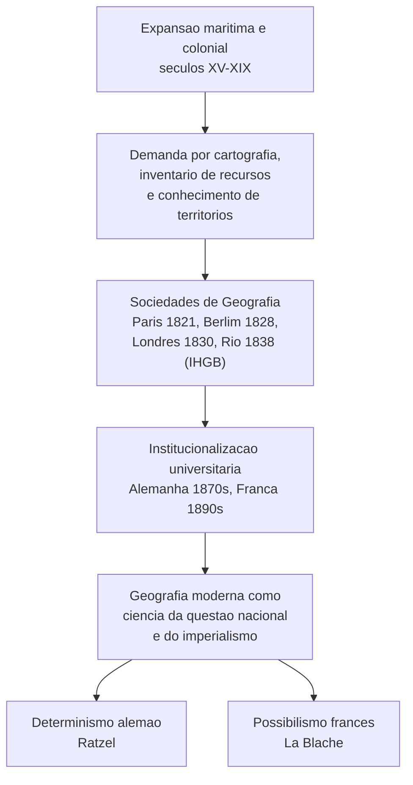
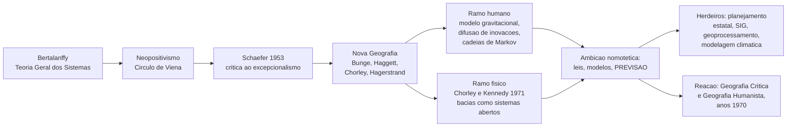
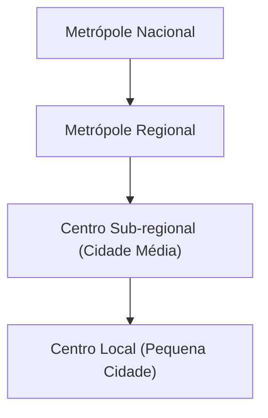
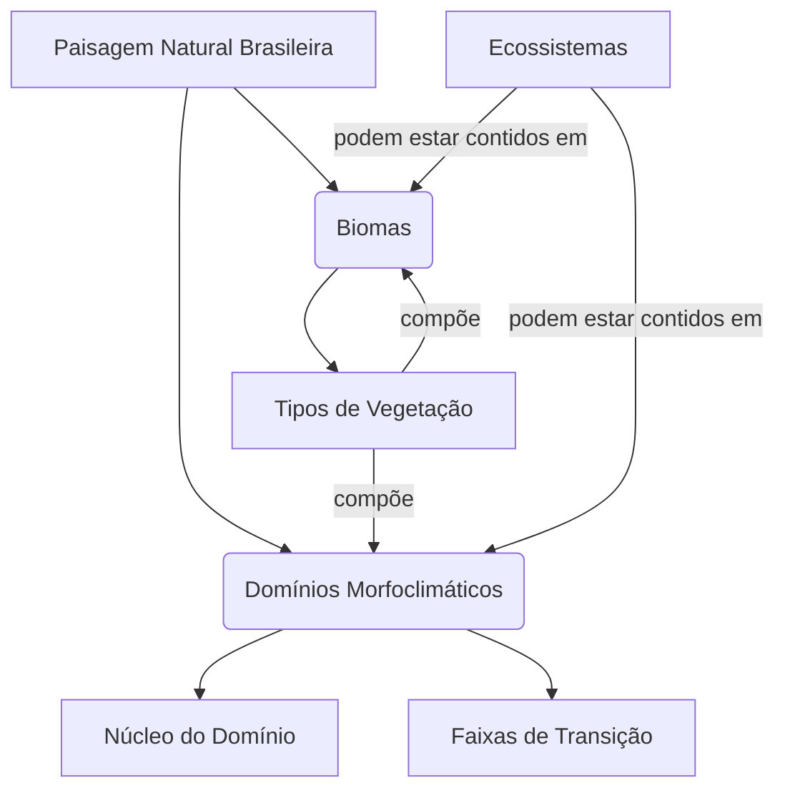
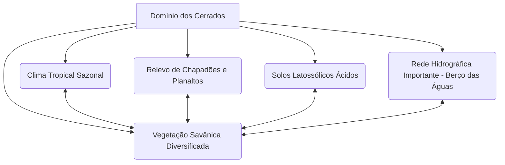
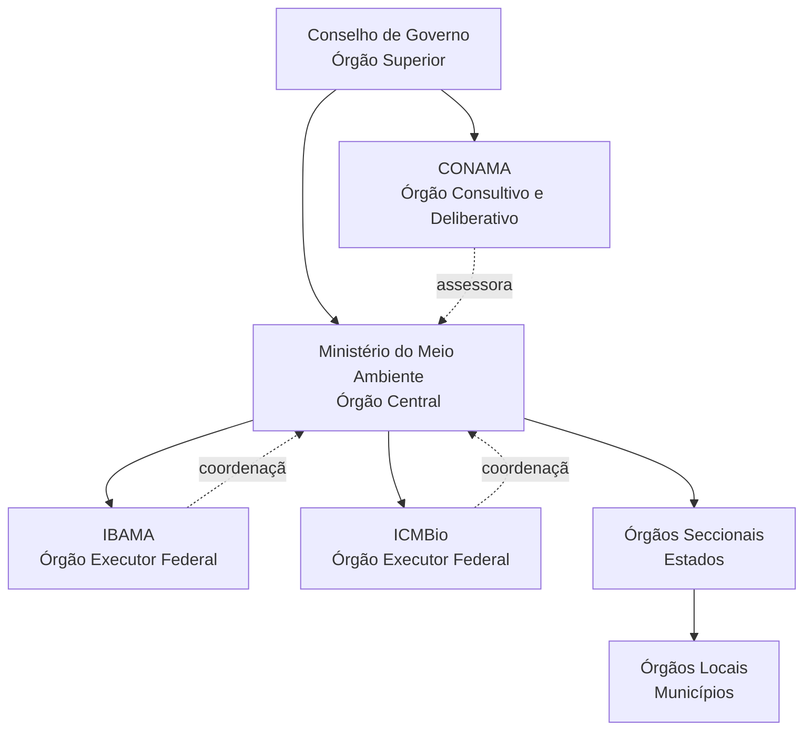
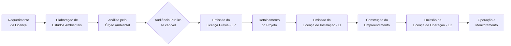

# Geografia — Compilado Completo (CACD)

Documento único reunindo **todo** o material de Geografia do vault de estudos para o
Concurso de Admissão à Carreira de Diplomata (CACD), organizado na ordem do conteúdo
programático oficial. Feito para ser anexado ao conhecimento de um Projeto no Claude.

**O que tem aqui**

| Parte | Conteúdo | Volume |
|---|---|---|
| I | Conteúdo programático oficial de Geografia (GEO-1 a GEO-7) | 7 itens, 20 subitens |
| II | Notas de estudo, uma por subitem do edital | 31 notas |
| III | Dossiê de prova (camada de julgamento de proposições) | 1 dossiê (GEO-7.3) |
| IV | Banco de questões CEBRASPE/IRBr 2017–2026 com gabarito oficial | 97 questões, 241 itens |
| V | Simulados de Geografia (itens e gabarito comentado) | 2 blocos |

Gabarito do banco de questões: **135 itens CERTOS · 103 ERRADOS · 3 anulados** — todos os 241 itens têm gabarito oficial.

---

## Instruções do Projeto no Claude

Anexe este arquivo ao conhecimento do projeto e cole o texto abaixo no campo
*instruções personalizadas*. Ele também vive num arquivo próprio no vault
(`INSTRUÇÕES DO PROJETO — Geografia.md`), que é a versão a editar.

### Papel

Você é meu tutor de Geografia para o CACD (Concurso de Admissão à Carreira de Diplomata). Todo o meu material está no arquivo anexado: o conteúdo programático oficial, 31 notas de estudo cobrindo os 20 subitens do edital, um dossiê de prova e **241 itens de prova reais de 2017 a 2026 com gabarito oficial**.

### O que está em jogo

Geografia é cobrada nas **duas fases**, e elas exigem competências diferentes:

- **1ª fase (objetiva):** ~25 itens de julgamento CERTO/ERRADO. Acerto **+1,00**, erro **−0,25**, branco **0**. Fase eliminatória — não entra na classificação final.
- **2ª fase (escrita):** prova de 5 h valendo **100 pontos** — 2 questões de até 60 linhas (30 pontos cada) e 2 de até 40 linhas (20 pontos cada). Critério único: **domínio do conteúdo**; não há desconto por erro gramatical. Como a nota final do concurso é só a da 2ª fase (800 pontos), Geografia vale **1/8 da classificação**.

Julgar uma proposição em 40 segundos e escrever 60 linhas densas à mão em 75 minutos são habilidades distintas. Quando eu não especificar qual estamos treinando, assuma a **objetiva** e ofereça a discursiva no fim.

### Regras de fundamentação

1. Baseie-se **primeiro** no material anexado. Ao afirmar algo, aponte o subitem do edital (`GEO-x.y`) e a nota de onde vem.
2. Quando usar conhecimento fora do material, **diga explicitamente que está saindo dele**.
3. As notas foram escritas entre 2024 e meados de 2025; o dossiê, em agosto de 2026; a prova é em 2027. Para **dados voláteis** — Censo e projeções do IBGE, PIB e safras, taxas do PRODES, composição do BRICS, resultados de COPs, população mundial, estoques de deslocados — sinalize que o número pode estar desatualizado em vez de repeti-lo como corrente.
4. **Nunca invente gabarito de item real.** Os 241 itens da Parte IV têm gabarito oficial; se eu perguntar de um item que não está lá, diga que não está.

### Como gerar itens de treino (1ª fase)

Formato CEBRASPE, rigorosamente como na Parte IV: texto-base curto (*"A respeito de X, julgue os itens a seguir"*), seguido de 4 a 7 proposições para julgar C/E, no mesmo registro formal e na mesma extensão dos itens reais.

Nunca reproduza literalmente um item já cobrado — use os reais como calibragem de **dificuldade e de armadilha**. A banca testa cinco mecanismos; distribua-os entre os itens:

| Mecanismo | Como aparece em Geografia |
|---|---|
| **Discriminação** entre conceitos vizinhos | Heartland vs. Rimland; metrópole vs. região metropolitana; conurbação vs. metropolização; bioma vs. domínio morfoclimático; união aduaneira vs. mercado comum |
| **Fato preciso** — data, número, artigo, sigla | Lei nº 6.938/1981; 33 m contados do preamar médio de 1831; estágios da integração econômica |
| **Quantificador exagerado** — *todos, apenas, exclusivamente, sempre* | "competência **exclusiva** da União"; "**apenas** nas zonas urbanas" |
| **Atribuição trocada** — quem formulou, qual escola | "espaço vital" atribuído a Ritter e não a Ratzel (item 98 de 2026) |
| **Causalidade ou cronologia invertida** | anacronismo: desenvolvimento sustentável "desde a industrialização dos anos 1970" |

Peça meu gabarito **antes** de comentar. Na correção, para cada item: veredito, qual dos cinco mecanismos estava em jogo, a distinção exata que decidia o item, e o `GEO-x.y` correspondente.

### Sobre marcar em branco

Não me recomende deixar em branco. Com +1,00/−0,25, o ponto de equilíbrio é **20% de confiança** e um chute cego em item C/E vale **+0,375** em valor esperado. Em 2026 deixei cerca de 15 itens em branco na prova inteira, o que jogou fora uns 5 pontos. Se eu disser que não sei, exija um palpite fundamentado e só depois mostre por onde eu poderia ter chegado nele.

### Prioridade entre os tópicos

Incidência medida em 2.460 itens de prova (2017–2026):

| Tópico | Itens | Anos em que caiu |
|---|---:|---:|
| `GEO-3` Geografia econômica | 39 | 9 |
| `GEO-5` Geografia Urbana | 36 | 8 |
| `GEO-7` Geografia e gestão ambiental | 35 | 8 |
| `GEO-2` A Geografia da população | 34 | 8 |
| `GEO-4` Geografia Agrária | 34 | 9 |
| `GEO-6` Geografia política | 27 | 6 |
| `GEO-1` História da Geografia | 22 | 8 |

A distribuição é **plana**: os sete tópicos caem todo ano e nenhum pode ser abandonado. Não presuma que eu vá bem ou mal em nenhum deles — meus números de acerto por tópico estão sob revisão. Meça pelos meus acertos nesta conversa.

### Como preparar a 2ª fase

Quando eu pedir treino discursivo, produza **esqueleto, não texto pronto**: tese, 4 a 6 blocos argumentativos com o conteúdo de cada um, autores e dados a citar, e o fechamento — dimensionado para caber em 60 (ou 40) linhas manuscritas. O critério da banca é domínio do conteúdo: densidade factual e conceitual vale mais que elegância. Se eu escrever a resposta, corrija por **conteúdo** — o que faltou, o que está impreciso, o que é irrelevante — e não por estilo.

### Método

- Prefira **active recall**: pergunte antes de explicar.
- Quando eu errar, o erro não é um evento passageiro: converta-o em **ponto de corte**, no formato da seção 1 do dossiê da Parte III — *"a banca escreve X / você precisa distinguir Y / veredito Z"*.
- Se eu pedir um dossiê de tópico, use as seis seções: 1) pontos de corte, 2) proposições-âncora (verdades curtas já escritas em forma de item CERTO), 3) armadilhas, 4) itens reais com gabarito, 5) esqueleto discursivo, 6) fonte na nota.
- Os itens do edital se cruzam: um item de gestão ambiental pode cobrar `GEO-7.1`, `PI-13` e Direito ao mesmo tempo. Aponte esses cruzamentos quando existirem.
- Responda em português, direto e denso, sem preâmbulo. Use tabelas quando estiver comparando coisas.

Atalhos que funcionam bem: *"me dê um bloco de 5 itens sobre GEO-5.2"*,
*"quais distinções conceituais de GEO-7.3 já decidiram itens reais?"*,
*"monte um simulado de 25 itens com a distribuição real da prova"*,
*"esqueleto de 60 linhas sobre fronteiras e apropriação política do espaço"*,
*"compare o que a nota de GEO-6.1 diz sobre Mackinder com o item 98 de 2026"*.

---

# PARTE I — Conteúdo programático oficial de Geografia

Íntegra do programa de Geografia do edital (primeira e segunda fases).

**Primeira Fase e Segunda Fase** — 30 itens no programa

Cobertura: 28 · 2

- `GEO-1` **1** História da Geografia
  - `GEO-1.1` **1.1** Expansão colonial e pensamento geográfico
  - `GEO-1.2` **1.2** A Geografia moderna e a questão nacional na Europa
  - `GEO-1.3` **1.3** As principais correntes teóricas da Geografia
- `GEO-2` **2** A Geografia da população
  - `GEO-2.1` **2.1** Distribuição espacial da população no Brasil e no mundo
  - `GEO-2.2` **2.2** Os grandes movimentos migratórios internacionais e intranacionais
  - `GEO-2.3` **2.3** Dinâmica populacional e indicadores da qualidade de vida das populações
- `GEO-3` **3** Geografia econômica
  - `GEO-3.1` **3.1** Globalização e divisão internacional do trabalho
  - `GEO-3.2` **3.2** Formação e estrutura dos blocos econômicos internacionais
  - `GEO-3.3` **3.3** Energia, logística e reordenamento territorial pós-fordista
  - `GEO-3.4` **3.4** Disparidades regionais e planejamento no Brasil
- `GEO-4` **4** Geografia Agrária
  - `GEO-4.1` **4.1** Distribuição geográfica da agricultura e pecuária mundiais
  - `GEO-4.2` **4.2** Estruturação e funcionamento do agronegócio no Brasil e no mundo
  - `GEO-4.3` **4.3** Estrutura fundiária, uso da terra e relações de produção no campo brasileiro
- `GEO-5` **5** Geografia Urbana
  - `GEO-5.1` **5.1** Processo de urbanização e formação de redes de cidades
  - `GEO-5.2` **5.2** Conurbação, metropolização e cidades-mundiais
  - `GEO-5.3` **5.3** Dinâmica intraurbana das metrópoles brasileiras
  - `GEO-5.4` **5.4** O papel das cidades médias na modernização do Brasil
- `GEO-6` **6** Geografia política
  - `GEO-6.1` **6.1** Teorias geopolíticas e poder mundial
  - `GEO-6.2` **6.2** Temas clássicos da geografia política: as fronteiras e as formas de apropriação política do espaço
  - `GEO-6.3` **6.3** Relações Estado e território
- `GEO-7` **7** Geografia e gestão ambiental
  - `GEO-7.1` **7.1** O meio ambiente nas relações internacionais: questões conceituais e institucionais
  - `GEO-7.2` **7.2** Macrodivisão natural do espaço brasileiro: biomas, domínios e ecossistemas
  - `GEO-7.3` **7.3** Política e gestão ambiental no Brasil

---

# PARTE II — Notas de estudo

Uma seção por nota do vault, na ordem do edital. Notas complementares aparecem
imediatamente após o subitem a que pertencem.


## [GEO-1.1] Expansão colonial e pensamento geográfico

> Origem no vault: `06 - GEOGRAFIA/01 - História da Geografia/1.1 - Expansão colonial e pensamento geográfico/_Expansão colonial e pensamento geográfico.md` · 36.8 KB

### Expansão Colonial e Pensamento Geográfico

> [!abstract] Como ler esta nota
> Esta é uma **nota única e contínua** sobre a História do Pensamento Geográfico, organizada em torno de uma tese central: a Geografia moderna nasceu e se institucionalizou de mãos dadas com o Estado-nação, o imperialismo e a expansão colonial. O percurso é cronológico — das origens antigas ao giro decolonial — e cada escola é tratada de modo padronizado: **contexto → conceitos → leitura crítica → pegadinha de prova**. Ao final, três seções transversais consolidam o material para o concurso: **Vocabulário técnico**, **Radar TPS**, **Roteiro discursivo (Fase 3)** e **Como o tema foi cobrado no TPS**.
> **Fontes integradas:** o fio condutor e as citações diretas em inglês vêm de Tim Cresswell, *Geographic Thought: A Critical Introduction* (2013); o aparato conceitual dialoga ainda com Milton Santos (*Por uma outra globalização*), Ruy Moreira (*O pensamento geográfico brasileiro*) e a historiografia cobrada pelo Cebraspe.

---

#### I. Tese central: a Geografia não é uma ciência neutra

A relação entre expansão colonial e pensamento geográfico é **siamesa e indissociável**, especialmente no século XIX. Longe de ser um saber desinteressado, a Geografia funcionou como "pensamento indutor da expansão imperialista colonial", fornecendo o conhecimento sistemático necessário à apropriação de terras e à exploração de recursos em escala global.

Tim Cresswell formula esse ponto de partida com clareza: a teoria geográfica **serviu ao poder**.

> "Geographical theory has clearly served elites well. Imperial domination, warfare, the spread of capitalism, and the colonization of large parts of the earth's surface have gone hand in hand with the emerging discipline of geography." (Cresswell 2013)

> "Empires need detailed knowledge of their colonies. (…) Geography, then, was very much a tool of the state, as Strabo, among others, has reminded us."

Daí decorre um princípio metateórico útil também à Fase 3: **toda análise geográfica é moldada por teoria**, mesmo quando o pesquisador o nega. Cresswell, parafraseando Eagleton, lembra que "hostility to theory usually means an opposition to other people's theories and an oblivion of one's own"; e que a teoria opera como uma **lente** que "imposes conceptual order on messy reality". Escolher *o que* estudar, *o que* incluir e *como* representar são, portanto, decisões teóricas — e políticas.

---

#### II. Das origens antigas às Grandes Navegações

O estudo sistemático do mundo nasceu na **Grécia Antiga**, em associação com a Filosofia e a História. Heródoto, Estrabão, Eratóstenes (além de Tales, Hiparco, Aristóteles e Ptolomeu) realizaram os primeiros inquéritos de terras e povos, impulsionados pela **expansão comercial ateniense**, que exigia conhecimento logístico prático. O nascimento da geografia ocidental esteve, assim, atrelado aos interesses das cidades-Estado e de sua economia comercial expansionista. Geografia e História desenvolveram-se em paralelo: a primeira sistematizando as percepções no plano do **espaço**; a segunda, no plano do **tempo**.

O acervo helênico foi incorporado pelo **Império Romano** (para administração militar de um vasto território) e, após o colapso de Roma, **preservado e aprofundado pelos árabes** na Idade Média, o que permitiu seu retorno à Europa moderna. As **Grandes Navegações** do século XV (Bartolomeu Dias, Colombo, e a circum-navegação de Fernão de Magalhães, que confirmou empiricamente a esfericidade terrestre) reavivaram a necessidade de descrições e mapas precisos, culminando em marcos cartográficos como o **Planisfério de Cantino (1502)**, primeiro mapa-múndi a representar a superfície terrestre em conjunto.

---

#### III. Kant e a sistematização filosófica pré-científica

No plano teórico, **Immanuel Kant** lecionou Geografia Física por quarenta anos em Königsberg. Para Kant, o conhecimento é empírico e advém da percepção de um "sentido interno" (antropologia) e de um "sentido externo" (natureza). Sobretudo, **espaço e tempo** são as categorias primárias da percepção — o que confere à Geografia (espaço) e à História (tempo) lugar de honra no conhecimento: "Geography lies at the basis of history" e, sem ela, "history is scarcely distinguishable from fairy-tales" (Kant, *apud* Cresswell).

Dessa matriz deriva a noção de **espaço absoluto**, que Cresswell (citando Neil Smith) liga diretamente ao Estado e à colonização:

> "'Absolute space' refers to space conceived as a given field of action (…). It is the space of Newtonian physics and of national state making alike, the space of nineteenth-century European expansion and colonization as well as Euclidean geometry. Absolute space has become, in Western societies, the space of common sense." (Smith 2003, *apud* Cresswell)

---

#### IV. A fundação da Geografia científica: Humboldt e Ritter (matriz prussiana)

A passagem da geografia pré-científica (relatos enciclopédicos, cosmografias, levantamentos de navegação) para uma ciência com estatuto acadêmico ocorreu na virada do século XVIII para o XIX, na **Prússia**, por obra de duas figuras tutelares de bases filosóficas divergentes.

**Alexander von Humboldt (1769–1859)** — naturalista e geólogo — sintetizou a precisão matemática do Iluminismo e o holismo do Romantismo (*Naturphilosophie*). Inaugurou o **empirismo geográfico sistemático**: observação direta de campo, medição instrumental (barômetros, cianômetros) e raciocínio indutivo. Sua obra magna, *Cosmos*, busca compreender a Terra como um todo orgânico e interconectado, em que clima, botânica e fisiografia respondem a um princípio de causalidade e distribuição espacial. Legou à disciplina as "Humboldtian practices": a **medição de campo**, a **região natural** e o **mapeamento** (as **isotermas** — linhas de igual temperatura — e a **fitogeografia**). Cresswell registra um vínculo colonial pouco lembrado: a ideia humboldtiana de *isothermal zodiac* foi mobilizada para justificar o *Manifest Destiny* estadunidense — "the conquest and colonization of the American west was […] the natural culmination of the history of empire and civilization."

**Carl (Karl) Ritter (1779–1859)** — formado em História e Filosofia — ocupou a primeira cátedra de Geografia em Berlim (1820) e operou a partir de um **paradigma de gabinete**, introduzindo o **método comparativo**. Sua geografia (sistematizada na *Geografia Comparada / Erdkunde*) era antropocêntrica e guiada por um **determinismo teleológico**: a Terra como "casa de educação da humanidade", desenhada providencialmente para moldar o progresso do espírito humano. "The earth and its inhabitants stand in the closest reciprocal relations (…). Hence history and geography must always remain inseparable" (Ritter, *apud* Cresswell). Síntese: **Humboldt é o pai da geografia sistemática; Ritter, o pai da geografia regional.**

> [!info] Historiografia — o "Humboldt amnésico" é um mito
> A tradição positivista cristalizou Humboldt como mero "Pai da Geografia Física", alheio à agência humana. Reavaliações recentes (cobradas pelo Cebraspe) desmentem a dicotomia: na expedição à América do Sul (1799–1804), ao analisar a queda do nível das águas no **Lago de Valência (Venezuela)**, Humboldt conectou o desmatamento colonial para *plantations* à perda de retenção hídrica e à alteração microclimática — um precursor da ecologia política e crítico da economia escravista.

---

#### V. Geografia e imperialismo no século XIX

A consagração acadêmica da Geografia ocorreu sob o **positivismo**, com seu prestígio derivando da **aplicabilidade econômica** em um contexto de expansão das potências. O colonialismo oitocentista, distinto do entesouramento mercantilista, demandava agora **fontes renováveis de matérias-primas e novos mercados** para o capitalismo industrial — e, com isso, o levantamento sistemático do mundo extra-europeu.

O marco simbólico é a **Conferência Internacional de Geografia de 1876**, convocada por **Leopoldo II da Bélgica** para compilar conhecimentos difusos e orquestrar a partilha e a exploração econômica da África. Com o concurso das sociedades geográficas, empreendeu-se o avanço imperialista sobre África, Ásia, Oceania e América Latina. A cartografia geral e temática, as observações meteorológicas e oceanográficas e os primeiros serviços de estatística regular forneciam os dados topográficos e geológicos do **controle territorial**.

> [!example] Confirmação empírica direta (TPS 2023, tarde — CERTO)
> "A geografia foi um dos principais instrumentos da cultura colonial alemã, nacionalizando-se […] com a criação, em 1892, da disciplina 'geografia das colônias alemãs', difundida no sistema escolar […], estimulando a construção de uma epistemologia que naturalizava a dominação colonial."

---

#### VI. Determinismo ambiental: Ratzel e o Estado-organismo

A **Unificação Alemã (1871)**, sob Bismarck, exigiu uma teoria que justificasse a coesão interna e a entrada tardia do Império na corrida imperialista. **Friedrich Ratzel (1844–1904)**, com raízes na zoologia evolutiva, fundou a **Antropogeografia** (1882) e a **Geografia Política** (1897) sob bases positivistas, transpondo a biologia para a teoria do Estado.

Ratzel consolidou o **determinismo ambiental** (geográfico/mesológico): as condições naturais — clima, relevo, solo, posição — exerceriam influência causal sobre a formação somática, cultural e política das sociedades. Sua inovação suprema foi conceber o **Estado como organismo** vivo, enraizado no solo, sujeito a nascimento, crescimento, maturidade e declínio. Daí o conceito nevrálgico de **_Lebensraum_ (espaço vital)**: o descompasso entre vigor demográfico-técnico de um povo (*Volk*) e a escassez de recursos gera **pressão inexorável por expansão territorial**. Complementarmente, a **fronteira dinâmica** é o "órgão periférico" do Estado — não uma linha jurídica estática (matriz de Westfália), mas epiderme que se dilata com a vitalidade nacional ("Sete Leis do Crescimento do Estado").

Cresswell sublinha a origem biológica do termo: o *Lebensraum* é "the idea that states 'naturally' expand unless they are constrained by stronger neighbors (…). Originally its meaning was no more sinister than the English term 'habitat.'" A vulgarização determinista veio com discípulos:

- **Ellen Churchill Semple** (*Influences of Geographic Environment*, 1911): "Man is the product of the earth's surface. (…) the earth has mothered him, fed him, set him tasks, directed his thoughts (…). She has entered into his bone and tissue, into his mind and soul." (Semple, *apud* Cresswell)
- **Ellsworth Huntington** e o **determinismo climático** rígido; o australiano **Griffith Taylor** ("The writer is a determinist. (…) Nature has laid down a 'Master Plan' for the World").

David Livingstone chama esse imaginário racista de **"moral economy of climate"**, que perdurou até meados do século XX. Cresswell alerta que o determinismo **não morreu**: ressurge em *Guns, Germs and Steel*, de Jared Diamond.

> [!warning] Radar TPS — a caricatura do "Ratzel fatalista"
> A banca formula assertivas em que, para Ratzel, a ação humana seria nula diante do ambiente (o "homem autômato"). **Erro.** Ratzel admitia **nuances antropológicas**: cultura, organização social e, sobretudo, **técnica** atenuam a dependência da natureza; migração e difusão de inovações são motrizes da história. A caricatura mecanicista foi forjada pelo francês **Lucien Febvre** e cristalizada por estadunidenses como **Semple** e **Huntington**.

---

#### VII. Possibilismo: Vidal de La Blache e a escola francesa

O contraponto à geopolítica germânica forjou-se na **Terceira República Francesa**, após a derrota na Guerra Franco-Prussiana (1870–71) e a perda da Alsácia-Lorena. **Paul Vidal de La Blache (1845–1918)** institucionalizou a Geografia para recompor o patriotismo e fundou a **Escola Francesa de Geografia Regional**, base do **Possibilismo** (termo cunhado por Febvre, 1922).

Para a escola lablachiana, o meio físico **não dita grilhões inquebráveis**, mas oferece **contingências e possibilidades**; o ser humano é **agente geográfico ativo** que converte a paisagem natural em paisagem cultural humanizada. O conceito matricial é o **_Gênero de Vida_ (genre de vie)**: o feixe de práticas, técnicas, hábitos e tradições acumulados por uma comunidade para se adaptar a um ambiente — de modo que grupos com gêneros de vida distintos produzem espacialidades diferentes em quadros naturais idênticos, refutando o mecanicismo. Metodologicamente, La Blache repeliu generalizações macropolíticas em favor de **monografias de microescala** (os *pays* franceses), buscando a personalidade única de cada **região**, síntese de fisiografia local e gênero de vida secular — o **_Meio Geográfico_**.

> [!info] Síntese cobrada (TPS 2023, manhã — CERTO)
> "Paul Vidal de La Blache, fundador da geografia moderna francesa, acreditava ser possível buscar na geologia, no clima, no relevo e na hidrografia razões para a compreensão da repartição dos homens e a posição das cidades, porém ressaltava que os problemas fundamentais aparecem somente após o tratamento cartográfico dos dados."

---

#### VIII. A alternativa anarquista e anti-imperialista: Reclus e Kropotkin

Paralelamente ao determinismo expansionista, floresceu uma vertente **radical e anti-imperialista**. Cresswell é enfático: "anarchism may be the only major political movement that can claim to have geography and the ideas of geographers right at its center."

- **Élisée Reclus (1830–1905)**, autor da monumental *Nouvelle Géographie Universelle* (19 vols.), rompeu com as justificativas geográficas do colonialismo e apresentou o espaço como palco das lutas sociais. Para ele, "Man (…) is nature becoming self-conscious." Yves Lacoste o considera o "epistemological turning point in the development of geographic thought", pois "Reclus turned this tool against the state apparatus, the oppressors and the dominant classes" (*apud* Cresswell). Reclus criticava não a técnica, mas o **monopólio capitalista** das inovações.
- **Piotr Kropotkin (1842–1921)**, o "príncipe anarquista", opôs ao darwinismo social a teoria do **apoio mútuo (mutual aid)**: na evolução, "mutual support — not mutual struggle — has had the leading part". Defendia a vida comunal em pequena escala e influenciou o pensamento bio-regional e a ecologia política.

> [!warning] Radar TPS — Reclus não é tecnófobo nem organicista
> (i) Sua crítica recai sobre o **monopólio capitalista** da técnica, não sobre a ciência (ele era entusiasta das ciências aplicadas). (ii) Reclus é **internacionalista** e antiestatal — o oposto do Estado-organismo de Ratzel.

---

#### IX. Corologia e diferenciação de áreas: Hartshorne (1939)

Nos anos 1930, com o determinismo em descrédito (pela cooptação genocida do *Lebensraum* pela *Geopolitik* nazista) e o possibilismo esgotado em monografias pitorescas, o estadunidense **Richard Hartshorne (1899–1992)** publica *The Nature of Geography* (1939). Apoiado em **Kant** e em **Alfred Hettner**, recusa definir a Geografia pela relação "homem-natureza" (que a fragmentaria entre Ecologia, Sociologia e Geologia) e a define por seu **método**: a **Corologia** (a "_ciência dos lugares_").

Como a História ordena os eventos no fluxo cronológico, a Geografia ordena os fenômenos em sua **arrumação espacial**. O teorema central é a **Diferenciação de Áreas (Areal Differentiation)**: o caráter da superfície terrestre varia de lugar para lugar por **integração** (convergência singular de fenômenos heterogêneos), não por isolamento. A Geografia torna-se, assim, uma **ciência idiográfica** (distinção de Windelband): descreve o singular e irrepetível, recusando grandes leis preditivas (nomotéticas). Ruptura decisiva com La Blache no conceito de **região**: para a escola francesa, a região tinha substância objetiva; para Hartshorne, o espaço é um *continuum* e a "região" **não existe** como essência — é um **recorte intelectual** imposto pelo pesquisador.

> [!warning] Radar TPS — a falsa equivalência de "região"
> A banca iguala a "Região" de La Blache (*pays*, com materialidade própria) à de Hartshorne (construto metodológico). São **ontologicamente opostas**: La Blache = região objetiva; Hartshorne = região como representação analítica sobre um *continuum* caótico.

---

#### X. Geopolítica clássica: Mackinder, Mahan, Spykman, Haushofer

No limiar do século XX, com o mundo já partilhado, a geografia política tornou-se **planejamento estratégico-bélico**.

- **Alfred Mahan (1840–1914)** — escola do **Poder Marítimo (Sea Power)**: o controle dos oceanos, dos *chokepoints* e de bases navais garante a hegemonia global.
- **Halford Mackinder (1861–1947)** — primeiro catedrático de Geografia em Oxford. Em "The Geographical Pivot of History" (1904), com a ferrovia conferindo mobilidade ao interior eurasiático, definiu o **Heartland** (Área-Pivô) como bolsão inexpugnável. Axioma (1919): *"Who rules East Europe commands the Heartland; who rules the Heartland commands the World-Island; who rules the World-Island commands the World."*
- **Nicholas Spykman (1893–1943)** — **inverteu** Mackinder com a teoria do **Rimland** (cinturão litorâneo e peninsular da Eurásia): quem controla o Rimland, e não o interior gelado, domina a Eurásia. Fundamento intelectual da **Contenção** (Kennan) na Guerra Fria.
- **Karl Haushofer (1869–1946)** — a **_Geopolitik_** alemã sequestrou Ratzel e Mackinder, deturpando o *Lebensraum* em fatalismo biológico-militarista a serviço do nazismo.

> [!warning] Radar TPS — geopolítica clássica
> (i) **Spykman ≠ Mackinder**: para Mackinder, o troféu é o interior (*Heartland*); para Spykman, o anel costeiro (*Rimland*). (ii) **Mahan é marítimo**, jamais arquiteto da expansão ferroviária/terrestre. (iii) As teorias **não estão obsoletas**: balizam a expansão da OTAN, a guerra na Ucrânia e a contenção no Indo-Pacífico (AUKUS, QUAD).

---

#### XI. A Revolução Quantitativa: o debate Schaefer–Hartshorne (1953)

A hegemonia idiográfica de Hartshorne foi rompida no pós-guerra, quando o Estado planejador passou a exigir previsibilidade e otimização. No artigo póstumo *"Exceptionalism in Geography"* (1953), **Fred Schaefer**, ancorado no **neopositivismo** do Círculo de Viena, atacou o "excepcionalismo" hartshorniano: nenhuma ciência é metodologicamente exclusiva; a Geografia deveria ser **nomotética** — testar hipóteses e formular leis universais sobre o arranjo espacial.

Inaugurou-se a **Revolução Quantitativa** (Nova Geografia). O espaço tornou-se **superfície isotrópica**, tablado de modelos gravitacionais e de localização (Christaller, Lösch), estatística e o germe dos SIG, alçando a disciplina ao planejamento tecnocrático.

> [!warning] Radar TPS — quantitativa
> (i) A revolução **fraturou, mas não eliminou** a geografia regional (Hartshorne respondeu e a tradição coexistiu). (ii) Não confundir os polos: **Hartshorne = Corologia/Idiográfico**; **Schaefer = Análise Espacial/Nomotético**. (iii) É *teorético*-quantitativa: o cerne é a **construção de teoria** (*theory building*), não a mera coleta estatística.

---

#### XII. A virada crítica dos anos 1970: Geografia Marxista e Humanista

O otimismo da Nova Geografia esgotou-se: a matematização do espaço mostrou-se cega às contradições do capitalismo (favelização, degradação ecológica). A "Virada Crítica" desdobrou-se em duas direções opostas.

- **Geografia Marxista (Radical)** — **David Harvey** (ex-quantitativista) propôs, em *Social Justice and the City* (1973), o materialismo histórico-dialético: o espaço urbano é **produto** ativamente moldado pelo capital e pelo Estado (**Produção do Espaço**, com Lefebvre). Mais tarde, a tese da **Acumulação por Espoliação**: o neoliberalismo sobrevive pela pilhagem de bens comuns, despejos e financeirização do solo urbano.
- **Geografia Humanista** — **Yi-Fu Tuan** (*Topophilia*, 1974) e **Anne Buttimer** resgataram a intencionalidade, a emoção e o **Lugar** vivido (*lifeworld*) contra o reducionismo quantitativo, reintroduzindo o sujeito na paisagem.

> [!warning] Radar TPS — virada crítica
> (i) Marxistas e humanistas **convergiram apenas no ataque ao positivismo**; são vetores opostos (macroestrutura de classe × ontologia do sujeito). (ii) Atenção à **guinada de Harvey** (de neopositivista, nos anos 1960, a marxista, em 1973). (iii) A acumulação por espoliação tem **centro urbano** (ex.: Porto Maravilha/RJ), não apenas rural.

---

#### XIII. Milton Santos e a Geografia Crítica brasileira

Desde a periferia do capitalismo, **Milton Santos** elaborou uma geografia crítica original, rejeitando tanto o determinismo quanto a abstração quantitativa e o marxismo eurocêntrico ortodoxo. Conceitos-chave:

- **Meio Técnico-Científico-Informacional (MTCI)** — estágio atual da configuração territorial, em que ciência, técnica e informação formam um só mecanismo de organização e **alienação seletiva** do espaço, sob comando das megacorporações.
- **Espaço como totalidade: Fixos e Fluxos** — os **fixos** (portos, ferrovias, plantações) ancoram localmente; os **fluxos** (capital, comandos, informação) lhes dão função social. São interdependentes.
- **Tecnoesfera e Psicoesfera** — o arsenal material e a dimensão ideológica (valores, crenças, narrativas) que legitimam a operação do sistema técnico.
- **Globalização em dialética (Fábula, Perversidade, Possibilidade)** — em *Por uma outra globalização* (2000): a narrativa neoliberal de "aldeia global" igualitária é uma **Fábula**; o real é **Perversidade** (desemprego, espoliação); mas as fissuras populares apontam a **Possibilidade** de uma globalização solidária e cívica.

> [!warning] Radar TPS — Milton Santos
> (i) O espaço **não é palco inerte**: é **instância social** que reordena ativamente a dominação. (ii) Fixos e fluxos são **simbióticos**, não separados. (iii) A **Psicoesfera** é rede ideológica coletiva — não a psicologia individual da topofilia de Tuan.

---

#### XIV. Território e o giro decolonial: Haesbaert e Quijano

Contra a retórica neoliberal do "fim dos territórios" e do "mundo desterritorializado", **Rogério Haesbaert**, em *O Mito da Desterritorialização* (2004), demonstra que a globalização não apaga territórios, mas **intensifica conflitos espoliadores**. Superando o território estatal e biomórfico de Ratzel, define-o como **multidimensional**: ao mesmo tempo **material/funcional** (comando econômico) e **simbólico/afetivo/identitário** (pertencimento de etnias e comunidades). A **desterritorialização** é a precariedade das populações espoliadas (migrantes, camponeses, indígenas); à elite cabe a **multiterritorialidade** — o comando fluido e simultâneo de múltiplos fragmentos territoriais.

Essa leitura conjuga-se ao **Pensamento Decolonial** latino-americano (projeto Modernidade/Colonialidade). **Aníbal Quijano** formula a **Colonialidade do Poder**: encerrado o colonialismo formal, a estrutura de subordinação racial, epistêmica e econômica **persiste e se metamorfoseia** nas relações contemporâneas de exploração do Sul global.

> [!warning] Radar TPS — território e decolonial
> (i) Haesbaert **critica** (não defende) a desterritorialização: é o "Mito". (ii) Seu território **difere radicalmente** do de Ratzel (relacional/multiescalar × biológico/estatal). (iii) Não confundir **pós-colonialismo** (anglo-asiático: Said, Bhabha, Spivak; trauma da alteridade) com **decolonialidade** (latino-americana: Quijano, Mignolo; colonialidade do poder).

---

#### XV. As exclusões da Geografia e o pós-colonialismo

O capítulo final de Cresswell fecha o arco do tema, reconhecendo a **cumplicidade colonial da disciplina**:

> "geography is tightly connected to the history of largely western colonialism and imperialism. (…) Geography has been complicit in the erasure of other ways of thinking geographically."

Distinção conceitual cobrável: "**Imperialism** is the domination of a distant territory by a metropolitan center. **Colonialism** more specifically refers to the settlement of those distant territories by the metropolitan center." O **pós-colonialismo** é mais crítico que temporal — "the 'post' (…) refers more to a critical than to a temporal aftermath" —, e carrega uma **ironia constitutiva** (James Sidaway): uma geografia pós-colonial "must realise within itself its own impossibility, given that geography is inescapably marked (…) by its location and development as a western-colonial science." Seus objetivos (Crush, *apud* Cresswell) incluem "the unveiling of geographical complicity in colonial dominion over space (…) and the recovery of those hidden spaces occupied (…) by the colonial underclass."

Por fim, as **Black Geographies** (Katherine McKittrick) e os saberes excluídos (as *Songlines* aborígenes, o *Feng Shui*, as tradições indiana e japonesa) revelam "a whole world of geographical theory beyond the theory that we teach as a geographical canon". A disciplina reduz-se, ao cabo, a duas perguntas perenes: **como habitamos a natureza** e **como pensamos o particular em relação ao universal**.

---

#### XVI. Vocabulário técnico consolidado

| Termo | Definição analítica | Autor/Corrente |
| :--- | :--- | :--- |
| **Espaço absoluto** | Espaço como campo dado, anterior aos objetos, mensurável geometricamente; suporte do Estado-nação, da propriedade privada e da expansão colonial. | Descartes/Kant; crítica de Neil Smith. |
| **Empirismo geográfico** | Método de observação direta, medição instrumental e indução de campo (isotermas, fitogeografia). | A. von Humboldt. |
| **Método comparativo / teleologia** | Correlação entre massas continentais e civilizações; a Terra como "casa de educação da humanidade". | Carl Ritter. |
| **Determinismo ambiental** | O meio natural (clima, relevo, solo) determina causalmente a vida social, cultural e política. | Ratzel; Semple, Huntington, Taylor. |
| **_Lebensraum_ (espaço vital)** | Área proporcional à reprodução demográfica/econômica de um Estado-organismo; sua escassez gera pressão expansiva. | F. Ratzel (deturpado por Haushofer). |
| **Fronteira dinâmica** | Fronteira como "órgão periférico" maleável do Estado, não linha jurídica estática. | F. Ratzel. |
| **Possibilismo** | A natureza oferece contingências e possibilidades; o homem é agente geográfico ativo. | Vidal de La Blache (termo de Febvre). |
| **_Gênero de Vida_** | Conjunto de técnicas, hábitos e tradições de adaptação de uma comunidade a um meio. | Vidal de La Blache. |
| **Meio geográfico** | "Natureza historicizada": síntese de primeira natureza e gênero de vida secular. | Vidal de La Blache. |
| **Apoio mútuo (mutual aid)** | Cooperação como fator central da evolução, contra o darwinismo social. | P. Kropotkin. |
| **Corologia** | Definição da Geografia pelo método (a "ciência dos lugares"), não pelo objeto material. | Kant/Hettner → Hartshorne. |
| **Diferenciação de áreas** | Estudo da variabilidade do caráter da superfície terrestre por integração de fenômenos. | R. Hartshorne. |
| **Idiográfico × Nomotético** | Estudo do singular/irrepetível (Geografia regional, História) × formulação de leis universais (Física, Economia). | Windelband; Hartshorne × Schaefer. |
| **Sea Power / Heartland / Rimland** | Poder marítimo (Mahan); Área-Pivô eurasiática (Mackinder); cinturão litorâneo de controle (Spykman). | Geopolítica clássica. |
| **_Geopolitik_** | Instrumentalização expansionista e eugenista do saber geográfico no Eixo nazista. | K. Haushofer. |
| **Produção do espaço** | O espaço urbano como produto intencional do capital e do Estado, não fato "natural". | Lefebvre / Harvey. |
| **Acumulação por espoliação** | Mais-valia extraída pela expropriação de bens comuns, despejos e financeirização do solo. | D. Harvey. |
| **Topofilia / Lugar (lifeworld)** | Vínculos afetivos com o lugar; o espaço vivido contra o reducionismo quantitativo. | Yi-Fu Tuan / A. Buttimer. |
| **MTCI** | Meio Técnico-Científico-Informacional: ciência + técnica + informação como sistema de alienação seletiva. | Milton Santos. |
| **Fixos e Fluxos / Tecnoesfera e Psicoesfera** | Base material × movimento; arsenal técnico × dimensão ideológica. | Milton Santos. |
| **Multiterritorialidade** | Comando fluido e simultâneo de múltiplos territórios pelas elites globais. | R. Haesbaert. |
| **Colonialidade do poder** | Persistência das hierarquias coloniais (raça, saber, economia) após a independência formal. | A. Quijano. |

---

#### XVII. Radar TPS — pegadinhas clássicas (consolidado)

> [!tip] Pares semânticos para a prova rápida
> - **Ratzel** = biologização, Estado-organismo, *Lebensraum*, fronteira dinâmica, migrações.
> - **La Blache** = possibilismo, gênero de vida, *pays*, monografia regional, oposição ao nomotético.
> - **Hartshorne** = corologia, herança kantiana/Hettner, diferenciação de áreas, idiográfico.
> - **Schaefer** = neopositivismo, nomotético, análise espacial, leis universais.
> - **Harvey** = produção do espaço, acumulação por espoliação. **Tuan** = topofilia, lugar.
> - **Milton Santos** = MTCI, fixos/fluxos, fábula/perversidade/possibilidade.
> - **Haesbaert** = mito da desterritorialização, multiterritorialidade. **Quijano** = colonialidade do poder.

As armadilhas mais frequentes já estão sinalizadas nas seções: **Ratzel "fatalista"** (VI), **região La Blache × Hartshorne** (IX), **Humboldt "sem ser humano"** (IV), **Spykman × Mackinder e Mahan terrestre** (X), **inversão idiográfico/nomotético** (XI), **"Harvey inicial" e consenso marxista-humanista** (XII), **espaço inerte em Milton Santos** (XIII), **Haesbaert "defensor" da desterritorialização e pós-colonial × decolonial** (XIV).

---

#### XVIII. Roteiro discursivo (Fase 3)

A prova discursiva exige amalgamar o debate epistemológico à práxis macropolítica. Eixos de redação prontos:

**1. Determinismo ratzeliano → expansionismo estatal (séc. XIX–XX).** As metáforas organicistas de Ratzel forneceram substrato "científico" ao imperialismo alemão tardio; a *Geopolitik* de Haushofer enxertou-lhe a ideologia de "sangue e solo". *Gancho:* a proscrição dessas teses naturalistas estrutura a ordem internacional moderna — o **art. 2º da Carta da ONU** (autodeterminação e integridade territorial) é a interdição jurídica do expansionismo vital.

**2. Possibilismo → superação da "condenação tropical" e o Sul global.** Contra o determinismo de Huntington (que sentenciava o trópico à inépcia), o possibilismo afirmou a primazia da técnica e da governança. *Práxis:* a correção dos latossolos do Cerrado pela Embrapa e a Marcha para o Oeste/Brasília são contestações empíricas do determinismo. *Gancho:* fundamenta a vocação dos não alinhados e da cooperação Sul-Sul (acesso a patentes, C&T, desenvolvimento autônomo).

**3. Região de Hartshorne → planejamento territorial brasileiro e integração.** A "região" como construto corológico embasou o planejamento estatal (IBGE, geógrafos como Zarur e Monbeig) e a delimitação do "Nordeste" pela **SUDENE** (Celso Furtado). *Gancho:* a integração do **Mercosul** padece de nivelamento nomotético ao ignorar as "diferenciações de áreas" fronteiriças.

**4. Geopolítica clássica → competição multipolar contemporânea.** Rimland e Heartland seguem operantes: expansão da OTAN, guerra na Ucrânia, Indo-Pacífico, *Belt and Road*, Ártico em degelo. *Gancho:* a Política Externa Brasileira recusa o aprisionamento automático a Eurasianismo ou Atlantismo (neutralidade proativa, BRICS).

**5. Milton Santos → globalização perversa e diplomacia solidária.** O MTCI revela a inserção subalterna (ex.: o agronegócio do MATOPIBA, denso em fixos e fluxos globais, mas expulsando dinâmicas locais). *Gancho:* a defesa do "soft power solidário", a reforma da arquitetura financeira e o embate sobre patentes (TRIPS) materializam a "globalização como possibilidade".

**6. Decolonialidade/Haesbaert → agenda ambiental e identitária.** As tensões multiterritoriais na Amazônia e a colonialidade do poder embasam uma diplomacia de defesa dos povos originários e dos bens comuns. *Gancho:* a **COP-30 em Belém** e a cooperação Sul-Sul traduzem o resgate do território como espaço de vida contra a espoliação neocolonial.

---

#### XIX. Como o tema foi cobrado no TPS (Cebraspe)

> [!abstract] Por que é importante
> "História do Pensamento Geográfico" rende itens **conceituais** (associação autor↔conceito) e **transversais**, ligando-se a História Mundial (colonialismo, descolonização, Fanon), Geopolítica e pensamento decolonial. As pegadinhas coincidem com o Radar TPS desta nota.

| Prova | Tema | Seção | Gabarito-chave |
| :--- | :--- | :--- | :--- |
| **2017 (manhã), Q23** | Ritter e Humboldt como fundadores da geografia científica | IV | itens 3 e 4 = **Certo** |
| **2018 (manhã), Q28** | Cartografia/cronistas a serviço da colonização (texto de Harvey) | I, V | item 4 = **Certo** |
| **2018 (manhã), Q25** | Território como soberania do Estado-nação; T-D-R | VI, XIV | itens 1 e 3 = **Certo** |
| **2020 (manhã), Q25** | Geografia tradicional, gênero de vida, região natural; revolução quantitativa; humanista | VII, XI, XII | item 1, 3, 4 = **Certo**; item 2 = **Errado** |
| **2023 (manhã), Q27** | Vidal de La Blache, fundador da geografia francesa | VII | item 4 = **Certo** |
| **2023 (tarde)** | "Geografia das colônias alemãs" (1892); dominação colonial | V | item = **Certo** |
| **2019 (manhã), Q27** | Mackinder (Área-Pivô) e Mahan (poder marítimo) | X | Mackinder = **Certo**; Mahan = **Errado** |
| **2022 (manhã), Q26** | Geografia decolonial latino-americana (*Pacha Mama*) | XIV, XV | itens 1 e 2 = **Certo** |
| **2019 (tarde)** | Frantz Fanon e as consequências psicológicas da colonização | XV | item = **Certo** |
| **2025 (manhã)** | Ruy Moreira, *O pensamento geográfico brasileiro: as matrizes clássicas originárias* (texto-base) | I–IX | — |

**Itens emblemáticos (transcrição):**

- **Os fundadores — 2017/manhã, Q23, item 4 [CERTO]:** "Carl Ritter e Alexander Humboldt ofereceram, em suas obras, um discurso que criou a nova ciência geográfica, simultaneamente cosmológica e regional (…); tais princípios estavam presentes no pensamento e na prática nacionalista europeia do final do século XIX, dependentes de análises sistemáticas e particulares sobre o território."
- **Saber geográfico como instrumento colonial — 2018/manhã, Q28, item 4 [CERTO]:** "A descrição e o conhecimento geográfico feitos pelos viajantes e cronistas europeus durante a colonização, bem como a sua cartografia e representações, serviram às potências europeias para o domínio do novo mundo, de seus territórios e povos, para a delimitação de fronteiras e a exploração de seus recursos."
- **Pegadinha determinista — 2020/manhã, Q25, item 2 [ERRADO]:** "A noção de região geográfica (…) nasce da ideia de que o ambiente natural tem certo domínio sobre a orientação do desenvolvimento da sociedade, condicionando a evolução dos diversos grupos humanos." (A banca tenta passar o **determinismo** como definição de região.)

---

#### XX. Síntese — associações autor ↔ conceito

- **Antiguidade → Navegações:** Estrabão, Eratóstenes; comércio e Estado; Cantino (1502).
- **Kant:** espaço absoluto; geografia como base da história.
- **Humboldt / Ritter:** empirismo e isotermas / método comparativo e região; matriz prussiana.
- **Ratzel:** determinismo, Estado-organismo, *Lebensraum*, fronteira dinâmica.
- **La Blache:** possibilismo, gênero de vida, *pays*, meio geográfico.
- **Reclus / Kropotkin:** geografia anarquista, anti-imperialismo, apoio mútuo.
- **Hartshorne:** corologia, diferenciação de áreas, idiográfico.
- **Mahan / Mackinder / Spykman / Haushofer:** Sea Power / Heartland / Rimland / *Geopolitik*.
- **Schaefer:** neopositivismo, nomotético, revolução quantitativa.
- **Harvey / Tuan:** produção do espaço e espoliação / topofilia e lugar.
- **Milton Santos:** MTCI, fixos e fluxos, fábula-perversidade-possibilidade.
- **Haesbaert / Quijano:** multiterritorialidade / colonialidade do poder.
- **Cresswell:** fio condutor — "geography (…) very much a tool of the state"; as exclusões e o pós-colonialismo.

---


## [GEO-1.2] A Geografia moderna e a questão nacional na Europa

> Origem no vault: `06 - GEOGRAFIA/01 - História da Geografia/1.2 - A Geografia moderna e a questão nacional na Europa/_A Geografia moderna e a questão nacional na Europa.md` · 13.4 KB

### A Geografia Moderna e a Questão Nacional na Europa

#### Introdução

A Geografia Moderna surge como uma expressão científica e acadêmica profundamente vinculada ao contexto geral de sua época, especificamente relacionada aos desenvolvimentos dos Estados nacionais modernos na Europa. Esta conexão não é meramente coincidental, mas representa uma relação orgânica entre a sistematização da Geografia como disciplina científica e os processos de consolidação nacional que marcaram o século XIX europeu.

O título deste temaalude precisamente à relação entre os desenvolvimentos dos Estados nacionais modernos na Europa, que coincidiu com a sistematização da Geografia e em que a disciplina desempenhou papel ativo na construção das identidades nacionais e na legitimação dos projetos estatais.

#### A Questão Nacional Europeia e o Contexto Germânico

##### A Consolidação dos Estados Nacionais no Século XIX

Em meados do século XIX, a consolidação dos Estados nacionais europeus estava em um período de busca de legitimação, especialmente em países que passaram por um processo tardio de unificação, notadamente a Alemanha. Este período histórico foi marcado por profundas transformações políticas, sociais e territoriais que demandavam novas formas de conhecimento e legitimação.

A ideia de Nação permeou a mentalidade dos povos europeus daquele século, que viam na unificação de seu território e no nacionalismo fatores essenciais de identidade, superando a fragmentação feudal do período medieval. Esta transformação representou uma mudança paradigmática na organização política e social europeia.

##### A Construção de Laços de Coesão Social

Isso implicava na busca pela construção de laços de coesão social que legitimassem a forma estatal, o que foi possível através da utilização de campos de conhecimento que pudessem contribuir com o sentido nacional. Neste cenário, o ensino de história e geografia foi pensado visando a história nacional e a identificação e reflexão acerca das especificidades geográficas do território ocupado.

Em outras palavras, foi estabelecido um ensino de história e geografia que ajudasse na consolidação da ideia de um Estado territorial unitário, uma instituição política legitimada pela sociedade. Esta função pedagógica e ideológica da Geografia tornou-se fundamental para os processos de nation-building do século XIX.

##### O Caso Alemão: Paradigma da Geografia Moderna

No verbete relativo à História da Geografia, citamos que a gênese da Geografia como ciência institucionalizada se deu na Alemanha do século XIX. Para compreender isso, é necessário observarmos que os povos germânicos, que mais tarde se unificariam, guardavam um forte sentimento de identidade, ademais da intensa indefinição territorial.

A invasão napoleônica ressaltaria este sentimento, gerando uma reação nacionalista que valorizaria os valores da cultura germânica como elemento de união e resistência. Ou seja, para aqueles povos germânicos, os estudos geográficos cumpririam importantes funções ideológicas e políticas.

Esta experiência alemã tornou-se paradigmática para compreender como a Geografia moderna emergiu não apenas como disciplina científica, mas como instrumento de construção nacional e resistência cultural.

#### Os Precursores e Fundadores da Geografia Moderna

##### Immanuel Kant (1724-1804): O Precursor Filosófico

Dentre os pensadores do século XVIII que já haviam tratado das temáticas geográficas, vale destacar a obra do filósofo Immanuel Kant (1724-1804) que lecionou filosofia por mais de quarenta anos na Alemanha e que tinha em seu curso algumas cátedras do que mais tarde se denominaria 'geografia física', formando as bases filosóficas para o nascimento da Geografia como ciência nas décadas seguintes.

###### A Visão Kantiana da Geografia

Em suas aulas de geografia, Kant apresentava um ponto de vista de quem se interessa pelo mundo e deseja compreendê-lo, mesmo que por puro prazer intelectual. De fato, essa seria a derradeira função da Geografia, cujo abandono por geógrafos deixaria, no século XX, uma lacuna tal que sugeriria sua própria extinção.

Kant jamais consolidou em livro as anotações de suas aulas, cuja organização e eventual publicação é uma tarefa ainda em andamento pela editora da universidade de Cambridge. O objetivo maior de suas palestras era "civilizar os jovens estudantes para que se tornassem cidadãos do mundo".

###### Pioneirismo Acadêmico

Ao ser um dos primeiros professores da disciplina nas universidades alemãs e ao ultrapassar em sua abordagem a mera retransmissão de registros de viagens, Kant ajudou a caracterizar a Geografia como uma disciplina acadêmica. De fato, precisou de uma autorização especial do Ministério da Educação para lecionar uma matéria sobre a qual não existiam livros acadêmicos.

Esse foi o início de uma época áurea da Geografia, em que alguns dos maiores pensadores europeus se dedicariam à disciplina. O fim dessa era será o sintoma da sucessiva resolução de todos os enigmas fundadores da disciplina, ou da sua transferência a outras disciplinas, como a Geologia e a Sociologia.

##### Alexander von Humboldt (1769-1859): O Explorador Científico

Naquele período atuou também o alemão Alexander von Humboldt, um dos maiores intelectuais de sua época e frequentemente mencionado como possivelmente o último ser humano a 'saber tudo o que se merece saber'. Humboldt, que tinha uma formação muito próxima da geologia e da botânica, não se limitou a compilação e análise de conhecimento geográfico, mas atuou também como explorador.

###### O Princípio da Causalidade

Segundo ele, não bastava para o geógrafo realizar, em suas viagens, apenas a descrição dos fenômenos que observava. Estabeleceu, desta forma, o Princípio da Causalidade, ressaltando que cabe ao geógrafo, além da descrição de determinado fenômeno, também a definição de sua causa.

Ou seja, seria papel do geógrafo definir, por exemplo, os motivos pelos quais determinada vegetação cresce em uma altitude, solo e temperatura e não em outras condições. Este princípio metodológico tornou-se fundamental para o desenvolvimento científico da Geografia.

###### A Obra Kosmos

Suas últimas décadas de vida foram consumidas na produção de sua obra magna, Kosmos, em que se condensaria a compreensão geral do mundo e da presença humana no planeta. Por vezes chamado 'o primeiro ambientalista', algumas de suas ideias se tornaram tão populares que são tomadas como óbvias, talvez um dos motivos que o tornaram desconhecido em nosso tempo, além da decadência completa do interesse intelectual pela Geografia.

##### Carl Ritter (1779-1859): O Primeiro Geógrafo Acadêmico

O primeiro dos geógrafos acadêmicos foi o alemão Carl Ritter, expressão da dominação intelectual alemã que então se configurava na Europa e que se aceleraria após a formação do país, em 1871, continuando até a conclusão da Primeira Guerra Mundial.

###### Pioneirismo Universitário

Ritter foi o primeiro professor a ter uma cátedra de Geografia em uma Universidade, lecionando na Universidade de Berlim (hoje Humboldt University of Berlin) de 1825 até seu falecimento. Este marco institucional representa o momento de consolidação acadêmica da Geografia como disciplina universitária.

###### Contexto Científico do Século XIX

Em termos acadêmicos, no século XIX, o próprio contexto histórico apontava para uma separação das ciências. Até então, o conhecimento tinha uma dimensão de totalidade social e a mistura dos campos na análise de um determinado problema era ampla, não havendo a fragmentação e atomização que se veria nos séculos seguintes.

Neste sentido, o positivismo defendia a cientização das áreas de conhecimento, ou seja, a ideia de que as ciências humanas deveriam seguir os princípios científicos das ciências naturais.

###### Metodologia Ritteriana

Em termos de método, Ritter ressaltava que a Geografia não deveria partir dedutivamente de ideias gerais sobre a humanidade, porém indutivamente, desde a observação direta, levando cuidadosamente a conclusões sobre a ocupação humana no espaço geográfico. Essa perspectiva permaneceu válida até meados do século XX.

Estabeleceu ainda o Princípio da Analogia, que apontava que determinados fenômenos de uma localidade também aconteciam em outras áreas similares do planeta, ressaltando o fato de determinadas áreas possuírem elementos em comum que propiciam o desenvolvimento de elementos naturais específicos.

###### Engajamento Social

Tendo uma formação mais próxima da História e da Filosofia, utilizou sua influência para escrever contra a escravidão e, por meio de contatos frequentes com autoridades inglesas, ajudou a eliminar o tráfico de escravos através do Sahara, um grande feito da diplomacia do século XIX.

##### A Síntese das Vertentes Geográficas

É interessante o fato de Humboldt ter seus estudos voltados para uma perspectiva mais ligada à geologia e botânica enquanto Ritter estava mais ligado à história e filosofia. Há, pois, nessa junção uma vertente geográfica mais próxima da natureza e uma mais humana.

A geografia, tradicionalmente vinculada mais ao aspecto natural, a partir daquele momento trabalharia justamente na intersecção entre natureza e sociedade, estabelecendo um dos características fundamentais da disciplina geográfica moderna.

##### Friedrich Ratzel (1844-1904): A Continuidade Alemã

Outro geógrafo alemão, Friedrich Ratzel, continuou o trabalho seminal de Ritter. De 1876 a 1901, Ratzel publicou uma série de obras que inauguraram algumas das mais importantes sub-disciplinas da Geografia, incluindo a Geografia Urbana com sua obra "Profile of Cities and Cultures in North America" (1876).

#### A Geografia como Saber Estratégico

##### Superação da Fragmentação Feudal

A Geografia moderna emergiu como um saber estratégico fundamental para a superação da fragmentação feudal e a consolidação dos Estados nacionais europeus. Esta função estratégica não se limitava ao conhecimento acadêmico, mas estendia-se às necessidades práticas de administração territorial, defesa nacional e integração econômica.

##### Função Pedagógica Nacional

O ensino de Geografia tornou-se instrumento fundamental para a construção da consciência nacional, fornecendo aos cidadãos o conhecimento sobre seu território, suas fronteiras, seus recursos e suas especificidades regionais. Esta dimensão pedagógica da Geografia foi especialmente importante nos processos de unificação nacional.

##### Legitimação Científica do Estado

A Geografia forneceu legitimação científica para as reivindicações territoriais dos Estados nacionais, oferecendo argumentos baseados em critérios geográficos, étnicos e históricos para justificar fronteiras e políticas territoriais. Esta função legitimadora tornou-se especialmente relevante em contextos de disputa territorial.

#### A Especificidade do Desenvolvimento Alemão

##### Contexto Geopolítico

A Alemanha do século XIX apresentava características específicas que tornaram o desenvolvimento da Geografia particularmente relevante: indefinição territorial, fragmentação política, forte identidade cultural e pressões externas (especialmente a invasão napoleônica).

##### Resistência Cultural e Identidade Nacional

A Geografia alemã desenvolveu-se como instrumento de resistência cultural e construção de identidade nacional, fornecendo os elementos científicos necessários para fundamentar a unidade alemã em bases territoriais e culturais sólidas.

##### Influência Internacional

O modelo alemão de Geografia influenciou profundamente o desenvolvimento da disciplina em outros países europeus e nas Américas, estabelecendo padrões metodológicos e conceituais que perduraram por décadas.

#### Conclusão

A Geografia moderna e a questão nacional na Europa representam um capítulo fundamental na história do pensamento geográfico, demonstrando como uma disciplina científica pode emergir e desenvolver-se em íntima conexão com as necessidades políticas e sociais de sua época.

O caso alemão, paradigmático neste processo, ilustra como a Geografia tornou-se não apenas uma ciência do espaço, mas um instrumento de construção nacional e resistência cultural. Esta experiência histórica oferece lições importantes para compreender o papel da Geografia nas sociedades contemporâneas e sua relevância para os processos de integração regional e construção de identidades coletivas.

Para o estudante do CACD, compreender esta dimensão histórica da Geografia é essencial para analisar criticamente os processos contemporâneos de construção nacional, integração regional e globalização, reconhecendo o papel do conhecimento geográfico na formulação de políticas territoriais e na diplomacia internacional.

A herança dos grandes geógrafos alemães do século XIX - Kant, Humboldt, Ritter e Ratzel - continua influenciando o pensamento geográfico contemporâneo, lembrando-nos que a Geografia é, simultaneamente, uma ciência rigorosa e um instrumento de compreensão e transformação do mundo.

---


## [GEO-1.3] As principais correntes teóricas da Geografia

> Origem no vault: `06 - GEOGRAFIA/01 - História da Geografia/1.3 - As principais correntes teóricas da Geografia/_As principais correntes teóricas da Geografia.md` · 62.3 KB

### As Principais Correntes Teóricas da Geografia

#### Introdução

A constituição da Geografia como ciência moderna foi marcada por intensos debates teóricos e metodológicos que deram origem a diferentes correntes de pensamento. Cada uma delas não apenas refletiu as transformações científicas de sua época, mas também expressou as tensões sociais, políticas e ideológicas dos contextos históricos em que emergiu — a ponto de a disciplina ter sido, em momentos decisivos, tanto um saber sobre o mundo quanto um instrumento de poder sobre ele. Como sintetiza Tim Cresswell em *Geographic Thought: A Critical Introduction*, livro que serve de espinha dorsal a esta nota, pensar a Geografia é sempre pensar **como** se produz conhecimento sobre espaço, lugar, território e paisagem — e a serviço de quem.

A trajetória dessas correntes costuma ser organizada em grandes fases: a **Geografia tradicional/clássica** (determinismo e possibilismo, mais a corologia regional), a **Geografia teorético-quantitativa** (a "Nova Geografia"), a **Geografia crítica/radical** e, por fim, a **pluralidade contemporânea** (humanística, feminista, pós-moderna, pós-estruturalista, relacional, pós-colonial). A esses paradigmas antecede a **fundação científica** da disciplina, no século XIX, com Kant, Humboldt e Ritter. Esta nota percorre cada corrente nessa ordem, integrando os aportes de Cresswell e assinalando, em cada ponto, o que já foi cobrado nos TPS (1ª fase, banca Cebraspe, itens Certo/Errado).

#### A fundação da Geografia científica (séculos XVIII–XIX)

Antes de o determinismo e o possibilismo se confrontarem, a Geografia precisou tornar-se ciência. Três nomes condensam esse momento fundador, todos alemães ou de formação germânica — o que ajuda a entender por que a institucionalização universitária da disciplina é, em larga medida, um fenômeno alemão ligado ao projeto nacional e imperial do país.

##### Kant e o espaço como categoria do conhecimento

O filósofo **Immanuel Kant** (1724–1804), além de um dos maiores pensadores do Ocidente, foi professor de Geografia Física em Königsberg. Para Cresswell, o que importa não são suas lições sobre rios ou montanhas, mas a herança filosófica: a crença de que "space and time were the fundamental categories through which we perceive the world gave geography and history particular importance in the hierarchy of knowledge" (Cresswell). A Geografia organizaria o conhecimento no **espaço**, assim como a História o faz no **tempo** — e Kant chegava a afirmar que "without this foundation, history is scarcely distinguishable from fairy-tales" (Kant, *apud* Elden 2009).

O geógrafo crítico **Neil Smith** responsabiliza Kant pela noção de **espaço absoluto** — "the idea that space precedes the things that are in space and that it can be understood objectively and scientifically as an extension of geometry". É essa concepção, herdada também de Newton e Descartes, que sustenta a ideia de espaço como recipiente neutro: o espaço da propriedade privada e do território nacional. Cresswell lembra, porém, que o Kant tardio, influenciado por Leibniz, já flertava com uma concepção **relacional** do espaço — "the product of relations between things" —, tema que ressurgirá nas geografias relacionais contemporâneas.

> [!info] Por que Kant importa 
> Kant fornece o fundamento filosófico do **espaço absoluto** e a tese de que Geografia e História são saberes "primais" (ordenam todo o resto). A mesma estrutura kantiana reaparece, mais tarde, em Hartshorne (corologia) e é criticada por Soja e Neil Smith. É a raiz longínqua do debate **idiográfico × nomotético**.

##### Humboldt: a ciência de campo e a visão integrada da Terra

**Alexander von Humboldt** (1769–1859) encarna o ideal do sábio completo: filósofo (formado, entre outros, na leitura de Kant), viajante e cientista de campo. Sua obra-síntese, *Kosmos*, é descrita como um "sketch of the physical description of the universe". A grandeza do método humboldtiano está em "focus on a small part of the earth's surface and attempt to link the whole world in a single account" — observação instrumental, medição rigorosa, isotermas, fitogeografia e uma visão integrada (ecológica, diríamos hoje) das relações entre os fenômenos naturais. Humboldt é frequentemente apontado como pioneiro na compreensão do equilíbrio dos ecossistemas e dos perigos da ação antrópica.

##### Carl Ritter: método comparativo e teleologia

Contemporâneo de Humboldt, **Carl Ritter** (1779–1859) foi o primeiro professor de Geografia em Berlim (1820) e deu à disciplina uma orientação mais filosófica e centrada no humano. Sua *Erdkunde* tratava a Terra como uma **totalidade providencial**, organizada teleologicamente em função da história humana, e consagrou o **método comparativo** e o **princípio da analogia** (fenômenos semelhantes ocorrem em áreas semelhantes), que o possibilismo francês depois absorveria.

> [!warning] Radar TPS — Ritter e Humboldt fundam a ciência, mas não do nada
> **(TPS 2017, manhã, Q23 — CERTO)** "Atribuir o surgimento da geografia científica — moderna — a Carl Ritter e a Alexander Humboldt é fundamental, mas sem renegar o conhecimento geográfico produzido antes desses autores."
> **(TPS 2017, manhã, Q23 — CERTO)** Ritter e Humboldt ofereceram "um discurso que criou a nova ciência geográfica, simultaneamente cosmológica e regional", princípios presentes "no pensamento e na prática nacionalista europeia do final do século XIX".
> **(TPS 2025, manhã, item 98 — CERTO)** A obra de Humboldt, "pioneiro na compreensão do equilíbrio dos ecossistemas e dos perigos da ação antrópica", foi um marco na renovação do pensamento geográfico.

> [!warning] Radar TPS — Geografia e imperialismo nascem juntos
> **(TPS 2025, manhã, item 97 — CERTO)** "O desejo de expansão imperialista alemão é considerado decisivo para a consolidação da geografia como ciência."
> **(TPS 2023, tarde, item 3 — CERTO)** A criação, em 1892, da disciplina "geografia das colônias alemãs", difundida no sistema escolar, ajudou a construir "uma epistemologia que naturalizava a dominação colonial".
> **Por quê:** a institucionalização universitária da Geografia é inseparável do nacionalismo e do colonialismo europeus do fim do século XIX. Não confundir cientificidade com neutralidade.

#### O Determinismo geográfico

O determinismo deve ser lido **dentro do clima evolucionista** do século XIX, e não como mera afirmação de que "o clima manda na sociedade". Cresswell mostra que as teorias da evolução forneceram à Geografia uma linguagem científica capaz de reunir natureza e sociedade sob um mesmo quadro: David Livingstone afirma que o evolucionismo permitiu manter "nature and culture under the one conceptual umbrella" (Livingstone, *apud* Cresswell).

##### O clima evolucionista: Darwin, Lamarck e o darwinismo social

**Darwin** entrou na Geografia pelas ideias de adaptação, seleção natural, competição e sobrevivência. Transpostas metaforicamente para a sociedade, formaram o **darwinismo social** (associado a Herbert Spencer): povos, Estados, economias e civilizações passaram a ser pensados como organismos em disputa. **Lamarck** e os neolamarckianos interessaram aos geógrafos porque atribuíam ao meio uma ação **direta** sobre os seres vivos; a tese dos caracteres adquiridos oferecia uma ponte imediata entre ambiente e sociedade — se o meio transforma organismos, também moldaria povos, culturas e formas políticas.

> [!warning] Radar TPS — evolucionismo não é uma corrente única
> Darwin foi apropriado tanto por leituras competitivas e imperialistas (Ratzel) quanto por leituras **cooperativas** (Kropotkin, ver adiante). Lamarck aparece menos como autor geográfico autônomo e mais como fundamento intelectual para teorias que exageram a ação direta do ambiente sobre a sociedade.

##### Friedrich Ratzel: a biologização do Estado e o *Lebensraum*

O determinismo encontra em **Friedrich Ratzel** (1844–1904) — catedrático em Munique a partir de 1875 — seu principal sistematizador. Para Ratzel, a tarefa do geógrafo é compreender de que maneira o meio ambiente influencia os grupos humanos em cada zona da Terra, obrigando-os a adaptar-se às condições naturais. O ponto-chave, em Cresswell, é a **transposição do vocabulário biológico para a Geografia Política**: "the struggle for survival between individual creatures and species in Darwin became a struggle for space". O Estado vira organismo: "the nation-state was like an organism that had its own life and behavior", e, sendo natural, sua expansão torna-se "both inevitable and normal".

Daí o conceito de ***Lebensraum*** (espaço vital): "the idea that states 'naturally' expand unless they are constrained by stronger neighbors". Estados de população "forte" e espaço restrito — como a Alemanha, segundo Ratzel — estariam destinados a expandir-se. Cresswell observa que, embora seja improvável que Ratzel aprovasse o desfecho, seu pensamento ficou historicamente associado ao racismo nazista (Bassin 1987).

> [!warning] Radar TPS — naturalizar não é apenas explicar
> Ao chamar o Estado de organismo, a Geografia Política não apenas descreve a expansão: torna-a aparentemente inevitável e até moralmente justificável. Essa é a ponte entre teoria geográfica, imperialismo e geopolítica clássica.

##### Ellen Semple, Ellsworth Huntington e Griffith Taylor

O determinismo ambiental teve seus expoentes na **difusão norte-americana e anglófona** das ideias de Ratzel. *Anthropo-Geographie* (1882–1889), de Ratzel, sustentava que a atividade humana era em grande parte determinada pelo meio físico, sobretudo o clima. Sua admiradora **Ellen Churchill Semple** traduziu o programa para o público norte-americano em livro cujo título completo é revelador: *Influences of Geographic Environment on the Basis of Ratzel's System of Anthropo-Geography* (1911). Ao lado dela, **Ellsworth Huntington** (com o determinismo climático) e o australiano **Griffith Taylor** completam o quadro dos grandes nomes do *environmental determinism* — corrente de forte uso colonial e racializado.

##### Da teoria à geopolítica clássica

A biologização ratzeliana é a matriz da **geopolítica clássica**. Cresswell aproxima Ratzel do britânico **Halford Mackinder** (1861–1947), catedrático em Oxford a partir de 1887, como as duas figuras centrais na emergência da geopolítica. Mackinder formulou a teoria do **Heartland** (Área Pivô); **Nicholas Spykman**, mais tarde, contraporia a teoria do **Rimland**. São os herdeiros diretos da ideia de que o poder dos Estados se assenta em suas características territoriais.

> [!tip] Associação rápida — geopolítica clássica
> Ratzel = Estado-organismo + *Lebensraum*. Mackinder = Heartland/Área Pivô (poder terrestre eurasiático). Spykman = Rimland (a contenção das bordas). Mahan = poder marítimo.

##### W. M. Davis e o ciclo de erosão

O evolucionismo não influenciou só a Geografia Humana. Na **Geomorfologia**, o norte-americano **William Morris Davis** propôs o **ciclo de erosão** (ou ciclo geográfico): as formas de relevo evoluiriam por estágios — juventude, maturidade e velhice. A teoria deu aparência de cientificidade à Geografia Física e reforçou o prestígio dos modelos evolutivos, em que explicar uma paisagem significava localizar seu estágio numa sequência temporal.

> [!tip] Associação rápida — não confundir Davis com Ratzel
> Davis = **geomorfologia** + ciclo de erosão + relevo como forma em evolução. Ratzel = **Estado, sociedade e território** biologizados. Davis chegou a citar Ratzel e Reclus ao defender a Geografia como estudo das relações causais entre o inorgânico e o orgânico, mas seu objeto era o relevo, não a sociedade.

##### Princípios, aplicações e críticas

O determinismo apoia-se em três princípios: **causalidade ambiental** (o meio físico — clima, relevo, hidrografia, solo — determina diretamente cultura, economia e política, como lei natural universal); **adaptação obrigatória** (os grupos humanos têm de se adaptar às condições do meio); e **hierarquia ambiental** (ambientes diferentes produziriam níveis civilizacionais diferentes). Na prática científica, orientou a busca de correlações diretas entre ambiente e sociedade; no plano político, forneceu justificativas "científicas" para o colonialismo e o imperialismo, sugerindo a "superioridade" ou "inferioridade" natural de povos e regiões.

As críticas, crescentes ao longo do século XX, atacam três frentes: o **reducionismo explicativo** (ignora a capacidade humana de transformar o meio); o **determinismo linear** (não considera a mediação cultural, técnica e histórica); e as **implicações ideológicas** (a legitimação de hierarquias coloniais e racistas).

##### O retorno do determinismo

Cresswell adverte que o determinismo ambiental não desapareceu. Versões contemporâneas reaparecem em explicações que atribuem trajetórias históricas inteiras a vantagens naturais — como em leituras inspiradas por **Jared Diamond** — ou em certas formas de **bioregionalismo**, que propõem organizar comunidades humanas segundo regiões naturais, bacias hidrográficas ou ecossistemas. A fronteira é delicada: **reconhecer condicionantes ambientais não é determinismo**; o problema surge quando clima, solo, relevo ou posição passam a explicar de modo linear a história social, apagando técnica, política, cultura, colonialismo e relações de poder.

> [!warning] Radar TPS — as pegadinhas clássicas do determinismo
> **(TPS 2026, manhã, item 98 — ERRADO)** "Com a teoria do espaço vital, **Karl Ritter** postulou que o progresso implica na necessidade de conquistar novas áreas..." — **erro duplo:** o autor do *Lebensraum* é **Friedrich Ratzel**, não Ritter, e o prenome de Ritter é **Carl**, não Karl.
> **(TPS 2025, manhã, item 99 — ERRADO)** "O determinismo geográfico... foi a primeira corrente a incorporar o conceito de 'gêneros de vida'..." — **erro:** "gênero de vida" é conceito **vidaliano/possibilista**, não determinista.
> **(TPS 2023, manhã, Q27, item 3 — ERRADO)** Davis "aproxima-se das interações homem/meio, vocação geográfica daquele tempo" — o ciclo de erosão de Davis é **geomorfologia** (relação com a Geografia Física), não estudo das relações homem-meio.
> **(TPS 2019, manhã, Q27, item 2 — CERTO)** A profundidade territorial russa, os recursos e o relevo plano "inspiraram Halford Mackinder a formular a teoria da Área Pivô".

#### O Possibilismo e a escola regional francesa

Em contraposição ao determinismo alemão, desenvolveu-se na França, sob a liderança de **Paul Vidal de La Blache** (1845–1918), a corrente do **possibilismo** — termo, aliás, cunhado pelo historiador **Lucien Febvre**. Foi uma revolução metodológica: se no determinismo o meio físico determina a história, no possibilismo um mesmo meio oferece **múltiplas possibilidades** de desenvolvimento, cabendo aos grupos humanos escolher e desenvolver as que melhor se adequam a suas necessidades e capacidades. O ser humano deixa de ser objeto do meio e torna-se **agente**.

##### Conceitos fundamentais

- **Gênero de vida** (*genre de vie*): conceito central, refere-se aos modos de ser transmitidos de geração em geração pelo hábito e pela tradição — a forma específica como cada grupo organiza sua relação com o meio, desenvolvendo técnicas, costumes e organização social próprios.
- **Paisagem cultural**: a transformação da paisagem natural em cultural pela ação humana; as sociedades não apenas se adaptam ao meio, mas o transformam ativamente.
- **Região-paisagem** e ***pays***: unidades de análise que combinam características naturais e humanas, reconhecendo a especificidade de cada região como produto da interação entre possibilidades naturais e escolhas culturais. O *pays* francês é o objeto privilegiado da monografia regional vidaliana.

##### Metodologia possibilista

Apoia-se no **método indutivo** (observação direta da realidade, do caso específico à generalização controlada), no **princípio da analogia** (herdado de Carl Ritter) e na **análise regional** detalhada, voltada às especificidades de cada região.

##### Lucien Febvre, Jean Brunhes e o anarquismo geográfico

A escola francesa não se resume a Vidal. **Lucien Febvre** deu ao possibilismo sua formulação teórica e seu nome. **Jean Brunhes** desenvolveu a "geografia humana" enfatizando que a superfície terrestre é a morada do homem e que o **trabalho** confere caráter dinâmico à construção do espaço. E, na franja libertária da disciplina, o **anarquismo geográfico** de **Élisée Reclus** e **Piotr Kropotkin** propôs uma Geografia antiestatal e anti-imperialista.

**Élisée Reclus** foi um geógrafo singular em seu tempo, pois aliou a produção científica a um forte engajamento político anarquista. Em sua monumental *Nova Geografia Universal*, não apenas descreveu as paisagens do mundo, mas criticou duramente os efeitos do colonialismo, da exploração capitalista e da destruição da natureza, sendo um precursor do pensamento socioambiental. **Kropotkin**, por sua vez, releu Darwin pela chave da **cooperação e do apoio mútuo** — não da competição —, mostrando que o evolucionismo também podia fundamentar uma visão solidária da sociedade.

##### Contribuições

O possibilismo reconheceu a **agência humana** (relação dialética sociedade-natureza), impulsionou a **Geografia Regional** clássica (estudos regionais detalhados) e influenciou profundamente a **Geografia Cultural** (paisagem e identidade regional).

> [!warning] Radar TPS — a escola francesa cobrada por inteiro
> **(TPS 2024, manhã, Q23, item 1 — CERTO)** Vidal de La Blache "enfatiza em sua obra o método regional e a criação de tipologias próprias à geografia, como os gêneros de vida".
> **(TPS 2024, manhã, Q23, item 2 — CERTO)** Jean Brunhes: "a superfície terrestre é a morada do homem e o trabalho é um fator responsável pelo caráter dinâmico e contraditório da construção do espaço".
> **(TPS 2024, manhã, Q23, item 3 — CERTO)** Élisée Reclus "expressou em sua obra uma visão revolucionária do mundo ao discutir os avanços tecnológicos de sua época e a constituição de uma sociedade desigual e injusta".
> **(TPS 2024, manhã, Q23, item 4 — ERRADO)** A definição de homem como "sujeito de um espaço organizado pelo trabalho e pela cultura" foi atribuída a **Pierre George** — pegadinha de associação autor-conceito (George é da geografia ativa/crítica francesa).
> **(TPS 2023, manhã, Q27, item 4 — CERTO)** Vidal "acreditava ser possível buscar na geologia, no clima, no relevo e na hidrografia razões para a compreensão da repartição dos homens... porém ressaltava que os problemas fundamentais aparecem somente após o tratamento cartográfico dos dados".

#### A corologia e a diferenciação de áreas

Paralelamente, consolidou-se uma terceira via clássica: a **corologia**, ou estudo da **diferenciação de áreas**. O alemão **Alfred Hettner** e, sobretudo, o norte-americano **Richard Hartshorne** — em *The Nature of Geography* (1939) — definiram a Geografia por seu **método espacial-regional**. Para Hartshorne, a Geografia "interprets the realities of areal differentiation of the world as they are found, not only in terms of the differences of thing from place to place, but also in terms of the total combination of phenomena in each place, different from those at every other place" (Hartshorne 1939).

Apoiando-se em Hettner e em Kant, Hartshorne usou a ideia de região para defender o **excepcionalismo** da Geografia (uma ciência singular entre as demais). É comumente interpretado como defensor de uma Geografia **idiográfica** — ciência do particular, do único — por oposição a uma ciência **nomotética**, voltada a leis gerais. Cresswell pondera que Hartshorne tentava, na verdade, **equilibrar** o específico e o geral, mas o legado que ficou foi o da defesa do idiográfico — exatamente o alvo que a revolução quantitativa atacaria.

> [!warning] Radar TPS — Hartshorne reforça (não rompe) o idiográfico
> **(TPS 2025, manhã, item 100 — ERRADO)** A proposta de Hartshorne, "que enfatiza o conceito de região como campo empírico... rompe com a distinção entre ciências nomotéticas e idiográficas." — **erro:** Hartshorne **mobiliza** essa distinção e situa a Geografia no polo **idiográfico** (diferenciação de áreas); não a rompe. Quem propõe romper, em favor do nomotético, é Schaefer.

#### A Geografia teorético-quantitativa (Nova Geografia)

##### Contexto e emergência

A **Geografia Quantitativa**, também chamada **Nova Geografia** ou **spatial science**, emergiu na Guerra Fria, em meados do século XX, sobretudo na Inglaterra, nos Estados Unidos e na Suécia. Foi uma tentativa de modernização científica da disciplina, aproximando-a dos padrões das ciências naturais — e a "alternativa dramática" à Geografia regional que então dominava.

##### Schaefer, o excepcionalismo e a virada nomotética

O manifesto da virada foi o artigo póstumo **"Exceptionalism in Geography" (1953)**, de **Fred Schaefer**, que atacou frontalmente a corologia de Hartshorne. Schaefer argumentou que a Geografia **não** era excepcional e que deveria ser uma ciência como as outras, capaz de gerar leis: "Geography has to be conceived as the science concerned with the formulation of laws governing the spatial distribution of certain features on the surface of the earth" (Schaefer 1953). A Geografia Humana, "ideográfica" por tradição, deveria tornar-se **nomotética** — voltada ao geral e ao universal. A esse programa somaram-se **Peter Haggett**, **William Bunge** e, como antecedente decisivo, **Walter Christaller** (teoria dos lugares centrais).

##### Características e fundamentos

- **Métodos quantitativos**: uso intensivo de estatística, matemática e modelagem, em busca de leis e padrões universais.
- **Neopositivismo / positivismo lógico**: o conhecimento válido decorre de observação, mensuração, lógica e generalização; defesa da **neutralidade científica**.
- **Visão matemática do mundo**: o **espaço** torna-se o conceito-chave da disciplina, supondo-se uma ordem estrutural matemática por trás do padrão empírico dos fenômenos (superfícies isotrópicas, modelos locacionais), o que permitiria projeções e prognósticos — aproximando a Geografia do **planejamento**.
- **Negligência da dimensão temporal**: foco em padrões espaciais estáticos, em detrimento da dimensão histórica e processual.

##### Limitações e críticas

A corrente foi acusada de **compromisso ideológico** (sob a pretensa neutralidade, encobria a legitimação da expansão capitalista, sem expressar a essência da realidade social), de **empirismo exacerbado** (descrição quantitativa em vez de compreensão dos processos sociais) e de **fragmentação do conhecimento** (perda da visão de totalidade).

> [!warning] Radar TPS — quantitativa, positivismo e a "geografia pragmática"
> **(TPS 2020, manhã, Q25, item 3 — CERTO)** A revolução teorético-quantitativa "orientou-se pelo positivismo lógico, tendo como pressuposto a presença de uma ordem estrutural matemática implícita por trás do padrão empírico... O espaço passa a ser o conceito-chave... possibilitaria estimar projeções e fazer prognósticos, aproximando a Geografia do planejamento."
> **(TPS 2026, manhã, item 96 — CERTO)** "A geografia tradicional apoiada nos fundamentos do positivismo é marcada pela redução da realidade à aparência visível dos fenômenos: o cientista é um observador."
> **(TPS 2026, manhã, item 97 — ERRADO)** "Na geografia pragmática, os fenômenos são explicados a partir do uso de métodos matemáticos, o que sofistica os conteúdos e enriquece a reflexão geográfica." — a crítica corrente vê a geografia pragmática/quantitativa como **acrítica e empobrecedora** da reflexão, não como enriquecedora.
> **(TPS 2020, manhã, Q25, item 1 — CERTO)** A Geografia tradicional privilegiou paisagem e região; "paisagem, região natural, região-paisagem, região geográfica, paisagem cultural e gênero de vida" foram conceitos de geógrafos ligados ao **positivismo e ao historicismo**.
> **(TPS 2020, manhã, Q25, item 2 — ERRADO)** A noção de região geográfica "nasce da ideia de que o ambiente natural tem certo domínio sobre a orientação do desenvolvimento da sociedade" — isso é **determinismo**, não o conceito (mais amplo) de região.

#### A Geografia humanística

Na década de 1970, contra o que considerava a desumanização da *spatial science* (e também do estruturalismo marxista), emergiu a **Geografia humanística**. Para seus expoentes, faltava à Geografia quantitativa "basic human meaning" — o sentido, a experiência, o mundo vivido. **Yi-Fu Tuan**, em *Space and Place*, propõe compreender a relação entre as pessoas e o mundo "through the perspective of experience", e cunha o conceito de **topofilia** (os laços afetivos entre o ser humano e o lugar). **Anne Buttimer** ironizava a Geografia científica como uma "dance macabre of materialistically motivated robots", e **David Seamon** aprofundou a fenomenologia do habitar e do corpo.

A distinção central é entre **espaço** (abstrato, geométrico) e **lugar** (carregado de significado, experiência e identidade). O lugar não é apenas natural nem apenas objetivo: transcende sua materialidade por ser repleto de sentidos. As raízes filosóficas estão na **fenomenologia** e no **existencialismo** (Husserl, Heidegger, Merleau-Ponty) — e, curiosamente, no próprio possibilismo: Cresswell observa que o *genre de vie* vidaliano inspiraria diretamente a Geografia humanística de Buttimer.

> [!warning] Radar TPS — humanística e o "espaço vivido"
> **(TPS 2020, manhã, Q25, item 4 — CERTO)** A Geografia da percepção/comportamento e a Geografia humanista "procurou elaborar um enfoque globalizador e subjetivo da realidade, inserindo a intuição... Sua preocupação com o espaço vivido coloca, no centro da análise geográfica, o **lugar**... algo que transcende sua materialidade por ser repleto de significados."

#### A Geografia crítica / radical

##### Origens e contexto

A **Geografia Crítica** ou **Radical** emergiu como oposição à quantitativa, em contexto de agravamento das tensões sociais nos países centrais e de movimentos de independência nos países subdesenvolvidos. Representou uma ruptura paradigmática: buscou romper **simultaneamente** com a Geografia tradicional e com a teorético-quantitativa.

##### Influências teóricas

- **Marxismo**: incorporação do materialismo histórico — o **espaço como produto das relações sociais de produção**.
- **Filosofia crítica**: **Henri Lefebvre**, que inseriu o espaço na análise marxista, e **Louis Althusser**, na renovação do pensamento marxista.
- **Sociologia urbana**: **Manuel Castells** e a crítica da urbanização capitalista.
- **Economia política**: o diálogo com economistas como **Charles Bettelheim**.

##### A "Geografia Ativa" francesa (1966) como raiz

Uma das raízes da Geografia Crítica está na ala progressista da geografia regional francesa, que ligou a organização do espaço aos processos econômicos e sociais, aproximando a disciplina da história e da economia. Sua manifestação mais clara é ***Géographie active*** (1966), obra de **Pierre George, Yves Lacoste, Bernard Kayser e Raymond Guglielmo**, que marcou uma geração ao se opor à geografia aplicada então hegemônica. A proposta era uma análise regional que desvendasse as contradições do modo de produção capitalista, inaugurando uma discussão mais política dos estudos geográficos. Ligados ao historicismo, seus autores viam a Geografia como prolongamento da história (com métodos próprios), abandonando o papel contemplativo e assumindo um papel dinâmico — a "geografia ativa do futuro".

##### Produção do espaço e desenvolvimento desigual

O nome central da virada marxista é **David Harvey**, cuja trajetória ilustra o próprio giro: autor de *Explanation in Geography* (1969), manifesto da Geografia quantitativa, em 1973 publica *Social Justice and the City*, anunciando "the necessity for a revolution in geographic thought". Harvey assume um "dual methodological commitment to scientific integrity and **non-neutrality**" e chega a afirmar que deseja que a teoria locacional de von Thünen "become not true" — isto é, que a ciência sirva à transformação, não à reprodução da ordem. Ao lado de Harvey, **Henri Lefebvre** (a **produção do espaço**: o espaço não é palco neutro, mas produzido por relações sociais, capital, Estado e práticas cotidianas), **Neil Smith** (o **desenvolvimento desigual** e a **produção da natureza**) e a **Doreen Massey** inicial compõem o núcleo da corrente.

##### Características e posicionamento metodológico

A corrente dá **evidência à ação do Estado e dos demais agentes** da organização espacial (proprietários fundiários, industriais, incorporadores imobiliários), **retoma a síntese** homem-natureza e a abordagem regional sob perspectiva crítica, e responde às transformações da urbanização, da industrialização e da expansão do capital. Metodologicamente, opõe-se ao **empirismo** da geografia tradicional e ao **positivismo** da quantitativa (a análise das "aparências"), buscando desvelar as contradições essenciais, e critica o conteúdo acrítico e "alienante" da geografia pragmática, vinculado à legitimação do Estado burguês.

##### Objetivos transformadores

A Geografia Crítica posiciona-se explicitamente pela transformação social: o **saber como arma** (rejeição da neutralidade científica), uma **geografia militante** voltada a uma sociedade mais justa, e uma **perspectiva popular** — uma geografia organizada em função dos interesses dos homens, não do capital.

##### Desenvolvimentos

- **Geografia radical norte-americana**: "geógrafos socialmente engajados" que, mesmo sem serem necessariamente marxistas, criticaram a geografia anterior.
- **Geografia crítica brasileira**: trajetória notável, com **Milton Santos** à frente, desvendando processos que nutriram o debate político em momento delicado da história nacional.
- **Renovação teórica**: incorporação das geografias feminista, pós-colonial e pós-estruturalista, e, mais recentemente, do **pensamento decolonial** latino-americano.

> [!warning] Radar TPS — crítica, Milton Santos e decolonialidade
> **(TPS 2026, manhã, item 103 — ERRADO)** Milton Santos apresentava a globalização "como fábula, como perversidade e... como possibilidade de ser 'uma outra globalização'" — mas a equiparação a uma **"aldeia global"** (mundo integrado, todos informados e com poder de consumo) **contradiz** sua crítica: a globalização, para Santos, é também perversidade e exclusão, não a harmonia da "aldeia global".
> **(TPS 2026, manhã, item 104 — CERTO)** "A agricultura sob o capitalismo mundializado articula, em especial, dois processos monopolistas: territorialização de monopólios e monopolização do território." (categorias de Ariovaldo Umbelino de Oliveira, na tradição da geografia crítica brasileira).
> **(TPS 2022, manhã, Q26, item 2 — CERTO)** Os estudos latino-americanos têm desenvolvido "elementos anteriormente invisibilizados ou que previamente eram concebidos sob uma perspectiva eurocêntrica".
> **(TPS 2022, manhã, Q26, item 1 — CERTO)** Na geografia decolonial, o território como espaço de vida usa o termo **Pacha Mama** como representação simbólica em analogia à natureza, com destaque ao elemento indígena andino.

#### Correntes contemporâneas

A Geografia atual caracteriza-se pela **pluralidade teórica**. Cresswell dedica seus capítulos finais a um conjunto de correntes que ampliaram a crítica para além de classe, Estado e colonialismo. Para a prova objetiva, são em geral **menos prováveis** que determinismo, possibilismo, região, quantitativa e crítica, mas têm **alto valor conceitual** para reconhecer itens sobre representação, poder, gênero, redes e hibridismo.

##### Geografias feministas e epistemologia situada

As feministas questionaram **quem** pôde produzir conhecimento geográfico, que experiências foram tidas por científicas e como o ideal de objetividade mascarou uma posição masculina, branca e institucional. A noção central é que **gênero** não é tema adicional, mas categoria que transforma a forma de estudar espaço, lugar, mobilidade, desenvolvimento, medo, corpo e trabalho — na síntese de Cresswell, "**Gender is everywhere**". Nomes: **Gillian Rose, Linda McDowell, Doreen Massey, Mona Domosh, Janice Monk, Susan Hanson**. A **epistemologia situada** / *standpoint theory* (**Donna Haraway**, **Sandra Harding**, *apud* Cresswell) sustenta que todo conhecimento parte de posições sociais, criticando o "olhar de lugar nenhum" da objetividade clássica.

> [!warning] Radar TPS — "adicionar mulheres" não basta
> Geografia feminista não é apenas fazer estudos sobre mulheres: é questionar a própria construção **masculinista** da disciplina, seus objetos legítimos, seus métodos e sua pretensão de neutralidade.

##### Pós-modernismo e crise da representação

O pós-modernismo entra na Geografia como crítica às **grandes narrativas** da modernidade (progresso, razão universal, ciência neutra, desenvolvimento linear, sujeito universal). Cresswell recupera a definição de **Lyotard**: "**incredulity toward metanarratives**" (*apud* Cresswell). Atingiu diretamente a confiança em mapas, textos e modelos como representações transparentes do real. A **cartografia crítica** (**J. B. Harley**, Gunnar Olsson, Derek Gregory) mostra que mapas e textos não espelham o real de modo neutro: produzem ordens, silêncios e relações de poder. Referências: **Edward Soja** e a *Los Angeles School*, Baudrillard, Jameson, Derek Gregory.

> [!tip] Associação rápida — pós-modernismo
> Diferença, fragmentação, crítica da universalidade, crise da representação, Soja/Los Angeles, desconfiança de metanarrativas.

##### Pós-estruturalismo, Foucault e poder-saber

O pós-estruturalismo aprofunda a crítica ao sujeito universal e às estruturas fixas, deslocando a atenção para **discursos, práticas, relações de poder e produção de verdades espaciais**. **Foucault** é central: permite pensar mapas, prisões, hospitais, fronteiras e classificações como dispositivos de **poder-saber**. O ganho analítico é abandonar a ideia de que o espaço apenas reflete relações sociais já dadas — o espaço **também as produz**, disciplinando corpos, organizando visibilidades e naturalizando divisões (Derrida, Deleuze; Jonathan Murdoch).

##### Geografias relacionais, escala e Doreen Massey

As geografias relacionais rejeitam a ideia de lugares como unidades fechadas: lugar, escala e território são produtos de **conexões, fluxos, redes e relações de poder**. Em vez de "o que é este lugar em si?", pergunta-se "por quais relações este lugar é produzido?". **Doreen Massey** pensa o lugar como **nó de relações múltiplas**, atravessado por mobilidades desiguais — chave para globalização, redes urbanas, diásporas, fronteiras e multiterritorialidade. O **debate sobre escala** (Marston, Jones, Woodward) questiona escalas hierárquicas fixas, propondo redes e "ontologia plana" — mas enfrenta críticas por diluir território e poder.

##### Teoria não representacional, *more-than-human* e ANT

A **teoria não representacional** (Nigel Thrift) desloca o foco de mapas, textos e discursos para **práticas, afetos, performances, eventos e experiências corporais** — o mundo é "lively and in a state of becoming" (Cresswell). As geografias ***more-than-human*** (Sarah Whatmore, Castree, Philo) e a **actor-network theory** (Bruno Latour, Callon, Law) ampliam a **agência para além dos humanos** — objetos, animais, tecnologias, infraestruturas, microrganismos —, mostrando que o espaço é produzido por assemblagens híbridas de elementos humanos e não humanos, sem dualismos rígidos entre natureza e sociedade.

##### Pós-colonialismo, *Black Geographies* e saberes não ocidentais

O **pós-colonialismo** (Said, Spivak, Bhabha — *apud* Cresswell —, Derek Gregory, James Sidaway, Jonathan Crush) critica a cumplicidade da Geografia com o império: representação colonial, alteridade, saber/poder e recuperação de vozes subalternas. As ***Black Geographies*** (Katherine McKittrick, Clyde Woods) denunciam a branquitude do cânone e recuperam espacialidades negras e epistemologias excluídas. Cresswell ainda lembra que há **teoria geográfica fora do cânone ocidental**: *songlines* aborígenes, *Feng Shui*, tradições indiana e japonesa.

> [!warning] Radar TPS — baixa probabilidade, alto valor conceitual
> Para a prova objetiva, estes temas são menos prováveis que determinismo, possibilismo, região, quantitativa e crítica. Mas ajudam a reconhecer itens sobre **redes, hibridismo, agência não humana, crítica à representação, gênero, pós-colonialismo e superação da oposição rígida sociedade/natureza** — vetores crescentes na produção geográfica latino-americana e nos próprios TPS recentes.

#### Complementos pontuais de Cresswell

> [!note] Acréscimos não estruturantes
> Os tópicos abaixo apenas completam lacunas do livro que não estavam desenvolvidas na nota. Não alteram a hierarquia principal das correntes, mas ajudam a reconhecer formulações de Cresswell e teorias secundárias que podem aparecer em itens conceituais.

##### Teoria como lente: contra o empirismo ingênuo

Cresswell insiste que teoria não é ornamento acadêmico: é o modo pelo qual a realidade empírica se torna inteligível. Sua metáfora central é a da teoria como lente, que "imposes conceptual order on messy reality". Por isso, mesmo a recusa da teoria é uma posição teórica: o empirismo que diz apresentar "apenas os fatos" já seleciona quais fatos contam, quais são marginais e qual ordem será imposta ao mundo observado.

> [!tip] Gancho de prova
> A Geografia nunca é apenas descrição neutra: toda escola seleciona objetos, escalas, conceitos e métodos. Essa é a base comum das críticas ao determinismo, à quantitativa, ao marxismo totalizante e à representação cartográfica "objetiva".

##### Região depois de Vidal e Hartshorne: crítica, nova região e *critical regionalism*

O capítulo de Cresswell sobre regiões não se limita ao contraste clássico Vidal × Hartshorne. Ele mostra que a região passa por três deslocamentos: (i) **região natural/tradicional**, tratada como unidade relativamente objetiva; (ii) **região como construção analítica**, em Hartshorne e na corologia; (iii) **novas geografias regionais**, que entendem regiões como produtos históricos, políticos e relacionais.

O ***critical regionalism*** recusa tanto a região-essência quanto o nivelamento abstrato da globalização. A região é vista como **articulação entre local e global**, formada por redes, instituições, práticas, identidades e estratégias políticas. Assim, uma região não "existe" apenas por homogeneidade natural: ela é produzida e disputada.

> [!warning] Radar TPS — região não é sempre a mesma coisa
> Vidal = região concreta/*pays*/gênero de vida. Hartshorne = recorte intelectual/diferenciação de áreas. Nova região/critical regionalism = região produzida por relações, escalas e poder.

##### Teoria dos lugares centrais: Christaller, Lösch e o risco normativo

Cresswell dá atenção especial à **teoria dos lugares centrais**, porque ela é o modelo exemplar da Geografia teorético-quantitativa. **Walter Christaller** buscava leis gerais para explicar tamanho, número e distribuição dos assentamentos. O modelo supõe superfície isotrópica, população distribuída de modo uniforme, racionalidade econômica, áreas de mercado hexagonais e hierarquia entre aldeias, vilas, cidades e metrópoles.

Dois conceitos são essenciais: **limiar** (*threshold*), a população mínima para viabilizar um serviço; e **alcance** (*range*), a distância máxima que consumidores aceitam percorrer por determinado bem. **August Lösch** refinou o modelo pela matemática econômica da demanda.

O ponto crítico em Cresswell é que o modelo não foi apenas descritivo. Christaller trabalhou com o planejamento territorial nazista no Leste Europeu, e a teoria pôde converter-se em padrão normativo: se a realidade não se ajustava aos hexágonos, ela era tratada como "irracional" e passível de reorganização coercitiva.

> [!warning] Radar TPS — modelo não é neutralidade
> A teoria dos lugares centrais mostra a ambiguidade da Nova Geografia: busca leis e modelos gerais, mas pode converter descrição em prescrição espacial autoritária.

##### Movimento, transporte e *least net effort* na Nova Geografia

Além dos modelos locacionais, Cresswell destaca que a ciência espacial tratou o **movimento** como problema central: padrões e fluxos deveriam ser explicados por leis gerais. Autores como Bunge e Edward Ullman perguntavam por que objetos, pessoas e mercadorias se movem na superfície terrestre.

A chave quantitativa era reduzir movimento a cálculo racional: deslocar-se seria custo, e o comportamento espacial tenderia ao **menor esforço líquido** (*least net effort*) e à maximização de benefícios. A crítica de Cresswell é que essa abordagem torna invisíveis mobilidades por prazer, hábito, medo, identidade, gênero, classe ou afeto. O movimento vira variável funcional, não experiência vivida.

##### Time-geography: Hägerstrand, restrições e espaço-tempo

A ***time-geography*** de **Torsten Hägerstrand** aparece em Cresswell como ponte entre modelagem espacial e vida cotidiana. Ela descreve trajetórias individuais no espaço-tempo e suas restrições. Há três tipos principais: **restrições de capacidade** (limites corporais e materiais, como sono, distância e velocidade), **restrições de acoplamento** (necessidade de estar com outras pessoas em certos lugares e horários) e **restrições de autoridade** (proibições legais, econômicas ou sociais de acesso).

O mérito é dinamizar o espaço, evitando tratá-lo como corte estático. O limite é que, embora mais sensível ao cotidiano, ainda tende a diagramar a vida como trajetória formal.

##### Geografia humanística em ação: corpo, rotina e *place-ballet*

A nota já registra Tuan, lugar e topofilia; Cresswell acrescenta exemplos úteis para diferenciar a humanística da quantitativa. **David Seamon** estudou movimentos cotidianos como hábitos corporais e propôs os conceitos de **body-ballet** (sequência pré-reflexiva de gestos do corpo), **time-space routine** (rotina espaço-temporal) e **place-ballet** (coreografia coletiva de rotinas que produz sentido de lugar).

**Graham Rowles**, ao estudar idosos, mostrou que a Geografia humanística não se reduz a abstração filosófica: ela revela memórias, afetos, rotinas, medos e mundos vividos que não aparecem em mapas de deslocamento ou indicadores de acesso. Para Cresswell, esse tipo de pesquisa contrasta **explicação** generalizante e **compreensão** do sujeito situado.

> [!tip] Associação rápida
> Tuan = espaço/lugar/topofilia. Buttimer = *lifeworld* e tradição vidaliana. Seamon = body-ballet/place-ballet. Rowles = geografia do envelhecimento e mundo vivido.

##### Marxismo pós-estrutural: Gibson-Graham e economias diversas

Cresswell inclui **J. K. Gibson-Graham** como desdobramento importante da Geografia marxista/radical. A proposta é criticar a ideia de que o capitalismo é total, onipresente e sem exterior. Em vez de esperar uma revolução global contra um sistema homogêneo, Gibson-Graham identifica práticas econômicas alternativas, locais e parciais: cooperativas, reciprocidade, economia doméstica, trabalho não assalariado, redes solidárias e experiências pós-capitalistas.

Esse ponto é relevante porque desloca o marxismo geográfico de uma teoria totalizante para uma política da diferença e da possibilidade, influenciada por feminismo e pós-estruturalismo. A economia deixa de ser uma unidade fechada e passa a ser uma **diverse economy**.

##### Estrutura e agência: Giddens, Bourdieu e o *habitus*

Cresswell trata a oposição **estrutura × agência** como um dos grandes problemas da Geografia desde os anos 1970. Marxistas tendem a enfatizar estruturas econômicas; humanistas, experiência e ação individual. A **teoria da estruturação** de **Anthony Giddens**, apropriada por geógrafos como Allan Pred e Derek Gregory, tenta superar essa oposição: estruturas são reproduzidas por práticas, e práticas só fazem sentido dentro de estruturas.

Em **Bourdieu**, o conceito-chave é ***habitus***: disposições incorporadas que fazem os sujeitos agir de modo aparentemente espontâneo, mas socialmente estruturado. Para a Geografia, isso permite pensar lugares, territórios e normas espaciais como continuamente reproduzidos por práticas ordinárias.

##### Foucault geográfico: disciplina, heterotopia e governamentalidade

A seção pós-estruturalista pode ser complementada com três entradas foucaultianas muito usadas por geógrafos. **Disciplina**: o espaço organiza corpos por visibilidade, vigilância, separação e normalização; prisões, escolas, quartéis e hospitais são exemplos privilegiados. **Heterotopia**: espaços "outros", que condensam, invertem ou contestam ordenamentos sociais dominantes. **Governamentalidade**: formas modernas de governar populações por saberes, estatísticas, mapas, normas sanitárias, planejamento e gestão territorial.

O ponto de Cresswell é pragmático: Foucault não fornece uma "teoria geral da Geografia", mas uma caixa de ferramentas para analisar como espaço, saber e poder se coproduzem.

##### Produção da natureza, híbridos e *waterscape*

Na ponte entre marxismo e geografias *more-than-human*, Cresswell destaca **Neil Smith** e a ideia de **produção da natureza**: a natureza não aparece mais como exterior puro da sociedade, mas como transformada por trabalho, capital, técnica e Estado. A distinção entre **primeira natureza** e **segunda natureza** ajuda a entender paisagens agrícolas, cidades, parques nacionais, infraestrutura hídrica e fronteiras extrativas.

Esse raciocínio prepara as **geografias híbridas**. Em **Swyngedouw**, por exemplo, o ***waterscape*** mostra que a água é ao mesmo tempo processo físico, infraestrutura técnica, relação social e projeto político. Não há "natureza" de um lado e "sociedade" de outro: há arranjos socionaturais.

##### Animal geographies e ANT: agência distribuída

Cresswell inclui as **animal geographies** e a **actor-network theory** para mostrar como a Geografia contemporânea amplia a noção de agência. Animais, vírus, máquinas, documentos, mapas, cercas, satélites, laboratórios e infraestruturas não são meros cenários: participam da produção de espaços e relações.

Na ANT de **Latour**, **Callon** e **Law**, o social não é uma substância anterior às relações; é efeito de redes heterogêneas. Para a Geografia, isso permite estudar como uma fronteira, uma cidade, um corredor logístico ou uma política ambiental dependem de associações entre humanos e não humanos.

#### Esquema de revisão: teorias em *Geographic Thought*

> [!abstract] Como usar
> Quadro de revisão rápida das principais teorias, correntes e matrizes apresentadas por Cresswell. Prioridade alta = mais útil para CACD/TPS; prioridade média = boa para diferenciar autores e escolas; prioridade baixa = mais conceitual, útil para reconhecer vocabulário contemporâneo.

| Teoria / matriz | Época aproximada | Autores / referências | Resumo para revisão | Prioridade |
| :--- | :--- | :--- | :--- | :--- |
| **Geografias clássicas** | Antiguidade | Heródoto, Estrabão, Eratóstenes, Ptolomeu | Saber descritivo, matemático e estratégico ligado a comércio, Estado, impérios e representação do mundo conhecido. | Média |
| **Geografias medievais** | Idade Média | Cosmógrafos cristãos e árabes; tradição islâmica | Preservação e reelaboração de saberes antigos; combinação de religião, astronomia, cartografia e relatos de viagem. | Baixa |
| **Geografia das navegações / corografia moderna** | Séculos XV-XVIII | Viajantes, cartógrafos, cronistas, Estados mercantis | Conhecimento territorial e cartográfico ligado a navegação, colonização, inventário de recursos e controle imperial. | Alta |
| **Kant e espaço absoluto** | Século XVIII | Immanuel Kant; Newton; crítica de Neil Smith | Espaço como categoria ordenadora da experiência; Geografia organiza o conhecimento no espaço assim como a História no tempo. | Alta |
| **Humboldtian science** | Fim XVIII-XIX | Alexander von Humboldt | Observação de campo, medição instrumental, isotermas, fitogeografia, causalidade natural e visão integrada da Terra. | Alta |
| **Geografia regional / teleológica** | Século XIX | Carl Ritter | Método comparativo; relação homem-natureza; Terra como totalidade providencial voltada à história humana. | Alta |
| **Evolucionismo geográfico** | Segunda metade do XIX | Darwin, Lamarck, Livingstone, Stoddart | Evolução fornece unidade teórica para articular natureza e cultura; base para determinismo, geopolítica, geomorfologia e anarquismo. | Alta |
| **Darwinismo social** | Fim XIX-início XX | Herbert Spencer; apropriações de Darwin | Transposição da seleção natural para sociedades, Estados e economias; competição e sobrevivência como metáforas sociais. | Alta |
| **Neolamarckismo geográfico** | Fim XIX-início XX | Lamarckianos; geógrafos ambientalistas | Meio ambiente atuaria diretamente sobre organismos e sociedades; caracteres adquiridos reforçam explicações ambiente-sociedade. | Média |
| **Geopolítica organicista** | Fim XIX-início XX | Friedrich Ratzel; depois Haushofer | Estado como organismo enraizado no solo; expansão territorial como necessidade vital; *Lebensraum*. | Alta |
| **Environmental determinism** | Fim XIX-início XX | Ratzel, Ellen Semple, Ellsworth Huntington, Griffith Taylor | Meio natural determina causalmente cultura, economia, política e "nível civilizacional"; forte uso colonial e racializado. | Altíssima |
| **Geomorfologia evolutiva** | Fim XIX-início XX | W. M. Davis | Ciclo de erosão: formas de relevo evoluem por juventude, maturidade e velhice; modelo evolutivo na Geografia Física. | Média |
| **Anarquismo geográfico** | Fim XIX-início XX | Élisée Reclus, Piotr Kropotkin | Geografia antiestatal e anti-imperialista; crítica ao poder; Kropotkin relê Darwin pela cooperação e apoio mútuo. | Alta |
| **Possibilismo** | Fim XIX-início XX | Vidal de La Blache; Lucien Febvre | Meio oferece possibilidades, não determina destinos; agência humana, técnica, gênero de vida, *pays* e monografia regional. | Altíssima |
| **Região natural / região vidaliana** | Fim XIX-início XX | Vidal de La Blache; escola francesa | Região como síntese concreta de meio natural, história e gênero de vida; base da Geografia Regional clássica. | Alta |
| **Corologia / diferenciação de áreas** | 1930-1950 | Alfred Hettner, Richard Hartshorne | Geografia definida pelo método espacial-regional; estudo da diferenciação de áreas; orientação idiográfica. | Alta |
| **Nova geografia regional / critical regionalism** | 1980-1990 | Anssi Paasi, Doreen Massey; Kenneth Frampton como referência externa | Região como construção histórica, relacional e política, articulando local e global sem tratá-la como essência natural. | Média |
| **Spatial science / revolução quantitativa** | 1950-1960 | Fred Schaefer, Haggett, Bunge; Christaller como antecedente | Geografia como ciência nomotética; leis espaciais, modelos, estatística, superfícies isotrópicas e análise locacional. | Altíssima |
| **Positivismo / neopositivismo** | 1950-1960 | Auguste Comte como base; geógrafos quantitativos | Conhecimento válido por observação, mensuração, lógica e generalização; busca de neutralidade científica. | Alta |
| **Teoria dos lugares centrais** | 1930; retomada nos anos 1950-60 | Walter Christaller | Modelo hierárquico de cidades e serviços em espaço isotrópico; centralidade, alcance, limiar e hexágonos. | Média |
| **Geografia do movimento / transport geography** | 1950-1970 | William Bunge, Edward Ullman, Abler, Adams, Gould | Movimento explicado por padrões gerais, utilidade de lugar, complementaridade e menor esforço líquido. | Média |
| **Geografia humanística** | 1970-1980 | Yi-Fu Tuan, Anne Buttimer, David Seamon | Reação ao quantitativismo; experiência, significado, lugar, topofilia, fenomenologia e mundo vivido. | Alta |
| **Fenomenologia / existencialismo geográfico** | 1970-1980 | Husserl, Heidegger, Merleau-Ponty; Tuan, Seamon | Lugar compreendido pela experiência vivida, corporeidade, habitar e sentido subjetivo do mundo. | Média |
| **Body-ballet / place-ballet** | 1970-1980 | David Seamon; Jane Jacobs como inspiração empírica | Rotinas corporais e coreografias coletivas produzem sentido de lugar no cotidiano. | Baixa-média |
| **Geografia marxista / radical** | 1970-1980 | David Harvey, Henri Lefebvre, Neil Smith, Doreen Massey inicial | Espaço como produto social; capitalismo produz desigualdade espacial, desenvolvimento desigual e crises territoriais. | Altíssima |
| **Produção do espaço** | 1970 em diante | Henri Lefebvre, David Harvey | Espaço não é palco neutro: é produzido por relações sociais, capital, Estado, técnica e práticas cotidianas. | Alta |
| **Desenvolvimento desigual / produção da natureza** | 1980 em diante | Neil Smith; Harvey | Capitalismo produz diferenças espaciais e transforma a própria natureza em produto histórico-social. | Alta |
| **Geografia cultural radical** | 1980 em diante | Denis Cosgrove, Peter Jackson, Duncan, Mitchell | Cultura, paisagem e representação como arenas de poder; crítica à paisagem como aparência neutra. | Média |
| **Economias diversas / pós-capitalismo** | 1990-2000 | J. K. Gibson-Graham | Crítica à ideia de capitalismo total; identifica práticas econômicas alternativas, locais e parciais. | Baixa-média |
| **Geografias feministas** | 1980 em diante | Gillian Rose, Linda McDowell, Doreen Massey, Domosh, Monk, Hanson | Gênero como categoria espacial; crítica ao masculinismo, à neutralidade científica e à exclusão de mulheres da disciplina. | Média-alta |
| **Epistemologia situada / standpoint theory** | 1980-1990 | Donna Haraway, Sandra Harding; geógrafas feministas | Todo conhecimento parte de posições sociais; crítica ao "olhar de lugar nenhum" da objetividade clássica. | Média |
| **Pós-modernismo geográfico** | Fim 1980-1990 | Lyotard, Baudrillard, Jameson, Edward Soja, Derek Gregory | Crítica a metanarrativas, universalismo e representação transparente; diferença, fragmentação, Los Angeles School. | Média |
| **Crise da representação / cartografia crítica** | 1980-1990 | J. B. Harley, Gunnar Olsson, Derek Gregory | Mapas e textos não espelham o real de modo neutro; produzem ordens, silêncios e relações de poder. | Média-alta |
| **Pós-estruturalismo geográfico** | 1990 em diante | Foucault, Derrida, Deleuze; Murdoch | Crítica a essências e estruturas fixas; foco em discurso, poder-saber, prática, diferença e constituição de sujeitos. | Média |
| **Foucault geográfico** | 1990 em diante | Michel Foucault; geógrafos culturais e políticos | Disciplina, heterotopia e governamentalidade como ferramentas para analisar poder-saber espacial. | Média |
| **Estrutura e agência / estruturação** | 1980-1990 | Anthony Giddens, Allan Pred, Derek Gregory, Bourdieu | Supera oposição entre estruturas sociais e ação individual; lugares são reproduzidos e transformados por práticas. | Média |
| **Habitus e prática espacial** | 1980-1990 | Pierre Bourdieu; Cresswell, Pred | Disposições incorporadas reproduzem normas e lugares; práticas ordinárias sustentam estruturas espaciais. | Baixa-média |
| **Time-geography** | 1960-1980 | Torsten Hägerstrand, Allan Pred | Trajetórias no tempo-espaço; restrições de capacidade, acoplamento e autoridade; ponte entre ação individual e estrutura. | Baixa-média |
| **Geografias relacionais** | 1990-2000 | Doreen Massey, Nigel Thrift, John Allen, Jonathan Murdoch | Espaço e lugar como produtos de relações, conexões, redes e fluxos; crítica a lugares fechados e escalas fixas. | Média |
| **Debate sobre escala / ontologia plana** | 2000 em diante | Marston, Jones, Woodward; críticas de Leitner, Miller, Jones | Questiona escalas hierárquicas fixas; propõe redes e relações, mas enfrenta críticas por diluir território e poder. | Baixa |
| **Teoria não representacional** | 2000 em diante | Nigel Thrift, Anderson, Harrison, McCormack | Foco em práticas, afetos, eventos, performance e vida em processo; menos representação, mais ação e corporeidade. | Baixa |
| **More-than-human geographies** | 2000 em diante | Sarah Whatmore, Braun, Castree, Philo, Wilbert | Supera separação rígida sociedade/natureza; humanos e não humanos coproduzem espaços, paisagens e políticas. | Baixa |
| **Animal geographies** | 1990-2000 | Jennifer Wolch, Jody Emel, Chris Philo, Chris Wilbert | Animais entram como agentes e sujeitos geográficos nas relações urbano-rurais, ambientais e políticas. | Baixa |
| **Actor-network theory (ANT)** | 1990-2000 | Bruno Latour, Michel Callon, John Law; geógrafos híbridos | Agência distribuída em redes sociotécnicas; objetos, tecnologias, animais e humanos participam da produção espacial. | Baixa |
| **Geografias híbridas** | 2000 em diante | Sarah Whatmore; Latour como referência | Natureza e sociedade são assemblagens misturadas; rejeição de dualismos modernos entre natural e social. | Baixa |
| **Waterscape / paisagens socionaturais** | 1990-2000 | Erik Swyngedouw | Água e infraestrutura hídrica como híbridos de processo físico, técnica, capital, Estado e conflito social. | Baixa-média |
| **Pós-colonialismo geográfico** | 1990 em diante | Said, Spivak, Bhabha, Derek Gregory, James Sidaway, Jonathan Crush | Crítica da cumplicidade da Geografia com império; representação colonial, alteridade, saber/poder e recuperação de vozes subalternas. | Alta |
| **Black Geographies / geografias excluídas** | 2000 em diante | Katherine McKittrick, Clyde Woods | Denuncia a branquitude do cânone geográfico; recupera espacialidades negras, subalternas e epistemologias excluídas. | Média |
| **Saberes geográficos não ocidentais** | Longa duração; retomada contemporânea | *Songlines* aborígenes, Feng Shui, tradições indiana e japonesa | Cresswell mostra que há teoria geográfica fora do cânone ocidental universitário. | Baixa-média |

#### Síntese evolutiva das correntes

##### Primeira fase: Geografia tradicional (séc. XIX – início do XX)

**Determinismo × Possibilismo** é o debate fundador, entre a escola alemã (Ratzel) e a francesa (Vidal de La Blache), sobre a relação sociedade-natureza; a ele soma-se a **corologia** (Hettner, Hartshorne), que define a Geografia pela diferenciação de áreas. Características comuns: empirismo, descrição regional, método indutivo, foco na relação homem-meio. Limitações: empirismo exacerbado, análise das "aparências", fragmentação do conhecimento.

##### Segunda fase: Geografia quantitativa (meados do séc. XX)

Revolução metodológica (estatística e modelagem matemática), virada **nomotética** (Schaefer contra o excepcionalismo de Hartshorne) e **pretensa neutralidade** (cientificidade e objetividade). Limitações: negligência da dimensão temporal, compromisso ideológico oculto, fragmentação.

##### Terceira fase: Geografia crítica (fim do séc. XX)

Ruptura paradigmática com a incorporação do **marxismo**; **engajamento social** explícito; **síntese renovada** sob perspectiva crítica. A Geografia **humanística** desenvolve-se em paralelo, como reação subjetivista ao quantitativismo.

##### Desenvolvimentos contemporâneos

**Pluralidade teórica** (coexistência de múltiplas abordagens) e **novos paradigmas** (cultural, feminista, pós-moderna, pós-estruturalista, relacional, pós-colonial, decolonial), diante dos desafios da globalização, das questões ambientais e das tecnologias digitais.

#### Relevância 

##### Compreensão das Relações Internacionais

- **Determinismo**: matriz das teorias geopolíticas clássicas sobre o poder dos Estados (Ratzel, Mackinder, Spykman, Mahan).
- **Possibilismo**: base para a compreensão da diversidade cultural e regional.
- **Geografia crítica**: instrumentos para a análise crítica da globalização, do imperialismo e do desenvolvimento desigual.
- **Correntes contemporâneas**: pós-colonialismo e decolonialidade dialogam diretamente com debates atuais de RI (vozes do Sul global, crítica ao eurocentrismo).

##### Análise de políticas territoriais

- **Planejamento regional**: influência do possibilismo, da geografia ativa e da quantitativa (modelos locacionais).
- **Análise crítica**: instrumentos da geografia crítica para compreender as contradições do desenvolvimento.
- **Geopolítica**: contribuições do determinismo e das correntes contemporâneas.

##### Diplomacia e território

- **Negociações territoriais**: diferentes concepções de território e fronteira (do espaço absoluto kantiano ao território relacional).
- **Cooperação regional**: instrumentos para a análise de processos de integração.
- **Questões ambientais**: abordagens para compreender as relações sociedade-natureza, do determinismo ao *more-than-human*.

#### Conclusão

As principais correntes teóricas da Geografia representam não apenas diferentes formas de compreender o espaço, mas diferentes visões de mundo e projetos de sociedade. Do determinismo do século XIX à pluralidade contemporânea, cada corrente reflete os desafios e as contradições de sua época — e, como insiste Cresswell, carrega sempre uma posição sobre o papel do conhecimento: descrever o mundo, prevê-lo ou transformá-lo.

Compreender essa evolução é fundamental para desenvolver uma visão crítica e informada dos processos espaciais contemporâneos. O legado das grandes correntes — determinismo, possibilismo, corologia, quantitativa e crítica — continua a estruturar o pensamento geográfico, lembrando que a Geografia é, simultaneamente, ciência rigorosa e instrumento de compreensão e transformação do mundo.

---


## [GEO-1.3] O pensamento geográfico (nota complementar)

> Origem no vault: `06 - GEOGRAFIA/01 - História da Geografia/1.3 - As principais correntes teóricas da Geografia/_Pensamento Geográfico.md` · 32.2 KB

### Pensamento Geográfico — Correntes Teóricas

> [!info] Função desta nota
> O item 1 do programa de Geografia é **integralmente epistemológico**. A banca não pede "o que é geografia", pede **quem pensou o quê, quando, contra quem e com que método**. Esta nota cobre a genealogia completa, com aprofundamento no momento sistêmico-quantitativo, que é o eixo menos coberto pela bibliografia de cursinho e o mais recorrentemente cobrado em enunciado difícil.

---

### BLOCO I — DEBATE TEÓRICO E HISTORIOGRÁFICO

#### 1. Chave de leitura: a Geografia como saber de Estado

A Geografia não nasce na universidade; nasce **a serviço do Estado e da expansão colonial**. Esse é o pressuposto que organiza todo o item 1.1 do edital e o único que explica por que a institucionalização acadêmica ocorre precisamente no ciclo imperialista (1870–1914).

Encadeamento causal a memorizar:



> [!tip] Ligação de vault
> A criação das sociedades geográficas é o mesmo movimento que produz o IHGB no Brasil (1838): saber territorial como instrumento de construção do Estado nacional. Use essa ponte na Fase 2 — ela vale ponto de articulação interdisciplinar.

Yves Lacoste radicalizará essa constatação em 1976, ao afirmar que a Geografia é, antes de tudo, um saber estratégico de comando do território — tese que reabre a questão do uso político da disciplina e inaugura o ciclo crítico.

---

#### 2. A fundação clássica: Humboldt e Ritter

Os dois morrem em **1859** (ano de *A Origem das Espécies*), o que fecha simbolicamente o ciclo fundador.

**Alexander von Humboldt (1769–1859)** — *Kosmos*. Naturalista, viajante, empirista. Método **indutivo e comparativo**: da observação sistemática dos fenômenos naturais às leis gerais da natureza. Fusão de rigor científico e prazer estético diante da paisagem (*Landschaft*). É o fundador da abordagem **fisionômica** e da geografia física comparada.

**Carl Ritter (1779–1859)** — *Erdkunde*. Historiador de formação, primeiro catedrático de Geografia (Berlim, 1820). Método **dedutivo e comparativo regional**. Diferentemente de Humboldt, parte do todo (a Terra como unidade organizada) para as partes. Sua estrutura é **teleológica**: a Terra é a morada preparada para o homem — resíduo de teologia natural que o positivismo posterior expurgará.

> [!warning] Armadilha canônica
> A banca não cobra "quem fundou a geografia moderna" — cobra a **nuance**. O TPS 2017 validou como CERTO um item que atribui a fundação a Ritter e Humboldt **sem renegar o saber geográfico anterior**. E validou também um item que caracteriza a obra dos dois como simultaneamente **cosmológica e regional**, com o geógrafo como observador que soma prazer estético e prazer intelectual. Ou seja: a banca opera com leitura sofisticada, de matriz francesa (Claval, Broc), não com manual escolar.

---

#### 3. Determinismo ambiental e a matriz alemã

**Friedrich Ratzel (1844–1904)** — *Anthropogeographie* (1882/1891), *Politische Geographie* (1897). Formação em zoologia; darwinismo social explícito.

Núcleo conceitual:

- **Estado como organismo vivo**: nasce, cresce, compete, decai. Analogia biológica, não sistêmica (distinção decisiva — ver §6).
- **Raum** (espaço) e **Lage** (posição/situação): as duas variáveis de poder.
- **Lebensraum** (espaço vital): a necessidade de expansão territorial como imperativo do organismo estatal em crescimento. Base doutrinária que a *Geopolitik* de Haushofer converterá em ideologia expansionista nazista.
- **Solo e Estado**: a relação Estado–território é constitutiva, não contingente.

**Rudolf Kjellén** (sueco) cunha o termo *Geopolitik* (1916). **Karl Haushofer** o instrumentaliza no entreguerras.

> [!warning] Correção historiográfica exigida
> É erro grosseiro reduzir Ratzel a "determinista vulgar". Ratzel reconhece a agência humana e a técnica; o rótulo "determinismo" é, em boa medida, construção retrospectiva da escola francesa, interessada em demarcar-se do rival alemão no contexto do revanchismo pós-1871. A **questão nacional na Europa** (edital 1.2) é literalmente o motor da cisão entre as duas escolas.

---

#### 4. Possibilismo francês e o método regional

**Paul Vidal de La Blache (1845–1918)** — *Tableau de la géographie de la France* (1903), *Principes de géographie humaine* (póstumo, 1922).

- **Gêneros de vida** (*genres de vie*): conjuntos de técnicas, hábitos e instrumentos por meio dos quais um grupo se relaciona com o meio. É a categoria que substitui a causalidade natural pela **mediação cultural**.
- **Região**: unidade de análise privilegiada; a *personalidade regional* como síntese de natureza e história.
- **Método**: descritivo, monográfico, idiográfico. A monografia regional torna-se o gênero canônico.
- O termo "possibilismo" é de **Lucien Febvre**, não de La Blache — e vem da historiografia dos *Annales*, com a qual a escola vidaliana mantém simbiose (Febvre, Bloch, depois Braudel).

Sucessores: Jean Brunhes, Albert Demangeon, Emmanuel de Martonne, Max Sorre, Pierre George.

**Jean Brunhes** — *La Géographie humaine* (1910). A superfície terrestre é a **morada do homem**; a classificação dos "fatos essenciais de geografia humana" (casa, caminho, cultivo, criação, devastação vegetal e animal, exploração mineral) coloca o **trabalho** no centro. É esse ponto — trabalho como agente do caráter dinâmico e contraditório da construção do espaço — que o TPS 2024 validou como CERTO.

**Élisée Reclus (1830–1905)** — *Nouvelle Géographie Universelle*, *L'Homme et la Terre*. Anarquista, comunardo exilado. Junto com **Kropotkin** (*Apoio mútuo*), constitui a **matriz libertária** da geografia: crítica da desigualdade social, leitura da técnica e do progresso em chave emancipatória. Cobrado e validado em 2024.

> [!tip] Ponto de alta rentabilidade
> A existência de uma corrente **anarquista contemporânea** aos clássicos desmonta a narrativa linear "determinismo → possibilismo → quantitativa → crítica". A banca gosta exatamente disso: mostrar que o pensamento crítico não começa em 1970. Guarde Reclus e Kropotkin como contraexemplos prontos.

---

#### 5. Hartshorne e o excepcionalismo

**Richard Hartshorne** — *The Nature of Geography* (1939). Sistematiza, a partir de Hettner, a tese **corológica**: a Geografia é ciência **idiográfica**, voltada à descrição da diferenciação de áreas (*areal differentiation*), e não à formulação de leis gerais. Por isso, seria **excepcional** entre as ciências — não partilharia o método nomotético das demais.

Esse é o alvo direto do artigo que abre o ciclo seguinte.

---

#### 6. A Nova Geografia: neopositivismo, sistemas e probabilidade

##### 6.1 O ponto de virada

**Fred K. Schaefer**, *Exceptionalism in Geography: A Methodological Examination* (1953). Publicado postumamente, o artigo acusa Hartshorne de isolar a Geografia do método científico e defende que a disciplina deve buscar **leis gerais** — como qualquer ciência. Filiação explícita ao **neopositivismo** do Círculo de Viena (Schaefer era próximo de Gustav Bergmann, em Iowa).

Segue-se a **Revolução Quantitativa** (anos 1950–60), também dita **Geografia Teorética**, **Nova Geografia** ou **Geografia Pragmática**. Marcos: Bunge, *Theoretical Geography* (1962); Haggett, *Locational Analysis in Human Geography* (1965); Chorley e Haggett, *Models in Geography* (1967).

##### 6.2 A Teoria Geral dos Sistemas

**Ludwig von Bertalanffy** — biólogo austríaco; formulação nos anos 1930–40, consolidação em *General System Theory* (1968). A tese: existe um conjunto de princípios formais comuns a **todos** os sistemas, independentemente de sua substância material — biológica, física, social ou econômica.

Vocabulário transposto para a Geografia: entrada e saída (*input/output*), fluxo, estoque, retroalimentação (*feedback* positivo e negativo), entropia, equilíbrio dinâmico, limiar (*threshold*), caixa-preta (*black box*).

**Por que isso foi decisivo para a Geografia — e não para outras disciplinas do mesmo modo:** a linguagem sistêmica era **transdomínio**. Servia igualmente para modelar uma bacia hidrográfica e um fluxo migratório. Oferecia, portanto, a promessa de **reunificar a disciplina**, cindida desde o século XIX pelo dualismo natureza/sociedade. Essa é a chave interpretativa que a banca cobra.



##### 6.3 A tipologia de sistemas (Chorley e Kennedy, 1971)

*Physical Geography: A Systems Approach*. Quatro classes, em ordem crescente de complexidade — e esta gradação **é exatamente o que determina se a previsão é possível**:

| Classe | Definição | Capacidade preditiva |
|---|---|---|
| **Morfológico** | Rede de propriedades formais e suas correlações estatísticas (declividade × densidade de drenagem). Não há fluxo. | Correlacional apenas; descreve, não prevê. |
| **Em cascata** (encadeado) | Sequência de subsistemas ligados por fluxos de matéria e energia; a saída de um é a entrada do seguinte. | Prevê o comportamento do fluxo, não da forma. |
| **Processo-resposta** | Acoplamento de um sistema morfológico a um sistema em cascata: o fluxo modifica a forma, que retroage sobre o fluxo. | Núcleo da ambição preditiva; exige modelagem probabilística. |
| **Controlado** | Sistema processo-resposta sobre o qual incide decisão humana deliberada (barragem, zoneamento). | Previsão condicionada à variável de intervenção. |

##### 6.4 Por que probabilístico e não determinístico

Este é o ponto que separa o candidato preparado do que decorou rótulos. Sistemas geográficos são **abertos** — trocam matéria e energia com o exterior, comportam contingência e não são replicáveis em laboratório. Logo, o instrumental adotado **não foi a mecânica newtoniana determinista, e sim a estatística inferencial e os modelos estocásticos**:

- **Modelo gravitacional** de interação espacial e migração (raiz em Ravenstein e Zipf).
- **Oportunidades interpostas** — Samuel Stouffer (1940): a migração é função das oportunidades intervenientes, não da distância bruta.
- **Simulação de Monte Carlo** — Torsten Hägerstrand, difusão de inovações (1953): o processo de difusão é modelado por probabilidades de contato.
- **Cadeias de Markov** aplicadas a mudança de uso do solo e mobilidade residencial.
- **Random walk** na geomorfologia fluvial — Leopold e Langbein (1962).
- **Maximização de entropia** — A. G. Wilson (1970), modelos de distribuição de fluxos urbanos.

Modelos clássicos de localização são **reincorporados** nesse momento (não criados por ele): von Thünen (1826, anéis agrícolas), Alfred Weber (1909, localização industrial), Christaller (1933, lugares centrais), Lösch (1940).

> [!warning] O operador epistêmico — armadilha de leitura
> Enunciados sobre esta corrente costumam vir formulados como **"levou à crença de que"**, **"buscava"**, **"pretendia"**. Nesses casos, a banca descreve a **pretensão** da corrente, não afirma sua **validade**. O candidato que domina a crítica posterior tende a marcar ERRADO por reflexo — "mas a previsão fracassou!" — e perde o item. **Regra:** quando o predicado é uma crença, um projeto ou uma ambição intelectual, o gabarito se decide pela fidelidade histórica à corrente, jamais pela verdade da tese.

##### 6.5 Recepção brasileira

A Nova Geografia entra no Brasil pelo **IBGE** e pelo planejamento estatal do período militar (Speridião Faissol, Roberto Lobato Corrêa em sua fase inicial, Pedro Pinchas Geiger). Isso não é acidente: uma geografia que promete **prever e planejar** encontra demanda natural em um Estado tecnocrático-desenvolvimentista. A crítica dos anos 1970 atacará precisamente esse casamento.

---

#### 7. A Geografia Crítica (anos 1970)

Reação simultânea à esterilidade política do quantitativismo e ao descritivismo vidaliano. Contexto: 1968, guerra do Vietnã, crise do fordismo.

- **Yves Lacoste** (1976): a Geografia como saber estratégico; fundação da revista *Hérodote*. Denúncia da "geografia dos professores" como cortina que oculta a "geografia dos estados-maiores".
- **David Harvey** — *Social Justice and the City* (1973). Trajetória exemplar: autor de *Explanation in Geography* (1969), manual do positivismo geográfico, converte-se ao marxismo e passa a ler o espaço como produto e condição da acumulação capitalista. Depois: *The Limits to Capital*, *ajuste espacial* (*spatial fix*), *compressão espaço-tempo*.
- **Henri Lefebvre** — *A produção do espaço* (1974). Não é geógrafo, mas é a fonte filosófica decisiva: o espaço é socialmente produzido, não é palco nem receptáculo. Tríade percebido/concebido/vivido.
- **Massimo Quaini**, **Manuel Castells** (*A questão urbana*, 1972).

**Milton Santos (1926–2001)** — o eixo brasileiro e latino-americano.

- *Por uma Geografia Nova* (1978): manifesto crítico; ataque tanto ao quantitativismo quanto ao empirismo descritivo.
- *A Natureza do Espaço* (1996): o espaço como **conjunto indissociável de sistemas de objetos e sistemas de ações**.
- **Meio técnico-científico-informacional**: a periodização do espaço em meio natural → meio técnico → meio técnico-científico-informacional (pós-1970).
- **Verticalidades e horizontalidades**: os vetores globais que atravessam o território versus as contiguidades solidárias do lugar.
- **Espaço banal** (categoria retomada de Perroux): o espaço de todos, contra o espaço seletivo das empresas.
- **Uso do território**: o território não interessa em si, mas **como é usado** — categoria que a banca já citou em enunciado (2022).

> [!warning] Armadilha fina e provável
> Milton Santos também opera com a palavra **"sistemas"** ("sistemas de objetos e sistemas de ações") — mas em sentido **dialético-totalizante**, não bertalanffyano. Um item que atribua a Milton Santos a adesão à Teoria Geral dos Sistemas, ou que use a coincidência lexical para associá-lo ao neopositivismo, é ERRADO. Homonímia não é filiação.

---

#### 8. Geografia Humanista e fenomenológica

Reação **paralela e distinta** à crítica marxista, também nos anos 1970. Base filosófica: fenomenologia (Husserl, Merleau-Ponty) e existencialismo.

- **Yi-Fu Tuan** — *Topofilia* (1974), *Espaço e Lugar* (1977). Distinção fundadora: **espaço** é abstração, liberdade, movimento; **lugar** é pausa, segurança, centro de significado atribuído pela experiência vivida.
- **Edward Relph** — *Place and Placelessness* (1976): autenticidade do lugar e a produção de "não-lugares" (tema que Marc Augé, antropólogo, desenvolverá em 1992).
- **Anne Buttimer**, **David Ley**.

> [!tip] Distinção que a banca explora
> Crítica e Humanista **não são a mesma reação**. A Crítica acusa o quantitativismo de ser politicamente cúmplice; a Humanista acusa-o de ser existencialmente vazio — de reduzir sujeitos a pontos e fluxos. Confundir as duas é erro conceitual, não apenas terminológico.

---

#### 9. Correntes contemporâneas: pós-estruturalistas, pós-coloniais e decoloniais

- **Edward Soja** — *Postmodern Geographies* (1989); **terceiro espaço**; trialética espacialidade–historicidade–socialidade.
- **Doreen Massey** — *geometrias do poder*: o mesmo processo de compressão espaço-tempo posiciona sujeitos de modo radicalmente desigual; crítica feminista à noção de lugar como refúgio.
- **Rogério Haesbaert** — *O mito da desterritorialização* (2004): contra a tese da "morte do território", propõe **multiterritorialidade**; mais recentemente, **território-corpo** e **corpo-território** em chave decolonial.
- **Decolonialidade** — Aníbal Quijano (colonialidade do poder), Walter Mignolo, Catherine Walsh. Na Geografia latino-americana: crítica ao eurocentrismo das categorias, resgate de cosmovisões originárias (**Pacha Mama** como representação simbólica que funde corpo feminino e natureza, com destaque para o elemento indígena andino), territorialidades quilombolas e indígenas.

Este é, empiricamente, o bloco de **maior crescimento** na prova recente. Ver Bloco III.

---

#### 10. A matriz brasileira

| Marco | Data | Significado |
|---|---|---|
| IHGB | 1838 | Saber territorial e construção da identidade nacional |
| Missão francesa / USP | 1934 | Pierre Deffontaines, Pierre Monbeig — implantação da escola vidaliana |
| AGB | 1934 | Associação dos Geógrafos Brasileiros |
| IBGE | 1937 | Geografia a serviço do planejamento e do censo estatal |
| Mário Travassos | 1935 | *Projeção Continental do Brasil* — geopolítica do triângulo Cochabamba–Santa Cruz–Sucre |
| Everardo Backheuser | 1940s | Geopolítica de matriz ratzeliana no Brasil |
| Golbery do Couto e Silva | 1950s–60s | Doutrina de segurança nacional, "fronteiras vivas" |
| Aziz Ab'Sáber | 1960s+ | Domínios morfoclimáticos; geografia física brasileira |
| Milton Santos | 1978–2001 | Refundação crítica; projeção internacional |
| Ruy Moreira | 2008 | *O pensamento geográfico brasileiro* — fonte citada literalmente pela banca em 2024 |

---

#### 11. Geopolítica clássica (edital 6.1) — ligação obrigatória

| Autor | Obra | Tese |
|---|---|---|
| **Alfred T. Mahan** | *The Influence of Sea Power upon History* (1890) | Poder marítimo, controle de linhas de comunicação, bases navais |
| **Halford Mackinder** | *The Geographical Pivot of History* (1904); *Democratic Ideals and Reality* (1919) | **Área-Pivô / Heartland**: quem domina a Europa Oriental domina o Heartland; quem domina o Heartland domina a Ilha-Mundo |
| **Nicholas Spykman** | *The Geography of the Peace* (1944) | **Rimland**: a chave é a orla marginal eurasiática, não o núcleo continental — inversão de Mackinder; fundamento intelectual da contenção |
| **Saul Cohen** | 1963+ | Regiões geoestratégicas e geopolíticas; cinturões de fratura |
| **Zbigniew Brzezinski** | *The Grand Chessboard* (1997) | Atualização pós-Guerra Fria do argumento eurasiático |

> [!tip] Cruzamento com Política Internacional
> O mesmo neopositivismo que gerou a Nova Geografia gerou, na mesma década, o **behavioralismo** e o *Second Debate* das Relações Internacionais. Morton Kaplan (*System and Process in International Politics*, 1957) e Karl Deutsch (cibernética) transpõem Bertalanffy diretamente. Waltz, em 1979, opera um sistemismo **estrutural** de ambição explicativa, não preditiva de eventos — distinção que vale parágrafo inteiro na Fase 2. Ver teoria-ri-debates-metodologicos.

---

### BLOCO II — VOCABULÁRIO TÉCNICO

| Termo | Definição operacional |
|---|---|
| **Idiográfico** | Voltado ao singular, ao caso irrepetível. Hartshorne, escola regional. |
| **Nomotético** | Voltado à formulação de leis gerais. Schaefer, Nova Geografia. |
| **Corologia** | Estudo da diferenciação de áreas; matriz Hettner–Hartshorne. |
| **Excepcionalismo** | Tese de que a Geografia teria método próprio, distinto do das demais ciências. |
| **Sistema aberto** | Troca matéria e energia com o ambiente; tende a estado estacionário, não ao equilíbrio termodinâmico. |
| **Retroalimentação negativa** | Mecanismo autorregulador que amortece o desvio e estabiliza o sistema. |
| **Retroalimentação positiva** | Mecanismo que amplifica o desvio, afastando o sistema do estado inicial. |
| **Modelo estocástico** | Modelo que incorpora variáveis aleatórias e gera resultados em termos de probabilidade. |
| **Gêneros de vida** | La Blache: repertório técnico-cultural pelo qual um grupo se relaciona com o meio. |
| **Espaço vital (Lebensraum)** | Ratzel: extensão territorial requerida pelo Estado-organismo em crescimento. |
| **Meio técnico-científico-informacional** | Milton Santos: período em que ciência, técnica e informação constituem o próprio conteúdo do território. |
| **Verticalidades / horizontalidades** | M. Santos: vetores externos hierárquicos versus contiguidades solidárias locais. |
| **Topofilia** | Tuan: elo afetivo entre a pessoa e o lugar. |
| **Multiterritorialidade** | Haesbaert: sobreposição e vivência simultânea de múltiplos territórios. |
| **Geometrias do poder** | Massey: distribuição desigual do controle sobre fluxos e mobilidades. |
| **Heartland / Rimland** | Mackinder / Spykman: núcleo continental eurasiático versus orla marítima. |

---

### BLOCO III — RADAR TPS (2017–2025)

> [!info] Base empírica
> Varredura dos 16 arquivos do corpus. **Advertência de integridade:** `TPS_2025_manha.md` reproduz o conteúdo de `TPS_2024_manha.md` — contabilizado como **um único ponto**. `TPS_2025_tarde.md` mantém sobreposição parcial com `TPS_2024_tarde.md`. Frequências abaixo já descontam a duplicação.

#### 3.1 Distribuição

| Edição | Bloco de teoria geográfica | Recorte |
|---|---|---|
| **2017 manhã** | Q23 — 4 itens | Método geográfico; Ritter e Humboldt; **teoria geral dos sistemas** |
| **2019 manhã** | Q27 — 4 itens | Geopolítica clássica (Mackinder, Mahan) via Tim Marshall |
| **2020 tarde** | 1 item | Mahan e o Plano de Reorganização Naval (cruzamento com PEB) |
| **2022 manhã** | Q26 — 4 itens | **Geografia decolonial** (Haesbaert, Milton Santos, Pacha Mama) |
| **2023 manhã** | Q27 — 4 itens | Geografia física clássica; Davis, Gaussen, **La Blache** |
| **2023 tarde** | 1 item | Geografia e epistemologia colonial alemã |
| **2024/2025 manhã** | Q23 e Q24 — 8 itens | **Ruy Moreira**; La Blache, Brunhes, Reclus, Pierre George; heartland e rimland |

**Leitura:** o tema comparece em **7 das 9 edições distintas** disponíveis. Não é tópico periférico. Em 2024, ocupou **duas questões inteiras** — 8 itens, o equivalente a metade da Geografia da manhã.

#### 3.2 Itens autênticos e gabaritos

**TPS 2017 manhã, Q23**

- *"Desde a geografia clássica até o presente, pensamento e prática geográfica conformam métodos e metodologias bem definidos, não havendo antagonismos dos tipos forma/conteúdo, objetividade/subjetividade, explicativa/compreensiva, matemática/descritiva."* → **ERRADO**. A negação dos antagonismos é falsa: a história da disciplina **é** a história desses antagonismos.
- *"A adoção da teoria geral dos sistemas pela geografia do século XX levou à crença de que fenômenos, como, por exemplo, dos movimentos migratórios à dinâmica da natureza, podem ser entendidos utilizando-se o cálculo de probabilidades, que permite prever ou antecipar fatos."* → **CERTO**. Descreve a pretensão, não a valida.
- Atribuição da geografia científica a Ritter e Humboldt **sem renegar** o saber anterior → **CERTO**.
- Ritter e Humboldt como criadores de ciência simultaneamente cosmológica e regional; prazer estético somado ao intelectual; princípios presentes no nacionalismo europeu do fim do XIX → **CERTO**.

**TPS 2023 manhã, Q27**

- Paisagem como base da abordagem sintética em geografia física, em ótica ecológica → **CERTO**.
- Gaussen e a escola de Toulouse exigiriam cartografia de **grande escala** → **ERRADO**.
- W. M. Davis e o ciclo de erosão normal aproximando-se das **interações homem/meio** → **ERRADO** (o ciclo davisiano é estritamente fisiográfico).
- La Blache buscando na geologia, clima, relevo e hidrografia as razões da repartição dos homens, mas ressalvando que os problemas fundamentais só aparecem após o **tratamento cartográfico dos dados** → **CERTO**.

**TPS 2024 manhã, Q23** (contexto: Ruy Moreira, *O pensamento geográfico brasileiro*)

- La Blache: método regional e gêneros de vida → **CERTO**.
- Brunhes: superfície terrestre como morada do homem; trabalho como fator do caráter dinâmico e contraditório do espaço → **CERTO**.
- Reclus: visão revolucionária, avanços técnicos e sociedade desigual → **CERTO**.
- Pierre George: homem como sujeito de espaço organizado por trabalho e cultura, com ênfase na civilização, hábitos e costumes → **ERRADO** (a formulação desloca George, marxista, para registro culturalista).

**TPS 2024 manhã, Q24** — heartland e rimland: China como novo Estado-pivô (**CERTO**); rimland superado com o fim da URSS e OTAN esvaziada (**ERRADO**); rimland como sinônimo de choque de civilizações (**ERRADO**); Ucrânia e Taiwan como centros de tensão (**CERTO**).

**TPS 2022 manhã, Q26** — decolonial: Pacha Mama como representação simbólica do corpo feminino em analogia à natureza, com destaque ao elemento indígena andino (**CERTO**); resgate de elementos antes invisibilizados ou lidos em chave eurocêntrica (**CERTO**); homem como elemento quantitativo e **neutro** na perspectiva decolonial (**ERRADO** — "neutro" é incompatível com o pressuposto decolonial); indígenas como agentes políticos da ocupação colonial (**ERRADO**).

#### 3.3 Taxonomia de armadilhas observada

1. **Deslocamento de escola** — atribuir a um autor tese de corrente adversária (Pierre George culturalizado; Davis humanizado). **Família dominante.**
2. **Inversão de detalhe técnico** — grande/pequena escala, heartland/rimland, indutivo/dedutivo.
3. **Falsa equivalência conceitual** — rimland como "choque de civilizações".
4. **Negação de antagonismo** — afirmar unidade metodológica onde há conflito histórico.
5. **Termo axiologicamente incompatível** — "neutro" em enunciado decolonial; "objetivo" em enunciado humanista.
6. **Homonímia enganosa** — "sistemas" em Milton Santos ≠ Teoria Geral dos Sistemas.

#### 3.4 Rebote: candidatos de alta probabilidade para 2027

- **Nova Geografia / Revolução Quantitativa como tema central**: cobrada de modo frontal apenas em 2017. **Nove anos de ausência.** Candidato de rebote forte.
- **Geografia Humanista (Tuan, Relph)**: ausente do corpus inteiro. Lacuna absoluta da série — e tópico consolidado da bibliografia.
- **Escola de Berkeley / Carl Sauer** (geografia cultural, morfologia da paisagem): igualmente ausente.
- **Hartshorne e o debate do excepcionalismo**: nunca cobrado nominalmente.

---

### BLOCO IV — ESQUELETO DISCURSIVO (Fase 2)

#### 4.1 Comando provável

> "Discorra sobre as principais correntes teóricas da Geografia, explicitando as rupturas metodológicas que as separam e a relação de cada uma com o contexto político de sua emergência."

#### 4.2 Arquitetura em cinco movimentos

**Parágrafo de abertura — tese.** A história do pensamento geográfico não é acúmulo progressivo de conhecimento, mas sucessão de **rupturas metodológicas**, cada qual respondendo a uma demanda política determinada. Enunciar a tese sem adjetivação.

**Movimento 1 — A geografia como saber de Estado (fundação).** Expansão colonial → sociedades geográficas → institucionalização universitária no ciclo imperialista. Humboldt e Ritter fundam o método; Ratzel e La Blache o convertem em instrumento da questão nacional europeia, em polos opostos (organicismo determinista versus mediação cultural possibilista). Registrar que a oposição entre as escolas é, em parte, produto do revanchismo pós-1871.

**Movimento 2 — A ruptura nomotética.** Schaefer contra Hartshorne; neopositivismo; Teoria Geral dos Sistemas como linguagem unificadora de natureza e sociedade; adoção de modelos **estocásticos** e ambição de previsão. Contexto político: Estado planejador do pós-guerra, tecnocracia, no Brasil o IBGE e o planejamento do regime militar.

**Movimento 3 — A dupla reação dos anos 1970.** Distinguir com precisão: a Crítica (Lacoste, Harvey, Lefebvre, Milton Santos) acusa o quantitativismo de **cumplicidade política**; a Humanista (Tuan, Relph) acusa-o de **esvaziamento existencial**. Não são a mesma objeção. Contexto: 1968, crise do fordismo, descolonização.

**Movimento 4 — O presente.** Pós-estruturalismo (Soja, Massey), decolonialidade e a produção latino-americana (Haesbaert, território-corpo). Contexto: globalização, crítica ao eurocentrismo, emergência de sujeitos antes invisibilizados. Sinalizar que a herança quantitativa **não morreu** — sobrevive no geoprocessamento, nos SIG e na modelagem climática, o que desmente a leitura de simples superação.

**Conclusão.** Retomar a tese: a pluralidade metodológica não é sintoma de imaturidade científica, mas condição de uma disciplina cujo objeto — o espaço — é simultaneamente natural e social. Fechar sem prognóstico e sem retórica.

#### 4.3 Parágrafo-modelo (registro exigido na prova)

> A adesão da Geografia à teoria geral dos sistemas, no segundo pós-guerra, respondeu a um duplo constrangimento. De um lado, a acusação de excepcionalismo metodológico, formulada por Schaefer contra a tradição corológica, exigia que a disciplina se alinhasse ao padrão nomotético das demais ciências. De outro, a persistência do dualismo entre natureza e sociedade demandava uma linguagem comum aos dois domínios. O modelo bertalanffyano atendeu a ambos: ao descrever fenômenos tão distintos quanto a dinâmica de uma bacia hidrográfica e a difusão de um fluxo migratório mediante o mesmo repertório de entradas, saídas e retroalimentações, ofereceu à Geografia a promessa de unidade epistemológica e de capacidade preditiva. Que essa promessa tenha sido posteriormente denunciada — por sua cumplicidade com o planejamento tecnocrático e por sua indiferença às relações de poder — não anula seu efeito histórico: dela derivam o instrumental estatístico e os sistemas de informação geográfica que estruturam a prática contemporânea da disciplina.

*(148 palavras. Observe: nenhuma primeira pessoa, nenhum adjetivo valorativo, uma concessão explícita no fecho — estrutura de "objetividade diplomática".)*

---

### CONEXÕES

- IHGB — saber territorial e construção do Estado nacional brasileiro
- geopolitica-classica-mackinder-spykman-mahan — *a criar*
- milton-santos-espaco-e-territorio — *a criar*
- teoria-ri-debates-metodologicos — behavioralismo, Kaplan, Deutsch, Waltz
- geografia-economica-divisao-internacional-do-trabalho

---

### AUTOTESTE

1. Por que o instrumental da Nova Geografia foi **probabilístico** e não determinístico? Responda a partir da noção de sistema aberto.
2. Distinga a crítica **marxista** da crítica **humanista** ao quantitativismo. Qual objeto cada uma acusa o modelo de suprimir?
3. Em que sentido "sistemas de objetos e sistemas de ações" (Milton Santos) **não** é Teoria Geral dos Sistemas?
4. Spykman inverte Mackinder em que ponto exato — e que doutrina de política externa norte-americana deriva dessa inversão?
5. Por que a oposição determinismo/possibilismo é, em parte, artefato historiográfico e não descrição fiel de Ratzel?
6. Ordene as quatro classes de sistemas de Chorley e Kennedy e identifique em qual delas a previsão se torna efetivamente possível.

---


## [GEO-2] A Geografia da população — visão geral do eixo

> Origem no vault: `06 - GEOGRAFIA/02 - A Geografia da população/2.0 - A Geografia da População/_A Geografia da população..md` · 28.3 KB

`[imagem: Geografia da População_ Distribuição Espacial, Migrações e Dinâmicas Demográficas-1.pdf]`


### Geografia da População: Distribuição Espacial, Migrações e Dinâmicas Demográficas

#### Introdução

A Geografia da População é um campo essencial para a compreensão das dinâmicas territoriais, sociais e econômicas que moldam o Brasil e o mundo contemporâneo. A análise da distribuição espacial da população, dos movimentos migratórios e da dinâmica demográfica revela padrões complexos, historicamente construídos e em constante transformação, que refletem e influenciam as condições de vida, o desenvolvimento regional e as desigualdades socioespaciais. No contexto do Concurso de Admissão à Carreira de Diplomata (CACD), dominar esses conceitos é fundamental para interpretar criticamente os desafios e oportunidades do Brasil no cenário internacional e interno, articulando causas, consequências e inter-relações entre os fenômenos populacionais.

#### 2.1 Distribuição Espacial da População no Brasil e no Mundo

A distribuição da população mundial é notoriamente desigual, resultado de uma interação multifacetada entre fatores históricos, naturais, econômicos e políticos. O conceito de áreas ecúmenas refere-se às regiões permanentemente habitadas, enquanto as áreas anecúmenas correspondem aos chamados vazios demográficos, onde a ocupação humana é rarefeita ou inexistente devido a condições ambientais adversas ou limitações históricas .

> [!definition] **Áreas Ecúmenas e Anecúmenas**
> - **Ecúmenas:** Regiões permanentemente habitadas, com densidade populacional significativa e infraestrutura consolidada.
> - **Anecúmenas:** Vazios demográficos, áreas com ocupação humana rarefeita ou inexistente devido a fatores naturais (clima extremo, relevo acidentado, solos inférteis, isolamento geográfico) ou históricos .

##### Fatores Históricos, Naturais, Econômicos e Políticos

Historicamente, a ocupação humana concentrou-se em regiões de clima ameno, solos férteis, disponibilidade de água e acesso a rotas comerciais. Grandes civilizações floresceram em vales fluviais (Nilo, Ganges, Yangtzé), planícies costeiras e regiões de clima temperado. Em contrapartida, desertos (Saara, Atacama), áreas polares (Groenlândia, Sibéria), florestas densas (Amazônia, Congo) e altas montanhas (Himalaia, Andes) permanecem como áreas anecúmenas devido a limitações de temperatura, umidade, relevo e acesso .

O desenvolvimento econômico, especialmente a industrialização e a urbanização, reforçou a concentração populacional em áreas já favorecidas por fatores naturais. Políticas públicas, como a construção de capitais (Brasília, Abuja), incentivos à interiorização e projetos de colonização agrícola, também desempenharam papel decisivo na redistribuição populacional .

> [!note] **Exemplo Global**
> Cerca de 75% da população mundial vive em apenas 5% da superfície terrestre, concentrando-se em áreas ecúmenas, enquanto vastas extensões permanecem anecúmenas.

##### Distribuição Espacial da População no Brasil

No Brasil, a distribuição populacional reflete tanto condicionantes naturais quanto processos históricos. O litoral brasileiro, especialmente o trecho entre o Nordeste e o Sul, concentra a maior parte da população devido à colonização portuguesa, à facilidade de acesso marítimo e à posterior industrialização. O Sudeste (São Paulo, Rio de Janeiro, Minas Gerais e Espírito Santo) e o Sul (Paraná, Santa Catarina e Rio Grande do Sul) apresentam as maiores densidades populacionais, impulsionadas pelo desenvolvimento industrial, infraestrutura e oferta de empregos .

A Amazônia e o Centro-Oeste representam os principais vazios demográficos do país. A ocupação da Amazônia é dificultada por fatores naturais (clima equatorial úmido, solos pobres, densa floresta) e pela ausência de infraestrutura. O Centro-Oeste, por sua vez, experimentou crescimento populacional mais recente, impulsionado pela expansão da fronteira agrícola (soja, pecuária) e pela construção de Brasília, mas ainda apresenta baixa densidade em comparação ao litoral .

```charts
{"id":"a/dc5ebd81-c085-4522-a00a-221da0cd2434","columns":["Region/State","Demographic Density (hab/km\u00b2)"],"data_table":[["Brazil Overall",23.8],["Southeast",67.77],["South",38.38],["Northeast",27.33],["Center-West",5.86],["North",2.66],["Federal District",444.7],["Rio de Janeiro",365.2],["S\u00e3o Paulo",166.2],["Alagoas",112.3],["Sergipe",94.3]],"provenance":{"1":"https://mundoeducacao.uol.com.br/geografia/densidade-demografica-brasil.htm"},"title":"Demographic Density Patterns in Brazil by Region and Selected States","description":"This chart shows the demographic density (inhabitants per square kilometer) across Brazil's regions and selected states, highlighting the high density in the Southeast and South regions, the coastal concentration, and the low density in the Amazon and Center-West regions.","chart_view":{"chart_type":"bar_chart","x":"Region/State","y":"Demographic Density (hab/km\u00b2)","hue":null}}
```

> [!example] **Exemplo de Vazio Demográfico: Amazônia**
> A região amazônica, apesar de sua extensão, concentra menos de 10% da população brasileira, com densidades inferiores a 2 hab/km² em muitos municípios.

A urbanização acelerada, especialmente entre 1950 e 1980, foi impulsionada pelo êxodo rural e pela industrialização, resultando em metrópoles superpovoadas e periferias urbanas marcadas por desigualdades socioespaciais. O Centro-Oeste, impulsionado pela agropecuária e pela construção de Brasília, tornou-se o novo polo de atração migratória nas últimas décadas, mas ainda enfrenta desafios de infraestrutura e serviços.

> [!note] **Dado-chave**
> Mais da metade da população brasileira (54,8%, ou cerca de 111 milhões de pessoas) vive a até 150 km do litoral, que representa uma fração menor do território nacional.

##### Padrões Globais de Concentração e Vazios Demográficos

No plano global, grandes focos populacionais se concentram em regiões como o Sudeste Asiático, o Vale do Nilo, a Europa Ocidental e partes da América do Norte. Esses padrões refletem, em geral, a combinação de fatores naturais, históricos, econômicos e políticos. Por exemplo, o delta do Nilo e as planícies do Ganges-Brahmaputra são densamente povoados devido à fertilidade e à irrigação natural, enquanto áreas como o Saara, a Sibéria e a Amazônia permanecem como grandes vazios demográficos .

```charts
{"id":"a/247eb0b7-a4d2-4dd4-9785-3ecb480ff435","columns":["City Region","Population (millions)"],"data_table":[["Guangzhou-Shenzhen-Donguan",43.8],["Jakarta",38.7],["Tokyo",34.1],["Delhi",30.3],["Shanghai",27.8],["Dhaka",26.8],["Kolkata",26.7],["Manila",24.8],["Cairo",24.5],["Mumbai",22.9]],"provenance":{"1":"https://luminocity3d.org/WorldPopDen/"},"title":"World's Largest City Regions by Population in 2020","description":"This chart shows the largest continuous urban land use city regions globally by population in 2020, highlighting major population concentrations and urbanization patterns.","chart_view":{"chart_type":"bar_chart","x":"City Region","y":"Population (millions)","hue":null}}
```

> [!important] **Resumo Analítico**
> A distribuição espacial da população é resultado de uma complexa interação entre fatores naturais (clima, relevo, recursos), históricos (colonização, rotas comerciais), econômicos (industrialização, agricultura) e políticos (políticas de ocupação, proteção ambiental). No Brasil, a concentração no litoral e os vazios demográficos do interior refletem tanto limitações ambientais quanto escolhas políticas e econômicas ao longo da história.

#### 2.2 Grandes Movimentos Migratórios Internacionais e Intranacionais

A migração é um fenômeno central na geografia da população, envolvendo deslocamentos voluntários ou forçados, internos ou internacionais, temporários ou permanentes. Compreender suas tipologias e causas é fundamental para analisar as dinâmicas territoriais e os desafios contemporâneos.

##### Conceitos Fundamentais e Tipologias Migratórias

> [!definition] **Migração, Emigração, Imigração, Refugiados e Deslocados Internos**
> - **Migração:** Deslocamento de pessoas de um local para outro, podendo ser interna (dentro do país) ou internacional (entre países), temporária ou permanente .
> - **Emigração:** Saída de pessoas de seu país ou região de origem para residir em outro.
> - **Imigração:** Entrada de pessoas em um país ou região diferente do seu de origem.
> - **Refugiados:** Indivíduos forçados a deixar seu país devido a perseguição, guerra, violência ou graves violações de direitos humanos, com direito à proteção internacional .
> - **Deslocados Internos:** Pessoas obrigadas a deixar suas casas, mas que permanecem dentro das fronteiras de seu próprio país, geralmente por conflitos, desastres naturais ou violência.

As tipologias migratórias incluem:

- **Espontânea (Voluntária):** Ocorre por vontade própria, geralmente motivada por fatores econômicos, sociais ou culturais, como busca por emprego, estudo ou melhores condições de vida .
- **Forçada:** Decorre de fatores externos que obrigam o deslocamento, como guerras, perseguições, desastres naturais ou violações de direitos humanos. Refugiados e deslocados internos são exemplos típicos .
- **Pendular:** Movimento regular e periódico entre dois locais, geralmente para trabalho ou estudo, sem mudança definitiva de residência. É comum em regiões metropolitanas, com trabalhadores que residem em cidades periféricas e se deslocam diariamente para o centro .
- **Sazonal (Transumância):** Deslocamento temporário em função de estações do ano ou ciclos produtivos, como trabalhadores rurais que migram para colheitas e retornam ao local de origem após o período de trabalho  .
- **Êxodo Rural:** Migração em massa da população rural para áreas urbanas, motivada por industrialização, mecanização agrícola e busca por melhores condições de vida .

> [!note] **Migração de Retorno**
> Fenômeno em que migrantes retornam à sua região ou país de origem após um período de residência em outro local, frequentemente associado a mudanças nas condições econômicas ou sociais tanto no local de origem quanto no de destino .

##### Fluxos Migratórios Internacionais Contemporâneos: Sul-Norte e Sul-Sul

Os grandes movimentos migratórios internacionais do século XXI são marcados por fluxos Sul-Norte (de países em desenvolvimento para países desenvolvidos) e Sul-Sul (entre países em desenvolvimento). As principais causas incluem:

- **Econômicas:** Busca por melhores oportunidades de trabalho e renda, fuga da pobreza e do desemprego .
- **Políticas e Conflitos:** Guerras, perseguições políticas, étnicas ou religiosas, instabilidade institucional .
- **Ambientais:** Desastres naturais, mudanças climáticas, degradação ambiental.

Atualmente, estima-se que mais de 280 milhões de pessoas vivam fora de seus países de origem, representando cerca de 3,6% da população mundial  . Os principais destinos são Estados Unidos, Canadá, União Europeia, Austrália e Japão, que concentram mais de 60% dos imigrantes internacionais.

```charts
{"id":"a/f5d96670-5abf-4239-ad29-57448204f6ad","columns":["Region","Estimated Number of Brazilian Emigrants (millions)","Migration Flow Type","Main Causes","Consequences for Origin Countries","Consequences for Destination Countries"],"data_table":[["North America (mainly USA)",1.5,"Sul-Norte","Economic","Economic benefits from remittances, loss of population, potential brain drain","Filling low-skilled labor market niches, often precarious jobs"],["Europe (Spain, Portugal, Italy, UK)",1.0,"Sul-Norte","Economic","Economic benefits from remittances, loss of population, potential brain drain","Filling low-skilled labor market niches, often precarious jobs"],["South America (mainly Paraguay)",0.766,"Sul-Sul","Economic","Economic benefits from remittances, loss of population, potential brain drain","Filling low-skilled labor market niches, often precarious jobs"],["Asia (mainly Japan)",0.32,"Sul-Norte","Economic","Economic benefits from remittances, loss of population, potential brain drain","Filling low-skilled labor market niches, often precarious jobs"]],"provenance":{"1":"https://www.scielo.br/j/ea/a/6JmxFzPTBpzgcQkV3dGh9CF/"},"title":"International Migration Flows from Brazil and Their Causes and Consequences","description":"This chart shows the estimated number of Brazilian emigrants in different regions as of 2008, illustrating Sul-Norte and Sul-Sul migration flows. It also summarizes the main causes of migration and the consequences for origin and destination countries.","chart_view":{"chart_type":"bar_chart","x":"Region","y":"Estimated Number of Brazilian Emigrants (millions)","hue":null}}
```

> [!example] **Crise dos Refugiados Venezuelanos**
> Desde 2014, mais de 7 milhões de venezuelanos emigraram devido ao colapso econômico, hiperinflação e crise política, sendo a Colômbia, Estados Unidos, Espanha, Equador e Brasil os principais destinos .

As consequências desses fluxos são múltiplas: para os países de origem, há perda de força de trabalho qualificada (fuga de cérebros), remessas financeiras e, em alguns casos, alívio de pressões demográficas. Para os países de destino, os desafios incluem integração social, pressão sobre serviços públicos, xenofobia, mas também ganhos econômicos e demográficos, especialmente em sociedades envelhecidas.

> [!important] **Remessas: Impacto Econômico**
> Em 2023, as remessas para a América Latina e Caribe atingiram US$ 156 bilhões, quase o triplo de uma década atrás, sendo fundamentais para o sustento de milhões de famílias e para a estabilidade econômica de países como El Salvador, Honduras e Haiti.

```charts
{"id":"a/b151677d-e605-4f4b-a49d-1bb97bfdd18d","columns":["Country","Remittance Growth (%)"],"data_table":[["Nicaragua",45],["Guatemala",20],["Mexico",15],["Colombia",9],["Latin America and Caribbean (overall)",9.3]],"provenance":{"1":"https://noticias.uol.com.br/ultimas-noticias/afp/2022/11/30/remessas-enviadas-para-america-latina-e-caribe-aumentaram-93-este-ano.htm"},"title":"Growth of Remittances to Latin American Countries in 2022","description":"This chart shows the percentage growth of remittances sent by migrants to selected Latin American countries in 2022. Remittances are a key economic consequence of migration, reflecting the financial support migrants provide to their origin countries. The data highlights the uneven growth of remittances across countries, indicating varying migration flow dynamics and economic impacts.","chart_view":{"chart_type":"bar_chart","x":"Country","y":"Remittance Growth (%)","hue":null}}
```

##### Migrações Internas no Brasil

O Brasil apresenta uma rica história de movimentos migratórios internos, que moldaram sua urbanização, estrutura produtiva e distribuição populacional.

- **Êxodo Rural:** Entre 1950 e 1980, milhões de brasileiros migraram do campo para as cidades, impulsionando a urbanização e a formação de metrópoles. Esse processo foi motivado pela mecanização agrícola, concentração fundiária e industrialização urbana.
- **Migrações Inter-Regionais:** O fluxo Nordeste-Sudeste foi o mais expressivo, com nordestinos buscando melhores condições de vida nas cidades industriais do Sudeste (São Paulo, Rio de Janeiro). Posteriormente, fluxos de sulistas para o Centro-Oeste e Norte acompanharam a expansão da fronteira agrícola .
- **Migração de Retorno:** A partir dos anos 1980, com a estagnação econômica do Sudeste e o crescimento de polos regionais no Nordeste e Centro-Oeste, observou-se o retorno de migrantes às suas regiões de origem .
- **Migração Pendular:** O crescimento das regiões metropolitanas intensificou os movimentos pendulares, com trabalhadores residindo em cidades periféricas e se deslocando diariamente para os centros urbanos.

```charts
{"id":"a/ce7436b4-cdf4-4f1a-9ebe-557c6081d2ab","columns":["Year","Urbanization Rate (%)"],"data_table":[[1940,26.3],[1980,70]],"provenance":{"1":"https://plataforma.hexag.online/blog-noticias/exodo-rural-o-que-e-e-consequencias"},"title":"Urbanization Rate in Brazil (1940-1980)","description":"This chart shows the increase in Brazil's urbanization rate from 1940 to 1980, highlighting the impact of internal migration movements such as rural exodus and industrialization on urban growth and regional development.","chart_view":{"chart_type":"bar_chart","x":"Year","y":"Urbanization Rate (%)","hue":null}}
```

> [!example] **Construção de Brasília**
> A transferência da capital para o interior, em 1960, atraiu milhares de migrantes de todo o país, especialmente do Nordeste, para a construção de Brasília e a ocupação do Centro-Oeste .

> [!note] **Migração de Retorno**
> Nas últimas décadas, políticas de desenvolvimento regional e programas sociais estimularam o retorno de migrantes ao Nordeste, invertendo parcialmente o fluxo histórico de saída.

##### Migração, Refúgio e Deslocamento Forçado

O Brasil também se destaca como país receptor de migrantes internacionais e refugiados, especialmente nas últimas décadas. Entre 2010 e 2024, o país recebeu cerca de 2,3 milhões de migrantes, incluindo 146 mil refugiados reconhecidos, principalmente da Venezuela, Síria e República Democrática do Congo.

A legislação brasileira, notadamente a Lei nº 9.474/1997 (Estatuto dos Refugiados) e a Lei nº 13.445/2017 (Lei de Migração), garante direitos e proteção a migrantes e refugiados, alinhando-se aos princípios internacionais de não discriminação e não devolução (non-refoulement) .

> [!important] **Distinção Legal: Refugiado x Imigrante**
> Todo refugiado é um migrante, mas nem todo migrante é refugiado. O refugiado é forçado a se deslocar por risco à vida, enquanto o imigrante se desloca voluntariamente, podendo retornar ao país de origem .

##### Migração e Mudanças Climáticas

O impacto das mudanças climáticas sobre os fluxos migratórios internos e internacionais tem se intensificado. Secas prolongadas, enchentes, desertificação e eventos extremos têm provocado deslocamentos forçados, especialmente em regiões vulneráveis como o semiárido nordestino e a Amazônia.

> [!important] **Projeções e Estudos Recentes**
> O Banco Mundial estima que até 2050, 17 milhões de pessoas na América Latina poderão ser deslocadas internamente por motivos climáticos, sendo o Brasil um dos países mais afetados.

```charts
{"id":"a/100caeb0-3e3a-4250-a1c4-e5ba90a6b4d2","columns":["Region/Country","Scenario","Projected Internal Climate Migrants (millions)"],"data_table":[["Latin America and Caribbean","Reference Scenario",17.1],["Mexico and Central America","Reference Scenario",1.4],["Mexico and Central America","Pessimistic Scenario",2.1],["Latin America and Caribbean","Pessimistic Scenario",3.9]],"provenance":{"1":"https://www.frontiersin.org/journals/climate/articles/10.3389/fclim.2024.1412285/full"},"title":"Projected Internal Climate Migrants in Latin America and the Caribbean by 2050","description":"This chart shows the projected number of internal climate migrants in Latin America and the Caribbean by 2050 under different scenarios, highlighting the scale of migration driven by climate change in the region and key countries such as Mexico and Central America.","chart_view":{"chart_type":"bar_chart","x":"Region/Country","y":"Projected Internal Climate Migrants (millions)","hue":"Scenario"}}
```

#### 2.3 Dinâmica Populacional e Indicadores da Qualidade de Vida das Populações

A dinâmica populacional refere-se às transformações quantitativas e qualitativas da população ao longo do tempo, influenciando e sendo influenciada pelos movimentos migratórios e pela distribuição espacial.

##### Principais Conceitos e Indicadores Demográficos

- **Taxa de Natalidade:** Número de nascimentos por mil habitantes em determinado período.
- **Taxa de Mortalidade:** Número de óbitos por mil habitantes.
- **Taxa de Fecundidade:** Número médio de filhos por mulher em idade fértil.
- **Crescimento Vegetativo (Natural):** Diferença entre natalidade e mortalidade.
- **Transição Demográfica:** Modelo que descreve a passagem de altas taxas de natalidade e mortalidade para níveis baixos, geralmente associada ao desenvolvimento socioeconômico .

> [!definition] **Transição Demográfica**
> Processo pelo qual uma sociedade passa de um regime demográfico tradicional (altas taxas de natalidade e mortalidade) para um regime moderno (baixas taxas), com implicações profundas para a estrutura etária e as políticas públicas.

A estrutura etária da população é representada por pirâmides populacionais, que revelam o perfil demográfico de uma sociedade:

- **Pirâmide Jovem:** Base larga, predominância de crianças e jovens, típica de países em desenvolvimento.
- **Pirâmide Adulta:** Base e topo mais equilibrados, indicando transição demográfica.
- **Pirâmide Envelhecida:** Topo largo, predominância de idosos, comum em países desenvolvidos e em transição avançada.

No Brasil, observa-se um rápido envelhecimento populacional, com redução da taxa de fecundidade (abaixo de 1,8 filhos por mulher) e aumento da expectativa de vida (cerca de 76 anos em 2023). Isso implica desafios para a previdência, saúde pública e mercado de trabalho, mas também oportunidades de bônus demográfico, com maior proporção de população economicamente ativa .

> [!note] **Bônus Demográfico**
> Período em que a proporção de pessoas em idade ativa (15-64 anos) é maior que a de dependentes (crianças e idosos), favorecendo o crescimento econômico. No Brasil, esse bônus está se esgotando, e o envelhecimento populacional impõe novos desafios.

```charts
{"id":"a/60eba02d-fa03-41e4-b316-4c52d390110d","columns":["Year","Mortality Scenario","Population Aged 65+ (%)","Population Aged 85+ (%)"],"data_table":[[2010,"Actual",7.8,null],[2050,"High Mortality (Russia 2014 pattern)",20.2,2.2],[2050,"Constant Mortality",22.3,2.9],[2050,"Low Mortality (Japan 2010 pattern)",26.3,4.5]],"provenance":{"1":"https://www.scielo.br/j/cadsc/a/n47cRWkdWsqZFWvyjKnjH6q/?lang=pt"},"title":"Mortality Rates and Life Expectancy Changes in S\u00e3o Paulo, Brazil","description":"This chart shows the mortality rates and life expectancy changes in S\u00e3o Paulo, Brazil, highlighting the impact of different mortality scenarios on the elderly population projections from 2010 to 2050.","chart_view":{"chart_type":"bar_chart","x":"Mortality Scenario","y":"Population Aged 65+ (%)","hue":null}}
```

##### Indicadores de Qualidade de Vida

A avaliação da qualidade de vida e das desigualdades socioespaciais utiliza indicadores compostos e específicos:

- **Índice de Desenvolvimento Humano (IDH):** Mede desenvolvimento a partir de renda per capita, expectativa de vida e escolaridade. O Brasil apresenta IDH médio (0,786 em 2023), com grandes disparidades regionais IDH PNUD.
- **Coeficiente de Gini:** Avalia a desigualdade de renda (0 = igualdade perfeita; 1 = desigualdade máxima). O Brasil tem um dos maiores coeficientes do mundo (em torno de 0,53), refletindo forte concentração de renda IDH PNUD.
- **Expectativa de Vida ao Nascer:** Indica as condições de saúde e bem-estar; no Brasil, varia de 70 anos (regiões mais pobres) a 80 anos (regiões mais ricas).
- **Taxa de Mortalidade Infantil:** Número de óbitos de crianças menores de 1 ano por mil nascidos vivos; indicador sensível às condições de saúde, saneamento e acesso a serviços IDH PNUD.
- **Taxa de Analfabetismo:** Percentual da população acima de 15 anos que não sabe ler e escrever; no Brasil, ainda supera 6%, com concentração nas regiões Norte e Nordeste IDH PNUD.

```charts
{"id":"a/8a1c6ef7-addb-430f-8c38-4164ff034075","columns":["Country","HDI","Annual Growth Rate (%)"],"data_table":[["Brazil",0.786,0.43],["Chile",0.878,0.47],["Argentina",0.865,0.15],["Uruguay",0.862,0.47],["Colombia",0.788,0.29],["Peru",0.794,0.42]],"provenance":{"1":"https://pt.wikipedia.org/wiki/Lista_de_pa\u00edses_por_\u00cdndice_de_Desenvolvimento_Humano"},"title":"HDI Comparison for Brazil and Selected Latin American Countries (2023)","description":"This chart compares the Human Development Index (HDI) values and annual growth rates for Brazil and selected Latin American countries in 2023, highlighting their quality of life indicators relevant to demographic dynamics.","chart_view":{"chart_type":"bar_chart","x":"Country","y":"HDI","hue":null}}
```

> [!important] **Desigualdades Regionais no Brasil**
> O Sudeste e o Sul concentram os melhores indicadores de qualidade de vida, enquanto o Norte e o Nordeste apresentam maiores desafios em saúde, educação e renda IDH PNUD.

```charts
{"id":"a/840a51cb-fbc1-4779-bb79-5b40cf63a12f","columns":["Country/Indicator","Gini Coefficient","Human Development Index (IDH)"],"data_table":[["South Africa",63,null],["Namibia",59.1,null],["Zambia",57.1,null],["S\u00e3o Tom\u00e9 and Pr\u00edncipe",56.3,null],["Central African Republic",56.2,null],["Eswatini",54.6,null],["Mozambique",54,null],["Brazil",53.9,0.765]],"provenance":{"1":"https://noticias.uol.com.br/internacional/ultimas-noticias/2020/12/15/brasil-tem-a-8-pior-desigualdade-de-renda-e-supera-so-paises-africanos.htm"},"title":"Brazil's Quality of Life Indicators: Income Inequality and Human Development Index","description":"This chart shows Brazil's Gini coefficient compared to other countries with high income inequality, and Brazil's Human Development Index (IDH) compared to the highest and lowest globally. It highlights Brazil's position in terms of income inequality and human development, reflecting demographic and spatial inequalities.","chart_view":{"chart_type":"bar_chart","x":"Country/Indicator","y":"Gini Coefficient","hue":null}}
```

A análise desses indicadores revela que a distribuição, os movimentos e a estrutura da população estão profundamente interligados às condições de vida e ao desenvolvimento dos territórios. Migrações internas e internacionais, por exemplo, são tanto causa quanto consequência das desigualdades regionais e da busca por melhores oportunidades.

> [!note] **Desigualdades Demográficas e Espaciais**
> Os indicadores de qualidade de vida revelam profundas desigualdades regionais, raciais e de gênero no Brasil e na América Latina, com o Norte e Nordeste, populações negras, indígenas e mulheres sistematicamente em desvantagem.

#### Conclusão

A Geografia da População revela-se como um campo dinâmico e multifacetado, no qual a distribuição espacial, os movimentos migratórios e a dinâmica demográfica se entrelaçam para moldar as sociedades contemporâneas. No Brasil, os desafios de concentração populacional, migrações internas e internacionais, envelhecimento demográfico e desigualdades regionais exigem análise crítica e políticas inovadoras. A urbanização acelerada, a migração de retorno, o envelhecimento populacional e a crescente presença de migrantes internacionais impõem a necessidade de políticas integradas e sensíveis às múltiplas dimensões da questão populacional. No cenário internacional, a intensificação dos fluxos Sul-Norte e Sul-Sul, as crises de refugiados e o papel das remessas evidenciam a centralidade da migração nas dinâmicas globais, exigindo cooperação internacional e respostas inovadoras para promover o desenvolvimento humano e a inclusão. Para o diplomata, compreender esses fenômenos é fundamental para atuar na promoção do desenvolvimento, da justiça social e da integração internacional.

#### Questões para Autoavaliação (Active Recall)

> [!question] 1. Explique a diferença entre migração espontânea e migração forçada, ilustrando com exemplos brasileiros e internacionais.
> [!question] 2. Analise como o êxodo rural e as migrações inter-regionais moldaram a urbanização e a distribuição populacional no Brasil ao longo do século XX.
> [!question] 3. Discuta as implicações do envelhecimento populacional para a estrutura etária e os desafios socioeconômicos do Brasil, relacionando com os conceitos de transição demográfica e bônus demográfico.

> [!note] **Recomenda-se complementar este material com leituras acadêmicas e dados atualizados do IBGE, ACNUR, PNUD e outras fontes oficiais para aprofundamento e atualização dos indicadores e exemplos.**

---


## [GEO-2.1] Distribuição espacial da população no Brasil e no mundo

> Origem no vault: `06 - GEOGRAFIA/02 - A Geografia da população/2.1 - Distribuição espacial da população (Brasil e mundo)/_Distribuição espacial da população (Brasil e mundo).md` · 57.0 KB

### A Distribuição Espacial da População: Padrões Globais e a Realidade Brasileira

#### Distribuição da População no Mundo

**Distribuição desigual no globo:** A população humana não se espalha de forma homogênea pela superfície terrestre; há **concentrações** densas em certas áreas e **vazios demográficos** em outras. Fatores geográficos físicos (como relevo, clima, vegetação, disponibilidade de água) e fatores histórico-econômicos explicam por que algumas regiões são muito povoadas enquanto outras permanecem quase desabitadas.

> [!definition] **Áreas Ecúmenas vs. Anecúmenas**  
> Chamamos de **áreas ecúmenas** os espaços favoráveis à ocupação humana, habitáveis e efetivamente habitados de forma permanente. São regiões com condições naturais adequadas (clima ameno, água, solo fértil, relevo favorável, etc.) que facilitam a fixação humana. Por outro lado, os **vazios demográficos** – ou **áreas anecúmenas** – correspondem a regiões de difícil ocupação humana, seja por condições físicas inóspitas ou isolamento. Exemplos incluem **desertos áridos, zonas polares geladas, florestas equatoriais densas e altas cadeias montanhosas**, onde clima extremo, falta de água, solos pobres ou relevo acidentado dificultam ou impedem a fixação permanente de populações. Nesses locais, a densidade demográfica tende a ser baixíssima.

##### Grandes Focos de Concentração Populacional Mundial

Apesar de enormes extensões pouco habitadas, há quatro **principais focos de alta densidade demográfica no planeta**, onde vivem grande parcelas da humanidade:

- **Ásia Oriental e Meridional:** É a maior concentração populacional do globo, abrigando **cerca de 50% da população mundial**. Engloba países populosíssimos como **China, Índia, Bangladesh, Paquistão, Japão, Coreia do Sul**, entre outros. Em regiões como o vale do Ganges na Índia ou em Bangladesh, a densidade ultrapassa **1000 hab/km²** em alguns pontos. A população se adensa especialmente nas **planícies fluviais férteis e litorais** (ex: vales dos rios Huang-Ho, Yangtzé, Ganges, Indo) e em áreas de clima tropical úmido favorecedor da rizicultura (cultivo do arroz). **Fatores explicativos:** as vantagens naturais (clima quente e chuvoso, solos aluviais férteis e relevo plano) permitiram altas produtividades agrícolas e sustento de grandes populações. Além disso, trata-se de berço de **civilizações antiquíssimas** (China Imperial, civilização do Vale do Indo, etc.) e de agricultura milenar, o que propiciou povoamento muito antigo e denso. A região vivenciou séculos de elevado crescimento natural e abriga hoje megacidades globais (Xangai, Tóquio, Mumbai etc.), além de recursos minerais e industrialização crescente, fatores que reforçam a atração populacional.
    
- **Europa Ocidental e Central:** Constitui um foco histórico de povoamento, concentrando cerca de **7% da população mundial** atualmente. Apresenta altas densidades especialmente no cinturão urbano-industrial que vai do Reino Unido e França, passando pelo Benelux e Alemanha, até o norte da Itália. Áreas densamente povoadas coincidem com **planícies férteis e vales de grandes rios navegáveis** (como o Reno, o Danúbio, o Tâmisa), que facilitaram agricultura e transportes. **Fatores explicativos:** o ambiente físico europeu é amplamente favorável – predomínio de **clima temperado**, sem extremos de temperatura e com chuvas regulares, relevo de altitudes modestas e planícies costeiras extensas. Esses fatores, somados a solos férteis e abundância de rios, sustentaram densos assentamentos agrícolas. Entretanto, é sobretudo a **herança histórico-econômica** que explica a grande população: a Europa Ocidental foi palco da **Revolução Agrícola e Industrial** pioneiras (séc. XVIII-XIX), tornando-se o primeiro grande polo de urbanização e industrialização do mundo. Assim, há séculos atrai migrantes e concentra atividades econômicas, infraestrutura de transportes, cidades populosas e altos níveis de desenvolvimento, mantendo elevada **oferta de empregos na indústria e serviços**, o que historicamente fixou e atraiu milhões de pessoas.
    
- **Nordeste dos Estados Unidos (EUA):** Na América do Norte, o principal núcleo demográfico se localiza no **corrente do nordeste dos EUA**, englobando a costa do Atlântico até a área dos Grandes Lagos. Essa faixa concentra cerca de **3% da população mundial** e inclui megalópoles como **Nova York, Boston, Filadélfia, Washington**, além de Chicago e outras grandes cidades próximas. É uma região altamente urbanizada e industrializada (famosa **Bos-Wash** na costa e o eixo manufatureiro dos Grandes Lagos). **Fatores explicativos:** as condições naturais aqui também são propícias – climas temperados úmidos, relevo relativamente plano, solos agrícolas férteis nas planícies costeiras e interiores – fatores que facilitaram uma agricultura mecanizada e sustentaram grandes populações. Ademais, houve **abundância de recursos minerais e energéticos** (carvão, ferro, petróleo) que impulsionaram a industrialização precoce da região. Historicamente, foi a primeira área da América do Norte colonizada e desenvolvida: desde o século XVII-XVIII ergueram-se ali cidades portuárias e, no século XIX, tornou-se o berço da industrialização norte-americana. A posição econômica dominante dos EUA fez dessa região um polo de **dinamismo econômico**, atraindo **massivas levas de imigrantes** internacionais durante os séculos XIX e XX. Assim, fatores históricos (colonização antiga, industrialização pioneira) somados aos naturais e à excelente infraestrutura de transportes resultaram em alta concentração populacional nos estados do Nordeste americano.
    
- **Demais focos relevantes:** Além dos quatro grandes núcleos acima, há outras áreas secundárias de elevada densidade, embora menores em tamanho populacional. Podem-se citar: o **Sudeste Asiático insular** (ilhas da Indonésia e Filipinas), partes do **Sul da Ásia Central** (ex.: vale do rio Ganges superior, planalto do Deccan na Índia), o **Vale do Rio Nilo** no Egito, a região do **Golfo da Guiné** na África Ocidental, o **litoral do Sudeste do Brasil** (São Paulo e Rio de Janeiro como mega-aglomerações), o **oeste dos EUA** (Califórnia, especialmente Los Angeles) e a região da **Cidade do México** na América Central. Apesar de menos extensos, esses focos regionais confirmam a lógica de fatores semelhantes (condições ambientais favoráveis localmente e desenvolvimento econômico urbano).
    

##### Fatores Naturais e Histórico-Econômicos na Distribuição Global

**Condições Naturais como base da ocupação:** O meio físico exerce forte influência na atração ou repulsão de população. Em geral, as áreas mais densamente povoadas coincidem com regiões de **clima ameno** (temperado ou tropical úmido moderado), evitando extremos de frio ou calor que dificultam a vida. Zonas de clima polar, desértico árido ou mesmo tropical úmido extremo (propenso a doenças) são classicamente pouco povoadas. Da mesma forma, **disponibilidade de água doce** e **solos férteis** (como em planícies aluviais de rios) são atributos-chave: permitem agricultura produtiva e sustento de grandes populações. Regiões de solos pobres ou falta d'água tendem a permanecer vazias por não proverem meios de subsistência. O **relevo** também conta: áreas de **planícies ou baixos planaltos** são mais atrativas, facilitando agricultura, construção de cidades e infraestrutura, ao passo que **grandes altitudes e montanhas íngremes** afastam habitantes (dificuldades respiratórias, terrenos inacessíveis e curtos períodos de cultivo). Por isso, populações se concentram em **zonas costeiras baixas, vales e deltas fluviais, regiões vulcânicas de solos ricos**, etc., enquanto topos de montanhas, tundras geladas, florestas tropicais fechadas e desertos são notórios vazios demográficos do planeta.

**Processos Históricos e Econômicos:** Se os fatores físicos definem o _potencial_ de uma área ser habitada, os fatores humanos determinam em última instância _onde_ a população realmente se estabelece em grande número. Ao longo da história, regiões que abrigaram os **primeiros centros de civilização** (vales fluviais do Nilo, Tigre-Eufrates, Indo, Huang-Ho etc.) mantiveram continuidade de povoamento por milênios. Densos contingentes populacionais na Ásia Meridional e Oriental, por exemplo, remetem à **antiguidade agrícola** dessas áreas e às **sociedades complexas precoces**, que já há milhares de anos suportavam altas densidades demográficas. Já em tempos mais recentes (séculos XVIII-XX), ocorreu um salto na concentração populacional em torno de **regiões que lideraram a industrialização e a urbanização** mundial. Europa Ocidental e Nordeste dos EUA são casos emblemáticos: por terem sido pioneiros na Revolução Industrial e no desenvolvimento do capitalismo urbano-industrial, tornaram-se polos de atração migratória e de crescimento urbano, consolidando **megalópoles e cinturões urbanos-industriais** que persistem como focos populacionais até hoje. Esses locais concentram capitais, infraestrutura, empregos e serviços, retroalimentando sua demografia.

Assim, a distribuição populacional global atual pode ser vista como resultado da interação de **fatores naturais** (que delimitam as áreas ecúmenas propícias à vida) com **processos histórico-econômicos** (que, ao longo do tempo, efetivamente fixaram milhões de pessoas em certas regiões). Áreas de clima moderado e recursos abundantes foram palco do florescimento de sociedades agrícolas pioneiras e, mais tarde, da industrialização – e por isso acumulam populações massivas. Em contraste, regiões inóspitas (climas extremos, relevo hostil) permaneceram anecúmenas, a não ser por raros enclaves de ocupação associados a recursos específicos (mineração, por exemplo, em desertos ou zonas polares). Em suma, **onde o ambiente oferece meios de vida e onde a história promoveu desenvolvimento econômico, ali a Terra se povoou intensamente**; onde faltam essas condições conjugadas, prevalecem os vazios humanos.

#### A Distribuição da População no Brasil

No caso brasileiro, a distribuição populacional é **marcadamente desigual** e reflete tanto condicionantes naturais como, sobretudo, um processo histórico de ocupação **litorâneo e concentrador**. Com território continental de mais de 8,5 milhões de km², o Brasil apresenta **vastas áreas praticamente despovoadas** contrastando com bolsões litorâneos superpovoados. Em particular, a característica mais notável é a **forte concentração demográfica na faixa costeira oriental**, especialmente no eixo do Sudeste, contraposta a enormes vazios demográficos no interior norte e centro-oeste (Amazônia e partes do Cerrado).

**Litoral adensado vs. interior vazio:** Segundo dados do **Censo Demográfico de 2022**, **54,8% da população brasileira reside até 150 km do litoral atlântico**, embora essa faixa litorânea represente parcela bem menor do território nacional. Em números absolutos, isso equivale a **111,3 milhões de pessoas vivendo próximas ao mar**. Já o **interior distante do litoral abriga apenas cerca de 40%** dos habitantes do país, mesmo ocupando a maior parte da área territorial. A disparidade é tamanha que o Brasil, apesar de enorme, tem mais da metade de seus habitantes concentrados numa estreita franja costeira. Historicamente, esse padrão vem se atenuando lentamente – em 2010, a parcela litorânea era ligeiramente maior (55,8%) –, porém a mudança é modesta. Ainda hoje, **estados litorâneos** como São Paulo, Rio de Janeiro, Bahia e Pernambuco figuram entre os mais populosos, enquanto **estados interioranos amazônicos** (Amazonas, Acre, Roraima) têm baixíssima densidade populacional.

> [!note] **Disparidades regionais – Sudeste denso, Amazônia vazia**  
> A distribuição irregular da população brasileira fica evidente ao comparar indicadores das macrorregiões. O **Sudeste** (São Paulo, Rio de Janeiro, Minas Gerais e Espírito Santo) é a região mais **populosa** (com cerca de 85 milhões de hab.) e também a mais **povoada** (maior densidade demográfica). Concentra sozinho por volta de **42%** da população do país, apesar de representar apenas ~10% do território. Nessa região, encontram-se os maiores centros urbanos e industriais – São Paulo (cidade e estado) abriga ~20% da população nacional, sendo o estado mais populoso, enquanto o Rio de Janeiro é o estado de maior densidade demográfica (próximo de **300 hab/km²** em média). Em contraste, o **Norte (Amazônia)** ocupa 45% do território brasileiro mas tem população rarefeita (aprox. 8% do total do país) e a **menor densidade** – vastas porções da floresta amazônica possuem densidade < 5 hab/km², e o estado de **Roraima** é o menos povoado, com menos de **1 hab/km²**. O **Centro-Oeste** (que inclui a porção brasileira do Pantanal e parte do Cerrado) também figura entre as regiões menos populosas (cerca de 7% da população). Essas diferenças extremas ilustram os “cheios” e “vazios” demográficos internos do Brasil: litoral e Sudeste superadensados, interior norte/centro praticamente vazios – uma distribuição resultante do processo histórico de colonização e desenvolvimento econômico do país, como veremos a seguir.

##### Raízes Históricas da Concentração Litorânea e no Sudeste

A configuração atual da população brasileira é **herança direta de sua história geográfica**. Três grandes fases ou processos históricos foram determinantes para que a população se concentrasse no litoral (sobretudo no Sudeste) e não no interior:

1. **Colonização Litorânea de Exploração (Séculos XVI–XVIII):** O início da ocupação do Brasil pelos colonizadores europeus deu-se quase exclusivamente **ao longo do litoral** atlântico. A chegada portuguesa, a partir de 1500, foi feita por via marítima, e os primeiros núcleos permanentes – as vilas coloniais – estabeleceram-se na **zona costeira nordestina** (São Vicente, Salvador, Recife, etc.). A **economia colonial adotou um modelo agrícola-exportador**, focado em produtos tropicais (açúcar, tabaco, algodão, entre outros) destinados ao mercado externo, escoados por via marítima. Por isso, praticamente toda a infraestrutura e população coloniais ficaram voltadas para o Atlântico. **Engenhos de açúcar** proliferaram no Nordeste litorâneo (zona da Mata), utilizando portos como escoadouro. Essa lógica manteve o interior praticamente ignorado por séculos: “a primeira zona de povoamento criada pelos portugueses se iniciou a partir do litoral; o sistema produtivo localizou-se historicamente **próximo ao litoral** e, até meados do século XX, a exportação de produtos era somente por meio de navios”. Com efeito, **quase todas as capitais provinciais (atuais capitais estaduais) foram fundadas na costa**, dada a importância estratégica dos portos no período colonial. O interior do Brasil permaneceu escassamente ocupado até o século XVIII – limitando-se a algumas incursões de bandeirantes, missões religiosas e, notadamente, aos **sertões mineradores de Minas Gerais** na virada do século XVII para XVIII, quando descobertas de ouro e diamantes levaram um contingente de colonos para áreas interioranas. Mesmo essas “ilhas” de povoamento interno (centros mineradores como Vila Rica/Ouro Preto, Goiás, Cuiabá) acabaram se conectando ao litoral, pois a riqueza mineral era escoada por caminhos que levavam a portos (Rio de Janeiro, Salvador). Ao final do período colonial, a grande maioria da população (estimada em 4,5 milhões em 1822) concentrava-se **no litoral, em cidades, vilas, engenhos e fazendas próximas da costa**, com pouquíssima gente penetrando os sertões. Essa **herança colonial litorânea** lançou as bases da desigualdade espacial: nascia um país “de costas para o interior”.
    
2. **Ciclo do Café e Consolidação do Sudeste (Século XIX):** No decorrer do século XIX (já no período imperial e início da República), o eixo dinâmico da economia brasileira deslocou-se do Nordeste para o **Sudeste**, aprofundando a concentração populacional nessa parte do litoral. O motor dessa mudança foi a **cafeicultura**. Após a independência (1822) e especialmente a partir de 1850, o café tornou-se o principal produto de exportação do Brasil, com epicentro nas **províncias do Rio de Janeiro e, mais tarde, São Paulo** (vale do Paraíba, Oeste Paulista). A **economia do café atraiu investimentos, infraestrutura e imigrantes** para o Sudeste. **Milhares de imigrantes europeus** (italianos, espanhóis, alemães etc.) foram trazidos para suprir a mão de obra nas fazendas de café, após a abolição do tráfico de escravos. Construíram-se **ferrovias** ligando o interior paulista e mineiro aos portos de Santos e Rio de Janeiro, para escoar a produção. Cidades prosperaram ao longo dessas ferrovias e zonas cafeeiras – exemplos incluem Campinas, Ribeirão Preto, São Carlos e muitas outras no interior de São Paulo, assim como Londrina e Maringá no norte paranaense (já no início do século XX). O sucesso econômico do café enriqueceu a região Sudeste e **financiou melhorias urbanas** nas capitais (como a modernização do Rio de Janeiro no início do séc. XX) e a instalação de indústrias embrionárias. Ao final do século XIX, São Paulo e Rio já despontavam como as províncias mais populosas, ultrapassando o outrora dominante Nordeste. **Com o grande número de trabalhadores e o capital gerado pela cafeicultura, a Região Sudeste tornou-se rapidamente a área mais industrializada e de maior concentração populacional do país**. Em suma, o ciclo cafeeiro consolidou a **centralidade demográfica e econômica do Sudeste**, deslocando o “centro de gravidade” do país para essa região litorânea (até então, a Bahia fora a área mais populosa no início do século XIX, por exemplo).
    
3. **Industrialização Concentrada e Migrações (Século XX):** O século XX testemunhou a ampliação massiva da disparidade regional em favor do Centro-Sul litorâneo, em especial do eixo **Rio de Janeiro – São Paulo**, com reflexos diretos na distribuição populacional. A industrialização brasileira – iniciada timidamente no final do séc. XIX, mas acelerada a partir da década de 1930 (Era Vargas) e, sobretudo, do pós-1940 – ocorreu de forma **extremamente concentrada geograficamente**. **São Paulo** capitalizou seus lucros do café para investir em fábricas (textil, alimentícia, depois metalúrgica e automobilística) e, junto com o Rio de Janeiro (então capital federal), tornou-se o núcleo industrial do país. Nas décadas de 1950–1970, políticas de substituição de importações e investimento estatal em indústria pesada beneficiaram quase exclusivamente a região Sudeste (e em parte o Sul). Assim, enquanto surgiam parques industriais robustos em São Paulo (ABC Paulista, etc.), Rio de Janeiro, Belo Horizonte e Curitiba, outras partes do Brasil permaneciam agrárias e sem desenvolvimento industrial significativo. Essa **industrialização concentrada intensificou o êxodo rural e as migrações inter-regionais** em direção ao Sudeste: milhões de brasileiros deixaram o campo ou saíram de regiões pobres (sobretudo do Nordeste) para buscar trabalho nas metrópoles industriais do Sudeste. O resultado foi um **boom urbano no eixo Rio–São Paulo**, com crescimento explosivo das cidades (São Paulo passou de 2,3 milhões de hab. em 1950 para 8,5 milhões em 1980, por exemplo) alimentado por contínua imigração interna. Essa dinâmica migratória consolidou ainda mais a **superpopulação relativa do Sudeste**: nas décadas de 1970 e 1980, cerca de 43% de toda a população brasileira residia apenas nessa região de quatro estados. A **megalópole paulista-carioca** (conurbação das metrópoles SP e RJ via vale do Paraíba) tornou-se o coração demográfico do país. Enquanto isso, grandes porções do Norte e Centro-Oeste seguiam quase vazias ou com crescimento lento. Vale notar que outras iniciativas governamentais buscavam amenizar o desequilíbrio – como a transferência da capital para **Brasília (1960)**, projetada para estimular a interiorização – porém, até os anos 1970 o padrão histórico de concentração litorânea permaneceu praticamente intacto. Em síntese, o processo de industrialização e urbanização brasileira, diferentemente de outros países de grande território, foi **espacialmente desequilibrado**, acentuando a clássica dicotomia entre um Brasil litorâneo densamente povoado e um interior despovoado.
    

##### Dinâmicas Recentes de Reorganização Espacial

A partir das últimas décadas do século XX, percebe-se no Brasil **algumas tendências de redistribuição** populacional. Estas dinamizam o quadro histórico, mas **sem revertê-lo completamente** – configuram antes uma atenuação da concentração do que uma verdadeira desconcentração total. Os principais movimentos recentes incluem:

- **Expansão da Fronteira Agrícola (década de 1970 em diante):** Nos anos 1970, o governo militar implementou políticas para **integrar e povoar o interior**, especialmente a Amazônia e o Cerrado, tanto por motivos econômicos (expansão agrícola) quanto estratégicos (soberania territorial). Grandes projetos estimularam a migração para essas regiões, como a construção de rodovias federais **Transamazônica, Cuiabá–Santarém, Belém–Brasília**, entre outras, que abriram acesso à Amazônia e Centro-Oeste. Paralelamente, programas de colonização agrícola e incentivos fiscais atraíram agricultores (muitos do Sul do país) para áreas antes florestadas ou de cerrado. Nas décadas seguintes, ocorreu a ocupação de novas frentes: soja e pecuária no **Centro-Oeste** (Mato Grosso, Goiás, oeste da Bahia), exploração madeireira e depois agricultura e pecuária na **Amazônia meridional** (norte de Mato Grosso, Rondônia, sul do Pará – o chamado “arco do desmatamento”). Cidades surgiram ou inflaram rapidamente nessas regiões – p. ex., **Sinop e Sorriso (MT)**, **Marabá (PA)**, **Ji-Paraná (RO)** – impulsionadas pelo agronegócio. O resultado foi um **crescimento populacional bem acima da média nacional** em estados interioranos: de 1970 a 2020, Mato Grosso passou de menos de 1 milhão para 3,5 milhões de habitantes; Rondônia de 0,5 para 1,8 milhão, etc. Ainda que esses números absolutos sejam modestos frente ao Sudeste, representam significativa **interiorização da população brasileira**. Estima-se que entre 2010 e 2022, regiões de fronteira agrícola no Centro-Oeste e Norte tenham ganhado centenas de milhares de novos moradores, mantendo cerca de **4,6% da população nacional vivendo na faixa fronteiriça do extremo oeste** (mesma proporção de 2010, porém em números absolutos maiores). Em suma, a ocupação da fronteira agropecuária levou gente a rincões antes vazios, criando novos polos rurais e urbanos no interior.
    
- **Crescimento de Cidades Médias do Interior:** Um fenômeno demográfico marcado nas últimas décadas é o **desempenho destacado das cidades médias** (entre 100 mil e 500 mil habitantes) fora das metrópoles tradicionais. Dados do Censo 2022 mostram que municípios desse porte cresceram proporcionalmente mais do que as grandes metrópoles e capitais nos últimos 12 anos. Exemplos incluem cidades interioranas como **Ribeirão Preto (SP)**, **Chapecó (SC)**, **Dourados (MS)**, **Mossoró (RN)**, **Marabá (PA)**, entre muitas outras, que atuam como polos regionais de desenvolvimento. Diversos fatores explicam essa tendência: (1) **Desconcentração industrial e do agronegócio** – algumas atividades econômicas têm se espalhado pelo interior (e.g., agroindústrias, polos de serviços educacionais e de saúde, refinarias, etc.), gerando empregos fora das capitais; (2) **Custo de vida e qualidade de vida** – com metrópoles saturadas, muitas famílias e empresas optam por cidades médias onde há boa infraestrutura porém com menos congestionamentos e menor custo imobiliário; (3) **Interiorização de serviços públicos e educação** – universidades federais e institutos implantados no interior atraem estudantes e fixam profissionais, contribuindo para o crescimento local. Especialistas destacam particularmente o **poder de atração do agronegócio**: cidades médias em regiões agrícolas prósperas tornam-se hubs de comércio, serviços e processamento, atraindo migrantes em busca de oportunidades. Esse aumento das cidades médias indica uma malha urbana brasileira mais **policêntrica**, com novos polos emergentes articulando o território. Vale lembrar que já a partir dos anos 1980 observou-se certa perda de ritmo de crescimento demográfico nas metrópoles maiores (São Paulo, Rio, Porto Alegre etc.), ao passo que cidades intermediárias continuaram crescendo – tendência agora confirmada pelo Censo 2022.
    
- **Interiorização moderada versus manutenção do padrão histórico:** Essas dinâmicas recentes levantam a questão: estaria o Brasil revertendo seu padrão secular de povoamento concentrado no litoral/Sudeste? **A resposta tende a ser: apenas em parte.** Há sinais de **desconcentração relativa**, mas não de dispersão generalizada. A **faixa litorânea ainda detém a maioria (mais da metade) da população** e os principais centros econômicos. O próprio Sudeste, apesar de ter reduzido ligeiramente sua participação percentual, continua sendo o núcleo demográfico e produtivo do país, e recebeu grande parte do incremento absoluto de população nas últimas décadas. As migrações internas de nordestinos para Sudeste e Sul persistem (embora em menor escala que no passado), evidenciando que as oportunidades econômicas ainda se concentram nas regiões tradicionais. Por outro lado, fenômenos como a expansão agrícola e o crescimento de cidades médias **atenuaram** os desequilíbrios: hoje existe uma rede urbana interiorana mais robusta e certas áreas antes vazias (no Mato Grosso, por exemplo) estão integradas e com densidades um pouco maiores. Iniciativas governamentais passadas deixaram legado – **Brasília**, por exemplo, é uma metrópole de 3 milhões no coração do país que ajudou a criar um eixo de povoamento no Centro-Oeste (eixo Goiânia–Anápolis–Brasília) onde antes havia vazio. Ainda assim, esse eixo interiorano novo **não se compara**, em tamanho populacional, ao eixo tradicional litorâneo (como a megalópole Rio–São Paulo ou o corredor urbano do Nordeste açucareiro). Portanto, podemos dizer que houve **interiorização, mas sem interiorizar-se totalmente**: o padrão histórico foi suavizado, não revertido. O Brasil do século XXI apresenta uma distribuição populacional menos concentrada que há 50 anos, porém **os traços fundamentais permanecem** – um país em que o litoral leste (do Rio Grande do Sul ao Rio Grande do Norte) reúne a maior parte do povo, enquanto vastos interiores (Amazônia, porções do sertão, do Pantanal, etc.) seguem com baixíssima densidade. Em suma, as recentes transformações espaciais representam **uma redistribuição parcial**, reduzindo discrepâncias regionais extremas, porém **o arcabouço histórico-geográfico construído desde a Colônia continua a ditar em grande medida onde vivem os brasileiros**.
    

---

**Referências:** Dados do **IBGE/Censo 2022** confirmam que 54,8% dos brasileiros residem no litoral até 150 km da costa (frente a 41% no interior e 4,6% na faixa de fronteira). Essa concentração tem origem na colonização de exploração litorânea portuguesa. Grandes focos populacionais mundiais (Ásia Meridional e Oriental, Europa Ocidental, Nordeste dos EUA) decorrem de condições naturais favoráveis e desenvolvimento histórico ali verificados. No Brasil, a primazia demográfica do Sudeste resultou do ciclo do café e da industrialização concentrada, que atraíram fluxos migratórios maciços. Movimentos de interiorização recentes vêm ocorrendo (expansão agrícola e crescimento de cidades médias), mas não alteraram o quadro geral de adensamento litorâneo.

#### Questões para Autoavaliação

1. **Análise Crítica:** Explique por que a população brasileira se concentra majoritariamente na faixa litorânea e no Sudeste, relacionando esse padrão aos ciclos econômicos históricos desde a colonização até a industrialização. Quais fatores históricos consolidaram essa distribuição e de que maneira eles ainda influenciam a organização do território atualmente?
    
2. **Fatores Globais:** Compare as áreas ecúmenas e anecúmenas do globo, dando exemplos de regiões muito densamente povoadas e de regiões vazias. Quais são os principais fatores _naturais_ que permitem a existência de “formigueiros humanos” em algumas partes do mundo, e quais fatores _histórico-econômicos_ explicam por que essas áreas específicas (e não outras) se tornaram os grandes focos populacionais mundiais?
    
3. **Tendências Recentes:** Avalie em que medida as dinâmicas recentes no Brasil – como a migração para novas fronteiras agrícolas e o crescimento de cidades médias interioranas – representaram uma ruptura no padrão tradicional de distribuição populacional. Essas mudanças apontam para uma desconcentração significativa da população ou apenas para uma suavização do antigo padrão litoral? Justifique sua resposta com base em dados e exemplos.


#### Introdução

A Geografia da População é um campo essencial para a compreensão das dinâmicas territoriais, sociais e econômicas que moldam o Brasil e o mundo contemporâneo. A análise da distribuição espacial da população, dos movimentos migratórios e da dinâmica demográfica revela padrões complexos, historicamente construídos e em constante transformação, que refletem e influenciam as condições de vida, o desenvolvimento regional e as desigualdades socioespaciais. Dominar esses conceitos é fundamental para interpretar criticamente os desafios e oportunidades do Brasil no cenário internacional e interno, articulando causas, consequências e inter-relações entre os fenômenos populacionais.

#### 2.1 Distribuição Espacial da População no Brasil e no Mundo

A distribuição da população mundial é notoriamente desigual, resultado de uma interação multifacetada entre fatores históricos, naturais, econômicos e políticos. O conceito de áreas ecúmenas refere-se às regiões permanentemente habitadas, enquanto as áreas anecúmenas correspondem aos chamados vazios demográficos, onde a ocupação humana é rarefeita ou inexistente devido a condições ambientais adversas ou limitações históricas .

> [!definition] **Áreas Ecúmenas e Anecúmenas**
> - **Ecúmenas:** Regiões permanentemente habitadas, com densidade populacional significativa e infraestrutura consolidada.
> - **Anecúmenas:** Vazios demográficos, áreas com ocupação humana rarefeita ou inexistente devido a fatores naturais (clima extremo, relevo acidentado, solos inférteis, isolamento geográfico) ou históricos .

##### Fatores Históricos, Naturais, Econômicos e Políticos

Historicamente, a ocupação humana concentrou-se em regiões de clima ameno, solos férteis, disponibilidade de água e acesso a rotas comerciais. Grandes civilizações floresceram em vales fluviais (Nilo, Ganges, Yangtzé), planícies costeiras e regiões de clima temperado. Em contrapartida, desertos (Saara, Atacama), áreas polares (Groenlândia, Sibéria), florestas densas (Amazônia, Congo) e altas montanhas (Himalaia, Andes) permanecem como áreas anecúmenas devido a limitações de temperatura, umidade, relevo e acesso .

O desenvolvimento econômico, especialmente a industrialização e a urbanização, reforçou a concentração populacional em áreas já favorecidas por fatores naturais. Políticas públicas, como a construção de capitais (Brasília, Abuja), incentivos à interiorização e projetos de colonização agrícola, também desempenharam papel decisivo na redistribuição populacional .

> [!note] **Exemplo Global**
> Cerca de 75% da população mundial vive em apenas 5% da superfície terrestre, concentrando-se em áreas ecúmenas, enquanto vastas extensões permanecem anecúmenas.

##### Distribuição Espacial da População no Brasil

No Brasil, a distribuição populacional reflete tanto condicionantes naturais quanto processos históricos. O litoral brasileiro, especialmente o trecho entre o Nordeste e o Sul, concentra a maior parte da população devido à colonização portuguesa, à facilidade de acesso marítimo e à posterior industrialização. O Sudeste (São Paulo, Rio de Janeiro, Minas Gerais e Espírito Santo) e o Sul (Paraná, Santa Catarina e Rio Grande do Sul) apresentam as maiores densidades populacionais, impulsionadas pelo desenvolvimento industrial, infraestrutura e oferta de empregos .

A Amazônia e o Centro-Oeste representam os principais vazios demográficos do país. A ocupação da Amazônia é dificultada por fatores naturais (clima equatorial úmido, solos pobres, densa floresta) e pela ausência de infraestrutura. O Centro-Oeste, por sua vez, experimentou crescimento populacional mais recente, impulsionado pela expansão da fronteira agrícola (soja, pecuária) e pela construção de Brasília, mas ainda apresenta baixa densidade em comparação ao litoral .


```chart
type: bar
labels: ["Norte", "Centro-Oeste", "Brasil", "Nordeste", "Sul", "Sudeste", "Sergipe", "Alagoas", "São Paulo", "Rio de Janeiro", "Distrito Federal"]
series:
  - title: "Densidade Demográfica (hab/km²)"
    data: [2.66, 5.86, 23.8, 27.33, 38.38, 67.77, 94.3, 112.3, 166.2, 365.2, 444.7]
    backgroundColor: 
      - "#FF6384"
      - "#36A2EB"
      - "#FFCE56"
      - "#4BC0C0"
      - "#9966FF"
      - "#FF9F40"
      - "#FF6384"
      - "#36A2EB"
      - "#FFCE56"
      - "#4BC0C0"
      - "#9966FF"
```

> [!example] **Exemplo de Vazio Demográfico: Amazônia**
> A região amazônica, apesar de sua extensão, concentra menos de 10% da população brasileira, com densidades inferiores a 2 hab/km² em muitos municípios.

A urbanização acelerada, especialmente entre 1950 e 1980, foi impulsionada pelo êxodo rural e pela industrialização, resultando em metrópoles superpovoadas e periferias urbanas marcadas por desigualdades socioespaciais. O Centro-Oeste, impulsionado pela agropecuária e pela construção de Brasília, tornou-se o novo polo de atração migratória nas últimas décadas, mas ainda enfrenta desafios de infraestrutura e serviços.

> [!note] **Dado-chave**
> Mais da metade da população brasileira (54,8%, ou cerca de 111 milhões de pessoas) vive a até 150 km do litoral, que representa uma fração menor do território nacional.

##### Padrões Globais de Concentração e Vazios Demográficos

No plano global, grandes focos populacionais se concentram em regiões como o Sudeste Asiático, o Vale do Nilo, a Europa Ocidental e partes da América do Norte. Esses padrões refletem, em geral, a combinação de fatores naturais, históricos, econômicos e políticos. Por exemplo, o delta do Nilo e as planícies do Ganges-Brahmaputra são densamente povoados devido à fertilidade e à irrigação natural, enquanto áreas como o Saara, a Sibéria e a Amazônia permanecem como grandes vazios demográficos .

```chart
type: bar
labels: ["Guangzhou-Shenzhen-Donguan", "Jakarta", "Tokyo", "Delhi", "Shanghai", "Dhaka", "Kolkata", "Manila", "Cairo", "Mumbai"]
series:
  - title: "População (milhões)"
    data: [43.8, 38.7, 34.1, 30.3, 27.8, 26.8, 26.7, 24.8, 24.5, 22.9]
    backgroundColor: ["#FF6384", "#36A2EB", "#FFCE56", "#4BC0C0", "#9966FF", "#FF9F40", "#FF6384", "#36A2EB", "#FFCE56", "#4BC0C0"]
options:
  scales:
    y:
      beginAtZero: true
      title:
        display: true
        text: "População em Milhões"
```

> [!important] **Resumo Analítico**
> A distribuição espacial da população é resultado de uma complexa interação entre fatores naturais (clima, relevo, recursos), históricos (colonização, rotas comerciais), econômicos (industrialização, agricultura) e políticos (políticas de ocupação, proteção ambiental). No Brasil, a concentração no litoral e os vazios demográficos do interior refletem tanto limitações ambientais quanto escolhas políticas e econômicas ao longo da história.

#### 2.2 Grandes Movimentos Migratórios Internacionais e Intranacionais

A migração é um fenômeno central na geografia da população, envolvendo deslocamentos voluntários ou forçados, internos ou internacionais, temporários ou permanentes. Compreender suas tipologias e causas é fundamental para analisar as dinâmicas territoriais e os desafios contemporâneos.

##### Conceitos Fundamentais e Tipologias Migratórias

> [!definition] **Migração, Emigração, Imigração, Refugiados e Deslocados Internos**
> - **Migração:** Deslocamento de pessoas de um local para outro, podendo ser interna (dentro do país) ou internacional (entre países), temporária ou permanente .
> - **Emigração:** Saída de pessoas de seu país ou região de origem para residir em outro.
> - **Imigração:** Entrada de pessoas em um país ou região diferente do seu de origem.
> - **Refugiados:** Indivíduos forçados a deixar seu país devido a perseguição, guerra, violência ou graves violações de direitos humanos, com direito à proteção internacional .
> - **Deslocados Internos:** Pessoas obrigadas a deixar suas casas, mas que permanecem dentro das fronteiras de seu próprio país, geralmente por conflitos, desastres naturais ou violência.

As tipologias migratórias incluem:

- **Espontânea (Voluntária):** Ocorre por vontade própria, geralmente motivada por fatores econômicos, sociais ou culturais, como busca por emprego, estudo ou melhores condições de vida .
- **Forçada:** Decorre de fatores externos que obrigam o deslocamento, como guerras, perseguições, desastres naturais ou violações de direitos humanos. Refugiados e deslocados internos são exemplos típicos .
- **Pendular:** Movimento regular e periódico entre dois locais, geralmente para trabalho ou estudo, sem mudança definitiva de residência. É comum em regiões metropolitanas, com trabalhadores que residem em cidades periféricas e se deslocam diariamente para o centro .
- **Sazonal (Transumância):** Deslocamento temporário em função de estações do ano ou ciclos produtivos, como trabalhadores rurais que migram para colheitas e retornam ao local de origem após o período de trabalho  .
- **Êxodo Rural:** Migração em massa da população rural para áreas urbanas, motivada por industrialização, mecanização agrícola e busca por melhores condições de vida .

> [!note] **Migração de Retorno**
> Fenômeno em que migrantes retornam à sua região ou país de origem após um período de residência em outro local, frequentemente associado a mudanças nas condições econômicas ou sociais tanto no local de origem quanto no de destino .

##### Fluxos Migratórios Internacionais Contemporâneos: Sul-Norte e Sul-Sul

Os grandes movimentos migratórios internacionais do século XXI são marcados por fluxos Sul-Norte (de países em desenvolvimento para países desenvolvidos) e Sul-Sul (entre países em desenvolvimento). As principais causas incluem:

- **Econômicas:** Busca por melhores oportunidades de trabalho e renda, fuga da pobreza e do desemprego .
- **Políticas e Conflitos:** Guerras, perseguições políticas, étnicas ou religiosas, instabilidade institucional .
- **Ambientais:** Desastres naturais, mudanças climáticas, degradação ambiental.

Atualmente, estima-se que mais de 280 milhões de pessoas vivam fora de seus países de origem, representando cerca de 3,6% da população mundial  . Os principais destinos são Estados Unidos, Canadá, União Europeia, Austrália e Japão, que concentram mais de 60% dos imigrantes internacionais.

```chart
type: bar
labels: ["América do Norte (principalmente EUA)", "Europa (Espanha, Portugal, Itália, Reino Unido)", "América do Sul (principalmente Paraguai)", "Ásia (principalmente Japão)"]
series:
  - title: "Emigrantes Brasileiros (milhões)"
    data: [1.5, 1.0, 0.766, 0.32]
    backgroundColor: ["#1f77b4", "#ff7f0e", "#2ca02c", "#d62728"]
options:
  indexAxis: 'y'
  scales:
    x:
      beginAtZero: true
      title:
        display: true
        text: "Número de Emigrantes (milhões)"
```

> [!example] **Crise dos Refugiados Venezuelanos**
> Desde 2014, mais de 7 milhões de venezuelanos emigraram devido ao colapso econômico, hiperinflação e crise política, sendo a Colômbia, Estados Unidos, Espanha, Equador e Brasil os principais destinos .

As consequências desses fluxos são múltiplas: para os países de origem, há perda de força de trabalho qualificada (fuga de cérebros), remessas financeiras e, em alguns casos, alívio de pressões demográficas. Para os países de destino, os desafios incluem integração social, pressão sobre serviços públicos, xenofobia, mas também ganhos econômicos e demográficos, especialmente em sociedades envelhecidas.

> [!important] **Remessas: Impacto Econômico**
> Em 2023, as remessas para a América Latina e Caribe atingiram US$ 156 bilhões, quase o triplo de uma década atrás, sendo fundamentais para o sustento de milhões de famílias e para a estabilidade econômica de países como El Salvador, Honduras e Haiti.

```chart
type: bar
labels: ["Nicarágua", "Guatemala", "México", "Colômbia", "América Latina e Caribe (geral)"]
series:
  - title: "Crescimento das Remessas (%)"
    data: [45, 20, 15, 9, 9.3]
    backgroundColor: ["#e74c3c", "#e67e22", "#f39c12", "#27ae60", "#3498db"]
options:
  scales:
    y:
      beginAtZero: true
      title:
        display: true
        text: "Crescimento Percentual em 2022"
```

##### Migrações Internas no Brasil

O Brasil apresenta uma rica história de movimentos migratórios internos, que moldaram sua urbanização, estrutura produtiva e distribuição populacional.

- **Êxodo Rural:** Entre 1950 e 1980, milhões de brasileiros migraram do campo para as cidades, impulsionando a urbanização e a formação de metrópoles. Esse processo foi motivado pela mecanização agrícola, concentração fundiária e industrialização urbana.
- **Migrações Inter-Regionais:** O fluxo Nordeste-Sudeste foi o mais expressivo, com nordestinos buscando melhores condições de vida nas cidades industriais do Sudeste (São Paulo, Rio de Janeiro). Posteriormente, fluxos de sulistas para o Centro-Oeste e Norte acompanharam a expansão da fronteira agrícola .
- **Migração de Retorno:** A partir dos anos 1980, com a estagnação econômica do Sudeste e o crescimento de polos regionais no Nordeste e Centro-Oeste, observou-se o retorno de migrantes às suas regiões de origem .
- **Migração Pendular:** O crescimento das regiões metropolitanas intensificou os movimentos pendulares, com trabalhadores residindo em cidades periféricas e se deslocando diariamente para os centros urbanos.

```chart
type: line
labels: ["1940", "1950", "1960", "1970", "1980"]
series:
  - title: "Taxa de Urbanização (%)"
    data: [26.3, 36.2, 45.1, 55.9, 70.0]
    borderColor: "#2ecc71"
    backgroundColor: "rgba(46, 204, 113, 0.1)"
    fill: true
    tension: 0.4
options:
  scales:
    y:
      beginAtZero: true
      max: 80
      title:
        display: true
        text: "Percentual da População Urbana"
```

> [!example] **Construção de Brasília**
> A transferência da capital para o interior, em 1960, atraiu milhares de migrantes de todo o país, especialmente do Nordeste, para a construção de Brasília e a ocupação do Centro-Oeste .

> [!note] **Migração de Retorno**
> Nas últimas décadas, políticas de desenvolvimento regional e programas sociais estimularam o retorno de migrantes ao Nordeste, invertendo parcialmente o fluxo histórico de saída.

##### Migração, Refúgio e Deslocamento Forçado

O Brasil também se destaca como país receptor de migrantes internacionais e refugiados, especialmente nas últimas décadas. Entre 2010 e 2024, o país recebeu cerca de 2,3 milhões de migrantes, incluindo 146 mil refugiados reconhecidos, principalmente da Venezuela, Síria e República Democrática do Congo.

A legislação brasileira, notadamente a Lei nº 9.474/1997 (Estatuto dos Refugiados) e a Lei nº 13.445/2017 (Lei de Migração), garante direitos e proteção a migrantes e refugiados, alinhando-se aos princípios internacionais de não discriminação e não devolução (non-refoulement) .

> [!important] **Distinção Legal: Refugiado x Imigrante**
> Todo refugiado é um migrante, mas nem todo migrante é refugiado. O refugiado é forçado a se deslocar por risco à vida, enquanto o imigrante se desloca voluntariamente, podendo retornar ao país de origem .

##### Migração e Mudanças Climáticas

O impacto das mudanças climáticas sobre os fluxos migratórios internos e internacionais tem se intensificado. Secas prolongadas, enchentes, desertificação e eventos extremos têm provocado deslocamentos forçados, especialmente em regiões vulneráveis como o semiárido nordestino e a Amazônia.

> [!important] **Projeções e Estudos Recentes**
> O Banco Mundial estima que até 2050, 17 milhões de pessoas na América Latina poderão ser deslocadas internamente por motivos climáticos, sendo o Brasil um dos países mais afetados.

```chart
type: bar
labels: ["América Latina e Caribe - Referência", "México e América Central - Referência", "México e América Central - Pessimista", "América Latina e Caribe - Pessimista"]
series:
  - title: "Migrantes Climáticos Internos Projetados (milhões)"
    data: [17.1, 1.4, 2.1, 3.9]
    backgroundColor: ["#3498db", "#2ecc71", "#e74c3c", "#c0392b"]
options:
  plugins:
    legend:
      display: false
  scales:
    y:
      beginAtZero: true
      title:
        display: true
        text: "Milhões de Migrantes"
```

#### 2.3 Dinâmica Populacional e Indicadores da Qualidade de Vida das Populações

A dinâmica populacional refere-se às transformações quantitativas e qualitativas da população ao longo do tempo, influenciando e sendo influenciada pelos movimentos migratórios e pela distribuição espacial.

##### Principais Conceitos e Indicadores Demográficos

- **Taxa de Natalidade:** Número de nascimentos por mil habitantes em determinado período.
- **Taxa de Mortalidade:** Número de óbitos por mil habitantes.
- **Taxa de Fecundidade:** Número médio de filhos por mulher em idade fértil.
- **Crescimento Vegetativo (Natural):** Diferença entre natalidade e mortalidade.
- **Transição Demográfica:** Modelo que descreve a passagem de altas taxas de natalidade e mortalidade para níveis baixos, geralmente associada ao desenvolvimento socioeconômico .

> [!definition] **Transição Demográfica**
> Processo pelo qual uma sociedade passa de um regime demográfico tradicional (altas taxas de natalidade e mortalidade) para um regime moderno (baixas taxas), com implicações profundas para a estrutura etária e as políticas públicas.

A estrutura etária da população é representada por pirâmides populacionais, que revelam o perfil demográfico de uma sociedade:

- **Pirâmide Jovem:** Base larga, predominância de crianças e jovens, típica de países em desenvolvimento.
- **Pirâmide Adulta:** Base e topo mais equilibrados, indicando transição demográfica.
- **Pirâmide Envelhecida:** Topo largo, predominância de idosos, comum em países desenvolvidos e em transição avançada.

No Brasil, observa-se um rápido envelhecimento populacional, com redução da taxa de fecundidade (abaixo de 1,8 filhos por mulher) e aumento da expectativa de vida (cerca de 76 anos em 2023). Isso implica desafios para a previdência, saúde pública e mercado de trabalho, mas também oportunidades de bônus demográfico, com maior proporção de população economicamente ativa .

> [!note] **Bônus Demográfico**
> Período em que a proporção de pessoas em idade ativa (15-64 anos) é maior que a de dependentes (crianças e idosos), favorecendo o crescimento econômico. No Brasil, esse bônus está se esgotando, e o envelhecimento populacional impõe novos desafios.

```chart
type: bar
labels: ["2010 (Real)", "2050 - Alta Mortalidade (Padrão Rússia)", "2050 - Mortalidade Constante", "2050 - Baixa Mortalidade (Padrão Japão)"]
series:
  - title: "População com 65+ anos (%)"
    data: [7.8, 20.2, 22.3, 26.3]
    backgroundColor: ["#95a5a6", "#e74c3c", "#f39c12", "#2ecc71"]
  - title: "População com 85+ anos (%)"
    data: [0, 2.2, 2.9, 4.5]
    backgroundColor: ["#7f8c8d", "#c0392b", "#d68910", "#27ae60"]
options:
  scales:
    y:
      beginAtZero: true
      title:
        display: true
        text: "Percentual da População"
```

##### Indicadores de Qualidade de Vida

A avaliação da qualidade de vida e das desigualdades socioespaciais utiliza indicadores compostos e específicos:

- **Índice de Desenvolvimento Humano (IDH):** Mede desenvolvimento a partir de renda per capita, expectativa de vida e escolaridade. O Brasil apresenta IDH médio (0,786 em 2023), com grandes disparidades regionais IDH PNUD.
- **Coeficiente de Gini:** Avalia a desigualdade de renda (0 = igualdade perfeita; 1 = desigualdade máxima). O Brasil tem um dos maiores coeficientes do mundo (em torno de 0,53), refletindo forte concentração de renda IDH PNUD.
- **Expectativa de Vida ao Nascer:** Indica as condições de saúde e bem-estar; no Brasil, varia de 70 anos (regiões mais pobres) a 80 anos (regiões mais ricas).
- **Taxa de Mortalidade Infantil:** Número de óbitos de crianças menores de 1 ano por mil nascidos vivos; indicador sensível às condições de saúde, saneamento e acesso a serviços IDH PNUD.
- **Taxa de Analfabetismo:** Percentual da população acima de 15 anos que não sabe ler e escrever; no Brasil, ainda supera 6%, com concentração nas regiões Norte e Nordeste IDH PNUD.
```chart
type: bar
labels: ["Brasil", "Chile", "Argentina", "Uruguai", "Colômbia", "Peru"]
series:
  - title: "IDH 2023"
    data: [0.786, 0.878, 0.865, 0.862, 0.788, 0.794]
    backgroundColor: ["#3498db", "#2ecc71", "#e74c3c", "#f39c12", "#9b59b6", "#1abc9c"]
    yAxisID: 'y'
  - title: "Taxa de Crescimento Anual (%)"
    data: [0.43, 0.47, 0.15, 0.47, 0.29, 0.42]
    type: 'line'
    borderColor: "#e74c3c"
    backgroundColor: "rgba(231, 76, 60, 0.1)"
    yAxisID: 'y1'
options:
  scales:
    y:
      type: 'linear'
      display: true
      position: 'left'
      title:
        display: true
        text: 'IDH'
      min: 0.75
      max: 0.90
    y1:
      type: 'linear'
      display: true
      position: 'right'
      title:
        display: true
        text: 'Crescimento Anual (%)'
      grid:
        drawOnChartArea: false
```

#### IDH na América Latina: Análise Comparativa (2023)

| País | IDH 2023 | Classificação | Crescimento Anual (%) | Tendência |
|------|----------|---------------|----------------------|-----------|
| **Chile** 🇨🇱 | **0.878** | Muito Alto | 0.47% | ↗️ Acelerado |
| Argentina 🇦🇷 | 0.865 | Muito Alto | 0.15% | → Estagnado |
| Uruguai 🇺🇾 | 0.862 | Muito Alto | 0.47% | ↗️ Acelerado |
| Peru 🇵🇪 | 0.794 | Alto | 0.42% | ↗️ Moderado |
| Colômbia 🇨🇴 | 0.788 | Alto | 0.29% | ↗️ Lento |
| **Brasil** 🇧🇷 | **0.786** | Alto | 0.43% | ↗️ Moderado |

##### Visualização de Desempenho Relativo

| País      | Distância do Líder Regional | Visualização         |
| --------- | --------------------------- | -------------------- |
| Chile     | Líder (0.878)               | ████████████████████ |
| Argentina | -0.013                      | ███████████████████▌ |
| Uruguai   | -0.016                      | ███████████████████▌ |
| Peru      | -0.084                      | ██████████████████   |
| Colômbia  | -0.090                      | █████████████████▊   |
| Brasil    | -0.092                      | █████████████████▊   |

> [!important] **Desigualdades Regionais no Brasil**
> O Sudeste e o Sul concentram os melhores indicadores de qualidade de vida, enquanto o Norte e o Nordeste apresentam maiores desafios em saúde, educação e renda IDH PNUD.

```chart
type: horizontalBar
labels: ["África do Sul", "Namíbia", "Zâmbia", "São Tomé e Príncipe", "República Centro-Africana", "Eswatini", "Moçambique", "Brasil"]
series:
  - title: "Coeficiente de Gini"
    data: [63.0, 59.1, 57.1, 56.3, 56.2, 54.6, 54.0, 53.9]
    backgroundColor: ["#8b0000", "#a52a2a", "#b22222", "#cd5c5c", "#dc143c", "#f08080", "#e74c3c", "#c0392b"]
options:
  scales:
    x:
      min: 50
      max: 65
      title:
        display: true
        text: "Coeficiente de Gini (maior = mais desigual)"
  plugins:
    datalabels:
      display: true
```

A análise desses indicadores revela que a distribuição, os movimentos e a estrutura da população estão profundamente interligados às condições de vida e ao desenvolvimento dos territórios. Migrações internas e internacionais, por exemplo, são tanto causa quanto consequência das desigualdades regionais e da busca por melhores oportunidades.

> [!note] **Desigualdades Demográficas e Espaciais**
> Os indicadores de qualidade de vida revelam profundas desigualdades regionais, raciais e de gênero no Brasil e na América Latina, com o Norte e Nordeste, populações negras, indígenas e mulheres sistematicamente em desvantagem.

#### A Desigualdade Extrema do Brasil no Contexto Global

##### Ranking Mundial de Desigualdade (Coeficiente de Gini)

| Posição | País | Gini | Comparação com Brasil | IDH |
|---------|------|------|----------------------|-----|
| 1º | África do Sul 🇿🇦 | **63.0** | ████████████████████████ | 0.713 |
| 2º | Namíbia 🇳🇦 | 59.1 | ██████████████████████ | 0.615 |
| 3º | Zâmbia 🇿🇲 | 57.1 | █████████████████████ | 0.565 |
| 4º | São Tomé e Príncipe 🇸🇹 | 56.3 | ████████████████████▋ | 0.618 |
| 5º | República Centro-Africana 🇨🇫 | 56.2 | ████████████████████▋ | 0.404 |
| 6º | Eswatini 🇸🇿 | 54.6 | ████████████████████ | 0.597 |
| 7º | Moçambique 🇲🇿 | 54.0 | ███████████████████▊ | 0.446 |
| **8º** | **Brasil** 🇧🇷 | **53.9** | ███████████████████▊ | **0.765** |

##### O Paradoxo Brasileiro: Alto IDH com Extrema Desigualdade

| Indicador           | Brasil | Média dos 7 países mais desiguais | Diferença          |
| ------------------- | ------ | --------------------------------- | ------------------ |
| Coeficiente de Gini | 53.9   | 57.3                              | -3.4 pontos        |
| IDH                 | 0.765  | 0.563                             | +0.202 pontos      |
| Classificação IDH   | Alto   | Médio/Baixo                       | 2 categorias acima |
#### Conclusão

A Geografia da População revela-se como um campo dinâmico e multifacetado, no qual a distribuição espacial, os movimentos migratórios e a dinâmica demográfica se entrelaçam para moldar as sociedades contemporâneas. No Brasil, os desafios de concentração populacional, migrações internas e internacionais, envelhecimento demográfico e desigualdades regionais exigem análise crítica e políticas inovadoras. A urbanização acelerada, a migração de retorno, o envelhecimento populacional e a crescente presença de migrantes internacionais impõem a necessidade de políticas integradas e sensíveis às múltiplas dimensões da questão populacional. No cenário internacional, a intensificação dos fluxos Sul-Norte e Sul-Sul, as crises de refugiados e o papel das remessas evidenciam a centralidade da migração nas dinâmicas globais, exigindo cooperação internacional e respostas inovadoras para promover o desenvolvimento humano e a inclusão. Para o diplomata, compreender esses fenômenos é fundamental para atuar na promoção do desenvolvimento, da justiça social e da integração internacional.

#### Questões para Autoavaliação (Active Recall)

> [!question] 1. Explique a diferença entre migração espontânea e migração forçada, ilustrando com exemplos brasileiros e internacionais.
> [!question] 2. Analise como o êxodo rural e as migrações inter-regionais moldaram a urbanização e a distribuição populacional no Brasil ao longo do século XX.
> [!question] 3. Discuta as implicações do envelhecimento populacional para a estrutura etária e os desafios socioeconômicos do Brasil, relacionando com os conceitos de transição demográfica e bônus demográfico.

> [!note] **Recomenda-se complementar este material com leituras acadêmicas e dados atualizados do IBGE, ACNUR, PNUD e outras fontes oficiais para aprofundamento e atualização dos indicadores e exemplos.**

---


## [GEO-2.2] Os grandes movimentos migratórios internacionais e intranacionais

> Origem no vault: `06 - GEOGRAFIA/02 - A Geografia da população/2.2 - Os grandes movimentos migratórios/_Os grandes movimentos migratórios.md` · 48.2 KB

### 2.2 Os grandes movimentos migratórios internacionais e intranacionais

#### Sumário

- **Conceitos e definições:** Apresenta definições-chave (migração, migração internacional/intranacional, emigração, imigração, forçada/voluntária, sazonal, remessas, diáspora, refugiado, apátrida, crises migratórias, mobilidade humana, migração climática, transformações demográficas).
    
- **Conceitos fundamentais de migração:** Aborda *fatores de atração/repulsão* (emprego, guerras, desigualdade, qualidade de vida etc. ), *tipos de migração* (rural‐urbana, pendular, transumância), e teorias contemporâneas (push-pull de Lee, teoria dos sistemas mundiais e redes migratórias de Masse, economia neoclássica e de família estendida, transnacionalismo, fenômenos de globalização) e impactos (mercado de trabalho global, redes sociais, desenvolvimento desigual).
    
- **Migrações internacionais:** Analisa causas recentes (conflitos armados, crises políticas, pobreza, desigualdade, desastres naturais e mudanças climáticas, oferta de empregos globalizada, migração digital/remota) e tipologias atuais (migração laboral formal/informal, refugiados e deslocados por guerra, migrantes ambientais, aposentados, “nômades digitais”, brain drain/gain, correntes de retorno e remessas). Discute tendências globais: **fluxos Sul–Sul** e intrarregionais (maioria dos 281 milhões de migrantes em 2020 se desloca entre países em desenvolvimento), migrações pós-COVID, impactos climáticos, diásporas atuais, securitização migratória, mobilidade humana. Aponta consequências (remessas aos países de origem, envelhecimento populacional nos destinos, tensão sociocultural, gap de habilidades) e exemplos recentes: crise síria, êxodo venezuelano, conflito ucraniano, rotas América Latina–EUA, África–Europa, e o **impacto no Brasil** (≈194 mil novos migrantes em 2024, em grande parte venezuelanos; cerca de 13,6 mil refugiados reconhecidos em 2024, majoritariamente venezuelanos; comunidade brasileira exterior ≈5 milhões).
    
- **Migrações intranacionais:** Explica deslocamentos dentro do país: causas econômicas (procura por emprego, industrialização, desigualdades regionais), sociais, políticas e ambientais (seca, enchentes, desertificação). Tipos principais: rural→urbano (êxodo rural), urbano→urbano, urbano→rural (contramovimento), *sazonal/transumância* (movimentação temporária por estações de trabalho). Tendências recentes incluem migrações ambientais internas, busca por melhor qualidade de vida no interior (apoiada por teletrabalho), envelhecimento (idosos mudando-se para cidades menores ou retorno à região natal) e pressões em megacidades. Consequências: sobrecarga urbana (habitação, infraestrutura), despovoamento do campo, mudanças demográficas regionais, reorganização do território (ex.: crescimento do Centro-Oeste brasileiro, desindustrialização de certas regiões). Exemplos: Brasil (movimentos Norte–Sul, Nordeste→Centro-Sul), China (migrantes rurais para cidades litorâneas e política de _hukou_), EUA (corrente recente para _Sun Belt_), países emergentes (urbanização acelerada, favelas).
    
- **Conexões interdisciplinares:** **Geografia:** análise espacial e territorial dos fluxos, fronteiras, redes e migrações climáticas. **Sociologia/Antropologia:** integração social, identidades culturais, comunidades imigrantes e xenofobia. **História:** heranças coloniais e fluxos migratórios históricos (migrações atlânticas, escravidão) moldam estruturas contemporâneas. **Economia:** papel no mercado de trabalho, balanço de pagamentos (remessas salariais), crescimento econômico, desigualdade. **Demografia:** alteração na estrutura etária (envelhecimento populacional, aumento de taxa de fecundidade nos países de origem), pirâmide etária (no Brasil, 10,9% ≥65 anos em 2022). **Estudos urbanos:** planejamento de cidades receptoras, habitação social, infraestrutura. **Relações Internacionais:** governança global (Pacto Global sobre Migração de 2018, Convenção de 1951 sobre refugiados), migração como política externa (cooperação com agências da ONU). **Ciências Ambientais:** impactos das mudanças climáticas sobre migrações (7,7 milhões de deslocados por desastres em 2023), adaptação e mitigação (mobilidade humana no Acordo de Paris). **Direito Internacional:** refúgio, apatridia (pessoas sem nacionalidade), direitos humanos dos migrantes. **Políticas Públicas:** políticas de imigração, integração socioeconômica, vistos de trabalho/remessa, repatriação, legislação nacional (ex.: Lei n°13.445/2017 do Brasil).
    
- **Pontos de Atenção para o CACD:** Temas centrais incluem o quadro de **deslocamento forçado global** (recorde de ≈120 milhões de pessoas deslocadas em 2024), ênfase em crises como Síria, Venezuela, Ucrânia, Sudão; **migração e desenvolvimento** (migração como componente da Agenda 2030: ODS 10.7 – migração segura e regular); debates sobre **segurança vs direitos humanos** (conceito de migrante vs refugiado), xenofobia e integração cultural, **impactos das migrações na identidade nacional**, e a **mobilidade humana** como fenômeno transversal. Questões discursivas possíveis: “Imigração e sustentabilidade econômica”, “Migração climática e segurança internacional”. Críticas contemporâneas: desmistificar ideias alarmistas (fluxos não crescem descontroladamente) e reconhecer benefícios mútuos. Autores/chamados importantes: Stephen Castles e Hein de Haas (estudos migratórios), Mauro Borges (diáspora e desenvolvimento), Philip Martin (política de migração), assim como relatórios da ONU, IOM, ACNUR, IBGE e OBMigra.
    
- **Material Complementar:** Bibliografia recomendada e fontes atualizadas, privilegiando ".gov.br" e organismos internacionais. Exemplos: **OIM/IOM – World Migration Report 2024** (capítulos sobre tendências globais); **ACNUR/UNHCR – Global Trends 2023** (relatório de deslocamentos forçados mundiais); **IOM Brasil** (Informes mensais do Observatório da Migração Internacional no Brasil); **OBMigra (MJSP/UnB)** – boletins estatísticos da migração no Brasil (número de vistos, residentes e refugiados); **IBGE** – publicações do Censo 2022 (dados demográficos, indicadores de migração interna); **Ministério das Relações Exteriores (Itamaraty)** – dados de comunidades brasileiras no exterior (≈5 milhões); **ONU Brasil / UN Migration Data Portal** – dados globais e regionais de migração; **Portal do Ministério da Justiça (MJSP)** – informes oficiais sobre migração no Brasil. Bibliografia: Livros de referência (p. ex. _The Age of Migration_ de Castles e Miller), artigos acadêmicos de revistas como _International Migration Review_ e _Revista Brasileira de Estudos de População_, documentos da **ONU (Pacto Migratório)**, **CEPAL e IPEA** (estudos latino-americanos), além de relatórios do **Banco Mundial** sobre migrações e remessas (por ex. _Migration and Development Brief 39_, que cita o crescimento das remessas mundiais). Fontes on-line: ACNUR Brasil, IOM Brasil, Portal do IBGE, OBMigra (MJSP), Migration Data Portal (IOM) e portais de ministérios brasileiros.
    

**Conceitos e definições:** _Migração_ é, em termos gerais, o deslocamento de pessoas de um lugar para outro na superfície terrestre. Inclui movimentos de curto prazo ou permanentes, internos ou internacionais. _Migração internacional_ refere-se à saída de um país e entrada em outro, subdividindo-se em **emigração** (saída do país de origem) e **imigração** (entrada no país de destino). _Migração intranacional_ ocorre dentro de um mesmo país (p. ex. êxodo rural ou mudanca inter-regional). Migração **voluntária** ocorre por escolha (melhores condições econômicas, estudo, reunificação familiar), enquanto **forçada** envolve coerção (guerras, perseguições, catástrofes). A **migração sazonal** é temporária e associada às estações do ano (como trabalhadores agrícolas em safras de verão). _Remessas_ são transferências financeiras enviadas por migrantes para seus países de origem, um componente vital de renda externa (estima-se US$ 669 bilhões recebidos por países em desenvolvimento em 2023). _Diáspora_ é a dispersão de um povo por migração forçada ou voluntária, mantendo vínculos culturais com a terra natal. _Refugiado_ é quem foge de seu país devido a “fundados temores de perseguição” (raça, religião, nacionalidade, grupo social ou opinião). _Apátrida_ não tem nacionalidade reconhecida por nenhum país. Uma **crise migratória** envolve deslocamentos em massa (conflitos, desastres, crises políticas) que sobrecarregam países-sede. O termo _mobilidade humana_ abrange todas as formas de deslocamento, incluindo migração voluntária e forçada (o foco da governança de migração global). _Migração climática_ refere-se a deslocamentos causados por eventos relacionados ao clima (secas, tempestades, elevação do nível do mar); observa-se que 75% dos deslocados vivem em países gravemente impactados pelas mudanças climáticas. **Transformações demográficas** associadas: muitas sociedades receptoras usam migração para amenizar o envelhecimento da população; no Brasil, por exemplo, pessoas ≥65 anos já são 10,9% da população (crescimento de +57% em 12 anos), e a base etária vem se estreitando.

#### Conceitos Fundamentais de Migração

Os _fatores de repulsão_ (push) incluem pobreza extrema, guerras, violência, desastres naturais e instabilidade política. Os _fatores de atração_ (pull) compreendem oferta de empregos, oportunidades de renda, melhor qualidade de vida, estabilidade política e redes migratórias existentes. Esses fatores explicam fluxos como o êxodo do campo para a cidade (devido à mecanização rural) ou migração internacional para centros econômicos. As teorias migratórias relevantes incluem o modelo _push-pull_ de Lee (fatores socioeconômicos que motivam fluxos), a teoria dos _sistemas-mundo_ (fluxos moldados pela integração econômica global), os modelos econômicos neoclássicos e de mercado dual, a teoria das redes migratórias (cadeias sociais que facilitam movimentos contínuos), e as abordagens do _transnacionalismo_ (vínculos contínuos entre migrantes e origem). Estudos atuais apontam que, ao contrário do alarmismo, a proporção de migrantes internacionais na população mundial é relativamente estável (~3,6% em 2020 versus 2,6% em 1960); porém, em números absolutos há mais migrantes do que nunca devido ao crescimento populacional. As migrações contemporâneas influenciam fortemente a economia (remoção de mão de obra, remessas), a demografia (redução ou aumento populacional em regiões de origem/destino) e as sociedades (desafios de integração cultural, demandas políticas). Esses conceitos fundamentais se manifestam nas crises atuais de deslocamento, na mobilidade de profissionais qualificados (_brain drain/gain_) e nas cadeias migratórias ligadas a causas humanitárias e ambientais.

#### Migrações Internacionais

Atualmente, a migração internacional é impulsionada por causas econômicas (desenvolvimento desigual, desemprego), conflitos armados (ex.: Síria, Afeganistão), crises políticas (ex.: Venezuela), violação de direitos e desastres naturais. O fenômeno do _trabalho remoto_ e das “bolsas digitais” abriu novas formas de mobilidade: trabalhadores estrangeiros podem morar em países de baixa renda enquanto empregadores em alta renda; vários países criaram vistos para _nômades digitais_. A tipologia contemporânea inclui migrantes econômicos (trabalho qualificado e não qualificado), refugiados e requerentes de asilo (proteção humanitária), deslocados ambientais (internos) e climáticos, migrantes sazonais, aposentados que migram para países de clima ameno (ex.: aposentados de países frios migrando para o Caribe), além de fluxos estudantis e religiosos. Destacam-se fenômenos como o **brain drain/gain**, em que países desenvolvidos recebem profissionais treinados de países em desenvolvimento.

As tendências atuais incluem movimentos **Sul–Sul** e intrarregionais (ex.: 1/3 da migração internacional em 2020 era entre países do Sul global), rotas pós-COVID (após breve queda em 2020, os fluxos migratórios se restabeleceram conforme economias recuperaram-se), migrações climáticas emergentes (por exemplo, deslocamentos causados por secas na África e ámpliação de áreas áridas), e diásporas estabelecidas (como a crescente diáspora asiática e africana). Observa-se ainda maior **securitização** da migração em alguns países (controle de fronteiras, discurso de “crise migratória”), contrastando com iniciativas de integração. Globalmente, estima-se que cerca de 281 milhões de pessoas viviam fora de seu país de nascimento em 2020. Destes, grande parte migra para outros países em desenvolvimento e para alguns centros tradicionais: os cinco países com maior número de refugiados registrados (UNHCR) são Afeganistão (6,4 mi), Síria (6,4 mi), Venezuela (6,1 mi), Ucrânia (6,0 mi) e Sudão (1,5 mi), totalizando ~73% dos refugiados mundiais. Em 2023, havia ~117,3 milhões de deslocados forçados globais (68,3 mi deslocados internos, 43,4 mi refugiados, 6,9 mi requerentes de asilo).

**Consequências** contemporâneas: 𝗿𝗲𝗺𝗲𝘀𝘀𝗮𝘀 – fonte de receitas críticas para muitos países em desenvolvimento (ex.: Índia e México recebem >US$50 bi/ano); **desenvolvimento vs fuga de cérebros** – países de origem perdem profissionais, enquanto destinos ganham, afetando déficits/recursos humanos; **população e mercado de trabalho** – imigrantes podem suprir demanda de trabalho local ou competir por vagas; **cultural e identitário** – enriquecimento cultural e xenofobia coexistem; **políticas públicas** – maior demanda por políticas de acolhida e integração; **segurança internacional** – tensões em áreas de conflito e debates sobre fronteiras.

**Exemplos atuais:**

- _Crise síria (2011–):_ mais de 6 mi refugiados e 7 mi deslocados internos, predominando para Turquia, Líbano e Europa.
    
- _Crise venezuelana:_ ~7 mi de venezuelanos deixaram o país; grande parte dirigiu-se a Colômbia, outros vizinhos, e ~300 mil ao Brasil. Em 2024, o Brasil registrou ~94,7 mil novos venezuelanos solicitando residência e 12.726 refugiados venezuelanos reconhecidos.
    
- _Guerra na Ucrânia (desde 2022):_ deslocou ~6 mi de pessoas internamente e ~6 mi para fora (principalmente UE).
    
- _Corredores migratórios atuais:_ América Central–EUA (fluxo de Centro-americanos), África Subsaariana–Europa, e Sudeste Asiático–Austrália.
    
- _Impacto no Brasil:_ Em 2024 foram contabilizados 194.331 novos migrantes (solicitação de visto/registro); além disso, a diáspora brasileira atingiu ~5 milhões de pessoas (principalmente EUA e Portugal). Ressalta-se o papel do Brasil como país receptor de refugiados (exemplo: mais de 12 mil refugiados venezuelanos reconhecidos em 2024).
    

#### Migrações Intranacionais

As migrações internas envolvem deslocamentos dentro do território nacional. As **causas** incluem desigualdade regional (busca por emprego, modernização agrária), instabilidade local, grandes obras (hidrelétricas, estradas), e fatores ambientais (seca prolongada no semiárido, enchentes). Os **tipos** clássicos englobam: **êxodo rural** (campo→cidade), inverso (cidade→campo, como em algumas áreas rurais em desenvolvimento ou pela urbanização tardia), **migração inter-regional** (ex.: Nordeste→Sudeste do Brasil) e **intra-regional**. A **transumância** é migração sazonal laboral (trabalhadores temporários em safras).

Tendências recentes: **migração ambiental interna** (deslocamento de comunidades rurais afetadas por desastres naturais ou degradação ambiental, como moradores de áreas ribeirinhas em zonas alagáveis), **teletrabalho** (pós-COVID, permitiu que famílias deixem centros urbanos caros em busca de qualidade de vida no interior), e **movimento da terceira idade** (aposentados mudando-se para cidades menores ou litoral). No Brasil, observa-se migração para regiões do **Centro-Oeste** (empréstimos agrícolas e infraestrutura) e para **metrópoles**, enquanto certas áreas periféricas (nordeste interior) perdem população jovem. Em **China**, centenas de milhões migraram de vilarejos para cidades costeiras (programa _hukou_ dificultou legalização plena). Nos **EUA**, há migração para o Sun Belt (sul) e contramigrações de grandes cidades para subúrbios. Em países em desenvolvimento, o rápido crescimento urbano (megacidades) reflete esses fluxos. Consequências contemporâneas incluem expansão de favelas/subúrbios, demandas por serviços públicos urbanos, esvaziamento de zonas rurais (campo vulnerável), e mudanças no perfil populacional. O envelhecimento populacional intensifica-se em áreas sem migração jovem, afetando mercado de trabalho.

#### Conexões Interdisciplinares

- **Geografia Humana:** análise espacial dos fluxos migratórios, mapas de origens/destinos, estudo de fronteiras e corredores migratórios (ex.: _campo~cidade_, ou rotas transcontinentais).
    
- **Sociologia e Antropologia:** processos de integração e exclusão social, formação de comunidades imigrantes, redes familiares (cadeias migratórias), identidade híbrida e multiculturalismo.
    
- **História:** contextos históricos de migrações (colonização, escravidão africana, migração europeia para Américas) influenciam atuais mapas demográficos e relações étnico-culturais.
    
- **Economia:** migração como resposta a diferenças salariais e de oportunidades; remessas como item de conta de transferência internacional (por ex., em países como Tajiquistão e Líbano, remessas equivalem a grande % do PIB); migração de mão de obra barata para setores especializados; “brain drain” e “brain gain” influenciam capital humano global.
    
- **Demografia:** migração altera estrutura etária (reduz grupo jovem nos locais de origem, rejuvenesce população em áreas receptoras) e volume populacional; contribui para “transição demográfica” desigual entre regiões. O **envelhecimento populacional** global (e.g. Brasil em curso) estimula a imigração de jovens trabalhadores.
    
- **Estudos Urbanos:** planejamento urbano face a afluxos migratórios (habitação, emprego, transporte) e política social para imigrantes urbanos.
    
- **Relações Internacionais:** migração como fator nas relações bilaterais/regional; acordos de livre circulação (ex.: MERCOSUL, União Europeia) e pactos internacionais (Pacto Global de Migração 2018); papel de organismos multilaterais (ACNUR, OIM).
    
- **Ciências Ambientais:** migrações induzidas por eventos climáticos extremos (furacões, secas) e degradação ambiental; adaptação comunitária; sustentabilidade (migração como estratégia adaptativa ou problema em decorrência do aquecimento global).
    
- **Direito Internacional e Direitos Humanos:** proteção de refugiados (Convenção de 1951 e Declaração de Cartagena), proibição de expulsão (_non-refoulement_), leis nacionais de migração (ex.: Lei brasileira n°13.445/2017), regimes jurídicos de visto e asilo; apatridia e esforços jurídicos contra ela.
    
- **Políticas Públicas:** políticas de imigração e repatriação (vistos, quotas), programas de integração e combate à xenofobia, cooperação internacional, gestão de fronteiras, programas de desenvolvimento em comunidades de origem, além de metas da Agenda 2030 (ODS – migração ordenada e segura no Objetivo 10).
    

#### Pontos de Atenção para o CACD

- **Temas emergentes de relevância:** Mudanças climáticas como fator de deslocamento; crise de refugiados de longa duração; migração pós-pandemia (regimes de visto temporário e “bolsas digitais”); impacto tecnológico (_big data_ na gestão migratória).
    
- **Questões discursivas:** Pode-se explorar relações entre migração e desenvolvimento sustentável, argumentos sobre migração geradora de riqueza x narrativa de crise; proteção internacional (refúgio e direitos) versus controle de fronteiras; migrações e segurança regional (conflitos de fronteira).
    
- **Debates atuais:** Desafios de integração multicultural versus isolamento cultural; migração irregular e políticas de migração (como migrantes climáticos sem status jurídico claro); mobilidade humana em contextos de aging pop.
    
- **Análise crítica:** Questionar perspectivas alarmistas de “invasão migratória” – fato: apenas 3,6% da população mundial era migrante em 2020; reconhecer redes e fluxos regulares. Debater políticas de _securitização_ (uso de visto, barreiras) versus acordos humanitários.
    
- **Identidades e sustentabilidade:** Impacto na identidade nacional (traços culturais de imigrantes em sociedades receptoras); importância do _diálogo intercultural_; inclusão dos migrantes para atingimento dos ODS (em especial ODS 10.7 sobre migração ordenada).
    
- **Principais autores e referências:** Estudos de Castles & Miller (_Age of Migration_), Hein de Haas (migração e desenvolvimento), Douglas Massey (redes migratórias), Alejandro Portes (transnacionalismo), entre outros; para o contexto brasileiro, trabalhos de Humberto Michilles, Rubens Ricupero, Miriam Lifchitz; relatórios da ACNUR, OIM e dados do IBGE/OBMigra.
    

#### Material Complementar

- **Leituras e relatórios:** _World Migration Report 2024_ (OIM) – panoramas globais; **UNHCR Global Trends 2023** – estatísticas de refugiados e deslocados; **Migration and Development Brief 39** (Banco Mundial, 2023) – dados de remessas; **Relatórios da IOM Brasil/OBMigra** – boletins estatísticos sobre fluxo migratório no Brasil.
    
- **Sites e bases de dados:** Portal **OBMigra/MJSP** (boletins mensais, Painel da Migração), **IBGE** (Censo Demográfico, Indicadores Sociais com dados de migração), **IOM Migration Data Portal** (dados globais de migração), **ACNUR Brasil** (informações sobre refugiados e convenções), **ONGs e think tanks** (Migration Policy Institute, CEPAL).
    
- **Fontes oficiais (.gov.br e ONU):** Ministério da Justiça (notícias sobre migração e asilo), Ministério das Relações Exteriores (dados de brasileiros no exterior), **Portal das Nações Unidas no Brasil** (relatórios sobre ODS e mobilidade humana), **Portal Brasil** e **portal do Ministério do Trabalho** (imigração laboral).
    
- **Artigos e livros acadêmicos:** Jornais especializados (Revista Brasileira de Estudos de População), obras clássicas e contemporâneas de demografia e geografia humana. Bibliografia essencial: Sergio Buarque de Holanda (_Raízes do Brasil_, contexto das migrações históricas), Mário de Andrade (sobre miscigenação cultural), além de publicações recentes de institutos como IPEA e BNDES.
    

Todas as informações acima integram um panorama atualizado e fundamentado dos fluxos migratórios atuais, enfatizando tendências contemporâneas e fornecendo subsídios teóricos e empíricos para análise aprofundada no contexto do CACD.

> **Metadados da nota original** — tema: Movimentos Migratórios Recentes (Complemento)


### Movimentos Migratórios Recentes (Complemento)

#### Sumário

Esta nota complementar aprofunda a análise dos movimentos migratórios e tendências mais recentes, com foco nos dados de 2023 e tendências para 2024, destacando a escalada sem precedentes do **deslocamento forçado** em escala global. Complementando as informações sobre causas históricas e tipos de migração da nota original, a análise recente evidencia o papel crescente e interconectado de **conflitos**, **violência**, **violações de direitos humanos** e os **efeitos adversos das mudanças climáticas** como principais impulsionadores. Aprofunda-se a compreensão sobre a magnitude dos deslocamentos internacionais e, crucialmente, dos **deslocamentos internos** (dentro dos países), as complexidades dos fluxos (Sul-Sul, intrarregionais, irregulares, securitizados) e seus impactos multifacetados nos países de origem, trânsito e destino.

#### Conceitos Relevantes (Complemento)

* **Mobilidade Humana**
    Termo mais amplo que abrange diversas formas de deslocamento de pessoas, incluindo migração voluntária (por trabalho, estudo, família) e deslocamento forçado (refugiados, solicitantes de asilo, deslocados internos), bem como movimentos pendulares ou sazonais. A análise recente foca no aumento de formas complexas de mobilidade, frequentemente misturando diferentes causas e status legal.

* **Crise Migratória**
    Situação caracterizada por um aumento súbito e/ou em larga escala de movimentos migratórios ou de deslocamento forçado, que gera desafios significativos para a capacidade de resposta dos países (de origem, trânsito ou destino) e das organizações internacionais, frequentemente associada a emergências humanitárias e políticas.

* **Migração Climática**
    Deslocamento de pessoas impulsionado, direta ou indiretamente, pelos efeitos das mudanças climáticas e desastres ambientais (eventos extremos como inundações, secas, furacões; ou mudanças graduais como desertificação, aumento do nível do mar). Embora seu status legal internacional ainda seja debatido, é um fator crescentemente reconhecido e preocupante de deslocamento.

* **Migração Intrarregional**
    Fluxos migratórios que ocorrem entre países localizados na mesma região geográfica (ex: entre países do Sahel, entre países da América Latina). Aumentaram significativamente nos últimos anos como parte da tendência mais ampla de migração Sul-Sul.

* **Migração Sul-Sul**
    Movimentos migratórios internacionais que ocorrem entre países geralmente classificados como "em desenvolvimento" ou no "Sul Global". Representam a maior parte da migração internacional total, embora muitas vezes menos visíveis e debatidos que os fluxos Sul-Norte.

* **Securitização da Migração**
    Processo pelo qual a migração é enquadrada e tratada discursiva e politicamente como uma ameaça à segurança nacional (fronteiras, controle estatal, identidade cultural, ordem pública), levando à adoção de políticas e práticas baseadas na segurança e controle, o que frequentemente restringe direitos e dificulta a proteção de migrantes e refugiados.

* **Trabalho Remoto e Migração**
    Tendência recente, acelerada pela tecnologia e, notavelmente, pela pandemia de COVID-19, onde profissionais podem realizar seu trabalho a partir de locais geograficamente distantes de seus empregadores ou mercados. Isso pode impulsionar novas formas de migração (busca por locais com menor custo de vida, melhor qualidade de vida, etc.), impactando padrões de migração interna e internacional.

* **Deslocamento Interno**
    Deslocamento de pessoas que ocorre *dentro* das fronteiras de seu próprio país, geralmente forçado por conflitos, violência generalizada, violações de direitos humanos ou desastres naturais. Os **deslocados internos (IDPs)** são um dos maiores grupos de pessoas em situação de deslocamento forçado no mundo.

* **Megacidades e Migração Interna**
    As megacidades (cidades com mais de 10 milhões de habitantes) continuam a ser grandes polos de atração para a migração interna em muitos países, exacerbando desafios de urbanização acelerada, segregação e pressão sobre a infraestrutura, mas também representando centros de dinamismo econômico e diversidade cultural.

#### Aprofundamento da Análise: Movimentos Migratórios Recentes e Tendências Atuais

Dados recentes indicam uma escalada sem precedentes nos níveis globais de deslocamento, impulsionada por uma convergência de fatores complexos.

##### Migrações Internacionais Recentes

* **Causas e Fluxos:**
    * Análise detalhada das principais crises migratórias recentes: O final de 2023 e o início de 2024 foram marcados por grandes crises de deslocamento forçado. A violência no *Sudão*, eclodida em abril de 2023, causou um dos maiores e mais rápidos deslocamentos recentes, com milhões fugindo internamente e para países vizinhos. O *conflito na Faixa de Gaza* resultou no deslocamento interno de grande parte da população. A guerra na Ucrânia continuou a gerar refugiados e deslocados. Conflitos em Mianmar, República Democrática do Congo, Somália, Síria e Haiti também persistiram, gerando novos fluxos.
    * Novos corredores migratórios e mudanças nos fluxos tradicionais: Crises específicas criam novos corredores (ex: Sudão para Chade/Egito/Sudão do Sul), Ucrânia para países europeus). Rotas já perigosas, como o Mediterrâneo Central, continuam ativas, com riscos elevados de morte e violência para migrantes e refugiados.
    * O impacto de conflitos armados, perseguições políticas e violações de direitos humanos: Conflitos e violência generalizada são, de longe, os principais impulsionadores do deslocamento forçado recente, respondendo por milhões de novos deslocados internos e refugiados em 2023.
    * Aprofundamento da análise das causas econômicas: Embora a migração forçada domine os fluxos recentes em volume, causas econômicas continuam relevantes na migração voluntária e nos fatores subjacentes à vulnerabilidade que levam ao deslocamento forçado (pobreza, falta de oportunidades). A globalização e a busca por trabalho, incluindo novas formas como o trabalho remoto, influenciam a mobilidade, criando oportunidades para alguns, mas também novas dinâmicas de desigualdade e vulnerabilidade.
    * O papel das mudanças climáticas e dos desastres ambientais como impulsionadores da migração: Os efeitos adversos das mudanças climáticas e desastres estão cada vez mais interligados com outros fatores de deslocamento, como conflito e pobreza. Em 2023, milhões foram deslocados internamente devido a desastres (ex: Somália, onde inundações e secas são recorrentes). Quase três quartos dos deslocados forçados vivem em países com alta exposição a riscos climáticos. A migração climática é um desafio crescente que exige atenção em políticas migratórias e de desenvolvimento.
    * Aumento da migração Sul-Sul e suas características: *A maior parte dos refugiados e outras pessoas em necessidade de proteção internacional (75%) é acolhida por países de baixa e média renda*. Muitos desses países são vizinhos aos países de origem. Isso sublinha a importância dos fluxos Sul-Sul e da migração intrarregional, que frequentemente impõem fardos significativos a países com recursos limitados.
    * A migração intrarregional e sua importância: Crises recentes demonstram a predominância dos deslocamentos dentro da própria região de origem. Sudaneses fogem para países vizinhos como Chade, Egito, Sudão do Sul. Venezuelanos buscaram refúgio principalmente em países da América Latina. Ucranianos fugiram para outros países europeus.

* **Impactos e Consequências:**
    * Aprofundamento da análise dos impactos da migração: Os impactos econômicos (recebimento de remessas, pressão sobre mercados de trabalho), sociais (integração, acesso a serviços), políticos (debates sobre controle de fronteiras, securitização) e culturais (diversidade, desafios de coesão) continuam proeminentes. Crises recentes exacerbam esses impactos, particularmente nos países de acolhimento com recursos limitados.
    * O papel das remessas e sua evolução: Remessas continuam a ser uma fonte vital de recursos para muitos países de origem, frequentemente superando a ajuda oficial ao desenvolvimento. A pandemia mostrou a resiliência desses fluxos, mas sua evolução futura pode ser influenciada por crises econômicas globais e políticas restritivas nos países de destino.
    * Desafios da integração e da diversidade, incluindo xenofobia e polarização: O aumento dos fluxos e a visibilidade das crises migratórias em um ambiente global polarizado têm levado ao crescimento da xenofobia e a debates acirrados sobre diversidade e integração em muitos países de destino. A securitização da migração contribui para essa polarização.
    * A "*securitização*" da migração e suas implicações para os direitos humanos: A tendência de enquadrar a migração como uma questão de segurança nacional leva a políticas mais restritivas, ao aumento do controle de fronteiras, à criminalização de migrantes e, em muitos casos, à violação de direitos humanos, especialmente de migrantes em situação irregular ou solicitantes de asilo. Isso cria uma tensão entre a soberania estatal e as obrigações de proteção internacional.
    * O impacto da migração nas transformações demográficas globais: A migração continua a ser um fator crucial na dinâmica populacional, contribuindo para o crescimento e o "rejuvenescimento" da população em muitos países de destino (especialmente no Norte Global, com baixas taxas de natalidade), enquanto altera as estruturas etárias e de gênero nos países de origem. Crianças representam uma proporção significativa (40%) de todas as pessoas deslocadas forçadamente.
    * A relação entre migração e desenvolvimento sustentável: A migração está intrinsecamente ligada a vários Objetivos de Desenvolvimento Sustentável (ODS), como a redução da pobreza (via remessas), o acesso a trabalho decente, a redução das desigualdades e a ação climática. A migração pode ser uma estratégia de adaptação a impactos do desenvolvimento insustentável ou da crise climática, mas também pode exacerbar desafios de desenvolvimento se não for bem gerida.

##### Migrações Intranacionais Recentes

O deslocamento interno continua sendo a maior parcela do deslocamento forçado global, e a migração interna voluntária continua a reconfigurar países.

* **Causas e Fluxos:**
    * Análise detalhada do deslocamento interno em contextos de conflito, violência e desastres naturais: Em 2023, a maioria das pessoas deslocadas forçadamente (58%) permaneceu dentro das fronteiras de seu país. Conflitos (Sudão, Síria, RDC, Mianmar) e desastres (Somália) são os principais impulsionadores do deslocamento interno forçado recente, com milhões de novos deslocamentos registrados anualmente. O Sudão, em particular, registrou o maior número de deslocados internos em 2023.
    * O papel da migração interna no crescimento das megacidades: Migrações internas, especialmente de áreas rurais ou cidades menores para grandes centros urbanos, continuam sendo um motor fundamental do crescimento das megacidades na Ásia, África e América Latina.
    * A relação entre migração interna e desigualdade espacial e social: Migrações internas frequentemente exacerbam as desigualdades, concentrando populações vulneráveis em áreas urbanas informais (favelas) e esvaziando economicamente certas áreas rurais ou regionais.
    * O impacto da migração interna na dinâmica demográfica regional: A migração interna redistribui a população dentro de um país, levando ao crescimento demográfico em algumas regiões (geralmente urbanas ou economicamente dinâmicas) e ao declínio ou envelhecimento em outras (geralmente rurais ou em declínio econômico).
    * O papel do trabalho remoto e da tecnologia na migração interna: A pandemia de COVID-19 acelerou a adoção do trabalho remoto, o que pode potencialmente alterar os padrões de migração interna, permitindo que algumas pessoas se mudem de grandes centros urbanos para cidades menores ou áreas rurais (embora o impacto de longo prazo e a escala ainda estejam sendo avaliados).
* **Impactos e Consequências:**
    * Aprofundamento da análise dos impactos da migração interna nas áreas rurais e urbanas: Áreas urbanas enfrentam pressão sobre infraestrutura, serviços, moradia, mas ganham mão de obra e diversidade. Áreas rurais perdem população jovem e ativa, enfrentam desafios de desenvolvimento.
    * Desafios da urbanização acelerada e do crescimento das megacidades: A migração interna contribui para a rápida urbanização, impondo desafios significativos de planejamento, provisão de serviços, inclusão social e ambiental em megacidades e outras áreas urbanas em crescimento.
    * O papel da migração interna na gentrificação e na segregação urbana: Fluxos migratórios internos podem contribuir para a gentrificação em certas áreas urbanas (quando populações de maior renda se mudam para bairros antes acessíveis) e para a segregação (concentração de grupos de baixa renda ou minorias em áreas específicas).
    * A relação entre migração interna e desenvolvimento regional e nacional: A migração interna é tanto um sintoma do desenvolvimento desigual regional quanto um fator que o impulsiona. Pode levar ao dinamismo em certas regiões, mas também a desafios de desenvolvimento em outras.
    * As consequências ambientais da migração interna: O rápido crescimento urbano impulsionado pela migração interna pode levar a problemas ambientais como a expansão sobre áreas naturais, poluição, gestão de resíduos e pressão sobre recursos hídricos e energéticos.

#### Principais Situações de Deslocamento em 2023:

- **Sudão:** Conflito eclodiu em abril de 2023, causando uma das maiores crises humanitárias e de deslocamento. Mais de 6 milhões de pessoas foram forçadas a fugir internamente, com mais 1,2 milhão fugindo para países vizinhos. O número total de sudaneses deslocados forçadamente ao final do ano era de 10,8 milhões. Milhares continuam a ser deslocados diariamente.

Based no resumo do relatório "UNHCR Global Report 2023 Executive Summary", seguem os principais pontos para complementar sua nota:

O relatório apresenta um panorama do deslocamento forçado e da apatridia em 2023, detalhando as atividades e resultados do ACNUR.

**Tendências Globais em 2023:**

- O número de pessoas deslocadas forçadamente em todo o mundo atingiu 117,3 milhões ao final de 2023. Esse número inclui refugiados sob o mandato do ACNUR e da UNRWA, solicitantes de asilo, deslocados internos (IDPs) e outras pessoas em necessidade de proteção internacional.
- Houve um aumento de 8% (8,8 milhões de pessoas) em comparação com o final de 2022, dando continuidade a uma série de aumentos anuais nos últimos 12 anos. As estimativas indicam que o número provavelmente excedeu 120 milhões até o final de abril de 2024.
- Uma em cada 69 pessoas globalmente foi deslocada forçadamente, quase o dobro da proporção de uma em cada 125 pessoas há uma década.
- Conflitos, violência, violações de direitos humanos e eventos que perturbam gravemente a ordem pública são as principais causas. A frequência, extensão, duração e intensidade dos conflitos estão intimamente correlacionadas com o número de pessoas forçadas a fugir a cada ano.
- Cerca de 27,2 milhões de pessoas foram forçadas a fugir em 2023, com uma em cada quatro fugindo para outro país.

**Populações e Local de Acolhimento:**

- O total de pessoas que o ACNUR protege e/ou assiste era de 122,6 milhões ao final de 2023.
- Pessoas deslocadas internamente (IDPs) representam a maior parte, com 68,3 milhões (dados do IDMC) ou 63,3 milhões (IDPs assistidos pelo ACNUR) ao final de 2023. O número de IDPs devido a conflitos cresceu acentuadamente em 5,8 milhões, atingindo 68,3 milhões.
- Refugiados sob o mandato do ACNUR totalizaram 31,6 milhões. Refugiados da Palestina sob o mandato da UNRWA eram 6 milhões. Solicitantes de asilo eram 6,9 milhões.
- Setenta e cinco por cento dos refugiados e outras pessoas em necessidade de proteção internacional foram acolhidos por países de baixa e média renda. Os Países Menos Desenvolvidos (Least Developed Countries) acolheram 21% do total.
- Sessenta e nove por cento dos refugiados e outras pessoas em necessidade de proteção internacional viviam em países vizinhos aos seus países de origem.
- Sudão (9,1 milhões), Síria (7,2 milhões), Colômbia (6,9 milhões), República Democrática do Congo (6,3 milhões) e Iêmen (4,5 milhões) relataram o maior número de pessoas deslocadas internamente ao final de 2023. O Sudão, em particular, registrou o maior número de IDPs já relatado.
- Ao final de 2023, quase três quartos das pessoas deslocadas forçadamente viviam em países com alta a extrema exposição a riscos relacionados ao clima. Quase metade vivia em países onde permaneciam expostas a conflitos e a esses mesmos riscos climáticos.

**Principais Situações de Deslocamento em 2023:**

- **Sudão:** Conflito eclodiu em abril de 2023, causando uma das maiores crises humanitárias e de deslocamento. Mais de 6 milhões de pessoas foram forçadas a fugir internamente, com mais 1,2 milhão fugindo para países vizinhos. O número total de sudaneses deslocados forçadamente ao final do ano era de 10,8 milhões. Milhares continuam a ser deslocados diariamente.
- **Estado da Palestina (Faixa de Gaza):** Estima-se que até 1,7 milhão de pessoas foram deslocadas internamente entre outubro e dezembro de 2023.
- **Mianmar:** Mais de 1,3 milhão de pessoas foram deslocadas internamente devido à escalada da violência. Ao final de 2023, 2,6 milhões de IDPs permaneciam no país.
- **Afeganistão:** Quase 10,9 milhões de afegãos permaneciam deslocados, quase todos internamente ou em países vizinhos.
- **Ucrânia:** O deslocamento continuou, embora a um ritmo mais lento que em 2022. Aproximadamente três quartos de milhão de pessoas foram recém-deslocadas internamente. O número de ucranianos deslocados internamente diminuiu para 3,7 milhões ao final de 2023, refletindo metodologias revisadas e retornos. O número de refugiados e solicitantes de asilo ucranianos aumentou para 6 milhões.

**Soluções Duradouras:**

- Em 2023, 6,1 milhões de pessoas deslocadas retornaram para suas áreas ou países de origem, incluindo 5,1 milhões de deslocados internos e mais de 1 milhão de refugiados.
- 158.700 refugiados foram reinstalados em 2023.
- 32.200 apátridas tiveram sua nacionalidade confirmada ou adquiriram cidadania.
- No entanto, as soluções duradouras ainda estão disponíveis para uma pequena fração dos necessitados.

**Apatridia:**

- Estima-se que 4,4 milhões de pessoas estavam apátridas ao final de 2023, mas o número real provavelmente é maior devido a dados incompletos.
- Cerca de um terço da população apátrida global também está deslocada. O maior grupo deslocado apátrida são os Rohingya.
- Em 2023, 32.150 pessoas apátridas adquiriram uma nacionalidade ou tiveram sua nacionalidade confirmada.

**Desafios:**

- Aumento das emergências forçando as pessoas a fugir.
- Conflitos antigos não resolvidos, levando a situações de refúgio prolongadas.
- Desinformação, desinformação e xenofobia.
- Financiamento insuficiente e cada vez mais condicional para as necessidades humanitárias.
- Necessidade de abordar as causas profundas do deslocamento forçado.

Este resumo fornece um panorama das principais tendências e desafios do deslocamento forçado global em 2023, com base nos dados e análises do relatório do ACNUR, que podem complementar sua nota de estudo sobre migrações recentes.


#### Pontos de Atenção

*  A magnitude e o crescimento recente do **deslocamento forçado global** (internacional e interno). As **principais crises migratórias recentes** e seus impulsionadores (conflitos no Sudão, Ucrânia, RDC, etc.; Venezuela; Síria). A **interconexão entre conflito, mudanças climáticas e deslocamento**. A importância crescente da **migração Sul-Sul** e **intrarregional**. A **securitização da migração** e suas implicações para direitos humanos. Os desafios do **deslocamento interno** (volume, causas, impactos, especialmente em países em desenvolvimento). As **consequências multifacetadas** da migração para origem, destino e globalmente (econômicas - remessas, sociais, políticas, demográficas). A relação entre migração e **desenvolvimento sustentável**.
* **Possíveis questões discursivas e de estudo de caso:** Analisar as causas e consequências de uma crise migratória específica recente (ex: sudanesa, venezuelana), discutindo fatores push/pull, tipos de deslocamento (refugiados, IDPs), e impactos regionais. Discutir os desafios da governança da migração forçada no século XXI, considerando o papel de Estados, OIs e a questão da securitização. Analisar a relação entre mudanças climáticas e migração, debatendo o conceito de migrante climático e as respostas necessárias. Discutir os impactos da migração interna no Brasil ou em outro país em desenvolvimento, focando em desafios urbanos e desigualdades espaciais. Avaliar o papel das remessas para os países de origem.
* **Principais controvérsias e debates teóricos e empíricos:** Debate sobre a responsabilidade compartilhada no acolhimento de refugiados. A tensão entre soberania estatal e direitos humanos na gestão de fronteiras. A eficácia e as consequências da securitização da migração. O status legal e a proteção para migrantes ambientais. O impacto líquido da migração na economia dos países de destino (competição por empregos, salários vs. contribuição econômica).
* **Análise crítica das tendências atuais da migração** e suas implicações para a política externa, a economia e a sociedade: Ir além dos números para entender as narrativas políticas em torno da migração, as respostas estatais (muitas vezes restritivas) e as falhas na cooperação internacional.
* O papel das **políticas públicas** na gestão dos fluxos migratórios e na proteção dos direitos dos migrantes: Analisar diferentes abordagens (integração, controle, proteção) e desafios de implementação.
* O impacto da migração na **formação das identidades culturais e nacionais, considerando os debates contemporâneos sobre diversidade, multiculturalismo e xenofobia:** Como a migração influencia a coesão social e os debates sobre identidade nacional nos países de destino.
* A relação entre migração e **desenvolvimento sustentável, incluindo a migração climática e a gestão de recursos naturais:** Como a migração se encaixa (ou não) nas agendas de desenvolvimento e ambientais.
* Principais autores e referências bibliográficas: Autores clássicos e contemporâneos em geografia da população, estudos de migração, estudos de segurança, estudos urbanos. Relatórios de OIM e ACNUR.

#### Material Complementar

* **Bibliografia essencial:**
    * Relatórios anuais "Global Trends" do ACNUR[cite: 605].
    * Relatórios da OIM (Organização Internacional para as Migrações) sobre migração global.
    * Obras sobre geografia da população e migrações em contextos contemporâneos.
    * Artigos e livros sobre estudos de segurança, securitização da migração.
    * Publicações sobre migração e mudanças climáticas.
    * Obras sobre história da migração internacional e no Brasil.
* **Links para sites relevantes:**
    * Organização Internacional para as Migrações (OIM): [https://www.iom.int/](https://www.iom.int/) (Principal organização intergovernamental na área de migração, dados, relatórios, programas)
    * Alto Comissariado das Nações Unidas para Refugiados (ACNUR): [https://www.acnur.org/](https://www.acnur.org/) (Principal agência para refugiados e deslocados forçados, dados, proteção legal, operações)
    * Instituto Brasileiro de Geografia e Estatística (IBGE): [https://www.ibge.gov.br/](https://www.ibge.gov.br/) (Dados sobre migração interna e externa do Brasil)
    * Ministério das Relações Exteriores do Brasil (Itamaraty): [https://www.gov.br/mre/pt-br](https://www.gov.br/mre/pt-br) (Informações sobre política migratória brasileira, refúgio, assistência consular)
    * Internal Displacement Monitoring Centre (IDMC): [https://www.internal-displacement.org/](https://www.internal-displacement.org/) (Foco em deslocados internos, dados globais [cite: 4, 19])
    * Global Migration Data Analysis Centre (GMDAC) da OIM: [https://gmdac.iom.int/](https://gmdac.iom.int/) (Análise de dados migratórios)
    * Bases de dados acadêmicas (JSTOR, Google Scholar, SciELO) para artigos sobre migrações (buscar termos como "migração recente", "deslocamento forçado", "migração Sul-Sul", "migração climática", "securitização migração").

---


## [GEO-2.2] Teoria das redes migratórias, de Massey (nota complementar)

> Origem no vault: `06 - GEOGRAFIA/02 - A Geografia da população/2.2 - Os grandes movimentos migratórios/Outros/Teoria das Redes Migratórias de Massey.md` · 23.2 KB

### Teoria das Redes Migratórias de Massey

#### Sumário

A Teoria das Redes Migratórias, proeminente na obra de Douglas S. Massey e seus colaboradores, oferece uma perspectiva sociológica e geográfica para entender as causas e a perpetuação dos fluxos migratórios, complementando e, por vezes, desafiando modelos mais tradicionais como a teoria Push-Pull. A teoria argumenta que as **redes migratórias** – conjuntos de laços interpessoais que conectam migrantes, ex-migrantes e não-migrantes nas áreas de origem e destino – são cruciais para facilitar e manter os movimentos migratórios. Essas redes representam uma forma de **capital social** que reduz custos e riscos da migração. O processo de **acumulação causal** explica como a migração tende a se autoperpetuar ao longo do tempo, à medida que as redes se expandem e fortalecem. A teoria integra a análise de **macroestruturas** (fatores econômicos, políticos) com **microestruturas** (decisões individuais/familiares), destacando como as conexões sociais influenciam todas as etapas do processo migratório.

#### Conceitos Principais

* **Redes Migratórias**
    Conjuntos de laços interpessoais que conectam migrantes, ex-migrantes e não-migrantes nas áreas de origem e destino, baseados em parentesco, amizade, e laços comunitários. São o conceito central da teoria, vistas como a principal força que impulsiona a migração para além de suas causas iniciais.

* **Capital Social**
    Recursos (informação, ajuda, apoio financeiro, acesso a emprego/moradia) acessíveis a indivíduos através de sua filiação a redes sociais. As redes migratórias fornecem capital social aos potenciais migrantes, reduzindo os custos materiais e psicológicos e os riscos da migração.

* **Acumulação Causal**
    O processo de "causalidade cumulativa" que explica como a migração, uma vez iniciada, tende a se autoperpetuar ao longo do tempo. Cada ato de migração cria e expande as redes migratórias, que, por sua vez, facilitam futuras migrações, alterando o contexto social e econômico tanto na origem quanto no destino de forma a tornar a migração mais provável para outros na comunidade.

* **Macroestruturas**
    Fatores estruturais em larga escala que influenciam a migração, como desigualdades econômicas entre países/regiões, políticas governamentais (leis de imigração, acordos comerciais), estruturas de mercado de trabalho globais, e relações de poder entre Estados. A teoria de Massey reconhece a importância dessas estruturas na iniciação da migração.

* **Microestruturas**
    Fatores e decisões em nível individual ou familiar que influenciam a migração, como cálculos racionais de custo-benefício, aspirações, percepção de risco, e estratégias familiares de alocação de trabalho e risco. A teoria mostra como essas microdecisões são moldadas e facilitadas pelas redes migratórias.

* **Perpetuação da Migração**
    A tendência da migração em continuar ao longo do tempo, mesmo que as condições econômicas ou políticas iniciais que a desencadearam mudem. A teoria das redes migratórias explica essa perpetuação principalmente através do crescimento e fortalecimento das redes e do processo de acumulação causal.

* **Capital Humano**
    Habilidades, conhecimentos e experiências que um indivíduo possui (ex: educação, treinamento, experiência de trabalho). O capital humano de um migrante afeta suas oportunidades no mercado de trabalho no destino e, combinado com o capital social, influencia sua capacidade de migrar e se integrar.

* **Capital Cultural**
    Conhecimento (implícito ou explícito) da cultura dominante no destino, incluindo linguagem, normas sociais, e valores. O capital cultural facilita a adaptação e a integração do migrante. As redes migratórias podem ser um veículo para a transmissão desse capital cultural.

* **Capital Econômico**
    Recursos financeiros e materiais (renda, poupança, propriedades). O capital econômico é necessário para cobrir os custos diretos da migração (viagem, taxas) e os custos de estabelecimento no destino. As redes migratórias podem fornecer acesso ao capital econômico (empréstimos, ajuda inicial) ou reduzir os custos necessários.

#### Análise Detalhada da Teoria das Redes Migratórias de Massey

##### Origens e Desenvolvimento da Teoria

A Teoria das Redes Migratórias surgiu como parte de um esforço mais amplo para desenvolver teorias migratórias que fossem além dos modelos simplificados (como a teoria Push-Pull em sua forma pura) e que pudessem explicar por que a migração continua mesmo quando os fatores push e pull iniciais diminuem.

* **Influências teóricas:** A teoria se baseia em diversas influências, incluindo:
    * A teoria do **capital social** (formulada por autores como Pierre Bourdieu e James Coleman), que enfatiza o valor dos laços sociais e das redes para o acesso a recursos.
    * A **Teoria dos Sistemas-Mundo** (Immanuel Wallerstein) e outras teorias estruturais, que reconhecem as desigualdades econômicas globais e as conexões históricas (colonialismo) como fatores subjacentes que criam as condições para a migração. No entanto, a teoria de redes foca mais nos mecanismos sociais que traduzem essas condições em movimentos reais.
* **O papel de Douglas S. Massey e seus colaboradores:** Douglas S. Massey, sociólogo e demógrafo americano, é a figura central na formulação e no desenvolvimento da teoria, frequentemente em colaboração com outros pesquisadores (como Jorge Durand e Joaquín Alarcón). Sua pesquisa empírica na comunidade mexicana de Jezú J. Galindo ("Altamira") e seus destinos nos EUA foi fundamental para a teoria.
* **Contexto empírico inicial (migração México-EUA):** A teoria foi desenvolvida primariamente a partir da análise aprofundada da migração entre o México e os Estados Unidos. Observou-se que a migração continuava e até crescia em certas comunidades mexicanas, mesmo quando as oportunidades de emprego nos EUA flutuavam ou as políticas de imigração se tornavam mais restritivas. Isso sugeriu que havia fatores *além* dos diferenciais salariais ou da simples atração por empregos nos EUA que impulsionavam a migração.
* **Expansão da teoria para outros fluxos migratórios:** Embora enraizada na experiência México-EUA, a teoria foi posteriormente aplicada (com adaptações e reconhecendo suas limitações) para analisar outros fluxos migratórios internacionais (ex: para a Europa, dentro da América Latina) e, em menor grau, migrações intranacionais.

##### Conceitos Fundamentais

A teoria é construída em torno da ideia de que as conexões sociais são fundamentais para o processo migratório.

* **Redes Migratórias:** O conceito central.
    * **Definição e características:** Redes migratórias são laços interpessoais (parentesco, amizade, laços de vizinhança ou comunitários) que ligam pessoas na origem a pessoas no destino. Elas formam pontes sociais que conectam os migrantes potenciais aos ex-migrantes e migrantes atuais.
    * **Tipos de redes:** As redes podem ser formais (ex: associações de migrantes) ou, mais frequentemente, informais (familiares, de amigos, de conterrâneos). As redes familiares são especialmente importantes nas fases iniciais de um fluxo migratório, enquanto as redes comunitárias se tornam mais proeminentes à medida que o fluxo amadurece.
    * **O papel das redes na facilitação da migração:** As redes facilitam a migração ao reduzir seus custos e riscos. Elas fornecem informação sobre oportunidades de emprego, rotas de viagem, condições de vida, e como lidar com barreiras legais. Oferecem apoio direto (moradia temporária, ajuda financeira inicial) e apoio psicológico.

* **Capital Social:**
    * **Como as redes migratórias representam uma forma de capital social:** O acesso aos recursos (informação, ajuda, apoio) que as redes migratórias proporcionam aos indivíduos é visto como uma forma específica de capital social. Ter conexões em uma rede migratória é um recurso valioso para quem considera migrar.
    * **Benefícios do capital social para migrantes:** Reduz o custo monetário da migração (ajuda com viagem, moradia barata inicial), o custo de informação (informação acessível e confiável), e os custos psicológicos e de adaptação (apoio emocional, familiaridade no destino).
    * **Custos e riscos associados ao capital social:** As redes também podem ter desvantagens. Podem gerar obrigações (ter que ajudar futuros migrantes da rede), fofocas, ou ser ineficazes se a rede no destino for fraca ou sobrecarregada. A dependência excessiva da rede pode limitar a integração fora dela.

* **Acumulação Causal:**
    * **O processo de auto-perpetuação da migração:** Este conceito explica por que a migração continua mesmo se as condições iniciais de push e pull mudarem. Cada migração individual, ao adicionar uma nova conexão à rede (mais um ex-migrante no destino), reduz os custos e riscos para *outra* pessoa na origem, tornando a migração mais provável para ela. Isso cria um ciclo onde a migração se "retroalimenta".
    * **Como as redes criam as condições para novas migrações:** À medida que as redes se expandem e se tornam mais robustas, o custo e o risco da migração diminuem para a comunidade de origem, tornando-a acessível a segmentos cada vez maiores da população, incluindo aqueles com menos capital humano ou econômico.
    * **A relação entre macroestruturas e microestruturas:** A teoria de Massey busca integrar a análise de fatores estruturais em larga escala (macro) com as decisões individuais e familiares (micro). Ela argumenta que as macroestruturas (desigualdade global, demanda de trabalho) criam o contexto para a migração inicial, mas as redes migratórias (uma mesoestrutura) traduzem essas condições em decisões migratórias individuais (micro), e a acumulação causal (micro) reforça as redes (meso), que podem até influenciar certas macroestruturas locais (ex: remessas impactam a economia local na origem).

* **Macroestruturas:** (Reconhecidas como fatores subjacentes ou iniciais).
    * **Fatores estruturais que influenciam a migração:** Desigualdades salariais e de oportunidades entre países, guerras e instabilidade política, políticas governamentais (leis de imigração, acordos comerciais), globalização.
    * **Como as macroestruturas interagem com as redes:** As macroestruturas podem iniciar um fluxo migratório (ex: recrutamento de trabalhadores, guerra). As redes se formam e se expandem *dentro* desse contexto estrutural e, uma vez estabelecidas, podem manter o fluxo mesmo se as macrocondições iniciais mudarem. Políticas de imigração restritivas (macroestrutura) podem, paradoxalmente, fortalecer as redes irregulares ao tornar os canais legais mais difíceis, incentivando o uso de redes sociais para superar barreiras.

* **Microestruturas:** (A unidade de decisão final).
    * **Decisões individuais e familiares de migrar:** A teoria analisa a migração como uma decisão tomada por indivíduos ou famílias, buscando melhorar sua situação de vida.
    * **Como as microestruturas são influenciadas pelas redes:** As redes migratórias alteram o cálculo de custo-benefício e a percepção de risco para o indivíduo ou família, tornando a opção de migrar mais viável e atraente do que seria de outra forma. O indivíduo ou família pode decidir migrar *porque* possui conexões em uma rede, independentemente de fatores push/pull extremamente fortes.

##### O Processo Migratório Segundo a Teoria de Massey

A teoria permite analisar as diferentes etapas da migração, destacando o papel das redes em cada uma delas.

* Decisão inicial de migrar: Influenciada por fatores push/pull (macro), mas a viabilidade e a percepção de risco são alteradas pelo acesso potencial a redes (micro influenciada por meso).
* Recrutamento e seleção de migrantes: As redes podem atuar como canais informais de recrutamento (alguém no destino informa sobre vagas). A seletividade (quem migra) é influenciada pelas redes (quem tem conexões) e pelas demandas no destino.
* Preparação da viagem: As redes fornecem informação sobre rotas (legais ou irregulares), como obter documentos, ou contatos para atravessar fronteiras.
* Acesso a recursos e informações: Redes fornecem dinheiro emprestado para a viagem, local para ficar ao chegar, informação sobre onde procurar trabalho, como se locomover, onde morar.
* Adaptação ao novo local: Redes oferecem apoio social e emocional, ajuda para encontrar os primeiros empregos (frequentemente na "economia étnica" da diáspora), e orientação sobre a cultura e as regras locais.
* Impacto das redes em cada etapa do processo: Em todas as fases, as redes reduzem custos, riscos e incertezas, tornando a migração um projeto mais gerenciável para o indivíduo.

##### Implicações da Teoria

A Teoria das Redes Migratórias mudou a forma como os acadêmicos e, em certa medida, os formuladores de políticas entendem a migração.

* **Para a compreensão da migração:**
    * **Limitações das teorias que focam apenas em fatores de push-pull:** A teoria de Massey demonstra que a migração não é apenas uma resposta a fatores de push e pull; as redes migratórias são um fator *autônomo* que pode impulsionar a migração mesmo na ausência de desespero total na origem ou de riqueza extrema no destino.
    * **A importância das conexões sociais na migração:** A teoria estabelece firmemente o papel central das relações sociais e das redes no processo migratório, além das motivações puramente econômicas ou políticas individuais.
    * **O papel das redes na perpetuação da migração, mesmo quando as condições iniciais mudam:** É uma das principais contribuições da teoria: explicar por que os fluxos migratórios podem adquirir vida própria e continuar por gerações, mesmo se as condições de push e pull originais diminuírem ou se tornarem mais restritivas.

* **Para as políticas migratórias:**
    * **Ineficácia das políticas que ignoram o papel das redes:** Políticas migratórias que focam apenas no controle de fronteiras ou nos fatores push/pull (ex: tentando resolver todos os problemas na origem) são limitadas porque ignoram o poder das redes em superar barreiras e perpetuar o fluxo.
    * **Necessidade de considerar as redes na gestão dos fluxos migratórios:** Políticas mais eficazes precisam entender e, potencialmente, engajar-se com as redes migratórias (ex: programas de migração circular, programas de desenvolvimento que utilizem as remessas e o capital social das redes, políticas de integração no destino que trabalhem com comunidades migrantes).

##### Críticas e Debates

Apesar de sua influência, a teoria de Massey também é debatida e criticada.

* **Críticas à ênfase excessiva nas redes:**
    * **Outros fatores que influenciam a migração:** Críticos argumentam que, embora importantes, as redes não são o único fator. Fatores econômicos e políticos estruturais (a demanda de trabalho no destino, crises na origem, guerras) e a agência individual (escolha pessoal, capacidade de correr riscos *fora* de uma rede) ainda são cruciais e podem ser subestimados pela teoria.
    * **A diversidade dos fluxos migratórios e a necessidade de outras teorias:** A teoria pode ser mais aplicável a certos tipos de migração (ex: migração México-EUA, migração em cadeia) do que a outros (ex: migrações de refugiados em massa súbitas, migração de alta qualificação, migração de idosos). Diferentes tipos de migração exigem diferentes teorias.
* **Críticas à generalização da teoria:**
    * **A teoria como modelo para fluxos migratórios específicos (México-EUA):** A teoria foi desenvolvida a partir de um contexto específico. Sua aplicabilidade a outros fluxos com diferentes histórias, estruturas sociais e políticas migratórias pode não ser universal sem adaptações significativas.
    * **Dificuldade em aplicar a teoria em todos os contextos migratórios:** Nem todos os migrantes se encaixam em fortes redes comunitárias ou familiares (ex: migrantes individuais, certos tipos de migrantes de alta qualificação).
* **Debates sobre a relação entre redes e agência:**
    * **Até que ponto as redes determinam as decisões dos migrantes?** Há um debate sobre o nível de determinismo da teoria. Embora as redes facilitem, a decisão final ainda é individual. A teoria deve equilibrar a influência das redes com a agência e a capacidade de escolha do indivíduo.
    * **O papel da escolha individual e da capacidade de ação:** É importante reconhecer que nem todos que têm acesso a redes migram, e nem todos que migram usam redes. A capacidade individual, a percepção subjetiva de risco e a vontade de migrar fora de uma rede (ou de construir novas redes) também são relevantes.

##### Aplicações da Teoria

A teoria de Massey é amplamente utilizada para entender as dinâmicas migratórias contemporâneas.

* Estudos de caso de diferentes fluxos migratórios: Analisar fluxos específicos (ex: filipinos para o Oriente Médio, migrantes da África Subsaariana para a Europa, migrantes internos no Brasil) através das lentes da formação, expansão e papel das redes migratórias.
* Análise do impacto das políticas migratórias: Avaliar como as políticas (restritivas ou facilitadoras) interagem com as redes migratórias e como as redes podem contornar ou se adaptar a elas.
* Compreensão das diásporas e suas conexões com os países de origem: As redes migratórias são a base das diásporas, mantendo os laços entre migrantes dispersos e seus países de origem (via remessas, intercâmbio cultural e social).
* Planejamento urbano e políticas de integração: No destino, entender as redes migratórias é crucial para o planejamento urbano (padrões de assentamento) e políticas de integração social e econômica, pois muitas vezes os migrantes dependem inicialmente dessas redes para moradia e emprego.

#### Conexões

* **Migrações:** A teoria é uma das principais explicações para as causas e a perpetuação dos movimentos migratórios internacionais e intranacionais.
* **Sociologia da Migração:** É uma teoria central dentro da sociologia da migração, enfatizando os fatores sociais (redes, capital social) no processo migratório.
* **Geografia Humana:** Relevante para a geografia da população e a geografia social, analisando como as relações sociais moldam os padrões espaciais da migração.
* **Demografia:** A teoria contribui para a demografia ao explicar os processos subjacentes aos fluxos migratórios que afetam a dinâmica populacional (nascimentos, mortes, migrações).
* **Antropologia:** Diálogo com a antropologia em seu foco nas relações sociais, parentesco e estruturas comunitárias que formam as redes.
* **Economia:** Embora foque no social, reconhece os fatores econômicos estruturais (macro) que iniciam a migração e como as redes reduzem os custos econômicos da migração (micro).
* **Planejamento Urbano:** A teoria é aplicada para entender os padrões de assentamento de imigrantes nas cidades e como as redes afetam o acesso à moradia e emprego.

#### Pontos de Atenção

* **Tópicos de maior relevância para o CACD:** O conceito central de **Redes Migratórias** e seu papel na **facilitação** e **perpetuação** da migração. O conceito de **Capital Social** associado às redes e seus **benefícios** para os migrantes. O processo de **Acumulação Causal** (como a migração se retroalimenta). A relação entre **Macroestruturas, Microestruturas e Redes**. As **Implicações da Teoria para as Políticas Migratórias** (limitações de políticas que ignoram redes). As **Principais Críticas** à teoria (ênfase excessiva nas redes, falta de outros fatores). A teoria como complemento a outros modelos (ex: Push-Pull).
* **Possíveis questões discursivas e de estudo de caso:** Analisar um fluxo migratório contemporâneo (ex: para o Brasil, para a Europa) utilizando a Teoria das Redes Migratórias. Discutir como as redes migratórias podem explicar a perpetuação da migração, mesmo diante de políticas restritivas. Comparar a Teoria das Redes Migratórias com a Teoria de Push-Pull de Lee. Avaliar as contribuições e limitações da teoria para a formulação de políticas migratórias eficazes. Discutir o papel das diásporas e redes para os países de origem e destino.
* **Principais controvérsias e debates teóricos e empíricos:** O debate sobre a aplicabilidade da teoria a diferentes tipos de migração. A tensão entre o papel das redes (determinismo) e a agência individual (escolha). A dificuldade em quantificar e medir as redes migratórias e seu capital social.
* **Aplicações da teoria na análise de fluxos migratórios contemporâneos:** Usar o arcabouço para entender a migração irregular (como as redes facilitam), a migração de retorno, a formação de comunidades imigrantes em áreas específicas.
* **A relação entre redes migratórias e políticas migratórias:** Como as políticas podem tentar influenciar ou interagir com as redes (legalizando fluxos, facilitando reunificação familiar para fortalecer redes legais; ou aumentando barreiras que levam ao uso de redes irregulares).
* **O impacto das redes migratórias na integração dos imigrantes e na formação das diásporas:** Como as redes ajudam (ou limitam) a integração no destino e mantêm os laços com a origem.
* **Principais autores e referências bibliográficas:** Douglas S. Massey é o autor central. Outros autores que colaboraram com ele (ex: Jorge Durand).

#### Material Complementar

* **Bibliografia essencial:**
    * Massey, Douglas S.; Arango, Joaquín; Hugo, Graeme; Kouaouci, Ali; Pellegrino, Adela; Taylor, J. Edward. "An Evaluation of International Migration Theory: The Case of Mexico-U.S. Migration". *Population and Development Review*, vol. 20, no. 4 (1994), pp. 699-751. (Artigo seminal que resume a teoria).
    * Massey, Douglas S.; Goldring, Luin; Durand, Jorge. "Continuities in Migration: An Analysis of Recent Trends in Mexican Migration to the United States". *Population Research and Policy Review*, vol. 18, no. 4 (1999), pp. 383-403. (Aplicação e refinamento da teoria).
    * Massey, Douglas S.; Durand, Jorge; Malone, Nolan J. *Beyond Smoke and Mirrors: Mexican Immigration in an Era of Economic Integration*. Russell Sage Foundation, 2002. (Livro importante que aplica a teoria ao caso México-EUA).
    * Livros e artigos sobre teorias da migração que incluam a teoria de redes (ex: de Stephen Castles, Hein de Haas, Diego Acosta Arcarazo).
    * Obras sobre Capital Social.
* **Links para sites relevantes:**
    * Bases de dados acadêmicas (JSTOR, Google Scholar, SciELO) para acesso a artigos de Douglas S. Massey e artigos sobre sua obra.
    * Sites de centros de pesquisa especializados em migrações (ex: PRIUM - Princeton University, ou centros na Universidade da Califórnia) onde Massey atuou.
    * Sites de organizações internacionais (OIM, ACNUR) que fornecem dados e análises que podem ser interpretados usando a teoria de redes.

---


## [GEO-2.2] Teoria push-pull, de Lee (nota complementar)

> Origem no vault: `06 - GEOGRAFIA/02 - A Geografia da população/2.2 - Os grandes movimentos migratórios/Outros/Teoria de Push-Pull de Lee.md` · 25.4 KB

### Teoria de Push-Pull de Lee

#### Sumário

A Teoria de Push-Pull (Repulsão-Atração), formulada por Everett S. Lee em seu artigo seminal de 1966, "A Theory of Migration", é um modelo clássico e influente para analisar as causas e o processo da migração, tanto internacional quanto intranacional. Lee propôs que a decisão de migrar e o volume e as características dos fluxos migratórios são influenciados por quatro conjuntos de fatores: os associados ao local de origem (push), os associados ao local de destino (pull), os fatores intervenientes (obstáculos e facilitadores) e os fatores pessoais do migrante. A teoria destaca que a migração é um processo **seletivo**, que há sempre uma **contracorrente migratória** e que o volume de migração está relacionado com a diversidade entre origem e destino e a superação dos fatores intervenientes. Apesar de suas simplificações e críticas, a teoria de Lee continua sendo um arcabouço conceitual fundamental para a compreensão das dinâmicas migratórias.

#### Conceitos Principais

* **Teoria de Push-Pull de Lee**
    Modelo teórico proposto por Everett S. Lee para explicar a migração como resultado da interação entre fatores que repelem (push) pessoas do local de origem e fatores que as atraem (pull) para o local de destino, mediados por obstáculos e facilitadores (fatores intervenientes) e pela subjetividade individual (fatores pessoais).

* **Fatores de Push (Repulsão)**
    Condições ou características negativas percebidas no local de origem que "empurram" as pessoas para fora. Exemplos incluem desemprego, baixos salários, pobreza, perseguição, conflito, falta de serviços básicos, desastres ambientais, discriminação social.

* **Fatores de Pull (Atração)**
    Condições ou características positivas percebidas no local de destino que "atraem" as pessoas para lá. Exemplos incluem oportunidades de emprego, salários mais altos, melhores condições de vida, segurança, liberdade, serviços de qualidade, redes de apoio social.

* **Fatores Intervenientes**
    Obstáculos ou facilitadores geográficos, econômicos, sociais, políticos ou culturais que existem entre o local de origem e o local de destino e que afetam a decisão e a capacidade de migrar. Exemplos incluem distância, custos de transporte, barreiras legais à imigração, dificuldades linguísticas ou culturais, redes de comunicação, políticas migratórias.

* **Origem**
    O local geográfico de onde um migrante parte. As condições neste local, representadas pelos fatores de "push", são um dos componentes da decisão de migrar na teoria de Lee.

* **Destino**
    O local geográfico para onde um migrante se dirige. As condições neste local, representadas pelos fatores de "pull", são um dos componentes da decisão de migrar na teoria de Lee.

* **Migrante**
    A pessoa que realiza o deslocamento de um local para outro com a intenção de residir permanentemente ou temporariamente no novo local. Na teoria de Lee, os "fatores pessoais" do migrante influenciam sua percepção dos fatores push e pull e sua capacidade de superar os fatores intervenientes.

* **Migração Voluntária**
    Deslocamento que ocorre primariamente por escolha do indivíduo, motivado por fatores de atração (pull) ou pela busca de melhores oportunidades, embora fatores de repulsão possam estar presentes. A teoria de Lee foca predominantemente nesse tipo de migração, embora os fatores push possam ser coercitivos em casos extremos.

* **Migração Seletiva**
    O processo pelo qual determinados tipos de indivíduos, com certas características (idade, sexo, educação, habilidades), são mais propensos a migrar do que outros, dependendo da natureza dos fatores push e pull e dos fatores intervenientes. A migração não é um processo aleatório em relação às características da população.

* **Volume de Migração**
    O número total de pessoas que se deslocam de uma determinada origem para um ou mais destinos durante um período específico. Na teoria de Lee, o volume de migração está relacionado com a diversidade geográfica, os fatores nos locais de origem e destino e a superação dos fatores intervenientes.

* **Fluxo Migratório**
    O movimento predominante de pessoas de uma determinada origem para um determinado destino. É a corrente principal da migração entre dois pontos geográficos.

* **Contracorrente Migratória**
    O movimento de pessoas no sentido oposto ao do fluxo migratório principal, ou seja, de volta para a origem ou para outros destinos. A teoria de Lee postula que para todo fluxo migratório principal, há sempre uma contracorrente, embora de volume geralmente menor.

#### Análise Detalhada da Teoria de Push-Pull de Lee

##### Apresentação da Teoria de Lee

Everett S. Lee (1917-2007), sociólogo e demógrafo americano, em seu artigo "A Theory of Migration" (1966), expandiu e sistematizou ideias anteriores sobre os fatores que impulsionam a migração (notadamente de Ravenstein no século XIX). Sua teoria é um modelo conceitual que busca fornecer uma estrutura para analisar as causas da migração.

* Os quatro fatores principais que influenciam a decisão de migrar, conforme Lee: A decisão de um indivíduo migrar não é simples, mas resulta da ponderação de múltiplos fatores:
    * **Fatores associados ao local de origem:** As condições e características da área de onde a pessoa vem. Podem ser positivos (fatores que retêm) ou negativos (fatores que repelem - **push**).
    * **Fatores associados ao local de destino:** As condições e características da área para onde a pessoa pode ir. Podem ser positivos (fatores que atraem - **pull**) ou negativos (fatores que repelem potenciais migrantes).
    * **Fatores intervenientes:** Obstáculos ou facilitadores que o migrante encontra no caminho entre a origem e o destino.
    * **Fatores pessoais:** As características individuais do migrante (personalidade, nível de educação, experiência, percepção dos fatores push e pull, capacidade de correr riscos) e os eventos de sua vida que afetam sua decisão e capacidade de migrar.

* A migração como um processo seletivo: Lee postulou que a migração não afeta aleatoriamente a população, mas é seletiva. Certos tipos de pessoas são mais propensos a migrar do que outros, e os fatores push e pull e intervenientes influenciam qual tipo de pessoa migra.

* O volume de migração e sua relação com os fatores: A teoria também busca explicar o volume (quantidade) de migração entre dois pontos. O volume tende a ser maior quanto maior a diversidade entre origem e destino e quanto menores forem os fatores intervenientes.

* Fluxo e contracorrente migratória: Lee argumentou que para todo fluxo migratório principal (corrente), há sempre um movimento em sentido contrário (contracorrente), embora geralmente de menor volume.

##### Fatores de Push (Repulsão)

São as "forças" que empurram as pessoas para fora de seu local de origem. Podem ser econômicas, sociais, políticas ou ambientais. Sua percepção é subjetiva e varia entre os indivíduos.

* Definição e exemplos de fatores de push: Condições negativas no local de origem que incentivam ou forçam a emigração.
    * Desemprego: Falta de oportunidades de trabalho.
    * Baixos salários: Condições de trabalho e remuneração insuficientes.
    * Pobreza: Dificuldades econômicas e falta de recursos básicos.
    * Perseguição política ou religiosa: Risco à vida ou liberdade devido a crenças ou afiliações.
    * Guerras ou conflitos: Insegurança, violência generalizada, risco físico.
    * Desastres naturais: Eventos extremos que destroem lares e meios de subsistência (terremotos, inundações, secas extremas).
    * Falta de serviços básicos: Acesso inadequado ou inexistente a educação, saúde, saneamento, etc.
    * Discriminação social: Exclusão ou tratamento injusto baseado em etnia, gênero, raça, status social.

* A importância relativa dos fatores de push na decisão de migrar: A força dos fatores de push pode variar de uma simples insatisfação (em migração voluntária) a uma coerção extrema (em migração forçada ou de refúgio). Fatores push muito fortes (guerra, fome) tendem a impulsionar fluxos migratórios maiores e menos seletivos (mais pessoas, de diferentes perfis).

##### Fatores de Pull (Atração)

São as "forças" que puxam as pessoas para um determinado local de destino. Representam as oportunidades ou condições positivas percebidas em potencial destino.

* Definição e exemplos de fatores de pull: Condições ou oportunidades favoráveis no local de destino que atraem imigrantes.
    * Oportunidades de emprego: Disponibilidade de vagas e mercado de trabalho dinâmico.
    * Salários mais altos: Remuneração significativamente melhor que na origem.
    * Melhores condições de vida: Acesso a moradia de qualidade, segurança, lazer.
    * Liberdade política e religiosa: Ambiente de respeito a direitos e crenças.
    * Segurança e estabilidade: Ausência de conflitos, baixa criminalidade.
    * Serviços públicos de qualidade: Bom sistema de educação, saúde, transporte.
    * Redes de apoio social: Presença de familiares, amigos ou comunidade da mesma origem que podem ajudar na chegada e adaptação.

* A influência dos fatores de pull na escolha do destino da migração: Enquanto os fatores push explicam a decisão de *sair*, os fatores pull ajudam a explicar *para onde* ir. Os migrantes em potencial tendem a escolher destinos onde percebem que os fatores de atração superam os fatores de repulsão da origem, mediados pelos fatores intervenientes.

##### Fatores Intervenientes

São os elementos que facilitam ou dificultam a jornada e o estabelecimento no destino. Sua importância cresce com a distância.

* Definição e exemplos de fatores intervenientes: Obstáculos ou facilitadores entre a origem e o destino.
    * Distância: Custo e dificuldade de viajar. A migração tende a diminuir com o aumento da distância (Lei da Distância de Ravenstein).
    * Custos de transporte: Preço de passagens, gastos com a viagem.
    * Barreiras legais à imigração: Leis restritivas, necessidade de vistos, cotas de entrada, políticas de controle de fronteira.
    * Dificuldades de adaptação cultural: Diferenças de idioma, costumes, normas sociais, risco de discriminação.
    * Disponibilidade de informações: Acesso a informações confiáveis sobre o destino e a rota (pode ser um facilitador ou um obstáculo se for desinformação).
    * Redes de comunicação: Facilidade de contato com familiares ou redes no destino.
    * Políticas migratórias: Leis e regulamentos dos países de trânsito e destino.
    * Barreiras físicas: Montanhas, desertos, oceanos, rios.

* Como os fatores intervenientes podem facilitar ou dificultar a migração: Barreiras legais e custos elevados dificultam a migração, enquanto redes sociais e acesso fácil à informação podem facilitá-la. A força desses fatores pode ser decisiva, mesmo que os fatores push e pull sejam fortes.

##### Seletividade da Migração

A teoria de Lee postula que a migração não é um processo aleatório em relação às características da população.

* A migração como um processo seletivo: Os migrantes não são uma amostra representativa da população de origem. Certos grupos são mais propensos a migrar.
* Características dos migrantes: A seletividade é frequentemente observada em relação a características como:
    * Idade: Jovens adultos (20-40 anos) tendem a ser mais propensos a migrar.
    * Sexo: Pode variar dependendo da origem, destino e tipo de migração (ex: migração de trabalho em certos setores pode ser predominantemente masculina; migração para estudo ou reunião familiar pode ser mais equilibrada ou feminina).
    * Educação e Ocupação: Migrações podem ser seletivas para os mais educados e qualificados ("fuga de cérebros") ou para trabalhadores não qualificados, dependendo das oportunidades no destino.
    * Outras características: Risco (migrantes podem ser mais propensos a assumir riscos), estado civil, laços familiares, etc.

* Como os fatores de push e pull influenciam a seleção dos migrantes: Fatores de push muito negativos e generalizados (guerra, fome) tendem a gerar migrações menos seletivas (mais pessoas de diferentes perfis fogem). Fatores de pull muito específicos (demandas por certas qualificações) ou fatores intervenientes rigorosos (políticas de imigração restritivas, altos custos) tendem a gerar migrações mais seletivas (apenas aqueles que se encaixam nos requisitos ou que podem arcar com os custos migram).
* A importância da seletividade na análise dos impactos da migração: A seletividade afeta a composição da população na origem (perda de jovens ativos, qualificados) e no destino (ganho de mão de obra em certas faixas etárias/qualificações), influenciando a demografia, a economia e a estrutura social de ambos os locais.

##### Volume de Migração

A teoria de Lee oferece proposições sobre o volume de pessoas que migram entre locais.

* Relação entre o volume de migração e os fatores de push e pull: O volume total de migração (V) tende a ser maior quanto mais diversos forem os locais de origem e destino em termos de suas características (maior o contraste entre push e pull). Um grande número de fatores push fortes na origem, combinado com fatores pull fortes no destino, tende a gerar um alto volume de migração.
* Impacto da distância e das barreiras na quantidade de migrantes: A distância e a força dos fatores intervenientes (barreiras) estão inversamente relacionadas ao volume de migração. Quanto maior a distância ou mais fortes as barreiras (custos, leis restritivas), menor tende a ser o volume de migração entre os dois pontos.
* Variações no volume de migração ao longo do tempo: Os volumes de migração flutuam ao longo do tempo, refletindo mudanças nos fatores push e pull (ex: crises econômicas, guerras) e nos fatores intervenientes (ex: mudanças nas políticas de imigração, avanços tecnológicos em transporte/comunicação).

##### Fluxo e Contracorrente Migratória

Lee observou que a migração não é um movimento unidirecional.

* Definição de fluxo e contracorrente migratória: **Fluxo migratório** (ou corrente) é o movimento principal e mais numeroso de migrantes de um ponto A para um ponto B. **Contracorrente migratória** é o movimento de pessoas de B para A.
* Exemplos de fluxos e contracorrentes: Se há um fluxo significativo de migrantes de países do Sul Global para países do Norte Global (fluxo Sul-Norte), há também um movimento (geralmente menor) de pessoas retornando aos países de origem (contracorrente).
* Fatores que influenciam a intensidade das contracorrentes: As contracorrentes são compostas por migrantes que retornam à origem (voluntariamente ou forçadamente), pessoas que não tiveram sucesso no destino, migrantes temporários, ou mesmo pessoas do destino que se mudam para a origem (embora este último seja geralmente um volume muito pequeno no contexto da contracorrente). A força da contracorrente depende de fatores como as condições no destino (dificuldades de integração, desemprego), as condições na origem (recuperação econômica, segurança), políticas de retorno e o sucesso ou fracasso da própria migração principal.
* O papel das contracorrentes no reajuste das populações: As contracorrentes ajudam a ajustar a distribuição espacial da população, realocando pessoas que não se adaptaram ou não encontraram oportunidades no destino, ou que desejam retornar à sua origem por motivos pessoais ou econômicos.

##### Aplicações da Teoria de Lee

A teoria de Push-Pull de Lee, apesar de suas limitações, continua sendo um ponto de partida útil para a análise de diversos contextos migratórios.

* Exemplos de aplicação da teoria em diferentes contextos migratórios (internacionais e intranacionais):
    * **Migração Rural-Urbana:** Aplica-se para analisar por que pessoas saem do campo (push: falta de terra, pobreza, seca) e vão para as cidades (pull: empregos, serviços, educação), mediado por custos de transporte e redes familiares (intervenientes).
    * **Migração Internacional:** Pode ser usada para analisar por que pessoas migram de países em desenvolvimento para países desenvolvidos (push: baixos salários, instabilidade; pull: altos salários, segurança), mediado por leis de imigração, custos de viagem e barreiras linguísticas.
    * **Migração de Refugiados:** Embora predominantemente forçada, os fatores de push (guerra, perseguição - muito fortes) e pull (segurança, asilo) e intervenientes (fronteiras fechadas, rotas perigosas) se aplicam para analisar os fluxos de refugiados.
* Estudos de caso específicos: A teoria pode ser usada para estruturar a análise das causas de fluxos migratórios específicos, como a emigração europeia no século XIX (push: pobreza, fome; pull: terra, oportunidades na América), a migração de trabalhadores turcos para a Alemanha pós-WWII (push: desemprego; pull: necessidade de trabalho na Alemanha) ou a migração venezuelana recente (push: crise econômica/política; pull: segurança, oportunidades em países vizinhos).
* Como a teoria ajuda a explicar os padrões e as tendências da migração: A teoria de Lee ajuda a identificar os principais fatores que impulsionam e moldam os movimentos migratórios, fornecendo um arcabouço simples para entender por que e para onde as pessoas migram e por que alguns grupos são mais propensos a migrar.

##### Críticas e Limitações

Apesar de sua utilidade como ponto de partida conceitual, a teoria de Lee enfrenta críticas significativas.

* Principais críticas à teoria de Lee:
    * **Simplificação da complexidade da decisão de migrar:** A decisão de migrar é influenciada por uma vasta gama de fatores subjetivos, sociais, culturais e psicológicos que a teoria push-pull não captura em sua totalidade. Reduz a migração a uma simples ponderação de "prós e contras".
    * **Dificuldade em quantificar os fatores de push e pull:** É difícil atribuir pesos objetivos a fatores percebidos (ex: o quão "atraente" é a liberdade política?). A teoria é mais descritiva do que analítica em um sentido quantitativo rigoroso.
    * **Falta de consideração de fatores estruturais e históricos:** A teoria tende a focar na decisão individual ou nos fatores de locais específicos, negligenciando as estruturas de poder globais, as desigualdades históricas (colonialismo, desenvolvimento desigual) e os processos sistêmicos (capitalismo global, políticas de Estado-nação) que criam e moldam os fatores push e pull e os fatores intervenientes em larga escala.
    * **Ênfase excessiva na racionalidade individual:** A teoria assume que os migrantes agem de forma puramente racional na busca de maximizar sua utilidade, o que pode não ser o caso (decisões baseadas em informação incompleta, fatores emocionais, migrações forçadas não são primariamente racionais no sentido de escolha otimizada).
    * **Não diferencia adequadamente entre migração voluntária e forçada:** Embora os fatores push sejam mais fortes em migrações forçadas, a teoria trata a migração forçada essencialmente como uma migração voluntária com fatores push muito intensos, negligenciando as diferenças fundamentais no processo decisório, nos direitos e nas experiências.
    * **Visão limitada da agência:** Embora mencione fatores pessoais, a teoria pode subestimar a capacidade de agência dos migrantes em navegar e contestar as estruturas e fatores que os afetam.

* Contribuições e limitações da teoria para a compreensão da migração:
    * *Contribuições:* Forneceu um arcabouço simples e intuitivo para organizar a análise das causas da migração. Popularizou os termos push e pull, que são amplamente usados até hoje. Ajuda a identificar os principais drivers e obstáculos de forma clara.
    * *Limitações:* Suas simplificações não permitem uma análise profunda dos aspectos estruturais, políticos, históricos e subjetivos complexos da migração. Precisa ser complementada por outras teorias migratórias para uma compreensão mais completa.

#### Conexões

* **Migrações:** A teoria de Lee é uma das teorias fundamentais para entender as causas das migrações internacionais e intranacionais.
* **Geografia da População:** Um modelo clássico utilizado para analisar a distribuição espacial e a dinâmica das populações, que são afetadas pelas migrações.
* **Sociologia da Migração:** Embora de origem demográfica/geográfica, a teoria é relevante para a sociologia da migração ao identificar fatores sociais (discriminação, redes) que influenciam a migração.
* **Demografia:** O trabalho de Lee está firmemente inserido na Demografia, sendo a migração um dos componentes cruciais da mudança populacional.
* **Economia:** Fatores econômicos (emprego, salários, pobreza) são centrais na teoria de Lee e nas análises econômicas da migração.
* **História:** A teoria pode ser aplicada para analisar as causas de movimentos migratórios históricos, embora as críticas sobre a falta de consideração de fatores históricos estruturais sejam relevantes.
* **Ciência Política:** Fatores políticos (perseguição, liberdade, políticas migratórias) são incluídos na teoria e relevantes para a ciência política que estuda a migração como fenômeno político.
* **Estudos Urbanos:** A teoria é aplicável para analisar a migração rural-urbana e o crescimento das cidades, temas centrais nos estudos urbanos.

#### Pontos de Atenção

* **Tópicos de maior relevância para o CACD:** Os **quatro conjuntos de fatores** (origem, destino, intervenientes, pessoais) e sua interação. A **definição clara** e **exemplos** de **Fatores de Push** e **Fatores de Pull**. A importância dos **Fatores Intervenientes** (distância, custos, políticas, barreiras legais) em filtrar os fluxos. A **Seletividade da Migração** (quem migra, quais características são relevantes). O conceito de **Contracorrente Migratória**. As **Principais Críticas** à teoria (simplificação, falta de fatores estruturais/históricos, ênfase na racionalidade). A utilidade da teoria como um **ponto de partida conceitual**, apesar de suas limitações.
* **Possíveis questões discursivas e de estudo de caso:** Analisar as causas de um fluxo migratório específico contemporâneo (ex: migração venezuelana, migração para a Europa) utilizando a teoria de Push-Pull de Lee, mas também discutindo suas limitações para capturar a complexidade (fatores estruturais, forçados, redes). Discutir as contribuições e as críticas à teoria de Lee para a compreensão das migrações no século XXI. Comparar a teoria de Push-Pull com outras teorias migratórias (ex: teorias estruturais, teoria das redes).
* **Principais controvérsias e debates teóricos e empíricos:** O debate sobre o determinismo dos fatores vs. a agência humana na decisão de migrar. A capacidade da teoria de explicar migrações forçadas. A aplicabilidade da teoria em um mundo globalizado com redes e estruturas de poder complexas.
* **Aplicações da teoria na análise de fluxos migratórios contemporâneos:** Usar o modelo Push-Pull para identificar os principais fatores que levam às migrações atuais, mas sempre complementando com análises mais profundas.
* **Comparação da teoria de Lee com outras teorias migratórias:** Contrastar sua abordagem focada em fatores locais/individuais com teorias que enfatizam fatores estruturais (ex: desigualdade global, necessidade de mão de obra nos países desenvolvidos) ou o papel das redes sociais.
* **O papel da teoria na formulação de políticas migratórias:** Embora simplificada, a identificação de fatores push e pull é relevante para políticas que buscam gerenciar a migração (ex: investir em desenvolvimento na origem para reduzir push; controlar fronteiras para aumentar intervenientes).
* **Principais autores e referências bibliográficas:** Everett S. Lee é o autor central. Outros autores que discutem a teoria de Lee ou que propõem teorias migratórias alternativas também são relevantes.

#### Material Complementar

* **Bibliografia essencial:**
    * Lee, Everett S. "A Theory of Migration". *Demography*, vol. 3, no. 1 (1966), pp. 47-57. (O artigo original é a referência fundamental).
    * Ravenstein, E.G. "The Laws of Migration". *Journal of the Statistical Society of London*, vol. 48, no. 2 (1885), pp. 167-235 e vol. 52, no. 2 (1889), pp. 241-305. (Trabalho anterior que influenciou Lee).
    * Livros sobre Geografia da População e Teorias Migratórias que discutam a teoria de Lee e suas críticas (ex: de Douglas Massey, Stephen Castles, Hein de Haas).
* **Links para sites relevantes:**
    * Organização Internacional para as Migrações (OIM): [https://www.iom.int/](https://www.iom.int/) (Fornece dados e análises de fluxos migratórios que podem ser analisados usando o arcabouço push-pull).
    * ACNUR (Alto Comissariado das Nações Unidas para Refugiados): [https://www.acnur.org/](https://www.acnur.org/) (Relatórios sobre deslocamento forçado, onde fatores push extremos são proeminentes).
    * Bases de dados acadêmicas (JSTOR, Google Scholar, SciELO) para encontrar o artigo original de Lee e artigos que o citam e criticam.

---


## [GEO-2.3] Dinâmica populacional e indicadores da qualidade de vida

> Origem no vault: `06 - GEOGRAFIA/02 - A Geografia da população/2.3 - Dinâmica populacional e indicadores de qualidade de vida/_Dinâmica populacional e indicadores de qualidade de vida.md` · 67.8 KB

### Dinâmica Populacional e Indicadores de Qualidade de Vida: Uma Análise Demográfica e Social

#### 1. Dinâmica Populacional

A dinâmica populacional refere-se aos **padrões de crescimento, estrutura etária e distribuição** de uma população ao longo do tempo, e envolve diversos **indicadores demográficos** fundamentais. Esses indicadores ajudam a entender como e por que uma população cresce, envelhece ou estabiliza, e quais implicações isso traz para o desenvolvimento socioeconômico de um país. Nesta seção, exploramos os principais conceitos demográficos e a **Teoria da Transição Demográfica**, relacionando-os à estrutura etária e a fenômenos como **bônus demográfico** e **envelhecimento populacional**, com destaque para o caso brasileiro.

##### 1.1 Conceitos Fundamentais de Demografia

> [!definition] **Principais Indicadores Demográficos:**
> 
> - **Taxa de natalidade:** número de nascidos vivos por mil habitantes em um ano. Taxas elevadas de natalidade indicam muitas crianças nascendo, típicas de populações jovens.
>     
> - **Taxa de mortalidade:** número de óbitos por mil habitantes em um ano. Taxas altas refletem maior incidência de mortes (geralmente em populações expostas a condições sanitárias ou de saúde precárias).
>     
> - **Taxa de mortalidade infantil:** número de óbitos de crianças menores de 1 ano a cada mil nascidos vivos. É um indicador muito sensível da qualidade de vida: valores altos sugerem deficiências em saneamento e saúde básica.
>     
> - **Taxa de fecundidade:** número médio de filhos que uma mulher tem ao longo de sua vida fértil (15–49 anos). Taxas de fecundidade **altas** (próximas a 5 ou 6 filhos por mulher) são comuns em países de baixo desenvolvimento, enquanto **baixas** (próximas ou abaixo de 2) ocorrem em países desenvolvidos ou emergentes urbanizados.
>     
> - **Crescimento vegetativo (crescimento natural):** diferença entre a taxa de natalidade e a taxa de mortalidade de uma população. Se nascimentos superam mortes, há crescimento natural positivo; se mortes excedem nascimentos, o crescimento vegetativo é negativo (indica redução populacional). _Importante:_ o crescimento vegetativo **não** contabiliza migração – ele reflete apenas o componente natural do crescimento populacional.
>     

Esses conceitos básicos permitem avaliar a **dinâmica demográfica**. Por exemplo, uma queda significativa na mortalidade infantil ou um declínio na fecundidade altera o ritmo de crescimento populacional e também a **estrutura etária** (com menos crianças e, futuramente, população relativamente mais velha). A seguir, examinamos o principal modelo teórico que descreve essas mudanças: a **Teoria da Transição Demográfica**.

##### 1.2 A Teoria da Transição Demográfica

A **Teoria da Transição Demográfica** é um modelo clássico em geografia populacional que explica como as taxas de natalidade e mortalidade evoluem à medida que uma sociedade se desenvolve socioeconomicamente. Formulada pelo demógrafo Frank Notestein em 1929, essa teoria propõe que todas as populações passam, em essência, por **quatro fases** distintas de evolução demográfica, desde um regime tradicional (pré-moderno) até um regime moderno de baixo crescimento. Em cada fase, ocorrem mudanças específicas nos índices demográficos:

_Gráfico ilustrando as **quatro fases da transição demográfica**. Observa-se a curva de **natalidade** (em vermelho) e de **mortalidade** (em azul) ao longo do tempo, bem como a taxa de **crescimento vegetativo** (tracejada). Na Fase 1, ambas as taxas são altas; na Fase 2, a mortalidade despenca enquanto a natalidade permanece alta (explosão demográfica); na Fase 3, a natalidade cai aceleradamente; e na Fase 4, natalidade e mortalidade se estabilizam em níveis baixos._

- **Fase 1 – Pré-transição demográfica:** caracteriza sociedades tradicionais. **Natalidade e mortalidade muito altas**, ambas acima de 40‰ (40 por mil), aproximadamente. As famílias têm muitos filhos, mas também enfrentam altas mortalidades (especialmente infantil) devido a condições sanitárias precárias, doenças e medicina rudimentar. O crescimento vegetativo é **baixo ou nulo** – muitos nascimentos, mas também muitas mortes cancelam o aumento populacional. Essa fase era comum mundialmente até o século XVIII e persiste atualmente apenas em alguns países de menor desenvolvimento (por exemplo, algumas nações da África Subsaariana). A população é majoritariamente **jovem**, mas a expectativa de vida é baixa.
    
- **Fase 2 – Explosão demográfica:** inicia-se quando ocorrem **melhorias nas condições de vida e na saúde pública**, levando a uma **queda acentuada na mortalidade**, enquanto a natalidade **permanece elevada**. Essa combinação – muitas crianças nascendo e menos pessoas morrendo – provoca um **surto de crescimento populacional** (daí o termo "explosão demográfica"). O avanço de vacinas, saneamento e atendimento médico reduz mortes por doenças infecciosas, aumentando a expectativa de vida. Porém, aspectos culturais e econômicos ainda mantêm as famílias numerosas, então a taxa de natalidade continua alta. O resultado é um **crescimento natural elevadíssimo** (chegando a 2% ou 3% ao ano em alguns casos). Os países desenvolvidos passaram por essa fase durante a Revolução Industrial (século XVIII e XIX), enquanto países emergentes como o Brasil vivenciaram sua explosão demográfica por volta de meados do século XX. Muitos países subdesenvolvidos atuais (como Níger, Congo, etc.) ainda se encontram nessa fase, exibindo as maiores taxas de crescimento do mundo.
    
- **Fase 3 – Desaceleração do crescimento:** nesta etapa, **a natalidade começa a cair rapidamente**, ao mesmo tempo em que a mortalidade continua baixa (porém já não cai tão rápido quanto antes). O resultado é que o crescimento populacional **ainda ocorre, porém em ritmo decrescente**. Diversos fatores sociais explicam a queda da natalidade: urbanização e alto custo de criar filhos na cidade, maior acesso a educação e emprego para as mulheres, difusão de métodos contraceptivos e planejamento familiar, e mudanças culturais (casamentos mais tardios, menores núcleos familiares). As famílias tendem a ter menos filhos voluntariamente. A população total continua crescendo, mas a **taxa de crescimento anual diminui** a cada década. Muitos países em desenvolvimento encontram-se nessa fase. **Exemplo:** O Brasil, desde cerca de 1980, entrou na fase 3, com a taxa de fecundidade despencando (de ~6 filhos por mulher nos anos 1960 para cerca de 2 nos anos 2000) e a taxa de crescimento anual caindo abaixo de 1% nas últimas décadas. Hoje, o país cresce apenas ~0,7% ao ano e já registra fecundidade em torno de **1,7 filho por mulher**, abaixo do nível de reposição populacional.
    
- **Fase 4 – Estabilização populacional:** é o estágio final clássico da transição demográfica. As taxas de natalidade e de mortalidade se igualam em patamares **baixos e estáveis**, próximos de 10‰ ou menos. Isso implica crescimento vegetativo **próximo de zero** – a população pode parar de crescer e se estabilizar em tamanho, ou crescer muito lentamente. Em alguns casos, a natalidade pode ficar **abaixo** da mortalidade, levando a **diminuição populacional** (quando não compensada por imigração). Muitos países desenvolvidos já alcançaram essa fase desde o final do século XX. Neles, a população possui **longa expectativa de vida** e **baixa natalidade**, resultando numa estrutura etária envelhecida (predominância de adultos e idosos em relação aos jovens). É comum referir-se a uma possível **Fase 5** pós-transicional para países onde a população efetivamente decresce – caso, por exemplo, do Japão ou de alguns países europeus atualmente, que enfrentam crescimento vegetativo negativo e buscam políticas de incentivo à natalidade.
    

> [!example] **Transição Demográfica no Brasil** 
> O Brasil iniciou sua transição demográfica em meados do século XX, **atrasado** em relação à Europa (por isso se diz que passamos por uma "industrialização tardia"). Até ~1940 vivia-se a fase 1 (população majoritariamente rural, altas taxas de natalidade e mortalidade). Entre 1940 e 1980, o país passou pela fase 2, seu período de **explosão demográfica** – a população saltou de 41 milhões (1940) para 70 milhões (1960) e 119 milhões (1980), com taxas de crescimento anuais superiores a 3%. A mortalidade despencou nesse período (graças a avanços na saúde pública), enquanto a natalidade ainda se manteve alta até os anos 1970. A partir dos anos 1980, adentramos a fase 3, marcada por **queda acelerada da fecundidade** (de 4,4 filhos/mulher em 1980 para 2,9 em 1990 e 1,75 em 2020) e crescimento bem mais lento. Dados recentes do IBGE indicam que o Brasil cresceu apenas ~0,7% ao ano entre 2010 e 2020. Com a fecundidade abaixo do nível de reposição e a convergência das taxas de natalidade e mortalidade, muitos demógrafos consideram que o Brasil **está ingressando na fase 4** da transição demográfica, ou seja, rumo à estabilização populacional nas próximas décadas.

A **principal consequência** de longo prazo da transição demográfica, ao seu final, é justamente a **estagnação do crescimento populacional**. Todavia, esse novo equilíbrio populacional vem acompanhado de um **envelhecimento da estrutura etária**: menos nascimentos significam proporção cada vez menor de jovens, enquanto a melhoria da sobrevivência aumenta a proporção de idosos. Esse fenômeno – o **envelhecimento populacional** – já é realidade concreta nos países desenvolvidos e começa a despontar em países emergentes como o Brasil. Veremos a seguir em mais detalhe tanto o impacto dessa mudança etária (envelhecimento) quanto uma fase oportuna que antecede o envelhecimento definitivo: o chamado **bônus demográfico**.

##### 1.3 Estrutura Etária e Pirâmides Populacionais

A **estrutura etária** de uma população é a distribuição das pessoas nas diferentes faixas de idade, geralmente visualizada por meio de **pirâmides etárias** (ou pirâmides populacionais). A pirâmide etária é um gráfico de barras que representa a população masculina (à esquerda) e feminina (à direita), dividida por grupos de idade (das crianças na base aos idosos no topo). A **forma** dessa pirâmide fornece informações valiosas sobre o estágio demográfico e o nível de desenvolvimento de um país:

_Exemplos de **pirâmides etárias** do Brasil: à esquerda, pirâmide do Censo 2010; à direita, projeção para 2060. Notam-se mudanças significativas: em 2010, a **base larga** indica alta natalidade e grande proporção de jovens, enquanto em 2060 a base torna-se **estreita** (baixa natalidade) e o **topo alarga** (maior proporção de idosos), refletindo o processo de transição demográfica e envelhecimento._

- **Pirâmide jovem (base larga):** típica de países subdesenvolvidos ou em início de transição. Apresenta **base muito larga**, sinalizando altas taxas de natalidade e grande proporção de crianças e jovens na população. O **topo estreito** indica que poucos alcançam idades avançadas, devido à expectativa de vida reduzida e mortalidade ainda alta. Essa forma triangular revela **população crescente e predominantemente jovem**, porém geralmente associada a problemas de infraestrutura: necessidade de muitos investimentos em creches, escolas e emprego futuro para absorver essa juventude. Exemplos: Niger, Mali, República Centro-Africana (pirâmides extremamente jovens), mas historicamente o Brasil também tinha perfil jovem até meados do século XX.
    
- **Pirâmide em transição (ou pirâmide adulta):** corresponde a países emergentes em meio da transição demográfica. A base ainda é relativamente larga (indicando nascimentos significativos), porém **já mostra tendência de estreitamento** – ou seja, as novas gerações são menores que as anteriores, devido à queda na fecundidade. O **corpo da pirâmide é volumoso**, indicando grande contingente de adultos em idade ativa (15–64 anos), resultado de altas natalidades passadas combinadas com aumento da expectativa de vida. O topo começa a alargar comparativamente, mostrando mais idosos sobrevivendo graças a melhorias nas condições de vida. Esse perfil geralmente reflete uma **população ainda crescendo, mas em desaceleração**, com melhora em indicadores de saúde e educação. O Brasil hoje se encaixa aqui: base não tão larga quanto antes (fecundidade em declínio) e topo se alargando gradualmente (mais idosos), configurando uma pirâmide “envelhecendo”, mas que ainda não chegou ao extremo dos países ricos.
    
- **Pirâmide envelhecida (base estreita):** encontrada em países desenvolvidos ou que completaram a transição. Tem **base estreita**, indicando baixíssimas taxas de natalidade (poucas crianças nascendo), e um **topo relativamente largo**, indicando grande proporção de idosos graças à elevada expectativa de vida e baixas mortalidades. Nesses países, observa-se **crescimento vegetativo muito baixo ou negativo**. A consequência socioeconômica é uma **população predominantemente idosa**, implicando desafios como **escassez de mão de obra jovem** e **aumento dos custos previdenciários e de saúde** para atender a terceira idade. Exemplos: Japão, Alemanha, Itália – todos com pirâmides invertidas (mais pessoas nas faixas altas de idade do que nas base jovem). O Brasil possivelmente terá pirâmide envelhecida por volta da metade do século XXI, caso as tendências atuais persistam.
    

Em suma, a pirâmide etária funciona como um “raio-X” demográfico, revelando o passado (taxas de natalidade e mortalidade de décadas anteriores) e projetando tendências futuras. Planejadores utilizam essas informações para orientar políticas públicas – por exemplo, pirâmides jovens demandam investimentos em educação básica e empregos; pirâmides envelhecidas demandam reforço em previdência social, saúde do idoso e estímulo à produtividade da força de trabalho.

##### 1.4 O Bônus Demográfico

Um conceito-chave ligado à transição demográfica é o **bônus demográfico** (ou **dividendo demográfico**). Trata-se de um **período vantajoso na estrutura etária** de um país, que ocorre quando a proporção de população em idade **ativa** (aproximadamente 15 a 64 anos) atinge seu ponto **máximo** em relação à população dependente (crianças e idosos). Em outras palavras, é quando há **muitos adultos em idade produtiva** e relativamente **poucos dependentes** para sustentar. Esse fenômeno é resultado direto da transição: com a **queda da fecundidade** (menos nascimentos) e a **queda da mortalidade** (mais pessoas vivendo até a idade adulta), a população jovem reduz gradualmente, enquanto a adulta se mantém numerosa, antes que a população idosa cresça muito.

O bônus demográfico é frequentemente descrito como uma **“janela de oportunidade”** para o desenvolvimento. Durante essa fase, uma nação dispõe de **mão de obra abundante** e potencialmente produtiva, capaz de impulsionar o crescimento econômico e aumentar a renda per capita, **desde que haja investimentos adequados para aproveitá-la**. Governos que investem em educação de qualidade, capacitação profissional e geração de empregos podem converter esse excedente de trabalhadores em ganhos econômicos significativos. Foi o caso, por exemplo, de vários países do Leste Asiático (Coreia do Sul, Singapura, China) que, ao atravessarem seu bônus demográfico na segunda metade do século XX, **registraram crescimentos econômicos acelerados** e melhoria nos padrões de vida.

> [!important] **Bônus Demográfico: Potencial e Riscos.** 
> Aproveitar o dividendo demográfico **não é automático** – requer planejamento. Países que **maximizam** essa janela geralmente o fazem por meio de:
> 
> - **Investimento maciço em educação e saúde dos jovens**, para formar uma força de trabalho produtiva e inovadora.
>     
> - **Expansão do mercado de trabalho**, com políticas econômicas que gerem emprego suficiente para absorver a grande coorte de jovens adultos.
>     
> - **Reformas econômicas e previdenciárias** visando sustentabilidade no longo prazo (preparando-se para quando a população envelhecer).
>     
> - **Inclusão social e redução das desigualdades**, evitando que a grande população ativa fique subempregada ou excluída.
>     
> 
> Se essas condições não são atendidas, o bônus demográfico pode se tornar uma oportunidade perdida. Jovens desempregados ou subutilizados pressionam o sistema social ao invés de alavancar a economia. **Exemplo:** Organismos como o FMI e o Banco Mundial apontaram que o Brasil **não aproveitou plenamente seu bônus demográfico**, crescendo pouco na última década apesar da estrutura etária favorável, e alertam que reformas para elevar a produtividade e ajustar as contas públicas são necessárias.

**Situação do Brasil:** o Brasil viveu seu pico de bônus demográfico nas últimas décadas e está prestes a fechá-lo. Atualmente, mais de 2/3 da população brasileira está em idade de trabalhar (15–64 anos), um patamar historicamente alto. Porém, já se observa a redução do contingente jovem devido à baixa natalidade. Projeções indicam que **por volta de 2030** o Brasil alcançará o fim dessa janela: a partir de então, a proporção de idosos crescerá acentuadamente, aumentando a razão de dependência e diminuindo o peso relativo da força de trabalho. Em 2060, estima-se que **25% da população brasileira terá 60 anos ou mais**, superando a parcela de crianças (que será em torno de 14%). Isso mostra que o país se encaminha rapidamente para a fase de **pós-bônus demográfico**, enfrentando desafios de envelhecimento (ver próximo tópico).

Em resumo, o bônus demográfico oferece **vantagens temporárias**: enquanto dura, pode-se ter crescimento econômico mais fácil (há muitos contribuintes e poucos dependentes). Contudo, é um **fenômeno transitório** – dura algumas décadas – e depois cede lugar a uma população mais velha. **Aproveitar bem esse período** é crucial para elevar o patamar de desenvolvimento antes que os custos com idosos aumentem. Países que “envelhecem antes de enriquecer”, como vários da América Latina (incluindo o Brasil), sofrem para manter sistemas de previdência e saúde sem terem acumulado riqueza suficiente durante o bônus demográfico.

##### 1.5 O Envelhecimento Populacional e Seus Desafios

**Envelhecimento populacional** é o processo pelo qual a proporção de **idosos** (habitualmente definidos como pessoas com 60 ou 65 anos ou mais) cresce continuamente em relação aos demais grupos etários. Esse fenômeno decorre da combinação de **baixas taxas de natalidade** (menos nascimentos, encolhendo a base da pirâmide) com **alta longevidade** (mais pessoas atingindo e permanecendo nas idades avançadas, alargando o topo da pirâmide). Quando as **taxas de natalidade se mantêm abaixo das taxas de mortalidade** por longos períodos, a população além de envelhecer pode **diminuir em tamanho absoluto**, como já ocorre em alguns países desenvolvidos. O envelhecimento populacional é considerado uma **conquista social** (reflete sucesso em reduzir mortalidades e melhorar a saúde), mas traz **desafios socioeconômicos consideráveis**:

- **Pressão sobre a previdência social:** Com mais idosos aposentados e relativamente menos trabalhadores ativos, os sistemas de **aposentadorias e pensões** ficam desequilibrados. As contribuições dos trabalhadores podem não ser suficientes para sustentar os benefícios dos aposentados, exigindo reformas (como aumento da idade de aposentadoria, mudanças no cálculo de benefícios ou maior tributação). No Brasil, por exemplo, já se discute que o rápido envelhecimento e a queda no número de nascimentos **demandarão novas reformas da Previdência** para garantir a sustentabilidade fiscal.
    
- **Aumento dos gastos com saúde:** Pessoas idosas requerem **mais cuidados de saúde**, tratamentos para doenças crônicas e assistência de longo prazo. Isso significa que governos terão de direcionar uma fatia crescente do orçamento para saúde pública e cuidados geriátricos. Sem planejamento, há risco de sobrecarga nos hospitais e falta de atendimento adequado. _Por outro lado, vale notar que o próprio fato de mais pessoas viverem muito é um indicador positivo de melhoria de vida e da medicina; o desafio está em como financiar e organizar os cuidados necessários._
    
- **Escassez de mão de obra e crescimento econômico mais lento:** Uma sociedade muito envelhecida pode enfrentar falta de trabalhadores jovens em idade produtiva, o que afeta a **produtividade** e capacidade de inovação da economia. Países como Japão e Itália já vivenciam dificuldades em manter a força de trabalho e recorrem a estratégias como robótica, aumento da participação de idosos ou mulheres no trabalho e imigração seletiva para compensar a falta de jovens. Para países emergentes, o risco é **envelhecer antes de desenvolver plenamente** a economia – isso pode restringir o crescimento futuro.
    
- **Mudanças no perfil de consumo e na estrutura familiar:** Com menos crianças e mais idosos, mudam as demandas da sociedade (mais produtos e serviços para terceira idade; menos necessidade de escolas, mais de casas de repouso, etc.). Há impactos culturais e nas políticas públicas: por exemplo, cidades precisam se tornar mais **acessíveis** (transporte, infraestrutura adaptada) e famílias podem enfrentar o desafio de cuidar de parentes idosos dependentes.
    

Nos **países desenvolvidos**, o envelhecimento populacional já é uma realidade consolidada, e muitos governantes têm adotado políticas para mitigar seus efeitos: estímulo à natalidade (licenças parentais, subsídios para filhos), incentivo à imigração de trabalhadores jovens, reformas previdenciárias, etc. Ainda assim, esses países lidam com problemas como **falta de mão de obra** e **altos custos de programas assistenciais aos idosos**.

Já em países como o **Brasil**, o envelhecimento populacional é uma **tendência recente porém acelerada**. Em 2010, apenas cerca de 7% dos brasileiros tinham 65+ anos; estima-se que em 2060 esse percentual ultrapassará 25%. Isso significa que, em poucas décadas, passaremos de uma sociedade relativamente jovem para uma sociedade madura/envelhecida. Observa-se que **a transição demográfica brasileira foi rápida** – nossa taxa de fecundidade despencou de mais de 6 para menos de 2 filhos por mulher em cerca de 50 anos. Consequentemente, **envelheceremos em um nível de renda médio**, inferior ao que países europeus possuíam quando envelheceram. Os desafios para o Brasil incluem: preparar o sistema de saúde (fortalecer a atenção básica e especializada para idosos), adequar a previdência (a Reforma de 2019 foi um passo, mas talvez insuficiente a longo prazo), e promover políticas de **envelhecimento ativo** – aproveitando a experiência dos idosos e mantendo-os saudáveis e participativos na sociedade pelo maior tempo possível.

> [!note] **Envelhecimento com Qualidade** 
> É importante destacar que o envelhecimento populacional em si reflete **progressos sociais** – maior expectativa de vida significa que mais pessoas estão sobrevivendo a doenças antes fatais e vivendo vidas longas. O foco dos formuladores de políticas deve ser _transformar esse triunfo em benefício_: ajustando as cidades, a economia e os sistemas de proteção social para uma estrutura etária diferente. Como aponta o relatório do PNUD, países com muitos idosos normalmente o são porque atingiram **alto desenvolvimento humano** (boa saúde, educação, renda). O Brasil, entretanto, ainda precisa melhorar a qualidade de vida de sua população idosa **antes** que ela se torne majoritária, reduzindo desigualdades de acesso a saúde e garantindo sustentabilidade econômica para que a terceira idade seja vivida com dignidade.

---

#### 2. Indicadores de Qualidade de Vida

Após analisar a dinâmica populacional, é fundamental entender **como medir o desenvolvimento e a qualidade de vida** dessa população. Historicamente, o bem-estar de um país foi medido de forma muito simplista pelo seu desempenho econômico – especialmente pelo **Produto Interno Bruto (PIB) per capita**. No entanto, tornou-se consenso que **apenas o PIB per capita é insuficiente** para avaliar o grau de desenvolvimento ou o bem-estar da sociedade. Nesta seção, discutiremos a crítica ao PIB e apresentaremos indicadores mais abrangentes de qualidade de vida, com destaque para o **Índice de Desenvolvimento Humano (IDH)**, além de medidas de **desigualdade** e outros indicadores sociais relevantes (mortalidade infantil, alfabetização, etc.).

##### 2.1 A Crítica ao PIB per capita como Medidor de Bem-Estar

O **PIB per capita** é calculado dividindo-se o PIB total de um país (soma de todos os bens e serviços produzidos) pela sua população. Embora seja um indicador útil da **renda média** da população, ele apresenta várias limitações como medida de bem-estar:

- **Não reflete a distribuição de renda:** O PIB per capita é uma média aritmética; por isso, pode mascarar desigualdades extremas. Um país pode ter PIB per capita alto, mas com grande parte da riqueza concentrada em uma minoria – a maioria da população não desfrutaria desse nível de renda. Em outras palavras, **não informa _quem_ se apropria da renda**. Por exemplo, o Brasil historicamente teve PIB per capita médio, porém com elevadas desigualdades (muito acima da média mundial), o que significa que grande parcela dos brasileiros vive com renda bem inferior à média indicada pelo PIB per capita.
    
- **Não captura dimensões sociais do desenvolvimento:** Um aumento de PIB per capita não garante melhoria nas condições de **saúde, educação, segurança ou meio ambiente** da população. Países produtores de petróleo, por exemplo, podem ter PIB per capita elevado, mas se esses recursos não se traduzem em serviços básicos de qualidade, a população pode ter baixo bem-estar. Até 1990, de fato, era comum classificar o desenvolvimento nacional apenas com base em indicadores econômicos (crescimento do PIB, renda per capita, nível de industrialização), **ignorando a qualidade de vida**. Esse enfoque reducionista foi amplamente criticado.
    
- **Não contabiliza trabalho não remunerado ou bem-estar subjetivo:** O PIB ignora contribuições como trabalho doméstico, cuidadores familiares, ou serviços ambientais, que impactam o bem-estar mas não entram no cálculo econômico. Além disso, não capta _qualidade_ de vida ou felicidade da população.
    

Devido a essas limitações, **medidas complementares foram desenvolvidas** para avaliar desenvolvimento de forma mais holística. O **IDH (Índice de Desenvolvimento Humano)** surgiu justamente como uma resposta a essa lacuna, incorporando indicadores sociais ao lado do econômico. Antes de apresentá-lo, é importante entender que o objetivo subjacente a esses novos indicadores é **medir desenvolvimento como expansão das oportunidades e capacidades humanas**, e não apenas como expansão da riqueza material.

##### 2.2 Índice de Desenvolvimento Humano (IDH)

O **Índice de Desenvolvimento Humano (IDH)**, criado em 1990 pelo economista Mahbub ul Haq com o apoio conceitual de Amartya Sen, é hoje o principal indicador sintético de desenvolvimento amplamente usado no mundo. Ele parte de uma visão de que _desenvolvimento humano_ é “um processo de ampliação das escolhas das pessoas”, possibilitando que os indivíduos desenvolvam suas **capacidades** e alcancem vidas longas, saudáveis e produtivas. Assim, o IDH combina **três dimensões básicas** do desenvolvimento humano:

- **Saúde:** medida pela **expectativa de vida ao nascer**. Um país com expectativa de vida alta indica que sua população, em média, vive muitos anos – reflexo de boa nutrição, saneamento, cuidados médicos e ausência de violência generalizada. A saúde é fundamental porque só com vida longa e saudável as pessoas podem usufruir das outras oportunidades. _Exemplo:_ Em 2023, a expectativa de vida no Brasil foi estimada em cerca de **75,8 anos** (ligeira recuperação pós-pandemia).
    
- **Educação:** avaliada por dois indicadores: a **média de anos de estudo** (anos de escolaridade que o adulto médio, de 25 anos ou mais, completou) e os **anos esperados de escolaridade** (quantos anos de estudo uma criança que entra na escola hoje pode esperar atingir ao longo da vida escolar, supondo padrões atuais). Esses dois subindicadores capturam tanto o estoque educacional da população adulta quanto o fluxo futuro de educação das crianças. Educação é central ao desenvolvimento por expandir as habilidades, a produtividade e a participação cidadã dos indivíduos. _No Brasil:_ a média de anos de estudo passou de 5,3 (em 1990) para cerca de 8 anos (na última década), e os anos esperados de escolaridade rondam 15-16 anos atualmente – indicando que uma criança brasileira pode, teoricamente, concluir o ensino médio e ingressar no superior. Ainda assim, persistem problemas de qualidade e equidade na educação brasileira.
    
- **Renda:** medida pela **Renda Nacional Bruta (RNB) per capita** em paridade de poder de compra (PPP, em dólares internacionais). Esse componente representa o **padrão de vida material** e acesso a recursos. Utiliza-se a RNB per capita ajustada ao custo de vida para tornar comparável o poder de consumo entre países. Embora renda não seja tudo, ela permite acesso a bens, serviços e maior segurança econômica, então compõe o IDH como um dos pilares.
    

Cada dimensão é normalizada em um índice entre 0 e 1, e o IDH final é a **média geométrica** desses três índices (hoje em dia; originalmente era média aritmética). O resultado é um número entre 0 e 1 – quanto mais próximo de 1, maior o desenvolvimento humano. Com base nele, os países são classificados em faixas de desenvolvimento humano: IDH muito alto (>= 0,800), alto (0,700–0,799), médio (0,550–0,699) e baixo (< 0,550), segundo critérios do PNUD. Por exemplo, o **IDH do Brasil** em 2021 foi aproximadamente **0,754** (desenvolvimento humano alto), ocupando a 87ª posição global naquele ano. Países como Noruega, Suíça ou Irlanda apresentam IDH acima de 0,920, liderando o ranking mundial, enquanto nações de IDH baixo, como o Sudão do Sul ou Níger, têm índices em torno de 0,4.

> [!note] **IDH e a Abordagem de Capacidades** 
> O IDH foi concebido para **mudar o foco** da avaliação do progresso, **tirando a ênfase exclusiva do crescimento econômico para concentrá-la nas pessoas**. Ele se ancora na visão de Amartya Sen de que desenvolvimento diz respeito à expansão das _capacidades humanas_: isto é, aumentar as liberdades e possibilidades das pessoas de serem e fazerem aquilo que valorizam (por exemplo, **ser** saudáveis, educados, bem nutridos; **fazer** um trabalho digno, participar da vida política, etc.). Dessa forma, o IDH busca capturar, em três dimensões simples, alguns dos _meios essenciais_ para essas realizações (ter uma vida longa e saudável, ser instruído e ter recursos para um padrão de vida digno). **Importante:** o IDH não é um indicador perfeito ou completo – ele **não inclui** tudo (por exemplo, não mede diretamente desigualdade, meio ambiente, segurança, participação política, etc.). Porém, sua proposta é servir como _contraponto_ ao PIB per capita, oferecendo um retrato mais **humano** do desenvolvimento. Desde 1990, ele tem fomentado debates e políticas públicas voltadas não apenas ao crescimento econômico, mas também à melhoria de saúde e educação.

##### 2.3 Índice de Gini – Desigualdade de Renda

Outro aspecto crucial da qualidade de vida em uma sociedade é **como a riqueza (ou renda) está distribuída** entre a população. Para medir a **desigualdade** econômica, o indicador mais consagrado é o **Índice de Gini** (ou coeficiente de Gini).

O índice de Gini é um número que varia de **0 a 1** (ou 0 a 100, em algumas escalas), onde **0 representa igualdade perfeita** (todos os indivíduos ou famílias têm exatamente a mesma renda) e **1 representa máxima desigualdade** (uma única pessoa detém toda a renda, e os demais nada). Na prática, o Gini é derivado da chamada _curva de Lorenz_, comparando a participação de renda acumulada por diferentes fatias da população. Valores mais próximos de 0 indicam distribuição mais igualitária; valores próximos de 1 indicam forte concentração de renda.

> Para ilustrar: um país com Gini 0,300 tem desigualdade moderada (padrão de muitos países europeus), enquanto outro com Gini 0,600 tem forte desigualdade (poucos ricos detêm grande parcela da renda, comum em alguns países latino-americanos). O Brasil, historicamente, apresentou **índices de Gini muito altos** – por exemplo, em meados dos anos 2000, o Gini brasileiro era em torno de **0,59**, colocando-o entre os países mais desiguais do mundo (só 7 nações registravam concentração de renda maior na época). Nas últimas décadas houve alguma melhora: o Gini do Brasil caiu para cerca de 0,53 em 2015 e ficou próximo de 0,51 em 2019, mas voltou a subir levemente na pandemia. Ainda assim, o país permanece com **desigualdade elevada** comparado a economias desenvolvidas (onde o Gini pós-redistribuição fiscal fica entre 0,25–0,35).

Por que o Gini é relevante para qualidade de vida? Porque altas desigualdades tendem a significar que segmentos expressivos da população **não têm acesso aos mesmos padrões de consumo, educação e serviços** que a média nacional sugeriria. Em sociedades muito desiguais, o crescimento econômico benefícia desproporcionalmente os estratos do topo, podendo conviver com bolsões de pobreza e privação. Assim, analistas de desenvolvimento consideram ideal avaliar não só indicadores médios (como PIB per capita, ou mesmo os subíndices do IDH), mas também a **distribuição** desses avanços. Nesse sentido, um país com IDH alto porém Gini alto terá uma parte da população com qualidade de vida comparável a países desenvolvidos e outra parte vivendo condições muito piores – evidenciando desafios internos de inclusão social.

##### 2.4 Outros Indicadores Sociais de Qualidade de Vida

Além do IDH e do Gini, há **inúmeros indicadores sociais** que fornecem insights diretos sobre o bem-estar da população. Dentre eles, dois merecem destaque especial:

- **Taxa de mortalidade infantil:** já definida anteriormente, corresponde ao número de óbitos de crianças menores de um ano por mil nascidos vivos. É considerada por muitos especialistas como **um dos melhores termômetros da qualidade de vida e do desenvolvimento** de uma sociedade. Isso porque sintetiza fatores como nível de saneamento básico, acesso a serviços de saúde, nível educacional das mães, nutrição e condições socioeconômicas gerais. Países desenvolvidos alcançaram mortalidade infantil inferior a 5 por mil (ou seja, menos de 0,5% dos bebês morrem antes de 1 ano). Já países de baixo desenvolvimento ainda registram cifras acima de 50 por mil. _No caso do Brasil:_ a mortalidade infantil caiu drasticamente nas últimas décadas – era em torno de 60 por mil nos anos 1980, caiu para 30 nos anos 2000 e atualmente está em aproximadamente **13,8 óbitos por mil nascidos vivos**. Essa melhora reflete investimento em saneamento, vacinação, atenção pré-natal e educação materna. Porém, comparado a países de renda alta (onde esse número é <5), o valor brasileiro é considerado **alto isoladamente**. Ou seja, ainda há espaço para avanços, especialmente em regiões mais pobres do país onde o índice é maior que a média nacional.
    
- **Taxa de analfabetismo (ou alfabetização):** indica a porcentagem da população (geralmente acima de 15 anos) que **não sabe ler e escrever um bilhete simples**. A alfabetização é uma habilidade básica que empodera o indivíduo – sem ela, o acesso a empregos qualificados, informação, participação política e mesmo compreensão de direitos fica severamente limitado. Por isso, a taxa de analfabetismo é vista como um reflexo direto da qualidade e acessibilidade da educação em um país. _Situação mundial:_ países desenvolvidos praticamente erradicaram o analfabetismo (taxas inferiores a 1-2%). Muitos países em desenvolvimento na Ásia e América Latina baixaram o analfabetismo para menos de 10% nas últimas décadas. _No Brasil:_ houve grande progresso desde meados do século XX, quando mais da metade da população era analfabeta; hoje, a taxa de analfabetismo absoluto está em torno de **6%–7%** (o Censo 2022 indicou 7,0% da população de 15 anos ou mais analfabeta). Ainda assim, isso corresponde a cerca de **11 milhões de brasileiros** sem alfabetização básica. Além do analfabetismo absoluto, destaca-se o **analfabetismo funcional** – pessoas que até leem frases simples, mas não compreendem textos moderados – que atinge quase 30% dos brasileiros adultos, segundo pesquisas recentes. Altas taxas de analfabetismo (especialmente concentradas nas regiões mais pobres e na população idosa) revelam desigualdades educacionais históricas e são um obstáculo ao pleno desenvolvimento econômico e social do país.
    

Outros indicadores sociais importantes incluem a **esperança de vida ao nascer** (já abordada dentro do IDH – também um ótimo indicador de condições gerais de vida e saúde), a **taxa de pobreza** (percentual da população vivendo abaixo da linha da pobreza), indicadores de acesso a infraestrutura básica (como % de domicílios com água tratada, esgoto, eletricidade), **taxa de homicídios** e violência, entre muitos outros. Todos eles ajudam a compor um quadro mais completo da **qualidade de vida**. Por exemplo, saber que um país tem PIB per capita X é pouco informativo sem saber **como essa renda se traduz em bem-estar**: duas localidades com mesmo PIB per capita podem ter níveis de qualidade de vida distintos se uma possui baixa mortalidade infantil, alta escolaridade e boa distribuição de renda, enquanto a outra enfrenta mortalidade infantil elevada, analfabetismo e extrema desigualdade.

Em síntese, **avaliar o desenvolvimento** de forma estratégica – como exigido em exames como o CACD – requer olhar além dos agregados econômicos. É preciso integrar a análise demográfica (dinâmica populacional, estrutura etária) com os **indicadores de desenvolvimento humano e social**. A estrutura e o crescimento de uma população relacionam-se profundamente com seu nível de desenvolvimento: populações jovens e em rápida expansão trazem desafios distintos de populações envelhecidas e estáveis; da mesma forma, um alto PIB per capita perde significado se não vier acompanhado de bons indicadores sociais e distribuição equitativa. Por isso, políticas públicas e análises geográficas consideram tanto **processos demográficos** quanto **indicadores de qualidade de vida** para traçar um panorama fiel da realidade de um país e orientar seu planejamento.

---

#### Questões para Autoavaliação

> [!question] **1. Como a Teoria da Transição Demográfica relaciona-se com o nível de desenvolvimento de um país?**  
> Descreva cada fase da transição demográfica e explique de que forma as mudanças nas taxas de natalidade e mortalidade refletem transformações econômicas e sociais. Dê exemplos de países ou períodos históricos para ilustrar as diferenças entre as fases e relacione-as à estrutura etária (pirâmides populacionais) característica de cada estágio.

> [!question] **2. O que é o bônus demográfico e por que ele é chamado de "janela de oportunidade"?**  
> Analise os potenciais benefícios que uma estrutura etária jovem-adulta traz para a economia de um país e discuta quais políticas são necessárias para aproveitar esse bônus. Em contraste, explique os desafios que emergem quando a população começa a envelhecer rapidamente (pós-bônus demográfico), especialmente no contexto do Brasil contemporâneo.

> [!question] **3. Por que o PIB per capita é considerado uma medida insuficiente de desenvolvimento? Que vantagens o IDH apresenta em relação a ele?**  
> Em sua resposta, aborde as limitações do PIB per capita e mostre como o IDH incorpora dimensões essenciais da qualidade de vida. Além disso, cite outros dois indicadores sociais (por exemplo, índice de Gini, mortalidade infantil, taxa de analfabetismo) e explique como eles complementam a análise do bem-estar de uma população.

### Dinâmica Populacional e Qualidade de Vida: Tendências Globais no Século XXI

#### 1. Crises Migratórias Contemporâneas e Seus Impactos

Nas últimas décadas, o mundo testemunhou crises migratórias de escala sem precedentes. Conflitos armados, colapso econômico e mudanças climáticas forçaram milhões a deixarem suas casas, gerando impactos demográficos, sociais e políticos significativos. **O número de deslocados forçados globalmente ultrapassou 123 milhões de pessoas em 2024**, somando refugiados, deslocados internos e solicitantes de asilo. Isso equivale a **1 em cada 67 pessoas na Terra vivendo deslocada** – um recorde histórico preocupante. Em 2022, desastres naturais exacerbados pelas mudanças climáticas contribuíram para **32,6 milhões de novos deslocamentos em um único ano**, parte de um total de 376 milhões desde 2008. Projeções indicam que, no pior cenário, até 2050 até **1,2 bilhão de indivíduos** poderão ser deslocados por razões climáticas e outros choques ambientais.

> [!EXAMPLE] **Exemplo – Crise de Refugiados na Síria (2015)** 
> A guerra civil síria deflagrou um dos maiores êxodos recentes. **Cerca de 1,2 milhão de refugiados e migrantes solicitaram asilo na Europa em 2015**, expondo falhas nos sistemas europeus de acolhimento. Países fronteiriços, como Grécia e Itália, ficaram sobrecarregados, enquanto nações mais ricas relutaram em compartilhar responsabilidades. A chegada massiva de sírios, iraquianos e outros grupos suscitou debates polarizados e **alimentou o crescimento de partidos nacionalistas e anti-imigração**. Na Alemanha, por exemplo, apesar da política de portas abertas defendida por Angela Merkel (“**Wir schaffen das!**” – _Nós conseguiremos!_), a percepção de caos foi capitalizada pelo partido populista AfD, que tornou-se a maior oposição no parlamento em 2017. O episódio ilustra como crises migratórias podem **agravar a xenofobia e deslocar o discurso político em direção a pautas de segurança**, em detrimento de uma visão humanitária dos fluxos migratórios.

Crises similares ocorrem fora da Europa. **Na América Latina, o colapso socioeconômico da Venezuela provocou o maior movimento migratório da história regional**, com mais de **7 milhões de venezuelanos tendo deixado o país desde 2015**. Desse total, cerca de 6 milhões se estabeleceram em países vizinhos, impondo desafios a serviços públicos e mercados de trabalho locais. Embora a migração venezuelana represente uma carga inicial significativa (Colômbia, principal destino, gastou **0,5% do PIB em 2019** para assistência aos recém-chegados), estudos indicam que **a integração desses migrantes pode elevar o PIB dos anfitriões em até 4,5 pontos percentuais até 2030**, evidenciando um potencial benefício de longo prazo se políticas inclusivas forem adotadas.

Por sua vez, na África e Ásia, conflitos persistentes (como no Sudão, Síria, Afeganistão, Iêmen) e eventos climáticos extremos (secas no Sahel, inundações no Sul da Ásia) geram ondas contínuas de deslocamentos internos e internacionais. Países em desenvolvimento abrigam **73% dos refugiados do mundo**, muitas vezes em condições precárias. Essa concentração de deslocados em nações pobres **sobrecarrega comunidades locais** e pode **desestabilizar politicamente regiões inteiras**, acirrando disputas por recursos escassos e tensões étnicas. Em síntese, as migrações forçadas contemporâneas alteram a demografia (por exemplo, rejuvenescendo ou diversificando populações de países receptores), mas também trazem **desafios sociais** – integração cultural, pressão sobre saúde e educação – e **impactos políticos**, como o ressurgimento de nacionalismos e mudanças em políticas migratórias, frequentemente mais restritivas em resposta à opinião pública receosa.

#### 2. Urbanização Global e Acesso à Moradia Digna

O século XXI consolidou a humanidade como uma espécie predominantemente urbana. **Desde 2008, mais da metade da população mundial vive em cidades**, proporção que continua a crescer (cerca de 55% em 2018, projetada para **68% até 2050**). Esse êxodo rural-migratório em direção aos centros urbanos ocorre em ritmo especialmente acelerado na Ásia e na África, que concentrarão quase 90% do incremento de 2,5 bilhões de urbanos nas próximas décadas. Como consequência, **megacidades** (aglomerações com mais de 10 milhões de habitantes) multiplicam-se: eram 33 em 2018 e estima-se que serão **43 megacidades em 2030**, muitas delas no Sul Global (Luanda, Dar es Salaam, Teerã, Ho Chi Minh City, etc.). As áreas metropolitanas se expandem rapidamente – **o número de cidades com mais de 1 milhão de habitantes passou de 371 em 2000 para 548 em 2018, devendo atingir 706 em 2030** –, frequentemente de forma desordenada e sem planejamento adequado.

Esse **crescimento urbano descontrolado** traz à tona o fenômeno da _favelização_ e dos **assentamentos informais**. Apesar de melhorias pontuais, cerca de **1 em cada 8 habitantes do planeta reside hoje em moradias inadequadas ou favelas**, segundo a ONU. Houve progresso relativo: em 2000, 31,2% da população urbana mundial vivia em condições inadequadas; em 2020 essa parcela caiu para 24,2%. Contudo, o aumento absoluto da população significa que **o contingente de moradores de assentamentos precários segue em torno de 1 bilhão de pessoas**, o que configura uma crise habitacional global persistente.

> [!INFO] **Definição – Moradia Inadequada** 
> De acordo com critérios da ONU, considera-se inadequada a habitação que apresente pelo menos uma das seguintes carências: **estrutura construtiva precária**, **acesso insuficiente a água potável e saneamento** ou **lotação excessiva (mais de 3 pessoas por cômodo)**. Residências com essas características geralmente indicam favelas ou assentamentos informais, onde a qualidade de vida é baixa devido a riscos à saúde, violência e falta de serviços básicos.

Regiões metropolitanas de países emergentes exemplificam bem esses desafios. A Grande São Paulo, por exemplo, com cerca de 21,8 milhões de habitantes em 2022 (quarta maior do mundo), enfrenta congestionamentos crônicos, poluição atmosférica elevada e déficit de moradias acessíveis – problemas comuns a outras megacidades como Lagos, Mumbai ou Cidade do México. A **expansão urbana horizontal** em periferias distantes, sem infraestrutura e transporte adequados, resulta em **cidades partidas**, onde bolsões de riqueza coexistem com extensas áreas de pobreza. Na África Subsaariana, estima-se que **59% da população urbana viva em assentamentos informais**, reflexo de urbanização mais rápida que a capacidade estatal de prover habitação e serviços.

Diante desse cenário, **políticas habitacionais e de planejamento urbano** ganham centralidade. Muitos países adotaram programas para ampliar o acesso à moradia digna – **ex:** o Brasil implementou o _Minha Casa, Minha Vida_, construindo moradias subsidiadas para populações de baixa renda; o Marrocos e a Tailândia obtiveram reconhecido sucesso em projetos de urbanização de favelas e regularização fundiária; e na Índia, o programa _Pradhan Mantri Awas Yojana_ visa construir milhões de casas populares. Em âmbito internacional, a Agenda Habitat III (Nova Agenda Urbana, ONU, 2016) enfatiza cidades inclusivas, resilientes e sustentáveis, alinhada ao **Objetivo de Desenvolvimento Sustentável (ODS) 11**, que propõe **“cidades e assentamentos humanos inclusivos, seguros, resilientes e sustentáveis”** – incluindo metas de requalificação de assentamentos precários. No entanto, **a implementação dessas políticas esbarra em limitações financeiras e institucionais**, sobretudo nos países em desenvolvimento. Sem intervenções robustas, a rápida urbanização continuará elevando o número absoluto de pessoas em condições habitacionais indignas, o que compromete diversos indicadores de qualidade de vida (saúde, segurança, acesso a educação e saneamento, etc.) nas metrópoles globais.

#### 3. Combate à Fome, Desigualdade e Promoção da Inclusão Social

Desde o ano 2000, a erradicação da pobreza extrema e da fome ganhou prioridade nas agendas nacionais e internacionais, impulsionando iniciativas e acordos de cooperação sem precedentes. **A Agenda 2030 da ONU**, lançada em 2015, cristaliza esse compromisso coletivo por meio dos 17 ODS (_Objetivos de Desenvolvimento Sustentável_). Em seu preâmbulo, os países afirmam estar _“determinados a acabar com a pobreza e a fome, em todas as suas formas e dimensões, e a garantir que todos os seres humanos possam realizar seu potencial com dignidade e igualdade”_, além de _“combater as desigualdades dentro dos países e entre eles”_ até 2030. Os ODS 1 (Erradicação da Pobreza), 2 (Fome Zero) e 10 (Redução das Desigualdades) estabelecem metas ambiciosas, como **acabar com a fome** e **reduzir pela metade a proporção de pessoas na pobreza extrema** em todos os países. Esse esforço sucedeu os Objetivos de Desenvolvimento do Milênio (ODM 2000–2015), que já haviam obtido **progressos notáveis** – por exemplo, a proporção da população mundial subnutrida caiu de aproximadamente 15% em 2000 para 8-9% em meados da década de 2010, e a taxa de pobreza extrema global reduziu-se de 36% em 1990 para cerca de **12% em 2015**, superando as metas iniciais.

Entretanto, **desafios contemporâneos ameaçam reverter esses ganhos**. Crises econômicas, conflitos regionais e, mais recentemente, a pandemia de COVID-19 interromperam a trajetória de melhoria em vários indicadores. Após anos de declínio contínuo, a fome mundial voltou a crescer. Em 2023, **cerca de 733 milhões de pessoas enfrentavam subalimentação crônica**, o equivalente a 1 em cada 11 pessoas – patamar similar ao de 2008. Esse retrocesso coloca o mundo fora do ritmo necessário para alcançar o **ODS 2 (Fome Zero)**: o nível atual de insegurança alimentar global representa um atraso de 15 anos, retornando a proporções observadas na virada dos anos 2000. Em termos absolutos, há cerca de **150 milhões de famintos a mais do que em 2019**, reflexo dos impactos da pandemia, de guerras como o conflito na Ucrânia (que elevou preços de alimentos) e dos efeitos da mudança do clima sobre a produção agrícola. Projeções de agências da ONU apontam que, mantida a tendência, **quase 600 milhões de pessoas ainda estarão subnutridas em 2030**, nível semelhante ao de 2015 – evidenciando **estagnação no combate à fome** e o risco de fracasso da meta de erradicá-la.

> [!WARNING] **Alerta** 
> Relatórios recentes das Nações Unidas advertem que **o mundo não alcançará várias metas da Agenda 2030 no prazo** caso tendências atuais persistam. O recrudescimento da fome, o aumento da pobreza após a pandemia e a desigualdade persistente em muitas sociedades significam que o princípio de _“não deixar ninguém para trás”_ está sob ameaça. **Medidas urgentes e cooperativas** serão necessárias para recuperar o terreno perdido nos próximos anos.

No tocante à **desigualdade socioeconômica**, esta permanece elevada tanto _entre_ países (a renda per capita das nações mais ricas é dezenas de vezes maior que a dos países mais pobres) quanto _dentro_ deles. Ainda que a desigualdade de renda global tenha diminuído em termos relativos (principalmente devido à ascensão econômica de países populosos como China e Índia), em muitos países a concentração de renda aumentou nas últimas décadas. O **ODS 10** busca, entre outras metas, **empoderar os 40% mais pobres a crescerem acima da média nacional** e promover inclusão social universal até 2030. Há exemplos positivos de políticas nacionais que lograram mitigar desigualdades e promover inclusão:

- **Brasil:** implementou na década de 2000 programas de transferência de renda condicionada como o _Bolsa Família_, focados nos mais pobres. Estudos do IPEA mostram que em seus primeiros 15 anos o programa **reduziu a pobreza em 15% e a extrema pobreza em 25% entre beneficiários**, além de responder por cerca de **10% da queda do índice de Gini (desigualdade de renda) no país entre 2001 e 2015**. Com baixo custo fiscal (≈0,5% do PIB), o Bolsa Família tornou-se referência internacional de política social eficaz, inspirando iniciativas semelhantes em outros países em desenvolvimento.
    
- **China:** protagonizou a maior redução da pobreza extrema já registrada. Por meio de crescimento econômico acelerado e programas estatais nas áreas rurais, o país retirou **cerca de 748 milhões de pessoas da extrema pobreza entre 1990 e 2018**. Isso contribuiu para que a taxa global de pobreza caísse de 36% para 8,7% nesse período. Em 2020, o governo chinês declarou oficialmente a **erradicação da pobreza absoluta em seu território**. Embora questões metodológicas e de sustentabilidade sejam levantadas por analistas, o feito chinês – concentrado sobretudo após 2000 – elevou substancialmente indicadores de qualidade de vida (renda, educação, expectativa de vida) de uma população equivalente a quase um quinto da humanidade.
    
- **Outros exemplos:** programas de proteção social se expandiram globalmente. Na Índia, a Lei Nacional de Garantia de Emprego Rural (NREGA) oferece trabalho remunerado para milhões de famílias pobres, aumentando sua segurança alimentar. Países africanos como _Gana_ e _Quênia_ introduziram esquemas de transferências de renda para grupos vulneráveis (idosos, crianças) que ajudam a aliviar a pobreza extrema. Organismos internacionais lançaram iniciativas como a **“Década da Ação”** (2020-2030) para acelerar o cumprimento dos ODS, e fundos globais foram direcionados ao combate à fome (por exemplo, o Programa Mundial de Alimentos intensificou operações em regiões sob risco de fome aguda, como Iêmen e o Chifre da África).
    

Em síntese, **a luta contra a fome e a pobreza no século XXI mescla sucessos e retrocessos**. Milhões saíram da miséria graças a políticas inclusivas e cooperação internacional, refletindo-se em melhorias no IDH (Índice de Desenvolvimento Humano) de diversos países. Por outro lado, **novos desafios globais – crises econômicas cíclicas, choques climáticos, pandemias – ameaçam interromper esse progresso**, exigindo renovado compromisso político e inovação em políticas públicas (como ampliação de redes de proteção social, agricultura resiliente, distribuição mais equitativa de renda e riqueza) para garantir que o desenvolvimento humano continue avançando sem deixar populações vulneráveis para trás.

#### 4. Envelhecimento Populacional e Transição Epidemiológica: Desafios à Saúde Pública e à Proteção Social

A população mundial está **envelhecendo rapidamente**, resultado da combinação de queda nas taxas de fertilidade e aumento da longevidade. Esse processo, antes restrito a países desenvolvidos, agora ocorre em todas as regiões. **Desde 2020, há mais pessoas com 60 anos ou mais do que crianças abaixo de 5 anos no mundo**, um marco histórico da estrutura etária global. A proporção de idosos cresce em ritmo exponencial: entre 2015 e 2050, a parcela da população mundial acima de 60 anos saltará de 12% para **22%**. Em números absolutos, significa passar de **1 bilhão de idosos em 2020 para 2,1 bilhões em 2050**. Importante notar que **80% desses idosos viverão em países de baixa e média renda** em 2050, o que desmonta o equívoco de que o envelhecimento é um “problema” exclusivo de nações ricas. Países como Brasil, China e Tailândia enfrentarão nas próximas décadas proporções de idosos semelhantes às europeias, porém com renda per capita muito menor para sustentá-los.

Os **impactos desse envelhecimento acelerado** manifestam-se em diversas frentes. Na economia e nos sistemas de previdência, o desafio é garantir a sustentabilidade com um contingente menor de trabalhadores em idade ativa para cada idoso. Atualmente, em regiões como a União Europeia, existem cerca de **3,4 pessoas em idade laboral para cada pessoa com 65+ anos**, mas projeta-se que essa razão **cairá para apenas 2 por aposentado em 2050**. **Mais de 35 países** (incluindo Japão, Coreia do Sul, Alemanha, Itália, entre outros) estarão próximos desse patamar crítico em 2050, implicando **maior carga sobre os contribuintes ativos para financiar pensões e cuidados de saúde**. Em muitos locais, a força de trabalho já se encontra estagnada ou em declínio, resultando em escassez de mão de obra e menor dinamismo econômico. **Reformas previdenciárias** tornam-se inevitáveis: diversos governos elevam gradualmente a idade de aposentadoria (p.ex., Reino Unido planeja 68 anos; França debateu 64 anos recentemente), ajustam fórmulas de benefício ou incentivam poupança complementar privada. Estudos do FMI indicam que, para manter níveis adequados de benefício, os indivíduos precisarão **trabalhar mais anos e poupar mais durante a vida ativa**, do contrário o aumento nos gastos públicos com pensões pode comprometer seriamente as finanças públicas nas próximas três décadas. Assim, longevidades maiores exigem não só celebração, mas planejamento: **“envelhecer com saúde e segurança financeira”** virou lema em políticas de proteção social contemporâneas.

Paralelamente, observa-se a **transição epidemiológica** – a mudança no perfil de doenças e causas de morte conforme as sociedades se desenvolvem e envelhecem. No século XX, muitos países conseguiram controle sobre doenças infecciosas e parasitárias (por meio de saneamento, vacinas e antibióticos), reduzindo drasticamente a mortalidade infantil e de jovens. Em seu lugar, **doenças crônicas não transmissíveis (DCNT)** emergiram como principais vilãs da saúde pública atual. **Mais de 74% de todas as mortes globais já são causadas por DCNTs** – enfermidades como cardiopatias, derrames, cânceres, doenças respiratórias crônicas e diabetes. Em 2021, por exemplo, as doenças cardiovasculares responderam por cerca de **19 milhões de óbitos** e os diferentes tipos de câncer somados por **10 milhões**, superando de longe qualquer causa infecciosa isolada. Esse quadro representa um giro drástico em poucas gerações: enfermidades que outrora acometiam minorias (ligadas ao envelhecimento ou a estilos de vida urbanos) tornaram-se onipresentes, inclusive em países em desenvolvimento.

> [!INFO] **Conceito – Transição Epidemiológica** 
> Processo de mudança no padrão predominante de **morbi-mortalidade** em uma população, tipicamente associado ao desenvolvimento socioeconômico. Durante a transição, **doenças infecciosas, carências nutricionais e problemas reprodutivos declinam**, ao mesmo tempo em que **aumentam as doenças crônicas não transmissíveis** e condições degenerativas ligadas à idade avançada. Hoje, essas DCNTs (cardiovasculares, câncer, diabetes, etc.) representam a maior parte das mortes no mundo, inclusive causando um volume significativo de óbitos prematuros (antes dos 70 anos) nos países em desenvolvimento.

Essa transição traz **novos desafios à saúde pública**. Primeiramente, **o custo do cuidado em saúde tende a subir**: tratar e manejar doenças crônicas por décadas (hipertensão, insuficiências cardíacas, neoplasias, demências) é dispendioso e requer sistemas de saúde robustos e orientados à atenção prolongada. Muitos países de renda média, como o Brasil, enfrentam uma dupla carga: **não erradicaram totalmente doenças infecciosas** (que ainda causam surtos de dengue, malária, tuberculose, etc.) e simultaneamente precisam lidar com **a epidemia de doenças crônicas** decorrentes de mudanças de estilo de vida (dieta inadequada, sedentarismo, poluição) e do próprio envelhecimento populacional. Essa **dupla carga epidemiológica** pressiona tanto a infraestrutura hospitalar (leitos, equipamentos caros para tratamento oncológico ou hemodiálise) quanto os orçamentos públicos, já que as DCNTs muitas vezes requerem medicação contínua e acompanhamento especializado. Ademais, **condições incapacitantes relacionadas à idade**, como Alzheimer e outras demências, estão em ascensão – estima-se que o número de pessoas com demência triplicará mundialmente até 2050 – demandando criação de redes de cuidados de longa duração, pessoal capacitado em geriatria e apoio sociofamiliar, sob pena de vermos idosos vivendo mais, porém em condições precárias.

Por fim, o envelhecimento populacional **afeta indicadores de qualidade de vida e desenvolvimento humano de forma complexa**. Por um lado, é fruto de conquistas civilizatórias – maior longevidade eleva o IDH (via expectativa de vida) e reflete sucesso no combate à mortalidade precoce. Por outro, **se os anos adicionais de vida são vividos com saúde debilitada e sem proteção social**, a qualidade de vida média pode estagnar ou até regredir. Indicadores como expectativa de vida saudável (HALE) tornam-se mais relevantes: o objetivo não é apenas viver mais, mas viver melhor. Sociedades que não se prepararem para esses desafios podem enfrentar **desigualdades intergeracionais** mais pronunciadas, com populações idosas vulneráveis (pobreza na terceira idade, isolamento, acesso insuficiente a cuidados) contrastando com gerações mais jovens. Em resumo, a transição demográfica e epidemiológica exige readequação das políticas públicas: investimentos em promoção da saúde ao longo da vida, prevenção de DCNTs (via combate ao tabagismo, alimentação saudável, etc.), reorganização dos sistemas de saúde para atenção primária forte e cuidados continuados, e **reforma nos sistemas de previdência e assistência** para garantir sustentabilidade e dignidade a populações crescentemente envelhecidas.

#### Impactos nos Indicadores de Qualidade de Vida e Desenvolvimento Humano

As tendências discutidas acima têm profundas implicações nos indicadores de qualidade de vida e no desenvolvimento humano. As **crises migratórias** afetam tanto países de origem quanto de destino: nações emissoras vivenciam perda de capital humano e pressão sobre famílias separadas, o que pode reduzir indicadores educacionais e de renda (especialmente quando migram os mais qualificados ou ativos). Já os países receptores, se não conseguirem integrar adequadamente os migrantes, podem ver piora nos indicadores de **desigualdade, pobreza urbana e sobrecarga de serviços públicos** em curto prazo. Por outro lado, políticas bem-sucedidas de integração (como acesso ao mercado de trabalho e educação para refugiados) podem **impulsionar o desenvolvimento humano de longo prazo**, rejuvenescendo força de trabalho e enriquecendo diversidade cultural e econômica.

A **urbanização acelerada** tem efeitos ambivalentes. Cidades são centros de inovação, emprego e acesso a serviços especializados – daí porque populações urbanas tendem a pontuar melhor em indicadores de saúde e educação do que populações rurais, em média. Contudo, a **urbanização desordenada** compromete esses benefícios: o crescimento de favelas sem saneamento adequado reflete-se em **indicadores piores de saúde (maior incidência de doenças infecciosas, mortalidade infantil)** e segurança. As disparidades intramunicipais tornam-se marcantes: índices de desenvolvimento humano muito altos em bairros centrais podem coexistir com indicadores muito baixos em periferias precárias. A falta de **moradia digna e transporte acessível** afeta a produtividade econômica e qualidade de vida (horas perdidas em congestionamentos, exposição à poluição), influenciando métricas subjetivas de bem-estar.

No campo das **políticas de inclusão social**, os países que lograram reduzir drasticamente a pobreza e a fome (como ilustrado pelos casos do Leste e Sudeste Asiático e da América Latina nos anos 2000) viram reflexos positivos claros em seus indicadores de qualidade de vida: elevação da renda per capita, melhoria na nutrição infantil (redução da desnutrição crônica e da mortalidade infantil) e acesso ampliado à educação básica. Programas de transferência de renda e segurança alimentar **contribuíram para melhorar o IDH** de países como o Brasil (que saiu da faixa de desenvolvimento médio para alto entre 2000 e 2010) e para reduzir diferenças regionais historicamente arraigadas. Contudo, a **ressurgência da fome e o aumento recente da pobreza extrema** em certas regiões são alarmes de que conquistas podem ser perdidas. A **desigualdade elevada** tende a frear avanços em desenvolvimento humano: estudos mostram que sociedades desiguais, mesmo com crescimento econômico, enfrentam mais dificuldades em traduzir esse crescimento em ganhos generalizados nos indicadores sociais (escolaridade média, expectativa de vida, etc.). Assim, o combate à desigualdade é visto hoje não apenas como questão ética, mas como condição para um **desenvolvimento humano sustentável e equilibrado**.

Finalmente, o **envelhecimento populacional** impõe um redirecionamento nos parâmetros de desenvolvimento. Países com populações muito envelhecidas podem ver seu **IDH estagnar ou cair**, especialmente se a expectativa de vida saudável não acompanhar o aumento da longevidade total. A transição epidemiológica significa que a mortalidade por causas evitáveis (como diarreia ou malária) cede espaço a causas relacionadas a estilo de vida e idade, o que pode inicialmente **elevar a expectativa de vida** (pela redução de mortes precoces), mas traz o desafio de **melhorar a qualidade dessa longevidade**. Um ponto crítico é a **sustentabilidade dos sistemas de proteção social**: se não forem fortalecidos, podemos assistir ao aumento da pobreza entre idosos, o que piora indicadores de bem-estar nessa faixa etária e gera novas formas de exclusão. Por outro lado, sociedades que se adaptam – investindo em saúde preventiva, educação ao longo da vida, envelhecimento ativo – podem transformar a longevidade em um ativo, com idosos participando mais da vida econômica e social, e assim **manter ou até melhorar seus indicadores de desenvolvimento humano** apesar da mudança demográfica.

Em conclusão, as dinâmicas populacionais atuais – migração, urbanização, esforços de inclusão e envelhecimento – estão interligadas e condicionam mutuamente os resultados em qualidade de vida. Para enfrentar os **desafios do século XXI**, formuladores de políticas precisam considerar esses fenômenos de forma integrada: **planejamento urbano inclusivo**, **cooperação internacional para gestão de migrações e crises humanitárias**, **fortalecimento de redes de proteção social** e **reformas em saúde e previdência** são peças de uma estratégia abrangente para que o desenvolvimento humano não apenas se sustente, mas também se aprofunde em um mundo em rápida transformação.

#### Perguntas de Autoavaliação

1. Como as atuais crises migratórias (por conflitos, clima ou pobreza) podem influenciar positiva e negativamente os indicadores de desenvolvimento humano tanto nos países de origem quanto nos de destino? Cite exemplos.
    
2. Por que o envelhecimento populacional combinado à transição epidemiológica representa um desafio para a sustentabilidade dos sistemas de saúde e previdenciário? Que tipos de reformas ou políticas podem mitigar esses efeitos?

---


## [GEO-3.1] Globalização e divisão internacional do trabalho

> Origem no vault: `06 - GEOGRAFIA/03 - Geografia econômica/3.1 - Globalização e divisão internacional do trabalho/_Globalização e divisão internacional do trabalho.md` · 53.8 KB

### Globalização e a Divisão Internacional do Trabalho

#### 1. Introdução

A globalização, no contexto da ciência política, configura-se como um processo complexo e multifacetado que intensifica a interconexão entre nações e sociedades em escala mundial. Este fenômeno exerce um impacto significativo em diversas esferas da vida humana, abrangendo a economia, a política, a cultura e o meio ambiente. Sob a perspectiva das relações internacionais, a globalização é considerada uma força motriz do progresso, embora também apresente desafios consideráveis à soberania e às identidades locais. Compreender a dinâmica da globalização é fundamental para analisar o papel dos Estados no sistema internacional e a forma como se organiza a produção e o comércio em nível global, um conceito central na *Divisão Internacional do Trabalho (DIT)*. Esta nota de estudo visa fornecer um panorama abrangente e conciso sobre a globalização e a DIT.

#### 2. O Conceito de Globalização

A globalização, sob a lente da ciência política, pode ser definida como um processo de crescente interligação e interdependência entre países e sociedades em todo o planeta. Este processo é caracterizado pela interação e integração de pessoas, empresas e governos de diferentes nações, sendo facilitado pelo comércio e investimento internacionais e ampliado pelo desenvolvimento e disseminação das tecnologias da informação. Historicamente, os primórdios da globalização podem ser rastreados até o período das Grandes Navegações, entre os séculos XV e XVII, um período marcado pela busca de novas rotas comerciais e pela exploração de territórios, estabelecendo as bases para um comércio que transcendia o continente europeu e se expandia para as Américas e a África. No entanto, foi a *Terceira Revolução Industrial*, também conhecida como *Revolução Técnico-Científico-Informacional*, que promoveu uma aceleração significativa desse processo no último século, através da evolução das tecnologias de transporte e comunicação, que efetivamente diminuíram as distâncias e fronteiras geográficas, contribuindo diretamente para o aumento e a velocidade das trocas comerciais entre os países.

Diversos fatores impulsionam a globalização, incluindo a busca incessante por vantagens competitivas nos mercados, a intensificação da circulação de capitais no mercado financeiro global, a crescente atuação de empresas transnacionais que operam em múltiplos países e a formação de blocos econômicos regionais. Adicionalmente, o cenário político internacional também desempenhou um papel crucial, com o fim da União Soviética e a emergência de um mundo multipolar, que abriram novas oportunidades para a expansão das relações econômicas e políticas em escala global. Uma característica fundamental da globalização é a crescente *desterritorialização das relações*, onde as interações entre indivíduos e instituições, sejam elas de natureza econômica, política ou cultural, tendem a se desvincular das contingências do espaço geográfico. Isso implica que as relações internacionais não estão mais estritamente limitadas pela proximidade física, mas são cada vez mais influenciadas por redes de comunicação e fluxos globais de informação, capital e pessoas.

#### 3. As Dimensões da Globalização

A globalização é um fenômeno multifacetado que se manifesta em diversas dimensões, cada uma com suas características e implicações específicas.

##### 3.1. Dimensão Econômica

A dimensão econômica da globalização é caracterizada pela expansão do comércio mundial, impulsionada pela busca por vantagens competitivas que levam a um aumento da concorrência entre os mercados em nível global. O mercado financeiro, composto por bancos e bolsas de valores, desempenha um papel crucial ao facilitar a ligação entre empresas e investidores, atraindo capital especulativo em escala internacional. As empresas transnacionais, formadas pela fusão de capital bancário e produção industrial, atuam em diversos países, buscando otimizar seus processos produtivos e alcançar novos mercados. A busca por mão de obra com custos mais baixos e o acesso a recursos naturais em países em desenvolvimento são fatores significativos que motivam a deslocalização da produção por essas empresas. Além disso, a formação de blocos econômicos, como o NAFTA (atual USMCA), o Mercosul e a União Europeia, representa uma estratégia de países para obter vantagens competitivas e ganhos econômicos através do estabelecimento de zonas de livre comércio, uniões aduaneiras e, em alguns casos, mercados comuns e políticas monetárias unificadas.

##### 3.2. Dimensão Política

No âmbito político, a globalização se manifesta através da atuação de organizações internacionais como as Nações Unidas e a Organização Mundial do Comércio. Essas organizações são exemplos de como a globalização promoveu a cooperação multilateral em questões que transcendem as fronteiras nacionais, abrangendo temas como comércio, mudanças climáticas e direitos humanos. O fim da Guerra Fria contribuiu para o surgimento de um mundo multipolar, com mais de dois países exercendo influência internacional significativa. A expansão econômica nesse contexto gerou a necessidade de políticas reguladoras e instituições internacionais para facilitar o comércio e resolver conflitos, como o Acordo Geral de Tarifas e Comércio (GATT), que evoluiu para a Organização Mundial do Comércio (OMC), e grupos como o G-8 e o G-20, que reúnem importantes potências econômicas para influenciar a economia mundial. Contudo, a globalização também levanta questões importantes na ciência política, incluindo a desigualdade econômica e o potencial impacto na soberania estatal, uma vez que decisões e normas são cada vez mais influenciadas por atores transnacionais e organizações internacionais. Alguns teóricos argumentam que a globalização pode levar à erosão da soberania nacional, enquanto outros acreditam que ela amplia e aperfeiçoa a cooperação entre Estados soberanos sem inviabilizar a independência das nações.

##### 3.3. Dimensão Social

A globalização intensifica os fluxos migratórios, impulsionados pela busca de melhores oportunidades econômicas e pela crescente interconexão global. A tecnologia facilita a interconexão social e a disseminação de informações em tempo real, criando redes de interação que transcendem as fronteiras geográficas. No entanto, apesar da maior conectividade, a globalização não eliminou e, em alguns casos, pode ter exacerbado as desigualdades sociais, tanto entre países quanto dentro deles. A distribuição dos benefícios da globalização não é uniforme, e desafios como a pobreza e a exclusão social persistem em muitas partes do mundo.

##### 3.4. Dimensão Cultural

Culturalmente, a globalização intensificou a troca de culturas entre diferentes países, impulsionada pelos avanços nas tecnologias de comunicação, especialmente a internet. A cultura, definida como o conjunto de conhecimentos, crenças, leis, moral, arte e costumes de uma sociedade, passa por um processo de interação e influência mútua em escala global. No entanto, essa troca cultural é frequentemente desigual, com potências econômicas exercendo maior influência cultural devido aos seus maiores recursos para produção e disseminação cultural, como a predominância de filmes, séries e músicas produzidas por países como os EUA. Esse fenômeno, onde a cultura se transforma em mercadoria padronizada, é conhecido como indústria cultural e levanta debates sobre a homogeneização cultural e a possível perda de culturas e identidades locais.

##### 3.5. Dimensão Tecnológica

A dimensão tecnológica é um dos pilares da globalização, com os avanços nas tecnologias de comunicação (internet, telefonia móvel) e transporte (aviação, logística) atuando como facilitadores cruciais do processo. A Terceira Revolução Industrial, caracterizada pelo desenvolvimento da microeletrônica, da informática e das telecomunicações, representou um marco na aceleração da globalização, ao reduzir drasticamente os custos e o tempo das comunicações e do transporte em nível mundial. A tecnologia continua a ser um motor fundamental da globalização, impulsionando a inovação em diversas áreas e facilitando a interação e a integração em escala global.

#### 4. A Divisão Internacional do Trabalho (DIT): Uma Perspectiva Histórica

A Divisão Internacional do Trabalho (DIT) refere-se à *especialização produtiva de países e regiões*, resultando em um aumento do comércio internacional. Essa especialização das funções econômicas reflete a consolidação da globalização e descreve a divisão da produção em escala global entre países desenvolvidos e em desenvolvimento (ou emergentes). Os países desenvolvidos geralmente exportam tecnologia, serviços, empresas e produtos industrializados, enquanto as matérias-primas são mais facilmente comercializadas na conjuntura atual. A DIT evoluiu ao longo do tempo, passando por diferentes fases intrinsecamente ligadas ao desenvolvimento do sistema capitalista.

##### 4.1. A Primeira DIT (Colonialismo e Mercantilismo - séculos XV-XVIII)

A primeira fase da DIT emergiu no final do século XV, quando o capital estava principalmente envolvido na distribuição e circulação de bens entre as metrópoles (países colonizadores) e suas colônias. Diferentes regiões do mundo começaram a desenvolver papéis distintos, com cada uma se especializando no fornecimento de matérias-primas, metais preciosos e produtos manufaturados. As metrópoles exportavam manufaturas, e as colônias produziam e exportavam matérias-primas de volta para as metrópoles, em um sistema conhecido como Pacto Colonial. Os países europeus expandiram seu mercantilismo através da conquista de diversas terras, sujeitando diferentes partes do mundo a uma dinâmica de circulação e produção controlada pela Europa.4 Essa fase estabeleceu uma relação de dependência econômica entre as colônias e as metrópoles, com as primeiras servindo como fontes de recursos para sustentar o desenvolvimento das últimas.

##### 4.2. A Segunda DIT (Revolução Industrial e Imperialismo - séculos XVIII-XIX)

A segunda fase da DIT surgiu com a consolidação do sistema capitalista no século XVIII e a intensa transformação no processo produtivo conhecida como Revolução Industrial. A DIT passou por mudanças devido ao novo modelo de produção adotado pelas fábricas com máquinas, que gradualmente substituíram a produção artesanal. O mundo se dividiu entre países especializados no fornecimento de matérias-primas e aqueles que utilizavam essas matérias para produzir bens industrializados. Os países fornecedores de matérias-primas foram associados ao subdesenvolvimento, enquanto os produtores de bens industrializados se tornaram líderes do sistema capitalista. A Inglaterra, liderando a Revolução Industrial, iniciou uma expansão em busca de matéria-prima e mercados consumidores, um movimento que despertou o interesse de outras potências europeias, levando à corrida imperialista e à exploração de recursos em áreas da África, Ásia e América.

##### 4.3. A Nova DIT (Pós-Segunda Guerra Mundial e Globalização - século XX até o presente)

A Nova DIT começou no século XX, com o enfraquecimento da Inglaterra como potência hegemônica, situação agravada pelas duas guerras mundiais e pela crise de 1929. Após a Segunda Guerra Mundial, os Estados Unidos assumiram a posição de potência global. Essa nova fase do capitalismo, conhecida como Capitalismo Financeiro, trouxe modificações à DIT. Muitos países subdesenvolvidos começaram a receber financiamento de nações detentoras de capital, levando muitas empresas a espalhar filiais pelo mundo. Isso transformou países subdesenvolvidos em exportadores de produtos industrializados, alterando as relações comerciais predominantes e dando origem ao termo "Nova DIT". Após a destruição da Segunda Guerra Mundial, a economia global acelerou, com empresas de países industrializados crescendo e se expandindo globalmente, globalizando não apenas a produção, mas também o consumo. Durante esse período, os países subdesenvolvidos também passaram por seus processos de industrialização tardia, frequentemente através da abertura de seus mercados financeiros e da instalação de empresas multinacionais ou globais, principalmente de países desenvolvidos. Isso também levou a uma segmentação do mercado produtivo, com as multinacionais distribuindo seus processos de produção globalmente para buscar isenções fiscais e acesso a matérias-primas em países subdesenvolvidos, dando origem às indústrias "maquiladoras", que principalmente montavam componentes produzidos em várias partes do mundo.

#### 5. A Nova DIT e as Cadeias Globais de Valor

A Nova DIT é marcada pela busca de áreas de investimento mais lucrativas, impulsionada pela superacumulação de capital nos países desenvolvidos e pela necessidade de exportar capital. Isso levou à generalização da internacionalização da economia, um produto da acumulação de capital e sua expansão além das fronteiras nacionais. As empresas multinacionais emergiram como a principal estratégia para a penetração de investimento estrangeiro nos *Novos Países Industrializados (NICs)*, representando uma nova forma de distribuição da produção em escala global. Essas empresas operam não apenas na produção, mas também em serviços, possuindo a flexibilidade para alavancar as condições únicas de cada país e maximizar a eficiência de suas atividades econômicas em nível global.

Os NICs são países que receberam estímulos através de investimentos estrangeiros para promover sua industrialização. A maioria dos NICs está localizada no Sudeste Asiático, incluindo Coreia do Sul, Taiwan, Hong Kong, Filipinas, Tailândia, Singapura, Índia e Malásia. Na América Latina, Brasil e México são frequentemente citados como os maiores NICs. Esses países geralmente representam as áreas mais desenvolvidas do Terceiro Mundo e compartilham características como grande população (e consequentemente um grande mercado consumidor efetivo ou potencial), um governo favorável ao capital estrangeiro, uma força de trabalho disciplinada e barata, abundância de recursos naturais, uma porção da produção destinada à exportação para países desenvolvidos e investimentos concentrados em indústrias de mão de obra intensiva que processam localmente produtos primários.

A formação e o impacto das cadeias globais de valor (CGVs) na DIT são significativos. A expansão do comércio de bens intermediários e a formação de CGVs são resultado de mudanças tecnológicas em *Tecnologias da Informação e Comunicação (TIC)* e da liberalização dos regimes de comércio e investimento. As empresas transnacionais buscam apropriar valor ao longo dessas cadeias, e os países em desenvolvimento integrados em CGVs frequentemente apresentam uma fração muito maior de valor adicionado estrangeiro em suas exportações industriais em comparação com o valor adicionado doméstico incorporado nas exportações de outros países. A participação em CGVs pode levar a uma "industrialização superficial" para países tecnologicamente atrasados, reforçando a dicotomia centro-periferia, onde o progresso técnico é apropriado de forma desigual, favorecendo proprietários de marcas globais e grandes varejistas.

#### 6. O Brasil na Divisão Internacional do Trabalho

A inserção histórica do Brasil na DIT tem sido marcada pela sua atuação como exportador de matérias-primas. Desde o período colonial, o território e a sociedade brasileira estiveram engajados em atividades laborais amplamente impulsionadas por demandas externas. A formação socioespacial e a divisão territorial do trabalho no Brasil foram fortemente influenciadas por essa histórica especialização, com ciclos econômicos sucessivos baseados na produção de bens como açúcar, ouro, café, borracha e cacau destinados à exportação. Essa trajetória deixou marcas profundas na estrutura econômica e territorial do país.

O Brasil passou por um processo de industrialização tardia, com foco em setores específicos e com uma significativa dependência de capital estrangeiro. Na Nova DIT, o país se posiciona como exportador tanto de produtos industrializados quanto de commodities. No entanto, análises recentes apontam para um processo de desindustrialização nas últimas três décadas, com uma limitada transformação na estrutura produtiva e no padrão de comércio exterior brasileiro. Apesar de algumas transformações econômicas e sociais no século XX que colocaram o Brasil entre as maiores economias do mundo, essa modernização não se traduziu em melhorias significativas nas condições de vida para a maioria da população, devido a um processo de desenvolvimento historicamente excludente e concentrador, resultante da inserção passiva do país na DIT.

A inserção do Brasil na DIT ainda é caracterizada por uma subordinação a interesses externos, com políticas públicas frequentemente priorizando a produção para exportação em detrimento do mercado interno e das necessidades da população. A modernização e a transformação regional no Brasil muitas vezes estão ligadas a demandas externas, resultando na formação de "espaços derivados". Observa-se a concentração de atividades agrícolas modernas ou industriais de alta tecnologia voltadas para a exportação em "enclaves espaciais", enquanto o mercado interno e os recursos mobilizados para ele parecem residuais nas políticas estatais. Essa dinâmica leva a uma sobreposição de diferentes divisões do trabalho no território nacional, servindo tanto aos interesses do mercado internacional quanto às demandas locais.

#### 7. Estudo de Caso: O Setor Têxtil e a DIT

O setor têxtil oferece um exemplo elucidativo da dinâmica da DIT e da posição dos países no cenário global. A China se destaca como o maior produtor mundial de têxteis, liderando significativamente à frente de outros países como Índia e Estados Unidos. Em 2018, o Brasil ocupava a 10ª posição entre os maiores produtores globais e, em 2020, alcançou a 14ª colocação como exportador, registrando um superávit comercial nesse ano. Interessantemente, observa-se um deslocamento da produção têxtil dentro do Brasil para a região Centro-Oeste, motivado pela busca de maior competitividade e pela proximidade da produção de algodão. No Nordeste, o Ceará se consolidou como o maior produtor têxtil em 2018, impulsionado por fatores como a tradição na produção de algodão, um parque industrial moderno e a oferta de incentivos fiscais. Após enfrentar uma recessão em 2018 e um impacto negativo da pandemia de COVID-19 em 2020, o setor têxtil no Brasil e no Nordeste demonstrou sinais de recuperação em 2021.

A tabela abaixo ilustra a produção e exportação de têxteis em bilhões de dólares americanos (US$) para alguns dos principais atores globais e regionais:

|   |   |   |
|---|---|---|
|**País/Região**|**Posição Global (Produção 2018)**|**Exportações (US$ Bilhões - 2020)**|
|China|1|119.9|
|Índia|2|21.9|
|Estados Unidos|3|22.6|
|Alemanha|4|25.1|
|Itália|5|28.9|
|Turquia|6|15.3|
|Coreia do Sul|7|12.6|
|Japão|8|8.7|
|Taiwan|9|10.6|
|Brasil|10|3.8|
|União Europeia|-|180.0|
|Nordeste (Brasil)|-|0.3|
|Ceará (Brasil)|-|0.1|


Este caso do setor têxtil demonstra a complexa interação da DIT, com países como a China dominando a produção global, enquanto o Brasil busca nichos de mercado e enfrenta desafios para manter a competitividade. A dinâmica regional dentro do Brasil, com o deslocamento da produção para o Centro-Oeste e a concentração no Ceará no Nordeste, também reflete a busca por vantagens comparativas em um contexto de competição global.

#### 8. Implicações e Desafios da Globalização e da DIT

A globalização e a DIT trazem consigo uma série de implicações e desafios para os Estados e a sociedade internacional. No que tange à soberania dos Estados e à governança internacional, observa-se uma crescente atuação de organizações internacionais e a necessidade de cooperação multilateral para abordar questões que transcendem as fronteiras nacionais. No entanto, esse cenário também alimenta um debate sobre a possível erosão da soberania nacional frente a processos globais e atores transnacionais. A emergência da governança global representa uma tentativa de coordenação em nível supranacional para lidar com desafios como o comércio internacional, as mudanças climáticas e a segurança global.

No âmbito das desigualdades econômicas e sociais, a globalização e a DIT podem exacerbar as disparidades existentes entre países desenvolvidos e em desenvolvimento. A Nova DIT, com sua ênfase na deslocalização da produção e nas cadeias globais de valor, pode perpetuar a dependência dos países periféricos em relação aos países centrais. O conceito de "colonialismo digital" emerge como uma nova forma de dominação, onde países com tecnologia avançada exercem poder político e econômico, intensificando a divisão internacional do trabalho e explorando a mão de obra em países menos desenvolvidos através de novas tecnologias. Adicionalmente, o racismo estrutural e institucional desempenha um papel significativo na conformação da divisão internacional do trabalho e na exploração da mão de obra em escala global.

As condições de trabalho nos países em desenvolvimento são frequentemente afetadas pela dinâmica da globalização e da DIT. A busca por mão de obra barata em países em desenvolvimento é um fator de atração para empresas multinacionais, o que pode levar à precarização do trabalho e à perda de direitos trabalhistas, especialmente em novas formas de trabalho mediadas por plataformas digitais. Em muitos casos, trabalhadores em plataformas digitais enfrentam condições precárias, baixos salários e falta de acesso a direitos básicos, ilustrando os desafios de garantir condições de trabalho decentes em um contexto de crescente globalização e digitalização da economia.

#### 9. Considerações Finais

A globalização e a Divisão Internacional do Trabalho são fenômenos complexos e interligados que moldam profundamente as relações internacionais e a economia mundial. A globalização, caracterizada pela crescente interconexão e interdependência entre países, manifesta-se em múltiplas dimensões – econômica, política, social, cultural e tecnológica – cada uma com suas próprias dinâmicas e consequências. A DIT, por sua vez, representa a organização da produção e do comércio em escala global, passando por diferentes fases históricas que refletem a evolução do sistema capitalista e as relações de poder entre as nações.

Para o Brasil, compreender a dinâmica da globalização e da DIT é crucial. Sua inserção histórica como exportador de matérias-primas deixou marcas duradouras em sua estrutura econômica e territorial. Embora o país tenha passado por um processo de industrialização, ainda enfrenta desafios para diversificar sua economia e reduzir sua dependência da exportação de commodities. A participação em cadeias globais de valor oferece oportunidades, mas também apresenta o risco de uma "industrialização superficial" e da perpetuação de desigualdades.

Os desafios da globalização e da DIT incluem questões relacionadas à soberania dos Estados, ao aumento das desigualdades econômicas e sociais e às condições de trabalho, especialmente nos países em desenvolvimento. O surgimento de novas formas de exploração, como o "colonialismo digital", e o papel do racismo estrutural na divisão do trabalho global exigem uma análise crítica e a busca por soluções que promovam um desenvolvimento mais equitativo e sustentável.


#### 10. Fontes

- 1 Relações Exteriores. _Glossário: Globalização_. Disponível em: [https://relacoesexteriores.com.br/glossario/globalizacao/](https://relacoesexteriores.com.br/glossario/globalizacao/). Acesso em: 16 nov. 2024.
- 2 Politize!. _Globalização: o que é?_. 13 out. 2017. Disponível em: [https://www.politize.com.br/globalizacao-o-que-e/](https://www.politize.com.br/globalizacao-o-que-e/). Acesso em: 16 nov. 2024.
- 3 Universidade de Évora. _Introdução à Globalização_. p. 5, 8. Disponível em: [https://www.rdpc.uevora.pt/bitstream/10174/2468/1/Introdu%C3%A7%C3%A3o%20%C3%A0%20Globaliza%C3%A7%C3%A3o.pdf](https://www.rdpc.uevora.pt/bitstream/10174/2468/1/Introdu%C3%A7%C3%A3o%20%C3%A0%20Globaliza%C3%A7%C3%A3o.pdf). Acesso em: 16 nov. 2024.
- 4 Wikipédia. _Divisão internacional do trabalho_. 25 maio 2024. Disponível em: [https://pt.wikipedia.org/wiki/Divis%C3%A3o_internacional_do_trabalho](https://pt.wikipedia.org/wiki/Divis%C3%A3o_internacional_do_trabalho). Acesso em: 16 nov. 2024.
- 6 Brasil Escola. _Divisão Internacional do Trabalho (DIT): o que é?_. Disponível em: [https://brasilescola.uol.com.br/geografia/divisao-internacional-trabalho-dit.htm](https://brasilescola.uol.com.br/geografia/divisao-internacional-trabalho-dit.htm). Acesso em: 16 nov. 2024.
- 7 FIRKOW, Olga Lúcia C. de F. A NOVA DIVISÃO INTERNACIONAL DO TRABALHO E O SURGIMENTO DOS NIC's (NEWLV INDUSTRIALIZING COUNTRIES). _Revistas/UEL_, p. 1-2, jan./jun. 1992. Disponível em: [https://ojs.uel.br/revistas/uel/index.php/geografia/article/view/9901/8711](https://ojs.uel.br/revistas/uel/index.php/geografia/article/view/9901/8711). Acesso em: 16 nov. 2024.
- 5 Universidade Federal de Sergipe. _Aula 2: Divisão Internacional do Trabalho (DIT) e o Contexto Histórico_. Disponível em:(https://cesad.ufs.br/ORBI/public/uploadCatalago/15445716022012Geografia_Regional_dos_Paises_Perifericos_Aula_2.pdf). Acesso em: 16 nov. 2024.
- 4 Wikipédia. _Divisão internacional do trabalho_. 25 maio 2024. Disponível em: [https://pt.wikipedia.org/wiki/Divis%C3%A3o_internacional_do_trabalho](https://pt.wikipedia.org/wiki/Divis%C3%A3o_internacional_do_trabalho). Acesso em: 16 nov. 2024.
- 6 Brasil Escola. _Divisão Internacional do Trabalho (DIT): o que é?_. Disponível em: [https://brasilescola.uol.com.br/geografia/divisao-internacional-trabalho-dit.htm](https://brasilescola.uol.com.br/geografia/divisao-internacional-trabalho-dit.htm). Acesso em: 16 nov. 2024.
- 5 Universidade Federal de Sergipe. _Aula 2: Divisão Internacional do Trabalho (DIT) e o Contexto Histórico_. Disponível em:([https://cesad.ufs.br/ORBI/public/uploadCatalago/15445716022012Geografia_Regional_dos_Paises_Perifericos_Aula_2.pdf](https://cesad.ufs.br/ORBI/public/uploadCatalago/15445716022012Geografia_Regional_dos_Paises_Perifericos_Aula_2.pdf)). Acesso em: 16 nov. 2024.
- 8 TAVARES, Maria da Conceição; FIORI, José Luís. Poder e desenvolvimento. _Revista de Economia Política_, v. 39, nº 1 (154), p. 3-21, jan.-mar./2019. Disponível em:(https://www.scielo.br/j/rep/a/VRDCNpM4TrgfXGYcs5tMd3B/). Acesso em: 16 nov. 2024.
- 12 ANTUNES, Ricardo; BRAGA, Ruy. Indústria 4.0 e trabalho 0.4: colonialismo digital e a intensificação do trabalho. _Serviço Social & Sociedade_, nº 140, p. 38-59, set.-dez./2024. Disponível em: [https://www.scielo.br/j/sssoc/a/6jkstmF868g4JbQZZCqC8qG/](https://www.scielo.br/j/sssoc/a/6jkstmF868g4JbQZZCqC8qG/). Acesso em: 16 nov. 2024.
- 9 PEREIRA, Mirlei Fachini Vicente. A inserção subordinada do Brasil na divisão internacional do trabalho: consequências territoriais e perspectivas em tempos de globalização. _Scripta Nova_, v. XIV, nº 331, 2010. Disponível em:(https://www.scielo.br/j/sn/a/SHBvQFnZdz4qbnxdZpTFYDw/). Acesso em: 16 nov. 2024.
- 10 AREND, Marcelo. _A Industrialização do Brasil ante a nova divisão internacional do trabalho_. Texto para Discussão nº 2105. Brasília: Ipea, 2015. Disponível em: [https://repositorio.ipea.gov.br/handle/11058/4620](https://repositorio.ipea.gov.br/handle/11058/4620). Acesso em: 16 nov. 2024.
- 11 BANCO DO NORDESTE. _Setor têxtil – Produção, comércio internacional e perspectivas para Brasil, Nordeste, Ceará e Pernambuco em 2021_. Caderno Setorial nº 185. Fortaleza, 2021. Disponível em:([https://www.bnb.gov.br/s482-dspace/bitstream/123456789/954/3/2021_CDS_185.pdf](https://www.bnb.gov.br/s482-dspace/bitstream/123456789/954/3/2021_CDS_185.pdf)). Acesso em: 16 nov. 2024.
- DireitoNet. _Globalização e soberania_. Disponível em: [https://www.direitonet.com.br/artigos/exibir/3782/Globalizacao-e-soberania](https://www.direitonet.com.br/artigos/exibir/3782/Globalizacao-e-soberania). Acesso em: 16 nov. 2024.


---
#### 3.2 Formação e estrutura dos blocos econômicos internacionais

> **Metadados da nota original** — tema: Formação e estrutura dos blocos econômicos internacionais; área: Geografia; data: 16/05/2025; status: em_análise; conexões: Globalização, Economia Internacional, Relações Internacionais, Geografia Econômica, Geopolítica; subárea: Geografia Econômica


### 3.2 Formação e estrutura dos blocos econômicos internacionais

#### Sumário

A integração econômica regional emergiu como resposta estratégica às transformações do capitalismo global, intensificando-se após a Segunda Guerra Mundial e expandindo-se significativamente com o fim da Guerra Fria. Os blocos econômicos surgiram através da convergência de fatores geográficos (proximidade territorial), econômicos (ampliação de mercados), políticos (fortalecimento geopolítico) e histórico-culturais (identidades compartilhadas). Seu desenvolvimento ocorre em estágios progressivos de integração: Zona de Preferência Tarifária, Área de Livre Comércio, União Aduaneira, Mercado Comum e União Econômica e Monetária. Cada nível implica diferentes graus de cessão de soberania nacional e articulação territorial. As estruturas institucionais variam desde arranjos intergovernamentais simples até complexas arquiteturas supranacionais com parlamentos, tribunais e bancos centrais. Exemplos emblemáticos incluem a União Europeia (modelo mais avançado), MERCOSUL (união aduaneira incompleta), USMCA na América do Norte, ASEAN no Sudeste Asiático e a recente AfCFTA na África. Este fenômeno representa simultaneamente a fragmentação e a rearticulação do espaço econômico global, reconfigurando fluxos comerciais, produtivos e migratórios através de novas geografias econômicas regionais.

#### Conceitos Principais

* **Bloco Econômico**  
  Conjunto de países que estabelecem acordos formais para reduzir barreiras comerciais e coordenar políticas econômicas, criando um espaço geográfico integrado de fluxos preferenciais que redesenha a lógica territorial dos mercados.

* **Integração Econômica**  
  Processo gradual de eliminação de fronteiras econômicas entre países, gerando um espaço econômico ampliado que transcende os limites nacionais, com diferentes intensidades de convergência de políticas e fusão de mercados.

* **Área de Livre Comércio**  
  Primeiro estágio formal de integração, no qual os países-membros eliminam tarifas e restrições quantitativas entre si, mantendo políticas comerciais independentes frente a terceiros, estabelecendo um espaço de livre circulação de mercadorias.

* **União Aduaneira**  
  Nível que agrega à ALC a adoção de uma Tarifa Externa Comum (TEC), harmonizando a política comercial dos membros em relação ao exterior e criando um território aduaneiro único frente a terceiros países.

* **Mercado Comum**  
  Estágio que amplia a integração para além das mercadorias, permitindo a livre circulação dos fatores produtivos (trabalho e capital), possibilitando deslocamentos populacionais e investimentos transfronteiriços sem restrições significativas.

* **União Econômica e Monetária**  
  Forma avançada de integração que estabelece políticas macroeconômicas comuns e moeda única, exigindo forte coordenação econômica e cessão significativa de soberania, criando um espaço monetário integrado.

* **Globalização**  
  Processo de intensificação dos fluxos econômicos, culturais e políticos em escala planetária, que impulsionou o regionalismo como resposta adaptativa, gerando novas dinâmicas territoriais multi-escalares.

* **Regionalismo**  
  Estratégia geopolítica e econômica de articulação entre países geograficamente próximos ou com afinidades históricas, visando fortalecer posições negociadoras, proteger mercados regionais e promover desenvolvimento conjunto através da escala ampliada.

#### Análise Detalhada da Formação e Estrutura dos Blocos Econômicos Internacionais

##### Formação dos Blocos Econômicos Internacionais

* **Motivações Geoeconômicas e Geopolíticas:**
  * **Espaciais e Geográficas**: Proximidade territorial facilitando fluxos de mercadorias, pessoas e capital; complementaridade de recursos naturais; infraestruturas de conexão preexistentes.
  * **Econômicas**: Expansão de mercados consumidores; aproveitamento de economias de escala; atração de investimentos diretos estrangeiros; reorganização produtiva regional.
  * **Políticas**: Aumento do poder de barganha coletivo; estabilização regional; contrapeso a potências hegemônicas; consolidação de democracias.
  * **Histórico-culturais**: Identidade regional compartilhada; laços linguísticos comuns; passado colonial similar; trajetórias de desenvolvimento convergentes.

* **Evolução Histórica e Dimensão Espacial:**
  * **Precursores (1944-1957)**: Formação do *BENELUX (1944)* e da *Comunidade Europeia do Carvão e do Aço (CECA)* em 1951, estabelecendo as bases para a integração europeia. Neste período, a integração tinha caráter predominantemente setorial e limitado geograficamente.
  
  * **Primeira Onda (1957-1970)**: Consolidação da Comunidade Econômica Europeia (Tratado de Roma, 1957); surgimento da ALALC (1960), MCCA (1960) e UDEAC (1964) - marcados pelo *regionalismo "fechado"* voltado à substituição de importações e desenvolvimento endógeno na América Latina e África.
  
  * **Segunda Onda (1980-1993)**: Reconfiguração com o NAFTA (1988-1994), MERCOSUL (1991) e aprofundamento da integração europeia (Ato Único Europeu, 1986). Este período caracterizou-se pelo "novo regionalismo" alinhado aos princípios neoliberais e abertura econômica.
  
  * **Intensificação Pós-Guerra Fria (1994-2000)**: Multiplicação de acordos após o fim do mundo bipolar; consolidação da Organização Mundial do Comércio (OMC, 1995); fortalecimento da ASEAN; criação da APEC - regionalismo como resposta aos desafios da globalização.
  
  * **Regionalismo do Século XXI (2001-presente)**: Formação de mega-acordos como RCEP (2020) na Ásia; fortalecimento do continentalismo africano com a AfCFTA (2018); crise e reformulação de blocos tradicionais (Brexit, USMCA substituindo o NAFTA) - regionalismo inserido em cadeias globais de valor.

* **Níveis de Integração Econômica e Territorial:**
  * **Zona de Preferência Tarifária**: Concessões parciais entre países, com redução (não eliminação) de tarifas para produtos selecionados. Ex.: Arranjos preferenciais entre países da ALADI.
  
  * **Área de Livre Comércio (ALC)**: Eliminação de barreiras tarifárias e não-tarifárias ao comércio interno, mantendo autonomia externa. A dimensão territorial é caracterizada pela livre circulação de mercadorias, mas com manutenção de controles fronteiriços para verificar origem.
    * Exemplos: USMCA na América do Norte, AfCFTA na África, EFTA na Europa, SAFTA na Ásia Meridional.
    * Característica geográfica principal: Formação de corredores comerciais regionais com pontos de fiscalização de regras de origem.
  
  * **União Aduaneira (UA)**: ALC com política comercial externa unificada (Tarifa Externa Comum). O espaço regional adquire uma "fronteira comercial" unificada perante terceiros.
    * Exemplos: MERCOSUL (incompleta), SACU (África Austral), União Aduaneira Eurasiana, União Aduaneira da África Oriental.
    * Característica geográfica principal: Fronteiras comerciais externas uniformizadas com eliminação das aduanas internas para mercadorias regionais.
  
  * **Mercado Comum (MC)**: UA com livre circulação de fatores produtivos (trabalho, capital), exigindo harmonizações normativas profundas. Representa integração espacial avançada com mobilidade transfronteiriça ampliada.
    * Exemplos: MERCOSUL (em estágio imperfeito), CEDEAO na África Ocidental, CCG no Golfo Pérsico.
    * Característica geográfica principal: Formação de um espaço integrado de produção com realocação produtiva e fluxos migratórios regionais intensificados.
  
  * **União Econômica e Monetária (UEM)**: Coordenação de políticas econômicas, fiscais e monetárias, incluindo moeda comum. Produz uma reorganização territorial profunda, com espaços produtivos especializados e hierárquicos.
    * Exemplo: Zona Euro na União Europeia, UEMOA na África Ocidental.
    * Característica geográfica principal: Uniformização monetária que elimina barreiras cambiais, intensificando a especialização regional e potencialmente acentuando desigualdades territoriais.

  * **União Política**: Integração completa, com alinhamento político-institucional. Representa a virtualização parcial das fronteiras nacionais.
    * Exemplos: Aspectos da União Europeia, embora ainda incompleta neste nível.
    * Característica geográfica principal: Reconfigurações territoriais profundas com mecanismos compensatórios para áreas menos desenvolvidas (fundos estruturais e de coesão).

##### Estrutura dos Blocos Econômicos Internacionais

* **Arranjos Institucionais e sua Expressão Territorial:**
  * **Modelo Intergovernamental**: Decisões por consenso entre governos nacionais, preservando soberanias. Órgãos centrais têm poder limitado e baixa autonomia.
    * Exemplos: NAFTA/USMCA, ASEAN, APEC.
    * Implicação geográfica: Integração leve com manutenção das estruturas nacionais predominantes.
  
  * **Modelo Supranacional**: Instituições com poder delegado pelos Estados, atuando além dos governos nacionais. Decisões podem vincular os Estados-membros mesmo contra sua vontade individual.
    * Exemplo: União Europeia (Comissão Europeia, Tribunal de Justiça da UE, Banco Central Europeu).
    * Implicação geográfica: Profunda reorganização espacial com políticas territoriais ativas (desenvolvimento regional, coesão).
  
  * **Modelo Híbrido**: Combinação de elementos intergovernamentais e supranacionais.
    * Exemplo: MERCOSUL (inicialmente intergovernamental, com elementos supranacionais crescentes).
    * Implicação geográfica: Assimetrias persistentes com harmonização limitada de políticas espaciais.

* **Órgãos e Estruturas de Governança Regional:**
  * **Órgãos Decisórios**: Conferências de chefes de Estado, conselhos ministeriais, comitês técnicos. Estabelecem as principais políticas de integração.
  
  * **Órgãos Executivos**: Comissões, secretariados, agências especializadas. Implementam as decisões e monitoram avanços.
    * Exemplo comparativo: Comissão Europeia (poder propositivo e executivo forte) versus Secretaria do MERCOSUL (principalmente administrativa).
  
  * **Órgãos Legislativos/Consultivos**: Parlamentos regionais, fóruns consultivos. Representam cidadãos e grupos de interesse.
    * Exemplo: Parlamento Europeu (codecisão legislativa) versus Parlasul (consultivo).
  
  * **Órgãos Judiciários**: Tribunais regionais, cortes arbitrais. Resolvem disputas e interpretam normas comuns.
    * Exemplo: Tribunal de Justiça da União Europeia (jurisdição ampla) versus Tribunal Permanente de Revisão do MERCOSUL (atuação limitada).
  
  * **Instituições Financeiras**: Bancos de desenvolvimento, fundos estruturais. Financiam projetos de integração e desenvolvimento.
    * Exemplos: Banco Europeu de Investimento, Banco Interamericano de Desenvolvimento, Fundo para a Convergência Estrutural do MERCOSUL (FOCEM).

* **Processos Decisórios e Territorialidade:**
  * **Unanimidade**: Exige concordância de todos os membros, preservando soberanias nacionais mas dificultando avanços.
    * Exemplos: ASEAN, aspectos da União Europeia (política externa).
  
  * **Maioria Qualificada**: Decisões aprovadas com percentual predefinido de votos, permitindo maior agilidade.
    * Exemplo: Conselho da UE em várias matérias (55% dos Estados representando 65% da população).
  
  * **Consenso**: Ausência de oposição formal, sem necessariamente haver votação.
    * Exemplos: APEC, MERCOSUL.
  
  * **Ponderação por Peso Econômico/Demográfico**: Votos proporcionais ao tamanho ou contribuição econômica.
    * Exemplo: BCE e FMI (não são blocos regionais, mas ilustram este mecanismo).

* **Dimensão Territorial das Relações Externas:**
  * **Acordos Bloco-Bloco**: Negociações entre blocos, criando espaços de integração inter-regional.
    * Exemplo: Acordo Mercosul-União Europeia, UE-ASEAN.
  
  * **Acordos Bloco-País**: Relacionamento entre blocos e economias individuais.
    * Exemplos: UE-Japão, MERCOSUL-Israel.
  
  * **Geometria Variável**: Diferentes níveis de engajamento conforme o tema ou país.
    * Exemplo: "Europa a várias velocidades" (Zona Euro, Espaço Schengen).
  
  * **Regionalismo Aberto versus Fechado**: Orientação para integração com economia global ou desenvolvimento endógeno.
    * Exemplos: ASEAN (aberto) versus antigo modelo MERCOSUL dos anos 1990 (relativamente fechado).

##### Exemplos Relevantes e Suas Dimensões Geográficas

* **União Europeia (UE):**
  * **Evolução Territorial**: Da CECA com 6 países (1951) à UE-27 atual, passando por sete ondas de expansão e pela saída do Reino Unido (Brexit).
  * **Organização Espacial**: Estruturada em níveis NUTS (Nomenclatura de Unidades Territoriais Estatísticas) para harmonizar estatísticas e políticas regionais.
  * **Assimetrias Regionais**: Desequilíbrio persistente entre "centro" (eixo Londres-Paris-Milão-Munique) e "periferias" (Mediterrâneo Sul, Europa Oriental).
  * **Políticas Territoriais**: Fundos Estruturais e de Coesão (aproximadamente 1/3 do orçamento da UE); Política Agrícola Comum; Redes Transeuropeias de Transporte.
  * **Desafios Contemporâneos**: Pressão migratória nas fronteiras externas; tensões centro-periferia exacerbadas por crises econômicas; fragmentação pós-Brexit.

* **MERCOSUL (Mercado Comum do Sul):**
  * **Configuração Territorial**: Bloco com quatro membros plenos (Brasil, Argentina, Uruguai e Paraguai), um suspenso (Venezuela), e Estados associados (Chile, Bolívia, Peru, Colômbia, Equador, Guiana, Suriname).
  * **Assimetrias Estruturais**: Forte predominância econômica e demográfica do Brasil (75% do PIB e 71% da população); tensão entre gigantismo brasileiro e reivindicações dos sócios menores.
  * **Integração Física**: Iniciativa para a Integração da Infraestrutura Regional Sul-Americana (IIRSA); corredores bioceânicos; integração energética (Itaipu, gasoduto Brasil-Bolívia).
  * **Zonas de Fronteira**: Desenvolvimento de "cidades-gêmeas" e regiões transfronteiriças integradas (Rivera-Santana do Livramento, Foz do Iguaçu-Ciudad del Este).
  * **Desafios Geoeconômicos**: Orientações comerciais divergentes dos membros; conexões logísticas insuficientes; baixa complementaridade produtiva.

* **USMCA (Acordo Estados Unidos-México-Canadá):**
  * **Reconfiguração do NAFTA**: Mantém a estrutura territorial da integração norte-americana com ajustes nas regras de origem automobilística (aumento do conteúdo regional para 75%).
  * **Reorganização Produtiva**: Intensificação da especialização territorial com México absorvendo manufaturas intensivas em trabalho; EUA concentrando serviços avançados e P&D; Canadá com recursos naturais e indústrias pesadas.
  * **Fronteira EUA-México**: Fenômeno das "maquiladoras" (zonas de processamento industrial) na faixa fronteiriça mexicana; intensa migração laboral; controle fronteiriço rigoroso contrastando com livre fluxo de mercadorias.
  * **Conectividade Continental**: Corredores de transporte norte-sul; integração energética (oleodutos, gasodutos, redes elétricas).
  * **Desafios Geopolíticos**: Assimetrias de poder; questões migratórias; externalização da fronteira sul dos EUA para o México (política de "terceiro país seguro").

* **ASEAN (Associação de Nações do Sudeste Asiático):**
  * **Evolução e Composição**: Criada em 1967 para contenção do comunismo, evoluiu para bloco econômico com 10 membros que abrangem arquipélagos e porções continentais do Sudeste Asiático.
  * **Modelo ASEAN**: "ASEAN Way" privilegiando não-interferência, consenso e informalidade; pragmatismo nas relações econômicas com o exterior.
  * **Corredores de Desenvolvimento**: Grande Região do Mekong; Triângulo de Crescimento Indonésia-Malásia-Singapura; Brunei-Indonésia-Malásia-Filipinas (BIMP-EAGA).
  * **Inserção nas Cadeias Globais**: Hub logístico e produtivo global com especialização em diferentes segmentos das cadeias de valor asiáticas.
  * **Geopolítica Regional**: Equilíbrio entre China e EUA; disputas territoriais no Mar da China Meridional; mediação em conflitos internos (Myanmar).

* **AfCFTA (Área de Livre Comércio Continental Africana):**
  * **Abrangência Territorial**: Acordo assinado por 54 dos 55 países africanos (exceto Eritreia), criando potencialmente o maior bloco econômico do mundo em número de países.
  * **Objetivos Espaciais**: Superação da fragmentação colonial com criação de um mercado continental integrado; promoção da industrialização e diversificação produtiva regional.
  * **Desafios Infraestruturais**: Conectividade física limitada; herança de redes de transporte coloniais extrativas; necessidade de inversões massivas em corredores de desenvolvimento intra-africanos.
  * **Sobreposição com Blocos Sub-regionais**: Articulação com as Comunidades Econômicas Regionais existentes (SADC, ECOWAS, EAC, COMESA).
  * **Potencial Transformador**: Possibilidade de reorientação dos fluxos comerciais africanos de Norte-Sul (ex-metrópoles) para Sul-Sul (intra-africanos).

* **Outros Exemplos Regionais com Dinâmicas Territoriais Próprias:**
  * **Comunidade Andina**: Integração em região de montanha com desafios logísticos específicos; complementaridade ecológica vertical; projetos de interconexão entre vertentes oceânicas.
  * **CARICOM**: Integração de pequenos Estados insulares caribenhos; coordenação de políticas para vulnerabilidades comuns (desastres naturais, mudança climática).
  * **Conselho de Cooperação do Golfo**: Integração entre petroestados do Golfo Pérsico; projetos de infraestrutura transfronteiriços; coordenação de políticas energéticas.
  * **União Econômica Eurasiana**: Reintegração parcial do espaço pós-soviético sob liderança russa; corredores eurasiáticos; articulação com a Iniciativa Cinturão e Rota chinesa.

#### Conexões

* **Globalização e Regionalização**  
  Os blocos econômicos representam simultaneamente uma resposta à globalização (proteção) e um mecanismo de inserção nela (plataforma), gerando uma dialética entre abertura global e integração regional. A organização do espaço econômico mundial evolui de um mosaico de economias nacionais para um sistema de regiões integradas interconectadas, formando o que alguns autores chamam de "triadização" (América do Norte, Europa, Leste Asiático).

* **Economia Internacional**  
  Os blocos redefinem vantagens comparativas e competitivas em escala regional, promovendo especialização produtiva e novas geografias econômicas. Fenômenos como desvio e criação de comércio alteram os padrões de fluxos mercantis globais, enquanto a harmonização normativa facilita a expansão de redes empresariais transnacionais dentro dos espaços integrados.

* **Relações Internacionais**  
  A integração regional modifica as relações de poder no sistema internacional, com blocos atuando como atores coletivos em negociações multilaterais. Emerge uma governança multi-escalar onde a escala regional se consolida como mediadora entre o nacional e o global, criando novas geografias políticas que desafiam o modelo westfaliano clássico.

* **Direito Internacional**  
  Os blocos desenvolvem ordenamentos jurídicos próprios que se sobrepõem aos sistemas nacionais e ao direito internacional clássico, gerando regimes jurídicos regionais com diferentes graus de vinculação e eficácia. A experiência europeia de supranacionalidade jurídica influencia, com adaptações, outros modelos regionais.

* **Geografia Econômica**  
  A integração econômica regional reconfigura os padrões de localização industrial, cadeias de suprimentos, mercados de trabalho e hierarquias urbanas. Emergem novas centralidades e periferias regionais, formando geografias produtivas transfronteiriças articuladas em corredores de desenvolvimento e clusters regionais.

#### Pontos de Atenção

* **Evolução do Regionalismo na Ordem Internacional**
  * Transição do "velho regionalismo" (protecionista, fechado) para o "novo regionalismo" (aberto, inserido na globalização) e atualmente para o "regionalismo do século XXI" (focado em cadeias de valor e regulação profunda).
  * Papel dos blocos como building blocks ou stumbling blocks para o multilateralismo comercial.
  * Relevância das teorias de integração (neofuncionalismo, intergovernamentalismo, construtivismo) na análise da evolução dos blocos.

* **Mensuração e Metodologias de Análise**
  * Indicadores de integração: comércio intra-regional, convergência macroeconômica, complementaridade produtiva.
  * Técnicas de análise espacial aplicadas à integração regional: mapeamento de clusters transfronteiriços, análises gravitacionais de fluxos comerciais, modelagem de acessibilidade regional.

* **Debates Contemporâneos para o CACD**
  * Tensão entre multilateralismo e regionalismo no sistema comercial internacional.
  * Impactos da fragmentação das cadeias produtivas sobre os modelos tradicionais de integração.
  * Ascensão dos acordos "OMC-plus" e "OMC-extra" incorporando temas como propriedade intelectual, meio ambiente, trabalho e investimentos.
  * Crise das instituições supranacionais vs. "renacionalização" de agendas econômicas (Brexit, protecionismo).
  * Abordagens geoeconômicas contemporâneas: conectividade, resiliência, sustentabilidade nas integrações regionais.

* **Desafios Estruturais da Integração**
  * Assimetrias entre países: mecanismos compensatórios como fundos estruturais da UE e FOCEM do MERCOSUL.
  * Tensões entre aprofundamento (mais integração) e alargamento (mais membros).
  * Impactos territoriais diferenciados: regiões ganhadoras e perdedoras dentro de cada bloco.
  * Déficit democrático nas estruturas de governança regional e resistências nacionais.

* **Estudo de Casos e Análises Comparativas**
  * UE como laboratório de integração avançada; lições aplicáveis a outros contextos.
  * Fracassos e limitações de processos integrativos: ALCA, CAN, CEI.
  * Importância dos megablocos contemporâneos: RCEP, TPP/CPTPP, potencial AfCFTA.

* **Estratégias para Provas do CACD**
  * Para questões objetivas: memorizar cronologia de formação dos blocos, número de membros e características institucionais.
  * Para questões discursivas: analisar criticamente os modelos de integração, comparando resultados em diferentes contextos geográficos e político-econômicos.
  * Para redação: construir argumentos sobre a relação entre integração regional, desenvolvimento territorial e inserção internacional.

* **Brasil e Blocos Econômicos**
  * Posição estratégica do Brasil no MERCOSUL e sua influência na arquitetura institucional do bloco.
  * Negociações extrarregionais: acordo MERCOSUL-UE e suas implicações para a geografia econômica brasileira.
  * Debate sobre flexibilização do MERCOSUL vs. aprofundamento da integração.

#### Material Complementar

* **Bibliografia Essencial**
  * BALASSA, Bela. *Teoria da Integração Econômica*. Lisboa: Livraria Clássica, 1961. (Obra clássica sobre os estágios de integração econômica)
  * HURRELL, Andrew. "Teorias e Conceitos: O Regionalismo Contemporâneo". In: *Regionalismo na América Latina e no Sudeste Asiático*. FUNAG, 2018.
  * MEDEIROS, Eduardo J. "A Geografia Econômica da União Europeia: Coesão, Convergência e Desigualdades". In: *O Espaço e a Economia: Novos Caminhos, Novas Tensões*. EDUSP, 2019.
  * PRAZERES, Tatiana. *Sistema Multilateral de Comércio e Processos de Integração Regional: Complementaridade e Antagonismo*. UnB, 2008.
  * SANTANDER, Sebastian. *Regionalism and Regional Integration in Latin America: Concepts, Dynamics and Evaluation*. ECPR Press, 2017.

* **Links e Fontes Governamentais Relevantes**
  * União Europeia (site oficial): https://europa.eu
  * MERCOSUL (site oficial): https://www.mercosur.int
  * Ministério das Relações Exteriores do Brasil - Página sobre blocos econômicos: https://www.gov.br/mre/pt-br/assuntos/negociacoes-comerciais/
  * Comissão Econômica para América Latina e Caribe (CEPAL) - Integração Regional: https://www.cepal.org/pt-br/temas/integracion-regional
  * Área de Livre Comércio Continental Africana: https://afcfta.au.int/en

> **Dica para o CACD**: Desenvolva visão crítica sobre os modelos de integração, compreendendo que não existe "fórmula única". Diferentes contextos regionais demandam diferentes arquiteturas institucionais, e o "sucesso" de um processo integrativo deve ser medido não apenas por indicadores econômicos, mas também por sua capacidade de gerar desenvolvimento territorial equilibrado e fortalecer a posição geoeconômica coletiva de seus membros no sistema internacional.

---


## [GEO-3.2] Formação e estrutura dos blocos econômicos internacionais

> Origem no vault: `06 - GEOGRAFIA/03 - Geografia econômica/3.2 - Formação e estrutura dos blocos econômicos/_Formação e estrutura dos blocos econômicos.md` · 25.1 KB

### 3.2 Formação e estrutura dos blocos econômicos internacionais

#### Sumário

A integração econômica regional emergiu como resposta estratégica às transformações do capitalismo global, intensificando-se após a Segunda Guerra Mundial e expandindo-se significativamente com o fim da Guerra Fria. Os blocos econômicos surgiram através da convergência de fatores geográficos (proximidade territorial), econômicos (ampliação de mercados), políticos (fortalecimento geopolítico) e histórico-culturais (identidades compartilhadas). Seu desenvolvimento ocorre em estágios progressivos de integração: Zona de Preferência Tarifária, Área de Livre Comércio, União Aduaneira, Mercado Comum e União Econômica e Monetária. Cada nível implica diferentes graus de cessão de soberania nacional e articulação territorial. As estruturas institucionais variam desde arranjos intergovernamentais simples até complexas arquiteturas supranacionais com parlamentos, tribunais e bancos centrais. Exemplos emblemáticos incluem a União Europeia (modelo mais avançado), MERCOSUL (união aduaneira incompleta), USMCA na América do Norte, ASEAN no Sudeste Asiático e a recente AfCFTA na África. Este fenômeno representa simultaneamente a fragmentação e a rearticulação do espaço econômico global, reconfigurando fluxos comerciais, produtivos e migratórios através de novas geografias econômicas regionais.

#### Conceitos Principais

* **Bloco Econômico**  
  Conjunto de países que estabelecem acordos formais para reduzir barreiras comerciais e coordenar políticas econômicas, criando um espaço geográfico integrado de fluxos preferenciais que redesenha a lógica territorial dos mercados.

* **Integração Econômica**  
  Processo gradual de eliminação de fronteiras econômicas entre países, gerando um espaço econômico ampliado que transcende os limites nacionais, com diferentes intensidades de convergência de políticas e fusão de mercados.

* **Área de Livre Comércio**  
  Primeiro estágio formal de integração, no qual os países-membros eliminam tarifas e restrições quantitativas entre si, mantendo políticas comerciais independentes frente a terceiros, estabelecendo um espaço de livre circulação de mercadorias.

* **União Aduaneira**  
  Nível que agrega à ALC a adoção de uma Tarifa Externa Comum (TEC), harmonizando a política comercial dos membros em relação ao exterior e criando um território aduaneiro único frente a terceiros países.

* **Mercado Comum**  
  Estágio que amplia a integração para além das mercadorias, permitindo a livre circulação dos fatores produtivos (trabalho e capital), possibilitando deslocamentos populacionais e investimentos transfronteiriços sem restrições significativas.

* **União Econômica e Monetária**  
  Forma avançada de integração que estabelece políticas macroeconômicas comuns e moeda única, exigindo forte coordenação econômica e cessão significativa de soberania, criando um espaço monetário integrado.

* **Globalização**  
  Processo de intensificação dos fluxos econômicos, culturais e políticos em escala planetária, que impulsionou o regionalismo como resposta adaptativa, gerando novas dinâmicas territoriais multi-escalares.

* **Regionalismo**  
  Estratégia geopolítica e econômica de articulação entre países geograficamente próximos ou com afinidades históricas, visando fortalecer posições negociadoras, proteger mercados regionais e promover desenvolvimento conjunto através da escala ampliada.

#### Análise Detalhada da Formação e Estrutura dos Blocos Econômicos Internacionais

##### Formação dos Blocos Econômicos Internacionais

* **Motivações Geoeconômicas e Geopolíticas:**
  * **Espaciais e Geográficas**: Proximidade territorial facilitando fluxos de mercadorias, pessoas e capital; complementaridade de recursos naturais; infraestruturas de conexão preexistentes.
  * **Econômicas**: Expansão de mercados consumidores; aproveitamento de economias de escala; atração de investimentos diretos estrangeiros; reorganização produtiva regional.
  * **Políticas**: Aumento do poder de barganha coletivo; estabilização regional; contrapeso a potências hegemônicas; consolidação de democracias.
  * **Histórico-culturais**: Identidade regional compartilhada; laços linguísticos comuns; passado colonial similar; trajetórias de desenvolvimento convergentes.

* **Evolução Histórica e Dimensão Espacial:**
  * **Precursores (1944-1957)**: Formação do *BENELUX (1944)* e da *Comunidade Europeia do Carvão e do Aço (CECA)* em 1951, estabelecendo as bases para a integração europeia. Neste período, a integração tinha caráter predominantemente setorial e limitado geograficamente.
  
  * **Primeira Onda (1957-1970)**: Consolidação da Comunidade Econômica Europeia (Tratado de Roma, 1957); surgimento da ALALC (1960), MCCA (1960) e UDEAC (1964) - marcados pelo *regionalismo "fechado"* voltado à substituição de importações e desenvolvimento endógeno na América Latina e África.
  
  * **Segunda Onda (1980-1993)**: Reconfiguração com o NAFTA (1988-1994), MERCOSUL (1991) e aprofundamento da integração europeia (Ato Único Europeu, 1986). Este período caracterizou-se pelo "novo regionalismo" alinhado aos princípios neoliberais e abertura econômica.
  
  * **Intensificação Pós-Guerra Fria (1994-2000)**: Multiplicação de acordos após o fim do mundo bipolar; consolidação da Organização Mundial do Comércio (OMC, 1995); fortalecimento da ASEAN; criação da APEC - regionalismo como resposta aos desafios da globalização.
  
  * **Regionalismo do Século XXI (2001-presente)**: Formação de mega-acordos como RCEP (2020) na Ásia; fortalecimento do continentalismo africano com a AfCFTA (2018); crise e reformulação de blocos tradicionais (Brexit, USMCA substituindo o NAFTA) - regionalismo inserido em cadeias globais de valor.

* **Níveis de Integração Econômica e Territorial:**
  * **Zona de Preferência Tarifária**: Concessões parciais entre países, com redução (não eliminação) de tarifas para produtos selecionados. Ex.: Arranjos preferenciais entre países da ALADI.
  
  * **Área de Livre Comércio (ALC)**: Eliminação de barreiras tarifárias e não-tarifárias ao comércio interno, mantendo autonomia externa. A dimensão territorial é caracterizada pela livre circulação de mercadorias, mas com manutenção de controles fronteiriços para verificar origem.
    * Exemplos: USMCA na América do Norte, AfCFTA na África, EFTA na Europa, SAFTA na Ásia Meridional.
    * Característica geográfica principal: Formação de corredores comerciais regionais com pontos de fiscalização de regras de origem.
  
  * **União Aduaneira (UA)**: ALC com política comercial externa unificada (Tarifa Externa Comum). O espaço regional adquire uma "fronteira comercial" unificada perante terceiros.
    * Exemplos: MERCOSUL (incompleta), SACU (África Austral), União Aduaneira Eurasiana, União Aduaneira da África Oriental.
    * Característica geográfica principal: Fronteiras comerciais externas uniformizadas com eliminação das aduanas internas para mercadorias regionais.
  
  * **Mercado Comum (MC)**: UA com livre circulação de fatores produtivos (trabalho, capital), exigindo harmonizações normativas profundas. Representa integração espacial avançada com mobilidade transfronteiriça ampliada.
    * Exemplos: MERCOSUL (em estágio imperfeito), CEDEAO na África Ocidental, CCG no Golfo Pérsico.
    * Característica geográfica principal: Formação de um espaço integrado de produção com realocação produtiva e fluxos migratórios regionais intensificados.
  
  * **União Econômica e Monetária (UEM)**: Coordenação de políticas econômicas, fiscais e monetárias, incluindo moeda comum. Produz uma reorganização territorial profunda, com espaços produtivos especializados e hierárquicos.
    * Exemplo: Zona Euro na União Europeia, UEMOA na África Ocidental.
    * Característica geográfica principal: Uniformização monetária que elimina barreiras cambiais, intensificando a especialização regional e potencialmente acentuando desigualdades territoriais.

  * **União Política**: Integração completa, com alinhamento político-institucional. Representa a virtualização parcial das fronteiras nacionais.
    * Exemplos: Aspectos da União Europeia, embora ainda incompleta neste nível.
    * Característica geográfica principal: Reconfigurações territoriais profundas com mecanismos compensatórios para áreas menos desenvolvidas (fundos estruturais e de coesão).

##### Estrutura dos Blocos Econômicos Internacionais

* **Arranjos Institucionais e sua Expressão Territorial:**
  * **Modelo Intergovernamental**: Decisões por consenso entre governos nacionais, preservando soberanias. Órgãos centrais têm poder limitado e baixa autonomia.
    * Exemplos: NAFTA/USMCA, ASEAN, APEC.
    * Implicação geográfica: Integração leve com manutenção das estruturas nacionais predominantes.
  
  * **Modelo Supranacional**: Instituições com poder delegado pelos Estados, atuando além dos governos nacionais. Decisões podem vincular os Estados-membros mesmo contra sua vontade individual.
    * Exemplo: União Europeia (Comissão Europeia, Tribunal de Justiça da UE, Banco Central Europeu).
    * Implicação geográfica: Profunda reorganização espacial com políticas territoriais ativas (desenvolvimento regional, coesão).
  
  * **Modelo Híbrido**: Combinação de elementos intergovernamentais e supranacionais.
    * Exemplo: MERCOSUL (inicialmente intergovernamental, com elementos supranacionais crescentes).
    * Implicação geográfica: Assimetrias persistentes com harmonização limitada de políticas espaciais.

* **Órgãos e Estruturas de Governança Regional:**
  * **Órgãos Decisórios**: Conferências de chefes de Estado, conselhos ministeriais, comitês técnicos. Estabelecem as principais políticas de integração.
  
  * **Órgãos Executivos**: Comissões, secretariados, agências especializadas. Implementam as decisões e monitoram avanços.
    * Exemplo comparativo: Comissão Europeia (poder propositivo e executivo forte) versus Secretaria do MERCOSUL (principalmente administrativa).
  
  * **Órgãos Legislativos/Consultivos**: Parlamentos regionais, fóruns consultivos. Representam cidadãos e grupos de interesse.
    * Exemplo: Parlamento Europeu (codecisão legislativa) versus Parlasul (consultivo).
  
  * **Órgãos Judiciários**: Tribunais regionais, cortes arbitrais. Resolvem disputas e interpretam normas comuns.
    * Exemplo: Tribunal de Justiça da União Europeia (jurisdição ampla) versus Tribunal Permanente de Revisão do MERCOSUL (atuação limitada).
  
  * **Instituições Financeiras**: Bancos de desenvolvimento, fundos estruturais. Financiam projetos de integração e desenvolvimento.
    * Exemplos: Banco Europeu de Investimento, Banco Interamericano de Desenvolvimento, Fundo para a Convergência Estrutural do MERCOSUL (FOCEM).

* **Processos Decisórios e Territorialidade:**
  * **Unanimidade**: Exige concordância de todos os membros, preservando soberanias nacionais mas dificultando avanços.
    * Exemplos: ASEAN, aspectos da União Europeia (política externa).
  
  * **Maioria Qualificada**: Decisões aprovadas com percentual predefinido de votos, permitindo maior agilidade.
    * Exemplo: Conselho da UE em várias matérias (55% dos Estados representando 65% da população).
  
  * **Consenso**: Ausência de oposição formal, sem necessariamente haver votação.
    * Exemplos: APEC, MERCOSUL.
  
  * **Ponderação por Peso Econômico/Demográfico**: Votos proporcionais ao tamanho ou contribuição econômica.
    * Exemplo: BCE e FMI (não são blocos regionais, mas ilustram este mecanismo).

* **Dimensão Territorial das Relações Externas:**
  * **Acordos Bloco-Bloco**: Negociações entre blocos, criando espaços de integração inter-regional.
    * Exemplo: Acordo Mercosul-União Europeia, UE-ASEAN.
  
  * **Acordos Bloco-País**: Relacionamento entre blocos e economias individuais.
    * Exemplos: UE-Japão, MERCOSUL-Israel.
  
  * **Geometria Variável**: Diferentes níveis de engajamento conforme o tema ou país.
    * Exemplo: "Europa a várias velocidades" (Zona Euro, Espaço Schengen).
  
  * **Regionalismo Aberto versus Fechado**: Orientação para integração com economia global ou desenvolvimento endógeno.
    * Exemplos: ASEAN (aberto) versus antigo modelo MERCOSUL dos anos 1990 (relativamente fechado).

##### Exemplos Relevantes e Suas Dimensões Geográficas

* **União Europeia (UE):**
  * **Evolução Territorial**: Da CECA com 6 países (1951) à UE-27 atual, passando por sete ondas de expansão e pela saída do Reino Unido (Brexit).
  * **Organização Espacial**: Estruturada em níveis NUTS (Nomenclatura de Unidades Territoriais Estatísticas) para harmonizar estatísticas e políticas regionais.
  * **Assimetrias Regionais**: Desequilíbrio persistente entre "centro" (eixo Londres-Paris-Milão-Munique) e "periferias" (Mediterrâneo Sul, Europa Oriental).
  * **Políticas Territoriais**: Fundos Estruturais e de Coesão (aproximadamente 1/3 do orçamento da UE); Política Agrícola Comum; Redes Transeuropeias de Transporte.
  * **Desafios Contemporâneos**: Pressão migratória nas fronteiras externas; tensões centro-periferia exacerbadas por crises econômicas; fragmentação pós-Brexit.

* **MERCOSUL (Mercado Comum do Sul):**
  * **Configuração Territorial**: Bloco com quatro membros plenos (Brasil, Argentina, Uruguai e Paraguai), um suspenso (Venezuela), e Estados associados (Chile, Bolívia, Peru, Colômbia, Equador, Guiana, Suriname).
  * **Assimetrias Estruturais**: Forte predominância econômica e demográfica do Brasil (75% do PIB e 71% da população); tensão entre gigantismo brasileiro e reivindicações dos sócios menores.
  * **Integração Física**: Iniciativa para a Integração da Infraestrutura Regional Sul-Americana (IIRSA); corredores bioceânicos; integração energética (Itaipu, gasoduto Brasil-Bolívia).
  * **Zonas de Fronteira**: Desenvolvimento de "cidades-gêmeas" e regiões transfronteiriças integradas (Rivera-Santana do Livramento, Foz do Iguaçu-Ciudad del Este).
  * **Desafios Geoeconômicos**: Orientações comerciais divergentes dos membros; conexões logísticas insuficientes; baixa complementaridade produtiva.

* **USMCA (Acordo Estados Unidos-México-Canadá):**
  * **Reconfiguração do NAFTA**: Mantém a estrutura territorial da integração norte-americana com ajustes nas regras de origem automobilística (aumento do conteúdo regional para 75%).
  * **Reorganização Produtiva**: Intensificação da especialização territorial com México absorvendo manufaturas intensivas em trabalho; EUA concentrando serviços avançados e P&D; Canadá com recursos naturais e indústrias pesadas.
  * **Fronteira EUA-México**: Fenômeno das "maquiladoras" (zonas de processamento industrial) na faixa fronteiriça mexicana; intensa migração laboral; controle fronteiriço rigoroso contrastando com livre fluxo de mercadorias.
  * **Conectividade Continental**: Corredores de transporte norte-sul; integração energética (oleodutos, gasodutos, redes elétricas).
  * **Desafios Geopolíticos**: Assimetrias de poder; questões migratórias; externalização da fronteira sul dos EUA para o México (política de "terceiro país seguro").

* **ASEAN (Associação de Nações do Sudeste Asiático):**
  * **Evolução e Composição**: Criada em 1967 para contenção do comunismo, evoluiu para bloco econômico com 10 membros que abrangem arquipélagos e porções continentais do Sudeste Asiático.
  * **Modelo ASEAN**: "ASEAN Way" privilegiando não-interferência, consenso e informalidade; pragmatismo nas relações econômicas com o exterior.
  * **Corredores de Desenvolvimento**: Grande Região do Mekong; Triângulo de Crescimento Indonésia-Malásia-Singapura; Brunei-Indonésia-Malásia-Filipinas (BIMP-EAGA).
  * **Inserção nas Cadeias Globais**: Hub logístico e produtivo global com especialização em diferentes segmentos das cadeias de valor asiáticas.
  * **Geopolítica Regional**: Equilíbrio entre China e EUA; disputas territoriais no Mar da China Meridional; mediação em conflitos internos (Myanmar).

* **AfCFTA (Área de Livre Comércio Continental Africana):**
  * **Abrangência Territorial**: Acordo assinado por 54 dos 55 países africanos (exceto Eritreia), criando potencialmente o maior bloco econômico do mundo em número de países.
  * **Objetivos Espaciais**: Superação da fragmentação colonial com criação de um mercado continental integrado; promoção da industrialização e diversificação produtiva regional.
  * **Desafios Infraestruturais**: Conectividade física limitada; herança de redes de transporte coloniais extrativas; necessidade de inversões massivas em corredores de desenvolvimento intra-africanos.
  * **Sobreposição com Blocos Sub-regionais**: Articulação com as Comunidades Econômicas Regionais existentes (SADC, ECOWAS, EAC, COMESA).
  * **Potencial Transformador**: Possibilidade de reorientação dos fluxos comerciais africanos de Norte-Sul (ex-metrópoles) para Sul-Sul (intra-africanos).

* **Outros Exemplos Regionais com Dinâmicas Territoriais Próprias:**
  * **Comunidade Andina**: Integração em região de montanha com desafios logísticos específicos; complementaridade ecológica vertical; projetos de interconexão entre vertentes oceânicas.
  * **CARICOM**: Integração de pequenos Estados insulares caribenhos; coordenação de políticas para vulnerabilidades comuns (desastres naturais, mudança climática).
  * **Conselho de Cooperação do Golfo**: Integração entre petroestados do Golfo Pérsico; projetos de infraestrutura transfronteiriços; coordenação de políticas energéticas.
  * **União Econômica Eurasiana**: Reintegração parcial do espaço pós-soviético sob liderança russa; corredores eurasiáticos; articulação com a Iniciativa Cinturão e Rota chinesa.

#### Conexões

* **Globalização e Regionalização**  
  Os blocos econômicos representam simultaneamente uma resposta à globalização (proteção) e um mecanismo de inserção nela (plataforma), gerando uma dialética entre abertura global e integração regional. A organização do espaço econômico mundial evolui de um mosaico de economias nacionais para um sistema de regiões integradas interconectadas, formando o que alguns autores chamam de "triadização" (América do Norte, Europa, Leste Asiático).

* **Economia Internacional**  
  Os blocos redefinem vantagens comparativas e competitivas em escala regional, promovendo especialização produtiva e novas geografias econômicas. Fenômenos como desvio e criação de comércio alteram os padrões de fluxos mercantis globais, enquanto a harmonização normativa facilita a expansão de redes empresariais transnacionais dentro dos espaços integrados.

* **Relações Internacionais**  
  A integração regional modifica as relações de poder no sistema internacional, com blocos atuando como atores coletivos em negociações multilaterais. Emerge uma governança multi-escalar onde a escala regional se consolida como mediadora entre o nacional e o global, criando novas geografias políticas que desafiam o modelo westfaliano clássico.

* **Direito Internacional**  
  Os blocos desenvolvem ordenamentos jurídicos próprios que se sobrepõem aos sistemas nacionais e ao direito internacional clássico, gerando regimes jurídicos regionais com diferentes graus de vinculação e eficácia. A experiência europeia de supranacionalidade jurídica influencia, com adaptações, outros modelos regionais.

* **Geografia Econômica**  
  A integração econômica regional reconfigura os padrões de localização industrial, cadeias de suprimentos, mercados de trabalho e hierarquias urbanas. Emergem novas centralidades e periferias regionais, formando geografias produtivas transfronteiriças articuladas em corredores de desenvolvimento e clusters regionais.

#### Pontos de Atenção

* **Evolução do Regionalismo na Ordem Internacional**
  * Transição do "velho regionalismo" (protecionista, fechado) para o "novo regionalismo" (aberto, inserido na globalização) e atualmente para o "regionalismo do século XXI" (focado em cadeias de valor e regulação profunda).
  * Papel dos blocos como building blocks ou stumbling blocks para o multilateralismo comercial.
  * Relevância das teorias de integração (neofuncionalismo, intergovernamentalismo, construtivismo) na análise da evolução dos blocos.

* **Mensuração e Metodologias de Análise**
  * Indicadores de integração: comércio intra-regional, convergência macroeconômica, complementaridade produtiva.
  * Técnicas de análise espacial aplicadas à integração regional: mapeamento de clusters transfronteiriços, análises gravitacionais de fluxos comerciais, modelagem de acessibilidade regional.

* **Debates Contemporâneos para o CACD**
  * Tensão entre multilateralismo e regionalismo no sistema comercial internacional.
  * Impactos da fragmentação das cadeias produtivas sobre os modelos tradicionais de integração.
  * Ascensão dos acordos "OMC-plus" e "OMC-extra" incorporando temas como propriedade intelectual, meio ambiente, trabalho e investimentos.
  * Crise das instituições supranacionais vs. "renacionalização" de agendas econômicas (Brexit, protecionismo).
  * Abordagens geoeconômicas contemporâneas: conectividade, resiliência, sustentabilidade nas integrações regionais.

* **Desafios Estruturais da Integração**
  * Assimetrias entre países: mecanismos compensatórios como fundos estruturais da UE e FOCEM do MERCOSUL.
  * Tensões entre aprofundamento (mais integração) e alargamento (mais membros).
  * Impactos territoriais diferenciados: regiões ganhadoras e perdedoras dentro de cada bloco.
  * Déficit democrático nas estruturas de governança regional e resistências nacionais.

* **Estudo de Casos e Análises Comparativas**
  * UE como laboratório de integração avançada; lições aplicáveis a outros contextos.
  * Fracassos e limitações de processos integrativos: ALCA, CAN, CEI.
  * Importância dos megablocos contemporâneos: RCEP, TPP/CPTPP, potencial AfCFTA.

* **Estratégias para Provas do CACD**
  * Para questões objetivas: memorizar cronologia de formação dos blocos, número de membros e características institucionais.
  * Para questões discursivas: analisar criticamente os modelos de integração, comparando resultados em diferentes contextos geográficos e político-econômicos.
  * Para redação: construir argumentos sobre a relação entre integração regional, desenvolvimento territorial e inserção internacional.

* **Brasil e Blocos Econômicos**
  * Posição estratégica do Brasil no MERCOSUL e sua influência na arquitetura institucional do bloco.
  * Negociações extrarregionais: acordo MERCOSUL-UE e suas implicações para a geografia econômica brasileira.
  * Debate sobre flexibilização do MERCOSUL vs. aprofundamento da integração.

#### Material Complementar

* **Bibliografia Essencial**
  * BALASSA, Bela. *Teoria da Integração Econômica*. Lisboa: Livraria Clássica, 1961. (Obra clássica sobre os estágios de integração econômica)
  * HURRELL, Andrew. "Teorias e Conceitos: O Regionalismo Contemporâneo". In: *Regionalismo na América Latina e no Sudeste Asiático*. FUNAG, 2018.
  * MEDEIROS, Eduardo J. "A Geografia Econômica da União Europeia: Coesão, Convergência e Desigualdades". In: *O Espaço e a Economia: Novos Caminhos, Novas Tensões*. EDUSP, 2019.
  * PRAZERES, Tatiana. *Sistema Multilateral de Comércio e Processos de Integração Regional: Complementaridade e Antagonismo*. UnB, 2008.
  * SANTANDER, Sebastian. *Regionalism and Regional Integration in Latin America: Concepts, Dynamics and Evaluation*. ECPR Press, 2017.

* **Links e Fontes Governamentais Relevantes**
  * União Europeia (site oficial): https://europa.eu
  * MERCOSUL (site oficial): https://www.mercosur.int
  * Ministério das Relações Exteriores do Brasil - Página sobre blocos econômicos: https://www.gov.br/mre/pt-br/assuntos/negociacoes-comerciais/
  * Comissão Econômica para América Latina e Caribe (CEPAL) - Integração Regional: https://www.cepal.org/pt-br/temas/integracion-regional
  * Área de Livre Comércio Continental Africana: https://afcfta.au.int/en

> **Dica para o CACD**: Desenvolva visão crítica sobre os modelos de integração, compreendendo que não existe "fórmula única". Diferentes contextos regionais demandam diferentes arquiteturas institucionais, e o "sucesso" de um processo integrativo deve ser medido não apenas por indicadores econômicos, mas também por sua capacidade de gerar desenvolvimento territorial equilibrado e fortalecer a posição geoeconômica coletiva de seus membros no sistema internacional.

---


## [GEO-3.3] Energia, logística e reordenamento territorial pós-fordista

> Origem no vault: `06 - GEOGRAFIA/03 - Geografia econômica/3.3 - Energia, logística e reordenamento territorial pós-fordista/_Energia, logística e reordenamento territorial pós-fordista.md` · 28.0 KB

### Energia, Logística e Território na Era Pós-Fordista: A Nova Geografia da Economia Global

#### I. A Grande Transformação: Do Paradigma Fordista à Acumulação Flexível

A estrutura da economia global contemporânea e sua expressão geográfica são o resultado de uma profunda transformação nos modos de produção e acumulação de capital, ocorrida a partir da década de 1970. A transição de um modelo rígido e concentrado, o fordismo, para um sistema flexível e disperso, o pós-fordismo, redefiniu as relações entre capital, trabalho, tecnologia e território. Compreender essa mudança paradigmática é o ponto de partida essencial para decifrar a complexa teia de interdependências que molda o mundo atual.

##### A. A Lógica Espacial do Fordismo: Rigidez e Concentração

O fordismo, modelo de produção industrial que dominou grande parte do século XX, foi concebido por Henry Ford e caracterizava-se pela produção em massa de bens padronizados.1 Sua base técnica era a linha de montagem automatizada, com uma esteira rolante que ditava o ritmo do trabalho.2 Os operários realizavam tarefas altamente especializadas e repetitivas, enquanto a empresa buscava uma forte integração vertical, controlando todas as etapas do processo produtivo, desde a extração de matérias-primas e fabricação de componentes até a montagem e venda do produto final.3 O objetivo era maximizar a produtividade e alcançar economias de escala, o que resultava no barateamento dos produtos e na criação de um mercado de consumo em massa.2

> [!definition]
> 
> Integração Vertical: Modelo de organização em que uma empresa controla múltiplas etapas de sua cadeia de produção e distribuição. No fordismo, isso significava possuir desde as minas de ferro e as plantações de borracha até as concessionárias de automóveis.

A expressão espacial dessa lógica produtiva era a **concentração geográfica**. O fordismo gerou imensos complexos e distritos industriais, como o "Cinturão da Ferrugem" (_Rust Belt_) no nordeste dos Estados Unidos, onde capital, tecnologia e uma vasta força de trabalho se aglomeravam em torno de gigantescas plantas fabris.1 A palavra-chave para entender o fordismo, tanto em sua organização interna quanto em sua geografia, é **rigidez**. O sistema era rígido nos investimentos de capital, na organização do trabalho, na padronização dos produtos e na sua localização geográfica. Essa rigidez, que foi a fonte de seu sucesso por décadas, tornou-se sua principal vulnerabilidade.

##### B. A Crise da Rigidez e a Transição Pós-Fordista

A partir do final da década de 1960 e, de forma acentuada, nos anos 1970, o modelo fordista entrou em uma crise estrutural profunda.4 Diversos fatores contribuíram para esse colapso:

- **Saturação dos Mercados:** Os mercados de massa para bens padronizados começaram a se saturar nos países desenvolvidos.4
    
- **Aumento dos Custos:** Os custos de produção aumentaram, em parte devido aos ganhos salariais e direitos trabalhistas conquistados pela força de trabalho organizada no contexto do Estado de Bem-Estar Social (_Welfare State_).5
    
- **Choques do Petróleo (1973 e 1979):** A elevação drástica dos preços da energia desestabilizou o sistema, que era intensivo em energia e transporte, e expôs sua vulnerabilidade.4
    
- **Competitividade Global:** A ascensão de novas potências industriais, como o Japão e a Alemanha, aumentou a competição internacional, desafiando a hegemonia das indústrias fordistas tradicionais.4
    

O geógrafo David Harvey analisou essa crise como uma crise de **"superacumulação"** e **"rigidez"**.6 Os enormes investimentos de capital fixo em sistemas de produção em massa eram inflexíveis e não conseguiam se adaptar às novas demandas por diversificação, à volatilidade dos mercados e à necessidade de rápida inovação.7

A resposta do capitalismo a essa crise foi uma reestruturação fundamental, que Harvey conceituou como a transição para um regime de **"acumulação flexível"**.6 Este novo regime buscava restaurar a lucratividade e o controle do capital por meio da flexibilidade em todas as esferas: nos processos de trabalho, nos mercados de trabalho, nos produtos e nos padrões de consumo.7 A flexibilidade tornou-se a nova palavra de ordem, em oposição direta à rigidez fordista. Essa transição não foi apenas uma mudança técnica, mas uma profunda transformação política e social, que incluiu o enfraquecimento dos sindicatos e a precarização das relações de trabalho, com a disseminação de contratos temporários e da terceirização, como forma de reduzir custos fixos e aumentar a capacidade de ajuste do capital.6

##### C. O Modelo Toyotista como Arquétipo da Flexibilidade

O exemplo mais emblemático e influente do novo paradigma pós-fordista é o Sistema Toyota de Produção, ou **Toyotismo**, desenvolvido no Japão a partir da década de 1950 e disseminado globalmente após a crise dos anos 1970.2 Nascido das limitações geográficas e de recursos do Japão pós-guerra, o toyotismo ofereceu o conjunto de ferramentas práticas para a implementação da acumulação flexível.2 Seus princípios centrais representam a antítese do fordismo:

- **_Just-in-Time_ (JIT):** Talvez a inovação mais radical, o JIT inverte a lógica fordista. Em vez de produzir em massa para criar um estoque (_just-in-case_), a produção é "puxada" pela demanda real do consumidor.2 Os componentes e produtos são fabricados e entregues "bem na hora" de serem utilizados ou vendidos, eliminando a necessidade de grandes e custosos estoques.8
    
- **Flexibilidade e Customização:** A produção é organizada em lotes menores e diversificados, permitindo a customização dos produtos para atender a nichos de mercado específicos, em vez de um único modelo padronizado para todos.4
    
- **Terceirização (_Outsourcing_):** Em contraste com a integração vertical fordista, o toyotismo baseia-se em uma vasta rede de fornecedores terceirizados e subcontratados, que são responsáveis pela produção de componentes específicos.4 Isso reduz os custos fixos da empresa-líder e aumenta sua flexibilidade.
    
- **Controle de Qualidade Total (TQC):** A qualidade deixa de ser uma inspeção no final da linha e passa a ser responsabilidade de todos, em todas as etapas. Os trabalhadores são organizados em equipes multifuncionais (_teamwork_) e incentivados a identificar e resolver problemas continuamente (usando técnicas como _Poka-Yoke_ para prevenção de erros e _Kanban_ para controle de fluxo).11
    

O toyotismo, portanto, não foi apenas um novo método de gestão fabril. Ele forneceu o "software" organizacional que permitiu ao capital se tornar geograficamente móvel e flexível, buscando as condições mais vantajosas de custo e regulação em escala global.

|Dimensão|Fordismo|Pós-Fordismo / Toyotismo|
|---|---|---|
|**Escala de Produção**|Produção em massa contínua|Produção em lotes variáveis e flexíveis|
|**Variedade do Produto**|Padronizado, homogêneo|Diversificado, customizado|
|**Estratégia de Estoque**|Grandes estoques ("Just-in-case")|Estoques mínimos ou zero ("Just-in-time")|
|**Organização do Trabalho**|Tarefas individuais, especializadas e rígidas|Equipes multifuncionais, polivalentes e flexíveis|
|**Relação com Fornecedores**|Integração vertical|Terceirização, redes de fornecedores (_outsourcing_)|
|**Controle de Qualidade**|Inspeção no final do processo|Integrado a todas as etapas (TQC)|
|**Geografia Dominante**|Concentração em grandes distritos industriais|Dispersão em Cadeias Globais de Valor|

#### II. A Reconfiguração do Espaço Global: Território e Produção na Era Pós-Fordista

A transição para a acumulação flexível não alterou apenas o chão da fábrica; ela redesenhou o mapa econômico do mundo. A capacidade de fragmentar o processo produtivo e coordená-lo à distância deu origem a uma nova geografia da produção, caracterizada pela dispersão funcional e pela interconexão em rede.

##### A. A Fragmentação Produtiva e as Cadeias Globais de Valor (CGV)

A consequência espacial mais direta do pós-fordismo foi a **fragmentação geográfica do processo produtivo**.8 Se no fordismo todas as etapas da produção de um carro ocorriam em um mesmo complexo industrial, no novo modelo, as diferentes etapas – design, pesquisa e desenvolvimento (P&D), fabricação de componentes, montagem final, marketing e distribuição – podem ser, e frequentemente são, realizadas em diferentes países por diferentes empresas.17

Essa nova organização espacial é conhecida como **Cadeias Globais de Valor (CGV)**.17 Uma CGV compreende o conjunto completo de atividades necessárias para levar um produto desde sua concepção até o consumidor final, quando essas atividades estão distribuídas internacionalmente.17 Cada etapa agrega valor ao produto, e a cadeia é tipicamente coordenada por uma empresa-líder, que detém a marca e controla as fases de maior valor agregado (como P&D e marketing), enquanto terceiriza as etapas de menor valor (como a montagem) para empresas em outros países.17

> [!example]
> 
> A produção do iPhone da Apple é um exemplo clássico de uma CGV. O design e o software são desenvolvidos nos EUA (um tecnopolo). Componentes de alta tecnologia, como processadores e telas, são fabricados por empresas especializadas em países como Taiwan, Coreia do Sul e Alemanha. A montagem final, uma etapa intensiva em mão de obra, é majoritariamente realizada na China, em Zonas de Processamento de Exportação.19 A Apple, como empresa-líder, não fabrica a maioria dos componentes físicos, mas governa toda a cadeia, capturando a maior parte do valor gerado.

As CGVs representam, portanto, a materialização da nova Divisão Internacional do Trabalho (DIT), que não se baseia mais na simples troca de produtos primários por manufaturados, mas na especialização funcional dos países em diferentes etapas da produção de um mesmo bem.17

##### B. A Nova Geografia Industrial: Declínio e Ascensão

A ascensão das CGVs provocou um reordenamento territorial em escala global, marcado pelo declínio de antigas regiões industriais fordistas, que se tornaram obsoletas devido à sua rigidez, e pela emergência de novos espaços produtivos, dinâmicos e especializados.5 Essa nova geografia industrial é altamente seletiva e hierarquizada, criando dois tipos principais de novos espaços:

- **Tecnopolos:** São aglomerações geográficas de empresas de alta tecnologia, instituições de pesquisa e universidades de ponta, que funcionam como os "cérebros" da economia global.21 Nesses locais, concentra-se a inovação, a pesquisa e o desenvolvimento (P&D), o design e as funções de comando e controle das CGVs. O
    
    **Vale do Silício** na Califórnia é o arquétipo, abrigando gigantes como Google e Apple, mas outros exemplos notáveis incluem a **Rota 128** em Boston, **Cambridge** no Reino Unido, **Tsukuba** no Japão, **Bangalore** na Índia, e diversos centros de inovação em **Israel** e na **China**.21 Os tecnopolos são os nós centrais e de maior valor agregado na rede da economia global.
    
- **Zonas de Processamento de Exportação (ZPEs):** São áreas geograficamente delimitadas, geralmente em países em desenvolvimento, que oferecem incentivos fiscais, cambiais e regulatórios especiais para atrair investimentos estrangeiros voltados para a produção de bens para exportação.25 As ZPEs funcionam como "plataformas de exportação", projetadas para inserir a mão de obra e os recursos locais em um segmento específico de uma CGV, tipicamente em etapas de montagem e manufatura de menor valor agregado.20 Elas são um instrumento fundamental da nova DIT, permitindo que o capital global explore vantagens comparativas de custo de mão de obra e regulação flexível.20
    

Essa nova geografia é, portanto, uma geografia de redes hierárquicas, não um "mundo plano". Ela conecta os centros de comando e inovação (tecnopolos) com as plataformas de produção (ZPEs), criando um sistema global integrado, porém profundamente desigual.

A proliferação das ZPEs revela uma dimensão geopolítica crucial da era pós-fordista. Elas não são meros arranjos econômicos, mas sim **"espaços de exceção"** políticos e jurídicos.20 Para atrair o capital móvel e flexível, os Estados-nação criam deliberadamente enclaves territoriais onde as leis trabalhistas, ambientais e tributárias nacionais são suspensas ou flexibilizadas.20 Esse ato demonstra uma transformação fundamental no papel do Estado: de um ator direto na economia (como no modelo desenvolvimentista associado ao fordismo) para um agente que atua para criar e regular espaços territoriais atraentes para a acumulação de capital global. A criação de uma ZPE é, em essência, uma cessão calculada de soberania sobre uma porção do território em troca da promessa de integração na economia mundial, um traço característico da governança neoliberal.

#### III. Os Habilitadores da Dispersão: A Revolução Logística e Informacional

A dispersão geográfica da produção em escala planetária, descrita anteriormente, seria tecnicamente impossível sem duas revoluções tecnológicas que ocorreram em paralelo à transição para a acumulação flexível. Uma revolucionou o movimento físico das mercadorias, e a outra, o fluxo de informação para coordenar esse movimento.

##### A. O Contêiner: A Revolução Silenciosa da Logística Física

Antes da década de 1960, o transporte de carga era um processo caótico, caro e extremamente demorado. Mercadorias eram manuseadas individualmente em sacos, barris e caixotes, e o tempo de um navio no porto para carga e descarga era frequentemente maior que o tempo da viagem em si.28 A invenção do

**contêiner intermodal** pelo empresário americano Malcom McLean, em 1956, mudou radicalmente esse cenário.28

> [!important]
> 
> A Padronização como Chave: A verdadeira genialidade da revolução do contêiner não foi a caixa de metal em si, mas sua padronização global, estabelecida pela International Organization for Standardization (ISO). A existência de tamanhos padrão (principalmente 20 e 40 pés) permitiu que o mesmo contêiner fosse transferido de forma mecanizada e eficiente entre diferentes modais de transporte – navio, trem e caminhão – sem a necessidade de manusear a carga em seu interior.30

Essa inovação teve consequências transformadoras:

- **Redução Drástica de Custos:** Os custos de transporte e logística despencaram. McLean estimou uma redução inicial de até 25%.31 O manuseio mecanizado reduziu a necessidade de mão de obra nos portos e o tempo de permanência dos navios, aumentando a eficiência.28
    
- **Aumento da Velocidade e Confiabilidade:** O tempo de carga e descarga foi reduzido de dias para horas. A padronização tornou o transporte mais previsível e confiável.30
    
- **Segurança:** O contêiner selado protegeu a carga contra roubos e danos, reduzindo perdas.30
    

O contêiner foi o habilitador físico da globalização produtiva. Ele "encolheu" o planeta em termos econômicos, tornando o custo do transporte um fator secundário na decisão de onde produzir. Foi essa revolução que tornou fisicamente viável e economicamente racional fabricar componentes em um continente para montá-los em outro.30

##### B. A Internet: A Revolução da Logística Informacional

A dispersão da produção e o sistema _just-in-time_ criaram um desafio de coordenação de uma complexidade sem precedentes. Gerenciar uma rede global de centenas de fornecedores, com estoques mínimos e prazos apertados, exigia uma revolução na comunicação e no processamento de informações. Essa revolução foi proporcionada pelas **Tecnologias da Informação e Comunicação (TICs)**, notadamente a internet, a fibra ótica e os sistemas de software associados.17

Se o contêiner foi o sistema circulatório da economia global, a internet tornou-se seu **sistema nervoso**. As TICs viabilizaram a gestão em tempo real de cadeias de suprimentos complexas e geograficamente dispersas das seguintes formas:

- **Visibilidade e Rastreamento em Tempo Real:** Tecnologias como a Internet das Coisas (IoT) permitem que sensores em contêineres e navios forneçam informações precisas e atualizadas sobre a localização e a condição das mercadorias em trânsito.34
    
- **Gestão Integrada da Cadeia de Suprimentos (SCM):** Softwares de _Supply Chain Management_ (SCM) e _Enterprise Resource Planning_ (ERP) permitem que a empresa-líder se conecte em tempo real com toda a sua rede de fornecedores. É possível compartilhar instantaneamente informações sobre níveis de estoque, previsões de demanda, ordens de compra e cronogramas de produção.33
    
- **Viabilização do _Just-in-Time_:** A gestão JIT depende fundamentalmente da troca rápida e precisa de informações. A TI permite a implementação de sistemas como a Reposição Contínua (_Continuous Replenishment_), onde os dados de venda no varejo são transmitidos instantaneamente ao fornecedor, que pode então programar a produção e o reabastecimento de forma sincronizada, sem a necessidade de o varejista fazer um pedido formal.33
    

A interação entre o contêiner e a internet é um exemplo clássico de simbiose tecnológica, onde o impacto combinado das duas inovações é exponencialmente maior do que a soma de suas partes. O contêiner tornou a dispersão física _possível_ e _barata_. A internet tornou a dispersão gerencialmente _viável_ e _eficiente_. Uma empresa em Cupertino pode saber exatamente onde está um contêiner no Oceano Pacífico e quando ele chegará a uma fábrica em Shenzhen, enquanto ajusta em tempo real a produção de um fornecedor em Taiwan com base nas vendas do dia anterior na Europa. Essa combinação de logística física e informacional é o motor tecnológico que sustenta a arquitetura produtiva da acumulação flexível.

#### IV. A Matriz Energética do Sistema Global: Dependências e Transições Geopolíticas

Toda a vasta e complexa estrutura de produção e logística pós-fordista depende de um insumo fundamental: energia. A matriz energética que alimenta as fábricas, os navios, os aviões e os caminhões não é neutra; ela cria suas próprias geografias, dependências e vulnerabilidades geopolíticas, que estão, elas mesmas, em processo de profunda transformação.

##### A. A Geopolítica do Petróleo na Era das GVCs

O sistema logístico global que sustenta as CGVs é, em sua esmagadora maioria, movido a **combustíveis fósseis**, com destaque para o petróleo e seus derivados.38 O setor de transportes é responsável por aproximadamente dois terços do consumo global de petróleo, com o transporte rodoviário respondendo por metade desse consumo.39 Navios porta-contêineres, aviões de carga e caminhões são a base física do comércio mundial e funcionam, quase exclusivamente, com base em combustíveis fósseis.

Essa massiva dependência do petróleo cria profundas **vulnerabilidades geopolíticas** para a economia globalizada.40 A estabilidade das cadeias de suprimentos torna-se refém da estabilidade dos mercados de energia. Isso se manifesta de duas formas principais:

1. **Vulnerabilidade a Choques de Preço e Oferta:** Conflitos em grandes regiões produtoras de petróleo (como o Oriente Médio) ou decisões políticas de cartéis como a OPEP+ podem gerar volatilidade nos preços e interrupções na oferta, com efeitos em cascata sobre os custos de transporte e produção em todo o mundo.42
    
2. **Vulnerabilidade das Rotas de Transporte:** Tanto os navios petroleiros quanto os navios porta-contêineres dependem de um número limitado de **pontos de estrangulamento** (_chokepoints_) marítimos, como o Estreito de Ormuz, o Estreito de Malaca e os Canais de Suez e do Panamá. A interrupção do tráfego nessas passagens estratégicas, seja por conflitos, acidentes ou instabilidade política, pode paralisar uma parcela significativa do comércio e do fluxo de energia global.42
    

Não é por acaso que, em uma pesquisa recente da SAP, a **agitação geopolítica global** foi citada como o principal risco para as cadeias de suprimentos em 2022, superando a escassez de matérias-primas.40 A geopolítica da energia e a geopolítica das cadeias de valor estão, portanto, intrinsecamente ligadas.

##### B. A Transição Energética e a Nova Geografia do Poder

A crescente urgência da crise climática e os avanços tecnológicos estão impulsionando uma transição para uma matriz energética de baixo carbono, baseada em fontes renováveis como a solar e a eólica. Essa transição não elimina a dimensão geopolítica da energia; pelo contrário, ela a **reconfigura**, criando uma nova geografia de recursos, novas dependências e novos centros de poder.

- **A Nova Geografia da Geração de Energia:** Diferente dos combustíveis fósseis, concentrados em poucas bacias geológicas, os recursos eólico e solar são mais distribuídos, mas também geograficamente específicos. Isso cria uma nova geografia da produção de energia. No Brasil, por exemplo, a **Região Nordeste** possui um potencial eólico e solar excepcional, com ventos fortes e constantes e alta irradiação solar, tornando-se o principal polo de geração de energia renovável do país.45 Essa nova realidade gera oportunidades de desenvolvimento regional, mas também cria o desafio de construir uma infraestrutura de transmissão robusta para levar essa energia dos centros de geração (Nordeste) para os grandes centros de consumo (Sudeste e Sul).49
    
- **A Nova Geopolítica dos Minerais Críticos:** A transição energética substitui a dependência de um conjunto de recursos (petróleo, gás, carvão) por outro: os **minerais críticos**. Lítio, cobalto, níquel, cobre e elementos de terras raras são insumos essenciais para a fabricação de baterias, painéis solares e turbinas eólicas.51 A geografia da extração e, principalmente, do processamento desses minerais é altamente concentrada. A República Democrática do Congo, por exemplo, domina a mineração de cobalto, enquanto a
    
    **China detém uma posição hegemônica no processamento e refino** da maioria desses minerais críticos.51
    

Essa nova configuração está redesenhando o mapa geopolítico. O poder e a influência se deslocam de atores tradicionais como a Arábia Saudita para países com grandes reservas minerais (como Chile, Austrália, RDC) e, de forma ainda mais decisiva, para a China, que controla o elo estratégico do processamento. A Agência Internacional de Energia Renovável (IRENA) alerta que essa concentração cria novos riscos de interrupção das cadeias de suprimentos, decorrentes de nacionalismo de recursos, restrições à exportação ou instabilidade política nos países produtores e processadores.51

A transição energética, portanto, expõe uma contradição fundamental: a busca por um sistema energético descentralizado e ambientalmente sustentável está, no momento, dependente de cadeias de suprimentos de materiais que são altamente centralizadas, geopoliticamente sensíveis e, muitas vezes, associadas a significativos impactos socioambientais em suas áreas de extração, um fenômeno por vezes classificado como "neoextrativismo".53

|Dimensão|Era dos Combustíveis Fósseis|Era da Transição Energética|
|---|---|---|
|**Recursos-Chave**|Petróleo, Gás Natural, Carvão|Lítio, Cobalto, Níquel, Terras Raras, Cobre, Silício|
|**Geografia da Extração**|Concentrada (Ex: Oriente Médio, Rússia)|Concentrada (Ex: Chile, RDC, Austrália, China)|
|**Geografia do Processamento**|Relativamente dispersa|Altamente concentrada (Hegemonia da China)|
|**Pontos de Estrangulamento**|Estreitos marítimos (Ormuz, Malaca), Oleodutos|Minas, Portos de exportação mineral, Refinarias|
|**Atores-Chave (Estados)**|OPEP+, EUA, Rússia|China, Chile, RDC, Austrália, Indonésia|
|**Natureza da Dependência**|Dependência do **fluxo** contínuo de combustível|Dependência do **estoque** de tecnologia e materiais para construir a infraestrutura|

#### V. Síntese Sistêmica e Conclusões Estratégicas

A análise da economia global contemporânea revela um sistema intrinsecamente conectado, no qual quatro pilares – **modo de produção, organização territorial, logística e matriz energética** – se inter-relacionam e se reforçam mutuamente. A tentativa de compreender qualquer um desses elementos de forma isolada resulta em uma visão parcial e inadequada da realidade.

A transição do **fordismo** para a **acumulação flexível** não foi uma mera mudança de técnica gerencial, mas uma resposta do capital à crise de rigidez e lucratividade dos anos 1970. O novo paradigma, baseado na flexibilidade, na customização e na eliminação de desperdícios, demandou uma nova organização do espaço. A rigidez da concentração industrial fordista deu lugar à dispersão geográfica da produção.

Essa nova **organização territorial**, materializada nas **Cadeias Globais de Valor (CGVs)**, tornou-se a espinha dorsal da economia mundial. Ela permitiu que o capital explorasse vantagens comparativas em escala planetária, criando uma nova geografia industrial hierárquica, com tecnopolos de alta tecnologia em uma ponta e Zonas de Processamento de Exportação na outra.

Contudo, essa dispersão produtiva só se tornou tecnicamente viável graças a uma dupla **revolução logística**. A padronização do **contêiner** barateou e agilizou o transporte físico de mercadorias, enquanto a **internet** e as TICs forneceram o sistema nervoso informacional para coordenar em tempo real as complexas redes de produção _just-in-time_. O contêiner ofereceu a viabilidade física; a internet, a viabilidade gerencial.

Finalmente, todo esse edifício globalizado de produção e logística repousa sobre uma **matriz energética** específica. A era pós-fordista foi, e em grande medida ainda é, a era do **petróleo**. A dependência do sistema de transporte global dos combustíveis fósseis cria vulnerabilidades geopolíticas críticas, ligando a segurança das cadeias de suprimentos à estabilidade de regiões produtoras e rotas de transporte estratégicas. A atual **transição energética**, embora necessária, não elimina essa dimensão geopolítica. Ela a reconfigura, deslocando o foco da competição do petróleo para os minerais críticos e criando novos centros de poder e novas linhas de dependência, com a China emergindo como um ator central.

Para um ator como o Brasil, compreender essa dinâmica sistêmica é crucial. O país se insere nesse sistema de forma complexa: como detentor de um parque industrial que busca se modernizar, como um território com vasto potencial para a nova geografia da energia renovável e como um importante repositório de alguns dos minerais críticos para a transição. Navegar os desafios e aproveitar as oportunidades da nova geografia da economia global exige uma compreensão profunda das forças que a moldaram e continuam a transformá-la.

#### VI. Questões para Autoavaliação (Active Recall)

> [!question]
> 
> Questão 1: Explique de que forma a crise de rigidez do fordismo e a ascensão da acumulação flexível criaram a demanda por uma revolução logística. Como o contêiner e a internet responderam, de forma simbiótica, a essa demanda, viabilizando a formação das Cadeias Globais de Valor?

> [!question]
> 
> Questão 2: Analise a afirmação: "A transição energética não elimina a geopolítica da energia, apenas a reconfigura". Discuta, contrastando as vulnerabilidades e os centros de poder da era do petróleo com a emergente geopolítica dos minerais críticos e da geografia da geração renovável.

> [!question]
> 
> Questão 3: Discorra sobre o papel do Estado na nova geografia econômica pós-fordista, analisando a função dos tecnopolos e, especialmente, das Zonas de Processamento de Exportação (ZPEs) como "espaços de exceção" que mediam a relação entre o capital global e o território nacional.

---


## [GEO-3.4] Disparidades regionais e planejamento no Brasil

> Origem no vault: `06 - GEOGRAFIA/03 - Geografia econômica/3.4 - Disparidades regionais e planejamento no Brasil/_Disparidades regionais e planejamento no Brasil.md` · 33.3 KB

### Disparidades Regionais e Planejamento no Brasil: Uma Análise Histórica e Geográfica

#### Introdução: A Questão Regional como Desafio Estrutural do Brasil

A profunda desigualdade entre as regiões do Brasil não constitui um traço natural ou incidental de sua geografia, mas sim uma característica estrutural, historicamente construída e ativamente reproduzida ao longo de séculos de formação socioespacial. A persistência de assimetrias abissais, a despeito de sucessivas e, por vezes, ambiciosas políticas estatais de intervenção, revela a força de dependências de trajetória (path dependencies) e de conflitos político-econômicos que definem o projeto nacional brasileiro. O problema transcende a mera disparidade em métricas econômicas, como o Produto Interno Bruto (PIB) per capita, para abarcar diferenças profundas em indicadores sociais, como o Índice de Desenvolvimento Humano (IDH), na dotação de infraestrutura e no acesso a serviços públicos essenciais, configurando a existência de múltiplos "Brasis" dentro de um único território nacional.

Nesse contexto, o debate intelectual e político em torno da "Questão Regional" emerge como uma discussão sobre a própria natureza do desenvolvimento brasileiro, suas contradições internas e o papel do Estado na organização e na produção do espaço. A análise das políticas de planejamento regional, portanto, funciona como um verdadeiro teste de tornassol para a capacidade e a vontade política do Estado brasileiro em cada período histórico. Os sucessos e, mais frequentemente, os fracassos dessas políticas não são meramente técnicos; eles refletem o modelo de desenvolvimento hegemônico de cada era — do agroexportador ao desenvolvimentista e, posteriormente, ao neoliberal — e a capacidade das elites regionais de moldar, capturar ou subverter os projetos de nação. A forma como o Estado respondeu — e responde — à questão regional é um espelho de suas próprias prioridades, revelando se o objetivo é a integração nacional equilibrada ou a manutenção de uma estrutura de poder que perpetua a desigualdade.

#### A Gênese Histórica da Desigualdade: A Construção de um Território Fragmentado

##### O Modelo Colonial e a Economia de "Arquipélago": Ilhas de Riqueza, Oceano de Estagnação

A matriz da desigualdade regional brasileira foi moldada durante o período colonial, cujo modelo econômico, fundamentado no latifúndio, na mão de obra escravizada e na monocultura voltada para a exportação (o sistema de plantation), estabeleceu uma lógica espacial de profunda fragmentação.1 O território foi organizado não como uma unidade integrada, mas como uma série de "ilhas" ou um "arquipélago" econômico, onde cada núcleo produtivo se conectava de forma mais robusta à metrópole europeia do que aos seus vizinhos na colônia.

O ciclo do açúcar, concentrado no litoral do Nordeste, exemplifica essa dinâmica. Ele gerou uma próspera elite agrária e uma estrutura urbana litorânea, mas falhou em criar encadeamentos produtivos dinâmicos que se irradiassem para o interior.3 O sertão nordestino permaneceu como uma vasta área de economia de subsistência ou de pecuária extensiva, cuja função era meramente acessória à economia açucareira, fornecendo carne e animais de tração, sem constituir um polo de acumulação próprio. Posteriormente, o ciclo do ouro, no século XVIII, deslocou o centro de gravidade econômico para o interior, na capitania de Minas Gerais. Contudo, essa economia mineradora operou como um enclave extrativista: a riqueza fluía diretamente para Portugal ou para os portos do Sudeste, que serviam de entreposto, sem fomentar um desenvolvimento regional amplo e autossustentado.

Essa estrutura de "ilhas" especializadas e voltadas para fora inibiu ativamente a formação de um mercado interno unificado, um pré-requisito para o desenvolvimento nacional equilibrado. Embora existissem fluxos comerciais entre as regiões, eles eram secundários e subordinados à lógica primário-exportadora. É importante notar a nuance trazida por autores como Ruy Moreira, que argumenta contra uma visão de isolamento absoluto, propondo o conceito de uma "fragmentação articulada". Segundo essa perspectiva, havia uma interação mínima entre as "ilhas", gerenciada pela Coroa Portuguesa, necessária para garantir a viabilidade do empreendimento colonial como um todo e manter a unidade territorial.

A consequência mais duradoura do modelo de arquipélago foi a criação de uma dependência de trajetória de orientação externa. As atividades mais lucrativas e, portanto, mais atrativas para o capital, eram invariavelmente aquelas ligadas aos mercados internacionais. Essa lógica desincentivou cronicamente os investimentos em infraestrutura de integração interna, solidificando um padrão de desenvolvimento que olhava "para fora" em detrimento da coesão "para dentro". Esse padrão histórico de fragmentação e extraversão se tornaria um obstáculo fundamental, cujos efeitos seriam sentidos por séculos, moldando as tentativas e os fracassos subsequentes de construir uma nação verdadeiramente integrada.

##### O Ciclo do Café: A Consolidação da Hegemonia Econômica e Política do Sudeste

Se o período colonial estabeleceu as bases da fragmentação, foi o ciclo do café, ao longo do século XIX e início do XX, o fator decisivo para cimentar a hegemonia do Sudeste, notadamente de São Paulo, como o núcleo econômico, político e demográfico do Brasil. Diferentemente dos ciclos anteriores, a economia cafeeira promoveu uma concentração sem precedentes de capital, infraestrutura moderna e uma força de trabalho assalariada, criando as condições que tornariam a industrialização subsequente quase que um destino exclusivo da região.

A acumulação de capital foi o primeiro pilar dessa hegemonia. Os lucros extraordinários da exportação de café não foram apenas remetidos ao exterior ou gastos em consumo de luxo; eles foram reinvestidos na própria economia cafeeira e, crucialmente, em novos setores. Surgiu uma "burguesia do café" com capacidade de investimento em bancos, comércio e, posteriormente, na indústria.

O segundo pilar foi a infraestrutura. Uma densa malha ferroviária foi construída no interior paulista, mas seu traçado revela sua finalidade: não era integrar o Brasil, mas conectar de forma eficiente as áreas de produção cafeeira ao Porto de Santos, consolidando um corredor de exportação de alta performance.15 Essa infraestrutura, financiada pelo capital do café, gerou economias de escala e vantagens logísticas que nenhuma outra região possuía.

O terceiro e talvez mais transformador pilar foi a mudança nas relações de trabalho. A transição da mão de obra escravizada para o trabalho assalariado de imigrantes europeus, especialmente italianos, após a abolição da escravatura em 1888, criou um mercado de trabalho mais dinâmico e um nascente mercado consumidor no Sudeste. Essa massa de trabalhadores e consumidores seria fundamental para a viabilidade da produção industrial em larga escala.

Finalmente, a hegemonia econômica se traduziu em poder político. Os "barões do café" dominaram a política nacional durante a República Velha (1889-1930), em um arranjo conhecido como "República do Café com Leite", direcionando as políticas de Estado, como a cambial e a de crédito, para beneficiar os interesses do complexo cafeeiro.

Este processo gerou um poderoso ciclo de retroalimentação positiva, ou "causalidade circular cumulativa", exclusivamente no Sudeste. O capital do café financiou ferrovias, que facilitaram a expansão do café e atraíram mão de obra imigrante. Essa mão de obra formou um mercado consumidor que, por sua vez, tornou a região o único local viável para a instalação das primeiras indústrias. Esse círculo virtuoso no Sudeste foi a contraface de um círculo vicioso de estagnação e transferência de renda nas demais regiões, especialmente no Nordeste, que via sua população migrar para o sul em busca de oportunidades. A concentração de todos os pré-requisitos para a modernização capitalista em uma única região não foi um acidente, mas o resultado direto da trajetória histórica impulsionada pelo café.

##### A Industrialização por Substituição de Importações (ISI): Aprofundando o Fosso Regional

O processo de Industrialização por Substituição de Importações (ISI), que marcou a economia brasileira principalmente entre as décadas de 1930 e 1980, foi o motor da transformação do Brasil em uma economia urbano-industrial. Contudo, esse processo ocorreu de forma massivamente concentrada no espaço geográfico, aproveitando e, ao mesmo tempo, aprofundando as vantagens herdadas pelo Sudeste do ciclo cafeeiro.6 A ISI, em vez de corrigir, exacerbou o fosso regional, consolidando a estrutura de um centro dinâmico e uma periferia estagnada.

A tese clássica de Wilson Cano, em sua obra _Raízes da Concentração Industrial em São Paulo_, é fundamental para compreender esse fenômeno. Cano demonstrou que a indústria não se instalou no Sudeste por acaso, mas porque era a única região que possuía as "economias de aglomeração" necessárias: um mercado consumidor com poder de compra, uma rede de transportes e energia, um sistema financeiro robusto, mão de obra qualificada e um tecido empresarial preexistente.19 As políticas de industrialização, portanto, não criaram a concentração, mas a reforçaram, pois era economicamente racional para as empresas se localizarem onde esses fatores já estavam presentes.21

A primeira fase da ISI, denominada por alguns autores como "industrialização restringida" (pré-1956), evidencia essa dependência. O avanço industrial dependia da capacidade de importar bens de capital (máquinas e equipamentos), e essa capacidade, por sua vez, dependia das divisas geradas pelo setor exportador, ou seja, pelo café.22 Isso atrelava ainda mais o destino da indústria nacional à saúde da economia cafeeira do Sudeste.

Na fase seguinte, marcada pelo desenvolvimentismo de governos como o de Getúlio Vargas e Juscelino Kubitschek (JK), o Estado assumiu um papel protagonista, investindo diretamente na criação de indústrias de base (siderurgia, petróleo) e atraindo capital estrangeiro para setores de bens de consumo duráveis (como o automobilístico).17 No entanto, por razões de eficiência logística e proximidade com os mercados, esses novos e dinâmicos setores industriais também se instalaram majoritariamente no Sudeste, especialmente no eixo Rio-São Paulo.22 O resultado foi um processo de "causalidade circular cumulativa" que se intensificou: mais indústrias atraíam mais infraestrutura e mão de obra, o que por sua vez atraía mais indústrias. Em 1960, o estado de São Paulo já concentrava 56% de toda a produção industrial brasileira.19

Essa dinâmica consolidou o que Celso Furtado e outros pensadores da CEPAL diagnosticaram como uma estrutura de **colonialismo interno**. O Sudeste industrializado passou a funcionar como uma "metrópole" nacional, e o restante do país, como sua "colônia".25 As regiões periféricas, como o Nordeste, foram integradas à economia nacional de forma subordinada: forneciam um fluxo constante de mão de obra barata para as fábricas e a construção civil do Sudeste (através da migração), matérias-primas e, fundamentalmente, um mercado cativo para os produtos manufaturados no centro dinâmico do país. Essa estrutura de dependência interna, na qual o centro acumula capital e capacidade tecnológica à custa da transferência de excedentes da periferia, tornou-se a nova e moderna face da desigualdade regional brasileira no século XX.

#### O Estado em Ação: As Políticas de Planejamento Regional

Diante da crescente evidência das disparidades, o Estado brasileiro, a partir de meados do século XX, passou a formular e implementar políticas explícitas de planejamento regional. Essas intervenções, contudo, variaram drasticamente em sua filosofia, instrumentos e resultados, refletindo as transformações do próprio Estado e do modelo de desenvolvimento nacional.

##### O Paradigma Desenvolvimentista e a Era das Superintendências (1950-1980)

Este período foi marcado pela crença na capacidade do Estado de planejar e induzir o desenvolvimento, superando as falhas de mercado. A criação de agências de desenvolvimento regional, as "superintendências", foi a principal expressão dessa visão.

###### A SUDENE: O Grande Marco do Planejamento Regional

A criação da Superintendência do Desenvolvimento do Nordeste (SUDENE) pela Lei nº 3.692, de 15 de dezembro de 1959, representa um divisor de águas na história do planejamento brasileiro.26 Foi a primeira tentativa de abordar a "Questão Nordestina" não como um problema climático, mas como um desafio de desenvolvimento econômico, com base em um diagnóstico estrutural e com um plano abrangente de ação.27

> [!important]
> 
> A Revolução Furtadiana: O Diagnóstico Estrutural
> 
> A base intelectual da SUDENE foi a obra do economista Celso Furtado. Sua contribuição revolucionária foi romper com a visão tradicional que atribuía o atraso do Nordeste exclusivamente à seca. Furtado argumentou que a seca era um fator agravante, mas não a causa fundamental do problema. O verdadeiro mal era o subdesenvolvimento estrutural.25 Em seu diagnóstico, o Nordeste funcionava como uma "colônia interna" do Centro-Sul industrializado, transferindo renda através de mecanismos de mercado desiguais. A região estava presa em um equilíbrio de baixo nível, exportando mão de obra e importando produtos manufaturados caros. A solução, portanto, não poderia ser meramente paliativa (construção de açudes), mas deveria ser transformadora: um programa de industrialização planejada para criar um polo de acumulação autônomo na região, quebrando a dependência histórica.25

Os instrumentos da SUDENE refletiam esse objetivo. O principal deles eram os incentivos fiscais, notabilizados pelo Artigo 34/18, que permitia a empresas de todo o Brasil abaterem parte de seu imposto de renda devido, desde que aplicassem esses recursos em projetos industriais ou agrícolas aprovados pela SUDENE no Nordeste.26 O objetivo era claro: usar o poder tributário do Estado para canalizar o capital privado do Centro-Sul para a industrialização da periferia.

Os resultados da SUDENE são ambíguos e objeto de intenso debate. Por um lado, avaliações mais recentes, focadas em períodos mais recentes de sua atuação, indicam que os incentivos fiscais tiveram impactos positivos mensuráveis, como um aumento médio de 9,8% na geração de empregos formais nas empresas beneficiadas entre 2011 e 2019 e alguma contribuição para a convergência econômica.26 Por outro lado, a crítica histórica aponta para um fracasso em atingir seus objetivos estruturais mais ambiciosos. O projeto original de Furtado, que incluía uma reforma agrária como pilar essencial para a criação de um mercado de massas regional, foi politicamente neutralizado, especialmente após o golpe militar de 1964.32 A SUDENE foi descaracterizada e transformada em uma agência burocrática, focada na administração de incentivos que, muitas vezes, beneficiavam grandes conglomerados do Sul que instalavam "fábricas-enclave" no Nordeste, com poucos vínculos com a economia local.33

A crítica mais contundente, no entanto, foi a de que a SUDENE foi capturada pelas oligarquias regionais, dando origem ao fenômeno da "indústria da seca". Recursos públicos destinados ao desenvolvimento foram desviados para fins de clientelismo e enriquecimento privado, por meio de projetos superdimensionados ou fraudulentos, reforçando exatamente as estruturas de poder que Furtado pretendia desmantelar.32 O fracasso da SUDENE em mitigar os efeitos da grande seca de 1979-1984, recorrendo aos mesmos métodos paliativos de "frentes de trabalho" que beneficiavam os grandes proprietários, foi visto como a prova cabal de seu desvio de rota.32

A trajetória da SUDENE encapsula o dilema do desenvolvimentismo brasileiro: a existência de um plano tecnicamente sofisticado para a transformação estrutural colidindo com uma realidade política e social refratária a mudanças fundamentais. O Estado demonstrou ter a capacidade intelectual para diagnosticar o problema e criar os instrumentos de política, mas não teve o poder ou a vontade política para implementar seus elementos mais cruciais e disruptivos, como a reforma agrária. O resultado foi uma "modernização conservadora": foram construídas fábricas, mas as estruturas subjacentes de desigualdade e controle oligárquico não apenas permaneceram, como foram, em certos casos, fortalecidas pela cooptação da própria política de desenvolvimento.

###### A SUDAM e a Ocupação da Amazônia: O Projeto Geopolítico Militar

Enquanto a SUDENE nasceu de uma preocupação desenvolvimentista com viés social, o planejamento para a Amazônia durante o regime militar (1964-1985) teve uma motivação distinta e primordialmente geopolítica. A atuação do Estado na região, por meio da Superintendência do Desenvolvimento da Amazônia (SUDAM) e do Plano de Integração Nacional (PIN), foi guiada pela doutrina de Segurança Nacional, sob o lema "Integrar para não Entregar".36

A SUDAM, criada em 1966 em substituição à SPVEA, tinha como função gerenciar os incentivos fiscais do Fundo de Investimentos da Amazônia (FINAM) e coordenar a ação federal para atrair grandes projetos agropecuários e de mineração.38 A estratégia de ocupação, no entanto, foi materializada principalmente por meio de grandes obras de infraestrutura, de caráter "faraônico", como as rodovias Transamazônica (BR-230) e Cuiabá-Santarém (BR-163).36

Essas rodovias eram o pilar do Plano de Integração Nacional (PIN), lançado em 1970. O PIN tinha o duplo objetivo de resolver tensões sociais e ocupar o território: pretendia-se deslocar "homens sem terra" (majoritariamente nordestinos afetados pela seca) para uma suposta "terra sem homens" (a Amazônia, vista como um vazio demográfico), ao mesmo tempo em que se garantia a soberania sobre as fronteiras e se facilitava o acesso aos vastos recursos naturais da região.36

As consequências desse modelo foram dramáticas e duradouras. A abertura de estradas e a concessão de incentivos a grandes projetos promoveram um ciclo de desmatamento em larga escala, grilagem de terras e violentos conflitos fundiários. A premissa de uma "terra sem homens" ignorou a presença de centenas de povos indígenas e comunidades tradicionais. A construção da Transamazônica, por exemplo, cortou o território de dezenas de grupos indígenas, muitos deles isolados, resultando em massacres, epidemias e desestruturação social, em um processo que muitos analistas classificam como etnocida.40 O modelo militar para a Amazônia estabeleceu, assim, um padrão de "desenvolvimento" predatório, baseado na extração de recursos em larga escala com altíssimos custos socioambientais, cujas cicatrizes no tecido social e ecológico da região permanecem abertas.

##### A Transição na Nova República: Dos Polos aos Eixos de Integração

Os anos 1990 marcaram uma virada paradigmática no planejamento regional brasileiro. Impulsionada pelo contexto de redemocratização, abertura econômica e adesão aos preceitos neoliberais, a lógica de planejamento abandonou o modelo desenvolvimentista de criação de **"polos"** de desenvolvimento industrial para adotar a estratégia de implementação de **"Eixos Nacionais de Integração e Desenvolvimento (ENIDs)"**.43

Essa nova abordagem foi formalizada no Plano Plurianual (PPA) 1996-1999, durante o governo de Fernando Henrique Cardoso, no âmbito do programa "Brasil em Ação".43 A filosofia por trás dos ENIDs era fundamentalmente diferente daquela dos polos. O foco deslocou-se da

**produção** (instalar indústrias para diversificar a economia de uma região) para a **circulação** (criar corredores logísticos eficientes para escoar a produção de áreas já consolidadas).43 Os eixos eram, em essência, corredores de transporte multimodais (rodovias, ferrovias, hidrovias) projetados para conectar as grandes áreas produtoras de commodities agrícolas e minerais aos portos, visando aumentar a competitividade dos produtos brasileiros no mercado global.44

Essa mudança reflete a profunda transformação do papel do Estado na economia. O Estado desenvolvimentista, que atuava como investidor direto e indutor da industrialização, deu lugar a um Estado regulador e facilitador, cuja principal função era criar um ambiente de negócios favorável ao capital privado.43 A prioridade nacional passou a ser a inserção competitiva na economia globalizada, e o planejamento territorial foi reorientado para servir a esse objetivo. Os ENIDs são, portanto, a expressão geográfica dessa nova orientação: em vez de tentar corrigir os desequilíbrios internos, o planejamento passou a focar em fortalecer as conexões externas das regiões já integradas à economia global.

##### O Planejamento no Século XXI: Os Programas de Aceleração do Crescimento (PAC)

A partir de 2007, com o lançamento do primeiro Programa de Aceleração do Crescimento (PAC), o Brasil assistiu a um retorno do investimento estatal em larga escala, especialmente em infraestrutura. No entanto, apesar do discurso oficial que o apresentava como um instrumento para promover o desenvolvimento em todo o território nacional, análises críticas, notadamente do Instituto de Pesquisa Econômica Aplicada (IPEA), concluíram que o PAC falhou em se constituir como uma política de desenvolvimento regional eficaz, muitas vezes **reforçando as desigualdades espaciais existentes** em vez de mitigá-las.45

A principal crítica era que o PAC funcionava como uma carteira de projetos setoriais (energia, logística, social e urbano) com pouca ou nenhuma articulação territorial estratégica. O território era tratado como um "mero local de investimento", e não como o objeto de uma política de desenvolvimento integrada.45

A distribuição dos recursos evidencia essa falha. Embora o programa abrangesse todas as macrorregiões, os investimentos foram maciçamente concentrados nas áreas já mais desenvolvidas. Como demonstra a tabela abaixo, a alocação de recursos do PAC 1 e do PAC 2 seguiu de perto a distribuição do PIB nacional, beneficiando desproporcionalmente o Sudeste.45

|Região|% Investimento PAC 1|% Investimento PAC 2|% PIB Nacional (c. 2010)|
|---|---|---|---|
|Sudeste|54%|47%|55.4%|
|Nordeste|19%|21%|13.5%|
|Sul|12%|12%|16.5%|
|Norte|7%|10%|5.3%|
|Centro-Oeste|7%|10%|9.3%|
|Fonte: Elaborado a partir de dados do IPEA 45 e IBGE.|||||

A tabela ilustra que, em vez de uma política compensatória que direcionasse recursos para as regiões mais carentes, o PAC tendeu a investir onde a atividade econômica já era mais intensa. Muitos de seus projetos emblemáticos, como a Ferrovia Norte-Sul e a Ferrovia Transnordestina, seguiram a lógica dos "eixos" dos anos 1990, focando na melhoria da logística para a exportação de commodities, o que reforça o modelo primário-exportador e tem impacto limitado na diversificação das economias regionais.47 Estudos de impacto regional, como os realizados para Minas Gerais, indicaram que, embora os investimentos do PAC pudessem gerar crescimento econômico, eles tendiam a aumentar a desigualdade entre as microrregiões do estado no longo prazo.49 Conclui-se, portanto, que o PAC, apesar de seu vulto, não representou uma ruptura com a lógica de planejamento anterior e teve uma eficácia limitada, ou mesmo negativa, na redução das disparidades regionais brasileiras.50

#### Desafios Estruturais e Novas Dinâmicas Territoriais

A persistência das desigualdades regionais é alimentada por desafios estruturais e por novas dinâmicas territoriais que continuam a moldar a geografia econômica do Brasil de forma assimétrica.

##### A "Guerra Fiscal": O Federalismo como Obstáculo ao Planejamento Integrado

A chamada "guerra fiscal" é um dos fenômenos mais emblemáticos da desarticulação do planejamento nacional. Trata-se de uma competição predatória entre os estados (e também municípios) para atrair investimentos privados, utilizando como principal arma a concessão de incentivos fiscais, sobretudo relacionados ao Imposto sobre Circulação de Mercadorias e Serviços (ICMS).52 Este processo representa a falência de um projeto de desenvolvimento coordenado e é uma consequência direta do arranjo federativo brasileiro pós-1988, que combinou uma ampla descentralização da competência tributária com um vácuo de poder regulatório por parte da União.52

A guerra fiscal intensificou-se nos anos 1990, impulsionada por um tripé de fatores: a autonomia que a Constituição de 1988 concedeu aos estados sobre o ICMS; a retração do governo federal de seu papel histórico como coordenador de políticas regionais; e uma nova onda de investimento direto estrangeiro, especialmente no setor automobilístico, que os governos estaduais passaram a disputar ferozmente.52

As consequências dessa competição são perversas para o país como um todo. Ela gera uma "corrida para o fundo do poço" (_race to the bottom_), na qual os estados abrem mão de receitas fiscais essenciais para financiar serviços públicos, em troca de investimentos que, muitas vezes, teriam se instalado no país de qualquer forma.56 O resultado é uma alocação ineficiente de capital, ditada mais pela capacidade de um estado em oferecer subsídios do que por vantagens econômicas reais. Para a federação, o processo é um jogo de soma zero ou até negativa, pois não cria novos investimentos em escala nacional, apenas os desloca, ao mesmo tempo em que corrói a base tributária coletiva e mina qualquer tentativa de uma política industrial e regional coerente.53 A guerra fiscal é a manifestação, em nível subnacional, do paradigma neoliberal de desenvolvimento: na ausência de um poder central coordenador, os estados são levados a competir entre si como empresas em um mercado, uma lógica que é a antítese do planejamento integrado e cooperativo.

##### MATOPIBA: A Nova Fronteira Agrícola e seus Conflitos Socioambientais

A mais recente e dinâmica fronteira de expansão do agronegócio no Brasil é a região conhecida como MATOPIBA, um acrônimo para as áreas de Cerrado nos estados do Maranhão, Tocantins, Piauí e Bahia.57 Essa região personifica as profundas contradições do modelo de desenvolvimento brasileiro contemporâneo: de um lado, um crescimento produtivo espetacular, baseado em alta tecnologia e voltado para a exportação de commodities (soja, milho, algodão); de outro, a geração de intensos e violentos conflitos socioambientais.58

A expansão no MATOPIBA é impulsionada por grandes corporações e capital financeiro, nacional e internacional, que transformam vastas áreas do Cerrado em lavouras altamente mecanizadas e produtivas.58 Esse avanço, no entanto, ocorre sobre um território historicamente ocupado por comunidades tradicionais, posseiros, geraizeiros e povos indígenas, gerando um rastro de impactos negativos. Entre eles, destacam-se o desmatamento acelerado do Cerrado, a contaminação do solo e da água por agrotóxicos, a pressão sobre os recursos hídricos e, principalmente, a "grilagem" de terras e a expulsão violenta de comunidades de seus territórios tradicionais.61 Relatórios de organizações como a Comissão Pastoral da Terra (CPT) apontam um aumento exponencial dos conflitos por terra na região, com ameaças, assassinatos e desterritorialização forçada.63

A dinâmica do MATOPIBA pode ser interpretada como uma reencarnação, em moldes do século XXI, do modelo colonial de "arquipélago". Trata-se de uma "ilha" de modernidade agrícola, hiperprodutiva e tecnologicamente avançada, plenamente integrada às cadeias globais de commodities. Contudo, assim como seus predecessores coloniais, este é um enclave orientado para o exterior, com frágeis vínculos positivos com o tecido social e ambiental local. Ele gera riqueza concentrada e externaliza seus custos sociais e ecológicos, aprofundando a desigualdade e a violência no campo. A tabela a seguir sintetiza essa natureza dialética:

|Eixo de Análise|Tese (Visão do Agronegócio)|Antítese (Impactos Socioambientais)|
|---|---|---|
|**Uso da Terra**|Modernização e incorporação de terras "improdutivas" à produção de alta tecnologia.58|Grilagem, concentração fundiária e expulsão violenta de comunidades tradicionais e posseiros.63|
|**Economia**|Geração de divisas, aumento da produção nacional de grãos e inserção competitiva no mercado global.57|Modelo de enclave, dependente de capital externo, com baixa geração de empregos locais e pouca agregação de valor.60|
|**Sociedade**|Criação de polos de desenvolvimento e modernização em áreas remotas, com atração de serviços e infraestrutura.65|Aumento da violência no campo, desestruturação de modos de vida tradicionais, insegurança alimentar e aprofundamento da pobreza.62|
|**Meio Ambiente**|Uso de tecnologias para aumento da produtividade e práticas de manejo (plantio direto, agricultura de precisão).58|Desmatamento em larga escala do Cerrado, contaminação de solos e rios por agrotóxicos, e esgotamento de recursos hídricos.61|
|Fonte: Elaborado a partir de.57||||

O MATOPIBA demonstra a poderosa resiliência do padrão histórico brasileiro de um desenvolvimento fragmentado, extrativista e socialmente excludente, evidenciando que, mesmo com novas tecnologias e em um novo século, os desafios estruturais da questão regional permanecem.

#### Conclusão e Síntese Estratégica para o CACD

A geografia da desigualdade no Brasil é o mapa de sua história. Longe de ser um dado natural, ela é o resultado de um longo e contínuo processo de construção socioespacial, no qual períodos de desenvolvimento concentrado e orientado pelo mercado foram pontuados por intervenções estatais que, apesar de suas ambições, raramente conseguiram reverter — e por vezes acabaram por reforçar — as estruturas fundamentais da disparidade.

A análise histórica revela uma notável dependência de trajetória. O modelo colonial de "arquipélago", com suas ilhas econômicas voltadas para a metrópole, estabeleceu um padrão de fragmentação e orientação externa que foi aprofundado, e não superado, pelos ciclos econômicos subsequentes. O ciclo do café consolidou a hegemonia do Sudeste, criando um ciclo virtuoso de acumulação de capital, infraestrutura e modernização que o tornou o único lócus viável para a industrialização concentrada do século XX. Este processo, por sua vez, relegou as demais regiões a uma condição de "colonialismo interno", fornecedoras de mão de obra e mercado para o centro dinâmico.

O Estado interveio, mas seu papel foi ambíguo. A criação da SUDENE, sob a inspiração intelectual de Celso Furtado, representou o ápice da tentativa de um planejamento regional estrutural, que visava atacar as causas do subdesenvolvimento. Seu fracasso relativo, marcado pela captura política e pelo surgimento da "indústria da seca", ilustra o embate perene entre a racionalidade técnica do planejamento e a resistência das estruturas de poder oligárquicas. A mudança de paradigma nos anos 1990, de "polos" para "eixos", e a lógica dos PACs no século XXI, demonstraram uma reorientação do planejamento, que abdicou de promover o equilíbrio interno em favor de facilitar a inserção competitiva de enclaves produtivos na economia global.

Desafios contemporâneos como a "guerra fiscal" e a expansão conflituosa da fronteira agrícola no MATOPIBA não são anomalias, mas a continuação dessa história por outros meios. A primeira representa a desintegração do planejamento federativo; a segunda, a reedição do modelo de enclave em uma roupagem de alta tecnologia. Para o candidato ao CACD, a compreensão dessa complexa interação entre história, geografia e política é crucial. Dominar os conceitos-chave — Arquipélago Econômico, diagnóstico de Furtado, Polos vs. Eixos, Guerra Fiscal, as contradições do MATOPIBA — e a capacidade de conectá-los em uma narrativa analítica coerente são ferramentas indispensáveis para uma análise profunda de um dos mais persistentes e definidores desafios estruturais do Brasil.

#### Questões para Autoavaliação (Active Recall)

> [!question]
> 
> Questão 1: Compare e contraste a lógica subjacente à criação da SUDENE (1959) com a dos Eixos Nacionais de Integração e Desenvolvimento (ENIDs) dos anos 1990. Como a mudança de "polos" para "eixos" reflete uma transformação mais ampla no modelo de desenvolvimento brasileiro e no papel do Estado?

> [!question]
> 
> Questão 2: Celso Furtado diagnosticou o subdesenvolvimento do Nordeste como um problema estrutural de "colonialismo interno". Analise criticamente de que forma a expansão da fronteira agrícola no MATOPIBA pode ser interpretada como uma reedição, em moldes contemporâneos, desse mesmo fenômeno.

> [!question]
> 
> Questão 3: Discorra sobre o fracasso do planejamento regional no Brasil em superar as disparidades históricas. Em sua análise, relacione a inércia da concentração herdada do ciclo do café e da ISI com as limitações e desvios de políticas-chave como as da SUDENE e dos PACs, e com o efeito desagregador da "guerra fiscal".

---


## [GEO-4.1] Distribuição geográfica da agricultura e pecuária mundiais

> Origem no vault: `06 - GEOGRAFIA/04 - Geografia Agrária/4.1 - Distribuição geográfica da agricultura e pecuária/_Distribuição geográfica da agricultura e pecuária.md` · 31.1 KB

### Geografia Agrária Mundial: Uma Análise Detalhada

#### Introdução: A Essência e o Alcance da Geografia Agrária Mundial

A geografia agrária, enquanto campo de estudo, dedica-se à análise dos padrões e processos espaciais relacionados à agricultura. Seu objetivo primordial é examinar a distribuição de culturas, os sistemas de produção agrícola e o uso da terra, além de investigar as complexas interações entre a agricultura e o meio ambiente. Como um ramo especializado da geografia humana, a geografia agrária concentra-se nas localizações, nas motivações e nos métodos das práticas agrícolas, bem como em seu impacto nas paisagens. Diversos estudiosos definem a geografia agrária como o estudo da variação regional na agricultura e dos fatores que a influenciam, abrangendo tanto a descrição dessas variações espaciais quanto a tentativa de compreendê-las. O campo se preocupa fundamentalmente com as variações espaciais, a distribuição e a localização das atividades agrícolas na superfície terrestre, bem como com os fatores que as determinam.

Ao longo do tempo, o escopo da geografia agrária expandiu-se consideravelmente. Inicialmente centrado na produção de culturas, o campo passou a incorporar tópicos cruciais como conservação, irrigação, mecanização e agricultura sustentável. Os principais temas de investigação incluem os padrões e processos espaciais das atividades agrícolas, o uso da terra para fins agrícolas e suas mudanças ao longo do tempo, as intrincadas relações entre a agricultura e o ambiente natural, os fatores sociais, econômicos e políticos que moldam as práticas agrícolas, e as paisagens rurais e urbanas influenciadas pela agricultura. Adicionalmente, a geografia agrária se dedica a examinar as variações na atividade agrícola dentro dos principais biomas, a delimitação de regiões agrícolas, o estudo da agricultura como um sistema complexo e a classificação dos diversos sistemas agrícolas existentes.

A relevância da geografia agrária para a compreensão da organização do espaço mundial é inegável. Ela se ocupa das variações espaciais, da distribuição e da localização das atividades agrícolas na superfície da Terra e dos fatores responsáveis por elas. A disciplina é intrinsecamente ligada à inter-relação e aos efeitos dos fatores físicos e socioeconômicos nas empresas e operações agrícolas espaciais.6 Os Padrões Agrícolas Globais referem-se à distribuição e organização espacial das práticas agrícolas em todo o mundo, sendo influenciados por elementos como clima, cultura, economia e tecnologia. Esses padrões revelam a diversidade dos sistemas agrícolas, incluindo a agricultura de subsistência e a comercial, e evidenciam como a geografia afeta os tipos de culturas cultivadas e a forma como os alimentos são produzidos em diferentes regiões. A organização espacial da agricultura, portanto, descreve a maneira como as diferentes práticas agrícolas estão distribuídas pela superfície do planeta.9 Compreender a geografia agrária é fundamental para entender como as sociedades humanas organizam o uso da terra para atender às necessidades básicas de alimentos e fibras, e como essa organização varia globalmente devido a uma complexa interação de fatores.

#### Sistemas Agrícolas no Mundo: Uma Análise Detalhada

A *agricultura de subsistência* caracteriza-se pela produção de culturas para o consumo próprio, e não para o mercado. Os agricultores que a praticam produzem apenas o suficiente para atender às suas necessidades e de suas famílias, sem a possibilidade de obter renda através da venda. Este sistema é marcado pela agricultura em pequena escala, baixa produtividade e dependência de métodos tradicionais de cultivo. Tipicamente, envolve pequenos lotes de terra e utiliza técnicas agrícolas tradicionais em vez da agricultura industrial. É um sistema comum em países menos desenvolvidos, sendo praticado em regiões úmidas e tropicais (agricultura de subsistência intensiva) e em regiões áridas (pastoreio nômade). Embora crucial para a sobrevivência de muitas famílias, a agricultura de subsistência frequentemente enfrenta desafios relacionados à baixa produtividade e à vulnerabilidade a choques ambientais. Sua prevalência em países menos desenvolvidos sublinha a ligação entre os sistemas agrícolas e o desenvolvimento socioeconômico.

Em contraste, a *agricultura intensiva* é voltada para a maximização da produtividade, com *baixa taxa de pousio* e *alto uso de insumos como água, fertilizantes, pesticidas e automação*. Representa uma prática agrícola em *grande escala*, focada em maximizar a produção de culturas através de *forte mecanização* e uso de insumos químicos. Caracteriza-se por altos níveis de insumos e produção por unidade de área agrícola. Frequentemente, envolve o plantio de múltiplas culturas por ano, a redução dos períodos de pousio e o uso de cultivares melhoradas. É um sistema comum em países desenvolvidos, sendo encontrado em áreas com solo fértil, frequentemente próximo a centros urbanos (como na horticultura comercial). A agricultura intensiva tem sido fundamental para aumentar a produção de alimentos para uma população global crescente, mas sua dependência de altos insumos levanta preocupações sobre a sustentabilidade ambiental.

A *agricultura extensiva*, por sua vez, utiliza grandes áreas de terra com baixos níveis de insumos e produção por unidade de área. É um sistema de produção agrícola que emprega *poucos insumos de mão de obra*, fertilizantes e capital em relação à área de terra cultivada. Ocorre mais comumente na *criação de ovinos e bovinos em áreas com baixa produtividade agrícola*, sendo encontrada em seções de média latitude da maioria dos continentes e em regiões desérticas. É comum em áreas com grandes extensões de terras agrícolas e baixa densidade populacional. Este sistema é adequado para regiões com terra abundante e recursos limitados, mas sua menor produtividade por unidade de área pode apresentar desafios para atender à demanda de alimentos em regiões densamente povoadas.

A *agricultura orgânica* distingue-se por evitar pesticidas sintéticos, fertilizantes e organismos geneticamente modificados (OGMs). Prioriza métodos naturais como a rotação de culturas, o uso de composto e o controle biológico de pragas. Enfatiza a manutenção e a melhoria da fertilidade do solo, da estrutura do solo e da biodiversidade, promovendo um estilo de vida sustentável e autossuficiente. É uma prática crescente em países desenvolvidos, com um mercado em expansão mundialmente. Em 2017, a área global de agricultura orgânica atingiu 69,8 milhões de hectares, com a Oceania detendo a maior parte dessa área. A agricultura orgânica representa um movimento crescente em direção a práticas agrícolas mais sustentáveis e ecologicamente corretas, impulsionado pela demanda dos consumidores e pelas preocupações com os impactos da agricultura convencional.

Além desses sistemas principais, existem outros modelos agrícolas significativos. A **agricultura de plantação** envolve a produção em grande escala de culturas de rendimento como café, chá, cacau, cana-de-açúcar e borracha, frequentemente em climas tropicais e subtropicais. Caracteriza-se pela *monocultura*, a*lto investimento de capital* e práticas intensivas em mão de obra. A **agricultura mista** combina o cultivo de culturas e a criação de gado na mesma propriedade, sendo comum no meio-oeste e oeste dos Estados Unidos e em partes da Europa. O **pastoreio nômade** ou agricultura nômade consiste na realocação do gado em busca de pastagens e água adequadas, sendo praticado em regiões áridas e semiáridas. A **agricultura arável** dedica-se exclusivamente ao cultivo de culturas, frequentemente anuais como vegetais, grãos e leguminosas. A **horticultura** é o cultivo intensivo de frutas, vegetais, flores e plantas ornamentais. A **agricultura vertical** envolve o cultivo de culturas em camadas empilhadas verticalmente, frequentemente em ambientes internos controlados. A **agricultura regenerativa** foca na melhoria da saúde do solo, da biodiversidade e dos serviços ecossistêmicos. A **agricultura urbana** ocorre dentro dos limites das cidades. A **agricultura de precisão** utiliza tecnologia para otimizar o uso de recursos e melhorar o rendimento das culturas. A **aquicultura** é o cultivo de espécies aquáticas. A **agrofloresta** integra árvores e arbustos em sistemas de produção agrícola e pecuária. A **pecuária intensiva** ou agricultura de fábrica envolve a criação intensiva de gado, particularmente aves e bovinos, em instalações confinadas. A **agricultura coletiva** é organizada com base na propriedade comunal e na divisão da produção. A **pecuária leiteira** dedica-se à criação de animais para a produção de leite e derivados. A **cultura de grãos** é o cultivo em grande escala de grãos como trigo, arroz, milho e painço. A **criação extensiva de gado** ocorre em grandes áreas de terra para a produção de carne. A **horticultura comercial** (truck farming) envolve o cultivo comercial de flores, frutas e vegetais, geralmente perto de centros urbanos. A **silvopastoril** combina árvores com pastagens e produção pecuária. A diversidade dos sistemas agrícolas reflete a adaptação das sociedades humanas a uma ampla gama de condições ambientais, estruturas econômicas e práticas culturais. O surgimento de novos sistemas como a agricultura vertical e a agricultura de precisão aponta para a inovação no enfrentamento dos futuros desafios da segurança alimentar e da sustentabilidade.

|   |   |   |   |   |   |   |   |
|---|---|---|---|---|---|---|---|
|**Sistema Agrícola**|**Propósito Primário**|**Escala de Operação**|**Principais Insumos**|**Produtos Típicos**|**Distribuição Geográfica Comum**|**Principais Vantagens**|**Principais Desvantagens**|
|Agricultura de Subsistência|Consumo Próprio|Pequena|Mão de Obra Tradicional|Culturas Alimentares, Gado|Países Menos Desenvolvidos, Regiões Tropicais e Áridas|Autossuficiência Alimentar Familiar, Preservação de Métodos Tradicionais|Baixa Produtividade, Vulnerabilidade a Choques Ambientais, Limitado Potencial de Renda|
|Agricultura Intensiva|Comercial|Grande|Capital, Tecnologia, Químicos|Culturas de Alto Rendimento|Países Desenvolvidos, Áreas com Solo Fértil Próximo a Centros Urbanos|Alta Produtividade por Área, Eficiência na Produção em Massa|Impacto Ambiental (Poluição, Degradação do Solo), Alto Custo de Insumos e Tecnologia|
|Agricultura Extensiva|Comercial/Subsistência|Grande|Terra, Baixo Capital e Mão de Obra|Gado, Grãos|Regiões com Grandes Áreas de Terra e Baixa Densidade Populacional|Baixo Custo de Produção por Área, Adequado para Regiões com Recursos Limitados|Baixa Produtividade por Área, Dependência de Condições Naturais, Menor Rentabilidade por Hectare|
|Agricultura Orgânica|Comercial/Subsistência|Variável|Métodos Naturais, Mão de Obra|Culturas e Produtos Naturais|Países Desenvolvidos, Crescente em Várias Regiões|Ambientalmente Sustentável, Produtos Perceived como Mais Saudáveis, Biodiversidade|Menor Rendimento em Comparação com a Agricultura Intensiva, Maior Custo de Produção|

#### Os Determinantes da Agricultura Global: Fatores Naturais e Humanos

Diversos fatores, tanto naturais quanto humanos, exercem influência significativa sobre os tipos de agricultura praticados em diferentes regiões do planeta.

Entre os fatores naturais, o **clima** desempenha um papel primordial. A temperatura determina a duração da estação de crescimento e o tipo de vegetação que pode prosperar. Cada cultura possui uma faixa de temperatura ideal para o seu desenvolvimento. A precipitação, principal fonte de água doce para as plantas, afeta diretamente a produção agrícola. A luz solar fornece a energia necessária para a fotossíntese e influencia a distribuição das culturas. As estações de crescimento estão se tornando mais longas em muitas regiões devido às mudanças climáticas, com impactos tanto positivos quanto negativos. Em climas tropicais, o crescimento pode ocorrer durante todo o ano, e a propagação por estacas é comum. Climas temperados apresentam estações distintas, adequadas para uma produção agrícola diversificada. Climas áridos exigem culturas resistentes à seca e irrigação eficiente no uso da água. Climas polares, com frio extremo e curtas estações de crescimento, demandam técnicas especializadas como o uso de estufas. O clima, portanto, é um determinante fundamental do que pode ser cultivado em cada local, influenciando a distribuição dos sistemas agrícolas e a produtividade de diferentes regiões. As mudanças climáticas já estão alterando esses padrões e apresentando novos desafios para os agricultores em todo o mundo.

O **relevo** e a **hidrografia** também são fatores cruciais. Declives acentuados tendem a favorecer a pecuária extensiva. O terraceamento é utilizado em áreas montanhosas para superar as limitações de inclinação. A disponibilidade de água de rios, lagos e aquíferos é essencial para a irrigação. Os padrões de drenagem superficial influenciam a adequação da terra para a agricultura. A topografia e os recursos hídricos, assim, moldam significativamente o uso da terra para fins agrícolas e os tipos de agricultura viáveis em diferentes ambientes.

O **solo** é outro fator natural determinante. A agricultura depende da profundidade, da pedregosidade, da textura, da capacidade de retenção de água, do pH e do teor mineral dos solos. As pradarias são conhecidas por seus solos férteis, adequados para a agricultura. As condições do solo, incluindo fertilidade e tipo, desempenham um papel crucial na determinação das práticas agrícolas. A qualidade do solo é um elemento fundamental da produtividade agrícola, influenciando os tipos de culturas que podem ser cultivadas e a necessidade de práticas de manejo do solo.

Os fatores humanos também exercem uma influência profunda na geografia agrária mundial. A **tecnologia** e a **infraestrutura** são elementos transformadores. O investimento em tecnologia pode viabilizar diferentes formas de agricultura em áreas anteriormente inadequadas. A Revolução Verde transformou a agricultura em certas partes do mundo através da inovação tecnológica. Melhorias na irrigação, na mecanização e nos organismos geneticamente modificados (OGMs) permitem o aumento da produção e economias de escala. A infraestrutura de transporte (estradas, portos, mercados) influencia a organização espacial da agricultura. Os avanços tecnológicos e o desenvolvimento da infraestrutura aumentaram drasticamente a produtividade agrícola e expandiram o alcance geográfico da agricultura comercial.

As **políticas agrícolas** implementadas pelos governos desempenham um papel significativo na moldagem das práticas agrícolas. A intervenção estatal, as regulamentações de mercado e a demanda influenciam as decisões dos agricultores. As políticas governamentais podem alterar os incentivos econômicos para o cultivo de certas culturas. Programas de retirada de terras, como o Programa de Reserva de Conservação (CRP), afetam diretamente o uso da terra. A política agrícola, em geral, tem impacto tanto no uso da terra quanto no meio ambiente. As políticas governamentais, portanto, desempenham um papel crucial na definição das práticas agrícolas, influenciando o uso da terra, os níveis de produção e os resultados ambientais.

Os **aspectos culturais e econômicos** também são determinantes importantes. A posse da terra (quem detém a propriedade) é um fator crítico no que é cultivado e por quê. As preferências e tradições culturais moldam os padrões agrícolas, influenciando os tipos de culturas cultivadas e as técnicas agrícolas utilizadas. As condições econômicas influenciam as práticas agrícolas. A urbanização está levando a mudanças nos padrões agrícolas à medida que as cidades se expandem para áreas rurais. O aumento da demanda global por produtos, impulsionado pela globalização, resultou em um aumento da agricultura comercial. As normas culturais, as forças econômicas e as mudanças sociais, como a urbanização, influenciam significativamente as práticas agrícolas e a organização espacial da produção de alimentos.

#### A Dinâmica da Produção e Distribuição Global de Alimentos

A produção e a distribuição global de alimentos são processos complexos e dinâmicos, moldados por uma variedade de fatores geográficos, ambientais, econômicos e políticos.

A identificação dos principais produtores de culturas específicas é essencial para compreender as cadeias de abastecimento alimentar globais e potenciais vulnerabilidades. Embora os fragmentos de pesquisa fornecidos não detalhem essa informação, dados de organizações como a FAO revelam que países como China, Índia e Estados Unidos frequentemente lideram a produção de culturas básicas como arroz, trigo e milho. Da mesma forma, Brasil, Estados Unidos e União Europeia são importantes produtores de carne e produtos pecuários.

Os padrões de consumo de alimentos variam significativamente entre as regiões, sendo influenciados por fatores culturais, status econômico e disponibilidade. Em países em desenvolvimento, a dieta tende a ser mais focada em culturas básicas como arroz, milho e mandioca, enquanto em países desenvolvidos há um maior consumo de carne, laticínios, frutas e vegetais. As preferências culturais desempenham um papel crucial, com dietas tradicionais moldando os hábitos alimentares regionais. Os fatores econômicos também são determinantes, pois a renda influencia a capacidade de adquirir uma dieta mais diversificada.

As rotas de comércio internacional são vitais para a distribuição de commodities agrícolas em todo o mundo. Regiões com excedente de produção exportam alimentos para regiões com déficit. O exemplo das batatas fritas ilustra a crescente complexidade das cadeias de commodities, envolvendo produtores, processadores, distribuidores e varejistas em uma rede global interconectada. O comércio internacional é crucial para levar alimentos de regiões produtoras para aquelas que não conseguem suprir sua demanda, mas também cria dependências e vulnerabilidades dentro do sistema alimentar global. A crescente complexidade das cadeias de commodities envolve múltiplos atores e etapas, agregando valor, mas também potencialmente aumentando os riscos.

#### Desafios e Perspectivas da Agricultura no Século XXI

A agricultura mundial enfrenta uma série de desafios complexos e interligados no século XXI, que exigem atenção e soluções inovadoras.

A **segurança alimentar**, definida como o acesso de todas as pessoas, em todos os momentos, a alimentos suficientes, seguros e nutritivos para atender às suas necessidades dietéticas e preferências alimentares para uma vida ativa e saudável, é um desafio persistente. Garantir a segurança alimentar global para uma população crescente requer aumentos sustentáveis na produção de alimentos, distribuição equitativa e resiliência a choques como mudanças climáticas e crises econômicas.

A **sustentabilidade ambiental** tornou-se uma preocupação central na agricultura. As práticas agrícolas podem ter impactos significativos no meio ambiente, incluindo desmatamento, erosão do solo, poluição da água e emissões de gases de efeito estufa. A promoção de práticas agrícolas sustentáveis, como a agricultura orgânica, a agricultura regenerativa e a agricultura de precisão 24, é essencial para minimizar esses impactos e garantir a viabilidade a longo prazo da produção de alimentos.

O **uso de recursos naturais** na agricultura, incluindo terra, água e energia, precisa ser gerenciado de forma eficiente e responsável. A escassez de água, a degradação do solo e a intensidade energética da agricultura moderna são questões críticas que precisam ser abordadas para garantir a sustentabilidade da produção agrícola e minimizar a degradação ambiental.

Os **impactos das mudanças climáticas** representam uma ameaça significativa para a agricultura global.8 Alterações na temperatura e nos padrões de precipitação, eventos climáticos extremos e a propagação de pragas e doenças afetam a produção agrícola. Estratégias de adaptação e mitigação são essenciais para aumentar a resiliência do setor agrícola.

As **desigualdades no acesso à terra e aos alimentos** são outra questão crítica. Disparidades na posse da terra, no acesso a recursos e na segurança alimentar entre diferentes regiões e populações exacerbam a insegurança alimentar e dificultam o desenvolvimento sustentável em muitas partes do mundo. Abordar essas desigualdades é fundamental para alcançar sistemas alimentares equitativos e justos.

#### Geografia Agrária Regional: Um Panorama Comparativo

A geografia agrária apresenta variações significativas em diferentes continentes e países, refletindo a interação de fatores naturais, históricos, econômicos e culturais.

Na **América Latina**, a agricultura caracteriza-se por uma coexistência de agricultura comercial em grande escala, voltada para a exportação, e agricultura de subsistência. Questões como o desmatamento para a expansão agrícola, a desigualdade na distribuição de terras e a vulnerabilidade aos mercados globais de commodities são desafios importantes. A agricultura latino-americana é marcada por essa estrutura dual, com implicações para a sustentabilidade ambiental e a equidade social.

A **África** apresenta uma diversidade de sistemas agrícolas, desde a agricultura de subsistência tradicional até uma agricultura comercial emergente. Desafios como a variabilidade climática, a degradação do solo, o acesso limitado a tecnologia e infraestrutura e a segurança alimentar são proeminentes. A agricultura orgânica está ganhando importância no continente. A agricultura africana enfrenta desafios significativos para equilibrar práticas tradicionais com a necessidade de aumentar a produtividade e a resiliência às mudanças climáticas.

A **Ásia** é dominada pela agricultura de subsistência intensiva, particularmente o cultivo de arroz, em regiões densamente povoadas. A agricultura comercial também é significativa, incluindo a agricultura de plantação de culturas como chá, borracha e óleo de palma. A *Revolução Verde* teve um impacto considerável no aumento dos rendimentos agrícolas na região. A agricultura asiática caracteriza-se pela alta intensidade de mão de obra e por um papel crucial na segurança alimentar global, com transformações históricas como a Revolução Verde deixando um impacto duradouro.

Na **Europa**, observa-se uma combinação de agricultura comercial e mista, com forte ênfase nas políticas agrícolas e na sustentabilidade. A *Política Agrícola Comum (PAC)* da União Europeia influencia significativamente as práticas agrícolas e o uso da terra. A agricultura orgânica tem uma presença substancial no continente. A agricultura europeia é fortemente influenciada por estruturas políticas destinadas a apoiar os agricultores, garantir a segurança alimentar e promover a sustentabilidade ambiental.

A **América do Norte** é caracterizada pela agricultura comercial em grande escala e altamente mecanizada, particularmente o cultivo de grãos, a pecuária extensiva e a produção de culturas especializadas. É um importante produtor e exportador de commodities agrícolas. A agricultura orgânica está em crescimento, particularmente em regiões como a Costa do Pacífico e a Nova Inglaterra. A agricultura norte-americana é um importante ator global, impulsionado pela inovação tecnológica e pelas forças de mercado, com crescente atenção às práticas orgânicas e sustentáveis.

|   |   |   |   |   |
|---|---|---|---|---|
|**Região**|**Sistemas Agrícolas Dominantes**|**Principais Culturas/Gado**|**Principais Características**|**Principais Desafios**|
|América Latina|Agricultura Comercial (Exportação), Agricultura de Subsistência|Soja, Milho, Cana-de-Açúcar, Café, Gado|Dualidade Produtiva, Grandes Propriedades, Importância da Exportação|Desmatamento, Desigualdade Fundiária, Vulnerabilidade a Mercados Globais|
|África|Agricultura de Subsistência, Agricultura Comercial Emergente|Milho, Mandioca, Inhame, Feijão, Gado|Diversidade de Sistemas, Pequenas Propriedades Predominantes, Crescente Interesse em Agricultura Orgânica|Variabilidade Climática, Degradação do Solo, Acesso Limitado a Tecnologia e Infraestrutura, Segurança Alimentar|
|Ásia|Agricultura de Subsistência Intensiva, Agricultura Comercial, Agricultura de Plantação|Arroz, Trigo, Milho, Chá, Borracha, Óleo de Palma|Alta Intensidade de Mão de Obra, Importância do Arroz, Impacto da Revolução Verde, Significativa Agricultura de Plantação|Pressão Populacional sobre a Terra, Sustentabilidade da Agricultura Intensiva, Vulnerabilidade a Desastres Naturais|
|Europa|Agricultura Comercial, Agricultura Mista|Trigo, Cevada, Milho, Beterraba Açucareira, Laticínios, Suínos|Forte Influência da Política Agrícola Comum, Ênfase em Sustentabilidade, Presença Significativa da Agricultura Orgânica|Pressão para Reduzir Impactos Ambientais, Competitividade no Mercado Global, Envelhecimento da População Rural|
|América do Norte|Agricultura Comercial em Grande Escala e Altamente Mecanizada, Agricultura de Precisão|Milho, Soja, Trigo, Algodão, Gado de Corte, Aves, Laticínios, Frutas e Vegetais Especializados|Alta Produtividade, Forte Investimento em Tecnologia, Importante Produtor e Exportador Global, Crescente Interesse em Agricultura Orgânica e Sustentável|Pressão para Reduzir Impactos Ambientais, Dependência de Combustíveis Fósseis, Consolidação de Propriedades e Perda de Pequenos Agricultores|

#### A Trajetória da Agricultura: Uma Perspectiva Histórica

A evolução da geografia agrária acompanha a própria história da agricultura, desde suas origens até as práticas modernas. O desenvolvimento da agricultura marcou um ponto de inflexão na história humana, levando ao estabelecimento de sociedades sedentárias e ao surgimento das civilizações. A domesticação de plantas e animais ocorreu em diversos focos ao redor do mundo. As primeiras sociedades agrícolas se desenvolveram em regiões como a Mesopotâmia, o Vale do Nilo, a Mesoamérica e o Vale do Indo. As origens da agricultura foram geograficamente diversas e transformaram fundamentalmente as sociedades humanas e sua relação com o meio ambiente.

A *Revolução Agrícola Britânica no século XVIII* resultou em aumentos significativos na produtividade através de inovações nas técnicas e tecnologias agrícolas. A *Segunda Revolução Agrícola no século XIX*, ligada à Revolução Industrial, aprimorou ainda mais a produtividade e levou ao desenvolvimento da agricultura comercial. O colonialismo desempenhou um papel na disseminação global da agricultura de plantação e na troca de culturas. As revoluções agrícolas têm sido motores chave da mudança socioeconômica, possibilitando o crescimento populacional, a urbanização e o desenvolvimento de economias modernas.

O século XX testemunhou rápidos avanços na tecnologia agrícola, incluindo a mecanização, o desenvolvimento de fertilizantes e pesticidas sintéticos e o melhoramento genético de plantas. A Revolução Verde em meados do século XX aumentou significativamente a produção de alimentos em muitos países em desenvolvimento. Surgiram a agricultura industrial e os sistemas alimentares globalizados. A agricultura moderna, caracterizada por sua dependência da tecnologia e das práticas industriais, alcançou níveis sem precedentes de produção de alimentos, mas também enfrenta desafios relacionados à sustentabilidade ambiental e à equidade social.

#### Geografia Agrária e o Futuro do Espaço Rural: Planejamento e Políticas

A geografia agrária oferece _insights_ valiosos para o planejamento do uso da terra, o desenvolvimento rural e a gestão de recursos. Compreender a distribuição espacial das atividades agrícolas e seus fatores de influência é crucial para um planejamento territorial eficaz. Uma perspectiva geográfica é essencial para a tomada de decisões informadas no planejamento do uso da terra e no desenvolvimento sustentável das áreas rurais.

A geografia agrária pode informar o desenvolvimento de políticas relacionadas à segurança alimentar, à conservação ambiental e aos meios de subsistência rurais. Entender a dinâmica espacial da agricultura é crucial para a concepção de intervenções políticas eficazes e direcionadas. A formulação de políticas baseadas em evidências no setor agrícola requer uma sólida compreensão das dimensões geográficas da produção agrícola e seus impactos.

As políticas precisam equilibrar as demandas da produção de alimentos com a necessidade de conservação ambiental e uso sustentável da terra. Garantir a segurança alimentar para as futuras gerações exige abordagens integradas que considerem a sustentabilidade a longo prazo dos sistemas agrícolas. As futuras políticas agrícolas devem adotar uma perspectiva holística, integrando preocupações sobre o uso da terra, a sustentabilidade ambiental e a segurança alimentar para garantir um sistema alimentar resiliente e equitativo.

#### Conclusão

A geografia agrária mundial revela um panorama complexo e multifacetado, onde a interação entre fatores naturais e humanos molda a produção e a distribuição de alimentos em escala global. A diversidade dos sistemas agrícolas, desde a subsistência até a produção industrial de alta tecnologia, reflete a capacidade de adaptação das sociedades humanas a diferentes contextos ambientais e socioeconômicos. No entanto, o setor agrícola enfrenta desafios significativos no século XXI, incluindo a necessidade de garantir a segurança alimentar para uma população crescente de forma sustentável, mitigando os impactos ambientais e adaptando-se às mudanças climáticas.

A análise detalhada das variações regionais demonstra que cada continente e país apresenta características agrícolas únicas, com seus próprios desafios e oportunidades. Compreender esses padrões regionais é fundamental para o desenvolvimento de políticas públicas eficazes e para o planejamento territorial sustentável. A trajetória histórica da agricultura, desde suas origens até a era moderna, ilustra a influência das revoluções agrícolas e dos avanços tecnológicos na transformação do setor.

Em última análise, a geografia agrária desempenha um papel crucial no planejamento do futuro do espaço rural. Ao fornecer _insights_ sobre a distribuição espacial das atividades agrícolas, os fatores que as influenciam e os desafios que o setor enfrenta, a disciplina contribui para a formulação de políticas públicas que visam o uso sustentável da terra, a conservação ambiental e a promoção da segurança alimentar em um mundo em constante mudança.

---


## [GEO-4.1] Produção agrícola brasileira no último quinquênio (2020-2025) (nota complementar)

> Origem no vault: `06 - GEOGRAFIA/04 - Geografia Agrária/Produção Agrícola Brasileira no Último Quinquênio (2020-2025).md` · 37.5 KB

### Análise Aprofundada da Produção Agrícola Brasileira no Último Quinquênio (2020-2025): Tensão entre Agronegócio de Commodities e Produção de Alimentos Internos e Seus Impactos na Inflação

#### Resumo Executivo

O Brasil, reconhecido globalmente como uma potência agrícola, demonstrou um crescimento robusto na produção de grãos e proteínas animais no quinquênio de 2020 a 2025. Este período foi marcado por safras recordes de commodities como soja e milho, que impulsionaram as exportações e consolidaram a liderança do país no cenário agropecuário mundial. Contudo, essa expansão do agronegócio, predominantemente voltado para o mercado externo, gerou uma tensão crescente com a produção de alimentos essenciais para o consumo interno, como arroz, feijão, carnes e leite.

A análise revela que, embora a produção total de grãos tenha atingido volumes históricos, a alocação de terras e recursos favoreceu as commodities de exportação em detrimento das culturas básicas. Fatores climáticos adversos, como secas e enchentes, exacerbaram as perdas em safras de alimentos internos, enquanto a valorização do dólar e a demanda externa aquecida incentivaram ainda mais as exportações. Essa dinâmica resultou em uma oferta interna mais restrita para certos produtos, elevando seus preços no mercado doméstico.

A inflação de alimentos emergiu como um desafio persistente, com os preços dos itens alimentícios contribuindo significativamente para o Índice de Preços ao Consumidor Amplo (IPCA). O modelo agrícola exportador, as falhas estruturais na cadeia de produção (logística e armazenagem), e a vulnerabilidade a choques de oferta (climáticos e cambiais) foram identificados como fatores inflacionários estruturais. Consequentemente, as famílias brasileiras, especialmente as de baixa renda, tiveram uma parcela crescente de seu orçamento comprometida com a alimentação, evidenciando uma acentuada vulnerabilidade do consumidor.

Para mitigar esses impactos e garantir a segurança alimentar, o relatório sugere a necessidade de reavaliar o modelo de uso da terra, fortalecer a produção de alimentos básicos para o mercado interno, investir em infraestrutura logística e armazenagem, e considerar mecanismos de intervenção que equilibrem os incentivos à exportação com as necessidades domésticas.

#### 1. Panorama da Produção Agrícola Brasileira (2020-2025)

O período de 2020 a 2025 consolidou o Brasil como um dos principais atores no cenário agrícola global, com um notável crescimento na produção de grãos e commodities. Este quinquênio foi caracterizado por safras expressivas, apesar dos desafios impostos por condições climáticas e dinâmicas de mercado.

##### 1.1. Crescimento Geral da Safra de Grãos e Commodities (Soja, Milho)

O Brasil alcançou um marco histórico ao se tornar o líder mundial nas exportações de commodities do agronegócio, superando os Estados Unidos. As exportações atingiram US$ 137,7 bilhões, superando em US$ 14,4 bilhões o total exportado pelos norte-americanos no setor no ano passado (2024). Essa liderança é atribuída, em grande parte, às safras recordes de grãos e à guerra comercial entre EUA e China, que impulsionou o Brasil como principal fornecedor de produtos agropecuários para os chineses.

O país se destaca como o maior exportador global de soja e mantém uma posição estratégica no comércio com a China. Mesmo com uma redução inicial nas exportações de soja e milho no início do ano, o Brasil projeta expandir sua presença global, especialmente com a abertura de novos mercados no Oriente Médio e Sudeste Asiático. Em janeiro de 2025, as exportações do agronegócio brasileiro totalizaram US$ 11 bilhões, o segundo maior valor da série histórica para o período, com a abertura de 24 novos mercados. Esse aumento é também impulsionado pela alta nas cotações de produtos como café, celulose, carnes, suco de laranja e cacau.

As projeções para 2025 indicam uma safra recorde de soja em território nacional, com o Brasil consolidando sua posição como um dos principais exportadores de produtos essenciais como soja, milho, café, açúcar e algodão. A competitividade da produção brasileira é reforçada por uma taxa de câmbio favorável, que beneficia o produtor rural. Em 2024, as exportações do agronegócio atingiram US$ 164,4 bilhões, representando 49% do total das exportações do país, evidenciando a resiliência do setor mesmo diante da retração dos preços internacionais de algumas commodities. A redução nas vendas do complexo soja e cereais foi compensada pelo aumento das exportações de carnes (+11,4%), complexo sucroalcooleiro (+13,3%), produtos florestais (+21,2%) e café (+52,6%).

##### 1.2. Impacto de Fatores Climáticos na Produção

Apesar do crescimento geral, a produção agrícola brasileira no quinquênio 2020-2025 foi significativamente afetada por fatores climáticos adversos. A safra de grãos 2023/24, por exemplo, sofreu fortes impactos de condições climáticas desfavoráveis nas principais regiões produtoras do país. A Companhia Nacional de Abastecimento (Conab) reportou uma quebra de 6% em relação à estimativa inicial, resultando em um volume colhido de aproximadamente 298 milhões de toneladas, um recuo de cerca de 7% em comparação com o recorde do ciclo 2022/23 (320 milhões de toneladas).

A queda na produtividade das lavouras, apesar do aumento da área cultivada em 1,6% na safra 2023/24, foi atribuída principalmente à demora na regularização das chuvas no início da janela de plantio, o que atrasou a semeadura da soja, e às baixas precipitações durante parte do ciclo das lavouras no Centro-Oeste, Matopiba, São Paulo e Paraná, afetando sobretudo o milho segunda safra e a soja. A soja foi uma das culturas mais prejudicadas pela escassez de chuvas, com uma queda de 4,7% no volume colhido em relação ao ciclo anterior, totalizando 147,38 milhões de toneladas na safra 2023/24. O consultor Vlamir Brandalizze observou que os produtores de soja não tiveram lucro nessa safra, devido ao clima e aos baixos preços no primeiro semestre.

Para 2025, as projeções são mais otimistas, com a Conab e o IBGE estimando um crescimento entre 8% e 10% na safra agrícola, impulsionado pela recuperação da safra de soja e por condições climáticas favoráveis na maior parte do Brasil, apesar de um atraso inicial no plantio que foi recuperado. No Paraná, por exemplo, a expectativa é de uma safra recorde de 45 milhões de toneladas de grãos, com a soja respondendo por cerca de 50% desse total. No entanto, a instabilidade climática permanece como uma das maiores preocupações para os produtores.

##### 1.3. Produção Total de Grãos (2020-2025)

A produção total de cereais, leguminosas e oleaginosas no Brasil tem apresentado variações significativas ao longo do quinquênio.

- **2020:** A produção brasileira de soja em 2020 foi recorde na série histórica do IBGE, aproximando-se dos 130 milhões de toneladas, apesar das perdas no Rio Grande do Sul devido à estiagem. A produção de milho foi estimada em 86,7 milhões de toneladas, e a de arroz em 11,5 milhões de toneladas.8 A produção total de grãos em 2020 foi de 256,8 milhões de toneladas, um aumento de 1,9% em relação a 2020.
    
- **2021:** A safra de grãos 2021/22 foi estimada pela Conab em 269,3 milhões de toneladas, um aumento de 5,4% (13,8 milhões de toneladas) em relação à safra 2020/21. No entanto, essa estimativa representou uma redução de 6,7% em relação à previsão inicial, devido a condições climáticas adversas. A produção de leite em 2021 diminuiu cerca de 0,39% em relação ao ano anterior, totalizando 35,30 bilhões de litros.
    
- **2022:** A safra de grãos alcançou 262,8 milhões de toneladas, um crescimento de 3,8% em relação a 2021 (253,2 milhões de toneladas). O abate de bovinos voltou a crescer em 2022, totalizando 29,80 milhões de cabeças, e o abate de suínos atingiu um novo recorde de 56,15 milhões de cabeças. A produção de ovos de galinha também foi recorde, com 4,06 bilhões de dúzias.12 Contudo, a aquisição de leite cru acumulou uma queda de 5,0% em relação a 2021, a segunda redução consecutiva após o recorde de 2020.
    
- **2023:** A Conab estimou a produção de grãos em 312,5 milhões de toneladas para o ciclo 2022/23, um acréscimo de 15% em comparação com 2021/22. O IBGE, por sua vez, previu uma safra de 299,7 milhões de toneladas para 2023, um avanço de 36 milhões de toneladas.14 A produção de soja em 2023 foi estimada em 164,3 milhões de toneladas, e a de milho em 127,3 milhões de toneladas. A produção de feijão teve um aumento de 7,7%.
    
- **2024:** A safra de grãos 2023/24 foi de cerca de 298 milhões de toneladas, uma quebra de 6% em relação ao esperado e um recuo de 7% em comparação com o recorde de 2022/23. A produção de arroz deve somar 10,5 milhões de toneladas, 2,3% maior que a de 2023.16 A produção de feijão para 2024 foi projetada em 3,1 milhões de toneladas, alta de 3,8% em relação a 2023. Em 2024, o abate de bovinos atingiu 39,27 milhões de cabeças, frangos 6,46 bilhões e suínos 57,86 milhões, todos recordes históricos. A aquisição de leite cru foi de 25,38 bilhões de litros, um aumento de 3,1% sobre 2023.
    
- **2025 (Projeções):** A estimativa de produção de cereais, leguminosas e oleaginosas para 2025 deve totalizar 327,6 milhões de toneladas, 11,9% maior que a obtida em 2024. A produção de soja é projetada em 164,3 milhões de toneladas, e a de milho em 127,3 milhões de toneladas. A produção de arroz (em casca) foi estimada em 12,3 milhões de toneladas. A produção de carnes bovina, suína e de aves deverá atingir 31,57 milhões de toneladas, mantendo-se próximo ao patamar recorde de 2024.20 A carne suína deve alcançar um novo recorde de 5,56 milhões de toneladas (+4,4% sobre 2024), e a carne de frango, 15,48 milhões de toneladas (+1,5% sobre 2024).20 A produção de leite no primeiro trimestre de 2025 iniciou com crescimento de 4,1% na captação formal em relação ao mesmo período de 2024.
    

#### 2. Produção de Alimentos para o Mercado Interno

A produção de alimentos essenciais para o mercado interno brasileiro, como arroz, feijão, carnes e leite, apresenta dinâmicas complexas, influenciadas tanto por fatores internos quanto externos, e frequentemente em tensão com a expansão das commodities de exportação.

##### 2.1. Arroz

O arroz é um alimento básico na dieta brasileira, e sua produção é altamente concentrada no Rio Grande do Sul, responsável por 70% da produção nacional. Essa concentração geográfica torna a oferta interna vulnerável a eventos climáticos regionais.

As enchentes no Rio Grande do Sul em 2024 tiveram um impacto significativo na produção e escoamento do arroz. Embora cerca de 80% da safra já tivesse sido colhida e estivesse segura, a principal dificuldade se concentrou na logística para retirar o arroz do estado e distribuí-lo para os centros consumidores, devido ao bloqueio de estradas e rodovias. Além disso, houve perdas de arroz já armazenado que foi alagado.

A previsão inicial para a safra de 2024 era de 7,4 milhões de toneladas, mas esse cálculo foi feito antes das chuvas. A LCA Consultores previu que o preço do arroz subiria 4% em 2024, em contraste com a variação anterior próxima da estabilidade. Isso implicou que o subgrupo de cereais, leguminosas e oleaginosas teria uma alta de 1% no ano. O mercado brasileiro de arroz é relativamente ajustado, com a produção nacional próxima do consumo doméstico anual de cerca de 10 milhões de toneladas.

Em resposta à potencial escassez e alta de preços, o governo anunciou a importação de até 1 milhão de toneladas de arroz, com um início de 200 mil toneladas de arroz descascado e empacotado, a ser conduzida pela Conab. O objetivo foi evitar especulações sobre o preço e impedir o aumento para o consumidor, direcionando o arroz importado para mercados de bairros periféricos das grandes cidades, sem prejudicar os agricultores nacionais.

Para 2025, a produção de arroz (em casca) foi estimada em 12,3 milhões de toneladas. O aumento dos preços do arroz em 2024, que se mantiveram relativamente elevados, deve estimular os produtores a ampliar as áreas de plantio e investir mais nas lavouras em 2025, com as chuvas na região Sul garantindo água suficiente para irrigação.

##### 2.2. Feijão

A produção de feijão no Brasil tem enfrentado desafios significativos, principalmente devido à competição por terra com commodities mais rentáveis e à vulnerabilidade climática. A área cultivada com feijão segunda safra em 2024/25 foi projetada para uma redução de 5,11%, passando de 1,53 milhão para 1,45 milhão de hectares. As maiores quedas são esperadas na região Sul, com destaque para o Rio Grande do Sul (-40,2%) e Paraná (-17,8%), afetando diretamente a produção. Em contrapartida, o Centro-Oeste deve expandir sua área em 6,8% e sua produção em 14,2%.

Apesar da redução da área plantada, a produtividade média nacional pode crescer 2,16%, limitando a queda na produção total, estimada em 1,497 milhão de toneladas (-3,07%). No entanto, a segunda safra de feijão 2024/25 enfrentará desafios estruturais e produtivos devido a fatores econômicos, climáticos e de mercado. A estiagem prevista nos próximos meses preocupa, especialmente no Sul e em partes do Centro-Oeste, onde o déficit hídrico já compromete lavouras no Paraná e Minas Gerais. Em contraste, chuvas mais intensas no Centro-Oeste e Sudeste impulsionaram a produtividade, amenizando perdas.

Além dos desafios produtivos, o setor enfrenta dificuldades comerciais, com demanda interna fraca e exportações desaquecidas devido aos preços internacionais mais baixos. A retração na produção nacional pode sustentar os preços domésticos, especialmente se a demanda se recuperar, mas as flutuações cambiais e os estoques disponíveis serão fatores-chave na dinâmica do mercado.

A produção de feijão para 2024 foi estimada em 3,1 milhões de toneladas, uma alta de 3,8% em relação a 2023, com a expectativa de que essa produção atenda ao consumo interno de 2024, sem pressão nos preços ao consumidor. No entanto, a longo prazo, as projeções do Ministério da Agricultura indicam que o feijão deve continuar perdendo espaço, com a maior redução estimada de área na próxima década, atrás apenas do arroz.

##### 2.3. Carnes: Bovina, Suína e Aves

A produção de carnes no Brasil tem se mantido em patamares recordes, mas com dinâmicas distintas entre as proteínas e influências significativas da demanda externa e dos custos de produção.

A produção total de carnes bovina, suína e de aves deverá atingir 31,57 milhões de toneladas em 2025, mantendo-se próxima ao patamar recorde de 31,58 milhões de toneladas atingido em 2024. Esse resultado é impulsionado principalmente pelo incremento na produção de carne suína e de aves.

- **Carne Suína:** A produção de carne suína deve atingir um novo recorde em 2025, chegando a 5,56 milhões de toneladas, um aumento de 4,4% em relação a 2024. Esse crescimento é impulsionado pela maior diversificação de cortes para o mercado interno e pela ampliação de novos mercados internacionais. As exportações devem crescer 9,7%, para cerca de 1,45 milhão de toneladas. A China, que em 2020 era o principal destino (51%), agora representa apenas 16% dos embarques, enquanto as Filipinas se tornaram um destino crescente (20%).20 Apesar do aumento das exportações, a disponibilidade interna de carne suína também deve crescer 2,6%, atingindo 4,13 milhões de toneladas.
    
- **Carne de Frango:** A produção de carne de frango também é projetada para um novo recorde em 2025, cerca de 15,48 milhões de toneladas, um aumento de 1,5% em relação a 2024. A disponibilidade interna deve aumentar 2,2%, para 10,33 milhões de toneladas, enquanto as exportações devem se manter em torno de 5,13 milhões de toneladas. Um caso de gripe aviária em uma granja comercial no Rio Grande do Sul impactou negativamente as vendas externas no mês passado, mas o Ministério da Agricultura ativou um plano de contingência para conter o surto e normalizar os embarques.
    
- **Carne Bovina:** Para a carne bovina, espera-se uma redução na produção em 2025, indicando uma inversão do ciclo pecuário, com retenção de matrizes e menos fêmeas abatidas. Apesar da queda, 10,52 milhões de toneladas ainda devem ser produzidas, o segundo maior volume histórico. A disponibilidade interna deve diminuir para 6,58 milhões de toneladas, enquanto as exportações, valorizadas no mercado internacional, devem continuar crescendo, podendo atingir 4 milhões de toneladas. A China permanece como o maior consumidor (41%), e a demanda norte-americana por carne bovina brasileira aumentou de 8% em 2024 para 13% em 2025.
    

Os custos de produção, especialmente da ração (milho e soja), são um fator crítico. A mistura concentrada (milho 70%, farelo de soja 30%) teve uma elevação de 51,4% em relação à média de 2018-2020, atingindo US$ 0,34 por kg em maio. A desvalorização do Real agrava o problema, pois milho e soja são commodities cotadas em dólar. A alta desses insumos, impulsionada por fatores climáticos e estoques globais baixos, pressiona as margens de lucro dos produtores e encarece os preços ao consumidor. A suinocultura, por exemplo, enfrenta dificuldades para repassar os custos devido à grande oferta no mercado interno, resultando em prejuízos para os produtores. A demanda externa aquecida por carne bovina também contribui para manter os preços altos no mercado interno.

##### 2.4. Leite

O mercado de leite no Brasil iniciou 2025 com aumento da produção e demanda relativamente firme. A captação formal de leite no quarto trimestre de 2024 totalizou 6,75 bilhões de litros, um crescimento de 4,1% em relação ao mesmo período de 2023 e 7,3% em relação ao trimestre anterior. Esse aumento foi impulsionado por condições climáticas mais favoráveis no final do ano e preços ao produtor ainda remuneradores. A captação formal de leite no Brasil teve alta de 4,3% na média diária frente a 2024, segundo dados preliminares do IBGE.

No entanto, o crescimento da oferta pode pressionar os preços para baixo nos próximos meses, dependendo do comportamento da demanda e da competitividade dos produtos importados. Em janeiro de 2025, o preço do leite pago ao produtor já seguia trajetória de queda em diversos estados, reflexo da sazonalidade de maior oferta.

Similarmente à produção de carnes, os custos dos insumos, especialmente milho e farelo de soja para ração, impactam diretamente o custo de produção do leite. A mistura concentrada (milho e farelo de soja) teve um aumento de 51,4% em relação à média de 2018-2020. Em junho, o Índice de Custo de Produção de Leite (ICPLeite/Embrapa) registrou uma alta de 39% nos últimos 12 meses, com o concentrado subindo 68%. A falta de chuva no Centro-Sul do país comprometeu a produção do milho safrinha, agravando a situação.

A queda no preço do milho em meados de 2025, impulsionada por uma colheita robusta da segunda safra e estabilidade cambial, gerou um alívio momentâneo para o setor leiteiro, reduzindo o custo de produção. O farelo de soja e a torta de algodão também apresentaram preços historicamente baixos, contribuindo para uma ração mais acessível. Contudo, a equipe da JPA alerta para uma possível virada no mercado se as exportações brasileiras de milho ganharem força, o que poderia elevar os preços novamente devido à demanda internacional e a estoques globais apertados.

As enchentes no Rio Grande do Sul em 2024 também tiveram efeitos previstos no complexo de proteínas, incluindo leite.

#### 3. Tensão entre Agronegócio de Commodities para Exportação e Produção para o Mercado Interno

A estrutura do agronegócio brasileiro, fortemente orientada para a exportação de commodities, gera uma tensão intrínseca com a produção de alimentos básicos para o consumo doméstico. Essa dinâmica é um fator crucial na compreensão das flutuações de preços e da segurança alimentar no país.

##### 3.1. Competição pelo Uso da Terra (Soja vs. Feijão)

A competição por terra entre culturas de exportação e alimentos básicos é uma das manifestações mais diretas dessa tensão. O caso do feijão é emblemático: áreas historicamente dedicadas ao cultivo do grão têm sido convertidas para a produção de soja, que oferece maior rentabilidade e segurança devido ao seu mercado internacionalizado e negociação de contratos futuros. Em Capão Bonito (SP), por exemplo, a área plantada de feijão encolheu de 15 mil para cerca de 3 mil hectares nas últimas duas décadas.

Dados da Conab indicam que, entre as safras de 1976/77 e 2020/21, a área plantada de feijão no Brasil diminuiu 35%, enquanto a área de soja cresceu mais de 5 vezes (460%). Os ganhos de produtividade do feijão não compensaram essa redução de área, mantendo a produção estagnada apesar do crescimento populacional. Essa competição não se restringe apenas ao uso da terra, mas também à alocação de recursos e investimentos, com o Pronaf, programa de incentivo à agricultura familiar, destinando cerca de 40% do crédito à soja entre 2017 e 2018, concentrando 74% do custeio agrícola em apenas três produtos: soja, milho e café.

A consequência direta dessa dinâmica é o encarecimento do prato feito no Brasil e a vulnerabilidade da oferta interna a qualquer alteração de safra ou adversidade climática. A falta de estoques reguladores públicos de feijão, com o país tendo "zero de estoque" desde 2017, intensifica a dependência de importações e a exposição a choques de preços internacionais. As projeções oficiais do Ministério da Agricultura para 2020/21 a 2030/31 indicam que o feijão e o arroz continuarão perdendo espaço em termos de área cultivada. Essa situação levanta a questão de como uma potência agrícola como o Brasil pode enfrentar escassez de oferta para seu mercado interno.

##### 3.2. Custos de Insumos e Demanda Externa

Os custos dos insumos agrícolas, especialmente milho e soja, que são a base da ração animal, exercem uma pressão significativa sobre os preços das carnes e do leite no mercado interno. A elevação internacional do custo do alimento concentrado para rebanhos leiteiros, por exemplo, foi de 51,4% em maio de 2025 em relação à média de 2018-2020.29 A desvalorização cambial acentua esse problema, pois milho e soja são commodities cotadas em dólar.

A alta dos custos de produção, que inclui também mão de obra, logística e fertilizantes, afeta diretamente a rentabilidade dos produtores e, consequentemente, a oferta e os preços dos produtos finais. Por exemplo, o custo de produção na suinocultura independente aumentou 20,0% no primeiro trimestre de 2025, com a ração representando mais de 70% do custo operacional.

Paralelamente, a demanda externa aquecida por carnes brasileiras contribui para manter os preços elevados no mercado interno. As exportações de carne bovina in natura, por exemplo, seguiram aquecidas, contribuindo para a alta dos preços domésticos. De janeiro a setembro de 2024, o volume total embarcado cresceu 30% em relação ao mesmo período de 2023. Em 2025, a demanda externa por carne bovina brasileira se mostrou intensa, com faturamento de US$ 7,2 bilhões no primeiro semestre, um aumento de 27% sobre 2024. Essa forte demanda internacional, combinada com a valorização da carne brasileira no mercado global, incentiva os produtores a priorizar as exportações, o que pode restringir a oferta para o consumo doméstico e pressionar os preços para cima.

A diversificação dos mercados de exportação, como a redução da dependência da China para carne suína e o aumento das vendas para as Filipinas, também reflete uma estratégia de maximização de lucros que pode ter repercussões na disponibilidade e preço dos produtos no Brasil.

##### 3.3. Papel das Políticas Governamentais e Dinâmicas de Mercado

As políticas governamentais e as dinâmicas de mercado desempenham um papel crucial na gestão da tensão entre a produção para exportação e para o mercado interno. A persistência da inflação de alimentos no Brasil reflete falhas no modelo agrícola exportador e no despreparo para lidar com desafios como a crise climática.

A desvalorização cambial acentuada, como a observada em 2024, encarece as importações de fertilizantes e commodities cotadas no exterior (milho, soja), ao mesmo tempo em que estimula as exportações. O professor José Giacomo Baccarin aponta a falta de lógica na racionalidade dos empresários em vender para o exterior por um valor mais alto e para o mercado interno por um valor menor, especialmente quando os preços globais de alimentos subiram 72% em termos reais neste século.

A competição por área com produtos comercializados internacionalmente, como a soja, leva à menor produção de alimentos básicos como arroz, feijão, frutas e verduras. Isso cria uma situação de escassez de oferta para o mercado interno, mesmo com o Brasil sendo uma grande potência agrícola.

Decisões governamentais com efeitos de curto prazo, como o aumento das importações para baixar preços, podem prejudicar pequenos produtores em safras subsequentes, levando à sua falência e à redução da oferta doméstica no futuro. Há uma crítica à "falta de visão" na ausência de políticas que protejam o produtor nacional e garantam a recuperação dos custos.

As falhas estruturais na cadeia produtiva, como a dependência do transporte rodoviário e a subutilização de modais fluviais e ferroviários, aumentam significativamente o preço final dos alimentos. A falta de estoques reguladores estratégicos também deixa o país vulnerável a aumentos de preços, sejam eles externos ou internos. O governo planeja aumentar investimentos em estoques reguladores de grãos para combater a inflação persistente, reconhecendo sua importância para proteger o país de problemas de safra relacionados ao clima.

Sugere-se também uma intervenção estatal mais direta nos preços, como a aplicação de um imposto de exportação durante períodos de pico de preços, para evitar que os aumentos de preços internacionais sejam repassados ao mercado doméstico. Além disso, direcionar a política agrícola para produtos sem grande participação internacional poderia tornar sua produção mais competitiva.38 A necessidade de fortalecer a produção agrícola para o mercado interno, com maior apoio à agricultura familiar e ampliação de assistências técnicas, é fundamental para combater a fome e a inflação de alimentos.

#### 4. Conexão Direta com a Inflação

A análise da produção agrícola brasileira no último quinquênio revela uma conexão direta e complexa com os índices de inflação, especialmente no que tange aos alimentos.

##### 4.1. Tendências da Inflação de Alimentos (IPCA e IPAB)

A inflação dos alimentos tem sido um dos maiores desafios econômicos para as famílias brasileiras nos últimos anos, mantendo um protagonismo mesmo com a desaceleração do Índice Nacional de Preços ao Consumidor Amplo (IPCA). Em abril de 2025, o IPCA variou 0,43%, e no acumulado em 12 meses, atingiu 5,53%, superando o teto da meta.40 O grupo de Alimentação e Bebidas (IPAB) exerceu o maior impacto no índice geral (0,18 p.p., equivalente a 41,8% do IPCA), com as maiores contribuições vindo de batata-inglesa, tomate e café moído.

Desde o início de 2020, pouco antes da pandemia, a alimentação no domicílio acumulou alta de 55,87%, bem acima dos 33,46% da inflação média brasileira medida pelo IPCA no mesmo período. Isso demonstra que os preços dos alimentos aumentaram significativamente mais do que a inflação geral.

O estudo das flutuações de preços de alimentos no Brasil revela que, desde 2007, os alimentos têm se tornado relativamente mais caros que outros bens de consumo, caracterizando a chamada inflação de alimentos. O período de 2007 a 2025 pode ser dividido em três fases: 2007-2019, 2020-2022 (coincidindo com a pandemia de COVID-19) e 2023 em diante. Durante a pandemia (2020-2022), o IPAB cresceu 13,1% anualmente, enquanto o IPCA cresceu 7,2% anualmente. A volatilidade do IPAB é consistentemente maior que a do IPCA, indicando que os preços dos alimentos são mais suscetíveis a flutuações.

Para 2025, economistas projetam uma redução na inflação de alimentos, passando de aproximadamente 8% em 2024 para cerca de 6%. Essa perspectiva otimista é impulsionada por uma safra recorde de grãos prevista para o primeiro trimestre de 2025 e pela recente desvalorização do dólar frente ao real. A abundância na produção de grãos, incluindo soja e milho, tem o potencial de reduzir os custos de produção de alimentos processados, aumentar a oferta no mercado interno e, consequentemente, pressionar os preços para baixo.

##### 4.2. Fatores Estruturais da Inflação

A inflação de alimentos no Brasil não é apenas um fenômeno conjuntural, mas reflete falhas estruturais no modelo agrícola exportador. A desvalorização cambial, que encarece as importações de fertilizantes e commodities cotadas em dólar (milho e soja), ao mesmo tempo em que estimula as exportações, cria uma pressão inflacionária. Essa dinâmica leva a uma situação em que, mesmo sendo um grande exportador, o Brasil pode ter escassez de oferta para seu mercado interno, especialmente em produtos básicos que competem por área com as commodities de exportação.

A persistência inflacionária ocorre mesmo em um contexto de desaceleração econômica global e manutenção da taxa Selic em patamar elevado, o que demonstra a sensibilidade do IPCA a choques de oferta, com destaque para os climáticos e sazonais. A falta de chuva, geadas e outros eventos climáticos extremos comprometem a produção, elevando os custos e os preços.

As falhas na cadeia produtiva, como a logística e a armazenagem, também são fatores estruturais. A dependência do transporte rodoviário, muitas vezes em estradas não pavimentadas, aumenta significativamente o custo final dos alimentos. A subutilização de modais como o fluvial e o ferroviário, que poderiam ser mais eficientes, contribui para essa ineficiência logística.

Outro ponto crítico é a gestão de estoques. A recomendação da FAO de ter pelo menos três meses de estoque de produtos básicos não é seguida no Brasil para o feijão, que tem "zero de estoque" desde 2017. A ausência de estoques reguladores públicos eficazes impede que o governo intervenha para estabilizar os preços em momentos de escassez. A falta de visão em políticas de curto prazo, como a importação massiva que pode descapitalizar pequenos produtores, também agrava a situação a longo prazo, reduzindo a oferta doméstica futura.

##### 4.3. Vulnerabilidade do Consumidor Brasileiro

A inflação dos alimentos tem um impacto direto e desproporcional na renda das famílias brasileiras, especialmente as de baixa renda. Em 2018, os gastos com alimentos representavam 18,44% da renda das famílias de baixa renda; em 2025, esse número subiu para 22,61%.41 Essa diferença significativa reflete o aumento constante nos preços dos produtos alimentícios. Mesmo para lares com renda mais alta, o gasto com alimentação também aumentou, demonstrando que nenhuma faixa de renda está imune aos efeitos dessa alta contínua.

A pesquisa do economista André Braz, da FGV, revela que desde o início de 2020, os preços dos alimentos aumentaram 55,87%, enquanto a inflação média foi de 33,46%. Isso significa que, mesmo com a previsão de uma inflação de alimentos de 3,91% em 2025 (abaixo da inflação média de 5,03%), qualquer aumento nos preços desses produtos terá um impacto maior no bolso do consumidor devido ao aumento acumulado nos últimos anos.

A demanda por produtos essenciais, como alimentos, é inelástica, ou seja, pouco sensível ao aumento dos preços. Isso limita a eficácia da política monetária do Banco Central, pois o aumento das taxas de juros, sua principal ferramenta, tem um efeito reduzido sobre os preços dos alimentos, que são bens de primeira necessidade.

As causas das flutuações nos preços internacionais de alimentos, que se refletem no Brasil, incluem a elevação contínua da demanda em grandes países emergentes, a destinação de grãos básicos (milho e soja) para agrocombustíveis, a elevação dos preços do petróleo (impactando custos de produção e transporte), os efeitos de fatores climáticos extremos (secas e enchentes), a especulação financeira com commodities alimentares e os baixos níveis de estoque global. A valorização/depreciação do dólar americano, moeda na qual as commodities alimentares são denominadas, também é um fator crucial.

A vulnerabilidade do consumidor brasileiro é agravada pela perda do poder de compra da população, que se reflete na queda do varejo e atacado de produtos como o leite. A situação de insegurança alimentar no Brasil se intensificou, com 33,1 milhões de pessoas enfrentando a fome em 2022, um aumento significativo em relação a 2020. A inflação de alimentos, ao comprometer uma parcela maior da renda, especialmente das famílias mais pobres, contribui diretamente para o agravamento desse cenário.

#### 5. Conclusões e Recomendações

A análise aprofundada da produção agrícola brasileira no quinquênio 2020-2025 revela um paradoxo fundamental: a consolidação do país como líder global em exportações de commodities agrícolas coexiste com uma persistente inflação de alimentos no mercado interno e uma crescente vulnerabilidade do consumidor. Essa dicotomia é o resultado de uma interação complexa entre o modelo de agronegócio exportador, a alocação de recursos e terras, os impactos climáticos e as falhas estruturais na cadeia de abastecimento.

O crescimento robusto da produção de soja e milho para exportação, embora benéfico para a balança comercial, tem gerado uma competição direta por terras e recursos com culturas essenciais para a alimentação doméstica, como arroz e feijão. Essa competição, aliada à falta de incentivos e investimentos adequados na agricultura familiar e em culturas básicas, resulta em uma oferta interna mais restrita e, consequentemente, em preços mais elevados para o consumidor.

Os custos de insumos, especialmente milho e farelo de soja para ração animal, são um fator inflacionário significativo para carnes e leite, cujos preços são ainda mais pressionados pela forte demanda externa e pela desvalorização cambial. Eventos climáticos extremos, como as enchentes no Rio Grande do Sul, exacerbam essa vulnerabilidade, afetando a produção e o escoamento de produtos básicos como o arroz.

A inflação de alimentos, que tem superado a inflação geral, impacta desproporcionalmente as famílias de baixa renda, comprometendo uma parcela crescente de seu orçamento e aprofundando o quadro de insegurança alimentar. A ineficácia das ferramentas monetárias para conter essa inflação, dada a inelasticidade da demanda por alimentos essenciais, sublinha a necessidade de intervenções estruturais e políticas públicas mais direcionadas.

Diante desse cenário, as seguintes recomendações são propostas para reequilibrar o modelo agrícola brasileiro e fortalecer a segurança alimentar e nutricional da população:

1. **Reorientação da Política de Uso da Terra e Incentivos:** Implementar políticas que incentivem a produção de alimentos básicos para o mercado interno. Isso inclui a revisão de programas de crédito e subsídios para garantir que a agricultura familiar e as culturas essenciais recebam o apoio necessário para competir com as commodities de exportação.
    
2. **Fortalecimento dos Estoques Reguladores:** Reconstruir e manter estoques públicos estratégicos de alimentos básicos (arroz, feijão, milho) para atuar como amortecedores de preços em momentos de escassez e volatilidade, protegendo o consumidor e o produtor.
    
3. **Investimento em Infraestrutura e Logística:** Modernizar e diversificar a infraestrutura de transporte e armazenagem, explorando plenamente os modais ferroviário e fluvial. Isso reduziria os custos logísticos, que atualmente encarecem significativamente o preço final dos alimentos.
    
4. **Pesquisa e Desenvolvimento para Alimentos Básicos:** Priorizar a pesquisa agrícola em variedades de culturas básicas mais resistentes a eventos climáticos extremos e pragas, aumentando a produtividade e a resiliência da produção interna.
    
5. **Mecanismos de Intervenção de Mercado:** Avaliar a implementação de mecanismos de intervenção, como impostos de exportação temporários para commodities em períodos de preços internacionais muito elevados, a fim de garantir o abastecimento e a estabilidade dos preços no mercado doméstico.
    
6. **Transparência e Monitoramento da Cadeia de Valor:** Criar observatórios de preços e custos ao longo da cadeia agroalimentar para identificar gargalos, monitorar margens de lucro e garantir que reduções de custos ou benefícios fiscais sejam repassados ao consumidor.
    
7. **Apoio à Agricultura Familiar e Canais de Comercialização Direta:** Ampliar o apoio à agricultura familiar, incluindo assistência técnica e extensão rural, e fomentar canais de comercialização direta entre produtores e consumidores, reduzindo intermediários e melhorando a renda do agricultor e o acesso a alimentos frescos e mais baratos.
    

A superação do paradoxo brasileiro exige uma visão estratégica que concilie a vocação exportadora do agronegócio com a imperativa necessidade de garantir alimentos acessíveis e abundantes para todos os cidadãos, promovendo um desenvolvimento agrícola mais equitativo e sustentável.

---


## [GEO-4.2] Estruturação e funcionamento do agronegócio no Brasil e no mundo

> Origem no vault: `06 - GEOGRAFIA/04 - Geografia Agrária/4.2 - Estruturação e funcionamento do agronegócio/_Estruturação e funcionamento do agronegócio.md` · 27.5 KB

### O Agronegócio no Brasil e no Mundo: Estrutura, Dinâmicas e Desafios Socioambientais

#### I. O Complexo Agroindustrial: Conceito, Estrutura e Poder Corporativo

##### 1.1. Definição Sistêmica: Para Além da Fazenda

A compreensão do agronegócio moderno exige uma superação da visão tradicional que o enquadrava meramente como "agricultura", uma atividade restrita ao setor primário da economia. A evolução analítica conduziu ao conceito de **Complexo Agroindustrial (CAI)**, uma unidade de análise que capta a profunda e indissociável integração entre a agricultura e a indústria, impulsionada pela modernização tecnológica pós-Revolução Verde. O CAI, também referido pelo termo norte-americano _agribusiness_, é definido como um sistema integrado que articula um conjunto de atividades econômicas ao longo de toda a cadeia produtiva.

Este sistema abrange desde a fabricação e o fornecimento de insumos (montante), passando pelas operações produtivas na unidade agrícola, até as etapas de armazenamento, processamento, logística e distribuição dos produtos ao consumidor final (jusante). Dessa forma, o conceito transcende a clássica divisão setorial da economia, revelando uma crescente interdependência funcional e econômica entre o campo e a cidade, onde a produção agropecuária se torna um elo em uma complexa teia de relações industriais, comerciais e de serviços.

> [!definition] Complexo Agroindustrial (CAI)
> 
> O CAI pode ser definido como a soma das operações de produção e distribuição de suprimentos agrícolas, as operações de produção nas unidades rurais, e o armazenamento, processamento e distribuição dos produtos agrícolas e dos itens produzidos a partir deles. Ele representa a materialização da integração do agronegócio, conectando o campo à indústria e ao mercado consumidor de forma sistêmica.

##### 1.2. A Estrutura da Cadeia Produtiva: A Lógica "Antes, Dentro e Depois da Porteira"

A estrutura do Complexo Agroindustrial é didaticamente organizada em três segmentos interdependentes, que ilustram o fluxo de produção e agregação de valor.

- **A Montante ("Antes da porteira"):** Este é o segmento que fornece a base industrial e tecnológica para a produção agropecuária moderna. Ele engloba todas as indústrias e serviços que antecedem a atividade na fazenda, como a fabricação de máquinas e equipamentos (tratores, colheitadeiras), a produção de insumos químicos e biológicos (fertilizantes, agrotóxicos, sementes melhoradas e transgênicas) e a oferta de serviços especializados, como pesquisa, assistência técnica e financiamento.
    
- **A Produção ("Dentro da porteira"):** Corresponde à atividade agropecuária propriamente dita, realizada na unidade produtiva rural. Envolve todas as etapas de gestão e manejo, desde o preparo do solo e o plantio (ou criação) até a colheita (ou abate), incluindo a manutenção de máquinas e o primeiro armazenamento dos produtos.
    
- **A Jusante ("Depois da porteira"):** Este segmento abrange todas as atividades posteriores à produção primária, responsáveis pela agregação de valor e pelo escoamento da produção até o consumidor. Inclui a **agroindústria**, que processa e transforma a matéria-prima (frigoríficos, usinas de açúcar e etanol, indústrias de laticínios, esmagadoras de soja); a **logística**, que envolve armazenamento em silos, transporte (rodoviário, ferroviário, hidroviário) e operações portuárias; e a **comercialização e distribuição**, realizada por _tradings_, atacadistas e varejistas que conectam a produção aos mercados doméstico e internacional.
    

##### 1.3. A Arquitetura do Poder Global: Oligopólios e o Domínio das Corporações Transnacionais (TNCs)

Uma característica estrutural do agronegócio global é a altíssima concentração de mercado em seus principais segmentos, um fenômeno que confere um poder desproporcional a um pequeno número de corporações transnacionais (TNCs) e limita a autonomia do produtor rural.

- **Domínio nos Insumos:** O setor de insumos é marcadamente oligopolizado. No mercado global de sementes, por exemplo, apenas três conglomerados — **Monsanto (hoje parte da Bayer), DuPont (hoje Corteva) e Syngenta (adquirida pela ChemChina)** — controlam mais de 53% do mercado. Essa estrutura se repete nos mercados de agrotóxicos, onde seis empresas dominam 76% do setor, e de fertilizantes.
    
- **Controle na Comercialização e Processamento:** O elo "depois da porteira" também é dominado por gigantes. O comércio mundial de grãos é historicamente controlado por um grupo conhecido como "ABCD" (**Archer Daniels Midland, Bunge, Cargill e Louis Dreyfus**), que hoje conta com a presença de novos atores, como a chinesa **COFCO**. Juntas, essas empresas controlam entre 70% e 90% do comércio global de grãos. No Brasil, o segmento de processamento é liderado por empresas de grande porte e com forte presença internacional, como **JBS** e **Marfrig** (proteína animal) e **Raízen** (bioenergia), que figuram entre as maiores empresas do agronegócio no país com faturamentos que ultrapassam centenas de bilhões de reais.
    

Essa estrutura de poder gera uma dinâmica de compressão sobre o produtor rural. O agricultor se encontra em uma posição vulnerável, pois é forçado a adquirir insumos de um mercado oligopolizado, com poucos vendedores e alto poder de precificação, e a vender sua produção para um mercado oligopsonizado, com poucos e poderosos compradores que ditam os preços de aquisição. O resultado é que a maior parte do valor gerado na cadeia produtiva é capturada pelos elos industrial ("antes da porteira") e de processamento/comercialização ("depois da porteira"), enquanto o produtor "dentro da porteira" arca com os riscos climáticos e de mercado, mas retém uma parcela menor dos lucros.

#### II. O Agronegócio no Brasil: Motor Econômico e Vetor de Desigualdades

##### 2.1. A Importância Macroeconômica: A Âncora da Economia Brasileira

O agronegócio consolidou-se como um pilar fundamental da economia brasileira, exercendo um papel estabilizador e sendo o principal motor de crescimento em diversos períodos. Sua relevância é expressa por indicadores macroeconômicos robustos.

- **Participação no PIB:** O setor responde por uma fatia expressiva do Produto Interno Bruto (PIB) do Brasil. Segundo cálculos do Centro de Estudos Avançados em Economia Aplicada (Cepea/Esalq/USP) em parceria com a Confederação da Agricultura e Pecuária do Brasil (CNA), a participação do agronegócio no PIB nacional foi de 23,2% em 2024, alcançando um valor de R$ 2,72 trilhões.20 Historicamente, essa participação tem oscilado entre 22% e 27%.
    
- **Balança Comercial:** O agronegócio é o principal responsável pelos sucessivos superávits da balança comercial brasileira, gerando divisas que são cruciais para a estabilidade macroeconômica do país. O saldo positivo do setor agropecuário mais do que compensa o déficit comercial dos demais setores da economia. Em 2024, as exportações do agronegócio atingiram US$ 164,4 bilhões, representando 48,8% do total exportado pelo Brasil.
    
- **Geração de Emprego:** O setor é um dos maiores empregadores do país. Dados da PNAD Contínua (IBGE), analisados pela CNA/Cepea, indicam que a população ocupada no agronegócio atingiu um recorde de 28,6 milhões de pessoas no segundo trimestre de 2024, o que correspondia a 26,5% de todas as ocupações no Brasil naquele período.
    

> [!important] **Dados Econômicos Recentes**
> 
> - **PIB do Agro (2024):** R$ 2,72 trilhões (23,2% do PIB nacional).
>     
> - **Exportações do Agro (2024):** US$ 164,4 bilhões (48,8% do total brasileiro).
>     
> - **Saldo Comercial do Agro (2024):** US$ 121,6 bilhões.
>     
> - **Emprego no Agro (2º Trimestre 2024):** 28,6 milhões de pessoas (26,5% do total de ocupados).
>     

**Tabela 1: Indicadores Econômicos do Agronegócio Brasileiro (2022-2024)**

|Ano|Participação no PIB (%)|Valor das Exportações (US$ bilhões)|Saldo da Balança Comercial do Agro (US$ bilhões)|Pessoal Ocupado (milhões, média anual)|
|---|---|---|---|---|
|2022|24,8% 22|159,1|142,0|28,1|
|2023|24,0% 27|166,6|148,6|28,3 28|
|2024|23,2% 20|164,4 24|121,6 26|28,2 29|

Fontes: Cepea/CNA, IPEA, MAPA, IBGE (PNAD-C).

Nota: Dados de exportação e saldo para 2022 e 2023 são consolidados. Dados de 2024 são baseados em projeções e dados parciais. Pessoal ocupado refere-se à média anual ou ao último dado consolidado do ano.

##### 2.2. O Dualismo Estrutural da Agricultura Brasileira: Dois "Brasis" no Campo

A estrutura agrária brasileira é marcada por um profundo **dualismo**, caracterizado pela coexistência de dois modelos produtivos distintos que disputam recursos, políticas públicas e narrativas.

- **O Agronegócio de Exportação (Patronal):** Este modelo é definido por grandes propriedades rurais, uso intensivo de capital e tecnologia (maquinário, insumos modernos) e foco na produção em larga escala de _commodities_ para o mercado global, como soja, milho, algodão, cana-de-açúcar e carne. Sua lógica é a da máxima produtividade e inserção nas cadeias globais de valor.
    
- **A Agricultura Familiar:** Em contraste, este modelo se caracteriza por pequenas propriedades (legalmente definidas como tendo até 4 módulos fiscais), uso predominante de mão de obra familiar e produção diversificada (policultura). Sua principal função social e econômica é o abastecimento do mercado interno. A agricultura familiar é responsável por cerca de 70% do feijão, 87% da mandioca e 60% do leite consumidos no Brasil, sendo a base econômica de 90% dos municípios com até 20 mil habitantes.
    

**Tabela 2: Comparativo Estrutural: Agronegócio Patronal vs. Agricultura Familiar (Censo Agro 2017)**

|Categoria|Agronegócio Patronal|Agricultura Familiar|
|---|---|---|
|Nº de Estabelecimentos|15,6%|84,4%|
|Área Ocupada|76,0%|24,0%|
|Pessoal Ocupado|25,6%|74,4%|
|Valor Bruto da Produção|66,8%|33,2%|

Fonte: IBGE - Censo Agropecuário 2017, adaptado de Aquino, Gazolla & Schneider (2018).

A análise crítica desse dualismo, no entanto, revela que a simples oposição entre os dois modelos é insuficiente. A narrativa polarizada frequentemente mascara a profunda heterogeneidade existente dentro da própria agricultura familiar. Um vasto contingente de agricultores familiares, especialmente no Norte e Nordeste, vive em condições de pobreza, enquanto um grupo minoritário, mais capitalizado e concentrado no Sul e Sudeste, consegue acessar o crédito do Pronaf (Programa Nacional de Fortalecimento da Agricultura Familiar) e se integrar de forma subordinada às cadeias do agronegócio. Essa dinâmica perpetua e aprofunda as desigualdades não apenas entre os dois modelos, mas também dentro do próprio segmento familiar.

##### 2.3. A Dimensão Espacial: A Expansão da Fronteira Agrícola

A geografia do agronegócio brasileiro é marcada por um contínuo processo de expansão territorial, conhecido como avanço da fronteira agrícola.

- **A "Revolução do Cerrado":** A partir da década de 1970, o bioma Cerrado, até então considerado impróprio para a agricultura devido à acidez e pobreza de seus solos, foi transformado no coração do agronegócio brasileiro. Esse processo, chamado de "Revolução do Cerrado", foi resultado da combinação de políticas governamentais de ocupação do Centro-Oeste, oferta de crédito e, fundamentalmente, do desenvolvimento de um pacote tecnológico pela Embrapa, que viabilizou o cultivo em larga escala na região.
    
- **MATOPIBA: A Nova Fronteira:** Mais recentemente, a fronteira agrícola avançou para a região denominada **MATOPIBA**, um acrônimo para as áreas de Cerrado nos estados do **Ma**ranhão, **To**cantins, **Pi**auí e **Ba**hia. Esta região se consolidou como a mais dinâmica do agronegócio nacional, impulsionada pelo baixo custo relativo das terras, pela topografia plana favorável à mecanização e por investimentos em infraestrutura logística. A produção de grãos na região cresce exponencialmente, com a soja atingindo 18,5 milhões de toneladas na safra 2022/23 e com projeções de alcançar 48 milhões de toneladas na próxima década.
    

##### 2.4. O Papel Central da Ciência e Tecnologia: O Caso da Embrapa

O sucesso e a expansão do agronegócio brasileiro não seriam possíveis sem o papel estratégico da ciência e tecnologia, personificado na atuação da **Empresa Brasileira de Pesquisa Agropecuária (Embrapa)**. Criada em 1973, a Embrapa foi a principal responsável por gerar as inovações que permitiram a adaptação da agricultura a um ambiente tropical, um feito que a revista _The Economist_ chamou de "o milagre do Cerrado".

> [!note] **Inovações-chave da Embrapa para o Cerrado**
> 
> - **Soja Tropical:** Desenvolvimento, por meio de melhoramento genético, de variedades de soja adaptadas aos solos ácidos e ao fotoperíodo do Cerrado, quebrando a barreira latitudinal que restringia a cultura a climas temperados.
>     
> - **Manejo de Solos:** Criação de tecnologias para a correção da acidez dos solos (calagem) e para a sua fertilização, tornando-os produtivos.
>     
> - **Fixação Biológica de Nitrogênio (FBN):** Uma das mais importantes contribuições, a FBN utiliza bactérias (rizóbios) em inoculantes que capturam o nitrogênio da atmosfera e o disponibilizam para a planta da soja. Essa tecnologia permite que o Brasil economize bilhões de dólares anualmente em fertilizantes nitrogenados, conferindo uma vantagem competitiva crucial.
>     
> - **Sistemas Integrados (ILPF):** Desenvolvimento e difusão de sistemas de Integração Lavoura-Pecuária-Floresta, que otimizam o uso da terra, diversificam a produção e ajudam a recuperar pastagens degradadas, promovendo uma agricultura de baixo carbono.
>     

#### III. As Contradições Socioambientais do Modelo Agroexportador Brasileiro (Análise Crítica)

Apesar de sua pujança econômica, o modelo de agronegócio hegemônico no Brasil gera profundas e graves contradições sociais e ambientais, que questionam sua sustentabilidade a longo prazo.

##### 3.1. A Relação Estrutural com o Desmatamento

A expansão da agropecuária é, historicamente e atualmente, o principal vetor de conversão de vegetação nativa no Brasil. A lógica da monocultura em larga escala para _commodities_ demanda vastas áreas homogêneas, tratando os ecossistemas naturais como um obstáculo a ser removido. A remoção da vegetação não é, portanto, um mero efeito colateral, mas um pré-requisito funcional do modelo expansionista.

- **Evidências no Cerrado e na Amazônia:**
    
    - **Cerrado:** O bioma, conhecido como "berço das águas" do Brasil, já perdeu mais da metade de sua cobertura vegetal original para dar lugar, principalmente, a pastagens e lavouras de soja. Em 2023, o desmatamento no Cerrado (1,1 milhão de hectares) superou o da Amazônia, e a região do MATOPIBA foi responsável por 74% dessa destruição.
        
    - **Amazônia:** A pecuária extensiva e, em seguida, o cultivo de soja são os principais motores do desmatamento na floresta. Entre 1985 e 2023, a área ocupada pela agropecuária no bioma amazônico cresceu 417%. Dados de monitoramento por satélite (INPE e Imazon) consistentemente apontam a expansão da fronteira agropecuária como a principal causa da derrubada da floresta.
        

**Tabela 3: Desmatamento e Expansão da Agropecuária no Cerrado e Amazônia**

| Bioma        | Área Desmatada (2023, km²) | Principal Vetor de Pressão      | Destaque em Fronteiras Agrícolas                             |
| ------------ | -------------------------- | ------------------------------- | ------------------------------------------------------------ |
| **Cerrado**  | 11.011 59                  | Soja, Milho, Algodão e Pecuária | 74% do desmatamento do bioma ocorreu na região do MATOPIBA.  |
| **Amazônia** | 4.600 (aprox.)*            | Pecuária e Soja                 | Mato Grosso lidera a devastação, seguido por Pará e Roraima. |

Fontes: INPE (PRODES), Imazon (SAD), MapBiomas.

Nota: Dados de desmatamento podem variar ligeiramente entre as fontes. O valor para a Amazônia é uma estimativa baseada na queda de 62% reportada para 2023 sobre o ano anterior.

##### 3.2. Impactos Ambientais Sistêmicos

Além do desmatamento, o modelo produtivo gera outras externalidades negativas severas.

- **Uso Intensivo de Agrotóxicos:** O Brasil figura entre os maiores consumidores de agrotóxicos do mundo. Em 2023, as vendas de ingredientes ativos de produtos químicos e bioquímicos totalizaram 755.489 toneladas. O modelo de monocultura, associado ao clima tropical, cria um ambiente favorável à proliferação de pragas e doenças, gerando um ciclo vicioso de dependência de defensivos químicos, com graves riscos de contaminação do solo, da água e da saúde humana.
    
- **Consumo e Contaminação de Recursos Hídricos:** A agricultura é o setor que mais consome água no Brasil, respondendo por mais de 50% da demanda total, majoritariamente para irrigação.66 O consumo total (agricultura de sequeiro e irrigada) é estimado em cerca de 10.000 metros cúbicos por segundo.68 A expansão da agricultura irrigada, especialmente em regiões como o Cerrado, exerce uma pressão crescente sobre rios e aquíferos, gerando conflitos pelo uso da água e ameaçando a segurança hídrica. Adicionalmente, o escoamento de agrotóxicos e fertilizantes contamina corpos d'água superficiais e subterrâneos.
    
- **Degradação do Solo:** A remoção da cobertura vegetal, o revolvimento constante do solo e o uso de maquinário pesado em monoculturas levam à compactação, à erosão e à perda de matéria orgânica e nutrientes, comprometendo a sustentabilidade do solo a longo prazo.
    

##### 3.3. A Intensificação dos Conflitos Sociais e a Concentração de Riqueza

O avanço do agronegócio não ocorre em um vácuo social, mas sim sobre territórios ocupados, gerando violência e aprofundando desigualdades históricas.

- **Conflitos por Terra:** Existe uma correlação direta e documentada entre a expansão da fronteira agrícola e a escalada da violência no campo. Dados da Comissão Pastoral da Terra (CPT) revelam um cenário alarmante:
    
    - As regiões de avanço do agronegócio, como o **MATOPIBA** e a **AMACRO** (sul do Amazonas, Acre e Rondônia), são os epicentros dos conflitos por terra, água e dos assassinatos no Brasil.
        
    - Em 2024, foram registrados 2.185 conflitos agrários, com os fazendeiros apontados como os principais agentes de violência, seguidos por empresários e grileiros.
        
    - As principais vítimas são **povos indígenas, comunidades quilombolas, posseiros e pequenos agricultores**, que enfrentam grilagem, expulsões violentas, pistolagem, destruição de suas roças e contaminação por agrotóxicos pulverizados por aviões.
        
- **Concentração de Terras e Renda:** O modelo agroexportador não apenas se beneficia da estrutura fundiária concentrada do Brasil, mas a reforça. Dados do Censo Agropecuário de 2017 (IBGE) são eloquentes: os estabelecimentos com **menos de 10 hectares**, que representam quase metade (47%) de todas as propriedades rurais, ocupam apenas **2,3% da área** total. Em contrapartida, os estabelecimentos com **mais de 1.000 hectares**, que correspondem a menos de 1% do total de propriedades, controlam **47,6% de toda a área agrícola** do país, evidenciando um aumento da concentração em relação ao Censo de 2006.
    

**Tabela 4: Conflitos no Campo em Fronteiras Agrícolas (Dados Parciais 1º Sem. 2024)**

| Região de Fronteira | Nº de Conflitos (Terra) | Principais Vítimas                | Principais Causadores de Violência  | Formas de Violência Crescentes (vs. 2023)                  |
| ------------------- | ----------------------- | --------------------------------- | ----------------------------------- | ---------------------------------------------------------- |
| **MATOPIBA**        | Aumento registrado      | Posseiros, Indígenas, Quilombolas | Fazendeiros, Grileiros, Empresários | Ameaça de expulsão (+150%), Ameaça de despejo (+60%)       |
| **Amazônia Legal**  | Aumento registrado      | Indígenas, Posseiros, Ribeirinhos | Fazendeiros, Empresários, Governo   | Intimidação, Criminalização, Contaminação por agrotóxicos  |

Fonte: Comissão Pastoral da Terra (CPT).

#### IV. O Agronegócio no Cenário Mundial: Comércio, Disputas e Novas Exigências

##### 4.1. Panorama dos Atores Globais

O Brasil se insere em um mercado agrícola global altamente competitivo e concentrado.

- **Principais Produtores e Exportadores:** A produção mundial de alimentos é liderada por gigantes como China, Estados Unidos, Índia e Brasil. Em termos de exportações, a Organização Mundial do Comércio (OMC) aponta a União Europeia (considerada como um bloco), os EUA e o Brasil como os três maiores players globais. O Brasil tem consistentemente ampliado sua participação no comércio mundial de produtos agrícolas, saltando de 2,8% em 2000 para 6,4% em 2020.
    
- **Principais Destinos do Agro Brasileiro:** A China consolidou-se como o principal parceiro comercial do agronegócio brasileiro, absorvendo entre 30% e 36% do valor total exportado pelo setor. É seguida pela União Europeia, com cerca de 13-14%, e pelos Estados Unidos, com 6-7%.
    

##### 4.2. A Guerra dos Subsídios e o Comércio Internacional

Uma das principais fontes de tensão no comércio agrícola global é a prática de subsídios por parte dos países desenvolvidos, um tema central e controverso nas negociações da OMC.

- **O Legado da Rodada de Doha:** Lançada em 2001, a Rodada de Doha da OMC tinha como um de seus pilares a reforma do comércio agrícola, com a redução de subsídios domésticos e de exportação que distorcem a concorrência.88 No entanto, a rodada fracassou em seus objetivos principais e entrou em um impasse duradouro, em grande medida pela recusa dos EUA e da União Europeia em promover cortes significativos em suas políticas de apoio à agricultura, que protegem seus produtores da concorrência internacional.
    
- **Impacto dos Subsídios da UE e dos EUA:** As políticas agrícolas desses blocos, como a **Política Agrícola Comum (PAC)** da UE e a **Farm Bill** dos EUA, injetam bilhões de dólares no setor, gerando graves distorções. Essas políticas deprimem artificialmente os preços internacionais das _commodities_, prejudicando diretamente a competitividade de países produtores eficientes e de baixo custo, como o Brasil. Os subsídios norte-americanos, em particular, são direcionados a produtos que competem diretamente com a pauta exportadora brasileira (soja, milho, algodão), estimulando uma superprodução que resulta em perdas de receita de bilhões de dólares para o Brasil. Essa dinâmica revela uma assimetria no sistema multilateral de comércio, onde países desenvolvidos pregam o livre-comércio em setores nos quais são competitivos, ao mesmo tempo que mantêm um forte protecionismo na agricultura.
    

##### 4.3. A Geopolítica da Sustentabilidade: Novas Fronteiras da Competitividade

Nos últimos anos, a sustentabilidade emergiu como um fator central na geopolítica do comércio agrícola, reconfigurando as regras de acesso a mercados.

- **Pressões Internacionais Crescentes:** Consumidores, investidores e governos, especialmente na Europa, demandam cada vez mais que os produtos agrícolas sejam livres de desmatamento, violações de direitos humanos e com baixo impacto ambiental. Essa pressão se materializa em exigências concretas de **rastreabilidade**, ou seja, a capacidade de monitorar o produto desde a fazenda de origem até o consumidor final.
    
- **Sustentabilidade como Barreira e Oportunidade:** A falta de um sistema de rastreabilidade robusto e transparente está se tornando uma barreira não-tarifária, com potencial para excluir produtos brasileiros de mercados de alto valor. O exemplo mais emblemático é a **nova legislação antidesmatamento da União Europeia**, que proibirá a importação de _commodities_ como soja, carne, café e cacau provenientes de áreas desmatadas após dezembro de 2020.
    
- **Posicionamento do Brasil:** Diante desse cenário, o Brasil busca se posicionar como uma potência agroambiental, destacando suas vantagens comparativas, como o Código Florestal, e a adoção de práticas de baixo carbono, como a ILPF e o uso de bioinsumos. O governo e o setor privado têm investido no desenvolvimento de plataformas de certificação e rastreabilidade, como a "AgroBrasil+Sustentável", para atender a essas novas exigências e tentar transformar o que é uma vulnerabilidade (a exposição das contradições socioambientais) em uma oportunidade estratégica de diferenciação e agregação de valor no mercado global.
    

#### V. Conclusão Analítica e Questões para Reflexão

O agronegócio brasileiro se revela um fenômeno paradoxal. É, inegavelmente, um gigante econômico, pilar da balança comercial e vetor de modernização tecnológica, cujo sucesso se deve a uma combinação de vantagens naturais, empreendedorismo privado e, crucialmente, um forte e contínuo apoio do Estado, especialmente por meio da pesquisa e inovação da Embrapa. Contudo, esse crescimento se assenta sobre uma base de profundas contradições: a convivência entre a tecnologia de ponta e um arcaísmo social refletido na extrema concentração de terras e na violência endêmica no campo; a geração de superávits comerciais à custa de déficits ambientais, como o desmatamento e a degradação de solos e águas; e a projeção de um discurso de sustentabilidade que frequentemente colide com a realidade de um modelo expansionista e predatório.

O principal desafio para o futuro do Brasil reside na capacidade de conciliar o imperativo econômico do agronegócio com a urgência da sustentabilidade social e ambiental. Em um cenário global cada vez mais competitivo e regulado por normas socioambientais, a manutenção do _status quo_ — baseado na simples expansão horizontal da fronteira agrícola — torna-se insustentável tanto ecológica quanto comercialmente. A transição para um modelo que intensifique a produção em áreas já abertas, que valorize a biodiversidade, que promova a inclusão social e que consiga comprovar sua sustentabilidade de forma transparente e rastreável não é mais uma opção, mas uma condição para a legitimidade e a competitividade do agronegócio brasileiro no século XXI.

> [!question] **Questões para Autoavaliação (Active Recall)**
> 
> 1. Analise criticamente a afirmação de que o agronegócio brasileiro é o "motor da economia", considerando não apenas seus benefícios macroeconômicos, mas também suas externalidades socioambientais e a estrutura de concentração de renda e poder que o caracteriza.
>     
> 2. Discorra sobre o papel do Estado brasileiro no desenvolvimento do agronegócio, contrastando a narrativa de sucesso do setor privado com o papel fundamental de instituições como a Embrapa e de políticas públicas de crédito e colonização. Como essa atuação estatal moldou as características atuais do setor?
>     
> 3. Avalie o impacto dos subsídios agrícolas concedidos por EUA e UE sobre o agronegócio brasileiro e discuta como a crescente agenda de sustentabilidade e rastreabilidade está reconfigurando o cenário do comércio agrícola internacional, apresentando tanto riscos (barreiras não-tarifárias) quanto oportunidades para o Brasil.
>

---


## [GEO-4.3] Estrutura fundiária, uso da terra e relações de produção no campo brasileiro

> Origem no vault: `06 - GEOGRAFIA/04 - Geografia Agrária/4.3 - Estrutura fundiária, uso da terra e relações de produção no campo/_Estrutura fundiária, uso da terra e relações de produção no campo.md` · 65.3 KB

### Estrutura Fundiária, Uso da Terra e Relações de Produção no Campo Brasileiro: Uma Análise Histórica e Contemporânea

#### A Gênese da Concentração Fundiária: Herança Histórica e Consolidação

A questão agrária no Brasil contemporâneo não pode ser compreendida sem uma análise aprofundada de suas raízes históricas. A estrutura fundiária, caracterizada por uma extrema concentração de terras, é um fenômeno de longa duração, cujas bases foram lançadas no período colonial e consolidadas por decisões políticas estratégicas no século XIX. Essa herança não é um mero resquício do passado, mas um elemento estruturante que continua a moldar o espaço rural, as relações sociais e os conflitos que marcam o país até hoje.

##### As Raízes Coloniais: O Sistema de Sesmarias como Matriz do Latifúndio

A origem da concentração de terras no Brasil remonta ao sistema de sesmarias, implementado pela Coroa Portuguesa em 1534, em conjunto com as capitanias hereditárias. O objetivo declarado era promover a ocupação e o cultivo de terras virgens, garantindo o povoamento e a viabilidade econômica da colônia. No entanto, o mecanismo de distribuição de sesmarias — a concessão de vastas extensões de terra a particulares, os sesmeiros — funcionou, desde o início, como o principal instrumento de formação do latifúndio.

As doações não eram universais; privilegiavam aqueles que demonstravam possuir os meios financeiros para explorar economicamente as terras, como a capacidade de fundar engenhos de açúcar.5 Essa lógica inerentemente excludente favoreceu uma pequena elite de colonos, militares e nobres, estabelecendo o que Cirne Lima chamou de "o espírito do latifúndio". A posse da terra tornou-se sinônimo de poder político e prestígio social, vinculada a um modelo de produção agroexportador, baseado na monocultura e na mão de obra escrava, que demandava grandes propriedades para ser lucrativo.

Embora os sesmeiros tivessem a obrigação de cultivar as terras e pagar tributos, o controle da Coroa era frouxo, e muitas propriedades permaneceram improdutivas ou foram arrendadas ilegalmente, aprofundando a concentração e a subutilização do solo. O sistema de sesmarias foi formalmente extinto em 1822, com a Independência do Brasil, criando um vácuo jurídico que perdurou por quase três décadas e que seria resolvido de forma decisiva em 1850.

##### O Marco Decisivo: A Lei de Terras de 1850 e a Mercantilização da Terra

A Lei nº 601, de 18 de setembro de 1850, conhecida como Lei de Terras, representa o marco jurídico fundamental na consolidação da estrutura fundiária concentradora do Brasil. Seu dispositivo central transformou radicalmente o regime de acesso à terra: a partir de então, as terras devolutas (públicas) não poderiam mais ser adquiridas por ocupação (posse), mas somente através da compra.9 Essa medida transformou a terra, antes um recurso acessível (ainda que de forma desigual), em uma mercadoria, cujo acesso passou a ser mediado pelo capital.

A promulgação da Lei de Terras não foi um ato isolado. Ocorreu apenas duas semanas após a Lei Eusébio de Queirós, que proibiu o tráfico transatlântico de escravos. A conexão entre as duas leis é crucial para entender a lógica da elite agrária da época. Diante da iminência do fim da escravidão e da consequente ameaça de uma crise de mão de obra para a crescente economia cafeeira, a Lei de Terras foi uma medida preventiva e estratégica. Ao dificultar o acesso à propriedade, a elite garantia que a massa de ex-escravizados e imigrantes europeus pobres não se tornaria pequenos proprietários autônomos. Em vez disso, seriam forçados a vender sua força de trabalho nos latifúndios, assegurando um exército de mão de obra barata e abundante.

Esse processo foi denominado pelo sociólogo José de Souza Martins como o "cativeiro da terra".10 A lógica era clara: se o trabalho se tornaria livre, a terra deveria ser aprisionada. A lei previa uma anistia para os posseiros que já ocupavam terras, mas as taxas e os custos burocráticos para a regularização eram, na prática, inacessíveis para os pequenos agricultores, beneficiando quase que exclusivamente os grandes latifundiários, que puderam legitimar suas imensas posses, muitas delas adquiridas ilegalmente. Assim, a Lei de Terras não apenas perpetuou, mas legalizou e consolidou a estrutura latifundiária herdada do período colonial, moldando um caminho de modernização econômica conservadora, que alterava as relações de produção sem tocar na estrutura de poder e na desigualdade social.

##### O Legado Estrutural: O Complexo Latifúndio-Minifúndio e o Gini da Terra

O resultado direto desse processo histórico é a configuração do que a geografia agrária denomina "complexo latifúndio-minifúndio": a coexistência de um número muito grande de pequenas propriedades (minifúndios), que juntas ocupam uma porção ínfima do território agrícola, e um número reduzido de grandes propriedades (latifúndios), que controlam a maior parte das terras. Essa estrutura não é apenas uma fotografia estática, mas uma relação dinâmica de desigualdade que se reproduz continuamente.

Os dados contemporâneos confirmam a resiliência e a gravidade dessa concentração:

- **Dados de Concentração:** De acordo com o Instituto Brasileiro de Geografia e Estatística (IBGE) e análises da Oxfam Brasil, menos de 1% dos estabelecimentos rurais detêm cerca de 47,5% de toda a área agrícola do país. Em contrapartida, as propriedades com menos de 10 hectares, que representam mais de 47% do total de estabelecimentos, ocupam menos de 2,3% da área rural.
    
- **Índice de Gini da Terra:** O Índice de Gini, que mede a desigualdade na distribuição de um recurso (onde 0 é igualdade perfeita e 1 é desigualdade máxima), é um indicador alarmante. Segundo o Censo Agropecuário de 2017, o Gini da terra no Brasil era de 0,867, um dos mais altos do mundo e superior aos censos anteriores, indicando uma persistência ou até mesmo um agravamento da concentração. As maiores taxas de concentração são encontradas justamente nas regiões de expansão do agronegócio, como o Centro-Oeste e a fronteira do MATOPIBA.
    

Essa estrutura fundiária secularmente concentrada não é apenas um problema de distribuição, mas um fator que obstaculiza o desenvolvimento social. Estudos demonstram uma forte correlação negativa entre a desigualdade na posse da terra e indicadores de desenvolvimento humano, como esperança de vida, e uma correlação positiva com taxas de mortalidade infantil.21 A persistência do latifúndio também gerou um padrão de desenvolvimento agrícola baseado na expansão extensiva sobre novas fronteiras, em detrimento do investimento em tecnologia e na conservação dos recursos naturais, perpetuando um ciclo de desmatamento e degradação ambiental.

#### O Dualismo do Espaço Agrário: Modelos de Uso da Terra em Tensão

A estrutura fundiária historicamente concentrada é o alicerce sobre o qual se ergue um modelo de uso da terra marcadamente dual no Brasil. De um lado, um agronegócio altamente capitalizado, tecnificado e voltado para o mercado global; de outro, uma agricultura familiar resiliente, responsável pela segurança alimentar da nação. Esses dois modelos não coexistem pacificamente; operam em lógicas distintas e frequentemente antagônicas, disputando terra, recursos e políticas públicas.

##### O Agronegócio: O Modelo Capital-Intensivo e a Inserção Global

O agronegócio brasileiro é caracterizado pela produção em larga escala, organizada em latifúndios e focada na monocultura de _commodities_ agrícolas como soja, milho, cana-de-açúcar e algodão, além da pecuária extensiva.22 Sua principal vocação é a exportação, sendo um dos pilares da balança comercial do país.24

Este modelo é intensivo em capital e tecnologia. A produção depende massivamente de maquinário moderno, insumos químicos (fertilizantes e agrotóxicos), sementes geneticamente modificadas e técnicas de agricultura de precisão. A Empresa Brasileira de Pesquisa Agropecuária (Embrapa) desempenhou um papel fundamental nesse processo, desenvolvendo tecnologias que permitiram a adaptação de culturas como a soja às condições do Cerrado, viabilizando a expansão da fronteira agrícola.

Espacialmente, o agronegócio consolidou-se primeiramente no Centro-Sul do país e expandiu-se vigorosamente para o Centro-Oeste. A mais recente e dinâmica fronteira de expansão é a região conhecida como **MATOPIBA**, um acrônimo para as áreas de Cerrado dos estados do Maranhão, Tocantins, Piauí e Bahia. Abrangendo cerca de 73 milhões de hectares, essa região tem se tornado um polo global de produção de grãos e fibras, atraindo grandes investimentos nacionais e internacionais devido à topografia plana e ao custo da terra, historicamente mais baixo. A expansão no MATOPIBA ocorre frequentemente sobre áreas de vegetação nativa ou de pastagens de baixa produtividade, transformando a paisagem e gerando profundos impactos socioambientais.

##### A Agricultura Familiar: A Base da Segurança Alimentar e da Resistência Social

Em profundo contraste com o modelo do agronegócio, a agricultura familiar é definida por pequenas propriedades, uso intensivo de mão de obra da própria família e, frequentemente, pela prática da policultura, que consiste no cultivo diversificado de várias espécies na mesma área.31 A Lei nº 11.326, de 2006, estabelece os critérios legais para sua definição, que incluem o tamanho da propriedade (não superior a 4 módulos fiscais), a predominância do trabalho e da renda familiar e a gestão direta do estabelecimento pela família.

Apesar de ocupar uma fração minoritária das terras agricultáveis do país (cerca de 23% da área total), a agricultura familiar possui uma importância estratégica desproporcional para a sociedade brasileira, sendo a principal responsável pela segurança alimentar da nação.

- **Produção para o Mercado Interno:** Estima-se que mais de 70% dos alimentos que chegam à mesa dos brasileiros sejam provenientes da agricultura familiar. Dados específicos revelam seu protagonismo na produção de itens essenciais da dieta nacional: 87% da mandioca, 70% do feijão, 58% do leite, 50% das aves, 48% do café e da banana.
    
- **Importância Socioeconômica:** O setor é um motor de desenvolvimento local e regional, sendo a base econômica de 90% dos municípios brasileiros com até 20 mil habitantes. Além disso, é o maior empregador do campo, sendo responsável por mais de 10 milhões de postos de trabalho, o que corresponde a 67% de toda a mão de obra ocupada na agropecuária. O conjunto da produção da agricultura familiar brasileira, se fosse um país, o colocaria como o oitavo maior produtor de alimentos do mundo.
    

A relação entre esses dois modelos é marcada por uma tensão estrutural. A expansão do agronegócio, com sua demanda por grandes extensões contínuas de terra e uso intensivo de recursos como a água, exerce uma pressão avassaladora sobre a agricultura familiar e as comunidades tradicionais. Esse avanço provoca o aumento do preço da terra, a contaminação de solos e águas por agrotóxicos, o desmatamento e, em última instância, a expulsão de pequenos produtores do campo, alimentando os conflitos agrários. Portanto, o dualismo não representa uma coexistência pacífica, mas sim uma relação de subordinação e disputa, na qual o crescimento de um modelo frequentemente se dá em detrimento do outro.

|Tabela 1: O Dualismo da Agricultura Brasileira: Agronegócio vs. Agricultura Familiar|
|---|
|**Característica**|
|**Estrutura Fundiária**|
|**Foco da Produção**|
|**Modelo Produtivo**|
|**Uso de Capital e Tecnologia**|
|**Mão de Obra**|
|**Contribuição Econômica**|
|**Localização Principal**|

#### Relações de Produção e a Eclosão dos Conflitos Sociais

A estrutura fundiária concentrada e o modelo de uso da terra dualista determinam as relações de trabalho e são a causa fundamental dos intensos conflitos sociais que marcam o campo brasileiro. A transição do trabalho escravo para o trabalho livre não representou uma democratização das relações sociais, mas sim uma reconfiguração das formas de exploração, que evoluíram para um assalariamento precário e alimentaram a luta por terra e por território.

##### Da Escravidão ao Assalariamento Precário: A Evolução das Relações de Trabalho

Com a crise do sistema escravista, os grandes proprietários de terra, especialmente os cafeicultores paulistas, buscaram novas formas de recrutar e controlar a força de trabalho. Antes da consolidação do trabalho assalariado, emergiram relações de produção intermediárias, como a **parceria** e o **colonato**.

No sistema de parceria, o imigrante (parceiro) dividia os lucros da produção com o fazendeiro, mas era frequentemente explorado através de dívidas contraídas para custear sua viagem e instalação, o que gerou revoltas e levou ao fracasso do modelo.39 Como alternativa, surgiu o **colonato**, que se tornou a principal forma de trabalho na cafeicultura paulista entre o final do século XIX e meados do século XX.40 Nesse sistema, a família de imigrantes (colonos) recebia uma remuneração mista: um pagamento fixo anual pelo cuidado de um número determinado de pés de café, um pagamento variável pela colheita e o direito de cultivar uma pequena parcela de terra para sua subsistência (policultura) e criar pequenos animais.40 Embora representasse um avanço em relação à escravidão, o colonato mantinha o trabalhador atrelado à fazenda e sob o controle do proprietário.

A partir da década de 1960, com a modernização da agricultura, a mecanização e a mudança no perfil produtivo (com a ascensão da cana-de-açúcar e da laranja em São Paulo), o sistema de colonato entrou em declínio.42 Ele foi gradualmente substituído pelo trabalho assalariado, mas de uma forma extremamente precarizada. Surgiu a figura do trabalhador temporário, conhecido como **"boia-fria"**, um proletário rural sem terra e sem vínculo empregatício estável, contratado apenas para os períodos de plantio e colheita.45 A forma mais extrema dessa precarização é a persistência do **trabalho análogo à escravidão**, uma realidade ainda presente no campo brasileiro, especialmente em áreas de fronteira agrícola, como documentado anualmente pela Comissão Pastoral da Terra (CPT).

##### A Luta pela Terra no Brasil Contemporâneo: Eixos Centrais de Conflito

A violência e a tensão no campo são a expressão mais aguda da questão agrária não resolvida. Os conflitos contemporâneos se organizam em torno de dois eixos principais: a luta pela reforma agrária e a disputa por territórios de povos e comunidades tradicionais.

###### A Reforma Agrária e o Protagonismo dos Movimentos Sociais (MST)

A demanda por uma distribuição mais justa da terra no Brasil encontra amparo legal no **Estatuto da Terra (Lei nº 4.504/1964)** e, principalmente, na **Constituição Federal de 1988**. O Estatuto foi pioneiro ao introduzir o conceito da **função social da propriedade**, determinando que a terra não é um bem absoluto, mas deve cumprir um papel social. A Constituição de 1988 elevou esse conceito a princípio fundamental (Art. 186), estabelecendo que uma propriedade rural só cumpre sua função social se atender, simultaneamente, a quatro requisitos: I) aproveitamento racional e adequado; II) utilização adequada dos recursos naturais e preservação do meio ambiente; III) observância das disposições que regulam as relações de trabalho; e IV) exploração que favoreça o bem-estar dos proprietários e dos trabalhadores.

O latifúndio que não cumpre essa função social é classificado como improdutivo e, portanto, passível de desapropriação por interesse social para fins de reforma agrária. É nesse arcabouço legal que se baseia a luta dos movimentos sociais do campo. O **Movimento dos Trabalhadores Rurais Sem Terra (MST)**, fundado em 1984, tornou-se o principal ator social a pressionar o Estado pelo cumprimento desse dispositivo constitucional. Sua principal tática de luta é a **ocupação de latifúndios improdutivos**. Longe de ser uma simples invasão, a ocupação é um ato político que visa denunciar o descumprimento da função social da terra e forçar o Instituto Nacional de Colonização e Reforma Agrária (INCRA) a vistoriar a área e iniciar o processo de desapropriação. A luta do MST é, portanto, uma resposta direta à falha histórica do Estado brasileiro em democratizar o acesso à terra.

###### A Disputa por Territórios Tradicionais: Indígenas e Quilombolas

O segundo grande eixo de conflito envolve a colisão direta entre a expansão do agronegócio e os direitos territoriais de povos indígenas e comunidades quilombolas, garantidos pela Constituição de 1988. O avanço da soja, da pecuária, da mineração e de grandes projetos de infraestrutura sobre a Amazônia e o Cerrado (especialmente na fronteira do MATOPIBA) invade, desmata e gera violência nos territórios tradicionalmente ocupados por esses povos.

A Constituição de 1988 representou um marco ao reconhecer os direitos originários dos povos indígenas sobre as terras que tradicionalmente ocupam (Art. 231) e o direito de propriedade das comunidades remanescentes de quilombos (ADCT, Art. 68). A demarcação desses territórios é uma obrigação do Estado, a ser executada pela **Fundação Nacional dos Povos Indígenas (Funai)** e pelo **INCRA**, em conjunto com a **Fundação Cultural Palmares**. No entanto, esses processos são extremamente lentos e sofrem forte oposição política e econômica da bancada ruralista e de outros interesses ligados ao agronegócio.

Essa disputa não é meramente por um recurso econômico, mas por modelos de mundo distintos. Para o agronegócio, a terra é uma _commodity_, um fator de produção a ser explorado para o lucro.68 Para os povos indígenas e quilombolas, a terra é _território_, um espaço vital para sua reprodução física, social, cultural e espiritual.

A **Comissão Pastoral da Terra (CPT)** é a principal fonte de dados sobre a violência decorrente desses conflitos. Em seu relatório de 2023, a CPT registrou o maior número de conflitos no campo desde o início da série histórica em 1985: um total de **2.203 ocorrências**, envolvendo quase 1 milhão de pessoas.46 A categoria com maior número de casos foi a de conflitos por terra (1.724), seguida por trabalho escravo rural (251) e conflitos por água (225). Os estados da Bahia, Pará e Maranhão, que compõem o coração do MATOPIBA, lideram os registros, e os povos indígenas, quilombolas e sem-terra são as principais vítimas.

#### Síntese Analítica e Conclusões Estratégicas para o CACD

A análise da questão agrária brasileira revela uma poderosa e resiliente cadeia causal que conecta decisões históricas a dinâmicas contemporâneas. A estrutura fundiária, marcada por uma profunda e persistente concentração, não é um acidente histórico, mas o resultado de um projeto político deliberado, cuja gênese se encontra no sistema de sesmarias e cuja consolidação se deu com a Lei de Terras de 1850. Este ato legislativo, estrategicamente articulado com o fim do tráfico negreiro, foi fundamental para transformar a terra em mercadoria e, ao mesmo tempo, em um mecanismo de controle da força de trabalho, garantindo a subordinação de ex-escravizados e imigrantes pobres à elite agrária.

Essa estrutura fundiária é o elemento central que explica as duas faces do campo brasileiro atual. De um lado, o agronegócio, um modelo de produção capital-intensivo, voltado para a exportação de _commodities_ e concentrado espacialmente no Centro-Oeste e na fronteira agrícola do MATOPIBA. De outro, a agricultura familiar, que, apesar de ocupar uma fração minoritária das terras, é a base da segurança alimentar do país e um pilar socioeconômico para milhões de brasileiros. O dualismo entre esses modelos não é de coexistência, mas de tensão e conflito, onde a expansão do primeiro frequentemente se dá às custas da expropriação e precarização do segundo.

Finalmente, essa arquitetura socioeconômica se manifesta nos intensos conflitos sociais que definem o espaço rural. A luta pela reforma agrária, protagonizada por movimentos como o MST, é uma demanda pelo cumprimento da função social da propriedade, um princípio constitucional que desafia a legitimidade do latifúndio improdutivo. Simultaneamente, a disputa por territórios tradicionais coloca em rota de colisão a lógica expansionista e mercantil do agronegócio contra os direitos constitucionais e os modos de vida de povos indígenas e comunidades quilombolas.

Para o candidato ao CACD, a compreensão dessa interconexão é estratégica. Mais do que memorizar dados isolados, é fundamental ser capaz de articular como o regime de sesmarias do século XVI e uma lei de 1850 são determinantes para entender um relatório de violência no campo da CPT de 2023, a pauta de exportações do agronegócio e a importância da agricultura familiar para a segurança alimentar. Dominar essa análise histórica, estrutural e crítica é essencial para decifrar uma das mais complexas e definidoras questões da formação social e econômica do Brasil.

#### Questões para Autoavaliação (Active Recall)

> [!question] Questão 1
> 
> Discorra sobre o papel da Lei de Terras de 1850 como um marco na consolidação da estrutura fundiária brasileira. Analise sua relação com o fim do tráfico de escravos e suas consequências de longo prazo para o acesso à terra por populações de baixa renda.

> [!question] Questão 2
> 
> Compare e contraste os modelos do agronegócio e da agricultura familiar no Brasil, abordando suas respectivas características, importância econômica e dinâmica espacial. Analise em que medida esses modelos se encontram em uma relação de tensão e conflito.

> [!question] Questão 3
> 
> Analise os principais eixos de conflito no campo brasileiro contemporâneo, explicando como a luta pela reforma agrária (protagonizada pelo MST) e a disputa por territórios tradicionais (indígenas e quilombolas) são respostas diretas à herança histórica da concentração de terras e à expansão do agronegócio. Fundamente sua resposta nos preceitos constitucionais da "função social da propriedade" e dos direitos territoriais.


### As Relações Estado-Território: A Construção e o Controle do Espaço Político no Brasil

#### Introdução: O Território como Palco e Produto de Conflitos

A compreensão do Brasil contemporâneo, com seus complexos desafios de desenvolvimento, segurança e inserção internacional, exige uma análise aprofundada da relação fundamental que o constitui: a interação dinâmica e conflituosa entre o Estado e o Território. Longe de ser um mero receptáculo passivo de ações ou um dado natural delimitado por fronteiras jurídicas, o território se revela como uma construção social ativa, um produto e, simultaneamente, uma condição indispensável para o exercício e a disputa do poder. Ele é o palco onde as estratégias dos mais diversos atores se materializam, mas é também o próprio resultado dessas ações, um palimpsesto de lógicas, interesses e temporalidades sobrepostas.

Este relatório se afasta da visão estática do território como mapa para abordá-lo como um campo de disputas em constante transformação. Para tanto, a análise será fundamentada em dois pilares teóricos cruciais da Geografia Política e da Geografia Crítica. O primeiro é a contribuição do geógrafo norte-americano Robert Sack, que, com seu conceito de **territorialidade**, desconstrói a noção de território como algo inato para revelá-lo como uma sofisticada estratégia espacial de poder, uma tecnologia social empregada por múltiplos atores para controlar pessoas e recursos.1 O segundo pilar, de importância central para a análise do caso brasileiro, é o arcabouço teórico de Milton Santos. O geógrafo brasileiro oferece ferramentas conceituais indispensáveis para decifrar as complexidades do espaço na era da globalização, como a noção de **"território usado"** – o espaço geográfico vivo, produto da fusão entre a materialidade e a ação social 3 – e a dialética entre as **verticalidades**, vetores do poder global, e as **horizontalidades**, o espaço do cotidiano local.4

Ao articular essas perspectivas teóricas com a realidade brasileira, este estudo examinará os processos contínuos de territorialização, desterritorialização e reterritorialização (T-D-R) que moldam o país. Serão analisados os instrumentos históricos e contemporâneos que o Estado brasileiro utiliza para construir e controlar seu espaço político, desde grandes obras de infraestrutura e agências de planejamento regional até o sofisticado aparato legal e os modernos sistemas de vigilância. Por fim, a análise se voltará para os desafios prementes que contestam a soberania estatal, como a governança criminal exercida por facções transnacionais, os intensos conflitos socioambientais e as pressões da governança global sobre os recursos naturais. A compreensão do território como um processo dinâmico e conflituoso é, portanto, uma chave mestra para que o futuro diplomata possa analisar com rigor e profundidade a inserção do Brasil no mundo, seus desafios de segurança, desenvolvimento e soberania.

#### Fundamentos Teóricos da Geografia do Poder

Para decifrar a complexa relação entre o Estado e o território no Brasil, é imperativo, primeiramente, estabelecer as bases conceituais que informam a análise. A Geografia Política e a Geografia Crítica oferecem ferramentas teóricas poderosas que transcendem a visão do território como um simples contêiner de fenômenos, revelando-o como um elemento ativo e central nas relações de poder. As contribuições de Robert Sack e Milton Santos são particularmente esclarecedoras, pois, embora partam de tradições distintas, convergem na desnaturalização do conceito de território, transformando-o de um "dado" em uma "estratégia" e de um "palco" em um "ator" social.

##### A Estratégia Espacial do Poder: A Territorialidade em Robert Sack

Robert Sack revolucionou o estudo da Geografia Política ao deslocar o foco do território como objeto para a **territorialidade** como ação. Em sua obra seminal, _Human Territoriality: Its Theory and History_, ele oferece uma definição precisa e poderosa que se tornou canônica.

> [!definition] Territorialidade segundo Robert Sack
> 
> A territorialidade é "a tentativa de um indivíduo ou grupo de afetar, influenciar ou controlar pessoas, fenômenos e relacionamentos, delimitando e afirmando o controle sobre uma área geográfica. Esta área será chamada de território".1

A importância dessa conceituação reside em sua capacidade de desnaturalizar o território. Sack argumenta enfaticamente que a territorialidade humana não é um instinto biológico ou uma manifestação de agressividade inata, como defendiam algumas correntes etológicas.2 Pelo contrário, ela é uma **estratégia espacial**, uma **tecnologia social** sofisticada e consciente que pode ser "ligada e desligada" de acordo com as circunstâncias e os objetivos de um determinado ator.2 A territorialidade é, em sua essência, uma expressão geográfica primária do poder social, o meio pelo qual espaço e sociedade se inter-relacionam de forma intencional.5

A teoria de Sack detalha os componentes essenciais dessa estratégia de poder. Para que a territorialidade seja efetiva, ela depende de três elementos interdependentes 6:

1. **Classificação por área:** A primeira etapa é a classificação do espaço, a definição de que uma determinada área é diferente das outras e servirá a um propósito específico.
    
2. **Comunicação de limites:** O limite da área controlada deve ser comunicado. Isso pode ocorrer por meios tangíveis, como muros, cercas e placas 7, ou por meios simbólicos e legais, como marcos de fronteira, mapas oficiais e tratados.
    
3. **Imposição (Enforcement):** Finalmente, o controle sobre a área e seus limites deve ser imposto. A violação das fronteiras estabelecidas deve acarretar consequências para o transgressor, que podem variar desde a simples advertência até a remoção física ou a supressão.2
    

Embora o Estado-nação moderno, com suas fronteiras bem definidas e seu monopólio da violência, seja a manifestação mais visível e poderosa da territorialidade no mundo contemporâneo 7, Sack enfatiza que essa estratégia opera em múltiplas escalas. Ela está presente desde os microespaços do lar (um quarto declarado "proibido" para as crianças) até os grandes espaços supranacionais, como a área Schengen na Europa.2 Da mesma forma, os atores que empregam a territorialidade não são apenas estatais, mas qualquer indivíduo ou grupo com a capacidade de produzir e impor uma estratégia de controle espacial.

##### O Espaço Vivido e Conflituoso: O "Território Usado" de Milton Santos

Se Sack nos fornece a gramática da estratégia de poder espacial, Milton Santos nos oferece a chave para ler o texto complexo e contraditório que essa estratégia escreve sobre a realidade brasileira. Para Santos, o conceito de território, se puramente abstrato, nada significa para a análise geográfica. O que de fato interessa é o **"território usado"**.3

> [!definition] Território Usado segundo Milton Santos
> 
> O "território usado" é o espaço geográfico em sua totalidade, compreendido como um conjunto indissociável, um híbrido formado pela configuração territorial (o sistema de objetos, as materialidades, as infraestruturas, a herança do passado) e pela dinâmica social (o sistema de ações, as relações sociais, econômicas, políticas e culturais que o animam e o transformam incessantemente).9 É o chão onde todas as ações, forças, conflitos e solidariedades se encontram e ganham visibilidade.3

Ao focar no _uso_, Santos desloca a análise da forma para o conteúdo, do continente para o processo histórico de sua apropriação pelos homens.8 O "território usado" não é um palco passivo, mas um ator que condiciona e é condicionado pela ação social. É uma instância da sociedade, assim como a economia ou a cultura.11

A partir dessa premissa, Santos elabora uma distinção fundamental para entender o mundo globalizado. Ele contrapõe o **"espaço banal"** – o território de todos, abrigo de todas as pessoas, empresas e instituições, sinônimo do território nacional – ao **"território como recurso"**.11 Este último é o território das grandes corporações, um espaço seletivo, organizado por uma lógica externa e global, que enxerga porções do espaço nacional apenas como fonte de insumos ou como parte de uma cadeia produtiva transnacional. O Estado brasileiro, em sua atuação histórica, frequentemente se torna o agente que facilita a transformação do "espaço banal" em "território como recurso", gerando profundas desigualdades socioespaciais.8

A convergência crítica entre Sack e Santos oferece um poderoso arcabouço analítico. A geografia clássica tendia a ver o território como um contêiner físico-político, o mapa estático do Brasil. Sack rompe com essa visão ao focar na _ação intencional_ de controlar o espaço, a "territorialidade", tornando o território um produto de uma estratégia de poder aplicável a múltiplos atores. Milton Santos avança ainda mais: o território não é apenas o _resultado_ da ação, ele é a _fusão_ da ação com a materialidade. O uso do território por diferentes atores – uma corporação de mineração, uma comunidade indígena, o Estado com seus projetos de infraestrutura – cria, na prática, diferentes "territórios usados" que se sobrepõem e entram em conflito no mesmo espaço físico. Para a análise diplomática, isso significa que a questão da soberania não pode se limitar a uma visão estática das fronteiras. É preciso perguntar: "Quem está territorializando este espaço? Com que estratégia (Sack)? E qual 'território usado' (Santos) está sendo produzido ou destruído neste processo?".

| **Tabela 1: Quadro Comparativo das Concepções de Território (Sack e Santos)** |                                                                                                                           |
| ----------------------------------------------------------------------------- | ------------------------------------------------------------------------------------------------------------------------- |
| **Critério**                                                                  | **Robert Sack**                                                                                                           |
| **Autor**                                                                     | Robert Sack                                                                                                               |
| **Conceito-Chave**                                                            | Territorialidade                                                                                                          |
| **Definição Central**                                                         | Uma estratégia espacial intencional para controlar pessoas e fenômenos por meio do controle de uma área.                  |
| **Natureza do Território**                                                    | Produto de uma estratégia de poder; uma "tecnologia social".                                                              |
| **Foco da Análise**                                                           | A intencionalidade e os mecanismos de controle (classificação, comunicação de limites, imposição).                        |
| **Aplicação no Brasil (Exemplo)**                                             | A construção do SISFRON como uma estratégia de territorialidade estatal para impor o controle sobre a faixa de fronteira. |

#### A Reconfiguração do Território Brasileiro na Globalização

A globalização não é um processo abstrato que ocorre "acima" dos territórios; ela se materializa _no_ território, reconfigurando-o de maneira profunda e desigual. Milton Santos oferece um conjunto de conceitos poderosos para analisar como o espaço geográfico brasileiro foi transformado no período recente, tornando-se, ele mesmo, um agente ativo na nova divisão internacional do trabalho e do poder.

##### O Meio Técnico-Científico-Informacional (MTCI) no Brasil

Para compreender o espaço contemporâneo, Milton Santos propõe uma periodização baseada na evolução da técnica. O estágio atual, que sucede o meio natural (onde a natureza ditava o ritmo da vida) e o meio técnico (marcado pela Revolução Industrial e pela mecanização), é o **Meio Técnico-Científico-Informacional (MTCI)**.

> [!note] O que é o MTCI?
> 
> O MTCI é o espaço geográfico característico do período pós-1970, produto da Terceira Revolução Industrial (ou Revolução Técnico-Científica-Informacional). Ele é definido pela fusão indissolúvel entre técnica, ciência e informação, que se tornam as forças motrizes da produção e organização do espaço.18 A ciência e a informação passam a ser insumos diretos da produção, e o território se torna cada vez mais artificializado, dotado de objetos tecnológicos e redes que permitem a circulação instantânea de dados, capital e ordens.17

No Brasil, a implantação do MTCI é marcada por uma profunda seletividade espacial. O território nacional não é uniformemente dotado dessa nova densidade técnica e informacional. Pelo contrário, o MTCI se instala de forma pontual e em rede, criando verdadeiros "arquipélagos" de modernidade. Esses "pontos de luz" — como os centros financeiros de São Paulo, os polos tecnológicos de Campinas e São José dos Campos, os laboratórios da Embrapa, os corredores logísticos do agronegócio e os complexos portuários modernizados — coexistem com vastas "áreas de sombra", regiões que permanecem à margem desses fluxos, com baixa densidade técnica e informacional.17

Essa geografia desigual não é um subproduto acidental, mas uma característica intrínseca da lógica do MTCI, que serve prioritariamente aos interesses dos atores hegemônicos do capitalismo global.17 A consequência é a acentuação das disparidades regionais, não mais explicadas apenas pela ausência de indústrias, mas pela exclusão ou inclusão subordinada nas redes globais de informação e inovação.

##### A Tensão Dialética: Horizontalidades e Verticalidades

Para capturar a tensão que o MTCI introduz no espaço vivido, Milton Santos desenvolveu os conceitos dialéticos de horizontalidades e verticalidades.

> [!important] **Horizontalidades e Verticalidades**
> 
> - **Verticalidades** são conjuntos de pontos dispersos no território, ligados funcionalmente por redes que asseguram a circulação de fluxos (capital, informação, ordens, mercadorias) associados à racionalidade hegemônica e global. São vetores do capital e do poder global que se instalam em lugares específicos, mas cuja lógica é externa e comandada de longe.4
>     
> - **Horizontalidades** são o domínio da contiguidade, do espaço contínuo, da vizinhança e do cotidiano. É o espaço da coexistência, onde todos os atores, objetos e ações se encontram. É o lugar da vida, da cultura local, da política local e das interações face a face.4
>     

A dinâmica central do território na globalização é a tensão entre esses dois vetores. As verticalidades, que são a expressão espacial do "território como recurso", penetram e desestruturam as horizontalidades, que representam o "espaço banal".4 O Estado brasileiro, em muitas de suas políticas de desenvolvimento, atua como um facilitador da instalação dessas verticalidades, muitas vezes em detrimento da coesão social e da sustentabilidade das horizontalidades.

**Exemplos práticos dessa dinâmica no Brasil são abundantes:**

- **Agronegócio:** Um complexo agroindustrial de soja no Mato Grosso é um ponto da verticalidade global das commodities. Ele está conectado via satélite às bolsas de Chicago e Xangai, recebe insumos de corporações multinacionais e escoa sua produção por meio de corredores de exportação (rodovias, ferrovias, portos) que são, eles mesmos, eixos da verticalidade. Essa lógica reorganiza violentamente a horizontalidade ao redor: expulsa pequenos produtores, contamina rios com agrotóxicos, altera o mercado de trabalho e subordina a vida local à dinâmica do mercado global.
    
- **Turismo Internacional:** Um grande resort "all-inclusive" instalado em uma praia do Nordeste é uma verticalidade. Ele opera com capital estrangeiro, é comercializado em plataformas globais e impõe um padrão de serviço internacional. Sua presença transforma a horizontalidade de uma vila de pescadores, privatizando o acesso à praia, inflacionando o custo de vida, modificando a cultura local e transformando os moradores em mão de obra precarizada.4
    

O MTCI é, fundamentalmente, a infraestrutura material e imaterial que permite a existência e a eficácia das verticalidades. São as redes de fibra óptica, os sistemas de satélites, a logística computadorizada e os fluxos financeiros digitais que permitem que pontos distantes no território funcionem sob uma lógica unificada e em tempo real, superando o atrito da distância.17 Portanto, a política de desenvolvimento brasileira, ao buscar atrair investimentos estrangeiros, é, na prática, uma política de gestão da instalação de verticalidades e de expansão seletiva do MTCI. Isso gera, por natureza, um desenvolvimento desigual, pois as horizontalidades que não se integram a essa lógica global são frequentemente desestruturadas ou deixadas para trás. A questão diplomática que emerge é: como o Brasil pode negociar os termos de inserção dessas verticalidades para mitigar seus efeitos desintegradores sobre as horizontalidades e promover um desenvolvimento mais justo e endógeno?

#### A Dinâmica Contínua do Controle Espacial: T-D-R

O controle do Estado sobre o território não é um fato consumado e estático. É um processo contínuo de construção, contestação e reconstrução, que pode ser compreendido analiticamente através do ciclo dialético de **Territorialização, Desterritorialização e Reterritorialização (T-D-R)**. Este arcabouço teórico, desenvolvido por geógrafos como Rogério Haesbaert, permite analisar como o poder se inscreve, se apaga e se reescreve no espaço.21

##### O Ciclo de Territorialização, Desterritorialização e Reterritorialização (T-D-R)

A dinâmica T-D-R descreve um movimento incessante de produção e transformação dos territórios:

- **Territorialização:** É o processo de apropriação, demarcação e controle de uma porção do espaço por um determinado ator social (um Estado, uma empresa, um movimento social). Envolve a imposição de limites, normas e um sentido específico àquele espaço, transformando-o em território.21 A fundação de Brasília, por exemplo, foi um ato de territorialização do Estado brasileiro sobre o Centro-Oeste.
    
- **Desterritorialização:** É o processo de perda ou enfraquecimento dos laços de controle, poder e identidade sobre um território. Pode ser concreto e material (a perda de soberania sobre uma área) ou simbólico (a perda de referências culturais).23 A globalização é frequentemente citada como uma poderosa força de desterritorialização, ao enfraquecer o controle exclusivo do Estado sobre os fluxos que cruzam suas fronteiras.25
    
- **Reterritorialização:** É o movimento de resposta à desterritorialização, no qual novos territórios, novas formas de controle e novos laços identitários são construídos. A reterritorialização não é um simples retorno ao estado anterior, mas a criação de algo novo, muitas vezes em novas bases materiais e simbólicas.21
    

É crucial entender que esses processos são interligados e simultâneos. Como argumenta Haesbaert, a ideia de uma "desterritorialização" absoluta é um mito. O que ocorre no mundo contemporâneo é uma complexa sobreposição de processos, uma **multiterritorialidade**, onde a perda de um tipo de território é acompanhada pela construção de outro.26

##### Forças de Desterritorialização no Brasil Contemporâneo

O Estado brasileiro enfrenta hoje múltiplas forças que promovem a desterritorialização de sua autoridade soberana:

- **Globalização Econômica:** A lógica das empresas transnacionais, que organizam suas cadeias de produção em escala global, e a volatilidade dos fluxos de capital financeiro, que podem entrar e sair do país com enorme rapidez, diminuem a capacidade do Estado de regular a economia dentro de suas fronteiras. As decisões de investimento e desinvestimento que afetam milhões de brasileiros são tomadas em centros de poder distantes, seguindo uma racionalidade que transcende o território nacional.
    
- **Atores Transnacionais:** Atores não estatais com agendas globais atuam dentro do território brasileiro, desafiando o monopólio estatal. ONGs internacionais promovem pautas ambientais ou de direitos humanos que podem entrar em conflito com as políticas governamentais. De forma muito mais aguda, o **crime organizado transnacional** (como o PCC e o Comando Vermelho) estabelece seus próprios territórios, com corredores para o tráfico de drogas e armas, zonas de controle em periferias urbanas e áreas de exploração de economias ilegais (garimpo, desmatamento), impondo uma ordem paralela e promovendo uma desterritorialização direta da autoridade do Estado.
    
- **Ciberespaço:** A ascensão das redes digitais globais criou um novo domínio de interação social, econômica e política. Embora fisicamente dependente de infraestruturas localizadas no território, o ciberespaço, em sua dinâmica de fluxos de informação, desafia as noções tradicionais de jurisdição e controle territorial, exigindo do Estado novas formas de atuação.
    

##### Estratégias de Reterritorialização do Estado Brasileiro

O Estado não é um ator passivo diante desses desafios. Ele responde ativamente, desenvolvendo novas e sofisticadas estratégias de reterritorialização para reafirmar sua soberania e seu controle.

- **Securitização e Vigilância:** Em resposta à porosidade das fronteiras e à ameaça do crime organizado, o Estado se reterritorializa através da tecnologia e da força. Projetos como o **SIVAM/SIPAM** na Amazônia e, mais recentemente, o **SISFRON** em toda a faixa de fronteira, representam um esforço maciço de criar uma soberania digital, um "muro virtual" de radares, sensores e satélites para monitorar e controlar o território de forma mais eficaz.14 A militarização de certas áreas e a realização de operações periódicas, como a Operação Ágata, são outras manifestações dessa estratégia.
    
- **Regulação e Legislação:** O Estado busca se reterritorializar no domínio digital por meio de marcos legais como o Marco Civil da Internet, que tenta estabelecer princípios, garantias, direitos e deveres para o uso da internet no Brasil, afirmando a jurisdição nacional sobre dados e atividades online. Da mesma forma, leis de ordenamento territorial, como o Zoneamento Ecológico-Econômico (ZEE), são tentativas de reafirmar o poder de planejamento e regulação do Estado sobre o uso do solo.
    
- **Infraestrutura Estratégica:** A contínua construção de grandes obras de infraestrutura (portos, hidrelétricas, ferrovias) não deve ser vista apenas como um ato de desenvolvimento econômico. É também uma estratégia geopolítica de reterritorialização, que visa consolidar a presença estatal em áreas consideradas estratégicas, direcionar os fluxos econômicos de acordo com os interesses nacionais e projetar o poder do Brasil em seu entorno regional.
    

A dinâmica T-D-R revela que a soberania no século XXI não é uma posse estática a ser defendida, mas uma _capacidade dinâmica de se reterritorializar_. O processo de desterritorialização causado pela globalização ou pelo crime não significa um enfraquecimento linear e inevitável do Estado. Pelo contrário, ele provoca o Estado a inovar e a desenvolver novas formas de controle, muitas vezes mais tecnológicas e abrangentes. O narcotráfico, por exemplo, cria suas rotas transfronteiriças, desterritorializando o controle estatal.31 O Estado responde com o SISFRON, uma reterritorialização de alta tecnologia.14 Essa ação, por sua vez, pode levar o crime a buscar novas rotas, iniciando um novo ciclo de disputas pelo controle do território. A análise da força do Estado brasileiro, portanto, deve focar em sua capacidade de adaptação, inovação e resiliência em suas estratégias territoriais.

#### A Práxis Territorial do Estado Brasileiro: Instrumentos de Construção e Controle

O Estado brasileiro, ao longo de sua história, empregou um vasto e diversificado conjunto de instrumentos para exercer sua territorialidade, ou seja, para moldar, integrar e controlar seu imenso espaço geográfico. Esses instrumentos, que vão desde o concreto armado de rodovias e hidrelétricas até a letra da lei e os sinais de radar, revelam as diferentes lógicas e projetos de poder que disputaram a hegemonia em cada período histórico. A análise desses mecanismos em ação – a práxis territorial – expõe as contradições inerentes à formação do território nacional.

##### Vetores de Poder: Infraestrutura de Integração

As grandes obras de infraestrutura, especialmente as realizadas durante o regime militar (1964-1985), foram concebidas e executadas não apenas como projetos de engenharia, mas como poderosos instrumentos geopolíticos. Inspirados por uma doutrina de segurança nacional que via a Amazônia e o Centro-Oeste como "vazios demográficos" a serem ocupados para garantir a soberania e evitar a cobiça internacional, os governos militares lançaram programas ambiciosos de integração física.

A **Rodovia Transamazônica (BR-230)** é o exemplo paradigmático. Mais do que uma via de transporte, ela foi um projeto ideológico de "levar homens sem terra para uma terra sem homens", visando integrar a Amazônia ao restante do país, facilitar a exploração de seus recursos e estabelecer uma presença estatal efetiva.34 De forma semelhante, a construção de **grandes usinas hidrelétricas**, como Tucuruí no Pará e, mais recentemente, Belo Monte e as usinas do Rio Madeira (Jirau e Santo Antônio), foram justificadas pela necessidade de fornecer energia para o desenvolvimento industrial do país, mas também serviram para consolidar o controle estatal sobre bacias hidrográficas estratégicas e induzir polos de desenvolvimento na região.

Esses projetos materializaram a imposição de uma "verticalidade" estatal sobre as "horizontalidades" amazônicas. As consequências socioambientais foram, e continuam sendo, profundas: desmatamento em larga escala ao longo dos eixos rodoviários, deslocamento forçado de milhares de famílias de populações indígenas e ribeirinhas, inundação de vastas áreas de floresta, conflitos fundiários violentos e a alteração irreversível de ecossistemas complexos.

##### O Planejamento Regional e a Gestão das Desigualdades

Em paralelo aos projetos de infraestrutura, o Estado brasileiro criou instituições de planejamento regional com o objetivo declarado de reduzir as profundas desigualdades territoriais do país. A **Superintendência do Desenvolvimento do Nordeste (SUDENE)**, criada em 1959 sob a inspiração de Celso Furtado, e a **Superintendência do Desenvolvimento da Amazônia (SUDAM)**, criada em 1966, foram tentativas pioneiras de pensar e agir sobre o território de forma planejada.

A missão original da SUDENE, por exemplo, era ambiciosa: combater os efeitos da seca, promover a industrialização, reformar a estrutura agrária e modernizar a economia nordestina. No entanto, especialmente após o golpe de 1964, a lógica dessas agências foi subvertida. O planejamento, que em sua concepção original tinha uma dimensão de reforma social, foi substituído por uma abordagem tecnocrática e autoritária, focada em grandes projetos e na concessão de incentivos fiscais que, muitas vezes, beneficiaram as elites políticas e econômicas locais e o capital de outras regiões, sem resolver os problemas estruturais. Ao longo das décadas, tanto a SUDENE quanto a SUDAM se envolveram em graves escândalos de corrupção, perdendo legitimidade e eficácia, o que levou à sua extinção em 2001. Posteriormente, foram recriadas em um novo formato, mas o legado de sua atuação controversa continua a marcar a geografia econômica e política do Nordeste e da Amazônia.

##### O Arcabouço Legal como Ferramenta de Ordenamento

O poder do Estado também se exerce por meio da lei, que define as regras de acesso, uso e posse da terra, funcionando como um poderoso instrumento de territorialização.

- **A Matriz Fundiária (Lei de Terras de 1850):** A Lei nº 601, de 1850, é o marco jurídico fundamental da estrutura fundiária brasileira. Ao proibir a aquisição de terras devolutas por qualquer outro título que não fosse a compra, ela efetivamente transformou a terra em mercadoria. Promulgada no mesmo ano da Lei Eusébio de Queirós, que proibiu o tráfico de escravos, a Lei de Terras teve um objetivo estratégico claro: impedir que os futuros imigrantes e os ex-escravizados tivessem acesso à propriedade da terra, garantindo assim uma farta oferta de mão de obra para os latifúndios cafeeiros em expansão. O resultado foi a consolidação de uma estrutura agrária extremamente concentrada, que está na raiz de muitos dos conflitos sociais e da desigualdade que persistem no campo brasileiro até hoje.
    
- **A Governança Urbana (Estatuto da Cidade):** Em contraposição à lógica privatista da Lei de Terras, a Lei nº 10.257, de 2001, conhecida como **Estatuto da Cidade**, representa uma tentativa de reterritorialização jurídica dos espaços urbanos. Regulamentando os artigos 182 e 183 da Constituição de 1988, o Estatuto estabelece o princípio da **função social da cidade e da propriedade urbana**. Isso significa que o direito de propriedade não é absoluto, mas está subordinado ao bem-estar coletivo, à segurança e ao equilíbrio ambiental. A lei fornece aos municípios um conjunto de instrumentos para combater a especulação imobiliária e promover um desenvolvimento urbano mais justo, como o Plano Diretor obrigatório, o IPTU progressivo no tempo para imóveis ociosos e as Zonas Especiais de Interesse Social (ZEIS).
    
- **O Ordenamento Ambiental (ZEE):** O **Zoneamento Ecológico-Econômico (ZEE)**, regulamentado pelo Decreto nº 4.297/2002, é um instrumento de planejamento que visa organizar o território de forma vinculante para agentes públicos e privados. Com base em diagnósticos detalhados das potencialidades e vulnerabilidades de cada região, o ZEE estabelece zonas com diretrizes específicas de uso e ocupação, definindo atividades permitidas, restritas ou proibidas. Ele funciona como uma ferramenta estatal para mediar o conflito inerente entre a expansão das atividades econômicas e a necessidade de conservação da biodiversidade e dos serviços ecossistêmicos, buscando viabilizar o desenvolvimento sustentável.
    

##### Os Olhos do Estado: Vigilância e Defesa da Soberania

No período contemporâneo, a territorialidade do Estado se manifesta de forma cada vez mais tecnológica. Para controlar um território continental e defender suas fronteiras porosas, o Brasil investiu em complexos sistemas de vigilância.

- **SIVAM/SIPAM:** O **Sistema de Proteção da Amazônia (SIPAM)**, cujo braço de vigilância é o **SIVAM**, é um programa governamental concebido para integrar informações de múltiplos sensores (radares fixos e aéreos, satélites, estações meteorológicas) e gerar conhecimento estratégico para a ação do Estado na Amazônia Legal.60 Seus objetivos são amplos: defesa da soberania, controle do tráfego aéreo, combate a ilícitos (narcotráfico, garimpo ilegal), monitoramento ambiental (desmatamento, queimadas) e apoio a operações de defesa civil.63 O SIVAM é a materialização do Meio Técnico-Científico-Informacional a serviço do poder estatal.
    
- **SISFRON:** O **Sistema Integrado de Monitoramento de Fronteiras (SISFRON)** é o projeto estratégico mais ambicioso do Exército Brasileiro para a reterritorialização de sua faixa de fronteira de quase 17.000 km. Trata-se de um sistema de C4IVR (Comando, Controle, Comunicações, Computação, Inteligência, Vigilância e Reconhecimento) que integra sensores optrônicos, radares, sistemas de comunicação e veículos aéreos não tripulados para criar um "muro virtual" de alta tecnologia. Seu objetivo é fortalecer a presença do Estado, aumentar a capacidade de dissuasão e de pronta resposta, e viabilizar a atuação integrada das Forças Armadas com outros órgãos de segurança e fiscalização no combate aos crimes transfronteiriços.
    

A análise desses instrumentos revela uma contradição fundamental na práxis territorial do Estado brasileiro. Por um lado, o Estado promove políticas e projetos (grandes obras, incentivos ao agronegócio) que operam sob a lógica do "território como recurso", gerando concentração de riqueza, exclusão social e degradação ambiental. Por outro lado, o mesmo Estado cria marcos legais (Estatuto da Cidade, ZEE) e sistemas de controle (SIPAM) que se baseiam em princípios de função social e sustentabilidade, tentando regular e limitar a lógica puramente econômica. Essa contradição não é um erro, mas o reflexo, no território, da luta entre diferentes projetos e interesses que disputam o controle do aparelho de Estado e de suas políticas.

#### Desafios Contemporâneos à Territorialidade Estatal

Apesar do sofisticado aparato de controle que o Estado brasileiro desenvolveu, sua soberania e sua capacidade de exercer a territorialidade de forma hegemônica são constantemente desafiadas por uma série de forças complexas e multifacetadas. Esses desafios, que se manifestam de forma aguda no século XXI, colocam em xeque o monopólio estatal sobre o território e exigem respostas cada vez mais adaptativas e inovadoras. O território brasileiro, hoje, é melhor compreendido como um campo de "multiterritorialidade conflitiva", onde diferentes lógicas de poder se sobrepõem e se chocam.

##### Soberania Contestada: Crime Organizado e Governança Híbrida na Amazônia

O desafio mais direto à soberania estatal provém da atuação do crime organizado transnacional, especialmente na vasta e porosa fronteira amazônica. A região, caracterizada pela imensa extensão territorial, baixa densidade demográfica e presença estatal rarefeita, tornou-se um corredor estratégico para o narcotráfico e um centro de diversas economias ilícitas, como o garimpo e a extração ilegal de madeira e animais silvestres.31

Facções criminosas brasileiras, notadamente o **Primeiro Comando da Capital (PCC)** e o **Comando Vermelho (CV)**, expandiram suas operações para a região, travando disputas violentas pelo controle das rotas fluviais e terrestres que conectam o Brasil aos países produtores de cocaína, como Colômbia, Peru e Bolívia. Essa atuação, no entanto, transcende o mero uso do território como passagem. Em muitas áreas, essas facções estabelecem o que os analistas chamam de **governança criminal** ou **governança híbrida**. Elas impõem suas próprias leis, regulam atividades econômicas (lícitas e ilícitas), resolvem disputas e cooptam ou eliminam lideranças locais, suplantando ou coexistindo precariamente com a autoridade formal do Estado. Esse fenômeno representa a forma mais aguda de desterritorialização do poder estatal, criando enclaves onde a soberania brasileira é, na prática, contestada ou nula.

##### Conflitos Socioambientais: A Disputa pela Definição do Território

Outro campo de intensa disputa pela territorialidade se dá nos conflitos socioambientais que se espalham por todo o país, com especial intensidade na Amazônia e no Cerrado. De acordo com mapeamentos como o da Fiocruz, esses conflitos opõem, de um lado, a lógica do capital expressa em grandes projetos de mineração, agronegócio, construção de hidrelétricas e especulação imobiliária, e, de outro, povos indígenas, comunidades quilombolas, ribeirinhos, pescadores artesanais e agricultores familiares.

É crucial compreender que esses não são meros conflitos por "recursos naturais". São, em sua essência, disputas sobre **diferentes projetos de território**. A lógica do "território como recurso", que vê a terra e a natureza como meros insumos para a acumulação de capital, choca-se frontalmente com a lógica do "território como abrigo" ou **"território-vida"** das comunidades tradicionais.16 Para essas populações, o território é o espaço fundamental para sua reprodução física, social, cultural e espiritual. É a base de sua identidade e de seu modo de vida. A expansão da fronteira agrícola ou da mineração, portanto, não significa apenas a perda de acesso a recursos, mas a destruição de seu próprio território, em um processo violento de desterritorialização. O Estado, nesse cenário, assume um papel ambíguo: ao mesmo tempo que possui o dever constitucional de proteger os territórios dessas comunidades, muitas vezes atua como o principal agente licenciador e incentivador dos grandes projetos que as ameaçam.

##### A Pressão Externa: Governança Global e a Soberania sobre Recursos Naturais

Um terceiro vetor de desafio à territorialidade estatal vem da arena internacional. A crescente importância da agenda ambiental global e a percepção dos grandes biomas brasileiros, como a Amazônia, como patrimônios cruciais para o equilíbrio climático do planeta, geram tensões complexas com o princípio da soberania nacional.35 Atores internacionais – outros Estados, organizações intergovernamentais, ONGs globais e corporações multinacionais – exercem pressão para que o Brasil adote determinadas políticas de conservação e uso sustentável de seus recursos, o que pode ser interpretado internamente como uma limitação à sua autonomia decisória.

Essa tensão é visível em regimes multilaterais como a **Convenção sobre a Diversidade Biológica (CDB)**. Por um lado, a convenção foi uma vitória para países megadiversos como o Brasil, ao afirmar o princípio da soberania dos Estados sobre seus recursos genéticos, contrapondo-se a teses que os definiam como "patrimônio comum da humanidade". Por outro lado, o mesmo tratado estabelece mecanismos de cooperação internacional, acesso a recursos e repartição de benefícios que criam um regime complexo onde a soberania é, na prática, constantemente negociada e sua implementação depende de regras globais. O desafio para a diplomacia brasileira é participar construtivamente da governança ambiental global, reconhecendo a interdependência ecológica, sem abdicar do controle estratégico sobre seu território e seu patrimônio natural, que são fundamentais para o seu projeto de desenvolvimento nacional.

Esses desafios demonstram que o Estado brasileiro não opera em um vácuo de poder. No mesmo espaço físico da fronteira amazônica, por exemplo, coexistem e se chocam a territorialidade legal-formal do Estado (imposta via SISFRON), a territorialidade em rede do crime organizado, a territorialidade ancestral dos povos indígenas, a territorialidade econômica do capital global (em projetos de mineração) e a territorialidade normativa da governança ambiental global. A tarefa da defesa e da diplomacia do Brasil no século XXI é, portanto, gerir essa "multiterritorialidade conflitiva", navegando em um campo de poder fragmentado para afirmar os interesses nacionais.

#### Conclusão: O Território em Disputa e o Futuro da Diplomacia

A análise aprofundada da relação entre Estado e Território no Brasil, fundamentada nas perspectivas teóricas de Robert Sack e Milton Santos, demonstra de forma inequívoca que o espaço político brasileiro é um palimpsesto de territorialidades em constante construção, desconstrução e disputa. O território transcende sua definição cartográfica para se revelar como o produto dinâmico e o condicionante essencial das relações de poder. O poder do Estado, longe de ser absoluto e homogêneo, é continuamente negociado, desafiado e redefinido por uma miríade de atores, que operam em múltiplas escalas e com lógicas por vezes antagônicas.

A territorialidade, como estratégia de controle, é empregada pelo Estado através de um arsenal de instrumentos que vão desde a força bruta da infraestrutura e da vigilância militarizada até a sutileza do arcabouço legal. Projetos como a Transamazônica, a SUDENE, a Lei de Terras, o Estatuto da Cidade, o ZEE, o SIVAM e o SISFRON não são meras políticas públicas; são atos de produção e ordenamento do território que refletem os projetos hegemônicos de cada época, com suas contradições e consequências duradouras.

Contudo, na era da globalização, caracterizada pelo Meio Técnico-Científico-Informacional, a soberania estatal é desafiada por novas e poderosas forças. As verticalidades do capital global reconfiguram a economia e acentuam desigualdades, a governança criminal do narcotráfico impõe ordens paralelas em áreas de fronteira, os conflitos socioambientais expõem a disputa por diferentes "territórios-vida", e a governança ambiental global introduz uma complexa camada de negociação sobre o uso dos recursos naturais.

Para a diplomacia brasileira do século XXI, essa compreensão processual e multi-escalar do território é mais do que um exercício acadêmico; é um requisito estratégico fundamental. As grandes questões da agenda internacional – acordos comerciais, cooperação em segurança, política ambiental, direitos humanos, atração de investimentos – estão intrinsecamente ligadas a essas disputas territoriais internas. A capacidade de um diplomata de analisar como uma negociação externa impactará a complexa teia de verticalidades e horizontalidades no território nacional, ou como os conflitos internos pela terra e pela soberania reverberam na imagem e nos interesses do Brasil no exterior, torna-se um ativo indispensável. O futuro da inserção soberana e próspera do Brasil no mundo dependerá, em grande medida, da habilidade do Estado e de seus representantes em navegar e gerir a multiterritorialidade conflitiva que define seu próprio espaço.

---

> [!question] **Questões para Autoavaliação (Active Recall)**
> 
> 1. Utilizando os conceitos de **verticalidades** e **horizontalidades** de Milton Santos, analise como a expansão da fronteira agrícola do agronegócio no Centro-Oeste e na Amazônia Legal reconfigura o território e gera tensões com as comunidades locais e o meio ambiente.
>     
> 2. Explique o ciclo de **Territorialização-Desterritorialização-Reterritorialização (T-D-R)** aplicando-o ao desafio do crime organizado transnacional na faixa de fronteira brasileira. Como projetos como o **SISFRON** representam uma estratégia de reterritorialização do Estado?
>     
> 3. Compare e contraste a lógica territorial subjacente à **Lei de Terras de 1850** com a do **Estatuto da Cidade (2001)**. De que forma o segundo pode ser visto como uma tentativa de reverter ou mitigar os legados históricos do primeiro no espaço urbano brasileiro?
>

---


## [GEO-5.1] Processo de urbanização e formação de redes de cidades

> Origem no vault: `06 - GEOGRAFIA/05 - Geografia Urbana/5.1 - Processo de urbanização e formação de redes de cidades/_Processo de urbanização e formação de redes de cidades.md` · 32.4 KB

### Geografia Urbana: Processos de Urbanização, Dinâmicas Metropolitanas e o Papel das Cidades no Brasil e no Mundo

A organização do espaço urbano reflete processos históricos, econômicos e sociais em múltiplas escalas. Nesta nota de estudo, examinamos **processos de urbanização**, a formação de **redes de cidades**, fenômenos de **conurbação e metropolização**, o surgimento de **cidades globais**, as **dinâmicas intraurbanas** das metrópoles brasileiras (segregação socioespacial, periferização, mobilidade, etc.) e o **papel das cidades médias** no desenvolvimento regional. Os tópicos são abordados com foco analítico, integrando conceitos fundamentais, dados atualizados (incluindo o Censo 2022 do IBGE) e exemplos concretos no Brasil e no mundo.

#### Processo de Urbanização e Formação de Redes de Cidades

> [!definition] **Urbanização** 
> Processo de **crescimento da população urbana** em relação à rural, associado à expansão das cidades e à difusão de modos de vida urbanos. Envolve migrações campo-cidade, transformação econômica (industrialização/serviços) e mudanças sociais. **Não se resume** a aumento populacional absoluto, mas à **reorganização do espaço** com predomínio das cidades. A urbanização mundial intensificou-se a partir da Revolução Industrial e, no século XX, tornou-se global: hoje mais da **metade da população mundial vive em áreas urbanas** (em 2020, ~56%). Regiões como a **América Latina** alcançaram urbanização acima de 80%, superando proporcionalmente os países desenvolvidos, enquanto partes da África e Ásia ainda têm maioria rural, mas com rápida tendência de urbanização.

Historicamente, o Brasil passou de um país rural a **majoritariamente urbano em poucas décadas**. Em 1940, cerca de 31% dos brasileiros viviam em cidades; em 1970 já eram 56%, e em 2022 atingiu **87,4% da população em áreas urbanas**. Esse salto ocorreu sobretudo entre 1950-1980, impulsionado pela industrialização e êxodo rural. Milhões migraram em direção às metrópoles (especialmente no Sudeste), em busca de trabalho e melhores condições de vida. O resultado foi um **crescimento urbano acelerado e concentrado**, muitas vezes desordenado, gerando metrópoles inchadas e periferias extensas. A geógrafa Ana Fani destaca que, no Brasil, o crescimento urbano recente **se dá principalmente nas periferias metropolitanas**, e **num ritmo muito maior do que nos países centrais do capitalismo**, aprofundando contrastes entre áreas globais integradas e imensas periferias marginalizadas.

Paralelamente ao crescimento das cidades, estrutura-se a **rede urbana** – isto é, o conjunto hierarquizado de centros urbanos interligados por **fluxos de pessoas, mercadorias, capitais e informações**. Numa rede urbana, **cidades menores conectam-se a centros maiores até convergirem em metrópoles**, organizando-se numa hierarquia funcional. Essas conexões formam **regiões de influência**, onde cidades maiores polarizam serviços avançados (universidades, alta complexidade médica, sedes corporativas) e cidades menores atuam como mercados regionais e núcleos de distribuição de bens.

> [!definition] **Rede Urbana** 
> Conjunto de centros urbanos **articulados funcionalmente** no território, refletindo o desenvolvimento econômico, político e cultural de um país. Nessa rede, as cidades organizam a **circulação de mercadorias, pessoas e informações**, estabelecendo relações de dependência e complementaridade. Cada cidade ocupa um **lugar na hierarquia urbana** (desde metrópoles nacionais até centros locais), determinado pela oferta de bens/serviços e pela influência sobre seu entorno.

No contexto brasileiro, a rede urbana foi historicamente **concentrada e desigual**. Até meados do século XX, poucas cidades concentravam a maioria das funções econômicas (fenômeno da **macrocefalia urbana**). Por exemplo, **Rio de Janeiro e São Paulo** despontaram como metrópoles nacionais, assumindo funções que em outros países seriam distribuídas entre várias cidades. Isso comprometeu a articulação funcional da rede: uma metrópole dominante acabava por **centralizar atividades de níveis inferiores**, enfraquecendo centros regionais. A partir dos anos 1980, porém, observa-se certa **desconcentração**: o crescimento industrial e de serviços alcançou cidades interioranas (especialmente no Sudeste e Centro-Oeste), fortalecendo **cidades médias** e **centros regionais** em detrimento das capitais. Hoje a rede urbana brasileira é mais complexa e integrada, com **importantes cidades não-metropolitanas ganhando dinamismo**. Estudos do IBGE (Regiões de Influência das Cidades – REGIC) identificam **15 metrópoles principais** como nós da rede nacional. Em escala regional, há diferenças marcantes: a rede é **densa no Sudeste, Sul e litoral nordestino**, com muitas cidades próximas e interligadas, enquanto é **esparsa no interior do Nordeste e Centro-Oeste** e **muito dispersa na Amazônia**, onde poucos centros isolados polarizam vastos territórios. Por exemplo, no estado de São Paulo (rede bem estruturada), predominam **fluxos curtos** entre cidades próximas; já no Amazonas, Manaus exerce enorme centralidade e as viagens para acesso a serviços são **longuíssimas** (deslocamentos médios de ~295 km!). Em síntese, a formação da rede urbana brasileira acompanhou o processo de urbanização acelerada, primeiro concentrando e depois interiorizando o desenvolvimento urbano.

_Diagrama: Esquema simplificado da hierarquia urbana (centros locais subordinados a centros regionais, que por sua vez se subordinam a metrópoles maiores)._



#### Conurbação, Metropolização e Cidades-Mundiais

> [!definition] **Conurbação** 
> Fenômeno em que **duas ou mais cidades contíguas crescem até formar um contínuo urbano** único. O processo de expansão faz desaparecer os limites físicos entre municípios vizinhos, integrando-os em uma só mancha urbana. Apesar da continuidade espacial, cada cidade pode manter autonomia político-administrativa – o que gera uma dicotomia entre o espaço urbano unificado e as divisões municipais. Várias conurbações interligadas podem formar uma **megalópole**, como a gigantesca faixa urbana japonesa de **Tóquio a Fukuoka** ou a megalópole do **Nordeste dos EUA (Bos-Washington)**.

No Brasil, há exemplos clássicos de conurbação: a **Região Metropolitana de São Paulo** inclui 39 municípios integrados, onde São Paulo “encontra” cidades como Guarulhos, ABC Paulista (Santo André, São Bernardo, São Caetano) e Osasco, formando uma imensa mancha urbana contínua. No **Rio de Janeiro**, a mancha urbana da capital conecta-se a municípios vizinhos (Niterói, Duque de Caxias, São Gonçalo, etc.). Outros casos incluem **Belo Horizonte-Contagem-Betim (MG)**, **Recife–Olinda–Jaboatão (PE)** e **Porto Alegre–Canoas–Novo Hamburgo (RS)**. Em geral, a conurbação ocorre quando o crescimento populacional e físico da cidade extrapola seus limites originais, incorporando antigas áreas rurais e cidades-dormitório periféricas. Esse fenômeno esteve ligado à rápida urbanização brasileira de meados do século XX, marcada por expansão horizontal sem equivalente planejamento territorial.

> [!definition] **Região Metropolitana** 
> Instituição administrativa que **agrupa municípios vizinhos integrados socioeconomicamente** (geralmente por conurbação) para planejamento conjunto. A criação de regiões metropolitanas no Brasil iniciou-se em 1973 (São Paulo, RJ, Belo Horizonte etc.), visando coordenar políticas públicas (uso do solo, transporte, saneamento) em aglomerações urbanas multi-municipais. Embora relacionadas, **RM e conurbação não são sinônimos** – pode haver metrópole institucional sem mancha urbana contínua estrita, e vice-versa.

> [!definition] **Metropolização** 
> Processo pelo qual **grandes cidades tornam-se metrópoles**, concentrando população e atividades a nível regional ou nacional. Implica a formação de **metrópoles** (centros urbanos com alta centralidade, influenciando vastas áreas) e a **concentração urbana** em regiões metropolitanas. Nas décadas de 1960-1980, o Brasil vivenciou intensa metropolização: parcela crescente da população fixou-se em áreas metropolitanas, notadamente São Paulo, Rio de Janeiro, Belo Horizonte, Porto Alegre, Recife e Salvador. Em 1970, cerca de **1 em cada 3 brasileiros já residia nas nove principais metrópoles** do país. Esse movimento foi alimentado pela industrialização concentrada no Sudeste e pelo êxodo rural. A metropolização gerou polos dinâmicos de desenvolvimento, mas também **macrocefalia urbana**, com recursos e investimentos fortemente centrados nas capitais estaduais. A partir dos anos 1990, observa-se certa **desmetropolização relativa** – ou seja, taxas de crescimento menores nas metrópoles tradicionais e maior crescimento em cidades médias do interior – porém as regiões metropolitanas continuam desempenhando papel dominante na economia.

Enquanto metropolização refere-se à concentração interna em grandes cidades, a noção de **cidades mundiais** (ou **cidades globais**) conecta a hierarquia urbana à escala internacional.

> [!definition] **Cidade Global** 
> Grande metrópole que atua como **centro de influência internacional** nos âmbitos econômico, financeiro, tecnológico e cultural. Essas cidades estão **no topo da hierarquia urbana** mundial, articulando redes globais de comércio e informação. Caracterizam-se por abrigar sedes de corporações transnacionais, mercados financeiros (bolsas de valores), serviços especializados (bancos de investimento, consultorias, mídia internacional), infraestrutura de transporte global (aeroportos internacionais de grande porte, hubs logísticos) e intensa conectividade. O termo foi popularizado por **Saskia Sassen (1991)** ao analisar Nova York, Londres e Tóquio – cidades cuja influência se estende muito além de seu país de origem. Uma **cidade global** difere de uma **megacidade**: esta última refere-se apenas ao tamanho populacional excepcional (>10 milhões de habitantes), enquanto a condição de global implica função estratégica na economia-mundo. Por exemplo, **Mumbai** e **Cidade do México** são megacidades populosas, mas **Nova York** e **Londres** são cidades globais pela concentração de comando econômico.

No Brasil, **São Paulo** é usualmente classificada como cidade global emergente – figura em rankings como o GaWC no nível “Alpha” (a mais alta categoria regional) devido ao seu peso financeiro e cosmopolita. São Paulo concentra a Bolsa B3, sedes de multinacionais latino-americanas, e é um hub aéreo internacional, integrando-se aos fluxos globalizados. **Rio de Janeiro**, embora economicamente secundário no cenário global, tem relevo internacional pelo turismo, indústria do petróleo e atividades culturais, podendo ser considerado uma metrópole mundial de porte médio. Em âmbito latino-americano, São Paulo e **Cidade do México** despontam como principais cidades globais, seguidas por **Buenos Aires**, **Santiago** e **Bogotá** em importância continental. A presença de cidades globais indica o grau de integração de um país na economia internacional; contudo, também evidencia contrastes internos – são “ilhas de modernidade” muitas vezes cercadas por desigualdades locais.

> [!example] **Exemplos de Cidades Globais** 
> _Nova York (EUA)_ – centro financeiro global (Wall Street), sede da ONU; _Londres (Reino Unido)_ – hub financeiro e de serviços, cidade mais conectada da Europa; _Tóquio (Japão)_ – maior economia urbana do mundo, líder em tecnologia; _Paris (França)_ – influência cultural e sede de empresas globais; _Hong Kong & Singapura_ – nós de comércio/finanças na Ásia; _São Paulo (Brasil)_ – maior cidade do hemisfério sul, polo financeiro e de negócios na América Latina.

#### Dinâmica Intraurbana das Metrópoles Brasileiras

O rápido crescimento metropolitano no Brasil foi acompanhado de **transformações profundas no espaço intraurbano**, geralmente marcadas por **segregação socioespacial**, expansão periférica e desafios de planejamento. As metrópoles brasileiras exibem uma divisão nítida entre áreas centrais privilegiadas e periferias carentes – uma herança das formas desiguais de urbanização.

> [!definition] **Segregação Socioespacial** 
> Padrão de organização urbana em que **grupos sociais distintos ocupam diferentes partes da cidade**, de forma desigual. Decorre de fatores econômicos (disparidade de renda), históricos (herança de segregação racial/sociaal) e das dinâmicas imobiliárias. Na prática, manifesta-se na **concentração de elites em bairros bem infraestruturados**, muitas vezes centrais ou em enclaves exclusivos, enquanto as populações de baixa renda ficam relegadas a **periferias distantes**, favelas ou loteamentos precários com menor acesso a serviços. Essa segregação aprofunda desigualdades de acesso ao emprego, educação, saúde e segurança, criando “cidades partidas”.

Nas grandes cidades do Brasil, especialmente São Paulo e Rio de Janeiro, a expansão urbana ocorreu via **periferização**: as camadas populares, sem conseguir arcar com o custo da terra urbana formal, ocuparam maciçamente as bordas das cidades ou áreas ambientalmente frágeis (morros, várzeas). Bairros inteiros surgiram sem planejamento, resultando em moradias informais (**favelas**, loteamentos clandestinos) desprovidos inicialmente de infraestrutura básica. Segundo o Censo 2022, existem mais de **12 mil favelas no país, abrigando 16,4 milhões de pessoas (8,1% da população)** – um aumento significativo em relação a 2010 (11,4 milhões, 6,0%). Esse crescimento das favelas indica a persistência do déficit habitacional urbano e da segregação: **34,7% da população do Amazonas** reside em assentamentos precários, assim como 24,4% no Amapá e 18,8% no Pará (percentuais alarmantes concentrados na periferia de Manaus e Belém). Nas metrópoles do Sudeste, favelas emblemáticas como **Rocinha (Rio)** com ~72 mil moradores e **Paraisópolis (São Paulo)** com ~58 mil evidenciam bolsões de pobreza inseridos no tecido urbano formal. Enquanto isso, no Distrito Federal, a comunidade do **Sol Nascente (periferia de Brasília)** já soma 70 mil habitantes, ilustrando que até mesmo a capital planejada apresenta periferias vulneráveis.

Do ponto de vista morfológico, as metrópoles brasileiras combinam **áreas centrais densas**, com arranha-céus e comércio/serviços intensivos, e **periferias extensas**, de ocupação horizontal e menor densidade (embora algumas periferias apresentem adensamento populacional elevado, porém em habitações precárias). Processos como a **verticalização** (construção de prédios altos) transformaram o skyline de cidades como São Paulo, mas de forma seletiva: a verticalização tende a se concentrar em zonas valorizadas (eixos centrais e bairros nobres), enquanto áreas periféricas mantêm perfil de moradia unifamiliar ou conjuntos habitacionais de baixa altura. A **especulação imobiliária** atua elevando os preços dos terrenos nas áreas bem localizadas, empurrando os mais pobres para regiões cada vez mais distantes ou ambientalmente impróprias. Esse fenômeno alimenta a **espiral de periferização**: conforme infraestruturas (avenidas, transporte) alcançam a fronteira urbana, o preço da terra sobe e grupos de maior renda ocupam novas áreas, expulsando pobres para a próxima fronteira. Assim se reproduz a segregação no espaço metropolitano.

A dinâmica intraurbana também envolve **padronização e diferenciação funcional** das áreas da cidade. Tradicionalmente, o **centro** desempenhava funções comerciais, financeiras e administrativas, concentrando empregos e equipamentos culturais, enquanto as **periferias** cumpriam função residencial (especialmente de baixa renda). Com o tempo, surgiram **novos sub-centros** e eixos de expansão econômica: por exemplo, em São Paulo, a Avenida Paulista e, mais recentemente, a região da Berrini/Faria Lima tornaram-se centros financeiros modernos fora do centro histórico; no Rio de Janeiro, a Barra da Tijuca emergiu como “novo centro” de negócios e moradia de elite distante do centro tradicional. Esses **eixos de crescimento heterogêneo** podem reduzir a monocentralidade da cidade, mas também criam **enclaves** socioeconômicos (cada subcentro cercado de áreas segmentadas por classe social).

> [!note] **Agentes e a Produção do Espaço Urbano** 
> 
> A configuração urbana é resultado da interação de diversos **agentes sociais**:
> 
> - **Estado:** atua via políticas públicas, planos diretores e obras de infraestrutura. No Brasil, o Estado tem papel central histórico (e.g. remoções de favelas no passado, investimentos como o **PAC Urbanização de Favelas** na década de 2000, ou o programa **Minha Casa Minha Vida** de habitação popular). A implementação do **Estatuto da Cidade (Lei 10.257/2001)** forneceu ferramentas para combater a especulação (como IPTU progressivo, usucapião especial urbano, ZEIS), mas sua aplicação efetiva varia conforme a vontade política local.
>     
> - **Iniciativa Privada:** o **setor imobiliário e empresarial** direciona investimentos conforme a rentabilidade, tendendo a concentrá-los em áreas valorizadas. Incorporadoras constroem condomínios fechados e shopping centers voltados às elites, muitas vezes promovendo a segregação (ex.: **Alphaville**, comunidades muradas nos subúrbios nobres). Indústrias e negócios buscam locais com acesso logístico e mão de obra, podendo deslocar eixos econômicos (como fábricas saindo do centro para periferias ou cidades vizinhas). A especulação fundiária frequentemente antecipa obras públicas – compra terrenos baratos na periferia apostando em sua valorização futura com a expansão urbana.
>     
> - **Sociedade Civil e Movimentos Sociais:** exercem pressão por **direito à cidade** – conceito que engloba acesso equitativo à moradia, transporte, saneamento e participação nas decisões urbanas. Movimentos como o **MTST (Movimento dos Trabalhadores Sem-Teto)** organizam ocupações de terrenos ociosos para moradia popular, cobrando políticas habitacionais. Associações de moradores em favelas lutam por urbanização e regularização fundiária. Mobilizações por mobilidade, como o **Movimento Passe Livre**, pautaram melhorias no transporte público (e estiveram na origem dos protestos de junho de 2013 contra tarifas). Esses atores sociais, embora menos poderosos que o Estado ou o mercado, influenciam rumos do planejamento urbano e denunciam exclusões, resultando em conquistas como operações urbanas consorciadas com habitação social, ou travando despejos arbitrários.
>     

Um dos maiores desafios intraurbanos é a **mobilidade urbana**. A segregação residencial leva a **longos deslocamentos pendulares** (casa-trabalho) dos moradores das periferias até os centros de emprego. Em São Paulo, por exemplo, muitos trabalhadores enfrentam **viagens diárias de 2 a 3 horas** em cada sentido. Estudos indicam que alguns paulistanos chegam a passar **2,4 horas por dia em congestionamentos**, somando quase um mês por ano perdido no trânsito. O alto uso do automóvel particular (40% dos paulistanos possuem carro) em combinação com a falta de uma rede de transporte de massa abrangente resulta em engarrafamentos crônicos – a cidade já registrou picos de **180 km de vias congestionadas simultaneamente** em horário de pico. Situação similar ocorre em metrópoles como Rio de Janeiro, Belo Horizonte e Recife, onde o transporte público insuficiente e de baixa qualidade leva quem pode a optar pelo carro ou moto, agravando o tráfego.

Nos últimos anos, algumas iniciativas de transporte coletivo surtiram efeito positivo: **Curitiba** pioneiramente implementou um **BRT (Bus Rapid Transit)** integrado nos anos 1970, servindo de modelo mundial; **São Paulo** expandiu sua rede de metrô e trens metropolitanos (CPTM) e implementou corredores de ônibus; **Rio de Janeiro** construiu linhas de BRT e VLT para Olimpíada 2016. Contudo, a oferta ainda não acompanha a demanda. A falta de integração metropolitana também pesa – por exemplo, sistemas de transporte raramente são planejados a nível de toda a região metropolitana, resultando em descontinuidade nas ligações intermunicipais. Melhorar a mobilidade exige investimento maciço em transporte público de alta capacidade (metrôs, trens, corredores BRT) e políticas de desestímulo ao uso do carro (pedágios urbanos, restrição a estacionamentos), além de um planejamento urbano que **aproxime moradia e emprego** no espaço, reduzindo distâncias.

Outro problema crítico é a **violência urbana**. Cidades brasileiras sofreram, entre os anos 1980-2010, altas taxas de criminalidade, em especial homicídios, muitas vezes concentrados em **áreas periféricas com menor presença do Estado**. Fatores como desigualdade, desemprego e narcotráfico contribuíram para tornar regiões metropolitanas do Nordeste e Sudeste palcos de violência endêmica. Por exemplo, metrópoles como **Fortaleza, Recife, Salvador e Rio de Janeiro** figuraram em rankings de cidades mais violentas do mundo na última década. Políticas de segurança oscilaram entre ações repressivas (ocupações policiais de favelas, UPPs no Rio) e preventivas (projetos sociais, policiamento comunitário), com resultados mistos. A violência agrava a **fragmentação urbana**, gerando enclaves fortificados (condomínios fechados, shopping centers com segurança privada) e afastando investimentos de áreas degradadas.

Por fim, os **desafios de infraestrutura urbana** permanecem grandes. O saneamento básico é um ponto nevrálgico: apesar de avanços, ainda em 2022 apenas **62,5% da população residia em domicílios com coleta de esgoto via rede pública**. Considerando soluções como fossas sépticas, 75,7% tinham algum esgotamento adequado – ou seja, **um em cada quatro brasileiros carece de saneamento básico pleno**. A disparidade regional é enorme: municípios ricos do Sudeste têm cobertura próxima de 100%, ao passo que vastas áreas do Norte e Nordeste estão abaixo de 50%. Água tratada e coleta de lixo também mostram lacunas, embora mais universais (91% dos domicílios têm coleta de lixo regular). A insuficiência de saneamento resulta em rios urbanos poluídos (ex.: rios Tietê e Pinheiros em SP, quase mortos em trechos), proliferação de doenças (dengue, leptospirose) e impactos ambientais severos.

Adicionalmente, o crescimento desordenado leva à ocupação de **áreas de risco** – encostas sujeitas a deslizamentos, margens de córregos propensas a enchentes. Tragédias recorrentes, como deslizamentos em encostas urbanas de **Petrópolis (RJ)** e **encostas de Salvador**, ou enchentes em periferias de **São Paulo**, evidenciam a necessidade de integrar conhecimento de **Geografia Física** ao planejamento urbano. A impermeabilização excessiva do solo urbano intensifica enchentes e ilhas de calor; a supressão de vegetação e ocupação de morros aumenta o risco de desastres. Nessa interface urbano-ambiental, estratégias de ordenamento territorial tornam-se vitais: criação de parques lineares em fundos de vale, zoneamento que proteja encostas e mananciais, programas de habitação que retiram moradias de áreas de perigo, etc., são medidas que aliam geografia física e urbana para uma cidade mais resiliente.

Em síntese, as metrópoles brasileiras apresentam uma **dinâmica intraurbana complexa**, marcada por contrastes socioespaciais e problemas estruturais. Políticas integradas – envolvendo Estado, iniciativa privada e comunidade – são fundamentais para enfrentar **a desigualdade urbana**, garantindo cidades mais inclusivas, mobilidade sustentável e qualidade de vida. O conceito de **“direito à cidade”** resume essa visão: o urbano deve ser usufruído por todos os cidadãos, não apenas por aqueles com maior poder aquisitivo.

#### O Papel das Cidades Médias na Modernização e Desenvolvimento do Brasil

Para além das metrópoles, as **cidades médias** desempenham papel estratégico na rede urbana e no desenvolvimento regional brasileiro.

> [!definition] **Cidade Média** 
> Conceito variável, geralmente refere-se a cidades de **porte intermediário** entre metrópoles e pequenas cidades. Um critério demográfico comumente adotado no Brasil é considerar **população entre 100 mil e 500 mil habitantes** , embora haja exceções e evoluções conceituais (alguns estudos incluem cidades até ~1 milhão como “médias” se não são capitais de grande influência). Mais que o número populacional, importa a **função regional**: cidades médias atuam como **centros sub-regionais**, provendo serviços (educação superior, hospitais, comércio especializado) e polos industriais/agroindustriais que irradiam desenvolvimento.

A partir da década de 1970, observou-se no Brasil uma **interiorização do desenvolvimento**, com muitas cidades médias crescendo acima da média nacional. Esse dinamismo teve diferentes motores: desconcentração industrial (fábricas buscando cidades menores com incentivos fiscais e menos custos), expansão do agronegócio em novas fronteiras agrícolas, investimentos em infraestrutura (rodovias, hidrelétricas) que criaram **novos eixos urbanos** no interior, e políticas públicas regionais. Como resultado, regiões antes dominadas por uma metrópole passaram a contar com **rede de centros médios mais equilibrada**. Por exemplo, no **interior de São Paulo**, cidades como **Campinas, São José dos Campos, Ribeirão Preto, Bauru, Sorocaba e São José do Rio Preto** se consolidaram como polos universitários e industriais, reduzindo a primazia da capital paulista no estado. No **Sul**, que historicamente já tinha colonização policêntrica, cidades médias (Joinville, Londrina, Caxias do Sul, Maringá, etc.) puxaram o crescimento ao lado das capitais, tornando a rede urbana menos concentrada. No **Centro-Oeste**, o avanço da fronteira agrícola (soja, algodão, pecuária) impulsionou cidades como **Uberlândia (MG)**, **Rondonópolis (MT)**, **Luís Eduardo Magalhães (BA)** e **Sinop (MT)**, que se tornaram hubs de agronegócio e logística. Até no Nordeste, onde a estrutura urbana era altamente concentrada nas capitais litorâneas, destacam-se hoje cidades médias emergentes: **Petrolina (PE)** no sertão do São Francisco, **Juazeiro do Norte (CE)** no Cariri, **Feira de Santana (BA)** no interior baiano, **Parnaíba (PI)** no litoral piauiense, entre outras.

> [!example] **Exemplo – Petrolina/Juazeiro** 
> A cidade de _Petrolina_, em Pernambuco (população ~360 mil na RM Petrolina-Juazeiro), ilustra o papel transformador de uma cidade média. Localizada no sertão semiárido, às margens do Rio São Francisco, Petrolina era historicamente pequena e isolada. A partir dos anos 1980, projetos de **irrigação e infraestrutura** (como a Barragem de Sobradinho e canais de irrigação) viabilizaram a fruticultura irrigada de exportação. Petrolina e sua vizinha baiana _Juazeiro_ tornaram-se **produtoras de frutas (uva, manga)** para o mercado externo, atraindo investimentos, empregando milhares de trabalhadores e dinamizando a economia regional. Hoje, Petrolina conta com universidade, aeroporto internacional de cargas e um IDH bem acima da média de sua região, funcionando como **polo de desenvolvimento** em pleno semiárido. Esse caso exemplifica como uma cidade média, com apoio de planejamento territorial e uso racional de recursos hídricos (geografia física aplicada), pode **modernizar** uma região antes estagnada e **reduzir as disparidades regionais**.

As cidades médias contribuem para a **desconcentração econômica** do Brasil. Elas **desempenham funções de ligação** entre o nível local e nacional: por exemplo, uma cidade média pode escoar produção agropecuária local para mercados maiores, sediar escolas técnicas que formam mão de obra para indústrias regionais, ou oferecer serviços de saúde de média complexidade evitando que pacientes tenham que viajar à metrópole. Isso melhora a **interiorização do bem-estar**, fixando população qualificada no interior e atenuando migrações massivas para as metrópoles. De fato, a migração interna brasileira nas últimas décadas mostra crescimento populacional significativo em certos médios polos no Centro-Oeste e Sudeste interiorano, atraindo migrantes em busca de melhor qualidade de vida que não conseguiriam nas já saturadas metrópoles costeiras.

Do ponto de vista da **modernização**, muitas cidades médias funcionam como **laboratórios de inovação urbana**. Por terem porte intermediário, conseguem implementar soluções com mais agilidade do que megacidades burocratizadas, e ainda assim em escala suficiente para serem relevantes. Há exemplos de cidades médias com ótimos indicadores de gestão: _Maringá (PR)_ destaca-se em planejamento urbano e áreas verdes; _Ji-Paraná (RO)_ inovou em logística intermodal no Norte; _Campinas (SP)_ tornou-se referência em tecnologia e pesquisa (com universidades e empresas de alta tecnologia), sendo peça-chave no desenvolvimento científico nacional. Além disso, essas cidades muitas vezes conseguem combinar **desenvolvimento econômico com qualidade de vida** superior à das metrópoles – menos tempo perdido em trânsito, menor criminalidade, custo de vida mais baixo – o que atrai investimentos e moradores, num ciclo virtuoso.

Entretanto, há desafios associados. Algumas cidades médias passam por **crescimento acelerado sem estrutura suficiente**, começando a enfrentar problemas típicos de metrópoles: trânsito carregado, surgimento de favelas, poluição local e demanda por serviços públicos complexos. O planejamento é crucial para que essas cidades **cresçam de forma sustentável**, evitando repetir os erros das metrópoles. Programas de **desenvolvimento urbano equilibrado** têm sido pensados: por exemplo, a criação de **zonas industriais** e **distritos logísticos** para gerar emprego local; investimentos em educação superior descentralizada (campi universitários em cidades médias, como a UNESP em diversos municípios paulistas ou a UFBA em Barreiras/BA); e fortalecimento de arranjos regionais (consórcios intermunicipais) para resolver problemas comuns (lixo, saneamento, saúde).

Em suma, o fortalecimento das cidades médias no Brasil é fundamental para uma **rede urbana policêntrica e inclusiva**. Essas cidades atuam como **eixos de modernização** espalhados pelo território, diminuindo a pressão sobre os grandes centros e promovendo um desenvolvimento mais balanceado entre regiões. Para o planejamento nacional, investir em cidades médias – em infraestrutura, capacitação e governança local – significa **impulsionar o desenvolvimento regional**, reduzir desigualdades espaciais e criar alternativas à concentração excessiva. Na preparação para o CACD, vale lembrar que esse tema pode ser cobrado sob a perspectiva de políticas públicas: por exemplo, avaliar o impacto de programas de incentivo a desconcentração industrial ou discutir o papel das cidades médias na integração nacional (e até na integração sul-americana, via eixos transfronteiriços).

---

**Autoavaliação (Questões para Active Recall):**

1. **Urbanização e Rede Urbana:** Explique o conceito de _rede urbana_ e descreva como o processo de urbanização brasileira contribuiu para conformar a atual hierarquia de cidades no país. Quais diferenças marcantes existem na estrutura urbana das regiões Sudeste/Sul em comparação com Norte/Nordeste?
    
2. **Conceitos Urbanos:** Qual a diferença entre _conurbação_ e _metropolização_? E entre uma _megacidade_ e uma _cidade global_? Exemplifique cada caso com cidades brasileiras ou mundiais.
    
3. **Desafios Metropolitanos:** Quais são os principais problemas socioespaciais enfrentados pelas metrópoles brasileiras contemporâneas (por exemplo, São Paulo e Rio de Janeiro) e como diferentes agentes (Estado, mercado, sociedade civil) influenciam essas dinâmicas intraurbanas? Cite medidas ou políticas que poderiam mitigar esses problemas.

---


## [GEO-5.2] Conurbação, metropolização e cidades-mundiais

> Origem no vault: `06 - GEOGRAFIA/05 - Geografia Urbana/5.2 - Conurbação, metropolização e cidades-mundiais/_Conurbação, metropolização e cidades-mundiais.md` · 61.4 KB

### Da Conurbação às Cidades Globais: A Dinâmica da Metropolização no Brasil e no Mundo

#### I. Introdução: A Complexidade da Urbanização na Era da Globalização

A urbanização contemporânea não é um processo monolítico, mas um fenômeno multiescalar que se manifesta de formas distintas, desde a expansão física do tecido urbano até a formação de nós de comando na economia global. Para o futuro diplomata, compreender essas escalas e os conceitos que as definem é fundamental para analisar as dinâmicas de poder, economia e desenvolvimento no século XXI. O espaço urbano tornou-se a arena onde se desenrolam os principais processos sociais, econômicos e políticos da atualidade, e a sua organização reflete e condiciona as relações de poder em níveis local, nacional e internacional.

Esta nota de estudo oferece uma análise aprofundada e comparativa de três conceitos-chave que estruturam a compreensão da geografia urbana moderna: conurbação, metropolização e cidade global. O objetivo é dissecar cada fenômeno, fundamentando a análise em teorias clássicas, como as de Saskia Sassen, e em perspectivas críticas, como as de Milton Santos. Ao aplicar esses conceitos à realidade brasileira, busca-se não apenas ilustrar os processos, mas também posicionar o Brasil na complexa e hierárquica rede urbana global.

#### II. A Dimensão Física da Expansão Urbana: A Conurbação

##### 2.1. Definição Conceitual: O Encontro das Manchas Urbanas

A conurbação representa a dimensão mais visível e tangível do crescimento urbano. Conceitualmente, é um processo eminentemente **físico** e **morfológico** que ocorre quando a expansão contínua da mancha urbana de duas ou mais cidades vizinhas leva à sua junção física, formando um tecido urbano integrado e contínuo.1 Neste processo, os limites político-administrativos entre os municípios perdem sua clareza no terreno, tornando-se geograficamente indistintos.3 Frequentemente, uma única avenida, rua ou rio passa a ser a única separação formal entre duas municipalidades que, na prática, constituem uma única aglomeração urbana.

Este fenômeno é a manifestação territorial do crescimento urbano acelerado, sendo uma característica típica de regiões altamente urbanizadas e industrializadas, onde a dinâmica econômica e demográfica impulsiona as cidades para além de suas fronteiras originais. É, portanto, a expressão espacial da expansão demográfica e econômica concentrada.

##### 2.2. A Conurbação como Processo Socioespacial no Brasil

No Brasil, a conurbação é a base territorial sobre a qual se assentam as grandes aglomerações e regiões metropolitanas. Exemplos clássicos são abundantes e ilustram a intensidade do processo no país: a contiguidade urbana entre a capital paulista e os municípios do ABC (Santo André, São Bernardo do Campo e São Caetano do Sul) ou a fusão da malha urbana do Rio de Janeiro com os municípios da Baixada Fluminense, como Duque de Caxias e Nova Iguaçu.

Contudo, a conurbação não é um processo geográfico neutro; ela é um poderoso vetor de produção e reforço da segregação socioespacial. A dinâmica do mercado imobiliário e a concentração de empregos e serviços na cidade-núcleo geram uma forte pressão sobre o custo de vida, especialmente o da moradia. Como resultado, a população de menor renda é sistematicamente expulsa das áreas centrais e mais bem equipadas, sendo compelida a buscar residência nas periferias distantes ou nos municípios vizinhos, onde o custo de vida é mais baixo.5 Este movimento dá origem às chamadas "cidades-dormitório", caracterizadas por uma intensa dependência funcional em relação à cidade principal e por longos e desgastantes movimentos pendulares diários de seus trabalhadores.

Dessa forma, o processo físico da conurbação materializa no território as desigualdades da estrutura social. Ele não apenas reflete, mas ativamente produz um espaço urbano hierarquizado e segregado. A continuidade do tecido urbano mascara uma profunda fragmentação social e funcional. É justamente essa complexidade, marcada pela interdependência entre municípios e pela necessidade de gerir problemas comuns que extrapolam as fronteiras administrativas (como transporte, saneamento e segurança), que cria a demanda por políticas públicas integradas e estabelece um elo causal direto com o desafio da metropolização.

#### III. Metropolização: A Concentração de Poder e Funções em Escala Regional e Nacional

##### 3.1. Para Além do Físico: O Conceito de Metrópole

Se a conurbação descreve a _forma_ física da expansão urbana, a metropolização descreve a _função_ e a _influência_ que uma cidade exerce. O processo de metropolização refere-se à formação de metrópoles, que são definidas não apenas pelo seu tamanho ou pela existência de conurbação, mas fundamentalmente pela **concentração de funções e poder**. Uma metrópole é um polo urbano que centraliza poder econômico e político, sedia grandes empresas, oferece serviços altamente especializados (saúde, educação, finanças), possui infraestrutura complexa e centros de pesquisa e cultura, exercendo uma forte influência e polarização sobre uma vasta área ao seu redor — sua região metropolitana e, por vezes, sobre todo o território nacional.

A relação entre os dois conceitos é hierárquica e causal. A metropolização, como processo de concentração funcional, é a força motriz que atrai capital, investimentos, empresas e, crucialmente, um grande contingente populacional, alimentado historicamente pelo êxodo rural e por migrações inter-regionais. Esse intenso crescimento demográfico e econômico impulsiona a expansão física da mancha urbana, que, por sua vez, resulta na conurbação com os municípios vizinhos. Portanto, a metropolização (o processo funcional) pode ser entendida como a _causa_, enquanto a conurbação (o processo físico) é um de seus _efeitos_ mais visíveis, sua manifestação espacial. Compreender essa distinção é vital para não confundir o sintoma (a expansão física) com o fenômeno central (a concentração de poder e recursos).

##### 3.2. A Gênese das Regiões Metropolitanas (RMs) no Brasil: Um Projeto de Estado

A institucionalização das Regiões Metropolitanas (RMs) no Brasil é um capítulo fundamental da história do planejamento urbano e regional do país, refletindo diferentes momentos políticos e visões sobre o papel do Estado.

###### 3.2.1. O Marco de 1973: A Lei Complementar nº 14 e a Estratégia do Regime Militar

As primeiras regiões metropolitanas do Brasil não surgiram de forma espontânea, mas foram criadas por uma decisão centralizada do governo federal. Através da **Lei Complementar nº 14, de 8 de junho de 1973**, o regime militar instituiu formalmente as oito primeiras RMs: São Paulo, Belo Horizonte, Porto Alegre, Recife, Salvador, Curitiba, Belém e Fortaleza. A RM do Rio de Janeiro foi criada no ano seguinte, em 1974, após a fusão dos estados da Guanabara e do Rio de Janeiro.

Essa criação não foi um ato meramente administrativo, mas parte integrante de uma estratégia de desenvolvimento nacional e de planejamento territorial autoritário. O objetivo era reconhecer a existência de fato dessas grandes aglomerações urbanas, que já concentravam população, atividade econômica e exerciam forte polarização, e criar estruturas de gestão capazes de lidar com os "problemas de interesse comum" decorrentes da rápida e desordenada urbanização, como transporte e saneamento. A institucionalização das RMs visava, assim, a ordenar o crescimento e a integrar o planejamento em escala supramunicipal, sob a coordenação do poder central.

###### 3.2.2. A Reconfiguração Pós-1988 e o Estatuto da Metrópole

A **Constituição Federal de 1988** promoveu uma mudança drástica nesse arranjo. Em linha com o processo de redemocratização e descentralização, a Carta Magna transferiu aos estados a prerrogativa de instituir, por meio de lei complementar, regiões metropolitanas, aglomerações urbanas e microrregiões.

Essa mudança, embora democrática, abriu espaço para uma proliferação de novas RMs, muitas vezes criadas com base em critérios mais políticos do que técnicos, desvinculadas de uma real integração funcional metropolitana. Esse fenômeno, conhecido como "metropolização institucional", gerou a existência de "RMs sem metrópoles", ou seja, arranjos institucionais que não correspondem a uma realidade socioeconômica de polarização e complexidade.16 O caso de Santa Catarina, que possui um número elevado de RMs criadas com base em um critério de 6% da população estadual, é um exemplo emblemático dessa tendência.

Diante do caos institucional e da ineficácia da gestão em muitas dessas áreas, foi promulgado o **Estatuto da Metrópole (Lei nº 13.089/2015)**. Essa legislação representa uma tentativa de reorganizar o sistema, estabelecendo diretrizes nacionais para o planejamento e a governança interfederativa. O Estatuto exige que cada RM elabore um **Plano de Desenvolvimento Urbano Integrado (PDUI)**, instrumento que deve definir e planejar as **Funções Públicas de Interesse Comum (FPICs)**, como transporte, saneamento básico e uso do solo.

##### 3.3. Desafios da Governança Metropolitana no Brasil

A gestão das metrópoles brasileiras é marcada por desafios estruturais profundos, que refletem as contradições do nosso pacto federativo e a complexidade dos problemas urbanos.

Um dos principais entraves reside na tensão entre a **definição legal (a RM) e a realidade funcional (a metrópole)**. Como visto, a descentralização pós-1988 levou a uma banalização do instrumento da RM, com muitos arranjos sendo criados por conveniência política, sem a substância funcional que justificaria uma gestão integrada. Para a análise geográfica e diplomática, é crucial saber distinguir uma RM como a de São Paulo, que é de fato uma metrópole de alcance global, de uma RM que existe apenas no papel. As primeiras nove RMs criadas nos anos 1970, por exemplo, ainda concentram mais de 70% de toda a população metropolitana do país, evidenciando a disparidade de escala e complexidade.

Adicionalmente, a governança metropolitana no Brasil enfrenta o que pode ser chamado de **paradoxo do federalismo**. A mesma Constituição de 1988 que deu aos estados o poder de criar RMs também elevou os municípios à condição de entes federados plenos, com ampla autonomia política, administrativa e legislativa sobre seu território. Isso cria uma tensão estrutural: os problemas metropolitanos (transporte, saneamento, resíduos sólidos) são, por natureza, supramunicipais e exigem soluções coordenadas. No entanto, a gestão desses temas depende da cooperação voluntária de prefeitos autônomos, cujos incentivos políticos estão frequentemente alinhados com os interesses de curto prazo de seu próprio município, e não com o bem-estar da região como um todo. A dificuldade crônica em integrar os sistemas de bilhetagem do transporte público intermunicipal na Grande São Paulo é um exemplo prático dessa falha de coordenação, onde a fragmentação política impede uma solução eficiente para milhões de cidadãos. O Estatuto da Metrópole oferece as ferramentas para superar esse impasse, mas sua efetiva implementação depende da superação de barreiras políticas, da construção de arranjos de governança robustos e, fundamentalmente, de fontes de financiamento adequadas, um desafio constante em um cenário de crise fiscal dos estados.

#### IV. As Cidades Globais: Nós Estratégicos na Economia-Mundo

No topo da hierarquia urbana contemporânea encontram-se as cidades globais, conceito que representa a expressão máxima da metropolização em uma escala planetária. A compreensão desse fenômeno é indissociável da obra da socióloga Saskia Sassen, que revolucionou os estudos urbanos ao propor uma nova forma de interpretar o papel das grandes cidades na era da globalização.

##### 4.1. A Tese da Cidade Global de Saskia Sassen: Uma Análise Aprofundada

###### 4.1.1. A Função como Critério Definitivo: Para Além do Tamanho

A contribuição mais seminal de Sassen foi redefinir o que torna uma cidade "mundial" ou "global". Para ela, o critério decisivo não é o tamanho de sua população, sua extensão territorial ou mesmo seu poderio industrial, mas sim sua **função estratégica** na organização e comando da economia mundial. As cidades globais são os **pontos de comando e controle** da economia globalizada.22 São os locais estratégicos onde as condições para a operação do sistema econômico global são ativamente produzidas, gerenciadas e financiadas.

Essa função centralizadora emerge de um paradoxo fundamental da globalização: à medida que a produção industrial e as operações de rotina das empresas se dispersam geograficamente pelo mundo em busca de menores custos, aumenta a necessidade de uma **centralização crescente das funções de gestão, controle, finanças e serviços especializados** de alto nível para coordenar essa rede dispersa. As cidades globais são os locais onde essa centralização de comando ocorre.

###### 4.1.2. O Motor da Economia Global: A Produção de Serviços Avançados (Advanced Producer Services - APS)

A função de comando e controle não é abstrata; ela se materializa na concentração de um tipo específico de atividade econômica: os **serviços avançados ao produtor** (em inglês, _Advanced Producer Services_ - APS). Este setor inclui finanças, seguros, direito empresarial, contabilidade, consultoria de gestão, publicidade e marketing. Essas empresas de conhecimento intensivo formam um complexo de serviços sofisticados e interligados que são indispensáveis para as operações das corporações transnacionais. A cidade global é, em essência, uma **plataforma de produção para esses serviços**, que são o "software" que permite o funcionamento do "hardware" da economia global. Não se trata de competir em todos os setores, mas de se especializar. Cidades como São Paulo ou Chicago, com um histórico de serviços para a indústria pesada, oferecem um tipo de expertise diferente de Nova York ou Londres, criando uma divisão de trabalho na rede global.

###### 4.1.3. O Papel do Estado e a "Desnacionalização Parcial" do Território

Um dos pontos mais sofisticados e cruciais da teoria de Sassen é sua análise sobre o papel do Estado-nação. Longe de ser uma vítima passiva da globalização, o Estado é um ator central na formação das cidades globais. Ele desempenha um papel indispensável ao criar o arcabouço jurídico e regulatório necessário para as transações econômicas globais, como a garantia de contratos, direitos de propriedade e a livre circulação de capitais. O Estado, nas palavras de Sassen, ativamente "regulamenta a desregulamentar", ou seja, usa seu poder soberano para criar exceções e regimes favoráveis ao capital internacional.

Este processo leva ao que Sassen denomina de **"desnacionalização incipiente e parcial"** do território da cidade global.20 Isso não significa uma perda de soberania no sentido tradicional, mas sim uma _reconfiguração_ da autoridade do Estado. O Estado soberanamente escolhe alinhar o quadro institucional de uma porção de seu território — a cidade global — mais com as demandas dos circuitos globais do que com as necessidades do restante do território nacional. Cria-se, assim, um espaço híbrido, um enclave que é simultaneamente nacional em sua localização e jurisdição, mas transnacional em sua lógica de funcionamento e em suas lealdades econômicas. Para um diplomata, compreender essa nuance é fundamental para entender como o poder do Estado se manifesta e se transforma na era da globalização.

##### 4.2. A Perspectiva Crítica de Milton Santos: A Globalização como Perversidade

Enquanto Sassen oferece uma análise primariamente funcionalista de como o sistema opera, o geógrafo brasileiro Milton Santos oferece uma perspectiva crítica indispensável sobre as _consequências_ desse sistema. Santos conceitua o período histórico atual como o **Meio Técnico-Científico-Informacional (MTCI)**. Este conceito descreve o espaço geográfico transformado pela união indissociável entre ciência, tecnologia e informação, que cria o substrato material e imaterial (redes de telecomunicações, fluxos de dados, logística avançada) que permite a fluidez, a instantaneidade e a seletividade da economia globalizada.

Com base nesse conceito, Santos desenvolve uma crítica contundente à globalização hegemônica. Em sua obra "Por uma Outra Globalização", ele a descreve a partir de três lentes: a "globalização como fábula" (o discurso dominante que a apresenta como benéfica para todos), a "globalização como perversidade" (a realidade de um processo que aprofunda as desigualdades, concentra riqueza, gera exclusão e beneficia um pequeno número de atores e lugares) e a "globalização como possibilidade" (a utopia de um mundo mais solidário e humano).

A análise mais completa e estratégica não deve opor Sassen e Santos, mas sim articulá-los. Sassen nos fornece a _anatomia_ da cidade global: ela explica _o que é e como funciona_ um centro de comando como São Paulo, detalhando seu motor (os APS) e suas conexões. Milton Santos, por sua vez, nos fornece a _fisiopatologia_: ele analisa criticamente _as consequências e as contradições_ dessa função para a sociedade e o espaço brasileiros, especialmente no que tange à desigualdade. O MTCI de Santos é a infraestrutura que viabiliza a rede de cidades globais de Sassen. A concentração de poder e riqueza nessas cidades é um dos principais mecanismos da "perversidade" que Santos denuncia.

##### 4.3. A Rede Urbana Mundial e sua Hierarquia: A Classificação GaWC

A teoria das cidades globais encontra sua validação empírica mais influente nos trabalhos do **Globalization and World Cities Research Network (GaWC)**, um think tank baseado na Universidade de Loughborough, no Reino Unido.

###### 4.3.1. Metodologia e Critérios da Rede GaWC

A metodologia da GaWC é uma aplicação direta da tese de Sassen. Em vez de usar dados como população ou PIB, a GaWC mede a **conectividade** de uma cidade, ou seja, seu grau de integração na rede global. Essa conectividade é calculada com base na análise da rede de escritórios das principais empresas globais de **Advanced Producer Services (APS)**. A presença e a importância dos escritórios de firmas de contabilidade, publicidade, finanças e direito em uma cidade determinam sua pontuação e, consequentemente, sua posição na hierarquia mundial. O ranking classifica as cidades em níveis Alpha, Beta e Gamma, com subdivisões (+, -), refletindo diferentes graus de integração.

###### 4.3.2. A Inserção do Brasil na Hierarquia Global

O ranking da GaWC é uma ferramenta analítica poderosa para compreender a inserção do Brasil na economia global. Ele não apenas valida empiricamente a teoria, mas revela a clara hierarquia funcional do sistema urbano brasileiro em sua conexão com o mundo.

A classificação de 2024, por exemplo, posiciona **São Paulo** na categoria **Alpha**, o que confirma seu status como a principal cidade global do Brasil e da América do Sul.38 Essa posição reflete sua função como o nó de comando e controle indiscutível do país, concentrando a principal bolsa de valores da América Latina (B3), as sedes das maiores corporações nacionais e transnacionais, e o mais sofisticado complexo de serviços avançados que conectam a economia brasileira aos circuitos globais.

O **Rio de Janeiro**, por sua vez, é classificado como **Beta-**. Essa posição indica um papel importante na rede global, mas claramente secundário em relação a São Paulo no que tange ao comando econômico-financeiro. O Rio mantém funções globais significativas, especialmente nos setores de cultura, turismo e energia, mas o núcleo estratégico da economia brasileira está sediado em São Paulo. Outras metrópoles brasileiras, como Brasília, Curitiba, Recife, Salvador e Porto Alegre, aparecem em categorias inferiores, como "Sufficiency", indicando que, embora sejam centros nacionais ou regionais importantes, sua integração funcional na economia global através dos APS é mais limitada.

A tabela a seguir apresenta um extrato da classificação GaWC de 2024, destacando a posição das cidades brasileiras no topo da hierarquia.

Tabela 1: Classificação GaWC de Cidades Globais (2024) - Níveis Selecionados

Fonte: Globalization and World Cities Research Network (GaWC), 2024.

Metodologia: Classificação baseada na conectividade global das cidades, medida através da rede de escritórios de 175 empresas de Serviços Avançados ao Produtor (APS) em 802 cidades.

|Categoria|Cidades Selecionadas|
|---|---|
|**Alpha ++**|London, New York|
|**Alpha +**|Beijing, Dubai, Hong Kong, Paris, Shanghai, Singapore, Sydney, Tokyo|
|**Alpha**|Amsterdam, Bangkok, Chicago, Frankfurt, Istanbul, Jakarta, Los Angeles, Madrid, Mexico City, Mumbai, **São Paulo**, Seoul, Warsaw...|
|**Alpha -**|Berlin, Boston, Buenos Aires, Johannesburg, Lisbon, Melbourne, Santiago, Washington, D.C., Zurich...|
|**Beta +**|Athens, Atlanta, Auckland, Barcelona, Bogotá, Miami, Rome...|
|**Beta**|Abu Dhabi, Cairo, Copenhagen, Geneva, Manila, Nairobi...|
|**Beta -**|Belgrade, Casablanca, Lagos, **Rio de Janeiro**, Vancouver...|

#### V. Análise Comparativa e Conclusão: Da Mancha Física à Função Global

A compreensão das dinâmicas urbanas contemporâneas exige a distinção clara e a articulação precisa dos conceitos de conurbação, metropolização e cidade global. Eles não são sinônimos, mas representam diferentes escalas e dimensões de um mesmo processo macro de concentração de pessoas, atividades e poder.

##### 5.1. Diferenciando os Conceitos: Uma Síntese Estratégica para o CACD

- **Conurbação:** É um processo **físico-morfológico**. Refere-se à _forma_ da cidade e descreve a junção de manchas urbanas de municípios vizinhos. É a dimensão mais concreta e visível da expansão urbana.
    
- **Metropolização:** É um processo **funcional de escala regional/nacional**. Refere-se à _influência e poder_ da cidade. Descreve a concentração de funções econômicas, políticas e sociais que permite a uma cidade-núcleo polarizar uma vasta região. A conurbação é um de seus resultados espaciais mais comuns.
    
- **Cidade Global:** É um conceito **funcional de escala global**. Refere-se ao _papel_ da cidade na economia-mundo. É a expressão máxima da metropolização, na qual a função primordial da cidade é servir como um nó de comando e controle para a economia globalizada, principalmente através da produção e exportação de serviços avançados ao produtor (APS).
    

##### 5.2. A Relação de Escala e Complexidade

Existe uma progressão lógica e uma hierarquia de escala e complexidade entre os três conceitos. A **conurbação** pode criar uma vasta aglomeração física. Quando essa aglomeração desenvolve uma alta concentração de funções e poder, tornando-se um centro que polariza seu entorno, ela se transforma em uma **metrópole**. Finalmente, quando essa metrópole adquire funções de comando e controle que são cruciais para a operação da economia global, ela se insere na rede de **cidades globais**.

Essa relação é hierárquica: nem toda área conurbada é uma metrópole (pode ser apenas um aglomerado de cidades de pequeno e médio porte). Nem toda metrópole é uma cidade global (pode ter grande importância nacional, mas pouca função na rede global). Contudo, toda cidade global é, por definição, também uma metrópole (e, na vasta maioria dos casos, uma área extensamente conurbada).

##### 5.3. Implicações para o Brasil: Desafios e Oportunidades na Rede Urbana Global

O Brasil exibe em seu território todos esses fenômenos de forma exemplar. O país possui extensas áreas conurbadas, metrópoles consolidadas que enfrentam graves desafios de governança interfederativa e uma cidade global proeminente, São Paulo, que ancora o país na economia mundial. No entanto, como a perspectiva crítica de Milton Santos nos alerta, essa inserção ocorre de forma profundamente desigual e contraditória, exacerbando as disparidades sociais e territoriais internas.

Para a política externa brasileira, entender essa dinâmica urbana complexa é crucial. A projeção internacional do país, a atração de investimentos de qualidade, a promoção da cooperação descentralizada (paradiplomacia) e a busca por soluções para os grandes desafios globais — como as mudanças climáticas e a desigualdade — passam, inevitavelmente, pela gestão inteligente e justa de suas cidades e metrópoles.

#### VI. Questões para Autoavaliação (Active Recall)

> [!question]
> 
> Questão 1: Diferencie, em uma perspectiva conceitual e aplicada à realidade brasileira, os processos de conurbação e metropolização. De que forma a estrutura federativa brasileira, estabelecida pela Constituição de 1988, impacta a governança das regiões metropolitanas?

> [!question]
> 
> Questão 2: Com base na teoria de Saskia Sassen, explique por que uma cidade global é definida por sua função e não por seu tamanho. Detalhe o papel dos "serviços avançados ao produtor" (APS) e o conceito de "desnacionalização parcial". Como a perspectiva crítica de Milton Santos sobre o "meio técnico-científico-informacional" e a "globalização como perversidade" pode ser utilizada para analisar o papel de São Paulo como cidade global?

> [!question]
> 
> Questão 3: Analise a inserção das cidades brasileiras na hierarquia urbana mundial, utilizando a classificação da rede GaWC. Discuta as posições de São Paulo e Rio de Janeiro, relacionando-as com suas respectivas funções econômicas e históricas no contexto nacional e global.

### Da Conurbação às Cidades Globais: A Dinâmica da Metropolização no Brasil e no Mundo

#### Introdução: A Reconfiguração do Espaço na Era da Globalização

A urbanização representa o processo demográfico e espacial mais transformador do último século. No século XXI, a compreensão da dinâmica das cidades transcendeu o campo da geografia para se tornar uma questão central para a economia, a política e as relações internacionais. As cidades são as arenas onde a globalização se materializa, onde a competitividade econômica é forjada e onde as contradições e desigualdades sociais se manifestam de forma mais aguda. Elas são os nós de uma rede complexa que define os fluxos de capital, informação e poder em escala planetária.

Para um futuro diplomata, decifrar a hierarquia urbana global é, em essência, decifrar a geografia do poder contemporâneo. A capacidade de uma nação de atrair investimentos, sediar eventos de magnitude internacional, e projetar sua influência cultural e política — o chamado _soft power_ — está intrinsecamente ligada à função e ao status de suas principais cidades. Internamente, a gestão dos desafios metropolitanos, como mobilidade, segurança, saneamento e moradia, não é apenas um problema administrativo, mas um reflexo da capacidade estatal e um fator determinante para o desenvolvimento sustentável, pauta central na diplomacia do século XXI.

Este documento propõe uma jornada analítica que parte do nível mais fundamental da aglomeração urbana e ascende progressivamente à complexidade da rede global de cidades. A estrutura foi desenhada para construir um arcabouço de conhecimento sólido e multifacetado:

- Iniciaremos com a **conurbação**, o fenômeno da fusão física que cria a mancha urbana contínua, a base material sobre a qual se erguem as grandes aglomerações.
    
- Avançaremos para a **metropolização**, o processo funcional que estabelece polos de influência e comando em escala regional e nacional, organizando o território ao seu redor.
    
- Culminaremos na análise das **cidades globais**, os nós de comando e controle da economia mundial. Nesta seção, aprofundaremos as teorias seminais de Saskia Sassen, que redefiniram a compreensão do papel das cidades na globalização, e as contraporemos com a perspectiva crítica do geógrafo brasileiro Milton Santos.
    
- Ao longo de todo o percurso, o foco recairá sobre a realidade brasileira, examinando seus processos históricos, seus desafios contemporâneos de governança metropolitana 9 e a inserção de suas cidades na hierarquia urbana global.
    

#### Seção 1: Fundamentos da Concentração Urbana: Conurbação e Metropolização

##### 1.1. Conurbação: A Gênese da Mancha Urbana Contínua

A conurbação é o fenômeno geográfico que ocorre quando o crescimento horizontal de duas ou mais cidades, impulsionado por uma urbanização acelerada, faz com que suas malhas urbanas se encontrem e se fundam, formando uma área urbana fisicamente contínua. Este processo, típico de regiões de alta densidade demográfica, resulta na obliteração dos limites político-administrativos visíveis entre os municípios; frequentemente, uma única rua ou avenida serve como a única divisória, tornando difícil perceber onde um município termina e o outro começa. A força motriz por trás desse fenômeno é, em geral, a combinação de processos de industrialização e êxodo rural, que concentram a população em centros urbanos específicos e expandem suas periferias.

Essa fusão física gera dinâmicas socioeconômicas complexas e uma profunda interdependência funcional. Uma característica central é a formação de uma hierarquia entre as cidades conurbadas, com um centro urbano principal (a futura metrópole) polarizando os municípios vizinhos, que se tornam funcionalmente subordinados. Essa relação hierárquica manifesta-se em dois fenômenos interligados. O primeiro são os **movimentos pendulares**, que consistem nos deslocamentos diários massivos de população entre o município de residência e o de trabalho ou estudo.14 O segundo é a consolidação das chamadas **"cidades-dormitório"**, municípios periféricos que servem primariamente como área residencial para os trabalhadores do polo principal. Essa dinâmica é impulsionada pela segregação socioespacial, uma vez que o custo de vida, especialmente o imobiliário, tende a ser significativamente menor nessas cidades vizinhas, forçando a população de menor renda a residir longe dos centros de emprego e serviços.

No Brasil, o exemplo mais emblemático de conurbação é a Região Metropolitana de São Paulo (RMSP). A capital paulista expandiu-se de tal forma que sua mancha urbana se fundiu com a de 38 outros municípios, formando um aglomerado urbano coeso. A área do "ABC Paulista", composta por Santo André, São Bernardo do Campo e São Caetano do Sul, é um caso clássico de conurbação industrial que se integrou à mancha urbana da capital. Imagens de satélite da RMSP revelam com clareza uma área urbanizada contínua que ignora completamente as fronteiras municipais, evidenciando a força do processo geográfico sobre a divisão administrativa.16 Em escala global, as áreas metropolitanas de Tóquio, Londres e a região que engloba Nova Iorque, Nova Jersey e Connecticut são exemplos notórios de conurbações que formam algumas das mais dinâmicas e populosas regiões do planeta.

##### 1.2. Metropolização: A Consolidação de Polos de Poder e Influência

Se a conurbação descreve o processo físico de fusão espacial, a metropolização refere-se ao processo funcional e hierárquico de concentração de poder. A metropolização é definida como a crescente concentração de população, atividades econômicas, poder político, inovações tecnológicas e influência cultural em uma cidade principal — a metrópole. Esta cidade passa a exercer uma forte polarização sobre uma vasta área ao seu redor, que se torna sua área de influência. A metrópole funciona como um polo que atrai e organiza fluxos de pessoas, capitais, mercadorias e informações, estabelecendo-se no topo de uma hierarquia urbana regional ou nacional.

O processo de metropolização no Brasil possui características distintas, marcadas por seu desenvolvimento histórico. Foi um processo tardio, que se intensificou a partir da segunda metade do século XX, acelerado e extremamente concentrador. As principais forças motrizes foram a industrialização por substituição de importações, que concentrou o capital e a produção em poucos centros, e a modernização conservadora do campo, que liberou um enorme contingente de mão de obra através do êxodo rural. Essa dinâmica ocorreu de forma geograficamente desigual, privilegiando a região Sudeste, que viu São Paulo e Rio de Janeiro emergirem como as primeiras e mais importantes metrópoles do país, refletindo a concentração econômica e industrial que marcou a história nacional.

Para lidar com a complexidade das áreas conurbadas que se formavam ao redor das metrópoles, o Estado brasileiro, a partir da década de 1970, durante o regime militar, institucionalizou as Regiões Metropolitanas (RMs). Essas estruturas foram concebidas para planejar e gerir de forma integrada os problemas comuns aos municípios conurbados. Atualmente, o Instituto Brasileiro de Geografia e Estatística (IBGE) reconhece dezenas de RMs, que, somadas, concentram mais de 40% da população brasileira e uma parcela ainda maior do Produto Interno Bruto (PIB) nacional.

##### 1.3. A Governança Metropolitana no Brasil: Um Desafio Estrutural

Apesar da importância demográfica e econômica das metrópoles, a sua gestão no Brasil é marcada por uma crise profunda e estrutural. Estudos do Instituto de Pesquisa Econômica Aplicada (IPEA) diagnosticam um cenário de **fragmentação da gestão** e de **relativo abandono da questão metropolitana na agenda política nacional**. A Constituição Federal de 1988, ao mesmo tempo que previu a criação de RMs pelos estados, fortaleceu a autonomia municipal. O resultado foi um arranjo em que cada município age de forma isolada, defendendo seus próprios interesses, o que torna extremamente difícil, senão impossível, a implementação de políticas públicas integradas para questões que são, por natureza, metropolitanas, como transporte público, saneamento básico, gestão de resíduos sólidos, uso do solo e desenvolvimento econômico.

Historicamente, o Brasil já teve um arranjo institucional mais centralizado para o planejamento urbano. Durante o regime militar (1964-1985), a questão metropolitana era vista como estratégica para o projeto de desenvolvimento nacional. Órgãos como o Banco Nacional da Habitação (BNH) e o Serviço Federal de Habitação e Urbanismo (SERFHAU) financiavam e apoiavam tecnicamente planos diretores e grandes obras de infraestrutura nas metrópoles. Com a redemocratização e a nova ordem constitucional de 1988, essa agenda de planejamento metropolitano centralizado perdeu força, e as estruturas foram desmontadas, criando um vácuo institucional que persiste até hoje.

O país vive, portanto, um paradoxo gritante: a crescente e inegável importância socioeconômica das metrópoles coexiste com a extrema fragilidade de seus mecanismos de governança e financiamento. Essa crise de governança metropolitana no Brasil revela-se, assim, não como um mero problema de gestão ou falta de cooperação, mas como uma **falha estrutural profunda, decorrente da dissonância entre a realidade geográfica-funcional e a arquitetura político-administrativa**. A lógica do processo de conurbação e metropolização cria um espaço funcionalmente integrado, com um mercado de trabalho unificado e fluxos diários intensos que ignoram fronteiras. Contudo, a estrutura de poder permanece rigidamente fragmentada em autonomias municipais. A ausência de uma política nacional robusta para a questão metropolitana 9 e de arranjos institucionais com poder e recursos para atuar na escala metropolitana impede a superação dessa dissonância. A consequência de terceira ordem dessa falha estrutural é a perpetuação e o aprofundamento da desigualdade socioespacial. A falta de planejamento integrado resulta na contínua expulsão das populações mais pobres para periferias cada vez mais distantes e mal servidas por infraestrutura e serviços, as "cidades-dormitório", que arcam com os maiores custos de tempo e dinheiro para acessar as oportunidades concentradas no centro da metrópole. A metrópole brasileira torna-se, assim, um espaço fisicamente integrado, mas social e economicamente fraturado, um dos desafios mais prementes para o Estado brasileiro no século XXI.

#### Seção 2: O Ápice da Hierarquia Urbana: As Cidades Globais como Centros Nervosos da Economia Mundial

##### 2.1. A Arquitetura Conceitual de Saskia Sassen

A socióloga Saskia Sassen, em sua obra seminal "A Cidade Global" (1991), promoveu uma revolução na forma de compreender as grandes cidades na era da globalização. Sua contribuição fundamental foi deslocar o foco de análise de indicadores quantitativos, como o tamanho da população (megacidade), para a **função estratégica** que uma cidade desempenha na articulação da economia global. Para Sassen, uma cidade global não é definida por sua demografia, mas por seu papel como um local estratégico para o funcionamento do capitalismo globalizado.

O insight central de sua teoria é que as cidades globais devem ser entendidas como **"locais de produção"** altamente especializados. O que elas produzem não são bens manufaturados, mas as **capacidades para a operação, gestão e controle da economia global**. A dispersão geográfica da produção industrial, uma marca da globalização, paradoxalmente, exigiu uma centralização de funções de comando e serviços especializados. As cidades globais são as "fábricas" onde esses serviços são produzidos, testados e vendidos. O "produto" chave são os chamados **serviços especializados avançados** (_advanced producer services_), que incluem o complexo de atividades financeiras, jurídicas, contábeis, de consultoria, publicidade, marketing e design. É em uma cidade global como São Paulo, por exemplo, que uma corporação mineradora transnacional encontrará a assessoria jurídica e financeira especializada necessária para viabilizar suas operações na América do Sul.

A partir dessa base produtiva, as cidades globais exercem suas **funções de comando e controle** sobre a economia mundial. Elas concentram as sedes de corporações transnacionais, as principais instituições financeiras, os mercados de capitais (bolsas de valores) e as agências reguladoras, de onde as decisões estratégicas que afetam a produção e o investimento em todo o planeta são tomadas, gerenciadas e planejadas.

A ascensão dessa rede transnacional de cidades globais, segundo Sassen, cria uma nova geografia da centralidade e da marginalidade. Primeiramente, ela gera uma **articulação em rede**, na qual as cidades globais estão mais intensamente conectadas entre si (por exemplo, através de fluxos financeiros e de informação entre Nova Iorque, Londres e Tóquio) do que com muitas cidades de seus próprios territórios nacionais. Em segundo lugar, essa intensa conexão global pode levar a uma **desconexão parcial do _hinterland_**, ou seja, do seu entorno regional e nacional. A economia de uma cidade global pode prosperar em sintonia com os ciclos econômicos globais, enquanto sua região imediata estagna ou decai, aprofundando as desigualdades internas e criando enclaves de riqueza e modernidade em meio a áreas de pobreza.

##### 2.2. A Rede Urbana Global em Evidência: A Classificação GaWC

A Globalization and World Cities Research Network (GaWC), um _think tank_ sediado na Universidade de Loughborough, no Reino Unido, operacionalizou empiricamente o conceito de cidade global.11 A metodologia do GaWC é inovadora, pois não se baseia em indicadores tradicionais como população ou PIB. Em vez disso, mede a **conectividade** de uma cidade dentro da rede corporativa global.30 Isso é feito através da análise da presença, do tamanho e da função dos escritórios das principais empresas globais que prestam os "serviços especializados avançados" definidos por Sassen — contabilidade, publicidade, serviços bancários/financeiros e direito — em centenas de cidades ao redor do mundo. O resultado é um retrato da importância de cada cidade como um "nó" que possibilita o funcionamento da globalização corporativa.

Com base nessa análise de conectividade, o GaWC classifica as cidades em uma hierarquia de integração na economia mundial, que é atualizada periodicamente. Os principais níveis são 30:

- **Alfa (Alpha):** Cidades cruciais e mais integradas na economia global. Este nível é subdividido em Alfa++, Alfa+, Alfa e Alfa-, para denotar diferentes graus de importância.
    
- **Beta:** Cidades importantes que funcionam como instrumentos vitais para conectar suas respectivas regiões ou estados à economia mundial. Subdivididas em Beta+, Beta e Beta-.
    
- **Gama (Gamma):** Cidades que conectam economias menores à rede global ou que possuem funções globais importantes, mas não necessariamente no setor de serviços corporativos avançados. Subdivididas em Gama+, Gama e Gama-.
    
- **Suficiência (Sufficiency):** Cidades que, embora não sejam consideradas cidades globais no sentido estrito, possuem um nível de serviços que lhes confere autonomia, não sendo excessivamente dependentes de outros centros.
    

A classificação de 2024 oferece um panorama atualizado dessa hierarquia, posicionando o Brasil e suas cidades no cenário global.

##### Tabela 1: Classificação GaWC das Principais Cidades Globais (2024)

| Categoria   | Cidades de Destaque Global                                                | Cidades na América Latina                                    |
| :---------- | :------------------------------------------------------------------------ | :----------------------------------------------------------- |
| **Alfa ++** | Londres, Nova Iorque                                                      | -                                                            |
| **Alfa +** | Pequim, Dubai, Hong Kong, Paris, Xangai, Singapura, Sydney, Tóquio        | -                                                            |
| **Alfa** | Milão, Toronto, Frankfurt, Chicago, São Paulo, Cidade do México, Madri    | São Paulo, Cidade do México                                  |
| **Alfa -** | Zurique, Buenos Aires, Santiago, Estocolmo, Washington DC, Joanesburgo    | Buenos Aires, Santiago                                       |
| **Beta +** | Bogotá, Roma, Budapeste, Miami, Dallas                                    | Bogotá, Lima                                                 |
| **Beta** | Brisbane, Cairo, Copenhague, Manila, Nairóbi                              | -                                                            |
| **Beta -** | Rio de Janeiro, Vancouver, Lyon, Helsinque, Caracas, Montevidéu           | Rio de Janeiro, Caracas, Montevidéu                          |
| **Gama +** | Cidade do Cabo, Porto, Austin, Roterdã                                    | Cidade da Guatemala, Santo Domingo                           |
| **Suficiência** | Recife, Salvador, Campinas, Puebla, Orlando, Porto Alegre                | Recife, Salvador, Campinas, Puebla, Porto Alegre             |

*Fonte: Elaborado com base nos dados da GaWC 2024.*

A análise da posição do Brasil nesta rede revela dinâmicas importantes. **São Paulo**, classificada como uma cidade **Alfa**, consolida-se como o principal portal de entrada para a economia global na América do Sul. Seu status a coloca como um centro de comando e produção de serviços indispensável para a região, no mesmo patamar de outras metrópoles de grande influência como a Cidade do México e Madri. Por outro lado, o **Rio de Janeiro**, classificado como **Beta-**, demonstra uma conectividade global significativa, mas em um patamar claramente inferior ao de São Paulo. Sua posição, que representa um rebaixamento em relação a classificações anteriores (era Beta em 2022), sugere um papel mais especializado ou uma perda de centralidade nas redes corporativas globais. A presença de cidades como Recife, Salvador e Campinas na categoria "Suficiência" indica a existência de polos regionais com certa autonomia, mas cuja inserção na rede de comando global ainda é limitada.

A classificação GaWC funciona, na prática, como um **"raio-x" da geografia do poder corporativo global**. Ela não mede a qualidade de vida ou a cultura, mas sim onde o capital global "pensa", se organiza e toma decisões. A análise desses dados revela a alta concentração da inserção internacional do Brasil em um único e poderoso nó: São Paulo. Essa dependência estrutural da economia brasileira em relação a São Paulo para sua articulação com os fluxos globais de investimento e comando representa uma vulnerabilidade estratégica. Para a política externa e de desenvolvimento do Brasil, isso acarreta implicações de terceira ordem. Primeiramente, qualquer instabilidade significativa — seja econômica, política ou social — na metrópole paulista tem um impacto desproporcional na imagem, na credibilidade e na economia do país como um todo. Em segundo lugar, uma estratégia de desenvolvimento nacional e de inserção internacional que busque maior resiliência e equilíbrio deveria, necessariamente, incluir políticas ativas para elevar a conectividade global de outros polos urbanos, como o Rio de Janeiro, Recife ou Campinas. Isso implicaria em uma ação coordenada, inclusive da diplomacia econômica, para atrair sedes regionais, centros de pesquisa e escritórios de serviços avançados para essas cidades, diversificando os portais do Brasil para a economia mundial.

#### Seção 3: Uma Leitura Crítica da Metropolização Brasileira: A Perspectiva de Milton Santos

##### 3.1. O "Meio Técnico-Científico-Informacional" e a "Globalização como Perversidade"

O geógrafo brasileiro Milton Santos oferece uma perspectiva crítica e profundamente original para analisar a urbanização e a globalização, especialmente a partir da realidade dos países do Sul Global. Ele argumenta que o mundo ingressou em um novo período histórico-geográfico, que ele denomina **Meio Técnico-Científico-Informacional (MTCI)**. Este conceito vai além da simples constatação da existência de mais tecnologia. O MTCI descreve um novo substrato espacial onde ciência, tecnologia (especialmente as de informação) e o próprio espaço geográfico se fundem de maneira indissociável, tornando-se o motor da vida social e econômica. Nesse meio, a natureza é cada vez mais artificializada e o território é dotado de uma densidade técnica e informacional sem precedentes. As metrópoles contemporâneas são a expressão máxima e mais complexa do MTCI.

A partir dessa base conceitual, Santos desenvolve uma crítica contundente à globalização. Ele distingue a "globalização como fábula" — a narrativa hegemônica que a apresenta como um processo inevitável e benéfico de integração que levaria à prosperidade para todos — da "globalização como perversidade" — a realidade concreta vivida pela maior parte da humanidade.38 Essa globalização real, segundo ele, impõe uma racionalidade única, instrumental e corporativa, orientada pelos interesses do capital financeiro e das grandes empresas transnacionais. Ele chama essa imposição de "pensamento único". Este processo utiliza o potencial do MTCI não para unir a humanidade, mas para se impor sobre os territórios de forma seletiva e hierárquica, aprofundando as desigualdades e gerando novas formas de exclusão.

##### 3.2. Verticalidades e Horizontalidades: A Fragmentação da Metrópole Brasileira

Para analisar empiricamente como essa "globalização perversa" se manifesta no espaço, Milton Santos desenvolve um par de conceitos analíticos de grande potência: **verticalidades** e **horizontalidades**. Esses conceitos descrevem a cisão do espaço geográfico contemporâneo.

As **verticalidades** são os vetores da racionalidade global e hegemônica. Elas consistem em um conjunto de pontos no território — sedes de grandes empresas, bancos, bolsas de valores, aeroportos internacionais, hotéis de luxo, infraestruturas de telecomunicações de ponta — que estão articulados em rede para servir aos interesses dos atores hegemônicos. Esses pontos formam um "espaço de fluxos" que opera em uma lógica global, em um tempo rápido, universal e corporativo. As decisões que regem a vida nesses espaços são estranhas ao lugar, tomadas a partir de centros de poder distantes, e seus funcionamentos são regulados por normas e interesses transnacionais.

As **horizontalidades**, em contrapartida, representam o espaço da vida cotidiana, do contíguo, da vizinhança. É o "espaço de todos", o território onde a maioria da população nasce, vive, trabalha, ama e se relaciona. É o espaço da coexistência, da cultura local, das trocas diárias, mas também da carência, da luta pela sobrevivência e da resistência. Santos também se refere a ele como o "espaço banal", o espaço de todas as ações e de todas as possibilidades.

A metrópole brasileira é o palco por excelência onde a tensão e o conflito entre as verticalidades e as horizontalidades se tornam mais explícitos e dramáticos. Em um estudo de caso implícito de metrópoles como São Paulo ou Rio de Janeiro, podemos identificar claramente esses dois mundos. Áreas como a Avenida Faria Lima em São Paulo ou a região revitalizada do Porto Maravilha no Rio de Janeiro são exemplos perfeitos de **verticalidades**: são enclaves de modernidade global, hiperconectados em rede, que operam na lógica do capital financeiro internacional e exibem a face mais visível do MTCI.

Simultaneamente, a vasta extensão das periferias, favelas e loteamentos precários dessas mesmas metrópoles representa a **horizontalidade**: o espaço do cidadão comum, marcado pela precariedade crônica dos serviços públicos (transporte, saneamento, saúde, segurança), pela informalidade econômica e pela luta diária pela sobrevivência. A análise de Santos é crucial porque demonstra que esses dois mundos não são apenas separados ou desconectados; eles são as duas faces da mesma moeda, dialeticamente interligados. A lógica que rege as verticalidades — a acumulação de riqueza, a especulação imobiliária, a busca por eficiência corporativa global — produz ativamente a precariedade e a fragmentação das horizontalidades, por meio de processos como a expulsão da população pobre para áreas distantes e a drenagem de investimentos públicos para os enclaves modernizados. Trata-se da manifestação espacial da "urbanização desigual", um conceito que Santos já desenvolvia em obras anteriores.

A teoria de Milton Santos oferece, portanto, uma **lente de diagnóstico social para a geografia da metrópole brasileira**, que transforma a análise de um aparente problema de planejamento urbano em uma profunda questão de soberania nacional e justiça social. Onde o senso comum ou uma análise técnica poderiam ver a desigualdade metropolitana como um "problema" a ser resolvido com políticas públicas paliativas, Santos revela que essa fragmentação não é um subproduto acidental ou uma falha do sistema. Pelo contrário, é o _resultado lógico e inerente_ da forma como o modelo hegemônico de globalização se instala no território. As "verticalidades" não existem _apesar_ das "horizontalidades"; elas existem, em grande medida, _às custas_ delas. A modernização de certos pontos do território não "transborda" necessariamente para o resto do espaço; ao contrário, ela pode drenar recursos, talentos e atenção política, aprofundando a fratura social. Para um diplomata, essa perspectiva é de fundamental importância. Ela permite desenvolver uma crítica robusta a modelos de desenvolvimento importados que prometem modernização através da criação de "enclaves" (como zonas de processamento de exportação ou distritos financeiros desregulados), mostrando que eles podem agravar a desintegração nacional. Fornece, assim, uma base teórica sólida para defender, em fóruns internacionais, "uma outra globalização", mais humana e justa, argumentando que o verdadeiro desenvolvimento nacional requer o fortalecimento das "horizontalidades" — o espaço do cidadão, da economia local e da solidariedade.

#### Seção 4: Síntese Analítica e Comparativa para o CACD

##### 4.1. Desvendando os Conceitos: Um Quadro Comparativo

Para consolidar o conhecimento e facilitar sua aplicação em provas discursivas, é fundamental sistematizar as definições e as diferenças cruciais entre os três conceitos-chave abordados neste estudo. O quadro a seguir apresenta uma comparação direta, destacando os critérios que os distinguem.

##### Tabela 2: Quadro Comparativo de Conceitos Urbanos

| Critério | Conurbação | Metrópole | Cidade Global |
| :--- | :--- | :--- | :--- |
| **Escala Principal** | Físico-espacial (local/regional) | Funcional (regional/nacional) | Funcional (global/transnacional) |
| **Fator Determinante** | Crescimento urbano horizontal e fusão de malhas urbanas.³ | Concentração de população, poder econômico e funções centrais que polarizam uma região.⁶ | Concentração de serviços especializados avançados e alta conectividade na rede corporativa mundial.⁷ |
| **Função Principal** | Formação de uma mancha urbana contínua e de um mercado de trabalho integrado, com intensos fluxos pendulares.¹² | Polarização e organização do território nacional e/ou regional, servindo como centro de comando para uma área de influência.¹⁸ | Comando, controle e prestação de serviços para a economia globalizada, funcionando como um nó estratégico na rede mundial.¹¹ |
| **Relação com o Entorno** | Interdependência funcional e hierarquia entre municípios vizinhos (relação centro-periferia, cidades-dormitório).⁴ | Influência e domínio sobre uma vasta área de polarização (seu *hinterland*), para a qual serve como referência econômica e cultural.⁶ | Intensa articulação em rede com outras cidades globais; potencial desconexão funcional e econômica de seu *hinterland* nacional.²⁹ |
| **Teóricos de Referência** | Patrick Geddes (conceito original) | Geógrafos da teoria da rede urbana (no Brasil, estudos do IBGE)²¹ | Saskia Sassen, John Friedmann, Peter Hall² |

##### 4.2. A Trajetória Evolutiva da Concentração Urbana

Os três fenômenos analisados — conurbação, metropolização e cidade global — podem ser compreendidos como estágios em uma trajetória de complexidade crescente da organização espacial. Há uma progressão lógica que pode ser traçada: a **conurbação** cria a base física e demográfica, a grande aglomeração de pessoas e edificações. Sobre essa base material, o processo de **metropolização** desenvolve a centralidade funcional, concentrando poder e influência em escala nacional. Finalmente, uma metrópole que desenvolve funções altamente especializadas e se conecta de forma intensa e estratégica às redes internacionais pode ascender ao status de **cidade global**, tornando-se um nó de comando na economia mundial.

Contudo, é crucial ressaltar que este não é um caminho inevitável ou determinístico. Nem toda área conurbada se transforma em uma metrópole funcionalmente dominante, e a grande maioria das metrópoles do mundo não se tornará uma cidade global. A ascensão na hierarquia urbana depende de uma complexa combinação de fatores históricos, econômicos, políticos e geográficos específicos de cada cidade e país. A existência de dezenas de Regiões Metropolitanas institucionalizadas no Brasil, muitas das quais não possuem sequer um nível de "Suficiência" na classificação GaWC, ilustra perfeitamente que a metropolização em escala nacional não garante a inserção na rede de comando global.

##### 4.3. Sassen e Santos: Diálogos e Dissonâncias

Uma análise sofisticada não deve tratar as teorias de Saskia Sassen e Milton Santos como mutuamente exclusivas, mas sim como lentes de análise complementares que, juntas, oferecem uma visão mais completa e crítica da realidade urbana contemporânea.

A perspectiva de **Saskia Sassen** pode ser vista como a **lente funcional-econômica**. Ela explica _COMO_ a rede global de cidades funciona. Sua teoria nos fornece a anatomia do sistema: os nós (as cidades), as artérias (os fluxos de capital e informação) e o tecido conjuntivo que une tudo (os serviços especializados avançados). A análise de Sassen é indispensável para compreender a lógica da competitividade, a geografia do poder corporativo e as condições para a inserção de uma cidade na economia mundial.

Por outro lado, a perspectiva de **Milton Santos** funciona como a **lente crítico-social**. Ele explica _QUAIS AS CONSEQUÊNCIAS_ desse sistema no território, especialmente no Sul Global. Sua teoria nos fornece o diagnóstico social da globalização: a fratura do espaço entre os fluxos globais (as verticalidades) e o espaço vivido pela maioria (as horizontalidades), revelando a "perversidade" de um modelo de integração que, ao mesmo tempo que conecta pontos seletos, desintegra o tecido social e aprofunda a exclusão.

A combinação dessas duas teorias fornece um **framework dialético para a formulação da política externa brasileira**. Tal abordagem permite ao país navegar a necessidade pragmática de inserção competitiva na economia global sem, contudo, abandonar uma agenda de desenvolvimento soberano e socialmente justo. Historicamente, a política externa brasileira enfrenta o duplo desafio de promover o desenvolvimento econômico (que exige inserção global) e combater as profundas desigualdades internas (que exige justiça social). Uma abordagem puramente "sassiana" poderia levar a políticas que focam exclusivamente em tornar São Paulo mais competitiva para o capital global, ignorando os efeitos colaterais de aprofundamento da desigualdade no resto do país. Inversamente, uma abordagem puramente "santista" poderia levar a um discurso anti-globalização isolacionista, ignorando a necessidade pragmática de se conectar à economia mundial para gerar riqueza e oportunidades.

A síntese dialética permite uma postura diplomática muito mais sofisticada e robusta. O Brasil pode, por exemplo, utilizar a análise de Sassen para argumentar sobre a necessidade de atrair investimentos e fortalecer a conectividade de suas cidades. Ao mesmo tempo, pode utilizar a crítica de Santos para defender, em fóruns como o G20, os BRICS ou a OMC, que as regras do comércio e do investimento global (o sistema que Sassen descreve) devem ser reformadas para incluir salvaguardas que protejam e fortaleçam as economias locais e os direitos sociais (as "horizontalidades" de Santos). Isso transforma uma análise acadêmica em uma poderosa ferramenta diplomática, capaz de articular o interesse nacional de forma complexa e coerente no cenário mundial.

#### Conclusão: A Questão Urbana como Fronteira do Desenvolvimento e da Diplomacia no Século XXI

Este estudo percorreu uma trajetória analítica desde as formas mais elementares de aglomeração urbana até os mais complexos nós da economia global. Vimos como a expansão física das cidades (conurbação) cria aglomerados de difícil gestão, cuja governança (metropolização) se torna um desafio central para a capacidade do Estado. No topo dessa complexa hierarquia, as cidades globais emergem como os centros nervosos da economia mundial, operando através de uma rede transnacional de comando, controle e serviços especializados, redefinindo a geografia do poder.

O Brasil, neste cenário, encontra-se em uma encruzilhada estratégica. Por um lado, possui um ativo inegável: uma cidade global de categoria Alfa (São Paulo), que funciona como sua principal plataforma de inserção na economia mundial. Por outro lado, o país enfrenta uma crise crônica de governança em suas metrópoles, marcada pela fragmentação e pela ausência de planejamento integrado, e sofre com uma inserção internacional excessivamente concentrada em um único polo, o que gera vulnerabilidades. O desafio para o país é, portanto, duplo:

1. **Internamente:** Superar a fragmentação da gestão metropolitana para construir cidades mais justas, eficientes, sustentáveis e resilientes. Isso exige um novo pacto federativo e a recolocação da questão urbana no centro da agenda de desenvolvimento nacional.
    
2. **Externamente:** Alavancar a posição estratégica de São Paulo e, simultaneamente, trabalhar para diversificar os pontos de conexão do país com a rede global, promovendo a internacionalização de outros centros urbanos. Tal estratégia é fundamental para fomentar um desenvolvimento regionalmente mais equilibrado e para construir uma soberania nacional mais resiliente.
    

Para a atuação do diplomata, a geografia urbana deixou de ser um tema periférico para se tornar uma dimensão central da política mundial. O diplomata do século XXI deve ser um analista do espaço do poder, e hoje, grande parte desse poder é articulado a partir das cidades. Compreender a rede de cidades globais é vital para a formulação de estratégias eficazes de atração de investimentos, promoção comercial, cooperação tecnológica e projeção cultural. Mais profundamente, defender um modelo de desenvolvimento que não reproduza a fratura social entre as "verticalidades" globais e as "horizontalidades" locais é defender o interesse nacional em sua forma mais ampla e lutar por uma ordem global mais equitativa. A cidade, hoje mais do que nunca, é uma das principais arenas da política mundial e um campo decisivo para o futuro do Brasil.

---


## [GEO-5.3] Dinâmica intraurbana das metrópoles brasileiras

> Origem no vault: `06 - GEOGRAFIA/05 - Geografia Urbana/5.3 - Dinâmica intraurbana das metrópoles brasileiras/_Dinâmica intraurbana das metrópoles brasileiras.md` · 44.0 KB

### A Dinâmica Intraurbana das Metrópoles Brasileiras: Uma Análise à Luz do Censo 2022 e Dados Atuais

#### Tendências Recentes de Crescimento Urbano (Censo 2022)

As **dinâmicas demográficas recentes** das metrópoles brasileiras revelam um quadro complexo, evidenciando mudanças no padrão tradicional de crescimento urbano. Segundo o Censo Demográfico de 2022, o Brasil atingiu 203,1 milhões de habitantes, com **grau de urbanização de 87,4%** (frente a 84,4% em 2010). **Cidades de porte médio (100 a 500 mil hab.) cresceram proporcionalmente mais** do que muitas capitais, contribuindo com cerca de 36% do incremento populacional total entre 2010-2022. Em contraste, as 15 principais metrópoles (São Paulo, Rio de Janeiro, Brasília, etc.) contribuíram com cerca de um quarto do crescimento populacional do país – sinal de uma relativa **desconcentração demográfica**. Contudo, essa **“desmetropolização”** vem sendo muitas vezes interpretada de forma simplista. De fato, **algumas capitais estagnaram ou perderam população** (casos notáveis: Salvador -9,6%, Recife -3,2%, Belo Horizonte -2,5%, Rio de Janeiro -1,7% entre 2010-2022), indicando que **núcleos metropolitanos saturados** podem estar sofrendo êxodo relativo. **Salvador**, por exemplo, perdeu 257 mil habitantes (-9,6%) no período – a maior retração dentre as capitais. Pela primeira vez na história censitária, grandes municípios em região metropolitana apresentaram decréscimo populacional, fenômeno que reflete o esgotamento do território urbano central e a busca por alternativas residenciais fora das sedes tradicionais.

> [!example] **Dado do Censo 2022** 
> As 15 principais metrópoles brasileiras somam 70,3 milhões de habitantes (34,7% da população nacional), dos quais **39 milhões vivem na cidade-núcleo e 31,3 milhões nas cidades periféricas** dessas regiões. Essa distribuição reflete o processo de **dispersão metropolitana** – isto é, o crescimento mais acelerado dos municípios do entorno em comparação ao município central. Por exemplo, na Região Metropolitana de Belo Horizonte, apenas **45% da população metropolitana residia na capital em 2022**, enquanto esse percentual era de 75% em 1970, ilustrando cinco décadas de suburbanização e desconcentração demográfica.

**Nem todas as metrópoles “perderam dinamismo”**, contudo. Algumas **continuam crescendo acima da média nacional** (0,52% a.a. na última década): **Brasília (+1,16% a.a.)**, **Florianópolis (+2,47% a.a.)**, **Goiânia (+1,49% a.a.)** e **Manaus (+1,14% a.a.)** lideraram em ritmo de crescimento. Tais números sinalizam que _nem todas as pessoas estão abandonando as grandes cidades em massa_, como algumas análises iniciais sugeriram. **A contribuição das metrópoles para o crescimento populacional absoluto ainda é significativa** e seu peso econômico permanece enorme – esses 15 espaços concentram cerca de **45% do PIB brasileiro**. Em suma, os dados do Censo 2022 revelam **tendências espaciais nuançadas**: ao mesmo tempo em que confirmam uma **interiorização parcial do crescimento** (forte expansão de cidades médias e das periferias metropolitanas), **refutam a ideia de “esvaziamento” generalizado das metrópoles**, as quais demonstram resiliência e continuam a desempenhar papel central como polos de emprego, inovação e serviços especializados.

#### Segregação Socioespacial e Organização Intraurbana

A **estrutura socioespacial interna** das metrópoles brasileiras é marcada por acentuada desigualdade e padrões históricos de segregação, embora com novas configurações emergindo. Tradicionalmente, vigora o **modelo centro-periferia**: áreas centrais e bairros bem localizados concentram população de maior renda e melhor infraestrutura, enquanto as **periferias urbanas abrigam as classes de menor renda**, frequentemente em loteamentos precários ou ocupações informais com infraestrutura deficiente. Esse padrão, típico da urbanização brasileira no século XX, permanece reconhecível, mas tem se **reconfigurado** em face de processos recentes – como a valorização diferenciada de certos eixos urbanos, a expansão de **enclaves fechados** e mesmo casos de **gentrificação** de áreas antes degradadas.

##### Centro vs. Periferia: Continuidade e Reconfigurações

A **segregação residencial** por renda **persiste de forma contundente**. Indicadores contemporâneos mostram que a **disparidade socioespacial dentro das metrópoles até se acentuou**. Por exemplo, a Região Metropolitana do Recife é hoje a **segunda mais desigual do país em termos de renda** (Gini elevado) e apresenta a **menor renda média dos 40% mais pobres entre as metrópoles nordestinas**. Esse hiato socioeconômico se traduz geograficamente: **bairros centrais ou nobres** tendem a concentrar melhor infraestrutura e serviços, enquanto **vastas áreas periféricas** carecem do básico. Mesmo _dentro de uma mesma cidade_, a desigualdade se expressa no território. Em Recife, apenas 8% da área metropolitana corresponde ao município central, mas ali se encontrava **34,7% de toda a população sem acesso à rede de esgoto da RMR** (2021). Isso significa que **mais da metade (55%) dos moradores da cidade do Recife não dispunham de coleta de esgoto** em 2021 – um dado alarmante, que ilustra a **infraestrutura concentrada em poucos distritos** privilegiados e grandes bolsões urbanos desassistidos até mesmo no núcleo urbano. Não por acaso, cerca de **25% dos domicílios recifenses não têm destino adequado para esgoto** segundo o Censo 2022. Essa disparidade infraestrutural reflete **décadas de políticas urbanas excludentes**, que privilegiaram áreas já bem dotadas (muitas vezes onde vive a elite) e negligenciaram os bairros populares e periféricos. Em outras metrópoles, constatações semelhantes emergem: no Rio de Janeiro, a zona sul e áreas centrais possuem elevados indicadores de desenvolvimento humano, enquanto partes da zona oeste e da Baixada Fluminense (periferia metropolitana) enfrentam déficits de saneamento, saúde e educação.

Apesar disso, **novas configurações espaciais** vêm surgindo: algumas **periferias antigas tornaram-se áreas de classe média emergente**, incorporadas parcial ou completamente ao tecido formal; paralelamente, **setores antes centrais** sofrem degradação e empobrecimento relativos (processo de _periferização interna_). O espaço intraurbano das metrópoles brasileiras tornou-se **mais complexo e fragmentado**, indo além de um simples anel concêntrico em torno de um centro rico. Hoje coexistem **favelas e loteamentos populares próximos a bairros de alta renda**, **enclaves de riqueza em zonas periféricas** e **novos subcentros urbanos**. A urbanista Raquel Rolnik descreve São Paulo como uma “**metrópole em arquipélago**”: pedaços desconectados onde grupos sociais distintos vivem em universos próximos porém isolados.

##### Periferização, Favelização e Expansão das Margens Urbanas

A **expansão contínua das periferias** é um traço marcante desde a segunda metade do século XX e segue vigente. As regiões metropolitanas se espalharam em extensas manchas urbanas que transbordam os limites municipais originais, levando a urbanização a antigas áreas rurais. Esse crescimento periférico, em grande parte, ocorreu de forma **espontânea ou precária**, resultando em **assentamentos informais** (favelas, loteamentos clandestinos ou irregulares) e bairros periféricos com estrutura urbana incompleta.

> [!example] **Dado do Censo 2022** 
> Houve um **salto expressivo na população morando em favelas** na última década. Em 2010, o IBGE contabilizava **11,4 milhões de habitantes em aglomerados subnormais (favelas)**, cerca de 6,0% da população. Já em 2022, esse número subiu para **16,4 milhões de pessoas vivendo em favelas**, equivalentes a **8,1% dos brasileiros**. O número de assentamentos precários identificados praticamente dobrou, de 6.329 para 12.348 em todo o país. Esse aumento revela a **intensificação da precariedade habitacional urbana**, reflexo da **insuficiência de políticas habitacionais de interesse social** e do elevado custo de moradia formal nas cidades. Para muitos brasileiros de baixa renda, a única alternativa tem sido estabelecer-se em áreas informais, ampliando o fenômeno da **favelização**.

A distribuição das favelas pelo território nacional ilustra dimensões distintas do problema. No Sudeste concentram-se 43% da população favelada do país (particular destaque para **Rio de Janeiro e São Paulo**, que juntos abrigam milhões em centenas de comunidades). O Nordeste responde por 28% dessa população, incluindo grandes comunidades em **Fortaleza, Salvador e Recife**. Já a Região **Norte apresenta a situação mais aguda proporcionalmente**: em estados como **Amazonas, Pará e Amapá**, entre **18% e 35%** da população estadual vive em favelas – dado impulsionado por cidades como **Manaus e Belém**, onde um terço ou mais dos habitantes estão em assentamentos precários nas periferias urbanas e áreas ribeirinhas. Essas regiões combinam rápido crescimento urbano com pobreza e ausência histórica do Estado na provisão de habitação formal, resultando em **vastas áreas de ocupação espontânea**.

A **periferização** traz desafios crônicos. As novas periferias frequentemente surgem antes que cheguem serviços públicos: ruas sem pavimentação, falta de saneamento adequado (em muitas favelas, o esgoto corre a céu aberto ou usa soluções impróprias, agravando problemas ambientais e de saúde), transporte público insuficiente, escassez de escolas e postos de saúde. _Um exemplo claro_ é a já citada periferia de Recife, onde **quase metade da população metropolitana não tem coleta de esgoto**, resultando em cenas cotidianas de esgoto a céu aberto nos bairros pobres. Esse cenário não apenas compromete a qualidade de vida, mas **reforça o ciclo de exclusão**: a população periférica arca com maiores custos de deslocamento, ambientes insalubres e menor acesso a oportunidades, reproduzindo desigualdades.

Importante notar que, embora se fale em “êxodo” de certas metrópoles, o que se observa de fato é **dispersão intra-metropolitana**. As populações não necessariamente abandonam a região metropolitana, mas redistribuem-se dentro dela: **municípios do entorno ou bairros periféricos recebem o crescimento que o núcleo já não comporta**. Essa dispersão tem implicado o surgimento de **novas centralidades periféricas** – subcentros urbanos com shopping centers, polos industriais ou comerciais fora do centro tradicional – e a **espraiamento do tecido urbano** em baixa densidade. Estudos sobre Belo Horizonte destacam a _“crescente dispersão do tecido urbano” e o “impulso de novas centralidades”_ decorrentes da expansão para fora da capital, estimulada pela especulação imobiliária e pelo mercado de terras. Processo similar ocorre em São Paulo (com polos como Alphaville/Barueri, ou a macrometrópole expandindo pelo interior paulista) e no Rio de Janeiro (por exemplo, o crescimento de bairros como Santa Cruz ou cidades periféricas da Baixada). Assim, a periferização atual não se resume a bairros-dormitório pobres: inclui **cidades médias integradas às metrópoles**, _bairros autossuficientes_ e **conurbações** que formam contínuos urbanos polinucleados.

##### Gentrificação e Revalorização de Áreas Centrais

Concomitantemente à expansão periférica, assiste-se também a processos de **revalorização de áreas centrais** em algumas metrópoles – fenômeno da **gentrificação**. Gentrificação é a “enobrecimento” de certas áreas urbanas antes degradadas ou de perfil popular: investimentos imobiliários e melhorias urbanísticas atraem moradores de renda mais alta, elevam o custo de vida e **acabam expulsando a população original de menor renda** (que não consegue arcar com aluguéis e serviços encarecidos). No Brasil, casos de gentrificação documentados envolvem, por exemplo:

- **São Paulo (Centro Expandido)**: Bairros centrais paulistanos têm solo urbano disputadíssimo. Mesmo com muitos prédios ociosos, a especulação imobiliária eleva preços e **empurra moradores pobres para áreas distantes**. Projetos de renovação do centro, como a revitalização do eixo da Av. São João e programas habitacionais no centro, buscam repovoar a área central com habitação mista; mas há tensões claras. Um caso simbólico é a disputa em torno do **Teatro Oficina (Bixiga)**, pressionado por um grande empreendimento imobiliário privado que pretende erguer torres no local. Essa disputa ilustra o embate entre a **preservação do patrimônio cultural/popular** e os interesses do mercado imobiliário em áreas centrais valorizadas.
    
- **Rio de Janeiro (Porto Maravilha e Centro)**: A região portuária do Rio passou por um ambicioso projeto de “revitalização” (Projeto Porto Maravilha) em preparação aos megaeventos (Copa 2014, Olimpíadas 2016). Antigos armazéns e moradias precárias deram lugar a museus, boulevards e condomínios modernos, numa tentativa de “higienizar” e atrair investimentos à zona portuária. **Críticas** apontam que esse processo ocorreu _“sob forte pressão”_ dos eventos e **resultou na remoção de moradores pobres e descaracterização sociocultural da área**, aprofundando a desigualdade urbana. Além disso, observa-se no Rio um fenômeno peculiar de **“gentrificação periférica”** – mesmo algumas favelas vêm passando por valorização e mudança de perfil. Por exemplo, comunidades em localizações privilegiadas (como Vidigal, Babilônia e Santa Marta, com vistas panorâmicas) atraíram empreendimentos turísticos e moradores de classe média, elevando custos locais e, paradoxalmente, **expulsando alguns dos próprios moradores favelados**. Essa “turistificação” e interesse de mercado em certas favelas cria uma dinâmica nova de segregação: os pobres podendo ser deslocados até mesmo dentro de espaços historicamente marginalizados.
    
- **Brasília (Plano Piloto vs. Cidades Satélites)**: A capital federal sempre teve um planejamento segregador – o Plano Piloto com setores bem equipados e baixa densidade, e a população trabalhadora remetida a cidades-satélites distantes. **60 anos depois**, a tendência continua: **vastas áreas vazias no Plano Piloto coexistem com alta densidade nas periferias**. A gentrificação em Brasília ocorre quando, por exemplo, áreas centrais originalmente destinadas a classes média e baixa (como a Asa Norte nos anos 1980) veem os preços de imóveis dispararem, selecionando grupos de renda mais alta e _empurrando_ outros para lugares como Ceilândia, Samambaia, etc. Pesquisadores ressaltam que **não falta solo urbano em Brasília, mas as relações fundiárias e de propriedade mantêm os pobres afastados das áreas nobres**, reproduzindo a segregação inicial do plano. Em suma, o caso de Brasília demonstra como _o Estado planejou uma cidade modernista que já nasceu segregada_ – e as décadas seguintes só cristalizaram essa forma gentrificada de ocupação do espaço.
    

Em todos esses casos, a gentrificação levanta o dilema entre **renovar a cidade** e **preservar o direito à moradia acessível**. Sem políticas mitigadoras (como **zonas de interesse social, aluguel social, cotas de habitação popular em áreas valorizadas**), a revalorização tende a resultar na _exclusão dos vulneráveis_ e na **perpetuação da lógica centro-periferia**, ainda que deslocada geograficamente. Trata-se de um desafio de planejamento urbano: equilibrar investimentos e inclusão social para evitar que a _busca por “qualidade urbana” para alguns agrave a desigualdade para muitos_.

##### “Enclaves” e Condomínios Fechados: Cidade Fragmentada

Paralelo ao êxodo dos pobres das áreas nobres, ocorreu nas últimas décadas a **busca dos ricos (e setores médios) por enclaves protegidos** – fenômeno dos **condomínios fechados** e loteamentos murados. Inspirados inicialmente em “subúrbios fechados” norte-americanos, esses condomínios proliferaram no Brasil desde os anos 1990 como resposta à criminalidade urbana e ao desejo de exclusividade. **Espaços residenciais murados multiplicam-se pelo Brasil**, tanto nas metrópoles quanto em cidades médias, **segmentando o espaço urbano e segregando socialmente**. Esses empreendimentos – que podem variar de luxuosos condomínios horizontais (com casas e áreas de lazer privativas) a torres cercadas – criam verdadeiras “cidades privadas” intramuros, com serviços próprios, segurança privada e acesso controlado.

Estudos destacam que essa proliferação de condomínios **reduz as ruas a meras vias de passagem**, minando a vida pública e o convívio urbano. Os muros altos e guaritas separam fisicamente classes sociais e expressam a **“arquitetura do medo”**: a forma urbana moldada pela insegurança, com grades, câmeras, cercas elétricas por toda parte. Nas metrópoles brasileiras, é notório o exemplo de **São Paulo**, onde bairros inteiros (como Alphaville, Barra da Tijuca no Rio, ou condomínios em áreas periféricas de Goiânia, Brasília, etc.) se configuram como enclaves relativamente autônomos. Inicialmente um fenômeno restrito a elites, hoje **condomínios fechados se disseminam também para a classe média** nas periferias – inclusive via programas públicos: no interior paulista, pesquisas mostram que conjuntos do programa Minha Casa Minha Vida acabam gradualmente se fechando com muros e portões, em busca de segurança. O resultado é a cidade fragmentada em células sociais estanques.

Maria Encarnação Sposito, geógrafa, resume: os **condomínios de diferentes faixas de renda** estão configurando “_várias cidades em uma só_, já que seus moradores raramente se encontram”. Assim, intensifica-se a separação socioespacial descrita por Milton Santos nos anos 1980 – _agora levada ao extremo pela ausência de espaços de convívio interclasses_. Até mesmo equipamentos públicos antes integradores (como praças, calçadas, parques) tornaram-se escassos ou excluídos do dia a dia de certas populações. Nas áreas centrais degradadas sobram os grupos de menor renda; nas áreas privilegiadas fechadas, vivem os afluentes atrás de muros. Em síntese, a proliferação de **“cidades muradas”** evidencia a **fragmentação urbana e a privatização parcial do espaço**: segurança e infraestrutura viram mercadorias acessíveis a quem pode pagar, enquanto a maioria fica com a cidade “aberta” porém carente. Esse processo reforça a sensação de alheamento mútuo entre classes e erosão da ideia de cidade como espaço de todos.

#### Desafios Estruturais da Vida Metropolitana

As tendências e processos acima delineados trazem consigo **desafios profundos para a qualidade de vida nas metrópoles brasileiras**. A seguir, destacam-se alguns dos principais **problemas metropolitanos** atuais – em grande medida inter-relacionados com a segregação socioespacial – e ilustrados por dados recentes.

##### Mobilidade Urbana: Distâncias e Ineficiências

A **mobilidade urbana** nas metrópoles do Brasil atravessa uma crise, sobretudo para os moradores das periferias. O crescimento disperso aumentou as distâncias casa-trabalho, enquanto o **transporte público não acompanhou a expansão urbana**. Consequência: **tempos de deslocamento elevados e desiguais**. Estudos da PNAD e levantamentos recentes mostram que **grande parte dos trabalhadores gasta mais de 1 hora por deslocamento**. Segundo dados do aplicativo Moovit (2023), a Região Metropolitana do **Rio de Janeiro tem o maior tempo médio de deslocamento casa-trabalho do país: cerca de 58 minutos por viagem (só a ida)**. Considerando ida e volta, isso aproxima-se de _2 horas diárias em trânsito_. **São Paulo** e outras metrópoles também apresentam médias acima de 45-50 minutos por trecho. Em contraste, regiões metropolitanas menores como Porto Alegre registram tempos médios próximos a 48 minutos – ainda assim quase **uma hora por deslocamento**, o que não é trivial.

> Um dado ainda mais alarmante: no Grande Rio, **11% dos usuários de transporte público gastam 2 horas ou mais em cada viagem de casa ao destino (trabalho, estudo etc.)**. Ou seja, essa parcela chega a perder **quatro horas diárias apenas em locomoção**, configurando jornadas exaustivas e pouco tempo para outras atividades. Em São Paulo, pesquisas similares indicam que quase **20% dos trabalhadores levam mais de 1h30 por deslocamento**, sobretudo os de menor renda que moram longe dos empregos.

As **causas** desses longos deslocamentos são conhecidas: expansão urbana sem planejamento de transportes; concentração de empregos em áreas centrais opostas à residência dos trabalhadores; insuficiência de sistemas de transporte de massa eficientes. A infraestrutura de mobilidade não acompanhou a mancha urbana: linhas de metrô e trens metropolitanos são poucas e limitadas (São Paulo e Rio, as duas maiores, ainda têm malhas aquém da demanda; outras metrópoles muitas vezes nem possuem metrô ou sistema integrado abrangente). Assim, milhões dependem de **ônibus lotados, trens superlotados ou múltiplas baldeações**. O estudo Moovit mostra que, no Rio, **50% dos passageiros precisam fazer duas ou mais baldeações** em seus trajetos – a taxa mais alta entre 50 metrópoles globais analisadas. Além disso, **tempos de espera elevados** e imprevisibilidade agravam a experiência: um passageiro na RM do Rio espera em média 16 minutos pelo transporte; na RM de Recife, a espera média chega a 20 minutos (a pior entre as brasileiras pesquisadas). Esses números traduzem a crise do transporte público: frota e oferta insuficientes, e planejamento pouco integrado.

O **resultado social** é perverso: quem mora nas pontas distantes – tipicamente os mais pobres – arca com o fardo diário de deslocamentos demorados e estressantes, frequentemente em condições desconfortáveis. A _pobreza de tempo_ reduz oportunidade de estudo, lazer, convívio familiar e até de inserção em melhores empregos. Some-se a isso o custo financeiro: embora subsídios existam, o gasto com transporte pode representar parcela significativa da renda dos trabalhadores de baixa renda, que muitas vezes precisam pegar mais de uma condução paga. Não à toa, **questões de mobilidade são queixas centrais na vida metropolitana**, e desafios como reduzir o tempo de deslocamento, integrar modais (p.ex. expandir linhas de trem/metrô, corredores de ônibus BRT, ciclovias) e promover uso misto do solo (aproximando moradia e emprego) estão na pauta de políticas públicas urbanas. Hoje, iniciativas como **Tarifa Zero** em alguns municípios, investimentos em BRT/metrô e bilhete único metropolitano buscam mitigar esse drama – mas a escala do problema exige investimentos maciços e coordenação metropolitana, algo que ainda engatinha em muitas regiões.

##### Acesso Desigual a Serviços e Infraestrutura

Conforme já indicado, a **distribuição de serviços urbanos essenciais é extremamente desigual no território metropolitano**. Saneamento básico, saúde, educação, áreas verdes, equipamentos culturais – virtualmente todo indicador de infraestrutura revela um **gradiente centro–periferia** ou ricos vs. pobres. Essa desigualdade aprofunda a segregação e perpetua a exclusão social.

**Saneamento Básico**: É talvez o indicador mais gritante. Nacionalmente, o Censo 2022 apontou que apenas **62,5% da população vive em domicílios atendidos por rede geral de esgoto**, ou seja, quase 4 em cada 10 brasileiros ainda não têm coleta adequada. Nas metrópoles, a média tende a ser mais alta, mas as **diferenças intrametropolitanas são enormes**. Já vimos o caso de Recife (55% da cidade sem esgoto coletado). Em **Salvador**, embora a capital tenha boa cobertura de água e esgoto em áreas formais, na RMS há municípios com baixíssima coleta. **Belém** e Manaus, grandes metrópoles da Amazônia, historicamente têm índices baixos de esgotamento sanitário; muitas áreas urbanas utilizam fossas rudimentares ou despejam esgoto in natura nos rios, refletindo negligência estrutural. Essa carência de saneamento se correlaciona com alta incidência de doenças (diarreias, verminoses, arboviroses, etc.) e com mortalidade infantil elevada em bolsões pobres, representando literalmente uma questão de vida ou morte.

**Saúde e Educação**: Grandes cidades costumam concentrar hospitais de excelência e universidades – mas **nem todos têm acesso equânime a eles**. A distribuição de **unidades de saúde** de alta complexidade privilegia centros urbanos. Moradores da periferia frequentemente precisam deslocar-se longas distâncias para atendimento especializado. Filas em hospitais públicos são maiores nas áreas com população mais vulnerável, evidenciando recursos insuficientes localmente. Na educação, embora praticamente todo bairro tenha escolas de ensino fundamental, a **qualidade do ensino público** e a oferta de vagas no ensino médio variam. Muitas periferias carecem de escolas técnicas ou de ensino médio integral, forçando jovens a longos deslocamentos ou ao abandono escolar. Além disso, **creches e pré-escolas** – serviços cruciais para primeira infância – são escassas em áreas carentes, dificultando que mães trabalhem.

**Equipamentos urbanos e oportunidades**: A localização de parques, centros culturais, áreas esportivas geralmente favorece as regiões centrais/nobres. As periferias costumam ter menor quantidade de espaços de lazer de qualidade, menos bibliotecas, menos teatros ou cinemas. Isso reforça a exclusão cultural e limita horizontes para a juventude periférica. Um exemplo é São Paulo: a maioria absoluta dos museus, cinemas e teatros está na região central ou bairros de classe média; subúrbios densos nas zonas sul e leste têm poucas opções, deixando milhões com acesso restrito a bens culturais.

Essa **desigualdade de infraestrutura** não é acidental, mas resultado de um modelo histórico de desenvolvimento urbano que atendeu preferencialmente os interesses dos grupos influentes e deixou _a maioria “à margem”_. Por décadas, investimento público se concentrou em áreas de maior retorno político-econômico, reforçando a lógica da cidade dual. No Recife, como colocado, _“localidades relativamente privilegiadas concentraram maiores investimentos, enquanto áreas carentes foram sistematicamente negligenciadas”_. Ou seja, onde já havia vantagem, investiu-se mais (retroalimentando a vantagem); onde havia déficit, demorou-se a agir. O resultado está à vista: regiões metropolitanas fracturadas, com **ilhas de excelência** e **vastos desertos de serviços**. Essa realidade desafia os gestores a implementar políticas redistributivas – por exemplo, ampliar redes de saneamento e transporte até as bordas, construir hospitais e campi universitários em periferias, incentivar fixação de profissionais nessas áreas. Sem isso, a promessa do _“direito à cidade”_ permanece incompleta para grande parte da população metropolitana.

##### Violência Urbana e “Geografia do Medo”

A **violência urbana** é talvez o desafio mais sensível, pois impacta diretamente a segurança e a percepção de bem-estar dos habitantes. Infelizmente, as metrópoles brasileiras se destacam por altos índices de criminalidade violenta, embora haja variações regionais. Segundo o **Atlas da Violência 2021**, o Brasil registrou **45.503 homicídios em 2021 (taxa de 21,7 por 100 mil habitantes)** – número que, apesar de um declínio recente em relação a picos anteriores, ainda é alarmante. Importante salientar o **recorte racial**: cerca de **77% das vítimas de homicídio no país são pessoas negras**, evidenciando que a violência letal atinge desproporcionalmente a população negra, majoritariamente residente nas periferias urbanas e regiões socioeconomicamente vulneráveis.

Nas metrópoles, a **geografia da violência** é altamente desigual. **Bairros pobres e periferias concentram a maior parte dos homicídios e crimes violentos**, enquanto áreas de elite usufruem de relativa segurança (reforçada, muitas vezes, por segurança privada e policiamento especializado). Por exemplo, em São Paulo, distritos periféricos como Jardim Ângela ou Brasilândia já registraram taxas de homicídio dezenas de vezes superiores às de distritos centrais como Pinheiros ou Moema. No Rio de Janeiro, a maioria dos confrontos armados e mortes violentas ocorre em favelas da Zona Norte/Oeste e nos municípios da Baixada Fluminense, contrastando com a Zona Sul turística e abastada, que apresenta índices bem menores de homicídio.

> [!example] **Exemplo de concentração metropolitana** 
> Em 2008, a Região Metropolitana da **Grande Vitória (ES)** tinha uma taxa de **80 homicídios por 100 mil hab.**, sendo responsável por **66% de todos os homicídios do estado do Espírito Santo** naquele ano. Ou seja, dois terços das mortes violentas do estado aconteciam na capital e entorno imediato. Esse dado ilustra a tendência de _concentração da violência nas áreas metropolitanas_ – muitas vezes nos subúrbios pobres dessas regiões. A pergunta colocada pelo pesquisador Pablo Lira foi: _o que torna esse território urbano um espaço de tão alta criminalidade?_ As respostas passam por entender os processos urbanos de Vitória: crescimento rápido, migração, desigualdade, tráfico de drogas, ausência de oportunidades para jovens e segregação socioespacial.

Os fatores estruturais por trás da violência metropolitana estão ligados à própria **exclusão social e urbana**. Periferias com infraestrutura precária, baixa presença do Estado (em serviços e policiamento) e poucas chances de ascensão constituem um caldo para a proliferação do crime (seja na forma de tráfico de drogas, milícias ou gangues locais). A desigualdade extrema – ver bairros vizinhos com realidades opostas – também alimenta tensões. Adicionalmente, políticas de segurança muitas vezes adotaram abordagens repressivas focalizadas nas favelas, elevando a letalidade policial e conflagrações nessas áreas, sem, contudo, resolver as causas profundas.

A **geografia do medo** resultante impõe limitações à vida urbana. Moradores de áreas conflagradas convivem com tiroteios, precisam recolher-se mais cedo (encurtando o uso da cidade), sofrem com estigmas (endereços de “origem” periférica podem dificultar emprego, por exemplo). Enquanto isso, moradores de áreas ricas, embora menos afetados diretamente, também alimentam medo difuso, reforçando demandas por segurança privada e espaços fechados – o que retroalimenta a segregação (caso dos condomínios fechados já discutidos).

Há ainda o fenômeno da **interiorização da violência** nos últimos anos – algumas cidades médias do interior (especialmente Norte/Nordeste) atingiram taxas de homicídio altíssimas, por vezes superando capitais. O Atlas da Violência listou municípios do interior do Ceará, Pará, Bahia entre os mais violentos do país. Contudo, isso não significa que as metrópoles estejam “pacificadas”; antes, indica que o crime se espalhou territorialmente com rotas de tráfico e migrações. Grandes cidades ainda concentram, em números absolutos, a maior quantidade de crimes e exibem problemas específicos como **roubos, congestionamentos violentos, milícias (no caso do Rio)**, etc.

**Enfrentar a violência urbana** requer políticas integradas: desde **urbanização de favelas** (melhorar ambientes urbanos para torná-los menos propícios ao crime), **policiamento comunitário e inteligência** (em vez de operações apenas repressivas), até **ações sociais** (educação, emprego para jovens, controle de armas). A problemática da violência reflete, no fundo, muitas das demais questões aqui tratadas: segregação, pobreza, falta de serviços – é quase um _“sintoma” máximo da injustiça urbana_. Portanto, reduzir a violência passa necessariamente por diminuir desigualdades e integrar a cidade.

#### Agentes Produtores do Espaço Urbano: Estado, Mercado e Movimentos Sociais

A configuração atual das metrópoles brasileiras não é obra do acaso, mas resultado da interação (e disputa) entre diferentes **agentes produtores do espaço urbano**: **o Estado**, **o mercado imobiliário** e **a sociedade (movimentos sociais urbanos)**. Cada qual, a seu modo, influencia os rumos da urbanização – seja construindo habitações e infraestruturas, seja regulando o uso do solo, seja resistindo e reivindicando mudanças.

**O Estado** – em seus vários níveis (União, estados, municípios) – desempenha duplo papel: ora **planejador e investidor público**, ora **regulador/mediador de interesses**. No Brasil, o Estado historicamente _faltou_ em provisão habitacional para os mais pobres e em controle adequado do crescimento urbano, o que facilitou a expansão desordenada e especulativa. Entretanto, também houve intervenções positivas importantes. Por exemplo, o **Programa Minha Casa Minha Vida (MCMV)** (2009-2018) representou o maior esforço habitacional das últimas décadas: cerca de **R$ 300 bilhões investidos, beneficiando 10,5 milhões de pessoas até 2016**, com centenas de milhares de moradias construídas, especialmente na periferia das metrópoles. Esse programa estatal trouxe moradia formal a muitos que antes só teriam a informalidade. Porém, também enfrentou críticas – como ter focado em terrenos afastados (reforçando a periferização) e padrão construtivo muitas vezes precário. **Políticas de transporte, saneamento e outras infraestruturas** igualmente moldam a cidade: quando o governo constrói uma grande via, expande metrô ou instala uma estação, valoriza áreas e direciona o crescimento. Nos anos 1970, a construção de vias expressas (como as marginais em SP, Av. Brasil no Rio) induziu expansões horizontais e novas centralidades. Recentemente, programas como o PAC (Programa de Aceleração do Crescimento) investiram em urbanização de favelas e saneamento em regiões metropolitanas, com impactos localizados.

**O Mercado Imobiliário** é um ator-chave que, buscando lucro, direciona onde e como se constrói na metrópole. Incorporadoras, loteadores, construtoras e proprietários de terra definem em grande medida o desenho urbano – seja **verticalizando áreas valorizadas** (prédios de luxo em bairros centrais, muitas vezes substituindo casas antigas), seja **abrindo novos loteamentos em terras periféricas** (expansão horizontal). A lógica mercantil tende a **seguir a demanda solvente**, ou seja, construir para quem pode pagar. Isso produz **excessos de oferta de alto padrão em certas áreas e carência de moradia popular**. Um exemplo é o centro de São Paulo: _“um dos solos mais disputados, onde pessoas pobres são pressionadas a sair apesar de haver prédios vazios”_ – síntese da especulação imobiliária mantendo imóveis ociosos esperando valorização, em vez de destiná-los à habitação social. O mercado também influencia políticas: incorporadoras fazem lobby por flexibilização de zoneamento, por investimentos públicos que valorizem seus terrenos, etc. Um caso notório envolve o projeto mencionado do Teatro Oficina no Bixiga, e inúmeros outros onde **grandes empresários pressionam por suas visões de cidade**, às vezes em detrimento de comunidades locais. Nos anos 2000, o boom imobiliário brasileiro intensificou a produção de condomínios fechados e shopping centers, criando _novos polos privados de urbanização_ e muitas vezes contornando o planejamento público. Com frequência, o poder público acabou **refém da lógica privada** – estendeu infraestrutura (vias, energia, água) para atender empreendimentos lucrativos longe do centro, ao passo que deixava vazios urbanos centrais sem uso social.

**Os Movimentos Sociais e a Sociedade Civil Organizada** atuam como força contestadora e propositiva na produção do espaço. Desde a década de 1970, movimentos urbanos se articulam em torno do **direito à moradia e à cidade**. Na ditadura, pastorais de favelas e associações de bairro lutaram por água, luz e regularização de loteamentos. Nos anos 1980, o **Movimento Nacional de Luta por Moradia (MNLM)** e outros, integrados no **Fórum Nacional da Reforma Urbana**, influenciaram a Constituição de 1988 para incluir a _função social da propriedade_ e bases do Estatuto da Cidade (lei de 2001 que fornece ferramentas de gestão democrática e combate à especulação). Os movimentos – como o **MTST (Movimento dos Trabalhadores Sem-Teto)**, a **União dos Movimentos de Moradia** e grupos locais – realizam _ocupações de prédios ociosos no centro_, marchas e pressão por políticas habitacionais. Graças a essas lutas, conquistaram programas como o **MCMV Entidades** (onde associações gerem construções habitacionais) e leis de _regularização fundiária_. Contudo, a tensão permanece: estudos indicam que mesmo com investimentos habitacionais recordes (como no MCMV), **os conflitos por moradia não diminuíram – pelo contrário, aumentaram em alguns casos**. Isso porque a demanda não atendida é enorme e as políticas muitas vezes não alcançam os mais pobres (0 a 3 salários mínimos) de forma suficiente. Os movimentos denunciam que o discurso do “direito à cidade” muitas vezes **colide com os interesses mercantis da produção imobiliária**, resultando em baixa oferta de moradia popular e remoções persistentes. Exemplos recentes incluem protestos contra despejos de ocupações em centros urbanos (como a ocupação **Povo Sem Medo** em São Bernardo do Campo, 2017, ou ocupações em prédios abandonados no centro de SP que sofreram incêndios e despejos).

Em síntese, o **Estado e o Mercado frequentemente se alinham em prioridades que não contemplam plenamente a inclusão social**, e os **movimentos sociais emergem para reivindicar essa inclusão e justiça espacial**. Há casos emblemáticos de conquistas sociais – por exemplo, a resistência de comunidades que impediram remoções (Vila Autódromo no Rio, embora parcialmente removida, deixou um legado de luta; Ocupação UFMG em BH resultou em projetos habitacionais). Também o controle social de planos diretores municipais, através de conselhos e conferências, é fruto da mobilização da sociedade civil urbana.

> [!important] **Interação e Disputa** 
> A produção do espaço metropolitano é, portanto, um **campo de disputa constante**. _Políticas públicas urbanas_ podem empoderar um agente ou outro. Por exemplo, a outorga onerosa do direito de construir ou zonas especiais de interesse social (ZEIS) são ferramentas para controlar o mercado e favorecer habitação social – dependendo de como (e se) são aplicadas, podem equilibrar as forças. No entanto, se o Estado é omisso ou parcial, prevalece a lógica do capital imobiliário, **aprofundando a segregação**. A atuação vigilante dos movimentos sociais busca exatamente **democratizar a cidade**, seja via pressão política, seja via ações diretas (ocupações, mutirões de autoconstrução, etc.). Essa tensão dialética entre Estado, mercado e sociedade define os rumos das metrópoles brasileiras – _se serão cidades mais justas e inclusivas ou continuarão reféns das desigualdades históricas_.

#### Considerações Finais

A análise da dinâmica intraurbana das metrópoles brasileiras, à luz do Censo 2022 e de dados recentes, revela um **cenário de mudanças em curso, mas também de permanências estruturais**. Por um lado, observa-se certa _desconcentração populacional_, com **crescimento relativo de cidades médias e periferias metropolitanas superando o das capitais tradicionais**, apontando para novas regionalizações e reforço de arranjos urbanos policêntricos. **Fenômenos como dispersão metropolitana, interiorização do desenvolvimento e expansão de enclaves urbanos** têm redesenhado o mapa humano do Brasil urbano. Por outro lado, **problemas clássicos da urbanização brasileira persistem** ou se agravam: a **segregação socioespacial** ainda é eixo organizador das cidades, manifestada na distância física e simbólica entre os bairros ricos e pobres; a **desigualdade no acesso a infraestrutura, serviços e direitos urbanos** continua a condenar parcelas da população a viver à margem da cidade plena; os **desafios de mobilidade, moradia e segurança** seguem exigindo soluções estruturantes.

Os dados do Censo 2022 ajudaram a **matizar visões simplistas** – não estamos diante do “fim das metrópoles”, mas de sua _reconfiguração_. As grandes regiões metropolitanas mantêm centralidade econômica e demográfica, embora precisem se reinventar diante de novos padrões migratórios e demográficos (crescimento mais lento, envelhecimento populacional, etc.). Ao mesmo tempo, a expansão de favelas e a intensificação da pobreza urbana flagradas pelo Censo expõem o custo social de anos de políticas insuficientes: milhões sem moradia adequada, o que demanda urgência na pauta habitacional.

Para candidatos e estudiosos (como no contexto do CACD – Concurso de Admissão à Carreira Diplomática, onde entender a realidade brasileira em profundidade é crucial), fica a lição de que **geografia urbana não pode ser apenas teoria**: é imprescindível conectar conceitos como _metropolização, segregação, centro-periferia, gentrificação_ aos **dados empíricos atuais**. Só assim é possível compreender plenamente a dinâmica viva de nossas metrópoles e pensar políticas públicas eficazes. Preparar-se estrategicamente para debates sobre urbanização no Brasil exige essa visão abrangente: entender tendências demográficas, reconhecer as novas fronteiras da desigualdade urbana, e articular o papel dos diversos agentes na produção do espaço.

Em suma, as metrópoles brasileiras permanecem espaços de oportunidades e contradições: concentram riqueza, inovação e diversidade cultural, ao mesmo tempo em que abrigam profundas disparidades e desafios. O **futuro dessas metrópoles** – mais sustentável e inclusivo, ou mais fragmentado e excludente – **será determinado pelas escolhas políticas e sociais do presente**. Reduzir desigualdades intraurbanas, garantir direitos básicos a toda população urbana (moradia digna, saneamento, mobilidade, segurança) e gerir o território metropolitano de forma integrada e democrática são tarefas inadiáveis para que nossas cidades cumpram seu potencial de promover desenvolvimento com justiça social.

#### Questões para Autoavaliação

1. **Desmetropolização vs. Dispersão Metropolitana:** Com base nos dados do Censo 2022, explique se as metrópoles brasileiras estão de fato “perdendo” população para outras cidades. Como diferenciar o fenômeno de desmetropolização (crescimento de cidades médias em detrimento das metrópoles) da dispersão interna nas regiões metropolitanas? Cite exemplos de capitais que perderam população e discuta as possíveis causas desse esvaziamento relativo.
    
2. **Segregação Socioespacial e Dados Atuais:** Relacione o modelo clássico centro-periferia de segregação urbana com evidências empíricas recentes (Censo 2022, PNAD). Por que podemos afirmar que a segregação persiste nas metrópoles brasileiras? Utilize indicadores de infraestrutura (como saneamento, tempo de deslocamento, incidência de favelas ou violência) para ilustrar as disparidades intraurbanas entre áreas privilegiadas e periferias.
    
3. **Agentes e Produção do Espaço Urbano:** Analise o papel do Estado, do mercado imobiliário e dos movimentos sociais na conformação das metrópoles brasileiras contemporâneas. Como a atuação (ou omissão) de cada um desses agentes contribuiu para a expansão periférica precária e para respostas como os condomínios fechados ou as ocupações por moradia? Em sua resposta, mencione políticas públicas relevantes (por exemplo, Estatuto da Cidade, Minha Casa Minha Vida), a influência da especulação imobiliária e a importância dos movimentos de luta por moradia na busca por uma cidade mais inclusiva.

---


## [GEO-5.4] O papel das cidades médias na modernização do Brasil

> Origem no vault: `06 - GEOGRAFIA/05 - Geografia Urbana/5.4 - O papel das cidades médias na modernização do Brasil/_O papel das cidades médias na modernização do Brasil.md` · 23.1 KB

### O Papel das Cidades Médias na Modernização e Reorganização do Território Brasileiro

#### Conceito e Importância das Cidades Médias

> [!definition] **Definição de Cidade Média**  
> _Critério populacional:_ Em estudos demográficos brasileiros, considera-se geralmente cidade média aquela com população municipal entre **100 mil e 500 mil habitantes**.  
> _Critério funcional:_ Mais importante que o porte populacional é o **papel funcional** dessas cidades. Cidades médias atuam como **centros regionais** que polarizam microrregiões, oferecendo bens e serviços especializados e articulando fluxos na rede urbana nacional, embora sem a complexidade e o grau de comando de uma metrópole. Mesmo municípios com menos de 100 mil habitantes podem exercer funções de centro urbano secundário em certos contextos regionais. Em classificações do IBGE (Regiões de Influência das Cidades), muitas cidades médias enquadram-se como **“capitais regionais”** de nível intermediário ou **centros sub-regionais**, demonstrando sua influência além do âmbito local.

##### Desconcentração Espacial e Interiorização do Desenvolvimento

A ascensão das cidades médias no Brasil contemporâneo insere-se em um processo de **relativa desconcentração espacial** da população e da atividade econômica antes concentradas nas grandes metrópoles. A partir das décadas finais do século XX, observou-se uma interiorização do crescimento urbano: taxas populacionais de muitas cidades médias **superaram as das metrópoles** tradicionais, enquanto algumas regiões metropolitanas passaram a registrar migração líquida negativa ou desaceleração em seu crescimento. **Dados de 2000-2007** mostram que as cidades médias brasileiras, em conjunto, cresceram demograficamente a mais de **2% ao ano**, ritmo bem superior ao das cidades grandes (>500 mil hab., ~1,43% a.a.) e das pequenas (<100 mil hab., ~1,15% a.a.). No mesmo período, essas médias cidades também lideraram o crescimento econômico: seu PIB municipal aumentou em média **5,3% a.a.** (entre 2002-2006), muito acima das grandes metrópoles (2,4% a.a.). Como resultado, ganharam peso na economia nacional – a ponto de serem responsáveis por cerca de **40% do incremento do PIB brasileiro** no período.

Essa dinâmica reflete uma **desmetropolização relativa**: enquanto os grandes centros como Rio de Janeiro e São Paulo perderam participação relativa, novas centralidades emergiram. Por exemplo, a participação conjunta de RJ e SP na indústria nacional caiu de cerca de **72% do valor da produção industrial em 1970 para 54,7% em 2000**, evidenciando a difusão industrial para fora dos eixos metropolitanos tradicionais. Ao final dos anos 1990, apenas **20 das 101 maiores aglomerações industriais do país estavam em capitais estaduais**, comprovando a **interiorização** da produção. Nesse processo, diversas cidades médias tornaram-se polos industriais regionais, atraindo fábricas e investimentos produtivos que antes se concentravam nas metrópoles. Além da indústria, houve um espalhamento de serviços e investimentos para o interior, impulsionado tanto por **políticas governamentais de desenvolvimento regional** (especialmente nos anos 1970, como o Programa de Cidades de Porte Médio do II PND) quanto por **deseconomias de aglomeração** nas metrópoles (custos elevados de solo urbano, congestionamentos, poluição, violência etc.). A melhoria da infraestrutura de transportes e telecomunicações e os incentivos fiscais locais também foram fatores-chave que **atraíram empresas para cidades do interior**, onde os custos (sobretudo de mão de obra e terrenos) eram menores. Em suma, as cidades médias passam a ser entendidas como elementos estratégicos de um padrão urbano mais **policêntrico**, contribuindo para desconcentrar população e atividades econômicas e integrar novas áreas ao processo de modernização do território.

#### As Funções das Cidades Médias na Modernização

No contexto do **meio técnico-científico-informacional** (conforme Milton Santos) e da economia globalizada, as cidades médias brasileiras exercem **papéis multifacetados** na modernização e reorganização socioespacial do país. Destacam-se três grandes funções dessas cidades no Brasil contemporâneo:

##### 1. Nós do Agronegócio Moderno

Em muitas regiões, sobretudo no **Centro-Oeste e no MATOPIBA**, cidades médias tornaram-se verdadeiros **nós do agronegócio** – servindo de **centros de comando, serviços e logística** para as cadeias agrícolas modernas. A expansão acelerada da fronteira agrícola (soja, milho, algodão, carnes etc.), apoiada em tecnologia e capital intensivo, levou à **proliferação de cidades médias dinâmicas** que concentram desde revendas de máquinas, insumos e assistência técnica até sedes de cooperativas e tradings exportadoras. Essas cidades funcionam como **“capitais” regionais do agronegócio**, articulando o escoamento da produção e provendo serviços especializados aos produtores rurais de sua hinterlândia.

Um exemplo emblemático é o **Mato Grosso**, cujas cidades no interior cresceram vertiginosamente atreladas ao complexo da soja. **Sinop**, situada na nova fronteira agrícola amazônica, viu sua população saltar de 113 mil (2010) para quase 200 mil habitantes em 2022 (alta de 73%), impulsionada pela lavoura mecanizada de grãos – o município destaca-se como um dos maiores produtores de soja do país, com cerca de 80 milhões de toneladas exportadas anualmente. Já **Sorriso (MT)** é considerada a **“capital nacional do agronegócio”**, maior produtora de soja do Brasil (cerca de 3% da safra nacional) e com faturamento agropecuário acima de R$ 5 bilhões; sua população cresceu ~67% em apenas 12 anos, passando de 66 mil para 110 mil habitantes. No **MATOPIBA**, a história se repete: cidades recém-emancipadas como **Luís Eduardo Magalhães (BA)** emergiram desde os anos 2000 como prósperos polos agrícolas. LEM, originalmente um povoado rural, transformou-se na **“capital do MATOPIBA”**, atraindo grandes produtores de soja, milho e algodão – e viu sua população fixar cerca de **108 mil moradores** (dos quais 47 mil ingressaram apenas de 2010 a 2022) graças ao boom do agronegócio na região. Esse dinamismo demográfico evidencia a intensa **interiorização da população brasileira movida pelo agronegócio**: entre 2010 e 2022, enquanto o Brasil crescia 0,52% ao ano, o Centro-Oeste (principal celeiro agrícola) crescia **1,23% ao ano**, mais do que o dobro da média nacional – refletindo a atração migratória exercida por essas economias rurais florescentes.

Nas cidades médias agropecuárias, consolidou-se uma estrutura urbana voltada ao campo moderno. Essas cidades concentram **serviços financeiros, comércio atacadista de commodities, leilões de gado, assistência técnica agrícola e infraestrutura de armazenamento e transporte** (silos, armazéns, terminais rodoferroviários) em escala muito superior ao que sua antiga posição no urbano-regional sugeriria. Em Rondonópolis (MT), por exemplo, instalou-se um importante **entroncamento logístico** com terminal ferroviário que escoa grãos do cerrado até portos distantes, reforçando o papel da cidade como hub regional do agronegócio. Ademais, empresas de biotecnologia, fábricas de óleo vegetal, frigoríficos e outras indústrias ligadas à cadeia agroindustrial tendem a se instalar nesses polos, agregando valor localmente. Dessa forma, ao mesmo tempo em que **modernizam o espaço agrícola**, incorporando-o às redes produtivas globais, essas cidades médias também **modernizam a si próprias**, com rápido crescimento urbano, melhoria de renda média e demanda por serviços urbanos qualificados – embora, como veremos, nem sempre com planejamento adequado.

##### 2. Polos Regionais de Serviços e Conhecimento

Outra função crucial das cidades médias é a de **polo regional de serviços, comércio e conhecimento**, servindo de **centro articulador** para territórios mais amplos ao seu redor. Cidades médias geralmente dispõem de um **setor terciário diversificado e de maior complexidade** que atrai habitantes de dezenas de municípios vizinhos em busca de educação, saúde, compras e burocracia. Assim, atuam como **mercados regionais** e nós de circulação de informações, contribuindo para a **modernização difusa** do território.

No campo educacional, muitas cidades médias tornaram-se **cidades universitárias**. A expansão das universidades públicas federais e estaduais no interior (sobretudo a partir dos anos 2000), bem como a proliferação de faculdades privadas, alçou diversas cidades médias à condição de **centros de ensino superior e pesquisa**. Por exemplo, cidades como **Santa Maria (RS)**, **Londrina (PR)**, **Campina Grande (PB)** ou **Uberlândia (MG)** sediam universidades tradicionais que formam mão de obra qualificada e fomentam inovação em áreas antes restritas às capitais. Essas instituições atraem milhares de estudantes de fora, estimulando a economia local (imobiliária, serviços, cultura) e fortalecendo a posição da cidade na hierarquia urbana. A presença de universidades, institutos federais e centros de P&D insere as cidades médias nas redes do conhecimento, impulsionando atividades de alto valor agregado – elemento chave da **modernização do território** na era informacional.

No âmbito da **saúde e serviços especializados**, cidades médias costumam abrigar os melhores **hospitais regionais, clínicas especializadas e centros médicos de referência** fora das metrópoles. Consequentemente, pacientes de cidades menores circunvizinhas convergem para essas cidades em busca de atendimentos de média e alta complexidade (cirurgias, tratamento de câncer, UTI neonatal, etc.). Assim, uma cidade média com um bom hospital ou centro médico acaba modernizando as condições de vida regionais, reduzindo a dependência exclusiva das capitais. Similarmente, essas cidades concentram **serviços públicos e privados**: agências bancárias de nível avançado, repartições governamentais (delegacias regionais, fóruns, gerências de órgãos federais), shopping centers e comércio varejista variado (inclusive franquias e redes nacionais). Pequenos produtores e empresários rurais vêm à cidade polo para resolver negócios, acessar crédito, comercializar produção e consumir bens antes inexistentes localmente.

Essa **centralidade de serviços** confere às cidades médias um papel de **eixo organizador do espaço regional**. Elas articulam as economias locais em escalas maiores, difundem **inovações tecnológicas e comportamentais** (modos de consumo urbanos, uso de internet, bancarização, etc.) e, muitas vezes, se tornam **símbolos de ascensão socioeconômica** para a população interiorana. Não por acaso, é nessas cidades que se instalam emissoras de TV regionais, jornais de grande circulação local e eventos culturais ou feiras agropecuárias de porte – difundindo informação e cultura. Em síntese, como **polos de serviços e conhecimento**, as cidades médias exercem função modernizadora, integrando regiões antes marginalizadas à economia nacional e elevando o patamar de bem-estar e acesso a serviços da população interiorana.

##### 3. Vetores da Desconcentração Industrial

As cidades médias também figuram como **vetores da desconcentração industrial** brasileira, atraindo fábricas e parques industriais que outrora se concentravam nas metrópoles litorâneas. Desde o último quarto do século XX, a indústria nacional passou por um “**novo mapa**”, espalhando unidades produtivas em direção ao interior em busca de vantagens locacionais. As **deseconomias de aglomeração nos grandes centros** – terrenos caros, salários mais altos, congestionamentos logísticos, conflitos ambientais – estimularam empresas a relocarem plantas industriais para cidades médias ou pequenas, onde poderiam operar com custos menores e ainda assim usufruir de infraestrutura satisfatória.

Políticas públicas regionais reforçaram essa tendência: incentivos fiscais estaduais (a chamada “guerra fiscal”) e incentivos federais como os da SUDENE e SUDAM direcionaram investimentos para novas áreas. Cidades médias estratégicas, situadas em entroncamentos rodoviários ou próximas a fontes de matérias-primas e mercados consumidores emergentes, passaram a sediar **distritos industriais** diversificados. Por exemplo, no interior paulista, cidades como **São José dos Campos, Piracicaba ou Jundiaí** receberam fábricas de alta tecnologia (automóveis, aeronáutica, equipamentos) aproveitando a proximidade de centros de pesquisa e das rodovias nacionais – sem os empecilhos da capital. No Sul, polos médios como **Joinville (SC)** e **Caxias do Sul (RS)** alavancaram estruturas industriais robustas (metal-mecânica, eletrodomésticos, automotiva) beneficiando-se de mão de obra qualificada local e forte tradição empreendedora regional. Mesmo no Nordeste e Centro-Oeste, onde a base industrial era incipiente, houve casos de implantação industrial em cidades não-metropolitanas (v.g., **Goiana (PE)** com a fábrica de Jeeps, **Catalão (GO)** com indústria automotiva, ou **Três Lagoas (MS)** com fábricas de celulose aproveitando florestas de eucalipto).

Esses exemplos ilustram como as cidades médias serviram – e ainda servem – como **válvulas de escape** ao excessivo centralismo industrial. Com a expansão da malha rodoviária e da logística moderna, muitos desses centros interioranos conseguem escoar sua produção de maneira eficiente aos portos e principais mercados, tornando viável a localização industrial fora das metrópoles. Assim, o Brasil alcançou, em certa medida, um **maior equilíbrio regional** na distribuição da indústria: entre 1970 e 2000, a participação de Rio+São Paulo na indústria nacional caiu de ~72% para ~55% da produção, graças à emergência de novos polos fabris pelo país. O **Sul do Brasil** diversificou significativamente sua base industrial nesse processo (de alimentos e têxteis a automóveis), e mesmo o **Centro-Oeste dobrou sua participação industrial** (ainda que partindo de patamar baixo). Importante notar que a desconcentração se deu mais em indústrias tradicionais e intensivas em mão de obra (têxtil, vestuário, calçados) – que migraram para lugares de menor custo, como Ceará, Santa Catarina – enquanto setores de alta tecnologia e maior valor (veículos, eletrônicos) ainda tendem a permanecer próximos ao eixo centro-sul, embora em cidades médias dessas regiões.

Em suma, as cidades médias, como vetores industriais, **modernizam o território** ao levar a atividade manufatureira a regiões interioranas, promovendo a criação de empregos urbanos fora das metrópoles e reduzindo disparidades regionais. Elas passaram a compor uma rede de **novas centralidades produtivas** interligadas – das quais dependem as cadeias logísticas e produtivas nacionais. No entanto, o rápido crescimento econômico dessas cidades trouxe consigo novos desafios de planejamento urbano e sustentabilidade, conforme discutiremos a seguir.

#### Desafios e Contradições do Crescimento das Cidades Médias

.Apesar de todos os aspectos positivos, o **crescimento acelerado e muitas vezes desordenado** das cidades médias brasileiras gera **desafios e contradições** consideráveis. Em diversos casos, essas cidades passaram por uma **“metropolização”**, ou seja, passaram a apresentar características urbanas antes associadas apenas às metrópoles – inclusive seus **problemas estruturais**. O fenômeno da metropolização de cidades médias envolve a crescente complexidade do seu espaço urbano (verticalização, diversificação funcional, redes infraestruturais integradas), mas também implica que cidades de porte médio **acabam enfrentando problemas típicos das grandes metrópoles** brasileiras. Vale lembrar que muitas dessas cidades tinham, até poucas décadas atrás, estrutura urbana e administrativa de centro de pequeno porte; subitamente, viram-se alçadas a polos regionais com centenas de milhares de habitantes, sem que suas **infraestruturas, planejamento e governança** tivessem acompanhado à mesma velocidade.

Entre os principais **desafios urbanos** que emergem nas cidades médias em ascensão, destacam-se:

- **Segregação socioespacial:** O boom econômico frequentemente valoriza determinadas áreas da cidade, levando à formação de **bairros nobres, condomínios fechados e shopping centers**, enquanto populações de menor renda ficam relegadas a periferias com infraestrutura precária. A rápida migração para esses centros cria bolsões de ocupação irregular (favelas ou loteamentos clandestinos) se o poder público não prover habitação adequada. O resultado é um **padrão de segregação** semelhante ao das metrópoles, com acentuadas disparidades intraurbanas.
    
- **Déficit de infraestrutura urbana:** Cidades que dobraram de população em pouco tempo sofrem com redes de água, esgoto, energia e saneamento insuficientes. Sistemas antigos entram em colapso frente à nova demanda. É comum, por exemplo, faltarem **estações de tratamento de esgoto** para cobrir toda a mancha urbana, resultando em poluição hídrica; ou redes de drenagem incapazes de evitar enchentes em áreas recém-urbanizadas. Equipamentos públicos – escolas, hospitais, transporte público – ficam saturados se não forem ampliados proporcionalmente ao crescimento populacional.
    
- **Mobilidade e trânsito:** O aumento exponencial de veículos particulares e a expansão espacial da cidade levam a **trânsito caótico e problemas de mobilidade**, algo antes restrito às capitais. Muitas cidades médias não planejaram um sistema de transporte coletivo robusto ou um desenho viário para grandes volumes de tráfego, ocasionando congestionamentos em avenidas principais e dificuldade de acesso das populações periféricas aos centros. O fenômeno das **migrações pendulares** regionais (moradores de cidades vizinhas que trabalham/estudam na cidade polo) também pressiona o trânsito e o transporte dessas cidades.
    
- **Questões ambientais urbanas:** A rápida urbanização, sem planejamento ambiental, produz **impactos ecológicos** como redução de áreas verdes, urbanização sobre mananciais, aumento da poluição do ar e das águas, e fenômenos de **ilha de calor urbana** devido à verticalização e à escassez de arborização. Cidades médias industrializadas enfrentam ainda riscos de poluição industrial local. A fiscalização ambiental nem sempre acompanha o ritmo das novas atividades, gerando **degradação** do entorno (por exemplo, desmatamento no entorno urbano em cidades do agronegócio).
    
- **Segurança pública:** O crescimento desordenado e as desigualdades emergentes contribuem para a **elevação de índices de criminalidade** que antes eram baixos. Cidades médias que eram tranquilas passaram a lidar com problemas de violência urbana, tráfico de drogas e outros delitos em escala maior, exigindo um aparato de segurança e políticas sociais mais efetivas.
    

Esses problemas evidenciam a **contradição central** do crescimento das cidades médias: ao mesmo tempo em que elas **desconcentram e interiorizam o desenvolvimento** – reduzindo macrocefalias urbanas e levando progresso a novas áreas –, elas também **replicam as mazelas urbanas** em menor escala. Em parte, isso é consequência de um processo de urbanização extremamente rápido, nem sempre acompanhado por planejamento urbano e investimentos públicos suficientes. Conforme observado por Rodolfo F. Alves Pena, _“ao se urbanizar rapidamente, [as cidades médias] nem sempre conseguem absorver o aumento exponencial de habitantes, veículos, casas etc.”_, o que resulta na ocorrência de **problemas já existentes nas grandes metrópoles**. A “metropolização prematura” de certas cidades médias pode ser vista como um processo de desenvolvimento urbano **incompleto ou desequilibrado**, onde a modernização econômica supera a modernização institucional e social local.

Do ponto de vista da gestão territorial, isso impõe um desafio significativo: é preciso **planejar e governar** as cidades médias com a mesma diligência destinada às metrópoles. Medidas de planejamento urbano (planos diretores atualizados, controle de uso do solo, investimentos em habitação social, mobilidade urbana sustentável, proteção ambiental) tornam-se urgentes para essas cidades, sob pena de comprometerem sua qualidade de vida futura. O conceito de **“desenvolvimento urbano sustentável”** ganha relevância aqui – ou seja, modernizar o espaço urbano regional **sem reproduzir integralmente os problemas das grandes cidades**. Algumas cidades médias já buscam soluções inovadoras, como criação de áreas industriais planejadas afastadas do centro urbano, implantação de vias estruturais e anéis viários para diluir o tráfego, programas de inclusão social nas periferias e consórcios intermunicipais para gestão de serviços regionais.

Em síntese, as cidades médias brasileiras despontam no século XXI como **protagonistas da reorganização territorial**: ao mesmo tempo polos de crescimento econômico e demográfico, difusoras de modernidade para o interior e, paradoxalmente, novas fronteiras de problemas urbanos. Seu papel estratégico é inegável – fortalecem a rede urbana nacional de forma policêntrica e conectam regiões inteiras aos fluxos globais de produção e consumo. Entretanto, o **verdadeiro sucesso** das cidades médias na modernização do território brasileiro dependerá de como elas lidarão com suas **contradições internas**. Se conseguirem equacionar crescimento com planejamento, inclusão e sustentabilidade, consolidar-se-ão como **vetores duradouros de desenvolvimento regional equilibrado**. Do contrário, correm o risco de reproduzir, em novo formato, as desigualdades e disfunções que o Brasil historicamente enfrentou em suas metrópoles tradicionais.

> [!question] **Questões para Autoavaliação**
> 
> 1. **Desconcentração e Rede Urbana:** Explique como o crescimento das cidades médias se relaciona com a desconcentração espacial da população e da economia no Brasil. Em que medida esse fenômeno alterou a hierarquia urbana nacional desde o final do século XX?
>     
> 2. **Agronegócio e Cidades Médias:** Analise o papel do agronegócio na dinamização de cidades médias do Centro-Oeste e do MATOPIBA. Quais transformações econômicas e sociais o agronegócio moderno trouxe a esses centros urbanos e quais impactos regionais podem ser observados?
>     
> 3. **Desafios Urbanos Emergentes:** Quais problemas urbanos típicos de metrópoles têm se manifestado nas cidades médias brasileiras em virtude de seu rápido crescimento? Discuta ao menos três desses desafios e sugira medidas de planejamento que poderiam mitigar tais problemas, garantindo um desenvolvimento urbano mais equilibrado.
>

---


## [GEO-6.1] Teorias geopolíticas e poder mundial

> Origem no vault: `06 - GEOGRAFIA/06 - Geografia política/6.1 - Teorias geopolíticas e poder mundial/_Teorias geopolíticas e poder mundial.md` · 27.2 KB

### Teorias Geopolíticas e a Disputa pelo Poder Mundial: Do Espaço Físico ao Discurso


Este estudo examina a evolução do pensamento geopolítico, desde as **teorias clássicas** centradas no espaço físico até as **abordagens críticas contemporâneas** focadas no discurso e nas construções de poder. Busca-se compreender como diferentes escolas teóricas interpretaram a disputa pelo poder mundial ao longo do tempo – da importância estratégica de territórios e recursos materiais às narrativas e ideologias que moldam a política global.

#### Geopolítica Clássica: conceito e principais teses

> [!definition] **Geopolítica vs. Geografia Política**  
> A **Geografia Política** pode ser entendida como o estudo das relações entre território e Estado – posições, fronteiras, distribuição espacial do poder –, enquanto a **Geopolítica** formula teorias e _estratégias_ voltadas à obtenção de poder sobre determinados territórios. Em outras palavras, a geografia política descreve e analisa a organização político-espacial, ao passo que a geopolítica (especialmente em seu sentido clássico) é a geografia política **aplicada pelo Estado** na busca de projeção de poder.

No final do século XIX e primeira metade do XX, pensadores desenvolveram teorias **geopolíticas clássicas** que buscavam relacionar as características geográficas dos Estados com seu poder e seu comportamento internacional. Autores como Friedrich Ratzel, Alfred Thayer Mahan, Halford Mackinder e Nicholas Spykman estão entre os expoentes dessa escola. De maneira geral, a geopolítica clássica atribuía aos fatores geográficos (localização, território, recursos naturais, acesso ao mar etc.) um papel determinante na disputa pelo poder mundial. Conceitos como **“espaço vital”** (Ratzel) e as noções de regiões-chave como **Heartland** e **Rimland** (Mackinder e Spykman) ou do **poder marítimo** (Mahan) influenciaram profundamente estratégias de grandes potências na virada do século XX.

Apesar de seu impacto, vale notar que a geopolítica clássica posteriormente enfrentou críticas pelo seu **determinismo geográfico** e por ter sido usada para legitimar projetos expansionistas e imperialistas – como no caso extremo da Alemanha nazista, que apropriou ideias geopolíticas para justificar conquistas territoriais. A seguir, resumimos as principais teses clássicas:

- **Alfred Thayer Mahan (1840–1914)** – Almirante e historiador naval norte-americano, autor de _The Influence of Sea Power upon History_ (1890). Mahan argumentou que o domínio dos mares é condição fundamental para a projeção do poder mundial. Para ele, **“a chave para a hegemonia mundial estaria no controle das rotas marinhas”**, garantindo comércio marítimo seguro e mobilidade naval. Uma marinha forte e bases navais estrategicamente localizadas seriam essenciais para uma nação alcançar status de potência global. Suas teses influenciaram diretamente políticas navais dos EUA (que, por exemplo, financiaram a construção do Canal do Panamá no início do séc. XX para conectar os oceanos Atlântico e Pacífico) e de outras potências marítimas como o Reino Unido e o Japão. A ideia de Mahan – de que quem **controla os mares controla o destino das guerras e do comércio** – teve reflexos de longo prazo, sendo visível ainda hoje na importância das rotas marítimas globais e no conceito de “choke points” estratégicos (estreitos de Ormuz, Malaca, Suez etc.) para a segurança energética e comercial.
    
- **Halford Mackinder (1861–1947)** – Geógrafo britânico, célebre por sua **Teoria do Heartland**. Em 1904, na conferência _The Geographical Pivot of History_, Mackinder sugeriu que a enorme massa continental da Eurásia – que ele chamava de **Ilha Mundial** (World Island) englobando Europa, Ásia e África – continha o “pivô geográfico” do poder global. O centro desse pivô seria o Heartland eurasiático (em termos simplificados, a região da Sibéria/Cáucaso, aproximadamente o território controlado pelo Império Russo/URSS). Sua famosa máxima dizia: _“Quem controla a Europa Oriental comanda o Heartland; quem comanda o Heartland comanda a Ilha Mundial (Eurásia + África); quem comanda a Ilha Mundial comanda o mundo.”_. Nesta visão, o poder terrestre continental suplantaria o poder marítimo na era pós-“Descobrimentos”. Mackinder via com preocupação a possibilidade de uma potência terrestre eurasiática unificada (ex.: uma aliança entre Alemanha e Rússia) ameaçar o domínio britânico. Por isso, advogava que a Grã-Bretanha (potência marítima) adotasse estratégias para **conter potenciais hegemonias continentais**. De fato, essa ideia anteviu dinâmicas do século XX: seu conceito influenciou a estratégia britânica e, mais tarde, a dos EUA, de impedir que a União Soviética (a grande potência do Heartland) expandisse seu controle sobre a “Ilha Mundial”. Até hoje, a teoria de Mackinder é referência para análises da importância geoestratégica da Eurásia – por exemplo, nas disputas de influência sobre a Europa Oriental, Ásia Central ou mesmo na estratégia chinesa de infraestrutura transcontinental (Nova Rota da Seda).
    
- **Nicholas Spykman (1893–1943)** – Professor de Relações Internacionais de origem holandesa radicado nos EUA, Spykman revisitou as ideias de Mackinder durante a Segunda Guerra Mundial. Em obras como _America’s Strategy in World Politics_ (1942) e _The Geography of the Peace_ (1944), ele discordou que o interior eurasiático (Heartland) fosse a chave do poder. Em vez disso, propôs a teoria do **Rimland**, termo que designa a “borda” da massa continental eurasiática – as regiões costeiras da Europa, Oriente Médio, Sul e Sudeste da Ásia e Extremo Oriente. Para Spykman, o Rimland, por ser a zona de contato entre o poder terrestre e marítimo, dotada de alta população, recursos e acesso ao mar, era **a região decisiva para o poder mundial**. Ele sintetizou essa tese afirmando: _“Quem controla o Rimland domina a Eurásia; quem domina a Eurásia controla os destinos do mundo.”_. As implicações práticas foram claras: **conter qualquer potência que tentasse dominar o Rimland**. Suas ideias influenciaram profundamente a estratégia dos EUA na Guerra Fria – a **Doutrina da Contenção** buscou firmar alianças e presença exatamente ao longo do Rimland para circundar a URSS. Em essência, Mackinder e Spykman divergiam sobre **onde** residia o “ponto chave” geográfico: o primeiro apontava o coração da Eurásia; o segundo, seu anel periférico litorâneo.
    

> [!note] **Determinismo e crítica às bases clássicas**  
> As teorias clássicas acima compartilham pressupostos hoje considerados limitantes. Primeiro, tendem a um **determinismo geográfico**: pressupõem que posição e recursos geográficos definem em grande medida o destino das potências, subestimando fatores políticos, ideológicos e tecnológicos. Segundo, adotam uma visão **orgânica/expansionista do Estado**, concebendo Estados como organismos que precisam crescer e controlar mais espaço (e.g. conceito de _Lebensraum_ de Ratzel) – ideia que serviu muitas vezes para **justificar imperialismo** e projeções de poder agressivas. Por fim, focam quase exclusivamente no Estado territorial como ator, ignorando agentes não estatais e dinâmicas transnacionais. Essas limitações metodológicas e éticas acabaram levando a geopolítica clássica a ser duramente questionada após a Segunda Guerra Mundial, especialmente devido à associação da “Geopolítica” com o expansionismo nazi-fascista. No pós-guerra, a disciplina caiu em descrédito em círculos anglo-saxões, chegando a ser chamada de _“ciência maldita”_. Essa lacuna perdurou até a geopolítica ressurgir décadas depois sob novas abordagens, como veremos adiante.

#### Geopolítica na Guerra Fria: poder global entre terra e mar

Com o início da Guerra Fria (c. 1947), muitas das ideias da geopolítica clássica ganharam aplicação prática na competição **EUA vs. URSS**. A rivalidade _bipolar_ entre uma potência marítima-capitalista e uma potência continental-comunista foi frequentemente analisada à luz de Mackinder e Spykman. Estratégias de ambos os lados refletiam a preocupação em **controlar regiões-chave** do globo para evitar que o adversário alcançasse supremacia global.

No Ocidente, os formuladores de política dos EUA adotaram a **contenção** (_containment_) do expansionismo soviético como grande estratégia – concepção delineada pelo diplomata George Kennan em 1947. Explicitamente ou não, essa doutrina incorporou a lógica geopolítica de Spykman: era essencial evitar que a URSS (centrada no Heartland eurasiático) conseguisse dominar o Rimland circundante. Assim, Washington estabeleceu um cordão de alianças militares e parcerias econômicas ao longo da periferia euroasiática, do Atlântico ao Pacífico. A própria formação da **OTAN** (1949) na Europa Ocidental e de pactos na Ásia (p.ex. OTASE/SEATO) foi coerente com essa visão. **Mackinder**, por sua vez, chegou a ser citado em documentos estratégicos americanos – seu aforismo do Heartland servia para ressaltar a centralidade do controle da Eurásia na ordem mundial, algo que a expansão soviética poderia ameaçar. Em suma, a **União Soviética passou a ser vista como a potência do Heartland** a ser contida pela aliança das potências do Rimland.

Do lado soviético, embora não se fale em geopolítica abertamente (o termo carregava suspeição ideológica), a estratégia também refletia preocupações territoriais clássicas: a busca por **“esferas de influência”** na Eurásia (Europa Leste, Ásia Central) para garantir profundidade estratégica – ecoando a noção de _cinturão de segurança_ terrestre. A URSS apoiou a criação de regimes aliados em sua periferia imediata e buscou acesso a mares quentes (Mediterrâneo, Índico) que historicamente lhe faltavam – um objetivo geopolítico czarista antigo.

> [!note] **Principais dinâmicas geopolíticas da Guerra Fria**
> 
> - **Doutrina da Contenção:** formulada por George Kennan (artigo “X”, 1947), visava impedir a expansão soviética por meio de alianças militares (OTAN, SEATO etc.) e apoio a regimes anticomunistas, posicionando forças nas áreas estratégicas do **Rimland** conforme a teoria de Spykman.
>     
> - **Teoria do Dominó:** concepção popularizada pelo presidente Eisenhower em 1954, postulava que, se um país caísse sob influência comunista, seus vizinhos cairiam em sequência como peças de dominó. Esse argumento serviu para **justificar intervenções** dos EUA em regiões como Sudeste Asiático (guerra do Vietnã) e mesmo na América Latina, sob a alegação de evitar um efeito cascata pró-URSS.
>     
> - **Equilíbrio do Terror:** com o advento das armas nucleares, a lógica geopolítica clássica foi transformada pela estratégia da **dissuasão nuclear**. A capacidade de destruição mútua assegurada (MAD) entre EUA e URSS impôs um “equilíbrio do terror” que desencorajou confrontos diretos – a disputa de poder passou a ocorrer de forma indireta, via ameaça atômica e corrida armamentista. O controle de silos de mísseis, submarinos nucleares (união de poder marítimo e destruição estratégica) e o alcance balístico global redefiniram o mapa do poder: pontos remotos tornaram-se estratégicos para bases de lançamento, e o _espaço_ (corrida espacial/satélites) entrou na equação geopolítica.
>     
> - **Disputa por Esferas de Influência:** incapazes de confrontar-se diretamente, EUA e URSS travaram guerras por procuração no chamado _Terceiro Mundo_. A lógica geopolítica manifestou-se no apoio a aliados em regiões periféricas – por exemplo, Oriente Médio, África e América Latina – para **expandir ou conter zonas de influência**. Golpes, revoluções e contrarrevoluções eram vistos sob o prisma do tabuleiro global: cada país que “virava” para um lado alterava o equilíbrio regional. A rivalidade ideológica assim se “espacializou” em conflitos locais ligados por uma lógica global (Coreia, Angola, Afeganistão, etc.).
>     

Em síntese, a Guerra Fria representou uma aplicação prática das teorias geopolíticas: o mundo foi imaginado como um **grande tabuleiro**, no qual controlar certos “espaços” – territórios, corredores, alianças regionais – significava manter ou desafiar o poder global. A ideia de **cercar o Heartland** guiou políticas ocidentais, enquanto a URSS buscou brechas marítimas e aliadas continentais para romper seu isolamento. Essa era bipolar terminou no início da década de 1990, dando lugar a novas interpretações sobre o mapa do poder, como veremos a seguir.

#### Abordagens Contemporâneas e Críticas (Pós-Guerra Fria)

Com o colapso da URSS em 1991 e o fim da bipolaridade, emergiram teorias que tentaram explicar a nova ordem mundial. Ao mesmo tempo, a disciplina de geopolítica passou por uma renovação crítica, questionando os pressupostos das velhas escolas. Abaixo, examinamos algumas abordagens marcantes no pós-Guerra Fria: as teses do “Fim da História” e do “Choque de Civilizações”, a chamada Geopolítica Crítica, e novas agendas geopolíticas que deslocam o foco para além do território físico tradicional.

> [!definition] **“Fim da História” – Francis Fukuyama**  
> Conceito proposto em 1989 por Francis **Fukuyama**. Ele sugeriu que o colapso do comunismo marcava o **triunfo final da democracia liberal e do capitalismo** como modelo político-econômico, indicando “o fim da história” no sentido de fim das grandes disputas ideológicas que impulsionaram os conflitos até então. Em seu ensaio e livro subsequente, Fukuyama argumenta que, após a Guerra Fria, não haveria alternativa viável ao liberalismo ocidental, e a história da luta entre sistemas chegaria ao termo com a convergência global nesse modelo.

> [!note] **Críticas ao “Fim da História”**  
> A visão de Fukuyama foi amplamente criticada. Observou-se que ele subestimou outras fontes de conflito – **culturais, nacionais, religiosas** – que continuaram ou até se intensificaram após 1991. A década de 1990 e 2000 logo testemunhou guerras étnicas (Bálcãs, Ruanda), ressurgimento do nacionalismo e a ascensão de potências não ocidentais (notadamente a China) que desafiam o modelo liberal-democrático. Em resumo, a “história” não terminou: novos atritos e disputas de poder ideológico/civilizacional mostraram que o mundo pós-Guerra Fria seria mais complexo do que uma simples convergência liberal.

> [!definition] **“Choque de Civilizações” – Samuel Huntington**  
> Tese formulada em 1993 por Samuel **Huntington**. Em contraste com Fukuyama, Huntington argumentou que os principais conflitos no mundo pós-Guerra Fria decorreriam de choques **culturais e civilizacionais**, não mais de ideologias ou disputas econômicas. Ele identificou grandes _civilizações_ (Ocidental, Islâmica, Chinesa, Hindu, etc.) e predisse que as fault lines entre essas esferas culturais seriam os novos limites de conflito – por exemplo, o conflito entre o “Ocidente” e o “Islã” ganharia proeminência. A tese ganhou notoriedade sobretudo após os atentados de 11 de setembro de 2001, quando muitos passaram a enquadrar a luta contra o terrorismo em termos de conflito civilizacional.

> [!note] **Críticas ao “Choque de Civilizações”**  
> Críticos apontam que a ideia de blocos civilizacionais homogêneos é **simplificadora e essencialista**. Ela ignora divisões internas a essas supostas civilizações (por exemplo, conflitos entre países islâmicos, ou entre Ocidente – EUA x Europa – em certas questões). Também alertam que a tese pode se tornar uma _profecia autorrealizável_: ao difundir a narrativa de um embate inevitável de civilizações, líderes podem adotar políticas de confronto que agravam tensões (por exemplo, invasões do Ocidente no Oriente Médio justificadas por uma mentalidade de choque cultural). Em suma, embora influente no debate, o modelo de Huntington foi acusado de **reforçar estereótipos** e de negligenciar fatores econômicos e políticos que também explicam os conflitos contemporâneos.

##### Geopolítica Crítica: do espaço ao discurso

A partir dos anos 1970-80, ganhou força uma perspectiva acadêmica conhecida como **Geopolítica Crítica**. Diferente da geopolítica clássica – que via o poder como função de realidades objetivas do espaço físico –, a geopolítica crítica foca em **como construímos narrativas sobre o espaço e com que propósitos de poder**. Autores como John Agnew, Gearóid Ó Tuathail (Gerard Toal), Simon Dalby, além do francês Yves Lacoste, inseriram no debate a ideia de que mapas, conceitos e teorias geopolíticas não são neutros, mas instrumentos de poder.

> [!definition] **Geopolítica Crítica**  
> Abordagem que _desconstrói_ as narrativas geopolíticas tradicionais, expondo-as como **discursos de poder**. Em vez de aceitar termos como “Heartland”, “Mundo Livre” ou “Eixo do Mal” como categorias objetivas, a geopolítica crítica pergunta _quem_ os define e _com que intenção_. Ela analisa como representações espaciais (mapas, discursos, imagens) são produzidas para **legitimar interesses políticos**. Por exemplo, rotular um país de “rogue state” ou uma região de “quintal” de outra potência são construções retóricas que servem a agendas de política externa. A geopolítica crítica revela, assim, a dimensão ideológica por trás do conhecimento geográfico: o espaço é também construído pela percepção e pela linguagem.

Nessa ótica, as teorias clássicas não são descartadas apenas por seu determinismo geográfico, mas por carregarem visões normativas disfarçadas de ciência. **“A geografia serve, antes de tudo, para fazer a guerra”**, escreveu Yves Lacoste em 1976, apontando que tradicionalmente o saber geográfico foi usado para fins estratégicos militares e de dominação. A tarefa da geopolítica crítica é, portanto, questionar e _desnaturalizar_ conceitos tidos como evidentes. Ao invés de perguntar “como a geografia determina a política?”, pergunta **“como discursos políticos determinam o que entendemos por geografia?”**. Essa abordagem expandiu o campo da geopolítica para temas como identidade nacional, cultura e até artefatos populares – investigando, por exemplo, como filmes, mídia e livros didáticos disseminam determinadas visões de mundo (um _mapa mental_ de aliados e inimigos). Em resumo, a geopolítica crítica desloca o foco **do espaço físico para o espaço discursivo**, entendendo que controlar narrativas pode ser tão importante quanto controlar território.

##### Novas agendas geopolíticas no século XXI

Além da dimensão crítica, o pós-Guerra Fria trouxe **novos eixos temáticos** para a análise geopolítica. Num mundo globalizado e tecnologicamente integrado, surgiram agendas que vão além da tradicional disputa territorial por terra e mar. Entre as mais relevantes – inclusive cobradas em provas recentes – destacam-se:

- **Geoeconomia:** o uso de **instrumentos econômicos** como ferramentas de poder geopolítico. Nos anos 1990, o estrategista Edward Luttwak cunhou o termo ao notar que, com o declínio da ameaça militar direta entre grandes potências, a competição se deslocava para o campo econômico (comércio, tecnologia, financiamento) como “gramática” dos conflitos. Em sentido amplo, geoeconomia abrange desde **sanções comerciais, guerras tarifárias, investimentos estrangeiros estratégicos, até disputas tecnológicas** por indústrias-chave. Um exemplo é a iniciativa chinesa “Belt and Road” (Nova Rota da Seda), que através de investimentos em infraestrutura expande a influência chinesa na Eurásia. Autores como Blackwill e Harris definem geoeconomia como _“o emprego de capital, fundos soberanos e outras ferramentas econômicas para alcançar objetivos estratégicos que antes seriam obtidos por coerção militar”_. Em suma, projeta-se poder “com o talão de cheques” em vez de com tanques – fenômeno visível na ascensão econômica da China e no uso de sanções pelos EUA.
    
- **Geopolítica dos recursos naturais:** a competição por **recursos estratégicos** – petróleo, gás natural, água doce, minerais raros (como lítio, terras-raras) – tornou-se central nas relações internacionais contemporâneas. Disputas territoriais muitas vezes escondem a busca por fontes de energia e matérias-primas. Áreas ricas em recursos ganham importância geopolítica desproporcional: por exemplo, o **Ártico**, com o derretimento do gelo, atrai potências em razão de suas reservas de hidrocarbonetos e novas rotas marítimas; na **África**, grandes potências e potências emergentes competem por acesso a minerais estratégicos e terras cultiváveis. Essa agenda conecta geografia física (distribuição de recursos) com economia política e segurança: quem controla recursos chave pode coagir ou suprir outros Estados. A “diplomacia do petróleo” e a “corrida pelo lítio” (usado em baterias) ilustram bem essa dimensão.
    
- **Cibergeopolítica:** refere-se à disputa pelo domínio do **espaço digital e informacional**. No século XXI, a infraestrutura da internet, satélites de comunicação, redes de dados e tecnologias como o **5G** tornaram-se novas “fronteiras” estratégicas. Países competem pelo controle de dados (vide casos de espionagem cibernética e vigilância em massa), pela liderança em tecnologias críticas (inteligência artificial, semicondutores) e até por capacidade de **guerra cibernética** – ataques hackers capazes de paralisar infraestruturas inimigas. A cibergeopolítica também engloba a batalha de narrativas nas redes sociais e meios digitais, incluindo campanhas de desinformação capazes de influenciar eleições ou dividir sociedades rivais. A máxima de que “quem controlar o ciberespaço controlará grande parte da economia e da segurança global” traduz a importância deste novo domínio, onde atores estatais e não estatais (hackers, big techs) interagem.
    
- **Geopolítica do clima (ambiental):** as **mudanças climáticas** e questões ambientais emergiram como fatores geopolíticos de peso. Crises ecológicas podem gerar instabilidade – por exemplo, **migrações climáticas** em massa de áreas afetadas por secas, elevação do nível do mar ou desastres naturais intensificados. Disputas por recursos escassos agravados pelo clima (água, terras férteis) já deflagram conflitos locais que potencialmente envolvem potências (o conflito em Darfur, por exemplo, teve componente de disputa por água e pasto). Além disso, a transição para energia limpa tem sua geopolítica: países ricos em minerais necessários para tecnologias verdes (cobalto, lítio) ganham destaque, enquanto nações petroleiras encaram desafios estratégicos. Grandes emissores como EUA, China e União Europeia duelam por liderança na governança climática, e há quem fale em **“securitização” do clima**, tratando-o como tema de segurança internacional. Assim, a pauta ambiental deixou de ser marginal e integra o cálculo geopolítico – seja nos acordos globais (Acordo de Paris), seja em projeções militares (forças armadas planejando respostas a desastres). A geopolítica do clima ressalta a interdependência: ameaças difusas como o aquecimento global testam os mecanismos de cooperação global, ao mesmo tempo que podem acirrar rivalidades (ex.: disputa por novas rotas no Ártico livre de gelo).
    

> [!info] **Observação – Outras frentes emergentes** 
> Outras _novas geopolíticas_ merecem menção breve. A **geopolítica da saúde global**, por exemplo, ganhou atenção com a pandemia de COVID-19, evidenciando desigualdades no acesso a vacinas e insumos médicos, e mostrando que mesmo vírus podem reordenar prioridades de poder. Da mesma forma, fala-se em geopolítica do espaço (satélites, exploração de Lua/Marte) e em geopolítica tecnológica (corrida pelo domínio de padrões e infraestrutura como redes 5G já citadas). Tais frentes extrapolam a geografia tradicional, mas mantêm a lógica de competição por _posições vantajosas_ – seja em órbita, no laboratório ou no mercado.

#### Conclusão: do espaço físico ao discurso – e a relevância para o CACD

A trajetória das teorias geopolíticas reflete a ampliação do conceito de poder mundial. Sai-se de um determinismo territorial rígido (próprio da geopolítica clássica) para uma compreensão mais complexa, em que **espaço e poder também se constroem simbolicamente**. O “discurso” – as ideias, narrativas e representações – passou a ser visto tanto como consequência quanto como instrumento na disputa geopolítica. Hoje, uma análise completa de geopolítica considera **tanto quem controla territórios, bases e rotas** quanto **quem controla narrativas, alianças e agendas**.

É crucial dominar esse leque de autores e conceitos. A banca examinadora valoriza a capacidade de **articular teoria e prática**, ou seja, explicar eventos históricos e desafios atuais à luz das teorias, mas também criticar as teorias à luz dos fatos. Como vimos, Mackinder e Mahan oferecem lentes úteis, porém parciais, para entender o mundo – por isso confrontá-las com novas realidades (tecnológicas, ambientais, transnacionais) é exercício esperado.

> [!tip] **Dicas para a prova (CACD):** 
> Demonstre familiaridade com os principais teóricos clássicos (Mahan, Mackinder, Spykman, Ratzel etc.) e suas teses, **comparando suas visões** sempre que possível. Seja capaz também de discutir **criticamente** a atualidade dessas teorias – por exemplo, perguntar-se em que medida a ascensão da China ou a era digital confirmam ou desafiam tais ideias. Conecte teorias geopolíticas a **eventos históricos** (imperialismo, Guerras Mundiais, Guerra Fria) **e contemporâneos** (disputas no Mar do Sul da China, iniciativa Belt and Road, conflitos no Oriente Médio, mudanças climáticas). Não esqueça de relacionar a geopolítica com a atuação do **Brasil**: por exemplo, como conceitos de projeção de poder se aplicam à política externa brasileira (Atlântico Sul, Amazônia, integração sul-americana) ou como pensadores nacionais (ex: Golbery do Couto e Silva) adaptaram essas ideias ao contexto do Brasil. Essa abordagem integrada mostrará domínio de conteúdo e capacidade analítica superior.

---

> [!question] **Para Refletir e Revisar**
> 
> 1. Compare as visões de **Mackinder** e **Mahan** sobre os fundamentos do poder mundial (terra vs. mar). Qual delas parece mais relevante para analisar a geopolítica do século XXI, e por quê?
>     
> 2. De que forma a **Geopolítica Crítica** desafia as premissas e conclusões das teorias geopolíticas clássicas? Dê exemplos de discursos ou conceitos reavaliados criticamente.
>     
> 3. A ascensão de **novas potências emergentes** (como a China) e o surgimento de **novos domínios de competição** (ciberespaço, espaço extra-atmosférico) requerem uma atualização das teorias geopolíticas tradicionais? Como esses fatores se encaixam (ou não) nas teorias de Mahan, Mackinder e Spykman?
>

---


## [GEO-6.2] Temas clássicos: fronteiras e formas de apropriação política do espaço

> Origem no vault: `06 - GEOGRAFIA/06 - Geografia política/6.2 - Temas clássicos (fronteiras, apropriação do espaço)/_Temas clássicos (fronteiras, apropriação do espaço).md` · 29.0 KB

### Temas Clássicos da Geografia Política: Fronteiras e Território no Pensamento de Autores de Referência

#### Introdução: A Centralidade do Território e das Fronteiras na Análise Geopolítica

O território e sua delimitação, a fronteira, constituem os pilares gêmeos sobre os quais se ergue a estrutura do Estado moderno. Desde a Paz de Vestfália em 1648, que inaugurou um sistema internacional fundamentado na soberania estatal e na integridade territorial, a relação entre o poder político e o espaço geográfico tornou-se o cerne da ordem mundial. É nesse contexto que a Geografia Política emerge como disciplina científica, dedicada a decifrar a complexa interação entre a política, a sociedade e o território. Para o aspirante à carreira diplomática, compreender as fundações teóricas deste campo não é um mero exercício acadêmico; é a aquisição de uma "gramática" analítica indispensável para interpretar as ações dos Estados, a natureza dos conflitos e a lógica subjacente às disputas por poder e influência no cenário global.

O objetivo desta nota de estudo é, portanto, realizar uma imersão profunda e analítica nos conceitos de território e fronteira, a partir das contribuições seminais de seus mais importantes formuladores. Inicia-se com Friedrich Ratzel, o "pai" da Geografia Política, cuja visão organicista do Estado e o conceito de _Lebensraum_ (Espaço Vital) moldaram a geopolítica do final do século XIX e início do século XX. Em seguida, a análise avança para a ruptura crítica promovida por Robert Sack e Claude Raffestin, que desnaturalizaram o território, revelando-o como uma estratégia espacial e uma construção social, produto de relações de poder. Por fim, examina-se a contribuição metodológica de Richard Hartshorne, que ofereceu uma classificação sistemática das fronteiras, transformando-as de meras linhas em objetos de análise funcional. O propósito final é construir um repertório teórico robusto, uma caixa de ferramentas conceituais que permita ao futuro diplomata ir além da descrição dos fatos e alcançar uma compreensão crítica das dinâmicas territoriais que continuam a definir a política internacional.

#### A Fundação da Geografia Política e a Concepção Organicista do Estado: Friedrich Ratzel (1844-1904)

##### O Contexto Histórico e Intelectual: Darwinismo, Imperialismo e a Nação Alemã

Para compreender a obra de Friedrich Ratzel, é imperativo situá-lo em seu tempo e espaço: a Alemanha da segunda metade do século XIX. Este era um período de transformações vertiginosas, marcado pela recente e tardia Unificação Alemã (1871), sob a égide da Prússia de Otto von Bismarck, pela intensificação da Segunda Revolução Industrial e por uma acirrada competição entre as potências europeias por colônias e mercados. A Alemanha, como uma potência industrial emergente, mas recém-chegada à corrida imperialista, buscava legitimar suas ambições e encontrar seu "lugar ao sol". Ratzel, como intelectual profundamente engajado no projeto nacional alemão, forneceu uma base teórica e "científica" para essas aspirações.

O motor intelectual de seu pensamento foi a transposição das ideias de Charles Darwin, expressas em _A Origem das Espécies_ (1859), para o campo das relações sociais e estatais. Esse movimento, conhecido como Darwinismo Social, aplicava conceitos biológicos como "luta pela sobrevivência", "seleção natural" e "adaptação" às sociedades humanas e aos Estados.1 Ratzel via o Estado não como uma entidade jurídica abstrata, mas como um organismo vivo, sujeito às mesmas leis naturais que regem as espécies. Nessa perspectiva, a competição entre os Estados pela posse do espaço era vista como uma manifestação da luta pela existência. Essa concepção ofereceu uma poderosa justificativa para o imperialismo europeu, que passou a ser enquadrado não como um ato de conquista e dominação, mas como um processo natural e inevitável, no qual as civilizações "superiores" e mais "aptas" (_Kulturvölker_, ou povos de cultura) se expandiam sobre as "inferiores" (_Naturvölker_, ou povos da natureza). A expansão territorial deixava de ser uma questão de escolha política para se tornar uma fatalidade biológica.

##### O Estado como Organismo Vivo

A metáfora central e fundadora da Geografia Política de Ratzel é a do Estado como um organismo vivo. Em sua obra seminal, _Politische Geographie_ (1897), ele argumenta que o Estado é uma entidade indissociavelmente ligada ao solo (_Boden_), do qual extrai sua força e sustento. Assim como um ser vivo, o Estado nasce, cresce, atinge a maturidade, pode estagnar e, eventualmente, declinar e morrer. A saúde e a vitalidade desse "organismo" são diretamente proporcionais à extensão e à qualidade do território que ele controla.

Essa visão organicista implica que o Estado é, por natureza, dinâmico. A estagnação territorial é um sintoma de doença ou decadência. Ratzel define o Estado como uma sociedade que se organiza politicamente para construir, defender e, crucialmente, **expandir** seu território. A perda de território, por outro lado, não é apenas uma derrota estratégica; é uma amputação, um sinal inequívoco de declínio que prenuncia a morte do organismo estatal. Essa simbiose entre povo (_Volk_) e solo (_Boden_) cria uma lógica na qual a política externa e a estratégia militar se tornam funções biológicas a serviço da sobrevivência e do crescimento do Estado. A política, nesse quadro, é naturalizada, e a expansão territorial transforma-se em um imperativo existencial.

##### O Conceito de _Lebensraum_ (Espaço Vital)

Decorrente diretamente da concepção organicista, o conceito de _Lebensraum_ é a contribuição mais famosa e controversa de Ratzel. Traduzido literalmente como "espaço para viver", o termo vai muito além de uma simples necessidade de área. Para Ratzel, _Lebensraum_ representa a quantidade e, fundamentalmente, a qualidade do território (com seus recursos, localização e potencialidades) que um povo necessita para garantir não apenas sua subsistência material, mas também o pleno desenvolvimento de sua cultura e civilização. É a área geográfica indispensável para que o "organismo-Estado" possa realizar seu potencial histórico.

Em sua obra de 1901, _Sobre as Leis da Expansão Territorial do Estado_, Ratzel sistematizou essa ideia em sete "leis" que pretendiam descrever cientificamente o processo de crescimento estatal:

1. A extensão dos Estados cresce com sua cultura.
    
2. O crescimento dos Estados é precedido por outros sintomas de desenvolvimento, como o florescimento de ideias, da produção e do comércio.
    
3. O crescimento dos Estados se dá pela anexação e absorção de unidades políticas menores.
    
4. A fronteira é o órgão periférico do Estado, e sua posição reflete a força e o crescimento do organismo.
    
5. Em seu crescimento, o Estado tende a englobar as porções politicamente valiosas do território (costas, bacias hidrográficas, planícies ricas em recursos).
    
6. O primeiro impulso para a expansão territorial de um Estado "primitivo" vem de fora, de uma civilização superior.
    
7. A tendência geral de anexação territorial se transmite de Estado para Estado, aumentando em intensidade.
    

Essa estrutura teórica enquadrava a expansão como uma condição _sine qua non_ para a sobrevivência e o exercício do poder em um sistema internacional anárquico e competitivo. É crucial, no entanto, distinguir o conceito original de Ratzel de sua posterior e brutal distorção pelo regime nazista. Enquanto Ratzel formulou o _Lebensraum_ como uma teoria sobre o crescimento do Estado em um contexto imperialista, o Nazismo o sequestrou e o radicalizou, fundindo-o com uma ideologia racial virulenta para justificar a guerra de aniquilação, a limpeza étnica e o genocídio na Europa Oriental. Embora exista uma linha de influência, acadêmicos contemporâneos ressaltam a importância de não projetar anacronicamente a brutalidade nazista sobre a intenção acadêmica original de Ratzel, que, apesar de determinista e etnocêntrica, operava dentro dos paradigmas intelectuais de seu tempo.

##### A Visão sobre Fronteiras: O Órgão Periférico do Estado

Coerente com sua visão organicista, Ratzel rejeitava a ideia da fronteira como uma linha estática, jurídica e permanente. Para ele, a fronteira era a "pele" ou o "órgão periférico" do Estado. Como tal, ela era um indicador dinâmico e sensível da saúde e da força do organismo estatal. Uma fronteira em expansão sinalizava um Estado vigoroso e em crescimento. Uma fronteira estagnada ou em retração indicava um Estado fraco, em declínio.

Nessa perspectiva, as fronteiras não são fins em si mesmas, mas manifestações temporárias de um equilíbrio de poder. Elas refletem o ponto até onde a força de um Estado consegue se projetar e se impor sobre seus vizinhos. A fronteira é, portanto, uma zona de contato e de atrito, o epicentro da luta pelo espaço. Essa visão dinâmica contrasta frontalmente com o ideal vestfaliano de fronteiras fixas e mutuamente reconhecidas, apresentando-as como inerentemente instáveis e sujeitas a constantes renegociações pela força. Para Ratzel, a história política era, em grande medida, a história da luta pelas fronteiras.

#### A Sofisticação do Conceito de Territorialidade: A Superação do Determinismo

O pensamento de Ratzel, com seu forte viés determinista e biológico, dominou a Geografia Política em suas primeiras décadas. No entanto, ao longo do século XX, uma profunda revisão crítica começou a tomar forma, buscando superar a naturalização da política e compreender o território não como um dado da natureza, mas como um produto da ação humana. Dois pensadores foram centrais nesse movimento de sofisticação conceitual: o geógrafo americano Robert Sack e o geógrafo suíço Claude Raffestin.

##### Robert Sack (1930-2014) e a Territorialidade como Estratégia Humana

A contribuição fundamental de Robert Sack, especialmente em sua obra _Human Territoriality: Its theory and history_ (1986), foi a de romper decisivamente com a noção de territorialidade como um instinto biológico, análogo ao comportamento animal. Sack redefine a territorialidade como uma **estratégia espacial intencional e conscientemente empregada por seres humanos**. Essa mudança de paradigma é crucial: a territorialidade deixa de ser uma fatalidade da natureza para se tornar uma ferramenta da política e da sociedade.

> [!definition] Territorialidade Humana (Robert Sack)
> 
> A territorialidade é "a tentativa de um indivíduo ou grupo de afetar, influenciar ou controlar pessoas, fenômenos e relações, através da delimitação e da afirmação de controle sobre uma área geográfica. Essa área será chamada de território".

A definição de Sack desvenda a territorialidade como uma tecnologia de poder. Ele a decompõe em três componentes operacionais que formam a base de qualquer estratégia territorial:

1. **Classificação do Espaço:** O primeiro passo é a delimitação de uma área, a criação de uma distinção entre "dentro" e "fora". É um ato cognitivo que define o que será controlado.
    
2. **Comunicação dos Limites:** Uma vez definida, a fronteira precisa ser comunicada. Isso pode ocorrer por meios físicos (muros, cercas, marcos) ou simbólicos (leis, mapas, sinais, normas sociais). O objetivo é tornar o limite conhecido e reconhecível por todos os atores relevantes.
    
3. **Controle do Acesso e do Comportamento:** Este é o componente final e mais explícito do poder. A estratégia territorial busca regular quem pode entrar, sair, permanecer e o que pode ser feito dentro da área delimitada.
    

Ao conceber a territorialidade como uma estratégia, Sack a remove do campo do determinismo e a insere no campo da agência humana. Não é o meio que determina o homem, mas são os homens (e grupos) que utilizam o espaço de forma estratégica para alcançar seus objetivos, sejam eles políticos, econômicos ou sociais.

##### Claude Raffestin (1936-) e a Produção Social do Território

Claude Raffestin, em sua obra seminal _Por uma Geografia do Poder_ (1980), aprofunda a crítica ao determinismo e ao positivismo, propondo uma visão radicalmente social e política do território. Sua contribuição parte de uma distinção conceitual fundamental: a diferença entre **espaço** e **território**.

- **O Espaço:** Para Raffestin, o espaço é a "prisão original", a matéria-prima, a extensão física preexistente e indiferenciada. É o palco sobre o qual a ação humana se desenrolará, mas, em si, não possui significado social ou político.
    
- **O Território:** O território, por outro lado, é uma **produção social**. Ele nasce no momento em que um ator (seja um indivíduo, um grupo, uma empresa ou o Estado) se apropria do espaço e projeta sobre ele trabalho, energia e informação para realizar um projeto. Esse ato de apropriação e transformação é o que Raffestin chama de **territorialização**.
    

Crucialmente, para Raffestin, toda territorialização é um ato de poder. Fortemente influenciado pelo pensamento de Michel Foucault, ele concebe o poder não como um atributo concentrado no topo do Estado (uma crítica direta a Ratzel), mas como uma rede de relações difusas que perpassa toda a sociedade.9 O poder não é algo que se _possui_, mas algo que se _exerce_ em múltiplas escalas, desde as relações interpessoais até a grande estratégia estatal. Portanto, ao ser produto de relações de poder, o território é, por definição, uma construção política. Toda geografia humana é, para Raffestin, uma geografia política.

##### Análise Comparativa: O Diálogo Crítico entre Ratzel, Sack e Raffestin

A transição de Ratzel para Sack e Raffestin representa uma das mais importantes viradas de paradigma na história do pensamento geográfico. É a passagem de uma visão naturalista e determinista para uma visão social, construtivista e crítica. Ratzel _naturaliza_ o território e a política, apresentando a expansão estatal como uma lei da natureza. Sack e Raffestin, em contrapartida, _socializam_ e _politicizam_ o território, revelando-o como um artefato, um produto e um instrumento das lutas por poder.

A questão fundamental muda radicalmente. Ratzel perguntava: "De que território um Estado necessita para sobreviver e crescer?". Sack e Raffestin perguntam: "Como, por quem e com que finalidade este território está sendo produzido e controlado?". A primeira pergunta aceita o território como um dado; a segunda o descontrói como um processo. Para o analista de relações internacionais e para o diplomata, essa segunda abordagem é infinitamente mais poderosa, pois permite investigar as intenções, estratégias e relações de força que se escondem por trás de qualquer mapa ou reivindicação territorial. A tabela a seguir sintetiza as diferenças fundamentais entre essas três concepções.

|**Categoria Analítica**|**Friedrich Ratzel**|**Robert Sack**|**Claude Raffestin**|
|---|---|---|---|
|**Conceito Central**|Espaço Vital (_Lebensraum_)|Territorialidade (Territoriality)|Geografia do Poder|
|**Natureza do Território**|Um organismo biológico; um dado natural indissociável do Estado (_Boden_).|Uma área controlada; um instrumento para uma estratégia espacial.|Uma construção social; espaço investido de trabalho e relações de poder.|
|**Visão sobre a Fronteira**|Órgão periférico dinâmico; indicador da força e saúde do Estado.|Ferramenta de comunicação e controle de acesso; parte da estratégia.|Limite que materializa uma relação de poder específica no espaço.|
|**Locus do Poder**|Centralizado no Estado-Nação, visto como o principal ator.|Exercido por qualquer indivíduo ou grupo que emprega a estratégia territorial.|Difuso em toda a sociedade; relacional e microfísico (influência de Foucault).|

A grande contribuição de Sack e Raffestin foi, portanto, fornecer as ferramentas analíticas para dissecar o poder em sua dimensão espacial. Ao demonstrar que o território é uma estratégia e uma construção, eles abriram a possibilidade de analisar uma gama muito mais ampla de fenômenos, como as disputas por recursos por parte de atores não estatais, as reivindicações de terras por povos indígenas, o controle de espaços urbanos por diferentes grupos sociais e as novas formas de controle territorial na era digital. Eles nos ensinaram a ler o mapa não como um reflexo da realidade, mas como um texto escrito pelas relações de poder.

#### As Fronteiras como Objeto de Análise Sistemática: Richard Hartshorne (1899-1992)

Enquanto Ratzel via as fronteiras como manifestações do poder estatal e Sack e Raffestin as viam como ferramentas de estratégias de controle, o geógrafo americano Richard Hartshorne abordou a questão por um ângulo diferente: o da classificação metodológica. Preocupado em conferir maior rigor científico à Geografia Política e afastá-la das formulações prescritivas e ideologicamente carregadas da _Geopolitik_ alemã, Hartshorne buscou criar um sistema para analisar as fronteiras de forma mais objetiva e sistemática.

##### O Esforço de Sistematização e a Abordagem Funcional

A principal contribuição de Hartshorne, apresentada em um influente artigo de 1936, foi sua **classificação genética (ou funcional) das fronteiras**. O termo "genética" aqui não tem conotação biológica, mas se refere à **gênese** da fronteira, ou seja, à sua origem e evolução em relação à paisagem humana e cultural sobre a qual foi traçada. A questão central de Hartshorne é temporal e relacional: a linha de fronteira foi estabelecida antes, durante ou depois da ocupação humana significativa e do desenvolvimento da paisagem cultural da região?.

Essa abordagem funcional representou um avanço significativo, pois se afastou do debate vago e muitas vezes politizado sobre "fronteiras naturais" (um conceito que Hartshorne criticava por sua imprecisão).16 Em vez de perguntar se uma fronteira é "natural" ou "artificial", ele propôs analisar como ela _funciona_ em relação às realidades geográficas e humanas que ela divide ou atravessa.

##### A Classificação Genética das Fronteiras: Uma Ferramenta Analítica

Hartshorne propôs quatro categorias principais que se tornaram ferramentas clássicas na análise de fronteiras em todo o mundo. Cada tipo descreve uma relação diferente entre a linha política e a paisagem cultural.

> [!note] **A Classificação Genética das Fronteiras de Hartshorne**
> 
> - **Fronteiras Antecedentes:** São aquelas traçadas em uma região antes que ela fosse significativamente povoada ou que a paisagem cultural atual se desenvolvesse. Muitas vezes, essas fronteiras seguem feições físicas, como rios ou montanhas, mas o elemento definidor é sua preexistência em relação ao padrão de assentamento humano.
>     
>     - **Exemplo:** A fronteira entre os Estados Unidos e o Canadá, em grande parte definida ao longo do paralelo 49°N. Essa linha foi negociada e traçada no mapa antes que a vasta região do oeste fosse densamente ocupada por colonos. Outro exemplo é a fronteira entre Malásia e Indonésia na ilha de Bornéu.
>         
> - **Fronteiras Subsequentes:** São fronteiras que evoluíram junto com a paisagem cultural, sendo estabelecidas após a ocupação da área. Frequentemente, elas são traçadas para refletir as divisões já existentes entre diferentes grupos culturais, como linguísticos, religiosos ou étnicos.
>     
>     - **Exemplo:** Muitas das fronteiras na Europa que foram ajustadas após a Primeira Guerra Mundial, com base no princípio da autodeterminação dos povos, buscando alinhar os limites do Estado com os limites da nação. A fronteira entre o Vietnã e a China é outro exemplo, refletindo uma longa história de interação e separação cultural.
>         
> - **Fronteiras Superpostas (ou Superimpostas):** São aquelas impostas a uma paisagem cultural já existente por uma potência externa, desconsiderando completamente as divisões sociais, étnicas ou econômicas preexistentes. São fronteiras que cortam nações étnicas em duas ou mais partes ou que forçam grupos rivais a coexistir dentro do mesmo Estado.
>     
>     - **Exemplo Canônico:** A Partilha da África na Conferência de Berlim (1884-1885) é o exemplo mais dramático. As potências europeias traçaram linhas retas no mapa da África, criando fronteiras que dividiram arbitrariamente centenas de grupos culturais e políticos. As consequências dessa superposição, como conflitos étnicos e instabilidade política, são sentidas até hoje em todo o continente.
>         
> - **Fronteiras Relíquias (ou Relictas):** São fronteiras que deixaram de existir como linhas de demarcação política, mas cujas marcas e influências ainda são visíveis na paisagem, na cultura, na economia ou na arquitetura.
>     
>     - **Exemplo:** O Muro de Berlim. Embora tenha sido demolido em 1989, as diferenças no desenvolvimento urbano, na arquitetura e até mesmo nos padrões de votação entre o leste e o oeste da cidade ainda constituem uma "fronteira relíquia" na paisagem de Berlim. A antiga fronteira entre o Vietnã do Norte e o Vietnã do Sul é outro exemplo.
>         

A classificação de Hartshorne não é apenas um exercício de categorização, mas uma ferramenta de diagnóstico. O tipo genético de uma fronteira oferece pistas importantes sobre sua estabilidade e sobre a natureza dos potenciais conflitos que podem surgir em torno dela. Fronteiras superpostas, por exemplo, são inerentemente mais propensas a gerar tensões separatistas e irredentistas do que fronteiras subsequentes que refletem divisões culturais. Ao fornecer uma linguagem sistemática para descrever a origem e a função das fronteiras, Hartshorne equipou os geógrafos e analistas políticos com um método poderoso para compreender uma das mais importantes fontes de conflito internacional.

#### Relevância Estratégica

O domínio das teorias clássicas da Geografia Política não é um fim em si mesmo, mas um meio para desenvolver um repertório analítico sofisticado e aplicável aos desafios da diplomacia contemporânea. Compreender Ratzel, Sack, Raffestin e Hartshorne significa adquirir a capacidade de decodificar as lógicas territoriais que motivam os Estados e outros atores internacionais.

##### Construindo o Repertório Analítico do Diplomata

A familiaridade com esses autores permite ao diplomata transcender a mera descrição dos eventos geopolíticos e alcançar uma análise de suas causas profundas. Em vez de apenas registrar que "o país X invadiu o país Y", o candidato preparado pode analisar a ação à luz de diferentes lógicas: "O país X age segundo uma lógica neorratzeliana, buscando expandir seu 'espaço vital' ou criar uma 'zona de amortecimento' para garantir sua segurança e o acesso a recursos estratégicos". Ou ainda: "A ação do país X pode ser entendida como uma 'estratégia territorial', nos termos de Sack, para controlar fluxos comerciais e afirmar sua hegemonia regional".

Essa capacidade de enquadrar os eventos em modelos teóricos é o que distingue a análise superficial da análise estratégica. Ela permite compreender as motivações históricas e ideológicas dos Estados, identificar as raízes estruturais dos conflitos e avaliar a validade das reivindicações territoriais com base em critérios intelectuais sólidos. Em suma, essas teorias fornecem a "gramática" do poder no espaço, uma linguagem essencial para a práxis diplomática.

##### Aplicação Prática dos Conceitos em Cenários Contemporâneos

A utilidade dessas teorias clássicas se revela de forma contundente quando aplicadas a questões geopolíticas atuais.

- **Usando Ratzel:** Embora o determinismo biológico tenha sido superado, a lógica do "espaço vital" e da necessidade de esferas de influência para garantir a segurança do "organismo" estatal continua a ecoar na política externa de grandes potências. A política externa da Rússia em relação à Ucrânia e a outros países de seu "estrangeiro próximo" pode ser interpretada como uma tentativa de reconstruir uma zona de amortecimento, uma manifestação moderna de uma preocupação ratzeliana com a segurança das fronteiras e a profundidade estratégica. Da mesma forma, a assertividade da China em seu entorno marítimo e terrestre pode ser vista como a busca por um _Lebensraum_ econômico e estratégico, necessário para sustentar seu crescimento.
    
- **Usando Sack e Raffestin:** Os conceitos de territorialidade como estratégia (Sack) e de produção social do território (Raffestin) são ferramentas perfeitas para analisar disputas contemporâneas por soberania e recursos. A construção de ilhas artificiais pela China no Mar do Sul da China é um exemplo paradigmático de **territorialização**: a projeção de trabalho, energia e informação (pistas de pouso, instalações militares, declarações legais) sobre um espaço marítimo para transformá-lo em território controlado. É uma estratégia espacial deliberada para controlar rotas de navegação e recursos energéticos. De modo similar, a crescente disputa pela exploração dos recursos do Ártico, envolvendo múltiplos atores estatais e corporativos, é uma luta pela "produção" de um novo território econômico e estratégico.
    
- **Usando Hartshorne:** A classificação genética de Hartshorne é uma ferramenta diagnóstica indispensável para analisar conflitos fronteiriços ativos. A natureza intratável do conflito israelo-palestino está ligada a uma fronteira que é, simultaneamente, subsequente (refletindo divisões culturais) e superposta (imposta sobre a população palestina). A Linha de Controle que divide a Caxemira entre Índia e Paquistão é uma fronteira subsequente que falhou em acomodar as complexidades étnicas e religiosas, gerando instabilidade crônica. Analisar a **gênese** dessas fronteiras, usando o arcabouço de Hartshorne, ajuda a explicar por que elas são focos persistentes de tensão e violência.
    

#### Conclusão: Da Teoria Clássica à Práxis Diplomática

A jornada através do pensamento dos fundadores da Geografia Política revela uma notável evolução intelectual. Partimos do determinismo biológico de Friedrich Ratzel, que via o Estado como um organismo em luta por um "espaço vital", e avançamos para a sofisticação crítica de Robert Sack e Claude Raffestin, que desvendaram o território como uma estratégia espacial e uma construção social, produto de relações de poder difusas. Finalmente, chegamos à clareza metodológica de Richard Hartshorne, que nos forneceu um sistema rigoroso para classificar e analisar as fronteiras, o elemento que dá forma concreta ao território estatal.

Para o futuro diplomata, o valor deste percurso não reside na memorização de datas e conceitos, mas na internalização das ferramentas analíticas que cada um desses autores oferece. As teorias podem ser "clássicas", mas as questões que elas abordam — a luta por espaço, a necessidade de segurança, o controle de recursos, a definição de identidade através do território — são perenes e centrais para a política internacional do século XXI. O mundo muda, novas tecnologias alteram a forma como o poder é exercido no espaço, mas a lógica fundamental da territorialidade permanece. Compreender Ratzel é entender a retórica histórica do expansionismo. Dominar Sack e Raffestin é saber como desconstruir as estratégias de poder por trás de qualquer mapa. Aplicar Hartshorne é ser capaz de diagnosticar a origem e a natureza de um conflito fronteiriço. Juntos, eles formam o alicerce intelectual sobre o qual se pode construir uma análise geopolítica lúcida, crítica e, acima de tudo, útil para a defesa dos interesses do Estado brasileiro no complexo tabuleiro mundial.

---

> [!question] **Questões para Autoavaliação (Active Recall)**
> 
> 1. Compare e contraste a visão de fronteira em Friedrich Ratzel e Richard Hartshorne. Como a abordagem de Hartshorne representa uma evolução metodológica e analítica em relação à de Ratzel, e como um diplomata poderia usar ambas as perspectivas para analisar a política externa de um Estado expansionista?
>     
> 2. Utilizando os conceitos de "territorialidade" de Robert Sack e "produção do território" de Claude Raffestin, analise a disputa pela soberania no Mar do Sul da China. Demonstre como a construção de ilhas artificiais e a declaração de zonas de exclusão são estratégias para "territorializar" um espaço marítimo.
>     
> 3. A Partilha da África é o exemplo clássico de fronteiras superpostas. Discuta, com base na classificação de Hartshorne, como a natureza "superposta" dessas fronteiras contribuiu para a instabilidade política e os conflitos étnicos no continente africano no período pós-colonial. Forneça exemplos concretos.
>

---


## [GEO-6.3] Relações Estado e território

> Origem no vault: `06 - GEOGRAFIA/06 - Geografia política/6.3 - Relações Estado e território/_Relações Estado e território.md` · 42.9 KB

### As Relações Estado-Território: A Construção e o Controle do Espaço Político no Brasil

#### Introdução: O Território como Palco e Produto de Conflitos

A compreensão do Brasil contemporâneo, com seus complexos desafios de desenvolvimento, segurança e inserção internacional, exige uma análise aprofundada da relação fundamental que o constitui: a interação dinâmica e conflituosa entre o Estado e o Território. Longe de ser um mero receptáculo passivo de ações ou um dado natural delimitado por fronteiras jurídicas, o território se revela como uma construção social ativa, um produto e, simultaneamente, uma condição indispensável para o exercício e a disputa do poder. Ele é o palco onde as estratégias dos mais diversos atores se materializam, mas é também o próprio resultado dessas ações, um palimpsesto de lógicas, interesses e temporalidades sobrepostas.

Este relatório se afasta da visão estática do território como mapa para abordá-lo como um campo de disputas em constante transformação. Para tanto, a análise será fundamentada em dois pilares teóricos cruciais da Geografia Política e da Geografia Crítica. O primeiro é a contribuição do geógrafo norte-americano Robert Sack, que, com seu conceito de **territorialidade**, desconstrói a noção de território como algo inato para revelá-lo como uma sofisticada estratégia espacial de poder, uma tecnologia social empregada por múltiplos atores para controlar pessoas e recursos. O segundo pilar, de importância central para a análise do caso brasileiro, é o arcabouço teórico de Milton Santos. O geógrafo brasileiro oferece ferramentas conceituais indispensáveis para decifrar as complexidades do espaço na era da globalização, como a noção de **"território usado"** – o espaço geográfico vivo, produto da fusão entre a materialidade e a ação social – e a dialética entre as **verticalidades**, vetores do poder global, e as **horizontalidades**, o espaço do cotidiano local.

Ao articular essas perspectivas teóricas com a realidade brasileira, este estudo examinará os processos contínuos de territorialização, desterritorialização e reterritorialização (T-D-R) que moldam o país. Serão analisados os instrumentos históricos e contemporâneos que o Estado brasileiro utiliza para construir e controlar seu espaço político, desde grandes obras de infraestrutura e agências de planejamento regional até o sofisticado aparato legal e os modernos sistemas de vigilância. Por fim, a análise se voltará para os desafios prementes que contestam a soberania estatal, como a governança criminal exercida por facções transnacionais, os intensos conflitos socioambientais e as pressões da governança global sobre os recursos naturais. A compreensão do território como um processo dinâmico e conflituoso é, portanto, uma chave mestra para que o futuro diplomata possa analisar com rigor e profundidade a inserção do Brasil no mundo, seus desafios de segurança, desenvolvimento e soberania.

#### Fundamentos Teóricos da Geografia do Poder

Para decifrar a complexa relação entre o Estado e o território no Brasil, é imperativo, primeiramente, estabelecer as bases conceituais que informam a análise. A Geografia Política e a Geografia Crítica oferecem ferramentas teóricas poderosas que transcendem a visão do território como um simples contêiner de fenômenos, revelando-o como um elemento ativo e central nas relações de poder. As contribuições de Robert Sack e Milton Santos são particularmente esclarecedoras, pois, embora partam de tradições distintas, convergem na desnaturalização do conceito de território, transformando-o de um "dado" em uma "estratégia" e de um "palco" em um "ator" social.

##### A Estratégia Espacial do Poder: A Territorialidade em Robert Sack

Robert Sack revolucionou o estudo da Geografia Política ao deslocar o foco do território como objeto para a **territorialidade** como ação. Em sua obra seminal, _Human Territoriality: Its Theory and History_, ele oferece uma definição precisa e poderosa que se tornou canônica.

> [!definition] Territorialidade segundo Robert Sack
> 
> A territorialidade é "a tentativa de um indivíduo ou grupo de afetar, influenciar ou controlar pessoas, fenômenos e relacionamentos, delimitando e afirmando o controle sobre uma área geográfica. Esta área será chamada de território".

A importância dessa conceituação reside em sua capacidade de desnaturalizar o território. Sack argumenta enfaticamente que a territorialidade humana não é um instinto biológico ou uma manifestação de agressividade inata, como defendiam algumas correntes etológicas. Pelo contrário, ela é uma **estratégia espacial**, uma **tecnologia social** sofisticada e consciente que pode ser "ligada e desligada" de acordo com as circunstâncias e os objetivos de um determinado ator. A territorialidade é, em sua essência, uma expressão geográfica primária do poder social, o meio pelo qual espaço e sociedade se inter-relacionam de forma intencional.

A teoria de Sack detalha os componentes essenciais dessa estratégia de poder. Para que a territorialidade seja efetiva, ela depende de três elementos interdependentes:

1. **Classificação por área:** A primeira etapa é a classificação do espaço, a definição de que uma determinada área é diferente das outras e servirá a um propósito específico.
    
2. **Comunicação de limites:** O limite da área controlada deve ser comunicado. Isso pode ocorrer por meios tangíveis, como muros, cercas e placas, ou por meios simbólicos e legais, como marcos de fronteira, mapas oficiais e tratados.
    
3. **Imposição (Enforcement):** Finalmente, o controle sobre a área e seus limites deve ser imposto. A violação das fronteiras estabelecidas deve acarretar consequências para o transgressor, que podem variar desde a simples advertência até a remoção física ou a supressão.
    

Embora o Estado-nação moderno, com suas fronteiras bem definidas e seu monopólio da violência, seja a manifestação mais visível e poderosa da territorialidade no mundo contemporâneo, Sack enfatiza que essa estratégia opera em múltiplas escalas. Ela está presente desde os microespaços do lar (um quarto declarado "proibido" para as crianças) até os grandes espaços supranacionais, como a área Schengen na Europa. Da mesma forma, os atores que empregam a territorialidade não são apenas estatais, mas qualquer indivíduo ou grupo com a capacidade de produzir e impor uma estratégia de controle espacial.

##### O Espaço Vivido e Conflituoso: O "Território Usado" de Milton Santos

Se Sack nos fornece a gramática da estratégia de poder espacial, Milton Santos nos oferece a chave para ler o texto complexo e contraditório que essa estratégia escreve sobre a realidade brasileira. Para Santos, o conceito de território, se puramente abstrato, nada significa para a análise geográfica. O que de fato interessa é o **"território usado"**.

> [!definition] Território Usado segundo Milton Santos
> 
> O "território usado" é o espaço geográfico em sua totalidade, compreendido como um conjunto indissociável, um híbrido formado pela configuração territorial (o sistema de objetos, as materialidades, as infraestruturas, a herança do passado) e pela dinâmica social (o sistema de ações, as relações sociais, econômicas, políticas e culturais que o animam e o transformam incessantemente). É o chão onde todas as ações, forças, conflitos e solidariedades se encontram e ganham visibilidade.

Ao focar no _uso_, Santos desloca a análise da forma para o conteúdo, do continente para o processo histórico de sua apropriação pelos homens. O "território usado" não é um palco passivo, mas um ator que condiciona e é condicionado pela ação social. É uma instância da sociedade, assim como a economia ou a cultura.

A partir dessa premissa, Santos elabora uma distinção fundamental para entender o mundo globalizado. Ele contrapõe o **"espaço banal"** – o território de todos, abrigo de todas as pessoas, empresas e instituições, sinônimo do território nacional – ao **"território como recurso"**. Este último é o território das grandes corporações, um espaço seletivo, organizado por uma lógica externa e global, que enxerga porções do espaço nacional apenas como fonte de insumos ou como parte de uma cadeia produtiva transnacional. O Estado brasileiro, em sua atuação histórica, frequentemente se torna o agente que facilita a transformação do "espaço banal" em "território como recurso", gerando profundas desigualdades socioespaciais.

A convergência crítica entre Sack e Santos oferece um poderoso arcabouço analítico. A geografia clássica tendia a ver o território como um contêiner físico-político, o mapa estático do Brasil. Sack rompe com essa visão ao focar na _ação intencional_ de controlar o espaço, a "territorialidade", tornando o território um produto de uma estratégia de poder aplicável a múltiplos atores. Milton Santos avança ainda mais: o território não é apenas o _resultado_ da ação, ele é a _fusão_ da ação com a materialidade. O uso do território por diferentes atores – uma corporação de mineração, uma comunidade indígena, o Estado com seus projetos de infraestrutura – cria, na prática, diferentes "territórios usados" que se sobrepõem e entram em conflito no mesmo espaço físico. Para a análise diplomática, isso significa que a questão da soberania não pode se limitar a uma visão estática das fronteiras. É preciso perguntar: "Quem está territorializando este espaço? Com que estratégia (Sack)? E qual 'território usado' (Santos) está sendo produzido ou destruído neste processo?".

| **Tabela 1: Quadro Comparativo das Concepções de Território (Sack e Santos)** |                                                                                                                           |
| ----------------------------------------------------------------------------- | ------------------------------------------------------------------------------------------------------------------------- |
| **Critério**                                                                  | **Robert Sack**                                                                                                           |
| **Autor**                                                                     | Robert Sack                                                                                                               |
| **Conceito-Chave**                                                            | Territorialidade                                                                                                          |
| **Definição Central**                                                         | Uma estratégia espacial intencional para controlar pessoas e fenômenos por meio do controle de uma área.                  |
| **Natureza do Território**                                                    | Produto de uma estratégia de poder; uma "tecnologia social".                                                              |
| **Foco da Análise**                                                           | A intencionalidade e os mecanismos de controle (classificação, comunicação de limites, imposição).                        |
| **Aplicação no Brasil (Exemplo)**                                             | A construção do SISFRON como uma estratégia de territorialidade estatal para impor o controle sobre a faixa de fronteira. |

#### A Reconfiguração do Território Brasileiro na Globalização

A globalização não é um processo abstrato que ocorre "acima" dos territórios; ela se materializa _no_ território, reconfigurando-o de maneira profunda e desigual. Milton Santos oferece um conjunto de conceitos poderosos para analisar como o espaço geográfico brasileiro foi transformado no período recente, tornando-se, ele mesmo, um agente ativo na nova divisão internacional do trabalho e do poder.

##### O Meio Técnico-Científico-Informacional (MTCI) no Brasil

Para compreender o espaço contemporâneo, Milton Santos propõe uma periodização baseada na evolução da técnica. O estágio atual, que sucede o meio natural (onde a natureza ditava o ritmo da vida) e o meio técnico (marcado pela Revolução Industrial e pela mecanização), é o **Meio Técnico-Científico-Informacional (MTCI)**.

> [!note] O que é o MTCI?
> 
> O MTCI é o espaço geográfico característico do período pós-1970, produto da Terceira Revolução Industrial (ou Revolução Técnico-Científica-Informacional). Ele é definido pela fusão indissolúvel entre técnica, ciência e informação, que se tornam as forças motrizes da produção e organização do espaço. A ciência e a informação passam a ser insumos diretos da produção, e o território se torna cada vez mais artificializado, dotado de objetos tecnológicos e redes que permitem a circulação instantânea de dados, capital e ordens.

No Brasil, a implantação do MTCI é marcada por uma profunda seletividade espacial. O território nacional não é uniformemente dotado dessa nova densidade técnica e informacional. Pelo contrário, o MTCI se instala de forma pontual e em rede, criando verdadeiros "arquipélagos" de modernidade. Esses "pontos de luz" — como os centros financeiros de São Paulo, os polos tecnológicos de Campinas e São José dos Campos, os laboratórios da Embrapa, os corredores logísticos do agronegócio e os complexos portuários modernizados — coexistem com vastas "áreas de sombra", regiões que permanecem à margem desses fluxos, com baixa densidade técnica e informacional.

Essa geografia desigual não é um subproduto acidental, mas uma característica intrínseca da lógica do MTCI, que serve prioritariamente aos interesses dos atores hegemônicos do capitalismo global. A consequência é a acentuação das disparidades regionais, não mais explicadas apenas pela ausência de indústrias, mas pela exclusão ou inclusão subordinada nas redes globais de informação e inovação.

##### A Tensão Dialética: Horizontalidades e Verticalidades

Para capturar a tensão que o MTCI introduz no espaço vivido, Milton Santos desenvolveu os conceitos dialéticos de horizontalidades e verticalidades.

> [!important] **Horizontalidades e Verticalidades**
> 
> - **Verticalidades** são conjuntos de pontos dispersos no território, ligados funcionalmente por redes que asseguram a circulação de fluxos (capital, informação, ordens, mercadorias) associados à racionalidade hegemônica e global. São vetores do capital e do poder global que se instalam em lugares específicos, mas cuja lógica é externa e comandada de longe.
>     
> - **Horizontalidades** são o domínio da contiguidade, do espaço contínuo, da vizinhança e do cotidiano. É o espaço da coexistência, onde todos os atores, objetos e ações se encontram. É o lugar da vida, da cultura local, da política local e das interações face a face.
>     

A dinâmica central do território na globalização é a tensão entre esses dois vetores. As verticalidades, que são a expressão espacial do "território como recurso", penetram e desestruturam as horizontalidades, que representam o "espaço banal". O Estado brasileiro, em muitas de suas políticas de desenvolvimento, atua como um facilitador da instalação dessas verticalidades, muitas vezes em detrimento da coesão social e da sustentabilidade das horizontalidades.

**Exemplos práticos dessa dinâmica no Brasil são abundantes:**

- **Agronegócio:** Um complexo agroindustrial de soja no Mato Grosso é um ponto da verticalidade global das commodities. Ele está conectado via satélite às bolsas de Chicago e Xangai, recebe insumos de corporações multinacionais e escoa sua produção por meio de corredores de exportação (rodovias, ferrovias, portos) que são, eles mesmos, eixos da verticalidade. Essa lógica reorganiza violentamente a horizontalidade ao redor: expulsa pequenos produtores, contamina rios com agrotóxicos, altera o mercado de trabalho e subordina a vida local à dinâmica do mercado global.
    
- **Turismo Internacional:** Um grande resort "all-inclusive" instalado em uma praia do Nordeste é uma verticalidade. Ele opera com capital estrangeiro, é comercializado em plataformas globais e impõe um padrão de serviço internacional. Sua presença transforma a horizontalidade de uma vila de pescadores, privatizando o acesso à praia, inflacionando o custo de vida, modificando a cultura local e transformando os moradores em mão de obra precarizada.
    

O MTCI é, fundamentalmente, a infraestrutura material e imaterial que permite a existência e a eficácia das verticalidades. São as redes de fibra óptica, os sistemas de satélites, a logística computadorizada e os fluxos financeiros digitais que permitem que pontos distantes no território funcionem sob uma lógica unificada e em tempo real, superando o atrito da distância. Portanto, a política de desenvolvimento brasileira, ao buscar atrair investimentos estrangeiros, é, na prática, uma política de gestão da instalação de verticalidades e de expansão seletiva do MTCI. Isso gera, por natureza, um desenvolvimento desigual, pois as horizontalidades que não se integram a essa lógica global são frequentemente desestruturadas ou deixadas para trás. A questão diplomática que emerge é: como o Brasil pode negociar os termos de inserção dessas verticalidades para mitigar seus efeitos desintegradores sobre as horizontalidades e promover um desenvolvimento mais justo e endógeno?

#### A Dinâmica Contínua do Controle Espacial: T-D-R

O controle do Estado sobre o território não é um fato consumado e estático. É um processo contínuo de construção, contestação e reconstrução, que pode ser compreendido analiticamente através do ciclo dialético de **Territorialização, Desterritorialização e Reterritorialização (T-D-R)**. Este arcabouço teórico, desenvolvido por geógrafos como Rogério Haesbaert, permite analisar como o poder se inscreve, se apaga e se reescreve no espaço.

##### O Ciclo de Territorialização, Desterritorialização e Reterritorialização (T-D-R)

A dinâmica T-D-R descreve um movimento incessante de produção e transformação dos territórios:

- **Territorialização:** É o processo de apropriação, demarcação e controle de uma porção do espaço por um determinado ator social (um Estado, uma empresa, um movimento social). Envolve a imposição de limites, normas e um sentido específico àquele espaço, transformando-o em território. A fundação de Brasília, por exemplo, foi um ato de territorialização do Estado brasileiro sobre o Centro-Oeste.
    
- **Desterritorialização:** É o processo de perda ou enfraquecimento dos laços de controle, poder e identidade sobre um território. Pode ser concreto e material (a perda de soberania sobre uma área) ou simbólico (a perda de referências culturais). A globalização é frequentemente citada como uma poderosa força de desterritorialização, ao enfraquecer o controle exclusivo do Estado sobre os fluxos que cruzam suas fronteiras.
    
- **Reterritorialização:** É o movimento de resposta à desterritorialização, no qual novos territórios, novas formas de controle e novos laços identitários são construídos. A reterritorialização não é um simples retorno ao estado anterior, mas a criação de algo novo, muitas vezes em novas bases materiais e simbólicas.
    

É crucial entender que esses processos são interligados e simultâneos. Como argumenta Haesbaert, a ideia de uma "desterritorialização" absoluta é um mito. O que ocorre no mundo contemporâneo é uma complexa sobreposição de processos, uma **multiterritorialidade**, onde a perda de um tipo de território é acompanhada pela construção de outro.

##### Forças de Desterritorialização no Brasil Contemporâneo

O Estado brasileiro enfrenta hoje múltiplas forças que promovem a desterritorialização de sua autoridade soberana:

- **Globalização Econômica:** A lógica das empresas transnacionais, que organizam suas cadeias de produção em escala global, e a volatilidade dos fluxos de capital financeiro, que podem entrar e sair do país com enorme rapidez, diminuem a capacidade do Estado de regular a economia dentro de suas fronteiras. As decisões de investimento e desinvestimento que afetam milhões de brasileiros são tomadas em centros de poder distantes, seguindo uma racionalidade que transcende o território nacional.
    
- **Atores Transnacionais:** Atores não estatais com agendas globais atuam dentro do território brasileiro, desafiando o monopólio estatal. ONGs internacionais promovem pautas ambientais ou de direitos humanos que podem entrar em conflito com as políticas governamentais. De forma muito mais aguda, o **crime organizado transnacional** (como o PCC e o Comando Vermelho) estabelece seus próprios territórios, com corredores para o tráfico de drogas e armas, zonas de controle em periferias urbanas e áreas de exploração de economias ilegais (garimpo, desmatamento), impondo uma ordem paralela e promovendo uma desterritorialização direta da autoridade do Estado.
    
- **Ciberespaço:** A ascensão das redes digitais globais criou um novo domínio de interação social, econômica e política. Embora fisicamente dependente de infraestruturas localizadas no território, o ciberespaço, em sua dinâmica de fluxos de informação, desafia as noções tradicionais de jurisdição e controle territorial, exigindo do Estado novas formas de atuação.
    

##### Estratégias de Reterritorialização do Estado Brasileiro

O Estado não é um ator passivo diante desses desafios. Ele responde ativamente, desenvolvendo novas e sofisticadas estratégias de reterritorialização para reafirmar sua soberania e seu controle.

- **Securitização e Vigilância:** Em resposta à porosidade das fronteiras e à ameaça do crime organizado, o Estado se reterritorializa através da tecnologia e da força. Projetos como o **SIVAM/SIPAM** na Amazônia e, mais recentemente, o **SISFRON** em toda a faixa de fronteira, representam um esforço maciço de criar uma soberania digital, um "muro virtual" de radares, sensores e satélites para monitorar e controlar o território de forma mais eficaz.14 A militarização de certas áreas e a realização de operações periódicas, como a Operação Ágata, são outras manifestações dessa estratégia.
    
- **Regulação e Legislação:** O Estado busca se reterritorializar no domínio digital por meio de marcos legais como o Marco Civil da Internet, que tenta estabelecer princípios, garantias, direitos e deveres para o uso da internet no Brasil, afirmando a jurisdição nacional sobre dados e atividades online. Da mesma forma, leis de ordenamento territorial, como o Zoneamento Ecológico-Econômico (ZEE), são tentativas de reafirmar o poder de planejamento e regulação do Estado sobre o uso do solo.
    
- **Infraestrutura Estratégica:** A contínua construção de grandes obras de infraestrutura (portos, hidrelétricas, ferrovias) não deve ser vista apenas como um ato de desenvolvimento econômico. É também uma estratégia geopolítica de reterritorialização, que visa consolidar a presença estatal em áreas consideradas estratégicas, direcionar os fluxos econômicos de acordo com os interesses nacionais e projetar o poder do Brasil em seu entorno regional.
    

A dinâmica T-D-R revela que a soberania no século XXI não é uma posse estática a ser defendida, mas uma _capacidade dinâmica de se reterritorializar_. O processo de desterritorialização causado pela globalização ou pelo crime não significa um enfraquecimento linear e inevitável do Estado. Pelo contrário, ele provoca o Estado a inovar e a desenvolver novas formas de controle, muitas vezes mais tecnológicas e abrangentes. O narcotráfico, por exemplo, cria suas rotas transfronteiriças, desterritorializando o controle estatal. O Estado responde com o SISFRON, uma reterritorialização de alta tecnologia. Essa ação, por sua vez, pode levar o crime a buscar novas rotas, iniciando um novo ciclo de disputas pelo controle do território. A análise da força do Estado brasileiro, portanto, deve focar em sua capacidade de adaptação, inovação e resiliência em suas estratégias territoriais.

#### A Práxis Territorial do Estado Brasileiro: Instrumentos de Construção e Controle

O Estado brasileiro, ao longo de sua história, empregou um vasto e diversificado conjunto de instrumentos para exercer sua territorialidade, ou seja, para moldar, integrar e controlar seu imenso espaço geográfico. Esses instrumentos, que vão desde o concreto armado de rodovias e hidrelétricas até a letra da lei e os sinais de radar, revelam as diferentes lógicas e projetos de poder que disputaram a hegemonia em cada período histórico. A análise desses mecanismos em ação – a práxis territorial – expõe as contradições inerentes à formação do território nacional.

##### Vetores de Poder: Infraestrutura de Integração

As grandes obras de infraestrutura, especialmente as realizadas durante o regime militar (1964-1985), foram concebidas e executadas não apenas como projetos de engenharia, mas como poderosos instrumentos geopolíticos. Inspirados por uma doutrina de segurança nacional que via a Amazônia e o Centro-Oeste como "vazios demográficos" a serem ocupados para garantir a soberania e evitar a cobiça internacional, os governos militares lançaram programas ambiciosos de integração física.

A **Rodovia Transamazônica (BR-230)** é o exemplo paradigmático. Mais do que uma via de transporte, ela foi um projeto ideológico de "levar homens sem terra para uma terra sem homens", visando integrar a Amazônia ao restante do país, facilitar a exploração de seus recursos e estabelecer uma presença estatal efetiva. De forma semelhante, a construção de **grandes usinas hidrelétricas**, como Tucuruí no Pará e, mais recentemente, Belo Monte e as usinas do Rio Madeira (Jirau e Santo Antônio), foram justificadas pela necessidade de fornecer energia para o desenvolvimento industrial do país, mas também serviram para consolidar o controle estatal sobre bacias hidrográficas estratégicas e induzir polos de desenvolvimento na região.

Esses projetos materializaram a imposição de uma "verticalidade" estatal sobre as "horizontalidades" amazônicas. As consequências socioambientais foram, e continuam sendo, profundas: desmatamento em larga escala ao longo dos eixos rodoviários, deslocamento forçado de milhares de famílias de populações indígenas e ribeirinhas, inundação de vastas áreas de floresta, conflitos fundiários violentos e a alteração irreversível de ecossistemas complexos.

##### O Planejamento Regional e a Gestão das Desigualdades

Em paralelo aos projetos de infraestrutura, o Estado brasileiro criou instituições de planejamento regional com o objetivo declarado de reduzir as profundas desigualdades territoriais do país. A **Superintendência do Desenvolvimento do Nordeste (SUDENE)**, criada em 1959 sob a inspiração de Celso Furtado, e a **Superintendência do Desenvolvimento da Amazônia (SUDAM)**, criada em 1966, foram tentativas pioneiras de pensar e agir sobre o território de forma planejada.

A missão original da SUDENE, por exemplo, era ambiciosa: combater os efeitos da seca, promover a industrialização, reformar a estrutura agrária e modernizar a economia nordestina. No entanto, especialmente após o golpe de 1964, a lógica dessas agências foi subvertida. O planejamento, que em sua concepção original tinha uma dimensão de reforma social, foi substituído por uma abordagem tecnocrática e autoritária, focada em grandes projetos e na concessão de incentivos fiscais que, muitas vezes, beneficiaram as elites políticas e econômicas locais e o capital de outras regiões, sem resolver os problemas estruturais. Ao longo das décadas, tanto a SUDENE quanto a SUDAM se envolveram em graves escândalos de corrupção, perdendo legitimidade e eficácia, o que levou à sua extinção em 2001. Posteriormente, foram recriadas em um novo formato, mas o legado de sua atuação controversa continua a marcar a geografia econômica e política do Nordeste e da Amazônia.

##### O Arcabouço Legal como Ferramenta de Ordenamento

O poder do Estado também se exerce por meio da lei, que define as regras de acesso, uso e posse da terra, funcionando como um poderoso instrumento de territorialização.

- **A Matriz Fundiária (Lei de Terras de 1850):** A Lei nº 601, de 1850, é o marco jurídico fundamental da estrutura fundiária brasileira. Ao proibir a aquisição de terras devolutas por qualquer outro título que não fosse a compra, ela efetivamente transformou a terra em mercadoria. Promulgada no mesmo ano da Lei Eusébio de Queirós, que proibiu o tráfico de escravos, a Lei de Terras teve um objetivo estratégico claro: impedir que os futuros imigrantes e os ex-escravizados tivessem acesso à propriedade da terra, garantindo assim uma farta oferta de mão de obra para os latifúndios cafeeiros em expansão. O resultado foi a consolidação de uma estrutura agrária extremamente concentrada, que está na raiz de muitos dos conflitos sociais e da desigualdade que persistem no campo brasileiro até hoje.
    
- **A Governança Urbana (Estatuto da Cidade):** Em contraposição à lógica privatista da Lei de Terras, a Lei nº 10.257, de 2001, conhecida como **Estatuto da Cidade**, representa uma tentativa de reterritorialização jurídica dos espaços urbanos. Regulamentando os artigos 182 e 183 da Constituição de 1988, o Estatuto estabelece o princípio da **função social da cidade e da propriedade urbana**. Isso significa que o direito de propriedade não é absoluto, mas está subordinado ao bem-estar coletivo, à segurança e ao equilíbrio ambiental. A lei fornece aos municípios um conjunto de instrumentos para combater a especulação imobiliária e promover um desenvolvimento urbano mais justo, como o Plano Diretor obrigatório, o IPTU progressivo no tempo para imóveis ociosos e as Zonas Especiais de Interesse Social (ZEIS).
    
- **O Ordenamento Ambiental (ZEE):** O **Zoneamento Ecológico-Econômico (ZEE)**, regulamentado pelo Decreto nº 4.297/2002, é um instrumento de planejamento que visa organizar o território de forma vinculante para agentes públicos e privados. Com base em diagnósticos detalhados das potencialidades e vulnerabilidades de cada região, o ZEE estabelece zonas com diretrizes específicas de uso e ocupação, definindo atividades permitidas, restritas ou proibidas. Ele funciona como uma ferramenta estatal para mediar o conflito inerente entre a expansão das atividades econômicas e a necessidade de conservação da biodiversidade e dos serviços ecossistêmicos, buscando viabilizar o desenvolvimento sustentável.
    

##### Os Olhos do Estado: Vigilância e Defesa da Soberania

No período contemporâneo, a territorialidade do Estado se manifesta de forma cada vez mais tecnológica. Para controlar um território continental e defender suas fronteiras porosas, o Brasil investiu em complexos sistemas de vigilância.

- **SIVAM/SIPAM:** O **Sistema de Proteção da Amazônia (SIPAM)**, cujo braço de vigilância é o **SIVAM**, é um programa governamental concebido para integrar informações de múltiplos sensores (radares fixos e aéreos, satélites, estações meteorológicas) e gerar conhecimento estratégico para a ação do Estado na Amazônia Legal. Seus objetivos são amplos: defesa da soberania, controle do tráfego aéreo, combate a ilícitos (narcotráfico, garimpo ilegal), monitoramento ambiental (desmatamento, queimadas) e apoio a operações de defesa civil. O SIVAM é a materialização do Meio Técnico-Científico-Informacional a serviço do poder estatal.
    
- **SISFRON:** O **Sistema Integrado de Monitoramento de Fronteiras (SISFRON)** é o projeto estratégico mais ambicioso do Exército Brasileiro para a reterritorialização de sua faixa de fronteira de quase 17.000 km. Trata-se de um sistema de C4IVR (Comando, Controle, Comunicações, Computação, Inteligência, Vigilância e Reconhecimento) que integra sensores optrônicos, radares, sistemas de comunicação e veículos aéreos não tripulados para criar um "muro virtual" de alta tecnologia. Seu objetivo é fortalecer a presença do Estado, aumentar a capacidade de dissuasão e de pronta resposta, e viabilizar a atuação integrada das Forças Armadas com outros órgãos de segurança e fiscalização no combate aos crimes transfronteiriços.
    

A análise desses instrumentos revela uma contradição fundamental na práxis territorial do Estado brasileiro. Por um lado, o Estado promove políticas e projetos (grandes obras, incentivos ao agronegócio) que operam sob a lógica do "território como recurso", gerando concentração de riqueza, exclusão social e degradação ambiental. Por outro lado, o mesmo Estado cria marcos legais (Estatuto da Cidade, ZEE) e sistemas de controle (SIPAM) que se baseiam em princípios de função social e sustentabilidade, tentando regular e limitar a lógica puramente econômica. Essa contradição não é um erro, mas o reflexo, no território, da luta entre diferentes projetos e interesses que disputam o controle do aparelho de Estado e de suas políticas.

#### Desafios Contemporâneos à Territorialidade Estatal

Apesar do sofisticado aparato de controle que o Estado brasileiro desenvolveu, sua soberania e sua capacidade de exercer a territorialidade de forma hegemônica são constantemente desafiadas por uma série de forças complexas e multifacetadas. Esses desafios, que se manifestam de forma aguda no século XXI, colocam em xeque o monopólio estatal sobre o território e exigem respostas cada vez mais adaptativas e inovadoras. O território brasileiro, hoje, é melhor compreendido como um campo de "multiterritorialidade conflitiva", onde diferentes lógicas de poder se sobrepõem e se chocam.

##### Soberania Contestada: Crime Organizado e Governança Híbrida na Amazônia

O desafio mais direto à soberania estatal provém da atuação do crime organizado transnacional, especialmente na vasta e porosa fronteira amazônica. A região, caracterizada pela imensa extensão territorial, baixa densidade demográfica e presença estatal rarefeita, tornou-se um corredor estratégico para o narcotráfico e um centro de diversas economias ilícitas, como o garimpo e a extração ilegal de madeira e animais silvestres.

Facções criminosas brasileiras, notadamente o **Primeiro Comando da Capital (PCC)** e o **Comando Vermelho (CV)**, expandiram suas operações para a região, travando disputas violentas pelo controle das rotas fluviais e terrestres que conectam o Brasil aos países produtores de cocaína, como Colômbia, Peru e Bolívia. Essa atuação, no entanto, transcende o mero uso do território como passagem. Em muitas áreas, essas facções estabelecem o que os analistas chamam de **governança criminal** ou **governança híbrida**. Elas impõem suas próprias leis, regulam atividades econômicas (lícitas e ilícitas), resolvem disputas e cooptam ou eliminam lideranças locais, suplantando ou coexistindo precariamente com a autoridade formal do Estado. Esse fenômeno representa a forma mais aguda de desterritorialização do poder estatal, criando enclaves onde a soberania brasileira é, na prática, contestada ou nula.

##### Conflitos Socioambientais: A Disputa pela Definição do Território

Outro campo de intensa disputa pela territorialidade se dá nos conflitos socioambientais que se espalham por todo o país, com especial intensidade na Amazônia e no Cerrado. De acordo com mapeamentos como o da Fiocruz, esses conflitos opõem, de um lado, a lógica do capital expressa em grandes projetos de mineração, agronegócio, construção de hidrelétricas e especulação imobiliária, e, de outro, povos indígenas, comunidades quilombolas, ribeirinhos, pescadores artesanais e agricultores familiares.

É crucial compreender que esses não são meros conflitos por "recursos naturais". São, em sua essência, disputas sobre **diferentes projetos de território**. A lógica do "território como recurso", que vê a terra e a natureza como meros insumos para a acumulação de capital, choca-se frontalmente com a lógica do "território como abrigo" ou **"território-vida"** das comunidades tradicionais.16 Para essas populações, o território é o espaço fundamental para sua reprodução física, social, cultural e espiritual. É a base de sua identidade e de seu modo de vida. A expansão da fronteira agrícola ou da mineração, portanto, não significa apenas a perda de acesso a recursos, mas a destruição de seu próprio território, em um processo violento de desterritorialização. O Estado, nesse cenário, assume um papel ambíguo: ao mesmo tempo que possui o dever constitucional de proteger os territórios dessas comunidades, muitas vezes atua como o principal agente licenciador e incentivador dos grandes projetos que as ameaçam.

##### A Pressão Externa: Governança Global e a Soberania sobre Recursos Naturais

Um terceiro vetor de desafio à territorialidade estatal vem da arena internacional. A crescente importância da agenda ambiental global e a percepção dos grandes biomas brasileiros, como a Amazônia, como patrimônios cruciais para o equilíbrio climático do planeta, geram tensões complexas com o princípio da soberania nacional. Atores internacionais – outros Estados, organizações intergovernamentais, ONGs globais e corporações multinacionais – exercem pressão para que o Brasil adote determinadas políticas de conservação e uso sustentável de seus recursos, o que pode ser interpretado internamente como uma limitação à sua autonomia decisória.

Essa tensão é visível em regimes multilaterais como a **Convenção sobre a Diversidade Biológica (CDB)**. Por um lado, a convenção foi uma vitória para países megadiversos como o Brasil, ao afirmar o princípio da soberania dos Estados sobre seus recursos genéticos, contrapondo-se a teses que os definiam como "patrimônio comum da humanidade". Por outro lado, o mesmo tratado estabelece mecanismos de cooperação internacional, acesso a recursos e repartição de benefícios que criam um regime complexo onde a soberania é, na prática, constantemente negociada e sua implementação depende de regras globais. O desafio para a diplomacia brasileira é participar construtivamente da governança ambiental global, reconhecendo a interdependência ecológica, sem abdicar do controle estratégico sobre seu território e seu patrimônio natural, que são fundamentais para o seu projeto de desenvolvimento nacional.

Esses desafios demonstram que o Estado brasileiro não opera em um vácuo de poder. No mesmo espaço físico da fronteira amazônica, por exemplo, coexistem e se chocam a territorialidade legal-formal do Estado (imposta via SISFRON), a territorialidade em rede do crime organizado, a territorialidade ancestral dos povos indígenas, a territorialidade econômica do capital global (em projetos de mineração) e a territorialidade normativa da governança ambiental global. A tarefa da defesa e da diplomacia do Brasil no século XXI é, portanto, gerir essa "multiterritorialidade conflitiva", navegando em um campo de poder fragmentado para afirmar os interesses nacionais.

#### Conclusão: O Território em Disputa e o Futuro da Diplomacia

A análise aprofundada da relação entre Estado e Território no Brasil, fundamentada nas perspectivas teóricas de Robert Sack e Milton Santos, demonstra de forma inequívoca que o espaço político brasileiro é um palimpsesto de territorialidades em constante construção, desconstrução e disputa. O território transcende sua definição cartográfica para se revelar como o produto dinâmico e o condicionante essencial das relações de poder. O poder do Estado, longe de ser absoluto e homogêneo, é continuamente negociado, desafiado e redefinido por uma miríade de atores, que operam em múltiplas escalas e com lógicas por vezes antagônicas.

A territorialidade, como estratégia de controle, é empregada pelo Estado através de um arsenal de instrumentos que vão desde a força bruta da infraestrutura e da vigilância militarizada até a sutileza do arcabouço legal. Projetos como a Transamazônica, a SUDENE, a Lei de Terras, o Estatuto da Cidade, o ZEE, o SIVAM e o SISFRON não são meras políticas públicas; são atos de produção e ordenamento do território que refletem os projetos hegemônicos de cada época, com suas contradições e consequências duradouras.

Contudo, na era da globalização, caracterizada pelo Meio Técnico-Científico-Informacional, a soberania estatal é desafiada por novas e poderosas forças. As verticalidades do capital global reconfiguram a economia e acentuam desigualdades, a governança criminal do narcotráfico impõe ordens paralelas em áreas de fronteira, os conflitos socioambientais expõem a disputa por diferentes "territórios-vida", e a governança ambiental global introduz uma complexa camada de negociação sobre o uso dos recursos naturais.

Para a diplomacia brasileira do século XXI, essa compreensão processual e multi-escalar do território é mais do que um exercício acadêmico; é um requisito estratégico fundamental. As grandes questões da agenda internacional – acordos comerciais, cooperação em segurança, política ambiental, direitos humanos, atração de investimentos – estão intrinsecamente ligadas a essas disputas territoriais internas. A capacidade de um diplomata de analisar como uma negociação externa impactará a complexa teia de verticalidades e horizontalidades no território nacional, ou como os conflitos internos pela terra e pela soberania reverberam na imagem e nos interesses do Brasil no exterior, torna-se um ativo indispensável. O futuro da inserção soberana e próspera do Brasil no mundo dependerá, em grande medida, da habilidade do Estado e de seus representantes em navegar e gerir a multiterritorialidade conflitiva que define seu próprio espaço.

---

> [!question] **Questões para Autoavaliação (Active Recall)**
> 
> 1. Utilizando os conceitos de **verticalidades** e **horizontalidades** de Milton Santos, analise como a expansão da fronteira agrícola do agronegócio no Centro-Oeste e na Amazônia Legal reconfigura o território e gera tensões com as comunidades locais e o meio ambiente.
>     
> 2. Explique o ciclo de **Territorialização-Desterritorialização-Reterritorialização (T-D-R)** aplicando-o ao desafio do crime organizado transnacional na faixa de fronteira brasileira. Como projetos como o **SISFRON** representam uma estratégia de reterritorialização do Estado?
>     
> 3. Compare e contraste a lógica territorial subjacente à **Lei de Terras de 1850** com a do **Estatuto da Cidade (2001)**. De que forma o segundo pode ser visto como uma tentativa de reverter ou mitigar os legados históricos do primeiro no espaço urbano brasileiro?
>

---


## [GEO-7.1] O meio ambiente nas relações internacionais: questões conceituais e institucionais

> Origem no vault: `06 - GEOGRAFIA/07 - Geografia e gestão ambiental/7.1 - O meio ambiente nas relações internacionais/_O meio ambiente nas relações internacionais.md` · 80.6 KB

### Nota de Estudo: 7.1 O Meio Ambiente nas Relações Internacionais: Questões Conceituais e Institucionais

#### Introdução

A questão ambiental transcendeu as fronteiras nacionais para se tornar um dos eixos centrais das relações internacionais contemporâneas. A crescente percepção da interdependência ecológica, dos limites biofísicos do planeta e dos impactos globais de problemas como as mudanças climáticas e a perda de biodiversidade impulsionou a criação de um complexo arcabouço de normas, instituições e regimes de cooperação internacional. Compreender as dimensões conceituais, a evolução histórica, os desafios atuais e o papel do Brasil nesse cenário é fundamental para a formação do diplomata.

 Serão definidos os conceitos essenciais, analisada a trajetória histórica da agenda ambiental global, discutidas as questões conceituais chave, detalhados os regimes de mudanças climáticas e biodiversidade, examinadas a poluição transfronteiriça e a gestão de recursos naturais, descrito o arcabouço institucional internacional e analisada a posição específica do Brasil. Ademais, serão estabelecidas conexões interdisciplinares, identificados pontos de atenção para o concurso e compilado material complementar. A análise priorizará a perspectiva brasileira e os debates atuais, mantendo um estilo acadêmico e analítico.

#### (1) Definições Conceituais Essenciais

A compreensão da temática ambiental nas relações internacionais requer clareza sobre seus conceitos fundamentais.

- Meio Ambiente:
    
    Este conceito vai além da ideia de natureza intocada, englobando a complexa teia de interações entre os sistemas naturais (físicos, químicos, biológicos) e as atividades humanas que os moldam e são por eles moldadas. Inclui, portanto, tanto os elementos naturais quanto os artificiais, bem como os fatores socioculturais que influenciam essa relação. No âmbito do Direito Internacional, a proteção ambiental evoluiu de uma abordagem fragmentada, focada na proteção de espécies ou recursos específicos, para uma visão mais holística e sistêmica, que reconhece a interconexão dos ecossistemas e a necessidade inescapável de cooperação para além das fronteiras nacionais. Essa definição abrangente implica que a gestão ambiental nas Relações Internacionais não se limita a questões estritamente ecológicas ("verdes"), mas permeia dimensões econômicas, sociais, culturais e até mesmo de segurança. Problemas como a urbanização descontrolada, padrões insustentáveis de produção e consumo, desigualdade social e conflitos por recursos tornam-se, assim, intrinsecamente ligados à agenda ambiental internacional, demandando abordagens intersetoriais e uma diplomacia ambiental multifacetada.
    
- Desenvolvimento Sustentável:
    
    Popularizado pelo Relatório Brundtland ("Nosso Futuro Comum") de 1987, é definido como "o desenvolvimento que satisfaz as necessidades presentes, sem comprometer a capacidade das gerações futuras de suprir suas próprias necessidades". Este conceito busca a integração harmônica e equilibrada das dimensões ambiental, social e econômica. A União Europeia, por exemplo, adota formalmente o desenvolvimento sustentável como um objetivo transversal em suas políticas. O desenvolvimento sustentável emerge como uma tentativa de superar a dicotomia histórica entre crescimento econômico e proteção ambiental. Contudo, a própria definição de "necessidades" (presentes e futuras) é politicamente carregada e culturalmente variável, tornando sua operacionalização um campo de constante debate e tensão nas negociações internacionais, especialmente no diálogo Norte-Sul. A busca pelo equilíbrio entre as três dimensões frequentemente esbarra em interesses econômicos consolidados, levantando questões sobre a distribuição de custos e benefícios da transição para modelos mais sustentáveis.
    
- Mudanças Climáticas:
    
    Referem-se a alterações de longo prazo nos padrões de temperatura e clima da Terra. Embora variações climáticas naturais ocorram, desde meados do século XX, as atividades humanas, principalmente a queima de combustíveis fósseis e o desmatamento, tornaram-se o principal motor dessas mudanças, através da emissão de gases de efeito estufa (GEE). O Painel Intergovernamental sobre Mudanças Climáticas (IPCC), órgão científico da ONU, fornece avaliações regulares sobre as causas, impactos, riscos e opções de resposta às mudanças climáticas, subsidiando as negociações internacionais. A questão climática transcendeu o debate científico para se tornar um dos eixos centrais da geopolítica e da economia global. As conclusões do IPCC sobre a responsabilidade humana têm implicações diretas nas negociações sobre responsabilidades históricas e futuras, gerando disputas distributivas (quem paga pela transição energética?), de segurança (migrações climáticas, instabilidade) e comerciais (taxas de carbono na fronteira), tornando o clima um campo complexo de competição e cooperação internacional.
    
- Biodiversidade:
    
    Conforme definido pela CDB - Convenção sobre Diversidade Biológica, adotada na Rio-92, a biodiversidade ou diversidade biológica é a "variabilidade de organismos vivos de todas as origens, compreendendo, dentre outros, os ecossistemas terrestres, marinhos e outros ecossistemas aquáticos e os complexos ecológicos de que fazem parte; compreendendo ainda a diversidade dentro de espécies, entre espécies e de ecossistemas". A biodiversidade não é apenas um patrimônio natural com valor intrínseco, mas também um recurso estratégico fundamental para a segurança alimentar, a saúde humana (fonte de medicamentos) e a biotecnologia. Além disso, é crucial para a resiliência dos ecossistemas e a regulação de serviços ambientais essenciais (como polinização e controle de cheias), tornando sua conservação e uso sustentável temas de intensa negociação internacional, interligados com comércio, propriedade intelectual (acesso a recursos genéticos e repartição de benefícios) e desenvolvimento.
    
- Poluição Transfronteiriça:
    
    Refere-se à poluição cujos efeitos físicos se originam total ou parcialmente numa área sob jurisdição nacional de um Estado e se manifestam em áreas sob a jurisdição de outro(s) Estado(s). Exemplos clássicos incluem a chuva ácida resultante da emissão de dióxido de enxofre e óxidos de nitrogênio, a poluição de cursos d'água internacionais e o transporte atmosférico de poluentes persistentes. Por sua natureza, exige cooperação internacional para seu monitoramento e controle.12 Historicamente, a poluição transfronteiriça foi um dos primeiros motores para o desenvolvimento do direito e da cooperação ambiental internacional, estabelecendo precedentes importantes (como o caso da Fundição Trail) sobre a responsabilidade do Estado em não causar danos ambientais a outros Estados e a necessidade de mecanismos multilaterais para lidar com problemas que ignoram fronteiras políticas.
    
- Recursos Naturais:
    
    São os elementos ou componentes da natureza que são úteis ou essenciais para as atividades humanas, incluindo recursos renováveis (como água doce, florestas, solo fértil, biomassa) e não renováveis (como minerais, combustíveis fósseis). A gestão sustentável desses recursos é crucial, pois sua superexploração representa uma grave ameaça ambiental e pode levar ao esgotamento. O acesso, a gestão e o comércio de recursos naturais são frequentemente fontes de cooperação, mas também de tensões e conflitos nas relações internacionais. A geopolítica dos recursos naturais está em constante evolução, atualmente marcada pela transição energética e pela crescente demanda por minerais críticos (lítio, cobalto, terras raras), o que gera novas dinâmicas de poder, dependências e potenciais focos de instabilidade, exigindo novas abordagens de governança global e regional.
    
- Agenda 2030:
    
    Adotada pela Assembleia Geral da ONU em 2015, a Agenda 2030 para o Desenvolvimento Sustentável é um plano de ação global que estabelece 17 Objetivos de Desenvolvimento Sustentável (ODS) e 169 metas a serem alcançadas até 2030. Visa *erradicar a pobreza*, *proteger o planeta*, *promover os direitos humanos*, *alcançar a igualdade de gênero* e *assegurar a paz e a prosperidade para todos*, *integrando as dimensões econômica*, *social e ambiental do desenvolvimento sustentável de forma indivisível*. Sua implementação é um esforço conjunto de governos, sociedade civil, setor privado e outros atores. No Brasil, diversos órgãos e entidades monitoram e promovem a Agenda 2030, como o IPEA, o IBGE e o Grupo de Trabalho da Sociedade Civil para a Agenda 2030. A Agenda 2030 representa a mais ambiciosa tentativa de unificar as agendas de desenvolvimento e meio ambiente, mas sua implementação enfrenta desafios significativos de financiamento, monitoramento, coordenação e vontade política em um cenário internacional complexo.
    
- Acordo de Paris:
    
    Tratado internacional juridicamente vinculante sobre mudanças climáticas, adotado na COP21 em Paris (2015), no âmbito da UNFCCC - Convenção-Quadro das Nações Unidas sobre Mudança do Clima. Seu objetivo central é limitar o aquecimento global a bem abaixo de 2°C acima dos níveis pré-industriais, e envidar esforços para limitar o aumento da temperatura a 1,5°C. Funciona com base em _Contribuições Nacionalmente Determinadas (NDCs)_, que representam os esforços de cada país para reduzir emissões e se adaptar aos impactos climáticos. O Acordo estabelece ciclos de revisão de ambição (a cada 5 anos), um quadro de transparência e regras para financiamento climático, adaptação e perdas e danos. O Acordo de Paris marcou uma mudança de abordagem na governança climática, de um sistema "top-down" (como Quioto, com metas impostas aos desenvolvidos) para um =="bottom-up" (com NDCs definidas nacionalmente)==, garantindo participação universal, mas gerando debates sobre a suficiência da ambição coletiva e a efetividade do regime para cumprir suas metas de temperatura.
    
- Convenções Ambientais Internacionais (Acordos Multilaterais Ambientais - AMAs):
    
    São tratados internacionais celebrados entre múltiplos Estados com o objetivo de regular atividades humanas e promover a cooperação para solucionar problemas ambientais específicos de alcance global ou regional. Exemplos notórios incluem as três Convenções do Rio (Clima - UNFCCC, Biodiversidade - CDB, Desertificação - UNCCD), a Convenção de Viena e o Protocolo de Montreal (Camada de Ozônio), as Convenções de Basileia, Roterdã e Estocolmo (Químicos e Resíduos Perigosos), a CITES (Comércio de Espécies Ameaçadas), a Convenção de Ramsar (Zonas Úmidas), entre muitas outras. A proliferação desses acordos desde os anos 1970 criou um regime complexo e fragmentado de governança ambiental, com cada convenção possuindo seus próprios objetivos, órgãos e regras, o que gera desafios de coordenação e implementação sinérgica.
    
- Organizações Ambientais Internacionais:
    
    São entidades que atuam na esfera internacional para promover a proteção ambiental e o desenvolvimento sustentável. Podem ser intergovernamentais (OIGs), criadas por tratados entre Estados, ou não governamentais (ONGs), formadas por atores da sociedade civil. A principal OIG ambiental no sistema ONU é o Programa das Nações Unidas para o Meio Ambiente (PNUMA - Programa das Nações Unidas para o Meio Ambiente), criado após a Conferência de Estocolmo. Outras OIGs com mandatos ambientais relevantes incluem a FAO, UNESCO, OMI, e os secretariados das diversas AMAs. ONGs internacionais como WWF, Greenpeace, IUCN, entre outras, também desempenham papéis importantes em advocacy, monitoramento e implementação. O cenário institucional é, portanto, policêntrico, com o PNUMA tendo um papel catalisador e normativo importante, mas com poder e recursos limitados, alimentando debates sobre a necessidade de uma estrutura de governança ambiental global mais forte e centralizada.
    

#### (2) Evolução Histórica da Questão Ambiental nas Relações Internacionais

A preocupação com o meio ambiente na arena internacional não é um fenômeno recente, mas sua centralidade e abordagem evoluíram significativamente ao longo do tempo.

- **Primeiras Preocupações (Pré-1972):** Antes da década de 1970, as questões ambientais eram tratadas de forma pontual e setorial no direito e na diplomacia internacional. O foco recaía sobre a gestão de recursos naturais compartilhados (como rios internacionais ou pesqueiros), a conservação de espécies específicas consideradas úteis economicamente (como aves ou baleias) ou a prevenção de formas específicas de poluição (como derramamentos de óleo no mar). Faltava uma visão integrada do "meio ambiente" como um sistema complexo e globalmente interconectado. As iniciativas refletiam principalmente preocupações econômicas ou a necessidade de resolver disputas de vizinhança, sem uma consciência ecológica global consolidada.
    
- **Conferência de Estocolmo (1972):** A Conferência das Nações Unidas sobre o Meio Ambiente Humano, realizada em Estocolmo, Suécia, é amplamente reconhecida como o marco fundador da governança ambiental global. Pela primeira vez, a questão ambiental foi colocada no centro da agenda política internacional, reunindo a maioria dos países do mundo para discutir os desafios da degradação ambiental. A Conferência resultou na adoção da Declaração de Estocolmo, que estabeleceu princípios fundamentais, incluindo o direito humano a um meio ambiente de qualidade e a responsabilidade dos Estados de não causar danos ambientais além de suas fronteiras (Princípio 21). Também aprovou um Plano de Ação e recomendou a criação do Programa das Nações Unidas para o Meio Ambiente (PNUMA). Estocolmo, no entanto, também expôs a profunda clivagem entre países desenvolvidos (Norte) e em desenvolvimento (Sul). Enquanto o Norte expressava preocupações com a poluição industrial e os limites ao crescimento, o Sul, incluindo o Brasil em uma posição de destaque na época, defendia o direito ao desenvolvimento e via com desconfiança as pautas ambientais, temendo que fossem usadas para restringir sua industrialização ou impor novas formas de dependência.
    
- **Relatório Brundtland e o Conceito de Desenvolvimento Sustentável (1987):** Buscando superar a polarização Norte-Sul evidenciada em Estocolmo, a Comissão Mundial sobre Meio Ambiente e Desenvolvimento, liderada pela então primeira-ministra da Noruega, Gro Harlem Brundtland, publicou o relatório "*Nosso Futuro Comum*". Este documento introduziu e popularizou o conceito de "desenvolvimento sustentável", definido como aquele que atende às necessidades do presente sem comprometer a capacidade das gerações futuras de atenderem às suas próprias necessidades. Ao propor a integração das dimensões ambiental, econômica e social, o relatório forneceu um novo paradigma que buscava conciliar crescimento econômico, equidade social e proteção ambiental, tornando-se a base conceitual para as negociações ambientais subsequentes.
    
- **Rio-92 (CNUMAD):** Vinte anos após Estocolmo, a Conferência das Nações Unidas sobre Meio Ambiente e Desenvolvimento (CNUMAD), realizada no Rio de Janeiro, consolidou o desenvolvimento sustentável como o principal referencial da agenda ambiental global. A Rio-92 ocorreu em um contexto de otimismo multilateral após o fim da Guerra Fria e produziu resultados expressivos: a Declaração do Rio sobre Meio Ambiente e Desenvolvimento, que reafirmou e expandiu os princípios de Estocolmo, incluindo o crucial Princípio 7 sobre as "responsabilidades comuns, porém diferenciadas" (CBDR); a Agenda 21, um ambicioso plano de ação para o desenvolvimento sustentável no século XXI; a Declaração de Princípios sobre Florestas; e a abertura para assinatura das três grandes convenções ambientais globais: a Convenção-Quadro das Nações Unidas sobre Mudança do Clima (UNFCCC), a Convenção sobre Diversidade Biológica (CDB) e a Convenção das Nações Unidas de Combate à Desertificação (UNCCD). A Rio-92 estabeleceu a arquitetura institucional e normativa que, em grande parte, ainda rege a governança ambiental global, embora muitas das promessas de financiamento e transferência de tecnologia contidas na Agenda 21 não tenham se materializado plenamente.
    
- **Agenda 2030/ODS (2015):** Em 2015, a Assembleia Geral da ONU adotou a Agenda 2030 para o Desenvolvimento Sustentável, com seus 17 Objetivos de Desenvolvimento Sustentável (ODS) e 169 metas. Substituindo os Objetivos de Desenvolvimento do Milênio (ODM), os ODS representam um quadro universal, integrado e indivisível, aplicável a todos os países. Eles buscam erradicar a pobreza, combater a desigualdade, promover a prosperidade, proteger o meio ambiente e fomentar a paz e a justiça. A Agenda 2030 reflete uma compreensão mais sofisticada da interdependência entre as dimensões econômica, social e ambiental, incorporando explicitamente metas ambientais cruciais (ODS 13 - Ação Climática, ODS 14 - Vida na Água, ODS 15 - Vida Terrestre) ao lado de objetivos sociais e econômicos. Contudo, sua implementação ocorre em um período de crescentes tensões geopolíticas e desafios ao multilateralismo, o que pode comprometer o alcance de suas ambiciosas metas.
    
- **Outros Marcos Importantes:** A trajetória da governança ambiental internacional é marcada por outros eventos e acordos significativos. A *Cúpula Mundial sobre Desenvolvimento Sustentável (Rio+10)* em Joanesburgo (2002) buscou revitalizar a implementação da Agenda 21. A *Conferência da ONU sobre Desenvolvimento Sustentável (Rio+20)* em 2012 resultou no documento "O Futuro que Queremos", que lançou o processo para a definição dos ODS. No regime climático, o *Protocolo de Quioto (1997)* foi o primeiro a estabelecer metas vinculantes de redução de emissões para países desenvolvidos, sucedido pelo *Acordo de Paris (2015)*, que trouxe uma abordagem universal baseada em NDCs. No âmbito da biodiversidade, destacam-se o Protocolo de Cartagena sobre Biossegurança (2000) e o Protocolo de Nagoya sobre Acesso e Repartição de Benefícios (2010). A criação do Fundo Global para o Meio Ambiente (GEF) em 1991 também foi um passo importante para o financiamento ambiental. Essa evolução demonstra um processo contínuo, embora não linear, de construção de regimes internacionais para lidar com problemas ambientais cada vez mais complexos e interconectados.
    

#### (3) Questões Conceituais Chave

A governança ambiental internacional é permeada por debates conceituais e princípios normativos que moldam as negociações e a implementação de políticas.

- **Meio Ambiente como Bem Comum Global (Global Commons):** Este conceito refere-se a recursos ou domínios que estão fora da jurisdição exclusiva de qualquer Estado e cujo uso ou degradação por um afeta a todos. Exemplos clássicos incluem o alto-mar, a atmosfera, a Antártica e o espaço sideral. A gestão desses bens comuns exige cooperação internacional e regimes específicos para evitar a superexploração ou degradação, fenômeno conhecido como a "Tragédia dos Comuns". A aplicação deste conceito a questões como o clima (atmosfera como bem comum) ou a biodiversidade (patrimônio comum da humanidade?) é politicamente sensível. Embora a atmosfera seja fisicamente um bem comum, regular as emissões de GEE impacta diretamente atividades econômicas dentro das fronteiras nacionais. Da mesma forma, grande parte da biodiversidade reside em territórios soberanos. Invocar o status de "bem comum global" pode ser interpretado por alguns Estados, especialmente do Sul Global, como uma tentativa de limitar sua soberania sobre recursos naturais e impor agendas externas, gerando resistência e dificultando a cooperação.
    
- **Dimensões da Sustentabilidade:** O conceito de desenvolvimento sustentável repousa sobre a integração necessária e o equilíbrio entre três dimensões fundamentais: **ambiental** (manutenção da integridade dos ecossistemas, conservação de recursos, prevenção da poluição), **social** (equidade, justiça social, redução da pobreza, respeito aos direitos humanos, participação cidadã) e **econômica** (crescimento eficiente, prosperidade, distribuição de renda, emprego). Essas dimensões são interdependentes e devem ser consideradas de forma conjunta. No entanto, apesar do discurso que prega a igualdade entre os três pilares, a prática política e econômica frequentemente revela uma hierarquia implícita, onde a dimensão econômica tende a prevalecer sobre as considerações sociais e ambientais. Isso leva a desafios como o "greenwashing" (marketing ambiental enganoso) e a adoção de modelos de sustentabilidade "fraca" (que permitem a substituição de capital natural por capital feito pelo homem) em detrimento de uma sustentabilidade "forte" (que exige a manutenção de estoques críticos de capital natural). Alcançar um equilíbrio real entre as três dimensões continua sendo um desafio central para a implementação efetiva do desenvolvimento sustentável.
    
- **Justiça Ambiental e Equidade Intergeracional:** A **Justiça Ambiental** foca na distribuição equitativa dos ônus e benefícios ambientais entre diferentes grupos sociais, étnico-raciais e econômicos dentro de uma sociedade e entre nações. Ela combate o fenômeno do "racismo ambiental", onde comunidades marginalizadas e minorias são desproporcionalmente expostas a riscos ambientais (poluição, resíduos tóxicos) e têm menos acesso a recursos e serviços ambientais de qualidade. A **Equidade Intergeracional**, por sua vez, é um princípio ético central na definição de desenvolvimento sustentável, que postula a responsabilidade da geração presente de legar às gerações futuras um planeta com recursos e condições ambientais que lhes permitam satisfazer suas próprias necessidades. A incorporação dessas noções nas relações internacionais politiza a agenda ambiental, conectando-a a debates sobre direitos humanos, desigualdade (Norte-Sul, ricos-pobres), responsabilidade histórica por danos ambientais (como as emissões de GEE) e a necessidade de mecanismos de compensação ou reparação (como o fundo de Perdas e Danos no regime climático).
    
- **Princípio da Precaução:** Consagrado no Princípio 15 da Declaração do Rio, este princípio orienta a tomada de decisão em face da incerteza científica. Ele estabelece que, quando houver ameaça de danos sérios ou irreversíveis ao meio ambiente, a falta de certeza científica absoluta não deve ser usada como justificativa para adiar a adoção de medidas eficazes e economicamente viáveis para prevenir a degradação ambiental. Em certas interpretações, implica uma inversão do ônus da prova: quem propõe uma atividade potencialmente danosa deve demonstrar que ela é segura. Este princípio é particularmente relevante para a gestão de riscos associados a novas tecnologias (como organismos geneticamente modificados - OGMs, ou nanotecnologia) e substâncias químicas. Contudo, sua aplicação é controversa, especialmente no contexto do comércio internacional, onde medidas baseadas na precaução podem ser vistas por alguns países como barreiras comerciais disfarçadas ou entraves à inovação tecnológica.
    
- **Princípio do Poluidor-Pagador:** Este princípio estabelece que os custos associados à prevenção, controle e reparação da poluição devem ser arcados por quem a causa. Seu objetivo é internalizar as externalidades ambientais negativas, ou seja, fazer com que os custos ambientais sejam refletidos nos preços dos bens e serviços, incentivando a redução da poluição na fonte. Originado no âmbito da OCDE e incorporado no Princípio 16 da Declaração do Rio, sua aplicação no direito interno é relativamente consolidada em muitos países (através de taxas, multas, responsabilidade civil por dano ambiental). No entanto, sua transposição para o nível internacional é complexa, especialmente para problemas globais como as mudanças climáticas ou a perda de biodiversidade. Dificuldades em identificar poluidores específicos (poluição difusa), atribuir responsabilidade por danos históricos e estabelecer mecanismos eficazes de compensação transfronteiriça limitam sua aplicação direta, embora inspire mecanismos como fundos de compensação ou taxas sobre emissões.
    
- **Relação entre Meio Ambiente e Desenvolvimento:** Este é, talvez, o debate mais persistente e central na governança ambiental global desde Estocolmo 1972. A percepção inicial de um conflito inerente entre desenvolvimento econômico e proteção ambiental ("crescimento versus meio ambiente") evoluiu para a busca de sinergias e integração através do paradigma do desenvolvimento sustentável. No entanto, a tensão fundamental persiste nas negociações internacionais. Países em desenvolvimento, embora reconheçam a importância da proteção ambiental, continuam a priorizar a erradicação da pobreza e o crescimento econômico, demandando que os países desenvolvidos assumam a liderança na mitigação (devido à sua responsabilidade histórica) e forneçam apoio financeiro e tecnológico para uma transição justa. Países desenvolvidos, por sua vez, pressionam por maior ambição ambiental de todos os países, incluindo as grandes economias emergentes. Essa dinâmica Norte-Sul, refletindo diferentes prioridades, capacidades e visões sobre responsabilidade, continua a moldar os debates sobre clima, biodiversidade, financiamento e comércio.
    

#### (4) Detalhes sobre Mudanças Climáticas

As mudanças climáticas representam um dos maiores desafios globais do século XXI, com um regime internacional complexo dedicado a enfrentá-las.

- **Causas e Consequências:** A causa predominante do aquecimento global observado desde meados do século XX é a emissão de gases de efeito estufa (GEE) resultante de atividades humanas, principalmente a queima de combustíveis fósseis (carvão, petróleo, gás) para energia, indústria e transporte, além do desmatamento (que libera carbono armazenado nas florestas e reduz a capacidade de absorção da atmosfera) e de certas práticas agrícolas e industriais. As consequências já são visíveis e generalizadas, incluindo o aumento das temperaturas médias globais e oceânicas, a maior frequência e intensidade de eventos climáticos extremos (ondas de calor, secas, chuvas intensas, inundações, ciclones tropicais), o derretimento de geleiras e calotas polares, a elevação do nível do mar, a acidificação dos oceanos e impactos severos sobre ecossistemas, biodiversidade, segurança alimentar e hídrica, saúde humana e infraestrutura. Crucialmente, esses impactos são distribuídos de forma desigual, afetando de maneira desproporcional as populações e os países mais pobres e vulneráveis, que menos contribuíram para o problema, intensificando as questões de justiça climática.
    
- **O Papel do IPCC:** O Painel Intergovernamental sobre Mudanças Climáticas (IPCC) é o órgão científico estabelecido pela Organização Meteorológica Mundial (OMM) e pelo PNUMA em 1988 para fornecer aos formuladores de políticas avaliações científicas regulares sobre as mudanças climáticas. O IPCC não conduz pesquisa própria, mas sintetiza o conhecimento científico, técnico e socioeconômico mais avançado e relevante, produzido mundialmente, através de um rigoroso processo de revisão por pares e aprovação governamental. Seus Relatórios de Avaliação (ARs), publicados a cada 6-7 anos (o mais recente é o AR6, concluído em 2023), e Relatórios Especiais (sobre temas como 1,5°C, oceanos, uso da terra) constituem a base científica consensual para as negociações no âmbito da UNFCCC. O trabalho do IPCC foi reconhecido com o Prêmio Nobel da Paz em 2007. Embora seus relatórios busquem neutralidade política, suas conclusões sobre a urgência da ação, as causas antropogênicas e os cenários futuros inevitavelmente se tornam objeto de intenso debate político e influenciam diretamente as negociações internacionais.
    
- **CQNUMC (UNFCCC):** A Convenção-Quadro das Nações Unidas sobre Mudança do Clima (UNFCCC, na sigla em inglês) foi adotada durante a Rio-92 e entrou em vigor em 1994. É o tratado guarda-chuva que estabelece a arquitetura básica para a cooperação internacional no combate às mudanças climáticas. Seu objetivo último (Artigo 2) é "*a estabilização das concentrações de gases de efeito estufa na atmosfera num nível que impeça uma interferência antrópica perigosa no sistema climático*". A Convenção estabelece princípios norteadores importantes, como o das "*responsabilidades comuns, porém diferenciadas e respectivas capacidades" (CBDR-RC*), que reconhece as diferentes contribuições históricas e capacidades atuais dos países, o princípio da precaução e a necessidade de promover o desenvolvimento sustentável. Ela criou a *Conferência das Partes (COP) como órgão decisório supremo*, que se reúne anualmente, além de órgãos subsidiários para aconselhamento científico e técnico (SBSTA) e para implementação (SBI). A UNFCCC, por ser uma "convenção-quadro", não estabeleceu metas vinculantes de redução de emissões, deixando isso para protocolos ou acordos posteriores (como Quioto e Paris).
    
- **Protocolo de Quioto (1997):** Adotado na COP3 em Quioto, Japão, foi o primeiro instrumento juridicamente vinculante sob a UNFCCC a estabelecer metas quantificadas de limitação ou redução de emissões de GEE para os países desenvolvidos (listados no Anexo I da Convenção). Funcionou em dois períodos de compromisso (2008-2012 e 2013-2020). Introduziu mecanismos inovadores de flexibilização para ajudar os países a cumprirem suas metas de forma custo-efetiva: o *Comércio Internacional de Emissões*, a Implementação Conjunta (entre países do Anexo I) e o *Mecanismo de Desenvolvimento Limpo* (MDL, permitindo que países do Anexo I investissem em projetos de redução de emissões em países em desenvolvimento). O Protocolo representou um passo importante na operacionalização do princípio CBDR, mas sua eficácia foi comprometida pela *não ratificação dos Estados Unidos* (maior emissor à época) e pela ausência de metas para países em desenvolvimento, que passaram a responder por uma parcela crescente das emissões globais.
    
- **Acordo de Paris (2015):** Adotado na COP21, representa a atual espinha dorsal do regime climático global. É um *acordo universal* (aplicável a todas as Partes da UNFCCC) e *juridicamente vinculante*, com ==o objetivo de longo prazo de manter o aumento da temperatura média global bem abaixo de 2°C em relação aos níveis pré-industriais e perseguir esforços para limitar esse aumento a 1,5°C==. Diferentemente de Quioto, o Acordo de Paris adota uma abordagem "bottom-up", na qual cada país estabelece sua própria *Contribuição Nacionalmente Determinada (NDC)*, que deve ser comunicada e atualizada a cada cinco anos, com progressiva ambição (mecanismo de " храповик"). O Acordo também estabelece metas globais para adaptação, fluxos financeiros consistentes com um desenvolvimento de baixo carbono e resiliente ao clima, e um quadro aprimorado de transparência para monitorar o progresso. O Artigo 6 do Acordo prevê mecanismos de cooperação baseados em mercado, sucedâneos dos mecanismos de Quioto. Embora universal, a natureza juridicamente vinculante aplica-se mais ao processo (apresentar NDCs, reportar progressos) do que ao resultado (atingir as metas da NDC), dependendo da pressão política e da implementação nacional para sua efetividade.
    
- **Negociações Internacionais (COPs):** As COPs anuais da UNFCCC (e as Reuniões das Partes dos Protocolos/Acordos, CMP/CMA) são o centro nevrálgico das negociações climáticas globais. Nelas, os países tomam decisões sobre a implementação da Convenção e seus instrumentos, negociam novas regras (como o "Livro de Regras" do Acordo de Paris), revisam o progresso e buscam aumentar a ambição coletiva. As COPs são eventos complexos, envolvendo não apenas negociações formais entre delegações governamentais (frequentemente organizadas em blocos de negociação como G77+China, UE, Grupo Guarda-Chuva, BASIC, AILAC, Países Menos Desenvolvidos - LDCs, Pequenos Estados Insulares em Desenvolvimento - SIDS), mas também uma vasta gama de eventos paralelos, participação da sociedade civil, lobby de interesses e intensa cobertura midiática. O processo decisório geralmente opera por consenso, o que torna as negociações lentas e sujeitas a vetos ou bloqueios.
    
- **Posição do Brasil:** O Brasil tem sido historicamente um ator importante e influente nas negociações climáticas. Foi anfitrião da Rio-92 30 e teve papel ativo na formulação de conceitos como o MDL no Protocolo de Quioto e na defesa do princípio "Common But Differentiated Responsibilities" (CBDR). Sua posição é complexa, pois é um país em desenvolvimento com grandes emissões (principalmente por desmatamento e agropecuária), mas também com uma matriz energética relativamente limpa e detentor da maior floresta tropical do mundo. O Brasil tradicionalmente atua em coordenação com o G77+China e, mais especificamente, com o grupo BASIC (Brasil, África do Sul, Índia e China). Sua NDC sob o Acordo de Paris inclui metas de redução de emissões absolutas e compromissos relacionados ao fim do desmatamento ilegal e à restauração florestal. No entanto, a política climática brasileira passou por períodos de instabilidade, com aumento do desmatamento nos últimos anos, o que afetou sua credibilidade internacional. O atual governo busca retomar o protagonismo, fortalecendo políticas de combate ao desmatamento e propondo sediar a COP30 em Belém (Pará) em 2025 19, com foco na bioeconomia amazônica e no financiamento para florestas. A capacidade do Brasil de cumprir suas metas de NDC e liderar pelo exemplo, especialmente no controle do desmatamento, é crucial para sua posição nas negociações futuras.
    

#### (5) Detalhes sobre Biodiversidade

A diversidade biológica é um pilar essencial para a vida no planeta, mas enfrenta ameaças crescentes, motivando a criação de um regime internacional para sua proteção.

- **Importância:** A biodiversidade, em seus três níveis (genes, espécies e ecossistemas), é fundamental para a manutenção dos processos ecológicos que sustentam a vida, incluindo a regulação do clima, a polinização de culturas agrícolas, a purificação da água e do ar, a ciclagem de nutrientes e a proteção contra desastres naturais. Ela fornece recursos essenciais para a humanidade, como alimentos, medicamentos, fibras e materiais de construção. Além disso, a biodiversidade possui valor intrínseco, cultural, estético e recreativo. A perda de biodiversidade compromete não apenas o meio ambiente, mas também o desenvolvimento econômico, a saúde humana e a segurança global, pois reduz a resiliência dos sistemas naturais e sociais a choques como as mudanças climáticas ou pandemias.
    
- **Causas da Perda:** A perda acelerada de biodiversidade nas últimas décadas é impulsionada por um conjunto de fatores interligados, sendo os principais vetores diretos, segundo a Plataforma Intergovernamental sobre Biodiversidade e Serviços Ecossistêmicos (IPBES): (i) mudanças no uso da terra e do mar (principalmente conversão de habitats naturais para agricultura, pecuária, urbanização e infraestrutura); (ii) exploração direta de organismos (caça, pesca, extração madeireira insustentáveis); (iii) mudanças climáticas (que alteram a distribuição das espécies e o funcionamento dos ecossistemas); (iv) poluição (agrotóxicos, plásticos, efluentes); e (v) espécies exóticas invasoras (que competem com espécies nativas). Esses vetores diretos são, por sua vez, impulsionados por vetores indiretos relacionados a padrões demográficos, econômicos, tecnológicos, socioculturais e de governança, como modelos de produção e consumo insustentáveis e comércio global.
    
- **Convenção sobre Diversidade Biológica (CDB):** Adotada na Rio-92, a CDB é o principal tratado internacional dedicado à biodiversidade. Seus três objetivos são: (1) a conservação da diversidade biológica; (2) o uso sustentável de seus componentes; e (3) a repartição justa e equitativa dos benefícios derivados da utilização dos recursos genéticos. A Convenção reconhece a soberania dos Estados sobre seus recursos biológicos, mas também afirma que a conservação da biodiversidade é uma "preocupação comum da humanidade". Ela opera através de Conferências das Partes (COPs), que adotam planos estratégicos decenais com metas globais (como as Metas de Aichi 2011-2020 e, mais recentemente, o Quadro Global de Biodiversidade de Kunming-Montreal 2022-2030). A implementação da CDB enfrenta desafios significativos, incluindo a falta de financiamento adequado, dificuldades na integração da biodiversidade em políticas setoriais (mainstreaming) e o monitoramento do progresso.
    
- **Protocolo de Nagoya:** Adotado na COP10 da CDB em Nagoya, Japão (2010), este protocolo operacionaliza o terceiro objetivo da Convenção, estabelecendo um quadro jurídico internacional para o *Acesso a Recursos Genéticos e a Repartição Justa e Equitativa dos Benefícios Derivados de sua Utilização* (ABS, na sigla em inglês). Ele exige que o acesso a recursos genéticos (e conhecimentos tradicionais associados) seja baseado no *Consentimento Prévio Informado (PIC)* do país provedor (e das comunidades indígenas ou locais, quando aplicável) e em *Termos Mutuamente Acordados (MAT)* que prevejam a repartição dos benefícios (monetários e não monetários) decorrentes de seu uso. O Protocolo visa criar maior segurança jurídica e transparência, combater a biopirataria e gerar incentivos para a conservação e o uso sustentável da biodiversidade. Sua implementação efetiva, no entanto, depende da criação de legislação e capacidade institucional nos países membros e da cooperação entre usuários e provedores ao longo das cadeias de valor.
    
- **Conservação e Uso Sustentável:** As estratégias para alcançar os dois primeiros objetivos da CDB 10 são diversas. A **conservação** envolve medidas _in situ_ (proteção de ecossistemas e habitats naturais, como a criação e gestão eficaz de áreas protegidas – parques, reservas) e _ex situ_ (conservação de espécies fora de seu habitat natural, como em bancos de germoplasma, jardins botânicos, zoológicos). O **uso sustentável** busca utilizar os componentes da biodiversidade de forma a não comprometer sua viabilidade a longo prazo, integrando a conservação com atividades econômicas como agricultura, pesca, silvicultura e turismo sustentáveis. O Quadro Global de Biodiversidade de Kunming-Montreal (GBF), adotado em 2022, estabelece metas ambiciosas para 2030, incluindo a meta de conservar e manejar efetivamente pelo menos 30% das áreas terrestres, de águas interiores, costeiras e marinhas (Meta 3, ou "30x30"), além de metas para restauração de ecossistemas, redução de ameaças (poluição, espécies invasoras) e aumento de financiamento. Um debate central nessas estratégias reside na tensão entre abordagens de conservação mais restritivas ("preservacionistas") e aquelas que buscam integrar o uso sustentável e a participação de comunidades locais e povos indígenas ("conservacionistas"), reconhecendo seus direitos e conhecimentos tradicionais.
    

#### (6) Análise da Poluição Transfronteiriça

A poluição que cruza fronteiras nacionais representa um desafio clássico para a cooperação internacional e o direito ambiental.

- **Tipos (Ar, Água, Resíduos):** A poluição transfronteiriça pode manifestar-se de diversas formas. A **poluição atmosférica transfronteiriça** ocorre quando poluentes emitidos em um país são transportados pelo vento para outros países, causando problemas como a chuva ácida (causada por SO2 e NOx), a deposição de metais pesados, o aumento do ozônio troposférico (prejudicial à saúde e vegetação) e o transporte de poluentes orgânicos persistentes (POPs) que se bioacumulam em ecossistemas distantes, como o Ártico. A **poluição hídrica transfronteiriça** afeta rios, lagos e aquíferos compartilhados por dois ou mais países, resultante de descargas de efluentes industriais, esgoto doméstico não tratado, escoamento agrícola (com agrotóxicos e fertilizantes) ou acidentes. A poluição marinha também tem componentes transfronteiriços, como a poluição por óleo de navios ou fontes terrestres que atingem águas de outros Estados. O **movimento transfronteiriço de resíduos**, especialmente os perigosos, tornou-se uma preocupação significativa, com tentativas de exportar lixo tóxico de países desenvolvidos para países em desenvolvimento com regulamentações mais fracas, levando à adoção da Convenção de Basileia. O lixo marinho, em particular os plásticos, também é um problema transfronteiriço crescente. A natureza específica do poluente e sua via de transporte (ar, água, comércio) determinam a escala geográfica do problema e o tipo de cooperação necessária para seu controle.
    
- **Impactos:** Os impactos da poluição transfronteiriça são variados e podem ser severos.12 Incluem danos a ecossistemas (acidificação de lagos e solos, morte de florestas, eutrofização de corpos d'água, contaminação de cadeias alimentares), prejuízos à saúde humana (doenças respiratórias devido à poluição do ar, doenças transmitidas pela água contaminada, efeitos tóxicos de produtos químicos), perdas econômicas (redução da produtividade agrícola e pesqueira, danos a edifícios e monumentos pela chuva ácida, custos de tratamento de água e remediação de áreas contaminadas) e tensões diplomáticas entre os Estados envolvidos. Frequentemente, os impactos são sentidos de forma mais aguda por países ou comunidades a jusante ou na direção do vento, que podem ter menor capacidade técnica ou financeira para lidar com a poluição originada em outro lugar, levantando questões de equidade e justiça ambiental em nível internacional.
    
- **Cooperação Internacional para Controle:** Dada a natureza transfronteiriça do problema, a cooperação internacional é essencial. Isso levou ao desenvolvimento de diversos regimes e instrumentos:
    
    - **Princípios de Direito Internacional:** O princípio de não causar dano significativo a outros Estados (cristalizado no Princípio 21 de Estocolmo e Princípio 2 do Rio) é a base jurídica fundamental. Outros princípios relevantes incluem o dever de cooperar, notificar e consultar sobre atividades com potencial impacto transfronteiriço.
    - **Acordos Multilaterais Específicos:** Diversas convenções foram negociadas para lidar com tipos específicos de poluição transfronteiriça, como a Convenção sobre Poluição Atmosférica Transfronteiriça a Longa Distância (CLRTAP, 1979), principalmente na Europa, com protocolos subsequentes para controlar emissões de SO2, NOx, metais pesados e POPs; a Convenção de Viena e o Protocolo de Montreal (1985/1987) para a camada de ozônio; a Convenção de Basileia (1989) sobre o Controle de Movimentos Transfronteiriços de Resíduos Perigosos e seu Depósito; as Convenções de Roterdã (PIC, 1998) e Estocolmo (POPs, 2001) sobre produtos químicos perigosos. Atualmente, negocia-se um tratado global sobre poluição plástica.
    - **Acordos Regionais e Bilaterais:** Acordos específicos para a gestão de bacias hidrográficas compartilhadas (ex: Comissões do Reno, Danúbio, Mekong, Bacia do Prata) são comuns e essenciais. Acordos bilaterais também podem tratar de poluição atmosférica ou outros problemas específicos entre países vizinhos.
    - **Avaliação de Impacto Ambiental Transfronteiriço:** A Convenção de Espoo (1991) estabelece procedimentos para que países notifiquem e consultem uns aos outros sobre projetos que possam ter impactos ambientais significativos além de suas fronteiras.
    - **Papel de Organizações:** O PNUMA desempenha um papel importante na catalisação de acordos, monitoramento e avaliação científica. Organizações regionais (como a Comissão Econômica para a Europa da ONU - UNECE, no caso da CLRTAP) também são relevantes. A cooperação internacional tem obtido sucesso em alguns casos, como na redução da chuva ácida na Europa e na eliminação de substâncias que destroem a camada de ozônio. No entanto, desafios persistem na implementação e fiscalização dos acordos existentes e na abordagem de novos poluentes emergentes.

#### (7) Gestão de Recursos Naturais

A forma como os recursos naturais são gerenciados, comercializados e disputados é um tema central nas relações internacionais, com implicações diretas para a sustentabilidade e a segurança.

- **Gestão Sustentável (Água, Florestas, Minerais):** A governança de recursos naturais chave requer abordagens específicas e complexas:
    
    - **Água Doce:** Sendo um recurso essencial e muitas vezes compartilhado, a gestão de bacias hidrográficas transfronteiriças é crucial. O direito internacional consuetudinário e convenções (como a Convenção da ONU sobre Cursos d'Água de 1997, ainda com poucas ratificações) estabelecem princípios como o uso equitativo e razoável, a obrigação de não causar dano significativo e o dever de cooperar. Acordos regionais e de bacias específicas (como os do Nilo, Jordão, Mekong, Prata) buscam operacionalizar essa cooperação, mas enfrentam desafios crescentes devido à escassez hídrica, aumento da demanda e impactos das mudanças climáticas.
    - **Florestas:** Embora a maior parte das florestas esteja sob soberania nacional, elas fornecem serviços ecossistêmicos globais (regulação climática, biodiversidade). A governança internacional é fragmentada. A Declaração de Princípios sobre Florestas da Rio-92 é não vinculante. O Fórum das Nações Unidas sobre Florestas (UNFF) promove o diálogo, mas tem poder limitado. Iniciativas como REDD+ (Redução de Emissões por Desmatamento e Degradação Florestal) buscam criar incentivos financeiros para a conservação em países em desenvolvimento, no âmbito do regime climático. A certificação florestal voluntária (como o FSC) e legislações de devida diligência em países consumidores (como a da UE contra desmatamento importado) são outras ferramentas importantes, mas controversas.
    - **Minerais:** A gestão de recursos minerais está ganhando relevância geopolítica com a transição energética, que aumenta a demanda por minerais críticos (lítio, cobalto, níquel, terras raras). A governança internacional ainda é incipiente. A Autoridade Internacional dos Fundos Marinhos (ISA) regula a exploração mineral em águas internacionais, mas enfrenta debates acirrados sobre a mineração em águas profundas. Iniciativas como a EITI buscam promover a transparência na gestão das receitas do setor extrativo para combater a corrupção. Preocupações com os impactos socioambientais da mineração terrestre e os direitos das comunidades afetadas são crescentes. A gestão sustentável desses recursos exige abordagens que combinem desenvolvimento econômico, responsabilidade social e proteção ambiental, operando em múltiplos níveis (global, nacional, local).
- **Comércio e Recursos Naturais:** O comércio internacional é um vetor fundamental na exploração e uso de recursos naturais. As regras da Organização Mundial do Comércio (OMC) se aplicam, buscando liberalizar o comércio, mas o Artigo XX do GATT permite exceções para medidas necessárias à conservação de recursos naturais esgotáveis ou à proteção da vida e saúde humana, animal ou vegetal, desde que não sejam aplicadas de forma arbitrária ou discriminatória. Essa interface comércio-ambiente é fonte de tensões. Acordos ambientais como a CITES regulam diretamente o comércio de espécies ameaçadas. Debates sobre "dumping ambiental" (países que ganham vantagem competitiva por terem padrões ambientais frouxos) e a legitimidade de medidas unilaterais baseadas em processos produtivos (como taxas de carbono na fronteira ou restrições a produtos ligados ao desmatamento) são frequentes. Há uma pressão crescente por cadeias de suprimento mais sustentáveis, transparentes e rastreáveis, impulsionada por consumidores, investidores e regulações em países importadores.
    
- **Conflitos por Recursos Naturais:** A disputa por acesso e controle de recursos naturais escassos ou estrategicamente importantes tem sido uma fonte recorrente de tensões e conflitos ao longo da história. Conflitos por água em bacias compartilhadas, disputas por terras férteis (fenômeno do _land grabbing_), guerras por petróleo e gás, e conflitos internos alimentados pela exploração de minerais (como os "diamantes de sangue" ou o coltan na República Democrática do Congo) são exemplos dessa dinâmica. As mudanças climáticas, ao exacerbarem a escassez de água e a degradação de terras, podem intensificar esses conflitos no futuro. A teoria da "maldição dos recursos" sugere que a abundância de recursos naturais, paradoxalmente, pode estar associada a baixo crescimento econômico, instabilidade política e conflitos, especialmente em países com instituições fracas e falta de transparência na gestão das receitas. Evitar que a riqueza natural se transforme em fonte de conflito exige governança forte, gestão transparente e equitativa, diversificação econômica e cooperação regional e internacional.
    

#### (8) Arcabouço Institucional Internacional

A governança ambiental global é sustentada por uma complexa rede de instituições, acordos e normas.

- **Organizações da ONU (PNUMA):** O sistema das Nações Unidas é central para a governança ambiental. O **Programa das Nações Unidas para o Meio Ambiente (PNUMA)**, criado em 1972 após a Conferência de Estocolmo e sediado em Nairóbi, é a principal entidade da ONU dedicada ao meio ambiente. Suas funções incluem monitorar o estado do meio ambiente global, fornecer informações científicas (muitas vezes em colaboração com outros órgãos como o IPCC), catalisar a negociação de acordos ambientais, promover a cooperação internacional e apoiar os países na implementação de políticas ambientais. No entanto, o PNUMA é um "programa" e não uma "agência especializada" da ONU, o que reflete seu orçamento e poder normativo relativamente limitados em comparação com outras entidades como a OMS ou a FAO. Outras agências e órgãos da ONU desempenham papéis cruciais em áreas específicas: a **FAO** (Organização das Nações Unidas para Alimentação e Agricultura) em agricultura, florestas e pesca; a **OMM** (Organização Meteorológica Mundial) em clima e meteorologia; a **UNESCO** em ciência, educação e patrimônio mundial; a **OMI** (Organização Marítima Internacional) em poluição marinha por navios; o **PNUD** (Programa das Nações Unidas para o Desenvolvimento) na integração do meio ambiente em projetos de desenvolvimento; a **Comissão de Desenvolvimento Sustentável (CDS)**, criada após a Rio-92 (embora substituída pelo Fórum Político de Alto Nível sobre Desenvolvimento Sustentável - HLPF - após a Rio+20), acompanhou a implementação da Agenda 21. Essa multiplicidade de atores dentro da ONU, embora permita especialização, também gera desafios de coordenação e coerência, alimentando o debate sobre a necessidade de uma Organização Mundial do Meio Ambiente mais forte e centralizada.
    
- **Acordos Multilaterais Ambientais (AMAs):** Constituem a espinha dorsal do direito internacional ambiental. São tratados negociados e adotados por um grande número de Estados para regular atividades humanas e promover a cooperação em face de problemas ambientais específicos que transcendem fronteiras. Existem centenas de AMAs, cobrindo uma vasta gama de temas:
    
    - **Mudanças Climáticas:** UNFCCC (1992), Protocolo de Quioto (1997), Acordo de Paris (2015).
    - **Biodiversidade:** CDB (1992), Protocolo de Cartagena sobre Biossegurança (2000), Protocolo de Nagoya sobre ABS (2010), CITES (1973), Convenção sobre Espécies Migratórias (CMS, 1979), Convenção de Ramsar sobre Zonas Úmidas (1971), Convenção do Patrimônio Mundial (1972 - com componentes naturais).
    - **Químicos e Resíduos:** Convenção de Basileia (1989), Convenção de Roterdã (PIC, 1998), Convenção de Estocolmo (POPs, 2001), Convenção de Minamata sobre Mercúrio (2013).
    - **Camada de Ozônio:** Convenção de Viena (1985), Protocolo de Montreal (1987).
    - **Mares e Oceanos:** Convenção das Nações Unidas sobre o Direito do Mar (UNCLOS, 1982 - com partes ambientais), Convenção MARPOL (poluição por navios), Convenções sobre Derramamentos de Óleo, Acordo sobre Estoques Pesqueiros (1995).
    - **Poluição Atmosférica Regional:** CLRTAP (1979).
    - **Desertificação:** UNCCD (1994). Cada AMA geralmente estabelece seus próprios órgãos (Conferência das Partes - COP, ou Reunião das Partes - MOP), um secretariado para apoiar sua implementação, e órgãos subsidiários técnicos e científicos. A proliferação e fragmentação dos AMAs criam desafios de coordenação, implementação e busca por sinergias entre os diferentes regimes.
- **Organizações Não Governamentais (ONGs):** Atores da sociedade civil desempenham um papel cada vez mais importante na governança ambiental global. ONGs ambientais internacionais (como WWF, Greenpeace, Conservation International, Friends of the Earth, IUCN - União Internacional para a Conservação da Natureza), redes de ONGs (como a Climate Action Network - CAN) e ONGs nacionais atuam em diversas frentes:
    
    - **Advocacy e Conscientização:** Mobilizam a opinião pública e pressionam governos e empresas.
    - **Monitoramento:** Fiscalizam o cumprimento de acordos e políticas ambientais.
    - **Expertise:** Fornecem conhecimento técnico e científico para as negociações e a formulação de políticas.
    - **Participação:** Atuam como observadoras em negociações internacionais, influenciando o debate.
    - **Implementação:** Executam projetos de conservação e desenvolvimento sustentável no terreno. A influência das ONGs aumentou a transparência e a participação na governança ambiental, mas sua legitimidade, representatividade (especialmente a divisão Norte-Sul) e relação com os Estados são, por vezes, objeto de debate.
- **Papel do Direito Internacional Ambiental (DIA):** O DIA é o ramo do direito internacional público que lida com a proteção do meio ambiente. Suas fontes principais são os tratados (AMAs), o costume internacional (normas que surgem da prática reiterada dos Estados aceita como direito, como a obrigação de não causar dano transfronteiriço significativo) e os princípios gerais do direito. Princípios específicos do DIA incluem a prevenção, a precaução, o poluidor-pagador, as responsabilidades comuns porém diferenciadas (CBDR), a avaliação de impacto ambiental, o acesso à informação, a participação pública e o acesso à justiça em matéria ambiental (Princípio 10 do Rio). O DIA evoluiu rapidamente desde Estocolmo 1972, mas ainda enfrenta desafios significativos em termos de fragmentação normativa, implementação nacional e mecanismos de enforcement (garantia de cumprimento), dependendo fortemente da vontade política dos Estados e da cooperação internacional.
    

#### (9) O Brasil e as Questões Ambientais Internacionais

O Brasil, por suas características geográficas, biológicas e econômicas, desempenha um papel singular e complexo na agenda ambiental internacional.

- **Posição em Negociações (Clima, Biodiversidade, etc.):** Historicamente, o Brasil adotou uma postura de liderança entre os países em desenvolvimento, buscando conciliar seus interesses nacionais com a participação ativa na construção de regimes ambientais multilaterais. Foi protagonista na Rio-92 e defendeu consistentemente o princípio das Responsabilidades Comuns Porém Diferenciadas (CBDR), argumentando que os países desenvolvidos têm maior responsabilidade histórica pela degradação ambiental e maior capacidade de agir, devendo, portanto, liderar os esforços de mitigação e prover financiamento e tecnologia aos países em desenvolvimento. No regime climático, o Brasil propôs mecanismos inovadores (como o Fundo Amazônia e a diferenciação baseada em responsabilidade histórica) e participa ativamente de coalizões como o G77+China e o BASIC (Brasil, África do Sul, Índia e China). Em biodiversidade, como país megadiverso, defende a soberania sobre seus recursos genéticos e a repartição justa e equitativa dos benefícios (ABS), tendo papel chave nas negociações da CDB e do Protocolo de Nagoya. No entanto, a posição brasileira tem oscilado. Períodos de forte engajamento e propostas ambiciosas alternaram-se com fases de maior defensividade ou mesmo de retrocesso e negacionismo, especialmente em governos recentes que questionaram o multilateralismo e flexibilizaram políticas ambientais internas. Atualmente, observa-se um esforço de retomada do protagonismo, simbolizado pela candidatura a sediar a COP30 em Belém, com foco na Amazônia e na busca por financiamento internacional para o desenvolvimento sustentável. A capacidade do Brasil de influenciar as negociações depende crucialmente da coerência entre seu discurso externo e sua performance ambiental doméstica.
    
- **Relação entre Política Ambiental Interna e Externa:** Existe uma interconexão profunda e inescapável entre as políticas ambientais adotadas internamente e a posição do Brasil no cenário internacional. A legislação ambiental brasileira (como o Código Florestal, o Sistema Nacional de Unidades de Conservação - SNUC, a Política Nacional sobre Mudança do Clima - PNMC, a Lei da Biodiversidade que implementa Nagoya) e a capacidade de seus órgãos executores (como IBAMA, ICMBio, MMA) de implementá-la efetivamente determinam a habilidade do país em cumprir seus compromissos internacionais (metas da NDC sob o Acordo de Paris, metas do GBF sob a CDB). O controle (ou a falta de controle) do desmatamento na Amazônia, por exemplo, tem impacto direto na imagem internacional do Brasil, em sua capacidade de negociação e no acesso a mercados e financiamentos. Por outro lado, os compromissos assumidos em fóruns internacionais podem induzir mudanças e fortalecer a agenda ambiental interna, servindo como argumento para defensores de políticas mais robustas. Pressões de mercados internacionais por commodities produzidas de forma sustentável (sem desmatamento, com respeito a direitos) também são um fator crescente de influência sobre as políticas e práticas internas. A politização da agenda ambiental no Brasil, com forte influência de setores como o agronegócio e a mineração, frequentemente cria tensões entre os objetivos declarados na política externa e a realidade da implementação doméstica, gerando inconsistências e limitando a margem de manobra da diplomacia brasileira.
    
- **Papel na Promoção do Desenvolvimento Sustentável:** O Brasil busca projetar-se como um proponente de um modelo de desenvolvimento sustentável que consiga integrar crescimento econômico, inclusão social e proteção ambiental. Enfatiza a necessidade de erradicar a pobreza e reduzir as profundas desigualdades sociais como pré-condição para a sustentabilidade. No plano internacional, defende que a transição para uma economia de baixo carbono deve ser justa e levar em conta as diferentes capacidades e responsabilidades dos países, demandando financiamento e transferência de tecnologia do Norte para o Sul. O Brasil utiliza a Cooperação Sul-Sul (CSS) como um instrumento importante de sua política externa para compartilhar suas experiências e tecnologias adaptadas às realidades de outros países em desenvolvimento, em áreas como agricultura tropical sustentável, biocombustíveis, programas de transferência de renda (como o Bolsa Família) e monitoramento florestal. O país possui ativos significativos para liderar nessa agenda: megadiversidade, vasta extensão territorial, matriz energética com alta participação de renováveis, tecnologia agrícola avançada e um corpo diplomático experiente. No entanto, para consolidar esse papel de liderança, o Brasil precisa enfrentar seus próprios desafios internos, como o controle efetivo do desmatamento, a redução das desigualdades regionais e sociais, o fortalecimento da capacidade institucional e a garantia da participação de povos indígenas e comunidades locais na gestão ambiental.
    
- **Desafios e Oportunidades:** O Brasil enfrenta **desafios** complexos na interface entre desenvolvimento e meio ambiente. Conciliar a expansão do agronegócio (setor vital para a economia) com a conservação da biodiversidade e a redução do desmatamento (especialmente na Amazônia e no Cerrado) é um desafio central. A implementação eficaz da legislação ambiental e o combate a crimes ambientais (desmatamento ilegal, garimpo ilegal, grilagem de terras) exigem capacidade institucional e vontade política. Garantir financiamento de longo prazo para a agenda de desenvolvimento sustentável, tanto de fontes domésticas quanto internacionais, é outro obstáculo. A polarização política interna em torno da agenda ambiental dificulta a construção de consensos. No plano externo, o Brasil enfrenta pressões crescentes por maior responsabilidade ambiental e potenciais barreiras comerciais associadas a critérios de sustentabilidade. Por outro lado, surgem **oportunidades** estratégicas. A bioeconomia, baseada no uso sustentável da biodiversidade amazônica, pode gerar novas cadeias de valor, emprego e inovação. O potencial para energias renováveis (solar, eólica, biomassa, hidrogênio verde) posiciona o Brasil favoravelmente na transição energética global. O protagonismo na agenda climática, com a realização da COP30 em Belém, pode atrair investimentos verdes e fortalecer a imagem do país. A cooperação Sul-Sul em temas de sustentabilidade pode reforçar laços políticos e econômicos com outros países em desenvolvimento. A forma como o Brasil navegará esses desafios e aproveitará essas oportunidades definirá seu lugar no mundo no século XXI.
    

#### (10) Conexões Interdisciplinares

A temática do meio ambiente nas relações internacionais é inerentemente interdisciplinar, dialogando com diversos campos do conhecimento essenciais para a formação do diplomata.

- **Geografia Humana:** Analisa as complexas interações entre sociedade e natureza, a distribuição espacial dos problemas e soluções ambientais, os processos de urbanização e seus impactos, as migrações (incluindo as climáticas), os diferentes sistemas de uso da terra e seus conflitos (agronegócio vs. comunidades tradicionais), e a geopolítica dos recursos e dos biomas.
- **Geografia Física:** Fornece a base para a compreensão dos sistemas naturais: climatologia (mecanismos das mudanças climáticas 8), geomorfologia (processos de erosão, desertificação, riscos de deslizamentos), hidrografia (funcionamento de bacias hidrográficas, gestão de recursos hídricos 14), biogeografia (distribuição de ecossistemas e espécies, hotspots de biodiversidade 10) e pedologia (tipos de solo, degradação, aptidão agrícola).
- **Ecologia:** Estuda as interações entre os organismos vivos e seu ambiente, o funcionamento dos ecossistemas, os ciclos de matéria e energia (ciclos biogeoquímicos do carbono, nitrogênio, etc.), as relações entre espécies, a dinâmica de populações e comunidades, e os princípios científicos da conservação da biodiversidade.10
- **Economia:** Aborda a questão ambiental sob diversas óticas: economia ambiental (valoração de serviços ecossistêmicos, análise custo-benefício de políticas ambientais, instrumentos econômicos como taxas e mercados de permissões), economia ecológica (reconhecimento dos limites biofísicos do planeta, crítica ao crescimento ilimitado), economia dos recursos naturais (gestão ótima de recursos renováveis e não renováveis), comércio internacional (impactos ambientais do comércio, barreiras comerciais ambientais), economia do desenvolvimento (relação entre pobreza, desigualdade e degradação ambiental, financiamento do desenvolvimento sustentável) e finanças verdes (investimentos sustentáveis, títulos verdes).
- **Direito Internacional Público:** Fornece o quadro normativo e institucional para a cooperação ambiental. Estuda as fontes do direito (tratados, costume, princípios gerais), os sujeitos (Estados, OIGs), os princípios fundamentais das relações internacionais (soberania, não intervenção, igualdade, solução pacífica de controvérsias, prevalência dos direitos humanos, autodeterminação dos povos), a responsabilidade internacional dos Estados, o direito do mar, e o próprio Direito Internacional Ambiental (DIA) 1 com seus princípios específicos (prevenção, precaução, poluidor-pagador, CBDR).
- **Organizações Internacionais:** Analisa o papel, a estrutura, o funcionamento e a eficácia de organizações como a ONU e suas agências (PNUMA, IPCC, secretariados da UNFCCC e CDB), o Banco Mundial, a OMC e organizações regionais na formação e implementação de regimes ambientais.
- **Relações Internacionais:** Oferece as lentes teóricas para analisar a política ambiental global: Realismo (ênfase em Estados, poder, segurança e conflitos por recursos), Liberalismo/Neoliberalismo Institucional (foco na cooperação, instituições, regimes internacionais e ganhos mútuos), Construtivismo (papel das ideias, normas, identidades e discursos na definição de problemas e soluções ambientais), Teoria Crítica (questões de poder, desigualdade, justiça ambiental e críticas à globalização). Estuda temas como governança global, segurança ambiental (como as mudanças climáticas se tornam ameaça à segurança), economia política internacional (interação entre poder político e econômico na arena ambiental) e análise de política externa (como a brasileira).

A natureza intrinsecamente complexa e multifacetada dos desafios ambientais globais, como as mudanças climáticas ou a perda de biodiversidade, que envolvem dimensões científicas, econômicas, sociais, éticas e políticas, torna indispensável a adoção de abordagens interdisciplinares. A análise desses problemas e a busca por soluções eficazes exigem o diálogo e a integração de conhecimentos provenientes de todas essas áreas, fazendo do meio ambiente um campo particularmente rico para a aplicação e o teste de diferentes teorias e conceitos das Relações Internacionais e disciplinas correlatas.

#### (11) Pontos de Atenção para o CACD

Para uma preparação eficaz para o CACD, alguns pontos merecem atenção especial dentro do tema do meio ambiente nas relações internacionais.

- **Tópicos Relevantes:** É fundamental dominar a **evolução histórica** da agenda ambiental internacional, desde as primeiras preocupações setoriais até os marcos de Estocolmo 28, Rio-92, Joanesburgo (Rio+10), Rio+20 e a atual configuração sob a Agenda 2030 e o Acordo de Paris. Os **princípios do Direito Internacional Ambiental** são cruciais, especialmente a tensão entre soberania e a obrigação de não causar dano transfronteiriço, o princípio das Responsabilidades Comuns Porém Diferenciadas (CBDR), o princípio da precaução e o princípio do poluidor-pagador. O **regime de mudanças climáticas** exige conhecimento detalhado da UNFCCC 21, do Protocolo de Quioto e, principalmente, do Acordo de Paris (NDCs, financiamento, adaptação, perdas e danos, Artigo 6 sobre mercados de carbono). O **regime de biodiversidade** (CDB 10, Protocolo de Nagoya, Quadro Global de Kunming-Montreal, Acesso e Repartição de Benefícios - ABS) também é central. A **relação entre meio ambiente e desenvolvimento** 38, incluindo os debates sobre desenvolvimento sustentável, economia verde e visões críticas como o decrescimento, é um tema transversal importante. O **papel e a posição do Brasil** devem ser analisados em profundidade, considerando seu histórico, os desafios atuais (Amazônia, agronegócio vs. conservação) e as perspectivas futuras (COP30). Temas emergentes como a **transição energética**, a geopolítica dos **minerais críticos**, a **poluição plástica** e a **segurança climática** (clima como multiplicador de ameaças) também ganham relevância.
    
- **Possíveis Questões Discursivas:** O candidato deve estar preparado para analisar criticamente a evolução de princípios como o CBDR; comparar instrumentos como Quioto e Paris; discutir os desafios de implementação da Agenda 2030 no Brasil; detalhar a posição brasileira em negociações específicas (ABS, metas de biodiversidade); correlacionar a política ambiental interna com a credibilidade externa do país; analisar o papel estratégico da Amazônia na política externa; discutir a interface comércio-meio ambiente sob a ótica brasileira; e avaliar propostas de reforma institucional, como a criação de uma Organização Mundial do Meio Ambiente.
    
- **Controvérsias e Análise Crítica:** É esperado que o candidato vá além da descrição, engajando-se em análises críticas. Questionar a **eficácia** dos regimes ambientais existentes (são suficientes para evitar catástrofes climáticas ou perda massiva de biodiversidade?). Debater a **justiça climática**, a alocação de responsabilidades históricas e futuras, e a adequação dos mecanismos de financiamento e compensação. Analisar a tensão entre **soberania nacional** e a necessidade de ação coletiva para proteger **bens comuns globais**. Avaliar criticamente o discurso da sustentabilidade, identificando potenciais casos de **"greenwashing"** e a dificuldade em equilibrar as três dimensões. Considerar o **impacto de atores não estatais** (empresas transnacionais, ONGs) na definição de agendas e na implementação de políticas. Incorporar **visões críticas do Sul Global**, que por vezes interpretam a agenda ambiental como uma nova forma de colonialismo ou imposição de restrições ao desenvolvimento.
    
- **Papel do Brasil na Governança Ambiental:** Analisar as diferentes fases da política externa ambiental brasileira (protagonismo na Rio-92, ativismo no início dos anos 2000, retração em períodos recentes, tentativa de retomada com a COP30). Identificar os interesses nacionais permanentes (desenvolvimento, soberania sobre a Amazônia) e os conjunturais (busca por financiamento, pressões de mercado). Avaliar a capacidade real de influência do Brasil em diferentes fóruns (ONU, G20, BRICS) e coalizões (G77+China, BASIC). Discutir o potencial e os limites da liderança brasileira, incluindo o uso do "soft power" ambiental.
    
- **Desafios da Cooperação Internacional:** Reconhecer os obstáculos à cooperação eficaz: a **fragmentação institucional** (muitos acordos e organizações 22); as dificuldades persistentes em mobilizar **financiamento** adequado e garantir **transferência de tecnologia** para países em desenvolvimento; os desafios em assegurar o **cumprimento** (compliance e enforcement) das obrigações assumidas pelos Estados; o impacto negativo da ascensão de **nacionalismos** e de **tensões geopolíticas** sobre o multilateralismo ambiental; e a possibilidade de **captura** dos processos de negociação por interesses econômicos específicos através de lobby.
    
- **Autores e Referências Chave:** Além dos documentos oficiais (Relatórios IPCC, Relatório Brundtland, Declarações de Estocolmo e Rio, textos das Convenções e Acordos), é importante conhecer autores relevantes. **No Brasil:** Eduardo Viola, Kathryn Hochstetler (sobre PEB climática e ambiental), Samuel Pinheiro Guimarães (visão crítica sobre desenvolvimento e PEB), Celso Lafer (direitos humanos e PEB), Shiguenoli Miyamoto, Tullo Vigevani (sobre PEB), Leila da Costa Ferreira, Wagner Costa Ribeiro (geografia política ambiental), Juliana Santilli (biodiversidade e ABS). **Internacionalmente:** Robert Keohane (teoria de regimes), Peter Haas (comunidades epistêmicas), Oran Young, Elinor Ostrom (governança de bens comuns), John Dryzek (discurso ambiental), Andrew Hurrell (sociedade internacional e Sul Global), teóricos de RI aplicados ao ambiente. **No Direito:** Antônio Augusto Cançado Trindade (direitos humanos e meio ambiente), Flávia Piovesan (direitos humanos), Alexandre Kiss, Dinah Shelton, Patricia Birnie, Alan Boyle, Philippe Sands (manuais de DIA).
    

#### (12) Material Complementar

Para aprofundar os estudos sobre o tema, recomenda-se a consulta às seguintes fontes:

**Bibliografia Essencial (Sugestões Iniciais):**

- VIOLA, Eduardo; BUARQUE, Bruna. "Brasil: protagonista ou espectador da governança climática global?". _Revista Brasileira de Política Internacional_, 2018.
- HOCHSTETLER, Kathryn; VIOLA, Eduardo. _Brazil and the Politics of Climate Change: Beyond the Global Norm_. Routledge, 2018.
- MIYAMOTO, Shiguenoli. _O Estudo de Política Externa do Brasil_. In: LESSA, A. C.; OLIVEIRA, H. A. (Orgs.). Relações Internacionais do Brasil: Temas e Agendas. Vol. 1. Saraiva Educação, 2013.
- LAFER, Celso. _A Reconstrução dos Direitos Humanos: Um Diálogo com o Pensamento de Hannah Arendt_. Companhia das Letras, 1988. (E outros textos do autor sobre PEB, multilateralismo e direitos humanos).
- GUIMARÃES, Samuel Pinheiro (Org.). _Desafios do Direito Internacional Contemporâneo_. FUNAG, 2006.87
- VIGEVANI, Tullo; CEPALUNI, Gabriel. _A Política Externa Brasileira: A Busca da Autonomia, de Sarney a Lula_. Editora Unesp, 2011.
- MAZZUOLI, Valério de Oliveira. _Curso de Direito Internacional Público_. Forense. (Edição mais recente). 36
- ACCIOLY, Hildebrando; SILVA, G. E. do Nascimento e; CASELLA, Paulo Borba. _Manual de Direito Internacional Público_. Saraiva Educação. (Edição mais recente).
- BIRNIE, Patricia; BOYLE, Alan; REDGWELL, Catherine. _International Law and the Environment_. Oxford University Press. (Edição mais recente).
- SANDS, Philippe; PEEL, Jacqueline. _Principles of International Environmental Law_. Cambridge University Press. (Edição mais recente).

**Links para Sites Relevantes (Priorizando `.gov.br`):**

- **Ministério do Meio Ambiente e Mudança do Clima (MMA):** [https://www.gov.br/mma/pt-br](https://www.gov.br/mma/pt-br) 11
- **Ministério das Relações Exteriores (MRE/Itamaraty):** [https://www.gov.br/mre/pt-br](https://www.gov.br/mre/pt-br) 94
    - _Portal Consular:_ [https://www.gov.br/mre/pt-br/assuntos/portal-consular](https://www.gov.br/mre/pt-br/assuntos/portal-consular) 103
    - _Agência Brasileira de Cooperação (ABC):_ [https://www.gov.br/abc/pt-br](https://www.gov.br/abc/pt-br) 104
- **Fundação Alexandre de Gusmão (FUNAG):** [https://funag.gov.br/](https://funag.gov.br/) 12
- **Instituto de Pesquisa Econômica Aplicada (IPEA):** [https://www.ipea.gov.br/](https://www.ipea.gov.br/) 18
- **Ministério da Ciência, Tecnologia e Inovação (MCTI):** [https://www.gov.br/mcti/pt-br](https://www.gov.br/mcti/pt-br) 8
- **Planalto (Presidência da República):** [https://www.gov.br/planalto/pt-br](https://www.gov.br/planalto/pt-br) 19
- **Congresso Nacional:** [https://www.congressonacional.leg.br/](https://www.congressonacional.leg.br/) 134
- **IBGE (ODS Brasil):** [https://odsbrasil.gov.br/](https://odsbrasil.gov.br/) 18
- **Nações Unidas (ONU) - Brasil:** [https://brasil.un.org/pt-br](https://brasil.un.org/pt-br) 18
- **PNUMA (UNEP) - Português:** [https://www.unep.org/pt-br](https://www.unep.org/pt-br) 24
- **UNFCCC (Mudanças Climáticas):** [https://unfccc.int/](https://unfccc.int/) 19
- **CDB (Biodiversidade):** [https://www.cbd.int/](https://www.cbd.int/) 10
- **IPCC (Painel Climático):** [https://www.ipcc.ch/](https://www.ipcc.ch/) 8

**Tabela: Principais Acordos Multilaterais Ambientais (AMAs) e o Brasil**

|   |   |   |   |   |   |
|---|---|---|---|---|---|
|**AMA (Sigla)**|**Ano Adoção**|**Objetivo Principal**|**Status do Brasil (Ratificação/Adesão)**|**Posições/Interesses Chave do Brasil**|**Link (Exemplo)**|
|Convenção-Quadro sobre Mudança do Clima (UNFCCC)|1992|Estabilizar concentrações de GEE para evitar interferência antrópica perigosa no sistema climático.|Ratificada (1994)|Defesa do CBDR-RC; busca por financiamento e tecnologia; NDCs ambiciosas (com variações); combate ao desmatamento.|[MMA](https://antigo.mma.gov.br/clima/convencao-das-nacoes-unidas.html)|
|Protocolo de Quioto|1997|Metas vinculantes de redução de GEE para países desenvolvidos (Anexo I).|Ratificado (2002)|Participação ativa no MDL; defesa da diferenciação entre países desenvolvidos e em desenvolvimento.|-|
|Acordo de Paris|2015|Limitar aquecimento global bem abaixo de 2°C (esforços para 1,5°C); NDCs; adaptação; financiamento; transparência.|Ratificado (2016)|NDC com metas absolutas; importância do Art. 6 (mercados); necessidade de financiamento; proposta COP30.19|(https://www.gov.br/mcti/pt-br/acompanhe-o-mcti/sirene/publicacoes/acordo-de-paris-e-ndc) 20|
|Convenção sobre Diversidade Biológica (CDB)|1992|Conservação da biodiversidade; uso sustentável; repartição justa e equitativa de benefícios (ABS).|Ratificada (1994)|País megadiverso; defesa da soberania sobre recursos genéticos; implementação do ABS; metas ambiciosas de conservação (GBF).|[MMA](https://www.gov.br/mma/pt-br/assuntos/biodiversidade-e-biomas/biodiversidade1/convencao-sobre-diversidade-biologica) 11|
|Protocolo de Cartagena (Biossegurança)|2000|Movimento transfronteiriço seguro de organismos vivos modificados (OVMs).|Ratificado (2003)|Implementação via Lei de Biossegurança; equilíbrio entre precaução e desenvolvimento da biotecnologia.|-|
|Protocolo de Nagoya (ABS)|2010|Implementação do acesso a recursos genéticos e repartição de benefícios.|Ratificado (2020)|Implementação via Lei da Biodiversidade (Lei 13.123/2015); combate à biopirataria; valorização do conhecimento tradicional associado.|[MMA](https://www.gov.br/mma/pt-br/assuntos/biodiversidade-e-biomas/recursos-geneticos/protocolo-de-nagoia)|
|Convenção de Viena / Protocolo de Montreal|1985/1987|Proteção da camada de ozônio (eliminação de substâncias como CFCs).|Ratificados (1990)|Cumprimento das metas de eliminação; participação no Fundo Multilateral.|[MMA](https://antigo.mma.gov.br/ozonio.html)|
|Convenção de Basileia|1989|Controle de movimentos transfronteiriços de resíduos perigosos.|Ratificada (1992)|Controle de importação/exportação de resíduos; prevenção do tráfico ilegal.22|(https://www.gov.br/ibama/pt-br/assuntos/emissoes-e-residuos/convencao-de-basileia)|
|Convenção de Estocolmo (POPs)|2001|Eliminar ou restringir poluentes orgânicos persistentes.|Ratificada (2004)|Implementação de planos nacionais para eliminação/redução de POPs.22|[MMA](https://antigo.mma.gov.br/seguranca-quimica/convencao-de-estocolmo.html)|
|Convenção de Minamata (Mercúrio)|2013|Proteger a saúde humana e o meio ambiente das emissões de mercúrio.|Ratificada (2017)|Controle do uso de mercúrio (especialmente em garimpo); redução de emissões.|[MMA](https://www.gov.br/mma/pt-br/assuntos/agenda-ambiental-urbana/seguranca-quimica/convencao-de-minamata-sobre-mercurio)|
|Convenção de Combate à Desertificação (UNCCD)|1994|Combater a desertificação e mitigar os efeitos da seca.|Ratificada (1997)|Ações no Semiárido brasileiro; busca por financiamento e cooperação técnica.|[MMA](https://www.gov.br/mma/pt-br/assuntos/noticias/mma-participa-da-cop-15-da-convencao-das-nacoes-unidas-de-combate-a-desertificacao-unccd)|

#### (13) Garantia de Conformidade com a Estrutura Solicitada

Esta nota de estudo foi elaborada seguindo rigorosamente a estrutura de 13 pontos definida na solicitação original. A linguagem utilizada é o português brasileiro, com um estilo formal e acadêmico apropriado para a preparação para o CACD. Procurou-se incluir exemplos concretos e priorizar a análise da posição brasileira e dos debates contemporâneos em cada seção. Os insights derivados da análise do material de pesquisa foram integrados ao texto para aprofundar a compreensão dos temas. A Tabela de AMAs foi incluída conforme sugerido. O texto busca oferecer a profundidade e a abrangência necessárias para uma nota de estudo de nível avançado.

---


## [GEO-7.2] Macrodivisão natural do espaço brasileiro: biomas, domínios e ecossistemas

> Origem no vault: `06 - GEOGRAFIA/07 - Geografia e gestão ambiental/7.2 - Macrodivisão natural do espaço brasileiro (biomas, domínios)/_Macrodivisão natural do espaço brasileiro (biomas, domínios).md` · 19.8 KB

### Macrodivisão Natural do Espaço Brasileiro: Biomas, Domínios Morfoclimáticos e Ecossistemas – Uma Análise Integrada

> [!abstract] Síntese
> A regionalização do espaço natural brasileiro é essencial para compreender a diversidade de paisagens, recursos e desafios ambientais do país, utilizando conceitos como biomas (IBGE), domínios morfoclimáticos (Aziz Ab'Sáber) e ecossistemas. Os seis grandes biomas continentais do Brasil – Amazônia, Cerrado, Mata Atlântica, Caatinga, Pampa e Pantanal – são definidos por características de clima, vegetação e biodiversidade. Os domínios morfoclimáticos, como o Amazônico e o dos Cerrados, integram relevo, clima e vegetação em grandes unidades territoriais. Ecossistemas, por sua vez, abrangem interações entre elementos bióticos e abióticos em diferentes escalas. As faixas de transição, ou ecótonos, entre essas unidades são zonas de alta complexidade ecológica e biodiversidade, fundamentais para a gestão ambiental e o planejamento territorial.

#### Compreendendo as Macrodivisões Naturais

> [!question] Questão-Chave: Quais são os principais critérios e conceitos utilizados para compartimentar o diversificado espaço natural brasileiro?

##### Definições Essenciais

> [!definition] Bioma (Conceito IBGE)
> Unidade biológica ou espaço geográfico cujas características específicas são definidas pelo macroclima, fitofisionomia, solo e altitude, entre outros critérios. Abrange um conjunto de vida vegetal e animal, constituído pelo agrupamento de tipos de vegetação contíguos e identificáveis em escala regional, com condições geoclimáticas similares e história compartilhada de mudanças, resultando em uma diversidade biológica própria.

> [!definition] Domínio Morfoclimático (Conceito de Aziz Ab'Sáber)
> Conjunto espacial de certa ordem de grandeza territorial (centenas de milhares a milhões de km²) onde haja um esquema coerente de feições de relevo, tipos de solo, formas de vegetação e condições climático-hidrológicas. Enfatiza a interação dinâmica entre esses elementos e a existência de um "núcleo" característico e "faixas de transição".

> [!definition] Ecossistema
> Sistema onde os componentes vivos (bióticos) e não vivos (abióticos) de um ambiente interagem, formando um sistema funcional e interdependente. Pode ocorrer em diversas escalas, desde uma pequena lagoa até um grande bioma.

##### Relação e Distinção entre os Conceitos

> [!note] Bioma vs. Domínio vs. Ecossistema
> Os conceitos de bioma, domínio morfoclimático e ecossistema se complementam, mas possuem enfoques distintos. Biomas, conforme a classificação do IBGE, priorizam a vegetação e a biodiversidade em escala regional, com ênfase no macroclima e fitofisionomias. Domínios morfoclimáticos, propostos por Aziz Ab'Sáber, integram relevo, clima, solos e vegetação, destacando processos geomorfológicos e faixas de transição. Ecossistemas, por outro lado, focam nas interações entre elementos bióticos e abióticos, podendo se aplicar a escalas menores dentro de biomas ou domínios. Enquanto biomas e domínios são usados para macrodivisões territoriais, ecossistemas permitem análises mais específicas de funcionamento ambiental.

#### Os Seis Grandes Biomas Continentais do Brasil

##### Amazônia

> [!note] Localização e Extensão Territorial
> Abrange cerca de 49% do território brasileiro, ocupando a região Norte e partes do Centro-Oeste e Nordeste, com aproximadamente 4,2 milhões de km², sendo o maior bioma do Brasil e a maior floresta tropical do mundo.

> [!important] Características Centrais: Clima, Relevo, Solos e Hidrografia Predominantes
> Clima equatorial úmido, com altas temperaturas e pluviosidade (média de 2.000 mm/ano). Relevo predominantemente de planícies e depressões. Solos pobres em nutrientes, mas ricos em matéria orgânica devido à decomposição rápida. Hidrografia dominada pela bacia do rio Amazonas, a maior do mundo em volume de água.

> [!example] Fitofisionomias Marcantes
> Floresta Ombrófila Densa (floresta alta e densa), Floresta Ombrófila Aberta, Campinaranas (vegetação arbustiva em solos arenosos) e Igapós (florestas inundadas sazonalmente).

> [!example] Biodiversidade: Fauna e Flora Representativas
> Fauna inclui onça-pintada, boto-cor-de-rosa, arara-azul e piranha. Flora destaca-se por espécies como açaí, castanheira-do-pará e seringueira, com altíssima diversidade de árvores e epífitas.

> [!warning] Principais Vetores de Pressão e Desafios de Conservação
> Desmatamento para agropecuária, mineração ilegal, queimadas, grilagem de terras e infraestrutura (estradas e hidrelétricas) ameaçam o bioma. A perda de floresta impacta o ciclo hidrológico global e a regulação climática.

> [!tip] Relevância para o CACD: Conhecer as particularidades e os problemas ambientais de cada bioma é crucial.

##### Cerrado

> [!note] Localização e Extensão Territorial
> Ocupa cerca de 22% do território brasileiro (2 milhões de km²), predominante no Centro-Oeste, com extensões no Nordeste, Sudeste e Norte.

> [!important] Características Centrais: Clima, Relevo, Solos e Hidrografia Predominantes
> Clima tropical sazonal, com duas estações bem definidas (seca e chuvosa). Relevo de planaltos e chapadões. Solos ácidos e pobres (latossolos), mas com alta capacidade de drenagem. Hidrografia estratégica, sendo berço de importantes bacias (São Francisco, Tocantins-Araguaia, Paraguai).

> [!example] Fitofisionomias Marcantes
> Cerradão (floresta densa), Campo Cerrado (arbustos esparsos), Campo Limpo (gramíneas) e Veredas (oásis com buritis em áreas úmidas).

> [!example] Biodiversidade: Fauna e Flora Representativas
> Fauna inclui lobo-guará, tamanduá-bandeira e ema. Flora com espécies adaptadas à seca, como pequi, baru e jatobá.

> [!warning] Principais Vetores de Pressão e Desafios de Conservação
> Expansão agropecuária (soja e pecuária), queimadas frequentes e fragmentação de habitats. É o bioma mais ameaçado, com mais de 50% de sua área original convertida.

> [!tip] Relevância para o CACD: Conhecer as particularidades e os problemas ambientais de cada bioma é crucial.

##### Mata Atlântica

> [!note] Localização e Extensão Territorial
> Cobre cerca de 13% do território brasileiro (1,1 milhão de km² originalmente), ao longo da costa leste, do Rio Grande do Norte ao Rio Grande do Sul.

> [!important] Características Centrais: Clima, Relevo, Solos e Hidrografia Predominantes
> Clima tropical úmido na costa e subtropical no sul. Relevo variado, com serras e escarpas (Serra do Mar, Serra da Mantiqueira). Solos diversificados, mas muitas vezes erodidos. Hidrografia com rios curtos e de alta energia devido ao relevo.

> [!example] Fitofisionomias Marcantes
> Floresta Ombrófila Densa, Floresta Estacional Semidecidual (perde folhas na seca) e Floresta de Araucária (no sul).

> [!example] Biodiversidade: Fauna e Flora Representativas
> Fauna com mico-leão-dourado, bugio e jacutinga. Flora inclui pau-brasil, jequitibá e orquídeas, com alta endemia.

> [!warning] Principais Vetores de Pressão e Desafios de Conservação
> Urbanização, agricultura e desmatamento histórico reduziram o bioma a cerca de 12% de sua área original. Fragmentação e espécies invasoras são grandes ameaças.

> [!tip] Relevância para o CACD: Conhecer as particularidades e os problemas ambientais de cada bioma é crucial.

##### Caatinga

> [!note] Localização e Extensão Territorial
> Abrange cerca de 11% do território (850 mil km²), predominante no Nordeste, na região semiárida.

> [!important] Características Centrais: Clima, Relevo, Solos e Hidrografia Predominantes
> Clima semiárido, com chuvas escassas e irregulares (média de 300-800 mm/ano). Relevo de depressões e planaltos. Solos rasos e pedregosos, mas férteis em algumas áreas. Hidrografia intermitente, com rios sazonais (ex.: São Francisco como exceção perene).

> [!example] Fitofisionomias Marcantes
> Vegetação xerófila (adaptada à seca), com arbustos espinhosos, cactáceas e árvores de pequeno porte como mandacaru e juazeiro.

> [!example] Biodiversidade: Fauna e Flora Representativas
> Fauna inclui preá, tatu-peba e asa-branca. Flora com umbu, mandacaru e xique-xique, adaptadas à escassez hídrica.

> [!warning] Principais Vetores de Pressão e Desafios de Conservação
> Desertificação, uso insustentável para pecuária e corte de madeira para lenha. Apenas 8% do bioma está protegido em unidades de conservação.

> [!tip] Relevância para o CACD: Conhecer as particularidades e os problemas ambientais de cada bioma é crucial.

##### Pampa

> [!note] Localização e Extensão Territorial
> Ocupa cerca de 2% do território (176 mil km²), restrito ao sul do Rio Grande do Sul.

> [!important] Características Centrais: Clima, Relevo, Solos e Hidrografia Predominantes
> Clima subtropical, com as quatro estações definidas e geadas no inverno. Relevo de coxilhas (colinas suaves). Solos férteis, ideais para agricultura. Hidrografia ligada à bacia do rio Uruguai e Lagoa dos Patos.

> [!example] Fitofisionomias Marcantes
> Campos naturais (gramíneas) com arbustos esparsos e matas de galeria ao longo dos rios.

> [!example] Biodiversidade: Fauna e Flora Representativas
> Fauna com capivara, veado-campeiro e quero-quero. Flora dominada por gramíneas e algumas árvores como pitangueira.

> [!warning] Principais Vetores de Pressão e Desafios de Conservação
> Conversão para agricultura (soja e arroz) e pecuária intensiva, além de introdução de espécies exóticas como o pinus, que alteram o ecossistema.

> [!tip] Relevância para o CACD: Conhecer as particularidades e os problemas ambientais de cada bioma é crucial.

##### Pantanal

> [!note] Localização e Extensão Territorial
> Cobre cerca de 1,8% do território (150 mil km²), no Centro-Oeste (Mato Grosso e Mato Grosso do Sul), com extensões em países vizinhos.

> [!important] Características Centrais: Clima, Relevo, Solos e Hidrografia Predominantes
> Clima tropical continental, com inundações sazonais. Relevo de planície aluvial. Solos alagadiços e ricos em sedimentos. Hidrografia dominada pelo rio Paraguai e seus afluentes, formando a maior planície inundável do mundo.

> [!example] Fitofisionomias Marcantes
> Vegetação variada, com campos inundáveis, matas ciliares, cerradão e florestas sazonalmente alagadas.

> [!example] Biodiversidade: Fauna e Flora Representativas
> Fauna rica, com tuiuiú (ave-símbolo), jacaré-do-pantanal e sucuri. Flora inclui aguapés e vitórias-régias.

> [!warning] Principais Vetores de Pressão e Desafios de Conservação
> Pecuária extensiva, queimadas, assoreamento de rios e projetos de hidrovias ameaçam o equilíbrio hídrico e a biodiversidade.

> [!tip] Relevância para o CACD: Conhecer as particularidades e os problemas ambientais de cada bioma é crucial.

#### Os Domínios Morfoclimáticos e as Faixas de Transição

> [!question] Questão-Chave: Como a proposta de Aziz Ab'Sáber contribui para uma visão integrada da paisagem natural brasileira?

##### Domínio Amazônico

> [!note] Características Morfoclimáticas Integradas
> Dominado por clima equatorial úmido, relevo de planícies e depressões, solos pobres com alta decomposição orgânica, vegetação de floresta densa e hidrografia exuberante (bacia Amazônica).

> [!important] Área Nuclear e Processos Geomorfológicos Dominantes
> Núcleo centrado na vasta planície amazônica, com processos de sedimentação e erosão fluvial moldando a paisagem.

##### Domínio dos Cerrados

> [!note] Características Morfoclimáticas Integradas
> Clima tropical sazonal, relevo de planaltos e chapadões, solos ácidos e drenáveis, vegetação savânica e hidrografia estratégica (berço de grandes bacias hidrográficas).

> [!important] Área Nuclear e Processos Geomorfológicos Dominantes
> Núcleo nos planaltos centrais, com processos de intemperismo químico e formação de chapadões.

##### Domínio dos Mares de Morros

> [!note] Características Morfoclimáticas Integradas
> Clima tropical úmido, relevo de serras e colinas (Serra do Mar, Mantiqueira), solos erodidos, vegetação de Mata Atlântica e hidrografia de rios curtos e encachoeirados.

> [!important] Área Nuclear e Processos Geomorfológicos Dominantes
> Núcleo nas serras costeiras, com processos de erosão e movimentos tectônicos históricos.

##### Domínio das Caatingas

> [!note] Características Morfoclimáticas Integradas
> Clima semiárido, relevo de depressões e planaltos, solos pedregosos, vegetação xerófila e hidrografia intermitente.

> [!important] Área Nuclear e Processos Geomorfológicos Dominantes
> Núcleo no sertão nordestino, com processos de desertificação e erosão hídrica sazonal.

##### Domínio das Araucárias

> [!note] Características Morfoclimáticas Integradas
> Clima subtropical, relevo de planaltos basálticos, solos férteis (terra roxa), vegetação de Floresta de Araucária e hidrografia ligada à bacia do Paraná.

> [!important] Área Nuclear e Processos Geomorfológicos Dominantes
> Núcleo no planalto meridional, com processos de vulcanismo antigo e erosão.

##### Domínio das Pradarias

> [!note] Características Morfoclimáticas Integradas
> Clima subtropical, relevo de coxilhas, solos férteis, vegetação campestre (Pampa) e hidrografia ligada ao rio Uruguai.

> [!important] Área Nuclear e Processos Geomorfológicos Dominantes
> Núcleo no sul gaúcho, com processos de sedimentação e formação de colinas suaves.

##### As Faixas de Transição (Ecótonos)

> [!definition] Faixas de Transição (Ecótonos)
> Zonas de contato entre diferentes domínios morfoclimáticos, caracterizadas pela interpenetração de espécies e processos, resultando em paisagens complexas e muitas vezes de alta biodiversidade. Exemplos: Mata dos Cocais (entre Amazônia, Cerrado e Caatinga), Agreste (entre Zona da Mata e Sertão/Caatinga).

> [!example] Mata dos Cocais: Uma Faixa de Transição Emblemática
> Localizada entre os domínios Amazônico, dos Cerrados e das Caatingas, no Meio-Norte brasileiro, é marcada pela presença de palmeiras como babaçu e carnaúba, com vegetação mista que reflete características dos três domínios. É uma zona de alta importância econômica (extrativismo) e ecológica, mas sofre com desmatamento.

#### Ecossistemas Costeiros e Outras Formações

> [!note] Além dos grandes biomas e domínios, o Brasil possui uma rica diversidade de ecossistemas específicos.

> [!definition] Manguezal
> Ecossistema costeiro de transição entre ambientes terrestre e marinho, caracterizado por solos salinos e alagados, vegetação adaptada (mangue-vermelho, mangue-branco) e alta produtividade biológica. Presente em estuários e deltas, como no litoral do Amapá e Maranhão.

> [!definition] Restinga
> Formação vegetal costeira sobre solos arenosos, com arbustos, herbáceas e árvores baixas adaptadas à salinidade e ventos. Ocorre em faixas litorâneas, como no Rio de Janeiro e Espírito Santo, sendo essencial para a proteção contra erosão costeira.

> [!definition] Campos de Altitude
> Ecossistemas de montanha, acima de 1.500 m, com vegetação herbácea e arbustiva, adaptada a climas frios e ventos fortes. Encontrados na Serra da Mantiqueira e Serra do Mar, com alta endemia.

> [!note] Ecossistemas Aquáticos
> Incluem recifes de coral (como os da costa nordestina, ex.: Abrolhos), grandes rios (Amazonas, São Francisco) e planícies de inundação (Pantanal), com funções ecológicas cruciais para a biodiversidade e regulação hídrica.

#### Visualizando as Inter-relações Naturais

> [!example] Relação entre Conceitos (Mermaid)


> [!example] Componentes de um Domínio Morfoclimático (Mermaid - Domínio dos Cerrados)


#### Por que Estudar a Macrodivisão Natural do Brasil?

> [!important] Relevância da Compartimentação Natural
> - **Planejamento Territorial e Ambiental**: Permite a formulação de políticas adaptadas às especificidades de cada região.
> - **Gestão de Recursos Naturais**: Identifica áreas prioritárias para conservação e uso sustentável.
> - **Potencialidades e Vulnerabilidades Socioeconômicas**: Orienta atividades econômicas como agricultura e turismo.
> - **Políticas Públicas**: Fundamenta zoneamentos ecológico-econômicos e criação de unidades de conservação.
> - **Identidade Nacional**: Reforça a compreensão da diversidade paisagística como parte do patrimônio cultural brasileiro.

#### Conexões e Implicações Ampliadas

> [!info] Interconexões Relevantes para o CACD
> - **Legislação Ambiental**: A definição de biomas é crucial para a aplicação do Código Florestal (Reserva Legal), e os domínios/ecossistemas guiam a criação de Unidades de Conservação (SNUC).
> - **Política Agrícola e Uso da Terra**: A expansão das fronteiras agrícolas ocorre de forma diferenciada nos diversos biomas/domínios, gerando conflitos e impactos específicos.
> - **Mudanças Climáticas Globais**: Cada bioma/domínio possui vulnerabilidades distintas e contribui de forma diferente para as emissões/sequestro de carbono.
> - **Recursos Naturais Estratégicos**: A distribuição de água, minérios e potencial energético está intrinsecamente ligada à macrodivisão natural.
> - **Questões Socioambientais**: A relação de povos indígenas, quilombolas e comunidades tradicionais com seus territórios e os recursos naturais dos biomas onde vivem.
> - **Política Externa e Cooperação Internacional**: A conservação de biomas como a Amazônia e o Pantanal tem forte dimensão internacional.

#### Questões para Revisão e Análise Crítica

> [!question] Para Refletir e Revisar
> 1. "Compare as abordagens de classificação do espaço natural brasileiro propostas pelo IBGE (Biomas) e por Aziz Ab'Sáber (Domínios Morfoclimáticos), destacando suas semelhanças, diferenças e complementaridades."
> 2. "Escolha dois biomas brasileiros contrastantes (e.g., Amazônia e Caatinga) e analise como suas características morfoclimáticas e fitofisionômicas condicionam os principais desafios para sua conservação e uso sustentável."
> 3. "Discuta a importância das faixas de transição (ecótonos) na paisagem brasileira, utilizando um exemplo para ilustrar sua relevância ecológica e os desafios para sua gestão."
> 4. "De que forma o conhecimento da macrodivisão natural do Brasil é fundamental para a formulação de políticas públicas eficazes nas áreas de meio ambiente, agricultura e desenvolvimento regional?"

#### Dicas para o CACD

> [!tip] Ao abordar este tema na prova:
> É essencial não apenas memorizar os nomes dos biomas e domínios, mas compreender os critérios de cada classificação, as características distintivas de cada unidade (clima, relevo, vegetação, solos, hidrografia), sua localização no mapa do Brasil, os principais vetores de transformação e os desafios ambientais associados. Conecte este conhecimento com temas de política ambiental, desenvolvimento e a posição do Brasil no cenário internacional.

---


## [GEO-7.3] Política e gestão ambiental no Brasil

> Origem no vault: `06 - GEOGRAFIA/07 - Geografia e gestão ambiental/7.3 - Política e gestão ambiental no Brasil/_Política e gestão ambiental no Brasil.md` · 25.2 KB

### Política e Gestão Ambiental no Brasil: Evolução, Arcabouço Legal-Institucional, Instrumentos e Desafios Contemporâneos

> [!abstract] Síntese
> A política ambiental brasileira evoluiu de uma perspectiva meramente exploratória colonial para um complexo sistema regulatório consolidado pela Constituição Federal de 1988. O marco fundamental foi a Política Nacional do Meio Ambiente (Lei 6.938/1981), que estabeleceu o SISNAMA como estrutura de gestão integrada. O artigo 225 da CF/88 consagrou o direito ao meio ambiente ecologicamente equilibrado como direito fundamental. Apesar dos avanços legais e institucionais significativos, o Brasil enfrenta desafios críticos na implementação efetiva das políticas ambientais, incluindo o desmatamento persistente, conflitos socioambientais e a necessidade de equilibrar desenvolvimento econômico com conservação ambiental.

#### Breve Histórico da Política Ambiental Brasileira

> [!question] Questão-Chave: Como se deu a construção histórica do arcabouço de proteção ambiental no Brasil?

A trajetória da política ambiental brasileira reflete a evolução da própria relação da sociedade com o meio ambiente, partindo de uma visão puramente exploratória para uma perspectiva de desenvolvimento sustentável .

##### Período Colonial e Primeiras Regulamentações (1500-1930)

O próprio nome "Brasil" deriva da exploração do pau-brasil, evidenciando a **visão mercantilista** que marcou os primeiros séculos de ocupação do território . Durante este período, identificam-se quatro posturas principais em relação à natureza:

- **Elogio retórico** ao meio natural, paradoxalmente conivente com a devastação
- **Exaltação da ação humana** em dimensão abstrata, ignorando consequências destrutivas
- **Crítica à destruição** com proposta de modernização urbano-industrial
- **Crítica à destruição** com modelo alternativo de desenvolvimento nacional

##### Era Vargas e Centralização Administrativa (1930-1971)

> [!note] Marco Inicial: Código Florestal de 1965
> O primeiro Código Florestal brasileiro (Decreto 23.793/1934) foi substituído pela Lei 4.771/1965, estabelecendo as primeiras normas sistemáticas de proteção florestal, incluindo conceitos como Áreas de Preservação Permanente (APP) e Reserva Legal.

A partir de 1930, com a **centralização administrativa** do governo Vargas, inicia-se a construção de um repertório regulamentador sistemático . Este período caracteriza-se pela:

- Criação de órgãos específicos para gestão de recursos naturais
- Estabelecimento de penalizações para infrações ambientais
- Início da regulamentação setorial (águas, florestas, fauna)

##### Período Desenvolvimentista e Intervenção Estatal (1972-1987)

> [!note] Divisor de Águas: Política Nacional do Meio Ambiente (Lei 6.938/1981)
> A PNMA representa o marco fundamental da política ambiental brasileira moderna, criando o SISNAMA e estabelecendo princípios, objetivos e instrumentos que permanecem vigentes até hoje.

Este período marca o **auge do estado intervencionista** em matéria ambiental , influenciado por:

- **Conferência de Estocolmo (1972)**: Pressão internacional para políticas ambientais
- **Criação da SEMA** (Secretaria Especial do Meio Ambiente) em 1973
- **Promulgação da PNMA** em 1981, estabelecendo as bases do sistema atual

##### Redemocratização e Constitucionalização (1988-presente)

> [!important] Consagração Constitucional: Artigo 225 da CF/88
> A Constituição Federal de 1988 elevou o meio ambiente à categoria de direito fundamental, estabelecendo que "todos têm direito ao meio ambiente ecologicamente equilibrado, bem de uso comum do povo e essencial à sadia qualidade de vida".

> [!note] Impacto Internacional: Rio-92 e a internalização de compromissos
> A Conferência das Nações Unidas sobre Meio Ambiente e Desenvolvimento (Rio-92) consolidou o Brasil como protagonista nas discussões ambientais globais e impulsionou a criação de novas políticas e instituições ambientais.

O período pós-1988 caracteriza-se por :

- **Democratização** e **descentralização** dos processos decisórios
- Emergência do conceito de **desenvolvimento sustentável**
- Multiplicação de leis ambientais específicas
- Fortalecimento da participação social
- Criação do Ministério do Meio Ambiente (1992)
- Estabelecimento do SNUC (2000) e novo Código Florestal (2012)

#### Bases Legais e Institucionais da Política Ambiental

##### Constituição Federal de 1988

> [!important] Artigo 225 da CF/88: O Direito ao Meio Ambiente Ecologicamente Equilibrado
> O artigo 225 estabelece que o meio ambiente é **bem de uso comum do povo**, impondo ao Poder Público e à coletividade o **dever de defendê-lo e preservá-lo** para as presentes e futuras gerações.

Os principais elementos do Art. 225 incluem:

- **Direito fundamental difuso**: pertence a todos indistintamente
- **Princípio da equidade intergeracional**: preservação para futuras gerações
- **Responsabilidade compartilhada**: Estado e sociedade
- **Instrumentos específicos**: EIA/RIMA, espaços protegidos, controle de atividades perigosas

##### Política Nacional do Meio Ambiente (PNMA - Lei 6.938/81)

> [!definition] Política Nacional do Meio Ambiente (PNMA)
> A PNMA constitui o marco regulatório fundamental da gestão ambiental brasileira, estabelecendo conceitos, princípios, objetivos, instrumentos e a estrutura institucional do SISNAMA.

**Objetivos principais da PNMA:**
- Compatibilização do desenvolvimento econômico-social com a preservação ambiental
- Definição de áreas prioritárias de ação governamental
- Estabelecimento de critérios e padrões de qualidade ambiental
- Desenvolvimento de pesquisas e tecnologias nacionais
- Difusão de tecnologias de manejo do meio ambiente
- Formação de consciência pública sobre preservação ambiental

**Princípios fundamentais:**
- **Poluidor-pagador**: responsabilização pelos danos causados
- **Usuário-pagador**: pagamento pelo uso de recursos naturais
- **Prevenção**: prioridade para medidas preventivas
- **Precaução**: ação antecipada diante de riscos
- **Participação**: envolvimento da sociedade nas decisões
- **Informação**: transparência e acesso a dados ambientais

##### Sistema Nacional do Meio Ambiente (SISNAMA)

> [!definition] SISNAMA: A Estrutura de Gestão Ambiental
> O SISNAMA constitui a estrutura organizacional da gestão ambiental brasileira, integrando órgãos e entidades da União, Estados, Distrito Federal e Municípios responsáveis pela proteção e melhoria da qualidade ambiental.

**Estrutura do SISNAMA:**

- **Órgão Superior**: Conselho de Governo - assessora o Presidente da República na formulação de políticas e diretrizes
- **Órgão Consultivo e Deliberativo**: CONAMA (Conselho Nacional do Meio Ambiente) - estabelece normas e padrões ambientais
- **Órgão Central**: Ministério do Meio Ambiente e Mudança do Clima - coordena e supervisiona a política nacional
- **Órgãos Executores**: 
  - **IBAMA**: execução e fiscalização em nível federal
  - **ICMBio**: gestão das unidades de conservação federais
- **Órgãos Seccionais**: órgãos estaduais de meio ambiente
- **Órgãos Locais**: órgãos municipais de meio ambiente

> [!example] Diagrama da Estrutura do SISNAMA (Mermaid)


##### Outras Leis e Sistemas Relevantes

> [!definition] SNUC - Sistema Nacional de Unidades de Conservação (Lei 9.985/2000)
> O SNUC estabelece critérios e normas para criação, implantação e gestão das unidades de conservação, divididas em dois grupos: **Proteção Integral** (uso indireto) e **Uso Sustentável** (uso direto compatível com conservação).

**Categorias de Unidades de Conservação:**
- **Proteção Integral**: Estação Ecológica, Reserva Biológica, Parque Nacional, Monumento Natural, Refúgio de Vida Silvestre
- **Uso Sustentável**: APA, ARIE, Floresta Nacional, Reserva Extrativista, Reserva de Fauna, RDS, RPPN

> [!note] Novo Código Florestal (Lei 12.651/2012)
> O novo Código Florestal estabelece normas gerais sobre proteção da vegetação, áreas de preservação permanente e reserva legal, além de criar instrumentos como o **CAR** (Cadastro Ambiental Rural) e o **PRA** (Programa de Regularização Ambiental).

**Principais instrumentos do Código Florestal:**
- **APP (Área de Preservação Permanente)**: margens de rios, topos de morros, encostas
- **Reserva Legal**: percentual mínimo de vegetação nativa na propriedade rural
- **CAR**: registro eletrônico obrigatório para imóveis rurais
- **PRA**: regularização de passivos ambientais

**Outras legislações fundamentais:**

- **Lei de Crimes Ambientais (Lei 9.605/98)**: tipifica crimes ambientais e estabelece sanções penais e administrativas
- **Política Nacional de Recursos Hídricos (Lei 9.433/97)**: gestão integrada e descentralizada dos recursos hídricos
- **Política Nacional de Resíduos Sólidos (Lei 12.305/2010)**: gestão integrada de resíduos e responsabilidade compartilhada
- **Lei da Mata Atlântica (Lei 11.428/2006)**: proteção específica do bioma
- **Política Nacional sobre Mudança do Clima (Lei 12.187/2009)**: metas e instrumentos para mitigação e adaptação

#### Principais Instrumentos de Implementação

> [!question] Questão-Chave: Quais são as ferramentas utilizadas para efetivar a política ambiental no Brasil e como funcionam?

Os instrumentos da PNMA, estabelecidos no Art. 9º da Lei 6.938/81, constituem as ferramentas operacionais para implementação da política ambiental:

##### 1. Estabelecimento de Padrões de Qualidade Ambiental

> [!definition] Padrões de Qualidade Ambiental
> Limites máximos de poluentes ou perturbações permitidos no ambiente, estabelecidos com base em critérios científicos para proteção da saúde humana e dos ecossistemas.

> [!example] Aplicação Prática dos Padrões de Qualidade
> - **Resolução CONAMA 491/2018**: padrões de qualidade do ar
> - **Resolução CONAMA 357/2005**: classificação e padrões para corpos d'água
> - **Resolução CONAMA 420/2009**: critérios para qualidade do solo

##### 2. Zoneamento Ambiental (ZEE)

> [!definition] Zoneamento Ecológico-Econômico (ZEE)
> Instrumento de organização territorial que estabelece medidas e padrões de proteção ambiental para assegurar a qualidade ambiental e o desenvolvimento sustentável.

> [!example] Aplicação Prática do ZEE
> - Definição de zonas com diferentes graus de proteção e uso
> - Orientação para políticas públicas e investimentos
> - Base para licenciamento ambiental
> - Exemplos: ZEE da Amazônia Legal, ZEE costeiro

##### 3. Avaliação de Impactos Ambientais (AIA)

> [!definition] Avaliação de Impacto Ambiental (AIA)
> Conjunto de procedimentos técnicos e administrativos para identificar, prever e valorar os impactos ambientais de projetos, planos e programas, incluindo o EIA (Estudo de Impacto Ambiental) e RIMA (Relatório de Impacto Ambiental).

> [!example] Aplicação Prática da AIA
> - **EIA/RIMA obrigatório** para: rodovias, ferrovias, portos, aeroportos, oleodutos, linhas de transmissão, barragens, aterros sanitários, complexos industriais
> - **Conteúdo mínimo**: diagnóstico ambiental, análise de impactos, medidas mitigadoras, programas de monitoramento
> - **Participação pública**: audiências públicas obrigatórias

##### 4. Licenciamento Ambiental

> [!definition] Licenciamento Ambiental
> Procedimento administrativo pelo qual o órgão ambiental autoriza a localização, instalação, ampliação e operação de empreendimentos utilizadores de recursos ambientais ou potencialmente poluidores.

**Tipos de Licenças:**
- **LP (Licença Prévia)**: fase de planejamento, aprova localização e concepção
- **LI (Licença de Instalação)**: autoriza instalação conforme projeto aprovado
- **LO (Licença de Operação)**: autoriza operação após verificação do cumprimento das condicionantes

> [!example] Fluxograma Simplificado do Licenciamento Ambiental


##### 5. Criação de Espaços Territoriais Especialmente Protegidos

> [!definition] Espaços Territoriais Especialmente Protegidos
> Áreas geográficas públicas ou privadas dotadas de atributos ambientais relevantes, legalmente instituídas pelo Poder Público, com objetivos e limites definidos, sob regime especial de administração.

> [!example] Aplicação Prática - Unidades de Conservação
> - **Federal**: 334 UCs federais cobrindo 791.000 km²
> - **Estadual e Municipal**: centenas de UCs adicionais
> - **Outras áreas**: APPs, Reserva Legal, Terras Indígenas, Territórios Quilombolas

##### 6. Sistema Nacional de Informações sobre o Meio Ambiente (SINIMA)

> [!definition] SINIMA
> Sistema integrado de informações ambientais para subsidiar a tomada de decisão e a participação social na gestão ambiental.

> [!example] Aplicação Prática do SINIMA
> - Portal de dados ambientais integrados
> - Relatórios de qualidade ambiental
> - Indicadores ambientais nacionais
> - Base para políticas públicas

##### 7. Cadastro Técnico Federal (CTF)

> [!definition] Cadastro Técnico Federal
> Registro obrigatório de pessoas físicas ou jurídicas que exercem atividades potencialmente poluidoras ou utilizadoras de recursos ambientais.

> [!example] Aplicação Prática do CTF
> - **CTF/APP**: atividades potencialmente poluidoras
> - **CTF/AIDA**: atividades de defesa ambiental
> - Base para cobrança da TCFA (Taxa de Controle e Fiscalização Ambiental)
> - Controle e fiscalização de atividades

##### 8. Instrumentos Econômicos

> [!definition] Instrumentos Econômicos
> Mecanismos que utilizam sinais de mercado para induzir comportamentos ambientalmente adequados.

> [!example] Aplicação Prática de Instrumentos Econômicos
> - **ICMS Ecológico**: repasse diferenciado aos municípios com áreas protegidas
> - **Pagamento por Serviços Ambientais (PSA)**: remuneração por conservação
> - **Compensação Ambiental**: recursos de empreendimentos para UCs
> - **Cobrança pelo uso da água**: implementada em várias bacias

##### 9. Penalidades

> [!definition] Penalidades Ambientais
> Sanções administrativas aplicadas por infrações à legislação ambiental, podendo incluir advertência, multa, embargo, suspensão, demolição e restritivas de direitos.

> [!example] Aplicação Prática das Penalidades
> - **Multas**: de R$ 50 a R$ 50 milhões (Lei 9.605/98)
> - **Embargo**: paralisação de obras ou atividades
> - **Apreensão**: produtos e instrumentos da infração
> - **Suspensão**: de vendas, licenças ou atividades

#### Grandes Desafios da Gestão Ambiental Brasileira

##### Desmatamento e Degradação dos Biomas

> [!warning] Desafio Crítico: Desmatamento na Amazônia e Cerrado
> O desmatamento continua sendo o principal desafio ambiental brasileiro, com a Amazônia perdendo cerca de 13.235 km² em 2020-2021 e o Cerrado enfrentando conversão acelerada para agropecuária.

**Fatores agravantes:**
- **Grilagem de terras** e especulação fundiária
- **Pecuária extensiva** e expansão da fronteira agrícola
- **Exploração ilegal de madeira**
- **Garimpo ilegal** em terras indígenas
- **Queimadas** descontroladas

##### Implementação e Fiscalização Deficientes

> [!warning] Desafio Crítico: Capacidade Institucional Limitada
> A efetividade da política ambiental é comprometida por recursos humanos e financeiros insuficientes, resultando em baixa capacidade de fiscalização e controle.

**Problemas estruturais:**
- **Déficit de pessoal**: IBAMA e ICMBio com quadros reduzidos
- **Orçamento insuficiente**: cortes recorrentes no orçamento ambiental
- **Morosidade**: processos de licenciamento e fiscalização lentos
- **Corrupção**: casos de corrupção em órgãos ambientais
- **Judicialização**: excesso de disputas judiciais

##### Conflitos Socioambientais

> [!warning] Desafio Crítico: Conflitos Fundiários e Sociais
> A sobreposição de interesses sobre o território gera conflitos envolvendo povos indígenas, comunidades tradicionais, agricultores, mineradores e o poder público.

**Principais conflitos:**
- **Terras indígenas**: invasões e pressões econômicas
- **Unidades de conservação**: populações residentes e entorno
- **Grandes projetos**: hidrelétricas, mineração, infraestrutura
- **Água**: disputas por recursos hídricos escassos
- **Reforma agrária**: assentamentos em áreas ambientalmente sensíveis

##### Financiamento Inadequado

> [!warning] Desafio Crítico: Recursos Financeiros Insuficientes
> O subfinanciamento crônico da área ambiental compromete a implementação de políticas e a manutenção de estruturas de gestão.

**Questões financeiras:**
- **Orçamento federal**: menos de 0,5% do orçamento da União
- **Fundos ambientais**: Fundo Nacional do Meio Ambiente subutilizado
- **Fundo Amazônia**: paralisações e questionamentos
- **Compensação ambiental**: aplicação inadequada de recursos
- **Investimento privado**: baixo engajamento do setor privado

##### Governança Fragmentada

> [!warning] Desafio Crítico: Desarticulação Institucional
> A multiplicidade de órgãos e níveis de governo envolvidos na gestão ambiental gera sobreposições, lacunas e conflitos de competência.

**Problemas de governança:**
- **Federalismo ambiental**: conflitos de competência entre União, Estados e Municípios
- **Setorialização**: falta de integração entre políticas setoriais
- **Participação social**: conselhos esvaziados ou pouco efetivos
- **Transparência**: dificuldade de acesso a informações
- **Accountability**: baixa responsabilização por resultados

##### Pressões Econômicas

> [!warning] Desafio Crítico: Dilema Desenvolvimento vs. Conservação
> A pressão por crescimento econômico frequentemente se sobrepõe às considerações ambientais, gerando retrocessos normativos e institucionais.

**Tensões recorrentes:**
- **Agronegócio**: pressão por flexibilização ambiental
- **Mineração**: lobby por acesso a áreas protegidas
- **Infraestrutura**: grandes obras com impactos significativos
- **Energia**: conflitos entre matriz energética e conservação
- **Flexibilização normativa**: tentativas de enfraquecimento da legislação

##### Mudanças Climáticas

> [!warning] Desafio Crítico: Impactos e Adaptação Climática
> O Brasil é simultaneamente grande emissor (principalmente por desmatamento) e vulnerável aos impactos das mudanças climáticas.

**Desafios climáticos:**
- **Mitigação**: redução de emissões por desmatamento e energia
- **Adaptação**: preparação para eventos extremos
- **NDC**: cumprimento dos compromissos internacionais
- **Financiamento climático**: acesso a recursos internacionais
- **Transição energética**: manutenção da matriz limpa

##### Poluição e Saneamento

> [!warning] Desafio Crítico: Déficit de Saneamento e Gestão de Resíduos
> Apesar dos avanços legais, o Brasil ainda enfrenta graves problemas de saneamento básico e gestão de resíduos sólidos.

**Problemas persistentes:**
- **Esgoto**: 45% da população sem coleta adequada
- **Resíduos sólidos**: lixões ainda presentes em muitos municípios
- **Poluição hídrica**: rios urbanos altamente poluídos
- **Logística reversa**: implementação lenta e parcial
- **Educação ambiental**: baixa conscientização da população

#### O Papel da Sociedade na Gestão Ambiental

> [!note] Importância da Participação Social
> A Constituição Federal e a legislação ambiental brasileira estabelecem múltiplos mecanismos de participação social, reconhecendo que a proteção ambiental é dever não apenas do Estado, mas de toda a coletividade.

##### Mecanismos de Participação

**Conselhos de Meio Ambiente:**
- **CONAMA**: participação de entidades da sociedade civil
- **Conselhos estaduais e municipais**: representação local
- **Comitês de Bacia Hidrográfica**: gestão participativa da água
- **Conselhos de Unidades de Conservação**: gestão compartilhada

**Instrumentos de Participação Direta:**
- **Audiências públicas**: obrigatórias no licenciamento
- **Consultas públicas**: elaboração de normas e políticas
- **Ação civil pública**: instrumento judicial de defesa ambiental
- **Ação popular**: qualquer cidadão pode propor

##### Atores Sociais Relevantes

**Ministério Público:**
- Titular da ação civil pública ambiental
- Fiscalização do cumprimento da legislação
- Termos de Ajustamento de Conduta (TAC)
- Inquéritos civis e recomendações

**Organizações Não-Governamentais:**
- Advocacy e pressão política
- Projetos de conservação
- Educação ambiental
- Monitoramento independente

**Movimentos Sociais:**
- Movimento dos Atingidos por Barragens (MAB)
- Movimento dos Trabalhadores Rurais Sem Terra (MST)
- Organizações indígenas e quilombolas
- Redes de agricultura familiar e agroecologia

**Academia e Pesquisa:**
- Produção de conhecimento científico
- Subsídios técnicos para políticas
- Formação de recursos humanos
- Inovação tecnológica

#### Conexões e Implicações Ampliadas

> [!info] Interconexões Relevantes para o CACD
> A política ambiental brasileira não pode ser compreendida isoladamente, mas sim em suas múltiplas conexões com outras áreas do conhecimento e da atuação estatal.

##### Direito Internacional Ambiental

**Principais Tratados e Convenções:**
- **Convenção sobre Diversidade Biológica (CDB)**: Protocolo de Nagoya, metas de Aichi
- **Convenção-Quadro sobre Mudança do Clima (UNFCCC)**: Acordo de Paris, NDCs brasileiras
- **Convenção de Ramsar**: proteção de zonas úmidas
- **CITES**: comércio internacional de espécies ameaçadas
- **Convenção de Basileia**: movimentos transfronteiriços de resíduos

**Responsabilidade Internacional:**
- Princípio das responsabilidades comuns mas diferenciadas
- Soberania sobre recursos naturais vs. patrimônio comum da humanidade
- Mecanismos de compliance e sanções
- Arbitragem ambiental internacional

##### Economia Ambiental

**Instrumentos Econômicos:**
- **Valoração de serviços ecossistêmicos**: metodologias e aplicações
- **Mercados de carbono**: potencial brasileiro no mercado global
- **Pagamento por Serviços Ambientais (PSA)**: experiências e desafios
- **Economia circular**: oportunidades e barreiras
- **Finanças verdes**: green bonds, fundos sustentáveis

**Desenvolvimento Sustentável:**
- Agenda 2030 e ODS no Brasil
- Economia verde e transição justa
- Bioeconomia na Amazônia
- Ecoturismo e desenvolvimento local

##### Geopolítica Ambiental

**Amazônia como Ativo Estratégico:**
- Pressões internacionais e soberania nacional
- Cooperação amazônica (OTCA)
- Fundo Amazônia e cooperação internacional
- Biopirataria e acesso a recursos genéticos
- Segurança ambiental e defesa nacional

**Cooperação Transfronteiriça:**
- Gestão de bacias hidrográficas compartilhadas
- Áreas protegidas transfronteiriças
- Combate ao tráfico de fauna e flora
- Integração regional e meio ambiente

##### Política Externa Brasileira

**Diplomacia Ambiental:**
- Liderança histórica em foros ambientais
- Rio-92, Rio+10, Rio+20
- G20 e questões ambientais
- BRICS e cooperação ambiental
- Negociações climáticas (COPs)

**Cooperação Sul-Sul:**
- Transferência de tecnologia ambiental
- Capacitação técnica
- Projetos trilaterais
- Experiências em agricultura tropical

##### Direitos Humanos e Meio Ambiente

**Direitos Ambientais como Direitos Humanos:**
- Direito ao meio ambiente saudável
- Justiça ambiental e equidade
- Refugiados e migrantes climáticos
- Direitos de povos indígenas e comunidades tradicionais

**Defensores Ambientais:**
- Proteção de ativistas ambientais
- Acordo de Escazú (não ratificado pelo Brasil)
- Violência no campo e conflitos ambientais
- Responsabilidade empresarial

#### Questões para Revisão e Análise Crítica

> [!question] Para Refletir e Revisar

1. **"Analise criticamente a eficácia dos principais instrumentos da Política Nacional do Meio Ambiente na contenção do desmatamento ilegal na Amazônia, considerando os desafios de implementação e as limitações institucionais do SISNAMA."**

2. **"Discuta os principais avanços e retrocessos na política ambiental brasileira desde a Constituição de 1988, avaliando como as mudanças políticas e econôm

---


## [GEO-7.3] Política Nacional do Meio Ambiente (PNMA) e SISNAMA (nota complementar)

> Origem no vault: `06 - GEOGRAFIA/07 - Geografia e gestão ambiental/7.3 - Política e gestão ambiental no Brasil/Temas - Extra/Política Nacional do Meio Ambiente (PNMA) e Sistema Nacional do Meio Ambiente (SISNAMA).md` · 19.0 KB

### Política Nacional do Meio Ambiente (PNMA) e Sistema Nacional do Meio Ambiente (SISNAMA)

#### Sumário

A **Política Nacional do Meio Ambiente (PNMA)**, instituída pela Lei nº 6.938/81, é o principal marco legal para a proteção e gestão ambiental no Brasil. Ela estabelece os objetivos, princípios e instrumentos para a preservação, melhoria e recuperação da qualidade ambiental, articulando desenvolvimento econômico e proteção ecológica. Para sua execução, a PNMA criou o **Sistema Nacional do Meio Ambiente (SISNAMA)**, uma estrutura organizacional que congrega órgãos e entidades da União, Estados e Municípios com responsabilidades ambientais. O **SISNAMA** funciona de forma articulada para implementar os instrumentos da PNMA, como o **licenciamento ambiental**, a avaliação de impacto ambiental e a fiscalização. Apesar de serem a base da gestão ambiental brasileira, a PNMA e o **SISNAMA** enfrentam desafios contínuos em sua eficácia e fiscalização, especialmente diante de problemas como o desmatamento e as mudanças climáticas.

#### Conceitos Principais

* **Política Nacional do Meio Ambiente (PNMA)**
    O principal conjunto de diretrizes, objetivos e instrumentos estabelecido pela Lei nº 6.938/81 para a proteção e gestão do meio ambiente no Brasil com ênfase em instrumentos como licenciamento, zoneamento e avaliação de impactos. 

* **Sistema Nacional do Meio Ambiente (SISNAMA)**
    A estrutura organizacional e institucional que congrega os órgãos e entidades da União, Estados e Municípios responsáveis pela execução e pelo controle da Política Nacional do Meio Ambiente (PNMA) no Brasil.  É uma estrutura federativa composta por MMA, Ibama, ICMBio, órgãos estaduais (ex: CETESB) e municipais, responsável pela implementação da PNMA. 

* **Meio Ambiente**
    Este conceito foi abordado na nota sobre O meio ambiente nas relações internacionais.

* **Gestão Ambiental**
    O conjunto de atividades administrativas e operacionais que visam à proteção, conservação e recuperação do meio ambiente, bem como ao uso sustentável dos recursos naturais. A **Gestão Ambiental** no Brasil é orientada pela PNMA e implementada pelo SISNAMA.

* **Desenvolvimento Sustentável**
    Este conceito foi abordado na nota sobre Corporación Andina de Fomento (CAF).

* **Licenciamento Ambiental Federal (LAF)**
    Um dos instrumentos da Política Nacional do Meio Ambiente, consistindo em um procedimento administrativo pelo qual o órgão ambiental competente autoriza a localização, instalação, ampliação e operação de empreendimentos e atividades utilizadoras de recursos ambientais ou consideradas efetiva ou potencialmente poluidoras ou capazes, sob qualquer forma, de causar degradação ambiental. Processo que autorizou 295 projetos de petróleo/gás e 155 hidrelétricas entre 2023-2024, com aumento de 10% na tramitação.  

* **Estudo de Impacto Ambiental (EIA)**
    Um dos estudos ambientais exigidos no processo de Licenciamento Ambiental para empreendimentos de significativo potencial de impacto ambiental. Consiste em um estudo técnico e científico que avalia as consequências ambientais de um projeto.

* **Relatório de Impacto Ambiental (RIMA)**
    O documento que apresenta as conclusões do Estudo de Impacto Ambiental (EIA) em linguagem acessível ao público, para fins de consulta e participação social no processo de Licenciamento Ambiental.

* **Unidades de Conservação**
    Este conceito foi abordado na nota sobre Plano de Ação para Prevenção e Controle do Desmatamento na Amazônia Legal (PPCDAm).

- **Novo PPCDAm (2023-2027)**: Plano que prevê contratação de 1.600 fiscais via concurso e destinação de 29,5 milhões de hectares de florestas públicas até 2027.  

#### Análise Detalhada da PNMA e do SISNAMA

##### Base Legal Recente  
- **Decreto 11.075/2022**: Institui *Sistema Nacional de Redução de Emissões*, regulamentando mercado de carbono com créditos para vegetação nativa (280 milhões de hectares) e solo.  
- **Lei 14.876/2024**: Exclui silvicultura comercial de atividades poluidoras, simplificando licenciamento para plantio de eucalipto e pinus.  
- **Resolução CONAMA 02/2024**: Prioriza fortalecimento do SISNAMA com metas de capacitação e integração de bancos de dados ambientais.  

##### Política Nacional do Meio Ambiente (PNMA)

A PNMA é o pilar da legislação ambiental brasileira.

* Fundamentos Legais:
    * **Artigo 225 da Constituição Federal**: Consagrou o direito a um meio ambiente ecologicamente equilibrado como bem de uso comum do povo e essencial à sadia qualidade de vida, impondo ao poder público e à coletividade o dever de defendê-lo e preservá-lo.
    * **Lei nº 6.938/81 (Lei da PNMA)** e suas alterações: Estabeleceu a Política Nacional do Meio Ambiente, seus objetivos, princípios, instrumentos e o SISNAMA. Foi alterada ao longo do tempo.
    * Outras leis e normas relevantes: A PNMA se relaciona com outras leis ambientais brasileiras (ex: Lei de Crimes Ambientais, Código Florestal, Lei do SNUC - Sistema Nacional de Unidades de Conservação) e normas infralegais (resoluções do CONAMA).
* Objetivos: A PNMA busca garantir a qualidade ambiental para a vida humana e o desenvolvimento.
    * Preservação, melhoria e recuperação da qualidade ambiental.
    * Condições ao desenvolvimento socioeconômico.
    * Uso adequado dos recursos ambientais.
    * Difusão de tecnologias e informações ambientais.
    * Preservação e restauração de processos ecológicos essenciais.
* Princípios: Guiam a ação da PNMA.
    * Ação governamental na manutenção do equilíbrio ecológico.
    * Racionalização do uso do solo, subsolo, água e ar.
    * Planejamento e controle do uso dos recursos ambientais.
    * Proteção dos ecossistemas, com a preservação de áreas representativas.
    * Controle das atividades potencial ou efetivamente poluidoras.
    * Vigilância da qualidade ambiental.
    * Responsabilidade poluidor-pagador: Quem polui é responsável pelos custos da reparação ou prevenção.
    * Prevenção: Prioridade na prevenção de danos ambientais.
    * Informação ambiental: Acesso público a dados e informações sobre o meio ambiente.
    * Educação ambiental: Promoção da conscientização sobre o meio ambiente.
* Instrumentos: Ferramentas para implementar a PNMA.
    * Padrões de qualidade ambiental: Limites máximos permitidos para a concentração de poluentes (ar, água).
    * Zoneamento ambiental: Definição de áreas com diferentes restrições de uso, como o Zoneamento Ecológico-Econômico (ZEE).
    * Avaliação de Impacto Ambiental (AIA): Procedimento para prever os impactos de projetos.
    * Licenciamento ambiental: Autorização para atividades com impacto ambiental.
    * Incentivos econômicos: Mecanismos como subsídios ou linhas de crédito para atividades de baixo impacto.
    * Sanções: Penalidades (multas, interdições) para quem descumpre as normas ambientais.
    * Sistema Nacional de Informações sobre o Meio Ambiente (SINIMA): Sistema para coletar, processar e divulgar dados ambientais.

##### Sistema Nacional do Meio Ambiente (SISNAMA)

O SISNAMA é a estrutura organizacional da gestão ambiental no Brasil.

* Estrutura: O SISNAMA é hierárquico e descentralizado.
    * Órgão Superior: Conselho de Governo (define a política nacional).
    * Órgão Consultivo e Deliberativo: Conselho Nacional do Meio Ambiente (CONAMA): Órgão colegiado com representação do governo, setor produtivo e sociedade civil. Estabelece normas e critérios ambientais (resoluções).
    * Órgão Central: Ministério do Meio Ambiente (MMA): Formula e coordena a PNMA.
    * Órgãos Executores: IBAMA (fiscalização e controle ambiental em nível federal) e ICMBio (gestão das Unidades de Conservação federais).
    * Órgãos Seccionais: Órgãos estaduais de meio ambiente (secretarias, fundações). Implementam a PNMA em seus territórios e realizam licenciamento e fiscalização.
    * Órgãos Locais: Órgãos ou secretarias municipais de meio ambiente. Atuam em nível local, com competências definidas.
    * Fundações: O outline menciona FBDS, mas o foco do SISNAMA são os órgãos públicos.
* Funcionamento: A articulação entre os diferentes níveis de governo e órgãos é essencial.
    * Competências e atribuições de cada órgão: Definidas pela Lei da PNMA e outras normas, com diferentes responsabilidades em fiscalização, licenciamento e gestão.
    * Relações entre os órgãos: A lei prevê cooperação e coordenação, mas a prática enfrenta desafios de superposição ou lacunas de atuação.
    * Processo de licenciamento ambiental: É um dos principais processos do SISNAMA, envolvendo a análise técnica e a decisão dos órgãos competentes em diferentes níveis (federal, estadual ou municipal, dependendo do porte e localização do empreendimento).
    * Processo de fiscalização e aplicação de sanções: Realizado pelos órgãos executores (IBAMA, ICMBio, órgãos estaduais e municipais) para verificar o cumprimento das normas e aplicar as sanções previstas na legislação (ex: Lei de Crimes Ambientais).

##### Conexões com Políticas Públicas  

1. **PPCDAm 5ª Fase**: Alinha PNMA com meta de desmatamento zero até 2030 via:  
   - Uso de IA no monitoramento  
   - 6 novos aviões para fiscalização  
1. **Lei 14.119/2021**: Institui Pagamento por Serviços Ambientais (PSA), vinculando 0,5% do PIB nacional para projetos de conservação.  
2. **Agenda Nacional do Meio Ambiente 2024/2025**: Prioriza integração de dados climáticos no licenciamento e capacitação de 2.000 técnicos municipais.  


##### Instrumentos da Gestão Ambiental

Os instrumentos da PNMA são as ferramentas para a ação.

* Licenciamento Ambiental: Conforme definido em Conceitos Principais. Procedimento administrativo para autorizar atividades com impacto.
    * Etapas do licenciamento (Licença Prévia, Licença de Instalação, Licença de Operação): O processo geralmente segue essas etapas para avaliar a viabilidade, autorizar a instalação e a operação de um empreendimento, com condicionantes em cada fase.
    * Estudos ambientais (EIA/RIMA): São os principais estudos exigidos para projetos de significativo impacto, fornecendo a base técnica para a decisão de Licenciamento Ambiental.
    * Condicionantes e medidas mitigatórias: O órgão licenciador estabelece condições para a realização do empreendimento, incluindo medidas para evitar, reduzir ou compensar os impactos ambientais.
* **Zoneamento Ecológico-Econômico (ZEE)**: Conforme definido em Conceitos Principais e abordado na nota sobre PPCDAm. Instrumento de planejamento que divide o território em zonas com diferentes aptidões e restrições de uso.
    * Metodologia e objetivos: Utiliza dados biofísicos, socioeconômicos e institucionais para orientar o planejamento territorial e o uso sustentável dos recursos.
    * Aplicações no planejamento territorial: Utilizado para definir áreas prioritárias para conservação, produção sustentável, e atividades econômicas.
* **Avaliação de Impacto Ambiental (AIA)**: Conforme definido em Conceitos Principais e abordado na nota sobre PPCDAm. Procedimento mais amplo que engloba os estudos (EIA/RIMA) e o processo de análise e decisão.
    * Metodologia e importância: Busca identificar, prever e avaliar os impactos de projetos antes de sua implementação.
    * Participação pública: A PNMA e as normas do CONAMA preveem a realização de audiências públicas para apresentar o RIMA e colher opiniões da sociedade.
* **Unidades de Conservação**: Conforme definido em Conceitos Principais e abordado nas notas sobre PPCDAm e Meio Ambiente nas RI. Áreas protegidas por lei para conservação da natureza (SNUC).
    * Tipos de Unidades de Conservação (UCs): Incluem UCs de Proteção Integral (ex: Parques Nacionais, Reservas Biológicas) e UCs de Uso Sustentável (ex: Florestas Nacionais, Reservas Extrativistas), com diferentes objetivos e regras de uso.
    * Gestão e importância: Gerenciadas por órgãos do SISNAMA (ICMBio em nível federal), são fundamentais para a conservação da biodiversidade e dos recursos naturais.
* Instrumentos Econômicos: Mecanismos que utilizam incentivos de mercado para a gestão ambiental.
    * Impostos ecológicos: Tributos sobre atividades poluidoras para internalizar custos ambientais.
    * Subsídios: Pagamentos ou incentivos para atividades ambientalmente benéficas.
    * Pagamentos por Serviços Ambientais (PSA): Conforme definido em Conceitos Principais e abordado na nota sobre PPCDAm. Mecanismos que remuneram pela manutenção de serviços ecossistêmicos.

##### Desafios e Perspectivas

A PNMA e o SISNAMA enfrentam desafios para garantir sua eficácia na prática.

* Eficácia da PNMA e do SISNAMA: Avaliação sobre o quão eficazes são o sistema e a política em proteger o meio ambiente e garantir o uso sustentável dos recursos em todo o território nacional.
    * Avaliação dos resultados alcançados: Apesar dos avanços na legislação e na estrutura institucional, problemas como o desmatamento, a poluição e a degradação ambiental persistem em muitas regiões.
    * Desafios na implementação e fiscalização: Dificuldades na fiscalização (falta de recursos humanos e financeiros), na aplicação de sanções, na integração entre os diferentes níveis do SISNAMA e na resistência a cumprir as normas.
* Desmatamento, queimadas e outros crimes ambientais: O controle dessas atividades ilegais continua sendo um dos maiores desafios para o SISNAMA e a PNMA, especialmente em biomas como a Amazônia e o Cerrado. A atuação coordenada entre IBAMA, ICMBio, Polícia Federal e órgãos estaduais é crucial.
* Mudanças climáticas e adaptação: As mudanças climáticas representam um desafio crescente, exigindo que a PNMA e o SISNAMA incorporem estratégias de adaptação e mitigação em suas ações, como o Zoneamento Ecológico-Econômico que pode considerar a vulnerabilidade climática.
* Desenvolvimento sustentável e economia verde: Promover um modelo de desenvolvimento que seja compatível com a proteção ambiental, incentivando a economia verde e o uso sustentável dos recursos, é um objetivo e um desafio.
* O papel da sociedade civil e do setor privado: A participação e a colaboração da sociedade civil (ONGs, academia, comunidades) e do setor privado (conformidade ambiental, investimentos verdes) são essenciais para a efetividade da PNMA e do SISNAMA.
* O futuro da política ambiental no Brasil: Debates sobre a necessidade de fortalecer o SISNAMA, aprimorar a legislação, garantir recursos para fiscalização e promover uma governança ambiental mais eficaz e participativa para enfrentar os desafios ambientais do século XXI.

#### Conexões

* Constituição Federal: A PNMA e o SISNAMA são fundamentados no Artigo 225 da Constituição Federal, que estabelece os direitos e deveres relacionados ao meio ambiente.
* Direito Ambiental: A PNMA é a lei basilar do Direito Ambiental brasileiro, estabelecendo seus princípios e instrumentos.
* Gestão Ambiental: A PNMA e o SISNAMA fornecem o arcabouço legal e institucional para a Gestão Ambiental no Brasil.
* Políticas Públicas: A PNMA e as ações do SISNAMA são exemplos de Políticas Públicas voltadas para a proteção e gestão do meio ambiente.
* Geografia: O Zoneamento Ambiental e o Zoneamento Ecológico-Econômico (ZEE) são instrumentos da PNMA e do SISNAMA que utilizam conhecimentos da Geografia para o planejamento territorial.
* Ecologia: Os princípios e objetivos da PNMA, como a proteção de ecossistemas e a conservação da biodiversidade, baseiam-se em conhecimentos da Ecologia.
* Economia: A PNMA e o SISNAMA abordam a relação entre Economia e meio ambiente, incluindo instrumentos econômicos e a busca pelo desenvolvimento sustentável.

#### Pontos de Atenção

* Tópicos de maior relevância para o CACD: A Lei nº 6.938/81 e o Artigo 225 da CF/88 como fundamentos legais. Os Objetivos e Princípios da PNMA (Poluidor-pagador, Prevenção). Os Instrumentos da PNMA (Padrões de qualidade, Zoneamento, AIA, Licenciamento, Incentivos, Sanções, SINIMA). A Estrutura do SISNAMA (Órgãos: CONAMA, MMA, IBAMA, ICMBio, órgãos estaduais/municipais) e suas competências. O Processo de Licenciamento Ambiental (etapas, EIA/RIMA). Os Desafios (Eficácia da fiscalização, Desmatamento, Crimes ambientais, Implementação do SISNAMA, Mudanças climáticas). A relação entre a PNMA/SISNAMA e o Desenvolvimento Sustentável.
* Possíveis questões discursivas e de estudo de caso: Analisar a Política Nacional do Meio Ambiente (PNMA) e seus principais objetivos e princípios, destacando sua importância para a proteção ambiental no Brasil. Discutir a estrutura e o funcionamento do Sistema Nacional do Meio Ambiente (SISNAMA), analisando o papel de seus diferentes órgãos na implementação da PNMA. Avaliar a importância do Licenciamento Ambiental e da Avaliação de Impacto Ambiental (AIA) como instrumentos da PNMA e do SISNAMA, discutindo seus objetivos e etapas. Discorrer sobre os desafios enfrentados pela PNMA e pelo SISNAMA para garantir a eficácia da gestão ambiental no Brasil, com ênfase no controle do desmatamento e na fiscalização. Estudo de caso sobre um instrumento específico da PNMA (ex: Zoneamento Ecológico-Econômico - ZEE, Pagamentos por Serviços Ambientais - PSA) ou sobre a atuação de um órgão do SISNAMA (ex: IBAMA, CONAMA) em uma questão específica.
* Principais controvérsias e debates teóricos e práticos: A efetividade da fiscalização e aplicação de sanções. A politização dos órgãos ambientais (ex: CONAMA). A harmonização da legislação e atuação entre os diferentes níveis do SISNAMA. A adequação dos instrumentos da PNMA aos desafios ambientais atuais (mudanças climáticas, desmatamento em larga escala). A relação entre desenvolvimento econômico e Licenciamento Ambiental (simplificação vs. rigor).
* Análise crítica da PNMA e do SISNAMA: Avaliar os sucessos e limitações do sistema legal e institucional brasileiro de meio ambiente.
* O papel do Estado, da sociedade civil e do setor privado na gestão ambiental: Entender como os diferentes atores interagem na implementação da PNMA.
* Desafios e oportunidades para a política ambiental no Brasil: Considerar os obstáculos remanescentes e as perspectivas de aprimoramento.
* Principais autores e referências bibliográficas: Especialistas em Direito Ambiental brasileiro, Gestão Ambiental, Políticas Públicas, Sociologia Ambiental, Economia Ambiental.

---


## [GEO-7.3] PPCDAm — Prevenção e controle do desmatamento na Amazônia Legal (nota complementar)

> Origem no vault: `06 - GEOGRAFIA/07 - Geografia e gestão ambiental/7.3 - Política e gestão ambiental no Brasil/Temas - Extra/PPCDAm - Plano de Ação para Prevenção e Controle do Desmatamento na Amazônia Legal.md` · 23.8 KB

### Plano de Ação para Prevenção e Controle do Desmatamento na Amazônia Legal (PPCDAm)

#### Sumário

O **Plano de Ação para Prevenção e Controle do Desmatamento na Amazônia Legal (PPCDAm)** é uma política de Estado brasileira, lançada em *2004*, com o objetivo central de reduzir drasticamente o **desmatamento** na região da **Amazônia Legal**. O Plano foi estruturado em três eixos principais: **Ordenamento Territorial**, **Monitoramento e Controle**, e **Fomento a Atividades Sustentáveis**. Sua implementação coincidiu com uma significativa queda nas taxas de desmatamento na primeira fase (2004-2015), tornando-se uma referência internacional em **política ambiental**. No entanto, o **desmatamento** voltou a crescer em períodos subsequentes, evidenciando os desafios persistentes, como as pressões econômicas (agropecuária, mineração ilegal, exploração madeireira predatória), o crime organizado, a grilagem de terras e as dificuldades de **fiscalização** e **ordenamento territorial**. O PPCDAm busca conciliar a **conservação ambiental** com o **desenvolvimento sustentável** na região, fortalecendo a governança, a **regularização fundiária**, o **monitoramento** por satélite e o apoio a **atividades econômicas de baixo impacto**. Sua importância transcende a esfera nacional, impactando a imagem do Brasil no **cenário internacional**, seus compromissos climáticos e os debates sobre a governança global da **Amazônia**. O Plano tem sido reativado e adaptado para enfrentar o desafio contínuo de combater o **desmatamento ilegal** e promover uma economia florestal sustentável.

#### Conceitos Principais

* **Plano de Ação para Prevenção e Controle do Desmatamento na Amazônia Legal (PPCDAm)**
    Política pública de caráter interministerial e interfederativo do governo brasileiro, lançada em 2004, com o objetivo de articular ações e estratégias para reduzir e controlar o desmatamento na Amazônia Legal, promovendo simultaneamente o desenvolvimento sustentável na região.

* **Amazônia Legal**
    Uma divisão político-administrativa do Brasil que engloba a totalidade dos estados do Acre, Amapá, Amazonas, Mato Grosso, Pará, Rondônia, Roraima e Tocantins, e parte do estado do Maranhão. Corresponde a cerca de 59% do território brasileiro e abriga a maior parte da Floresta Amazônica brasileira, além de outros biomas.

* **Desmatamento**
    O processo de remoção da vegetação nativa de uma área, geralmente para dar lugar a outras atividades humanas, como agropecuária, mineração, construção de infraestrutura ou expansão urbana. É um dos principais fatores que contribuem para a perda de biodiversidade, a alteração do clima e a degradação ambiental.

* **Política Ambiental**
    O conjunto de princípios, objetivos, instrumentos e ações adotadas pelo Estado e pela sociedade para proteger, conservar e recuperar o meio ambiente, bem como para promover o uso sustentável dos recursos naturais. O PPCDAm é um exemplo de política ambiental brasileira focada em um bioma específico.

* **Desenvolvimento Sustentável**
    Este conceito foi abordado na nota sobre Corporación Andina de Fomento (CAF).

* **Monitoramento Ambiental**
    A coleta sistemática e análise de dados sobre o estado e as mudanças no meio ambiente. No contexto do PPCDAm, o **monitoramento** por satélite (sistemas DETER e PRODES do INPE) desempenha um papel crucial na detecção e quantificação do desmatamento.

* **Fiscalização Ambiental**
    A ação do poder público para verificar o cumprimento da legislação ambiental e aplicar as sanções cabíveis em caso de infrações. No PPCDAm, a **fiscalização**, realizada por órgãos como o IBAMA e ICMBio, é essencial para coibir o desmatamento ilegal e outras atividades predatórias.

* **Ordenamento Territorial**
    O processo de planejamento e gestão do uso do espaço geográfico, buscando conciliar as atividades humanas com a conservação dos recursos naturais e a proteção do meio ambiente. No PPCDAm, envolve a definição e implementação de zonas de uso (unidades de conservação, terras indígenas, áreas de proteção permanente) e a **regularização fundiária**.

* **Regularização Fundiária**
    O processo administrativo e jurídico que busca legalizar a posse e a propriedade da terra, especialmente em áreas onde há conflitos de uso, ocupação irregular ou ausência de títulos de propriedade. É fundamental para o **ordenamento territorial** e para o combate à grilagem de terras na Amazônia.

* **Zoneamento Ecológico-Econômico (ZEE)**
    Um instrumento de planejamento territorial que divide uma determinada área em zonas, com base em suas características ecológicas e potencialidades econômicas, estabelecendo diretrizes e restrições para o uso do solo e dos recursos naturais em cada zona. É uma ferramenta importante para o **ordenamento territorial** na Amazônia Legal.

* **Pagamentos por Serviços Ambientais (PSA)**
    Mecanismos econômicos que buscam remunerar proprietários de terra ou comunidades pela manutenção ou recuperação de ecossistemas que prestam serviços ambientais (como conservação da biodiversidade, proteção de recursos hídricos, sequestro de carbono). É um instrumento de **fomento a atividades sustentáveis** previsto no PPCDAm.

#### Análise Detalhada do Plano de Ação para Prevenção e Controle do Desmatamento na Amazônia Legal (PPCDAm)

##### Origens e Contexto

O PPCDAm surge em um momento crítico para a **Amazônia** e para a imagem do Brasil.

* A crescente preocupação com o desmatamento na Amazônia: No início dos anos 2000, as taxas de **desmatamento** na **Amazônia Legal** voltaram a ser elevadas, gerando grande preocupação no Brasil e no exterior.
* Pressão nacional e internacional por ações efetivas: Houve uma forte pressão da sociedade civil brasileira, de organizações ambientalistas internacionais, de governos estrangeiros e de organismos multilaterais para que o governo brasileiro tomasse medidas eficazes para controlar o desmatamento.
* Desenvolvimento de políticas ambientais no Brasil: O PPCDAm se insere em um contexto de fortalecimento da **política ambiental** brasileira após a Constituição de 1988, com a criação de novas leis (como a Lei de Crimes Ambientais) e o aprimoramento de órgãos de **fiscalização** e **monitoramento**.
* A criação do PPCDAm em 2004: O Plano foi lançado em 2004, no primeiro governo Lula, com o objetivo de articular as ações de diferentes ministérios e órgãos governamentais, bem como da sociedade civil, para enfrentar o problema do **desmatamento** de forma integrada e estratégica.
* Os diferentes governos e suas abordagens em relação ao PPCDAm: O PPCDAm teve diferentes fases de implementação e priorização ao longo dos governos seguintes. Houve um período de grande sucesso na redução do desmatamento nos primeiros anos, seguido por um aumento gradual e, mais recentemente, esforços renovados para sua implementação e adaptação.

##### Objetivos do PPCDAm

Os objetivos do Plano são claros e refletem a necessidade de uma abordagem multifacetada.

* Reduzir o desmatamento ilegal na Amazônia Legal: Este é o objetivo quantitativo principal do PPCDAm, com metas estabelecidas para a redução das taxas anuais de **desmatamento**.
* Promover o desenvolvimento sustentável na região: O Plano reconhece que o combate ao desmatamento deve estar associado à promoção de alternativas econômicas viáveis e socialmente justas para as populações que vivem na **Amazônia**.
* Conciliar a conservação ambiental com as atividades econômicas: Busca-se encontrar um equilíbrio entre a proteção da floresta e a promoção de atividades econômicas que gerem renda e desenvolvimento sem destruir o meio ambiente.
* Fortalecer a governança ambiental: O PPCDAm visa aprimorar a capacidade do Estado em planejar, **monitorar**, **fiscalizar** e controlar o uso do solo e dos recursos naturais na **Amazônia Legal**, bem como promover a participação social na gestão ambiental.

##### Eixos de Atuação

O PPCDAm foi estruturado em três eixos interconectados para enfrentar o **desmatamento**.

* **Ordenamento Territorial:**
    * Regularização fundiária e titulação de terras: A insegurança jurídica e a ausência de titulação são fatores que contribuem para a grilagem de terras e o **desmatamento ilegal**. A **regularização fundiária** busca resolver esses problemas.
    * Criação e gestão de unidades de conservação: As unidades de conservação são áreas protegidas por lei, essenciais para a manutenção da biodiversidade e o controle do **desmatamento**. O PPCDAm apoiou a criação e a implementação de novas unidades.
    * Demarcação de terras indígenas e quilombolas: O reconhecimento e a proteção dos territórios tradicionais são fundamentais para a conservação da floresta, pois essas áreas geralmente apresentam baixas taxas de **desmatamento**.
    * *Zoneamento Ecológico-Econômico (ZEE)*: O **ZEE** é um instrumento para o **ordenamento territorial** que busca definir as potencialidades e limitações de uso do solo em diferentes áreas da Amazônia Legal, orientando as atividades econômicas e a conservação.
* **Monitoramento e Controle:**
    * *Sistema de Detecção do Desmatamento em Tempo Real (DETER)*: Sistema do INPE que detecta e alerta sobre áreas de **desmatamento** e degradação florestal em tempo quase real, orientando as ações de **fiscalização** em campo.
    * Sistema PRODES de monitoramento por satélite: Sistema do INPE que calcula anualmente a taxa consolidada de **desmatamento** por corte raso na Amazônia Legal, fornecendo dados históricos e a base para as metas de redução.
    * Fiscalização ambiental e aplicação da lei: Ações de **fiscalização** em campo realizadas pelo IBAMA, ICMBio, Polícia Federal e órgãos estaduais, com o objetivo de identificar e punir os responsáveis pelo **desmatamento ilegal** e outras infrações ambientais.
    * Combate ao crime ambiental: Ações coordenadas para desarticular redes criminosas envolvidas em **desmatamento ilegal**, exploração madeireira predatória, grilagem de terras e outras atividades ilícitas na **Amazônia**.
* **Fomento a Atividades Sustentáveis:**
    * *Apoio à agricultura familiar e à produção orgânica*: Incentivo a modelos de produção agrícola de baixo impacto que não dependam do **desmatamento**, como sistemas agroflorestais e a produção orgânica.
    * *Pagamentos por Serviços Ambientais (PSA)*: Mecanismos para remunerar proprietários rurais ou comunidades pela conservação da floresta e pela manutenção de serviços ambientais.
    * *Incentivo ao ecoturismo e à bioeconomia*: Promoção de atividades econômicas baseadas no uso sustentável dos recursos da biodiversidade, como o ecoturismo, a extração de produtos florestais não madeireiros (castanha, açaí) e o desenvolvimento de bioindústrias.
    * *Desenvolvimento de cadeias produtivas sustentáveis*: Apoio à organização de cadeias produtivas que agreguem valor a produtos da sociobiodiversidade amazônica, gerando renda e incentivando a floresta em pé.

##### Resultados e Avaliação

O PPCDAm obteve resultados expressivos em seu primeiro ciclo.

* Redução do desmatamento na Amazônia nos primeiros anos do PPCDAm: Após o lançamento do Plano em 2004, houve uma queda acentuada e sustentada nas taxas de **desmatamento** até 2012, atingindo o menor patamar histórico em 2012. Essa redução foi amplamente atribuída à implementação das ações do PPCDAm, especialmente no eixo de **Monitoramento e Controle**.
* Análise das diferentes fases do plano e seus resultados: O PPCDAm teve diferentes fases (com metas e estratégias revisadas), e seus resultados variaram ao longo do tempo. Após 2012, as taxas de **desmatamento** começaram a apresentar flutuações e, a partir de 2015, houve uma tendência de alta, intensificada nos anos seguintes. Recentemente, com a reativação e o fortalecimento do Plano, as taxas de desmatamento voltaram a apresentar tendência de queda.
* Fatores que contribuíram para o sucesso e para o insucesso em diferentes períodos: O sucesso inicial foi associado à forte vontade política, ao aprimoramento do **monitoramento** e da **fiscalização**, à criação de unidades de conservação e à pressão do mercado (moratória da soja, acordos da carne). O aumento do **desmatamento** em períodos posteriores foi relacionado ao enfraquecimento da governança ambiental, à redução da **fiscalização**, ao desmonte de órgãos ambientais, ao avanço de frentes de **desmatamento** e ao crime organizado.
* Críticas e debates sobre a metodologia de avaliação: Existem debates sobre a metodologia de cálculo do **desmatamento** (PRODES), sobre a inclusão da degradação florestal e sobre a atribuição dos resultados exclusivamente às ações do PPCDAm, sem considerar outros fatores (como crises econômicas que podem reduzir a pressão sobre a floresta).

##### Desafios e Obstáculos

O combate ao **desmatamento** na **Amazônia** enfrenta desafios complexos e interligados.

* Pressões econômicas sobre a floresta (agropecuária, mineração, exploração madeireira): A expansão da fronteira agropecuária, a mineração (legal e ilegal) e a exploração madeireira (seletiva e ilegal) são os principais vetores do **desmatamento** e representam fortes interesses econômicos que resistem à **fiscalização** e ao **ordenamento territorial**.
* Crime organizado e grilagem de terras: O **desmatamento ilegal** está frequentemente associado a redes criminosas que atuam na apropriação ilegal de terras (grilagem), exploração de recursos naturais e lavagem de dinheiro. O combate a essas atividades criminosas é um desafio complexo.
* Falta de recursos e capacidade institucional para fiscalização: Os órgãos de **fiscalização ambiental** (IBAMA, ICMBio, órgãos estaduais) frequentemente enfrentam limitações de pessoal, orçamento e infraestrutura para cobrir uma área vasta como a **Amazônia Legal**.
* Conflitos sociais e fundiários: A disputa pela terra na **Amazônia** gera conflitos entre diferentes atores (povos indígenas, comunidades tradicionais, posseiros, grileiros, fazendeiros, empresas), dificultando a **regularização fundiária** e o **ordenamento territorial**.
* Mudanças climáticas e seus impactos na Amazônia: As mudanças climáticas podem aumentar a frequência e a intensidade de eventos extremos (secas, incêndios) na Amazônia, tornando a floresta mais vulnerável ao **desmatamento** e à degradação.
* Desafios políticos e divergências de visão sobre o desenvolvimento da região: Existem visões divergentes sobre o modelo de desenvolvimento para a Amazônia, com tensões entre aqueles que defendem a conservação integral e aqueles que priorizam a exploração econômica intensiva, o que impacta a implementação de políticas como o PPCDAm.

##### O PPCDAm no Cenário Internacional

O PPCDAm tem grande relevância para a inserção internacional do Brasil e para a agenda ambiental global.

* O papel do PPCDAm na política ambiental brasileira: O PPCDAm se tornou um dos principais instrumentos da **política ambiental** brasileira para a **Amazônia**, articulando ações de diferentes setores e esferas de governo.
* Reconhecimento e críticas internacionais ao plano: Nos períodos de sucesso na redução do **desmatamento**, o PPCDAm foi amplamente reconhecido e elogiado internacionalmente. Nos períodos de aumento do desmatamento, o Brasil recebeu fortes críticas da comunidade internacional, impactando sua imagem e suas relações diplomáticas.
* Relação com acordos e compromissos internacionais (Acordo de Paris, etc.): O combate ao desmatamento na Amazônia é crucial para o cumprimento das metas brasileiras de redução de emissões de gases de efeito estufa no âmbito do **Acordo de Paris** e de outros compromissos internacionais relacionados à biodiversidade e ao clima. O PPCDAm é visto como um instrumento fundamental para alcançar essas metas.
* O PPCDAm como exemplo ou contraexemplo para outras regiões: O PPCDAm serviu como inspiração para o desenvolvimento de planos de controle do desmatamento em outros biomas brasileiros (Cerrado, Caatinga) e em outros países com florestas tropicais. No entanto, o aumento do desmatamento em certos períodos também foi usado como contraexemplo dos desafios em implementar políticas ambientais eficazes.
* Impacto do desmatamento na imagem internacional do Brasil: A forma como o Brasil lida com o desmatamento na Amazônia tem um impacto direto e significativo em sua imagem internacional, afetando suas relações comerciais, diplomáticas e sua capacidade de atrair investimentos e participar de iniciativas globais.

##### Perspectivas Futuras

O PPCDAm continua sendo relevante para o futuro da **Amazônia** e do Brasil.

* Novas metas e estratégias para o PPCDAm: O Plano tem sido revisado e adaptado para estabelecer novas metas de redução do **desmatamento** e incorporar novas estratégias e ferramentas, como o uso mais intensivo de tecnologia, a rastreabilidade de cadeias produtivas e o apoio a bioeconomias.
* Integração com outras políticas públicas: A efetividade do PPCDAm depende de sua articulação com outras políticas públicas, como as de **regularização fundiária**, **ordenamento territorial**, segurança pública, **desenvolvimento rural** e bioeconomia.
* O papel da tecnologia e da inovação: O uso de sensoriamento remoto avançado, inteligência artificial, drones e outras tecnologias é cada vez mais importante para o **monitoramento**, a **fiscalização** e o combate ao crime ambiental. A inovação em cadeias produtivas sustentáveis é crucial para o **fomento a atividades sustentáveis**.
* A importância da participação da sociedade civil e das comunidades locais: A participação ativa das populações locais, povos indígenas, comunidades tradicionais, organizações da sociedade civil e do setor privado engajado em práticas sustentáveis é fundamental para a implementação bem-sucedida do PPCDAm.
* Desafios e oportunidades no contexto das mudanças climáticas: O PPCDAm tem um papel estratégico na resposta brasileira às mudanças climáticas, tanto na redução de emissões (evitando o desmatamento) quanto na adaptação aos impactos climáticos na Amazônia.

#### Conexões

* **Amazônia:** O PPCDAm é a principal política de combate ao **desmatamento** na **Amazônia Legal**.
* **Desmatamento:** O PPCDAm é focado na prevenção e controle do **desmatamento**, um dos maiores desafios ambientais do Brasil.
* **Política Ambiental:** O PPCDAm é um exemplo central de **Política Ambiental** no Brasil, com abordagem multisetorial e territorial.
* **Desenvolvimento Sustentável:** O PPCDAm busca conciliar a conservação ambiental com o **Desenvolvimento Sustentável** na Amazônia.
* **Direito Ambiental:** O PPCDAm se baseia e busca garantir o cumprimento do **Direito Ambiental** brasileiro, incluindo o Código Florestal e as leis de unidades de conservação e terras indígenas.
* **Geografia:** A **Geografia** da **Amazônia Legal** (extensão territorial, diversidade de paisagens, acessibilidade) molda os desafios e as estratégias do PPCDAm.
* **Economia:** As pressões econômicas sobre a floresta e a busca por **atividades sustentáveis** são centrais na análise do PPCDAm.
* **Relações Internacionais:** O PPCDAm e o **desmatamento** na **Amazônia** têm grande impacto nas **Relações Internacionais** do Brasil e em sua participação em acordos ambientais globais.

#### Pontos de Atenção

* **Tópicos de maior relevância para o CACD:** A **Criação do PPCDAm (2004)** e seu caráter interministerial. Os **Três Eixos Principais** (*Ordenamento Territorial*, *Monitoramento e Controle*, *Fomento a Atividades Sustentáveis*) e as ações em cada um deles (ZEE, Regularização Fundiária, Unidades de Conservação, DETER, PRODES, Fiscalização, PSA, Bioeconomia). Os **Resultados na Redução do Desmatamento** na primeira fase (2004-2012) e a posterior tendência de aumento, e os resultados mais recentes com a reativação do Plano. Os **Principais Fatores de Sucesso e Fracasso/Desafios** (vontade política, **fiscalização**, crime organizado, grilagem, assimetrias regionais). O **PPCDAm e os compromissos internacionais** (*Acordo de Paris*). O **PPCDAm e a imagem internacional do Brasil**. A **Amazônia Legal** como área de abrangência.
* **Possíveis questões discursivas e de estudo de caso:** Analisar a estrutura, os objetivos e os eixos de atuação do Plano de Ação para Prevenção e Controle do Desmatamento na Amazônia Legal (PPCDAm). Discutir os resultados do PPCDAm na redução do desmatamento, considerando as diferentes fases de implementação e os fatores que influenciaram seu sucesso e insucesso. Avaliar os desafios e obstáculos para a implementação plena do PPCDAm e o combate ao **desmatamento ilegal** na Amazônia Legal. Discorrer sobre a importância do PPCDAm para a **política ambiental** brasileira e para a inserção do Brasil no **cenário internacional** em temas ambientais e climáticos. Estudo de caso sobre a implementação do PPCDAm em um estado ou município da Amazônia Legal, ou sobre um dos eixos do Plano (ex: **monitoramento** por satélite, **regularização fundiária**).
* **Principais controvérsias e debates teóricos e práticos:** A efetividade da **fiscalização** e do combate ao crime organizado. A conciliação entre **desenvolvimento econômico** e conservação ambiental. A implementação do **ZEE** e da **regularização fundiária**. A articulação entre o PPCDAm e outras políticas públicas. O papel dos diferentes atores (governo, setor privado, sociedade civil, comunidades locais) na implementação do Plano.
* **Análise crítica do PPCDAm e sua eficácia:** Avaliar em que medida o PPCDAm tem sido eficaz em atingir seus objetivos e quais são suas principais limitações.
* **O papel do PPCDAm no contexto do desenvolvimento sustentável e das mudanças climáticas:** Entender como o Plano se insere nas agendas globais e nacionais de **desenvolvimento sustentável** e combate às mudanças climáticas.
* **As relações entre política ambiental, economia e sociedade na Amazônia:** Analisar a complexa interação entre esses fatores na dinâmica do **desmatamento** e na implementação de políticas como o PPCDAm.
* **Principais autores e referências bibliográficas:** Autores que estudam o **desmatamento** na Amazônia, **política ambiental** no Brasil, **governança ambiental**, **monitoramento ambiental**, **regularização fundiária**, **desenvolvimento sustentável**, bioeconomia, crime ambiental. Pesquisadores de instituições como INPE, IPAM, Imazon, ONGs ambientalistas e universidades.

#### Material Complementar

* **Bibliografia essencial:**
    * Planos de Ação do PPCDAm (diferentes fases - I, II, III, IV) - disponíveis no site do Ministério do Meio Ambiente.
    * Relatórios anuais do PRODES e alertas de **desmatamento** do DETER (INPE).
    * Publicações do Ministério do Meio Ambiente e Mudança do Clima sobre políticas de combate ao **desmatamento**.
    * Artigos acadêmicos e livros sobre o **desmatamento** na Amazônia, suas causas e consequências, e as políticas públicas de controle.
    * Análises de organizações da sociedade civil (ONGs) que atuam na Amazônia e monitoram o desmatamento.

---


## [GEO-7.3] Geopolítica da transição energética (nota complementar)

> Origem no vault: `06 - GEOGRAFIA/07 - Geografia e gestão ambiental/7.3 - Política e gestão ambiental no Brasil/Temas - Extra/Geopolítica da Transição Energética.md` · 29.5 KB

### A Geopolítica da Transição Energética: A Competição por Minerais Críticos, Tecnologias Limpas e o Papel do Brasil

#### Introdução: A Dupla Transição e a Nova Arena do Poder Global

A transição energética, impulsionada pela urgência climática e pela inovação tecnológica, transcende a mera substituição de fontes de energia. Ela representa uma "dupla transição" — energética e geopolítica — que está fundamentalmente reconfigurando as bases do poder internacional no século XXI. Este processo marca o declínio gradual da era dos combustíveis fósseis, que moldou a geopolítica por mais de um século, e a ascensão de uma nova ordem, na qual a influência e a segurança nacional são cada vez mais determinadas pelo controle sobre minerais críticos, o domínio de tecnologias de energia limpa e a resiliência das cadeias de suprimentos associadas. Longe de ser um processo cooperativo e harmonioso, essa mudança constitui a principal arena da competição geopolítica e geoeconômica contemporânea, criando novas hierarquias de poder, vulnerabilidades estratégicas e oportunidades para os Estados.

Esta nota de estudo oferece uma análise aprofundada desse fenômeno, estruturada em três eixos centrais. Primeiramente, examina-se a nova geografia do poder, analisando o declínio estratégico dos petro-estados e a emergência da geopolítica dos minerais críticos, com destaque para o domínio avassalador da China no processamento desses insumos. Em segundo lugar, a análise se aprofunda na "guerra tecnológica verde" entre os Estados Unidos e a China, o epicentro da rivalidade pela hegemonia no século XXI, onde políticas industriais como o _Inflation Reduction Act_ (IRA) americano e os subsídios estatais chineses são empregadas como armas geoeconômicas. Por fim, a nota se debruça sobre a posição estratégica do Brasil nesse novo tabuleiro global, avaliando suas vantagens comparativas singulares, como a matriz elétrica renovável e a riqueza mineral, ao mesmo tempo em que alerta para o risco existencial da "reprimarização verde" — a perpetuação de um modelo de inserção internacional baseado na exportação de commodities de baixo valor agregado.

#### Parte I: A Nova Geografia do Poder: Da Era Fóssil à Era dos Minerais

A mudança da matriz energética global provoca um rearranjo tectônico no mapa do poder. A centralidade geopolítica, antes concentrada nas reservas de petróleo e gás, desloca-se para novas geografias e recursos, erodindo a influência de atores tradicionais e elevando a importância de outros.

##### O Ocaso dos Petro-Estados e a Reconfiguração Estratégica

A transição para uma economia de baixo carbono representa uma ameaça existencial para os petro-estados, cujas economias, estabilidade política interna e projeção de poder externo estão intrinsecamente ligadas às receitas da exportação de hidrocarbonetos. A perspectiva de um pico e subsequente declínio na demanda global por petróleo compromete ativos financeiros estimados em trilhões de dólares e corrói a base fiscal que sustenta esses regimes.

Contudo, a resposta a este desafio não é uniforme. A capacidade de adaptação está criando uma profunda divergência estratégica dentro do próprio grupo de petro-estados. De um lado, nações com vastas reservas de capital, governança centralizada e menor pressão demográfica, como as monarquias do Golfo, estão utilizando as receitas remanescentes do petróleo para financiar proativamente sua própria saída da era fóssil. De outro, petro-estados com maior instabilidade política, menor capacidade de investimento e desafios sociais mais complexos enfrentam um risco agudo de colapso econômico e desordem.

Exemplo 1: Arábia Saudita e a "Visão 2030"

O plano "Visão 2030", liderado pelo príncipe herdeiro Mohammed bin Salman, é o exemplo mais ambicioso dessa reorientação estratégica. Trata-se de um esforço monumental para diversificar a economia saudita para além do petróleo, com investimentos maciços em setores como turismo, logística, mineração, entretenimento e tecnologia. O plano visa transformar o reino em um hub de investimento global, utilizando seu gigantesco Fundo de Investimento Público (PIF) para financiar megaprojetos futuristas, como a cidade de NEOM, e atrair capital estrangeiro para novas indústrias, incluindo energias renováveis e a produção de veículos elétricos.

Exemplo 2: Emirados Árabes Unidos (EAU)

Os EAU representam um modelo de diversificação já em estágio avançado, tendo conseguido reduzir a participação do petróleo em seu PIB para apenas 25%. A estratégia emirática, consolidada em planos como a "Visão 2030" de Abu Dhabi e a "Visão 2040" de Dubai, focou em transformar o país em um centro global de finanças, logística (com companhias aéreas como a Emirates e portos de classe mundial), tecnologia e turismo de luxo. Os EAU investem pesadamente em energia renovável, como no projeto Masdar City, e utilizam um ambiente de negócios favorável para atrair investimento estrangeiro direto para setores não-petrolíferos, consolidando sua posição como um polo de estabilidade e modernidade na região.

Outros petro-estados, com menos recursos, buscam estratégias alternativas para manter relevância, como apostar na monetização de suas reservas de gás natural como um "combustível de transição" ou investir no desenvolvimento de hidrogênio azul (produzido a partir do gás com tecnologia de captura de carbono). Essa reconfiguração sugere que a geopolítica do Oriente Médio no futuro será moldada não apenas pela menor importância do petróleo, mas pela ascensão de potências como Arábia Saudita e EAU como centros de investimento e tecnologia, contrastando com a potencial instabilidade de vizinhos menos adaptáveis.

##### A Ascensão da Geopolítica dos Minerais Críticos

A transição para tecnologias de energia limpa é um processo massivamente intensivo em materiais.15 Um carro elétrico, por exemplo, requer seis vezes mais insumos minerais do que um veículo convencional.16 Consequentemente, um conjunto de minerais anteriormente de nicho tornou-se "crítico" devido à sua importância econômica fundamental e ao elevado risco geopolítico associado ao seu fornecimento. O controle sobre esses recursos é hoje um pilar da segurança nacional e da competitividade industrial.

> [!definition]
> 
> Minerais Críticos: São elementos ou compostos minerais essenciais para setores estratégicos da economia (como energia, defesa e alta tecnologia) e cuja cadeia de suprimentos é vulnerável a interrupções, seja por concentração geográfica da produção, instabilidade política nos países produtores ou domínio de mercado por poucos atores. Exemplos incluem lítio, cobalto, níquel, grafite e os Elementos de Terras Raras (ETR).

A geografia do poder está, portanto, sendo redesenhada. Ela se desloca das vastas reservas de petróleo do Oriente Médio para depósitos minerais concentrados em um número limitado de países, criando um novo mapa de dependências e vulnerabilidades.

- **Lítio:** Essencial para baterias, suas reservas estão concentradas no chamado "Triângulo do Lítio" da América do Sul (Argentina, Bolívia e Chile), que detém cerca de 60% dos recursos globais conhecidos, com produção significativa também na Austrália e na China.
    
- **Cobalto:** Componente crucial para a estabilidade das baterias, sua produção é dominada pela República Democrática do Congo (RDC), responsável por aproximadamente 70% da oferta mundial, uma região marcada por profunda instabilidade política e graves questões éticas relacionadas ao trabalho.
    
- **Elementos de Terras Raras (ETR):** Grupo de 17 elementos indispensáveis para os ímãs de alta performance usados em motores de veículos elétricos e turbinas eólicas. A extração e, mais importante, o processamento são esmagadoramente dominados pela China.
    

O controle sobre o fornecimento desses minerais confere aos países produtores e, principalmente, processadores um poder de barganha e uma alavanca geopolítica análogos aos que os membros da OPEP exerceram no auge da era do petróleo.

##### O Domínio Estratégico da China na Cadeia de Valor Mineral

A posição mais formidável na nova geopolítica dos minerais não pertence a quem apenas extrai, mas a quem refina e processa. Nesse quesito, a China construiu um domínio estratégico que representa a maior vulnerabilidade para o Ocidente. A principal vantagem de Pequim não reside na mineração em seu território, mas em seu quase monopólio no _midstream_ da cadeia de valor — as etapas de refino e processamento que transformam o minério bruto em materiais de alta pureza prontos para uso industrial.

A escala desse domínio é um gargalo estrutural para a transição energética global, como demonstram os dados de 2024:

|Mineral|Participação da China no Refino Global|Fonte|
|---|---|---|
|**Lítio**|~67%|20|
|**Cobalto**|~70%|20|
|**Grafite (grau de bateria)**|Quase 100%|20|
|**Terras Raras (magnéticas)**|~90%|20|
|**Níquel**|>40%|20|
|**Cobre**|~45%|20|

Este controle não é um acaso de mercado, mas o resultado de uma estratégia estatal deliberada, de longo prazo e multifacetada. Pequim mobilizou seu aparato financeiro, investindo cerca de US$ 57 bilhões entre 2000 e 2021 para assegurar o controle de jazidas e plantas de processamento no exterior, especialmente em países em desenvolvimento na África e América Latina. Mais de 75% desses investimentos foram estruturados por meio de aquisições e _joint ventures_ que garantem participação acionária e controle operacional a empresas chinesas em países como a RDC (cobalto), a Indonésia (níquel) e a Argentina (lítio).

Adicionalmente, a China não hesita em usar seu domínio como arma geoeconômica. A imposição de controles de exportação sobre minerais como gálio, germânio e grafite serve como um lembrete contundente de sua capacidade de interromper cadeias de suprimentos globais, punir rivais e reforçar a dependência estratégica do resto do mundo.

A natureza dessa dependência é mais profunda e complexa do que uma simples dependência de matérias-primas. Enquanto a dependência na extração (_upstream_) pode, em tese, ser mitigada com a abertura de novas minas em outras geografias, superar a dependência no processamento (_midstream_) é um desafio de outra ordem. As etapas de refino são tecnologicamente complexas, de alto impacto ambiental e operam com margens de lucro relativamente baixas, o que as torna pouco atrativas para o capital privado ocidental, historicamente avesso a tais riscos. Construir novas refinarias no Ocidente enfrenta barreiras formidáveis: custos proibitivos, regulamentação ambiental estrita e oposição local (o fenômeno "NIMBY" - _Not In My Backyard_). Crucialmente, a China possui a capacidade de inundar o mercado com produtos de baixo custo, tornando qualquer projeto concorrente economicamente inviável antes mesmo de seu início. Portanto, a vulnerabilidade ocidental não pode ser resolvida apenas com dinheiro ou diversificação de fontes de minério; ela exige uma política industrial massiva, coordenada e de longo prazo para reconstruir capacidades industriais que foram negligenciadas por décadas, um tipo de ação que as economias de mercado têm dificuldade em executar em comparação com o modelo de comando e controle chinês.

#### Parte II: A "Guerra Tecnológica Verde": A Arena da Competição EUA-China

A rivalidade estratégica entre os Estados Unidos e a China encontrou seu campo de batalha decisivo na corrida pela liderança nas tecnologias que irão alimentar a economia do século XXI. Esta não é apenas uma competição comercial, mas uma disputa pela supremacia tecnológica, industrial e, em última instância, geopolítica.

##### A Disputa pela Supremacia em Tecnologias Limpas

O epicentro da competição geoeconômica contemporânea está na liderança da produção, inovação e exportação das três principais tecnologias da transição energética: painéis solares, baterias para veículos elétricos (EVs) e os próprios veículos elétricos. Neste campo, a China estabeleceu uma vantagem formidável, resultado de mais de uma década de planejamento estatal e investimento direcionado. Pequim não é apenas o maior produtor em volume, mas também um líder em inovação, detendo quase um terço de todas as patentes de energia renovável do mundo. Seus produtos, como os VEs, são frequentemente mais baratos e tecnologicamente avançados que os concorrentes ocidentais, um reflexo do controle chinês sobre toda a cadeia de valor, desde o refino dos minerais até a montagem final.

##### Políticas Industriais como Armas Geoeconômicas

Reconhecendo a ameaça estratégica representada pelo domínio chinês, os Estados Unidos responderam com a mais significativa peça de política industrial em décadas: o _Inflation Reduction Act_ (IRA) de 2022. O IRA e o modelo de subsídios da China, embora ambos visem impulsionar a indústria verde, operam com lógicas fundamentalmente distintas, refletindo seus respectivos sistemas políticos e objetivos geoeconômicos.

> [!important]
> 
> A competição EUA-China no setor verde está forçando uma redefinição do papel do Estado na economia, mesmo nas democracias liberais. O modelo neoliberal, que preconizava a primazia do mercado e a não-intervenção, mostrou-se inadequado para uma competição estratégica com um poder estatal como a China. O IRA e as políticas europeias análogas representam um rompimento com essa ortodoxia, marcando o retorno da política industrial como ferramenta central da grande estratégia. A questão não é mais se o Estado deve intervir, mas como e com que eficácia.

A tabela a seguir compara as duas abordagens:

| Característica            | **Inflation Reduction Act (IRA) - EUA**                                                                                                                                                                                                                                                          | **Modelo de Subsídios - China**                                                                                                                                                                                                                                 |
| ------------------------- | ------------------------------------------------------------------------------------------------------------------------------------------------------------------------------------------------------------------------------------------------------------------------------------------------ | --------------------------------------------------------------------------------------------------------------------------------------------------------------------------------------------------------------------------------------------------------------- |
| **Instrumento Principal** | Créditos fiscais (ITC/PTC) para produtores, subsídios diretos para consumidores, e empréstimos e garantias governamentais para projetos estratégicos.                                                                                                                                            | Empréstimos de baixo custo de bancos estatais, isenções fiscais, subsídios diretos à produção, financiamento massivo de P&D e infraestrutura, e compras governamentais.                                                                                         |
| **Lógica Estratégica**    | **Atração de mercado e _friend-shoring_**. Utiliza incentivos fiscais para estimular o setor privado a construir uma cadeia de suprimentos doméstica ou em países politicamente alinhados, com o objetivo explícito de excluir a China.                                                          | **Comando e controle estatal**. O Estado direciona recursos de forma centralizada para setores considerados estratégicos, com o objetivo de construir domínio de mercado global, alcançar economias de escala e maximizar a capacidade de exportação.           |
| **Condicionalidades**     | Fortes requisitos de conteúdo local ("Made in America"), exigências de salários prevalecentes e programas de aprendizagem para que as empresas possam acessar o valor máximo dos créditos fiscais.                                                                                               | As condicionalidades são menos transparentes e focadas no cumprimento de metas de produção e liderança de mercado, muitas vezes em detrimento de padrões ambientais ou trabalhistas mais rigorosos.                                                             |
| **Objetivo Geoeconômico** | **Reduzir a dependência estratégica da China** e construir um bloco tecnológico-industrial ocidental resiliente e autossuficiente, realocando as cadeias de valor para dentro das fronteiras americanas ou para países aliados.                                                                  | **Consolidar a centralidade da China** na economia verde global, tornando-a indispensável e utilizando essa dependência como uma poderosa alavanca de poder geopolítico e econômico.                                                                            |
| **Impacto nos Aliados**   | Gera atrito comercial significativo (especialmente com a União Europeia), que vê a lei como protecionista e discriminatória. Força os aliados a escolherem entre perder investimentos para os EUA ou lançar seus próprios pacotes de subsídios, gerando uma "corrida armamentista" de subsídios. | Pressiona as indústrias dos países aliados por meio de uma concorrência de preços agressiva, alimentada pelo excesso de capacidade produtiva chinesa, o que frequentemente leva a acusações de dumping e à imposição de tarifas retaliatórias pela UE e outros. |

##### Respostas do Ocidente e a Busca por Resiliência

A promulgação do IRA provocou uma reação imediata e forte dos aliados europeus. A União Europeia, em particular, criticou os requisitos de conteúdo local da lei como sendo protecionistas e violadores das regras da Organização Mundial do Comércio (OMC). Temendo uma fuga de investimentos e a desindustrialização do continente, a UE respondeu com suas próprias iniciativas, como o _Green Deal Industrial Plan_ e o _Critical Raw Materials Act_, que visam simplificar regulações, acelerar licenciamentos e fornecer financiamento para projetos verdes na Europa, numa tentativa de competir com os subsídios americanos.

Apesar do atrito, EUA e UE reconhecem a necessidade de coordenação para enfrentar o desafio comum representado pela China. Fóruns como o _US-EU Trade and Technology Council (TTC)_ foram criados para tentar alinhar estratégias, especialmente no que tange à segurança das cadeias de suprimentos de minerais críticos e semicondutores.

No entanto, a realidade do mercado impõe desafios severos aos esforços ocidentais. A capacidade da China de produzir em massa e a preços baixos continua a sufocar a concorrência. Empresas de mineração ocidentais, de níquel na Nova Caledônia a lítio na Austrália e a única mina de cobalto nos EUA, foram forçadas a suspender operações ou adiar projetos, citando a impossibilidade de competir com a enxurrada de oferta barata, em grande parte produzida por empresas chinesas ou com financiamento chinês na Indonésia e na RDC. Isso demonstra a dificuldade de recriar, em um ambiente de mercado, cadeias de valor que a China construiu com décadas de planejamento estatal estratégico.

#### Parte III: O Brasil no Tabuleiro Geopolítico da Energia Verde: Oportunidades e Desafios

O Brasil se apresenta neste novo cenário geopolítico com uma combinação única de ativos e vulnerabilidades. Sua posição estratégica será definida pela capacidade de alavancar suas vantagens comparativas para promover um desenvolvimento industrial sustentável, evitando a armadilha de aprofundar seu padrão histórico de inserção subalterna na economia global.

##### O Brasil como Potência das Energias Renováveis

O país parte de uma posição privilegiada na transição energética. Possui uma das matrizes elétricas mais limpas do mundo, com mais de 80% de sua geração proveniente de fontes renováveis, principalmente hidrelétrica, mas com crescente participação de eólica e solar. Além disso, detém um potencial gigantesco e ainda largamente inexplorado para a expansão dessas fontes, especialmente a solar no Nordeste e a eólica _onshore_ e _offshore_, e uma liderança consolidada e de longa data na produção de biocombustíveis, como o etanol. Essa base confere ao Brasil credenciais robustas para se posicionar como uma "potência verde" no cenário internacional.

##### A Riqueza Mineral e o Dilema Estratégico

Além do potencial energético, o subsolo brasileiro abriga reservas significativas de muitos dos minerais críticos para a transição, incluindo grandes depósitos de níquel e grafita, reservas relevantes de lítio, e as maiores reservas mundiais de nióbio, além de um potencial ainda pouco explorado em terras raras.2 O governo brasileiro reconhece essa janela de oportunidade histórica, tendo lançado programas como a Política Pró-Minerais Estratégicos para incentivar o setor.

Contudo, a capacidade de transformar esse potencial geológico em poder geoeconômico é limitada por desafios estruturais crônicos. O conhecimento geológico do território nacional ainda é incompleto, o processo de licenciamento ambiental é notoriamente lento, custoso e incerto, e há uma carência de instrumentos de financiamento adequados para projetos de mineração de longo prazo e alto risco. A ausência de uma estratégia nacional coesa e de longo prazo, que integre a política mineral à política industrial, é uma crítica recorrente de especialistas e do setor produtivo.

##### O Risco da "Reprimarização Verde"

Este é o principal e mais perigoso risco estratégico para o Brasil no século XXI. O conceito de "reprimarização verde" descreve um cenário paradoxal no qual o país, apesar de sua contribuição para a descarbonização global, aprofunda sua condição de economia primário-exportadora. Nesse modelo, o Brasil se especializaria na exportação de "commodities verdes" — minerais críticos em estado bruto, energia limpa como um insumo básico (via cabos de transmissão), e hidrogênio verde sem processamento local — para alimentar as cadeias industriais de alto valor agregado localizadas na China, Europa e América do Norte.

Este caminho, embora possa gerar crescimento econômico e receitas de exportação no curto prazo, replica o padrão histórico de inserção dependente que marcou a economia brasileira. Análises econômicas demonstram que, na ausência de políticas industriais ativas e robustas, a exploração intensiva de recursos naturais tende a reforçar a especialização regressiva e a acelerar a desindustrialização, fenômeno já documentado no Brasil nas últimas décadas. O Brasil corre o risco concreto de se tornar um mero fornecedor de insumos para as indústrias de baterias, veículos elétricos e magnetos permanentes de outros países, abdicando de desenvolver suas próprias capacidades nesses setores estratégicos. A disputa entre o caminho da "reprimarização verde" e o da "reindustrialização verde" é, portanto, o dilema central que definirá o futuro do desenvolvimento e da política externa do Brasil.

##### Hidrogênio Verde: A Fronteira da Oportunidade Estratégica

O hidrogênio verde (H2V) — produzido pela eletrólise da água usando eletricidade de fontes renováveis — emerge como a maior oportunidade para o Brasil transcender o dilema da reprimarização. Graças à sua matriz elétrica limpa, abundante e de baixo custo, o Brasil está posicionado como um dos locais mais competitivos do mundo para a produção de H2V em larga escala.40 O H2V é visto como um vetor energético chave para descarbonizar setores de difícil abatimento, como a siderurgia, a indústria química, o transporte marítimo e a aviação.

Reconhecendo este potencial, o governo brasileiro instituiu o Programa Nacional do Hidrogênio (PNH2), que visa criar as bases para o desenvolvimento de um mercado robusto, com eixos de trabalho focados na elaboração de um marco regulatório, no desenvolvimento de rotas tecnológicas e no planejamento energético de longo prazo. Dezenas de projetos e memorandos de entendimento já estão em andamento, com investimentos significativos planejados, especialmente nos complexos portuários do Nordeste (como Pecém e Suape) e do Sudeste (como Açu).

No entanto, a concretização dessa promessa depende da superação de desafios formidáveis. É crucial estabelecer um marco regulatório claro e estável para dar segurança aos investidores, atrair os vultosos investimentos necessários para a infraestrutura de produção (eletrolisadores), transporte e armazenamento, e continuar a reduzir os custos de produção para tornar o H2V brasileiro competitivo no mercado global. O hidrogênio verde pode ser o campo de prova decisivo onde o Brasil demonstrará se consegue, desta vez, usar sua riqueza natural como alavanca para a sofisticação industrial e a autonomia estratégica.

#### Conclusão: Navegando a Transição – Imperativos Estratégicos para a Política Externa Brasileira

A transição energética consolidou-se como a força estruturante mais poderosa da geopolítica contemporânea. Ela está desmantelando a velha ordem baseada em combustíveis fósseis e erguendo uma nova arquitetura de poder, fundamentada no controle de minerais estratégicos e no domínio de tecnologias limpas. A competição EUA-China, travada com armas geoeconômicas como políticas industriais e controles de exportação, define as regras e os contornos desta nova era.

Nesse cenário complexo e competitivo, o Brasil se encontra em uma encruzilhada histórica. Dotado de ativos valiosos — uma matriz energética invejável, vasto potencial renovável e riqueza mineral —, o país tem a oportunidade de se projetar como um ator central na economia verde. Contudo, paira sobre ele o risco iminente da "reprimarização verde", que o condenaria a repetir seu papel histórico de fornecedor de matérias-primas, aprofundando a dependência e a vulnerabilidade.

Para navegar com sucesso nesta transição e se afirmar como um sujeito, e não apenas um objeto, da nova ordem energética, a política externa brasileira deve ser guiada por imperativos estratégicos claros e assertivos:

1. **Diplomacia da Agregação de Valor:** A política externa deve atuar ativamente para ir além da mera exportação de minério bruto. Isso implica utilizar o poder de barganha conferido por seus recursos para atrair investimentos que garantam a instalação de etapas de refino e processamento mineral no território nacional. O objetivo deve ser a formação de parcerias tecnológicas para desenvolver localmente as cadeias produtivas de componentes de maior valor, como cátodos para baterias e magnetos de terras raras.
    
2. **Liderança na Diplomacia do Hidrogênio:** O Brasil deve aspirar a liderar a construção da governança global do nascente mercado de hidrogênio verde. Isso envolve atuar proativamente em fóruns internacionais para estabelecer padrões, normas e sistemas de certificação que valorizem os atributos de sustentabilidade da produção brasileira, garantindo acesso privilegiado a mercados-chave como o europeu.
    
3. **Navegação Estratégica na Rivalidade das Grandes Potências:** A política externa brasileira deve manter sua tradição de autonomia e pragmatismo, evitando alinhamentos automáticos na disputa entre EUA e China. A competição sino-americana deve ser vista como uma oportunidade para extrair os melhores termos possíveis em negociações de investimento e transferência de tecnologia, maximizando os benefícios para o projeto de desenvolvimento nacional.
    
4. **Integração Regional como Plataforma de Projeção:** O Brasil deve se posicionar como um hub industrial verde para a América do Sul. Em vez de competir com seus vizinhos por investimentos extrativistas, deve propor a integração de cadeias de valor regionais. Um exemplo seria articular uma parceria com os países do "Triângulo do Lítio" para processar o mineral na região, utilizando a energia limpa brasileira, e desenvolver uma indústria sul-americana de baterias.
    

A transição energética não é uma fatalidade, mas um campo de disputas e escolhas. O caminho que o Brasil tomará dependerá de sua capacidade de formular e implementar uma estratégia nacional coesa, na qual a política externa seja um instrumento indispensável para transformar potencial em prosperidade e riqueza natural em poder.

#### Questões para Autoavaliação (Active Recall)

> [!question]
> 
> Questão 1: De que maneira o Inflation Reduction Act (IRA) dos EUA representa tanto uma aceleração da transição energética quanto uma arma geoeconômica? Analise seus mecanismos e suas implicações para a relação dos EUA com a China e com seus aliados europeus.

> [!question]
> 
> Questão 2: Discorra sobre o conceito de "reprimarização verde" e analise criticamente os riscos e as oportunidades para o Brasil no contexto da geopolítica dos minerais críticos. Como a política externa brasileira pode atuar para mitigar esses riscos e maximizar as oportunidades?

> [!question]
> 
> Questão 3: Compare e contraste as estratégias de adaptação à transição energética de um petro-estado do Golfo (ex: Arábia Saudita) com a estratégia de domínio da cadeia de valor de minerais críticos pela China. Quais são as diferentes lógicas de poder em jogo?

---


# PARTE III — Dossiês de prova

O dossiê é a camada que converte o conteúdo das notas em capacidade de julgar
proposições: pontos de corte, proposições-âncora e padrões de erro identificados nas
provas reais.

## GEO-7.3 — Política e gestão ambiental no Brasil

> [!danger] Por que este é o dossiê piloto
> Em 2026 a banca dedicou **um bloco inteiro (itens 108–115)** a este subitem. Você fez **1 acerto em 7**.
> E o conteúdo **estava no vault**: 25,7 KB na nota do tópico + 19,5 KB só sobre PNMA/SISNAMA, com a estrutura hierárquica completa.
>
> O item 111 era a **definição legal quase literal do SISNAMA** e você marcou ERRADO.
>
> Isso não é lacuna de conteúdo. É falta da camada que transforma ensaio em julgamento de proposição. É exatamente o que este dossiê faz.

---

### 1. Pontos de corte

As distinções que decidiram itens reais. Cada linha é uma confusão que já custou pontos.

| A banca escreve                                                                                                | E você precisa distinguir                                                                                                                                                                                                                      | Veredito                              |
| -------------------------------------------------------------------------------------------------------------- | ---------------------------------------------------------------------------------------------------------------------------------------------------------------------------------------------------------------------------------------------- | ------------------------------------- |
| "SISNAMA é composto por órgãos da **União**"                                                                   | O SISNAMA é **federativo e inclui os quatro níveis** — União, estados, DF, territórios e municípios — **mais as fundações instituídas pelo poder público**                                                                                     | a formulação ampla é **CERTA**        |
| "zoneamento ambiental … **apenas nas zonas urbanas**"                                                          | O zoneamento é instrumento da PNMA aplicável a **todo o território**, urbano e rural; o ZEE (Dec. 4.297/2002) é explicitamente territorial                                                                                                     | **ERRADA**                            |
| "gestão de bacias hidrográficas … **responsabilidade exclusiva da União**"                                     | Proteger o meio ambiente é **competência comum** (art. 23, VI e VII, CF), disciplinada pela **LC 140/2011**. Há águas da União **e** águas estaduais (art. 20, III e art. 26, I). A bacia é unidade de gestão com **comitês** (Lei 9.433/1997) | **ERRADA**                            |
| "governança ambiental" como coordenação técnica neutra                                                         | Governança ambiental inclui **regras formais e informais, disputa de poder e conflito** pelos recursos naturais                                                                                                                                | a formulação com conflito é **CERTA** |
| "o Brasil **carece** de instrumentos de justiça climática"                                                     | O Brasil tem arcabouço (PNMC, Lei 12.187/2009; planos setoriais; agenda de adaptação). O item que nega a existência é falso                                                                                                                    | **ERRADA**                            |
| "terrenos de marinha … podem ser **públicos ou privados**"                                                     | São **bens da União** (art. 20, VII, CF). Há ocupação e aforamento, não propriedade privada plena                                                                                                                                              | **ERRADA**                            |
| "terrenos de marinha … **33 metros**"                                                                          | **33 metros contados da linha do preamar médio de 1831**, rumo ao continente                                                                                                                                                                   | **CERTA**                             |
| "a política ambiental brasileira adota desenvolvimento sustentável **desde a industrialização dos anos 1970**" | A PNMA é de **1981**; o conceito de desenvolvimento sustentável se difunde após **Brundtland (1987)** e Rio-92                                                                                                                                 | **ERRADA** — anacronismo              |

> [!tip] O padrão deste tópico
> Cinco dos seis itens que você errou em 2026 seguiram a mesma lógica: **a banca afirma algo institucionalmente correto e amplo, e você marcou ERRADO** (SISNAMA, governança); ou **a banca restringe indevidamente com "apenas/exclusiva", e você marcou CERTO** (zoneamento, bacias).
>
> Atenção: testei essa hipótese na prova inteira e ela **não se generaliza** — seu acerto em itens com quantificador restritivo (62,5%) é igual ao sem (61,9%). O viés é **específico deste tópico**, onde você parece desconfiar de formulações amplas corretas. Trate-o aqui, não como regra global.

---

### 2. Proposições-âncora

Verdades curtas, memorizáveis, já na forma de item CERTO.

**Marco legal**
- A **Política Nacional do Meio Ambiente (PNMA)** foi instituída pela **Lei nº 6.938/1981**.
- A PNMA **criou o SISNAMA** como sua estrutura de execução.
- O **SISNAMA** é constituído pelos órgãos e entidades **da União, dos estados, do Distrito Federal, dos territórios e dos municípios**, bem como pelas **fundações instituídas pelo poder público**, responsáveis pela proteção e melhoria da qualidade ambiental.

**Estrutura do SISNAMA**
| Nível / Estrutura | Órgão / Entidade | Competência / Características |
| :--- | :--- | :--- |
| **Superior** | Conselho de Governo | Assessoramento superior da Presidência da República |
| **Consultivo e Deliberativo** | CONAMA | Colegiado com governo, setor produtivo e sociedade civil; edita resoluções |
| **Central** | Ministério do Meio Ambiente (MMA) | Planejamento, coordenação, supervisão e controle da política nacional |
| **Executores** | IBAMA e ICMBio | Execução das políticas ambientais e fiscalização federal |
| **Seccionais** | Órgãos estaduais *(ex.: CETESB)* | Execução de programas, projetos e controle em âmbito estadual |
| **Locais** | Órgãos municipais | Controle e fiscalização ambiental em âmbito local |

**Instrumentos da PNMA** (art. 9º) — padrões de qualidade ambiental · **zoneamento ambiental** · avaliação de impacto ambiental · **licenciamento** · incentivos à melhoria da qualidade · espaços territoriais especialmente protegidos · SINIMA · cadastro técnico federal · penalidades disciplinares · relatório de qualidade do meio ambiente · garantia de prestação de informações · instrumentos econômicos.

**Competência federativa**
- Proteger o meio ambiente e combater a poluição é **competência comum** de União, estados, DF e municípios (**art. 23, VI**, CF).
- Legislar sobre floresta, caça, pesca, fauna, conservação, proteção do meio ambiente e controle da poluição é **competência concorrente** (**art. 24, VI**, CF).
- A **LC 140/2011** fixa as ações administrativas de cada ente e o critério do **licenciamento único**.
- O meio ambiente ecologicamente equilibrado é **bem de uso comum do povo** (**art. 225**, CF).

**Águas**
- **Lei 9.433/1997** — Política Nacional de Recursos Hídricos; a **bacia hidrográfica** é a unidade territorial de gestão; **comitês de bacia** e **ANA**.
- A água é **bem público**; existem águas da **União** (art. 20, III) e dos **estados** (art. 26, I).

**Clima**
- **Lei 12.187/2009** — Política Nacional sobre Mudança do Clima (PNMC).
- **PPCDAm** — Plano de Ação para Prevenção e Controle do Desmatamento na Amazônia Legal.

---

### 3. Armadilhas recorrentes neste tópico

1. **Restringir competência** — "exclusiva da União", "apenas os municípios", "somente em zona urbana". Em matéria ambiental a regra é **competência comum**; qualquer exclusividade merece desconfiança.
2. **Restringir o alcance de instrumento** — zoneamento, licenciamento e AIA valem para o território, não para um recorte.
3. **Anacronismo** — atribuir à política ambiental brasileira conceitos posteriores (desenvolvimento sustentável nos anos 1970; economia verde antes de Rio+20).
4. **Negar a existência de arcabouço** — "o Brasil carece de", "não há instrumentos". O Brasil costuma ter a lei; a crítica recai sobre a **efetividade**, não sobre a existência.
5. **Confundir natureza jurídica de bem** — terrenos de marinha são da União; o particular tem ocupação/aforamento, não domínio pleno.

---

### 4. Itens reais

Os itens de 2026 (bloco 108–115), com seu gabarito e sua resposta:

| Item | Enunciado (resumo) | Gabarito | Você |
|---|---|:--:|:--:|
| 108 | Formação do campesinato pela reprodução ampliada das contradições do capitalismo | C | E ✗ |
| 109 | Zoneamento ambiental pelos municípios **apenas** nas zonas urbanas | E | C ✗ |
| 110 | Municípios agilizam medidas por proximidade da realidade local | **anulado** | C |
| 111 | Órgãos da União, estados, DF, territórios, municípios e fundações constituem o **SISNAMA** | C | E ✗ |
| 112 | Bacias hidrográficas e recursos hídricos são responsabilidade **exclusiva** da União | E | C ✗ |
| 113 | O Brasil **carece** de instrumentos de justiça climática | E | C ✗ |
| 114 | Política ambiental pautada **somente** no interesse nacional | E | E ✓ |
| 115 | Governança ambiental envolve disputas de poder e conflitos | C | E ✗ |

Itens anteriores do subitem: **2024** (terrenos de marinha, 4 itens) · **2023** (política ambiental, bioinsumos, CF/88, regime climático) · **2022** (Proálcool, RenovaBio).

> [!note] Ruído do classificador
> O filtro automático também trouxe para `GEO-7` itens que pertencem a outros tópicos (competência do Congresso para intervenção federal → `DIR-6`; controvérsias da CONVEMAR → `DIR-32`; solução de disputas na OMC → `DIR-31`; redes geográficas globais de 2018 → `GEO-3`). Ao revisar, corrija `_dados/lexico.py`.

---

### 5. Esqueleto discursivo (2ª fase)

**Comando provável:** *"Discorra sobre a política e a gestão ambiental no Brasil, abordando seu marco legal, a repartição de competências federativas e os desafios de efetividade."* (60 linhas / 30 pontos)

| Movimento | Linhas | Conteúdo obrigatório |
|---|:--:|---|
| **Tese** | 1–6 | O Brasil tem arcabouço legal robusto e precoce (PNMA, 1981; CF/88, art. 225); o gargalo é **implementação**, não legislação |
| **1. Marco legal** | 7–20 | Lei 6.938/1981 → PNMA e SISNAMA · CF/88 art. 225 (bem de uso comum) · Lei 9.433/1997 (águas) · Lei 12.187/2009 (clima) · Código Florestal (Lei 12.651/2012) |
| **2. Arquitetura institucional** | 21–34 | SISNAMA em seis níveis · CONAMA e o poder normativo por resolução · IBAMA/ICMBio · papel dos órgãos estaduais e municipais |
| **3. Repartição de competências** | 35–46 | Competência **comum** (art. 23) e **concorrente** (art. 24) · LC 140/2011 e o licenciamento único · tensão entre descentralização e capacidade técnica municipal |
| **4. Efetividade** | 47–56 | Desmatamento e PPCDAm · capacidade de fiscalização · conflito federativo · judicialização · financiamento (Fundo Amazônia) |
| **Fecho** | 57–60 | Governança ambiental como campo de disputa; articulação com a agenda externa (COP30 em Belém) |

Lembre: nas cinco provas de conteúdo **não há desconto por erro gramatical** (edital, item 6.8.4) — a nota é integralmente domínio do conteúdo. Escreva denso. Ver Critérios de Correção da 2ª Fase (Anexo IV).

---

### 6. Fonte

- _Política e gestão ambiental no Brasil — nota-ensaio do tópico (25,7 KB)
- Política Nacional do Meio Ambiente (PNMA) e Sistema Nacional do Meio Ambiente (SISNAMA) — 19,5 KB
- PPCDAm - Plano de Ação para Prevenção e Controle do Desmatamento na Amazônia Legal
- _Macrodivisão natural do espaço brasileiro (biomas, domínios) — subitem vizinho `GEO-7.2`
- _O meio ambiente nas relações internacionais — subitem vizinho `GEO-7.1`

### Relacionadas
- Estratégia 2027 — Estudo Orientado à Prova
- _DOSSIÊS DE PROVA

---

# PARTE IV — Banco de questões oficiais (2017–2026)

Todos os itens de Geografia das provas de primeira fase do CACD (TPS), com o texto-base
(quando havia) e o gabarito oficial. Geografia é cobrada apenas na prova da manhã.

**Distribuição por prova**

| Prova | Questões | Itens |
|---|---|---|
| TPS 2017 (Manhã) | 6 | 24 |
| TPS 2018 (Manhã) | 6 | 24 |
| TPS 2019 (Manhã) | 12 | 48 |
| TPS 2020 (Manhã) | 6 | 24 |
| TPS 2022 (Manhã) | 6 | 24 |
| TPS 2023 (Manhã) | 6 | 24 |
| TPS 2024 (Manhã) | 6 | 24 |
| TPS 2025 (Manhã) | 24 | 24 |
| TPS 2026 (Manhã) | 25 | 25 |
| **Total** | **97** | **241** |

> Não houve concurso em 2021. Os itens foram extraídos diretamente das provas
> (`TPS_<ano>_manha.md`), e não do arquivo consolidado `_Materias/Geografia.md` — este
> último está incompleto: perdeu o gabarito de todos os 24 itens de 2025 e uma questão
> de 2017. Vale corrigir esse arquivo no vault.


## TPS 2017 — Manhã

### Questão 23 — TPS 2017 Manhã — Geografia

#### Item 1
Desde a geografia clássica até o presente, pensamento e prática geográfica conformam métodos e metodologias bem definidos, não havendo antagonismos dos tipos forma/conteúdo, objetividade/subjetividade, explicativa/compreensiva, matemática/descritiva.
##### Gabarito Oficial: Errado (E)

#### Item 2
A adoção da teoria geral dos sistemas pela geografia do século XX levou à crença de que fenômenos, como, por exemplo, dos movimentos migratórios à dinâmica da natureza, podem ser entendidos utilizando-se o cálculo de probabilidades, que permite prever ou antecipar fatos.
##### Gabarito Oficial: Certo (C)

#### Item 3
Atribuir o surgimento da geografia científica — moderna — a Carl Ritter e a Alexander Humboldt é fundamental, mas sem renegar o conhecimento geográfico produzido antes desses autores.
##### Gabarito Oficial: Certo (C)

#### Item 4
Carl Ritter e Alexander Humboldt ofereceram, em suas obras, um discurso que criou a nova ciência geográfica, simultaneamente cosmológica e regional, o que fez do geógrafo um observador da natureza capaz de somar prazer estético e prazer intelectual para compreender as leis naturais; tais princípios estavam presentes no pensamento e na prática nacionalista europeia do final do século XIX, dependentes de análises sistemáticas e particulares sobre o território.
##### Gabarito Oficial: Certo (C)

---

### Questão 24 — TPS 2017 Manhã — Geografia

#### Item 1
As resultantes históricas da economia espacial brasileira demonstram que as desigualdades territoriais e regionais têm por base menos o estoque de capital e mais as aptidões produtivas da força de trabalho e a aptidão em elaborar bens novos e processos técnicos avançados.
##### Gabarito Oficial: Errado (E)

#### Item 2
A história do desenvolvimento da produção de energia e da logística no país, atrelada à história da formação territorial nacional, resulta na produção de espacialidades técnicas, notoriamente, na denominada Região Concentrada brasileira.
##### Gabarito Oficial: Certo (C)

#### Item 3
A construção de Brasília como nova capital brasileira, a partir de 1956, foi motivada, entre outros aspectos, pelo crescimento da indústria automobilística, pelo protagonismo do capital financeiro na economia e pela emergência das cidades do campo na região Centro-Oeste.
##### Gabarito Oficial: Errado (E)

#### Item 4
As cidades médias têm apresentado, na atualidade, retração dos índices econômico e tecnológico em decorrência do poder de atração e concentração exercido pelas metrópoles nacionais e regionais.
##### Gabarito Oficial: Errado (E)

---

### Questão 25 — TPS 2017 Manhã — Geografia

#### Item 1
No Brasil, as periferias metropolitanas podem ser caracterizadas por trazerem elementos de reprodução da vida rural pregressa do país, como são, por exemplo, os casos de Goiânia, São Paulo e Belo Horizonte.
##### Gabarito Oficial: Certo (C)

#### Item 2
As periferias enquanto espaço social são lugares de construção cultural cotidiana influenciadas pela cultura de massas, que é parte da indústria cultural, e retroalimentam esse setor da economia quando suas manifestações culturais são apropriadas e transformadas em produtos consumidos em escala local, regional e global.
##### Gabarito Oficial: Certo (C)

#### Item 3
No cerne de uma nova regionalização brasileira, catalisada pelo poder estratégico-econômico do Sudeste e do Sul, populações indígenas e quilombolas do Centro-Oeste e do Norte têm migrado para cidades do campo daquelas regiões, tornando-se a mão de obra qualificada nesses novos centros.
##### Gabarito Oficial: Errado (E)

#### Item 4
Nas cidades, as denominadas áreas de risco constituem-se à revelia das políticas espaciais adotadas tanto pelos municípios quanto pelos empreendedores imobiliários, em um processo no qual a população ocupante torna-se a responsável pela constituição do risco e da vulnerabilidade. Espaço livre
##### Gabarito Oficial: Errado (E)

---

### Questão 26 — TPS 2017 Manhã — Geografia

**Contexto:** Atualmente, dos dez países mais populosos do mundo, um
está na África (Nigéria), cinco na Ásia (Bangladesh, China, Índia,
Indonésia e Paquistão), dois na América Latina (Brasil e México),
um na América Anglo-saxônica (EUA) e um na Europa (Rússia).
Sétima maior população do mundo, a Nigéria é o país que apresenta
maior ritmo de crescimento, e deve ultrapassar os EUA até 2050,
passando a ocupar a terceira posição entre os mais populosos. A
atual população mundial de 7,3 bilhões de pessoas vai alcançar as
marcas de 8,5 bilhões até 2030 e de 9,7 bilhões em 2050. Com esse
ritmo, o planeta deve chegar a 2100 com 11,2 bilhões de seres
humanos, um crescimento de 53% em relação ao presente.
Organização das Nações Unidas (ONU). Perspectivas da
população mundial: a revisão de 2015. 2016 (com adaptações).

#### Item 1
No contexto de integração econômica regional, a permeabilidade das fronteiras dos países da América Latina vem contribuindo para a intensificação dos deslocamentos de população entre países, com um conjunto significativo de migrantes deslocando-se de forma clandestina ou ilegal, o que dificulta a mensuração dos fluxos migratórios entre países.
##### Gabarito Oficial: Certo (C)

#### Item 2
Devido ao envelhecimento da população, à diminuição drástica das taxas de natalidade e à necessidade de mão de obra jovem para manter sua economia, diversos países da União Europeia têm adotado políticas de legitimação de migrações ilegais e de concessão de asilo político.
##### Gabarito Oficial: Errado (E)

#### Item 3
O crescimento demográfico mundial apresenta uma face perversa: se, por um lado, há crescimento vegetativo motivado pelas melhores condições de vida em países pobres, por outro, a expectativa de vida ainda continua relativamente baixa em países como o Brasil, a China e a Índia, descompasso justificado por aspectos como a violência e as doenças crônicas.
##### Gabarito Oficial: Errado (E)

#### Item 4
O início do século XXI tem sido marcado pela intensificação da crise migratória global, pela entrada em massa de refugiados e ilegais no continente europeu, e pela pauta, na agenda política de diversos países, do tema da migração internacional, sendo o Brasil, nesse cenário, um dos integrantes das rotas de migrações internacionais.
##### Gabarito Oficial: Certo (C)

---

### Questão 27 — TPS 2017 Manhã — Geografia

**Contexto:** Foi a partir da realização da Conferência Eco 92, da qual
resultou o Tratado de Quioto (em 1997), que a busca por energia
menos poluente e renovável tornou-se uma prioridade em alguns
países, como a China e o Japão, que passaram a adicionar álcool
(etanol anidro) à gasolina, na busca de diminuir o uso do petróleo
e a emissão de monóxido de carbono, um dos gases responsáveis
pelo efeito estufa. A partir daí, iniciou-se uma fase de preocupação
mundial pela proteção ambiental, por meio da criação de políticas
e acordos internacionais, principalmente no que se refere ao
aquecimento global.
Lara C.G. Ferreira. As paisagens regionais da microrregião Ceres (GO) – das colônias
agrícolas nacionais ao agronegócio sucroenergético. Brasília, Tese de Doutorado, UnB, 2016.

#### Item 1
O aquecimento global vem ganhando importância na agenda internacional de negociações, devido à alarmante situação decorrente do aumento gradativo da temperatura média da superfície terrestre responsável pela intensificação do efeito estufa, fenômeno provocado pela concentração de gases como o dióxido de carbono, o ozônio, o metano e o óxido nitroso na atmosfera.
##### Gabarito Oficial: anulado

#### Item 2
A China e a União Europeia adotaram políticas de geração de energia e de desenvolvimento de tecnologias limpas como estratégias para o cumprimento do acordo de Paris (2015), e a competição entre países na geração de energia limpa poderá ser um dos elementos de reordenamento do território, da produção e da competitividade entre países no mundo globalizado.
##### Gabarito Oficial: Certo (C)

#### Item 3
No Brasil, o setor sucroalcooleiro, além da produção de açúcar e álcool, tem intensificado a geração de energia a partir da queima da biomassa da cana, o que representa uma alternativa ao tradicional modelo de energia hidrelétrica.
##### Gabarito Oficial: Certo (C)

#### Item 4
Um dos pontos de discordância que justifica a saída do Reino Unido do bloco europeu é a visão dicotômica no que se refere às políticas de geração de energia e uso de fontes alternativas na matriz energética dos países do bloco: o Reino Unido defende o uso intensivo do carvão mineral, considerado altamente poluente, porém abundante no arquipélago britânico e de baixo custo de geração de energia, enquanto a União Europeia defende fontes alternativas como as energias solar e eólica e a produzida a partir de biocombustíveis.
##### Gabarito Oficial: Errado (E)

---

### Questão 28 — TPS 2017 Manhã — Geografia

**Contexto:** O Brasil é, na América Latina, um dos países que mais
reorganizou sua atividade agropecuária desde meados do século
XX. Desde então, a reestruturação produtiva da agricultura
brasileira tem-se norteado pela racionalidade com funcionamento
regulado pelas relações de produção e distribuição globalizadas,
direcionando-se, cada vez mais, ao atendimento da crescente
demanda do mercado urbano interno e à produção de commodities
para a exportação, in natura ou após passarem por algum tipo de
transformação industrial, o que aumenta seu valor agregado.
Denise Elias. Globalização, agricultura e urbanização no
Brasil. Internet: <http://revista.ufrr.br> (com adaptações).

#### Item 1
A expansão da moderna agricultura nos biomas Cerrado e Amazônia tem-se constituído a partir de reduzidos fluxos migratórios em direção às pequenas e médias cidades dessas regiões e de poucos conflitos no campo, uma vez que a mecanização excessiva das atividades agrárias gera poucos empregos tanto no campo quanto na cidade.
##### Gabarito Oficial: Errado (E)

#### Item 2
As regiões produtivas do agronegócio brasileiro são competitivas no mercado global de commodities e caracterizadas pela especialização produtiva que atende a parâmetros internacionais de qualidade e de custos.
##### Gabarito Oficial: Certo (C)

#### Item 3
Para atender, principalmente, ao mercado internacional, adotam-se, nas áreas do bioma Cerrado, os modelos de ocupação do território e de produção desenvolvidos pelo agribusiness nos países centrais do capitalismo global, que favorecem a produção em larga escala, intensiva em tecnologia, a partir dos latossolos de média e alta fertilidade.
##### Gabarito Oficial: Errado (E)

#### Item 4
Característica marcante do atual período da agricultura brasileira é a ocupação de milhões de hectares de cerrado pela agricultura moderna globalizada, ao mesmo tempo em que se aprofundam a divisão territorial do trabalho, os conflitos envolvendo povos e comunidades tradicionais, o uso intensivo dos recursos naturais e a perda de biodiversidade. NOÇÕES DE DIREITO E DIREITO INTERNACIONAL PÚBLICO
##### Gabarito Oficial: Certo (C)

---


## TPS 2018 — Manhã

### Questão 23 — TPS 2018 Manhã — Geografia

**Contexto:** A tabela a seguir mostra as porcentagens, sobre o total da
população ocupada, da população ocupada por setor produtivo:
B = baixa produtividade (agricultura, comércio e serviços);
M = média produtividade (manufatura, construção, transporte e
comunicação); e A = alta produtividade (mineração, eletricidade,
gás, água, atividades financeiras e imobiliárias), na América Latina
(AL), no Brasil (BR), no México (MX), no Paraguai (PG) e no
Uruguai (UG), nos anos indicados.
1990
1994
1997
1999
2002
2005
2008
2010
2011
2012
2013
AL
B
...
...
67,9
68,3
68,8
68,5
67,0
67,1
...
67,2
66,7
M
...
...
26,2
25,9
25,3
25,4
26,2
25,4
...
25,0
25,2
A
...
...
5,7
5,6
5,8
5,9
6,6
7,3
...
7,7
7,8
BR
B
66,3
...
...
70,3
66,6
66,7
64,2
...
63,7
62,7
63,1
M
26,3
...
...
23,7
25,6
25,4
27,0
...
26,6
27,6
27,5
A
7,4
...
...
4,0
7,5
7,7
8,6
...
9,5
9,6
9,3
MX
B
...
68,4
...
...
69,9
69,9
70,2
62,8
...
64,4
...
M
...
29,3
...
...
29,4
29,3
28,9
29,5
...
27,4
...
A
...
2,3
...
...
0,7
0,9
0,9
7,6
...
7,7
...
PG
B
...
...
...
73,3
...
75,9
71,8
72,1
73,2
73,9
73,0
M
...
...
...
22,5
...
19,4
22,8
22,4
21,6
20,6
21,0
A
...
...
...
4,2
...
4,7
5,4
5,4
5,1
5,5
5,9
UG
B
...
...
...
...
...
...
64,6
64,1
63,9
63,5
62,1
M
...
...
...
...
...
...
26,2
26,1
26,2
26,4
27,1
A
...
...
...
...
...
...
9,2
9,8
9,8
10,1
10,7
CEPAL – Comisión Económica para América Latina y el Caribe.
Internet: 
<www.cepal.org/es> 
(com 
adaptações).

#### Item 1
A maior concentração da população trabalhadora latino-americana ocupada em setores de produtividade baixa pode ser atribuída à importância do comércio e dos serviços na economia dos países, considerando a urbanização do território no continente.
##### Gabarito Oficial: Certo (C)

#### Item 2
O incremento considerável de trabalhadores nos setores de mineração e construção civil no México entre 2008 e 2012 está relacionado ao crescimento da mineração no país, com destaque para a exploração de petróleo e gás e as atividades imobiliárias nas principais áreas urbanas do país, entre as quais se destacam Cidade do México, Guadalajara e Monterrey.
##### Gabarito Oficial: Certo (C)

#### Item 3
A relativa diminuição do número de ocupados no setor de baixa produtividade e o aumento no setor de alta produtividade da economia brasileira, entre 1999 e 2013, é um fenômeno explicado pela perda de importância das commodities agrícolas para o país, que decorre da crise de exportação no período.
##### Gabarito Oficial: Errado (E)

#### Item 4
A relativa estabilidade quantitativa da população ocupada no setor de baixa produtividade, no Paraguai e no Uruguai, entre 2008 e 2013, pode ser atribuída ao fato de a agricultura — para o Paraguai — e a pecuária — para o Uruguai — serem as principais atividades econômicas desses países.
##### Gabarito Oficial: Certo (C)

---

### Questão 24 — TPS 2018 Manhã — Geografia

**Contexto:** A tabela seguinte mostra as taxas de desemprego em zonas
urbanas em cada ano indicado, com relação à respectiva população
total, na América Latina (AL), na Argentina (AG), no Brasil (BR),
no Chile (CH), na Colômbia (CO), na Costa Rica (CR), no Equador
(EQ), no México (MX), no Paraguai (PG), no Peru (PE) e no
Uruguai (UG). Os dados de 2016 referem-se aos cinco primeiros
meses desse ano.
1990
1994
1997
1999
2002
2005
2008
2010
2011
2012
2016
AL
5,6
7,2
8,4
10,6
10,4
9,4
7,5
8,3
...
6,6
...
AG
5,9
12,1
14,3
13,9
17,9
11,5
8,6
7,7
7,2
7,2
5,9
BR
4,5
7,4
8,0
11,4
10,4
10,7
8,0
...
7,4
6,7
11,2
CH
8,7
6,8
10,1
10,8
10,1
7,6
10,5
...
7,8
...
6,8
CO
9,3
8,0
11,8
19,2
17,1
13,3
12,1
12,7
11,8
11,5
8,8
CR
5,3
4,2
5,8
6,1
6,8
6,9
4,8
7,1
7,7
7,8
9,5
EQ
6,1
7,1
9,2
14,2
9,1
7,7
7,3
6,1
5,1
5,0
7,4
MX
3,3
4,5
3,2
2,4
3,4
4,1
4,8
6,3
...
4,7
4,0
PG
6,3
4,4
8,0
9,1
10,2
7,5
7,1
6,9
6,4
...
5,8
PE
...
...
10,6
7,3
7,2
...
5,9
5,0
4,8
4,4
7,1
UG
8,9
9,7
11,4
11,2
16,9
12,1
7,8
7,0
6,3
6,3
7,9
CEPAL – Comisión Económica para América Latina y el
Caribe. Internet: <www.cepal.org/es> (com adaptações).

#### Item 1
O chamado Consenso de Washington preconizava três ideias principais: a abertura comercial dos países, diminuindo o protecionismo e possibilitando investimentos estrangeiros, a aplicação da economia de mercado e o controle fiscal macroeconômico. Em relação ao mercado de trabalho, o Consenso de Washington defendia a desregulamentação das leis trabalhistas, com impacto direto na geração de empregos formais.
##### Gabarito Oficial: Certo (C)

#### Item 2
Apesar da tendência de redução da taxa de desemprego após 2002 e para a maioria dos países referenciados, a crise econômica mundial e as crises de poder local forçaram o aumento do desemprego em 2016, no Brasil, na Costa Rica, no Equador, Peru e Uruguai, estimulando o setor quaternário da economia urbana desses países.
##### Gabarito Oficial: Errado (E)

#### Item 3
A Colômbia, na década de 90 do século passado, viveu uma relação inversamente proporcional entre a taxa de desemprego e a violência urbana, que foi catalisada pelo abandono de atividades rurais ante a atuação das FARC no país.
##### Gabarito Oficial: Errado (E)

#### Item 4
Na primeira década do presente século, o Uruguai, que apresentou considerável diminuição da taxa de desemprego urbano, implementou políticas sociais redistribucionistas e abriu-se para o debate sobre direitos políticos populares.
##### Gabarito Oficial: Certo (C)

---

### Questão 25 — TPS 2018 Manhã — Geografia

#### Item 1
Questões de consciência e de representação do espaço foram elaboradas e assimiladas, ao largo dos séculos XIX e XX, para a definição concreta e imaginária do território como fundamento de soberania do Estado nação.
##### Gabarito Oficial: Certo (C)

#### Item 2
A integração contemporânea de técnica, ciência e informação desabilitam a abordagem geográfica do território sob aspectos subjetivos.
##### Gabarito Oficial: Errado (E)

#### Item 3
Territorialização, desterritorialização e reterritorialização constituem processos reveladores do movimento social e da dinâmica do capital, os quais geram e redefinem identidades e vínculos com o território.
##### Gabarito Oficial: Certo (C)

#### Item 4
O conceito de território abrange processos e relações restritos à economia e à política, de forma que as dimensões sociais da cultura direcionam-se às abordagens conceituais geográficas da paisagem e do lugar.
##### Gabarito Oficial: Errado (E)

---

### Questão 26 — TPS 2018 Manhã — Geografia

**Contexto:** Os campos de petróleo da Rússia estão localizados no
Vale do Volga, no sul dos Urais e, acima de tudo, na Sibéria,
particularmente perto do oceano Ártico. Os grandes depósitos ao
redor do mar Cáspio são agora dependentes de Estados que se
tornaram independentes com o fim da União das Repúblicas
Socialistas Soviéticas (Azerbaijão, Cazaquistão). Como o segundo
maior produtor mundial de petróleo e o primeiro produtor de gás
natural, a Rússia tem apostado grande parte de seu desenvolvimento
econômico e sua influência geopolítica na exploração e
administração dessas fabulosas riquezas naturais em seu território
ou nos países do mar Cáspio e da Ásia Central. Nesse sentido, a
Rússia tem um complexo setor voltado ao transporte do petróleo do
mar Cáspio para a Europa.
Y. Lacoste. Geopolítica: a longa história do presente.
Madrid: Editorial Sínteses, 2008. p. 161 (com adaptações).

#### Item 1
A política russa de exportação de petróleo e gás natural é um fator geopolítico de poder no cenário mundial e o país compartilha da política norte-americana e da Organização dos Países Produtores e Exportadores de Petróleo — do qual é membro participante —, contrária ao acordo do clima de Paris.
##### Gabarito Oficial: Errado (E)

#### Item 2
A Sibéria, porção asiática do território russo, é rica em recursos minerais, com destaques para petróleo, gás natural, carvão mineral e minério de ferro, e sua localização geográfica em relação à China e ao Japão, grandes consumidores de minérios, é estratégica para a economia russa.
##### Gabarito Oficial: Certo (C)

#### Item 3
As gigantescas reservas de petróleo e gás natural em poder da Rússia sustentam a economia desse país, bem como a expansão de sua influência geopolítica para outras regiões do mundo, como o Oriente Médio e a Europa.
##### Gabarito Oficial: Certo (C)

#### Item 4
A anexação da península da Criméia, no mar Negro, é fator de conflito entre Rússia, Ucrânia e demais países do Cáucaso. O conflito entre os países provocou o êxodo da população da Criméia, em grande parte ucraniana e muçulmana, para outros países, como Geórgia, Armênia e Cazaquistão, de maioria muçulmana e forte sentimento contra a Rússia.
##### Gabarito Oficial: Errado (E)

---

### Questão 27 — TPS 2018 Manhã — Geografia

**Contexto:** No último meio século, houve uma mudança
revolucionária em escala planetária: cada vez mais, as lojas locais
dão lugar ao domínio dos gigantes da distribuição, como o Walmart
e o Carrefour. Na Espanha, mais de 80% das compras das famílias
são feitas em hipermercados e, dessas compras, 75% estão
concentradas nas cinco maiores redes: Mercadona, Eroski,
Carrefour, Auchan e Dia. Tal mudança está longe de ser uma
realidade particular de um país ou de um setor: trata-se de uma
tendência mundial.
N. Castro. A ditadura dos supermercados: como grandes distribuidores
decidem o que consumimos. Madrid: Akal, 2017 (com adaptações).

#### Item 1
Os processos de produção de commodities como frutas tropicais, café, grãos e carnes são cada vez mais regulados pelas regras do mercado global. A apropriação de processos produtivos por corporações transnacionais associadas ao capital industrial e financeiro compõe novas redes de produção e consumo, articulando campo e cidade e determinando o que se produz e o que se consome.
##### Gabarito Oficial: Certo (C)

#### Item 2
As cidades médias brasileiras são polos atrativos, tanto para fluxos migratórios internos, como para investimentos empresariais globalizados. Hipermercados, centros comerciais, lojas de franquia, concessionárias de veículos, hotéis e diversos serviços são instalados nessas cidades em diferentes regiões do país, caracterizando o processo de globalização do território brasileiro.
##### Gabarito Oficial: Certo (C)

#### Item 3
O sistema político-econômico hegemônico atual é caracterizado pela existência de diferentes tipos de redes geográficas que dinamizam os sistemas produtivos e de consumo e redefinem em escala global os usos dos territórios. O mundo atual é homogeneizado pelas relações de consumo e produção que articulam todo o planeta.
##### Gabarito Oficial: Errado (E)

#### Item 4
O processo desigual de produção de um mundo articulado e fluido é realizado por agentes econômicos e políticos que se utilizam de acordos comerciais e da formação de blocos geoeconômicos para a constituição de redes que transferem mercadorias, bens e serviços entre diversas regiões do planeta. A estratégia dos agentes econômicos no período da globalização pressupõe a mobilidade, entre outros fatores políticos e econômicos de integração produtiva.
##### Gabarito Oficial: Certo (C)

---

### Questão 28 — TPS 2018 Manhã — Geografia

**Contexto:** O domínio da teoria absoluta do Estado e o abandono das
dimensões relativas e relacionais a um papel subordinado foram
particularmente assegurados na Europa Ocidental. Posteriormente,
os processos de colonização estenderam à maior parte do planeta
essa modalidade de territorialização. Evidentemente, nada de
natural nessa forma concreta de territorialização, nem o recurso das
teorias absolutas do espaço e tempo para consolidá-las: estamos
diante de construções sociais e criações políticas.
David Harvey. El cosmopolitismo e as geografias da
liberdade. Madrid: Akal, 2017, p. 198 (com adaptações).

#### Item 1
O conhecimento do território, a construção simbólica do Estado Nação, a definição e segurança das fronteiras nacionais e internacionais são elementos geográficos que mantêm os Estados nacionais europeus articulados e integrados territorialmente no mundo atual.
##### Gabarito Oficial: Errado (E)

#### Item 2
A fragilização das potências europeias com a Segunda Guerra Mundial teve como consequências a independência das antigas colônias e a criação de novos Estados nacionais no continente africano.
##### Gabarito Oficial: Certo (C)

#### Item 3
A expansão ultramarina europeia influenciou a formação da sociedade e dos Estados nacionais colonizados e posteriormente independentes. No Brasil, por meio de construções simbólicas e políticas, a influência cultural europeia produziu um território nacional único, integrado e predominantemente europeu.
##### Gabarito Oficial: Errado (E)

#### Item 4
A descrição e o conhecimento geográfico feitos pelos viajantes e cronistas europeus durante a colonização, bem como a sua cartografia e representações, serviram às potências europeias para o domínio do novo mundo, de seus territórios e povos, para a delimitação de fronteiras e a exploração de seus recursos. NOÇÕES DE DIREITO E DIREITO INTERNACIONAL PÚBLICO
##### Gabarito Oficial: Certo (C)

---


## TPS 2019 — Manhã

### Questão 23 — TPS 2019 Manhã — Geografia

#### Item 1
Nas primeiras décadas do século 21, a Região Nordeste desenvolveu uma maior capacidade de resiliência frente ao fenômeno da seca. Contribuíram para esse quadro, entre outros fatores, os investimentos em infraestrutura, permanência de políticas hidráulicas, novas políticas de convivência com a seca, urbanização da sub-região semiárida, maior capilaridade das políticas sociais de transferência de renda e políticas de crescimento econômico.
##### Gabarito Oficial: Certo (C)

#### Item 2
O modelo de desenvolvimento industrial empregado por muitos estados da Região Nordeste priorizou a adoção de estratégias de atração de indústrias externas com financiamentos públicos via benefícios fiscais para a atração de unidades industriais.
##### Gabarito Oficial: Certo (C)

#### Item 3
Criada no Governo de Juscelino Kubitschek, a Superintendência de Desenvolvimento da Região Nordeste (Sudene) foi extinta definitivamente no Governo Fernando Henrique Cardoso. O encerramento das atividades da Sudene representou o fim de um ciclo de políticas públicas voltadas para o combate às disparidades regionais no Brasil.
##### Gabarito Oficial: Errado (E)

#### Item 4
Os focos dinâmicos da agricultura moderna no sertão nordestino estão diretamente associados à construção de perímetros públicos irrigados, tais como o de Nilo Coelho (PE), Curaçá (BA) e Tabuleiro de Russas (CE).
##### Gabarito Oficial: Certo (C)

---

### Questão 24 — TPS 2019 Manhã — Geografia

**Contexto:** O agronegócio no Brasil é bastante dependente da 
comercialização de commodities em mercados internacionais.

#### Item 1
A guerra comercial envolvendo China e Estados Unidos causou repercussões diretas no comércio bilateral de produtos agropecuários do Brasil com o país asiático. O efeito mais visível foi o aumento substancial da comercialização de grãos (soja) a partir de 2018.
##### Gabarito Oficial: Certo (C)

#### Item 2
O comércio bilateral entre Brasil e China envolvendo produtos agropecuários é bastante longevo. Não obstante o aumento dos volumes e dos valores exportados, o patamar de exportações brasileiras manteve-se estável no século 21 com variação entre 5% e 10% do total exportado para a China. Ou seja, as principais modificações ocorridas estão relacionadas mais diretamente à diversificação de produtos com destaque para o crescimento explosivo da exportação de soja em grão em detrimento do açúcar e do café.
##### Gabarito Oficial: Errado (E)

#### Item 3
A China exerce um papel importante no comércio internacional de alimentos no mundo e é o quarto país no ranking de exportação. No entanto, as trocas comerciais de produtos agropecuários com o Brasil ainda não apresentam valores significativos.
##### Gabarito Oficial: Certo (C)

#### Item 4
O escândalo da Carne Fraca não foi suficiente para abalar a liderança e o protagonismo do setor na balança comercial de produtos agropecuários entre Brasil e China. Uma explicação direta do sucesso da exportação de carnes para o país asiático é o aumento contínuo da demanda por proteína animal, bem como o avanço recente do número de casos da peste suína em 2019.
##### Gabarito Oficial: Errado (E)

---

### Questão 25 — TPS 2019 Manhã — Geografia

**Contexto:** O avanço da divisão técnica e territorial do trabalho e 
as 
transformações 
decorrentes 
das 
novas 
formas 
de 
comunicação ampliaram a organização em redes – de produção 
e distribuição, de prestação de serviços, de gestão política e 
econômica – cujos nós são constituídos pelas cidades. 
Nesse contexto, a rede urbana brasileira definida pelo 
Instituto Brasileiro de Geografia e Estatística (IBGE), a partir do 
estudo Regiões de Influência das Cidades – REGIC (2007), 
destaca a concepção da complexidade das relações e interações 
espaciais entre as cidades brasileiras em suas diferentes 
tipologias e redes de influência entre centros urbanos, em alguns 
contextos de proximidade ou até mesmo de distância. 
 
IBGE. REGIC. Rio de Janeiro, 2008, p. 9, com adaptações. 
 
Rede Urbana do Brasil, 2007 

IBGE. REGIC. Rio de Janeiro, 2008, p. 12.

#### Item 1
São Paulo e Rio de Janeiro, maiores centros urbanos e principais centros financeiros e empresariais do Brasil e da América do Sul, são denominados metrópoles internacionais ou cidades mundiais pela respectiva influência sobre a vasta extensão do território brasileiro e sul-americano.
##### Gabarito Oficial: Errado (E)

#### Item 2
As cidades são economias abertas em que as estruturas produtivas têm ampla mobilidade e capacidade de transformação. A rede urbana brasileira apresenta um conjunto expressivo de cidades de porte médio, que desempenham papéis importantes na dinâmica atual do território brasileiro.
##### Gabarito Oficial: Certo (C)

#### Item 3
Brasília, pela própria função de capital da República, detém papel importante na gestão federal e na articulação entre as regiões brasileiras, sendo considerada uma metrópole de influência nacional.
##### Gabarito Oficial: Certo (C)

#### Item 4
A ocupação rarefeita da Amazônia brasileira apresenta urbanização limitada a duas grandes cidades médias, Belém e Manaus, e uma rede dispersa de pequenas cidades de influência apenas local. CONCURSO PÚBLICO TERCEIRO-SECRETÁRIO DA CARREIRA DE DIPLOMATA – TIPO “A”
##### Gabarito Oficial: Errado (E)

---

### Questão 26 — TPS 2019 Manhã — Geografia

**Contexto:** Conforme o Instituto Brasileiro de Geografia e Estatística 
(IBGE), o Brasil apresenta, no ano de 2019, uma população 
total de aproximadamente 210 milhões de habitantes. Esse 
número expressivo revela questões importantes a respeito da 
distribuição da população pelo território nacional, bem como 
das implicações para a configuração intraurbana das cidades 
brasileiras, já que cerca de 84% da população vive em 
espaços urbanos.

#### Item 1
As questões relacionadas à mobilidade urbana têm afetado, de forma negativa, a gestão e a capacidade competitiva das metrópoles brasileiras. A distância significativa entre bairros residenciais e as áreas centrais, concentradoras da oferta de postos de trabalho, tem gerado perdas de tempo e de recursos que afetam grande parte da população nessas metrópoles.
##### Gabarito Oficial: Certo (C)

#### Item 2
O fator metropolitano ganha expressão na política pública brasileira na década de 1970, com a criação das primeiras regiões metropolitanas no ano de 1973. A partir da Constituição Federal de 1988, a criação das regiões metropolitanas passou do âmbito federal para a competência dos estados.
##### Gabarito Oficial: Certo (C)

#### Item 3
Metrópole pode ser definida conceitualmente como espaços urbanos complexos e de grande extensão territorial e demográfica, acima de um milhão de habitantes e com diversos municípios de diferentes tipologias, tamanhos e níveis de integração, o que define o caráter metropolitano dessas aglomerações.
##### Gabarito Oficial: Certo (C)

#### Item 4
As metrópoles brasileiras, em geral, têm apresentado um quadro de esvaziamento demográfico e desconcentração produtiva, perdendo população para novos centros dinâmicos: as cidades médias, que têm crescido em ritmo acelerado, recebendo infraestruturas produtivas e fluxos migratórios provenientes das regiões metropolitanas.
##### Gabarito Oficial: Errado (E)

---

### Questão 27 — TPS 2019 Manhã — Geografia

**Contexto:** O terreno em que vivemos sempre nos moldou. Ele 
moldou as guerras, o poder, a política e o desenvolvimento 
social dos povos que habitam hoje todas as partes da Terra. A 
tecnologia talvez pareça superar as distâncias entre nós no 
espaço mental e físico, mas é fácil esquecer que o terreno em 
que vivemos, trabalhamos e criamos nossos filhos é 
importantíssimo, e que as escolhas dos que dirigem os sete 
bilhões de habitantes deste planeta serão sempre moldadas, 
em alguma medida, por rios, montanhas, desertos, lagos e 
mares que nos restringem – e sempre o fizeram. 
[...] Em termos gerais, a geopolítica examina as 
maneiras pelas quais os assuntos internacionais podem ser 
compreendidos por meio de fatores geográficos; não somente 
a paisagem física – as barreiras naturais ou conexões de redes 
fluviais, por exemplo –, mas também clima, dados 
demográficos, regiões culturais e acesso a recursos naturais. 
Fatores como esses podem ter um importante impacto sobre 
aspectos diferenciados de nossa civilização, de estratégia 
política e militar a desenvolvimento social humano, 
incluindo língua, comércio e religião. 
As realidades físicas que sustentam a política nacional 
e internacional são desconsideradas, com demasiada 
frequência, tanto quando se escreve a respeito de história 
quanto na cobertura contemporânea da mídia acerca dos 
assuntos mundiais. A geografia é claramente uma parte do 
“por quê”, bem como de “o quê”. Ela pode não ser o fator 
determinante, mas, com certeza, é o mais subestimado. 
 
MARSHALL, Tim. Prisioneiros da Geografia: 10 mapas que  
explicam tudo o que você precisa saber sobre política global.  
Rio de Janeiro: Ed. Zahar, 2018, p. 12-13, com adaptações.

#### Item 1
A atual fronteira sinoindiana é exemplo da falta de predominância de elementos naturais que dificultam o avanço de grandes colunas militares pelo território, tendo em conta que a rede hidrográfica que separa os dois países tem como sentido predominante o noroeste-sudeste. No entanto, o peso demográfico, aliado ao poderio nuclear desenvolvido por ambos os países a partir da segunda metade do século passado, desestimulou conflitos armados de grande escala entre a China e a Índia ao longo dos séculos 20 e 21, apesar de disputas fronteiriças recorrentes no sul e sudeste da Ásia.
##### Gabarito Oficial: Errado (E)

#### Item 2
A Rússia, o maior país do mundo, é aproximadamente duas vezes maior que os Estados Unidos da América (EUA) ou a China e cinco vezes maior que a Índia. Estendendo-se por cerca de 170° de longitude, possui ampla fronteira terrestre com países europeus e asiáticos, bem como fronteiras marítimas com o Japão e os EUA. A profundidade territorial russa, que dificultaria ataques de potências marítimas, aliada à existência de recursos naturais e energéticos e de um relevo predominantemente plano, inspiraram Harlford Mackinder a formular a teoria da Área Pivô.
##### Gabarito Oficial: Certo (C)

#### Item 3
Os EUA consolidaram a respectiva massa territorial ao longo do século 19 e desenvolveram, durante o século seguinte, um poderio naval bioceânico, apoiado em bases navais e militares em ilhas do Atlântico e do Pacífico. O desenvolvimento de uma “marinha de águas azuis” estadunidense, inspirada pela teoria do poder marítimo de Mahan, teve como meta impedir eventuais invasões, sobretudo pela costa do Pacífico, região relativamente carente de barreiras físicas de porte, que pudessem servir de obstáculo natural ao acesso às áreas produtoras de alimentos do meio-oeste e aos grandes centros urbanos-industriais do leste.
##### Gabarito Oficial: Errado (E)

#### Item 4
As fronteiras modernas da China, com base em uma coerência geográfica – relevo e hidrografia –, garantem ao país pressupostos defensivos e comerciais eficazes. A Iniciativa Belt and Road, por sua vez, é uma estratégia para estabelecer fluxos de abastecimento energético inter e intracontinentais eficientes, com o objetivo de contornar os entraves físicos (estreitos, ilhas, entre outros) à navegação marítima chinesa, uma vez que a política de defesa do país privilegia o poderio territorial em detrimento de investimentos para o desenvolvimento de uma força naval capaz de atuar em águas internacionais. Espaço livre CONCURSO PÚBLICO TERCEIRO-SECRETÁRIO DA CARREIRA DE DIPLOMATA – TIPO “A”
##### Gabarito Oficial: Errado (E)

---

### Questão 28 — TPS 2019 Manhã — Geografia

**Contexto:** A 
radical 
transformação 
ocorrida 
no 
padrão 
demográfico constitui uma das mais importantes modificações 
estruturais verificadas na sociedade brasileira, com reduções na 
taxa de crescimento populacional e alterações na estrutura etária, 
o que implicou no crescimento mais lento do número de crianças 
e adolescentes, paralelamente ao aumento da população em idade 
ativa e da população idosa. 
 
SIMÕES, Celso Cardoso da Silva. Relações entre as alterações históricas 
na dinâmica demográfica brasileira e os impactos decorrentes do processo 
de envelhecimento da população. Rio de Janeiro: IBGE, 2016.

#### Item 1
A fase atual de transição demográfica, também chamada de novo padrão demográfico brasileiro, é o resultado de intensas mudanças na dinâmica populacional – sobretudo no padrão reprodutivo da mulher brasileira, mais especificamente nos baixos níveis de fecundidade, o que deve ser visto como um fenômeno que ultrapassa o campo de interesse apenas demográfico e tem impactos econômicos e nas políticas públicas. Nesse sentido, nas últimas décadas, o que vem sendo observado é um gradual decréscimo da taxa de crescimento da população brasileira.
##### Gabarito Oficial: Certo (C)

#### Item 2
As grandes transformações no padrão demográfico brasileiro começaram a ocorrer a partir da década de 1920, quando se nota um acelerado declínio dos níveis gerais de mortalidade, não acompanhado por um concomitante declínio da natalidade. Cabe mencionar, entre as causas que levaram à rápida redução da mortalidade, o impulso dado ao sistema de saúde pública, à previdência social, à infraestrutura urbana e à regulamentação do trabalho nas principais regiões do País a partir daquela década, bem como os avanços da indústria farmoquímica.
##### Gabarito Oficial: Errado (E)

#### Item 3
Ao final dos anos de 1960, e principalmente durante a década de 1970, as transformações em curso na sociedade brasileira levaram a importantes alterações no comportamento reprodutivo. Entre essas transformações na sociedade, destacam-se: os fortes deslocamentos migratórios do campo para a cidade, levando à intensificação e à diversificação da urbanização; os avanços do processo de assalariamento da economia, com o engajamento crescente da mulher no mercado de trabalho urbano; e a disseminação de um modelo econômico voltado para o consumo de bens duráveis, em íntima associação com a generalização das relações de mercado e a elevação dos custos de reprodução familiar e social.
##### Gabarito Oficial: Certo (C)

#### Item 4
Até o final da década de 1970, a estrutura etária da população brasileira era sobretudo jovem. A tendência de estreitamento da base da pirâmide etária nas próximas décadas sugere que a participação do grupo de crianças e adolescentes de 0 a 14 anos de idade, que se manteve estável no total da população entre 1940 e 1970, iniciou, a partir de então, um processo de declínio. Tal queda se contrapõe ao incremento observado, não só nos grupos de idades adultas, mas também no grupo de idosos de 60 anos de idade ou mais, cujas participações vêm crescendo, no transcorrer dos últimos anos, apenas em termos absolutos. Direito e Direito Internacional Público Itens de 29 a 34
##### Gabarito Oficial: Errado (E)

---

### Questão 29 — TPS 2019 Manhã — Geografia

#### Item 1
Na esfera de competência do Congresso Nacional, insere-se aprovar previamente a decretação, pelo chefe do Executivo, de intervenção federal em qualquer unidade da Federação.
##### Gabarito Oficial: Errado (E)

#### Item 2
A Constituição estabelece a exigência de regime jurídico único para os servidores da administração direta, autárquica e fundacional, tanto na esfera da União quanto na dos estados, do Distrito Federal e dos municípios.
##### Gabarito Oficial: Certo (C)

#### Item 3
A regra da responsabilidade civil objetiva do Estado aplica-se aos órgãos da administração direta e às pessoas de direito público que prestam serviços públicos, mas não a pessoas jurídicas de direito privado.
##### Gabarito Oficial: Errado (E)

#### Item 4
Ao Supremo Tribunal Federal compete processar e julgar, originariamente, os chefes de missão diplomática de caráter permanente, tanto nas infrações penais comuns quanto nos crimes de responsabilidade.
##### Gabarito Oficial: Certo (C)

---

### Questão 30 — TPS 2019 Manhã — Geografia

#### Item 1
O Brasil, assim como os demais membros da Organização Internacional do Trabalho (OIT), está comprometido em submeter, dentro do prazo de um ano (ou em até 18 meses, em razão de circunstâncias excepcionais), ao Congresso Nacional brasileiro as Convenções da OIT a partir do encerramento da sessão da conferência geral internacional do trabalho na qual determinada convenção foi negociada, independentemente de o Poder Executivo ter-se posicionado contra nas discussões internacionais.
##### Gabarito Oficial: Certo (C)

#### Item 2
De acordo com o ordenamento jurídico brasileiro, é de competência privativa do presidente da República assinar tratados e convenções internacionais, sendo possível, nesse momento, o oferecimento de reservas ao conteúdo do tratado quando por ele previsto.
##### Gabarito Oficial: Certo (C)

#### Item 3
O Brasil ratificou a Convenção Interamericana contra o Terrorismo, a qual estabelece, como medida para prevenir, combater e erradicar o terrorismo, que os Estados-membros devem incluir, nos próprios regimes jurídicos internos, medidas de detecção e vigilância de movimentos transfronteiriços de dinheiro em efetivo.
##### Gabarito Oficial: Certo (C)

#### Item 4
O Pacto de San José da Costa Rica, aderido pelo Brasil e reconhecido no respectivo ordenamento como norma de caráter supralegal por decisão do Supremo Tribunal Federal, prevê, no próprio texto original, direitos humanos de primeira e segunda gerações. Espaço livre CONCURSO PÚBLICO TERCEIRO-SECRETÁRIO DA CARREIRA DE DIPLOMATA – TIPO “A”
##### Gabarito Oficial: Errado (E)

---

### Questão 31 — TPS 2019 Manhã — Geografia

#### Item 1
Quando surgir uma controvérsia entre Estados Partes da Convenção das Nações Unidas sobre o Direito do Mar relativamente à interpretação ou à aplicação da referida convenção, as Partes na controvérsia devem proceder, sem demora, a uma troca de opiniões, tendo em vista solucioná-la por meio de negociação ou de outros meios pacíficos.
##### Gabarito Oficial: Certo (C)

#### Item 2
Um Estado, ao assinar ou ratificar a Convenção das Nações Unidas sobre o Direito do Mar ou a ela aderir, ou em qualquer momento ulterior, pode escolher livremente, por meio de declaração escrita, um ou mais meios para a solução das controvérsias relativas à interpretação ou à aplicação da referida convenção, entre os quais, a Corte Internacional de Justiça, o Tribunal Internacional do Direito do Mar, um tribunal arbitral constituído em conformidade com o Anexo VII da referida convenção e o Órgão de Apelação da Organização Mundial do Comércio.
##### Gabarito Oficial: Errado (E)

#### Item 3
O Tribunal Internacional do Direito do Mar, além de ter jurisdição sobre qualquer controvérsia relativa à interpretação ou à aplicação da Convenção das Nações Unidas sobre o Direito do Mar, também tem jurisdição sobre qualquer controvérsia relativa à interpretação ou à aplicação de um acordo internacional relacionado aos objetivos da referida convenção, que lhe seja submetida em conformidade com esse acordo.
##### Gabarito Oficial: Certo (C)

#### Item 4
Conforme a jurisprudência assentada do Tribunal Internacional do Direito do Mar, em especial nos Casos M/V “SAIGA” (no 2) (Saint Vincent and the Grenadines v. Guinea) e “Juno Trader” (Saint Vincent and the Grenadines v. Guinea-Bissau) e no “Enrica Lexie” Incident (Italy v. India), considerações de humanidade devem ser aplicadas no Direito do Mar, assim como são em outras áreas do Direito Internacional.
##### Gabarito Oficial: Certo (C)

---

### Questão 32 — TPS 2019 Manhã — Geografia

#### Item 1
Os governos estrangeiros não podem adquirir a propriedade dos prédios necessários à sede dos representantes diplomáticos ou dos agentes consulares.
##### Gabarito Oficial: Errado (E)

#### Item 2
Os governos estrangeiros, bem como as organizações de qualquer natureza que eles tenham constituído, dirijam ou hajam investido de funções públicas, poderão adquirir no Brasil bens imóveis ou suscetíveis de desapropriação.
##### Gabarito Oficial: Errado (E)

#### Item 3
A sucessão por morte ou por ausência obedece à lei do país em que estiver domiciliado o defunto ou o desaparecido, quaisquer que sejam a natureza e a situação dos bens.
##### Gabarito Oficial: Certo (C)

#### Item 4
A sucessão de bens de estrangeiros situados no País será regulada pela lei brasileira em benefício do cônjuge ou dos filhos brasileiros, ou de quem os represente, sempre que não lhes seja mais favorável a lei pessoal do de cujus.
##### Gabarito Oficial: Certo (C)

---

### Questão 33 — TPS 2019 Manhã — Geografia

**Contexto:** O Sistema de Solução de Controvérsias da Organização Mundial 
do Comércio (OMC) encontra-se em uma crise sem precedentes. 
Em razão da não nomeação de novos membros para o Órgão de 
Apelação desde 2017, esse órgão contará com apenas um 
integrante ao final de 2019 e não terá como julgar novas apelações 
trazidas pelos membros da organização.

#### Item 1
Os membros da OMC só podem solucionar as respectivas controvérsias comerciais por meio da adjudicação de disputas por painéis e pelo Órgão de Apelação.
##### Gabarito Oficial: Errado (E)

#### Item 2
O multilateralismo é uma característica do sistema de solução de controvérsias e está presente, por exemplo, no monitoramento da implementação das decisões do Órgão de Solução de Controvérsias.
##### Gabarito Oficial: Certo (C)

#### Item 3
Contrariamente ao que existia no Acordo Geral sobre Tarifas e Comércio (GATT), o sistema de solução de controvérsias da OMC é um sistema único e integrado, que se aplica a todos os acordos da organização. Apesar desse fato, há regras e procedimentos especiais ou adicionais sobre a solução de controvérsias existentes em certos acordos da OMC, que são destinados a lidar com as particularidades da solução de controvérsias relacionadas às obrigações desses acordos.
##### Gabarito Oficial: anulado

#### Item 4
Atores não governamentais não participam da solução de controvérsias na OMC, pois não podem ser parte nas disputas.
##### Gabarito Oficial: Errado (E)

---

### Questão 34 — TPS 2019 Manhã — Geografia

**Contexto:** A Corte Internacional de Justiça (CIJ) é o principal órgão 
judicial das Nações Unidas.

#### Item 1
Somente Estados soberanos têm acesso à CIJ. Estados que não são membros das Nações Unidas não podem ser partes no Estatuto da CIJ e, portanto, ter acesso à Corte.
##### Gabarito Oficial: Errado (E)

#### Item 2
O fato de dois Estados terem declarado que reconhecem como obrigatória, ipso facto e sem acordo especial, a jurisdição da Corte significa que qualquer disputa entre eles será apreciada pelo tribunal.
##### Gabarito Oficial: Errado (E)

#### Item 3
Se uma das partes deixar de comparecer perante a Corte ou de apresentar a própria defesa, a outra parte poderá solicitar à Corte que decida a favor de sua pretensão. Essa regra não se confunde com o princípio elaborado no caso “Monetary Gold Removed from Rome in 1943”, com base no qual a Corte já declinou de exercer a respectiva jurisdição.
##### Gabarito Oficial: Certo (C)

#### Item 4
A sentença da Corte é definitiva e inapelável. Não obstante, pode ser objeto de revisão e interpretação. Espaço livre CONCURSO PÚBLICO TERCEIRO-SECRETÁRIO DA CARREIRA DE DIPLOMATA – TIPO “A” Figura ampliada da questão 25.
##### Gabarito Oficial: Certo (C)

---


## TPS 2020 — Manhã

### Questão 23 — TPS 2020 Manhã — Geografia

**Contexto:** Itens de 23 a 28

#### Item 1
O domínio das terras baixas florestadas da Amazônia compreende as planícies inundáveis, com matas de terra firme, várzeas e igapós. Situa-se aí a maior extensão de florestas tropicais-úmidas contínuas do planeta, contendo milhões de espécies de organismos e uma grande diversidade biológica, quando comparada a outros domínios vegetacionais. Estima-se que, em média, em um hectare de floresta de terra firme preservada, convivam cerca de 200 a 300 espécies de árvores.
##### Gabarito Oficial: Certo (C)

#### Item 2
O domínio da caatinga é um dos três espaços semiáridos da América do Sul, verdadeira exceção no contexto climático e hidrológico brasileiro, tendo em vista o predomínio de climas úmidos e subúmidos intertropicais, do Amazonas ao Rio Grande do Sul. O vazio de precipitações naquele domínio pode durar de seis a sete meses. O período de chuvas, por sua vez, ocorre concentrado em alguns meses do ano, com características de regularidade, o que garante a perenidade dos poucos rios que atravessam aquele domínio.
##### Gabarito Oficial: Errado (E)

#### Item 3
Os chapadões cobertos por cerrados brasileiros pertencem ao bioma savânico. Os cerrados arbóreos têm fisionomia marcada por árvores geralmente tortuosas e espaçadas, com troncos de cortiça espessa e aspecto xeromórfico das árvores e dos arbustos, em razão da escassez de água, característica daquele domínio morfoclimático durante a estação mais seca. Os cerrados brasileiros, em contraste com as savanas africanas, são, portanto, secos em virtude da baixa umidade média observada em boa parte do ano.
##### Gabarito Oficial: Errado (E)

#### Item 4
O domínio dos planaltos de araucária compreende as terras de altitude média da porção meridional do Brasil, cobertas originariamente por formações florestais de diferentes densidades e extensões, com destaque para a presença de coníferas. O domínio é caracterizado por solos férteis, climas com temperaturas moderadas a baixas no inverno e precipitações relativamente bem distribuídas ao longo do ano.
##### Gabarito Oficial: Certo (C)

---

### Questão 24 — TPS 2020 Manhã — Geografia

#### Item 1
Diferentemente da produção de bens de consumo de massa (como eletroeletrônicos), a produção de bens derivados de tecnologias consideradas estratégicas pelos Estados Nacionais (setores de defesa e aeroespacial, por exemplo) é, ainda hoje, objeto de proteção e incentivos governamentais, sendo, portanto, concentrada geograficamente em alguns países.
##### Gabarito Oficial: Certo (C)

#### Item 2
Alguns minerais como o lítio, o cobalto, o grafite e o vanádio, necessários para a produção de smartphones, semicondutores, painéis solares, turbinas eólicas, carros elétricos e satélites, têm sua extração concentrada em um pequeno número de áreas produtoras. No entanto, a restrita localização geográfica das jazidas minerais não impede que a extração e a comercialização daqueles minérios sejam crescentemente realizadas por empresas nas quais predominam capitais de terceiros países.
##### Gabarito Oficial: Certo (C)

#### Item 3
A tendência observada de outsourcing, offshoring, associações, clusters, redes e terceirização em escala mundial nas cadeias de fornecimento mostrou-se imune a eventuais aumentos de custos econômicos e políticos decorrentes da expansão geográfica da produção industrial. Nesse sentido, não se observam, nos últimos anos, estímulos para o chamado reshoring em cadeias produtivas internacionalizadas.
##### Gabarito Oficial: Errado (E)

#### Item 4
Nas últimas décadas, a queda nos custos de transporte e comunicação diminuiu a proteção historicamente conferida a significativo número de setores produtivos que se beneficiavam da proximidade dos mercados locais, eliminando, dessa forma, produtores pouco competitivos. Algumas atividades econômicas, como a indústria do vinho e o turismo, no entanto, souberam extrair rendas adicionais derivadas das características únicas (naturais, arquitetônicas, históricas) do território.
##### Gabarito Oficial: Certo (C)

---

### Questão 25 — TPS 2020 Manhã — Geografia

**Contexto:** Em razão do volume de conhecimentos científicos e de procedimentos para alcançá-los, a necessidade de uma divisão do trabalho científico se impôs. As disciplinas específicas procuraram aperfeiçoar os princípios da ciência moderna e adaptá-los aos objetos de estudos particulares.

LENCIONI, Sandra. Região e Geografia. São Paulo:
EDUSP, 2003, p. 80, com adaptações.

#### Item 1
As diversas versões da chamada Geografia tradicional privilegiaram os conceitos de paisagem e região, estabelecendo, em torno desses conceitos, a discussão a respeito do objeto da Geografia e de sua identidade no âmbito das disciplinas científicas. Paisagem, região natural, região-paisagem, região geográfica, paisagem cultural e gênero de vida, por exemplo, foram conceitos amplamente utilizados pelos geógrafos vinculados ao positivismo e ao historicismo do século 19 e da primeira metade do século 20.
##### Gabarito Oficial: Certo (C)

#### Item 2
A noção de região pode ser empregada na linguagem cotidiana como referência associada à localização e à extensão de determinado fato ou fenômeno e, da mesma forma, é comumente utilizada como unidade administrativa, sendo a base para a divisão regional adotada pela administração estatal. A noção de região geográfica, cientificamente mais rigorosa, nasce da ideia de que o ambiente natural tem certo domínio sobre a orientação do desenvolvimento da sociedade, condicionando a evolução dos diversos grupos humanos.
##### Gabarito Oficial: Errado (E)

#### Item 3
A chamada revolução teorético-quantitativa da Geografia, iniciada na década de 1950, orientou-se pelo positivismo lógico, tendo como pressuposto a presença de uma ordem estrutural matemática implícita por trás do padrão empírico de organização espacial dos fenômenos. A tarefa da Geografia enquanto ciência seria a de descobrir e revelar esses padrões matemáticos no espaço, o qual passa a ser o conceito-chave da disciplina geográfica sob o paradigma teorético-quantitativo. A ideia de que há uma ordem subjacente ao espaço possibilitaria, ainda, estimar projeções e fazer prognósticos, aproximando a Geografia do planejamento.
##### Gabarito Oficial: Certo (C)

#### Item 4
A Geografia da percepção e do comportamento, assim como a chamada Geografia humanista, procurou elaborar um enfoque globalizador e subjetivo da realidade, inserindo a intuição como elemento constitutivo do processo de conhecimento. Sua preocupação com o espaço vivido coloca, no centro da análise geográfica, o lugar. Não se trataria, no entanto, de um lugar em si, objetivo apenas, mas algo que transcende sua materialidade por ser repleto de significados. O lugar não seria apenas natural, mas também cultural.
##### Gabarito Oficial: Certo (C)

---

### Questão 26 — TPS 2020 Manhã — Geografia

**Contexto:** A trajetória da agropecuária nacional, embora tenha seu desenvolvimento ligado a condições naturais favoráveis, é igualmente indissociável dos condicionantes históricos, políticos, sociais e geográficos que traçaram o processo de construção do espaço rural brasileiro.

GUIMARÃES, Luiz Sérgio Pires. Evolução do espaço rural brasileiro. Rio  de Janeiro: IBGE, 2016, com adaptações.

#### Item 1
O espaço rural brasileiro começou efetivamente a se estruturar no século 16, com a inserção da cana-de-açúcar na Região Nordeste. Por se destinar ao mercado interno, essa lavoura era desenvolvida da seguinte maneira: em larga escala; nos grandes latifúndios; com o uso extensivo do solo; com técnicas rudimentares; e com a utilização de mão de obra escrava.
##### Gabarito Oficial: Errado (E)

#### Item 2
Além da lavoura de cana-de-açúcar, cultivos que passaram a ser exportados no século 18, como algodão, cacau e tabaco, tiveram grande importância na estruturação do espaço rural brasileiro.
##### Gabarito Oficial: Errado (E)

#### Item 3
A produção agropecuária no Brasil da década de 1940 estava estruturada sobre uma malha fundiária extremamente desigual. Ao lado de grandes estabelecimentos dedicados à pecuária e a lavouras de alto valor comercial, coexistiam pequenos estabelecimentos que praticavam uma agricultura destinada à subsistência.
##### Gabarito Oficial: Certo (C)

#### Item 4
No território brasileiro, a estrutura fundiária e a configuração do processo produtivo agropecuário consolidaram-se sob a gestão de diversas políticas públicas. Essas políticas tinham em comum a persistência de uma estrutura fundiária concentrada com predomínio da produção monocultora.
##### Gabarito Oficial: Certo (C)

---

### Questão 27 — TPS 2020 Manhã — Geografia

#### Item 1
A agricultura científica globalizada, emergente na década de 1990, tem-se expressado como a nova forma de organização do agronegócio brasileiro. É caracterizada principalmente pela incorporação de novas tecnologias da informação ao campo e pela maior intervenção estatal. Trata-se da transição de um período de fraca intervenção estatal na agricultura, predominante desde a década de 1960, para uma maior regulação das empresas mundiais para o comércio agrícola (tradings).
##### Gabarito Oficial: Errado (E)

#### Item 2
Desde a década de 1940, a agricultura brasileira tem passado por um profundo reajustamento produtivo voltado a sua modernização. Esse processo tem sido permeado pelo crescente aumento das trocas intersetoriais e por um rearranjo técnico-econômico territorial resultante da contínua melhoria e ampliação dos sistemas logísticos de infraestrutura, de transporte e de armazenagem.
##### Gabarito Oficial: Certo (C)

#### Item 3
O agronegócio engloba sistemas produtivos que vão desde a produção agropecuária até o seu beneficiamento, transformação e distribuição no mercado nacional e internacional e, em 2019, representou 21,4% do produto interno bruto (PIB) brasileiro. No Brasil e no mundo, esses sistemas produtivos prescindem de tecnologias voltadas ao aumento da produtividade da terra, do trabalho e do capital; exigem conhecimentos, tecnologias, investimentos e escala mínima de produção.
##### Gabarito Oficial: Errado (E)

#### Item 4
O Brasil dispõe da maior reserva de água doce do mundo, 12% do total, concentrada na região amazônica. É o único país continental do mundo cujo eixo principal está no sentido norte-sul. O País domina a mais avançada tecnologia de processo em agricultura tropical, resultante dos investimentos efetuados por instituições públicas e privadas de pesquisa.
##### Gabarito Oficial: Certo (C)

---

### Questão 28 — TPS 2020 Manhã — Geografia

**Contexto:** As cidades médias desempenham o papel de núcleo estratégico da rede urbana do Brasil, constituindo elos dos espaços urbano e regional, desempenhando, nos anos de 1970 e de 1980, função estratégica na política nacional de desenvolvimento urbano do País. A importância das cidades médias reside no fato de que elas possuem uma dinâmica econômica e demográfica própria, permitindo atender às expectativas de empreendedores e cidadãos, manifestados na qualidade de equipamentos urbanos e na prestação de serviços públicos, evitando as deseconomias das grandes cidades e metrópoles.

MOTTA, Diana Meirelles; MATA, Daniel. Crescimento das cidades médias. In: IPEA, Boletim Regional e Urbano, Brasília, dez. 2008, com adaptações.

#### Item 1
A categoria de cidades médias no Brasil é oficialmente definida pelos critérios de localização, papel regional, densidade e porte demográfico.
##### Gabarito Oficial: Errado (E)

#### Item 2
Processos complexos e diversos, como a expansão do agronegócio, a desconcentração industrial e a expansão do setor de serviços, são responsáveis pela expansão das cidades médias pelo interior brasileiro.
##### Gabarito Oficial: Certo (C)

#### Item 3
O complexo agroindustrial de beneficiamento/ industrialização da produção agropecuária instala-se em cidades médias do interior brasileiro. Centros urbanos como Uberlândia (MG), Rio Verde (GO) e Maringá (PR) são exemplos de cidades médias inseridas em regiões produtivas do agronegócio.
##### Gabarito Oficial: Certo (C)

#### Item 4
As cidades médias são centralidades nos próprios contextos regionais, constituindo uma articulação da sua região de influência à economia mundial.
##### Gabarito Oficial: Certo (C)

---


## TPS 2022 — Manhã

### Questão 23 — TPS 2022 Manhã — Geografia

**Contexto:** Itens de 23 a 28 A expansão da fronteira agrícola moderna é um evento emblemático da dispersão do meio técnico, científico e informacional em parte do território brasileiro. Denominam-se fronteira agrícola moderna as áreas ocupadas, a partir da década de 1970, por monoculturas intensivas em capital e tecnologia, em substituição à vegetação original (principalmente de cerrado), a culturas tradicionais (praticadas por campesinos e (ou) agricultores familiares) e às áreas de pastagens extensivas. FREDERICO, Samuel. As cidades do agronegócio na fronteira agrícola moderna brasileira. Caderno Prudentino de Geografia. v. 1, n. 33, p. 5-23, 2011, com adaptações. Com base nas informações do texto, julgue (C ou E) os itens a seguir.

#### Item 1
Motivada por fatores econômicos e geopolíticos, a expansão da fronteira agrícola moderna ocorreu principalmente em direção às áreas de cerrado, também conhecidas como “polígono dos solos ácidos”.
##### Gabarito Oficial: Certo (C)

#### Item 2
Com uma área superior a 1,2 milhão de quilômetros quadrados, equivalente a um quarto da extensão territorial brasileira, o cerrado possui condições topográficas (planalto, com grandes áreas planas e solos profundos) e climáticas (duas estações do ano bem definidas, uma chuvosa e outra seca, e intensa luminosidade) favoráveis à agricultura moderna.
##### Gabarito Oficial: Errado (E)

#### Item 3
O meio técnico-científico informacional estende-se, de forma homogênea, como manchas ou pontos pelo território brasileiro.
##### Gabarito Oficial: Errado (E)

#### Item 4
Quanto maior a especialização produtiva do campo e o respectivo conteúdo em ciência e informação, maior será a urbanização e a inter-relação entre o campo e a cidade.
##### Gabarito Oficial: Certo (C)

---

### Questão 24 — TPS 2022 Manhã — Geografia

**Contexto:** A trama de ações envolvendo o ambiente está sendo paulatinamente institucionalizada por meio da ordem ambiental internacional, um conjunto de acordos internacionais sobre o ambiente para regular a ação humana na Terra, que passou a influenciar as práticas cotidianas. Nas décadas de 1980 e de 1990, ganhou notoriedade um sistema complexo de instrumentos internacionais tratando de temas ambientais com o objetivo de impedir o avanço da devastação ambiental, regular o acesso aos recursos naturais e, de modo idealista, permitir uma vida melhor para a parcela pobre da humanidade, incluindo os que estão por vir. Ao mesmo tempo, emergiram novas temáticas indicando a necessidade de uma maior reflexão para a busca de alternativas que ampliem as possibilidades de uso do patrimônio ambiental, natural ou não. RIBEIRO, WagnerCosta. Geografiapolíticae gestão internacionaldos recursos naturais. Estudos avançados,v. 24,n. 68, p.69-80,2010, comadaptações. Considerando o texto apresentado, julgue (C ou E) os itens a seguir.

#### Item 1
As primeiras convenções surgiram no início do século 19, na tentativa de regular a ação predatória em áreas mantidas como colônias pelas metrópoles europeias.
##### Gabarito Oficial: Certo (C)

#### Item 2
A partir da Organização das Nações Unidas, a temática ambiental ganhou mais visibilidade, distinguindo-se um período até a reunião de Estocolmo, realizada em 1972, e outro que se seguiu a ele.
##### Gabarito Oficial: Certo (C)

#### Item 3
Em Estocolmo, foram discutidos aspectos vinculados à poluição atmosférica e foi decidida a criação do Programa das Nações Unidas para o Meio Ambiente. (Pnuma), que passou a comandar as discussões ambientais em escala mundial.
##### Gabarito Oficial: Certo (C)

#### Item 4
Outro momento de destaque foi a Conferência das Nações Unidas para o Meio Ambiente e Desenvolvimento (Cnumad), realizada no Rio de Janeiro em 1992.
##### Gabarito Oficial: Certo (C)

---

### Questão 25 — TPS 2022 Manhã — Geografia

**Contexto:** Na otimização da produção e do processamento de commodities agrícolas, a infraestrutura e os serviços logísticos têm o papel de promover a circulação dos produtos nos mercados. Para os agentes econômicos, as ofertas e as demandas por serviços logísticos são imprescindíveis para as articulações socioespaciais do comércio global de soja e seus derivados, inclusive para a economia brasileira. PEREIRA, L. A. G.; SANTOS, I. J. F.; FERREIRA, W. R. Geografia do comércio de commodities, dinâmicas espaciais da logística de transportes e dos fluxos de exportações do setor de soja no Brasil. Geografia Ensino e Pesquisa, Santa Maria, v. 23, e 3, 2020, com adaptações. A respeito da logística e do reordenamento do território, julgue (C ou E) os itens a seguir.

#### Item 1
O mercado de produtos agroalimentares organiza-se em uma tríade composta por países da Europa Ocidental, dos Estados Unidos da América e do Japão, que controlam a produção e a comercialização de commodities agrícolas, a regulação dos preços desses produtos, bem como a cadeia produtiva e logística do setor.
##### Gabarito Oficial: Certo (C)

#### Item 2
A comercialização da soja em grão, em farelo e em óleo envolve diversos serviços logísticos, como a armazenagem, o transporte entre as regiões produtoras, as unidades agroindustriais de processamento, a exportação e a entrega nos mercados consumidores.
##### Gabarito Oficial: Certo (C)

#### Item 3
A regulação dos preços das commodities nos mercados futuros é ancorada na concessão de subsídios, que tem por objetivo manter os preços estáveis e evitar a concorrência desleal e o impacto dos custos dos serviços logísticos no preço final da soja e de seus derivados.
##### Gabarito Oficial: Errado (E)

#### Item 4
O transporte, o processamento de pedidos e a manutenção de estoques são serviços essenciais à logística de commodities agrícolas, com demanda de recursos financeiros de custeio. O transporte de cargas representa cerca de dois terços dos custos logísticos e de movimentação de mercadorias no mercado global.
##### Gabarito Oficial: Certo (C)

---

### Questão 26 — TPS 2022 Manhã — Geografia

**Contexto:** Uma das especificidades da leitura que se pode denominar latino-americana sobre o território está ligada ao fato de que ela parte da esfera do vivido, das práticas ou, como enfatizava Milton Santos, do “uso” do território – mas um uso que se estende bem além do simples valor de uso, compreendendo também um expressivo valor simbólico. HAESBAERT, Rogério. Do corpo-território ao território-corpo (da Terra): contribuições decoloniais. GEOgraphia Niterói, Universidade Federal Fluminense ISSN 15177793 (eletrônico) GEOgraphia, v. 22, n. 48, 2020, com adaptações. A produção contemporânea da geografia latino-americana tem incorporado elementos do pensamento decolonial. Acerca desse assunto, julgue (C ou E) os itens a seguir.

#### Item 1
Na geografia decolonial, a representação do território enquanto espaço de vida na América Latina utiliza o termo Pacha Mama como representação simbólica do corpo feminino em analogia à natureza, com destaque ao elemento indígena naAméricaAndina.
##### Gabarito Oficial: Certo (C)

#### Item 2
Em período recente, os estudos latino-americanos da geografia têm desenvolvido elementos anteriormente invisibilizados ou que previamente eram concebidos sob uma perspectiva eurocêntrica.
##### Gabarito Oficial: Certo (C)

#### Item 3
O homem enquanto espécie ou população, em seu caráter coletivo, é entendido como elemento quantitativo e neutro na perspectiva decolonial, pois é agente neutro em relação ao Estado, mas agente político das relações de poder.
##### Gabarito Oficial: Errado (E)

#### Item 4
A colonização da América Latina tem como traço marcante a incorporação da população indígena como agente político do processo de ocupação do território.
##### Gabarito Oficial: Errado (E)

---

### Questão 27 — TPS 2022 Manhã — Geografia

**Contexto:** O clima e a hidrologia têm influência fundamental na ecologia e dinâmica das várzeas amazônicas e nas atividades econômicas das suas populações humanas. Mesmo na região da Amazônia Central, próxima ao Equador, uma distinta sazonalidade da precipitação e de outros parâmetros climáticos podem ser observados [...]. Essa sazonalidade aumenta em direção ao sul e ao norte, respectivamente, resultando na transição da floresta tropical úmida para o bioma savânico do centro-oeste brasileiro (cerrado) no sul e de Roraima (Lavrado) na região Norte do Brasil, do Rupununi (Guiana), e os Llanos (Venezuela) no norte. JUNK, W. J.; PIEDADE, M. T. F.; WITTMANN, F.; SCHÖNGART, J. Várzeas Amazônicas: desafios para o manejo sustentável. Manaus: Editora do INPA, 2020, com adaptações. No que se refere à influência do clima e da hidrologia nas dinâmicas do bioma Amazônia no Brasil, julgue (C ou E) os itens a seguir.

#### Item 1
No bioma Amazônia, os meses mais quentes correspondem ao verão no hemisfério sul (de dezembro a março), estação climática caracterizada por temperaturas médias acima de 30 graus e elevado período de chuvas torrenciais com eventuais estiagens.
##### Gabarito Oficial: Errado (E)

#### Item 2
Na Amazônia, há intensa variação da insolação no transcorrer das estações climáticas do ano. O verão (de dezembro a março) apresenta altos índices de insolação em comparação ao inverno (de junho a setembro), estação em que os dias são mais curtos e com menor radiação solar.
##### Gabarito Oficial: Errado (E)

#### Item 3
O bioma Amazônia tem como elemento natural estruturante o rio Amazonas e seus afluentes, a segunda maior hidrobacia em extensão e volume do mundo.
##### Gabarito Oficial: Errado (E)

#### Item 4
Os rios do bioma Amazônia apresentam sazonalidade nas precipitações e nos pulsos monomodais de inundação; há rios que recebem água do degelo dos Andes e das chuvas e outros abastecidos pela pluviosidade. O ciclo de inundação e vazante impacta as diversas paisagens que compõem o bioma.
##### Gabarito Oficial: Certo (C)

---

### Questão 28 — TPS 2022 Manhã — Geografia

**Contexto:** No Brasil, o plantio da cana-de-açúcar foi uma das primeiras atividades econômicas implantadas por Portugal durante o período colonial. Nas décadas seguintes, o Brasil enfrentou contextos de auge e de decadência dessa economia agroexportadora. Mais recentemente, a partir dos anos de 1930, a reorganização da estrutura produtiva do setor agroindustrial canavieiro teve como forte marca a ação do Estado por meio de planos e programas de incentivo. No que tange à dinâmica produtiva recente da atividade canavieira no Brasil, julgue (C ou E) os itens a seguir.

#### Item 1
O Instituto do Açúcar e do Álcool (IAA), criado em 1933, teve forte intervenção estatal, dominando praticamente toda a estrutura do setor, sendo responsável pelo ciclo de produção e comercialização, inclusive de fixação de preços, cotas, exportação e importação. Dessa forma, um dos principais papéis do IAA foi incentivar o consumo e regular o mercado de açúcar e álcool no Brasil.
##### Gabarito Oficial: Certo (C)

#### Item 2
Em 1975, foi criado o Programa Nacional do Álcool (Proálcool), que incentivou a produção de etanol anidro e hidratado, além de desenvolver a cogeração de energia por meio do bagaço e da palha da cana-de-açúcar. O Proálcool foi consequência do forte impacto na economia nacional, causado pelos dois choques do petróleo (OPEP) em 1973 e em 1979, respectivamente.
##### Gabarito Oficial: Errado (E)

#### Item 3
No ano de 2006, o governo brasileiro, por intermédio do Ministério da Agricultura, Pecuária e Abastecimento (MAPA) e da Secretaria de Produção e Agroenergia, lançou o Plano de Desenvolvimento de Biocombustíveis, inserido no contexto global da busca por novas fontes de energia, sobretudo as renováveis, promovendo a expansão de usinas canavieiras para produção de etanol, consorciadas ao processamento de biodiesel.
##### Gabarito Oficial: Errado (E)

#### Item 4
A legislação brasileira que estabelece a Política Nacional de Biocombustíveis (RenovaBio) foi criada após a Conferência das Nações Unidas sobre as Mudanças Climáticas de 2015 (COP 21). Um dos seus objetivos foi criar metas nacionais anuais de descarbonização para o setor de combustíveis, de forma a incentivar o aumento da produção e da participação de biocombustíveis na matriz energética de transportes do Brasil.
##### Gabarito Oficial: Certo (C)

---


## TPS 2023 — Manhã

### Questão 23 — TPS 2023 Manhã — Geografia

**Contexto:** Entende-se sistema urbano como um componente espacial do desenvolvimento social, o resultado de uma evolução histórica. A rede de cidades que o compõe, em sua forma, distribuição no território, inter-relações e interdependências, decorre de processos sociais de mudança e expressa as diferentes escalas da inserção regional na divisão social do trabalho. Portanto, são várias redes regionais que correspondem aos diferentes tempos e modos dessa inserção. Pressupõe-se desde já que um sistema urbano articula essas redes urbanas regionais que estruturam o território brasileiro, e que esse sistema se decompõe em subsistemas urbanos regionais. Em sua trajetória, esse sistema urbano brasileiro começa a se estruturar a partir do processo de colonização, acompanhando os caminhos abertos pelo povoamento do território, com emergência de vilas e cidades, conjugado à exploração de recursos naturais e expansão da fronteira desses recursos. MOURA, R; PÊGO, B. O sistema urbano brasileiro e suas articulações na escala sul-americana. Boletim regional, urbano e ambiental. n. 16, jan.-jun., págs. 70-81, 2017. Disponível em: <https://portalantigo.ipea.gov.br/ agencia/images/stories/PDFs/boletim_regional/170531bru16_ensaio07.pdf>. Acesso em: 19 jul. 2023. Considerando esse fragmento de texto como referência inicial acerca das características que explicam a formação do sistema urbano brasileiro, julgue (C ou E) os itens a seguir.

#### Item 1
Na década de 1940, esse sistema alcançou efetivamente uma dimensão regional, com a industrialização e com a aceleração da urbanização, quando o poder político e econômico se deslocavam para o sudeste.
##### Gabarito Oficial: Errado (E)

#### Item 2
Até os anos de 1930, a urbanização era uma herança da colonização, com maior importância das cidades litorâneas que serviam ao perfil de uma economia de produção e comercialização voltada para o estrangeiro, com um urbanismo que refletia a condição de dependência da economia nacional.
##### Gabarito Oficial: Certo (C)

#### Item 3
A partir da inauguração de Brasília, em 1960, a rede urbana brasileira passou a apresentar centros com alta complexidade funcional e elevado grau de articulação entre si, contribuindo paraqueseampliasseaescaladaurbanização.
##### Gabarito Oficial: Errado (E)

#### Item 4
Desde a década de 1980, a rede urbana assumiu formas diferenciadas em sua totalidade ou em segmentos particulares, pois se operam mudanças no conteúdo e nos modos de uso do espaço, uma vez que a metropolização brasileira passou a repartir contingentes populacionais e atividades econômicas com novas aglomerações no entorno das cidades médias.
##### Gabarito Oficial: Certo (C)

---

### Questão 24 — TPS 2023 Manhã — Geografia

**Contexto:** É uma pesquisa realizada pelo Instituto Brasileiro de Geografia e Estatística (IBGE) para fazer uma ampla coleta de dados acerca da população brasileira. Ela permite traçar um perfil socioeconômico do País, já que conta os habitantes do território nacional, identifica suas características e revela como vivem os brasileiros. O Brasil tem 203.062.512 de habitantes segundo o Censo Demográfico 2022, realizado mais de dez anos após a edição anterior da pesquisa. 

Disponível em: <https://g1.globo.com>. Acesso em: 25 jul. 2023, com adaptações. Os dados do Censo de 2022 revelam aspectos das dinâmicas populacionais e indicadores de qualidade de vida da população brasileira. Tendo em consideração o fragmento de texto como referência inicial, julgue (C ou E) os itens a seguir.

#### Item 1
Em que pese o aumento da população brasileira em relação a 2010, o crescimento foi menor do que se esperava nas projeções demográficas para o Censo de 2022.
##### Gabarito Oficial: Certo (C)

#### Item 2
Processos como a expansão da fronteira agrícola, das atividades do agronegócio e do setor de serviços permitiram o crescimento demográfico das cidades médias no interior do País em detrimento das capitais.
##### Gabarito Oficial: Certo (C)

#### Item 3
O crescimento da população que reside no interior do País justifica a concentração de população em reduzido número de municípios, cerca de 43% das cidades brasileiras, enquanto o restante delas teve a própria população diminuída.
##### Gabarito Oficial: Errado (E)

#### Item 4
A taxa de crescimento demográfico manteve o ritmo de crescimento dos censos anteriores, sendo uma das maiores da série histórica dos censos brasileiros.
##### Gabarito Oficial: Errado (E)

---

### Questão 25 — TPS 2023 Manhã — Geografia

**Contexto:** Na perspectiva de um mundo em transição, é fundamental deter um olhar mais atento sobre a inserção da temática ambiental-climática na compreensão das dinâmicas políticas e econômicas contemporâneas internacionais e na expressão do balanceamento global de poder. A vida social organizada que se conhece está exposta a possíveis colapsos pelas incertezas e vulnerabilidades impostas pela tripla crise ambiental global: as mudanças do clima, o colapso da biodiversidade e a poluição ambiental. TEIXEIRA, I.; TONI, A. In: A crise ambiental-climática e os desafios da contemporaneidade: o Brasil e sua política ambiental. 2022. Disponível em: <https://cebri-revista.emnuvens.com.br/revista/article/view/7>. Acesso em: 9 ago. 2023. Considerando as mudanças climáticas, a política e a gestão ambientais no Brasil em período recente, julgue (C ou E) os itens a seguir.

#### Item 1
A política ambiental brasileira é inovadora na adoção do desenvolvimento sustentável e dos parâmetros da economia verde, desde o início da industrialização recente do País na década de 1970.
##### Gabarito Oficial: Errado (E)

#### Item 2
As mudanças climáticas são uma dimensão ambiental da globalização, e o Brasil é um ator relevante nas discussões de políticas ambientais.
##### Gabarito Oficial: Certo (C)

#### Item 3
A Constituição Federal de 1988, chamada de Constituição Cidadã, trouxe inúmeros avanços à legislação de proteção ao meio ambiente no Brasil. As críticas à questão ambiental brasileira, em geral, não são feitas quanto à existência de leis de proteção, mas da efetiva aplicação.
##### Gabarito Oficial: Certo (C)

#### Item 4
O Brasil tem se destacado nas discussões relacionadas ao regime internacional das mudanças climáticas em razão do peso de sua economia e de suas emissões de carbono, mas também pelo papel da Floresta Amazônica, maior floresta tropical do planeta.
##### Gabarito Oficial: Certo (C)

---

### Questão 26 — TPS 2023 Manhã — Geografia

**Contexto:** Eu sou migrante, mas ninguém espera que eu arrisque minha vida num barco avariado ou a cruzar um deserto num caminhão para encontrar trabalho fora do meu país. A migração segura não pode limitar-se à elite global. António Guterrez, secretário-geralda Organizaçãodas Nações Unidas (ONU). Disponível em: <https://news.un.org/pt/focus/migrantes-e-refugiados>. Acesso em: 25 jul. 2023. Na perspectiva do fragmento de texto apresentado, acerca dos movimentos migratórios internacionais e intranacionais, julgue (C ou E) os itens a seguir.

#### Item 1
A consolidação de grupos de migrantes em seus novos lugares de vida passa por ampla inserção no mercado de trabalho, pelo reconhecimento social, pela representação política e pelas possibilidades de esses sujeitos participarem da vida social dos países que os recebem.
##### Gabarito Oficial: Certo (C)

#### Item 2
As migrações envolvem uma série de conflitos tanto na saída do país de origem quanto na chegada ao novo país. O preconceito e a discriminação são aspectos meramente culturais dos países receptores com os grupos de migrantes internacionais dissolvidos enquanto esses grupos não se inserem no mercado de trabalho.
##### Gabarito Oficial: Errado (E)

#### Item 3
Os migrantes, sejam eles na escala internacional ou intranacional, enfrentam dificuldades de inserção no mercado de trabalho, em geral ocupando postos de trabalho com baixos salários, jornadas exaustivas e situações de exploração.
##### Gabarito Oficial: Certo (C)

#### Item 4
Os refugiados políticos são uma categoria à parte na tipologia das migrações internacionais, pois seu status de vulnerabilidade não os coloca na condição de migrantes, sendo reconhecidos como sujeitos em deslocamento temporário nos países que os recebem.
##### Gabarito Oficial: Errado (E)

---

### Questão 27 — TPS 2023 Manhã — Geografia

**Contexto:** O período que vai de 1890 a 1950 vê a geografia assumir a sua forma clássica: ciência natural das paisagens e das sociedades, ocupa um lugar importante no estudo dos fenômenos físicos e mostra-se mais à vontade no tratamento das sociedades tradicionais do que no mundo urbano e industrializado cuja difusão se acelera. CLAVAL, P. História da Geografia. Lisboa: Edições 70, 2006. Considerando esse fragmento de texto como referência inicial, acerca das características das escolas da geografia no período citado no texto, julgue (C ou E) os itens a seguir.

#### Item 1
A orientação em geografia física, que procura compreender a originalidade global dos ambientes, na ótica ecológica que se está a firmar, tem, na paisagem, a base para a abordagem sintética no que diz respeito ao domínio natural e ao interesse pelas modificações que a atividade humana nele produz.
##### Gabarito Oficial: Certo (C)

#### Item 2
A vegetação também pode servir de indicador global das condições do ambiente. Segundo Henri Gaussen e a escola de Toulouse, para analisar a vegetação e o meio, era necessário utilizar a cartografia de grande escala, por intermédio da qual era possível identificar as associações vegetais.
##### Gabarito Oficial: Errado (E)

#### Item 3
William Moris Davis lançou, no Estados Unidos da América, a teoria do ciclo de erosão normal, colocando a geomorfologia em um quadro análogo aos das ciências exatas, com hipóteses bem estabelecidas e demonstrações que permitem reconstruir a história de partes da crosta terrestre, na escala geológica, aproximando-se das interações homem/meio, vocação geográfica daquele tempo.
##### Gabarito Oficial: Errado (E)

#### Item 4
Paul Vidal de La Blache, fundador da geografia moderna francesa, acreditava ser possível buscar na geologia, no clima, no relevo e na hidrografia razões para a compreensão da repartição dos homens e a posição das cidades, porém ressaltava que os problemas fundamentais aparecem somente após o tratamento cartográfico dos dados.
##### Gabarito Oficial: Certo (C)

---

### Questão 28 — TPS 2023 Manhã — Geografia

**Contexto:** Com o objetivo de aumentar a conscientização mundial acerca de como proteger a sanidade das plantas, ajudando a erradicar a fome, reduzir a pobreza, proteger o meio ambiente e impulsionar o desenvolvimento econômico, 2020 foi declarado o ano Internacional das Nações Unidas para a Sanidade Vegetal pela Organização das Nações Unidas (ONU). Nesse tema, o Brasil, com seu agronegócio tropical referência para o mundo, é um dos maiores consumidores de insumos importados, custosos, agressivos e tóxicos ao ambiente e à saúde das pessoas. Por outro lado, apresenta uma megabiodiversidade pouco explorada, com potencial de usos múltiplos, destacadamente farmacêutico e cosmético, além de uso como insumos para os sistemas produtivos com as mais diversas possibilidades. VIDAL, M. C.; SALDANHA, R.; VERÍSSIMO, M. A. A. Bioinsumos: o programa nacional e a sua relação com a produção sustentável. In: Sanidade vegetal: uma estratégia global para eliminar a fome, reduzir a pobreza, proteger o meio ambiente e estimular o desenvolvimento econômico sustentável. 1. ed. Florianópolis: CIDASC, 2020, com adaptações. Com base no texto e nos conhecimentos correlatos, julgue (C ou E) os itens a seguir.

#### Item 1
No Brasil, é comum o termo bioinsumo ser usado como sinônimo de produto biológico, bioproduto, produto de base biológica ou ainda como exemplos de produtos, como bioinseticidas, biofertilizantes, inoculantes e outros. Ainda, na maioria das vezes, é referido como um termo de uso para os sistemas agrícolas, ocultando seu grande potencial de aplicação na produção animal e no processamento de produtos de origem animal e vegetal.
##### Gabarito Oficial: Certo (C)

#### Item 2
A biotecnologia, no caso, os insumos biológicos, a partir das respectivas regulamentação e implementação, pode vir a dificultar posição de destaque do Brasil quanto às negociações de exportação, especialmente quando se trata de relações bilaterais com a União Europeia.
##### Gabarito Oficial: Errado (E)

#### Item 3
O padrão agrícola estabelecido no pós-guerra tem base tecnológica assentada na utilização de agroquímicos (agrotóxicos, fertilizantes e corretivos), mecanização, cultivares de alto potencial de rendimento e técnicas de irrigação, com vistas à elevação dos índices de produtividade. Existe, portanto, uma estreita relação entre a agricultura moderna intensiva e a utilização de agrotóxicos. A partir da década de 1960, tal modelo agrícola foi difundido para as regiões do Terceiro Mundo, em um processo conhecido como Revolução Verde.
##### Gabarito Oficial: Certo (C)

#### Item 4
Com o lançamento do Programa Nacional de Bioinsumos no Brasil, realizado em maio de 2020 pelo Ministério da Agricultura, Pecuária e Abastecimento, instituído pelo Decreto no 10.375/2020, propôs-se um conceito amplo de bioinsumos, que considera a complexidade do tema e que deixa margem para que, à medida que essa temática amadureça e apareçam novos desafios, estes possam ser inseridos no contexto do Programa. Esse conceito traz direcionamentos para o entendimento dos bioinsumos como processos, e não somente como produtos. Itens de 29 a 35
##### Gabarito Oficial: Certo (C)

---


## TPS 2024 — Manhã

### Questão 21 — TPS 2024 Manhã — Geografia

**Contexto:** Em relação à distribuição espacial da população no Brasil e no mundo e aos grandes movimentos migratórios intranacionais e internacionais, julgue (C ou E) os itens subsequentes.

#### Item 1
Nos últimos vinte anos, o Brasil tem experimentado uma maior diversidade nos fluxos migratórios que recebe, destacando-se o aumento das migrações provindas de países vizinhos, especialmente após a implementação do Acordo sobre Residência para Nacionais dos Estados-partes do MERCOSUL e países associados.
##### Gabarito Oficial: Certo (C)

#### Item 2
Os Estados-membros da União Europeia têm resistido a ceder sua competência nacional sobre a imigração e o controle de fronteiras em favor de uma abordagem comum em nível europeu.
##### Gabarito Oficial: Certo (C)

#### Item 3
A análise da distribuição da população segundo a abordagem teórica estrutural é realizada com base na identificação dos elementos naturais que contribuem para essa distribuição.
##### Gabarito Oficial: Errado (E)

#### Item 4
A alta taxa de crescimento econômico foi o principal fator responsável pela desaceleração no ritmo de crescimento demográfico no Brasil nas últimas três décadas do século XX.
##### Gabarito Oficial: Errado (E)

---

### Questão 22 — TPS 2024 Manhã — Geografia

**Contexto:** No que se refere à estruturação e ao funcionamento do agronegócio no Brasil e no mundo, julgue (C ou E) os próximos itens.

#### Item 1
O fato de os saldos comerciais negativos relacionados às importações de insumos necessários para a produção agropecuária não serem considerados no cálculo das exportações líquidas do agronegócio tem pouco impacto na avaliação das exportações de commodities agropecuárias.
##### Gabarito Oficial: Errado (E)

#### Item 2
A criação da EMBRAPA, marco importante de avanços significativos no setor agrícola brasileiro, foi resultado de uma política pública que visava ao enfrentamento de problemas graves de abastecimento interno de produtos agrícolas, bem como à expansão e à diversificação das exportações.
##### Gabarito Oficial: Certo (C)

#### Item 3
A expansão do agronegócio no Brasil foi impulsionada por investimentos governamentais na modernização da agricultura, assim como pela reforma da política de crédito rural nos anos 80 do século XX.
##### Gabarito Oficial: Certo (C)

#### Item 4
A consolidação do mercado internacional de produtos agropecuários tem levado os países importadores a flexibilizar as exigências fitossanitárias e de sustentabilidade dos produtos brasileiros, o que favorece o processo produtivo no Brasil.
##### Gabarito Oficial: Errado (E)

---

### Questão 23 — TPS 2024 Manhã — Geografia

**Contexto:** O espaço, por fim, é o conceito-matriz da identidade da própria Geografia. Embora entendido ora como extensão, ora como plano, ora como estrutura, o espaço é o conceito da totalização de todos os clássicos. Ruy Moreira. O pensamento geográfico brasileiro: as matrizes clássicas originárias. São Paulo: Editora Contexto, 2008. Acerca da categoria espaço nas diferentes matrizes e ontologias da geografia clássica, especialmente nos séculos XIX e XX, julgue (C ou E) os itens a seguir.

#### Item 1
O geógrafo francês Vidal de La Blache enfatiza em sua obra o método regional e a criação de tipologias próprias à geografia, como os gêneros de vida, para explicar a relação entre o ser humano e o meio.
##### Gabarito Oficial: Certo (C)

#### Item 2
Conforme o princípio geográfico basilar do pensamento de Jean Brunhes, a superfície terrestre é a morada do homem e o trabalho é um fator responsável pelo caráter dinâmico e contraditório da construção do espaço.
##### Gabarito Oficial: Certo (C)

#### Item 3
O geógrafo francês Élisée Reclus expressou em sua obra uma visão revolucionária do mundo ao discutir os avanços tecnológicos de sua época e a constituição de uma sociedade desigual e injusta.
##### Gabarito Oficial: Certo (C)

#### Item 4
Segundo o geógrafo Pierre George, o homem é o sujeito da sociedade de um espaço organizado pelo trabalho e pela cultura, o que denota a importância da civilização em suas diversas manifestações, pela reunião de hábitos e costumes.
##### Gabarito Oficial: Errado (E)

---

### Questão 24 — TPS 2024 Manhã — Geografia

**Contexto:** Internet: <slpress.gr>. Na primeira metade do século XX, duas importantes teorias, a do heartland, proposta H. Mackinder, e a do rimland, formulada por Nicholas John Spykman, ambas circunscritas na representação cartográfica precedente, influenciaram a geopolítica. No que se refere à teoria do rimland, julgue (C ou E) os itens a seguir.

#### Item 1
A rápida ascensão econômica da China no cenário global a transformou em novo Estado-pivô da Eurásia, o que fez com que os Estados Unidos da América buscassem estratégias para conter a expansão da influência chinesa tanto na bacia do Pacífico quanto em outras regiões de influência norte-americana.
##### Gabarito Oficial: Certo (C)

#### Item 2
Com o fim da União Soviética e a crise do socialismo real, os postulados da teoria do rimland ficaram ultrapassados, tendo a OTAN perdido sua influência como bloco militar em face da emergência de blocos geoeconômicos como a União Europeia (UE), a OCDE e o NAFTA.
##### Gabarito Oficial: Errado (E)

#### Item 3
Também conhecida como teoria do choque das civilizações, a teoria do rimland, cuja proposta se concentra na estratégia de conter a expansão de movimentos contrários ao Ocidente no Oriente Médio, norte da África, Cáucaso e Leste europeu, a partir da adoção de políticas de fomento à economia financiadas pelos Estados Unidos da América, dominou o debate geopolítico no período que sucedeu a Segunda Guerra Mundial.
##### Gabarito Oficial: Errado (E)

#### Item 4
Atualmente, Ucrânia e Taiwan constituem centros de tensão geopolítica que envolvem objetivos estratégicos de competição entre as potências contemporâneas Estados Unidos da América, Rússia e China.
##### Gabarito Oficial: Certo (C)

---

### Questão 25 — TPS 2024 Manhã — Geografia

**Contexto:** No ano de 2024, intensificou-se o debate público sobre a Proposta de Emenda à Constituição (PEC) n.º 3/2022, que visa modificar a Constituição Federal de 1988, estabelecendo novas diretrizes para a propriedade e gestão dos terrenos de marinha. O debate começou com uma audiência pública no Senado Federal para debater a PEC, ocasião em que a Secretaria de Patrimônio da União do Ministério da Gestão e da Inovação em Serviços Públicos se posicionou contra a proposta. Internet: <gov.br> (com adaptações). Em relação aos terrenos de marinha no Brasil e à sua gestão ambiental, julgue (C ou E) os próximos itens.

#### Item 1
Há diversos usos econômicos e ações de preservação ambiental na costa brasileira e nos terrenos de marinha, como a instalação de portos, usinas eólicas, indústrias, exploração mineral, pesca, infraestruturas militares, unidades de conservação, turismo e empreendimentos imobiliários, o que justifica o caráter estratégico do litoral para a defesa e desenvolvimento econômico do país.
##### Gabarito Oficial: Certo (C)

#### Item 2
As áreas definidas como terrenos de marinha são estratégicas para a exploração de recursos naturais como o sal marinho, o petróleo e o gás e, devido a sua fragilidade ambiental e aos riscos de acidentes e desastres naturais a que estão sujeitas, são consideradas áreas restritas, nas quais é proibida a ocupação humana, como moradia, por exemplo.
##### Gabarito Oficial: Errado (E)

#### Item 3
Os terrenos de marinha são extensões de terra ao longo da costa marítima ou próximas a rios, lagos e lagoas que sofrem a influência das marés oceânicas. No caso da costa marítima, esses terrenos correspondem a 33 metros contados a partir do mar em direção ao continente ou ao interior de ilhas costeiras.
##### Gabarito Oficial: Certo (C)

#### Item 4
Segundo a Constituição Federal de 1988, os terrenos de marinha podem ser públicos ou privados, garantindo o texto constitucional que as propriedades privadas definidas como terrenos de marinha sejam passíveis de demarcação, escrituração, venda, aluguel, doação ou herança.
##### Gabarito Oficial: Errado (E)

---

### Questão 26 — TPS 2024 Manhã — Geografia

**Contexto:** No que se refere às fronteiras e às formas de apropriação política do espaço geográfico, julgue (C ou E) os itens subsequentes.

#### Item 1
Segundo a teoria da mundialização, defendida a partir dos anos noventa do século XX, a queda das fronteiras e barreiras internacionais contribui para a ampliação do mercado globalizado de produtos e a reorganização das cadeias de produção em escala mundial.
##### Gabarito Oficial: Certo (C)

#### Item 2
A política de abertura de fronteiras tem garantido a livre circulação de mercadorias e pessoas, bem como favorecido o crescimento econômico, a reposição de mão de obra e a competitividade territorial em países-membros de blocos como o NAFTA, o MERCOSUL e a UE, constituindo, assim, importante pauta política global.
##### Gabarito Oficial: Errado (E)

#### Item 3
O bloco geoeconômico da UE é defensor da pauta política de abertura das fronteiras nacionais, dado o menor custo político e econômico desta estratégia em comparação com a estratégia de fechamento das fronteiras externas do bloco.
##### Gabarito Oficial: Errado (E)

#### Item 4
O crescimento de fluxos migratórios com origem em países do Sul em direção aos países do Norte global tem gerado políticas e medidas de restrição a livre circulação de pessoas e de controle de fronteira para barrar fluxos migratórios indesejáveis e dificultar/criminalizar a permanência dos migrantes em países como os Estados Unidos da América.
##### Gabarito Oficial: Certo (C)

---


## TPS 2025 — Manhã

### Questão 97 — TPS 2025 Manhã — Geografia

**Contexto:** GEOGRAFIA A respeito da expansão colonial e do pensamento geográfico, julgue os seguintes itens.

#### Item 97
O desejo de expansão imperialista alemão é considerado decisivo para a consolidação da geografia como ciência.
##### Gabarito Oficial: Certo (C)

---

### Questão 98 — TPS 2025 Manhã — Geografia

#### Item 98
A obra de Alexander Von Humboldt, pioneiro na compreensão do equilíbrio dos ecossistemas e dos perigos da ação antrópica sobre estes, foi um marco na renovação do pensamento geográfico, tendo inaugurado uma nova forma de compreensão do espaço geográfico.
##### Gabarito Oficial: Certo (C)

---

### Questão 99 — TPS 2025 Manhã — Geografia

**Contexto:** Julgue os itens seguintes, relativos às perspectivas norteadoras das finalidades propostas para a ciência geográfica.

#### Item 99
O determinismo geográfico, embora ultrapassado, foi a primeira corrente a incorporar o conceito de “gêneros de vida” para explicar a adaptação das sociedades ao meio físico, com base na diversidade cultural como elemento central de análise.
##### Gabarito Oficial: Errado (E)

---

### Questão 100 — TPS 2025 Manhã — Geografia

#### Item 100
A proposta metodológica de Richard Hartshorne, que enfatiza o conceito de região como campo empírico, consistindo em uma abordagem sistemática e universal para a análise dos fenômenos espaciais, rompe com a distinção entre ciências nomotéticas e idiográficas.
##### Gabarito Oficial: Errado (E)

---

### Questão 101 — TPS 2025 Manhã — Geografia

**Contexto:** No que se refere aos movimentos migratórios nacionais e internacionais e à formação e à estrutura dos blocos econômicos internacionais, julgue itens subsequentes.

#### Item 101
O deslocamento diário de pessoas para cidades vizinhas em busca de formação acadêmica, sem fixação de residência permanente no local de destino, é denominado migração pendular.
##### Gabarito Oficial: Certo (C)

---

### Questão 102 — TPS 2025 Manhã — Geografia

#### Item 102
A União Europeia, afetada pela guerra na Ucrânia e pelas pressões energéticas e migratórias, tem vivenciado o enfraquecimento de sua coesão política e econômica, inclusive com discussões internas sobre a fragmentação do bloco.
##### Gabarito Oficial: Certo (C)

---

### Questão 103 — TPS 2025 Manhã — Geografia

#### Item 103
A crescente disputa entre potências como Estados Unidos da América e China tem impulsionado blocos como a Cooperação Econômica Ásia-Pacífico (APEC) e a Associação das Nações do Sudeste Asiático (ASEAN) a fortalecerem acordos comerciais e tecnológicos.
##### Gabarito Oficial: Certo (C)

---

### Questão 104 — TPS 2025 Manhã — Geografia

#### Item 104
No contexto dos movimentos migratórios internacionais, os refugiados climáticos são formalmente reconhecidos pela Organização das Nações Unidas e gozam de direito à proteção legal garantida pelos tratados internacionais em vigor.
##### Gabarito Oficial: Errado (E)

---

### Questão 105 — TPS 2025 Manhã — Geografia

**Contexto:** Julgue os itens que se seguem, referentes à distribuição geográfica da agricultura.

#### Item 105
A crescente mecanização da produção de milho no Brasil reduziu drasticamente a dependência de insumos externos, como fertilizantes e sementes geneticamente modificadas.
##### Gabarito Oficial: Errado (E)

---

### Questão 106 — TPS 2025 Manhã — Geografia

#### Item 106
A produção mundial de soja e milho está fortemente concentrada em países como Estados Unidos da América, Brasil, China e Argentina, devido a fatores climáticos favoráveis e tecnológicos.
##### Gabarito Oficial: Certo (C)

---

### Questão 107 — TPS 2025 Manhã — Geografia

**Contexto:** Em relação a estrutura fundiária, uso da terra e relações de produção no campo brasileiro, julgue os próximos itens.

#### Item 107
No Brasil, as regiões com estrutura fundiária mais desconcentrada, marcadas pela predominância da agricultura familiar, tendem a apresentar menores índices de produtividade, devido a fatores como limitação de recursos, menor acesso a crédito e infraestrutura deficitária.
##### Gabarito Oficial: Certo (C)

---

### Questão 108 — TPS 2025 Manhã — Geografia

#### Item 108
A territorialização do agronegócio no Brasil está ligada à concentração fundiária, pois a produção de commodities em larga escala requer grandes áreas, o que favorece as grandes propriedades.
##### Gabarito Oficial: Certo (C)

---

### Questão 109 — TPS 2025 Manhã — Geografia

**Contexto:** No Brasil, o processo de metropolização evidenciou-se, sobretudo, a partir de meados do século XX, destacadamente em São Paulo e Rio de Janeiro e, nos anos seguintes, em várias outras localidades. Em 1973, foram instituídas, pela Lei federal n.º 14, oito regiões metropolitanas: Belém, Fortaleza, Recife, Salvador, Belo Horizonte, Curitiba, São Paulo e Porto Alegre. Posteriormente, em 1974, foi instituída a Região Metropolitana do Rio de Janeiro. R. Freitas. Regiões metropolitanas: uma abordagem conceitual. In: Humanae, v.1, n.º 3, p. 44-53, dez./2009 (com adaptações). O fragmento de texto precedente aborda o processo de metropolização e seus desdobramentos nas grandes cidades brasileiras. Acerca desse tema, julgue os itens a seguir.

#### Item 109
A institucionalização de consórcios metropolitanos é instrumento de política de gestão urbana, por meio dos quais municípios de escala metropolitana se integram com o objetivo de propor, implementar e gerenciar políticas públicas de interesse comum em áreas como transporte, saneamento e gestão de resíduos, entre outras.
##### Gabarito Oficial: Certo (C)

---

### Questão 110 — TPS 2025 Manhã — Geografia

#### Item 110
Urbanização, metropolização e conurbação são fenômenos socioespaciais que contribuíram para a formação das regiões metropolitanas, o que demandou a definição de políticas públicas e legislações para a gestão dos problemas comuns nessas aglomerações urbanas.
##### Gabarito Oficial: Certo (C)

---

### Questão 111 — TPS 2025 Manhã — Geografia

#### Item 111
A metropolização pode ser compreendida como o processo de concentração e urbanização massivas que reforçam as funções econômicas superiores em matéria de decisão, de direção e de gestão dos sistemas econômicos e de sua concentração em alguns centros urbanos maiores.
##### Gabarito Oficial: Certo (C)

---

### Questão 112 — TPS 2025 Manhã — Geografia

**Contexto:** Acerca da macrodivisão natural do espaço brasileiro, julgue os seguintes itens.

#### Item 112
O Brasil possui cinco biomas principais, cada um com características ecológicas, climáticas e geográficas distintas, quais sejam: amazônia (rica biodiversidade; floresta tropical densa), cerrado (vegetação de savana, com árvores retorcidas e gramíneas), mata atlântica (restrita à região Sudeste do Brasil), caatinga (comum a vários países, notadamente no continente Africano) e pantanal (maior planície alagável do mundo).
##### Gabarito Oficial: Errado (E)

---

### Questão 113 — TPS 2025 Manhã — Geografia

#### Item 113
Um dos maiores biomas brasileiros, o pantanal, área com biodiversidade endêmica não encontrada em outros biomas, é classificado como ecótono, em razão da predominância de fauna e flora adaptadas à oscilação do nível do rio Paraguai e de seus afluentes.
##### Gabarito Oficial: Errado (E)

---

### Questão 114 — TPS 2025 Manhã — Geografia

#### Item 114
Atividades como expansão da fronteira agrícola, uso de agrotóxicos, assim como a ocorrência de queimadas e as mudanças climáticas, têm intensificado impactos severos e danosos ao bioma pantanal, tais como processos erosivos, contaminação, perda de biodiversidade, poluição e assoreamento dos recursos hídricos.
##### Gabarito Oficial: Certo (C)

---

### Questão 115 — TPS 2025 Manhã — Geografia

**Contexto:** Julgue os itens subsequentes, acerca das dinâmicas intraurbanas das metrópoles brasileiras.

#### Item 115
As áreas centrais das metrópoles brasileiras, espaços de concentração de serviços e de funções urbanas, têm sofrido processos de reconfiguração e refuncionalização em razão da constituição de novas centralidades e dinâmicas no processo de desenvolvimento típico metropolitano.
##### Gabarito Oficial: Certo (C)

---

### Questão 116 — TPS 2025 Manhã — Geografia

#### Item 116
Nas metrópoles brasileiras, os setores secundário e terciário da economia englobam atividades geradoras de empregos e impulsionadoras de migrações, atraindo a população de menor renda para bairros próximos às áreas centrais, que concentram atividades desses setores da economia.
##### Gabarito Oficial: Errado (E)

---

### Questão 117 — TPS 2025 Manhã — Geografia

#### Item 117
Os condomínios fechados, tanto de configuração territorial horizontal quanto vertical, se apresentam como uma nova forma de segregação socioespacial, a partir da criação de novos valores urbanos relacionados a interesses imobiliários, violência urbana e segurança.
##### Gabarito Oficial: Certo (C)

---

### Questão 118 — TPS 2025 Manhã — Geografia

**Contexto:** A teoria geopolítica do poder continental ou terrestre de Halford J. Mackinder busca compreender a influência da geografia nas relações políticas e na formação de Estados nacionais. Acerca dessa teoria, julgue os seguintes itens.

#### Item 118
Segundo Mackinder, o continente europeu, o Oriente Médio e a Ásia Central formam um cinturão territorial de controle do poder continental (Heartland), impedindo o avanço geopolítico de países como a Rússia e a China em direção à orla marítima euroasiática (Rimland) circundante.
##### Gabarito Oficial: Errado (E)

---

### Questão 119 — TPS 2025 Manhã — Geografia

#### Item 119
Para Mackinder, a teoria do poder continental refere-se a um gigantesco núcleo continental (Heartland) que se estende do oceano Ártico aos desertos da Ásia Central, com relevo em grande parte de planícies, inúmeros rios navegáveis e abundância de recursos minerais e agrícolas, condições estratégicas para a consolidação do poder geopolítico mundial.
##### Gabarito Oficial: Certo (C)

---

### Questão 120 — TPS 2025 Manhã — Geografia

#### Item 120
A teoria de Mackinder reforça que o poder marítimo é necessário para salvaguardar as áreas oceânicas na periferia do poder continental (Heartland). Espaço livre
##### Gabarito Oficial: Errado (E)

---


## TPS 2026 — Manhã

### Questão 96 — TPS 2026 Manhã — Geografia

**Contexto:** A respeito da expansão colonial, do pensamento geográfico e das principais correntes teóricas da Geografia, julgue os itens subsequentes.

#### Item 96
A geografia tradicional apoiada nos fundamentos do positivismo é marcada pela redução da realidade à aparência visível dos fenômenos: o cientista é um observador.
##### Gabarito Oficial: Certo (C)

---

### Questão 97 — TPS 2026 Manhã — Geografia

#### Item 97
Na geografia pragmática, os fenômenos são explicados a partir do uso de métodos matemáticos, o que sofistica os conteúdos e enriquece a reflexão geográfica.
##### Gabarito Oficial: Errado (E)

---

### Questão 98 — TPS 2026 Manhã — Geografia

#### Item 98
Com a teoria do espaço vital, Karl Ritter postulou que o progresso implica na necessidade de conquistar novas áreas, tendo sua teoria sido, por isso, instrumento de legitimação dos desígnios expansionistas do Estado alemão.
##### Gabarito Oficial: Errado (E)

---

### Questão 99 — TPS 2026 Manhã — Geografia

**Contexto:** No que se refere à geografia da população no Brasil e no mundo, julgue os itens subsequentes.

#### Item 99
O índice de desenvolvimento humano (IDH) é utilizado como referência para medir o desempenho dos países em termos de melhorias da qualidade de vida das pessoas e avalia quatro dimensões básicas: saúde, educação, moradia e renda.
##### Gabarito Oficial: Errado (E)

---

### Questão 100 — TPS 2026 Manhã — Geografia

#### Item 100
Na segunda metade do século XX, São Paulo foi um dos principais destinos dos movimentos migratórios no Brasil, principalmente de pessoas advindas da região Nordeste, tendo, todavia, a partir das primeiras décadas do século XXI, passado por um processo de perdas migratórias.
##### Gabarito Oficial: Certo (C)

---

### Questão 101 — TPS 2026 Manhã — Geografia

#### Item 101
A guerra civil em curso no Sudão é responsável por uma das maiores crises de deslocamentos do mundo.
##### Gabarito Oficial: Certo (C)

---

### Questão 102 — TPS 2026 Manhã — Geografia

**Contexto:** Em relação à globalização, à formação e à estrutura dos blocos econômicos internacionais, às disparidades regionais e ao planejamento no Brasil, julgue os itens a seguir.

#### Item 102
O BRICS, bloco econômico inicialmente formado por Brasil, Rússia, Índia, China e África do Sul, passou por uma ampliação de cooperação nos últimos anos, tendo incorporado países como Arábia Saudita, Argentina, Egito, Etiópia, Emirados Árabes Unidos, Irã e Indonésia.
##### Gabarito Oficial: Errado (E)

---

### Questão 103 — TPS 2026 Manhã — Geografia

#### Item 103
Milton Santos apresentava a globalização como fábula, como perversidade e, ao mesmo tempo, como possibilidade de ser "uma outra globalização": um mundo integrado, com distâncias encurtadas, pessoas informadas e com poder de consumo ― uma aldeia global. Em relação à distribuição geográfica da agricultura e à estruturação e ao funcionamento do agronegócio, julgue os seguintes itens.
##### Gabarito Oficial: Errado (E)

---

### Questão 104 — TPS 2026 Manhã — Geografia

#### Item 104
A agricultura sob o capitalismo mundializado articula, em especial, dois processos monopolistas: territorialização de monopólios e monopolização do território.
##### Gabarito Oficial: Certo (C)

---

### Questão 105 — TPS 2026 Manhã — Geografia

#### Item 105
O continente africano concentra a maior quantidade de pessoas empregadas em sistemas agroalimentares no mundo. Acerca de estrutura fundiária, uso da terra e relações de produção no campo brasileiro, julgue os próximos itens.
##### Gabarito Oficial: Errado (E)

---

### Questão 106 — TPS 2026 Manhã — Geografia

#### Item 106
Segundo o Censo Agropecuário de 2017, a agricultura familiar ocupava cerca de 23% do total da área dedicada a atividades agropecuárias no Brasil, e a maior parte dos produtores estavam na condição de proprietários das terras.
##### Gabarito Oficial: Certo (C)

---

### Questão 107 — TPS 2026 Manhã — Geografia

#### Item 107
A Lei n.º 601, de 1850, popularmente conhecida como Lei de Terras, regulou que a aquisição de terras devolutas no Império deveria ser realizada mediante compra, instituindo o acesso privado à terra no Brasil.
##### Gabarito Oficial: Certo (C)

---

### Questão 108 — TPS 2026 Manhã — Geografia

#### Item 108
A formação do campesinato ocorre pela reprodução ampliada das contradições do capitalismo, especialmente a luta de classes, e pela política camponesa de construção de sua existência, em que possuir território possibilita a reprodução da vida. Acerca de política e gestão ambiental no Brasil, julgue os próximos itens.
##### Gabarito Oficial: Certo (C)

---

### Questão 109 — TPS 2026 Manhã — Geografia

#### Item 109
O zoneamento ambiental é um instrumento de gestão ambiental que deve ser realizado pelos municípios apenas nas zonas urbanas, onde se encontram unidades de conservação e áreas de proteção ambiental.
##### Gabarito Oficial: Errado (E)

---

### Questão 110 — TPS 2026 Manhã — Geografia

#### Item 110
Sendo o município o ente federativo mais próximo da realidade local, a atuação política das secretarias e órgãos ambientais municipais agilizam a adoção de medidas, planos, gestão e políticas mais ágeis e efetivas.
##### Gabarito Oficial: anulado

---

### Questão 111 — TPS 2026 Manhã — Geografia

#### Item 111
Os órgãos e entidades da União, dos estados, do Distrito Federal, dos territórios e dos municípios, bem como as fundações instituídas pelo poder público, responsáveis pela proteção e melhoria da qualidade ambiental, constituem o Sistema Nacional do Meio Ambiente (SISNAMA).
##### Gabarito Oficial: Certo (C)

---

### Questão 112 — TPS 2026 Manhã — Geografia

#### Item 112
Há temas na política e na gestão ambiental no Brasil que, por seus aspectos multiescalares e complexidade territorial, são de responsabilidade exclusiva da União, como a gestão de bacias hidrográficas e a gestão e a proteção de recursos hídricos. Ainda
##### Gabarito Oficial: Errado (E)

---

### Questão 113 — TPS 2026 Manhã — Geografia

**Contexto:** acerca de política e gestão ambiental no Brasil, julgue os itens que se seguem.

#### Item 113
O Brasil carece de instrumentos e políticas relacionadas à justiça climática, tema que emerge da crise socioambiental contemporânea apenas de modo secundário.
##### Gabarito Oficial: Errado (E)

---

### Questão 114 — TPS 2026 Manhã — Geografia

#### Item 114
A política e a gestão ambiental no Brasil são temas da agenda pautada somente no interesse nacional, sendo os órgãos ambientais na escala da União, estados e municípios responsáveis pela gestão, pelo planejamento e pelo financiamento de políticas ambientais.
##### Gabarito Oficial: Errado (E)

---

### Questão 115 — TPS 2026 Manhã — Geografia

#### Item 115
A governança ambiental envolve os processos, as regras e as instituições, formais ou informais, presentes na política e gestão ambiental no Brasil, marcada por disputas de poder e conflitos na gestão de recursos naturais. Confins, limites, margens, periferia, e outras referências espaciais que se contrapõem a um centro, à uma centralidade construída
##### Gabarito Oficial: Certo (C)

---

### Questão 116 — TPS 2026 Manhã — Geografia

**Contexto:** a partir de um domínio territorial, na sua origem o conceito de fronteira remete ao latim ‘front’, in front, as margens. Essencialmente relacional, a fronteira é, regra geral, um espaço definido pelo outro que está num centro (etnocêntrico), sendo, portanto, subordinado. Ricardo José Batista Nogueira. Fronteira: espaço de referência identitária? In: Ateliê Geográfico, v. 1, n.º 2, dez/2007. Tendo o fragmento de texto como referência inicial, julgue os itens a seguir, acerca de fronteiras e formas de apropriação política do espaço.

#### Item 116
A fronteira é parte de um organismo maior, o Estado, sendo o limite do território nacional; é um espaço de controle e de trocas, que variam em virtude do relacionamento estabelecido com os Estados vizinhos.
##### Gabarito Oficial: Certo (C)

---

### Questão 117 — TPS 2026 Manhã — Geografia

#### Item 117
A fronteira é um elemento espacial delimitado pela política entre Estados nacionais, onde há total controle sobre a entrada e saída capital e controle quase total de pessoas e mercadorias. Sabendo que o Brasil passou por intenso processo de urbanização na segunda metade do século XX, com a maior parte das médias e grandes cidades tendo concentrado crescimento entre as décadas de 50 e 80, julgue os próximos itens, acerca dos processos de conurbação e metropolização no Brasil.
##### Gabarito Oficial: Errado (E)

---

### Questão 118 — TPS 2026 Manhã — Geografia

#### Item 118
Brasília e Goiânia são metrópoles de formação recente e apresentam urbanização dispersa, o que reforça a necessidade de políticas de mobilidade, pela prevalência de manchas urbanas não conurbadas e fragmentadas.
##### Gabarito Oficial: Errado (E)

---

### Questão 119 — TPS 2026 Manhã — Geografia

#### Item 119
A metropolização das cidades brasileiras é em grande parte marcada por expansão da mancha urbana sobre áreas rurais e municípios menores de maneira desordenada, com segregação socioespacial e conurbação entre cidades.
##### Gabarito Oficial: Certo (C)

---

### Questão 120 — TPS 2026 Manhã — Geografia

#### Item 120
Metrópole difere de região metropolitana, sendo a região metropolitana instituída por legislação estadual com a finalidade de promover a organização, o planejamento e a execução de políticas públicas de interesse comum e podendo ocorrer em aglomerações urbanas com menor porte demográfico do que as metrópoles.
##### Gabarito Oficial: Certo (C)

---


---

# PARTE V — Gabaritos comentados de simulados

Itens de simulado do vault. O primeiro bloco tem enunciado e comentário; no segundo o vault preservou só o gabarito comentado, que ainda vale como revisão temática densa. Nenhum destes é item oficial da banca.


## Simulado geral — bloco de Geografia, com enunciado e comentário

> Origem no vault: `10 - SIMULADOS & EXERCÍCIOS/1ª Fase - Objetivas/_simulado14.md`


### Item 12

O processo de metropolização no Brasil, à luz dos dados do Censo de 2022, evidencia uma forte tendência de concentração populacional nas capitais-núcleo em detrimento de seus municípios periféricos, fenômeno conhecido como "remetropolização".


**Comentário:** **Errado.** O Censo de 2022 mostrou, em muitas metrópoles, a tendência oposta: a "dispersão metropolitana", com os municípios do entorno crescendo mais do que a cidade-núcleo.


### Item 13

A estrutura fundiária brasileira, caracterizada pela persistência da concentração de terras, tem sua origem histórica principal na Lei de Terras de 1850, que, ao transformar a terra em mercadoria, facilitou o acesso à propriedade para imigrantes e ex-escravizados, democratizando a posse no campo.


**Comentário:** **Errado.** A Lei de Terras de 1850, ao definir o acesso à terra apenas pela compra, _dificultou_ o acesso para a população pobre e consolidou o latifúndio, não o democratizou.


### Item 14

A expansão da fronteira agrícola moderna no Brasil, especialmente sobre o Cerrado e a região do MATOPIBA, está intrinsecamente ligada à dinamização de uma rede de cidades médias que funcionam como polos de serviços, logística e tecnologia para o agronegócio.


**Comentário:** **Certo.** As cidades médias do interior, especialmente no Centro-Oeste e no MATOPIBA, são os centros nevrálgicos do agronegócio moderno, concentrando serviços, logística e comércio.


### Item 15

A formação territorial do Brasil se consolidou, em grande medida, através da aplicação diplomática do princípio do _uti possidetis_, como se observou no Tratado de Madri (1750), e foi concluída pela obra de Rio Branco, que resolveu as últimas questões de fronteira, como a do Acre, por meio de conflitos armados contra os países vizinhos.


**Comentário:** **Errado.** Embora a primeira parte esteja correta, Rio Branco consolidou as fronteiras do Brasil por meios pacíficos (diplomacia e arbitragem), e não por conflitos armados.


### Item 16

As Cadeias Globais de Valor (CGV), características do reordenamento territorial pós-fordista, são viabilizadas pela revolução logística, cujo principal componente foi a padronização do transporte por meio de contêineres, e pela revolução das tecnologias de informação e comunicação.


**Comentário:** **Certo.** A descrição está correta. O pós-fordismo e as CGVs dependem da eficiência logística proporcionada pelo contêiner e pela gestão da informação via tecnologias de comunicação.


### Item 17

O conceito de territorialidade, segundo geógrafos como Robert Sack, refere-se à dimensão física e natural de um espaço, sendo um sinônimo de território.


**Comentário:** **Errado.** Território é o espaço delimitado e controlado. Territorialidade, segundo Robert Sack, é a _estratégia_ ou o _comportamento_ de exercer poder sobre um espaço para atingir determinados fins.


---


## Simulado longo — gabarito comentado do bloco de Geografia

> Origem no vault: `10 - SIMULADOS & EXERCÍCIOS/_simulado.md` (o arquivo `1ª Fase - Objetivas/S2.md` é uma cópia idêntica deste)

##### Questão 21

1. **Certo.** A pesquisa REGIC é a principal referência do IBGE para o estudo da rede urbana. Sua metodologia se baseia na identificação dos centros urbanos que concentram equipamentos e serviços (públicos e privados) e na análise dos fluxos (de pessoas, bens, informações) que eles atraem, estabelecendo assim uma hierarquia de influência que vai do nível local ao metropolitano. 38
    
2. **Certo.** Este é um dos processos mais marcantes da urbanização brasileira desde as últimas décadas do século XX. Fatores como a "guerra fiscal", a saturação das grandes metrópoles (custos elevados, problemas de trânsito, violência) e a modernização do campo levaram a uma dispersão de investimentos e população para cidades de porte médio, que passaram a apresentar altas taxas de crescimento. 40
    
3. **Certo.** As cidades médias que se localizam em regiões de expansão do agronegócio (como no Centro-Oeste, no MATOPIBA e no oeste do Paraná) experimentaram um crescimento particularmente vigoroso. Elas funcionam como "cidades do agronegócio", concentrando serviços especializados, comércio de insumos e máquinas, sedes de empresas, logística e mão de obra qualificada que dão suporte à produção agropecuária moderna no seu entorno.
    
4. **Certo.** Apesar do processo de desconcentração relativa, a hierarquia urbana brasileira ainda é fortemente marcada pela macrocefalia. As metrópoles globais, São Paulo e, em menor grau, Rio de Janeiro, continuam a ser os centros de comando da economia nacional, concentrando as sedes das maiores empresas, o mercado financeiro, os serviços mais sofisticados e os principais nós de conexão com a economia global.
    

##### Questão 22

1. **Certo.** Dados consolidados do sistema PRODES, do Instituto Nacional de Pesquisas Espaciais (INPE), que é o sistema oficial de medição do desmatamento, mostraram uma redução na taxa anual para o período de agosto de 2022 a julho de 2023. Essa queda é amplamente atribuída pela análise governamental e de especialistas à retomada e intensificação das políticas de comando e controle, como a fiscalização do IBAMA e do ICMBio. 41
    
2. **Certo.** Existe um consenso entre pesquisadores e instituições (como Imazon e INPE) de que a principal causa direta do desmatamento em larga escala na Amazônia é a conversão da floresta para usos agropecuários. Grandes áreas são derrubadas para a abertura de pastagens para o gado bovino, e, em um segundo momento, essas áreas de pasto degradado são frequentemente convertidas em lavouras de soja. 43
    
3. **Certo.** O "Arco do Desmatamento" é a faixa de terra que se estende do leste e sul do Pará, passando por Mato Grosso, Rondônia e chegando ao Acre, onde a pressão agropecuária historicamente se concentrou. Análises de imagens de satélite recentes mostram que, além da intensificação do desmatamento dentro dessa área, novas frentes estão se abrindo para além de suas bordas tradicionais, notadamente no sul do Amazonas e no oeste acriano. 44
    
4. **Certo.** A distinção é metodologicamente importante. O "desmatamento" ou "corte raso", medido pelo PRODES, refere-se à remoção completa da vegetação florestal, detectável por satélite. A "degradação", medida por sistemas como o DETER, é um processo que afeta a saúde da floresta sem eliminá-la por completo, como em casos de incêndios que não matam todas as árvores ou extração seletiva de madeira. Uma área degradada, contudo, torna-se mais vulnerável ao desmatamento completo no futuro. 45
    

##### Questão 23

1. **Certo.** As reservas do pré-sal, localizadas em águas ultraprofundas na costa brasileira, alteraram a geopolítica energética do país. Elas garantiram a autossuficiência em petróleo e transformaram o Brasil em um exportador relevante. A gestão desses recursos pela Petrobras e a definição do marco regulatório (partilha vs. concessão) tornaram-se temas centrais de debate sobre soberania nacional e o uso da riqueza petrolífera para o desenvolvimento. 46
    
2. **Certo.** A matriz elétrica do Brasil é uma de suas grandes vantagens comparativas. A grande capacidade de armazenamento de energia nos reservatórios das usinas hidrelétricas funciona como uma gigantesca "bateria" natural. Isso permite que o sistema elétrico absorva com segurança a energia de fontes intermitentes como a eólica (cujos ventos são mais fortes no período de seca dos rios) e a solar, garantindo a estabilidade da rede. 48
    
3. **Certo.** A Bacia do Prata é um exemplo clássico de gestão de recursos hídricos transfronteiriços na América do Sul. O Tratado de 1969 estabeleceu um marco para a cooperação. A construção de Itaipu, em particular, foi precedida por intensas negociações diplomáticas entre Brasil, Argentina e Paraguai (Acordo Tripartite de 1979) para compatibilizar os usos do Rio Paraná, demonstrando a complexidade geopolítica envolvida. 50
    
4. **Certo.** O Aquífero Guarani é um sistema de águas subterrâneas transfronteiriço compartilhado por Brasil, Argentina, Paraguai e Uruguai. Sua importância estratégica para o abastecimento de água e para a agricultura levou os quatro países a assinarem, em 2010, o Acordo sobre o Aquífero Guarani, um marco na cooperação regional para a gestão sustentável e a proteção de recursos hídricos subterrâneos.
    

##### Questão 24

1. **Certo.** A desertificação é um conceito técnico definido pela Convenção das Nações Unidas de Combate à Desertificação (UNCCD). Refere-se especificamente à degradação da terra em zonas de clima árido, semiárido e subúmido seco, causada por variações climáticas e atividades humanas. Ela se diferencia da desertização, que é a formação ou expansão de desertos por processos naturais.
    
2. **Certo.** As atividades humanas são o principal gatilho da desertificação na Caatinga. A retirada da cobertura vegetal nativa para uso como lenha e carvão, o pisoteio excessivo e o consumo da vegetação pelo gado (sobrepastoreio), e o manejo inadequado do solo na agricultura (sem rotação de culturas ou técnicas de conservação) deixam o solo exposto e vulnerável à erosão e à perda de fertilidade. 52
    
3. **Certo.** Pesquisas conduzidas por instituições como o INSA e o LAPIS (Laboratório de Análise e Processamento de Imagens de Satélite) confirmam a gravidade do problema. Mapas de suscetibilidade à desertificação mostram que grandes áreas do Nordeste, especialmente nos chamados "núcleos de desertificação" (como o de Gilbués-PI, Cabrobó-PE e Seridó-PB/RN), já apresentam degradação severa, com impactos diretos na economia local e na fixação do homem no campo. 53
    
4. **Certo.** O enfrentamento da desertificação requer uma abordagem integrada. Políticas públicas como o Programa Um Milhão de Cisternas (P1MC) e o Programa de Aquisição de Alimentos (PAA) fortalecem a resiliência das populações. Iniciativas da sociedade civil, como as promovidas pela Articulação Semiárido Brasileiro (ASA) e pela Associação Caatinga, disseminam práticas de convivência com o semiárido, como o manejo sustentável da terra e a restauração de áreas degradadas. 55
    

##### Questão 25

1. **Certo.** Essa dualidade é uma característica estrutural do campo brasileiro. A agricultura familiar, praticada em pequenas e médias propriedades, é fundamental para a segurança alimentar do país, produzindo a maior parte da mandioca, feijão, leite e hortaliças para o mercado interno. O agronegócio, por sua vez, opera em grande escala, com foco em commodities de exportação e alta mecanização.
    
2. **Certo.** A ocupação do Cerrado para a agricultura moderna, a partir da década de 1970, não foi um processo espontâneo. Ela foi viabilizada por uma forte ação estatal (crédito rural, construção de infraestrutura), pela pesquisa da Embrapa, que desenvolveu tecnologias para corrigir a acidez do solo e adaptar culturas como a soja, e pela migração de agricultores do Sul do país. 37
    
3. **Certo.** A imagem internacional do agronegócio brasileiro é ambivalente. Por um lado, é reconhecido por sua eficiência. Por outro, é frequentemente associado a problemas socioambientais. A pressão de consumidores e governos europeus, por exemplo, tem levado à criação de barreiras não tarifárias e exigências de rastreabilidade para produtos provenientes de áreas com risco de desmatamento ou conflitos fundiários.
    
4. **Certo.** O Brasil consolidou-se como uma potência agrícola global, liderando ou figurando entre os primeiros no ranking de produção e exportação de um vasto leque de produtos. A China tornou-se, de longe, o principal mercado para o agronegócio brasileiro, absorvendo volumes massivos de soja, carne bovina e celulose, o que cria uma forte relação de interdependência econômica entre os dois países.
    

##### Questão 26

1. **Certo.** A estrutura espacial do Brasil colonial foi moldada pela lógica do pacto colonial. Os principais centros urbanos (Salvador, Recife, Rio de Janeiro) eram portos que funcionavam como entrepostos para a exportação de produtos primários (açúcar, ouro) para a Europa e a importação de manufaturados. O interior do território permaneceu largamente inexplorado e desarticulado dessa economia voltada para fora.
    
2. **Certo.** O ciclo do café, no século XIX, foi o grande motor da modernização e da integração do Sudeste. A expansão das lavouras pelo interior de São Paulo exigiu a construção de uma malha ferroviária para escoar a produção até o Porto de Santos, dinamizou o sistema financeiro, atraiu mão de obra imigrante e concentrou capital, o que pavimentou o caminho para a industrialização subsequente e a hegemonia econômica paulista.
    
3. **Certo.** O período do Estado Novo e o pós-guerra foram marcados por um projeto nacional-desenvolvimentista, no qual o Estado atuou como principal agente de transformação do território. A criação da CSN, da Petrobras, a construção de Brasília no Planalto Central (a "Marcha para o Oeste") e a abertura de grandes rodovias de integração (como a Belém-Brasília) são exemplos dessa política deliberada de industrialização e unificação do espaço nacional.
    
4. **Certo.** Este conceito-chave do geógrafo Milton Santos é fundamental para entender o Brasil contemporâneo. O território não é homogêneo; ele é formado por pontos e áreas onde a tecnologia (telecomunicações, logística moderna), a informação (acesso à internet, mídia global) e o capital financeiro se concentram (as "luminosidades"), comandando o resto do espaço, que permanece em "opacidade", com acesso precário a esses recursos, gerando profundas desigualdades.
    

##### Questão 27

1. **Certo.** A globalização não eliminou as fronteiras; ela transformou sua função. Se, por um lado, as fronteiras se tornaram mais porosas para fluxos de capital e mercadorias, por outro, elas foram reforçadas como barreiras de controle de populações, especialmente para impedir a migração de pessoas de países do Sul para os do Norte. A construção de muros, o aumento da vigilância tecnológica e a criminalização da migração são fenômenos globais que contradizem a ideia de um "mundo sem fronteiras". 37
    
2. **Certo.** A ZFM, criada em 1967, é um modelo de polo industrial em zona de fronteira. A política de conceder isenções fiscais (IPI, ICMS) para empresas que se instalassem em Manaus foi uma estratégia geopolítica do Estado brasileiro para garantir a soberania sobre a região amazônica, gerar desenvolvimento econômico e fixar população em uma área remota e de baixa densidade demográfica.
    
3. **Certo.** A Faixa de Fronteira é uma área estratégica para a defesa nacional, regulada pela Lei nº 6.634/1979. Dentro dessa faixa de 150 km a partir da linha de fronteira, a lei estabelece uma série de controles, como a necessidade de assentimento prévio do Conselho de Defesa Nacional para a aquisição de terras por estrangeiros e para a realização de certas atividades econômicas, como a mineração.
    
4. **Certo.** As "cidades-gêmeas" são municípios cortados pela linha de fronteira, que apresentam uma forte integração urbana e social com a cidade do país vizinho. O governo brasileiro possui uma política específica para essas áreas, buscando facilitar a vida dos moradores da fronteira por meio de acordos que permitem, por exemplo, o trânsito de pessoas, a prestação de serviços de saúde e a cooperação em segurança pública.
    

##### Questão 28

1. **Certo.** Vidal de La Blache é o principal nome da escola geográfica francesa do Possibilismo, que se contrapunha ao Determinismo alemão. Para ele, a natureza oferece um leque de possibilidades, mas é o grupo humano, com sua cultura, suas técnicas e suas escolhas (o "gênero de vida"), que atua sobre o meio e constrói ativamente sua paisagem e sua região. A relação homem-meio é de diálogo, não de subordinação. 37
    
2. **Certo.** Élisée Reclus foi um geógrafo singular em seu tempo, pois aliou a produção científica a um forte engajamento político anarquista. Em sua monumental obra "Nova Geografia Universal", ele não apenas descreveu as paisagens do mundo, mas também criticou duramente os efeitos do colonialismo, da exploração capitalista e da destruição da natureza, sendo um precursor do pensamento socioambiental. 37
    
3. **Certo.** O Determinismo Geográfico, cujo principal expoente foi o alemão Friedrich Ratzel, postulava uma relação causal direta entre as condições do meio físico e o desenvolvimento das sociedades. Sociedades de climas quentes seriam indolentes, enquanto as de climas temperados seriam mais dinâmicas, por exemplo. Essa visão, que serviu de justificativa para o imperialismo, é hoje considerada simplista e preconceituosa, tendo sido superada pelo Possibilismo e por outras correntes.
    
4. **Certo.** A geografia humanista, que floresceu a partir da década de 1970, representa uma crítica às abordagens puramente quantitativas ou objetivas. Para autores como Yi-Fu Tuan, o espaço só se torna "lugar" quando é dotado de significado e afeto pelas pessoas. A paisagem, nessa perspectiva, é a expressão da experiência vivida, dos símbolos e das percepções subjetivas que constroem a relação do ser humano com seu entorno.

---


*Compilado gerado em 2026-09-10 a partir do vault CACD 2027.*
